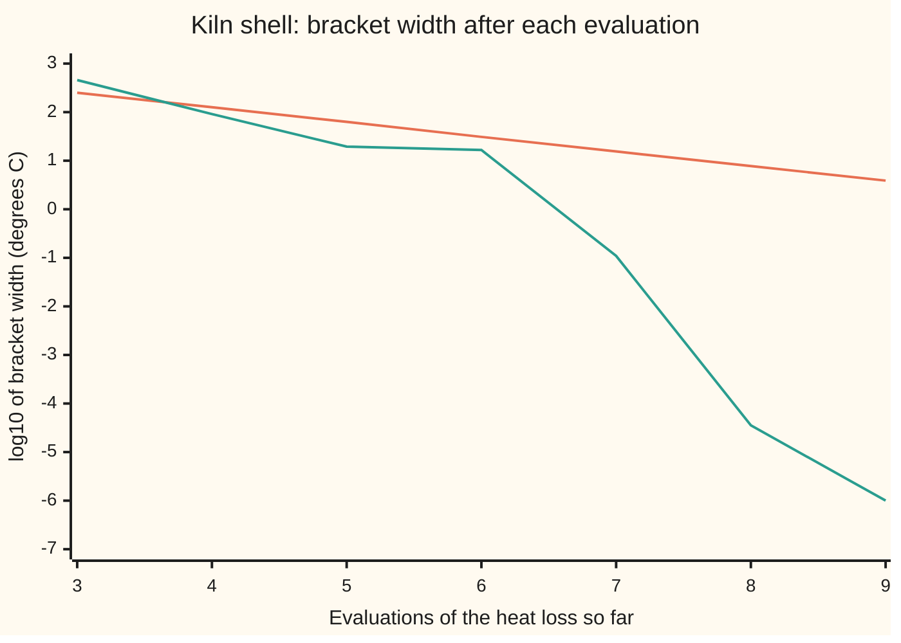
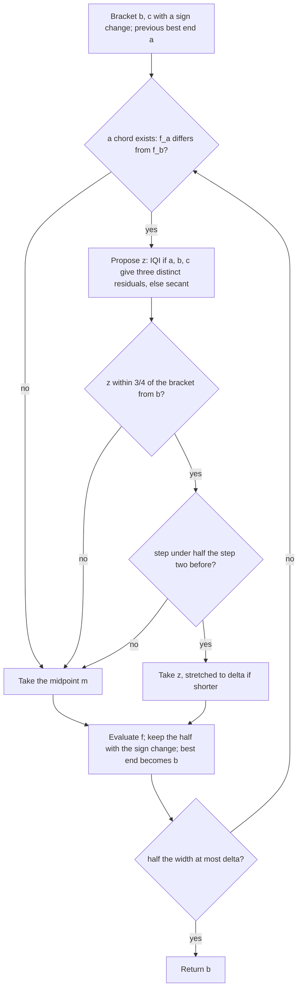

# Brent's method: fast steps while they behave, bisection the moment they do not

[Syllabus](../../../SYLLABUS.md) → [Numerical analysis](../README.md) → [Root Finding and Fixed Points](../README.md#s02) → Brent's method

---

## General Overview

A pottery kiln is firing. Its steel shell has 6 square metres of surface, and it sits in 20 °C air. The shell loses heat two ways: it radiates, and the moving air carries heat away (convection). The gas meter shows the burners making up a steady loss of 12,000 watts. The figures are illustrative. The question is the shell's temperature.

The forward direction is easy. Pick a temperature, compute the loss, compare with 12,000 W. The backward direction has no tidy formula, because radiation grows with the fourth power of the absolute temperature. So the answer comes from a search: find the temperature where "loss minus 12,000 W" is zero.

Two kinds of search already exist on this shelf.

- **Bisection** keeps a **bracket**: two temperatures where the mismatch has opposite signs, so the answer lies between them. It halves the bracket each step. It cannot fail, but it gains one binary digit per step: 30 evaluations of the loss to pin the temperature to a millionth of a degree.
- **Fast steps** (the secant and its relatives) aim at the answer using the values already seen. Near the answer they need a handful of steps. Far from it, or on an awkward curve, they can wander or crawl, and nothing bounds the damage.

**Brent's method** runs both. It proposes a fast step, checks the step against two tests, and halves the bracket whenever a test fails. On the kiln it needs 9 evaluations, never halves, and returns 139.612792432 °C. The true error is −8.804e-09 °C, inside the guaranteed 2e-06 °C.

**Brent's method takes a fast step only when it lands well inside the bracket and is under half the length of the step two before; otherwise it halves the bracket. So it never loses the answer, never needs more than about the square of bisection's count, and on smooth problems usually runs at the speed of its fast steps.**

**What kind of fact this is:** a method with three theorems attached, all proved on this card in Why it works: the answer stays bracketed, the count of evaluations is at most (k + 1)(k + 2) where k is bisection's count, and the fast step has order 1.839 near a simple root (a root where the slope $f'(t^{*})$ is not zero). The bound is proved for the rules as stated here; Brent's paper gives a bound of the same kind for his published code. Step counts are measurements printed by the checks.

### The picture: the bracket, step by step



The straight line is bisection: one halving per evaluation. The other line is Brent's method. It starts no better. Then the fast steps take hold: from evaluation 6 to evaluation 8 the width falls from 16.56 °C to 3.528e-05 °C. Brent stops at 9 evaluations; bisection needs 30.

---

## The formula

Notation first, in words. The unknown is the shell temperature $t$ in degrees Celsius; $t^{*}$ is the true answer. The **residual** $f(t)$ is the heat loss at $t$ minus the meter reading, in watts. The bracket has a **best end** $b$ (the end with the smaller $\lvert f\rvert$, the current answer) and an **other end** $c$, with $f(b)$ and $f(c)$ of opposite sign. The point $a$ is the previous best end. Write $f_a$ for $f(a)$, and so on.

$$f(t) = A\left[\epsilon_{\text{e}}\,\sigma\,(T^{4} - T_{\text{a}}^{4}) + h_{\text{c}}\,(T - T_{\text{a}})\right] - Q, \qquad T = t + 273.15$$

**Read it aloud:** the loss is radiation, which grows with the fourth power of the absolute temperature, plus convection, which grows with the temperature difference; subtract the meter reading.

The fast step is **inverse quadratic interpolation** (IQI): fit $t$ as a quadratic in $f$ through the three points $a$, $b$, $c$, and read it at $f = 0$.

$$z = \frac{a\,f_b f_c}{(f_a - f_b)(f_a - f_c)} + \frac{b\,f_a f_c}{(f_b - f_a)(f_b - f_c)} + \frac{c\,f_a f_b}{(f_c - f_a)(f_c - f_b)}$$

**Read it aloud:** each point's temperature, weighted so the curve passes through all three points, summed at the place where the residual is zero.

When $a$ and $c$ coincide, only two points are left, and the step is the secant $z = b - f_b\,(b - a)/(f_b - f_a)$, as on [Newton and secant](02-newton-and-secant-with-convergence-orders.md).

One case has no chord at all. If the last new point was worse than $b$ and replaced the other end, the best end did not move, so $a = b$ and $f_a = f_b$. The secant would divide zero by zero. The rule is then to halve: the step is the midpoint $m$, with no test needed.

The safeguard decides whether $z$ is taken:

$$\text{take } z \text{ only if } z \text{ lies between } b \text{ and } b + \tfrac{3}{4}(c - b) \;\text{ and }\; \max(\lvert z - b\rvert, \delta) < \tfrac{1}{2}\,s_{n-2}; \;\text{ otherwise take } m = \tfrac{b + c}{2}$$

**Read it aloud:** the fast step must land in the three quarters of the bracket next to the best end, and must be under half the length of the step taken two steps ago; if not, halve.

A fast step shorter than $\delta$ is stretched to exactly $\delta$, a **nudge**, so every step makes progress. The run stops when $\lvert c - b\rvert / 2 \le \delta$ and returns $b$. The guarantee:

$$\lvert b - t^{*}\rvert \le 2\delta, \qquad \text{evaluations} \le (k+1)(k+2), \qquad k = \left\lceil \log_2 \frac{W_0}{2\delta} \right\rceil$$

**Read it aloud:** the answer is within twice the tolerance, and the work is at most about the square of the k halvings bisection would need.

| Symbol | Plain meaning | In our example | Push it up and the answer… |
| --- | --- | --- | --- |
| $f(t)$ | the residual: heat loss at $t$ minus the meter reading, in watts | −12,000.000 W at 20 °C, 124,310.981 W at 520 °C | — |
| $t$, $t^{*}$ | shell temperature in °C; $t^{*}$ the true root | $t^{*}$ = 139.612792440903 °C | — |
| $T$, $T_{\text{a}}$ | absolute temperatures in kelvin: the shell, $t + 273.15$, and the air | $T_{\text{a}}$ = 293.15 K, which is 20 °C | — |
| $Q$, $A$, $\epsilon_{\text{e}}$, $\sigma$, $h_{\text{c}}$ | meter reading; shell area; emissivity (how well the surface radiates, 0 to 1); the Stefan–Boltzmann constant; convection coefficient | 12,000 W; 6 m²; 0.85; 5.670374419e-08 W/(m² K⁴); 8 W/(m² K) | a larger $Q$ raises $t^{*}$ |
| $b$, $c$, $a$ | best end, other end, previous best end | start: $b$ = 20, $c$ = 520 | — |
| $z$, $g$, $y_k$, $P$, $\eta$, $\xi_j$ | the proposed fast step (IQI or secant); the inverse function, $g(f(t)) = t$; the residual at iterate $k$; in the fold, the quadratic through the last three points, and the in-between points that the interpolation error formula and the mean value theorem supply | $z$ = 156.067313852 on step 2 | — |
| $m$ | the midpoint of the bracket, the fallback | never needed on the kiln | — |
| $W$, $W_0$, $W_i$ | bracket width $\lvert c - b\rvert$; $W_0$ at the start; in the proof, $W_i$ just after the $i$-th halving | 500 °C at the start | more evaluations |
| $\delta$ | tolerance: stop when half the width is at most $\delta$ | 1e-06 °C | fewer evaluations |
| $k$ | bisection's count of halvings for this $W_0$ and $\delta$; as a subscript ($x_k$, $e_k$, $y_k$) it numbers the iterates instead | 28 | the bound grows as its square |
| $s_n$, $s_j$ | the length of step $n$, nudges and halvings included; in the proof, $s_j$ is fast step $j$ of one run | the code keeps the last two | — |
| $x_k$, $e_k$, $D_k$, $C$, $p$ | the temperature at iterate $k$ and its error $x_k - t^{*}$; its correct digits $-\log_{10}\lvert e_k\rvert$; the IQI error constant; the order; in the fold, $u_k = \log\lvert e_k\rvert$, its shifted form $v_k$, and a constant $K$ | $C$ = 6.7555e-06 per °C²; $p$ = 1.839287 | — |

### When it holds

- **The residual is continuous on the bracket.** A sign change then traps a root. Across a jump, the method closes on the jump instead, as on [Bisection](01-bisection-and-bracketing.md).
- **The two starting ends have opposite signs.** On [150, 520] both residuals are positive (+1,375.992 W at 150 °C), so there is nothing to trap. The code refuses and returns no answer, rather than guessing.
- **The tolerance is above the floor of doubles.** A double is the computer's 53-bit number. Below the spacing of doubles near the answer, a nudge cannot move the point and the width test can never pass. This card's code assumes a sensible $\delta$; production codes add a relative part to $\delta$ so it never falls below that spacing.
- **For speed, not for safety: a simple root and a smooth residual.** The bound on evaluations uses neither. The order 1.839 needs $f'(t^{*}) \ne 0$ and three continuous derivatives. On $x^9$, whose root is flat, the fast steps are only linear and the halvings do most of the work.

---

## Why it works

### Step 0: a bracket is a promise, a fast step is a bet

The bracket's promise is that the root lies between $b$ and $c$. Bisection keeps it by construction. A fast step is a bet that the curve near the root looks like a line or a parabola. When the bet is good, it gains many digits at once. When it is bad, it can land anywhere.

The first attempt to keep both was the **method of false position**: take the chord between the two bracket ends, and keep the half with the sign change. It never loses the root. But on a curved residual one end sticks, and the order drops to 1, as the "keep the chord's end fixed" row on [Newton and secant](02-newton-and-secant-with-convergence-orders.md) shows.

[Solving backwards](../../12-Financial%20mathematics/07-Greeks%20by%20Numbers%20and%20Calibration/05-root-finding-for-inverses.md) already runs Brent's method on an option price and cites its guarantee. This card proves the guarantee, shows the slow case it cures, and derives the order of its fast step.

### Step 1: Dekker's rule, a fast step checked against the bracket

Dekker's method (1969) takes the secant through the best end and the previous best end. It accepts the step only if it lands between $b$ and the midpoint $m$. Otherwise it halves.

Every accepted step lands inside the bracket, so the root is never lost. The sign test then decides which end to replace:

1. Evaluate $f$ at the new point.
2. If its sign matches $f(c)$, the old $b$ becomes the other end.
3. Otherwise $c$ stays.
4. Swap the ends if the new point has the larger $\lvert f\rvert$.

This is bisection's invariant (the bracket always holds a sign change), applied to points that are not midpoints. So the first half of the guarantee, $\lvert b - t^{*}\rvert \le W \le 2\delta$ at the stop, needs nothing about the fast step except that it lands inside.

### Step 2: the slow case, steps that are always accepted and never enough

Dekker's rule promises the root but not the speed. Take the test function $x^9$ on [−1, 1.3], with the same $\delta$ of 1e-06. Its root at 0 is flat: the residual is tiny for a wide stretch around it.

Each secant step lands between $b$ and $m$, so each is accepted. But each moves $b$ only a fixed fraction closer to 0, and the far end $c$ = 1.3 never moves. The bracket width after 25, 50, 100 and 140 steps reads 1.416, 1.315, 1.300 and 1.300. Not one halving happens.

```
x^9 on [-1, 1.3], delta 1e-06: evaluations, one block = 4
  bisection       ██████                                        23
  Brent           █████████                                     36
  Dekker          ██████████████████████████████████████       152
  plain secant    ██████████████████████████████████████████   170
```

Dekker's method needs 152 evaluations where bisection needs 23. In the worst case its fast steps shrink to $\delta$ and stay there, and the count grows with the width divided by $\delta$, not with its logarithm. The bracket was kept; the progress was not.

### Step 3: Brent's cure, a step must halve every two steps

Brent's extra test asks each fast step to be under half the length of the step two before. A run of fast steps then has to shrink geometrically. If the steps stop shrinking, a test fails and the next step halves the bracket.

On $x^9$ Brent's method finishes in 36 evaluations. That is more than bisection's 23, but within the bound (k + 1)(k + 2) = 506 for k = 21. It halves 18 times in 34 steps. Ten of those halvings are the no-chord rule from The formula: the last point was worse than $b$, so $b$ did not move. The rest are failed tests. The proof below shows that the cap holds for any residual and any choice of fast step.



One guarded step. The chord check and both tests use only numbers already in hand, so the safeguard costs no extra evaluations.

<details>
<summary>Detailed proof: at most (k + 1)(k + 2) evaluations</summary>

Let $W_0$ be the starting width, $\delta$ the tolerance and $k = \lceil \log_2(W_0/(2\delta)) \rceil$, so that $W_0/2^k \le 2\delta$. Four facts follow from the rules.

1. **The bracket never grows.** Every new point lies strictly inside it, and the new bracket is one of the two pieces.
2. **A halving halves it**, whether a test failed or no chord existed. The midpoint splits the bracket into two equal pieces, and one of them is kept. After $i$ halvings the width is at most $W_0/2^i$, so after $k$ halvings the run has stopped. There are at most $k$ halvings.
3. **Every fast step has length at least $\delta$** (the nudge) and at most $\tfrac34$ of the current width (the first test).
4. **Every fast step is under half the step two before** (the second test), counted on actual lengths.

Fix $i$, and look at the run of fast steps that follows the $i$-th halving (for $i = 0$, the run from the start, with both earlier lengths set to $W_0$). Let $W_i$ be the width just after that halving. The halving step itself had length $W_i$. The first fast step has length under $W_i$ by fact 3. By fact 4, the lengths in the run, counted from $j = 0$, satisfy

$$s_j < \frac{W_i}{2^{\lceil j/2 \rceil}}.$$

Each length is at least $\delta$, so $\lceil j/2\rceil < \log_2(W_i/\delta) \le k + 1 - i$. That allows at most $2(k + 1 - i) - 1$ fast steps in run $i$. Runs happen for $i = 0, 1, \ldots, k - 1$ at most, since a run after the $k$-th halving would start from a width at most $2\delta$. Summing,

$$\sum_{i=0}^{k-1} \bigl(2(k - i) + 1\bigr) = k^2 + 2k \text{ fast steps}, \qquad \text{plus at most } k \text{ halvings and 2 end evaluations}.$$

The total is at most $k^2 + 3k + 2 = (k + 1)(k + 2)$ evaluations. Nothing in the argument used what the fast step was, or any property of $f$ beyond its sign. $\blacksquare$

The argument is in exact arithmetic. In doubles, each new point still lands strictly inside the bracket while the width exceeds $2\delta$, and the checks confirm the bound on both test cases: 9 against 870, and 36 against 506.

</details>

### Step 4: why the fast step is inverse, and how fast it is

A parabola through three points can be fitted the usual way, $f$ as a quadratic in $t$. Then finding where it crosses zero means solving a quadratic equation: a square root, a choice of two roots, and possibly none. Fitting the other way round, $t$ as a quadratic in $f$, avoids all of that. Reading it at $f = 0$ is one evaluation of a formula, and it always gives exactly one answer.

How fast is it? Number the iterates: $x_k$ is the temperature after step $k$, $e_k = x_k - t^{*}$ its error and $y_k = f(x_k)$ its residual. Let $g$ be the inverse function: $g(f(t)) = t$, so $t^{*} = g(0)$. IQI interpolates $g$ at the three residuals $y_k$, $y_{k-1}$, $y_{k-2}$. The error of a quadratic interpolant is the next derivative times the product of the distances. Near the root each residual is about the slope times the error, $y_j \approx f'(t^{*})\,e_j$. Together:

$$e_{k+1} \approx C\, e_k\, e_{k-1}\, e_{k-2}, \qquad C = \frac{3 f''(t^{*})^2 - f'(t^{*}) f'''(t^{*})}{6 f'(t^{*})^2}$$

**Read it aloud:** the next error is a fixed constant times the product of the last three errors.

On the kiln, $C$ = 6.7555e-06 per °C². Pure IQI from 20, 520 and 270 °C gives the ratio $e_{k+1}/(e_k e_{k-1} e_{k-2})$ as 6.117e-06, 6.869e-06 and 6.776e-06, settling on the prediction.

Take logs, and count digits $D_k = -\log_{10}\lvert e_k\rvert$. Then $D_{k+1} \approx D_k + D_{k-1} + D_{k-2}$: each digit count is the sum of the three before. Such a sequence grows by a factor $p$ that solves $p^3 = p^2 + p + 1$, which is 1.839287. That is the order. The observed orders on the kiln run 2.4046, 1.8112, 1.7837 before rounding ends the fall.

<details>
<summary>Detailed proof: the IQI error law and the order 1.839</summary>

Assume $f$ has three continuous derivatives near $t^{*}$ and $f'(t^{*}) \ne 0$. Then $f$ has a smooth inverse $g$ near 0, with

$$g' = \frac{1}{f'}, \qquad g'' = -\frac{f''}{f'^3}, \qquad g''' = \frac{3 f''^2 - f' f'''}{f'^5},$$

each evaluated at the matching point. The step $x_{k+1}$ is $P(0)$, where $P$ is the quadratic through $(y_j, x_j)$ for $j = k, k-1, k-2$. The interpolation error formula gives, for some $\eta$ between the $y_j$ and 0,

$$g(0) - P(0) = \frac{g'''(\eta)}{6}\,(0 - y_k)(0 - y_{k-1})(0 - y_{k-2}).$$

Since $g(0) = t^{*}$ and $P(0) = x_{k+1}$, this is $e_{k+1} = \tfrac{1}{6}\,g'''(\eta)\, y_k y_{k-1} y_{k-2}$. By the mean value theorem $y_j = f'(\xi_j)\, e_j$. As the errors shrink, $g'''(\eta) \to g'''(0)$ and $f'(\xi_j) \to f'(t^{*})$, so

$$\frac{e_{k+1}}{e_k e_{k-1} e_{k-2}} \to \frac{g'''(0)\,f'(t^{*})^3}{6} = C.$$

For the order, write $u_k = \log\lvert e_k\rvert$. Then $u_{k+1} = u_k + u_{k-1} + u_{k-2} + \log\lvert C\rvert + o(1)$. The shift $v_k = u_k + \tfrac12\log\lvert C\rvert$ removes the constant, leaving the linear recurrence $v_{k+1} \approx v_k + v_{k-1} + v_{k-2}$. Its characteristic equation is $p^3 = p^2 + p + 1$, with one real root, 1.839287, and two complex roots of size below 1. So $v_{k+1}/v_k \to 1.839287$, and $\lvert e_{k+1}\rvert \approx K\,\lvert e_k\rvert^{1.839}$ for a constant $K$: order 1.839. The same pattern with two terms gives the secant's golden ratio on [Newton and secant](02-newton-and-secant-with-convergence-orders.md). $\blacksquare$

</details>

The checks find 1.839287 two ways: by halving on $p^3 - p^2 - p - 1$, and by running the digit law for 40 steps and taking the last ratio.

### Step 5: what the guarantee covers, and what it does not

Three claims, each a different kind.

- **Safety, proved.** The root stays bracketed, so the answer is within $2\delta$. On the kiln the bound is 2e-06 °C and the true error is −8.804e-09 °C: the bound is 227.2 times the error.
- **Worst-case work, proved.** At most (k + 1)(k + 2) evaluations: 870 on the kiln, which used 9.
- **Speed, observed, not promised.** Near a simple root the tests usually pass, and the fast steps show their order. That is why the kiln needs 9 evaluations, not 30.

The answer's accuracy is also limited by the residual. Rewritten in factored form, $A(T - T_{\text{a}})[\epsilon_{\text{e}}\sigma(T^2 + T_{\text{a}}^2)(T + T_{\text{a}}) + h_{\text{c}}] - Q$, the residual at Brent's answer is −1.139e-06 W. The bound from the slope, $f'(t^{*})$ = 129.347372 W per °C times $2\delta$, is 2.587e-04 W. The two roads agree that the answer balances the heat. Whether 12,000 W is the true loss is a question of conditioning, taken up on [When to stop](03-stopping-criteria-and-error-estimates.md).

---

## Worked numbers, by hand

Bracket [20, 520] °C, $\delta$ = 1e-06 °C. At the start $\lvert f(20)\rvert$ = 12,000 W is smaller than $f(520)$ = 124,310.981 W, so $b$ = 20 and $c$ = 520.

| Step | Arithmetic | Value |
| --- | --- | --- |
| promise | $k = \lceil \log_2(500 / 2\times10^{-6})\rceil$; bound $(k+1)(k+2)$ | 28 halvings; 870 evaluations |
| 1, secant | only two points; chord from (20, −12,000) to (520, 124,310.981): 20 + 12,000 × 500 / 136,310.981 | 64.016996607; f = −8,285.554 W; width 456.0 |
| 2, IQI | quadratic in f through 20, 64.017 and 520, read at f = 0 | 156.067313852; f = +2,210.537 W; width 92.05 |
| 3, secant | the sign change moved, so the other end is the old best end and only two points remain | 136.680989247; f = −376.692 W; width 19.39 |
| 4, secant | the same situation again | 139.503574420; f = −14.124 W; width 16.56 |
| 5, IQI | through 136.681, 139.504 and 156.067 | 139.612827708; f = +0.004562 W; width 0.1093 |
| 6, secant | through 139.5036 and 139.6128 | 139.612792432; f = −0.000001 W; width 3.528e-05 |
| 7, nudge | the proposal is shorter than $\delta$, so step exactly $\delta$ toward $c$ | 139.612793432; f = +0.000128 W; width 1.000e-06 |
| stop | half the width is at most $\delta$; return the best end | **139.612792432 °C, true error −8.804e-09 °C** |

The shell is at about 139.6 °C. No step was a halving: on a smooth residual, every fast step passed both tests. The last step, the nudge, spends one evaluation to shrink the bracket to $\delta$ and so certify the answer.

### What breaks if you drop a piece

| Mistake | Comes out at | What went wrong |
| --- | --- | --- |
| Drop Brent's halving test on $x^9$, which leaves only the bracket test (`notest`) | 152 evaluations, 0 halvings: Dekker's count, and Dekker's bracket is still 1.300 wide after 140 steps | accepted steps shrank by a fixed fraction while the far end never moved |
| Drop the bracket as well: the plain secant on $x^9$ | 170 evaluations to reach $\lvert x\rvert \le$ 1e-06 | linear crawl with no halving to rescue it |
| Start on [150, 520], where both residuals are positive | refused: no answer | no sign change, so no root is trapped; a blind run would return an end |
| Read the method as never slower than bisection | $x^9$: 36 against 23 | the promise is (k + 1)(k + 2) = 506, not k + 2 |

---

## Code, from first principles, and it actually runs

The code writes out the residual, inverse quadratic interpolation, and one solver with four settings: bisection, Dekker's rule, Brent's rule, and Brent's rule without its halving test (`notest`). It reaches the kiln temperature by **four roads**: bisection run until the bracket ends are neighbouring doubles (the reference), Brent, Dekker, and a separately factored residual at Brent's answer. It then runs pure IQI to measure the error constant and the order, finds the order 1.839 two ways, and runs the slow case on $x^9$. Nine asserts compare against independently computed values.

### Python

```python
# Brent's method -- the check behind the card.  Standard library only.
# A kiln's steel shell (6 m2, emissivity 0.85) sheds heat to 20 C air by
# radiation and convection (h = 8 W/m2K).  A gas meter says the loss is
# 12,000 W (illustrative).  Which shell temperature t, in C, explains it?
# Roads: bisection to the last bit; Brent; Dekker; a factorised residual.
from math import log, log10
SIG, AREA, EMIS, HC, LOSS, TA = 5.670374419e-8, 6.0, 0.85, 8.0, 12000.0, 293.15

def kiln(t):                              # heat loss at t minus the meter, in W
    T = t + 273.15
    return AREA * (EMIS * SIG * (T * T * T * T - TA * TA * TA * TA) + HC * (T - TA)) - LOSS

def kiln_factored(t):                     # the same loss, written another way
    T = t + 273.15
    return AREA * (T - TA) * (EMIS * SIG * (T * T + TA * TA) * (T + TA) + HC) - LOSS

def x9(x): return x * x * x * x * x * x * x * x * x

def iqi(a, b, c, fa, fb, fc):             # x as a quadratic in f, read at f = 0
    return (a * fb * fc / ((fa - fb) * (fa - fc)) + b * fa * fc / ((fb - fa) * (fb - fc))
            + c * fa * fb / ((fc - fa) * (fc - fb)))

def solve(f, lo, hi, delta, mode):        # mode: bisect, dekker, brent or notest
    fl, fh = f(lo), f(hi)
    if (fl < 0) == (fh < 0): return None, 2, []
    b, fb, c, fc = hi, fh, lo, fl         # b best end, c the other end
    if abs(fc) < abs(fb): b, fb, c, fc = c, fc, b, fb
    a, fa, n, log_ = c, fc, 2, []
    s1 = s2 = abs(c - b)                  # the last two step lengths
    while abs(c - b) / 2 > delta and fb != 0:
        m = (b + c) / 2
        if mode in ("brent", "notest") and a != c and fa != fb and fa != fc and fb != fc:
            p, kind = iqi(a, b, c, fa, fb, fc), "IQI"
        elif fa != fb: p, kind = b - fb * (b - a) / (fb - fa), "secant"
        else: p, kind = m, "no chord"         # b did not move, so a = b: halve
        st = abs(p - b)
        if mode == "dekker": ok = (p - b) * (c - b) > 0 and st < abs(m - b)
        else: ok = (p - b) * (c - b) > 0 and st < 0.75 * abs(c - b) and (mode == "notest"
                                                                       or max(st, delta) < s2 / 2)
        if mode == "bisect" or not (ok or kind == "no chord"): new, kind = m, "halve"
        elif st < delta: new, kind = b + (delta if c > b else -delta), "nudge"
        else: new = p
        s2, s1 = s1, abs(new - b)
        fn = f(new); n += 1
        a, fa = b, fb
        if (fn < 0) == (fc < 0): c, fc = b, fb
        b, fb = new, fn
        if abs(fc) < abs(fb): b, fb, c, fc = c, fc, b, fb
        log_.append((kind, new, fn, abs(c - b)))
    return b, n, log_

def promise(w, delta):                    # halvings until w / 2^k <= 2 delta
    k = 0
    while w / 2 ** k > 2 * delta: k += 1
    return k

lo, hi = 20.0, 520.0                      # reference: halve until the ends touch
while (lo + hi) / 2 not in (lo, hi):
    if kiln((lo + hi) / 2) < 0: lo = (lo + hi) / 2
    else: hi = (lo + hi) / 2
r = lo if abs(kiln(lo)) <= abs(kiln(hi)) else hi
T = r + 273.15
d1 = AREA * (4 * EMIS * SIG * T * T * T + HC)
d2, d3 = AREA * 12 * EMIS * SIG * T * T, AREA * 24 * EMIS * SIG * T
C = (3 * d2 * d2 - d1 * d3) / (6 * d1 * d1)
D = 1e-6
k = promise(500.0, D)
print(f"reference root t* (C)          {r:.12f}")
print(f"slope f'(t*) (W per C)         {d1:.6f}")
print(f"f(20) and f(520) (W)           {kiln(20.0):.3f} {kiln(520.0):.3f}")
print(f"delta {D:.0e} C; promise k = {k}; bound (k+1)(k+2) = {(k + 1) * (k + 2)}")
res = {}
for mode in ("bisect", "dekker", "brent"):
    x, n, lg = solve(kiln, 20.0, 520.0, D, mode)
    res[mode] = (x, n, lg)
    print(f"{mode:<7} evaluations {n:>3}  t = {x:.9f}  true error {x - r:.3e}")
print("Brent on the kiln: step, kind, t, f(t) in W, bracket width")
for i, (kind, x, fx, w) in enumerate(res["brent"][2]):
    print(f"  {i + 1}  {kind:<6} {x:16.9f} {fx:13.6f} {w:.3e}")
xb = res["brent"][0]
print(f"factorised residual at Brent's t  {kiln_factored(xb):.3e} W; bound f' x 2 delta {d1 * 2 * D:.3e}")
print(f"error bound 2 delta over Brent's true error  {2 * D / abs(xb - r):.1f}")
ch = [log10(res[m][2][j][3]) for m in ("bisect", "brent") for j in range(7)]
print("chart, log10 bracket width, evals 3-9, bisect", " ".join(f"{v:.2f}" for v in ch[:7]))
print("chart, log10 bracket width, evals 3-9, brent ", " ".join(f"{v:.2f}" for v in ch[7:]))
xs = [20.0, 520.0, 270.0]                 # pure IQI, no bracket, for the order
for i in range(6): xs.append(iqi(*xs[-3:], *[kiln(v) for v in xs[-3:]]))
e = [v - r for v in xs]
print(f"pure IQI from 20, 520, 270; predicted C = (3f''^2 - f'f''')/(6f'^2) = {C:.4e}")
for i in range(3, 9):
    ratio = e[i] / (e[i - 1] * e[i - 2] * e[i - 3])
    order = log(abs(e[i] / e[i - 1])) / log(abs(e[i - 1] / e[i - 2]))
    print(f"  x{i}  error {e[i]:10.3e}  e/(e e e) {ratio:10.3e}  order {order:.4f}")
pl, ph = 1.0, 2.0                          # p^3 = p^2 + p + 1 by halving
for _ in range(60):
    pm = (pl + ph) / 2
    if pm * pm * pm - pm * pm - pm - 1 < 0: pl = pm
    else: ph = pm
dg = [1.0, 2.0, 3.0]                      # digits obey D' = D + D_ + D__
for _ in range(40): dg.append(dg[-1] + dg[-2] + dg[-3])
print(f"order of IQI: root of p^3=p^2+p+1 {pl:.6f}; digit law ratio {dg[-1] / dg[-2]:.6f}")
k9 = promise(2.3, D)
print(f"x^9 on [-1, 1.3]: promise k = {k9}; bound (k+1)(k+2) = {(k9 + 1) * (k9 + 2)}")
cnt = {}
for mode in ("bisect", "dekker", "brent", "notest"):
    x, n, lg = solve(x9, -1.0, 1.3, D, mode)
    cnt[mode] = n
    h, nc = sum(s[0] == "halve" for s in lg), sum(s[0] == "no chord" for s in lg)
    print(f"  {mode:<7} evaluations {n:>3}  answer {x:.3e}  halvings {h + nc}, {nc} of them with no chord")
dk = solve(x9, -1.0, 1.3, D, "dekker")[2]
print("  Dekker bracket width after 25, 50, 100, 140 steps",
      " ".join(f"{dk[j - 1][3]:.3f}" for j in (25, 50, 100, 140)))
sx = [-1.0, 1.3]                          # plain secant, no bracket
while abs(sx[-1]) > D: sx.append(sx[-1] - x9(sx[-1]) * (sx[-1] - sx[-2]) / (x9(sx[-1]) - x9(sx[-2])))
print(f"  plain secant: {len(sx)} evaluations to reach |x| <= 1e-06")
bad = solve(kiln, 150.0, 520.0, D, "brent")
print(f"break: bracket [150, 520], f(150) = {kiln(150.0):.3f} W: answer {bad[0]}")
for loss in (6000.0, 24000.0):
    LOSS = loss
    x, n, _ = solve(kiln, 20.0, 520.0, D, "brent")
    print(f"try: loss {loss:.0f} W -> t = {x:.6f} C in {n} evaluations")
LOSS = 12000.0
for dd in (1e-3, 1e-9):
    print(f"try: delta {dd:.0e} -> bisection {solve(kiln, 20.0, 520.0, dd, 'bisect')[1]},"
          f" Brent {solve(kiln, 20.0, 520.0, dd, 'brent')[1]}")
assert abs(res["bisect"][0] - r) <= D and abs(res["brent"][0] - r) <= 2 * D
assert abs(res["dekker"][0] - r) <= 2 * D, "Dekker must land inside 2 delta"
assert res["bisect"][1] == k + 2, "bisection keeps its promise"
assert abs(kiln_factored(xb)) <= 1.01 * d1 * 2 * D, "residual road agrees"
assert res["brent"][1] <= (k + 1) * (k + 2) and cnt["brent"] <= (k9 + 1) * (k9 + 2)
assert min(cnt["dekker"], cnt["notest"]) > 4 * cnt["brent"], "the halving test must cure the slow case"
assert abs(e[7] / (e[6] * e[5] * e[4]) / C - 1) < 0.02, "IQI error law"
assert abs(pl - dg[-1] / dg[-2]) < 1e-9, "two roads to the order 1.839"
assert bad[0] is None, "no sign change must be refused"
print("ALL CHECKS PASS")
```

**Ran 2026-11-11 on macOS, Python 3.14.10, standard library only. All checks passed. Output, pasted from the run:**

```
reference root t* (C)          139.612792440903
slope f'(t*) (W per C)         129.347372
f(20) and f(520) (W)           -12000.000 124310.981
delta 1e-06 C; promise k = 28; bound (k+1)(k+2) = 870
bisect  evaluations  30  t = 139.612792507  true error 6.591e-08
dekker  evaluations   9  t = 139.612792565  true error 1.245e-07
brent   evaluations   9  t = 139.612792432  true error -8.804e-09
Brent on the kiln: step, kind, t, f(t) in W, bracket width
  1  secant     64.016996607  -8285.554372 4.560e+02
  2  IQI       156.067313852   2210.537032 9.205e+01
  3  secant    136.680989247   -376.692055 1.939e+01
  4  secant    139.503574420    -14.123538 1.656e+01
  5  IQI       139.612827708      0.004562 1.093e-01
  6  secant    139.612792432     -0.000001 3.528e-05
  7  nudge     139.612793432      0.000128 1.000e-06
factorised residual at Brent's t  -1.139e-06 W; bound f' x 2 delta 2.587e-04
error bound 2 delta over Brent's true error  227.2
chart, log10 bracket width, evals 3-9, bisect 2.40 2.10 1.80 1.49 1.19 0.89 0.59
chart, log10 bracket width, evals 3-9, brent  2.66 1.96 1.29 1.22 -0.96 -4.45 -6.00
pure IQI from 20, 520, 270; predicted C = (3f''^2 - f'f''')/(6f'^2) = 6.7555e-06
  x3  error -2.451e+01  e/(e e e)  4.132e-06  order 1.5609
  x4  error -4.773e+00  e/(e e e)  3.926e-06  order 0.9791
  x5  error  9.333e-02  e/(e e e)  6.117e-06  order 2.4046
  x6  error  7.502e-05  e/(e e e)  6.869e-06  order 1.8112
  x7  error -2.265e-10  e/(e e e)  6.776e-06  order 1.7837
  x8  error  2.842e-14  e/(e e e) -1.792e+01  order 0.7067
order of IQI: root of p^3=p^2+p+1 1.839287; digit law ratio 1.839287
x^9 on [-1, 1.3]: promise k = 21; bound (k+1)(k+2) = 506
  bisect  evaluations  23  answer -2.384e-07  halvings 21, 0 of them with no chord
  dekker  evaluations 152  answer -4.278e-07  halvings 0, 0 of them with no chord
  brent   evaluations  36  answer -9.677e-08  halvings 18, 10 of them with no chord
  notest  evaluations 152  answer -4.520e-07  halvings 0, 0 of them with no chord
  Dekker bracket width after 25, 50, 100, 140 steps 1.416 1.315 1.300 1.300
  plain secant: 170 evaluations to reach |x| <= 1e-06
break: bracket [150, 520], f(150) = 1375.992 W: answer None
try: loss 6000 W -> t = 87.531921 C in 8 evaluations
try: loss 24000 W -> t = 216.935432 C in 10 evaluations
try: delta 1e-03 -> bisection 20, Brent 8
try: delta 1e-09 -> bisection 40, Brent 10
ALL CHECKS PASS
```

### Rust

```rust
// Brent's method -- the check behind the card.  std only, no crates.
// A kiln's steel shell (6 m2, emissivity 0.85) sheds heat to 20 C air by
// radiation and convection (h = 8 W/m2K).  A gas meter says the loss is
// 12,000 W (illustrative).  Which shell temperature t, in C, explains it?
// Roads: bisection to the last bit; Brent; Dekker; a factorised residual.
const SIG: f64 = 5.670374419e-8; const AREA: f64 = 6.0; const EMIS: f64 = 0.85;
const HC: f64 = 8.0; const TA: f64 = 293.15;

fn kiln(t: f64, loss: f64) -> f64 {
    let tk = t + 273.15;
    AREA * (EMIS * SIG * (tk * tk * tk * tk - TA * TA * TA * TA) + HC * (tk - TA)) - loss
}
fn kiln_factored(t: f64, loss: f64) -> f64 {
    let tk = t + 273.15;
    AREA * (tk - TA) * (EMIS * SIG * (tk * tk + TA * TA) * (tk + TA) + HC) - loss
}
fn x9(x: f64) -> f64 { x * x * x * x * x * x * x * x * x }

fn iqi(a: f64, b: f64, c: f64, fa: f64, fb: f64, fc: f64) -> f64 {
    a * fb * fc / ((fa - fb) * (fa - fc)) + b * fa * fc / ((fb - fa) * (fb - fc))
        + c * fa * fb / ((fc - fa) * (fc - fb))
}

// Python-style e-notation: 1.234e-06
fn sci(x: f64, d: usize) -> String {
    let s = format!("{:.*e}", d, x);
    let (m, e) = s.split_once('e').unwrap();
    let e: i32 = e.parse().unwrap();
    format!("{}e{}{:02}", m, if e < 0 { '-' } else { '+' }, e.abs())
}

struct Step { kind: &'static str, x: f64, fx: f64, w: f64 }

fn solve(f: &dyn Fn(f64) -> f64, lo: f64, hi: f64, delta: f64, mode: &str) -> (Option<f64>, usize, Vec<Step>) {
    let (fl, fh) = (f(lo), f(hi));
    if (fl < 0.0) == (fh < 0.0) { return (None, 2, vec![]); }
    let (mut b, mut fb, mut c, mut fc) = (hi, fh, lo, fl);
    if fc.abs() < fb.abs() { std::mem::swap(&mut b, &mut c); std::mem::swap(&mut fb, &mut fc); }
    let (mut a, mut fa, mut n, mut lg) = (c, fc, 2usize, Vec::new());
    let (mut s1, mut s2) = ((c - b).abs(), (c - b).abs());
    while (c - b).abs() / 2.0 > delta && fb != 0.0 {
        let m = (b + c) / 2.0;
        let (p, mut kind) = if (mode == "brent" || mode == "notest") && a != c && fa != fb && fa != fc && fb != fc {
            (iqi(a, b, c, fa, fb, fc), "IQI")
        } else if fa != fb { (b - fb * (b - a) / (fb - fa), "secant") } else { (m, "no chord") }; // a = b: halve
        let st = (p - b).abs();
        let ok = if mode == "dekker" { (p - b) * (c - b) > 0.0 && st < (m - b).abs() }
                 else { (p - b) * (c - b) > 0.0 && st < 0.75 * (c - b).abs()
                        && (mode == "notest" || st.max(delta) < s2 / 2.0) };
        let new;
        if mode == "bisect" || !(ok || kind == "no chord") { new = m; kind = "halve"; }
        else if st < delta { new = b + if c > b { delta } else { -delta }; kind = "nudge"; }
        else { new = p; }
        s2 = s1; s1 = (new - b).abs();
        let fnew = f(new); n += 1;
        a = b; fa = fb;
        if (fnew < 0.0) == (fc < 0.0) { c = b; fc = fb; }
        b = new; fb = fnew;
        if fc.abs() < fb.abs() { std::mem::swap(&mut b, &mut c); std::mem::swap(&mut fb, &mut fc); }
        lg.push(Step { kind, x: new, fx: fnew, w: (c - b).abs() });
    }
    (Some(b), n, lg)
}

fn promise(w: f64, delta: f64) -> i32 {
    let mut k = 0;
    while w / 2f64.powi(k) > 2.0 * delta { k += 1; }
    k
}

fn main() {
    let loss = 12000.0;
    let kf = |t: f64| kiln(t, loss);
    let (mut lo, mut hi) = (20.0f64, 520.0f64);
    loop {
        let m = (lo + hi) / 2.0;
        if m == lo || m == hi { break; }
        if kf(m) < 0.0 { lo = m } else { hi = m }
    }
    let r = if kf(lo).abs() <= kf(hi).abs() { lo } else { hi };
    let tk = r + 273.15;
    let d1 = AREA * (4.0 * EMIS * SIG * tk * tk * tk + HC);
    let (d2, d3) = (AREA * 12.0 * EMIS * SIG * tk * tk, AREA * 24.0 * EMIS * SIG * tk);
    let cc = (3.0 * d2 * d2 - d1 * d3) / (6.0 * d1 * d1);
    let (dl, k) = (1e-6, promise(500.0, 1e-6)); let kb = ((k + 1) * (k + 2)) as usize;
    println!("reference root t* (C)          {:.12}", r);
    println!("slope f'(t*) (W per C)         {:.6}", d1);
    println!("f(20) and f(520) (W)           {:.3} {:.3}", kf(20.0), kf(520.0));
    println!("delta {} C; promise k = {}; bound (k+1)(k+2) = {}", sci(dl, 0), k, kb);
    let mut res = Vec::new();
    for mode in ["bisect", "dekker", "brent"] {
        let (x, n, lg) = solve(&kf, 20.0, 520.0, dl, mode);
        let x = x.unwrap();
        println!("{:<7} evaluations {:>3}  t = {:.9}  true error {}", mode, n, x, sci(x - r, 3));
        res.push((x, n, lg));
    }
    println!("Brent on the kiln: step, kind, t, f(t) in W, bracket width");
    for (i, s) in res[2].2.iter().enumerate() {
        println!("  {}  {:<6} {:16.9} {:13.6} {}", i + 1, s.kind, s.x, s.fx, sci(s.w, 3));
    }
    let xb = res[2].0;
    println!("factorised residual at Brent's t  {} W; bound f' x 2 delta {}",
             sci(kiln_factored(xb, loss), 3), sci(d1 * 2.0 * dl, 3));
    println!("error bound 2 delta over Brent's true error  {:.1}", 2.0 * dl / (xb - r).abs());
    for (lab, i) in [("bisect", 0usize), ("brent ", 2)] {
        let v: Vec<String> = (0..7).map(|j| format!("{:.2}", res[i].2[j].w.log10())).collect();
        println!("chart, log10 bracket width, evals 3-9, {} {}", lab, v.join(" "));
    }
    let mut xs = vec![20.0, 520.0, 270.0];
    for _ in 0..6 {
        let l = xs.len();
        let (a, b, c) = (xs[l - 3], xs[l - 2], xs[l - 1]);
        xs.push(iqi(a, b, c, kf(a), kf(b), kf(c)));
    }
    let e: Vec<f64> = xs.iter().map(|v| v - r).collect();
    println!("pure IQI from 20, 520, 270; predicted C = (3f''^2 - f'f''')/(6f'^2) = {}", sci(cc, 4));
    for i in 3..9 {
        let ratio = e[i] / (e[i - 1] * e[i - 2] * e[i - 3]);
        let order = (e[i] / e[i - 1]).abs().ln() / (e[i - 1] / e[i - 2]).abs().ln();
        println!("  x{}  error {:>10}  e/(e e e) {:>10}  order {:.4}", i, sci(e[i], 3), sci(ratio, 3), order);
    }
    let (mut pl, mut ph) = (1.0f64, 2.0f64);
    for _ in 0..60 {
        let pm = (pl + ph) / 2.0;
        if pm * pm * pm - pm * pm - pm - 1.0 < 0.0 { pl = pm } else { ph = pm }
    }
    let mut dg = vec![1.0f64, 2.0, 3.0];
    for _ in 0..40 { let l = dg.len(); dg.push(dg[l - 1] + dg[l - 2] + dg[l - 3]); }
    let dr = dg[dg.len() - 1] / dg[dg.len() - 2];
    println!("order of IQI: root of p^3=p^2+p+1 {:.6}; digit law ratio {:.6}", pl, dr);
    let k9 = promise(2.3, dl); let k9b = ((k9 + 1) * (k9 + 2)) as usize;
    println!("x^9 on [-1, 1.3]: promise k = {}; bound (k+1)(k+2) = {}", k9, k9b);
    let mut cnt = std::collections::HashMap::new();
    for mode in ["bisect", "dekker", "brent", "notest"] {
        let (x, n, lg) = solve(&x9, -1.0, 1.3, dl, mode);
        cnt.insert(mode, n);
        let (h, nc) = (lg.iter().filter(|s| s.kind == "halve").count(), lg.iter().filter(|s| s.kind == "no chord").count());
        println!("  {:<7} evaluations {:>3}  answer {}  halvings {}, {} of them with no chord", mode, n, sci(x.unwrap(), 3), h + nc, nc);
    }
    let dk = solve(&x9, -1.0, 1.3, dl, "dekker").2;
    let v: Vec<String> = [25usize, 50, 100, 140].iter().map(|&j| format!("{:.3}", dk[j - 1].w)).collect();
    println!("  Dekker bracket width after 25, 50, 100, 140 steps {}", v.join(" "));
    let mut sx = vec![-1.0f64, 1.3];
    while sx[sx.len() - 1].abs() > dl {
        let (p, q) = (sx[sx.len() - 2], sx[sx.len() - 1]);
        sx.push(q - x9(q) * (q - p) / (x9(q) - x9(p)));
    }
    println!("  plain secant: {} evaluations to reach |x| <= 1e-06", sx.len());
    let bad = solve(&kf, 150.0, 520.0, dl, "brent");
    println!("break: bracket [150, 520], f(150) = {:.3} W: answer {}", kf(150.0),
             match bad.0 { None => "None".to_string(), Some(v) => format!("{}", v) });
    for l2 in [6000.0, 24000.0] {
        let (x, n, _) = solve(&|t| kiln(t, l2), 20.0, 520.0, dl, "brent");
        println!("try: loss {:.0} W -> t = {:.6} C in {} evaluations", l2, x.unwrap(), n);
    }
    for dd in [1e-3, 1e-9] {
        println!("try: delta {} -> bisection {}, Brent {}", sci(dd, 0),
                 solve(&kf, 20.0, 520.0, dd, "bisect").1, solve(&kf, 20.0, 520.0, dd, "brent").1);
    }
    assert!((res[0].0 - r).abs() <= dl && (res[2].0 - r).abs() <= 2.0 * dl);
    assert!((res[1].0 - r).abs() <= 2.0 * dl, "Dekker must land inside 2 delta");
    assert!(res[0].1 == (k + 2) as usize, "bisection keeps its promise");
    assert!(kiln_factored(xb, loss).abs() <= 1.01 * d1 * 2.0 * dl, "residual road agrees");
    assert!(res[2].1 <= kb && cnt["brent"] <= k9b);
    assert!(cnt["dekker"].min(cnt["notest"]) > 4 * cnt["brent"], "the halving test must cure the slow case");
    assert!((e[7] / (e[6] * e[5] * e[4]) / cc - 1.0).abs() < 0.02, "IQI error law");
    assert!((pl - dr).abs() < 1e-9, "two roads to the order 1.839");
    assert!(bad.0.is_none(), "no sign change must be refused");
    println!("ALL CHECKS PASS");
}
```

**Ran 2026-11-11 on macOS, rustc 1.98.1, no crates. All checks passed. Output, pasted from the run:**

```
reference root t* (C)          139.612792440903
slope f'(t*) (W per C)         129.347372
f(20) and f(520) (W)           -12000.000 124310.981
delta 1e-06 C; promise k = 28; bound (k+1)(k+2) = 870
bisect  evaluations  30  t = 139.612792507  true error 6.591e-08
dekker  evaluations   9  t = 139.612792565  true error 1.245e-07
brent   evaluations   9  t = 139.612792432  true error -8.804e-09
Brent on the kiln: step, kind, t, f(t) in W, bracket width
  1  secant     64.016996607  -8285.554372 4.560e+02
  2  IQI       156.067313852   2210.537032 9.205e+01
  3  secant    136.680989247   -376.692055 1.939e+01
  4  secant    139.503574420    -14.123538 1.656e+01
  5  IQI       139.612827708      0.004562 1.093e-01
  6  secant    139.612792432     -0.000001 3.528e-05
  7  nudge     139.612793432      0.000128 1.000e-06
factorised residual at Brent's t  -1.139e-06 W; bound f' x 2 delta 2.587e-04
error bound 2 delta over Brent's true error  227.2
chart, log10 bracket width, evals 3-9, bisect 2.40 2.10 1.80 1.49 1.19 0.89 0.59
chart, log10 bracket width, evals 3-9, brent  2.66 1.96 1.29 1.22 -0.96 -4.45 -6.00
pure IQI from 20, 520, 270; predicted C = (3f''^2 - f'f''')/(6f'^2) = 6.7555e-06
  x3  error -2.451e+01  e/(e e e)  4.132e-06  order 1.5609
  x4  error -4.773e+00  e/(e e e)  3.926e-06  order 0.9791
  x5  error  9.333e-02  e/(e e e)  6.117e-06  order 2.4046
  x6  error  7.502e-05  e/(e e e)  6.869e-06  order 1.8112
  x7  error -2.265e-10  e/(e e e)  6.776e-06  order 1.7837
  x8  error  2.842e-14  e/(e e e) -1.792e+01  order 0.7067
order of IQI: root of p^3=p^2+p+1 1.839287; digit law ratio 1.839287
x^9 on [-1, 1.3]: promise k = 21; bound (k+1)(k+2) = 506
  bisect  evaluations  23  answer -2.384e-07  halvings 21, 0 of them with no chord
  dekker  evaluations 152  answer -4.278e-07  halvings 0, 0 of them with no chord
  brent   evaluations  36  answer -9.677e-08  halvings 18, 10 of them with no chord
  notest  evaluations 152  answer -4.520e-07  halvings 0, 0 of them with no chord
  Dekker bracket width after 25, 50, 100, 140 steps 1.416 1.315 1.300 1.300
  plain secant: 170 evaluations to reach |x| <= 1e-06
break: bracket [150, 520], f(150) = 1375.992 W: answer None
try: loss 6000 W -> t = 87.531921 C in 8 evaluations
try: loss 24000 W -> t = 216.935432 C in 10 evaluations
try: delta 1e-03 -> bisection 20, Brent 8
try: delta 1e-09 -> bisection 40, Brent 10
ALL CHECKS PASS
```

### Lean

Lean proves Brent's guarantee for any fast step, the IQI error law, and the roots of $p^3 = p^2 + p + 1$.

- Suppose the residual is continuous on the bracket, its two ends have opposite signs, and $\delta > 0$. Then the method stops within $(k + 1)(k + 2)$ evaluations.
- At the stop, the best end $b$ lies within $2\delta$ of a root inside the starting bracket. This holds whatever the fast step proposes.
- Suppose $f$ has three continuous derivatives near a simple root $t^{*}$. Pure IQI iterates that stay distinct, never land on $t^{*}$ and converge to it give $e_{k+1}/(e_k e_{k-1} e_{k-2}) \to C$.
- The equation $p^3 = p^2 + p + 1$ has exactly one real root, between 1.839286 and 1.839287. Its two complex roots have size below 1.
- The kiln's bound of 870 and $x^9$'s bound of 506, with the proof's tally of fast steps and halvings, are checked as arithmetic.

The order 1.839 itself, the measured counts and errors, and rounding in doubles are left to the Python and Rust checks.

```lean
-- Brent's method: a guarded root search keeps a root within twice the tolerance and stops within (k + 1)(k + 2) evaluations, and its inverse quadratic step has the error law behind order 1.839.
import Mathlib.Analysis.SpecialFunctions.Log.Base
import Mathlib.Analysis.Calculus.ContDiff.Basic
import Mathlib.Analysis.Calculus.IteratedDeriv.Defs
import Mathlib.Analysis.Complex.Basic
import Mathlib.Order.Interval.Set.UnorderedInterval
import Mathlib.Algebra.BigOperators.Intervals
import Mathlib.Analysis.Calculus.LocalExtr.Rolle
import Mathlib.Analysis.Calculus.Deriv.Mul
import Mathlib.Data.Finset.Sort
import Mathlib.Tactic.IntervalCases

open Filter Topology

namespace BrentSafeguarded

/-- The state of a guarded run: `a` is the previous best end, `b` the best end,
`c` the other end of the bracket, `s1` the length of the last step and `s2` the
length of the step before it. -/
structure GuardedState where
  a : ℝ
  b : ℝ
  c : ℝ
  s1 : ℝ
  s2 : ℝ

/-- Inverse quadratic interpolation: fit `t` as a quadratic in `f` through
`(fa, a)`, `(fb, b)`, `(fc, c)` and read it at `f = 0`. -/
noncomputable def iqi (a b c fa fb fc : ℝ) : ℝ :=
  a * fb * fc / ((fa - fb) * (fa - fc)) + b * fa * fc / ((fb - fa) * (fb - fc)) +
    c * fa * fb / ((fc - fa) * (fc - fb))

/-- Brent's fast-step proposal: IQI through `a`, `b`, `c` when `a ≠ c` and the three
residuals differ; otherwise the secant through `a` and `b` when `f a ≠ f b`;
otherwise `none` (no chord). -/
noncomputable def brentPropose (f : ℝ → ℝ) (a b c : ℝ) : Option ℝ :=
  if a ≠ c ∧ f a ≠ f b ∧ f a ≠ f c ∧ f b ≠ f c then some (iqi a b c (f a) (f b) (f c))
  else if f a ≠ f b then some (b - f b * (b - a) / (f b - f a))
  else none

/-- The next point a guarded step evaluates. With no chord, the midpoint `m`.
A proposal `p` is taken only if it lies on `c`'s side of `b`, within three quarters
of the bracket, and `max |p - b| δ < s2 / 2`; a taken proposal shorter than `δ` is
stretched to exactly `δ` toward `c` (a nudge). Otherwise the midpoint `m`. -/
noncomputable def guardedPoint (propose : ℝ → ℝ → ℝ → Option ℝ) (δ : ℝ)
    (s : GuardedState) : ℝ :=
  match propose s.a s.b s.c with
  | none => (s.b + s.c) / 2
  | some p =>
    if 0 < (p - s.b) * (s.c - s.b) ∧ |p - s.b| < 3 / 4 * |s.c - s.b| ∧
        max |p - s.b| δ < s.s2 / 2 then
      (if |p - s.b| < δ then (if s.b < s.c then s.b + δ else s.b - δ) else p)
    else (s.b + s.c) / 2

/-- One guarded step: evaluate `f` at the new point, keep the half with the sign
change, make the end with the smaller `|f|` the best end, and record the step length. -/
noncomputable def guardedStep (f : ℝ → ℝ) (propose : ℝ → ℝ → ℝ → Option ℝ) (δ : ℝ)
    (s : GuardedState) : GuardedState :=
  let new := guardedPoint propose δ s
  let c' := if (f new < 0 ↔ f s.c < 0) then s.b else s.c
  if |f c'| < |f new| then ⟨s.b, c', new, |new - s.b|, s.s1⟩
  else ⟨s.b, new, c', |new - s.b|, s.s1⟩

/-- The start of a run on `[lo, hi]`: the end with the smaller `|f|` is the best end,
the previous best end is the other end, and both earlier step lengths are the width. -/
noncomputable def guardedStart (f : ℝ → ℝ) (lo hi : ℝ) : GuardedState :=
  if |f lo| < |f hi| then ⟨hi, lo, hi, |hi - lo|, |hi - lo|⟩
  else ⟨lo, hi, lo, |hi - lo|, |hi - lo|⟩

/-- The run stops when half the bracket width is at most `δ`, or the best end is a root. -/
def GuardedStopped (f : ℝ → ℝ) (δ : ℝ) (s : GuardedState) : Prop :=
  |s.c - s.b| / 2 ≤ δ ∨ f s.b = 0

/-- Bisection's count of halvings: `k = ⌈log₂ (W₀ / (2δ))⌉`. -/
noncomputable def bisectionCount (W₀ δ : ℝ) : ℕ :=
  ⌈Real.logb 2 (W₀ / (2 * δ))⌉₊

/-- Where a guarded step lands: inside the bracket, and either a fast step of length
between `δ` and `s2 / 2`, or the midpoint. -/
lemma guardedPoint_spec (propose : ℝ → ℝ → ℝ → Option ℝ) {δ : ℝ} (hδ : 0 < δ)
    (s : GuardedState) (hw : 2 * δ < |s.c - s.b|) :
    guardedPoint propose δ s ∈ Set.uIcc s.b s.c ∧
      ((δ ≤ |guardedPoint propose δ s - s.b| ∧ |guardedPoint propose δ s - s.b| < s.s2 / 2) ∨
        guardedPoint propose δ s = (s.b + s.c) / 2) := by
  have hmid : (s.b + s.c) / 2 ∈ Set.uIcc s.b s.c := by
    rw [Set.mem_uIcc]
    rcases le_total s.b s.c with h | h
    · left; constructor <;> linarith
    · right; constructor <;> linarith
  unfold guardedPoint
  rcases hp : propose s.a s.b s.c with _ | p
  · exact ⟨hmid, Or.inr rfl⟩
  · simp only
    split_ifs with hg hlt hbc
    · have hcb : |s.c - s.b| = s.c - s.b := abs_of_pos (by linarith)
      rw [hcb] at hw
      refine ⟨Set.mem_uIcc.mpr (Or.inl ⟨by linarith, by linarith⟩), Or.inl ?_⟩
      rw [show s.b + δ - s.b = δ by ring, abs_of_pos hδ]
      exact ⟨le_rfl, lt_of_le_of_lt (le_max_right _ _) hg.2.2⟩
    · have hne : s.c ≠ s.b := by
        intro h; rw [h, sub_self, mul_zero] at hg; exact lt_irrefl _ hg.1
      have hcb' : s.c < s.b := lt_of_le_of_ne (not_lt.mp hbc) hne
      have hcb : |s.c - s.b| = s.b - s.c := by rw [abs_of_neg (by linarith)]; ring
      rw [hcb] at hw
      refine ⟨Set.mem_uIcc.mpr (Or.inr ⟨by linarith, by linarith⟩), Or.inl ?_⟩
      rw [show s.b - δ - s.b = -δ by ring, abs_neg, abs_of_pos hδ]
      exact ⟨le_rfl, lt_of_le_of_lt (le_max_right _ _) hg.2.2⟩
    · obtain ⟨h1, h2, h3⟩ := hg
      refine ⟨?_, Or.inl ⟨not_lt.mp hlt, lt_of_le_of_lt (le_max_left _ _) h3⟩⟩
      rw [Set.mem_uIcc]
      rcases lt_trichotomy s.b s.c with h | h | h
      · have hpb : 0 < p - s.b := by
          by_contra hc; push Not at hc; nlinarith
        rw [abs_of_pos hpb, abs_of_pos (by linarith : (0:ℝ) < s.c - s.b)] at h2
        left; constructor <;> linarith
      · rw [h, sub_self, mul_zero] at h1; exact absurd h1 (lt_irrefl _)
      · have hpb : p - s.b < 0 := by
          by_contra hc; push Not at hc; nlinarith
        rw [abs_of_neg hpb, abs_of_neg (by linarith : s.c - s.b < (0:ℝ))] at h2
        right; constructor <;> linarith
    · exact ⟨hmid, Or.inr rfl⟩

#print axioms guardedPoint_spec

/-- The shape of one guarded step: the new bracket is the new point and one old end. -/
lemma guardedStep_spec (f : ℝ → ℝ) (propose : ℝ → ℝ → ℝ → Option ℝ) (δ : ℝ)
    (s : GuardedState) :
    ∃ c' : ℝ, (c' = s.b ∨ c' = s.c) ∧
      ((f (guardedPoint propose δ s) < 0 ↔ f s.c < 0) → c' = s.b) ∧
      (¬(f (guardedPoint propose δ s) < 0 ↔ f s.c < 0) → c' = s.c) ∧
      (guardedStep f propose δ s = ⟨s.b, c', guardedPoint propose δ s,
          |guardedPoint propose δ s - s.b|, s.s1⟩ ∨
        guardedStep f propose δ s = ⟨s.b, guardedPoint propose δ s, c',
          |guardedPoint propose δ s - s.b|, s.s1⟩) := by
  by_cases h : (f (guardedPoint propose δ s) < 0 ↔ f s.c < 0)
  · refine ⟨s.b, Or.inl rfl, fun _ => rfl, fun h' => absurd h h', ?_⟩
    simp only [guardedStep, h, ↓reduceIte]
    split_ifs
    · left; rfl
    · right; rfl
  · refine ⟨s.c, Or.inr rfl, fun h' => absurd h' h, fun _ => rfl, ?_⟩
    simp only [guardedStep, h, ↓reduceIte]
    split_ifs
    · left; rfl
    · right; rfl

#print axioms guardedStep_spec

/-- The invariant of a run that has not yet stopped, after `n` steps. `M` counts the
halvings so far, and `a`, `b'` are levels of the last two step lengths. -/
def GInv (f : ℝ → ℝ) (lo hi δ : ℝ) (k n : ℕ) (s : GuardedState) : Prop :=
  ∃ M a b' : ℕ, M ≤ k ∧ a ≤ k ∧ b' ≤ k ∧ n ≤ a + b' + M * k ∧
    |s.c - s.b| * 2 ^ M ≤ 2 ^ (k + 1) * δ ∧ s.s1 * 2 ^ a ≤ 2 ^ (k + 1) * δ ∧
    s.s2 * 2 ^ b' ≤ 2 ^ (k + 1) * δ ∧ s.b ∈ Set.uIcc lo hi ∧ s.c ∈ Set.uIcc lo hi ∧
    ¬(f s.b < 0 ↔ f s.c < 0)

lemma two_pow_lt_imp {i j : ℕ} {δ : ℝ} (hδ : 0 < δ) (h : δ * 2 ^ i < 2 ^ j * δ) : i < j := by
  by_contra hc
  push Not at hc
  have : (2 : ℝ) ^ j ≤ 2 ^ i := pow_le_pow_right₀ (by norm_num) hc
  nlinarith

#print axioms two_pow_lt_imp

lemma ginv_step (f : ℝ → ℝ) (propose : ℝ → ℝ → ℝ → Option ℝ) {lo hi δ : ℝ} (hδ : 0 < δ)
    (k n : ℕ) (s : GuardedState) (hI : GInv f lo hi δ k n s) (hns : ¬ GuardedStopped f δ s) :
    GInv f lo hi δ k (n + 1) (guardedStep f propose δ s) := by
  obtain ⟨M, a, b', hM, ha, hb, hn, hw, h1, h2, hbm, hcm, hsg⟩ := hI
  have hw2 : 2 * δ < |s.c - s.b| := by
    unfold GuardedStopped at hns; push Not at hns; linarith [hns.1]
  obtain ⟨hx, hcase⟩ := guardedPoint_spec propose hδ s hw2
  set x := guardedPoint propose δ s with hxdef
  obtain ⟨c', hc', hc1, hc2, hst⟩ := guardedStep_spec f propose δ s
  rw [← hxdef] at hc1 hc2 hst
  have hsub : Set.uIcc s.b s.c ⊆ Set.uIcc lo hi := Set.uIcc_subset_uIcc hbm hcm
  have hxm : x ∈ Set.uIcc lo hi := hsub hx
  have hc'm : c' ∈ Set.uIcc lo hi := by rcases hc' with h | h <;> rw [h] <;> assumption
  have hsign : ¬(f x < 0 ↔ f c' < 0) := by
    by_cases h : (f x < 0 ↔ f s.c < 0)
    · rw [hc1 h]; tauto
    · rw [hc2 h]; exact h
  have hwid : |x - c'| ≤ |s.c - s.b| := by
    rcases hc' with h | h <;> rw [h]
    · exact Set.abs_sub_left_of_mem_uIcc hx
    · rw [abs_sub_comm]; exact Set.abs_sub_right_of_mem_uIcc hx
  have hp2M : (0 : ℝ) < 2 ^ M := by positivity
  have hp2b : (0 : ℝ) < 2 ^ b' := by positivity
  rcases hcase with ⟨hL1, hL2⟩ | hmid
  · -- a fast step
    have hnew1 : |x - s.b| * 2 ^ (b' + 1) ≤ 2 ^ (k + 1) * δ := by
      rw [pow_succ]; nlinarith
    have hbk : b' + 1 ≤ k := by
      have : δ * 2 ^ (b' + 1) < 2 ^ (k + 1) * δ := by
        rw [pow_succ] at hnew1 ⊢; nlinarith
      have := two_pow_lt_imp hδ this
      omega
    have hwid' : |x - c'| * 2 ^ M ≤ 2 ^ (k + 1) * δ := by nlinarith
    refine ⟨M, b' + 1, a, hM, hbk, ha, by linarith, ?_⟩
    rcases hst with h | h <;> rw [h] <;> dsimp only
    · exact ⟨hwid', hnew1, h1, hc'm, hxm, fun h' => hsign h'.symm⟩
    · exact ⟨by rw [abs_sub_comm]; exact hwid', hnew1, h1, hxm, hc'm, hsign⟩
  · -- a halving
    have hhalf : |x - s.b| = |s.c - s.b| / 2 := by
      rw [hmid, show (s.b + s.c) / 2 - s.b = (s.c - s.b) / 2 by ring, abs_div,
        abs_of_pos (by norm_num : (0:ℝ) < 2)]
    have hhalf' : |x - c'| = |s.c - s.b| / 2 := by
      rcases hc' with h | h <;> rw [h]
      · exact hhalf
      · rw [hmid, show (s.b + s.c) / 2 - s.c = -((s.c - s.b) / 2) by ring, abs_neg, abs_div,
          abs_of_pos (by norm_num : (0:ℝ) < 2)]
    have hnew : |s.c - s.b| / 2 * 2 ^ (M + 1) ≤ 2 ^ (k + 1) * δ := by
      rw [pow_succ]; nlinarith
    have hMk : M + 1 ≤ k := by
      have : δ * 2 ^ (M + 1) < 2 ^ (k + 1) * δ := by
        rw [pow_succ]; nlinarith
      have := two_pow_lt_imp hδ this
      omega
    refine ⟨M + 1, M + 1, a, hMk, hMk, ha, ?_, ?_⟩
    · have : (M + 1) * k = M * k + k := by ring
      rw [this]; linarith
    rcases hst with h | h <;> rw [h] <;> dsimp only
    · exact ⟨by rw [hhalf']; exact hnew, by rw [hhalf]; exact hnew, h1, hc'm, hxm,
        fun h' => hsign h'.symm⟩
    · exact ⟨by rw [abs_sub_comm, hhalf']; exact hnew, by rw [hhalf]; exact hnew, h1, hxm, hc'm,
        hsign⟩

#print axioms ginv_step

lemma width_le_pow (W δ : ℝ) (hW : 0 < W) (hδ : 0 < δ) :
    W ≤ 2 ^ (bisectionCount W δ + 1) * δ := by
  have hx : 0 < W / (2 * δ) := by positivity
  have h1 : W / (2 * δ) ≤ 2 ^ bisectionCount W δ := by
    calc W / (2 * δ) = (2 : ℝ) ^ (Real.logb 2 (W / (2 * δ))) :=
          (Real.rpow_logb (by norm_num) (by norm_num) hx).symm
      _ ≤ (2 : ℝ) ^ ((bisectionCount W δ : ℕ) : ℝ) :=
          Real.rpow_le_rpow_of_exponent_le (by norm_num) (Nat.le_ceil _)
      _ = 2 ^ bisectionCount W δ := Real.rpow_natCast _ _
  rw [div_le_iff₀ (by positivity)] at h1
  rw [pow_succ]; linarith

#print axioms width_le_pow

lemma ginv_start (f : ℝ → ℝ) {lo hi δ : ℝ} (hsign : f lo * f hi < 0) (hδ : 0 < δ) :
    GInv f lo hi δ (bisectionCount |hi - lo| δ) 0 (guardedStart f lo hi) := by
  have hne : lo ≠ hi := by
    intro h; rw [h] at hsign; nlinarith [mul_self_nonneg (f hi)]
  have hW : 0 < |hi - lo| := abs_pos.mpr (sub_ne_zero.mpr (Ne.symm hne))
  have hD := width_le_pow |hi - lo| δ hW hδ
  set k := bisectionCount |hi - lo| δ
  have hs : ¬(f lo < 0 ↔ f hi < 0) := by
    intro h
    by_cases h1 : f lo < 0
    · nlinarith [h.mp h1]
    · have h2 : ¬ f hi < 0 := fun h2 => h1 (h.mpr h2)
      push Not at h1 h2; nlinarith
  refine ⟨0, 0, 0, Nat.zero_le _, Nat.zero_le _, Nat.zero_le _, by simp, ?_⟩
  unfold guardedStart
  split_ifs
  · dsimp only
    simp only [pow_zero, mul_one]
    exact ⟨hD, hD, hD, Set.left_mem_uIcc, Set.right_mem_uIcc, hs⟩
  · dsimp only
    simp only [pow_zero, mul_one]
    rw [abs_sub_comm lo hi]
    exact ⟨hD, hD, hD, Set.right_mem_uIcc, Set.left_mem_uIcc, fun h => hs h.symm⟩

#print axioms ginv_start

/-- **Brent's guarantee.** For a residual `f` continuous on the bracket, with opposite
signs at its two ends, and a tolerance `δ > 0`, the guarded method, with Brent's
IQI-or-secant proposal or any other choice of fast step, stops after `n` steps with
`n + 2 ≤ (k + 1)(k + 2)` evaluations in all, `k` being bisection's count of halvings;
and the answer it returns lies within `2δ` of a root inside the starting bracket. -/
theorem guarded_method_keeps_root_within_square_of_bisection_count
    (f : ℝ → ℝ) (propose : ℝ → ℝ → ℝ → Option ℝ) {lo hi δ : ℝ}
    (hcont : ContinuousOn f (Set.uIcc lo hi)) (hsign : f lo * f hi < 0) (hδ : 0 < δ) :
    ∃ n : ℕ,
      n + 2 ≤ (bisectionCount |hi - lo| δ + 1) * (bisectionCount |hi - lo| δ + 2) ∧
      GuardedStopped f δ ((guardedStep f propose δ)^[n] (guardedStart f lo hi)) ∧
      (∀ m < n, ¬ GuardedStopped f δ ((guardedStep f propose δ)^[m] (guardedStart f lo hi))) ∧
      ∃ t ∈ Set.uIcc lo hi, f t = 0 ∧
        |((guardedStep f propose δ)^[n] (guardedStart f lo hi)).b - t| ≤ 2 * δ := by
  classical
  set k := bisectionCount |hi - lo| δ with hk
  have hinv : ∀ n, (∀ m < n, ¬ GuardedStopped f δ
      ((guardedStep f propose δ)^[m] (guardedStart f lo hi))) →
      GInv f lo hi δ k n ((guardedStep f propose δ)^[n] (guardedStart f lo hi)) := by
    intro n
    induction n with
    | zero => intro _; exact ginv_start f hsign hδ
    | succ n ih =>
      intro hm
      have h := ginv_step f propose hδ k n _ (ih fun m hm' => hm m (by omega)) (hm n (by omega))
      rwa [Function.iterate_succ_apply']
  have hbound : ∃ m ≤ k * k + 2 * k,
      GuardedStopped f δ ((guardedStep f propose δ)^[m] (guardedStart f lo hi)) := by
    by_contra hno
    push Not at hno
    obtain ⟨M, a, b', hM, ha, hb, hn, -⟩ :=
      hinv (k * k + 2 * k + 1) (fun m hm => hno m (by omega))
    nlinarith
  have hex : ∃ m, GuardedStopped f δ ((guardedStep f propose δ)^[m] (guardedStart f lo hi)) :=
    let ⟨m, _, hm⟩ := hbound; ⟨m, hm⟩
  obtain ⟨m0, hm0, hm0s⟩ := hbound
  refine ⟨Nat.find hex, ?_, Nat.find_spec hex, fun m hm => Nat.find_min hex hm, ?_⟩
  · have := Nat.find_min' hex hm0s
    nlinarith
  obtain ⟨M, a, b', -, -, -, -, -, -, -, hbm, hcm, hsg⟩ :=
    hinv (Nat.find hex) (fun m hm => Nat.find_min hex hm)
  set s := (guardedStep f propose δ)^[Nat.find hex] (guardedStart f lo hi)
  rcases Nat.find_spec hex with hw | hroot
  · have hc : ContinuousOn f (Set.uIcc s.b s.c) := hcont.mono (Set.uIcc_subset_uIcc hbm hcm)
    have h0 : (0 : ℝ) ∈ Set.uIcc (f s.b) (f s.c) := by
      rw [Set.mem_uIcc]
      by_cases h1 : f s.b < 0
      · have h2 : ¬ f s.c < 0 := fun h2 => hsg ⟨fun _ => h2, fun _ => h1⟩
        left; constructor <;> linarith
      · have h2 : f s.c < 0 := by by_contra h2; exact hsg ⟨fun h => absurd h h1, fun h => absurd h h2⟩
        right; constructor <;> linarith
    obtain ⟨t, ht, hft⟩ := intermediate_value_uIcc hc h0
    refine ⟨t, Set.uIcc_subset_uIcc hbm hcm ht, hft, ?_⟩
    rw [abs_sub_comm]
    have := Set.abs_sub_left_of_mem_uIcc ht
    linarith
  · exact ⟨s.b, hbm, hroot, by simp; linarith⟩

/-- Rolle's theorem applied `n` times: if `D 0` vanishes at `n + 1` increasing points of an
interval on which each `D m` has derivative `D (m + 1)`, then `D n` vanishes between the
first and the last point. -/
lemma rolle_chain : ∀ (n : ℕ) (D : ℕ → ℝ → ℝ) (I : Set ℝ), I.OrdConnected →
    (∀ m < n, ∀ x ∈ I, HasDerivAt (D m) (D (m + 1) x) x) →
    ∀ t : Fin (n + 1) → ℝ, StrictMono t → (∀ i, t i ∈ I) → (∀ i, D 0 (t i) = 0) →
    ∃ ξ ∈ Set.Icc (t 0) (t (Fin.last n)), D n ξ = 0 := by
  intro n
  induction n with
  | zero =>
    intro D I _ _ t _ _ hz
    exact ⟨t 0, ⟨le_rfl, le_rfl⟩, hz 0⟩
  | succ n ih =>
    intro D I hI hD t ht htI hz
    have hstep : ∀ i : Fin (n + 1), ∃ u ∈ Set.Ioo (t i.castSucc) (t i.succ), D 1 u = 0 := by
      intro i
      have hlt : t i.castSucc < t i.succ := ht (Fin.castSucc_lt_succ)
      have hsub : Set.Icc (t i.castSucc) (t i.succ) ⊆ I := hI.out (htI _) (htI _)
      apply exists_hasDerivAt_eq_zero hlt
      · intro x hx
        exact (hD 0 (by omega) x (hsub hx)).continuousAt.continuousWithinAt
      · rw [hz, hz]
      · intro x hx
        exact hD 0 (by omega) x (hsub (Set.Ioo_subset_Icc_self hx))
    choose u hu hu0 using hstep
    have humono : StrictMono u := by
      rw [Fin.strictMono_iff_lt_succ]
      intro i
      have h1 := (hu i.castSucc).2
      have h2 := (hu i.succ).1
      rw [Fin.succ_castSucc] at h1
      exact lt_trans h1 h2
    have huI : ∀ i, u i ∈ I := fun i =>
      hI.out (htI _) (htI _) (Set.Ioo_subset_Icc_self (hu i))
    obtain ⟨ξ, hξ, hξ0⟩ := ih (fun m => D (m + 1)) I hI
      (fun m hm x hx => hD (m + 1) (by omega) x hx) u humono huI hu0
    refine ⟨ξ, ⟨?_, ?_⟩, hξ0⟩
    · have := (hu 0).1
      simp only [Fin.castSucc_zero] at this
      linarith [hξ.1]
    · have := (hu (Fin.last n)).2
      simp only [Fin.succ_last] at this
      linarith [hξ.2]

#print axioms rolle_chain

/-- The same for `n + 1` distinct points given as a finite set, in any order. -/
lemma rolle_finset (n : ℕ) (D : ℕ → ℝ → ℝ) (I : Set ℝ) (hI : I.OrdConnected)
    (hD : ∀ m < n, ∀ x ∈ I, HasDerivAt (D m) (D (m + 1) x) x)
    (s : Finset ℝ) (hs : s.card = n + 1) (hsI : ∀ x ∈ s, x ∈ I) (hz : ∀ x ∈ s, D 0 x = 0) :
    ∃ ξ, ∃ a ∈ s, ∃ b ∈ s, a ≤ ξ ∧ ξ ≤ b ∧ D n ξ = 0 := by
  obtain ⟨ξ, hξ, hξ0⟩ := rolle_chain n D I hI hD (s.orderEmbOfFin hs)
    (s.orderEmbOfFin hs).strictMono (fun i => hsI _ (s.orderEmbOfFin_mem hs i))
    (fun i => hz _ (s.orderEmbOfFin_mem hs i))
  exact ⟨ξ, _, s.orderEmbOfFin_mem hs 0, _, s.orderEmbOfFin_mem hs (Fin.last n), hξ.1, hξ.2, hξ0⟩

#print axioms rolle_finset

/-- The IQI value is the constant term of the quadratic in `y` through the three points. -/
lemma iqi_interp (x0 x1 x2 y0 y1 y2 : ℝ) (h01 : y0 ≠ y1) (h02 : y0 ≠ y2) (h12 : y1 ≠ y2) :
    ∃ c1 c2 : ℝ, iqi x0 x1 x2 y0 y1 y2 + c1 * y0 + c2 * (y0 * y0) = x0 ∧
      iqi x0 x1 x2 y0 y1 y2 + c1 * y1 + c2 * (y1 * y1) = x1 ∧
      iqi x0 x1 x2 y0 y1 y2 + c1 * y2 + c2 * (y2 * y2) = x2 := by
  have a1 : y0 - y1 ≠ 0 := sub_ne_zero.mpr h01
  have a2 : y0 - y2 ≠ 0 := sub_ne_zero.mpr h02
  have a3 : y1 - y2 ≠ 0 := sub_ne_zero.mpr h12
  have a4 : y1 - y0 ≠ 0 := sub_ne_zero.mpr h01.symm
  have a5 : y2 - y0 ≠ 0 := sub_ne_zero.mpr h02.symm
  have a6 : y2 - y1 ≠ 0 := sub_ne_zero.mpr h12.symm
  refine ⟨-(x0 * (y1 + y2) / ((y0 - y1) * (y0 - y2)) + x1 * (y0 + y2) / ((y1 - y0) * (y1 - y2)) +
      x2 * (y0 + y1) / ((y2 - y0) * (y2 - y1))),
    x0 / ((y0 - y1) * (y0 - y2)) + x1 / ((y1 - y0) * (y1 - y2)) + x2 / ((y2 - y0) * (y2 - y1)),
    ?_, ?_, ?_⟩ <;>
  · unfold iqi
    field_simp
    ring

#print axioms iqi_interp

/-- One IQI step, by Rolle's theorem: the interpolating quadratic's coefficients satisfy two
equations at points `η`, `ζ` near the root, and the error ratio a third at a point `ξ`. -/
lemma iqi_rolle (f f1 f2 f3 : ℝ → ℝ) (I : Set ℝ) (hI : I.OrdConnected)
    (hd0 : ∀ x ∈ I, HasDerivAt f (f1 x) x) (hd1 : ∀ x ∈ I, HasDerivAt f1 (f2 x) x)
    (hd2 : ∀ x ∈ I, HasDerivAt f2 (f3 x) x)
    (r x0 x1 x2 : ℝ) (hr : r ∈ I) (h0 : x0 ∈ I) (h1 : x1 ∈ I) (h2 : x2 ∈ I)
    (hroot : f r = 0) (hinj : ∀ u ∈ I, ∀ v ∈ I, u ≠ v → f u ≠ f v)
    (h01 : x0 ≠ x1) (h02 : x0 ≠ x2) (h12 : x1 ≠ x2) (h0r : x0 ≠ r) (h1r : x1 ≠ r)
    (h2r : x2 ≠ r) :
    ∃ c1 c2 η ζ ξ : ℝ,
      |η - r| ≤ max |x0 - r| (max |x1 - r| |x2 - r|) ∧
      |ζ - r| ≤ max |x0 - r| (max |x1 - r| |x2 - r|) ∧
      |ξ - r| ≤ max |x0 - r| (max |x1 - r| |x2 - r|) ∧
      c1 * f1 η + c2 * (2 * f η * f1 η) - 1 = 0 ∧
      c1 * f2 ζ + c2 * (2 * (f1 ζ * f1 ζ + f ζ * f2 ζ)) = 0 ∧
      c1 * f3 ξ + c2 * (6 * f1 ξ * f2 ξ + 2 * f ξ * f3 ξ) +
        6 * ((iqi x0 x1 x2 (f x0) (f x1) (f x2) - r) / ((x2 - r) * (x1 - r) * (x0 - r))) = 0 := by
  set Mx := max |x0 - r| (max |x1 - r| |x2 - r|) with hMx
  have hmem : ∀ a, (a = x0 ∨ a = x1 ∨ a = x2 ∨ a = r) → |a - r| ≤ Mx := by
    intro a ha
    rcases ha with rfl | rfl | rfl | rfl
    · exact le_max_left _ _
    · exact le_trans (le_max_left _ _) (le_max_right _ _)
    · exact le_trans (le_max_right _ _) (le_max_right _ _)
    · simp only [sub_self, abs_zero, hMx]; positivity
  have hbetween : ∀ ξ a b, |a - r| ≤ Mx → |b - r| ≤ Mx → a ≤ ξ → ξ ≤ b → |ξ - r| ≤ Mx := by
    intro ξ a b ha hb h1 h2
    rw [abs_le] at *
    constructor <;> linarith [ha.1, hb.2]
  obtain ⟨c1, c2, e0, e1, e2⟩ := iqi_interp x0 x1 x2 (f x0) (f x1) (f x2)
    (hinj _ h0 _ h1 h01) (hinj _ h0 _ h2 h02) (hinj _ h1 _ h2 h12)
  set c0 := iqi x0 x1 x2 (f x0) (f x1) (f x2) with hc0
  set Q0 : ℝ → ℝ := fun t => c0 + c1 * f t + c2 * (f t * f t) - t with hQ0
  set Q1 : ℝ → ℝ := fun t => c1 * f1 t + c2 * (2 * f t * f1 t) - 1 with hQ1
  set Q2 : ℝ → ℝ := fun t => c1 * f2 t + c2 * (2 * (f1 t * f1 t + f t * f2 t)) with hQ2
  set Q3 : ℝ → ℝ := fun t => c1 * f3 t + c2 * (6 * f1 t * f2 t + 2 * f t * f3 t) with hQ3
  have dQ0 : ∀ x ∈ I, HasDerivAt Q0 (Q1 x) x := by
    intro x hx
    have := (((hasDerivAt_const x c0).add ((hd0 x hx).const_mul c1)).add
      (((hd0 x hx).mul (hd0 x hx)).const_mul c2)).sub (hasDerivAt_id' x)
    exact this.congr_deriv (by simp only [hQ1]; ring)
  have dQ1 : ∀ x ∈ I, HasDerivAt Q1 (Q2 x) x := by
    intro x hx
    have := (((hd1 x hx).const_mul c1).add
      ((((hd0 x hx).const_mul 2).mul (hd1 x hx)).const_mul c2)).sub (hasDerivAt_const x (1:ℝ))
    exact this.congr_deriv (by simp only [hQ2]; ring)
  have dQ2 : ∀ x ∈ I, HasDerivAt Q2 (Q3 x) x := by
    intro x hx
    have := ((hd2 x hx).const_mul c1).add
      (((((hd1 x hx).mul (hd1 x hx)).add ((hd0 x hx).mul (hd2 x hx))).const_mul 2).const_mul c2)
    exact this.congr_deriv (by simp only [hQ3]; ring)
  have hQx0 : Q0 x0 = 0 := by simp only [hQ0]; linarith
  have hQx1 : Q0 x1 = 0 := by simp only [hQ0]; linarith
  have hQx2 : Q0 x2 = 0 := by simp only [hQ0]; linarith
  set DQ : ℕ → ℝ → ℝ := fun m => match m with
    | 0 => Q0 | 1 => Q1 | 2 => Q2 | _ => Q3 with hDQ
  have hDQ' : ∀ m < 3, ∀ x ∈ I, HasDerivAt (DQ m) (DQ (m + 1) x) x := by
    intro m hm x hx
    interval_cases m
    · exact dQ0 x hx
    · exact dQ1 x hx
    · exact dQ2 x hx
  -- η: Q0 vanishes at x0, x1
  obtain ⟨η, a, ha, b, hb, hab1, hab2, hη⟩ := rolle_finset 1 DQ I hI
    (fun m hm x hx => hDQ' m (by omega) x hx) {x0, x1} (Finset.card_pair h01)
    (by intro a ha; simp only [Finset.mem_insert, Finset.mem_singleton] at ha
        rcases ha with rfl | rfl <;> assumption)
    (by intro a ha; simp only [Finset.mem_insert, Finset.mem_singleton] at ha
        rcases ha with rfl | rfl <;> assumption)
  have hηb : |η - r| ≤ Mx := by
    simp only [Finset.mem_insert, Finset.mem_singleton] at ha hb
    exact hbetween η a b (hmem a (by tauto)) (hmem b (by tauto)) hab1 hab2
  -- ζ: Q0 vanishes at x0, x1, x2
  have hc3 : ({x0, x1, x2} : Finset ℝ).card = 2 + 1 := by
    rw [Finset.card_insert_of_notMem (by simp [h01, h02]), Finset.card_pair h12]
  obtain ⟨ζ, a', ha', b', hb', hab1', hab2', hζ⟩ := rolle_finset 2 DQ I hI
    (fun m hm x hx => hDQ' m (by omega) x hx) {x0, x1, x2} hc3
    (by intro a ha; simp only [Finset.mem_insert, Finset.mem_singleton] at ha
        rcases ha with rfl | rfl | rfl <;> assumption)
    (by intro a ha; simp only [Finset.mem_insert, Finset.mem_singleton] at ha
        rcases ha with rfl | rfl | rfl <;> assumption)
  have hζb : |ζ - r| ≤ Mx := by
    simp only [Finset.mem_insert, Finset.mem_singleton] at ha' hb'
    exact hbetween ζ a' b' (hmem a' (by tauto)) (hmem b' (by tauto)) hab1' hab2'
  -- ξ: the error function vanishes at x0, x1, x2, r
  have hd : (x2 - r) * (x1 - r) * (x0 - r) ≠ 0 := by
    have := sub_ne_zero.mpr h0r; have := sub_ne_zero.mpr h1r; have := sub_ne_zero.mpr h2r
    positivity
  set K : ℝ := -((c0 - r) / ((x2 - r) * (x1 - r) * (x0 - r))) with hK
  set H0 : ℝ → ℝ := fun t => Q0 t - K * ((t - x0) * (t - x1) * (t - x2)) with hH0
  set H1 : ℝ → ℝ := fun t => Q1 t - K * ((t - x1) * (t - x2) + (t - x0) * (t - x2) +
    (t - x0) * (t - x1)) with hH1
  set H2 : ℝ → ℝ := fun t => Q2 t - K * (2 * ((t - x0) + (t - x1) + (t - x2))) with hH2
  set H3 : ℝ → ℝ := fun t => Q3 t - K * 6 with hH3
  have dH0 : ∀ x ∈ I, HasDerivAt H0 (H1 x) x := by
    intro x hx
    have := (dQ0 x hx).sub (((((hasDerivAt_id' x).sub_const x0).mul
      ((hasDerivAt_id' x).sub_const x1)).mul ((hasDerivAt_id' x).sub_const x2)).const_mul K)
    exact this.congr_deriv (by simp only [hH1, Pi.mul_apply]; ring)
  have dH1 : ∀ x ∈ I, HasDerivAt H1 (H2 x) x := by
    intro x hx
    have := (dQ1 x hx).sub ((((((hasDerivAt_id' x).sub_const x1).mul
      ((hasDerivAt_id' x).sub_const x2)).add (((hasDerivAt_id' x).sub_const x0).mul
      ((hasDerivAt_id' x).sub_const x2))).add (((hasDerivAt_id' x).sub_const x0).mul
      ((hasDerivAt_id' x).sub_const x1))).const_mul K)
    exact this.congr_deriv (by simp only [hH2]; ring)
  have dH2 : ∀ x ∈ I, HasDerivAt H2 (H3 x) x := by
    intro x hx
    have := (dQ2 x hx).sub ((((((hasDerivAt_id' x).sub_const x0).add
      ((hasDerivAt_id' x).sub_const x1)).add ((hasDerivAt_id' x).sub_const x2)).const_mul
      (2:ℝ)).const_mul K)
    exact this.congr_deriv (by simp only [hH3]; ring)
  set DH : ℕ → ℝ → ℝ := fun m => match m with
    | 0 => H0 | 1 => H1 | 2 => H2 | _ => H3 with hDH
  have hDH' : ∀ m < 3, ∀ x ∈ I, HasDerivAt (DH m) (DH (m + 1) x) x := by
    intro m hm x hx
    interval_cases m
    · exact dH0 x hx
    · exact dH1 x hx
    · exact dH2 x hx
  have hc4 : ({x0, x1, x2, r} : Finset ℝ).card = 3 + 1 := by
    rw [Finset.card_insert_of_notMem (by simp [h01, h02, h0r]),
      Finset.card_insert_of_notMem (by simp [h12, h1r]), Finset.card_pair h2r]
  have hHr : H0 r = 0 := by
    simp only [hH0, hQ0, hroot, hK]
    field_simp
    ring
  obtain ⟨ξ, a'', ha'', b'', hb'', hab1'', hab2'', hξ⟩ := rolle_finset 3 DH I hI hDH'
    {x0, x1, x2, r} hc4
    (by intro a ha; simp only [Finset.mem_insert, Finset.mem_singleton] at ha
        rcases ha with rfl | rfl | rfl | rfl <;> assumption)
    (by intro a ha; simp only [Finset.mem_insert, Finset.mem_singleton] at ha
        rcases ha with rfl | rfl | rfl | rfl
        · simp [DH, hH0]; exact hQx0
        · simp [DH, hH0]; exact hQx1
        · simp [DH, hH0]; exact hQx2
        · exact hHr)
  have hξb : |ξ - r| ≤ Mx := by
    simp only [Finset.mem_insert, Finset.mem_singleton] at ha'' hb''
    exact hbetween ξ a'' b'' (hmem a'' (by tauto)) (hmem b'' (by tauto)) hab1'' hab2''
  refine ⟨c1, c2, η, ζ, ξ, hηb, hζb, hξb, hη, hζ, ?_⟩
  have : H3 ξ = 0 := hξ
  simp only [hH3, hQ3, hK] at this
  linarith

#print axioms iqi_rolle

/-- **The IQI error law.** Near a simple root `r` of a residual with three continuous
derivatives, pure inverse quadratic interpolation iterates that converge to `r` satisfy
`e_(k+1) / (e_k e_(k-1) e_(k-2)) → C = (3 f''(r)² - f'(r) f'''(r)) / (6 f'(r)²)`. -/
theorem iqi_error_ratio_tendsto {f : ℝ → ℝ} {r : ℝ} (hf : ContDiffAt ℝ 3 f r)
    (hroot : f r = 0) (hsimple : deriv f r ≠ 0) (x : ℕ → ℝ)
    (hiqi : ∀ k, x (k + 3) =
      iqi (x k) (x (k + 1)) (x (k + 2)) (f (x k)) (f (x (k + 1))) (f (x (k + 2))))
    (hdistinct : ∀ k, x k ≠ x (k + 1) ∧ x k ≠ x (k + 2) ∧ x (k + 1) ≠ x (k + 2))
    (hne : ∀ k, x k ≠ r) (hlim : Tendsto x atTop (𝓝 r)) :
    Tendsto (fun k => (x (k + 3) - r) / ((x (k + 2) - r) * (x (k + 1) - r) * (x k - r)))
      atTop (𝓝 ((3 * iteratedDeriv 2 f r ^ 2 - deriv f r * iteratedDeriv 3 f r) /
        (6 * deriv f r ^ 2))) := by
  -- Regularity on a ball around the root.
  obtain ⟨u, hu, hfu⟩ := hf.contDiffOn (m := 3) le_rfl (by simp)
  obtain ⟨ε0, hε0, hball⟩ := Metric.mem_nhds_iff.mp hu
  set B := Metric.ball r ε0 with hBdef
  have hBo : IsOpen B := Metric.isOpen_ball
  have hrB : r ∈ B := Metric.mem_ball_self hε0
  have hB : ContDiffOn ℝ 3 f B := hfu.mono hball
  set f1 := deriv f with hf1
  set f2 := deriv f1 with hf2
  set f3 := deriv f2 with hf3
  have hc1 : ContDiffOn ℝ 2 f1 B := hB.deriv_of_isOpen hBo (by norm_num)
  have hc2 : ContDiffOn ℝ 1 f2 B := hc1.deriv_of_isOpen hBo (by norm_num)
  have hc3 : ContDiffOn ℝ 0 f3 B := hc2.deriv_of_isOpen hBo (by norm_num)
  have hd0 : ∀ y ∈ B, HasDerivAt f (f1 y) y := fun y hy =>
    ((hB.differentiableOn (by norm_num) y hy).differentiableAt (hBo.mem_nhds hy)).hasDerivAt
  have hd1 : ∀ y ∈ B, HasDerivAt f1 (f2 y) y := fun y hy =>
    ((hc1.differentiableOn (by norm_num) y hy).differentiableAt (hBo.mem_nhds hy)).hasDerivAt
  have hd2 : ∀ y ∈ B, HasDerivAt f2 (f3 y) y := fun y hy =>
    ((hc2.differentiableOn (by norm_num) y hy).differentiableAt (hBo.mem_nhds hy)).hasDerivAt
  have hct0 : ContinuousAt f r := hB.continuousOn.continuousAt (hBo.mem_nhds hrB)
  have hct1 : ContinuousAt f1 r := hc1.continuousOn.continuousAt (hBo.mem_nhds hrB)
  have hct2 : ContinuousAt f2 r := hc2.continuousOn.continuousAt (hBo.mem_nhds hrB)
  have hct3 : ContinuousAt f3 r := hc3.continuousOn.continuousAt (hBo.mem_nhds hrB)
  -- A smaller interval on which `f'` does not vanish.
  obtain ⟨ε1, hε1, hne1⟩ := Metric.eventually_nhds_iff.mp (hct1.eventually_ne hsimple)
  set ρ := min ε0 ε1 with hρ
  have hρpos : 0 < ρ := lt_min hε0 hε1
  set I := Set.Ioo (r - ρ) (r + ρ) with hIdef
  have hI : I.OrdConnected := Set.ordConnected_Ioo
  have hIB : ∀ y ∈ I, y ∈ B ∧ f1 y ≠ 0 := by
    intro y hy
    have h : dist y r < ρ := by
      rw [Real.dist_eq, abs_sub_lt_iff]; rw [Set.mem_Ioo] at hy; constructor <;> linarith
    exact ⟨lt_of_lt_of_le h (min_le_left _ _), hne1 (lt_of_lt_of_le h (min_le_right _ _))⟩
  have hd0' : ∀ y ∈ I, HasDerivAt f (f1 y) y := fun y hy => hd0 y (hIB y hy).1
  have hd1' : ∀ y ∈ I, HasDerivAt f1 (f2 y) y := fun y hy => hd1 y (hIB y hy).1
  have hd2' : ∀ y ∈ I, HasDerivAt f2 (f3 y) y := fun y hy => hd2 y (hIB y hy).1
  have hrI : r ∈ I := ⟨by linarith, by linarith⟩
  have hinj : ∀ v ∈ I, ∀ w ∈ I, v ≠ w → f v ≠ f w := by
    have key : ∀ v ∈ I, ∀ w ∈ I, v < w → f v ≠ f w := by
      intro v hv w hw hvw heq
      have hsub : Set.Icc v w ⊆ I := hI.out hv hw
      obtain ⟨c, hc, hc0⟩ := exists_hasDerivAt_eq_zero hvw
        (fun y hy => (hd0' y (hsub hy)).continuousAt.continuousWithinAt) heq
        (fun y hy => hd0' y (hsub (Set.Ioo_subset_Icc_self hy)))
      exact (hIB c (hsub (Set.Ioo_subset_Icc_self hc))).2 hc0
    intro v hv w hw hvw
    rcases lt_or_gt_of_ne hvw with h | h
    · exact key v hv w hw h
    · exact fun h' => key w hw v hv h h'.symm
  -- From some index on, three consecutive iterates lie in the interval.
  obtain ⟨K0, hK0⟩ := Filter.eventually_atTop.mp
    (hlim.eventually (Ioo_mem_nhds (by linarith : r - ρ < r) (by linarith : r < r + ρ)))
  set Mk : ℕ → ℝ := fun k => max |x k - r| (max |x (k + 1) - r| |x (k + 2) - r|) with hMk
  have hex : ∀ k, ∃ η ζ ξ : ℝ, |η - r| ≤ Mk k ∧ |ζ - r| ≤ Mk k ∧ |ξ - r| ≤ Mk k ∧
      (K0 ≤ k → ∃ c1 c2 : ℝ,
        c1 * f1 η + c2 * (2 * f η * f1 η) - 1 = 0 ∧
        c1 * f2 ζ + c2 * (2 * (f1 ζ * f1 ζ + f ζ * f2 ζ)) = 0 ∧
        c1 * f3 ξ + c2 * (6 * f1 ξ * f2 ξ + 2 * f ξ * f3 ξ) +
          6 * ((x (k + 3) - r) / ((x (k + 2) - r) * (x (k + 1) - r) * (x k - r))) = 0) := by
    intro k
    by_cases hk : K0 ≤ k
    · obtain ⟨h01, h02, h12⟩ := hdistinct k
      obtain ⟨c1, c2, η, ζ, ξ, hη, hζ, hξ, e1, e2, e3⟩ := iqi_rolle f f1 f2 f3 I hI hd0' hd1'
        hd2' r (x k) (x (k + 1)) (x (k + 2)) hrI (hK0 k hk) (hK0 (k + 1) (by omega))
        (hK0 (k + 2) (by omega)) hroot hinj h01 h02 h12 (hne k) (hne (k + 1)) (hne (k + 2))
      refine ⟨η, ζ, ξ, hη, hζ, hξ, fun _ => ⟨c1, c2, e1, e2, ?_⟩⟩
      rw [hiqi k]; exact e3
    · have h0 : 0 ≤ Mk k := le_trans (abs_nonneg _) (le_max_left _ _)
      refine ⟨r, r, r, ?_, ?_, ?_, fun h => absurd h hk⟩ <;> simpa using h0
  choose η ζ ξ hηb hζb hξb heq using hex
  -- The comparison points converge to the root.
  have hMk0 : Tendsto Mk atTop (𝓝 0) := by
    have ha : Tendsto (fun k => |x k - r|) atTop (𝓝 0) := by
      have := (continuous_abs.tendsto (r - r)).comp (hlim.sub_const r)
      simpa [Function.comp_def] using this
    have h1 := ha.comp (tendsto_add_atTop_nat 1)
    have h2 := ha.comp (tendsto_add_atTop_nat 2)
    have := ha.max (h1.max h2)
    simpa [Function.comp_def] using this
  have hconv : ∀ p : ℕ → ℝ, (∀ k, |p k - r| ≤ Mk k) → Tendsto p atTop (𝓝 r) := by
    intro p hp
    rw [tendsto_iff_dist_tendsto_zero]
    exact squeeze_zero (fun k => dist_nonneg) (fun k => by rw [Real.dist_eq]; exact hp k) hMk0
  have hη := hconv η hηb
  have hζ := hconv ζ hζb
  have hξ := hconv ξ hξb
  have tA := hct1.tendsto.comp hη
  have tB := hct0.tendsto.comp hη
  have tG := hct2.tendsto.comp hζ
  have tP := hct1.tendsto.comp hζ
  have tR := hct0.tendsto.comp hζ
  have tU := hct1.tendsto.comp hξ
  have tV := hct2.tendsto.comp hξ
  have tW := hct0.tendsto.comp hξ
  have tZ := hct3.tendsto.comp hξ
  rw [hroot] at tB tR tW
  -- The determinant of the two linear equations for the coefficients.
  set det : ℕ → ℝ := fun k => f1 (η k) * (2 * (f1 (ζ k) * f1 (ζ k) + f (ζ k) * f2 (ζ k))) -
    2 * f (η k) * f1 (η k) * f2 (ζ k) with hdet
  set num : ℕ → ℝ := fun k => -(2 * (f1 (ζ k) * f1 (ζ k) + f (ζ k) * f2 (ζ k)) * f3 (ξ k) -
    f2 (ζ k) * (6 * f1 (ξ k) * f2 (ξ k) + 2 * f (ξ k) * f3 (ξ k))) with hnum
  have tdet : Tendsto det atTop (𝓝 (f1 r * (2 * (f1 r * f1 r + 0 * f2 r)) -
      2 * 0 * f1 r * f2 r)) :=
    (tA.mul (((tP.mul tP).add (tR.mul tG)).const_mul 2)).sub
      ((((tB.const_mul 2).mul tA)).mul tG)
  have tnum : Tendsto num atTop (𝓝 (-(2 * (f1 r * f1 r + 0 * f2 r) * f3 r -
      f2 r * (6 * f1 r * f2 r + 2 * 0 * f3 r)))) :=
    ((((tP.mul tP).add (tR.mul tG)).const_mul 2).mul tZ |>.sub
      (tG.mul ((((tU.const_mul 6).mul tV)).add ((tW.const_mul 2).mul tZ)))).neg
  have hd1ne : f1 r ≠ 0 := hsimple
  have hdetne : f1 r * (2 * (f1 r * f1 r + 0 * f2 r)) - 2 * 0 * f1 r * f2 r ≠ 0 := by
    have : f1 r * (2 * (f1 r * f1 r + 0 * f2 r)) - 2 * 0 * f1 r * f2 r = 2 * f1 r ^ 3 := by ring
    rw [this]; positivity
  have tF := tnum.div (tdet.const_mul 6) (mul_ne_zero (by norm_num) hdetne)
  have hev : ∀ᶠ k in atTop, num k / (6 * det k) =
      (x (k + 3) - r) / ((x (k + 2) - r) * (x (k + 1) - r) * (x k - r)) := by
    filter_upwards [tdet.eventually (eventually_ne_nhds hdetne), Filter.eventually_ge_atTop K0]
      with k hk hkK
    obtain ⟨c1, c2, e1, e2, e3⟩ := heq k hkK
    set ratio := (x (k + 3) - r) / ((x (k + 2) - r) * (x (k + 1) - r) * (x k - r))
    have hc1 : c1 * det k = 2 * (f1 (ζ k) * f1 (ζ k) + f (ζ k) * f2 (ζ k)) := by
      simp only [hdet]
      linear_combination (2 * (f1 (ζ k) * f1 (ζ k) + f (ζ k) * f2 (ζ k))) * e1 -
        (2 * f (η k) * f1 (η k)) * e2
    have hc2 : c2 * det k = -f2 (ζ k) := by
      simp only [hdet]
      linear_combination f1 (η k) * e2 - f2 (ζ k) * e1
    rw [div_eq_iff (mul_ne_zero (by norm_num) hk)]
    simp only [hnum]
    linear_combination (-(det k)) * e3 +
      f3 (ξ k) * hc1 + (6 * f1 (ξ k) * f2 (ξ k) + 2 * f (ξ k) * f3 (ξ k)) * hc2
  have hlimit := tF.congr' hev
  have e2 : iteratedDeriv 2 f = f2 := by rw [iteratedDeriv_succ, iteratedDeriv_one]
  have e3 : iteratedDeriv 3 f = f3 := by rw [iteratedDeriv_succ, e2]
  rw [e2, e3]
  convert hlimit using 2
  field_simp
  ring

/-- **The order equation.** `p³ = p² + p + 1` has exactly one real root, which lies
between 1.839286 and 1.839287, and its two non-real roots have size below 1. -/
theorem iqi_order_equation_roots :
    (∃! p : ℝ, p ^ 3 = p ^ 2 + p + 1) ∧
    (∀ p : ℝ, p ^ 3 = p ^ 2 + p + 1 → 1839286 / 1000000 < p ∧ p < 1839287 / 1000000) ∧
    (∀ z : ℂ, z ^ 3 = z ^ 2 + z + 1 → z.im ≠ 0 → ‖z‖ < 1) := by
  have hb : ∀ p : ℝ, p ^ 3 = p ^ 2 + p + 1 → 1839286 / 1000000 < p ∧ p < 1839287 / 1000000 := by
    intro p hp
    constructor
    · by_contra h
      rw [not_lt] at h
      nlinarith [mul_nonneg (sub_nonneg.mpr h) (sq_nonneg (p + (1839286 / 1000000 - 1) / 2))]
    · by_contra h
      rw [not_lt] at h
      nlinarith [mul_nonneg (sub_nonneg.mpr h) (sq_nonneg (p + (1839287 / 1000000 - 1) / 2))]
  refine ⟨?_, hb, ?_⟩
  · obtain ⟨p, hp1, hp2⟩ : ∃ p ∈ Set.Icc (1 : ℝ) 2, p ^ 3 - p ^ 2 - p - 1 = 0 := by
      have hc : ContinuousOn (fun p : ℝ => p ^ 3 - p ^ 2 - p - 1) (Set.Icc 1 2) := by fun_prop
      have := intermediate_value_Icc (by norm_num : (1 : ℝ) ≤ 2) hc
      exact this ⟨by norm_num, by norm_num⟩
    refine ⟨p, by linarith, fun q hq => ?_⟩
    have h1 := hb q hq
    have h2 := hb p (by linarith)
    have : (q - p) * (q ^ 2 + q * p + p ^ 2 - q - p - 1) = 0 := by nlinarith
    rcases mul_eq_zero.mp this with h | h
    · linarith
    · nlinarith
  · intro z hz him
    have hre := congrArg Complex.re hz
    have hi := congrArg Complex.im hz
    simp [pow_succ, Complex.mul_re, Complex.mul_im] at hre hi
    set x := z.re
    set y := z.im
    have hy2 : y ^ 2 = 3 * x ^ 2 - 2 * x - 1 := by
      have : y * (3 * x ^ 2 - y ^ 2 - 2 * x - 1) = 0 := by nlinarith
      rcases mul_eq_zero.mp this with h | h
      · exact absurd h him
      · linarith
    have hx : 4 * x ^ 3 - 4 * x ^ 2 + 1 = 0 := by nlinarith
    have hypos : 0 < y ^ 2 := by positivity
    have hxlt : x < 1 := by
      by_contra h
      rw [not_lt] at h
      nlinarith
    have hxgt : -1 / 2 < x := by
      by_contra h
      rw [not_lt] at h
      nlinarith [mul_nonneg (sub_nonneg.mpr h) (sq_nonneg x)]
    have hn : ‖z‖ ^ 2 < 1 := by
      rw [Complex.sq_norm, Complex.normSq_apply]
      nlinarith
    nlinarith [norm_nonneg z]

/-- Kiln: `W₀ = 500`, `δ = 10⁻⁶`, so `W₀ / (2δ) = 250,000,000`, which lies between
`2²⁷` and `2²⁸`: `k = 28`, and the bound is `29 × 30 = 870` evaluations (Brent used 9). -/
example : 2 ^ 27 < 250000000 ∧ 250000000 ≤ 2 ^ 28 ∧ (28 + 1) * (28 + 2) = 870 ∧ 9 ≤ 870 := by
  norm_num

/-- `x⁹` on `[-1, 1.3]`: `W₀ / (2δ) = 1,150,000`, between `2²⁰` and `2²¹`: `k = 21`,
and the bound is `22 × 23 = 506` (Brent used 36, bisection 23). -/
example : 2 ^ 20 < 1150000 ∧ 1150000 ≤ 2 ^ 21 ∧ (21 + 1) * (21 + 2) = 506 ∧ 36 ≤ 506 := by
  norm_num

/-- The proof's tally for `k = 28`: `2(k - i) + 1` fast steps in run `i`, plus `k`
halvings and 2 end evaluations, make `(k + 1)(k + 2) = 870`. -/
example : (∑ i ∈ Finset.range 28, (2 * (28 - i) + 1)) + 28 + 2 = 870 := by
  decide

/-- The same tally for `k = 21` gives 506. -/
example : (∑ i ∈ Finset.range 21, (2 * (21 - i) + 1)) + 21 + 2 = 506 := by
  decide

#print axioms guarded_method_keeps_root_within_square_of_bisection_count
#print axioms iqi_error_ratio_tendsto
#print axioms iqi_order_equation_roots

end BrentSafeguarded
```

**Checked 2026-11-11 on macOS, Lean 4.36.0-rc2, Mathlib v4.36.0-rc2. Every proof is complete and uses only Lean's standard axioms. Output, pasted from the run:**

```
'BrentSafeguarded.guardedPoint_spec' depends on axioms: [propext, Classical.choice, Quot.sound]
'BrentSafeguarded.guardedStep_spec' depends on axioms: [propext, Classical.choice, Quot.sound]
'BrentSafeguarded.two_pow_lt_imp' depends on axioms: [propext, Classical.choice, Quot.sound]
'BrentSafeguarded.ginv_step' depends on axioms: [propext, Classical.choice, Quot.sound]
'BrentSafeguarded.width_le_pow' depends on axioms: [propext, Classical.choice, Quot.sound]
'BrentSafeguarded.ginv_start' depends on axioms: [propext, Classical.choice, Quot.sound]
'BrentSafeguarded.rolle_chain' depends on axioms: [propext, Classical.choice, Quot.sound]
'BrentSafeguarded.rolle_finset' depends on axioms: [propext, Classical.choice, Quot.sound]
'BrentSafeguarded.iqi_interp' depends on axioms: [propext, Classical.choice, Quot.sound]
'BrentSafeguarded.iqi_rolle' depends on axioms: [propext, Classical.choice, Quot.sound]
'BrentSafeguarded.guarded_method_keeps_root_within_square_of_bisection_count' depends on axioms: [propext, Classical.choice, Quot.sound]
'BrentSafeguarded.iqi_error_ratio_tendsto' depends on axioms: [propext, Classical.choice, Quot.sound]
'BrentSafeguarded.iqi_order_equation_roots' depends on axioms: [propext, Classical.choice, Quot.sound]
```

> [!TIP]
> **Try changing**
> - Guess first: halve the meter reading to 6,000 W. Does the temperature halve? Set `LOSS = 6000`. The answer is 87.531921 °C in 8 evaluations: radiation's fourth power makes the curve bend, so half the heat is far from half the temperature rise.
> - Guess first: double it to 24,000 W. The answer is 216.935432 °C in 10 evaluations.
> - Guess first: loosen $\delta$ to 1e-03 °C. Bisection drops to 20 evaluations, Brent to 8. Tighten it to 1e-09 °C: bisection 40, Brent 10. Bisection pays for every digit; Brent's fast steps buy most of them in bulk.
> - Guess first: how many evaluations does Brent's rule need on $x^9$ without its halving test? The `notest` line answers: 152, Dekker's count, with 0 halvings. The bracket test alone keeps the root but not the speed.

---

## The usual mistake

> [!warning]
> **Believing Brent's method is never slower than bisection.** The guarantee is a cap of (k + 1)(k + 2) evaluations, not k + 2. On $x^9$ over [−1, 1.3], bisection needs 23 evaluations and Brent's method 36, inside its cap of 506. On smooth problems it is usually much faster, as on the kiln, 9 against 30, but that is an observation, not a promise.
>
> - **Keeping only the bracket test.** Dekker's rule never loses the root, but on $x^9$ it takes 152 evaluations with the bracket stuck at 1.300 wide. The halving test is what bounds the work.
> - **Starting without a sign change.** On [150, 520] the residual is +1,375.992 W at 150 °C and positive at 520 °C too. Check the signs, or search outward as on [Bisection](01-bisection-and-bracketing.md).
> - **Expecting order 1.839 at every root.** The order needs a simple root. On $x^9$ the fast steps are only linear: the plain secant crawls for 170 evaluations.
> - **Reading the answer beyond the tolerance.** Brent's answer is within 2e-06 °C by proof; that it is within 8.804e-09 °C is luck on this run.

---

## Where you meet it in real life

- **Scientific libraries.** The standard one-dimensional root finder in most numerical libraries is a direct descendant of Brent's published code, often called zeroin. A bracket goes in; a root within a stated tolerance comes out.
- **Temperature sensors.** A thermocouple gives a voltage, and its calibration curve gives voltage from temperature. Reading a temperature means running that curve backwards, inside the sensor's range, which is a bracket.
- **Pipe flow.** The friction factor in a pipe is defined implicitly by an equation that has no closed-form solution. Engineering codes bracket it between known limits and solve.
- **Option desks.** Implied volatility, the jumpiness that makes a model price match a quote, is found by a guarded search: [Solving backwards](../../12-Financial%20mathematics/07-Greeks%20by%20Numbers%20and%20Calibration/05-root-finding-for-inverses.md).

> **Say it back**
> Brent's method keeps a bracket with a sign change and proposes a fast step, inverse quadratic interpolation or the secant. It takes the step only if it lands in the three quarters of the bracket next to the best end and is under half the step two before; otherwise it halves. The bracket keeps the answer within twice the tolerance, and the halving test caps the work at (k + 1)(k + 2) evaluations, where k is bisection's count. Near a simple root the fast step has order 1.839, the real root of p³ = p² + p + 1. On the kiln that means 139.612792432 °C in 9 evaluations instead of 30.

---

## What this builds on

- [Bisection](01-bisection-and-bracketing.md): the bracket, its invariant, and the count k of halvings, which this card's bound squares.
- [Newton's bad days](04-when-newton-fails.md): the failures of unguarded fast steps, which are the reason for a safeguard.
- [Solving backwards](../../12-Financial%20mathematics/07-Greeks%20by%20Numbers%20and%20Calibration/05-root-finding-for-inverses.md): the first use, Brent's method inverting an option price, with its guarantee cited; this card proves it.

## Where this goes next

- [Fixed points](06-fixed-point-iteration-and-contraction.md): the next card. It views a one-point method as a map applied over and over, and asks when the map must converge.
- [Newton in several unknowns, and Broyden when a Jacobian is too expensive](07-newton-for-systems-and-broyden.md): in several unknowns there is no bracket, so the safeguards have to be different.
- [Every root at once](08-polynomial-roots-and-companion-matrices.md): the kiln residual is a quartic in $T$, and that card's methods find every root of a polynomial at once, not just the one in a bracket.

Also on this shelf: [Newton and secant](02-newton-and-secant-with-convergence-orders.md) for the order of the secant step, and [When to stop](03-stopping-criteria-and-error-estimates.md) for turning a tolerance into an error estimate.

Left open: a bracket needs a sign change on a line, so what replaces it when the unknown is a point in a plane, where "between" has no meaning?

---

## Sources

Verified 2026-11-11: every link below resolves to the publisher's page.

- Brent, R. P. "An algorithm with guaranteed convergence for finding a zero of a function." *The Computer Journal* 14, no. 4 (1971): 422–425. [doi:10.1093/comjnl/14.4.422](https://doi.org/10.1093/comjnl/14.4.422). The method: inverse quadratic interpolation, the secant and bisection behind the halving test, with a bound of order k² on the work.
- Alefeld, G. E., F. A. Potra and Y. Shi. "Algorithm 748: enclosing zeros of continuous functions." *ACM Transactions on Mathematical Software* 21, no. 3 (1995): 327–344. [doi:10.1145/210089.210111](https://doi.org/10.1145/210089.210111). Later bracketing methods that shrink the bracket itself at a high order, with test sets that compare them against Brent's method.
- Sikorski, K. "Bisection is optimal." *Numerische Mathematik* 40 (1982): 111–117. [doi:10.1007/BF01459080](https://doi.org/10.1007/BF01459080). Why no method can beat bisection's worst case, so a safeguard can only bound the loss, not remove it.
- National Institute of Standards and Technology. "CODATA value: Stefan–Boltzmann constant." [physics.nist.gov](https://physics.nist.gov/cgi-bin/cuu/Value?sigma). The value 5.670374419e-08 W/(m² K⁴) used in the kiln residual.
