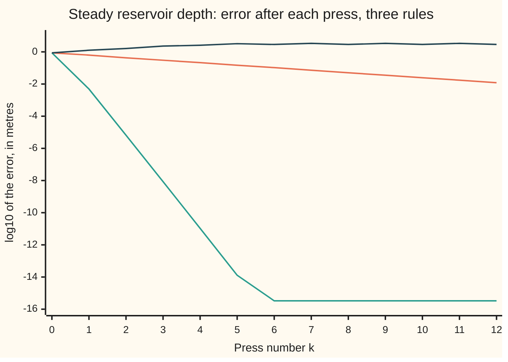

# Fixed points: iterate until nothing moves, and the contraction that makes it work

[Syllabus](../../../SYLLABUS.md) → [Numerical analysis](../README.md) → [Root Finding and Fixed Points](../README.md#s02) → Fixed points

---

## General Overview

A small reservoir takes in a steady 30 cubic metres of river water a second. Water leaves by two routes: a pipe at the bottom, and a notch cut down the face of the dam. The deeper the water, the faster both run. So the depth sets the outflow, and the outflow sets the depth.

The engineer wants the **steady depth**: the depth at which outflow exactly matches the 30 m³/s coming in. The target is that depth to within a millimetre, and better if it is cheap. Here the answer is 2.863799747400086 m. The flow coefficients are illustrative.

The balance has no tidy formula for the depth. But it can be rearranged into the form "depth = a rule applied to depth". Guess a depth, apply the rule, feed the answer back in, and repeat until nothing moves. There are two natural rearrangements:

- **Rule A** asks: if the pipe takes its share at this depth, how deep must the notch run to carry the rest? From 2 m it swings 3.488, 2.433, 3.169, 2.652, and settles. Each miss is 0.698 times the last, with the sign flipped.
- **Rule B** asks the same question the other way round: how deep must the pipe run to carry what the notch leaves? It swings wider and wider and ends up hopping for ever between 0.0107 m and 6.2491 m.

Same equation, same start. One rule converges and the other never does. The difference is one number: how steeply the rule tilts at the answer. This card measures that number, uses it to bound the error after any single step, and shows how to repair Rule B so that it reaches the rounding floor in six presses.

**Near its fixed point, a rule multiplies each error by its slope there: the iteration converges when that slope is smaller than 1 in size, one step then bounds the remaining error, and blending the rule with the current guess can bring the slope near zero.**

**What kind of fact this is:** three theorems, proved on this card in Why it works: the error ratio tends to the slope at the fixed point, the sharper $q/(1+q)$ one-step bound, and the effect of relaxation. The contraction theorem itself, with the $q/(1-q)$ bound, is proved on [Fixed points](../../06-Calculus%20and%20analysis/03-What%20Derivatives%20Tell%20You/07-fixed-point-iteration-and-the-contraction-principle.md) and used here.

### The picture: three ways to press the reservoir's equation



Orange: Rule A, a straight fall: each press lowers the line by the same amount, log10 of 1/0.698. Green: Rule B relaxed, falling about 3 units of log10 per press until it stops at −15.48, an error of 3.35e-16 m, less than one spacing between neighbouring doubles. Dark blue: plain Rule B, climbing and then hopping between two wrong depths. Every point is printed by the checks on the `chart,` lines.

---

## The formula

Notation first, in words. The unknown is the depth $x$, in metres. A **fixed point** of a rule $g$ is a number that the rule leaves alone: $g(x^*) = x^*$. **Fixed-point iteration** applies the rule again and again, $x_{k+1} = g(x_k)$; each application is one **press**. As on [Newton and secant](02-newton-and-secant-with-convergence-orders.md), $x_k$ is the guess after $k$ presses and $e_k = x_k - x^*$ is its error. New here is the **step** $d_k = x_k - x_{k-1}$: how far press $k$ moved the guess. The step is known; the error is not.

The reservoir's balance and its two rearrangements:

$$a\sqrt{x} + b\,x^{3/2} = Q, \qquad g_A(x) = \left(\frac{Q - a\sqrt{x}}{b}\right)^{2/3}, \qquad g_B(x) = \left(\frac{Q - b\,x^{3/2}}{a}\right)^{2}$$

**Read it aloud:** the pipe's flow plus the notch's flow equals the inflow; Rule A solves that for the notch's depth, Rule B for the pipe's.

The rate law. Near the fixed point, each error is the slope there times the one before:

$$e_{k+1} \approx g'(x^*)\,e_k$$

**Read it aloud:** the next error is about the rule's slope at the fixed point times the current error, sign included.

The one-step bounds. If $g$ maps an interval $I$ into itself, and its slope stays between $-q$ and $q$ there with $q < 1$, then

$$|e_k| \le \frac{q}{1-q}\,|d_k| \quad\text{always}, \qquad |e_k| \le \frac{q}{1+q}\,|d_k| \quad\text{if } g \text{ is decreasing on } I$$

**Read it aloud:** the error is at most q over one minus q times the last step, and at most q over one plus q times the last step when the guesses alternate sides.

Relaxation. Blend the rule with the current guess, using a weight $\omega$ (the Greek letter omega):

$$g_\omega(x) = (1 - \omega)\,x + \omega\,g(x), \qquad g_\omega'(x^*) = 1 - \omega\,\bigl(1 - g'(x^*)\bigr), \qquad \text{best } \omega = \frac{1}{1 - g'(x^*)}$$

**Read it aloud:** the relaxed rule moves only a share omega of the way to where the plain rule points; its slope at the fixed point is one minus omega times one minus the old slope, and it is zero for the best omega.

| Symbol | Plain meaning | In our example | Push it up and the answer… |
| --- | --- | --- | --- |
| $x$, $x^*$ | depth in metres; the steady depth, a fixed point | $x^*$ = 2.863799747400086 m | — |
| $Q$, $a$, $b$ | inflow in m³/s; pipe and notch coefficients (illustrative) | 30; 12; 2 | more inflow, deeper $x^*$ |
| $g$, $g_A$, $g_B$ | a rule pressed again and again; the reservoir's two rules | $g_A(2)$ = 3.488166 | — |
| $x_k$, $k$ | the guess after $k$ presses, from $x_0$ = 2 | $x_{20}$ = 2.863118 | — |
| $e_k$, $d_k$ | error $x_k - x^*$; step $x_k - x_{k-1}$ | $e_{20}$ = −6.81e-4; $d_{20}$ = −1.66e-3 | — |
| $g'(x^*)$ | the rule's slope at the fixed point: the rate | A: −0.698373; B: −1.431900 | nearer 1 in size, slower; past 1, no convergence |
| $q$, $I$ | worst slope size on the interval $I$: the contraction factor | 0.757210 on $I$ = [2, 3.5] | looser bounds, more presses promised |
| $\hat q_k$ | "q-hat": the signed step ratio $d_k / d_{k-1}$, an estimate of $g'(x^*)$ | −0.6984 at $k$ = 20 | — |
| $\omega$, $g_\omega$ | relaxation weight, `w` in the code; the relaxed rule | 0.410682 for Rule B | past the best value, overshoot |
| $i$, $L$, $M$, $N$ | the mortgage's monthly rate, loan, monthly payment and number of payments | 0.001666649458585; \$300,000; \$1,271.56; 300 | — |
| $\xi_k$, $s$, $c$, $\delta$, $n$ | helpers: a point the mean value theorem gives; a slope in Step 0; a slope bound below 1 and a radius in the proof; a press count | $n$ = 57 presses promised for 1e-6 m | — |

### When it holds

- **The rule maps the interval into itself.** Rule B can send a depth outside the range where the equation makes sense. At 6.2491 m the notch alone would carry 31.2431 m³/s, more than flows in. Rule B squares a negative number there and returns 0.0107 m as if nothing were wrong.
- **The worst slope on the interval is below 1 in size.** Rule A's is 0.757210 on [2, 3.5]. Rule B's slope is −1.431900 at the answer, so no interval around $x^*$ works, and its errors grow.
- **The slope is continuous near $x^*$.** The rate law needs it. Where the rule has a corner at the fixed point, no single ratio is promised.
- **The rule is decreasing, for the sharper bound.** The $q/(1+q)$ bound needs the guesses to land on alternate sides of $x^*$. The mortgage rule below has slope +0.770281, so only $q/(1-q)$ applies to it.
- **Errors stay above rounding.** The bounds are proved for exact arithmetic. In doubles, Rule A's step is exactly 0 from step 99, so the step bound claims an error of 0; the true error is 1.09e-16 m. That is the best a double can do, since Rule A rests on the double nearest the true depth, but no stopping test can see below the spacing of doubles, 4.44e-16 m here.

---

## Why it works

### Step 0: near the answer, a rule is a multiplication

Zoom in on the fixed point and the rule's graph looks straight. A straight rule through $x^*$ with slope $s$ sends an error $e$ to $s\,e$. So every press multiplies the error by the same number. Its size decides convergence; its sign decides whether the guesses creep in from one side or swing across.

The step is the difference of two errors, $d_k = e_k - e_{k-1}$. Once each error is a fixed multiple of the last, the step is a fixed multiple of the error. So one visible number, the step, pins down the invisible one, the error.

### Step 1: one equation, two rules, reciprocal slopes

Rule A and Rule B undo each other: $g_B(g_A(x)) = x$ wherever both are defined. Two functions that undo each other have reciprocal slopes at a shared point. So

$$g_B'(x^*) = \frac{1}{g_A'(x^*)} = \frac{1}{-0.698373} = -1.431900$$

At most one of the two can contract. Which one does is decided by the physics, not the algebra. At the steady depth the pipe's flow changes more slowly with depth than the notch's flow does. Rule A asks the notch to absorb the pipe's changes, so it damps them. Rule B asks the pipe to absorb the notch's changes, so it amplifies them.

For Rule A, differentiating and using $g_A(x^*) = x^*$ gives $g_A'(x^*) = -a/(3b\,x^*)$ = −0.698373. A difference quotient on $g_A$ itself gives the same, to six digits.

### Step 2: the error ratio tends to the slope at the fixed point

By the mean value theorem (a chord's slope equals the curve's slope at some point between its ends), $e_{k+1} = g(x_k) - g(x^*) = g'(\xi_k)\,e_k$ for some $\xi_k$ between $x_k$ and $x^*$. As $x_k$ closes in, $\xi_k$ is squeezed onto $x^*$.

The [Fixed points of a map](../../08-Differential%20equations%20and%20dynamics/11-Discrete%20Dynamics%20and%20Chaos/02-fixed-points-of-a-map.md) card turns this into the local test: a slope below 1 in size attracts nearby guesses, above 1 repels them. It also reads Newton's method as a rule whose slope at the root is zero.

<details>
<summary>Detailed proof: the ratio of successive errors tends to g'(x*)</summary>

**Assume** $g$ has a continuous derivative near $x^*$, $g(x^*) = x^*$, and $|g'(x^*)| < 1$.

**Convergence from a close start.** Set $c = (1 + |g'(x^*)|)/2$, which is below 1. By continuity there is a $\delta > 0$ with $|g'(x)| \le c$ whenever $|x - x^*| \le \delta$. For such $x$, the mean value theorem gives $|g(x) - x^*| \le c\,|x - x^*| \le \delta$. So the interval $[x^* - \delta, x^* + \delta]$ maps into itself and $g$ contracts it by $c$. By the contraction theorem the guesses converge to $x^*$.

**The ratio.** If some $e_k = 0$, every later error is 0. Otherwise $e_{k+1}/e_k = g'(\xi_k)$ with $|\xi_k - x^*| \le |e_k| \to 0$. Since $g'$ is continuous, $g'(\xi_k) \to g'(x^*)$. $\blacksquare$

</details>

The code's ratio column reads −0.7228, −0.6907, −0.7083, then −0.6977 at $k$ = 10 and −0.6984 at $k$ = 20, closing on −0.698373 from both sides.

### Step 3: certify the factor on an interval

The rate is the slope at the answer, which is unknown. A guarantee needs the worst slope over a region known to hold the answer. The contraction theorem, proved on [Fixed points](../../06-Calculus%20and%20analysis/03-What%20Derivatives%20Tell%20You/07-fixed-point-iteration-and-the-contraction-principle.md), then promises exactly one fixed point in it and convergence from any start in it.

For Rule A on $I$ = [2, 3.5], two checks:

1. **It maps $I$ into itself.** $g_A$ is decreasing, so the image runs from $g_A(3.5)$ = 2.424451 to $g_A(2)$ = 3.488166. Both lie inside [2, 3.5].
2. **The worst slope.** On a fine grid, $|g_A'|$ peaks at the left end: $q$ = 0.757210 at $x$ = 2. As a cross-check, the steepest chord between any two grid points is 0.756943, just under it.

The worst slope, 0.757210, is larger than the rate, 0.698373. Use $q$ for guarantees and the slope at the answer for predictions.

A Lipschitz constant is a bound on how much a function can stretch distances ([Uniform continuity](../../06-Calculus%20and%20analysis/01-Limits%20and%20Continuity/08-uniform-continuity-and-lipschitz.md)). The contraction factor is a Lipschitz constant below 1, and a bound on the slope is the usual way to find one.

### Step 4: bound the error from one step

The [Fixed points](../../06-Calculus%20and%20analysis/03-What%20Derivatives%20Tell%20You/07-fixed-point-iteration-and-the-contraction-principle.md) card proves the general bound $|e_k| \le q/(1-q)\,|d_k|$. With $q$ = 0.757210 the multiplier is 3.118789. It holds for every contraction, but here it is loose: at $k$ = 20 it is 7.58 times the true error.

A decreasing rule does better. If $x_{k-1}$ is below $x^*$, then $x_k = g(x_{k-1})$ is above $g(x^*) = x^*$. So the fixed point always lies between the last two guesses, and the error is less than the whole step. Counting more carefully gives the sharper multiplier $q/(1+q)$ = 0.430916. At $k$ = 20 it is only 1.05 times the true error.

<details>
<summary>Detailed proof: for a decreasing contraction, |e_k| ≤ q/(1+q) |d_k|</summary>

**Assume** $g$ maps $I$ into itself, $x^*$ and the guesses lie in $I$, and $-q \le g'(x) \le 0$ on $I$ with $q < 1$.

By the mean value theorem, $e_k = g'(\xi)\,e_{k-1}$ for a point $\xi$ in $I$. So $e_k$ and $e_{k-1}$ have opposite signs (or $e_k = 0$), and $|e_k| \le q\,|e_{k-1}|$, which gives $|e_{k-1}| \ge |e_k|/q$.

Numbers of opposite sign add in size when subtracted: $|d_k| = |e_k - e_{k-1}| = |e_k| + |e_{k-1}|$. Therefore

$$|d_k| \ge |e_k| + \frac{|e_k|}{q} = \frac{1+q}{q}\,|e_k|, \qquad |e_k| \le \frac{q}{1+q}\,|d_k|. \qquad \blacksquare$$

</details>

The code checks the sharper bound at each of the first 39 steps. In practice it decides when to stop. To be sure of 1e-6 m:

| Test | Presses |
| --- | --- |
| first-step bound $q^n/(1-q)\,\lvert d_1 \rvert$, worked out after the first press | 57 |
| $q/(1+q)$ times the latest step | 39 |
| true error, known only because the checks know $x^*$ | 39 |

The sharper bound stops on exactly the press where the truth arrives, and it never relied on knowing $x^*$.

### Step 5: estimate the factor from the steps themselves

Near the fixed point, each step is the slope times the last one, because $d_{k+1} = e_{k+1} - e_k \approx g'(x^*)\,(e_k - e_{k-1})$. So the signed step ratio $\hat q_k = d_k/d_{k-1}$ estimates the slope, at no extra cost.

Solve $e_k = \hat q\,e_{k-1}$ and $d_k = e_k - e_{k-1}$ for $e_k$:

$$e_k \approx \frac{\hat q_k}{\hat q_k - 1}\,d_k$$

The code's estimate column matches the true error, sign included: −6.81e-4 against −6.81e-4 at $k$ = 20. This is the same algebra as Aitken's correction on [When to stop](03-stopping-criteria-and-error-estimates.md). It is an estimate, not a bound: early on, when the ratio still wobbles, it can be off.

### Step 6: relaxation repairs a bad rule

The relaxed rule $g_\omega(x) = x + \omega\,(g(x) - x)$ has the same fixed points as $g$ when $\omega \ne 0$. The reason: $g_\omega(x) = x$ exactly when $g(x) = x$. Its slope at $x^*$ is $1 - \omega\,(1 - g'(x^*))$. Choose $\omega = 1/(1 - g'(x^*))$ and that slope is zero. This works for any slope except exactly 1.

The slope at the answer is unknown, so estimate it where the iteration starts. One nudge of Rule B at 2 m gives slope −1.434972, so $\omega$ = 1/(1 + 1.434972) = 0.410682. The relaxed slope at the true answer is then 0.001262. From the second press on, each press removes all but about a thousandth of the error:

8.64e-1, 4.88e-3, 6.68e-6, 8.43e-9, 1.06e-11, 1.30e-14, 3.35e-16.

The divergent Rule B now beats the convergent Rule A by a wide margin. Re-estimating $\omega$ at every press drives the slope to zero and the order to 2. That is Steffensen's method: the Aitken correction from [When to stop](03-stopping-criteria-and-error-estimates.md), applied after every two presses. With the exact slope each time, it is Newton's method on $x - g(x) = 0$.

**The shelf's mortgage.** A 25-year loan of \$300,000 is repaid at \$1,271.56 a month. Its monthly rate solves $i = g(i)$, with $g(i) = \frac{M}{L}\bigl(1 - (1+i)^{-N}\bigr)$, as on [When to stop](03-stopping-criteria-and-error-estimates.md). Here $i$ is the monthly rate, $L$ the loan, $M$ the payment and $N$ = 300 the number of payments. The rate is 0.001666649458585 a month.

There the slope is +0.770281, so the plain rule creeps in from one side and needs 80 presses to reach 1e-12. Relaxation now means $\omega$ above 1: stride further than the rule points. The step ratio at press 10 is 0.745428, so $\omega$ = 3.928158, and the run reaches 1e-12 at press 18.

---

## Worked numbers, by hand

The reservoir, Rule A from 2 m, then Rule B relaxed.

| Step | Arithmetic | Value |
| --- | --- | --- |
| first press of Rule A | $g_A(2) = ((30 - 12\sqrt 2)/2)^{2/3}$ | 3.488166 m |
| slope at the answer | $-12/(3 \times 2 \times 2.863800)$ | −0.698373 |
| worst slope on [2, 3.5] | $\lvert g_A'(2) \rvert$ | 0.757210 |
| sharper multiplier | $0.757210 / (1 + 0.757210)$ | 0.430916 |
| bound at press 20 | $0.430916 \times 1.66\text{e-}3$ | 7.14e-4 m |
| true error at press 20 | $x_{20} - x^*$, from the code's table | **−6.81e-4 m** |
| relaxation weight for Rule B | $1 / (1 + 1.434972)$ | 0.410682 |
| relaxed slope at the answer | $1 - 0.410682 \times (1 + 1.431900)$ | **0.001262** |

After 20 presses of Rule A the depth is known to under a millimetre. The one-step bound, 7.14e-4 m, proves it without knowing the answer, and overstates the true error by only 5 percent. Relaxed Rule B gets there by its second press.

### What breaks if you drop a piece

| Mistake | Comes out at | What went wrong |
| --- | --- | --- |
| Press Rule B as it stands | 2.0000, 4.1152, 1.2291, 5.1660, …, then hops between 6.2491 and 0.0107 for ever | its slope at the answer is −1.431900, so errors grow; the squaring then hides a negative flow and fakes a two-step cycle |
| Over-relax Rule B with $\omega$ = 0.9 | errors 0.8638, 1.0399, 1.1458, … 2.0288 after 10 presses | the relaxed slope is −1.1887: past the best weight, each press overshoots further |
| Use $q/(1-q)$ on an alternating run | bound 7.58 times the true error at press 20 | true, but it ignores that the answer lies between the last two guesses |
| Ask for an error below rounding | Rule A's step is 0 from step 99, so the step bound claims 0; the true error is 1.09e-16 m | the bound is proved for exact arithmetic; the computed rule has its own fixed point, here the double nearest the true depth |

The code prints all four.

---

## Code, from first principles, and it actually runs

The code finds the steady depth by four independent roads. Cardano's formula (the closed-form solution of a cubic) solves the balance as a cubic in $\sqrt{x}$. Bisection halves a bracket on outflow minus inflow, using only signs. Rule A is pressed 150 times. These three agree to 15 decimal places. The fourth road settles the last digit. It squares the balance into the cubic $b^2x^3 + 2ab\,x^2 + a^2x = Q^2$ and takes one Newton step from road 2, with the cubic computed in double-double arithmetic (each number carried as the sum of two doubles, about 32 digits). That gives the true depth to about 1e-30 m, the reference for every error the code prints.

Rule A ends on the double nearest the true depth, 1.09e-16 m above it. Cardano and bisection both stop 7.79e-16 m low. That close to the root, the computed outflow minus inflow is rounding noise: it is exactly 0 at the next double up, so a sign test cannot place the root more finely. The code then:

- checks the slope at the answer two ways;
- certifies $q$ on [2, 3.5] by slopes and by chords;
- tests the sharper bound at every step;
- relaxes Rule B and runs the mortgage;
- runs the failures.

Cube roots come from the library's `cbrt`, used as a primitive; everything else is written out.

### Python

```python
# Fixed points and contraction: the check behind the card.  Standard library only.
# A reservoir takes in 30 m^3/s and lets water out through a pipe, 12 sqrt(x), and a
# notch, 2 x^1.5, where x is the depth in metres.  Find the steady depth x* three ways,
# then test the rate, the one-step bounds, relaxation and the failures.
from math import sqrt, cbrt, log10
Q, a, b = 30.0, 12.0, 2.0
def sci(v, d=2):                              # 1.23e-4, the form Rust prints
    m, e = f"{v:.{d}e}".split("e")
    return f"{m}e{int(e)}"
def out(x): return a * sqrt(x) + b * x * sqrt(x)          # outflow, m^3/s
def gA(x, a=a, b=b):                          # keep the notch: x = ((Q - a sqrt x)/b)^(2/3)
    c = cbrt((Q - a * sqrt(x)) / b)
    return c * c
def gB(x):                                    # keep the pipe: x = ((Q - b x^1.5)/a)^2
    t = (Q - b * x * sqrt(x)) / a
    return t * t
def dgA(x): return -a / (3 * b * sqrt(x)) / cbrt((Q - a * sqrt(x)) / b)
def press(g, x, n, w=1.0):                    # relaxed press: (1 - w) x + w g(x)
    ys = [x]
    for _ in range(n): ys.append((1 - w) * ys[-1] + w * g(ys[-1]))
    return ys
def cardano(p, r):                            # road 1: Cardano on s = sqrt(x), s^3 + p s = r
    dd = sqrt(r * r / 4 + p * p * p / 27)
    s = cbrt(r / 2 + dd) + cbrt(r / 2 - dd)
    return s * s                              # x = s^2
def two_sum(u, v):                            # u + v = s + e exactly
    s = u + v; z = s - u
    return s, (u - (s - z)) + (v - z)
def two_prod(u, v):                           # u v = p + e exactly, by Dekker's split
    p = u * v; cu, cv = 134217729.0 * u, 134217729.0 * v
    uh, vh = cu - (cu - u), cv - (cv - v)
    return p, ((uh * vh - p) + uh * (v - vh) + (u - uh) * vh) + (u - uh) * (v - vh)
def cubic(x):                                 # b^2 x^3 + 2ab x^2 + a^2 x - Q^2 in double-double
    r, c = b * b, 0.0
    for k in (2 * a * b, a * a, -Q * Q):
        p, pe = two_prod(r, x); r, se = two_sum(p, k); c = c * x + (pe + se)
    return r + c
x1 = cardano(a / b, Q / b)
lo, hi, nh = 0.0, 6.25, 0                     # road 2: bisection on outflow - inflow
while lo < (lo + hi) / 2 < hi:
    mid = (lo + hi) / 2
    lo, hi, nh = (mid, hi, nh + 1) if out(mid) < Q else (lo, mid, nh + 1)
dlt = -cubic(lo) / (3 * b * b * lo * lo + 4 * a * b * lo + a * a)
xstar, xlo = two_sum(lo, dlt)                 # road 4: x* = xstar + xlo, to about 1e-30 m
def err(v): return (v - xstar) - xlo          # true error of a double v near x*
d2 = -cubic(hi) / (3 * b * b * hi * hi + 4 * a * b * hi + a * a)
assert abs((hi - xstar) + d2 - xlo) < 1e-29   # road 4 agrees from road 2's other end
xa = press(gA, 2.0, 150)                      # road 3: press g_A from 2 m
still = next(k for k in range(1, 151) if xa[k] == xa[k - 1])
print(f"inflow {Q:.0f} m^3/s; outflow = {a:.0f} sqrt(x) + {b:.0f} x^1.5; steady depth x* where they match")
print(f"road 1, Cardano: x* = {x1:.15f} m")
print(f"road 2, bisection: x* = {lo:.15f} m after {nh} halvings; outflow - inflow = {sci(out(lo) - Q)}, "
      f"next double up {sci(out(hi) - Q)}")
print(f"road 3, pressing g_A from 2: {xa[150]:.15f} m; stops moving at step {still}")
print(f"road 4, one Newton step from road 2 on the squared balance, in double-double: nearest double {xstar:.16f} m")
print(f"   true errors: Cardano {sci(err(x1))}, bisection {sci(err(lo))}, g_A {sci(err(xa[150]))};"
      f" spacing of doubles here {sci(2.0 ** -51)}")
assert abs(x1 - xstar) < 4e-15 and abs(lo - xstar) < 4e-15 and xa[150] == xstar  # g_A ends on the nearest double
qs = a / (3 * b * xstar)                         # |g_A'(x*)|, from the formula at the fixed point
dq = (gA(xstar + 1e-5) - gA(xstar - 1e-5)) / 2e-5
print(f"slope of g_A at x*: -a/(3 b x*) = {-qs:.6f}; difference quotient {dq:.6f}; slope of g_B: {-1 / qs:.6f}")
assert abs(dq + qs) < 1e-8 and abs(dgA(xstar) + qs) < 1e-12
grid = [2 + 1.5 * k / 300 for k in range(301)]  # the interval I = [2, 3.5]
qI = max(abs(dgA(x)) for x in grid)
chord = max(abs(gA(u) - gA(v)) / (v - u) for u in grid for v in grid if v > u)
print(f"g_A sends [2, 3.5] into [{gA(3.5):.6f}, {gA(2.0):.6f}]; worst slope q = {qI:.6f} at x = 2; widest chord {chord:.6f}")
assert 2 < gA(3.5) < gA(2.0) < 3.5 and chord <= qI and abs(qI - abs(dgA(2.0))) < 1e-15
print(f"multipliers: q/(1-q) = {qI / (1 - qI):.6f}, q/(1+q) = {qI / (1 + qI):.6f}")
print(" k  x_k        error e_k  step d_k  e_k/e_(k-1)  q/(1-q)|d|  q/(1+q)|d|  estimate")
for k in (1, 2, 3, 4, 5, 6, 10, 15, 20):
    e, ep, d, dp = xa[k] - xstar, xa[k - 1] - xstar, xa[k] - xa[k - 1], xa[k - 1] - xa[k - 2] if k > 1 else 0
    qh = d / dp if k > 1 else 0.0             # signed step ratio, the estimate of g'(x*)
    est = sci(qh / (qh - 1) * d) if k > 1 else "-"
    print(f"{k:2}  {xa[k]:.6f}  {sci(e):>9}  {sci(d):>8}  {e / ep:11.4f}  {sci(qI / (1 - qI) * abs(d)):>10}"
          f"  {sci(qI / (1 + qI) * abs(d)):>10}  {est:>8}")
assert all(abs(xa[k] - xstar) <= qI / (1 + qI) * abs(xa[k] - xa[k - 1]) for k in range(1, 40))
e20, d20 = abs(xa[20] - xstar), abs(xa[20] - xa[19])
print(f"at k = 20, bound / true error: q/(1-q) gives {qI / (1 - qI) * d20 / e20:.2f}, q/(1+q) gives {qI / (1 + qI) * d20 / e20:.2f}; "
      f"step ratio d_20/d_19 = {(xa[20] - xa[19]) / (xa[19] - xa[18]):.4f}")
assert abs((xa[20] - xstar) / (xa[19] - xstar) + qs) < 1e-3   # the rate is the slope at x*, sign and all
d1 = abs(xa[1] - xa[0])
first = lambda ok: next(n for n in range(1, 151) if ok(n))
print(f"to 1e-6 m: first-step bound promises n = {first(lambda n: qI ** n / (1 - qI) * d1 <= 1e-6)}, "
      f"q/(1+q) step bound stops at {first(lambda n: qI / (1 + qI) * abs(xa[n] - xa[n - 1]) <= 1e-6)}, "
      f"true error at {first(lambda n: abs(xa[n] - xstar) <= 1e-6)}")
s0 = (gB(2.01) - gB(2.0)) / 0.01              # relax g_B: one nudge estimates its slope
w = 1 / (1 - s0)
xr = press(gB, 2.0, 12, w)
print(f"g_B nudged at 2: slope {s0:.6f}, so w = 1/(1 - slope) = {w:.6f}; relaxed slope at x*: {1 - w * (1 + 1 / qs):.6f}")
print("relaxed g_B errors: " + ", ".join(sci(abs(err(x))) for x in xr[:7]))
assert abs(abs(xr[4] - xstar) / abs(xr[3] - xstar) - abs(1 - w * (1 + 1 / qs))) < 1e-4 and abs(xr[6] - xstar) < 1e-15
xb = press(gB, 2.0, 40)
print("break 1, plain g_B depths: " + ", ".join(f"{x:.4f}" for x in xb[:9]) + f"; at step 40: {xb[39]:.4f}, {xb[40]:.4f}")
print(f"   2 x^1.5 at {xb[39]:.4f} is {b * xb[39] * sqrt(xb[39]):.4f} > 30, and the square hides the minus sign")
assert abs(gB(gB(xb[40])) - xb[40]) < 1e-9 and abs(xb[40] - xstar) > 2.8   # a false 2-cycle
xo = press(gB, 2.0, 10, 0.9)
print(f"break 2, over-relaxed w = 0.9, slope {1 - 0.9 * (1 + 1 / qs):.4f}; errors: " + ", ".join(f"{abs(x - xstar):.4f}" for x in xo))
assert abs(xo[10] - xstar) > 2 * abs(xo[0] - xstar)
print(f"break 3, rounding floor: g_A's step from step {still} is {xa[150] - xa[149]:.1f}, so q/(1+q)|d| = "
      f"{qI / (1 + qI) * abs(xa[150] - xa[149]):.1f}; the true error is {sci(err(xa[150]))}")
L, M, N = 300000.0, 1271.56, 300              # the shelf's mortgage, as on When to stop
def vN(i):                                    # (1 + i)^-N by repeated multiplying
    v = 1.0
    for _ in range(N): v /= 1 + i
    return v
gm = lambda i: M / L * (1 - vN(i))
lo, hi = 1e-5, 0.01
while lo < (lo + hi) / 2 < hi:
    mid = (lo + hi) / 2
    lo, hi = (mid, hi) if M * (1 - vN(mid)) / mid > L else (lo, mid)
im, qm = lo, M / L * N * vN(lo) / (1 + lo)
xm = press(gm, M / L, 200)
km = first(lambda n: abs(xm[n] - im) < 1e-12)
qh = (xm[10] - xm[9]) / (xm[9] - xm[8])       # step ratio at step 10
wm = 1 / (1 - qh)
ym = press(gm, xm[10], 30, wm)
kr = 10 + next(n for n in range(31) if abs(ym[n] - im) < 1e-12)
print(f"mortgage, {L:.0f} loan, {N} payments of {M:.2f}: rate {im:.15f} a month; slope of g at it {qm:.6f}; plain steps to 1e-12: {km}")
print(f"   step ratio at step 10 {qh:.6f}, w = {wm:.6f}; relaxed from step 10, steps to 1e-12: {kr}")
assert abs(qm - (xm[61] - im) / (xm[60] - im)) < 1e-4 and kr < km / 3
lg = lambda v: f"{log10(max(abs(err(v)), 1e-16)):.2f}"
print("chart, g_A plain:   " + ", ".join(lg(x) for x in xa[:13]))
print("chart, g_B relaxed: " + ", ".join(lg(x) for x in xr))
print("chart, g_B plain:   " + ", ".join(lg(x) for x in xb[:13]))
print(f"try: Q = 40 -> x* = {cardano(a / b, 40 / b):.6f}, slope {-a / (3 * b * cardano(a / b, 40 / b)):.6f}")
print(f"try: g_A relaxed, w = {1 / (1 + qs):.3f}: errors " + ", ".join(sci(abs(err(x))) for x in press(gA, 2.0, 3, 0.589)[1:]))
print(f"try: a = 30, b = 1 -> x* = {cardano(30.0, 30.0):.6f}; g_A from 2 ends at {press(lambda x: gA(x, 30.0, 1.0), 2.0, 150)[-1]:.3f}")
print("ALL CHECKS PASS")
```

**Ran 2026-11-11 on macOS, Python 3.14.10, standard library only. All checks passed. Output, pasted from the run:**

```
inflow 30 m^3/s; outflow = 12 sqrt(x) + 2 x^1.5; steady depth x* where they match
road 1, Cardano: x* = 2.863799747400086 m
road 2, bisection: x* = 2.863799747400086 m after 54 halvings; outflow - inflow = -7.11e-15, next double up 0.00e0
road 3, pressing g_A from 2: 2.863799747400086 m; stops moving at step 99
road 4, one Newton step from road 2 on the squared balance, in double-double: nearest double 2.8637997474000865 m
   true errors: Cardano -7.79e-16, bisection -7.79e-16, g_A 1.09e-16; spacing of doubles here 4.44e-16
slope of g_A at x*: -a/(3 b x*) = -0.698373; difference quotient -0.698373; slope of g_B: -1.431900
g_A sends [2, 3.5] into [2.424451, 3.488166]; worst slope q = 0.757210 at x = 2; widest chord 0.756943
multipliers: q/(1-q) = 3.118789, q/(1+q) = 0.430916
 k  x_k        error e_k  step d_k  e_k/e_(k-1)  q/(1-q)|d|  q/(1+q)|d|  estimate
 1  3.488166    6.24e-1    1.49e0      -0.7228      4.64e0     6.41e-1         -
 2  2.432576   -4.31e-1   -1.06e0      -0.6907      3.29e0     4.55e-1  -4.38e-1
 3  3.169230    3.05e-1   7.37e-1      -0.7083      2.30e0     3.17e-1   3.03e-1
 4  2.651930   -2.12e-1  -5.17e-1      -0.6937      1.61e0     2.23e-1  -2.13e-1
 5  3.012688    1.49e-1   3.61e-1      -0.7027      1.13e0     1.55e-1   1.48e-1
 6  2.760195   -1.04e-1  -2.52e-1      -0.6959     7.87e-1     1.09e-1  -1.04e-1
10  2.839118   -2.47e-2  -6.01e-2      -0.6977     1.87e-1     2.59e-2  -2.47e-2
15  2.867902    4.10e-3   9.98e-3      -0.6985     3.11e-2     4.30e-3   4.10e-3
20  2.863118   -6.81e-4  -1.66e-3      -0.6984     5.17e-3     7.14e-4  -6.81e-4
at k = 20, bound / true error: q/(1-q) gives 7.58, q/(1+q) gives 1.05; step ratio d_20/d_19 = -0.6984
to 1e-6 m: first-step bound promises n = 57, q/(1+q) step bound stops at 39, true error at 39
g_B nudged at 2: slope -1.434972, so w = 1/(1 - slope) = 0.410682; relaxed slope at x*: 0.001262
relaxed g_B errors: 8.64e-1, 4.88e-3, 6.68e-6, 8.43e-9, 1.06e-11, 1.30e-14, 3.35e-16
break 1, plain g_B depths: 2.0000, 4.1152, 1.2291, 5.1660, 0.2949, 6.1173, 0.0005, 6.2500, 0.0108; at step 40: 6.2491, 0.0107
   2 x^1.5 at 6.2491 is 31.2431 > 30, and the square hides the minus sign
break 2, over-relaxed w = 0.9, slope -1.1887; errors: 0.8638, 1.0399, 1.1458, 1.3710, 1.4526, 1.7153, 1.7296, 2.0051, 1.9240, 2.1926, 2.0288
break 3, rounding floor: g_A's step from step 99 is 0.0, so q/(1+q)|d| = 0.0; the true error is 1.09e-16
mortgage, 300000 loan, 300 payments of 1271.56: rate 0.001666649458585 a month; slope of g at it 0.770281; plain steps to 1e-12: 80
   step ratio at step 10 0.745428, w = 3.928158; relaxed from step 10, steps to 1e-12: 18
chart, g_A plain:   -0.06, -0.20, -0.37, -0.52, -0.67, -0.83, -0.98, -1.14, -1.30, -1.45, -1.61, -1.76, -1.92
chart, g_B relaxed: -0.06, -2.31, -5.18, -8.07, -10.97, -13.89, -15.48, -15.48, -15.48, -15.48, -15.48, -15.48, -15.48
chart, g_B plain:   -0.06, 0.10, 0.21, 0.36, 0.41, 0.51, 0.46, 0.53, 0.46, 0.53, 0.46, 0.53, 0.46
try: Q = 40 -> x* = 4.000000, slope -0.500000
try: g_A relaxed, w = 0.589: errors 1.27e-2, 2.61e-6, 8.90e-10
try: a = 30, b = 1 -> x* = 0.940151; g_A from 2 ends at 23.858
ALL CHECKS PASS
```

### Rust

Same numbers, same labels, built with `rustc --edition 2021 -O`.

```rust
// Fixed points and contraction: the same check as the Python, in Rust.  No crates.
// A reservoir takes in 30 m^3/s and lets water out through a pipe, 12 sqrt(x), and a
// notch, 2 x^1.5, where x is the depth in metres.  Find the steady depth x* three ways,
// then test the rate, the one-step bounds, relaxation and the failures.
const Q: f64 = 30.0;
const A: f64 = 12.0;
const B: f64 = 2.0;
fn sci(v: f64) -> String { format!("{:.2e}", v) }          // 1.23e-4
fn out(x: f64) -> f64 { A * x.sqrt() + B * x * x.sqrt() }  // outflow, m^3/s
fn ga_ab(x: f64, a: f64, b: f64) -> f64 { let c = ((Q - a * x.sqrt()) / b).cbrt(); c * c }
fn ga(x: f64) -> f64 { ga_ab(x, A, B) }                   // keep the notch
fn gb(x: f64) -> f64 { let t = (Q - B * x * x.sqrt()) / A; t * t }     // keep the pipe
fn dga(x: f64) -> f64 { -A / (3.0 * B * x.sqrt()) / ((Q - A * x.sqrt()) / B).cbrt() }
fn press(g: &dyn Fn(f64) -> f64, x: f64, n: usize, w: f64) -> Vec<f64> {
    let mut ys = vec![x];                                  // relaxed press: (1 - w) x + w g(x)
    for _ in 0..n { let x = ys[ys.len() - 1]; ys.push((1.0 - w) * x + w * g(x)); }
    ys
}
fn first(ok: &dyn Fn(usize) -> bool) -> usize { (1..=150).find(|&n| ok(n)).unwrap() }
fn vn(i: f64) -> f64 { let mut v = 1.0; for _ in 0..300 { v /= 1.0 + i; } v }  // (1 + i)^-N
fn join(xs: &[f64], f: &dyn Fn(f64) -> String) -> String { xs.iter().map(|&x| f(x)).collect::<Vec<_>>().join(", ") }
fn cardano(p: f64, r: f64) -> f64 {                        // road 1: Cardano on s = sqrt(x), s^3 + p s = r
    let dd = (r * r / 4.0 + p * p * p / 27.0).sqrt();
    let s = (r / 2.0 + dd).cbrt() + (r / 2.0 - dd).cbrt();
    s * s                                                  // x = s^2
}
fn two_sum(u: f64, v: f64) -> (f64, f64) { let s = u + v; let z = s - u; (s, (u - (s - z)) + (v - z)) }
fn two_prod(u: f64, v: f64) -> (f64, f64) {                // u v = p + e exactly, by Dekker's split
    let (p, cu, cv) = (u * v, 134217729.0 * u, 134217729.0 * v);
    let (uh, vh) = (cu - (cu - u), cv - (cv - v));
    (p, ((uh * vh - p) + uh * (v - vh) + (u - uh) * vh) + (u - uh) * (v - vh))
}
fn cubic(x: f64) -> f64 {                                  // b^2 x^3 + 2ab x^2 + a^2 x - Q^2 in double-double
    let (mut r, mut c) = (B * B, 0.0);
    for k in [2.0 * A * B, A * A, -Q * Q] {
        let (p, pe) = two_prod(r, x); let (r2, se) = two_sum(p, k); r = r2; c = c * x + (pe + se);
    }
    r + c
}
fn main() {
    let x1 = cardano(A / B, Q / B);
    let (mut lo, mut hi, mut nh) = (0.0f64, 6.25f64, 0);   // road 2: bisection
    while lo < (lo + hi) / 2.0 && (lo + hi) / 2.0 < hi {
        let mid = (lo + hi) / 2.0;
        if out(mid) < Q { lo = mid } else { hi = mid }
        nh += 1;
    }
    let dlt = -cubic(lo) / (3.0 * B * B * lo * lo + 4.0 * A * B * lo + A * A);
    let (xstar, xlo) = two_sum(lo, dlt);                   // road 4: x* = xstar + xlo, to about 1e-30 m
    let err = |v: f64| (v - xstar) - xlo;                  // true error of a double v near x*
    let d2 = -cubic(hi) / (3.0 * B * B * hi * hi + 4.0 * A * B * hi + A * A);
    assert!(((hi - xstar) + d2 - xlo).abs() < 1e-29);     // road 4 agrees from road 2's other end
    let xa = press(&ga, 2.0, 150, 1.0);                    // road 3: press g_A from 2 m
    let still = (1..=150).find(|&k| xa[k] == xa[k - 1]).unwrap();
    println!("inflow {:.0} m^3/s; outflow = {:.0} sqrt(x) + {:.0} x^1.5; steady depth x* where they match", Q, A, B);
    println!("road 1, Cardano: x* = {:.15} m", x1);
    println!("road 2, bisection: x* = {:.15} m after {} halvings; outflow - inflow = {}, next double up {}",
             lo, nh, sci(out(lo) - Q), sci(out(hi) - Q));
    println!("road 3, pressing g_A from 2: {:.15} m; stops moving at step {}", xa[150], still);
    println!("road 4, one Newton step from road 2 on the squared balance, in double-double: nearest double {:.16} m", xstar);
    println!("   true errors: Cardano {}, bisection {}, g_A {}; spacing of doubles here {}",
             sci(err(x1)), sci(err(lo)), sci(err(xa[150])), sci(2f64.powi(-51)));
    assert!((x1 - xstar).abs() < 4e-15 && (lo - xstar).abs() < 4e-15 && xa[150] == xstar);
    let qs = A / (3.0 * B * xstar);
    let dq = (ga(xstar + 1e-5) - ga(xstar - 1e-5)) / 2e-5;
    println!("slope of g_A at x*: -a/(3 b x*) = {:.6}; difference quotient {:.6}; slope of g_B: {:.6}", -qs, dq, -1.0 / qs);
    assert!((dq + qs).abs() < 1e-8 && (dga(xstar) + qs).abs() < 1e-12);
    let grid: Vec<f64> = (0..=300).map(|k| 2.0 + 1.5 * k as f64 / 300.0).collect();
    let qi = grid.iter().map(|&x| dga(x).abs()).fold(0.0f64, f64::max);
    let mut chord = 0.0f64;
    for &u in &grid { for &v in &grid { if v > u { chord = chord.max((ga(u) - ga(v)).abs() / (v - u)) } } }
    println!("g_A sends [2, 3.5] into [{:.6}, {:.6}]; worst slope q = {:.6} at x = 2; widest chord {:.6}", ga(3.5), ga(2.0), qi, chord);
    assert!(2.0 < ga(3.5) && ga(3.5) < ga(2.0) && ga(2.0) < 3.5 && chord <= qi && (qi - dga(2.0).abs()).abs() < 1e-15);
    println!("multipliers: q/(1-q) = {:.6}, q/(1+q) = {:.6}", qi / (1.0 - qi), qi / (1.0 + qi));
    println!(" k  x_k        error e_k  step d_k  e_k/e_(k-1)  q/(1-q)|d|  q/(1+q)|d|  estimate");
    for k in [1usize, 2, 3, 4, 5, 6, 10, 15, 20] {
        let (e, ep, d) = (xa[k] - xstar, xa[k - 1] - xstar, xa[k] - xa[k - 1]);
        let est = if k > 1 { let qh = d / (xa[k - 1] - xa[k - 2]); sci(qh / (qh - 1.0) * d) } else { "-".to_string() };
        println!("{:2}  {:.6}  {:>9}  {:>8}  {:11.4}  {:>10}  {:>10}  {:>8}", k, xa[k], sci(e), sci(d), e / ep,
                 sci(qi / (1.0 - qi) * d.abs()), sci(qi / (1.0 + qi) * d.abs()), est);
    }
    assert!((1..40).all(|k| (xa[k] - xstar).abs() <= qi / (1.0 + qi) * (xa[k] - xa[k - 1]).abs()));
    let (e20, d20) = ((xa[20] - xstar).abs(), (xa[20] - xa[19]).abs());
    println!("at k = 20, bound / true error: q/(1-q) gives {:.2}, q/(1+q) gives {:.2}; step ratio d_20/d_19 = {:.4}",
             qi / (1.0 - qi) * d20 / e20, qi / (1.0 + qi) * d20 / e20, (xa[20] - xa[19]) / (xa[19] - xa[18]));
    assert!(((xa[20] - xstar) / (xa[19] - xstar) + qs).abs() < 1e-3);
    let d1 = (xa[1] - xa[0]).abs();
    println!("to 1e-6 m: first-step bound promises n = {}, q/(1+q) step bound stops at {}, true error at {}",
             first(&|n| qi.powi(n as i32) / (1.0 - qi) * d1 <= 1e-6),
             first(&|n| qi / (1.0 + qi) * (xa[n] - xa[n - 1]).abs() <= 1e-6), first(&|n| (xa[n] - xstar).abs() <= 1e-6));
    let s0 = (gb(2.01) - gb(2.0)) / 0.01;                  // relax g_B: one nudge estimates its slope
    let w = 1.0 / (1.0 - s0);
    let xr = press(&gb, 2.0, 12, w);
    println!("g_B nudged at 2: slope {:.6}, so w = 1/(1 - slope) = {:.6}; relaxed slope at x*: {:.6}", s0, w, 1.0 - w * (1.0 + 1.0 / qs));
    println!("relaxed g_B errors: {}", join(&xr[..7], &|x| sci(err(x).abs())));
    assert!(((xr[4] - xstar).abs() / (xr[3] - xstar).abs() - (1.0 - w * (1.0 + 1.0 / qs)).abs()).abs() < 1e-4 && (xr[6] - xstar).abs() < 1e-15);
    let xb = press(&gb, 2.0, 40, 1.0);
    println!("break 1, plain g_B depths: {}; at step 40: {:.4}, {:.4}", join(&xb[..9], &|x| format!("{:.4}", x)), xb[39], xb[40]);
    println!("   2 x^1.5 at {:.4} is {:.4} > 30, and the square hides the minus sign", xb[39], B * xb[39] * xb[39].sqrt());
    assert!((gb(gb(xb[40])) - xb[40]).abs() < 1e-9 && (xb[40] - xstar).abs() > 2.8);
    let xo = press(&gb, 2.0, 10, 0.9);
    println!("break 2, over-relaxed w = 0.9, slope {:.4}; errors: {}", 1.0 - 0.9 * (1.0 + 1.0 / qs), join(&xo, &|x| format!("{:.4}", (x - xstar).abs())));
    assert!((xo[10] - xstar).abs() > 2.0 * (xo[0] - xstar).abs());
    println!("break 3, rounding floor: g_A's step from step {} is {:.1}, so q/(1+q)|d| = {:.1}; the true error is {}",
             still, xa[150] - xa[149], qi / (1.0 + qi) * (xa[150] - xa[149]).abs(), sci(err(xa[150])));
    let (l, m) = (300000.0f64, 1271.56f64);                // the shelf's mortgage, as on When to stop
    let gm = |i: f64| m / l * (1.0 - vn(i));
    let (mut lo, mut hi) = (1e-5f64, 0.01f64);
    while lo < (lo + hi) / 2.0 && (lo + hi) / 2.0 < hi {
        let mid = (lo + hi) / 2.0;
        if m * (1.0 - vn(mid)) / mid > l { lo = mid } else { hi = mid }
    }
    let (im, qm) = (lo, m / l * 300.0 * vn(lo) / (1.0 + lo));
    let xm = press(&gm, m / l, 200, 1.0);
    let km = first(&|n| (xm[n] - im).abs() < 1e-12);
    let qh = (xm[10] - xm[9]) / (xm[9] - xm[8]);           // step ratio at step 10
    let wm = 1.0 / (1.0 - qh);
    let ym = press(&gm, xm[10], 30, wm);
    let kr = 10 + (0..=30).find(|&n| (ym[n] - im).abs() < 1e-12).unwrap();
    println!("mortgage, {:.0} loan, 300 payments of {:.2}: rate {:.15} a month; slope of g at it {:.6}; plain steps to 1e-12: {}", l, m, im, qm, km);
    println!("   step ratio at step 10 {:.6}, w = {:.6}; relaxed from step 10, steps to 1e-12: {}", qh, wm, kr);
    assert!((qm - (xm[61] - im) / (xm[60] - im)).abs() < 1e-4 && (kr as f64) < km as f64 / 3.0);
    let lg = |v: f64| format!("{:.2}", err(v).abs().max(1e-16).log10());
    println!("chart, g_A plain:   {}", join(&xa[..13], &lg));
    println!("chart, g_B relaxed: {}", join(&xr, &lg));
    println!("chart, g_B plain:   {}", join(&xb[..13], &lg));
    println!("try: Q = 40 -> x* = {:.6}, slope {:.6}", cardano(A / B, 40.0 / B), -A / (3.0 * B * cardano(A / B, 40.0 / B)));
    println!("try: g_A relaxed, w = {:.3}: errors {}", 1.0 / (1.0 + qs), join(&press(&ga, 2.0, 3, 0.589)[1..], &|x| sci(err(x).abs())));
    println!("try: a = 30, b = 1 -> x* = {:.6}; g_A from 2 ends at {:.3}", cardano(30.0, 30.0),
             press(&|x| ga_ab(x, 30.0, 1.0), 2.0, 150, 1.0)[150]);
    println!("ALL CHECKS PASS");
}
```

**Ran 2026-11-11 on macOS, rustc 1.98.1, no crates. All checks passed. Output, pasted from the run:**

```
inflow 30 m^3/s; outflow = 12 sqrt(x) + 2 x^1.5; steady depth x* where they match
road 1, Cardano: x* = 2.863799747400086 m
road 2, bisection: x* = 2.863799747400086 m after 54 halvings; outflow - inflow = -7.11e-15, next double up 0.00e0
road 3, pressing g_A from 2: 2.863799747400086 m; stops moving at step 99
road 4, one Newton step from road 2 on the squared balance, in double-double: nearest double 2.8637997474000865 m
   true errors: Cardano -7.79e-16, bisection -7.79e-16, g_A 1.09e-16; spacing of doubles here 4.44e-16
slope of g_A at x*: -a/(3 b x*) = -0.698373; difference quotient -0.698373; slope of g_B: -1.431900
g_A sends [2, 3.5] into [2.424451, 3.488166]; worst slope q = 0.757210 at x = 2; widest chord 0.756943
multipliers: q/(1-q) = 3.118789, q/(1+q) = 0.430916
 k  x_k        error e_k  step d_k  e_k/e_(k-1)  q/(1-q)|d|  q/(1+q)|d|  estimate
 1  3.488166    6.24e-1    1.49e0      -0.7228      4.64e0     6.41e-1         -
 2  2.432576   -4.31e-1   -1.06e0      -0.6907      3.29e0     4.55e-1  -4.38e-1
 3  3.169230    3.05e-1   7.37e-1      -0.7083      2.30e0     3.17e-1   3.03e-1
 4  2.651930   -2.12e-1  -5.17e-1      -0.6937      1.61e0     2.23e-1  -2.13e-1
 5  3.012688    1.49e-1   3.61e-1      -0.7027      1.13e0     1.55e-1   1.48e-1
 6  2.760195   -1.04e-1  -2.52e-1      -0.6959     7.87e-1     1.09e-1  -1.04e-1
10  2.839118   -2.47e-2  -6.01e-2      -0.6977     1.87e-1     2.59e-2  -2.47e-2
15  2.867902    4.10e-3   9.98e-3      -0.6985     3.11e-2     4.30e-3   4.10e-3
20  2.863118   -6.81e-4  -1.66e-3      -0.6984     5.17e-3     7.14e-4  -6.81e-4
at k = 20, bound / true error: q/(1-q) gives 7.58, q/(1+q) gives 1.05; step ratio d_20/d_19 = -0.6984
to 1e-6 m: first-step bound promises n = 57, q/(1+q) step bound stops at 39, true error at 39
g_B nudged at 2: slope -1.434972, so w = 1/(1 - slope) = 0.410682; relaxed slope at x*: 0.001262
relaxed g_B errors: 8.64e-1, 4.88e-3, 6.68e-6, 8.43e-9, 1.06e-11, 1.30e-14, 3.35e-16
break 1, plain g_B depths: 2.0000, 4.1152, 1.2291, 5.1660, 0.2949, 6.1173, 0.0005, 6.2500, 0.0108; at step 40: 6.2491, 0.0107
   2 x^1.5 at 6.2491 is 31.2431 > 30, and the square hides the minus sign
break 2, over-relaxed w = 0.9, slope -1.1887; errors: 0.8638, 1.0399, 1.1458, 1.3710, 1.4526, 1.7153, 1.7296, 2.0051, 1.9240, 2.1926, 2.0288
break 3, rounding floor: g_A's step from step 99 is 0.0, so q/(1+q)|d| = 0.0; the true error is 1.09e-16
mortgage, 300000 loan, 300 payments of 1271.56: rate 0.001666649458585 a month; slope of g at it 0.770281; plain steps to 1e-12: 80
   step ratio at step 10 0.745428, w = 3.928158; relaxed from step 10, steps to 1e-12: 18
chart, g_A plain:   -0.06, -0.20, -0.37, -0.52, -0.67, -0.83, -0.98, -1.14, -1.30, -1.45, -1.61, -1.76, -1.92
chart, g_B relaxed: -0.06, -2.31, -5.18, -8.07, -10.97, -13.89, -15.48, -15.48, -15.48, -15.48, -15.48, -15.48, -15.48
chart, g_B plain:   -0.06, 0.10, 0.21, 0.36, 0.41, 0.51, 0.46, 0.53, 0.46, 0.53, 0.46, 0.53, 0.46
try: Q = 40 -> x* = 4.000000, slope -0.500000
try: g_A relaxed, w = 0.589: errors 1.27e-2, 2.61e-6, 8.90e-10
try: a = 30, b = 1 -> x* = 0.940151; g_A from 2 ends at 23.858
ALL CHECKS PASS
```

The two outputs match line for line.

### Lean

Lean proves the rate law, the sharper one-step bound and relaxation for every rule that meets their conditions, and checks the card's whole-number examples.

- Let a rule $g$ have a continuous slope near a fixed point $x^*$, with $|g'(x^*)| < 1$. Then every start close enough to $x^*$ converges to it.
- From such a start, if no guess lands exactly on $x^*$, the ratio $e_{k+1}/e_k$ tends to $g'(x^*)$, sign included.
- Let a decreasing rule map an interval $I$ into itself, with slope between $-q$ and 0 there and $q < 1$. Then, from any start in $I$, the fixed point lies between the last two guesses, and $|e_k| \le \frac{q}{1+q}\,|d_k|$ after every press.
- For any weight $\omega \ne 0$, the relaxed rule $g_\omega$ has exactly the same fixed points as $g$.
- The relaxed rule's slope at $x^*$ is $1 - \omega\,(1 - g'(x^*))$. When $g'(x^*) \ne 1$, the weight $\omega = 1/(1 - g'(x^*))$ makes it zero.
- The hand arithmetic holds exactly: at inflow 40 m³/s the depth 4 m balances, both rules leave it alone, and their slopes there are −1/2 and −2.

The reservoir's decimals, the worst slope $q$, the step-ratio estimate, the mortgage and the rounding floor are left to the Python and Rust checks.

```lean
-- Fixed points: near a fixed point where the rule's slope is continuous and below 1 in size, pressing the rule converges and the ratio of successive errors tends to that slope; a decreasing contraction puts the fixed point between the last two guesses with error at most q/(1+q) times the last step; and relaxing a rule keeps its fixed points and sets its slope to 1 - ω(1 - g'(x*)), which is zero for ω = 1/(1 - g'(x*)).
import Mathlib.Analysis.Calculus.MeanValue
import Mathlib.Analysis.Calculus.Deriv.MeanValue
import Mathlib.Analysis.Calculus.Deriv.Add
import Mathlib.Analysis.Calculus.Deriv.Mul
import Mathlib.Order.Filter.AtTopBot.Basic
import Mathlib.Tactic.NormNum.RealSqrt
import Mathlib.Tactic

open Set Filter Topology

namespace FixedPointContraction

/-- Fixed-point iteration: the guess after `k` presses of the rule `g`, starting from `x₀`. -/
def press (g : ℝ → ℝ) (x₀ : ℝ) (k : ℕ) : ℝ := g^[k] x₀

/-- The relaxed rule `g_ω(x) = (1 - ω) x + ω g(x)`: move only a share `ω` of the way from the
current guess to where the plain rule points. -/
def relax (g : ℝ → ℝ) (ω : ℝ) : ℝ → ℝ := fun x => (1 - ω) * x + ω * g x

/-- Mean value step: across `u < v` the change in `g` is a slope value times the change in `x`. -/
lemma exists_mul_of_lt (g g' : ℝ → ℝ) {u v : ℝ} (huv : u < v)
    (hc : ContinuousOn g (Icc u v)) (hd : ∀ x ∈ Ioo u v, HasDerivAt g (g' x) x) :
    ∃ c ∈ Ioo u v, g v - g u = g' c * (v - u) := by
  obtain ⟨c, hc', h⟩ := exists_hasDerivAt_eq_slope (f := g) (f' := g') huv hc hd
  refine ⟨c, hc', ?_⟩
  rw [h]
  field_simp [(sub_pos.mpr huv).ne']

lemma press_succ (g : ℝ → ℝ) (x₀ : ℝ) (k : ℕ) : press g x₀ (k + 1) = g (press g x₀ k) := by
  simp [press, Function.iterate_succ_apply']

/-- The rate law. Let `x*` be a fixed point of `g`, let `g` have a slope `g'` that is continuous
on an interval around `x*`, and let the slope at the fixed point be below 1 in size,
`|g'(x*)| < 1`. Then there is a radius `δ > 0` such that pressing `g` from any start within `δ`
of `x*` converges to `x*`, and, as long as no guess lands exactly on `x*`, the ratio of successive
errors `e_(k+1)/e_k` tends to the slope at the fixed point, `g'(x*)`, sign included. -/
theorem error_ratio_tends_to_slope_at_fixed_point
    (g g' : ℝ → ℝ) (xs r : ℝ) (hr : 0 < r)
    (hfix : g xs = xs)
    (hderiv : ∀ x ∈ Ioo (xs - r) (xs + r), HasDerivAt g (g' x) x)
    (hcont : ContinuousOn g' (Ioo (xs - r) (xs + r)))
    (hslope : |g' xs| < 1) :
    ∃ δ > 0, ∀ x₀ ∈ Icc (xs - δ) (xs + δ),
      Tendsto (fun k : ℕ => press g x₀ k) atTop (𝓝 xs) ∧
      ((∀ k : ℕ, press g x₀ k ≠ xs) →
        Tendsto (fun k : ℕ => (press g x₀ (k + 1) - xs) / (press g x₀ k - xs))
          atTop (𝓝 (g' xs))) := by
  -- the slope stays below a fixed `L < 1` in size near `x*`
  set L := (1 + |g' xs|) / 2 with hL
  have hL1 : L < 1 := by rw [hL]; linarith
  have hL0 : 0 ≤ L := by rw [hL]; positivity
  have hca : ContinuousAt g' xs := hcont.continuousAt (Ioo_mem_nhds (by linarith) (by linarith))
  obtain ⟨δ0, hδ0, hδ0'⟩ := Metric.continuousAt_iff.mp hca ((1 - |g' xs|) / 2) (by linarith)
  set δ := min (δ0 / 2) (r / 2) with hδ
  have hδpos : 0 < δ := lt_min (by linarith) (by linarith)
  have hδr : δ < r := lt_of_le_of_lt (min_le_right _ _) (by linarith)
  have hδδ0 : δ < δ0 := lt_of_le_of_lt (min_le_left _ _) (by linarith)
  have hIsub : ∀ x, |x - xs| ≤ δ → x ∈ Ioo (xs - r) (xs + r) := by
    intro x hx
    rw [abs_le] at hx
    constructor <;> linarith
  have hslopeL : ∀ x, |x - xs| ≤ δ → |g' x| ≤ L := by
    intro x hx
    have h1 : dist x xs < δ0 := by rw [Real.dist_eq]; linarith
    have h2 := hδ0' h1
    rw [Real.dist_eq] at h2
    have h3 : |g' x| ≤ |g' x - g' xs| + |g' xs| := by
      have := abs_add_le (g' x - g' xs) (g' xs)
      simpa using this
    rw [hL]; linarith
  have hgcont : ∀ u v, |u - xs| ≤ δ → |v - xs| ≤ δ → ContinuousOn g (Icc u v) := by
    intro u v hu hv y hy
    have hy' : |y - xs| ≤ δ := by
      rw [abs_le] at hu hv ⊢
      constructor <;> linarith [hy.1, hy.2]
    exact (hderiv y (hIsub y hy')).continuousAt.continuousWithinAt
  -- one press shrinks the error by at least the factor `L`
  have hstep : ∀ x, |x - xs| ≤ δ → |g x - xs| ≤ L * |x - xs| := by
    intro x hx
    rcases lt_trichotomy x xs with h | h | h
    · obtain ⟨c, hc, he⟩ := exists_mul_of_lt g g' h (hgcont x xs hx (by simp; linarith))
        (fun y hy => hderiv y (hIsub y (by
          rw [abs_le] at hx ⊢; constructor <;> linarith [hy.1, hy.2])))
      have hcL : |g' c| ≤ L := hslopeL c (by
        rw [abs_le] at hx ⊢; constructor <;> linarith [hc.1, hc.2])
      have : g x - xs = g' c * (x - xs) := by rw [hfix] at he; linear_combination -he
      rw [this, abs_mul]
      exact mul_le_mul_of_nonneg_right hcL (abs_nonneg _)
    · subst h; simp [hfix]
    · obtain ⟨c, hc, he⟩ := exists_mul_of_lt g g' h (hgcont xs x (by simp; linarith) hx)
        (fun y hy => hderiv y (hIsub y (by
          rw [abs_le] at hx ⊢; constructor <;> linarith [hy.1, hy.2])))
      have hcL : |g' c| ≤ L := hslopeL c (by
        rw [abs_le] at hx ⊢; constructor <;> linarith [hc.1, hc.2])
      have : g x - xs = g' c * (x - xs) := by rw [hfix] at he; linear_combination he
      rw [this, abs_mul]
      exact mul_le_mul_of_nonneg_right hcL (abs_nonneg _)
  refine ⟨δ, hδpos, fun x₀ hx₀ => ?_⟩
  have hx₀' : |x₀ - xs| ≤ δ := by
    rw [abs_le]; constructor <;> linarith [hx₀.1, hx₀.2]
  have hbound : ∀ k : ℕ, |press g x₀ k - xs| ≤ L ^ k * |x₀ - xs| := by
    intro k
    induction k with
    | zero => simp [press]
    | succ k ih =>
      have hk : |press g x₀ k - xs| ≤ δ := by
        have : L ^ k ≤ 1 := pow_le_one₀ hL0 hL1.le
        calc |press g x₀ k - xs| ≤ L ^ k * |x₀ - xs| := ih
          _ ≤ 1 * |x₀ - xs| := mul_le_mul_of_nonneg_right this (abs_nonneg _)
          _ ≤ δ := by linarith
      rw [press_succ, pow_succ]
      calc |g (press g x₀ k) - xs| ≤ L * |press g x₀ k - xs| := hstep _ hk
        _ ≤ L * (L ^ k * |x₀ - xs|) := mul_le_mul_of_nonneg_left ih hL0
        _ = L ^ k * L * |x₀ - xs| := by ring
  have hconv : Tendsto (fun k : ℕ => press g x₀ k) atTop (𝓝 xs) := by
    have hpow : Tendsto (fun k : ℕ => L ^ k * |x₀ - xs|) atTop (𝓝 0) := by
      simpa using (tendsto_pow_atTop_nhds_zero_of_lt_one hL0 hL1).mul_const |x₀ - xs|
    have h0 : Tendsto (fun k : ℕ => press g x₀ k - xs) atTop (𝓝 0) := by
      rw [tendsto_zero_iff_abs_tendsto_zero]
      exact squeeze_zero (fun k => abs_nonneg _) hbound hpow
    simpa using h0.add_const xs
  refine ⟨hconv, fun hne => ?_⟩
  have hslp := (hasDerivAt_iff_tendsto_slope).mp (hderiv xs (by constructor <;> linarith))
  have hw : Tendsto (fun k : ℕ => press g x₀ k) atTop (𝓝[≠] xs) :=
    tendsto_nhdsWithin_iff.mpr ⟨hconv, Eventually.of_forall (fun k => hne k)⟩
  have hcomp := hslp.comp hw
  refine hcomp.congr (fun k => ?_)
  simp only [Function.comp, slope_def_field, press_succ, hfix]

/-- The sharper one-step bound. Let `g` map the interval `I = [a, b]` into itself, with a fixed
point `x*` in `I`, and let `g` be decreasing with slope between `-q` and `0` on `I`, where
`0 ≤ q < 1`. Then from any start in `I` the fixed point lies between the last two guesses
(`e_(k+1)` and `e_k` never share a sign), and the error after any press is at most
`q/(1+q)` times that press's step: `|e_(k+1)| ≤ q/(1+q) · |d_(k+1)|`. -/
theorem decreasing_contraction_error_le_q_div_one_add_q_step
    (g g' : ℝ → ℝ) (a b q xs : ℝ)
    (hmaps : MapsTo g (Icc a b) (Icc a b))
    (hxs : xs ∈ Icc a b) (hfix : g xs = xs)
    (hcont : ContinuousOn g (Icc a b))
    (hderiv : ∀ x ∈ Ioo a b, HasDerivAt g (g' x) x)
    (hslope : ∀ x ∈ Ioo a b, -q ≤ g' x ∧ g' x ≤ 0)
    (hq0 : 0 ≤ q) (hq1 : q < 1) :
    ∀ x₀ ∈ Icc a b, ∀ k : ℕ,
      (press g x₀ (k + 1) - xs) * (press g x₀ k - xs) ≤ 0 ∧
      |press g x₀ (k + 1) - xs| ≤ q / (1 + q) * |press g x₀ (k + 1) - press g x₀ k| := by
  -- each press multiplies the error by a slope value between `-q` and `0`
  have hmul : ∀ x ∈ Icc a b, ∃ c, -q ≤ c ∧ c ≤ 0 ∧ g x - xs = c * (x - xs) := by
    intro x hx
    rcases lt_trichotomy x xs with h | h | h
    · obtain ⟨c, hc, he⟩ := exists_mul_of_lt g g' h
        (hcont.mono (Icc_subset_Icc hx.1 hxs.2))
        (fun y hy => hderiv y ⟨lt_of_le_of_lt hx.1 hy.1, lt_of_lt_of_le hy.2 hxs.2⟩)
      have hcm : c ∈ Ioo a b := ⟨lt_of_le_of_lt hx.1 hc.1, lt_of_lt_of_le hc.2 hxs.2⟩
      refine ⟨g' c, (hslope c hcm).1, (hslope c hcm).2, ?_⟩
      rw [hfix] at he
      linear_combination -he
    · exact ⟨0, by linarith, le_refl _, by subst h; simp [hfix]⟩
    · obtain ⟨c, hc, he⟩ := exists_mul_of_lt g g' h
        (hcont.mono (Icc_subset_Icc hxs.1 hx.2))
        (fun y hy => hderiv y ⟨lt_of_le_of_lt hxs.1 hy.1, lt_of_lt_of_le hy.2 hx.2⟩)
      have hcm : c ∈ Ioo a b := ⟨lt_of_le_of_lt hxs.1 hc.1, lt_of_lt_of_le hc.2 hx.2⟩
      refine ⟨g' c, (hslope c hcm).1, (hslope c hcm).2, ?_⟩
      rw [hfix] at he
      linear_combination he
  intro x₀ hx₀ k
  have hin : ∀ k : ℕ, press g x₀ k ∈ Icc a b := by
    intro k
    induction k with
    | zero => simpa [press] using hx₀
    | succ k ih => rw [press_succ]; exact hmaps ih
  obtain ⟨c, hcq, hc0, hce⟩ := hmul _ (hin k)
  rw [press_succ, hce]
  set e := press g x₀ k - xs
  constructor
  · have : c * e * e = c * (e * e) := by ring
    rw [this]
    exact mul_nonpos_of_nonpos_of_nonneg hc0 (mul_self_nonneg e)
  · have hd : g (press g x₀ k) - press g x₀ k = (c - 1) * e := by
      have : g (press g x₀ k) = c * e + xs := by linarith
      rw [this]; simp only [e]; ring
    rw [hd, abs_mul, abs_mul, abs_of_nonpos hc0, abs_of_neg (by linarith : c - 1 < 0)]
    have h1q : 0 < 1 + q := by linarith
    have key : q / (1 + q) * (-(c - 1) * |e|) - -c * |e| = (q + c) / (1 + q) * |e| := by
      field_simp
      ring
    have : 0 ≤ (q + c) / (1 + q) * |e| :=
      mul_nonneg (div_nonneg (by linarith) h1q.le) (abs_nonneg _)
    linarith

/-- Relaxation. For any weight `ω ≠ 0` the relaxed rule `g_ω` has exactly the same fixed points
as `g`. Where `g` has slope `g'(x*)`, the relaxed rule has slope `1 - ω (1 - g'(x*))`. When that
slope is not exactly 1, the weight `ω = 1/(1 - g'(x*))` makes the relaxed slope zero. -/
theorem relaxation_keeps_fixed_points_and_best_weight_zeroes_slope
    (g : ℝ → ℝ) (xs s : ℝ) (hg : HasDerivAt g s xs) :
    (∀ ω : ℝ, ω ≠ 0 → ∀ x : ℝ, relax g ω x = x ↔ g x = x) ∧
    (∀ ω : ℝ, HasDerivAt (relax g ω) (1 - ω * (1 - s)) xs) ∧
    (s ≠ 1 → HasDerivAt (relax g (1 / (1 - s))) 0 xs) := by
  refine ⟨?_, ?_, ?_⟩
  · intro ω hω x
    simp only [relax]
    constructor
    · intro h
      have : ω * (g x - x) = 0 := by linarith
      rcases mul_eq_zero.mp this with h' | h'
      · exact absurd h' hω
      · linarith
    · intro h
      rw [h]; ring
  · intro ω
    have h : HasDerivAt (fun x => (1 - ω) * x + ω * g x) ((1 - ω) * 1 + ω * s) xs :=
      ((hasDerivAt_id' xs).const_mul _).add (hg.const_mul _)
    unfold relax
    convert h using 1
    ring
  · intro hs
    have h1 : (1 : ℝ) - s ≠ 0 := sub_ne_zero.mpr (Ne.symm hs)
    have h : HasDerivAt (fun x => (1 - 1 / (1 - s)) * x + 1 / (1 - s) * g x)
        ((1 - 1 / (1 - s)) * 1 + 1 / (1 - s) * s) xs :=
      ((hasDerivAt_id' xs).const_mul _).add (hg.const_mul _)
    unfold relax
    convert h using 1
    field_simp
    ring

-- The card's "try" with inflow Q = 40: the steady depth is exactly 4 m, since sqrt 4 = 2 and
-- 12 sqrt 4 + 2 · 4 · sqrt 4 = 24 + 16 = 40.
example : 12 * Real.sqrt 4 + 2 * 4 * Real.sqrt 4 = 40 := by norm_num
-- Cardano's road solves s^3 + (a/b) s = Q/b in s = sqrt x: with a/b = 6 and Q/b = 20, s = 2.
example : (2 : ℤ) ^ 3 + 6 * 2 = 20 := by decide
-- Rule A at depth 4: (Q - a sqrt 4)/b = (40 - 24)/2 = 8 = 2^3, and squaring the cube root 2 gives 4.
example : ((40 : ℤ) - 12 * 2) / 2 = 2 ^ 3 ∧ (2 : ℤ) ^ 2 = 4 := by decide
-- Rule B at depth 4: (Q - b · 4 · sqrt 4)/a = (40 - 16)/12 = 2, and 2^2 = 4, so both rules fix 4.
example : ((40 : ℤ) - 2 * 4 * 2) / 12 = 2 ∧ (2 : ℤ) ^ 2 = 4 := by decide
-- The slope of Rule A at 4 is -a/(3 b x*) = -12/(3 · 2 · 4) = -1/2; Rule B's is its reciprocal, -2.
example : -(12 : ℚ) / (3 * 2 * 4) = -1 / 2 ∧ 1 / (-(1 : ℚ) / 2) = -2 := by norm_num
-- The shelf's 25-year mortgage has 25 · 12 = 300 monthly payments.
example : 25 * 12 = 300 := by decide

#print axioms exists_mul_of_lt
#print axioms press_succ
#print axioms error_ratio_tends_to_slope_at_fixed_point
#print axioms decreasing_contraction_error_le_q_div_one_add_q_step
#print axioms relaxation_keeps_fixed_points_and_best_weight_zeroes_slope

end FixedPointContraction
```

**Checked 2026-11-11 on macOS, Lean 4.36.0-rc2, Mathlib v4.36.0-rc2. Every proof is complete and uses only Lean's standard axioms. Output, pasted from the run:**

```
'FixedPointContraction.exists_mul_of_lt' depends on axioms: [propext, Classical.choice, Quot.sound]
'FixedPointContraction.press_succ' depends on axioms: [propext, Classical.choice, Quot.sound]
'FixedPointContraction.error_ratio_tends_to_slope_at_fixed_point' depends on axioms: [propext, Classical.choice, Quot.sound]
'FixedPointContraction.decreasing_contraction_error_le_q_div_one_add_q_step' depends on axioms: [propext, Classical.choice, Quot.sound]
'FixedPointContraction.relaxation_keeps_fixed_points_and_best_weight_zeroes_slope' depends on axioms: [propext, Classical.choice, Quot.sound]
```

> [!TIP]
> **Try changing**
> Guess first, then run it. The checks print each answer on a `try:` line. The asserts are pinned to this card's numbers, so some changes stop the run at an assert.
> - **Raise the inflow to 40 m³/s.** Guess first: does Rule A get faster or slower? Change `Q, a, b = 30.0, 12.0, 2.0` to `Q, a, b = 40.0, 12.0, 2.0`. The steady depth becomes exactly 4 m, and the slope $-a/(3b\,x^*)$ becomes −0.500000, so Rule A converges faster. The interval assert stops the run, because $g_A(2)$ now lands outside [2, 3.5].
> - **Relax Rule A too.** Guess first: what weight makes its slope zero? $1/(1 + 0.698373)$, about 0.589. Change `xa = press(gA, 2.0, 150)` to `xa = press(gA, 2.0, 150, 0.589)`. The errors run 1.27e-2, 2.61e-6, 8.90e-10: thousands of times smaller per press. The run then stops with a division by zero, because a step reaches exactly 0 and the estimate column divides by it.
> - **Make the pipe the main route.** Guess first: which rule wins with `Q, a, b = 30.0, 30.0, 1.0`? Now the pipe's flow changes faster with depth than the notch's at the answer, 0.940151 m. Rule B contracts and Rule A runs away, to a false fixed point at 23.858 m where the cube root of a negative number is squared. The assert that the roads agree stops the run.

---

## The usual mistake

> [!warning]
> **Trusting the algebra to pick the rearrangement.** Rule A and Rule B are the same equation, correctly rearranged. One converges and the other ends up hopping between 6.2491 m and 0.0107 m for ever. The algebra cannot tell them apart; the slope at the answer can. Check it, or estimate it from a nudge, before pressing.
>
> - **Using the slope at the answer as the guarantee.** 0.698373 is the eventual rate. The guarantee needs the worst slope on the interval, 0.757210.
> - **Pushing the weight further for more speed.** $\omega$ = 0.410682 makes Rule B converge in six presses; $\omega$ = 0.9 makes it diverge, with error 2.0288 after 10 presses.
> - **Reading small steps as small errors on a creeping rule.** On the mortgage, with slope +0.770281, the guesses approach from one side and the error is several times the step, as [When to stop](03-stopping-criteria-and-error-estimates.md) shows.
> - **Asking for more than the doubles can give.** Rule A's steps reach exactly 0 at step 99, so the step bound claims an error of 0; the true error is 1.09e-16 m. A sign test does worse: bisection stops 7.79e-16 m low.

---

## Where you meet it in real life

- **Reservoirs and channels.** Steady pool levels, and the depth of flow in a channel, come from balance equations like this one. Engineers rearrange them into forms that contract, as here.
- **Loan rates and bond yields.** The shelf's mortgage rate is a fixed point. [Yield from price](../../12-Financial%20mathematics/01-Money%2C%20Dates%20and%20Discounting/07-yield-from-price.md) is the finance wing's first use of the same idea.
- **Large linear systems.** Jacobi and Gauss–Seidel iterations press a rule on a whole vector. Their rate is the largest size of an eigenvalue of the rule's matrix, the vector version of $|g'(x^*)|$. Successive over-relaxation is this card's $\omega$, applied to every unknown.
- **Implicit steps in simulations.** An implicit time step defines the next state through an equation in itself. When the step is small enough, pressing that equation is a contraction, and it is often solved that way.
- **Planning under discounting.** Value iteration in planning and the PageRank calculation press rules whose contraction factor is a discount or damping factor.

> **Say it back**
> Write the equation as "depth equals a rule applied to depth" and press the rule until nothing moves. Near the answer, each press multiplies the error by the rule's slope there, so a slope smaller than 1 in size converges and a larger one does not. Certify the worst slope on an interval, and one step then bounds the error: by q/(1−q), or by q/(1+q) when the guesses alternate sides. A bad rearrangement can be repaired by moving only a share of the way, with the share chosen from an estimate of the slope. For the reservoir, Rule A converged at ratio −0.698, and relaxed Rule B reached the rounding floor in six presses.

---

## What this builds on

- [Newton and secant](02-newton-and-secant-with-convergence-orders.md): the notation $x^*$, $x_k$, $e_k$ and order, and the order-2 behaviour that relaxation with an exact weight reaches.
- [Fixed points](../../06-Calculus%20and%20analysis/03-What%20Derivatives%20Tell%20You/07-fixed-point-iteration-and-the-contraction-principle.md): Banach's theorem on an interval and the $q/(1-q)$ bounds, proved there and used here in one line.
- [Uniform continuity](../../06-Calculus%20and%20analysis/01-Limits%20and%20Continuity/08-uniform-continuity-and-lipschitz.md): the Lipschitz constant, which the contraction factor is.
- [Fixed points of a map](../../08-Differential%20equations%20and%20dynamics/11-Discrete%20Dynamics%20and%20Chaos/02-fixed-points-of-a-map.md): the slope test for attracting and repelling fixed points, and Newton read as a map with slope zero.

## Where this goes next

- [Newton in several unknowns, and Broyden when a Jacobian is too expensive](07-newton-for-systems-and-broyden.md): many unknowns at once, where the slope becomes a matrix and the best relaxation becomes Newton's step.
- [Every root at once](08-polynomial-roots-and-companion-matrices.md): every root of a polynomial at once; the reservoir's cubic in $\sqrt{x}$, for example, has two more roots, both complex, which that card's companion matrix would return together.

See also on this shelf: [Brent's method](05-brent-and-safeguarded-methods.md), a bracket that keeps a fast method from running away, the safety net a relaxed iteration lacks.

Left open: with many unknowns, the slope is a matrix and "smaller than 1 in size" needs a meaning; which one?

---

## Sources

Verified 2026-11-11: every link below resolves to the publisher's page.

- Süli, Endre, and David F. Mayers. *An Introduction to Numerical Analysis*. Cambridge University Press, 2003. [Publisher page](https://www.cambridge.org/core/books/an-introduction-to-numerical-analysis/FD8BCAD7FE68002E2179DFF68B8B7237). Chapter 1, "Solution of equations by iteration", treats simple iteration, contractions and the rate set by the slope at the fixed point.
- Banach, Stefan. "Sur les opérations dans les ensembles abstraits et leur application aux équations intégrales." *Fundamenta Mathematicae* 3 (1922): 133–181. [doi:10.4064/fm-3-1-133-181](https://doi.org/10.4064/fm-3-1-133-181). The original contraction theorem.
- Steffensen, J. F. "Remarks on Iteration." *Scandinavian Actuarial Journal* 1933, no. 1: 64–72. [doi:10.1080/03461238.1933.10419209](https://doi.org/10.1080/03461238.1933.10419209). Re-estimating the slope at every press to reach order 2, the limit of Step 6.
