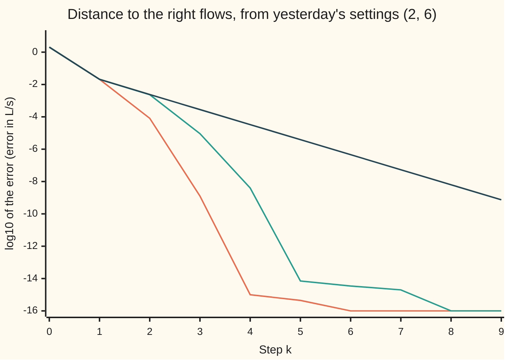

# Newton in several unknowns, and Broyden when a Jacobian is too expensive

[Syllabus](../../../SYLLABUS.md) → [Numerical analysis](../README.md) → [Root Finding and Fixed Points](../README.md#s02) → Newton in several unknowns, and Broyden when a Jacobian is too expensive

---

## General Overview

A small treatment line has two mixing tanks in a row. One pump feeds a stock solution of a disinfectant, at 10 mg/L, into tank 1. A second pump feeds clean water into tank 1. Tank 1 overflows into tank 2, and tank 2 drains to the next stage. The disinfectant slowly breaks down while it sits. All the plant numbers on this card are illustrative.

The operator wants tank 1 at 4 mg/L and tank 2 at 2.5 mg/L. Yesterday's settings, 2 L/s of stock and 6 L/s of water, give 2.3496 and 1.4327 mg/L. Both are too weak. Which two flows hit both targets, to within 10^−9 L/s? Each pump changes both tanks, so this is two curved equations in two unknowns, solved together.

- **Newton's method** measures how each tank responds to each pump: four rates, kept in a 2 × 2 table called the **Jacobian**. It pretends the plant responds in straight lines, solves that small linear system, and moves to its answer. From yesterday's settings it reaches 3.18 L/s of stock and 4.32 L/s of water in **4 steps**.
- **Broyden's method** measures the table once, at the start. After that it repairs its old table with what each step showed. It needs **5 steps**, but each costs one new reading of the plant instead of three.

With 2 unknowns the saving is small: 12 evaluations against 7. With 500 unknowns, such as the flows in a 500-pipe water network, a Newton step needs 501 evaluations and about 83,333,333 arithmetic operations. A Broyden step needs 1 evaluation and about 2,000,000.

**Newton solves several equations at once by replacing them with their table of rates and solving the straight-line version, which squares the error each step near a root; Broyden keeps most of that speed by correcting an estimated table with one small update per step instead of rebuilding it.**

**What kind of fact this is:** two methods and three theorems, proved on this card in Why it works: Newton's error bound (order 2), Broyden's update as the smallest change that fits the newest step, and the Sherman–Morrison formula. Broyden's superlinear rate is stated with a source, not proved. The step counts are measurements.

### The picture: error against step, three ways



Orange: Newton, whose correct digits roughly double each step. Teal: Broyden, a little slower but still speeding up. Dark blue: the first table frozen for ever, shrinking by the same ratio, 0.1176, every step. The code runs 6 Newton steps and 7 Broyden steps; an error of exactly zero, and a step not run, are drawn at −16. Below about −14 the errors are rounding.

---

## The formula

Notation from [Newton and secant](02-newton-and-secant-with-convergence-orders.md), now with lists in place of single numbers. The **iterate** $x_k$ is the pair of flows after $k$ steps, the **root** $x^*$ is the pair that solves the equations, and the **error** is $e_k = x_k - x^*$. The size of a pair is its length, $\|v\| = \sqrt{v_1^2 + v_2^2}$. For a matrix $A$, $\|A\|$ is the most it can stretch a length.

**The plant.** Call the stock flow $p$ and the water flow $q$, both in L/s, so $x = (p, q)$ and the total flow is $u = p + q$. Water leaves each tank through a hole in its floor, at a speed that grows with the square root of the depth. So the depth, and the volume held, grow as the square of the flow: tank $i$ holds $\beta_i u^2$ litres, and water stays in it $\beta_i u$ seconds. The disinfectant decays at rate $\gamma$ per second. Each balance is what flows in, minus what flows out, minus what decays:

$$F(x) = \begin{pmatrix} c_0\,p - c_1\,u\,(1 + \gamma\beta_1 u) \\ c_1\,u - c_2\,u\,(1 + \gamma\beta_2 u) \end{pmatrix} = \begin{pmatrix} 0 \\ 0 \end{pmatrix}$$

**Read it aloud:** in each tank, what comes in equals what leaves plus what decays.

**The Jacobian** is the table of rates: one row per balance, one column per flow ([Chain rule in several variables](../../06-Calculus%20and%20analysis/07-Several%20Variables/04-multivariable-chain-rule-and-jacobians.md) defines it). For this plant it has only two distinct entries:

$$J(x) = \begin{pmatrix} c_0 - h & -h \\ g & g \end{pmatrix}, \qquad h = c_1\,(1 + 2\gamma\beta_1 u), \qquad g = c_1 - c_2\,(1 + 2\gamma\beta_2 u)$$

**Read it aloud:** tank 2 sees only the total flow, so both of its rates are the same number $g$.

**Newton's step.** Solve one linear system, then move:

$$J(x_k)\,s_k = -F(x_k), \qquad x_{k+1} = x_k + s_k$$

**Read it aloud:** find the move that would cancel the miss if the plant were straight lines, and make it.

**Broyden's step.** Same move, but with an estimate $B_k$ in place of $J(x_k)$. After the move, record the change in the miss, $y_k$, and repair the estimate ($^{\mathsf T}$, the transpose, turns a column into a row):

$$B_k s_k = -F(x_k), \quad x_{k+1} = x_k + s_k, \quad y_k = F(x_{k+1}) - F(x_k), \quad B_{k+1} = B_k + \frac{(y_k - B_k s_k)\,s_k^{\mathsf T}}{s_k^{\mathsf T} s_k}$$

**Read it aloud:** the old table predicted $B_k s_k$, the plant showed $y_k$; add the surprise back, along the step only.

**The same update on the inverse**, $H_k = B_k^{-1}$, so no linear system is solved at all:

$$s_k = -H_k F(x_k), \qquad H_{k+1} = H_k + \frac{(s_k - H_k y_k)\,s_k^{\mathsf T} H_k}{s_k^{\mathsf T} H_k y_k}$$

**Read it aloud:** a few products replace a whole solve.

| Symbol | Plain meaning | In our example | Push it up and the answer… |
| --- | --- | --- | --- |
| $p$, $q$, $u$ | stock flow, water flow, and their total, L/s | 3.18, 4.32 and 7.5 at the answer | — |
| $c_0$, $c_1$, $c_2$ | stock strength; targets for tank 1 and tank 2, mg/L | 10, 4, 2.5 | $c_2$ lowered to 2.0: total 12.50, $p$ 5.5000, $q$ 7.0000 |
| $\gamma$ | decay rate of the disinfectant, per second | 0.002 | halved: total 15.00, $p$ 6.3600, $q$ 8.6400 |
| $\beta_1$, $\beta_2$ | tank sizes: tank $i$ holds $\beta_i u^2$ litres for $\beta_i u$ seconds | 4 and 40 s²/L; 225.0 L for 30.0 s, 2250.0 L for 300.0 s | less total flow |
| $F$ | the two balances, mg/s; zero at the answer | (−14.0480, −0.8000) at yesterday's (2, 6) | — |
| $J$, $h$, $g$ | the Jacobian; its two distinct entries | `[[5.52, -4.48], [-1.50, -1.50]]` at the answer | — |
| $x_k$, $x^*$, $e_k$ | flows after $k$ steps; the answer; the error | $x_0 = (2, 6)$, $x^* = (3.18, 4.32)$, $\|e_0\|$ = 2.05e0 | — |
| $s_k$, $y_k$ | the step taken; the change in $F$ across it | $\|y_2\|$ = 4.97e-3 | — |
| $B_k$, $H_k$ | Broyden's estimate of $J$; its inverse | $B_0 = J(x_0)$; $B_5$ = `[[5.51, -4.47], [-1.55, -1.46]]` | — |
| $L$ | how fast $J$ changes: $\|J(a) - J(b)\| \le L\,\|a - b\|$ | 0.8102 | looser bound |
| $\kappa$, $\|A\|_F$, $I$ | condition number $\|J\|\,\|J^{-1}\|$; size of a matrix, the square root of its summed squared entries; the identity matrix, 1 on the diagonal and 0 elsewhere | $\|J(x^*)^{-1}\|$ = 0.4742, κ = 3.37 | a less trustworthy residual |
| $n$, $i$, $\Delta u$; $t$, $M$, $E$, $P$, $w$, $A$, $a$, $b$, $\theta$ | number of unknowns; a tank's number; a change in total flow. Proof helpers: the fraction of the way along a line; $\|J(x^*)^{-1}\|$; a small perturbation; the projection onto the step; a direction at right angles to it; a matrix, the column and row of a one-piece change to it, and one number built from them | $n$ = 2 here, 500 in the cost count; $M$ = 0.4742 | — |

### When it holds

- **The Jacobian is invertible at the root.** Here $\det J = c_0\,g$, which is −15.00 at the answer. Where $g = 0$, at a total flow of 3.75 L/s, $\det J$ = 0.0 and there is no Newton step at all.
- **The Jacobian changes smoothly.** The proof needs $L$. A valve that snaps shut breaks it, and no rate is promised.
- **The start is close enough.** The equations have a second root: $p = q = 0$, the empty plant, where nothing flows and both balances are zero. From (1, 2), Newton goes there in 9 steps.
- **For Broyden, a good first table.** Start it with the identity matrix instead of $J(x_0)$ and its first step lands 1.31e1 L/s from the answer; it ends on the empty plant.
- **Errors well above rounding.** Newton's step 4 is at the rounding floor, 9.93e-16, and its ratio there means nothing.

---

## Why it works

### Step 0: near a point, a smooth map is almost a matrix

Zoom in and a smooth map looks linear: a small move $s$ changes $F$ by about $J(x)\,s$. Newton solves that linear model exactly. The model misses only by the bend, which grows as the square of the move, so the new error is about a constant times the old error squared.

Broyden remembers the table instead of measuring it. Each step shows the plant's response in one direction; the update writes that in and leaves every other direction alone.

### Step 1: Newton's step is the linear model's root

Set the model $F(x_k) + J(x_k)\,s$ to zero: that is $J(x_k)\,s_k = -F(x_k)$, an ordinary linear system ([Solving A x = b](../../03-Algebra/05-Solving%20Systems/01-matrix-equation-ax-b.md)). With one unknown it is the familiar step: minus the value divided by the slope.

### Step 2: the error is squared, with a constant you can compute

Write the new error and use $F(x^*) = 0$:

$$e_{k+1} = J(x_k)^{-1}\Big( J(x_k)\,e_k - \big(F(x_k) - F(x^*)\big) \Big)$$

Walk from $x^*$ to $x_k$ along the line $x^* + t\,e_k$, $t$ from 0 to 1. The change in $F$ adds up the small changes on the way, $\int_0^1 J(x^* + t e_k)\,e_k\,dt$, so the bracket is

$$\int_0^1 \big( J(x_k) - J(x^* + t e_k) \big)\, e_k \, dt$$

The two Jacobians are read $(1 - t)\|e_k\|$ apart, so they differ by at most $L(1 - t)\|e_k\|$, and the integral of $1 - t$ is $1/2$:

$$\|e_{k+1}\| \;\le\; \frac{L}{2}\,\|J(x_k)^{-1}\|\,\|e_k\|^2$$

**Read it aloud:** the next error is at most a fixed constant times the current error squared.

For the tanks, $J$ depends only on $u$: moving $u$ by $\Delta u$ moves the rows by $\Delta u$ times (−0.064, −0.064) and (−0.400, −0.400). So $L = 2\sqrt{0.064^2 + 0.400^2} = 0.8102$. The 2 is one $\sqrt2$ because both columns change alike, and one because $\lvert\Delta u\rvert \le \sqrt2\,\|a - b\|$. Near the answer the constant is $(L/2)\,\|J(x^*)^{-1}\| = 0.1921$. The measured ratio is 0.1850, then 0.1864. At step 2 the bound allows 8.43e-5 and the true error is 8.19e-5, a ratio of 1.0304; at step 3 the ratio is 1.0304 again. The observed order is 1.211 at step 2, still far out, and 1.999 at step 3, against the theorem's 2.

<details>
<summary>Detailed proof: from a close start, Newton converges with order 2</summary>

**Assume** $F$ has a Jacobian with $\|J(a) - J(b)\| \le L\|a - b\|$ near $x^*$, $F(x^*) = 0$, and $J(x^*)$ is invertible. Write $M = \|J(x^*)^{-1}\|$.

**The bound.** The algebra above is exact once $J(x_k)$ is invertible: $\|e_{k+1}\| \le \|J(x_k)^{-1}\| \int_0^1 L(1 - t)\,dt\,\|e_k\|^2 = \tfrac{L}{2}\|J(x_k)^{-1}\|\,\|e_k\|^2$.

**The inverse stays bounded.** Suppose $\|e_k\| \le 1/(2LM)$. Then $J(x_k) = J(x^*)(I - E)$ with $E = J(x^*)^{-1}(J(x^*) - J(x_k))$, and $\|E\| \le M L \|e_k\| \le 1/2$. The series $I + E + E^2 + \dots$ converges to $(I - E)^{-1}$, with size at most $1 + 1/2 + 1/4 + \dots = 2$. So $J(x_k)$ is invertible and $\|J(x_k)^{-1}\| \le 2M$.

**Convergence.** With both facts, $\|e_{k+1}\| \le L M \|e_k\|^2 \le \tfrac12\|e_k\|$. The error at least halves, so the next iterate also satisfies the assumption. By induction every step is defined, $e_k \to 0$, and $\|e_{k+1}\|/\|e_k\|^2 \le LM$: order 2. $\blacksquare$

For the tanks, $1/(2LM) = 1.30$ L/s. Yesterday's start is 2.05e0 away and still works: the guarantee is sufficient, not necessary.

</details>

### Step 3: what a Newton step costs

Two costs, counted at $n$ unknowns ([Counting the work](../01-Floating%20Point%20and%20Error/08-operation-counts-and-cost.md) counts them; a **flop** is one floating-point add, subtract, multiply or divide on two numbers).

- **The table.** $J$ has $n$ columns. If no formula for it exists, each column comes from one extra evaluation of $F$ by a small difference, so a step costs $n + 1$ evaluations.
- **The solve.** Elimination on a full $n \times n$ table costs about $2n^3/3$ flops.

| Unknowns $n$ | Newton per step | Broyden per step |
| --- | --- | --- |
| 2 | 3 evaluations, about 5 flops | 1 evaluation, about 32 flops |
| 500 | 501 evaluations, about 83,333,333 flops | 1 evaluation, about 2,000,000 flops |

At $n = 2$ Broyden does more arithmetic, but in a real plant model the evaluation is the expensive part.

### Step 4: Broyden's update is the smallest change that fits the newest step

The step $s_k$ produced the change $y_k$, so the new table should predict it: $B_{k+1}s_k = y_k$. This **secant condition** is the many-unknown form of the secant method's chord slope.

It pins down only $n$ of the table's $n^2$ entries. Broyden changes nothing the step did not test: for any direction $w$ at right angles to $s_k$, $s_k^{\mathsf T} w = 0$, so $B_{k+1}w = B_k w$. In the code the secant condition holds to 8.67e-19 on a change of size 4.97e-3, which is rounding.

<details>
<summary>Detailed proof: no matrix that fits the step is closer to the old one</summary>

Measure a matrix by $\|A\|_F$, the square root of the sum of its squared entries. Let $B$ be any matrix with $B s_k = y_k$. Then $y_k - B_k s_k = (B - B_k)s_k$, so Broyden's change is

$$B_{k+1} - B_k = (B - B_k)\,\frac{s_k s_k^{\mathsf T}}{s_k^{\mathsf T} s_k}$$

The matrix $P = s_k s_k^{\mathsf T}/(s_k^{\mathsf T}s_k)$ projects every list onto the line of $s_k$, so it never lengthens anything. Each row of $(B - B_k)P$ is a row of $B - B_k$ projected, so it is no longer than before. Summing the squared rows, $\|B_{k+1} - B_k\|_F \le \|B - B_k\|_F$. Equality forces every row to lie along $s_k$ already, which makes $B = B_{k+1}$. So Broyden's matrix is the unique closest one. $\blacksquare$

</details>

### Step 5: update the inverse, and skip the solve

Solving $B_k s_k = -F(x_k)$ would still cost about $2n^3/3$ flops. But the update adds one column times one row, and such a change has an inverse in closed form, the **Sherman–Morrison formula**:

$$(A + a\,b^{\mathsf T})^{-1} = A^{-1} - \frac{A^{-1}a\,b^{\mathsf T}A^{-1}}{1 + b^{\mathsf T}A^{-1}a}$$

With $A = B_k$, $a = (y_k - B_k s_k)/(s_k^{\mathsf T}s_k)$ and $b = s_k$, it simplifies to the $H_{k+1}$ in the formula. A step then costs four matrix-and-list products: about $8n^2$ flops. Over the run, the code's $H_k$ and $B_k$ multiply to the identity within 6.66e-16.

<details>
<summary>Detailed proof: the Sherman–Morrison formula, and the inverse update</summary>

Multiply $A + ab^{\mathsf T}$ by the claimed inverse and write $\theta = b^{\mathsf T}A^{-1}a$, a single number:

$$I + a b^{\mathsf T}A^{-1} - \frac{a\,b^{\mathsf T}A^{-1} + a\,\theta\,b^{\mathsf T}A^{-1}}{1 + \theta} = I + a b^{\mathsf T}A^{-1} - a\,b^{\mathsf T}A^{-1} = I$$

So the formula holds whenever $1 + \theta \neq 0$.

For Broyden, $A^{-1}a = (H_k y_k - s_k)/(s_k^{\mathsf T}s_k)$ and $1 + \theta = s_k^{\mathsf T}H_k y_k/(s_k^{\mathsf T}s_k)$. Substituting, the factors $s_k^{\mathsf T}s_k$ cancel and

$$H_{k+1} = H_k + \frac{(s_k - H_k y_k)\,s_k^{\mathsf T}H_k}{s_k^{\mathsf T}H_k y_k}. \qquad\blacksquare$$

The update fails when $s_k^{\mathsf T}H_k y_k = 0$: then $B_{k+1}$ is singular and the formula divides by zero. The runs on this card never meet that case; a careful code restarts from a fresh Jacobian.

</details>

### Step 6: Broyden is superlinear, though its table stays wrong

Broyden's error ratios fall to zero: 1.12e-1, 3.90e-3, 4.38e-4, 1.78e-6. That is **superlinear** convergence: faster than any fixed ratio. The measured orders, 2.530 then 1.395, settle on no single number.

The theorem, stated here and proved by Broyden, Dennis and Moré (1973): with $F$ as in Step 2 and both $x_0$ and $B_0$ close enough, Broyden converges superlinearly. The key, the Dennis–Moré condition, is that $B_k$ must be right only along the step it takes: $\|(B_k - J(x^*))\,s_k\| / \|s_k\|$ must fall to zero. From $k$ = 2 to 4 it falls 9.26e-3, 9.34e-4, 3.64e-6, while the whole table's error $\|B_k - J(x^*)\|$ stalls at 0.0639. When the flows are right to 7.16e-15, $B_5$ is `[[5.51, -4.47], [-1.55, -1.46]]` against the true `[[5.52, -4.48], [-1.50, -1.50]]`: the bottom row never became right, yet the flows did.

The code then takes two steps at the rounding floor, 1.03e-14 and 1.47e-15 long. There $y_k$ is noise, divided by $s_k^{\mathsf T}s_k$, and the table jumps to `[[7.72, -2.84], [-1.74, -1.75]]`. A careful code stops updating at the floor.

### Step 7: when to stop, and how wrong the answer is

A small miss $\|F(x_k)\|$ is a small backward error: the flows exactly solve a slightly different plant ([Forward and backward error](../01-Floating%20Point%20and%20Error/06-forward-and-backward-error.md)). Multiply it by $\|J^{-1}\|$ to estimate the error in the flows; this is a bound only to first order.

At Newton's step 3 the miss is 2.65e-9 mg/s, which estimates the error at 1.26e-9 L/s. The true error is 1.25e-9, a ratio of 1.0071. With κ = 3.37 the plant is well conditioned; the trouble on this card is never conditioning or stability, only the start. [When to stop](03-stopping-criteria-and-error-estimates.md) turns this into a stopping test.

---

## Worked numbers, by hand

One Newton step from yesterday's settings, $x_0 = (2, 6)$, with $c_0 = 10$, $c_1 = 4$, $c_2 = 2.5$, $\gamma = 0.002$, $\beta_1 = 4$, $\beta_2 = 40$.

| Step | Arithmetic | Value |
| --- | --- | --- |
| tank 1 balance | $10 \times 2 - 4 \times 8 \times (1 + 0.002 \times 4 \times 8)$ | −14.0480 mg/s |
| tank 2 balance | $4 \times 8 - 2.5 \times 8 \times (1 + 0.002 \times 40 \times 8)$ | −0.8000 mg/s |
| $h$ and the top row | $4 \times (1 + 2 \times 0.002 \times 4 \times 8)$; then $10 - h$, $-h$ | 5.488, −4.512 |
| $g$, the bottom row | $4 - 2.5 \times (1 + 2 \times 0.002 \times 40 \times 8)$ | −1.700, −1.700 |
| determinant | $c_0\,g = 10 \times (-1.700)$ | −17.000 |
| the step $s_0$ | solve $J(x_0)\,s = (14.048,\ 0.8)$ by elimination | (1.192471, −1.663059) |
| $x_1$ | $(2 + 1.192471,\ 6 - 1.663059)$ | **(3.192471, 4.336941)** |
| error | $\|x_1 - x^*\|$ against the closed form (3.18, 4.32) | 2.10e-2 L/s |

One step took the error from 2.05e0 to 2.10e-2 L/s. Three more Newton steps reach 9.93e-16; Broyden takes the same first step, then four more to reach 7.16e-15.

The closed form exists because tank 2 sees only the total flow: its balance gives $u^* = (c_1/c_2 - 1)/(\gamma\beta_2) = 7.5$, then tank 1 gives $p^*$. A plant with a recycle line has no such shortcut.

### What breaks if you drop a piece

| Mistake | Comes out at | What went wrong |
| --- | --- | --- |
| Start at a total of 3.75 L/s, e.g. (1, 2.75) | $\det J$ = 0.0, no step | Tank 2's balance is flat in both flows there, so the table cannot be inverted |
| Start at (1, 2) | (0.0, 0.0) after 9 steps, miss 0.00e0 | A true root, the empty plant; Newton converges to whichever root its start leads to |
| Freeze $J(x_0)$ for ever | 9 steps, error ratio 0.1176 | A fixed table gives a contraction, so the order drops to 1 |
| Broyden with $B_0 = I$ | 1.31e1 after step 1, 3.29e1 at step 5; at (0.0000, 0.0000) by step 20 | A wrong first table sends the first step far off, and the method settles on the wrong root |

The code prints all four.

---

## Code, from first principles, and it actually runs

The code takes three independent roads to the flows and makes them agree: the closed form through the total flow; Newton, with its error bound checked at every step; and Broyden on the inverse, with the secant condition and $H_k B_k = I$ checked in floating point. It then runs the four breaks, the costs and the chart's points.

### Python

```python
# Newton for systems and Broyden: the check behind the card.  Standard library only.
# Two mixing tanks: find the stock flow p and water flow q (L/s) that hold tank 1 at
# 4 mg/L and tank 2 at 2.5 mg/L.  A closed form, Newton and Broyden must all agree.
from math import sqrt, log, log10

C0, C1, C2, K, B1, B2 = 10.0, 4.0, 2.5, 0.002, 4.0, 40.0  # mg/L x3, decay 1/s, tank sizes s^2/L
def sci(v):                                   # 1.25e-9, the form Rust prints
    m, e = f"{v:.2e}".split("e")
    return f"{m}e{int(e)}"
def F(v):                                     # the two balances, mg/s: in - out - decayed
    s = v[0] + v[1]
    return [C0 * v[0] - C1 * s * (1 + K * B1 * s), C1 * s - C2 * s * (1 + K * B2 * s)]
def J(v):                                     # Jacobian: one row per balance, one column per flow
    s = v[0] + v[1]
    h, g = C1 * (1 + 2 * K * B1 * s), C1 - C2 * (1 + 2 * K * B2 * s)
    return [[C0 - h, -h], [g, g]]
def det(A): return A[0][0] * A[1][1] - A[0][1] * A[1][0]
def inv(A):
    d = det(A)
    return [[A[1][1] / d, -A[0][1] / d], [-A[1][0] / d, A[0][0] / d]]
def mv(A, v): return [A[0][0] * v[0] + A[0][1] * v[1], A[1][0] * v[0] + A[1][1] * v[1]]
def mm(A, B): return [[A[i][0] * B[0][j] + A[i][1] * B[1][j] for j in range(2)] for i in range(2)]
def sub(a, b): return [a[0] - b[0], a[1] - b[1]]
def nrm(v): return sqrt(v[0] * v[0] + v[1] * v[1])
def norm2(A):                                 # largest stretch of a 2x2 matrix
    t = sum(a * a for row in A for a in row)
    return sqrt((t + sqrt(t * t - 4 * det(A) * det(A))) / 2)
def closed(c2, k):                            # road 1: tank 2 fixes the total, tank 1 the split
    u = (C1 / c2 - 1) / (k * B2)
    return u, C1 * u * (1 + k * B1 * u) / C0
s_, x_ = closed(C2, K)
root = [x_, s_ - x_]
err = lambda v: nrm(sub(v, root))
print(f"closed form: total {s_:.4f} L/s, stock p* = {root[0]:.4f}, water q* = {root[1]:.4f} L/s")
print(f"tanks at the answer: {B1 * s_ * s_:.1f} L and {B2 * s_ * s_:.1f} L, stays {B1 * s_:.1f} s and {B2 * s_:.1f} s")
Js = J(root)
print(f"J(x*) = [[{Js[0][0]:.2f}, {Js[0][1]:.2f}], [{Js[1][0]:.2f}, {Js[1][1]:.2f}]], det {det(Js):.2f}, "
      f"||J^-1|| = {norm2(inv(Js)):.4f}, kappa = {norm2(Js) * norm2(inv(Js)):.2f}")
m1, m2 = 2 * C1 * K * B1, 2 * C2 * K * B2
L = 2 * sqrt(m1 * m1 + m2 * m2)   # Lipschitz constant of J
x0 = [2.0, 6.0]                               # yesterday's settings
def conc(v):                                  # what the two tanks read at flows v
    s = v[0] + v[1]; c = C0 * v[0] / (s * (1 + K * B1 * s))
    return c, c / (1 + K * B2 * s)
J0 = J(x0); st = mv(inv(J0), F(x0))
print(f"Newton step 1 by hand: J(x0) = [[{J0[0][0]:.3f}, {J0[0][1]:.3f}], [{J0[1][0]:.3f}, {J0[1][1]:.3f}]], "
      f"det {det(J0):.3f}, step ({-st[0]:.6f}, {-st[1]:.6f})")
print("yesterday's flows (2, 6) give tanks %.4f and %.4f mg/L; residual F = (%.4f, %.4f) mg/s" % (*conc(x0), *F(x0)))

def newton(v, n):
    out = [v]
    for _ in range(n):
        if F(v) == [0.0, 0.0]: break
        v = sub(v, mv(inv(J(v)), F(v))); out.append(v)
    return out

def broyden(v, H, n):                         # H tracks the inverse of B by Sherman-Morrison
    out, f, B, hb, tab = [v], F(v), inv(H), 0.0, []
    for _ in range(n):
        d = mv(H, f); d = [-d[0], -d[1]]
        w = [v[0] + d[0], v[1] + d[1]]; fw = F(w); y = sub(fw, f)
        if d == [0.0, 0.0] or y == [0.0, 0.0]: break
        Hy = mv(H, y); sH = [d[0] * H[0][0] + d[1] * H[1][0], d[0] * H[0][1] + d[1] * H[1][1]]; tab.append((B, d))
        den, u, r = d[0] * Hy[0] + d[1] * Hy[1], sub(d, Hy), sub(y, mv(B, d))
        H = [[H[i][j] + u[i] * sH[j] / den for j in range(2)] for i in range(2)]
        B = [[B[i][j] + r[i] * d[j] / (d[0] * d[0] + d[1] * d[1]) for j in range(2)] for i in range(2)]
        P = mm(H, B); hb = max(hb, abs(P[0][0] - 1) + abs(P[0][1]) + abs(P[1][0]) + abs(P[1][1] - 1))
        if len(out) == 3: sec = sub(mv(B, d), y); s3 = nrm(y)  # secant condition B s = y, in floats
        v, f = w, fw; out.append(v)
    return out, hb, B, sec, s3, tab                # tab: each B_k with its step s_k

def order(e, k): return log(e[k + 1] / e[k]) / log(e[k] / e[k - 1])
N = newton(x0, 6); en = [err(v) for v in N]
print("Newton from (2, 6)  k  stock p   water q   residual   error     e_k/e_(k-1)^2  bound")
for k in range(5):
    rat = f"{en[k] / (en[k - 1] * en[k - 1]):.4f}" if 0 < k < 4 else ("-" if k == 0 else "floor")
    bd = L / 2 * norm2(inv(J(N[k - 1]))) * en[k - 1] * en[k - 1] if 0 < k < 4 else 0
    if bd: assert en[k] <= bd                 # the theorem's bound holds at every step above the floor
    print(f"{'':19} {k}  {N[k][0]:.6f}  {N[k][1]:.6f}  {sci(nrm(F(N[k]))):>9}  {sci(en[k]):>9}  "
          f"{rat:>13}  {sci(bd) if bd else '-':>8}")
print(f"order at steps 2, 3: {order(en, 1):.3f}, {order(en, 2):.3f}; constant (L/2)||J*^-1|| = "
      f"{L / 2 * norm2(inv(Js)):.4f}, L = 2 sqrt({m1:.3f}^2 + {m2:.3f}^2) = {L:.4f}")
print(f"guaranteed start radius 1/(2 L ||J*^-1||) = {1 / (2 * L * norm2(inv(Js))):.2f} L/s; yesterday's start is {sci(en[0])} away")
print("bound / true error at steps 2, 3:", ", ".join(f"{L / 2 * norm2(inv(J(N[k - 1]))) * en[k - 1] * en[k - 1] / en[k]:.4f}" for k in (2, 3)))
est = nrm(F(N[3])) * norm2(inv(J(N[3])))
print(f"error estimate at step 3: residual x ||J^-1|| = {sci(est)}, true error {sci(en[3])}, ratio {est / en[3]:.4f}")
assert en[3] <= est < 1.1 * en[3]
Bs, hb, B, sec, s3, tab = broyden(x0, inv(J(x0)), 7); eb = [err(v) for v in Bs]
print("Broyden from (2, 6) k  stock p   water q   residual   error     e_k/e_(k-1)")
for k in range(6):
    print(f"{'':19} {k}  {Bs[k][0]:.6f}  {Bs[k][1]:.6f}  {sci(nrm(F(Bs[k]))):>9}  {sci(eb[k]):>9}  "
          f"{sci(eb[k] / eb[k - 1]) if k else '-':>11}")
print(f"orders at steps 3, 4: {order(eb, 2):.3f}, {order(eb, 3):.3f}; secant miss |B s - y| = {sci(nrm(sec))} "
      f"of |y| = {sci(s3)}")
dm = [nrm(sub(mv(Bk, d), mv(Js, d))) / nrm(d) for Bk, d in tab]   # B_k's error along its own step
gap, B5 = [norm2([[Bk[i][j] - Js[i][j] for j in range(2)] for i in range(2)]) for Bk, _ in tab], tab[5][0]
print(f"Sherman-Morrison: largest |H B - I| over the run = {sci(hb)}; "
      f"B_5 = [[{B5[0][0]:.2f}, {B5[0][1]:.2f}], [{B5[1][0]:.2f}, {B5[1][1]:.2f}]] against J(x*) above")
print("Dennis-More, k = 0-5: |(B_k - J*) s_k|/|s_k| = " + ", ".join(sci(v) for v in dm[:6])
      + "; ||B_k - J*|| = " + ", ".join(f"{v:.4f}" for v in gap[:6]))
print(f"at the floor, k = 5, 6: |s_k| = {sci(nrm(tab[5][1]))}, {sci(nrm(tab[6][1]))}; "
      f"after them B_7 = [[{B[0][0]:.2f}, {B[0][1]:.2f}], [{B[1][0]:.2f}, {B[1][1]:.2f}]]")
assert abs(det(Js) - C0 * (C1 - C2 * (1 + 2 * K * B2 * s_))) < 1e-12   # det J = c0 g, by hand
assert nrm(F(root)) < 1e-12 and err(N[5]) < 1e-14 and err(Bs[6]) < 1e-14  # three roads meet
assert abs(order(en, 2) - 2) < 0.05 and abs(en[3] / (en[2] * en[2]) - en[2] / (en[1] * en[1])) < 0.01
assert eb[5] / eb[4] < eb[4] / eb[3] < eb[3] / eb[2] < 0.2         # Broyden: superlinear
assert nrm(sec) < 1e-14 * s3 and hb < 1e-12 and dm[4] < 1e-3 * dm[2] and gap[4] > 0.05  # B fits its steps, not J*
C = [x0]; Hc = inv(J(x0))                     # break: freeze the first Jacobian
while err(C[-1]) >= 1e-9: C.append(sub(C[-1], mv(Hc, F(C[-1]))))
ec = [err(v) for v in C]
first = lambda e: next(k for k, v in enumerate(e) if v < 1e-9)
print(f"to an error under 1e-9 L/s: Newton {first(en)} steps, Broyden {first(eb)}, frozen Jacobian {len(C) - 1}"
      f" (ratio {ec[-1] / ec[-2]:.4f})")
nn, nb, nc = first(en), first(eb), len(C) - 1
print(f"evaluations of F, a Jacobian column costing one: Newton {3 * nn}, Broyden {nb + 2}, frozen {nc + 2}")
assert (nn, nb) == (4, 5) and 0.1 < ec[-1] / ec[-2] < 0.13 and nc > 2 * nn
sg = (C1 / C2 - 1) / (2 * K * B2)             # where the tank-2 row of J vanishes
print(f"break 1, start total {sg:.2f} L/s, e.g. (1, {sg - 1:.2f}): det J = {det(J([1.0, sg - 1])):.1f}, no Newton step")
Z = newton([1.0, 2.0], 40)
print(f"break 2, start (1, 2): Newton ends at ({abs(Z[-1][0]):.1f}, {abs(Z[-1][1]):.1f}) after {len(Z) - 1} steps, "
      f"the empty plant, residual {sci(nrm(F(Z[-1])))}")
assert abs(det(J([1.0, sg - 1]))) < 1e-12 and err(Z[-1]) > 5 and nrm(Z[-1]) < 1e-12
I_ = broyden(x0, [[1.0, 0.0], [0.0, 1.0]], 20)[0]
print(f"break 3, Broyden with B0 = I: errors {sci(err(I_[1]))}, {sci(err(I_[5]))} at steps 1, 5; "
      f"step 20 at ({abs(I_[20][0]):.4f}, {abs(I_[20][1]):.4f}), error {sci(err(I_[20]))}")
assert err(I_[20]) > 5 and nrm(I_[20]) < 1e-3
u2, p2 = closed(2.0, K); u3, p3 = closed(C2, K / 2)
n3, b3 = newton([3.0, 3.0], 9), broyden([3.0, 3.0], inv(J([3.0, 3.0])), 9)[0]
print(f"try: tank 2 at 2.0 mg/L gives total {u2:.2f}, p {p2:.4f}, q {u2 - p2:.4f}; decay k halved gives total "
      f"{u3:.2f}, p {p3:.4f}, q {u3 - p3:.4f}")
print(f"try: from (3, 3), Newton {first([err(v) for v in n3])} steps, Broyden {first([err(v) for v in b3])}")
assert abs(p2 - 5.5) < 1e-12 and abs(u3 - 2 * s_) < 1e-12
for n in (2, 500):
    print(f"cost per step at n = {n}: Newton {n + 1} evaluations + about {2 * n ** 3 / 3:,.0f} flops; "
          f"Broyden 1 evaluation + about {8 * n * n:,} flops")
pt = lambda e: f"{log10(max(e, 1e-16)):.2f}"
print("chart, log10 error, steps 0-9: Newton", ", ".join(pt(e) for e in (en + [0.0] * 9)[:10]))
print("chart, Broyden", ", ".join(pt(e) for e in (eb + [0.0] * 9)[:10]))
print("chart, frozen ", ", ".join(pt(e) for e in ec[:10]))
print("ALL CHECKS PASS")
```

**Ran 2026-11-11 on macOS, Python 3.14.10, standard library only. All checks passed. Output, pasted from the run:**

```
closed form: total 7.5000 L/s, stock p* = 3.1800, water q* = 4.3200 L/s
tanks at the answer: 225.0 L and 2250.0 L, stays 30.0 s and 300.0 s
J(x*) = [[5.52, -4.48], [-1.50, -1.50]], det -15.00, ||J^-1|| = 0.4742, kappa = 3.37
Newton step 1 by hand: J(x0) = [[5.488, -4.512], [-1.700, -1.700]], det -17.000, step (1.192471, -1.663059)
yesterday's flows (2, 6) give tanks 2.3496 and 1.4327 mg/L; residual F = (-14.0480, -0.8000) mg/s
Newton from (2, 6)  k  stock p   water q   residual   error     e_k/e_(k-1)^2  bound
                    0  2.000000  6.000000     1.41e1     2.05e0              -         -
                    1  3.192471  4.336941    4.49e-2    2.10e-2         0.0050   7.14e-1
                    2  3.180049  4.320066    1.74e-4    8.19e-5         0.1850   8.43e-5
                    3  3.180000  4.320000    2.65e-9    1.25e-9         0.1864   1.29e-9
                    4  3.180000  4.320000   7.11e-15   9.93e-16          floor         -
order at steps 2, 3: 1.211, 1.999; constant (L/2)||J*^-1|| = 0.1921, L = 2 sqrt(0.064^2 + 0.400^2) = 0.8102
guaranteed start radius 1/(2 L ||J*^-1||) = 1.30 L/s; yesterday's start is 2.05e0 away
bound / true error at steps 2, 3: 1.0304, 1.0304
error estimate at step 3: residual x ||J^-1|| = 1.26e-9, true error 1.25e-9, ratio 1.0071
Broyden from (2, 6) k  stock p   water q   residual   error     e_k/e_(k-1)
                    0  2.000000  6.000000     1.41e1     2.05e0            -
                    1  3.192471  4.336941    4.49e-2    2.10e-2      1.02e-2
                    2  3.181393  4.321892    4.99e-3    2.35e-3      1.12e-1
                    3  3.180005  4.320007    1.95e-5    9.17e-6      3.90e-3
                    4  3.180000  4.320000    8.53e-9    4.02e-9      4.38e-4
                    5  3.180000  4.320000   2.25e-14   7.16e-15      1.78e-6
orders at steps 3, 4: 2.530, 1.395; secant miss |B s - y| = 8.67e-19 of |y| = 4.97e-3
Sherman-Morrison: largest |H B - I| over the run = 6.66e-16; B_5 = [[5.51, -4.47], [-1.55, -1.46]] against J(x*) above
Dennis-More, k = 0-5: |(B_k - J*) s_k|/|s_k| = 4.66e-2, 2.76e-1, 9.26e-3, 9.34e-4, 3.64e-6, 3.22e-3; ||B_k - J*|| = 0.2864, 0.2837, 0.0646, 0.0639, 0.0639, 0.0639
at the floor, k = 5, 6: |s_k| = 1.03e-14, 1.47e-15; after them B_7 = [[7.72, -2.84], [-1.74, -1.75]]
to an error under 1e-9 L/s: Newton 4 steps, Broyden 5, frozen Jacobian 9 (ratio 0.1176)
evaluations of F, a Jacobian column costing one: Newton 12, Broyden 7, frozen 11
break 1, start total 3.75 L/s, e.g. (1, 2.75): det J = 0.0, no Newton step
break 2, start (1, 2): Newton ends at (0.0, 0.0) after 9 steps, the empty plant, residual 0.00e0
break 3, Broyden with B0 = I: errors 1.31e1, 3.29e1 at steps 1, 5; step 20 at (0.0000, 0.0000), error 5.36e0
try: tank 2 at 2.0 mg/L gives total 12.50, p 5.5000, q 7.0000; decay k halved gives total 15.00, p 6.3600, q 8.6400
try: from (3, 3), Newton 5 steps, Broyden 6
cost per step at n = 2: Newton 3 evaluations + about 5 flops; Broyden 1 evaluation + about 32 flops
cost per step at n = 500: Newton 501 evaluations + about 83,333,333 flops; Broyden 1 evaluation + about 2,000,000 flops
chart, log10 error, steps 0-9: Newton 0.31, -1.68, -4.09, -8.90, -15.00, -15.35, -16.00, -16.00, -16.00, -16.00
chart, Broyden 0.31, -1.68, -2.63, -5.04, -8.40, -14.15, -14.46, -14.70, -16.00, -16.00
chart, frozen  0.31, -1.68, -2.62, -3.55, -4.48, -5.41, -6.34, -7.27, -8.20, -9.13
ALL CHECKS PASS
```

### Rust

Same numbers, same labels, built with `rustc --edition 2021 -O`.

```rust
// Newton for systems and Broyden: the same check as the Python, in Rust.  No crates.
// Two mixing tanks: find the stock flow p and water flow q (L/s) that hold tank 1 at
// 4 mg/L and tank 2 at 2.5 mg/L.  A closed form, Newton and Broyden must all agree.
type V = [f64; 2];
type M = [[f64; 2]; 2];
const C0: f64 = 10.0; const C1: f64 = 4.0; const C2: f64 = 2.5;   // mg/L
const K: f64 = 0.002; const B1: f64 = 4.0; const B2: f64 = 40.0;  // decay 1/s, tank sizes s^2/L
fn sci(v: f64) -> String { format!("{:.2e}", v) }                // 1.25e-9
fn f(v: V) -> V {                             // the two balances, mg/s: in - out - decayed
    let s = v[0] + v[1];
    [C0 * v[0] - C1 * s * (1.0 + K * B1 * s), C1 * s - C2 * s * (1.0 + K * B2 * s)]
}
fn jac(v: V) -> M {                           // Jacobian: one row per balance, one column per flow
    let s = v[0] + v[1];
    let (h, g) = (C1 * (1.0 + 2.0 * K * B1 * s), C1 - C2 * (1.0 + 2.0 * K * B2 * s));
    [[C0 - h, -h], [g, g]]
}
fn det(a: M) -> f64 { a[0][0] * a[1][1] - a[0][1] * a[1][0] }
fn inv(a: M) -> M { let d = det(a); [[a[1][1] / d, -a[0][1] / d], [-a[1][0] / d, a[0][0] / d]] }
fn mv(a: M, v: V) -> V { [a[0][0] * v[0] + a[0][1] * v[1], a[1][0] * v[0] + a[1][1] * v[1]] }
fn mm(a: M, b: M) -> M {
    let mut c = [[0.0; 2]; 2];
    for i in 0..2 { for j in 0..2 { c[i][j] = a[i][0] * b[0][j] + a[i][1] * b[1][j] } }
    c
}
fn sub(a: V, b: V) -> V { [a[0] - b[0], a[1] - b[1]] }
fn nrm(v: V) -> f64 { (v[0] * v[0] + v[1] * v[1]).sqrt() }
fn norm2(a: M) -> f64 {                       // largest stretch of a 2x2 matrix
    let t = a[0][0] * a[0][0] + a[0][1] * a[0][1] + a[1][0] * a[1][0] + a[1][1] * a[1][1];
    ((t + (t * t - 4.0 * det(a) * det(a)).sqrt()) / 2.0).sqrt()
}
fn newton(mut v: V, n: usize) -> Vec<V> {
    let mut out = vec![v];
    for _ in 0..n {
        if f(v) == [0.0, 0.0] { break }
        v = sub(v, mv(inv(jac(v)), f(v))); out.push(v);
    }
    out
}
fn broyden(mut v: V, mut h: M, n: usize) -> (Vec<V>, f64, M, V, f64, Vec<(M, V)>) {  // h: inverse of B
    let (mut out, mut fv, mut b, mut hb) = (vec![v], f(v), inv(h), 0.0f64);
    let (mut sec, mut s3, mut tab) = ([0.0; 2], 0.0, Vec::new());
    for _ in 0..n {
        let d0 = mv(h, fv); let d = [-d0[0], -d0[1]];
        let w = [v[0] + d[0], v[1] + d[1]]; let fw = f(w); let y = sub(fw, fv);
        if d == [0.0, 0.0] || y == [0.0, 0.0] { break }
        let hy = mv(h, y); tab.push((b, d));                    // each B_k with its step s_k
        let sh = [d[0] * h[0][0] + d[1] * h[1][0], d[0] * h[0][1] + d[1] * h[1][1]];
        let (den, u, r) = (d[0] * hy[0] + d[1] * hy[1], sub(d, hy), sub(y, mv(b, d)));
        for i in 0..2 { for j in 0..2 {
            h[i][j] += u[i] * sh[j] / den;
            b[i][j] += r[i] * d[j] / (d[0] * d[0] + d[1] * d[1]);
        } }
        let p = mm(h, b);
        hb = hb.max((p[0][0] - 1.0).abs() + p[0][1].abs() + p[1][0].abs() + (p[1][1] - 1.0).abs());
        if out.len() == 3 { sec = sub(mv(b, d), y); s3 = nrm(y) }   // secant condition B s = y
        v = w; fv = fw; out.push(v);
    }
    (out, hb, b, sec, s3, tab)
}
fn order(e: &[f64], k: usize) -> f64 { (e[k + 1] / e[k]).ln() / (e[k] / e[k - 1]).ln() }
fn closed(c2: f64, k: f64) -> (f64, f64) {    // road 1: tank 2 fixes the total, tank 1 the split
    let u = (C1 / c2 - 1.0) / (k * B2);
    (u, C1 * u * (1.0 + k * B1 * u) / C0)
}
fn first(e: &[f64]) -> usize { e.iter().position(|&v| v < 1e-9).unwrap() }
fn commas(n: u64) -> String {
    let s = n.to_string(); let mut o = String::new();
    for (i, ch) in s.chars().enumerate() { if i > 0 && (s.len() - i) % 3 == 0 { o.push(',') } o.push(ch) }
    o
}
fn pts(e: &[f64]) -> String {
    (0..10).map(|k| format!("{:.2}", e.get(k).copied().unwrap_or(0.0).max(1e-16).log10()))
        .collect::<Vec<_>>().join(", ")
}
fn main() {
    let (s_, x_) = closed(C2, K);
    let root = [x_, s_ - x_];
    let err = |v: V| nrm(sub(v, root));
    println!("closed form: total {:.4} L/s, stock p* = {:.4}, water q* = {:.4} L/s", s_, root[0], root[1]);
    println!("tanks at the answer: {:.1} L and {:.1} L, stays {:.1} s and {:.1} s", B1 * s_ * s_, B2 * s_ * s_, B1 * s_, B2 * s_);
    let js = jac(root);
    println!("J(x*) = [[{:.2}, {:.2}], [{:.2}, {:.2}]], det {:.2}, ||J^-1|| = {:.4}, kappa = {:.2}",
             js[0][0], js[0][1], js[1][0], js[1][1], det(js), norm2(inv(js)), norm2(js) * norm2(inv(js)));
    let (m1, m2) = (2.0 * C1 * K * B1, 2.0 * C2 * K * B2);
    let l = 2.0 * (m1 * m1 + m2 * m2).sqrt();  // Lipschitz constant of J
    let x0 = [2.0, 6.0];                       // yesterday's settings
    let j0 = jac(x0); let st = mv(inv(j0), f(x0));
    println!("Newton step 1 by hand: J(x0) = [[{:.3}, {:.3}], [{:.3}, {:.3}]], det {:.3}, step ({:.6}, {:.6})",
             j0[0][0], j0[0][1], j0[1][0], j0[1][1], det(j0), -st[0], -st[1]);
    let s0 = x0[0] + x0[1]; let c = C0 * x0[0] / (s0 * (1.0 + K * B1 * s0));
    println!("yesterday's flows (2, 6) give tanks {:.4} and {:.4} mg/L; residual F = ({:.4}, {:.4}) mg/s",
             c, c / (1.0 + K * B2 * s0), f(x0)[0], f(x0)[1]);
    let nw = newton(x0, 6); let en: Vec<f64> = nw.iter().map(|&v| err(v)).collect();
    println!("Newton from (2, 6)  k  stock p   water q   residual   error     e_k/e_(k-1)^2  bound");
    for k in 0..5 {
        let rat = if k == 0 { "-".to_string() } else if k < 4 { format!("{:.4}", en[k] / (en[k - 1] * en[k - 1])) } else { "floor".to_string() };
        let bd = if k > 0 && k < 4 { l / 2.0 * norm2(inv(jac(nw[k - 1]))) * en[k - 1] * en[k - 1] } else { 0.0 };
        if bd != 0.0 { assert!(en[k] <= bd) }  // the theorem's bound holds at every step above the floor
        println!("{:19} {}  {:.6}  {:.6}  {:>9}  {:>9}  {:>13}  {:>8}", "", k, nw[k][0], nw[k][1], sci(nrm(f(nw[k]))),
                 sci(en[k]), rat, if bd != 0.0 { sci(bd) } else { "-".to_string() });
    }
    println!("order at steps 2, 3: {:.3}, {:.3}; constant (L/2)||J*^-1|| = {:.4}, L = 2 sqrt({:.3}^2 + {:.3}^2) = {:.4}",
             order(&en, 1), order(&en, 2), l / 2.0 * norm2(inv(js)), m1, m2, l);
    println!("guaranteed start radius 1/(2 L ||J*^-1||) = {:.2} L/s; yesterday's start is {} away", 1.0 / (2.0 * l * norm2(inv(js))), sci(en[0]));
    let bt = |k: usize| l / 2.0 * norm2(inv(jac(nw[k - 1]))) * en[k - 1] * en[k - 1] / en[k];
    println!("bound / true error at steps 2, 3: {:.4}, {:.4}", bt(2), bt(3));
    let est = nrm(f(nw[3])) * norm2(inv(jac(nw[3])));
    println!("error estimate at step 3: residual x ||J^-1|| = {}, true error {}, ratio {:.4}", sci(est), sci(en[3]), est / en[3]);
    assert!(en[3] <= est && est < 1.1 * en[3]);
    let (bs, hb, b, sec, s3, tab) = broyden(x0, inv(jac(x0)), 7);
    let eb: Vec<f64> = bs.iter().map(|&v| err(v)).collect();
    println!("Broyden from (2, 6) k  stock p   water q   residual   error     e_k/e_(k-1)");
    for k in 0..6 {
        println!("{:19} {}  {:.6}  {:.6}  {:>9}  {:>9}  {:>11}", "", k, bs[k][0], bs[k][1], sci(nrm(f(bs[k]))),
                 sci(eb[k]), if k > 0 { sci(eb[k] / eb[k - 1]) } else { "-".to_string() });
    }
    println!("orders at steps 3, 4: {:.3}, {:.3}; secant miss |B s - y| = {} of |y| = {}",
             order(&eb, 2), order(&eb, 3), sci(nrm(sec)), sci(s3));
    let dm: Vec<f64> = tab.iter().map(|&(bk, d)| nrm(sub(mv(bk, d), mv(js, d))) / nrm(d)).collect();
    let gap: Vec<f64> = tab.iter().map(|&(bk, _)| norm2([[bk[0][0] - js[0][0], bk[0][1] - js[0][1]],
                                                         [bk[1][0] - js[1][0], bk[1][1] - js[1][1]]])).collect();
    let b5 = tab[5].0;
    println!("Sherman-Morrison: largest |H B - I| over the run = {}; B_5 = [[{:.2}, {:.2}], [{:.2}, {:.2}]] against J(x*) above",
             sci(hb), b5[0][0], b5[0][1], b5[1][0], b5[1][1]);
    println!("Dennis-More, k = 0-5: |(B_k - J*) s_k|/|s_k| = {}; ||B_k - J*|| = {}", dm[..6].iter().map(|&v| sci(v)).collect::<Vec<_>>().join(", "),
             gap[..6].iter().map(|v| format!("{:.4}", v)).collect::<Vec<_>>().join(", "));
    println!("at the floor, k = 5, 6: |s_k| = {}, {}; after them B_7 = [[{:.2}, {:.2}], [{:.2}, {:.2}]]",
             sci(nrm(tab[5].1)), sci(nrm(tab[6].1)), b[0][0], b[0][1], b[1][0], b[1][1]);
    assert!((det(js) - C0 * (C1 - C2 * (1.0 + 2.0 * K * B2 * s_))).abs() < 1e-12);  // det J = c0 g
    assert!(nrm(f(root)) < 1e-12 && err(nw[5]) < 1e-14 && err(bs[6]) < 1e-14);     // three roads meet
    assert!((order(&en, 2) - 2.0).abs() < 0.05);
    assert!((en[3] / (en[2] * en[2]) - en[2] / (en[1] * en[1])).abs() < 0.01);
    assert!(eb[5] / eb[4] < eb[4] / eb[3] && eb[4] / eb[3] < eb[3] / eb[2] && eb[3] / eb[2] < 0.2);
    assert!(nrm(sec) < 1e-14 * s3 && hb < 1e-12 && dm[4] < 1e-3 * dm[2] && gap[4] > 0.05);  // B fits its steps, not J*
    let hc = inv(jac(x0));                     // break: freeze the first Jacobian
    let mut ch = vec![x0];
    while err(ch[ch.len() - 1]) >= 1e-9 { let v = ch[ch.len() - 1]; ch.push(sub(v, mv(hc, f(v)))) }
    let ec: Vec<f64> = ch.iter().map(|&v| err(v)).collect();
    let (nn, nb, nc) = (first(&en), first(&eb), ch.len() - 1);
    println!("to an error under 1e-9 L/s: Newton {} steps, Broyden {}, frozen Jacobian {} (ratio {:.4})",
             nn, nb, nc, ec[nc] / ec[nc - 1]);
    println!("evaluations of F, a Jacobian column costing one: Newton {}, Broyden {}, frozen {}", 3 * nn, nb + 2, nc + 2);
    assert!(nn == 4 && nb == 5 && 0.1 < ec[nc] / ec[nc - 1] && ec[nc] / ec[nc - 1] < 0.13 && nc > 2 * nn);
    let sg = (C1 / C2 - 1.0) / (2.0 * K * B2); // where the tank-2 row of J vanishes
    println!("break 1, start total {:.2} L/s, e.g. (1, {:.2}): det J = {:.1}, no Newton step", sg, sg - 1.0, det(jac([1.0, sg - 1.0])));
    let z = newton([1.0, 2.0], 40); let zl = z[z.len() - 1];
    println!("break 2, start (1, 2): Newton ends at ({:.1}, {:.1}) after {} steps, the empty plant, residual {}",
             zl[0].abs(), zl[1].abs(), z.len() - 1, sci(nrm(f(zl))));
    assert!(det(jac([1.0, sg - 1.0])).abs() < 1e-12 && err(zl) > 5.0 && nrm(zl) < 1e-12);
    let bi = broyden(x0, [[1.0, 0.0], [0.0, 1.0]], 20).0;
    println!("break 3, Broyden with B0 = I: errors {}, {} at steps 1, 5; step 20 at ({:.4}, {:.4}), error {}",
             sci(err(bi[1])), sci(err(bi[5])), bi[20][0].abs(), bi[20][1].abs(), sci(err(bi[20])));
    assert!(err(bi[20]) > 5.0 && nrm(bi[20]) < 1e-3);
    let ((u2, p2), (u3, p3)) = (closed(2.0, K), closed(C2, K / 2.0));
    let n3: Vec<f64> = newton([3.0, 3.0], 9).iter().map(|&v| err(v)).collect();
    let b3: Vec<f64> = broyden([3.0, 3.0], inv(jac([3.0, 3.0])), 9).0.iter().map(|&v| err(v)).collect();
    println!("try: tank 2 at 2.0 mg/L gives total {:.2}, p {:.4}, q {:.4}; decay k halved gives total {:.2}, p {:.4}, q {:.4}",
             u2, p2, u2 - p2, u3, p3, u3 - p3);
    println!("try: from (3, 3), Newton {} steps, Broyden {}", first(&n3), first(&b3));
    assert!((p2 - 5.5).abs() < 1e-12 && (u3 - 2.0 * s_).abs() < 1e-12);
    for n in [2u64, 500] {
        println!("cost per step at n = {}: Newton {} evaluations + about {} flops; Broyden 1 evaluation + about {} flops",
                 n, n + 1, commas(((2 * n * n * n) as f64 / 3.0).round() as u64), commas(8 * n * n));
    }
    println!("chart, log10 error, steps 0-9: Newton {}", pts(&en));
    println!("chart, Broyden {}", pts(&eb));
    println!("chart, frozen  {}", pts(&ec));
    println!("ALL CHECKS PASS");
}
```

**Ran 2026-11-11 on macOS, rustc 1.98.1, no crates. All checks passed. Output, pasted from the run:**

```
closed form: total 7.5000 L/s, stock p* = 3.1800, water q* = 4.3200 L/s
tanks at the answer: 225.0 L and 2250.0 L, stays 30.0 s and 300.0 s
J(x*) = [[5.52, -4.48], [-1.50, -1.50]], det -15.00, ||J^-1|| = 0.4742, kappa = 3.37
Newton step 1 by hand: J(x0) = [[5.488, -4.512], [-1.700, -1.700]], det -17.000, step (1.192471, -1.663059)
yesterday's flows (2, 6) give tanks 2.3496 and 1.4327 mg/L; residual F = (-14.0480, -0.8000) mg/s
Newton from (2, 6)  k  stock p   water q   residual   error     e_k/e_(k-1)^2  bound
                    0  2.000000  6.000000     1.41e1     2.05e0              -         -
                    1  3.192471  4.336941    4.49e-2    2.10e-2         0.0050   7.14e-1
                    2  3.180049  4.320066    1.74e-4    8.19e-5         0.1850   8.43e-5
                    3  3.180000  4.320000    2.65e-9    1.25e-9         0.1864   1.29e-9
                    4  3.180000  4.320000   7.11e-15   9.93e-16          floor         -
order at steps 2, 3: 1.211, 1.999; constant (L/2)||J*^-1|| = 0.1921, L = 2 sqrt(0.064^2 + 0.400^2) = 0.8102
guaranteed start radius 1/(2 L ||J*^-1||) = 1.30 L/s; yesterday's start is 2.05e0 away
bound / true error at steps 2, 3: 1.0304, 1.0304
error estimate at step 3: residual x ||J^-1|| = 1.26e-9, true error 1.25e-9, ratio 1.0071
Broyden from (2, 6) k  stock p   water q   residual   error     e_k/e_(k-1)
                    0  2.000000  6.000000     1.41e1     2.05e0            -
                    1  3.192471  4.336941    4.49e-2    2.10e-2      1.02e-2
                    2  3.181393  4.321892    4.99e-3    2.35e-3      1.12e-1
                    3  3.180005  4.320007    1.95e-5    9.17e-6      3.90e-3
                    4  3.180000  4.320000    8.53e-9    4.02e-9      4.38e-4
                    5  3.180000  4.320000   2.25e-14   7.16e-15      1.78e-6
orders at steps 3, 4: 2.530, 1.395; secant miss |B s - y| = 8.67e-19 of |y| = 4.97e-3
Sherman-Morrison: largest |H B - I| over the run = 6.66e-16; B_5 = [[5.51, -4.47], [-1.55, -1.46]] against J(x*) above
Dennis-More, k = 0-5: |(B_k - J*) s_k|/|s_k| = 4.66e-2, 2.76e-1, 9.26e-3, 9.34e-4, 3.64e-6, 3.22e-3; ||B_k - J*|| = 0.2864, 0.2837, 0.0646, 0.0639, 0.0639, 0.0639
at the floor, k = 5, 6: |s_k| = 1.03e-14, 1.47e-15; after them B_7 = [[7.72, -2.84], [-1.74, -1.75]]
to an error under 1e-9 L/s: Newton 4 steps, Broyden 5, frozen Jacobian 9 (ratio 0.1176)
evaluations of F, a Jacobian column costing one: Newton 12, Broyden 7, frozen 11
break 1, start total 3.75 L/s, e.g. (1, 2.75): det J = 0.0, no Newton step
break 2, start (1, 2): Newton ends at (0.0, 0.0) after 9 steps, the empty plant, residual 0.00e0
break 3, Broyden with B0 = I: errors 1.31e1, 3.29e1 at steps 1, 5; step 20 at (0.0000, 0.0000), error 5.36e0
try: tank 2 at 2.0 mg/L gives total 12.50, p 5.5000, q 7.0000; decay k halved gives total 15.00, p 6.3600, q 8.6400
try: from (3, 3), Newton 5 steps, Broyden 6
cost per step at n = 2: Newton 3 evaluations + about 5 flops; Broyden 1 evaluation + about 32 flops
cost per step at n = 500: Newton 501 evaluations + about 83,333,333 flops; Broyden 1 evaluation + about 2,000,000 flops
chart, log10 error, steps 0-9: Newton 0.31, -1.68, -4.09, -8.90, -15.00, -15.35, -16.00, -16.00, -16.00, -16.00
chart, Broyden 0.31, -1.68, -2.63, -5.04, -8.40, -14.15, -14.46, -14.70, -16.00, -16.00
chart, frozen  0.31, -1.68, -2.62, -3.55, -4.48, -5.41, -6.34, -7.27, -8.20, -9.13
ALL CHECKS PASS
```

### Lean

Lean proves the three theorems of Why it works for any number of unknowns $n$, and checks the card's exact tank arithmetic.

- Newton: say $\|J(a) - J(b)\| \le L\,\|a - b\|$ near the root, $J(x^*)$ is invertible, and $\|e_0\| \le 1/(2LM)$. Then every step is defined and $\|e_{k+1}\| \le \tfrac{L}{2}\,\|J(x_k)^{-1}\|\,\|e_k\|^2$.
- Under the same assumptions, $\|e_{k+1}\| \le L M \|e_k\|^2 \le \tfrac12\|e_k\|$, so $x_k \to x^*$ with order 2.
- Broyden: for any step $s_k \ne 0$, $B_{k+1}$ meets the secant condition $B_{k+1} s_k = y_k$, and $B_{k+1} w = B_k w$ for every $w$ at right angles to $s_k$.
- Among all matrices $B$ with $B s_k = y_k$, Broyden's $B_{k+1}$ is the one closest to $B_k$ in $\|\cdot\|_F$, and the only one that close.
- Sherman–Morrison: if $A$ is invertible and $1 + \theta \ne 0$, the formula gives the inverse of $A + a\,b^{\mathsf T}$.
- The card's exact numbers: the balances (−14.048, −0.8) at (2, 6), and zero at (3.18, 4.32).
- Also $\det J$ = −17, −15 and 0 at totals 8, 7.5 and 3.75; $h$ = 4.512; the two Try-changing answers; and $8 \times 500^2$ = 2,000,000.

Floating-point runs, step counts, measured orders, Broyden's superlinear rate, the inverse update $H_{k+1}$ and What breaks are left to Python and Rust.

```lean
-- Newton in several unknowns, and Broyden when a Jacobian is too expensive: Newton's method for a system converges with order 2 from a close start, Broyden's update is the smallest change that fits the newest step, and the Sherman–Morrison formula inverts a rank-one change.
import Mathlib.Analysis.Calculus.FDeriv.Basic
import Mathlib.Analysis.InnerProductSpace.PiL2
import Mathlib.Topology.Algebra.Module.ContinuousLinearMap.Invertible
import Mathlib.LinearAlgebra.Matrix.NonsingularInverse
import Mathlib.Tactic.NormNum
import Mathlib.Analysis.Calculus.MeanValue
import Mathlib.Analysis.Calculus.Deriv.Pow
import Mathlib.Analysis.SpecificLimits.Basic
import Mathlib.Topology.Algebra.Module.FiniteDimension
import Mathlib.LinearAlgebra.Matrix.DotProduct

open Filter Topology Metric Matrix

/-- Helper: the first-order Taylor remainder is at most `(L/2) ‖y - x*‖²`. -/
theorem newton_taylor_bound {n : ℕ}
    (F : EuclideanSpace ℝ (Fin n) → EuclideanSpace ℝ (Fin n))
    (J : EuclideanSpace ℝ (Fin n) → (EuclideanSpace ℝ (Fin n) →L[ℝ] EuclideanSpace ℝ (Fin n)))
    (xstar : EuclideanSpace ℝ (Fin n)) (r L : ℝ)
    (hderiv : ∀ x ∈ closedBall xstar r, HasFDerivAt F (J x) x)
    (hLip : ∀ a ∈ closedBall xstar r, ∀ b ∈ closedBall xstar r, ‖J a - J b‖ ≤ L * ‖a - b‖)
    (y : EuclideanSpace ℝ (Fin n)) (hy : ‖y - xstar‖ ≤ r) :
    ‖F y - F xstar - J y (y - xstar)‖ ≤ L / 2 * ‖y - xstar‖ ^ 2 := by
  obtain ⟨e, rfl⟩ : ∃ e, y = xstar + e := ⟨y - xstar, by abel⟩
  rw [add_sub_cancel_left] at hy ⊢
  have hmem : ∀ t ∈ Set.Icc (0:ℝ) 1, xstar + t • e ∈ closedBall xstar r := by
    intro t ht
    rw [mem_closedBall, dist_eq_norm, add_sub_cancel_left, norm_smul, Real.norm_eq_abs,
      abs_of_nonneg ht.1]
    calc t * ‖e‖ ≤ 1 * ‖e‖ := mul_le_mul_of_nonneg_right ht.2 (norm_nonneg _)
      _ = ‖e‖ := one_mul _
      _ ≤ r := hy
  have hyball : xstar + e ∈ closedBall xstar r := by
    rw [mem_closedBall, dist_eq_norm, add_sub_cancel_left]; exact hy
  let f : ℝ → EuclideanSpace ℝ (Fin n) := fun t => F (xstar + t • e) - F xstar - t • J (xstar + e) e
  let f' : ℝ → EuclideanSpace ℝ (Fin n) := fun t => J (xstar + t • e) e - J (xstar + e) e
  have hd : ∀ t ∈ Set.Icc (0:ℝ) 1, HasDerivAt f (f' t) t := by
    intro t ht
    have h1 : HasDerivAt (fun t : ℝ => xstar + t • e) e t := by
      simpa using ((hasDerivAt_id t).smul_const e).const_add xstar
    have h2 := (hderiv _ (hmem t ht)).comp_hasDerivAt t h1
    have h3 := (h2.sub_const (F xstar)).sub ((hasDerivAt_id t).smul_const (J (xstar + e) e))
    convert h3 using 1
    · rfl
    · simp only [f', one_smul]
  have hB : ∀ t, HasDerivAt (fun t : ℝ => L * ‖e‖ ^ 2 * (t - t ^ 2 / 2))
      (L * ‖e‖ ^ 2 * (1 - t)) t := by
    intro t
    have := ((hasDerivAt_id t).sub ((hasDerivAt_pow 2 t).div_const 2)).const_mul (L * ‖e‖ ^ 2)
    convert this using 1
    simp; ring
  have bound : ∀ t ∈ Set.Ico (0:ℝ) 1, ‖f' t‖ ≤ L * ‖e‖ ^ 2 * (1 - t) := by
    intro t ht
    have hta : xstar + t • e ∈ closedBall xstar r := hmem t (Set.Ico_subset_Icc_self ht)
    have hdist : xstar + t • e - (xstar + e) = (t - 1) • e := by
      rw [sub_smul, one_smul]; abel
    calc ‖f' t‖ = ‖(J (xstar + t • e) - J (xstar + e)) e‖ := by simp [f']
      _ ≤ ‖J (xstar + t • e) - J (xstar + e)‖ * ‖e‖ := ContinuousLinearMap.le_opNorm _ _
      _ ≤ L * ‖xstar + t • e - (xstar + e)‖ * ‖e‖ :=
          mul_le_mul_of_nonneg_right (hLip _ hta _ hyball) (norm_nonneg _)
      _ = L * ‖e‖ ^ 2 * (1 - t) := by
        rw [hdist, norm_smul, Real.norm_eq_abs, abs_of_nonpos (by linarith [ht.2])]; ring
  have key := image_norm_le_of_norm_deriv_right_le_deriv_boundary (f := f) (a := 0) (b := 1)
    (f' := f')
    (fun t ht => (hd t ht).continuousAt.continuousWithinAt)
    (fun t ht => (hd t (Set.Ico_subset_Icc_self ht)).hasDerivWithinAt)
    (by simp [f]) hB bound (Set.right_mem_Icc.mpr zero_le_one)
  have hf1 : f 1 = F (xstar + e) - F xstar - J (xstar + e) e := by simp [f]
  rw [hf1] at key
  calc _ ≤ _ := key
    _ = _ := by ring

#print axioms newton_taylor_bound

/-- Helper: one Newton step from a point close enough to the root. -/
theorem newton_one_step {n : ℕ}
    (F : EuclideanSpace ℝ (Fin n) → EuclideanSpace ℝ (Fin n))
    (J : EuclideanSpace ℝ (Fin n) → (EuclideanSpace ℝ (Fin n) →L[ℝ] EuclideanSpace ℝ (Fin n)))
    (xstar : EuclideanSpace ℝ (Fin n)) (r L : ℝ)
    (hderiv : ∀ x ∈ closedBall xstar r, HasFDerivAt F (J x) x)
    (hLip : ∀ a ∈ closedBall xstar r, ∀ b ∈ closedBall xstar r, ‖J a - J b‖ ≤ L * ‖a - b‖)
    (hroot : F xstar = 0) (hinv : (J xstar).IsInvertible)
    (y : EuclideanSpace ℝ (Fin n)) (hyr : ‖y - xstar‖ ≤ r)
    (hsmall : L * ‖(J xstar).inverse‖ * ‖y - xstar‖ ≤ 1 / 2) :
    (J y).IsInvertible ∧
      ‖y - (J y).inverse (F y) - xstar‖ ≤ L / 2 * ‖(J y).inverse‖ * ‖y - xstar‖ ^ 2 ∧
      ‖y - (J y).inverse (F y) - xstar‖ ≤ L * ‖(J xstar).inverse‖ * ‖y - xstar‖ ^ 2 ∧
      ‖y - (J y).inverse (F y) - xstar‖ ≤ ‖y - xstar‖ / 2 := by
  have hM0 : 0 ≤ ‖(J xstar).inverse‖ := norm_nonneg _
  have he0 : 0 ≤ ‖y - xstar‖ := norm_nonneg _
  have hyball : y ∈ closedBall xstar r := by rw [mem_closedBall, dist_eq_norm]; exact hyr
  have hxball : xstar ∈ closedBall xstar r := mem_closedBall_self (le_trans he0 hyr)
  have hJ : ‖J y - J xstar‖ ≤ L * ‖y - xstar‖ := hLip y hyball xstar hxball
  have hLe : 0 ≤ L * ‖y - xstar‖ := le_trans (norm_nonneg _) hJ
  have hlow : ∀ v, ‖v‖ ≤ 2 * ‖(J xstar).inverse‖ * ‖J y v‖ := by
    intro v
    have h1 : ‖v‖ ≤ ‖(J xstar).inverse‖ * ‖J xstar v‖ := by
      calc ‖v‖ = ‖(J xstar).inverse (J xstar v)‖ := by rw [hinv.inverse_apply_self]
        _ ≤ ‖(J xstar).inverse‖ * ‖J xstar v‖ := ContinuousLinearMap.le_opNorm _ _
    have h2 : ‖J xstar v‖ ≤ ‖J y v‖ + L * ‖y - xstar‖ * ‖v‖ := by
      calc ‖J xstar v‖ = ‖J y v - (J y - J xstar) v‖ := by simp
        _ ≤ ‖J y v‖ + ‖(J y - J xstar) v‖ := norm_sub_le _ _
        _ ≤ ‖J y v‖ + ‖J y - J xstar‖ * ‖v‖ := by
            gcongr; exact ContinuousLinearMap.le_opNorm _ _
        _ ≤ ‖J y v‖ + L * ‖y - xstar‖ * ‖v‖ := by gcongr
    have hv0 := norm_nonneg v
    have h3 : ‖(J xstar).inverse‖ * (L * ‖y - xstar‖ * ‖v‖) ≤ ‖v‖ / 2 := by
      have : ‖(J xstar).inverse‖ * (L * ‖y - xstar‖ * ‖v‖) =
          (L * ‖(J xstar).inverse‖ * ‖y - xstar‖) * ‖v‖ := by ring
      rw [this]; nlinarith
    nlinarith [mul_le_mul_of_nonneg_left h2 hM0]
  have hinj : Function.Injective (J y) := by
    intro v w hvw
    have := hlow (v - w)
    rw [map_sub, hvw, sub_self, norm_zero, mul_zero] at this
    exact sub_eq_zero.mp (norm_le_zero_iff.mp this)
  have hJy : (J y).IsInvertible := by
    let g := LinearEquiv.ofInjectiveEndo
      (J y : EuclideanSpace ℝ (Fin n) →ₗ[ℝ] EuclideanSpace ℝ (Fin n)) hinj
    refine ⟨g.toContinuousLinearEquiv, ?_⟩
    ext v
    rfl
  have hinvnorm : ‖(J y).inverse‖ ≤ 2 * ‖(J xstar).inverse‖ := by
    refine ContinuousLinearMap.opNorm_le_bound _ (by positivity) fun w => ?_
    have := hlow ((J y).inverse w)
    rwa [hJy.self_apply_inverse] at this
  have htay := newton_taylor_bound F J xstar r L hderiv hLip y hyr
  rw [hroot, sub_zero] at htay
  have herr : y - (J y).inverse (F y) - xstar = -((J y).inverse (F y - J y (y - xstar))) := by
    rw [map_sub, hJy.inverse_apply_self]; abel
  have hb1 : ‖y - (J y).inverse (F y) - xstar‖ ≤ L / 2 * ‖(J y).inverse‖ * ‖y - xstar‖ ^ 2 := by
    rw [herr, norm_neg]
    calc _ ≤ ‖(J y).inverse‖ * ‖F y - J y (y - xstar)‖ := ContinuousLinearMap.le_opNorm _ _
      _ ≤ ‖(J y).inverse‖ * (L / 2 * ‖y - xstar‖ ^ 2) :=
          mul_le_mul_of_nonneg_left htay (norm_nonneg _)
      _ = _ := by ring
  have hb2 : L / 2 * ‖(J y).inverse‖ * ‖y - xstar‖ ^ 2 ≤
      L * ‖(J xstar).inverse‖ * ‖y - xstar‖ ^ 2 := by
    nlinarith [mul_le_mul_of_nonneg_left hinvnorm (mul_nonneg hLe he0)]
  have hb3 : L * ‖(J xstar).inverse‖ * ‖y - xstar‖ ^ 2 ≤ ‖y - xstar‖ / 2 := by
    nlinarith [mul_le_mul_of_nonneg_right hsmall he0]
  exact ⟨hJy, hb1, hb1.trans hb2, (hb1.trans hb2).trans hb3⟩

#print axioms newton_one_step

/-- Newton's method in several unknowns converges with order 2.
Let `F` map `n` unknowns to `n` values, with Jacobian `J x` at each point near a root `x*`,
where `F x* = 0`. Suppose the Jacobian changes smoothly there, `‖J a - J b‖ ≤ L ‖a - b‖`, and
`J x*` is invertible, with `M = ‖J(x*)⁻¹‖`. Start within `1 / (2 L M)` of `x*` (and inside the
region where the hypotheses hold) and take Newton steps `x_{k+1} = x_k - J(x_k)⁻¹ F(x_k)`.
Then every step is defined (`J x_k` is invertible), the error obeys
`‖e_{k+1}‖ ≤ (L/2) ‖J(x_k)⁻¹‖ ‖e_k‖²` and `‖e_{k+1}‖ ≤ L M ‖e_k‖²`, it at least halves each step,
and the iterates converge to `x*`. -/
theorem newton_converges_quadratically {n : ℕ}
    (F : EuclideanSpace ℝ (Fin n) → EuclideanSpace ℝ (Fin n))
    (J : EuclideanSpace ℝ (Fin n) → (EuclideanSpace ℝ (Fin n) →L[ℝ] EuclideanSpace ℝ (Fin n)))
    (xstar : EuclideanSpace ℝ (Fin n)) (r L : ℝ)
    (hderiv : ∀ x ∈ closedBall xstar r, HasFDerivAt F (J x) x)
    (hLip : ∀ a ∈ closedBall xstar r, ∀ b ∈ closedBall xstar r, ‖J a - J b‖ ≤ L * ‖a - b‖)
    (hroot : F xstar = 0)
    (hinv : (J xstar).IsInvertible)
    (x : ℕ → EuclideanSpace ℝ (Fin n))
    (hx0r : ‖x 0 - xstar‖ ≤ r)
    (hx0 : ‖x 0 - xstar‖ ≤ 1 / (2 * L * ‖(J xstar).inverse‖))
    (hstep : ∀ k, x (k + 1) = x k - (J (x k)).inverse (F (x k))) :
    (∀ k, (J (x k)).IsInvertible ∧
      ‖x (k + 1) - xstar‖ ≤ L / 2 * ‖(J (x k)).inverse‖ * ‖x k - xstar‖ ^ 2 ∧
      ‖x (k + 1) - xstar‖ ≤ L * ‖(J xstar).inverse‖ * ‖x k - xstar‖ ^ 2 ∧
      ‖x (k + 1) - xstar‖ ≤ ‖x k - xstar‖ / 2) ∧
    Tendsto x atTop (𝓝 xstar) := by
  have hM0 := norm_nonneg ((J xstar).inverse)
  have hr0 : 0 ≤ r := le_trans (norm_nonneg _) hx0r
  have hxball : xstar ∈ closedBall xstar r := mem_closedBall_self hr0
  have hLM : 0 ≤ L → L * ‖(J xstar).inverse‖ * ‖x 0 - xstar‖ ≤ 1 / 2 := by
    intro hL
    rcases eq_or_lt_of_le (mul_nonneg (mul_nonneg zero_le_two hL) hM0) with h | h
    · have : L * ‖(J xstar).inverse‖ = 0 := by linarith
      rw [this, zero_mul]; norm_num
    · have := (le_div_iff₀ h).mp hx0
      nlinarith
  have hsmall : ∀ y, ‖y - xstar‖ ≤ r → ‖y - xstar‖ ≤ ‖x 0 - xstar‖ →
      L * ‖(J xstar).inverse‖ * ‖y - xstar‖ ≤ 1 / 2 := by
    intro y hyr hy0
    have hyball : y ∈ closedBall xstar r := by rw [mem_closedBall, dist_eq_norm]; exact hyr
    have hLe : 0 ≤ L * ‖y - xstar‖ := le_trans (norm_nonneg _) (hLip y hyball xstar hxball)
    rcases le_or_gt 0 L with hL | hL
    · have h1 := hLM hL
      have h2 : L * ‖(J xstar).inverse‖ * ‖y - xstar‖ ≤
          L * ‖(J xstar).inverse‖ * ‖x 0 - xstar‖ :=
        mul_le_mul_of_nonneg_left hy0 (mul_nonneg hL hM0)
      linarith
    · have : ‖y - xstar‖ = 0 := by nlinarith [norm_nonneg (y - xstar)]
      rw [this, mul_zero]; norm_num
  have hbound : ∀ k, ‖x k - xstar‖ ≤ ‖x 0 - xstar‖ * (1 / 2) ^ k := by
    intro k
    induction k with
    | zero => simp
    | succ k ih =>
      have hk0 : ‖x k - xstar‖ ≤ ‖x 0 - xstar‖ :=
        ih.trans (mul_le_of_le_one_right (norm_nonneg _) (pow_le_one₀ (by norm_num) (by norm_num)))
      have hkr := hk0.trans hx0r
      have := (newton_one_step F J xstar r L hderiv hLip hroot hinv (x k) hkr
        (hsmall _ hkr hk0)).2.2.2
      rw [hstep k, pow_succ]
      linarith
  refine ⟨fun k => ?_, ?_⟩
  · have hk0 : ‖x k - xstar‖ ≤ ‖x 0 - xstar‖ :=
      (hbound k).trans
        (mul_le_of_le_one_right (norm_nonneg _) (pow_le_one₀ (by norm_num) (by norm_num)))
    have hkr := hk0.trans hx0r
    rw [hstep k]
    exact newton_one_step F J xstar r L hderiv hLip hroot hinv (x k) hkr (hsmall _ hkr hk0)
  · rw [tendsto_iff_norm_sub_tendsto_zero]
    refine squeeze_zero (fun k => norm_nonneg _) hbound ?_
    have := (tendsto_pow_atTop_nhds_zero_of_lt_one (by norm_num : (0:ℝ) ≤ 1 / 2)
      (by norm_num)).const_mul ‖x 0 - xstar‖
    rwa [mul_zero] at this

/-- Helper: a rank-one matrix times a vector. -/
theorem vecMulVec_mulVec_eq_smul {n : ℕ} (u v w : Fin n → ℝ) :
    vecMulVec u v *ᵥ w = (v ⬝ᵥ w) • u := by
  ext i
  simp [mulVec, dotProduct, vecMulVec_apply, Finset.sum_mul]
  refine Finset.sum_congr rfl fun j _ => by ring

#print axioms vecMulVec_mulVec_eq_smul

/-- Broyden's update is the smallest change that fits the newest step.
For a step `s ≠ 0` and observed change `y`, Broyden's new table
`B₁ = B₀ + (y - B₀ s) sᵀ / (sᵀ s)` satisfies the secant condition `B₁ s = y`, leaves every
direction `w` at right angles to `s` unchanged (`B₁ w = B₀ w`), and among all matrices `B`
with `B s = y` it is the unique closest one to `B₀` in the Frobenius size (the square root of
the sum of squared entries; compared here through the squares). -/
theorem broyden_update_least_change {n : ℕ} (B₀ B₁ : Matrix (Fin n) (Fin n) ℝ)
    (s y : Fin n → ℝ) (hs : s ≠ 0)
    (hB₁ : B₁ = B₀ + (s ⬝ᵥ s)⁻¹ • vecMulVec (y - B₀ *ᵥ s) s) :
    B₁ *ᵥ s = y ∧
    (∀ w : Fin n → ℝ, s ⬝ᵥ w = 0 → B₁ *ᵥ w = B₀ *ᵥ w) ∧
    (∀ B : Matrix (Fin n) (Fin n) ℝ, B *ᵥ s = y →
      ∑ i, ∑ j, (B₁ - B₀) i j ^ 2 ≤ ∑ i, ∑ j, (B - B₀) i j ^ 2 ∧
      (∑ i, ∑ j, (B₁ - B₀) i j ^ 2 = ∑ i, ∑ j, (B - B₀) i j ^ 2 → B = B₁)) := by
  have hc : s ⬝ᵥ s ≠ 0 := fun h => hs (dotProduct_self_eq_zero.mp h)
  set c := s ⬝ᵥ s with hcdef
  set u := y - B₀ *ᵥ s with hu
  have hB₁s : B₁ *ᵥ s = y := by
    rw [hB₁, add_mulVec, smul_mulVec, vecMulVec_mulVec_eq_smul, ← hcdef, smul_smul,
      inv_mul_cancel₀ hc, one_smul, hu]
    abel
  refine ⟨hB₁s, ?_, ?_⟩
  · intro w hw
    rw [hB₁, add_mulVec, smul_mulVec, vecMulVec_mulVec_eq_smul, hw, zero_smul, smul_zero,
      add_zero]
  · intro B hB
    set R := B - B₁ with hRdef
    have hR : R *ᵥ s = 0 := by rw [hRdef, sub_mulVec, hB, hB₁s, sub_self]
    have hE : ∀ i j, (B₁ - B₀) i j = c⁻¹ * (u i * s j) := by
      intro i j
      rw [hB₁]
      simp [vecMulVec_apply]
    have hD : ∀ i j, (B - B₀) i j = c⁻¹ * (u i * s j) + R i j := by
      intro i j
      rw [← hE, hRdef]
      simp
    have hcross : ∑ i, ∑ j, c⁻¹ * (u i * s j) * R i j = 0 := by
      have h1 : ∀ i, ∑ j, c⁻¹ * (u i * s j) * R i j = c⁻¹ * u i * (R *ᵥ s) i := by
        intro i
        simp only [mulVec, dotProduct, Finset.mul_sum]
        exact Finset.sum_congr rfl fun j _ => by ring
      simp [h1, hR]
    have key : ∑ i, ∑ j, (B - B₀) i j ^ 2 =
        ∑ i, ∑ j, (B₁ - B₀) i j ^ 2 + ∑ i, ∑ j, R i j ^ 2 := by
      calc ∑ i, ∑ j, (B - B₀) i j ^ 2
          = ∑ i, ∑ j, ((B₁ - B₀) i j ^ 2 + R i j ^ 2 + 2 * (c⁻¹ * (u i * s j) * R i j)) :=
            Finset.sum_congr rfl fun i _ => Finset.sum_congr rfl fun j _ => by
              rw [hD, hE]; ring
        _ = ∑ i, ∑ j, (B₁ - B₀) i j ^ 2 + ∑ i, ∑ j, R i j ^ 2 +
              2 * ∑ i, ∑ j, c⁻¹ * (u i * s j) * R i j := by
            simp only [Finset.sum_add_distrib, Finset.mul_sum]
        _ = _ := by rw [hcross]; ring
    have hRnn : 0 ≤ ∑ i, ∑ j, R i j ^ 2 :=
      Finset.sum_nonneg fun i _ => Finset.sum_nonneg fun j _ => sq_nonneg _
    refine ⟨by linarith, fun heq => ?_⟩
    have h0 : ∑ i, ∑ j, R i j ^ 2 = 0 := by linarith
    have hR0 : R = 0 := by
      ext i j
      have hi := (Finset.sum_eq_zero_iff_of_nonneg (fun i _ =>
        Finset.sum_nonneg fun j _ => sq_nonneg (R i j))).mp h0 i (Finset.mem_univ _)
      have hij := (Finset.sum_eq_zero_iff_of_nonneg (fun j _ => sq_nonneg (R i j))).mp hi j
        (Finset.mem_univ _)
      simpa using hij
    rw [hRdef] at hR0
    exact sub_eq_zero.mp hR0

/-- The Sherman–Morrison formula: if `A` is invertible and `1 + bᵀ A⁻¹ a ≠ 0`, then
`(A + a bᵀ)⁻¹ = A⁻¹ - A⁻¹ a bᵀ A⁻¹ / (1 + bᵀ A⁻¹ a)`. -/
theorem sherman_morrison {n : ℕ} (A : Matrix (Fin n) (Fin n) ℝ) (a b : Fin n → ℝ)
    (hA : IsUnit A) (hθ : 1 + b ⬝ᵥ (A⁻¹ *ᵥ a) ≠ 0) :
    (A + vecMulVec a b)⁻¹ =
      A⁻¹ - (1 + b ⬝ᵥ (A⁻¹ *ᵥ a))⁻¹ • vecMulVec (A⁻¹ *ᵥ a) (b ᵥ* A⁻¹) := by
  apply Matrix.inv_eq_right_inv
  have hdet : IsUnit A.det := (Matrix.isUnit_iff_isUnit_det A).mp hA
  set c := b ⬝ᵥ (A⁻¹ *ᵥ a) with hc
  set V := vecMulVec a (b ᵥ* A⁻¹) with hV
  have hAA : A *ᵥ (A⁻¹ *ᵥ a) = a := by
    rw [mulVec_mulVec, mul_nonsing_inv _ hdet, one_mulVec]
  rw [add_mul, Matrix.mul_sub, Matrix.mul_sub, Matrix.mul_smul, Matrix.mul_smul, mul_vecMulVec,
    mul_vecMulVec, mul_nonsing_inv _ hdet, vecMulVec_mul, hAA, vecMulVec_mulVec_eq_smul, ← hc,
    smul_vecMulVec, ← hV]
  have key : (1 + c)⁻¹ • V + (1 + c)⁻¹ • c • V = V := by
    rw [smul_smul, ← add_smul]
    have : (1 + c)⁻¹ + (1 + c)⁻¹ * c = 1 := by
      calc (1 + c)⁻¹ + (1 + c)⁻¹ * c = (1 + c)⁻¹ * (1 + c) := by ring
        _ = 1 := inv_mul_cancel₀ hθ
    rw [this, one_smul]
  calc 1 - (1 + c)⁻¹ • V + (V - (1 + c)⁻¹ • c • V)
      = 1 + (V - ((1 + c)⁻¹ • V + (1 + c)⁻¹ • c • V)) := by abel
    _ = 1 := by rw [key, sub_self, add_zero]

-- The tanks: c₀ = 10, c₁ = 4, c₂ = 5/2, γ = 1/500, β₁ = 4, β₂ = 40, flows (p, q), total u = p + q.
-- Yesterday's flows (2, 6): the balances are (-14.048, -0.8) mg/s.
example : (10 : ℚ) * 2 - 4 * (2 + 6) * (1 + 1 / 500 * 4 * (2 + 6)) = -1756 / 125 := by norm_num
example : (4 : ℚ) * (2 + 6) - 5 / 2 * (2 + 6) * (1 + 1 / 500 * 40 * (2 + 6)) = -4 / 5 := by norm_num
-- The answer (3.18, 4.32), total 7.5, makes both balances zero.
example : (10 : ℚ) * (159 / 50) - 4 * (159 / 50 + 108 / 25) * (1 + 1 / 500 * 4 * (159 / 50 + 108 / 25)) = 0 := by
  norm_num
example : (4 : ℚ) * (159 / 50 + 108 / 25) - 5 / 2 * (159 / 50 + 108 / 25) * (1 + 1 / 500 * 40 * (159 / 50 + 108 / 25)) = 0 := by
  norm_num
-- det J = c₀ g: -17 at yesterday's total 8, -15 at the answer's total 15/2, and 0 at total 15/4.
example : (10 : ℚ) * (4 - 5 / 2 * (1 + 2 * (1 / 500) * 40 * 8)) = -17 := by norm_num
example : (10 : ℚ) * (4 - 5 / 2 * (1 + 2 * (1 / 500) * 40 * (15 / 2))) = -15 := by norm_num
example : (10 : ℚ) * (4 - 5 / 2 * (1 + 2 * (1 / 500) * 40 * (15 / 4))) = 0 := by norm_num
-- J(x₀) top row: h = 4.512, so (10 - h, -h) = (5.488, -4.512).
example : (4 : ℚ) * (1 + 2 * (1 / 500) * 4 * 8) = 564 / 125 := by norm_num
-- Try: tank 2 at 2 mg/L gives total 12.5, p = 5.5, q = 7.
example : (10 : ℚ) * (11 / 2) - 4 * (25 / 2) * (1 + 1 / 500 * 4 * (25 / 2)) = 0 ∧
    (4 : ℚ) * (25 / 2) - 2 * (25 / 2) * (1 + 1 / 500 * 40 * (25 / 2)) = 0 := by norm_num
-- Try: decay halved gives total 15, p = 6.36, q = 8.64.
example : (10 : ℚ) * (159 / 25) - 4 * 15 * (1 + 1 / 1000 * 4 * 15) = 0 ∧
    (4 : ℚ) * 15 - 5 / 2 * 15 * (1 + 1 / 1000 * 40 * 15) = 0 ∧ (159 : ℚ) / 25 + 216 / 25 = 15 := by
  norm_num
-- Broyden's cost per step at n = 500: about 8 n² = 2,000,000 flops.
example : 8 * 500 ^ 2 = 2000000 := by norm_num

#print axioms newton_converges_quadratically
#print axioms broyden_update_least_change
#print axioms sherman_morrison
```

**Checked 2026-11-11 on macOS, Lean 4.36.0-rc2, Mathlib v4.36.0-rc2. Every proof is complete and uses only Lean's standard axioms. Output, pasted from the run:**

```
'newton_taylor_bound' depends on axioms: [propext, Classical.choice, Quot.sound]
'newton_one_step' depends on axioms: [propext, Classical.choice, Quot.sound]
'vecMulVec_mulVec_eq_smul' depends on axioms: [propext, Classical.choice, Quot.sound]
'newton_converges_quadratically' depends on axioms: [propext, Classical.choice, Quot.sound]
'broyden_update_least_change' depends on axioms: [propext, Classical.choice, Quot.sound]
'sherman_morrison' depends on axioms: [propext, Classical.choice, Quot.sound]
```

> [!TIP]
> **Try changing**
> The first three answers are on the checks' `try:` lines; each of those edits stops the run at an assert.
> - Guess first: tank 2 at 2.0 mg/L. Set `C2 = 2.0`. Total 12.50 L/s, $p$ 5.5000, $q$ 7.0000.
> - Guess first: halve the decay rate. Set `K = 0.001`. Total 15.00, $p$ 6.3600, $q$ 8.6400.
> - Guess first: start from (3, 3), farther in total flow. Set `x0 = [3.0, 3.0]`. Newton needs 5 steps and Broyden 6.
> - Guess first: start from (1, 2.75). Set `x0 = [1.0, 2.75]`. The Jacobian is singular and the first Newton step divides by zero.

---

## The usual mistake

> [!warning]
> **A zero miss is not the right answer.** From (1, 2), Newton ends with both balances at 0.00e0, at flows (0.0, 0.0), 5.36e0 L/s from the wanted ones. A small residual says the point is a root, not that it is the wanted root. Check the answer against the plant: no flow is no treatment.
>
> - **Freezing the Jacobian to save work.** It skips the table and the factorisation after the first step, but drops the order to 1: 9 steps instead of 4, at a ratio of 0.1176.
> - **Starting Broyden from the identity.** It skips the one Jacobian Broyden needs, and lands on the empty plant with error 5.36e0.
> - **Expecting $B_k$ to become $J$.** It need not: with the flows right to 7.16e-15, $B_5$ is still 0.0639 from $J(x^*)$. Two updates at the rounding floor then move its top-left entry from 5.51 to 7.72, against the true 5.52.
> - **Counting steps, not evaluations.** Newton's 4 steps look better than Broyden's 5; in evaluations it is 12 against 7.

---

## Where you meet it in real life

- **Water networks.** Solvers find the flow in every pipe of a town's network at once with Newton steps; with hundreds of unknowns, the Jacobian's cost decides the method.
- **Electric grids.** Power-flow studies find the voltage at every connection point of a grid by Newton's method.
- **Chemical plants.** Process simulators close recycle loops, where an outlet feeds back into an inlet. Broyden's update is a common choice, because each evaluation runs a whole section of the plant.
- **Stiff differential equations.** Implicit steppers solve a nonlinear system every time step, and keep one Jacobian for several steps: the frozen table.
- **Credit risk.** [Backing out the unobservable](../../12-Financial%20mathematics/43-Structural%20Models%20-%20Default%20from%20the%20Balance%20Sheet/04-asset-value-and-volatility-from-the-share-price.md) finds a firm's hidden asset value and volatility from two market numbers by a 2 × 2 Newton, halving any step that makes the miss bigger.

> **Say it back**
> Newton replaces several equations by their table of rates, the Jacobian, and solves that linear system for the next guess. Near a root where the Jacobian is invertible and changes smoothly, the new error is at most a constant times the old error squared. Broyden measures the table once, then corrects it along each step only: the smallest change that fits what the step showed. Updating the inverse makes a step cost one evaluation and about $8n^2$ flops. Both need a good start, because a bad start finds the wrong root.

---

## What this builds on

- [Fixed points](06-fixed-point-iteration-and-contraction.md): the frozen-table method is a fixed-point iteration, and its contraction factor is the 0.1176 measured here.
- [Chain rule in several variables](../../06-Calculus%20and%20analysis/07-Several%20Variables/04-multivariable-chain-rule-and-jacobians.md): defines the Jacobian, the table of rates every step on this card uses.
- [Solving A x = b](../../03-Algebra/05-Solving%20Systems/01-matrix-equation-ax-b.md): each Newton step is one linear system, and an invertible table is what makes it have exactly one answer.
- [Newton and BFGS](../../15-Optimization/02-Unconstrained%20Methods/05-newton-and-quasi-newton-bfgs.md): Newton's step and a remembered-curvature update for minimising; here Newton solves equations that are not slopes of anything, and Broyden's one-sided update replaces BFGS's symmetric one.
- [Backing out the unobservable](../../12-Financial%20mathematics/43-Structural%20Models%20-%20Default%20from%20the%20Balance%20Sheet/04-asset-value-and-volatility-from-the-share-price.md): the first two-equation Newton in the library; this card proves its quadratic rate and drops its Jacobian.

---

## Where this goes next

- [Nonlinear least squares](../../15-Optimization/02-Unconstrained%20Methods/09-nonlinear-least-squares-gauss-newton-and-levenberg-marquardt.md): more equations than unknowns, so no exact root; Gauss–Newton keeps this card's linear model and solves it by least squares, and damping rescues far starts.
- [Every root at once](08-polynomial-roots-and-companion-matrices.md): the next card on this shelf finds all the roots of a polynomial together, so no start can pick the wrong one.
- [LU with partial pivoting](../03-Numerical%20Linear%20Algebra/02-lu-decomposition-and-pivoting.md): the factorisation behind the $2n^3/3$ count, and how to reuse it when the table is frozen.

This card's guarantees are all local, so it leaves one question open: how to make Newton safe from a far start in several unknowns, where no bracket exists to fall back on.

---

## Sources

Verified 2026-11-11: every link below resolves to the publisher's page.

- Broyden, C. G. (1965). A class of methods for solving nonlinear simultaneous equations. *Mathematics of Computation* 19(92), 577–593. [doi:10.1090/S0025-5718-1965-0198670-6](https://doi.org/10.1090/S0025-5718-1965-0198670-6). The original rank-one update and its inverse form.
- Broyden, C. G., Dennis, J. E. and Moré, J. J. (1973). On the local and superlinear convergence of quasi-Newton methods. *IMA Journal of Applied Mathematics* 12(3), 223–245. [doi:10.1093/imamat/12.3.223](https://doi.org/10.1093/imamat/12.3.223). The superlinear convergence theorem stated in Step 6.
- Sherman, J. and Morrison, W. J. (1950). Adjustment of an inverse matrix corresponding to a change in one element of a given matrix. *Annals of Mathematical Statistics* 21(1), 124–127. [doi:10.1214/aoms/1177729893](https://doi.org/10.1214/aoms/1177729893). The rank-one inverse update of Step 5.
- Kelley, C. T. (2003). *Solving Nonlinear Equations with Newton's Method*. SIAM. [doi:10.1137/1.9780898718898](https://doi.org/10.1137/1.9780898718898). Newton's local quadratic convergence in several unknowns, the frozen-Jacobian (chord) method, and Broyden's method in practice.
- Dennis, J. E. and Schnabel, R. B. (1996). *Numerical Methods for Unconstrained Optimization and Nonlinear Equations*. SIAM Classics in Applied Mathematics 16. [doi:10.1137/1.9781611971200](https://doi.org/10.1137/1.9781611971200). Broyden's update as the least-change secant update, and the Dennis–Moré characterisation.
