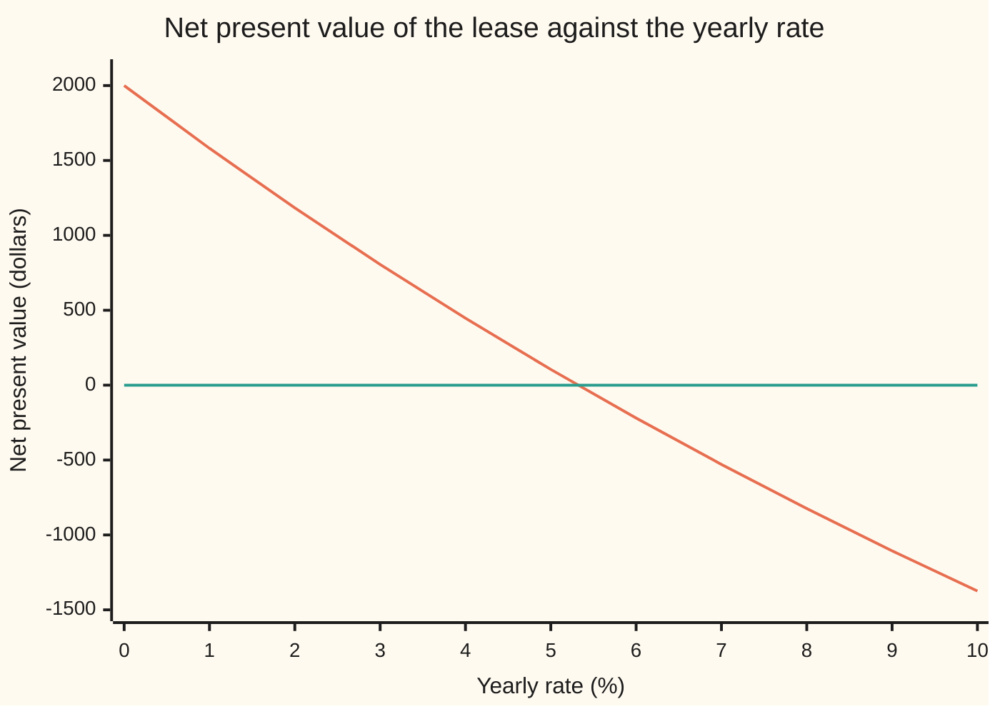

# Every root at once: Horner's evaluation, deflation, and the companion matrix

[Syllabus](../../../SYLLABUS.md) → [Numerical analysis](../README.md) → [Root Finding and Fixed Points](../README.md#s02) → Every root at once

---

## General Overview

A leasing firm buys a machine for $10,000 today. The lessee pays rent once a year for six years: $1,500, $2,000, $2,000, $2,500, $2,500 and $1,500. The numbers are illustrative. The firm wants one number: the yearly rate of return that makes those six rents worth exactly the $10,000 it paid. That rate is the internal rate of return (IRR), and it is wanted to the last digit a double can hold.

Write $x$ for one year's growth factor, 1 plus the rate. Move every cash flow to year 6: the price grows by $x^6$, the first rent by $x^5$, and so on. The deal breaks even when

$$p(x) = 10000x^6 - 1500x^5 - 2000x^4 - 2000x^3 - 2500x^2 - 2500x - 1500 = 0.$$

So the rate hides in a root of a degree-6 polynomial. Six dates of rent give degree 6, and degree 6 gives six roots. Only one of them is a rate: **x\* = 1.0531829596**, an IRR of **5.3183% a year**. The other five are −0.6237672661 and two pairs of complex numbers.

This card does three jobs on that polynomial.

- **Horner's rule** evaluates $p$ with 6 multiplications and 6 additions, against 21 multiplications for separate powers. Its partial sums are also the quotient left after dividing $p$ by $x$ minus the point used.
- **Deflation** divides out each root once it is found, so the next search cannot find it again.
- **The companion matrix** is a 6 × 6 matrix whose eigenvalues are exactly the six roots. One eigenvalue solver returns all six together, in 20 QR steps.

Then a warning: change one coefficient of Wilkinson's polynomial $(x - 1)(x - 2)\cdots(x - 20)$ by $2^{-23}$, and ten real roots turn complex. The fault lies with the problem, not the method.

**Horner's rule evaluates a polynomial and divides it by x − z in one pass; the roots of any polynomial are the eigenvalues of its companion matrix, so an eigenvalue solver returns all of them at once with a backward error of a small multiple of the unit roundoff in a norm sense; and how far a root then moves is that backward error times the root's condition number, which is 0.5791 for the lease and above 10^13 in the middle of Wilkinson's polynomial.**

**What kind of fact this is:** three theorems proved on this card in Why it works (Horner's partial sums form the quotient, the companion matrix has $p$ as its characteristic polynomial, and the first-order law for how far a root moves). Horner's rounding bound and the convergence of the QR algorithm are stated with their key steps and named sources. The step counts, errors and costs are measurements printed by the code.

### The picture: the lease's value across rates



The falling line is the net present value (NPV): every cash flow discounted to today at the rate on the axis, rents minus price. The flat line is zero. At 0% the rents beat the price by $2,000. At 5% the lease is still worth $105. The curve crosses zero between 5% and 6%, at the IRR, 5.3183%. The other five roots of $p$ never appear on this axis.

---

## The formula

Notation first. The polynomial has degree $n$ and coefficients $a_n, \dots, a_0$, highest power first: $p(x) = a_n x^n + a_{n-1}x^{n-1} + \dots + a_0$. Here $n = 6$, $a_6 = 10000$ and $a_0 = -1500$. A root is written $x^*$, as on the [Newton and secant](02-newton-and-secant-with-convergence-orders.md) card.

**Horner's rule.** Evaluate $p$ at a number $z$, real or complex, by nested multiplication:

$$b_0 = a_n, \qquad b_k = b_{k-1}\,z + a_{n-k} \quad (k = 1, \dots, n), \qquad p(z) = b_n$$

**Read it aloud:** start with the leading coefficient; then, $n$ times, multiply by $z$ and add the next coefficient; the last number is the value.

The same numbers divide $p$ by $x - z$:

$$p(x) = (x - z)\,\big(b_0 x^{n-1} + b_1 x^{n-2} + \dots + b_{n-1}\big) + b_n$$

**Read it aloud:** the partial sums are the quotient's coefficients, and the last one is the remainder, which is $p(z)$.

**The companion matrix.** Divide by $a_n$ and put the other coefficients, with their signs flipped, along the top row:

$$C = \begin{pmatrix} -a_{n-1}/a_n & \cdots & -a_1/a_n & -a_0/a_n \\ 1 & & & 0 \\ & \ddots & & \vdots \\ & & 1 & 0 \end{pmatrix}, \qquad \det(xI - C) = \frac{p(x)}{a_n}$$

**Read it aloud:** the characteristic polynomial of the companion matrix is $p$ divided by its leading coefficient, so the matrix's eigenvalues are exactly the roots of $p$.

**How far a root moves.** Change each coefficient by a small relative amount, at most $\eta$. A simple root $x^*$ then moves, to first order, by at most

$$|\delta x^*| \;\le\; \kappa\,\eta\,|x^*|, \qquad \kappa = \frac{\sum_k |a_k|\,|x^*|^k}{|x^*|\,|p'(x^*)|}$$

**Read it aloud:** the root's relative move is at most its condition number times the relative change in the coefficients.

| Symbol | Plain meaning | In our example | Push it up and the answer… |
| --- | --- | --- | --- |
| $p(x)$, $p'(x)$ | the polynomial, and its slope | the lease's value moved to year 6; $p'(1.05) = 43834.596875$ | — |
| $n$, $a_k$ | the degree; the coefficient of $x^k$, with $a_n$ the leading one | $n = 6$; $a_6 = 10000$, $a_0 = -1500$ | more roots, more work |
| $x$, $z$ | the growth factor 1 + rate; any point where $p$ is evaluated, perhaps complex, with $i = \sqrt{-1}$ | $x = 1.05$ for 5% | — |
| $b_k$, $q$ | Horner's partial sums, with $b_n = p(z)$; $q$ the quotient they spell out | 10000, 9000, 7450, … , −140.9784375 at 1.05 | — |
| $x^*$ | a root: $p(x^*) = 0$ | 1.0531829596088371 | — |
| $C$, $v$, $c_k$, $I$ | the companion matrix; its eigenvector $(x^{*\,n-1}, \dots, x^*, 1)$; $c_k = a_k/a_n$; $I$ the identity matrix | top row 0.15, 0.20, 0.20, 0.25, 0.25, 0.15 | — |
| $H$, $Q$, $R$, $\mu$ | inside the QR algorithm: the working matrix, a rotation, a triangle, a shift | $H$ starts as $C$ | — |
| $\delta a_k$, $\delta p$, $\delta x^*$ | a small change in a coefficient; the change in $p$ it makes; the move of the root it causes | price +1%, rents −1%: root moves 0.006069 | — |
| $\kappa$ | the root's condition number | 0.5791 for the IRR; 3.54e13 for Wilkinson's root 16 | the root moves more per rounding |
| $\eta$, $\hat x$, $\hat p$, $S$ | backward error of a computed root $\hat x$: $\lvert p(\hat x)\rvert / \sum_k \lvert a_k\rvert \lvert \hat x\rvert^k$; a hat marks a computed value; $S$, in the proof, the sum on the bottom | 16.4 u for the eigenvalue road's IRR | the computed root is the exact root of a more distant polynomial |
| $u$, $\delta$, $\gamma_{2n}$ | the unit roundoff $2^{-53}$; one rounding's relative error, $\lvert\delta\rvert \le u$; Horner's error constant $2nu/(1 - 2nu)$ | $\gamma_{12}$ for degree 6 | — |
| $\rho$ | the noise radius: how close to the root Horner's sign can be trusted | 8.13e-16 | no method can pin the root closer |

### When it holds

- **A simple root.** At a double root $p'(x^*) = 0$ and $\kappa$ is infinite. The double root of $(x - 1.05)^2(x - 0.6)$ comes out with error 2.77e-8, about half the digits.
- **Small changes.** The law is first order. At 1% it holds: the lease's root moves 0.006069 against a predicted 0.006099. Wilkinson's root 16, with a predicted move of 287, leaves the real line instead.
- **Minus signs on the top row.** Without them the eigenvalues belong to a different polynomial.
- **Deflation.** Without it, six Newton starts find only 3 distinct roots, and miss the IRR.
- **A complex start.** Newton from a real start, on real coefficients, never leaves the real line, so it misses complex roots ([Newton's bad days](04-when-newton-fails.md)).

---

## Why it works

### Step 0: turn root-finding into a matrix problem

A one-root method, such as [Newton and secant](02-newton-and-secant-with-convergence-orders.md), needs a start near each root and finds one root per run. Nothing in the run says how many roots remain.

A matrix does better. Its eigenvalues are found all together by changes of basis $H \to Q^{-1}HQ$, which keep every eigenvalue. So build a matrix whose eigenvalues are the roots. The [A recurrence is a matrix](../../04-Combinatorics%20and%20graphs/05-Recurrences/06-recurrences-as-matrix-powers.md) card already did: a step rule's companion matrix has the rule's characteristic roots as eigenvalues. This card runs that link backwards. Horner's rule supplies the arithmetic.

### Step 1: Horner's partial sums are synthetic division

The [Polynomial long division](../../03-Algebra/02-Polynomials/04-polynomial-division.md) card divides by $x - z$ and shows the remainder is $p(z)$, with synthetic division as its short form. Horner's rule is that synthetic division. The proof is one expansion. Multiply out

$$(x - z)\big(b_0 x^{n-1} + b_1 x^{n-2} + \dots + b_{n-1}\big) + b_n.$$

The coefficient of $x^n$ is $b_0 = a_n$. The coefficient of $x^{n-k}$, for $k$ from 1 to $n$, is $b_k - z\,b_{k-1}$, which the rule makes equal to $a_{n-k}$. So the expression is $p(x)$. $\blacksquare$

The cost is $n$ multiplications and $n$ additions. Separate powers $a_k x^k$, each built from scratch, cost $1 + 2 + \dots + n$ multiplications: 21 at degree 6. A second nested pass on the $b_k$ gives the slope $p'(z)$, since the slope of $(x - z)q(x) + b_n$ at $x = z$ is $q(z)$.

### Step 2: Horner's rounding error has a known size

Each Horner step rounds twice, once after the multiplication and once after the addition. In the standard model of rounding ([Machine epsilon and cancellation](../01-Floating%20Point%20and%20Error/03-rounding-cancellation-and-machine-epsilon.md)), each rounding multiplies a result by $1 + \delta$ with $|\delta| \le u$. Unrolling the $n$ steps, the term $a_k z^k$ picks up at most $2n$ such factors. So the computed value $\hat p(z)$ obeys

$$|\hat p(z) - p(z)| \;\le\; \gamma_{2n} \sum_k |a_k|\,|z|^k, \qquad \gamma_{2n} = \frac{2nu}{1 - 2nu}.$$

That is the key step only; Higham's chapter on polynomials has the full proof. Near a root $p$ is tiny, so the computed value is mostly rounding. Divide the bound by the slope to get the **noise radius** $\rho = \gamma_{2n}\sum_k|a_k||x^*|^k / |p'(x^*)|$. Inside it, the sign of $\hat p$ is noise. For the lease, $\rho$ = 8.13e-16 around 1.0531829596. Bisection by signs, run to the last bit, stops at 1.0531829596088369, within about that radius of the root ([Bisection](01-bisection-and-bracketing.md)). The same radius is the floor for any stopping test on $|p|$ ([When to stop](03-stopping-criteria-and-error-estimates.md)).

### Step 3: the companion matrix's eigenvalues are the roots

Take a root $x^*$ and the column $v = (x^{*\,n-1}, \dots, x^*, 1)$. Row 1 of $Cv$ is

$$-\frac{a_{n-1}x^{*\,n-1} + \dots + a_1 x^* + a_0}{a_n} = x^{*\,n},$$

because $p(x^*) = 0$. Each lower row copies the entry above it, so row $i$ of $Cv$ is $x^{*\,n-i+1}$. Both facts together say $Cv = x^* v$: every root is an eigenvalue ([Eigenvalues and eigenvectors](../../03-Algebra/07-Eigenvalues%20and%20Symmetric%20Matrices/02-eigenvalues-and-eigenvectors.md)). The determinant identity says more: repeated roots appear as repeated eigenvalues, and there are no other eigenvalues.

<details>
<summary>Detailed proof: det(xI − C) = p(x)/a_n</summary>

Write $c_k = a_k / a_n$. The matrix $xI - C$ has first row $(x + c_{n-1}, c_{n-2}, \dots, c_0)$, the number $x$ on the rest of the diagonal, and $-1$ just below the diagonal.

Expand the determinant along the first row. Delete row 1 and column $j$. What remains splits into two blocks with zeros above one of them:

- rows 2 to $j$ against columns 1 to $j-1$: $-1$ on the diagonal and $x$ just above it, so its determinant is $(-1)^{j-1}$;
- rows $j+1$ to $n$ against columns $j+1$ to $n$: $x$ on the diagonal and $-1$ just below it, so its determinant is $x^{n-j}$.

The entry in column $j \ge 2$ is $c_{n-j}$ with sign $(-1)^{1+j}$, so it contributes $c_{n-j}\,(-1)^{1+j}(-1)^{j-1}x^{n-j} = c_{n-j}x^{n-j}$. Column 1 contributes $(x + c_{n-1})\,x^{n-1}$. The sum is

$$x^n + c_{n-1}x^{n-1} + \dots + c_1 x + c_0 = \frac{p(x)}{a_n}. \qquad \blacksquare$$

</details>

For the lease the top row is 0.15, 0.20, 0.20, 0.25, 0.25, 0.15, with ones just below the diagonal and zeros elsewhere. The code checks the result two ways, using [Roots and factors](../../03-Algebra/02-Polynomials/05-roots-and-the-factor-theorem.md): with $p = a_n\prod(x - x^*_j)$, the six roots must sum to $-a_5/a_6 = 0.15$ and multiply to $a_0/a_6 = -0.15$. They print as 0.150000000000 and −0.150000000000.

### Step 4: the QR algorithm finds every eigenvalue

The eigenvalue solver is the shifted QR algorithm. This card states its steps; the convergence proof is in Francis's paper, not here.

1. Pick a shift $\mu$: the eigenvalue of the bottom-right 2 × 2 corner nearer its last entry.
2. Factor $H - \mu I = QR$. Here $Q$ is a product of plane rotations, each mixing two neighbouring rows without changing lengths, and $R$ is upper triangular (zero below the diagonal).
3. Replace $H$ by $RQ + \mu I$. That equals $Q^{-1}HQ$, a similarity, so no eigenvalue changes.
4. When the entry just left of the bottom corner falls below $u$ times its neighbours, read the corner as an eigenvalue. Drop the last row and column and repeat.

The companion matrix is already zero below its first subdiagonal. Each step keeps that shape and costs about $n^2$ operations. Near convergence the shifted step squares the small corner entry, so each eigenvalue takes a few steps. For the lease: 20 QR steps, 2,288 complex multiplications in all.

Rotations make the result backward stable as a matrix computation. Edelman and Murakami showed this carries over to the polynomial in a norm sense, though not always coefficient by coefficient. On the lease, the six eigenvalues have backward errors $\eta$ of 2.0 u to 16.4 u. These are estimates, since Horner computes them in doubles. Each eigenvalue is an exact root of the lease polynomial with its coefficients changed by under 17 parts in $2^{53}$.

### Step 5: deflation in floating point, then polish

The second road finds roots one at a time. Newton's method, with Horner supplying $p$ and $p'$, starts from $0.5 + 0.5i$. At each root found, Horner's partial sums give the quotient, one degree lower, and the next search runs on it.

The quotient's coefficients are rounded, so its roots can drift from those of $p$. The cure is to **polish**: run Newton on the original $p$ from each root before keeping it.

On the lease, the six polished roots took 57 Newton steps in total. Their backward errors are 0.1 u to 1.0 u. They agree with the eigenvalues to within 1.12e-15 at worst. The drift was negligible here: polishing moved no root by more than 1.24e-16.

Order matters on harder polynomials. Unpolished deflation of Wilkinson's polynomial from a start of 21, largest roots first, misses a root by 9.0557; from 0, smallest first, by 0.0224. Divide out small roots first, and polish.

### Step 6: a root moves by its condition number times the backward error

Change $p$ to $p + \delta p$ and let the root move to $x^* + \delta x^*$. Taylor's theorem to first order gives $p'(x^*)\,\delta x^* + \delta p(x^*) \approx 0$, so

$$\delta x^* \approx -\frac{\delta p(x^*)}{p'(x^*)}.$$

If each coefficient changes by at most $\eta|a_k|$, then $|\delta p(x^*)| \le \eta\sum|a_k||x^*|^k$. Divide by $|p'(x^*)|$ and the formula's bound appears. This is the polynomial case of [Conditioning and stability](../01-Floating%20Point%20and%20Error/05-conditioning-and-stability.md): forward error is about condition number times backward error ([Forward and backward error](../01-Floating%20Point%20and%20Error/06-forward-and-backward-error.md)).

<details>
<summary>Detailed proof: the backward error of a computed root is exactly |p(x̂)| / Σ|a_k||x̂|^k</summary>

Let $\hat x$ be any number, and write $S = \sum_k |a_k||\hat x|^k$ for short. Ask for the smallest $\eta$ such that $\hat x$ is an exact root of some polynomial with coefficients $a_k + \delta a_k$, $|\delta a_k| \le \eta|a_k|$.

**No smaller value works.** If $\hat x$ is a root of $p + \delta p$, then $|p(\hat x)| = |\delta p(\hat x)| \le \eta S$, so $\eta \ge |p(\hat x)|/S$.

**That value works.** Take $\delta a_k = -p(\hat x)\,|a_k|\,\overline{\hat x}^{\,k} / (|\hat x|^k S)$, where the bar is the complex conjugate. Then $|\delta a_k| = |a_k|\,|p(\hat x)|/S$ and $\delta p(\hat x) = -p(\hat x)\sum_k|a_k||\hat x|^k / S = -p(\hat x)$. So $\hat x$ is a root of $p + \delta p$. $\blacksquare$

For a complex $\hat x$ the changes $\delta a_k$ may be complex too.

</details>

For the lease's IRR, $\kappa$ = 0.5791 and the eigenvalue's backward error is 16.4 u, so the estimate $\kappa\eta x^*$ is 1.11e-15. The eigenvalue sits 1.11e-15 from Newton's root, as estimated, and 1.33e-15 from bisection's, within twice the noise radius. Newton's root has backward error 0.1 u, so its own estimated error is under half a unit in the last place: the 1.11e-15 gap is the eigenvalue's error.

In money terms the lease is a calm problem. Raise the price 1% and cut every rent 1%, the worst direction, and the root moves 0.006069 against a predicted 0.006099. The IRR falls from 5.3183% to 4.7114%.

### Step 7: Wilkinson's polynomial is the opposite case

Multiply out $(x - 1)(x - 2)\cdots(x - 20)$. The coefficient of $x^{19}$ is −210 and the constant is 2432902008176640000 (that is, 20!). Five of the 21 coefficients do not fit exactly in a double. Its condition numbers, from the exact slope, are huge in the middle:

| Root | $\kappa$ | Computed error | $u\kappa x^*$ |
| --- | --- | --- | --- |
| 1 | 4.20e2 | 3.89e-14 | 4.66e-14 |
| 5 | 8.24e8 | 4.76e-7 | 4.57e-7 |
| 10 | 5.55e12 | 2.09e-3 | 6.16e-3 |
| 16 | 3.54e13 | 7.01e-3 | 6.29e-2 |
| 20 | 1.38e11 | 6.60e-5 | 3.06e-4 |

The last column is the move that a backward error of one unit of rounding would cause. The computed errors rise and fall with it, from the smallest root to the largest. The worst computed error is 0.0070, at root 16. The eigenvalue solver did its job; the roots are fragile.

Wilkinson's own experiment changed the $x^{19}$ coefficient from −210 to $-210 - 2^{-23}$. The first-order law says root 16 moves 287 units, so the law no longer applies. The roots after that change are 1.00, 2.00, 3.00, 4.00, 5.00, 6.00, 7.00, 8.01, 8.92, 20.85, and five complex pairs: 10.10 ± 0.64i, 11.79 ± 1.65i, 13.99 ± 2.52i, 16.73 ± 2.81i and 19.50 ± 1.94i. These match Wilkinson's published values to the digits printed. The cause is roots close together compared with their size: the slope $p'(x^*)$ is the product of the distances to the other 19 roots, and those distances are small next to the powers $|x^*|^k$ on top of $\kappa$.

---

## Worked numbers, by hand

The lease polynomial at $x = 1.05$, a 5% rate, by Horner; then one Newton step and the deflation.

| Step | Arithmetic | Value |
| --- | --- | --- |
| $b_0$ | the leading coefficient | 10000 |
| $b_1$ | $10000 \times 1.05 - 1500$ | 9000 |
| $b_2$ | $9000 \times 1.05 - 2000$ | 7450 |
| $b_3$ | $7450 \times 1.05 - 2000$ | 5822.5 |
| $b_4$ | $5822.5 \times 1.05 - 2500$ | 3613.625 |
| $b_5$ | $3613.625 \times 1.05 - 2500$ | 1294.30625 |
| $p(1.05) = b_6$ | $1294.30625 \times 1.05 - 1500$ | −140.9784375 |
| NPV at 5% | $140.9784375 \div 1.05^6$ | $105.20 |
| slope | a second Horner pass on $b_0, \dots, b_5$ | 43834.596875 |
| Newton step | $1.05 - (-140.9784375) \div 43834.596875$ | 1.0532161454 |
| three more steps | the same, at each new point | 1.0531829596088371 |
| deflate | Horner at bisection's root: quotient 10000, 9031.8296, 7512.1690, 5911.6884, 3726.0895, 1424.2540 | remainder −9.09e-12 |
| IRR | $x^* - 1$ | **5.3183% a year** |

The lease returns 5.3183% a year. The eigenvalue road gives the same root to within 1.33e-15. The remainder −9.09e-12 left after deflation is rounding noise: the root used sits within the noise radius, where $p$ cannot be told from zero.

### What breaks if you drop a piece

| Mistake | Comes out at | What went wrong |
| --- | --- | --- |
| Top row of $C$ without its minus signs | 0 real eigenvalues; largest real part 0.6256 | That matrix belongs to a different polynomial, with no positive real root, so no rate at all |
| Run Newton from six starts $x + 0.5i$, $x$ = −1 to 1, with no deflation | 3 distinct roots, none of them the IRR | Each start decides its root; nothing removes a found root, so roots repeat |
| A double root: $(x - 1.05)^2(x - 0.6)$ | 1.0500000276 − 0.0000000021i, error 2.77e-8 | $p'(x^*) = 0$, so $\kappa$ is infinite and half the digits go |
| Change Wilkinson's −210 by $2^{-23}$ | 16.73 ± 2.81i where 16 and 17 stood | $\kappa$ = 3.54e13 at root 16, whose first-order move is 287, far outside the range where the law holds |

---

## Code, from first principles, and it actually runs

The code finds the lease's roots by three roads: bisection by signs for the real root, Newton with deflation and polishing for all six, and the shifted QR algorithm on the companion matrix for all six. The roads must agree within the noise radius, and the eigenvalues must pass the sum and product rules. Then come the 1% stress test, the four failures and Wilkinson's polynomial. Complex arithmetic is written out, so both languages print the same digits.

### Python

```python
# Every root at once -- the check behind the card.  Standard library only: math gives sqrt.
# Roots of a lease's degree-6 polynomial by bisection, Newton with deflation, and companion eigenvalues.
import math
U = 2.0 ** -53                                     # the unit roundoff u of a double
def sci(v, d=2):                                   # 1.49e-11, the form Rust prints
    m, e = f"{v:.{d}e}".split("e")
    return f"{m}e{int(e)}"
class Z(complex):                                  # complex arithmetic written out, as in the Rust
    def __add__(s, o): o = complex(o); return Z(s.real + o.real, s.imag + o.imag)
    def __sub__(s, o): o = complex(o); return Z(s.real - o.real, s.imag - o.imag)
    def __mul__(s, o): o = complex(o); return Z(s.real * o.real - s.imag * o.imag, s.real * o.imag + s.imag * o.real)
    def __truediv__(s, o):
        o = complex(o); d = o.real * o.real + o.imag * o.imag
        return Z((s.real * o.real + s.imag * o.imag) / d, (s.imag * o.real - s.real * o.imag) / d)
    def conjugate(s): return Z(s.real, -s.imag)
def cabs(z): return math.sqrt(z.real * z.real + z.imag * z.imag)
def csqrt(z):
    m = cabs(z)
    return Z(math.sqrt(max(0.0, (m + z.real) / 2)), math.copysign(math.sqrt(max(0.0, (m - z.real) / 2)), z.imag))
def horner(a, z):                                  # a: highest power first; p(z), p'(z), quotient
    b, d, z, q = Z(a[0]), Z(0), Z(z), []
    for c in a[1:]:
        q.append(b)                                # the partial sums are the quotient p/(x - z)
        d, b = d * z + b, b * z + c
    return b, d, q
def backward(a, z):                                # |p(z)| / sum |a_k| |z|^k, in units of u
    return cabs(horner(a, z)[0]) / sum(abs(c) * cabs(z) ** (len(a) - 1 - k) for k, c in enumerate(a)) / U
def newton(a, z, steps=60):
    for k in range(steps):
        f, d, _ = horner(a, z)
        s = f / d
        z = z - s
        if cabs(s) <= 4 * U * cabs(z): return z, k + 1
    return z, steps
def companion(a, sign=-1.0):                       # top row -a_(n-1)/a_n ... -a_0/a_n, ones below
    C = [[Z(1) if i == j + 1 else Z(0) for j in range(len(a) - 1)] for i in range(len(a) - 1)]
    C[0] = [Z(sign * c / a[0]) for c in a[1:]]
    return C
def eig(H):                                        # shifted QR by Givens rotations on Hessenberg H
    m, out, steps, mults = len(H), [], 0, 0
    while m > 1:
        if cabs(H[m - 1][m - 2]) <= U * (cabs(H[m - 1][m - 1]) + cabs(H[m - 2][m - 2])):
            out.append(H[m - 1][m - 1]); m -= 1; continue
        a, b, c, d = H[m - 2][m - 2], H[m - 2][m - 1], H[m - 1][m - 2], H[m - 1][m - 1]
        g = csqrt((a - d) * (a - d) * 0.25 + b * c)  # shift: eigenvalue of the corner nearer d
        mu, steps = min(((a + d) * 0.5 + g, (a + d) * 0.5 - g), key=lambda t: cabs(t - d)), steps + 1
        for i in range(m): H[i][i] = H[i][i] - mu
        rots = []; assert steps < 1000              # QR must converge, never loop forever
        for k in range(m - 1):                     # H - mu I = Q R, one rotation per column
            x, y = H[k][k], H[k + 1][k]
            r = math.sqrt(x.real * x.real + x.imag * x.imag + y.real * y.real + y.imag * y.imag)
            cs, sn = (x / r, y / r) if r > 0 else (Z(1), Z(0))
            for j in range(k, m):
                u, v = H[k][j], H[k + 1][j]
                H[k][j], H[k + 1][j] = cs.conjugate() * u + sn.conjugate() * v, cs * v - sn * u
            rots.append((cs, sn)); mults += 4 * (m - k)
        for k, (cs, sn) in enumerate(rots):        # then R Q + mu I: same eigenvalues
            for i in range(min(k + 2, m)):
                u, v = H[i][k], H[i][k + 1]
                H[i][k], H[i][k + 1] = u * cs + v * sn, v * cs.conjugate() - u * sn.conjugate()
            mults += 4 * min(k + 2, m)
        for i in range(m): H[i][i] = H[i][i] + mu
    return out + [H[0][0]], steps, mults
def order(rs): return sorted(rs, key=lambda z: (-round(z.real, 9), -z.imag))
def show(z): return f"{z.real:.10f}" + (f" {'+-'[z.imag < 0]} {abs(z.imag):.10f}i" if abs(z.imag) > 1e-12 else "")
# ---- the lease: p(x) = 10000x^6 - 1500x^5 - 2000x^4 - 2000x^3 - 2500x^2 - 2500x - 1500 ----
a = [10000.0, -1500.0, -2000.0, -2000.0, -2500.0, -2500.0, -1500.0]; n = len(a) - 1
p5, dp5, q5 = horner(a, 1.05)
p5, dp5, naive = p5.real, dp5.real, sum(a[k] * 1.05 ** (n - k) for k in range(n + 1))
print("Horner at x = 1.05: " + ", ".join(f"{b:.7f}".rstrip("0").rstrip(".") for b in [t.real for t in q5] + [p5]))
print(f"p(1.05) = {p5:.7f}; by powers {naive:.7f}; p'(1.05) = {dp5:.7f}; NPV at 5% = {-p5 / 1.05 ** 6:.2f} dollars; "
      f"cost {n} multiplications and {n} additions, by powers {n * (n + 1) // 2} multiplications")
assert abs(p5 - naive) < 1e-9 and abs(p5 + 140.9784375) < 1e-9
npv = [-horner(a, x)[0].real / (x * x * x * x * x * x) for x in [1.0 + k / 100 for k in range(11)]]
print("chart, NPV in dollars at 0% to 10%: " + " ".join(f"{v:.0f}" for v in npv))
lo, hi = 1.0, 1.1                                  # road 1: bisection, signs only, to the last bit
while lo < (lo + hi) / 2 < hi:
    mid = (lo + hi) / 2
    lo, hi = (mid, hi) if horner(a, mid)[0].real < 0 else (lo, mid)
xn, kn = newton(a, 1.05)
print(f"bisection root {lo:.16f}; Newton from 1.05: step 1 {1.05 - p5 / dp5:.10f}, root {xn.real:.16f} in {kn} steps")
pl, dpl, ql = horner(a, lo)
print("deflated quotient: " + ", ".join(f"{c.real:.4f}" for c in ql) + f"; remainder {sci(pl.real)}")
roads, nsteps, qd, drift = [], 0, a, 0.0           # road 2: Newton, deflate, polish on the full p
while len(qd) > 1:
    z, k = newton(qd, Z(0.5, 0.5))
    zp, k2 = newton(a, z)                          # polish: how far had the quotient's root drifted?
    roads.append(zp); nsteps += k + k2; qd = horner(qd, zp)[2]; drift = max(drift, cabs(zp - z))
C = companion(a)
print("companion top row: " + ", ".join(f"{C[0][j].real:.2f}" for j in range(n)))
ev, qsteps, qmults = eig(C)                        # road 3: eigenvalues of the companion matrix
ev, roads = order(ev), order(roads)
print(f"eigenvalues: {qsteps} QR steps, {qmults} complex multiplications; Newton + deflation: {nsteps} steps, polishing moved a root at most {sci(drift)}")
for z, w in zip(ev, roads):
    e1, e2 = backward(a, z), backward(a, w)
    print(f"  {show(z):<31} backward error {e1:4.1f} u, Newton's {e2:3.1f} u, gap {sci(cabs(z - w))}")
    assert e1 < 50 and e2 < 2 and cabs(z - w) < 1e-14
irr, s, pr = ev[0].real, Z(0), Z(1)
for z in ev: s, pr = s + z, pr * z
print(f"Vieta: sum of roots {s.real:.12f} (want 0.15), product {pr.real:.12f} (want -0.15)")
assert abs(s.real - 0.15) < 1e-13 and abs(pr.real + 0.15) < 1e-13 and abs(ev[0].imag) < 1e-14
S = sum(abs(c) * irr ** (n - k) for k, c in enumerate(a))
kap, rho = S / (irr * dpl.real), 2 * n * U / (1 - 2 * n * U) * S / dpl.real
est = kap * backward(a, ev[0]) * U * irr
print(f"IRR = {100 * (irr - 1):.4f}% a year; kappa = {kap:.4f}; noise radius {sci(rho)}; QR minus bisection "
      f"{sci(irr - lo)}, minus Newton {sci(irr - xn.real)}, estimate kappa eta x* {sci(est)}")
assert max(abs(irr - lo), abs(irr - xn.real), abs(lo - xn.real)) <= 2 * rho and 0.5 < abs(irr - xn.real) / est < 2
x2 = order(eig(companion([a[0] * 1.01] + [c * 0.99 for c in a[1:]]))[0])[0].real
print(f"price +1%, rents -1%: root moves {irr - x2:.6f}, first-order 0.01 kappa x* = {0.01 * kap * irr:.6f}, "
      f"IRR {100 * (x2 - 1):.4f}%")
assert 0.98 < (irr - x2) / (0.01 * kap * irr) < 1.0
dbl = order(eig(companion([1.0, -2.7, 2.3625, -0.6615]))[0])  # (x - 1.05)^2 (x - 0.6)
print(f"double root 1.05 of (x - 1.05)^2 (x - 0.6): computed {show(dbl[0])}, error {sci(cabs(dbl[0] - 1.05))}")
assert 1e-9 < cabs(dbl[0] - 1.05) < 1e-7
bad = eig(companion(a, +1.0))[0]                   # the top row without its minus signs
print(f"top row without minus signs: {sum(abs(z.imag) < 1e-9 for z in bad)} real eigenvalues, largest real part {max(z.real for z in bad):.4f}")
assert all(abs(z.imag) > 0.1 for z in bad)
same = {show(newton(a, Z(s, 0.5))[0]) for s in (-1.0, -0.6, -0.2, 0.2, 0.6, 1.0)}  # no deflation, six starts
print(f"no deflation: six Newton runs from x + 0.5i, x = -1 to 1, give {len(same)} distinct roots: " + ", ".join(sorted(same)))
w = [1]                                            # ---- Wilkinson's polynomial (x - 1)(x - 2)...(x - 20) ----
for k in range(1, 21): w = [s1 - k * s2 for s1, s2 in zip(w + [0], [0] + w)]
wf = [float(c) for c in w]
print(f"Wilkinson: x^19 coefficient {w[1]}, constant {w[20]}; {sum(float(c) != c for c in w)} of 21 not exact as doubles")
we = eig(companion(wf))[0]
errs = [min(cabs(z - k) for z in we) for k in range(1, 21)]
kw = [sum(abs(c) * k ** (20 - j) for j, c in enumerate(wf)) / (k * math.factorial(k - 1) * math.factorial(20 - k)) for k in range(1, 21)]
for k in (1, 5, 10, 16, 20):
    print(f"  root {k:>2}: kappa {sci(kw[k - 1])}, computed error {sci(errs[k - 1])}, u kappa x* {sci(U * kw[k - 1] * k)}")
assert all(errs[j] <= 50 * U * kw[j] * (j + 1) for j in range(20)) and max(errs) > 1e-3
print(f"  worst computed error {max(errs):.4f}, at root {errs.index(max(errs)) + 1}")
for z0 in (21.0, 0.0):                             # deflate without polishing, from the top and from the bottom
    qd, got = wf, []
    while len(qd) > 1: z = newton(qd, Z(z0, 0.0))[0]; got.append(z); qd = horner(qd, z)[2]
    dw = max(min(cabs(z - k) for z in got) for k in range(1, 21)); assert (dw > 1) == (z0 > 20)
    print(f"  unpolished deflation, Newton started at {z0:.0f}: worst error {dw:.4f}")
print(f"  first-order shift of root 16 for -2^-23 on x^19: {2.0 ** -23 * 16.0 ** 19 / horner(wf, 16.0)[1].real:.1f}")
pw = order([z for z in eig(companion([1.0, wf[1] - 2.0 ** -23] + wf[2:]))[0] if z.imag > -1e-6])
print("  roots after -2^-23 on x^19: " + ", ".join(f"{z.real:.2f}" + (f" +- {z.imag:.2f}i" if z.imag > 1e-6 else "") for z in reversed(pw)))
assert any(cabs(z - Z(16.730737466, 2.812624896)) < 1e-3 for z in pw)
print("ALL CHECKS PASS")
```

**Ran 2026-11-11 on macOS, Python 3.14.10, standard library only. All checks passed. Output, pasted from the run:**

```
Horner at x = 1.05: 10000, 9000, 7450, 5822.5, 3613.625, 1294.30625, -140.9784375
p(1.05) = -140.9784375; by powers -140.9784375; p'(1.05) = 43834.5968750; NPV at 5% = 105.20 dollars; cost 6 multiplications and 6 additions, by powers 21 multiplications
chart, NPV in dollars at 0% to 10%: 2000 1581 1183 806 447 105 -220 -529 -824 -1106 -1374
bisection root 1.0531829596088369; Newton from 1.05: step 1 1.0532161454, root 1.0531829596088371 in 4 steps
deflated quotient: 10000.0000, 9031.8296, 7512.1690, 5911.6884, 3726.0895, 1424.2540; remainder -9.09e-12
companion top row: 0.15, 0.20, 0.20, 0.25, 0.25, 0.15
eigenvalues: 20 QR steps, 2288 complex multiplications; Newton + deflation: 57 steps, polishing moved a root at most 1.24e-16
  1.0531829596                    backward error 16.4 u, Newton's 0.1 u, gap 1.12e-15
  0.2503007473 + 0.7043651240i    backward error  4.4 u, Newton's 0.4 u, gap 2.22e-16
  0.2503007473 - 0.7043651240i    backward error 13.7 u, Newton's 1.0 u, gap 7.79e-16
  -0.3900085940 + 0.5064749884i   backward error  2.0 u, Newton's 0.4 u, gap 1.57e-16
  -0.3900085940 - 0.5064749884i   backward error 11.3 u, Newton's 0.4 u, gap 8.90e-16
  -0.6237672661                   backward error  2.9 u, Newton's 0.4 u, gap 3.05e-16
Vieta: sum of roots 0.150000000000 (want 0.15), product -0.150000000000 (want -0.15)
IRR = 5.3183% a year; kappa = 0.5791; noise radius 8.13e-16; QR minus bisection 1.33e-15, minus Newton 1.11e-15, estimate kappa eta x* 1.11e-15
price +1%, rents -1%: root moves 0.006069, first-order 0.01 kappa x* = 0.006099, IRR 4.7114%
double root 1.05 of (x - 1.05)^2 (x - 0.6): computed 1.0500000276 - 0.0000000021i, error 2.77e-8
top row without minus signs: 0 real eigenvalues, largest real part 0.6256
no deflation: six Newton runs from x + 0.5i, x = -1 to 1, give 3 distinct roots: -0.3900085940 + 0.5064749884i, -0.6237672661, 0.2503007473 + 0.7043651240i
Wilkinson: x^19 coefficient -210, constant 2432902008176640000; 5 of 21 not exact as doubles
  root  1: kappa 4.20e2, computed error 3.89e-14, u kappa x* 4.66e-14
  root  5: kappa 8.24e8, computed error 4.76e-7, u kappa x* 4.57e-7
  root 10: kappa 5.55e12, computed error 2.09e-3, u kappa x* 6.16e-3
  root 16: kappa 3.54e13, computed error 7.01e-3, u kappa x* 6.29e-2
  root 20: kappa 1.38e11, computed error 6.60e-5, u kappa x* 3.06e-4
  worst computed error 0.0070, at root 16
  unpolished deflation, Newton started at 21: worst error 9.0557
  unpolished deflation, Newton started at 0: worst error 0.0224
  first-order shift of root 16 for -2^-23 on x^19: 287.0
  roots after -2^-23 on x^19: 1.00, 2.00, 3.00, 4.00, 5.00, 6.00, 7.00, 8.01, 8.92, 10.10 +- 0.64i, 11.79 +- 1.65i, 13.99 +- 2.52i, 16.73 +- 2.81i, 19.50 +- 1.94i, 20.85
ALL CHECKS PASS
```

### Rust

Same numbers, same labels, built with `rustc --edition 2021 -O`.

```rust
// Every root at once -- the check behind the card, in Rust.  std only, no crates.
// Roots of a lease's degree-6 polynomial by bisection, Newton with deflation, and companion eigenvalues.
use std::ops::{Add, Div, Mul, Sub};
const U: f64 = 1.0 / 9007199254740992.0;            // the unit roundoff u = 2^-53
#[derive(Clone, Copy, PartialEq)]
struct Z { re: f64, im: f64 }
fn z(re: f64, im: f64) -> Z { Z { re, im } }
impl Add for Z { type Output = Z; fn add(self, o: Z) -> Z { z(self.re + o.re, self.im + o.im) } }
impl Sub for Z { type Output = Z; fn sub(self, o: Z) -> Z { z(self.re - o.re, self.im - o.im) } }
impl Mul for Z { type Output = Z; fn mul(self, o: Z) -> Z { z(self.re * o.re - self.im * o.im, self.re * o.im + self.im * o.re) } }
impl Div for Z { type Output = Z; fn div(self, o: Z) -> Z { let d = o.re * o.re + o.im * o.im;
    z((self.re * o.re + self.im * o.im) / d, (self.im * o.re - self.re * o.im) / d) } }
fn r(x: f64) -> Z { z(x, 0.0) }                    // a real number as a complex one
fn conj(a: Z) -> Z { z(a.re, -a.im) }
fn cabs(a: Z) -> f64 { (a.re * a.re + a.im * a.im).sqrt() }
fn pos(x: f64) -> f64 { if x > 0.0 { x } else { 0.0 } }
fn csqrt(a: Z) -> Z { let m = cabs(a); z(pos((m + a.re) / 2.0).sqrt(), pos((m - a.re) / 2.0).sqrt().copysign(a.im)) }
fn sci(v: f64) -> String { format!("{:.2e}", v) }
fn trim(v: f64) -> String { let s = format!("{:.7}", v); s.trim_end_matches('0').trim_end_matches('.').to_string() }
fn horner(a: &[Z], x: Z) -> (Z, Z, Vec<Z>) {      // a: highest power first; p(x), p'(x), quotient
    let (mut b, mut d, mut q) = (a[0], r(0.0), vec![]);
    for &c in &a[1..] {
        q.push(b);                                     // the partial sums are the quotient p/(x - z)
        d = d * x + b; b = b * x + c;
    }
    (b, d, q)
}
fn cx(a: &[f64]) -> Vec<Z> { a.iter().map(|&c| r(c)).collect() }
fn backward(a: &[f64], x: Z) -> f64 {              // |p(x)| / sum |a_k| |x|^k, in units of u
    let s: f64 = a.iter().enumerate().map(|(k, c)| c.abs() * cabs(x).powi((a.len() - 1 - k) as i32)).sum();
    cabs(horner(&cx(a), x).0) / s / U
}
fn newton(a: &[Z], mut x: Z, steps: usize) -> (Z, usize) {
    for k in 0..steps {
        let (f, d, _) = horner(a, x);
        let s = f / d; x = x - s;
        if cabs(s) <= 4.0 * U * cabs(x) { return (x, k + 1) }
    }
    (x, steps)
}
fn companion(a: &[f64], sign: f64) -> Vec<Vec<Z>> { // top row -a_(n-1)/a_n ... -a_0/a_n, ones below
    let n = a.len() - 1; let mut c: Vec<Vec<Z>> = (0..n).map(|i| (0..n).map(|j| r(if i == j + 1 { 1.0 } else { 0.0 })).collect()).collect();
    c[0] = a[1..].iter().map(|&v| r(sign * v / a[0])).collect();
    c
}
fn eig(mut h: Vec<Vec<Z>>) -> (Vec<Z>, usize, usize) { // shifted QR by Givens rotations, Hessenberg h
    let (mut m, mut out, mut steps, mut mults) = (h.len(), vec![], 0, 0);
    while m > 1 {
        if cabs(h[m - 1][m - 2]) <= U * (cabs(h[m - 1][m - 1]) + cabs(h[m - 2][m - 2])) {
            out.push(h[m - 1][m - 1]); m -= 1; continue;
        }
        let (a, b, c, d) = (h[m - 2][m - 2], h[m - 2][m - 1], h[m - 1][m - 2], h[m - 1][m - 1]);
        let g = csqrt((a - d) * (a - d) * r(0.25) + b * c); // shift: eigenvalue of the corner nearer d
        let (m1, m2) = ((a + d) * r(0.5) + g, (a + d) * r(0.5) - g);
        let mu = if cabs(m2 - d) < cabs(m1 - d) { m2 } else { m1 }; steps += 1;
        let mut rots = vec![]; assert!(steps < 1000);  // QR must converge, never loop forever
        for i in 0..m { h[i][i] = h[i][i] - mu; }
        for k in 0..m - 1 {                           // h - mu I = Q R, one rotation per column
            let (x, y) = (h[k][k], h[k + 1][k]);
            let rr = (x.re * x.re + x.im * x.im + y.re * y.re + y.im * y.im).sqrt();
            let (cs, sn) = if rr > 0.0 { (x / r(rr), y / r(rr)) } else { (r(1.0), r(0.0)) };
            for j in k..m {
                let (u, v) = (h[k][j], h[k + 1][j]);
                h[k][j] = conj(cs) * u + conj(sn) * v; h[k + 1][j] = cs * v - sn * u;
            }
            rots.push((cs, sn)); mults += 4 * (m - k);
        }
        for (k, &(cs, sn)) in rots.iter().enumerate() { // then R Q + mu I: same eigenvalues
            for i in 0..(k + 2).min(m) {
                let (u, v) = (h[i][k], h[i][k + 1]);
                h[i][k] = u * cs + v * sn; h[i][k + 1] = v * conj(cs) - u * conj(sn);
            }
            mults += 4 * (k + 2).min(m);
        }
        for i in 0..m { h[i][i] = h[i][i] + mu; } }
    out.push(h[0][0]); (out, steps, mults) }
fn order(mut v: Vec<Z>) -> Vec<Z> {                 // largest real part first, then upper half first
    v.sort_by(|p, q| (-(p.re * 1e9).round(), -p.im).partial_cmp(&(-(q.re * 1e9).round(), -q.im)).unwrap()); v }
fn show(x: Z) -> String { let s = format!("{:.10}", x.re);
    if x.im.abs() > 1e-12 { format!("{} {} {:.10}i", s, if x.im < 0.0 { '-' } else { '+' }, x.im.abs()) } else { s } }
fn main() {
    // ---- the lease: p(x) = 10000x^6 - 1500x^5 - 2000x^4 - 2000x^3 - 2500x^2 - 2500x - 1500 ----
    let a = [10000.0, -1500.0, -2000.0, -2000.0, -2500.0, -2500.0, -1500.0];
    let (n, ac) = (a.len() - 1, cx(&a));
    let (p5, dp5, q5) = horner(&ac, r(1.05));
    let (p5, dp5) = (p5.re, dp5.re);
    let naive: f64 = (0..=n).map(|k| a[k] * 1.05f64.powi((n - k) as i32)).sum();
    println!("Horner at x = 1.05: {}", q5.iter().map(|t| trim(t.re)).chain([trim(p5)]).collect::<Vec<_>>().join(", "));
    println!("p(1.05) = {:.7}; by powers {:.7}; p'(1.05) = {:.7}; NPV at 5% = {:.2} dollars; cost {} multiplications and {} additions, by powers {} multiplications",
             p5, naive, dp5, -p5 / 1.05f64.powi(6), n, n, n * (n + 1) / 2);
    assert!((p5 - naive).abs() < 1e-9 && (p5 + 140.9784375).abs() < 1e-9);
    let npv: Vec<String> = (0..11).map(|k| 1.0 + k as f64 / 100.0).map(|x| format!("{:.0}", -horner(&ac, r(x)).0.re / (x * x * x * x * x * x))).collect();
    println!("chart, NPV in dollars at 0% to 10%: {}", npv.join(" "));
    let (mut lo, mut hi) = (1.0f64, 1.1f64);          // road 1: bisection, signs only, to the last bit
    while lo < (lo + hi) / 2.0 && (lo + hi) / 2.0 < hi {
        let mid = (lo + hi) / 2.0; if horner(&ac, r(mid)).0.re < 0.0 { lo = mid } else { hi = mid } }
    let (xn, kn) = newton(&ac, r(1.05), 60);
    println!("bisection root {:.16}; Newton from 1.05: step 1 {:.10}, root {:.16} in {} steps", lo, 1.05 - p5 / dp5, xn.re, kn);
    let (pl, dpl, ql) = horner(&ac, r(lo));
    println!("deflated quotient: {}; remainder {}", ql.iter().map(|c| format!("{:.4}", c.re)).collect::<Vec<_>>().join(", "), sci(pl.re));
    let (mut roads, mut nsteps, mut qd, mut drift) = (vec![], 0, ac.clone(), 0.0f64); // road 2: Newton, deflate, polish on p
    while qd.len() > 1 {
        let (x0, k) = newton(&qd, z(0.5, 0.5), 60); let (x, k2) = newton(&ac, x0, 60); // polish: how far had x0 drifted?
        roads.push(x); nsteps += k + k2; qd = horner(&qd, x).2; drift = drift.max(cabs(x - x0));
    }
    let c = companion(&a, -1.0);
    println!("companion top row: {}", c[0].iter().map(|v| format!("{:.2}", v.re)).collect::<Vec<_>>().join(", "));
    let (ev, qsteps, qmults) = eig(c);                 // road 3: eigenvalues of the companion matrix
    let (ev, roads) = (order(ev), order(roads));
    println!("eigenvalues: {} QR steps, {} complex multiplications; Newton + deflation: {} steps, polishing moved a root at most {}", qsteps, qmults, nsteps, sci(drift));
    for (&x, &w) in ev.iter().zip(roads.iter()) {
        let (e1, e2) = (backward(&a, x), backward(&a, w));
        println!("  {:<31} backward error {:4.1} u, Newton's {:3.1} u, gap {}", show(x), e1, e2, sci(cabs(x - w)));
        assert!(e1 < 50.0 && e2 < 2.0 && cabs(x - w) < 1e-14);
    }
    let (irr, mut s, mut pr) = (ev[0].re, r(0.0), r(1.0));
    for &x in &ev { s = s + x; pr = pr * x; }
    println!("Vieta: sum of roots {:.12} (want 0.15), product {:.12} (want -0.15)", s.re, pr.re);
    assert!((s.re - 0.15).abs() < 1e-13 && (pr.re + 0.15).abs() < 1e-13 && ev[0].im.abs() < 1e-14);
    let sm: f64 = a.iter().enumerate().map(|(k, c)| c.abs() * irr.powi((n - k) as i32)).sum();
    let (kap, rho) = (sm / (irr * dpl.re), 2.0 * n as f64 * U / (1.0 - 2.0 * n as f64 * U) * sm / dpl.re);
    let est = kap * backward(&a, ev[0]) * U * irr;
    println!("IRR = {:.4}% a year; kappa = {:.4}; noise radius {}; QR minus bisection {}, minus Newton {}, estimate kappa eta x* {}",
             100.0 * (irr - 1.0), kap, sci(rho), sci(irr - lo), sci(irr - xn.re), sci(est));
    assert!((irr - lo).abs().max((irr - xn.re).abs()).max((lo - xn.re).abs()) <= 2.0 * rho
            && 0.5 < (irr - xn.re).abs() / est && (irr - xn.re).abs() / est < 2.0);
    let pert: Vec<f64> = a.iter().enumerate().map(|(k, &c)| if k == 0 { c * 1.01 } else { c * 0.99 }).collect();
    let x2 = order(eig(companion(&pert, -1.0)).0)[0].re;
    println!("price +1%, rents -1%: root moves {:.6}, first-order 0.01 kappa x* = {:.6}, IRR {:.4}%", irr - x2, 0.01 * kap * irr, 100.0 * (x2 - 1.0));
    assert!(0.98 < (irr - x2) / (0.01 * kap * irr) && (irr - x2) / (0.01 * kap * irr) < 1.0);
    let dbl = order(eig(companion(&[1.0, -2.7, 2.3625, -0.6615], -1.0)).0); // (x - 1.05)^2 (x - 0.6)
    println!("double root 1.05 of (x - 1.05)^2 (x - 0.6): computed {}, error {}", show(dbl[0]), sci(cabs(dbl[0] - r(1.05))));
    assert!(1e-9 < cabs(dbl[0] - r(1.05)) && cabs(dbl[0] - r(1.05)) < 1e-7);
    let bad = eig(companion(&a, 1.0)).0;               // the top row without its minus signs
    println!("top row without minus signs: {} real eigenvalues, largest real part {:.4}", bad.iter().filter(|x| x.im.abs() < 1e-9).count(), bad.iter().map(|x| x.re).fold(f64::MIN, f64::max));
    assert!(bad.iter().all(|x| x.im.abs() > 0.1));
    let mut same: Vec<String> = [-1.0, -0.6, -0.2, 0.2, 0.6, 1.0].iter().map(|&s| show(newton(&ac, z(s, 0.5), 60).0)).collect();
    same.sort(); same.dedup();                         // no deflation, six starts
    println!("no deflation: six Newton runs from x + 0.5i, x = -1 to 1, give {} distinct roots: {}", same.len(), same.join(", "));
    // ---- Wilkinson's polynomial (x - 1)(x - 2)...(x - 20) ----
    let mut w: Vec<i128> = vec![1];
    for k in 1..=20i128 {                              // multiply by (x - k), exactly in integers
        let prev = w.clone(); w.push(0);
        for j in 1..w.len() { w[j] = prev.get(j).copied().unwrap_or(0) - k * prev[j - 1]; }
    }
    let wf: Vec<f64> = w.iter().map(|&c| c as f64).collect();
    println!("Wilkinson: x^19 coefficient {}, constant {}; {} of 21 not exact as doubles", w[1], w[20], w.iter().filter(|&&c| (c as f64) as i128 != c).count());
    let we = eig(companion(&wf, -1.0)).0;
    let errs: Vec<f64> = (1..=20).map(|k| we.iter().map(|&x| cabs(x - r(k as f64))).fold(f64::MAX, f64::min)).collect();
    let kw: Vec<f64> = (1..=20i128).map(|k| {
        let s: f64 = wf.iter().enumerate().map(|(j, c)| c.abs() * k.pow(20 - j as u32) as f64).sum();
        s / ((k * (1..k).product::<i128>() * (1..=20 - k).product::<i128>()) as f64) // |p'(k)| = (k-1)!(20-k)!
    }).collect();
    for k in [1usize, 5, 10, 16, 20] {
        println!("  root {:>2}: kappa {}, computed error {}, u kappa x* {}", k, sci(kw[k - 1]), sci(errs[k - 1]), sci(U * kw[k - 1] * k as f64)); }
    let worst = (0..20).fold(0, |b, j| if errs[j] > errs[b] { j } else { b });
    assert!((0..20).all(|j| errs[j] <= 50.0 * U * kw[j] * (j + 1) as f64) && errs[worst] > 1e-3);
    println!("  worst computed error {:.4}, at root {}", errs[worst], worst + 1);
    for z0 in [21.0, 0.0] { let (mut qd, mut got) = (cx(&wf), vec![]); // deflate without polishing, from the top and from the bottom
        while qd.len() > 1 { let x = newton(&qd, r(z0), 60).0; got.push(x); qd = horner(&qd, x).2; }
        let dw = (1..=20).map(|k| got.iter().map(|&x| cabs(x - r(k as f64))).fold(f64::MAX, f64::min)).fold(0.0, f64::max);
        assert!((dw > 1.0) == (z0 > 20.0)); println!("  unpolished deflation, Newton started at {:.0}: worst error {:.4}", z0, dw); }
    println!("  first-order shift of root 16 for -2^-23 on x^19: {:.1}", 2f64.powi(-23) * 16f64.powi(19) / horner(&cx(&wf), r(16.0)).1.re);
    let mut wp = wf.clone(); wp[1] = wf[1] - 2f64.powi(-23);
    let pw: Vec<Z> = order(eig(companion(&wp, -1.0)).0).into_iter().filter(|x| x.im > -1e-6).collect();
    let ps: Vec<String> = pw.iter().rev().map(|x| if x.im > 1e-6 { format!("{:.2} +- {:.2}i", x.re, x.im) } else { format!("{:.2}", x.re) }).collect();
    println!("  roots after -2^-23 on x^19: {}", ps.join(", "));
    assert!(pw.iter().any(|&x| cabs(x - z(16.730737466, 2.812624896)) < 1e-3));
    println!("ALL CHECKS PASS");
}
```

**Ran 2026-11-11 on macOS, rustc 1.98.1, no crates. All checks passed. Output, pasted from the run:**

```
Horner at x = 1.05: 10000, 9000, 7450, 5822.5, 3613.625, 1294.30625, -140.9784375
p(1.05) = -140.9784375; by powers -140.9784375; p'(1.05) = 43834.5968750; NPV at 5% = 105.20 dollars; cost 6 multiplications and 6 additions, by powers 21 multiplications
chart, NPV in dollars at 0% to 10%: 2000 1581 1183 806 447 105 -220 -529 -824 -1106 -1374
bisection root 1.0531829596088369; Newton from 1.05: step 1 1.0532161454, root 1.0531829596088371 in 4 steps
deflated quotient: 10000.0000, 9031.8296, 7512.1690, 5911.6884, 3726.0895, 1424.2540; remainder -9.09e-12
companion top row: 0.15, 0.20, 0.20, 0.25, 0.25, 0.15
eigenvalues: 20 QR steps, 2288 complex multiplications; Newton + deflation: 57 steps, polishing moved a root at most 1.24e-16
  1.0531829596                    backward error 16.4 u, Newton's 0.1 u, gap 1.12e-15
  0.2503007473 + 0.7043651240i    backward error  4.4 u, Newton's 0.4 u, gap 2.22e-16
  0.2503007473 - 0.7043651240i    backward error 13.7 u, Newton's 1.0 u, gap 7.79e-16
  -0.3900085940 + 0.5064749884i   backward error  2.0 u, Newton's 0.4 u, gap 1.57e-16
  -0.3900085940 - 0.5064749884i   backward error 11.3 u, Newton's 0.4 u, gap 8.90e-16
  -0.6237672661                   backward error  2.9 u, Newton's 0.4 u, gap 3.05e-16
Vieta: sum of roots 0.150000000000 (want 0.15), product -0.150000000000 (want -0.15)
IRR = 5.3183% a year; kappa = 0.5791; noise radius 8.13e-16; QR minus bisection 1.33e-15, minus Newton 1.11e-15, estimate kappa eta x* 1.11e-15
price +1%, rents -1%: root moves 0.006069, first-order 0.01 kappa x* = 0.006099, IRR 4.7114%
double root 1.05 of (x - 1.05)^2 (x - 0.6): computed 1.0500000276 - 0.0000000021i, error 2.77e-8
top row without minus signs: 0 real eigenvalues, largest real part 0.6256
no deflation: six Newton runs from x + 0.5i, x = -1 to 1, give 3 distinct roots: -0.3900085940 + 0.5064749884i, -0.6237672661, 0.2503007473 + 0.7043651240i
Wilkinson: x^19 coefficient -210, constant 2432902008176640000; 5 of 21 not exact as doubles
  root  1: kappa 4.20e2, computed error 3.89e-14, u kappa x* 4.66e-14
  root  5: kappa 8.24e8, computed error 4.76e-7, u kappa x* 4.57e-7
  root 10: kappa 5.55e12, computed error 2.09e-3, u kappa x* 6.16e-3
  root 16: kappa 3.54e13, computed error 7.01e-3, u kappa x* 6.29e-2
  root 20: kappa 1.38e11, computed error 6.60e-5, u kappa x* 3.06e-4
  worst computed error 0.0070, at root 16
  unpolished deflation, Newton started at 21: worst error 9.0557
  unpolished deflation, Newton started at 0: worst error 0.0224
  first-order shift of root 16 for -2^-23 on x^19: 287.0
  roots after -2^-23 on x^19: 1.00, 2.00, 3.00, 4.00, 5.00, 6.00, 7.00, 8.01, 8.92, 10.10 +- 0.64i, 11.79 +- 1.65i, 13.99 +- 2.52i, 16.73 +- 2.81i, 19.50 +- 1.94i, 20.85
ALL CHECKS PASS
```

The two outputs match line for line.

### Lean

Lean proves the card's three theorems for every polynomial, and checks the lease's hand arithmetic exactly.

- Take any polynomial $p$ whose leading coefficient $a_n$ is not zero. Its companion matrix has $\det(xI - C) = p(x)/a_n$, so its eigenvalues are exactly the roots of $p$.
- Take any polynomial of degree at most $n$ and any point $z$. Horner's partial sums $b_0, \dots, b_{n-1}$ are the quotient after dividing by $x - z$, and the last one, $b_n$, is the remainder $p(z)$.
- Take any polynomial and any number $\hat x$, real or complex. If $\hat x$ is a root of $p + \delta p$, with every $|\delta a_k| \le \eta|a_k|$, then $|p(\hat x)| \le \eta \sum_k |a_k||\hat x|^k$.
- Some change with every $|\delta a_k| = |a_k|\,|p(\hat x)| / \sum_k |a_k||\hat x|^k$ makes $\hat x$ an exact root. So that ratio is exactly the backward error.
- The hand arithmetic holds exactly: Horner at 1.05, $p(1.05) = -140.9784375$, $p'(1.05) = 43834.596875$, $p(1) = -2000$ and the top row.
- Wilkinson's numbers hold too: $1 + 2 + \dots + 20 = 210$, and his polynomial's constant is $20! = 2432902008176640000$.

The QR algorithm, Horner's rounding bound, the first-order law and every computed number are left to the Python and Rust checks.

```lean
-- Every root at once: the companion matrix of a polynomial has that polynomial divided by its leading coefficient as its characteristic polynomial, so its eigenvalues are exactly the roots; Horner's partial sums are the quotient after dividing by x - z; and the backward error of a computed root is exactly |p(x̂)| / Σ|a_k||x̂|^k.
import Mathlib.LinearAlgebra.Matrix.Charpoly.Eigs
import Mathlib.LinearAlgebra.Matrix.Charpoly.Minpoly
import Mathlib.RingTheory.AdjoinRoot
import Mathlib.Algebra.Polynomial.Derivative
import Mathlib.Analysis.Complex.Basic
import Mathlib.Algebra.BigOperators.Fin
import Mathlib.Tactic.NormNum
import Mathlib.Tactic.Ring

open Polynomial

/-- The companion matrix of a polynomial p of degree n = natDegree p, with coefficients a_k:
the top row is -a_(n-1)/a_n, ..., -a_1/a_n, -a_0/a_n, there are ones just below the diagonal,
and every other entry is zero. -/
noncomputable def companion {K : Type*} [Field K] (p : K[X]) :
    Matrix (Fin p.natDegree) (Fin p.natDegree) K :=
  Matrix.of fun i j =>
    if (i : ℕ) = 0 then -p.coeff (p.natDegree - 1 - j) / p.leadingCoeff
    else if (i : ℕ) = j + 1 then 1 else 0

/-- Horner's partial sums of p at z, reading p as a polynomial of degree n with coefficients
a_k: b_0 = a_n and b_k = b_(k-1) z + a_(n-k). -/
def hornerSums {R : Type*} [CommRing R] (p : R[X]) (n : ℕ) (z : R) : ℕ → R
  | 0 => p.coeff n
  | k + 1 => hornerSums p n z k * z + p.coeff (n - (k + 1))

/-- The size Σ_k |a_k| |x|^k of p at x: every coefficient and every power taken in absolute
value. It is the bottom of the backward-error formula. -/
noncomputable def absSum (p : ℂ[X]) (x : ℂ) : ℝ :=
  ∑ k ∈ Finset.range (p.natDegree + 1), ‖p.coeff k‖ * ‖x‖ ^ k

/-- Helper: the first k + 1 Horner steps as a polynomial identity. -/
theorem hornerSums_partial {R : Type*} [CommRing R] (p : R[X]) (n : ℕ) (z : R) (k : ℕ) :
    ∑ i ∈ Finset.range (k + 1), C (p.coeff (n - i)) * X ^ (k - i) =
      (X - C z) * (∑ i ∈ Finset.range k, C (hornerSums p n z i) * X ^ (k - 1 - i)) +
        C (hornerSums p n z k) := by
  induction k with
  | zero => simp [hornerSums]
  | succ k ih =>
    have hsplit : ∑ i ∈ Finset.range (k + 1), C (hornerSums p n z i) * X ^ (k + 1 - 1 - i) =
        X * ∑ i ∈ Finset.range k, C (hornerSums p n z i) * X ^ (k - 1 - i) +
          C (hornerSums p n z k) := by
      rw [Finset.sum_range_succ, Finset.mul_sum]
      congr 1
      · refine Finset.sum_congr rfl fun i hi => ?_
        rw [Finset.mem_range] at hi
        rw [show k + 1 - 1 - i = (k - 1 - i) + 1 by omega, pow_succ]
        ring
      · simp
    have hlhs : ∑ i ∈ Finset.range (k + 1 + 1), C (p.coeff (n - i)) * X ^ (k + 1 - i) =
        X * ∑ i ∈ Finset.range (k + 1), C (p.coeff (n - i)) * X ^ (k - i) +
          C (p.coeff (n - (k + 1))) := by
      rw [Finset.sum_range_succ, Finset.mul_sum]
      congr 1
      · refine Finset.sum_congr rfl fun i hi => ?_
        rw [Finset.mem_range] at hi
        rw [show k + 1 - i = (k - i) + 1 by omega, pow_succ]
        ring
      · simp
    rw [hlhs, hsplit, ih, hornerSums]
    simp only [map_add, map_mul]
    ring

#print axioms hornerSums_partial

/-- The companion matrix's eigenvalues are the roots. For any nonzero polynomial p with leading
coefficient a_n, the companion matrix C has characteristic polynomial det(xI - C) = p(x)/a_n, so
a number is an eigenvalue of C exactly when it is a root of p. -/
theorem companion_charpoly_and_eigenvalues {K : Type*} [Field K] (p : K[X]) (hp : p ≠ 0) :
    (companion p).charpoly = C p.leadingCoeff⁻¹ * p ∧
      ∀ μ : K, μ ∈ spectrum K (companion p) ↔ p.IsRoot μ := by
  have hlc : p.leadingCoeff ≠ 0 := leadingCoeff_ne_zero.mpr hp
  let b : Module.Basis (Fin p.natDegree) K (AdjoinRoot p) := AdjoinRoot.powerBasisAux hp
  have hb : ∀ i : Fin p.natDegree, b i = AdjoinRoot.root p ^ (i : ℕ) := by
    intro i; exact (AdjoinRoot.powerBasis hp).basis_eq_pow i
  have hroot : AdjoinRoot.root p ^ p.natDegree =
      ∑ i : Fin p.natDegree, (-p.coeff i / p.leadingCoeff) • b i := by
    have h0 : aeval (AdjoinRoot.root p) p = 0 := by
      rw [AdjoinRoot.aeval_eq, AdjoinRoot.mk_self]
    rw [aeval_eq_sum_range, Finset.sum_range_succ] at h0
    simp_rw [hb]
    rw [Fin.sum_univ_eq_sum_range (fun i => (-p.coeff i / p.leadingCoeff) • AdjoinRoot.root p ^ i)]
    have h1 : p.leadingCoeff • AdjoinRoot.root p ^ p.natDegree =
        -∑ i ∈ Finset.range p.natDegree, p.coeff i • AdjoinRoot.root p ^ i :=
      eq_neg_of_add_eq_zero_right h0
    calc AdjoinRoot.root p ^ p.natDegree
        = p.leadingCoeff⁻¹ • (p.leadingCoeff • AdjoinRoot.root p ^ p.natDegree) := by
          rw [smul_smul, inv_mul_cancel₀ hlc, one_smul]
      _ = _ := by
          rw [h1, smul_neg, Finset.smul_sum, ← Finset.sum_neg_distrib]
          refine Finset.sum_congr rfl fun i _ => ?_
          rw [smul_smul, ← neg_smul]
          congr 1
          field_simp
  have hmat : companion p = Matrix.transpose
      (Matrix.reindex Fin.revPerm Fin.revPerm (Algebra.leftMulMatrix b (AdjoinRoot.root p))) := by
    ext i j
    rw [Matrix.transpose_apply, Matrix.reindex_apply, Matrix.submatrix_apply,
      Algebra.leftMulMatrix_eq_repr_mul, Fin.revPerm_symm]
    simp only [companion, Matrix.of_apply, Fin.revPerm_apply, hb]
    rw [← pow_succ']
    have hi := i.isLt
    have hj := j.isLt
    rw [Fin.val_rev]
    by_cases h0 : (i : ℕ) = 0
    · simp only [h0, ↓reduceIte]
      rw [show p.natDegree - (0 + 1) + 1 = p.natDegree by omega, hroot,
        b.repr_sum_self, Fin.val_rev]
      congr 3
      omega
    · simp only [h0, ↓reduceIte]
      have hk : p.natDegree - ((i : ℕ) + 1) + 1 < p.natDegree := by omega
      rw [show AdjoinRoot.root p ^ (p.natDegree - ((i : ℕ) + 1) + 1) = b ⟨_, hk⟩ from
        (hb ⟨_, hk⟩).symm, b.repr_self, Finsupp.single_apply]
      simp only [Fin.ext_iff, Fin.val_rev]
      split_ifs <;> first | rfl | omega
  have hchar : (companion p).charpoly = C p.leadingCoeff⁻¹ * p := by
    rw [hmat, Matrix.charpoly_transpose, Matrix.charpoly_reindex]
    have := charpoly_leftMulMatrix (AdjoinRoot.powerBasis hp)
    rw [AdjoinRoot.powerBasis_gen, AdjoinRoot.minpoly_root hp] at this
    rw [mul_comm]
    exact this
  refine ⟨hchar, fun μ => ?_⟩
  rw [Matrix.mem_spectrum_iff_isRoot_charpoly, hchar, IsRoot, IsRoot, eval_mul, eval_C,
    mul_eq_zero, inv_eq_zero]
  simp [hlc]

/-- Horner's partial sums are synthetic division. For a polynomial p of degree at most n and any
point z, the partial sums b_0, ..., b_(n-1) are the coefficients of the quotient after dividing
by x - z, and the last one, b_n, is the remainder, which is p(z):
p(x) = (x - z)(b_0 x^(n-1) + ... + b_(n-1)) + b_n. -/
theorem horner_partial_sums_divide {R : Type*} [CommRing R] (p : R[X]) (n : ℕ)
    (hn : p.natDegree ≤ n) (z : R) :
    p = (X - C z) * (∑ k ∈ Finset.range n, C (hornerSums p n z k) * X ^ (n - 1 - k)) +
        C (hornerSums p n z n) ∧
      hornerSums p n z n = p.eval z := by
  have hp : p = ∑ i ∈ Finset.range (n + 1), C (p.coeff (n - i)) * X ^ (n - i) := by
    conv_lhs => rw [p.as_sum_range_C_mul_X_pow' (Nat.lt_succ_of_le hn)]
    rw [← Finset.sum_range_reflect]
    refine Finset.sum_congr rfl fun i _ => ?_
    have h : n.succ - 1 - i = n - i := by omega
    rw [h]
  have key := hp.trans (hornerSums_partial p n z n)
  refine ⟨key, ?_⟩
  have := congrArg (eval z) key
  simp only [eval_add, eval_mul, eval_sub, eval_X, eval_C, sub_self, zero_mul, zero_add] at this
  exact this.symm

/-- The backward error of a computed root is exactly |p(x̂)| / Σ|a_k||x̂|^k. No smaller relative
change works: if x̂ is a root of p + δp with every |δa_k| ≤ η|a_k|, then |p(x̂)| ≤ η Σ|a_k||x̂|^k.
And that value works: some change with |δa_k| = |a_k| |p(x̂)| / Σ|a_k||x̂|^k for every k makes x̂
an exact root of p + δp. -/
theorem backward_error_of_computed_root (p : ℂ[X]) (x : ℂ) :
    (∀ (η : ℝ) (δp : ℂ[X]), (∀ k, ‖δp.coeff k‖ ≤ η * ‖p.coeff k‖) → (p + δp).IsRoot x →
        ‖p.eval x‖ ≤ η * absSum p x) ∧
      ∃ δp : ℂ[X], (∀ k, ‖δp.coeff k‖ = ‖p.coeff k‖ * ‖p.eval x‖ / absSum p x) ∧
        (p + δp).IsRoot x := by
  have hS0 : 0 ≤ absSum p x := Finset.sum_nonneg fun k _ => by positivity
  have hle : ‖p.eval x‖ ≤ absSum p x := by
    rw [eval_eq_sum_range]
    refine (norm_sum_le _ _).trans (le_of_eq ?_)
    simp [absSum, norm_pow]
  constructor
  · intro η δp hδ hroot
    have hdeg : δp.natDegree < p.natDegree + 1 := by
      rw [Nat.lt_succ_iff, natDegree_le_iff_coeff_eq_zero]
      intro k hk
      have hk' : p.coeff k = 0 := coeff_eq_zero_of_natDegree_lt (by exact_mod_cast hk)
      have := hδ k
      rw [hk', norm_zero, mul_zero] at this
      exact norm_le_zero_iff.mp this
    have h1 : p.eval x = -δp.eval x := by
      rw [IsRoot, eval_add] at hroot
      exact eq_neg_of_add_eq_zero_left hroot
    rw [h1, norm_neg, eval_eq_sum_range' hdeg]
    calc ‖∑ k ∈ Finset.range (p.natDegree + 1), δp.coeff k * x ^ k‖
        ≤ ∑ k ∈ Finset.range (p.natDegree + 1), ‖δp.coeff k * x ^ k‖ := norm_sum_le _ _
      _ = ∑ k ∈ Finset.range (p.natDegree + 1), ‖δp.coeff k‖ * ‖x‖ ^ k := by
          simp [norm_pow]
      _ ≤ ∑ k ∈ Finset.range (p.natDegree + 1), η * ‖p.coeff k‖ * ‖x‖ ^ k :=
          Finset.sum_le_sum fun k _ => mul_le_mul_of_nonneg_right (hδ k) (by positivity)
      _ = η * absSum p x := by
          rw [absSum, Finset.mul_sum]
          simp only [mul_assoc]
  · set S := absSum p x with hSdef
    let u : ℂ := if x = 0 then 1 else (starRingEnd ℂ x) / (‖x‖ : ℂ)
    have hu : ‖u‖ = 1 := by
      by_cases hx : x = 0
      · simp [u, hx]
      · have : ‖x‖ ≠ 0 := norm_ne_zero_iff.mpr hx
        simp [u, hx, this]
    have hux : u * x = (‖x‖ : ℂ) := by
      by_cases hx : x = 0
      · simp [u, hx]
      · have : (‖x‖ : ℂ) ≠ 0 := by exact_mod_cast norm_ne_zero_iff.mpr hx
        simp only [u, hx, ↓reduceIte]
        rw [div_mul_eq_mul_div, Complex.conj_mul']
        field_simp
    let c : ℂ := -(p.eval x / (S : ℂ))
    refine ⟨∑ k ∈ Finset.range (p.natDegree + 1), C (c * (‖p.coeff k‖ : ℂ) * u ^ k) * X ^ k,
      fun k => ?_, ?_⟩
    · simp only [finsetSum_coeff, coeff_C_mul_X_pow]
      rw [Finset.sum_ite_eq]
      split_ifs with hk
      · rw [norm_mul, norm_mul, norm_pow, hu, one_pow, mul_one]
        simp only [c, norm_neg, norm_div, Complex.norm_real, Real.norm_of_nonneg hS0,
          Complex.norm_real, norm_norm]
        ring
      · rw [Finset.mem_range, not_lt] at hk
        rw [coeff_eq_zero_of_natDegree_lt (by omega)]
        simp
    · rw [IsRoot, eval_add, eval_finsetSum]
      simp only [eval_mul, eval_C, eval_pow, eval_X]
      have hsum : ∑ k ∈ Finset.range (p.natDegree + 1), c * (‖p.coeff k‖ : ℂ) * u ^ k * x ^ k =
          c * (S : ℂ) := by
        rw [hSdef, absSum, Complex.ofReal_sum, Finset.mul_sum]
        refine Finset.sum_congr rfl fun k _ => ?_
        rw [mul_assoc, mul_assoc, ← mul_pow, hux]
        push_cast
        ring
      rw [hsum]
      by_cases hS : S = 0
      · have he : p.eval x = 0 := norm_le_zero_iff.mp (hS ▸ hle)
        simp [c, he]
      · have : (S : ℂ) ≠ 0 := by exact_mod_cast hS
        simp only [c]
        field_simp
        ring

/-- The lease: $10,000 paid now, rents $1,500, $2,000, $2,000, $2,500, $2,500, $1,500 over six
years, all moved to year 6 with growth factor x. -/
noncomputable def leaseP : ℚ[X] :=
  10000 * X ^ 6 - 1500 * X ^ 5 - 2000 * X ^ 4 - 2000 * X ^ 3 - 2500 * X ^ 2 - 2500 * X - 1500

-- Horner by hand at x = 1.05 = 21/20: partial sums 10000, 9000, 7450, 5822.5, 3613.625,
-- 1294.30625, and p(1.05) = -140.9784375.
example : (10000 : ℚ) * (21 / 20) - 1500 = 9000 := by norm_num
example : (9000 : ℚ) * (21 / 20) - 2000 = 7450 := by norm_num
example : (7450 : ℚ) * (21 / 20) - 2000 = 11645 / 2 := by norm_num
example : (11645 / 2 : ℚ) * (21 / 20) - 2500 = 28909 / 8 := by norm_num
example : (28909 / 8 : ℚ) * (21 / 20) - 2500 = 207089 / 160 := by norm_num
example : (207089 / 160 : ℚ) * (21 / 20) - 1500 = -451131 / 3200 := by norm_num

-- The same value straight from the polynomial: p(1.05) = -140.9784375.
example : leaseP.eval (21 / 20) = -451131 / 3200 := by
  norm_num [leaseP]

-- The slope p'(1.05) = 43834.596875.
example : (derivative leaseP).eval (21 / 20) = 14027071 / 320 := by
  norm_num [leaseP]

-- At a 0% rate the rents beat the price by $2,000: p(1) = -2000.
example : leaseP.eval 1 = -2000 := by
  norm_num [leaseP]

-- The companion matrix's top row for the lease: 0.15, 0.20, 0.20, 0.25, 0.25, 0.15, and the sum
-- and product of the roots, -a_5/a_6 = 0.15 and a_0/a_6 = -0.15.
example : ((-(-1500 : ℚ) / 10000, -(-2000 : ℚ) / 10000, -(-2500 : ℚ) / 10000, -(-1500 : ℚ) / 10000)
    = (3 / 20, 1 / 5, 1 / 4, 3 / 20)) := by norm_num
example : (-1500 : ℚ) / 10000 = -3 / 20 := by norm_num

-- Wilkinson's polynomial (x - 1)(x - 2)...(x - 20): the x^19 coefficient is -(1 + 2 + ... + 20)
-- = -210 and the constant is 20! = 2432902008176640000.
example : ∑ k ∈ Finset.range 20, (k + 1) = 210 := by decide
example : (∏ k ∈ Finset.range 20, (X - C ((k : ℤ) + 1))).eval 0 = 2432902008176640000 := by
  norm_num [eval_prod, Finset.prod_range_succ]

#print axioms companion_charpoly_and_eigenvalues
#print axioms horner_partial_sums_divide
#print axioms backward_error_of_computed_root
```

**Checked 2026-11-11 on macOS, Lean 4.36.0-rc2, Mathlib v4.36.0-rc2. Every proof is complete and uses only Lean's standard axioms. Output, pasted from the run:**

```
'hornerSums_partial' depends on axioms: [propext, Classical.choice, Quot.sound]
'companion_charpoly_and_eigenvalues' depends on axioms: [propext, Classical.choice, Quot.sound]
'horner_partial_sums_divide' depends on axioms: [propext, Classical.choice, Quot.sound]
'backward_error_of_computed_root' depends on axioms: [propext, Classical.choice, Quot.sound]
```

> [!TIP]
> **Try changing**
> Guess first, then run it. The asserts are pinned to this card's numbers, so each change stops the run at an assert. Run with `python3 -O` to skip the asserts and see the numbers.
> - **Make the last rent $3,000 instead of $1,500.** Guess first: above or below 8%? Change `-1500.0]` at the end of `a` to `-3000.0]`. The IRR becomes 8.3578%.
> - **Set the price to $12,000, the rents' total.** Guess first: what rate breaks even? Change `10000.0` to `12000.0` at the start of `a`. The root is 1.0000000000000000, an IRR of 0.
> - **Start the deflation road from 2 instead of 0.5 + 0.5i.** Guess first: does it still find the complex roots? In the road-2 loop, change `Z(0.5, 0.5)` to `Z(2.0, 0.0)`. Newton stays on the real line: it returns 1.0531829596 twice and −0.6237672661 four times, and the gap assert stops it.
> - **Shrink Wilkinson's change from $2^{-23}$ to $2^{-30}$.** Guess first: do the roots stay real? Change `2.0 ** -23` to `2.0 ** -30` in the line that builds `pw`. Complex pairs remain, such as 16.57 ± 0.86i.

---

## The usual mistake

> [!warning]
> **Blaming the root-finder for an ill-conditioned polynomial.** On Wilkinson's polynomial the eigenvalue solver misses root 16 by 0.0070. It is the same solver that gave the lease backward errors under 17 u. The miss comes from $\kappa$ = 3.54e13 at root 16. No better solver fixes that in double precision; only a better-posed problem does, such as keeping the roots or the factors instead of the multiplied-out coefficients.
>
> - **Dropping the top row's minus signs or the deflation.** The first leaves 0 real eigenvalues; with the second, six starts find 3 distinct roots, none of them the IRR.
> - **Searching for complex roots from a real start.** Real arithmetic stays real: the deflation road from 2 finds only the two real roots.
> - **Deflating the large roots first, unpolished.** On Wilkinson's polynomial that misses a root by 9.0557, against 0.0224 smallest first.

---

## Where you meet it in real life

- **Rates of return on uneven cash flows.** Each extra date of cash flow raises the degree of the polynomial in the growth factor by one. The eigenvalues show every root at once, so a second positive root, a second candidate rate, cannot hide. The finance wing treats such cases on [NPV and IRR](../../12-Financial%20mathematics/01-Money%2C%20Dates%20and%20Discounting/04-net-present-value-and-irr.md).
- **Poles of a filter or a control loop.** A system's poles are the roots of its transfer function's denominator, and stability depends on every one of them ([Poles and zeros](../../13-Engineering%20mathematics/02-Linear%20Systems%20and%20Transforms/03-poles-zeros-and-stability.md)), so all are computed together.
- **Closed forms for step rules.** A linear recurrence's general term is built from the roots of its characteristic polynomial ([The characteristic equation](../../04-Combinatorics%20and%20graphs/05-Recurrences/04-characteristic-equation-and-binet.md)). From degree 5 up there is no general formula for the roots in square roots and higher roots, so they are computed, often as eigenvalues.

> **Say it back**
> Horner's rule evaluates a degree-$n$ polynomial with $n$ multiplications and $n$ additions, and its partial sums are the quotient after dividing by $x - z$. The companion matrix carries the polynomial's coefficients, with their signs flipped, along its top row, and its eigenvalues are exactly the polynomial's roots. The QR algorithm finds all of them at once, with a backward error of a small multiple of the unit roundoff in a norm sense: the lease's IRR, 5.3183%, came out within 1.33e-15 of bisection. How far a computed root sits from the true one is its condition number times that backward error. For the lease that number is 0.5791; for the middle of Wilkinson's polynomial it is above 10^13.

---

## What this builds on

- [Newton and secant](02-newton-and-secant-with-convergence-orders.md): the one-root step used on the deflation road, with Horner supplying the value and the slope.
- [Roots and factors](../../03-Algebra/02-Polynomials/05-roots-and-the-factor-theorem.md): a root $x^*$ means a factor $x - x^*$, and a degree-$n$ polynomial has $n$ roots counted with multiplicity; here, the sum and product checks.
- [Eigenvalues and eigenvectors](../../03-Algebra/07-Eigenvalues%20and%20Symmetric%20Matrices/02-eigenvalues-and-eigenvectors.md): eigenvalues as the roots of a determinant polynomial, which this card turns around.
- [A recurrence is a matrix](../../04-Combinatorics%20and%20graphs/05-Recurrences/06-recurrences-as-matrix-powers.md): the companion matrix of a step rule, whose eigenvalues are its characteristic roots.
- [Polynomial long division](../../03-Algebra/02-Polynomials/04-polynomial-division.md): dividing by $x$ minus a number, the remainder theorem and synthetic division, which Horner's rule runs in floating point.
- [Forward and backward error](../01-Floating%20Point%20and%20Error/06-forward-and-backward-error.md): the language of backward error used for every computed root.

## Where this goes next

- [When to stop](03-stopping-criteria-and-error-estimates.md): systems of several polynomial equations in several unknowns, where the solutions again come out as eigenvalues of a matrix built from the equations.
- [Newton in several unknowns, and Broyden when a Jacobian is too expensive](07-newton-for-systems-and-broyden.md): the one-root-at-a-time road in many variables, where no companion matrix is available.

Left open: the companion matrix is backward stable only in a norm sense, so how can a solver guarantee a small change to each coefficient separately?

---

## Sources

Verified 2026-11-11: every link below resolves to the publisher's page.

- Wilkinson, J. H. "The evaluation of the zeros of ill-conditioned polynomials. Part I." *Numerische Mathematik* 1 (1959): 150–166. [doi:10.1007/BF01386381](https://doi.org/10.1007/BF01386381). How the zeros of a polynomial react to small changes in its coefficients, with the degree-20 example.
- Edelman, Alan, and H. Murakami. "Polynomial roots from companion matrix eigenvalues." *Mathematics of Computation* 64, no. 210 (1995): 763–776. [doi:10.1090/S0025-5718-1995-1262279-2](https://doi.org/10.1090/S0025-5718-1995-1262279-2). The error analysis of computing roots as companion eigenvalues: backward stable in a norm sense, not always coefficient by coefficient.
- Higham, Nicholas J. *Accuracy and Stability of Numerical Algorithms*, 2nd ed. SIAM, 2002. [doi:10.1137/1.9780898718027](https://doi.org/10.1137/1.9780898718027). Chapter 5, on polynomials, proves Horner's rounding bound.
- Francis, J. G. F. "The QR Transformation: A Unitary Analogue to the LR Transformation, Part 1." *The Computer Journal* 4, no. 3 (1961): 265–271. [doi:10.1093/comjnl/4.3.265](https://doi.org/10.1093/comjnl/4.3.265). The QR algorithm, run here with shifts as the eigenvalue solver.
- Jenkins, M. A., and J. F. Traub. "A Three-Stage Algorithm for Real Polynomials Using Quadratic Iteration." *SIAM Journal on Numerical Analysis* 7, no. 4 (1970): 545–566. [doi:10.1137/0707045](https://doi.org/10.1137/0707045). The main alternative to companion eigenvalues: a method with shifts and deflation that works in real arithmetic, finding real roots and complex pairs as quadratic factors.
