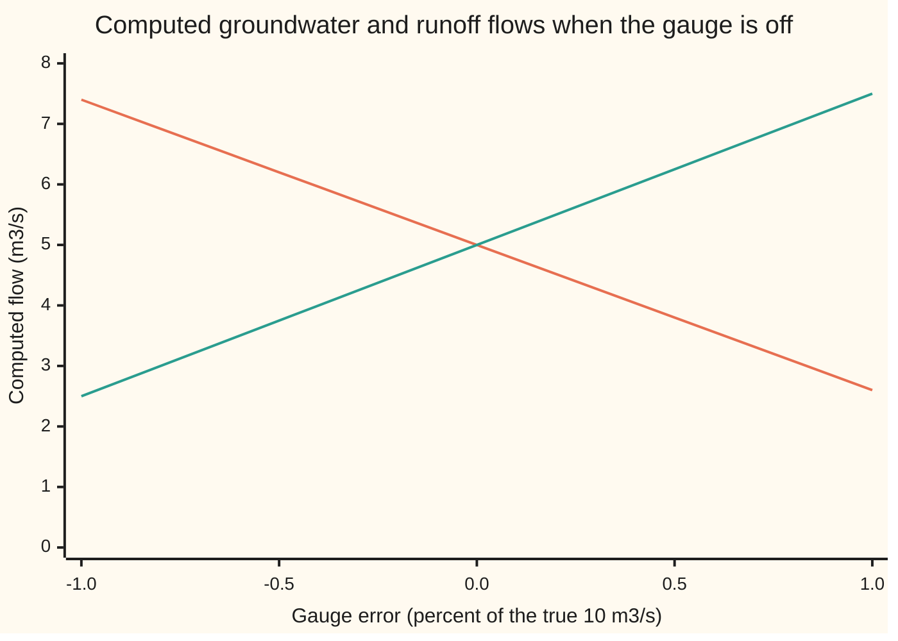

# Matrix norms and the condition number: the worst amplification a linear system allows

[Syllabus](../../../SYLLABUS.md) → [Numerical analysis](../README.md) → [Numerical Linear Algebra](../README.md#s03) → Matrix norms and the condition number

---

## General Overview

A stream carries 10 cubic metres of water a second (10 m³/s). Part of it is groundwater that seeped in for months. The rest is rain that ran off the land today. Hydrologists split the flow into these two parts with chemistry: each water has its own saltiness, so the stream's saltiness says how much of each it holds.

Here the two waters are almost alike. Groundwater carries 50 mg of chloride per litre and runoff carries 48 mg per litre (illustrative numbers). The true split is 5 m³/s of each. Now let the flow gauge read 1% low: 9.9 instead of 10. Solve again and the split comes out as 7.4 m³/s of groundwater and 2.5 m³/s of runoff. The runoff figure is **50%** wrong.

No arithmetic slipped. The two equations nearly say the same thing, so a small change in one reading swings the answer a long way. This card measures that swing with one number, the **condition number** of the matrix, written κ (kappa). Here κ = 100, measured in the infinity-norm defined below: a 1% error in the readings can become up to a 100% error in the flows.

To say "1%" and "50%" for a list of numbers, the card first needs a size for a whole list and for a whole matrix. Those sizes are **norms**.

**The condition number κ(A) = ‖A‖ ‖A⁻¹‖ is the largest factor by which solving A x = b can magnify a relative error in the data; a 1% error in b moves x by at most κ percent, and some 1% error moves it by exactly that.**

**What kind of fact this is:** norms and κ are definitions. The bound and the fact that it can be reached are theorems, proved on this card in Why it works. The formula for the 2-norm uses the singular value decomposition, proved on its own card.

### The picture: the split as the gauge drifts



The orange line is groundwater; the green line is runoff. At a true gauge both are 5.00 m³/s. Each half-percent of gauge error moves each flow by about a quarter of its size. The two lines cross at the truth and run apart steeply on both sides.

---

## The formula

The two balances, flow and chloride, written as one matrix equation:

$$\underbrace{\begin{pmatrix} 1 & 1 \\ 1 & 0.96 \end{pmatrix}}_{A}\begin{pmatrix} g \\ r \end{pmatrix} = \underbrace{\begin{pmatrix} 10 \\ 9.8 \end{pmatrix}}_{b}$$

The first row is the gauge: g + r = 10. The second row is the chloride balance 50 g + 48 r = 490 grams a second, divided by 50 so that both rows are in m³/s.

Three ways to give a list $x$ a size, its **vector norm**:

$$\|x\|_1 = |x_1| + |x_2|, \qquad \|x\|_2 = \sqrt{x_1^2 + x_2^2}, \qquad \|x\|_\infty = \max(|x_1|, |x_2|)$$

**Read it aloud:** the 1-norm adds the sizes, the 2-norm is the straight-line length, and the infinity-norm is the biggest entry.

The size of a matrix is the most it can stretch a list, measured in one chosen vector norm. This is the **induced matrix norm**:

$$\|A\| = \max_{x \ne 0} \frac{\|A x\|}{\|x\|}, \qquad \kappa(A) = \|A\|\,\|A^{-1}\|$$

**Read it aloud:** the norm of A is its worst stretch, and the condition number is A's worst stretch times its inverse's worst stretch.

For each vector norm the worst stretch has a closed form. Step 1 proves the first two:

- $\|A\|_1$ is the largest column sum of absolute values.
- $\|A\|_\infty$ is the largest row sum of absolute values.
- $\|A\|_2 = \sigma_{\max}$, the largest singular value, and $\|A^{-1}\|_2 = 1/\sigma_{\min}$, so $\kappa_2 = \sigma_{\max}/\sigma_{\min}$.

The rule the card is about, when the readings b change by Δb and the flows change by Δx:

$$\frac{\|\Delta x\|}{\|x\|} \le \kappa(A)\,\frac{\|\Delta b\|}{\|b\|}$$

**Read it aloud:** the relative error in the answer is at most κ times the relative error in the readings, with every size measured in the same norm.

| Symbol | Plain meaning | In our example | Push it up and the answer… |
| --- | --- | --- | --- |
| $A$ | the matrix: one row per balance, one column per unknown flow | `[[1, 1], [1, 0.96]]` | rows closer to equal: κ grows |
| $x = (g, r)$ | the unknowns: groundwater flow g and runoff flow r, in m³/s | (5, 5) | — |
| $b$ | the readings: gauge flow and scaled chloride load | (10, 9.8) | — |
| $\Delta b$, $\Delta x$ | a change in the readings, and the change it causes in the flows | (−0.1, 0) gives (2.4, −2.5) | Δx grows up to κ times as fast |
| $x'$, $\Delta A$ | the flows computed from changed data; a change in the matrix itself | (7.4, 2.5); 0.96 read as 0.9504 | same bound, Step 3 |
| $\lVert x\rVert_1$, $\lVert x\rVert_2$, $\lVert x\rVert_\infty$ | the 1-, 2- and infinity-norms of a list | 10, 7.0711, 5 for x | — |
| $\lVert A\rVert$ | the induced norm: A's worst stretch | 2, 1.9802, 2 | — |
| $A^{-1}$, det A | the inverse matrix, which undoes A; the determinant, $a_{11}a_{22} - a_{12}a_{21}$, zero when there is no inverse | `[[-24, 25], [25, -25]]`, norms 50, 49.5050, 50; det A = −0.04 | big entries: big κ |
| $\sigma_{\max}$, $\sigma_{\min}$ | largest and smallest singular values: A's longest and shortest stretch | 1.9802, 0.0202 | $\sigma_{\min} \to 0$: κ₂ blows up |
| $\kappa(A)$; κ₁, κ₂, κ∞ | the condition number: worst magnification of relative error; the subscript names the norm | 100, 98.03, 100 | more digits lost, about $\log_{10}\kappa$ |
| $u$, $\hat x$ | the unit roundoff $2^{-53}$; "x-hat", the flows the computer returns | 1.11e-16; off by 4.44e-15 | — |
| $a_{ij}$, $I$, $s$, $t$, $U$, $\Sigma$, $V$ | proof notation: the entry in row i, column j; the identity matrix (ones on the diagonal); the unknown and the sum of squared entries in the singular value equation; the two turns and the stretch of the SVD | $a_{22} = 0.96$ | — |

A change is written with a capital delta, Δ, read "change in". The inverse and its 2 by 2 formula come from [The inverse matrix](../../03-Algebra/05-Solving%20Systems/03-inverse-matrix.md). The singular values come from [The singular value decomposition](../../03-Algebra/07-Eigenvalues%20and%20Symmetric%20Matrices/06-singular-value-decomposition.md).

### When it holds

- **A is square and invertible.** If the two waters had the same chloride, A would be singular (no inverse), and κ would be infinite. Near that point the bound is true but useless.
- **The same norm is used everywhere.** The bound pairs $\lVert A\rVert$ with the vector norm that defines it. Mix them and the inequality can fail: the worst infinity-norm magnification is 100, above κ₂ = 98.03.
- **The rows are in comparable units, for the bound to be useful.** Leave the chloride row in grams a second and the bound still holds, but the infinity-norm κ jumps from 100 to 2499, so it promises far less. The problem has not changed; the norm is adding m³/s to g/s.
- **The bound is a worst case.** It says nothing about a particular error being that bad. The gauge error reaches half the bound; another error reaches all of it.

---

## Why it works

### Step 0: solving is multiplying by the inverse, and the inverse is large

Every change in b reaches x through the inverse: Δx = A⁻¹ Δb. Here A⁻¹ = `[[-24, 25], [25, -25]]`. A change of 0.1 in the gauge reading is multiplied by 24 and 25. So 0.1 m³/s of gauge error becomes 2.4 and 2.5 m³/s of flow error.

That alone is an absolute magnification. The relative one also asks how big x is next to b. Here b is twice as large as x, in the infinity-norm, because A stretches (5, 5) to (10, 9.8). So the relative magnification is 50 × 2 = 100 at worst. That product of two stretches is κ.

### Step 1: the matrix norm is a worst stretch, and it has a formula

The definition says: try every direction and keep the biggest ratio. For the infinity-norm the biggest ratio has a short proof.

Each entry of A x is a row of A times x. A row times x is at most the row's absolute sum times the biggest entry of x. So $\lVert A x\rVert_\infty$ is at most the largest row sum times $\lVert x\rVert_\infty$. Pick x to be ±1 with the signs of that row, and the bound is met. For A the row sums are 2 and 1.96, so $\lVert A\rVert_\infty = 2$. For A⁻¹ they are 49 and 50, so $\lVert A^{-1}\rVert_\infty = 50$.

<details>
<summary>Detailed proof: the infinity-norm is the largest row sum, the 1-norm the largest column sum</summary>

**Infinity-norm.** For row i, $|(A x)_i| = |\sum_j a_{ij} x_j| \le \sum_j |a_{ij}|\,|x_j| \le \big(\sum_j |a_{ij}|\big)\lVert x\rVert_\infty$. Take the largest row, i*, and set $x_j$ to the sign of $a_{i^*j}$ (1 where it is 0). Then $\lVert x\rVert_\infty = 1$ and $(A x)_{i^*} = \sum_j |a_{i^*j}|$, so the bound is met.

**1-norm.** $\lVert A x\rVert_1 = \sum_i |\sum_j a_{ij} x_j| \le \sum_j |x_j| \sum_i |a_{ij}| \le \big(\max_j \sum_i |a_{ij}|\big)\lVert x\rVert_1$. Take x to be the unit list with a 1 in the largest column's place. Then $A x$ is that column, and the bound is met.

**2-norm.** By [The singular value decomposition](../../03-Algebra/07-Eigenvalues%20and%20Symmetric%20Matrices/06-singular-value-decomposition.md), A = U Σ Vᵀ with U and V turns that keep lengths. A turn does not change the 2-norm, so the worst stretch of A is the largest entry of Σ, $\sigma_{\max}$. A⁻¹ = V Σ⁻¹ Uᵀ, whose largest stretch is $1/\sigma_{\min}$. For a 2 by 2 matrix, $\sigma^2$ are the two roots of $s^2 - t s + (\det A)^2 = 0$, where t is the sum of the squares of A's entries.

</details>

A is symmetric, so its singular values are the sizes of its eigenvalues. The eigenvalues are 1.9802 and −0.0202, so σmax = 1.9802 and σmin = 0.0202. That gives κ₂ = 1.9802 / 0.0202 = 98.03. The three norms disagree a little, 100, 98.03 and 100, but they always tell the same story: two digits at risk.

### Step 2: the bound, in two lines

Start from the two facts every solve obeys:

1. The answer error is the inverse times the data error: Δx = A⁻¹ Δb. So $\lVert\Delta x\rVert \le \lVert A^{-1}\rVert\,\lVert\Delta b\rVert$.
2. The data are A times the answer: b = A x. So $\lVert b\rVert \le \lVert A\rVert\,\lVert x\rVert$, which turns around to $1/\lVert x\rVert \le \lVert A\rVert/\lVert b\rVert$.

Multiply the two inequalities:

$$\frac{\lVert\Delta x\rVert}{\lVert x\rVert} \le \lVert A^{-1}\rVert\,\lVert A\rVert\,\frac{\lVert\Delta b\rVert}{\lVert b\rVert} = \kappa(A)\,\frac{\lVert\Delta b\rVert}{\lVert b\rVert}$$

No Taylor step and no "small enough" condition appear. Because the system is linear, the bound holds for any size of Δb, not only small ones.

### Step 3: the bound is reached, so κ is the right number

Both inequalities in Step 2 become equalities for the right choices. The first is tight when Δb points the way A⁻¹ stretches most. The second is tight when x points the way A stretches most. Choose both, and the error is exactly κ times the data error.

For the stream, x = (5, 5) is already a worst direction for A, since A stretches it from size 5 to size 10. The worst data error is Δb = (−0.1, +0.1): the gauge 0.1 low and the scaled chloride 0.1 high. Then x' = (9.9, 0). The runoff vanishes. The relative error is 100%, exactly κ∞ times 1%.

The code checks this a second way. It tries 360 directions for x and 360 for Δb, 129,600 pairs, and keeps the largest magnification. It finds 100.0000.

<details>
<summary>Detailed proof: the same bound for an error in the matrix</summary>

Suppose the matrix is wrong instead, A + ΔA, and $(A + \Delta A)\,x' = b$ with $x' = x + \Delta x$. Subtract $A x = b$: $A\,\Delta x = -\Delta A\,x'$. Multiply by $A^{-1}$ and take norms:

$$\lVert\Delta x\rVert \le \lVert A^{-1}\rVert\,\lVert\Delta A\rVert\,\lVert x'\rVert, \qquad\text{so}\qquad \frac{\lVert\Delta x\rVert}{\lVert x'\rVert} \le \kappa(A)\,\frac{\lVert\Delta A\rVert}{\lVert A\rVert}$$

The error is measured against the new answer x'. That choice lets the bound hold for any size of ΔA, with no "small enough" condition.

For the stream, read the runoff chloride 1% low. The entry 0.96 becomes 0.9504, a change of 0.48% of $\lVert A\rVert_\infty$. The flows become (5.9677, 4.0323), off by 16.22% of x'. The bound is 48.00%, which is 2.96 times the true error.

</details>

### Step 4: what κ means for a computer

A double stores each reading with a relative error of at most u = 1.11e-16 ([Machine epsilon and cancellation](../01-Floating%20Point%20and%20Error/03-rounding-cancellation-and-machine-epsilon.md)). By Step 2 that alone can move x, relative to its size, by up to κu = 1.11e-14. A **backward stable** solver (one whose answer is exact for data moved by a few u, as in [Conditioning and stability](../01-Floating%20Point%20and%20Error/05-conditioning-and-stability.md)) adds only a few u more. So the computed flows should be right to about κu, an estimate, not a guarantee.

Elimination with partial pivoting (no swap is needed here, since both pivot candidates are 1), in doubles, returns g = 5.000000000000022 and r = 4.999999999999978. The true relative error is 4.44e-15, which is 0.40 times κu. A double holds 15.95 decimal digits. Of those, $\log_{10}\kappa$ = 2.00 are at risk, and 13.95 survive.

The lesson splits the blame. If the flows are 50% off, the 1% gauge error caused it, through κ. The arithmetic caused less than one part in a hundred million million.

### Step 5: compute κ, but never solve with the inverse

κ needs $\lVert A^{-1}\rVert$, and forming A⁻¹ costs more work than factoring A. Forming it also usually leaves a larger residual. Production codes therefore factor A once, as in [LU with partial pivoting](02-lu-decomposition-and-pivoting.md), solve with the factors, and estimate $\lVert A^{-1}\rVert_1$ from a few extra solves with the same factors (Hager's method). For a 2 by 2 matrix the inverse is free, so the code here writes it out.

---

## Worked numbers, by hand

The gauge reads 1% low, so Δb = (−0.1, 0). Infinity-norm throughout.

| Step | Arithmetic | Value |
| --- | --- | --- |
| det A | 1 × 0.96 − 1 × 1 | −0.04 |
| A⁻¹ | swap the diagonal, flip the other signs, divide by −0.04 | `[[-24, 25], [25, -25]]` |
| $\lVert A\rVert_\infty$ | max(1 + 1, 1 + 0.96) | 2 |
| $\lVert A^{-1}\rVert_\infty$ | max(24 + 25, 25 + 25) | 50 |
| κ∞ | 2 × 50 | 100 |
| Δx = A⁻¹ Δb | (−24 × −0.1, 25 × −0.1) | (2.4, −2.5) |
| x' | (5 + 2.4, 5 − 2.5) | (7.4, 2.5) |
| data error | 0.1 / 10 | 1% |
| bound on flow error | 100 × 1% | 100% |
| flow error | 2.5 / 5 | **50%** |

A 1% gauge error moves the computed flows by 50%, half of what κ allows. The same change measured in the 1-norm is 0.505% in, 49.00% out, a magnification of 97.02; in the 2-norm, 0.714% in, 49.01% out, a magnification of 68.62.

### What breaks if you drop a piece

| Mistake | Comes out at | What went wrong |
| --- | --- | --- |
| Judge nearness to singular by det A | det(10A) = −4 looks safe, yet κ∞ is still 100; det(0.001 I) = 1.00e-6 looks alarming, yet κ∞ = 1 | The determinant scales with the size of the entries. κ does not. |
| Take 1/\|det A\| as the condition number | 25 | It ignores the size of A itself. κ∞ is 100. |
| Leave the chloride row in grams a second | κ∞ = 2499 | The norm adds m³/s to g/s. Scale rows to common units first. |
| Accept the answer because its residual is small | residual b − A x' (how far the answer misses the readings) = (0.1, 0), 1.00% of b; flows 50% off | The residual is a backward error. Multiply by κ before trusting x. |

---

## Code, from first principles, and it actually runs

The scripts take three independent roads to the norms and κ. Road 1 is the closed forms: row sums, column sums and the 2 by 2 singular value formula. Road 2 sweeps the whole circle of directions in fine steps and keeps the largest and smallest stretch. A and A⁻¹ are symmetric, so their row sums equal their column sums; the sweep therefore also runs on the unscaled matrix `[[1, 1], [50, 48]]`, whose 1-norm is 51 and infinity-norm 98, so swapping the two formulas would fail an assert. Road 3 runs power iteration on AᵀA for the 2-norm: multiply a list by AᵀA (A turned on its side, times A) again and again until it settles on the direction A stretches most. Exact fractions give every true error, and a sweep over 129,600 pairs of directions confirms the bound is reached. Python uses `fractions.Fraction`; Rust writes a small fraction type.

### Python

```python
# Matrix norms and the condition number -- the check behind the card.  Standard library only.
# A stream carries groundwater g and rain runoff r (m^3/s).  Gauge: g + r = 10.  Chloride,
# 50 g + 48 r = 490 g/s, divided by 50: g + 0.96 r = 9.8.  Road 1: norms by their formulas.
# Road 2: norms by sweeping directions round the circle.  Road 3: power iteration for the
# 2-norm, and exact fractions for every true error.
import math
from fractions import Fraction as F

U = 2.0 ** -53  # unit roundoff

def e(v, p=2):  # e-notation as Rust prints it: 1.11e-16, never 1.11e-016 or e+02
    m, x = f"{v:.{p}e}".split("e")
    return m + "e" + str(int(x))

def mul(A, x): return [A[0][0] * x[0] + A[0][1] * x[1], A[1][0] * x[0] + A[1][1] * x[1]]
def inv(A):  # the 2 by 2 inverse: swap the diagonal, flip the other signs, divide by det
    d = A[0][0] * A[1][1] - A[0][1] * A[1][0]
    return [[A[1][1] / d, -A[0][1] / d], [-A[1][0] / d, A[0][0] / d]]
def det(A): return A[0][0] * A[1][1] - A[0][1] * A[1][0]
def v1(x): return abs(x[0]) + abs(x[1])
def v2(x): return math.sqrt(x[0] ** 2 + x[1] ** 2)
def vi(x): return max(abs(x[0]), abs(x[1]))
def m1(A): return max(abs(A[0][j]) + abs(A[1][j]) for j in range(2))  # largest column sum
def mi(A): return max(abs(A[i][0]) + abs(A[i][1]) for i in range(2))  # largest row sum
def m2(A):  # largest singular value: square root of the larger eigenvalue of A^T A
    t = sum(float(a) ** 2 for row in A for a in row)
    return math.sqrt((t + math.sqrt(t * t - 4 * float(det(A)) ** 2)) / 2)
def sweep(A, vn, n=200000):  # road 2: biggest and smallest stretch over n directions
    hi, lo = 0.0, math.inf
    for k in range(n):
        t = math.pi * k / n
        v = [math.cos(t), math.sin(t)]
        s = vn(mul(A, v)) / vn(v)
        hi, lo = max(hi, s), min(lo, s)
    return hi, lo
def power(A, steps=60):  # road 3: power iteration on A^T A for the 2-norm
    M = [[sum(float(A[k][i]) * float(A[k][j]) for k in range(2)) for j in range(2)] for i in range(2)]
    v = [1.0, 0.0]
    for _ in range(steps):
        w = mul(M, v)
        v = [w[0] / v2(w), w[1] / v2(w)]
    return math.sqrt(v2(mul(M, v)))
def solve(A, b):  # partial pivoting in doubles: swap rows only if the lower pivot is larger
    (a, c), (p, q) = A
    if abs(p) > abs(a):
        a, c, p, q, b = p, q, a, c, [b[1], b[0]]
    l = p / a
    y = (b[1] - l * b[0]) / (q - l * c)
    return [(b[0] - c * y) / a, y]

A = [[F(1), F(1)], [F(1), F(24, 25)]]
b, x = [F(10), F(49, 5)], [F(5), F(5)]
Ai = inv(A)
print("stream: g + r = 10 and 50 g + 48 r = 490, so g + 0.96 r = 9.8; true flows g = r = 5 m^3/s")
print(f"det A {float(det(A)):.4f}; A^-1 = [[{float(Ai[0][0]):.0f}, {float(Ai[0][1]):.0f}], [{float(Ai[1][0]):.0f}, {float(Ai[1][1]):.0f}]]")
print(f"x norms: 1 {v1(x):.4f}, 2 {v2([float(t) for t in x]):.4f}, inf {vi(x):.4f}")
print(f"b norms: 1 {float(v1(b)):.4f}, 2 {v2([float(t) for t in b]):.4f}, inf {float(vi(b)):.4f}")
K = {}
for name, mn, vn in (("1", m1, v1), ("2", m2, v2), ("inf", mi, vi)):
    nA, nAi = float(mn(A)), float(mn(Ai))
    sA, sAi = sweep(A, vn)[0], sweep(Ai, vn)[0]
    K[name] = nA * nAi
    print(f"norm {name:3}: ||A|| {nA:.4f} sweep {sA:.4f}; ||A^-1|| {nAi:.4f} sweep {sAi:.4f}; kappa {K[name]:.4f}")
    assert abs(sA - nA) < 1e-6 * nA and abs(sAi - nAi) < 1e-6 * nAi, "sweep agrees with the formula"
raw = [[F(1), F(1)], [F(50), F(48)]]  # unscaled rows: not symmetric, so row and column sums differ
for nm, M in (("A", raw), ("A^-1", inv(raw))):
    s1, si = sweep(M, v1)[0], sweep(M, vi)[0]
    print(f"unscaled rows, {nm}: 1-norm {float(m1(M)):.4f} sweep {s1:.4f}; inf-norm {float(mi(M)):.4f} sweep {si:.4f}")
    assert abs(s1 - float(m1(M))) < 1e-6 * s1 and abs(si - float(mi(M))) < 1e-6 * si, "1-norm by columns, inf by rows"
hi, lo = sweep(A, v2)
pw = power(A)
print(f"2-norm: power iteration {pw:.6f}, sigma_min {float(abs(det(A))) / m2(A):.6f}, sweep kappa {hi / lo:.4f}")
print(f"digits at risk log10 kappa_inf {math.log10(K['inf']):.2f}; eigenvalues of A {0.98 + math.sqrt(1.0004):.4f}, {0.98 - math.sqrt(1.0004):.4f}")
rs = [float(abs(M[i][0]) + abs(M[i][1])) for M in (A, Ai) for i in range(2)]
dx0, dg = mul(Ai, [F(-1, 10), F(0)]), 53 * math.log10(2)
print(f"hand: row sums A {rs[0]:.4f}, {rs[1]:.4f}; A^-1 {rs[2]:.4f}, {rs[3]:.4f}; dx ({float(dx0[0]):.4f}, {float(dx0[1]):.4f}); digits in a double {dg:.2f}, left {dg - math.log10(K['inf']):.2f}")
assert abs(pw - m2(A)) < 1e-12 and abs(hi / lo - K["2"]) < 1e-3 * K["2"], "three roads to kappa_2"
assert [mul(A, [Ai[0][j], Ai[1][j]]) for j in range(2)] == [[1, 0], [0, 1]], "A times A^-1 is I, exactly"

def case(label, db):  # change b by db, solve exactly, compare relative changes in three norms
    xs = mul(Ai, [b[0] + db[0], b[1] + db[1]])
    dx = [xs[0] - x[0], xs[1] - x[1]]
    f = lambda v: [float(t) for t in v]
    out = []
    for name, vn in (("1", v1), ("2", v2), ("inf", vi)):
        rb, rx = vn(f(db)) / vn(f(b)), vn(f(dx)) / vn(f(x))
        out.append((name, rb, rx))
    print(f"{label}: g {float(xs[0]):.4f}, r {float(xs[1]):.4f}")
    for name, rb, rx in out:
        print(f"  norm {name:3}: data {100 * rb:.3f} %, flows {100 * rx:.2f} %, amplified {rx / rb:.2f}, bound kappa {K[name]:.2f}")
        assert rx <= K[name] * rb * (1 + 1e-12), "the bound holds"
    return out, xs
low, xl = case("gauge 1% low", [F(-1, 10), F(0)])
worst, xw = case("worst case", [F(-1, 10), F(1, 10)])
assert abs(worst[2][2] / worst[2][1] - K["inf"]) < 1e-9, "the infinity-norm bound is attained"
best = 0.0  # road 2 for 'attained': sweep directions of x and of the data error
for i in range(360):
    for j in range(360):
        xv = [math.cos(math.pi * i / 180), math.sin(math.pi * i / 180)]
        dv = [math.cos(math.pi * j / 180), math.sin(math.pi * j / 180)]
        best = max(best, (vi(mul(Ai, dv)) / vi(xv)) / (vi(dv) / vi(mul(A, xv))))
print(f"largest amplification over 129600 pairs of directions {best:.4f}")
assert abs(best - K["inf"]) < 1e-9 * K["inf"], "the sweep finds kappa_inf"
r_wrong = [b[0] - mul(A, xl)[0], b[1] - mul(A, xl)[1]]
print(f"residual of the gauge-low answer ({float(r_wrong[0]):.4f}, {float(r_wrong[1]):.4f}), relative {100 * float(vi(r_wrong) / vi(b)):.2f} %")

A2 = [[F(1), F(1)], [F(1), F(24, 25) * F(99, 100)]]  # runoff chloride read 1% low: 47.52 mg/L
xa = mul(inv(A2), b)
ra, rx = float(abs(A2[1][1] - A[1][1]) / mi(A)), float(vi([xa[0] - 5, xa[1] - 5]) / vi(xa))
print(f"A changed: 0.96 -> {float(A2[1][1]):.4f}: g {float(xa[0]):.4f}, r {float(xa[1]):.4f}; data {100 * ra:.2f} %, flows {100 * rx:.2f} %, bound {100 * K['inf'] * ra:.2f} %, ratio {K['inf'] * ra / rx:.2f}")
assert rx <= K["inf"] * ra, "the bound for a change in A"

xh = solve([[1.0, 1.0], [1.0, 0.96]], [10.0, 9.8])
err = float(vi([F(xh[0]) - 5, F(xh[1]) - 5]) / 5)
print(f"doubles: g {xh[0]:.15f}, r {xh[1]:.15f}; true rel error {e(err)}, kappa*u {e(K['inf'] * U)}, ratio {err / (K['inf'] * U):.2f}")
assert err <= 4 * K["inf"] * U, "a stable solve loses about log10 kappa digits, no more"

ten = [[10 * a for a in row] for row in A]
tiny = [[F(1, 1000), F(0)], [F(0), F(1, 1000)]]
print(f"break: det 10A {float(det(ten)):.4f}, kappa_inf {float(mi(ten) * mi(inv(ten))):.4f}; det 0.001 I {e(float(det(tiny)))}, kappa_inf {float(mi(tiny) * mi(inv(tiny))):.4f}")
print(f"break: rows unscaled (mg/L row) kappa_inf {float(mi(raw) * mi(inv(raw))):.4f}; 1/|det A| {float(1 / abs(det(A))):.4f}")
for k in range(-2, 3):  # chart: the gauge reads k/2 percent off
    xs = mul(Ai, [b[0] * (1 + F(k, 200)), b[1]])
    print(f"chart, gauge {k / 2:+.1f} %, g {float(xs[0]):.2f}, r {float(xs[1]):.2f}")
for c in (40, 49, 50):  # try: runoff chloride c mg/L
    Ac = [[F(1), F(1)], [F(1), F(c, 50)]]
    if det(Ac) == 0:
        print(f"try: runoff {c} mg/L: det 0, no inverse, kappa infinite")
        continue
    bc = mul(Ac, x)
    xs = mul(inv(Ac), [bc[0] - F(1, 10), bc[1]])
    print(f"try: runoff {c} mg/L: kappa_inf {float(mi(Ac) * mi(inv(Ac))):.4f}, gauge 1% low moves flows {100 * float(vi([xs[0] - 5, xs[1] - 5]) / 5):.2f} %")
print("ALL CHECKS PASS")
```

**Ran 2026-11-11 on macOS, Python 3.14.10, standard library only. All checks passed. Output, pasted from the run:**

```
stream: g + r = 10 and 50 g + 48 r = 490, so g + 0.96 r = 9.8; true flows g = r = 5 m^3/s
det A -0.0400; A^-1 = [[-24, 25], [25, -25]]
x norms: 1 10.0000, 2 7.0711, inf 5.0000
b norms: 1 19.8000, 2 14.0014, inf 10.0000
norm 1  : ||A|| 2.0000 sweep 2.0000; ||A^-1|| 50.0000 sweep 50.0000; kappa 100.0000
norm 2  : ||A|| 1.9802 sweep 1.9802; ||A^-1|| 49.5050 sweep 49.5050; kappa 98.0298
norm inf: ||A|| 2.0000 sweep 2.0000; ||A^-1|| 50.0000 sweep 50.0000; kappa 100.0000
unscaled rows, A: 1-norm 51.0000 sweep 51.0000; inf-norm 98.0000 sweep 98.0000
unscaled rows, A^-1: 1-norm 49.0000 sweep 49.0000; inf-norm 25.5000 sweep 25.5000
2-norm: power iteration 1.980200, sigma_min 0.020200, sweep kappa 98.0298
digits at risk log10 kappa_inf 2.00; eigenvalues of A 1.9802, -0.0202
hand: row sums A 2.0000, 1.9600; A^-1 49.0000, 50.0000; dx (2.4000, -2.5000); digits in a double 15.95, left 13.95
gauge 1% low: g 7.4000, r 2.5000
  norm 1  : data 0.505 %, flows 49.00 %, amplified 97.02, bound kappa 100.00
  norm 2  : data 0.714 %, flows 49.01 %, amplified 68.62, bound kappa 98.03
  norm inf: data 1.000 %, flows 50.00 %, amplified 50.00, bound kappa 100.00
worst case: g 9.9000, r 0.0000
  norm 1  : data 1.010 %, flows 99.00 %, amplified 98.01, bound kappa 100.00
  norm 2  : data 1.010 %, flows 99.01 %, amplified 98.02, bound kappa 98.03
  norm inf: data 1.000 %, flows 100.00 %, amplified 100.00, bound kappa 100.00
largest amplification over 129600 pairs of directions 100.0000
residual of the gauge-low answer (0.1000, 0.0000), relative 1.00 %
A changed: 0.96 -> 0.9504: g 5.9677, r 4.0323; data 0.48 %, flows 16.22 %, bound 48.00 %, ratio 2.96
doubles: g 5.000000000000022, r 4.999999999999978; true rel error 4.44e-15, kappa*u 1.11e-14, ratio 0.40
break: det 10A -4.0000, kappa_inf 100.0000; det 0.001 I 1.00e-6, kappa_inf 1.0000
break: rows unscaled (mg/L row) kappa_inf 2499.0000; 1/|det A| 25.0000
chart, gauge -1.0 %, g 7.40, r 2.50
chart, gauge -0.5 %, g 6.20, r 3.75
chart, gauge +0.0 %, g 5.00, r 5.00
chart, gauge +0.5 %, g 3.80, r 6.25
chart, gauge +1.0 %, g 2.60, r 7.50
try: runoff 40 mg/L: kappa_inf 20.0000, gauge 1% low moves flows 10.00 %
try: runoff 49 mg/L: kappa_inf 200.0000, gauge 1% low moves flows 100.00 %
try: runoff 50 mg/L: det 0, no inverse, kappa infinite
ALL CHECKS PASS
```

### Rust

```rust
// Matrix norms and the condition number -- the check behind the card.  std only, no crates.
// A stream carries groundwater g and rain runoff r (m^3/s).  Gauge: g + r = 10.  Chloride,
// 50 g + 48 r = 490 g/s, divided by 50: g + 0.96 r = 9.8.  Road 1: norms by their formulas.
// Road 2: norms by sweeping directions round the circle.  Road 3: power iteration for the
// 2-norm, and exact fractions for every true error.
use std::f64::consts::PI;
const U: f64 = 1.0 / 9007199254740992.0; // 2^-53, the unit roundoff

#[derive(Clone, Copy, PartialEq)]
struct Q { n: i128, d: i128 } // an exact fraction n/d, kept in lowest terms with d > 0
fn gcd(a: i128, b: i128) -> i128 { if b == 0 { a.abs() } else { gcd(b, a % b) } }
fn q(n: i128, d: i128) -> Q { let g = gcd(n, d) * d.signum(); Q { n: n / g, d: d / g } }
impl std::ops::Add for Q { type Output = Q; fn add(self, o: Q) -> Q { q(self.n * o.d + o.n * self.d, self.d * o.d) } }
impl std::ops::Sub for Q { type Output = Q; fn sub(self, o: Q) -> Q { q(self.n * o.d - o.n * self.d, self.d * o.d) } }
impl std::ops::Mul for Q { type Output = Q; fn mul(self, o: Q) -> Q { q(self.n * o.n, self.d * o.d) } }
impl std::ops::Div for Q { type Output = Q; fn div(self, o: Q) -> Q { q(self.n * o.d, self.d * o.n) } }
impl Q { fn f(self) -> f64 { self.n as f64 / self.d as f64 } fn abs(self) -> Q { q(self.n.abs(), self.d) } }
type M = [[Q; 2]; 2];

fn mul(a: &M, x: [Q; 2]) -> [Q; 2] { [a[0][0] * x[0] + a[0][1] * x[1], a[1][0] * x[0] + a[1][1] * x[1]] }
fn mulf(a: &[[f64; 2]; 2], x: [f64; 2]) -> [f64; 2] { [a[0][0] * x[0] + a[0][1] * x[1], a[1][0] * x[0] + a[1][1] * x[1]] }
fn det(a: &M) -> Q { a[0][0] * a[1][1] - a[0][1] * a[1][0] }
fn inv(a: &M) -> M { // swap the diagonal, flip the other signs, divide by det
    let (d, z) = (det(a), q(0, 1));
    [[a[1][1] / d, (z - a[0][1]) / d], [(z - a[1][0]) / d, a[0][0] / d]]
}
fn fl(a: &M) -> [[f64; 2]; 2] { [[a[0][0].f(), a[0][1].f()], [a[1][0].f(), a[1][1].f()]] }
fn fv(x: [Q; 2]) -> [f64; 2] { [x[0].f(), x[1].f()] }
fn v1(x: [f64; 2]) -> f64 { x[0].abs() + x[1].abs() }
fn v2(x: [f64; 2]) -> f64 { (x[0] * x[0] + x[1] * x[1]).sqrt() }
fn vi(x: [f64; 2]) -> f64 { x[0].abs().max(x[1].abs()) }
fn m1(a: &M) -> f64 { (a[0][0].abs() + a[1][0].abs()).f().max((a[0][1].abs() + a[1][1].abs()).f()) } // column sums
fn mi(a: &M) -> f64 { (a[0][0].abs() + a[0][1].abs()).f().max((a[1][0].abs() + a[1][1].abs()).f()) } // row sums
fn m2(a: &M) -> f64 { // largest singular value: square root of the larger eigenvalue of A^T A
    let t: f64 = fl(a).iter().flatten().map(|v| v * v).sum();
    ((t + (t * t - 4.0 * det(a).f().powi(2)).sqrt()) / 2.0).sqrt()
}
fn sweep(a: &M, vn: fn([f64; 2]) -> f64) -> (f64, f64) { // road 2: biggest and smallest stretch
    let (af, n) = (fl(a), 200000);
    let (mut hi, mut lo) = (0.0f64, f64::INFINITY);
    for k in 0..n {
        let t = PI * k as f64 / n as f64;
        let v = [t.cos(), t.sin()];
        let s = vn(mulf(&af, v)) / vn(v);
        hi = hi.max(s);
        lo = lo.min(s);
    }
    (hi, lo)
}
fn power(a: &M) -> f64 { // road 3: power iteration on A^T A
    let af = fl(a);
    let mut m = [[0.0; 2]; 2];
    for i in 0..2 { for j in 0..2 { m[i][j] = (0..2).map(|k| af[k][i] * af[k][j]).sum(); } }
    let mut v = [1.0, 0.0];
    for _ in 0..60 { let w = mulf(&m, v); v = [w[0] / v2(w), w[1] / v2(w)]; }
    v2(mulf(&m, v)).sqrt()
}
fn solve(a: [[f64; 2]; 2], b: [f64; 2]) -> [f64; 2] { // partial pivoting: swap only if the lower pivot is larger
    let (mut a, mut b) = (a, b);
    if a[1][0].abs() > a[0][0].abs() { a.swap(0, 1); b.swap(0, 1); }
    let l = a[1][0] / a[0][0];
    let y = (b[1] - l * b[0]) / (a[1][1] - l * a[0][1]);
    [(b[0] - a[0][1] * y) / a[0][0], y]
}
fn kinf(a: &M) -> f64 { mi(a) * mi(&inv(a)) }

fn main() {
    let a: M = [[q(1, 1), q(1, 1)], [q(1, 1), q(24, 25)]];
    let (b, x) = ([q(10, 1), q(49, 5)], [q(5, 1), q(5, 1)]);
    let ai = inv(&a);
    println!("stream: g + r = 10 and 50 g + 48 r = 490, so g + 0.96 r = 9.8; true flows g = r = 5 m^3/s");
    println!("det A {:.4}; A^-1 = [[{:.0}, {:.0}], [{:.0}, {:.0}]]", det(&a).f(), ai[0][0].f(), ai[0][1].f(), ai[1][0].f(), ai[1][1].f());
    println!("x norms: 1 {:.4}, 2 {:.4}, inf {:.4}", v1(fv(x)), v2(fv(x)), vi(fv(x)));
    println!("b norms: 1 {:.4}, 2 {:.4}, inf {:.4}", v1(fv(b)), v2(fv(b)), vi(fv(b)));
    let norms: [(&str, fn(&M) -> f64, fn([f64; 2]) -> f64); 3] = [("1", m1, v1), ("2", m2, v2), ("inf", mi, vi)];
    let mut kap = [0.0; 3];
    for (i, (name, mn, vn)) in norms.iter().enumerate() {
        let (na, nai) = (mn(&a), mn(&ai));
        let (sa, sai) = (sweep(&a, *vn).0, sweep(&ai, *vn).0);
        kap[i] = na * nai;
        println!("norm {:3}: ||A|| {:.4} sweep {:.4}; ||A^-1|| {:.4} sweep {:.4}; kappa {:.4}", name, na, sa, nai, sai, kap[i]);
        assert!((sa - na).abs() < 1e-6 * na && (sai - nai).abs() < 1e-6 * nai, "sweep agrees with the formula");
    }
    let raw: M = [[q(1, 1), q(1, 1)], [q(50, 1), q(48, 1)]]; // unscaled rows: not symmetric, so row and column sums differ
    for (nm, m) in [("A", raw), ("A^-1", inv(&raw))] {
        let (s1, si) = (sweep(&m, v1).0, sweep(&m, vi).0);
        println!("unscaled rows, {}: 1-norm {:.4} sweep {:.4}; inf-norm {:.4} sweep {:.4}", nm, m1(&m), s1, mi(&m), si);
        assert!((s1 - m1(&m)).abs() < 1e-6 * s1 && (si - mi(&m)).abs() < 1e-6 * si, "1-norm by columns, inf by rows");
    }
    let (hi, lo) = sweep(&a, v2);
    let pw = power(&a);
    println!("2-norm: power iteration {:.6}, sigma_min {:.6}, sweep kappa {:.4}", pw, det(&a).abs().f() / m2(&a), hi / lo);
    println!("digits at risk log10 kappa_inf {:.2}; eigenvalues of A {:.4}, {:.4}", kap[2].log10(), 0.98 + 1.0004f64.sqrt(), 0.98 - 1.0004f64.sqrt());
    let rs: Vec<f64> = [&a, &ai].iter().flat_map(|m| (0..2).map(move |i| (m[i][0].abs() + m[i][1].abs()).f())).collect();
    let (dx0, dg) = (mul(&ai, [q(-1, 10), q(0, 1)]), 53.0 * 2f64.log10());
    println!("hand: row sums A {:.4}, {:.4}; A^-1 {:.4}, {:.4}; dx ({:.4}, {:.4}); digits in a double {:.2}, left {:.2}", rs[0], rs[1], rs[2], rs[3], dx0[0].f(), dx0[1].f(), dg, dg - kap[2].log10());
    assert!((pw - m2(&a)).abs() < 1e-12 && (hi / lo - kap[1]).abs() < 1e-3 * kap[1], "three roads to kappa_2");
    let one = q(1, 1);
    let zero = q(0, 1);
    assert!(mul(&a, [ai[0][0], ai[1][0]]) == [one, zero] && mul(&a, [ai[0][1], ai[1][1]]) == [zero, one], "A times A^-1 is I, exactly");

    let case = |label: &str, db: [Q; 2]| -> (Vec<(f64, f64)>, [Q; 2]) {
        let xs = mul(&ai, [b[0] + db[0], b[1] + db[1]]);
        let dx = fv([xs[0] - x[0], xs[1] - x[1]]);
        println!("{}: g {:.4}, r {:.4}", label, xs[0].f(), xs[1].f());
        let mut out = vec![];
        for (i, (name, _, vn)) in norms.iter().enumerate() {
            let (rb, rx) = (vn(fv(db)) / vn(fv(b)), vn(dx) / vn(fv(x)));
            println!("  norm {:3}: data {:.3} %, flows {:.2} %, amplified {:.2}, bound kappa {:.2}", name, 100.0 * rb, 100.0 * rx, rx / rb, kap[i]);
            assert!(rx <= kap[i] * rb * (1.0 + 1e-12), "the bound holds");
            out.push((rb, rx));
        }
        (out, xs)
    };
    let (_, xl) = case("gauge 1% low", [q(-1, 10), zero]);
    let (worst, _) = case("worst case", [q(-1, 10), q(1, 10)]);
    assert!((worst[2].1 / worst[2].0 - kap[2]).abs() < 1e-9, "the infinity-norm bound is attained");
    let (af, aif) = (fl(&a), fl(&ai));
    let mut best = 0.0f64; // road 2 for 'attained': sweep directions of x and of the data error
    for i in 0..360 {
        for j in 0..360 {
            let xv = [(PI * i as f64 / 180.0).cos(), (PI * i as f64 / 180.0).sin()];
            let dv = [(PI * j as f64 / 180.0).cos(), (PI * j as f64 / 180.0).sin()];
            best = best.max((vi(mulf(&aif, dv)) / vi(xv)) / (vi(dv) / vi(mulf(&af, xv))));
        }
    }
    println!("largest amplification over 129600 pairs of directions {:.4}", best);
    assert!((best - kap[2]).abs() < 1e-9 * kap[2], "the sweep finds kappa_inf");
    let ax = mul(&a, xl);
    let rw = [b[0] - ax[0], b[1] - ax[1]];
    println!("residual of the gauge-low answer ({:.4}, {:.4}), relative {:.2} %", rw[0].f(), rw[1].f(), 100.0 * (vi(fv(rw)) / vi(fv(b))));

    let a2: M = [[one, one], [one, q(24, 25) * q(99, 100)]]; // runoff chloride read 1% low: 47.52 mg/L
    let xa = mul(&inv(&a2), b);
    let five = q(5, 1);
    let (ra, rx) = ((a2[1][1] - a[1][1]).abs().f() / mi(&a), vi(fv([xa[0] - five, xa[1] - five])) / vi(fv(xa)));
    println!("A changed: 0.96 -> {:.4}: g {:.4}, r {:.4}; data {:.2} %, flows {:.2} %, bound {:.2} %, ratio {:.2}", a2[1][1].f(), xa[0].f(), xa[1].f(), 100.0 * ra, 100.0 * rx, 100.0 * kap[2] * ra, kap[2] * ra / rx);
    assert!(rx <= kap[2] * ra, "the bound for a change in A");

    let xh = solve([[1.0, 1.0], [1.0, 0.96]], [10.0, 9.8]);
    let err = (xh[0] - 5.0).abs().max((xh[1] - 5.0).abs()) / 5.0;
    println!("doubles: g {:.15}, r {:.15}; true rel error {:.2e}, kappa*u {:.2e}, ratio {:.2}", xh[0], xh[1], err, kap[2] * U, err / (kap[2] * U));
    assert!(err <= 4.0 * kap[2] * U, "a stable solve loses about log10 kappa digits, no more");

    let t = q(10, 1);
    let ten: M = [[t * a[0][0], t * a[0][1]], [t * a[1][0], t * a[1][1]]];
    let tiny: M = [[q(1, 1000), zero], [zero, q(1, 1000)]];
    println!("break: det 10A {:.4}, kappa_inf {:.4}; det 0.001 I {:.2e}, kappa_inf {:.4}", det(&ten).f(), kinf(&ten), det(&tiny).f(), kinf(&tiny));
    println!("break: rows unscaled (mg/L row) kappa_inf {:.4}; 1/|det A| {:.4}", kinf(&raw), (one / det(&a).abs()).f());
    for k in -2i128..3 { // chart: the gauge reads k/2 percent off
        let xs = mul(&ai, [b[0] * (one + q(k, 200)), b[1]]);
        println!("chart, gauge {:+.1} %, g {:.2}, r {:.2}", k as f64 / 2.0, xs[0].f(), xs[1].f());
    }
    for c in [40i128, 49, 50] { // try: runoff chloride c mg/L
        let ac: M = [[one, one], [one, q(c, 50)]];
        if det(&ac) == zero { println!("try: runoff {} mg/L: det 0, no inverse, kappa infinite", c); continue; }
        let bc = mul(&ac, x);
        let xs = mul(&inv(&ac), [bc[0] - q(1, 10), bc[1]]);
        println!("try: runoff {} mg/L: kappa_inf {:.4}, gauge 1% low moves flows {:.2} %", c, kinf(&ac), 100.0 * (vi(fv([xs[0] - five, xs[1] - five])) / 5.0));
    }
    println!("ALL CHECKS PASS");
}
```

**Ran 2026-11-11 on macOS, rustc 1.98.1, no crates. All checks passed. Output, pasted from the run:**

```
stream: g + r = 10 and 50 g + 48 r = 490, so g + 0.96 r = 9.8; true flows g = r = 5 m^3/s
det A -0.0400; A^-1 = [[-24, 25], [25, -25]]
x norms: 1 10.0000, 2 7.0711, inf 5.0000
b norms: 1 19.8000, 2 14.0014, inf 10.0000
norm 1  : ||A|| 2.0000 sweep 2.0000; ||A^-1|| 50.0000 sweep 50.0000; kappa 100.0000
norm 2  : ||A|| 1.9802 sweep 1.9802; ||A^-1|| 49.5050 sweep 49.5050; kappa 98.0298
norm inf: ||A|| 2.0000 sweep 2.0000; ||A^-1|| 50.0000 sweep 50.0000; kappa 100.0000
unscaled rows, A: 1-norm 51.0000 sweep 51.0000; inf-norm 98.0000 sweep 98.0000
unscaled rows, A^-1: 1-norm 49.0000 sweep 49.0000; inf-norm 25.5000 sweep 25.5000
2-norm: power iteration 1.980200, sigma_min 0.020200, sweep kappa 98.0298
digits at risk log10 kappa_inf 2.00; eigenvalues of A 1.9802, -0.0202
hand: row sums A 2.0000, 1.9600; A^-1 49.0000, 50.0000; dx (2.4000, -2.5000); digits in a double 15.95, left 13.95
gauge 1% low: g 7.4000, r 2.5000
  norm 1  : data 0.505 %, flows 49.00 %, amplified 97.02, bound kappa 100.00
  norm 2  : data 0.714 %, flows 49.01 %, amplified 68.62, bound kappa 98.03
  norm inf: data 1.000 %, flows 50.00 %, amplified 50.00, bound kappa 100.00
worst case: g 9.9000, r 0.0000
  norm 1  : data 1.010 %, flows 99.00 %, amplified 98.01, bound kappa 100.00
  norm 2  : data 1.010 %, flows 99.01 %, amplified 98.02, bound kappa 98.03
  norm inf: data 1.000 %, flows 100.00 %, amplified 100.00, bound kappa 100.00
largest amplification over 129600 pairs of directions 100.0000
residual of the gauge-low answer (0.1000, 0.0000), relative 1.00 %
A changed: 0.96 -> 0.9504: g 5.9677, r 4.0323; data 0.48 %, flows 16.22 %, bound 48.00 %, ratio 2.96
doubles: g 5.000000000000022, r 4.999999999999978; true rel error 4.44e-15, kappa*u 1.11e-14, ratio 0.40
break: det 10A -4.0000, kappa_inf 100.0000; det 0.001 I 1.00e-6, kappa_inf 1.0000
break: rows unscaled (mg/L row) kappa_inf 2499.0000; 1/|det A| 25.0000
chart, gauge -1.0 %, g 7.40, r 2.50
chart, gauge -0.5 %, g 6.20, r 3.75
chart, gauge +0.0 %, g 5.00, r 5.00
chart, gauge +0.5 %, g 3.80, r 6.25
chart, gauge +1.0 %, g 2.60, r 7.50
try: runoff 40 mg/L: kappa_inf 20.0000, gauge 1% low moves flows 10.00 %
try: runoff 49 mg/L: kappa_inf 200.0000, gauge 1% low moves flows 100.00 %
try: runoff 50 mg/L: det 0, no inverse, kappa infinite
ALL CHECKS PASS
```

The two outputs are identical line for line.

### Lean

Lean proves Step 2's bound, Step 3's claim that it is reached, and the row-sum formula, for every square matrix.

- If A is square and invertible, $A x = b$ and $A(x + \Delta x) = b + \Delta b$, then $\lVert\Delta x\rVert/\lVert x\rVert \le \kappa(A)\,\lVert\Delta b\rVert/\lVert b\rVert$. This holds for a change of any size, in any one norm used everywhere.
- For every square invertible A, some nonzero x and Δb make the relative error in x exactly κ(A) times the relative error in b = A x.
- The infinity-norm of a square matrix, its worst stretch, equals its largest row sum of absolute values.
- The stream's hand numbers hold exactly: A (5, 5) = (10, 9.8), det A = −0.04, A⁻¹ = `[[-24, 25], [25, -25]]`, and κ∞ = 2 × 50 = 100.
- The gauge error Δb = (−0.1, 0) gives Δx = (2.4, −2.5); the worst error (−0.1, +0.1) gives Δx = (4.9, −5).

The 1-norm and 2-norm formulas, a change in A, the solve in doubles and Try changing are left to the Python and Rust checks.

```lean
-- Matrix norms and the condition number: the relative error in the solution of A x = b is at most κ(A) = ‖A‖ ‖A⁻¹‖ times the relative error in b, some data error reaches that bound, and the infinity-norm of a matrix is its largest absolute row sum.
import Mathlib.Analysis.Matrix.Normed
import Mathlib.Analysis.Normed.Operator.Basic
import Mathlib.Topology.Algebra.Module.FiniteDimension
import Mathlib.LinearAlgebra.Matrix.NonsingularInverse
import Mathlib.LinearAlgebra.Matrix.Notation

open Matrix

/-- The condition number κ(A) = ‖A‖ ‖A⁻¹‖ of an invertible linear map, with both norms
induced by the same vector norm on `E`. -/
noncomputable def condNum {E : Type*} [NormedAddCommGroup E] [NormedSpace ℝ E]
    (A : E ≃L[ℝ] E) : ℝ :=
  ‖(A : E →L[ℝ] E)‖ * ‖(A.symm : E →L[ℝ] E)‖

theorem exists_norm_apply_eq_opNorm_mul
    {E : Type*} [NormedAddCommGroup E] [NormedSpace ℝ E] [FiniteDimensional ℝ E]
    [Nontrivial E] (f : E →L[ℝ] E) :
    ∃ x : E, x ≠ 0 ∧ ‖f x‖ = ‖f‖ * ‖x‖ := by
  have : ProperSpace E := FiniteDimensional.proper ℝ E
  have hK : IsCompact (Metric.sphere (0 : E) 1) := isCompact_sphere 0 1
  have hne : (Metric.sphere (0 : E) 1).Nonempty := NormedSpace.sphere_nonempty.mpr zero_le_one
  obtain ⟨x, hx, hmax⟩ := hK.exists_isMaxOn hne (continuous_norm.comp f.continuous).continuousOn
  have hx1 : ‖x‖ = 1 := by simpa using hx
  have hx0 : x ≠ 0 := by
    intro h; rw [h, norm_zero] at hx1; exact zero_ne_one hx1
  refine ⟨x, hx0, ?_⟩
  rw [hx1, mul_one]
  apply le_antisymm
  · simpa [hx1] using f.le_opNorm x
  · refine f.opNorm_le_bound (norm_nonneg _) fun y => ?_
    rcases eq_or_ne y 0 with rfl | hy
    · simp
    · have hy' : 0 < ‖y‖ := norm_pos_iff.mpr hy
      set u : E := (‖y‖⁻¹ : ℝ) • y with hu
      have hu1 : u ∈ Metric.sphere (0 : E) 1 := by
        simp [hu, norm_smul, hy'.ne']
      have h1 : ‖f u‖ ≤ ‖f x‖ := hmax hu1
      have h2 : ‖f u‖ = ‖y‖⁻¹ * ‖f y‖ := by
        simp [hu, map_smul, norm_smul]
      rw [h2] at h1
      calc ‖f y‖ = ‖y‖ * (‖y‖⁻¹ * ‖f y‖) := by field_simp
        _ ≤ ‖y‖ * ‖f x‖ := by gcongr
        _ = ‖f x‖ * ‖y‖ := mul_comm _ _

#print axioms exists_norm_apply_eq_opNorm_mul

/-- The condition-number bound. Let `A` be square and invertible, and measure every vector in
one norm, with `‖A‖` and `‖A⁻¹‖` the matrix norms that norm induces. If `A x = b` and the
changed data `b + Δb` give the changed answer `x + Δx`, then the relative error in the answer
is at most κ(A) times the relative error in the data, for a change of any size. -/
theorem relative_error_le_condNum_mul_relative_data_error
    {E : Type*} [NormedAddCommGroup E] [NormedSpace ℝ E]
    (A : E ≃L[ℝ] E) (x Δx b Δb : E)
    (hb : A x = b) (hΔ : A (x + Δx) = b + Δb) :
    ‖Δx‖ / ‖x‖ ≤ condNum A * (‖Δb‖ / ‖b‖) := by
  have hAΔ : A Δx = Δb := by
    rw [map_add, hb] at hΔ; exact add_left_cancel hΔ
  have hΔx : Δx = A.symm Δb := by rw [← hAΔ, A.symm_apply_apply]
  have h1 : ‖Δx‖ ≤ ‖(A.symm : E →L[ℝ] E)‖ * ‖Δb‖ := by
    rw [hΔx]; exact (A.symm : E →L[ℝ] E).le_opNorm Δb
  have h2 : ‖b‖ ≤ ‖(A : E →L[ℝ] E)‖ * ‖x‖ := by
    rw [← hb]; exact (A : E →L[ℝ] E).le_opNorm x
  have hRHS : 0 ≤ condNum A * (‖Δb‖ / ‖b‖) := by
    unfold condNum; positivity
  rcases eq_or_ne x 0 with hx | hx
  · simp [hx, hRHS]
  have hbne : b ≠ 0 := by
    rw [← hb]; intro h; exact hx (by simpa using congrArg A.symm h)
  have hxp : 0 < ‖x‖ := norm_pos_iff.mpr hx
  have hbp : 0 < ‖b‖ := norm_pos_iff.mpr hbne
  unfold condNum
  rw [div_le_iff₀ hxp]
  calc ‖Δx‖ ≤ ‖(A.symm : E →L[ℝ] E)‖ * ‖Δb‖ := h1
    _ = ‖(A.symm : E →L[ℝ] E)‖ * ‖Δb‖ / ‖b‖ * ‖b‖ := by field_simp
    _ ≤ ‖(A.symm : E →L[ℝ] E)‖ * ‖Δb‖ / ‖b‖ * (‖(A : E →L[ℝ] E)‖ * ‖x‖) := by
        gcongr
    _ = ‖(A : E →L[ℝ] E)‖ * ‖(A.symm : E →L[ℝ] E)‖ * (‖Δb‖ / ‖b‖) * ‖x‖ := by ring

/-- The bound is reached: in a finite-dimensional space (a square matrix of size at least 1),
there is a nonzero answer `x` and a nonzero data change `Δb` for which the relative error in
the answer is exactly κ(A) times the relative error in the data `b = A x`. -/
theorem condNum_bound_is_attained
    {E : Type*} [NormedAddCommGroup E] [NormedSpace ℝ E] [FiniteDimensional ℝ E]
    [Nontrivial E] (A : E ≃L[ℝ] E) :
    ∃ x Δb : E, x ≠ 0 ∧ Δb ≠ 0 ∧
      ‖A.symm Δb‖ / ‖x‖ = condNum A * (‖Δb‖ / ‖A x‖) := by
  obtain ⟨x, hx, hxn⟩ := exists_norm_apply_eq_opNorm_mul (A : E →L[ℝ] E)
  obtain ⟨d, hd, hdn⟩ := exists_norm_apply_eq_opNorm_mul (A.symm : E →L[ℝ] E)
  refine ⟨x, d, hx, hd, ?_⟩
  have hAx : A x ≠ 0 := by
    intro h; exact hx (by simpa using congrArg A.symm h)
  have hAxp : 0 < ‖A x‖ := norm_pos_iff.mpr hAx
  have hxp : 0 < ‖x‖ := norm_pos_iff.mpr hx
  have hxn' : ‖A x‖ = ‖(A : E →L[ℝ] E)‖ * ‖x‖ := hxn
  have hdn' : ‖A.symm d‖ = ‖(A.symm : E →L[ℝ] E)‖ * ‖d‖ := hdn
  have hA0 : ‖(A : E →L[ℝ] E)‖ ≠ 0 := by
    intro h; rw [h, zero_mul] at hxn'; exact hAxp.ne' hxn'
  unfold condNum
  rw [hdn', hxn']
  field_simp

/-- The infinity-norm of a square matrix, defined as its worst stretch
`max ‖A x‖∞ / ‖x‖∞` (the operator norm of `x ↦ A x` for the max-entry norm on vectors),
equals its largest row sum of absolute values. -/
theorem infinity_norm_eq_max_row_sum {n : ℕ} (A : Matrix (Fin n) (Fin n) ℝ) :
    ‖LinearMap.toContinuousLinearMap (Matrix.toLin' A)‖ =
      ((Finset.univ.sup fun i : Fin n => ∑ j : Fin n, ‖A i j‖₊ : NNReal) : ℝ) := by
  let _ := Matrix.linftyOpNormedAddCommGroup (m := Fin n) (n := Fin n) (α := ℝ)
  rw [← Matrix.linfty_opNorm_def A, Matrix.linfty_opNorm_eq_opNorm]
  rfl

/-! The card's stream example: `A = [[1, 1], [1, 0.96]]`, `b = (10, 9.8)`, `x = (5, 5)`,
written with exact fractions (0.96 = 24/25, 9.8 = 49/5). -/

-- The true flows solve the system: A (5, 5) = (10, 9.8).
example : !![(1 : ℚ), 1; 1, 24/25] *ᵥ ![5, 5] = ![10, 49/5] := by
  ext i; fin_cases i <;> norm_num [mulVec, dotProduct, Fin.sum_univ_two]

-- det A = 1 × 0.96 − 1 × 1 = −0.04.
example : (!![(1 : ℚ), 1; 1, 24/25]).det = -1/25 := by
  norm_num [det_fin_two_of]

-- A⁻¹ = [[-24, 25], [25, -25]]: their product is the identity.
example : !![(1 : ℚ), 1; 1, 24/25] * !![-24, 25; 25, -25] = 1 := by
  ext i j; fin_cases i <;> fin_cases j <;> norm_num [mul_apply, Fin.sum_univ_two]

-- Infinity-norms by row sums: ‖A‖∞ = max(2, 1.96) = 2, ‖A⁻¹‖∞ = max(49, 50) = 50, κ∞ = 100.
example : max (|(1 : ℚ)| + |1|) (|1| + |24/25|) * max (|(-24 : ℚ)| + |25|) (|25| + |-25|)
    = 100 := by
  norm_num [abs_of_nonneg, abs_of_neg]

-- Gauge 1% low: Δb = (−0.1, 0) gives Δx = A⁻¹ Δb = (2.4, −2.5), so x' = (7.4, 2.5).
example : !![(-24 : ℚ), 25; 25, -25] *ᵥ ![-1/10, 0] = ![12/5, -5/2] := by
  ext i; fin_cases i <;> norm_num [mulVec, dotProduct, Fin.sum_univ_two]

-- Worst case: Δb = (−0.1, +0.1) gives Δx = (4.9, −5), so x' = (9.9, 0): 100% error from 1%.
example : !![(-24 : ℚ), 25; 25, -25] *ᵥ ![-1/10, 1/10] = ![49/10, -5] := by
  ext i; fin_cases i <;> norm_num [mulVec, dotProduct, Fin.sum_univ_two]

#print axioms relative_error_le_condNum_mul_relative_data_error
#print axioms condNum_bound_is_attained
#print axioms infinity_norm_eq_max_row_sum
```

**Checked 2026-11-11 on macOS, Lean 4.36.0-rc2, Mathlib v4.36.0-rc2. Every proof is complete and uses only Lean's standard axioms. Output, pasted from the run:**

```
'exists_norm_apply_eq_opNorm_mul' depends on axioms: [propext, Classical.choice, Quot.sound]
'relative_error_le_condNum_mul_relative_data_error' depends on axioms: [propext, Classical.choice, Quot.sound]
'condNum_bound_is_attained' depends on axioms: [propext, Classical.choice, Quot.sound]
'infinity_norm_eq_max_row_sum' depends on axioms: [propext, Classical.choice, Quot.sound]
```

> [!TIP]
> **Try changing**
> - Guess first: what if the runoff were much less salty? Set its chloride to 40 mg/L. κ∞ falls to 20.0000, and a 1% low gauge moves the flows only 10.00%.
> - Guess first: what if the two waters were closer still? Set the runoff to 49 mg/L. κ∞ rises to 200.0000, and the same 1% gauge error moves the flows 100.00%.
> - Guess first: what if the two waters matched? Set the runoff to 50 mg/L. The determinant is 0, there is no inverse, and κ is infinite: chemistry cannot split the flow at all.
> - Guess first: does multiplying every equation by 10 help? The determinant grows from −0.04 to −4, but κ∞ stays 100.0000.

---

## The usual mistake

> [!warning]
> **Trusting an answer because it fits the equations.** The wrong split (7.4, 2.5) misses the true readings by only (0.1, 0), a 1.00% residual. Its flows are 50% wrong. A small residual says the answer solves a nearby problem; κ says how far that nearby problem's answer can be from the true one.
>
> - **Using the determinant as a warning light.** det(0.001 I) = 1.00e-6, yet that matrix has κ∞ = 1. det(10A) = −4, yet κ∞ = 100.
> - **Reading κ as the error.** κ = 100 is a magnifier. With 1% data error it allows up to 100%; the gauge error gave 50%, the worst error gave 100%.
> - **Mixing units in one matrix.** With the chloride row in grams a second, κ∞ reads 2499 instead of 100.
> - **Solving with the inverse.** It costs more than factoring and usually leaves a larger residual. Factor once, solve with the factors.

---

## Where you meet it in real life

- **Splitting a stream by its chemistry.** Hydrologists separate storm runoff from groundwater by mixing two chemical signatures. The method works when the two waters differ strongly; when they are alike, κ is large and a small sampling error ruins the split.
- **A 500-pipe water network.** The flows in a city's mains solve one linear system of 500 equations. A good solver reports an estimate of κ with the answer, so an engineer knows how many digits of the meter data survive. The size is illustrative.
- **Fitting a model to near-duplicate columns.** When two measured inputs nearly repeat each other, the coefficients swing wildly; κ₂ = σmax/σmin is the warning sign. [Least squares two ways](06-least-squares-normal-equations-versus-qr.md) shows that the normal equations square κ and QR does not.
- **Optimisation speed.** For a bowl-shaped function, κ₂ of the matrix of second derivatives is the ratio of sharpest to gentlest curvature, and it sets how slowly gradient descent creeps ([Convergence rates](../../15-Optimization/02-Unconstrained%20Methods/03-rates-of-convergence-and-conditioning.md)).

> **Say it back**
> A norm gives a list or a matrix one size; a matrix's norm is its worst stretch. The condition number κ(A) = ‖A‖ ‖A⁻¹‖ is the worst factor by which a linear system magnifies a relative data error. For the stream, κ = 100, so a 1% gauge error could move the flows up to 100%; it actually moved them 50%, and a different 1% error reaches the full 100%. In doubles the same κ costs about 2 of 16 digits. The determinant does not measure this, and a small residual does not prove an accurate answer.

---

## What this builds on

- [Solving A x = b](../../03-Algebra/05-Solving%20Systems/01-matrix-equation-ax-b.md): writes a pile of linear equations as A x = b and shows when there is exactly one answer; this card asks how firmly that one answer is pinned.
- [The inverse matrix](../../03-Algebra/05-Solving%20Systems/03-inverse-matrix.md): the 2 by 2 inverse and when it exists; here its size, ‖A⁻¹‖, becomes half of κ.
- [Convergence rates](../../15-Optimization/02-Unconstrained%20Methods/03-rates-of-convergence-and-conditioning.md): uses κ as the ratio of a bowl's sharpest to gentlest curvature to predict how slowly gradient descent converges; this card defines κ for any square matrix as the error amplification of a linear system.
- [Conditioning and stability](../01-Floating%20Point%20and%20Error/05-conditioning-and-stability.md): the condition number of a general problem, and the split between a fragile problem and a sloppy method; this card gives the matrix version.

## Where this goes next

- [LU with partial pivoting](02-lu-decomposition-and-pivoting.md): the backward stable way to solve A x = b, whose error is then set by κ, as Step 4 assumed.
- [QR](05-qr-householder-and-gram-schmidt.md): factoring with length-keeping turns, which leave κ₂ unchanged.
- [Iterating instead of factoring](09-iterative-methods-jacobi-gauss-seidel-and-conjugate-gradient.md): methods whose number of steps grows with κ.
- [The Thomas algorithm](03-tridiagonal-systems-and-the-thomas-algorithm.md): the same worst-stretch norm for maps on spaces with infinitely many directions.

The open question: Step 5 names Hager's method, which estimates ‖A⁻¹‖₁ from a few extra solves with the factors, but not how it works. How does it choose those solves, and how close does its estimate come to the true κ?

---

## Sources

Verified 2026-11-11: every link below resolves to the publisher's page.

- Higham, Nicholas J. *Accuracy and Stability of Numerical Algorithms*, 2nd ed. SIAM, 2002. [doi:10.1137/1.9780898718027](https://doi.org/10.1137/1.9780898718027). Vector and matrix norms, the perturbation bounds for A x = b, and why not to solve with an explicit inverse.
- Trefethen, Lloyd N., and David Bau III. *Numerical Linear Algebra*. SIAM, 1997. [doi:10.1137/1.9780898719574](https://doi.org/10.1137/1.9780898719574). Induced norms as worst stretches, the 2-norm from the SVD, and the condition number of a matrix.
- Turing, A. M. "Rounding-off Errors in Matrix Processes." *Quarterly Journal of Mechanics and Applied Mathematics* 1, no. 1 (1948): 287–308. [doi:10.1093/qjmam/1.1.287](https://doi.org/10.1093/qjmam/1.1.287). The paper that named the condition number of a matrix.
- Hager, William W. "Condition Estimates." *SIAM Journal on Scientific and Statistical Computing* 5, no. 2 (1984): 311–316. [doi:10.1137/0905023](https://doi.org/10.1137/0905023). Estimating ‖A⁻¹‖₁ from a few solves, without forming the inverse.
- Pinder, George F., and John F. Jones. "Determination of the Ground-Water Component of Peak Discharge from the Chemistry of Total Runoff." *Water Resources Research* 5, no. 2 (1969): 438–445. [doi:10.1029/WR005i002p00438](https://doi.org/10.1029/WR005i002p00438). Splitting a stream's flow into groundwater and runoff by chemical mixing, the example on this card.
