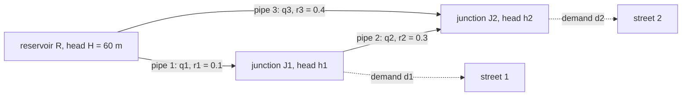
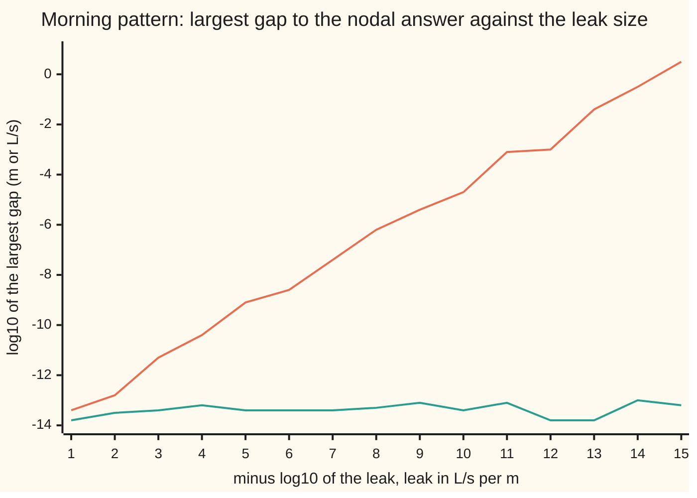

# LU with partial pivoting: factor once, then solve every right-hand side cheaply

[Syllabus](../../../SYLLABUS.md) → [Numerical analysis](../README.md) → [Numerical Linear Algebra](../README.md#s03) → LU with partial pivoting

---

## General Overview

A water utility models its network as one linear system. The unknowns are the pressure at every junction and the flow in every pipe. The pipes stay the same from hour to hour. What changes is the **demand pattern**: how much water each street draws. Night, morning peak, midday, evening peak, weekend, and a fire hydrant opened at one corner: six systems with the same left side and six different right sides.

Solving each one from scratch repeats the same expensive work six times. For a system of 500 unknowns, a round size taken for illustration, that is 502,246,500 flops (a **flop** is one add, subtract, multiply or divide). **LU factorisation** does the expensive part once and keeps it. Each demand pattern then costs 499,500 flops, so all six cost 86,205,250 flops: 5.83 times less. A seventh pattern costs 0.60% of the factorisation.

The factorisation is Gaussian elimination with its working written down. One more rule makes it safe on a computer: in each column, use the entry largest in size, ignoring its sign, as the pivot (the number you divide by). That rule is **partial pivoting**. Without it, the network on this card cannot even start. Add a leak of 1e-14 L/s per metre of head and it runs, but reports 32.153846 L/s in one pipe where the answer is 32.500000, with no warning.

**Record Gaussian elimination as a row order P, a lower triangle L of multipliers and an upper triangle U, so that PA = LU; then every new right-hand side costs one sweep down L and one sweep up U, and choosing the largest pivot keeps every multiplier at most 1, so rounding errors cannot be blown up by a tiny pivot.**

**What kind of fact this is:** a theorem, with a method built on it. That PA = LU exists for every square matrix, and that the multipliers stay at most 1, is proved on this card in Why it works. The rounding-error bound is a theorem stated with its key steps and a named source. The water network is an illustrative linear model.

### The picture: the network on this card

A reservoir R holds water at a head of 60 m (head is pressure, measured as the height of a water column). Three pipes feed two junctions in a loop. Each junction draws its demand.



The water reaches J2 two ways: straight down pipe 3, or round through J1 and pipe 2. How it splits is what the system decides. Each resistance r is in metres of head lost per L/s of flow, illustrative values for a linearised model. The real house example has 500 pipes; this one has 3, so every step fits on the page.

---

## The formula

$$PA = LU, \qquad Ly = Pb, \qquad Ux = y$$

**Read it aloud:** reorder the rows of A, and it splits into a lower triangle times an upper triangle; to solve, reorder b the same way, sweep down L to get y, then sweep up U to get x.

The cost, at size n, counted exactly ([Counting the work](../01-Floating%20Point%20and%20Error/08-operation-counts-and-cost.md) counts the same loops):

$$\text{factor: } \tfrac{1}{6}(4n^3 - 3n^2 - n) \approx \tfrac{2}{3}n^3 \text{ flops}, \qquad \text{each solve: } 2n^2 - n \text{ flops}$$

What pivoting buys, as a theorem about the computed answer $\hat x$ (read "x hat", the x the computer returns):

$$(A + \Delta A)\,\hat x = b, \qquad \frac{\|\Delta A\|_\infty}{\|A\|_\infty} \le \gamma_{3n}\, n^2\, g, \qquad \gamma_{3n} = \frac{3nu}{1 - 3nu}$$

**Read it aloud:** the computed answer is the exact answer for a matrix nudged by at most about $3n^3 g u$ of its size, so the method is safe whenever the growth factor g stays small, and partial pivoting is what keeps it small in practice.

| Symbol | Plain meaning | In our example | Push it up and the answer… |
| --- | --- | --- | --- |
| $A$ | the network matrix: one row per equation, one column per unknown | 5 by 5; rows J1, J2, pipe 1, pipe 2, pipe 3 | — |
| $x = (h_1, h_2, q_1, q_2, q_3)$ | the unknowns: junction heads in m, pipe flows in L/s; $\hat x$ is the computed x | morning: 56.75, 53.00, 32.50, 12.50, 17.50 | — |
| $b = (d_1, d_2, H, 0, H)$ | the right side: demands $d_1$, $d_2$ in L/s, reservoir head H = 60 m | morning: (20, 30, 60, 0, 60) | higher demand, lower heads |
| $r_1, r_2, r_3$ | pipe resistances: m of head lost per L/s | 0.1, 0.3, 0.4 | heads at the junctions fall |
| $P$ | the row order pivoting chose, as a matrix that reorders rows | pipe 1, pipe 2, J1, J2, pipe 3 | — |
| $L$, $\ell_{ik}$ | lower triangle, 1s on its diagonal; $\ell_{ik}$ is the multiplier that cleared row i using pivot row k | largest $\lvert\ell_{ik}\rvert$ is 1 | with pivoting, never above 1 |
| $U$ | upper triangle: what elimination leaves; its diagonal holds the pivots | pivots 1, 1, 1, 1, 0.8 | — |
| $y$ | the halfway vector: $Ux$, found by the sweep down L | morning: (60, 60, 20, 30, 14) | — |
| $n$ | the number of unknowns | 5 here; 500 for illustration (500 pipes would give more: one per pipe plus one per junction) | cost grows like $n^3$ to factor, $n^2$ to solve |
| $\lambda$ | a leak: L/s lost per m of head at each junction, illustrative | 0, then 1e-14 in What breaks | a tiny λ makes a tiny pivot without pivoting |
| $g$ | **growth factor**: the largest entry met during elimination, divided by the largest entry of A | 1.00 with pivoting; 2.00e14 without, at λ = 1e-14 | the error bound grows with it |
| $u$, $\gamma_{3n}$, $\kappa$, $\Delta A$ | unit roundoff $2^{-53}$; $\gamma_{3n}$, the rounding allowance for 3n roundings in a row, about $3nu$; condition number $\kappa_\infty(A) = \|A\|_\infty \|A^{-1}\|_\infty$; the nudge to A that the computed answer solves exactly | $u = 2^{-53}$; $\gamma_{15}$ about 15u; κ = 11.79 | larger κ turns a small nudge into a larger error in x |

The **unit roundoff** u is the largest relative error of one rounding ([Machine epsilon and cancellation](../01-Floating%20Point%20and%20Error/03-rounding-cancellation-and-machine-epsilon.md)). The norm $\|A\|_\infty$ is the largest row sum of absolute values, from [Matrix norms and the condition number](01-matrix-norms-and-the-condition-number.md).

### When it holds

- **A is square and not singular** (its determinant is not zero). If a whole column is zero on and below the pivot seat, no swap helps, and U gets a zero on its diagonal. The network with no reservoir pipe would be singular: heads would be fixed only up to a constant.
- **The matrix stays the same across right-hand sides.** The saving comes from reusing L and U. Real pipe losses grow faster than in proportion to the flow, so a full hydraulic solver linearises and gets a new matrix at each step. Reuse holds for every demand pattern solved on one linearisation, as here.
- **The growth factor stays small.** Partial pivoting bounds g only by $2^{n-1}$. A matrix built to reach that bound defeats it: at n = 60 the error is 0.80 in an answer whose entries lie between −0.5 and 0.5 (What breaks). Such matrices almost never arise in practice.
- **The matrix is dense, or treated as dense.** A city network has only a few nonzeros per row. Dense LU at n = 500 spends most of its 83,208,250 flops on zeros, and elimination fills in zeros that sparse storage would keep empty ([Sparse storage and Krylov methods](10-sparse-matrices-and-krylov-methods.md)).

---

## Why it works

### Step 0: elimination already computes L; it just throws it away

[Gaussian elimination](../../03-Algebra/05-Solving%20Systems/02-gaussian-elimination.md) clears each column by taking a multiple $\ell_{ik}$ of a pivot row from the rows below. Run on the left side alone, it leaves the triangle U. The multipliers are the full record of what was done. Keep them, and you can replay the same moves on any new right-hand side without touching A again. Kept in a lower triangle, they are L.

### Step 1: without swaps, A = LU exactly

When row k serves as the pivot row, it is final: later steps never change it. So it is row k of U. Every other row i gets $\ell_{ik}$ times row k of U taken away, for each $k < i$, and ends as row i of U. Add those amounts back:

$$\text{row } i \text{ of } A = \text{row } i \text{ of } U + \sum_{k<i} \ell_{ik} \cdot (\text{row } k \text{ of } U).$$

That is exactly row i of the product LU, where L has the multipliers below its diagonal and 1s on it.

### Step 2: with swaps, PA = LU

Partial pivoting looks down column k, below the finished rows, and swaps up the row with the largest absolute entry. Every swap is a reordering of rows. If you had known the final order at the start, you could have reordered A first and then eliminated with no swaps at all. That reordered matrix is PA, and Step 1 gives PA = LU.

<details>
<summary>Detailed proof: swapping in the middle gives the same L and U as reordering first</summary>

At step k, swap rows k and m, both still unfinished, and swap the multipliers already stored in those two rows (columns 1 to k − 1) with them. Each stored multiplier travels with the row it cleared, so the record is the same as if those rows had started in the swapped places. Rows above k are finished and are not touched. Induction on k: after the last step, the stored rows and multipliers are exactly those of swap-free elimination on PA, where P lists the rows in their final order. Step 1 then gives PA = LU.

If every entry on and below the diagonal in column k is zero, there is nothing to divide by. Set those multipliers to zero and move on, leaving a zero pivot in U. That happens only when A is singular: the first k columns of the working matrix then lie in a space of k − 1 dimensions, so they are dependent, and row moves keep that. So PA = LU exists for every square matrix.

</details>

Because the pivot is the largest entry in its column, every multiplier is (an entry) ÷ (the largest entry), so $|\ell_{ik}| \le 1$. That one fact is what pivoting controls.

### Step 3: solve in two triangle sweeps

$Ax = b$ is the same as $PAx = Pb$, which is $L(Ux) = Pb$. Call $Ux = y$.

- **Forward substitution** solves $Ly = Pb$ from the top. Row i of L gives $y_i$ = (entry i of Pb) minus the earlier y's times their multipliers. L has 1s on its diagonal, so there is nothing to divide: $n(n-1)$ flops.
- **Back substitution** solves $Ux = y$ from the bottom, as on the Gaussian elimination card: $n^2$ flops.

Total $2n^2 - n$. The factorisation is $\tfrac{1}{6}(4n^3 - 3n^2 - n)$: one division per multiplier, one multiply and one subtract per updated entry. At n = 2,000 the factorisation costs as much as 666 solves. That ratio, about n/3, is the whole argument for factoring once.

The determinant comes free. A swap flips its sign, and a triangle's determinant is the product of its diagonal ([Determinants](../../03-Algebra/05-Solving%20Systems/04-determinants.md)). So $\det A = (-1)^{\text{swaps}} \times$ (product of the pivots).

### Step 4: what the multipliers control, and what they do not

Every flop rounds, with relative error at most u. Wilkinson's backward error analysis moves those roundings back onto A. The computed $\hat x$ exactly solves $(A + \Delta A)\hat x = b$, with, entry by entry,

$$|\Delta A| \le \gamma_{3n}\, |\hat L|\,|\hat U|.$$

This is the main theorem of chapter 9 in Higham (Sources). It is stated here with its key step, not proved line by line: each entry of $\hat L \hat U$ is built by at most n roundings, and each sweep adds at most n more.

So the size of $\Delta A$ is set by $|\hat L|\,|\hat U|$, not by A. Pivoting keeps $|\ell_{ik}| \le 1$, and by the definition of g every entry of U is at most g times the largest entry of A. So each entry of $|\hat L||\hat U|$ is at most $n g \max|a_{ij}|$, and each row sum at most $n^2 g \|A\|_\infty$. That gives the bound in The formula.

Without pivoting, a tiny pivot makes huge multipliers, and $|L||U|$ can be enormous even when A is tame. That is a **stability** failure: the method is at fault, not the problem ([Conditioning and stability](../01-Floating%20Point%20and%20Error/05-conditioning-and-stability.md)). The network's κ is 11.79, so the problem is well conditioned. The relative error in x is then at most about κ times the relative nudge to A, to first order in the nudge ([Forward and backward error](../01-Floating%20Point%20and%20Error/06-forward-and-backward-error.md)).

### The picture: error against the leak, with and without pivoting

Give each junction a leak λ (L/s lost per m of head). Physically it changes almost nothing. Numerically, without pivoting, $-\lambda$ sits in the pivot seat.



Each point is the gap between the LU answer and the independent nodal answer, which has rounding errors of its own, near 1e-13. Far above that floor the gap is the true error, to the digits shown. The rising orange line is elimination without pivoting. Each tenfold smaller leak makes the pivot ten times smaller and the growth factor and the error about ten times larger. At a leak of 1e-15 the error passes 1 L/s. The flat teal line is partial pivoting: its gap sits on the floor, so its true error is too small to measure this way. Both checks print every point.

---

## Worked numbers, by hand

Unknowns in the order $(h_1, h_2, q_1, q_2, q_3)$. Junction rows say flow in = flow out + demand. Pipe rows say head lost = r × flow.

| Row | $h_1$ | $h_2$ | $q_1$ | $q_2$ | $q_3$ | right side |
| --- | ---: | ---: | ---: | ---: | ---: | ---: |
| J1: $q_1 - q_2 = d_1$ | 0 | 0 | 1 | −1 | 0 | $d_1$ |
| J2: $q_2 + q_3 = d_2$ | 0 | 0 | 0 | 1 | 1 | $d_2$ |
| pipe 1: $h_1 + r_1 q_1 = H$ | 1 | 0 | 0.1 | 0 | 0 | 60 |
| pipe 2: $-h_1 + h_2 + r_2 q_2 = 0$ | −1 | 1 | 0 | 0.3 | 0 | 0 |
| pipe 3: $h_2 + r_3 q_3 = H$ | 0 | 1 | 0 | 0 | 0.4 | 60 |

The top-left entry is 0. Junction balances never contain a head, so plain elimination divides by zero at step 1.

| Step | Arithmetic | Value |
| --- | --- | --- |
| 1. pivot in column $h_1$ | entries 0, 0, 1, −1, 0; first largest is pipe 1's 1 | swap pipe 1 to the top |
| 1. clear column $h_1$ | pipe 2's multiplier −1 ÷ 1 = −1; pipe 2 + pipe 1 | pipe 2 becomes (0, 1, 0.1, 0.3, 0) |
| 2. pivot in column $h_2$ | remaining 0, 0, 1, 1; first largest is pipe 2's 1 | swap pipe 2 into row 2 |
| 2. clear column $h_2$ | pipe 3's multiplier 1; pipe 3 − pipe 2 | pipe 3 becomes (0, 0, −0.1, −0.3, 0.4) |
| 3. pivot in column $q_1$ | J1's 1 against pipe 3's −0.1 | no swap |
| 3. clear column $q_1$ | multiplier −0.1 ÷ 1 = −0.1; pipe 3 + 0.1 × J1 | pipe 3 becomes (0, 0, 0, −0.4, 0.4) |
| 4. clear column $q_2$ | J2's 1 is the pivot; multiplier −0.4; pipe 3 + 0.4 × J2 | pipe 3 becomes (0, 0, 0, 0, 0.8) |
| row order, swaps | pipe 1, pipe 2, J1, J2, pipe 3 | 2 swaps |
| last pivot | 0.1 + 0.3 + 0.4 | 0.8: the loop's total resistance |
| determinant | $(-1)^2 \times 1 \times 1 \times 1 \times 1 \times 0.8$ | 0.8, same as cofactor expansion |
| factor cost | n = 5 | 70 flops |
| forward sweep, morning | $Pb$ = (60, 0, 20, 30, 60); $y_2 = 0 + 60$; $y_5 = 60 - (60 - 0.1 \times 20 - 0.4 \times 30)$ | y = (60, 60, 20, 30, 14) |
| back sweep | $q_3 = 14 \div 0.8$; $q_2 = 30 - 17.5$; $q_1 = 20 + 12.5$ | 17.50, 12.50, 32.50 L/s |
| back sweep | $h_2 = 60 - 0.1 \times 32.5 - 0.3 \times 12.5$; $h_1 = 60 - 0.1 \times 32.5$ | 53.00, 56.75 m |
| solve cost | $2 \times 25 - 5$ | 45 flops |
| **six patterns** | **70 + 6 × 45, against 6 × (70 + 45) refactoring** | **340 flops against 690** |

The morning peak sends 32.50 L/s down pipe 1, 12.50 L/s round the loop through pipe 2 and 17.50 L/s down pipe 3, and J2 sits at 53.00 m of head. The last row of $Ux = y$, 0.8 × q3 = 14, is the loop equation: head lost on the long way round equals head lost on the short way.

The other five patterns reuse the same L and U:

| Pattern | $d_1$ | $d_2$ | $h_1$ (m) | $h_2$ (m) | $q_1$ | $q_2$ | $q_3$ (L/s) |
| --- | ---: | ---: | ---: | ---: | ---: | ---: | ---: |
| night | 8 | 12 | 58.70 | 57.20 | 13.00 | 5.00 | 7.00 |
| morning | 20 | 30 | 56.75 | 53.00 | 32.50 | 12.50 | 17.50 |
| midday | 12 | 18 | 58.05 | 55.80 | 19.50 | 7.50 | 10.50 |
| evening | 24 | 36 | 56.10 | 51.60 | 39.00 | 15.00 | 21.00 |
| weekend | 16 | 20 | 57.60 | 55.20 | 24.00 | 8.00 | 12.00 |
| fire at J2 | 12 | 50 | 56.45 | 49.40 | 35.50 | 23.50 | 26.50 |

Every answer agrees with two independent roads to within 4.26e-14. The fire hydrant drops J2's head to 49.40 m, the lowest of the six.

### What breaks if you drop a piece

| Mistake | Comes out at | What went wrong |
| --- | --- | --- |
| No pivoting, no leak | zero pivot at step 1: the program stops | The junction row has no head in it, so its first entry is 0 |
| No pivoting, leak λ = 1e-14 | q1 = 32.153846 instead of 32.500000; 3.46e-1 off the nodal answer, growth 2.00e14 | A pivot of −1e-14 makes multipliers of 1e14; the bound, 8.33e0, is useless |
| Pivoting done, b not reordered | h1 = 16.00 instead of 56.75; q2 = −20.00 instead of 12.50 | L and U belong to PA, so the right side must be Pb |
| Pivoting on Wilkinson's matrix, n = 60 | growth 5.76e17 = $2^{59}$; error 0.80 in an answer whose entries lie between −0.5 and 0.5 | Partial pivoting bounds g only by $2^{n-1}$; this matrix (1 on the diagonal, −1 below it, 1 down the last column) reaches it with no swaps |

With the leak, the unpivoted answer's relative error, 6.13e-3, sits under κ times its backward error, 2.69e-2: the bound is 4.4 times the true error. With pivoting the backward error is 2.72e-17, and the theorem's bound of 4.16e-14 is 1530 times larger: a safe ceiling, not a forecast.

---

## Code, from first principles, and it actually runs

The code factors the network matrix with partial pivoting, counting every flop, and solves all six patterns from that one factorisation. It takes three roads to each answer. Road one is LU. Road two, the nodal method, writes each flow as head drop ÷ r and solves a 2 by 2 system for the heads by Cramer's rule. Road three, with no leak, balances head loss round the loop, which gives $q_2$ in closed form. The code also checks the pivot rule on `[[1, 2], [-3, 4]]`, where choosing by sign instead of size would pick the wrong row, rebuilds PA from L times U, checks the determinant by cofactor expansion, checks the flop counts against the formulas, and measures backward error from the **residual** $b - A\hat x$, which needs no reference answer.

### Python

```python
# LU with partial pivoting on a small water network, solved for six demand patterns.
# Standard library only. Every number on the card is printed here.
import math
# Unknowns: heads h1, h2 (m) at junctions J1, J2; flows q1, q2, q3 (L/s) in pipes
# pipe 1 (reservoir to J1), pipe 2 (J1 to J2), pipe 3 (reservoir to J2). Rows: J1, J2, pipes 1 to 3.
H, R1, R2, R3 = 60.0, 0.1, 0.3, 0.4           # reservoir head; pipe resistances, m per L/s (illustrative)
ROWS = ["J1", "J2", "pipe 1", "pipe 2", "pipe 3"]
PATTERNS = [("night", 8.0, 12.0), ("morning", 20.0, 30.0), ("midday", 12.0, 18.0),
            ("evening", 24.0, 36.0), ("weekend", 16.0, 20.0), ("fire at J2", 12.0, 50.0)]

def sci(x): m, e = f"{x:.2e}".split("e"); return f"{m}e{int(e)}"

def network(leak):                            # leak: L/s lost per metre of head at each junction
    return [[-leak, 0.0, 1.0, -1.0, 0.0], [0.0, -leak, 0.0, 1.0, 1.0],
            [1.0, 0.0, R1, 0.0, 0.0], [-1.0, 1.0, 0.0, R2, 0.0], [0.0, 1.0, 0.0, 0.0, R3]]

def rhs(d1, d2): return [d1, d2, H, 0.0, H]

def lu(A, pivot=True):                        # returns packed L and U, row order, growth, flops, swaps
    n = len(A); W = [row[:] for row in A]; perm = list(range(n))
    amax = max(abs(v) for row in A for v in row); big, flops, swaps = amax, 0, 0
    for k in range(n):
        if pivot:
            m = max(range(k, n), key=lambda i: abs(W[i][k]))   # first largest |entry| in column k
            if m != k:
                W[k], W[m] = W[m], W[k]; perm[k], perm[m] = perm[m], perm[k]; swaps += 1
        if W[k][k] == 0.0: return None, perm, k + 1, flops, swaps   # zero pivot: step k+1 fails
        for i in range(k + 1, n):
            W[i][k] /= W[k][k]; flops += 1    # the multiplier, stored where the zero would go
            for j in range(k + 1, n):
                W[i][j] -= W[i][k] * W[k][j]; flops += 2
                big = max(big, abs(W[i][j]))
    return W, perm, big / amax, flops, swaps

def solve(LU, perm, b):                       # forward Ly = Pb, then back Ux = y
    n, flops = len(b), 0; y = [b[p] for p in perm]
    for i in range(n):
        for j in range(i): y[i] -= LU[i][j] * y[j]; flops += 2
    for i in reversed(range(n)):
        for j in range(i + 1, n): y[i] -= LU[i][j] * y[j]; flops += 2
        y[i] /= LU[i][i]; flops += 1
    return y, flops

def nodal(leak, d1, d2):                      # road 2: flows written from heads, 2 by 2 Cramer
    c1, c2, c3 = 1 / R1, 1 / R2, 1 / R3
    a, b_, c, d = c1 + c2 + leak, -c2, -c2, c2 + c3 + leak
    e, f = c1 * H - d1, c3 * H - d2
    h1 = (e * d - b_ * f) / (a * d - b_ * c); h2 = (a * f - c * e) / (a * d - b_ * c)
    return [h1, h2, (H - h1) / R1, (h1 - h2) / R2, (H - h2) / R3]

def loop(d1, d2):                             # road 3, no leak: one loop, head losses balance
    q2 = (R3 * d2 - R1 * d1) / (R1 + R2 + R3); q1, q3 = d1 + q2, d2 - q2
    return [H - R1 * q1, H - R3 * q3, q1, q2, q3]

def det(M):                                   # cofactor expansion, for the determinant check
    if len(M) == 1: return M[0][0]
    return sum((-1) ** j * M[0][j] * det([r[:j] + r[j + 1:] for r in M[1:]]) for j in range(len(M)) if M[0][j] != 0)

def matvec(A, x): return [sum(a * v for a, v in zip(row, x)) for row in A]
def inf(v): return max(abs(t) for t in v)
def err(x, y): return max(abs(a - b) for a, b in zip(x, y))

A = network(0.0); n = len(A)
LU, perm, growth, f_lu, swaps = lu(A)
print("row order after pivoting   " + ", ".join(ROWS[p] for p in perm) + f"   swaps {swaps}")
for i in range(n):
    L = [LU[i][j] if j < i else (1.0 if j == i else 0.0) for j in range(n)]
    U = [LU[i][j] if j >= i else 0.0 for j in range(n)]
    print(f"L{i + 1} " + "".join(f"{v + 0.0:6.2f}" for v in L) + "    U" + f"{i + 1} " + "".join(f"{v + 0.0:6.2f}" for v in U))
dU = math.prod(LU[k][k] for k in range(n))
print(f"det A = (-1)^{swaps} x product of pivots = {(-1) ** swaps * dU:.4f}   cofactor {det(A):.4f}   growth {growth:.2f}")
assert abs((-1) ** swaps * dU - det(A)) < 1e-12, "PA = LU determinant against cofactor expansion"
PA = [A[p] for p in perm]
LUprod = [[sum((LU[i][k] if k < i else 1.0 if k == i else 0.0) * (LU[k][j] if k <= j else 0.0) for k in range(n)) for j in range(n)] for i in range(n)]
assert err(sum(PA, []), sum(LUprod, [])) < 1e-15, "L times U must rebuild PA"
assert lu([[1.0, 2.0], [-3.0, 4.0]])[1] == [1, 0], "pivot by size: the -3 below the 1 is chosen"

print(f"{'pattern':<11}{'d1':>5}{'d2':>5}{'h1 m':>8}{'h2 m':>8}{'q1':>7}{'q2':>7}{'q3':>7}   vs nodal   vs loop")
f_solve = 0
for name, d1, d2 in PATTERNS:
    x, f_solve = solve(LU, perm, rhs(d1, d2))
    e2, e3 = err(x, nodal(0.0, d1, d2)), err(x, loop(d1, d2))
    print(f"{name:<11}{d1:5.0f}{d2:5.0f}{x[0]:8.2f}{x[1]:8.2f}{x[2]:7.2f}{x[3]:7.2f}{x[4]:7.2f}   {sci(e2)}  {sci(e3)}")
    assert e2 < 1e-12 and e3 < 1e-12, "LU against the nodal and loop roads"
    assert inf([bi - ai for bi, ai in zip(rhs(d1, d2), matvec(A, x))]) < 1e-12, "residual"

xm = solve(LU, perm, rhs(20.0, 30.0))[0]
print("morning y = Ux: " + " ".join(f"{sum(LU[i][j] * xm[j] for j in range(i, n)):.2f}" for i in range(n)))
E = lambda n: (4 * n**3 + 9 * n**2 - 7 * n) // 6          # whole solve, from the operation-counts card
F = lambda n: (4 * n**3 - 3 * n**2 - n) // 6              # factor only
S = lambda n: 2 * n * n - n                               # one forward and back substitution
assert (f_lu, f_solve) == (F(n), S(n)), "counted flops against the formulas"
print(f"flops n = 5: factor {f_lu} (formula {F(5)}), each solve {f_solve} (formula {S(5)}); six patterns: reuse {F(5) + 6 * S(5)}, refactor {6 * E(5)}")
N = 500; inv = F(N) + N * S(N)
print(f"flops n = 500: factor {F(N):,}, each solve {S(N):,}; six patterns: reuse {F(N) + 6 * S(N):,}, refactor {6 * E(N):,}, ratio {6 * E(N) / (F(N) + 6 * S(N)):.2f}")
print(f"flops n = 500: inverse first {inv:,}, {inv / F(N):.2f} times the factorisation; one more pattern costs {S(N) / F(N) * 100:.2f}% of it")

Ainv = [solve(LU, perm, [1.0 if i == j else 0.0 for i in range(n)])[0] for j in range(n)]
kappa = inf([sum(abs(v) for v in row) for row in A]) * max(sum(abs(Ainv[j][i]) for j in range(n)) for i in range(n))
print(f"kappa_inf(A) = {kappa:.2f}")

def trial(leak, pivot, d=(20.0, 30.0)):       # error and backward error for the morning pattern
    A = network(leak); b = rhs(*d); LU, perm, g, _, _ = lu(A, pivot)
    if LU is None: return None
    x = solve(LU, perm, b)[0]; r = [bi - ai for bi, ai in zip(b, matvec(A, x))]
    eta = inf(r) / (inf([sum(abs(v) for v in row) for row in A]) * inf(x))
    return x, err(x, nodal(leak, *d)), g, eta
_, _, step, _, _ = lu(A, False)
print(f"no pivoting, no leak: zero pivot at step {step}")
for piv in (False, True):
    x, e, g, eta = trial(1e-14, piv)
    print(f"leak 1e-14, pivoting {'on ' if piv else 'off'}: q1 {x[2]:.6f}  vs nodal {sci(e)}  growth {sci(g)}  backward error {sci(eta)}")
    assert (e < 1e-12) == piv, "pivoting fixes it"
    if not piv:
        print(f"  relative error {sci(e / inf(x))} <= kappa x backward error {sci(kappa * eta)}, ratio {kappa * eta / (e / inf(x)):.1f}")
        assert e / inf(x) <= kappa * eta, "forward error bounded by kappa times backward error"
gam = 3 * n * 2.0 ** -53 / (1 - 3 * n * 2.0 ** -53); eta_on = trial(1e-14, True)[3]; g_off = trial(1e-14, False)[2]
print(f"bound gamma_15 x n^2 x g: pivoting on {sci(gam * n * n)}, {gam * n * n / eta_on:.0f} times the backward error; off {sci(gam * n * n * g_off)}")
assert eta_on <= gam * n * n, "backward error within the theorem's bound"
x_noP = solve(LU, list(range(n)), rhs(20.0, 30.0))[0]
print(f"wrong: b not reordered: h1 {x_noP[0]:.2f}  h2 {x_noP[1]:.2f}  q1 {x_noP[2]:.2f}  q2 {x_noP[3]:.2f}  q3 {x_noP[4]:.2f}")

ks = list(range(1, 16))
row_off = [math.log10(max(trial(1.0 / 10.0 ** k, False)[1], 1e-16)) for k in ks]
row_on = [math.log10(max(trial(1.0 / 10.0 ** k, True)[1], 1e-16)) for k in ks]
print("chart, -log10 leak     " + " ".join(f"{k:5d}" for k in ks))
print("chart, log10 gap, off  " + " ".join(f"{v:5.1f}" for v in row_off))
print("chart, log10 gap, on   " + " ".join(f"{v:5.1f}" for v in row_on))
assert row_off[-1] > -1 and max(row_on) < -12, "unpivoted error grows as the leak shrinks; pivoted does not"

def wilkinson(nw):                            # 1 on the diagonal, -1 below it, 1 down the last column
    Wk = [[1.0 if i == j or j == nw - 1 else (-1.0 if i > j else 0.0) for j in range(nw)] for i in range(nw)]
    xt = [((7 * i) % 11) / 10 - 0.5 for i in range(nw)]
    LUw, pw, gw, _, sw = lu(Wk); return sw, gw, err(solve(LUw, pw, matvec(Wk, xt))[0], xt)
sw, gw, ew = wilkinson(60)
print(f"Wilkinson n = 60: swaps {sw}, growth {sci(gw)} = 2^59 {sci(2.0 ** 59)}, error {ew:.2f}")
assert gw == 2.0 ** 59 and ew > 0.1, "growth 2^(n-1) defeats partial pivoting"
print(f"try: leak 1e-8, pivoting off: error {sci(trial(1e-8, False)[1])}; Wilkinson n = 40: growth {sci(wilkinson(40)[1])}, error {sci(wilkinson(40)[2])}")
print(f"try: n = 2,000: factor {F(2000):,}, each solve {S(2000):,}, solves per factorisation {F(2000) // S(2000):,}")
print("ALL CHECKS PASS")
```

**Ran 2026-11-11 on macOS, Python 3.14.10, standard library only. All checks passed. Output, pasted from the run:**

```
row order after pivoting   pipe 1, pipe 2, J1, J2, pipe 3   swaps 2
L1   1.00  0.00  0.00  0.00  0.00    U1   1.00  0.00  0.10  0.00  0.00
L2  -1.00  1.00  0.00  0.00  0.00    U2   0.00  1.00  0.10  0.30  0.00
L3   0.00  0.00  1.00  0.00  0.00    U3   0.00  0.00  1.00 -1.00  0.00
L4   0.00  0.00  0.00  1.00  0.00    U4   0.00  0.00  0.00  1.00  1.00
L5   0.00  1.00 -0.10 -0.40  1.00    U5   0.00  0.00  0.00  0.00  0.80
det A = (-1)^2 x product of pivots = 0.8000   cofactor 0.8000   growth 1.00
pattern       d1   d2    h1 m    h2 m     q1     q2     q3   vs nodal   vs loop
night          8   12   58.70   57.20  13.00   5.00   7.00   4.26e-14  8.88e-16
morning       20   30   56.75   53.00  32.50  12.50  17.50   0.00e0  0.00e0
midday        12   18   58.05   55.80  19.50   7.50  10.50   4.26e-14  0.00e0
evening       24   36   56.10   51.60  39.00  15.00  21.00   2.49e-14  0.00e0
weekend       16   20   57.60   55.20  24.00   8.00  12.00   1.78e-14  1.78e-15
fire at J2    12   50   56.45   49.40  35.50  23.50  26.50   2.84e-14  7.11e-15
morning y = Ux: 60.00 60.00 20.00 30.00 14.00
flops n = 5: factor 70 (formula 70), each solve 45 (formula 45); six patterns: reuse 340, refactor 690
flops n = 500: factor 83,208,250, each solve 499,500; six patterns: reuse 86,205,250, refactor 502,246,500, ratio 5.83
flops n = 500: inverse first 332,958,250, 4.00 times the factorisation; one more pattern costs 0.60% of it
kappa_inf(A) = 11.79
no pivoting, no leak: zero pivot at step 1
leak 1e-14, pivoting off: q1 32.153846  vs nodal 3.46e-1  growth 2.00e14  backward error 2.28e-3
  relative error 6.13e-3 <= kappa x backward error 2.69e-2, ratio 4.4
leak 1e-14, pivoting on : q1 32.500000  vs nodal 9.24e-14  growth 1.00e0  backward error 2.72e-17
bound gamma_15 x n^2 x g: pivoting on 4.16e-14, 1530 times the backward error; off 8.33e0
wrong: b not reordered: h1 16.00  h2 52.00  q1 40.00  q2 -20.00  q3 20.00
chart, -log10 leak         1     2     3     4     5     6     7     8     9    10    11    12    13    14    15
chart, log10 gap, off  -13.4 -12.8 -11.3 -10.4  -9.1  -8.6  -7.4  -6.2  -5.4  -4.7  -3.1  -3.0  -1.4  -0.5   0.5
chart, log10 gap, on   -13.8 -13.5 -13.4 -13.2 -13.4 -13.4 -13.4 -13.3 -13.1 -13.4 -13.1 -13.8 -13.8 -13.0 -13.2
Wilkinson n = 60: swaps 0, growth 5.76e17 = 2^59 5.76e17, error 0.80
try: leak 1e-8, pivoting off: error 5.97e-7; Wilkinson n = 40: growth 5.50e11, error 3.81e-6
try: n = 2,000: factor 5,331,333,000, each solve 7,998,000, solves per factorisation 666
ALL CHECKS PASS
```

### Rust

```rust
// LU with partial pivoting on a small water network, solved for six demand patterns.
// std only. Prints the same lines as the Python check.
// Unknowns: heads h1, h2 (m) at junctions J1, J2; flows q1, q2, q3 (L/s) in pipes
// pipe 1 (reservoir to J1), pipe 2 (J1 to J2), pipe 3 (reservoir to J2). Rows: J1, J2, pipes 1 to 3.
const H: f64 = 60.0;
const R1: f64 = 0.1;
const R2: f64 = 0.3;
const R3: f64 = 0.4;
const ROWS: [&str; 5] = ["J1", "J2", "pipe 1", "pipe 2", "pipe 3"];
type M = Vec<Vec<f64>>;

fn sci(x: f64) -> String { format!("{:.2e}", x) }
fn comma(k: u64) -> String {
    let s = k.to_string(); let mut out = String::new();
    for (i, c) in s.chars().enumerate() { if i > 0 && (s.len() - i) % 3 == 0 { out.push(','); } out.push(c); }
    out
}
fn network(leak: f64) -> M {
    vec![vec![-leak, 0.0, 1.0, -1.0, 0.0], vec![0.0, -leak, 0.0, 1.0, 1.0],
         vec![1.0, 0.0, R1, 0.0, 0.0], vec![-1.0, 1.0, 0.0, R2, 0.0], vec![0.0, 1.0, 0.0, 0.0, R3]]
}
fn rhs(d1: f64, d2: f64) -> Vec<f64> { vec![d1, d2, H, 0.0, H] }

// returns packed L and U (None on a zero pivot), row order, growth or failing step, flops, swaps
fn lu(a: &M, pivot: bool) -> (Option<M>, Vec<usize>, f64, u64, u32) {
    let n = a.len(); let mut w = a.clone(); let mut perm: Vec<usize> = (0..n).collect();
    let amax = a.iter().flatten().fold(0.0f64, |m, v| m.max(v.abs()));
    let (mut big, mut flops, mut swaps) = (amax, 0u64, 0u32);
    for k in 0..n {
        if pivot {
            let mut m = k;
            for i in k + 1..n { if w[i][k].abs() > w[m][k].abs() { m = i; } }
            if m != k { w.swap(k, m); perm.swap(k, m); swaps += 1; }
        }
        if w[k][k] == 0.0 { return (None, perm, (k + 1) as f64, flops, swaps); }
        for i in k + 1..n {
            w[i][k] /= w[k][k]; flops += 1;
            for j in k + 1..n {
                w[i][j] -= w[i][k] * w[k][j]; flops += 2;
                big = big.max(w[i][j].abs());
            }
        }
    }
    (Some(w), perm, big / amax, flops, swaps)
}
fn solve(lu: &M, perm: &[usize], b: &[f64]) -> (Vec<f64>, u64) {
    let n = b.len(); let mut flops = 0; let mut y: Vec<f64> = perm.iter().map(|&p| b[p]).collect();
    for i in 0..n { for j in 0..i { y[i] -= lu[i][j] * y[j]; flops += 2; } }
    for i in (0..n).rev() {
        for j in i + 1..n { y[i] -= lu[i][j] * y[j]; flops += 2; }
        y[i] /= lu[i][i]; flops += 1;
    }
    (y, flops)
}
fn nodal(leak: f64, d1: f64, d2: f64) -> Vec<f64> {
    let (c1, c2, c3) = (1.0 / R1, 1.0 / R2, 1.0 / R3);
    let (a, b, c, d) = (c1 + c2 + leak, -c2, -c2, c2 + c3 + leak);
    let (e, f) = (c1 * H - d1, c3 * H - d2);
    let h1 = (e * d - b * f) / (a * d - b * c); let h2 = (a * f - c * e) / (a * d - b * c);
    vec![h1, h2, (H - h1) / R1, (h1 - h2) / R2, (H - h2) / R3]
}
fn looped(d1: f64, d2: f64) -> Vec<f64> {
    let q2 = (R3 * d2 - R1 * d1) / (R1 + R2 + R3); let (q1, q3) = (d1 + q2, d2 - q2);
    vec![H - R1 * q1, H - R3 * q3, q1, q2, q3]
}
fn det(m: &M) -> f64 {
    if m.len() == 1 { return m[0][0]; }
    let mut s = 0.0;
    for j in 0..m.len() {
        if m[0][j] == 0.0 { continue; }
        let minor: M = m[1..].iter().map(|r| r.iter().enumerate().filter(|(c, _)| *c != j).map(|(_, v)| *v).collect()).collect();
        s += if j % 2 == 0 { 1.0 } else { -1.0 } * m[0][j] * det(&minor);
    }
    s
}
fn matvec(a: &M, x: &[f64]) -> Vec<f64> { a.iter().map(|r| r.iter().zip(x).fold(0.0, |s, (a, v)| s + a * v)).collect() }
fn inf(v: &[f64]) -> f64 { v.iter().fold(0.0f64, |m, t| m.max(t.abs())) }
fn err(x: &[f64], y: &[f64]) -> f64 { x.iter().zip(y).fold(0.0f64, |m, (a, b)| m.max((a - b).abs())) }
fn norm_a(a: &M) -> f64 { inf(&a.iter().map(|r| r.iter().fold(0.0, |s, v| s + v.abs())).collect::<Vec<_>>()) }
fn resid(a: &M, b: &[f64], x: &[f64]) -> Vec<f64> { b.iter().zip(matvec(a, x)).map(|(bi, ai)| bi - ai).collect() }

fn trial(leak: f64, pivot: bool) -> (Vec<f64>, f64, f64, f64) {
    let a = network(leak); let b = rhs(20.0, 30.0); let (w, perm, g, _, _) = lu(&a, pivot);
    let x = solve(&w.unwrap(), &perm, &b).0;
    let eta = inf(&resid(&a, &b, &x)) / (norm_a(&a) * inf(&x));
    let e = err(&x, &nodal(leak, 20.0, 30.0));
    (x, e, g, eta)
}

fn wilkinson(nw: usize) -> (u32, f64, f64) { // 1 on the diagonal, -1 below it, 1 down the last column
    let wk: M = (0..nw).map(|i| (0..nw).map(|j| if i == j || j == nw - 1 { 1.0 } else if i > j { -1.0 } else { 0.0 }).collect()).collect();
    let xt: Vec<f64> = (0..nw).map(|i| ((7 * i) % 11) as f64 / 10.0 - 0.5).collect();
    let (lw, pw, gw, _, sw) = lu(&wk, true);
    (sw, gw, err(&solve(&lw.unwrap(), &pw, &matvec(&wk, &xt)).0, &xt))
}

fn main() {
    let a = network(0.0); let n = a.len();
    let (w, perm, growth, f_lu, swaps) = lu(&a, true); let w = w.unwrap();
    println!("row order after pivoting   {}   swaps {}", perm.iter().map(|&p| ROWS[p]).collect::<Vec<_>>().join(", "), swaps);
    for i in 0..n {
        let l: String = (0..n).map(|j| format!("{:6.2}", if j < i { w[i][j] } else if j == i { 1.0 } else { 0.0 } + 0.0)).collect();
        let u: String = (0..n).map(|j| format!("{:6.2}", if j >= i { w[i][j] } else { 0.0 } + 0.0)).collect();
        println!("L{} {}    U{} {}", i + 1, l, i + 1, u);
    }
    let mut du = 1.0; for k in 0..n { du *= w[k][k]; }
    let sign = if swaps % 2 == 0 { 1.0 } else { -1.0 };
    println!("det A = (-1)^{} x product of pivots = {:.4}   cofactor {:.4}   growth {:.2}", swaps, sign * du, det(&a), growth);
    assert!((sign * du - det(&a)).abs() < 1e-12, "PA = LU determinant against cofactor expansion");
    for i in 0..n { for j in 0..n {
        let s: f64 = (0..n).fold(0.0, |s, k| s + (if k < i { w[i][k] } else if k == i { 1.0 } else { 0.0 }) * (if k <= j { w[k][j] } else { 0.0 }));
        assert!((a[perm[i]][j] - s).abs() < 1e-15, "L times U must rebuild PA");
    } }
    assert!(lu(&vec![vec![1.0, 2.0], vec![-3.0, 4.0]], true).1 == vec![1, 0], "pivot by size: the -3 below the 1 is chosen");

    println!("{:<11}{:>5}{:>5}{:>8}{:>8}{:>7}{:>7}{:>7}   vs nodal   vs loop", "pattern", "d1", "d2", "h1 m", "h2 m", "q1", "q2", "q3");
    let pats = [("night", 8.0, 12.0), ("morning", 20.0, 30.0), ("midday", 12.0, 18.0),
                ("evening", 24.0, 36.0), ("weekend", 16.0, 20.0), ("fire at J2", 12.0, 50.0)];
    let mut f_solve = 0;
    for &(name, d1, d2) in pats.iter() {
        let (x, f) = solve(&w, &perm, &rhs(d1, d2)); f_solve = f;
        let (e2, e3) = (err(&x, &nodal(0.0, d1, d2)), err(&x, &looped(d1, d2)));
        println!("{:<11}{:5.0}{:5.0}{:8.2}{:8.2}{:7.2}{:7.2}{:7.2}   {}  {}", name, d1, d2, x[0], x[1], x[2], x[3], x[4], sci(e2), sci(e3));
        assert!(e2 < 1e-12 && e3 < 1e-12, "LU against the nodal and loop roads");
        assert!(inf(&resid(&a, &rhs(d1, d2), &x)) < 1e-12, "residual");
    }
    let xm = solve(&w, &perm, &rhs(20.0, 30.0)).0;
    println!("morning y = Ux: {}", (0..n).map(|i| format!("{:.2}", (i..n).fold(0.0, |s, j| s + w[i][j] * xm[j]))).collect::<Vec<_>>().join(" "));
    let (e_, f_, s_) = (|n: u64| (4 * n * n * n + 9 * n * n - 7 * n) / 6, |n: u64| (4 * n * n * n - 3 * n * n - n) / 6, |n: u64| 2 * n * n - n);
    assert!(f_lu == f_(5) && f_solve == s_(5), "counted flops against the formulas");
    println!("flops n = 5: factor {} (formula {}), each solve {} (formula {}); six patterns: reuse {}, refactor {}", f_lu, f_(5), f_solve, s_(5), f_(5) + 6 * s_(5), 6 * e_(5));
    let nn = 500u64; let inv = f_(nn) + nn * s_(nn);
    println!("flops n = 500: factor {}, each solve {}; six patterns: reuse {}, refactor {}, ratio {:.2}", comma(f_(nn)), comma(s_(nn)), comma(f_(nn) + 6 * s_(nn)), comma(6 * e_(nn)), (6 * e_(nn)) as f64 / (f_(nn) + 6 * s_(nn)) as f64);
    println!("flops n = 500: inverse first {}, {:.2} times the factorisation; one more pattern costs {:.2}% of it", comma(inv), inv as f64 / f_(nn) as f64, s_(nn) as f64 / f_(nn) as f64 * 100.0);

    let ainv: M = (0..n).map(|j| solve(&w, &perm, &(0..n).map(|i| if i == j { 1.0 } else { 0.0 }).collect::<Vec<_>>()).0).collect();
    let kappa = norm_a(&a) * (0..n).map(|i| (0..n).fold(0.0, |s, j| s + ainv[j][i].abs())).fold(0.0f64, f64::max);
    println!("kappa_inf(A) = {:.2}", kappa);
    let step = lu(&a, false).2;
    println!("no pivoting, no leak: zero pivot at step {}", step);
    for piv in [false, true] {
        let (x, e, g, eta) = trial(1e-14, piv);
        println!("leak 1e-14, pivoting {}: q1 {:.6}  vs nodal {}  growth {}  backward error {}", if piv { "on " } else { "off" }, x[2], sci(e), sci(g), sci(eta));
        assert!((e < 1e-12) == piv, "pivoting fixes it");
        if !piv {
            println!("  relative error {} <= kappa x backward error {}, ratio {:.1}", sci(e / inf(&x)), sci(kappa * eta), kappa * eta / (e / inf(&x)));
            assert!(e / inf(&x) <= kappa * eta, "forward error bounded by kappa times backward error");
        }
    }
    let gam = 3.0 * n as f64 * 2f64.powi(-53) / (1.0 - 3.0 * n as f64 * 2f64.powi(-53)); let (eta_on, g_off) = (trial(1e-14, true).3, trial(1e-14, false).2);
    println!("bound gamma_15 x n^2 x g: pivoting on {}, {:.0} times the backward error; off {}", sci(gam * (n * n) as f64), gam * (n * n) as f64 / eta_on, sci(gam * (n * n) as f64 * g_off));
    assert!(eta_on <= gam * (n * n) as f64, "backward error within the theorem's bound");
    let x_nop = solve(&w, &(0..n).collect::<Vec<_>>(), &rhs(20.0, 30.0)).0;
    println!("wrong: b not reordered: h1 {:.2}  h2 {:.2}  q1 {:.2}  q2 {:.2}  q3 {:.2}", x_nop[0], x_nop[1], x_nop[2], x_nop[3], x_nop[4]);

    let ks: Vec<i32> = (1..16).collect();
    let row = |piv: bool| -> Vec<f64> { ks.iter().map(|&k| trial(1.0 / 10f64.powi(k), piv).1.max(1e-16).log10()).collect() };
    let (off, on) = (row(false), row(true));
    println!("chart, -log10 leak     {}", ks.iter().map(|k| format!("{:5}", k)).collect::<Vec<_>>().join(" "));
    println!("chart, log10 gap, off  {}", off.iter().map(|v| format!("{:5.1}", v)).collect::<Vec<_>>().join(" "));
    println!("chart, log10 gap, on   {}", on.iter().map(|v| format!("{:5.1}", v)).collect::<Vec<_>>().join(" "));
    assert!(off[14] > -1.0 && on.iter().cloned().fold(f64::MIN, f64::max) < -12.0, "unpivoted error grows as the leak shrinks; pivoted does not");

    let (sw, gw, ew) = wilkinson(60);
    println!("Wilkinson n = 60: swaps {}, growth {} = 2^59 {}, error {:.2}", sw, sci(gw), sci(2f64.powi(59)), ew);
    assert!(gw == 2f64.powi(59) && ew > 0.1, "growth 2^(n-1) defeats partial pivoting");
    println!("try: leak 1e-8, pivoting off: error {}; Wilkinson n = 40: growth {}, error {}", sci(trial(1e-8, false).1), sci(wilkinson(40).1), sci(wilkinson(40).2));
    println!("try: n = 2,000: factor {}, each solve {}, solves per factorisation {}", comma(f_(2000)), comma(s_(2000)), comma(f_(2000) / s_(2000)));
    println!("ALL CHECKS PASS");
}
```

**Ran 2026-11-11 on macOS, rustc 1.98.1, no crates. All checks passed. Output, pasted from the run:**

```
row order after pivoting   pipe 1, pipe 2, J1, J2, pipe 3   swaps 2
L1   1.00  0.00  0.00  0.00  0.00    U1   1.00  0.00  0.10  0.00  0.00
L2  -1.00  1.00  0.00  0.00  0.00    U2   0.00  1.00  0.10  0.30  0.00
L3   0.00  0.00  1.00  0.00  0.00    U3   0.00  0.00  1.00 -1.00  0.00
L4   0.00  0.00  0.00  1.00  0.00    U4   0.00  0.00  0.00  1.00  1.00
L5   0.00  1.00 -0.10 -0.40  1.00    U5   0.00  0.00  0.00  0.00  0.80
det A = (-1)^2 x product of pivots = 0.8000   cofactor 0.8000   growth 1.00
pattern       d1   d2    h1 m    h2 m     q1     q2     q3   vs nodal   vs loop
night          8   12   58.70   57.20  13.00   5.00   7.00   4.26e-14  8.88e-16
morning       20   30   56.75   53.00  32.50  12.50  17.50   0.00e0  0.00e0
midday        12   18   58.05   55.80  19.50   7.50  10.50   4.26e-14  0.00e0
evening       24   36   56.10   51.60  39.00  15.00  21.00   2.49e-14  0.00e0
weekend       16   20   57.60   55.20  24.00   8.00  12.00   1.78e-14  1.78e-15
fire at J2    12   50   56.45   49.40  35.50  23.50  26.50   2.84e-14  7.11e-15
morning y = Ux: 60.00 60.00 20.00 30.00 14.00
flops n = 5: factor 70 (formula 70), each solve 45 (formula 45); six patterns: reuse 340, refactor 690
flops n = 500: factor 83,208,250, each solve 499,500; six patterns: reuse 86,205,250, refactor 502,246,500, ratio 5.83
flops n = 500: inverse first 332,958,250, 4.00 times the factorisation; one more pattern costs 0.60% of it
kappa_inf(A) = 11.79
no pivoting, no leak: zero pivot at step 1
leak 1e-14, pivoting off: q1 32.153846  vs nodal 3.46e-1  growth 2.00e14  backward error 2.28e-3
  relative error 6.13e-3 <= kappa x backward error 2.69e-2, ratio 4.4
leak 1e-14, pivoting on : q1 32.500000  vs nodal 9.24e-14  growth 1.00e0  backward error 2.72e-17
bound gamma_15 x n^2 x g: pivoting on 4.16e-14, 1530 times the backward error; off 8.33e0
wrong: b not reordered: h1 16.00  h2 52.00  q1 40.00  q2 -20.00  q3 20.00
chart, -log10 leak         1     2     3     4     5     6     7     8     9    10    11    12    13    14    15
chart, log10 gap, off  -13.4 -12.8 -11.3 -10.4  -9.1  -8.6  -7.4  -6.2  -5.4  -4.7  -3.1  -3.0  -1.4  -0.5   0.5
chart, log10 gap, on   -13.8 -13.5 -13.4 -13.2 -13.4 -13.4 -13.4 -13.3 -13.1 -13.4 -13.1 -13.8 -13.8 -13.0 -13.2
Wilkinson n = 60: swaps 0, growth 5.76e17 = 2^59 5.76e17, error 0.80
try: leak 1e-8, pivoting off: error 5.97e-7; Wilkinson n = 40: growth 5.50e11, error 3.81e-6
try: n = 2,000: factor 5,331,333,000, each solve 7,998,000, solves per factorisation 666
ALL CHECKS PASS
```

The two outputs are identical. Every multiplier in L is at most 1 in size and the growth factor is 1.00.

### Lean

Lean proves Steps 2 and 3 for every size n, and checks the network's numbers in exact fractions.

- Every square matrix that is not singular has a row order P with $PA = LU$. L has 1s on its diagonal and every multiplier at most 1 in size; U has no zero pivot.
- If $PA = LU$, then x solves $Ax = b$ exactly when some y has $Ly = Pb$ and $Ux = y$.
- If $PA = LU$, with L and U triangles and 1s on the diagonal of L, then $\det A = (-1)^{\text{swaps}}$ times the product of the pivots.
- For the network, the row order pipe 1, pipe 2, J1, J2, pipe 3 gives $PA = LU$ with the L and U above.
- Every multiplier in that L is at most 1 in size, and $\det A = 0.8$, the loop's total resistance.
- The morning sweeps give y = (60, 60, 20, 30, 14), and all six patterns' heads and flows solve their systems exactly.
- Sweeping with b not reordered gives h1 = 16.00 m, which does not solve the morning system.
- The flop formulas give the card's counts at n = 5, 500 and 2,000.

Rounding is left to the Python and Rust checks: the backward error and its bound, the growth factor, the leak and Wilkinson's matrix.

```lean
-- LU with partial pivoting: every square matrix with nonzero determinant splits, after a reordering P of its rows, as PA = LU with L lower triangular, 1s on its diagonal and every multiplier at most 1 in size, and U upper triangular with nonzero pivots; then Ax = b is solved by the two sweeps Ly = Pb and Ux = y, and det A is the sign of P times the product of the pivots.
import Mathlib.LinearAlgebra.Matrix.Block
import Mathlib.LinearAlgebra.Matrix.Determinant.Basic
import Mathlib.LinearAlgebra.Matrix.Notation
import Mathlib.Basic.Real.Basic
import Mathlib.Data.Rat.Defs
import Mathlib.Tactic.FinCases
import Mathlib.Tactic.NormNum

open Matrix

/-- Gluing a first column and a lower triangle below a row `1, 0, …, 0` gives a lower triangle. -/
theorem lu_glue_lower {n : ℕ} (m : Fin n → ℝ) (L' : Matrix (Fin n) (Fin n) ℝ)
    (hL' : L'.IsLowerTriangular) :
    (Matrix.of (vecCons (vecCons 1 0) (fun i => vecCons (m i) (L' i))) :
      Matrix (Fin (n + 1)) (Fin (n + 1)) ℝ).IsLowerTriangular := by
  intro i j h
  change i < j at h
  cases i using Fin.cases with
  | zero =>
    cases j using Fin.cases with
    | zero => exact absurd h (lt_irrefl _)
    | succ j => simp
  | succ i =>
    cases j using Fin.cases with
    | zero => exact absurd h (Fin.not_lt_zero _)
    | succ j =>
      simp only [of_apply, cons_val_succ]
      exact hL' (show i < j from Fin.succ_lt_succ_iff.mp h)

#print axioms lu_glue_lower

/-- Gluing a first row above a zero column and an upper triangle gives an upper triangle. -/
theorem lu_glue_upper {n : ℕ} (r : Fin (n + 1) → ℝ) (U' : Matrix (Fin n) (Fin n) ℝ)
    (hU' : U'.IsUpperTriangular) :
    (Matrix.of (vecCons r (fun i => vecCons 0 (U' i))) :
      Matrix (Fin (n + 1)) (Fin (n + 1)) ℝ).IsUpperTriangular := by
  intro i j h
  change j < i at h
  cases i using Fin.cases with
  | zero => exact absurd h (Fin.not_lt_zero _)
  | succ i =>
    cases j using Fin.cases with
    | zero => simp
    | succ j =>
      simp only [of_apply, cons_val_succ]
      exact hU' (show j < i from Fin.succ_lt_succ_iff.mp h)

#print axioms lu_glue_upper

/-- LU with partial pivoting exists. Let A be a square n by n matrix of real numbers that is not
singular: its determinant is not zero. Then there is a row order σ (row i of PA is row σ i of A),
a lower triangle L with 1s on its diagonal and every multiplier ℓ_ik at most 1 in size, and an
upper triangle U whose pivots (its diagonal entries) are all nonzero, such that PA = LU. -/
theorem lu_with_partial_pivoting_exists {n : ℕ} (A : Matrix (Fin n) (Fin n) ℝ) (hA : A.det ≠ 0) :
    ∃ (σ : Equiv.Perm (Fin n)) (L U : Matrix (Fin n) (Fin n) ℝ),
      L.IsLowerTriangular ∧ (∀ i, L i i = 1) ∧ (∀ i j, |L i j| ≤ 1) ∧
      U.IsUpperTriangular ∧ (∀ i, U i i ≠ 0) ∧
      A.submatrix σ id = L * U := by
  induction n with
  | zero =>
    refine ⟨1, 1, 1, ?_, ?_, ?_, ?_, ?_, ?_⟩
    · intro i; exact i.elim0
    · intro i; exact i.elim0
    · intro i; exact i.elim0
    · intro i; exact i.elim0
    · intro i; exact i.elim0
    · ext i; exact i.elim0
  | succ n ih =>
    -- the pivot row p holds the largest entry of column 0 in size
    obtain ⟨p, -, hp⟩ := Finset.exists_max_image Finset.univ (fun r => |A r 0|)
      Finset.univ_nonempty
    have hp0 : A p 0 ≠ 0 := by
      intro h0
      apply hA
      apply det_eq_zero_of_column_eq_zero 0
      intro r
      have := hp r (Finset.mem_univ _)
      rw [h0, abs_zero] at this
      exact abs_nonpos_iff.mp this
    -- B is A with rows 0 and p swapped
    set B : Matrix (Fin (n + 1)) (Fin (n + 1)) ℝ := A.submatrix (Equiv.swap 0 p) id with hBdef
    have hB00 : B 0 0 = A p 0 := by simp [hBdef]
    have hBdet : B.det ≠ 0 := by
      rw [hBdef, det_permute]
      exact mul_ne_zero (by simp) hA
    -- multipliers and Schur complement
    set m : Fin n → ℝ := fun i => B i.succ 0 / B 0 0 with hm
    set S : Matrix (Fin n) (Fin n) ℝ := Matrix.of fun i j => B i.succ j.succ - m i * B 0 j.succ
      with hS
    have hm_le : ∀ i, |m i| ≤ 1 := by
      intro i
      rw [hm]
      simp only
      rw [abs_div, div_le_one (abs_pos.mpr (hB00 ▸ hp0)), hB00]
      exact hp _ (Finset.mem_univ _)
    -- det B = B 0 0 * det S
    have hSdet : S.det ≠ 0 := by
      set L1 : Matrix (Fin (n + 1)) (Fin (n + 1)) ℝ :=
        Matrix.of (vecCons (vecCons 1 0) (fun i => vecCons (m i) ((1 : Matrix (Fin n) (Fin n) ℝ) i)))
      set U1 : Matrix (Fin (n + 1)) (Fin (n + 1)) ℝ :=
        Matrix.of (vecCons (B 0) (fun i => vecCons 0 (S i)))
      have hL1 : L1.det = 1 := by
        rw [det_of_isLowerTriangular L1 (lu_glue_lower m 1 blockTriangular_one)]
        apply Finset.prod_eq_one
        intro i _
        cases i using Fin.cases with
        | zero => simp [L1]
        | succ i => simp [L1]
      have hU1 : U1.det = B 0 0 * S.det := by
        rw [det_succ_column_zero, Fin.sum_univ_succ]
        simp only [U1, of_apply, cons_val_zero, cons_val_succ, Fin.val_zero, pow_zero, one_mul,
          zero_mul, mul_zero, Finset.sum_const_zero, add_zero, Fin.succAbove_zero]
        congr 2
      have hBLU : B = L1 * U1 := by
        ext i j
        cases i using Fin.cases with
        | zero =>
          rw [Matrix.mul_apply, Fin.sum_univ_succ]
          simp [L1, U1]
        | succ i =>
          cases j using Fin.cases with
          | zero =>
            rw [Matrix.mul_apply, Fin.sum_univ_succ]
            simp [L1, U1, hm]
            field_simp [hB00 ▸ hp0]
          | succ j =>
            rw [Matrix.mul_apply, Fin.sum_univ_succ]
            simp [L1, U1, hS, Matrix.one_apply]
      intro h0
      apply hBdet
      rw [hBLU, det_mul, hL1, hU1, h0, mul_zero, mul_zero]
    obtain ⟨τ, L', U', hL'l, hL'1, hL'b, hU'u, hU'd, hLU'⟩ := ih S hSdet
    refine ⟨Equiv.Perm.decomposeFin.symm (p, τ),
      Matrix.of (vecCons (vecCons 1 0) (fun i => vecCons (m (τ i)) (L' i))),
      Matrix.of (vecCons (B 0) (fun i => vecCons 0 (U' i))),
      lu_glue_lower _ L' hL'l, ?_, ?_, lu_glue_upper _ U' hU'u, ?_, ?_⟩
    · intro i
      cases i using Fin.cases with
      | zero => simp
      | succ i => simp [hL'1]
    · intro i j
      cases i using Fin.cases with
      | zero =>
        cases j using Fin.cases with
        | zero => simp
        | succ j => simp
      | succ i =>
        cases j using Fin.cases with
        | zero => simpa using hm_le (τ i)
        | succ j => simpa using hL'b i j
    · intro i
      cases i using Fin.cases with
      | zero => simpa [hB00] using hp0
      | succ i => simpa using hU'd i
    · ext i j
      have hS' : ∀ i j, S (τ i) j = ∑ k, L' i k * U' k j := by
        intro i j
        have := congrFun (congrFun hLU' i) j
        rw [← Matrix.mul_apply]; exact this
      cases i using Fin.cases with
      | zero =>
        rw [Matrix.mul_apply, Fin.sum_univ_succ]
        simp [Equiv.Perm.decomposeFin_symm_apply_zero, hBdef]
      | succ i =>
        cases j using Fin.cases with
        | zero =>
          rw [Matrix.mul_apply, Fin.sum_univ_succ]
          simp [Equiv.Perm.decomposeFin_symm_apply_succ, hm]
          rw [div_mul_cancel₀ _ (hB00 ▸ hp0)]
          rfl
        | succ j =>
          rw [Matrix.mul_apply, Fin.sum_univ_succ]
          simp [Equiv.Perm.decomposeFin_symm_apply_succ, ← hS']
          rw [hS, of_apply, add_sub_cancel]
          rfl

/-- Solving by two triangle sweeps. If PA = LU, with row i of PA being row σ i of A, then
Ax = b holds exactly when there is a halfway vector y with Ly = Pb (the sweep down L, where
entry i of Pb is b (σ i)) and Ux = y (the sweep up U). So every new right-hand side b reuses the
same L and U. -/
theorem solve_by_two_triangle_sweeps {n : ℕ} (A L U : Matrix (Fin n) (Fin n) ℝ)
    (σ : Equiv.Perm (Fin n)) (hLU : A.submatrix σ id = L * U) (x b : Fin n → ℝ) :
    A *ᵥ x = b ↔ ∃ y : Fin n → ℝ, L *ᵥ y = b ∘ σ ∧ U *ᵥ x = y := by
  have key : ∀ i, (L *ᵥ (U *ᵥ x)) i = (A *ᵥ x) (σ i) := by
    intro i
    rw [mulVec_mulVec, ← hLU]
    rfl
  constructor
  · intro h
    refine ⟨U *ᵥ x, ?_, rfl⟩
    funext i
    rw [key, h]
    rfl
  · rintro ⟨y, hy, rfl⟩
    funext k
    have := congrFun hy (σ.symm k)
    rw [key] at this
    simpa using this

/-- The determinant comes free. If PA = LU with L lower triangular with 1s on its diagonal and U
upper triangular, then det A is the sign of the row order σ (+1 for an even number of swaps,
-1 for an odd number) times the product of the pivots U i i. -/
theorem det_eq_sign_mul_prod_pivots {n : ℕ} (A L U : Matrix (Fin n) (Fin n) ℝ)
    (σ : Equiv.Perm (Fin n)) (hL : L.IsLowerTriangular) (hL1 : ∀ i, L i i = 1)
    (hU : U.IsUpperTriangular) (hLU : A.submatrix σ id = L * U) :
    A.det = ((Equiv.Perm.sign σ : ℤ) : ℝ) * ∏ i, U i i := by
  have h1 := det_permute σ A
  rw [hLU, det_mul, det_of_isLowerTriangular L hL, det_of_isUpperTriangular hU] at h1
  simp only [hL1, Finset.prod_const_one, one_mul] at h1
  rw [h1, ← mul_assoc]
  have : ((Equiv.Perm.sign σ : ℤ) : ℝ) * ((Equiv.Perm.sign σ : ℤ) : ℝ) = 1 := by
    rw [← Int.cast_mul, ← Units.val_mul, Int.units_mul_self]; simp
  rw [this, one_mul]

/-! The card's water network, exactly, with r1 = 1/10, r2 = 3/10, r3 = 2/5 and H = 60.
Unknowns (h1, h2, q1, q2, q3); rows J1, J2, pipe 1, pipe 2, pipe 3. -/

/-- The network matrix A of the card. -/
def netA : Matrix (Fin 5) (Fin 5) ℚ :=
  !![0, 0, 1, -1, 0;
     0, 0, 0, 1, 1;
     1, 0, 1/10, 0, 0;
     -1, 1, 0, 3/10, 0;
     0, 1, 0, 0, 2/5]

/-- The row order pivoting chose: pipe 1, pipe 2, J1, J2, pipe 3 (two swaps). -/
def netσ : Equiv.Perm (Fin 5) := Equiv.swap 0 2 * Equiv.swap 1 3

/-- L, the multipliers. -/
def netL : Matrix (Fin 5) (Fin 5) ℚ :=
  !![1, 0, 0, 0, 0;
     -1, 1, 0, 0, 0;
     0, 0, 1, 0, 0;
     0, 0, 0, 1, 0;
     0, 1, -1/10, -2/5, 1]

/-- U, what elimination leaves; pivots 1, 1, 1, 1, 4/5. -/
def netU : Matrix (Fin 5) (Fin 5) ℚ :=
  !![1, 0, 1/10, 0, 0;
     0, 1, 1/10, 3/10, 0;
     0, 0, 1, -1, 0;
     0, 0, 0, 1, 1;
     0, 0, 0, 0, 4/5]

/-- The right side for demands d1, d2: (d1, d2, H, 0, H). -/
def netB (d1 d2 : ℚ) : Fin 5 → ℚ := ![d1, d2, 60, 0, 60]

-- The row order is pipe 1, pipe 2, J1, J2, pipe 3.
example : (netσ 0, netσ 1, netσ 2, netσ 3, netσ 4) = (2, 3, 0, 1, 4) := by decide

-- PA = LU for the network.
example : netA.submatrix netσ id = netL * netU := by
  ext i j
  fin_cases i <;> fin_cases j <;>
    simp [netA, netL, netU, netσ, Matrix.mul_apply, Fin.sum_univ_succ, Equiv.swap_apply_def] <;>
    norm_num

-- Every multiplier is at most 1 in size; the largest is 1.
example : ∀ i j, |netL i j| ≤ 1 := by
  intro i j
  fin_cases i <;> fin_cases j <;> simp [netL] <;> norm_num [abs_of_nonneg, abs_of_nonpos]

-- det A = (-1)^2 × 1 × 1 × 1 × 1 × 4/5 = 4/5, the loop's total resistance 1/10 + 3/10 + 2/5.
example : netA.det = 4 / 5 ∧ (1 : ℚ) / 10 + 3 / 10 + 2 / 5 = 4 / 5 := by
  refine ⟨?_, by norm_num⟩
  simp [netA, Matrix.det_succ_row_zero, Fin.sum_univ_succ, Fin.succAbove]
  norm_num

-- Morning (d1, d2) = (20, 30): Pb = (60, 0, 20, 30, 60), y = (60, 60, 20, 30, 14),
-- x = (h1, h2, q1, q2, q3) = (56.75, 53, 32.5, 12.5, 17.5).
example : netB 20 30 ∘ netσ = ![60, 0, 20, 30, 60] ∧
    netL *ᵥ ![60, 60, 20, 30, 14] = netB 20 30 ∘ netσ ∧
    netU *ᵥ ![227/4, 53, 65/2, 25/2, 35/2] = ![60, 60, 20, 30, 14] ∧
    netA *ᵥ ![227/4, 53, 65/2, 25/2, 35/2] = netB 20 30 := by
  refine ⟨?_, ?_, ?_, ?_⟩ <;> ext i <;> fin_cases i <;>
    simp [netA, netL, netU, netB, netσ, Matrix.mulVec, dotProduct, Fin.sum_univ_succ,
      Equiv.swap_apply_def] <;> norm_num

-- The other five patterns from the same L and U: night, midday, evening, weekend, fire at J2.
example : netA *ᵥ ![587/10, 286/5, 13, 5, 7] = netB 8 12 ∧
    netA *ᵥ ![1161/20, 279/5, 39/2, 15/2, 21/2] = netB 12 18 ∧
    netA *ᵥ ![561/10, 258/5, 39, 15, 21] = netB 24 36 ∧
    netA *ᵥ ![288/5, 276/5, 24, 8, 12] = netB 16 20 ∧
    netA *ᵥ ![1129/20, 247/5, 71/2, 47/2, 53/2] = netB 12 50 := by
  refine ⟨?_, ?_, ?_, ?_, ?_⟩ <;> ext i <;> fin_cases i <;>
    simp [netA, netB, Matrix.mulVec, dotProduct, Fin.sum_univ_succ] <;> norm_num

-- Forgetting to reorder b: sweeping L and U on b itself gives (16, 52, 40, -20, 20),
-- which does not solve the morning system.
example : netL *ᵥ (netU *ᵥ ![16, 52, 40, -20, 20]) = netB 20 30 ∧
    netA *ᵥ ![16, 52, 40, -20, 20] ≠ netB 20 30 := by
  refine ⟨?_, ?_⟩
  · ext i; fin_cases i <;>
      simp [netL, netU, netB, Matrix.mulVec, dotProduct, Fin.sum_univ_succ] <;> norm_num
  · intro h
    have h0 := congrFun h 0
    simp [netA, netB, Matrix.mulVec, dotProduct, Fin.sum_univ_succ] at h0

-- Flop counts: factor (4n^3 - 3n^2 - n)/6, each solve 2n^2 - n, whole solve (4n^3 + 9n^2 - 7n)/6.
-- n = 5: factor 70, solve 45; six patterns: reuse 70 + 6 × 45 = 340 against refactor 6 × 115 = 690.
example : (4 * 5 ^ 3 - 3 * 5 ^ 2 - 5) / 6 = 70 ∧ 2 * 5 ^ 2 - 5 = 45 ∧
    (4 * 5 ^ 3 + 9 * 5 ^ 2 - 7 * 5) / 6 = 115 ∧ 70 + 6 * 45 = 340 ∧ 6 * 115 = 690 := by
  decide
-- n = 500: factor 83,208,250, solve 499,500; reuse 86,205,250, refactor 502,246,500;
-- inverse first 83,208,250 + 500 × 499,500 = 332,958,250.
example : (4 * 500 ^ 3 - 3 * 500 ^ 2 - 500) / 6 = 83208250 ∧ 2 * 500 ^ 2 - 500 = 499500 ∧
    83208250 + 6 * 499500 = 86205250 ∧
    6 * ((4 * 500 ^ 3 + 9 * 500 ^ 2 - 7 * 500) / 6) = 502246500 ∧
    83208250 + 500 * 499500 = 332958250 := by
  norm_num
-- n = 2,000: factor 5,331,333,000, solve 7,998,000, so 666 solves per factorisation.
example : (4 * 2000 ^ 3 - 3 * 2000 ^ 2 - 2000) / 6 = 5331333000 ∧
    2 * 2000 ^ 2 - 2000 = 7998000 ∧ 5331333000 / 7998000 = 666 := by
  norm_num

#print axioms lu_with_partial_pivoting_exists
#print axioms solve_by_two_triangle_sweeps
#print axioms det_eq_sign_mul_prod_pivots
```

**Checked 2026-11-11 on macOS, Lean 4.36.0-rc2, Mathlib v4.36.0-rc2. Every proof is complete and uses only Lean's standard axioms. Output, pasted from the run:**

```
'lu_glue_lower' depends on axioms: [propext, Classical.choice, Quot.sound]
'lu_glue_upper' depends on axioms: [propext, Classical.choice, Quot.sound]
'lu_with_partial_pivoting_exists' depends on axioms: [propext, Classical.choice, Quot.sound]
'solve_by_two_triangle_sweeps' depends on axioms: [propext, Classical.choice, Quot.sound]
'det_eq_sign_mul_prod_pivots' depends on axioms: [propext, Classical.choice, Quot.sound]
```

> [!TIP]
> **Try changing**
> - Guess first: how many demand patterns cost as much as one factorisation at n = 2,000? Put 2000 into `F` and `S`, as the `try: n = 2,000` line does. The factorisation is 5,331,333,000 flops and each solve 7,998,000, so 666 patterns fit in one factorisation.
> - Guess first: at a leak of 1e-8, how wrong is the unpivoted answer? Call `trial(1e-8, False)`. The error is 5.97e-7, close to a million times smaller than at 1e-14, as the chart's slope of about one predicts.
> - Guess first: does Wilkinson's matrix at n = 40 still break? Call `wilkinson(40)`. Growth is 5.50e11 and the error 3.81e-6: wrong in the sixth digit, not yet useless.
> - Guess first: what happens without pivoting and with no leak? Call `lu(network(0.0), False)`. It stops at step 1 with a zero pivot, before any arithmetic.

---

## The usual mistake

> [!warning]
> **Skipping pivoting because no pivot is zero.** A zero pivot stops the program, so you find out. A tiny pivot lets it finish with a wrong answer. With a leak of 1e-14 the unpivoted network solve reports 32.153846 L/s in pipe 1 instead of 32.500000, with no error message. The problem is not ill conditioned (κ = 11.79); the method is unstable, because the multiplier of 1e14 makes |L||U| huge.
>
> Smaller traps:
> - **Forgetting to reorder b.** L and U factor PA, not A. Solving with b in its original order gives h1 = 16.00 m instead of 56.75, and reverses the flow in pipe 2 to −20.00 L/s.
> - **Computing the inverse to reuse it.** Forming $A^{-1}$ at n = 500 costs 332,958,250 flops, 4.00 times the factorisation, and each pattern then costs the same 499,500 flops as a solve. Keep L and U instead; they are also more accurate.
> - **Trusting partial pivoting blindly.** Its guarantee rests on a small growth factor. Wilkinson's matrix at n = 60 reaches 5.76e17 and returns an error of 0.80. Tracking g during the factorisation costs no flops and shows when this has happened.

---

## Where you meet it in real life

- **Water distribution software.** Network solvers build a matrix of flows and heads, as in Todini and Rossman (Sources). Real pipe losses are not linear, so the solver rebuilds and refactors that matrix at each step. One factorisation serves only the right-hand sides of one linearisation, such as small demand changes around one operating point.
- **Structural engineering.** A bridge model is factored once, then solved for dead load, traffic, wind and earthquake load cases, each a new right-hand side.
- **Circuit simulators.** Each time step of a circuit simulation solves a linear system for the node voltages by LU.
- **Numerical libraries.** LAPACK, the standard dense solver library, splits the job into a factor routine and a solve routine for exactly this reason. Most numerical environments call them to solve a square dense system.
- **Stiff differential equations.** Implicit solvers keep the LU of one Jacobian matrix across several steps and many Newton iterations, refactoring only when convergence slows.

> **Say it back**
> LU factorisation is Gaussian elimination with its multipliers kept in L and its result kept in U. With the row order P that pivoting chose, PA = LU. Each new right-hand side then costs one sweep down L and one up U, about $2n^2$ flops against $\tfrac{2}{3}n^3$ for the factorisation. Partial pivoting puts the largest entry of each column in the pivot seat, so no multiplier exceeds 1. That keeps rounding errors from being blown up, unless the entries of U themselves grow, which is rare but possible.

---

## What this builds on

- [Matrix norms and the condition number](01-matrix-norms-and-the-condition-number.md): the norm $\|A\|_\infty$ and κ(A), which turn the backward error of this card into a bound on the error in x.
- [Gaussian elimination](../../03-Algebra/05-Solving%20Systems/02-gaussian-elimination.md): the row moves, the pivot and back substitution, which this card records as P, L and U.
- [Determinants](../../03-Algebra/05-Solving%20Systems/04-determinants.md): a triangle's determinant is its diagonal product and a swap flips the sign, so LU gives the determinant for free.

---

## Where this goes next

- [The Thomas algorithm](03-tridiagonal-systems-and-the-thomas-algorithm.md): LU on a matrix with only three diagonals, where the work grows like n instead of $n^3$.
- [Cholesky](04-cholesky-decomposition.md): for a symmetric positive definite matrix, $A = LL^T$ needs no pivoting and half the flops.

Later on this shelf, [QR](05-qr-householder-and-gram-schmidt.md) factors by reflections, which keep every column's length, so no entry grows. [Iterating instead of factoring](09-iterative-methods-jacobi-gauss-seidel-and-conjugate-gradient.md) avoids factoring a large sparse matrix at all.

The question this card leaves open: when a matrix has special structure, such as only three diagonals or symmetry, how much of the $\tfrac{2}{3}n^3$ work and of the pivoting can be skipped?

---

## Sources

Verified 2026-11-11: every link below resolves to the publisher's page. Each DOI's title and first author were checked against Crossref.

- Higham, Nicholas J. *Accuracy and Stability of Numerical Algorithms*, 2nd ed. SIAM, 2002. [doi:10.1137/1.9780898718027](https://doi.org/10.1137/1.9780898718027). Chapter 9: the backward error bound $|\Delta A| \le \gamma_{3n}|\hat L||\hat U|$, the growth factor and Wilkinson's matrix.
- Trefethen, Lloyd N., and David Bau III. *Numerical Linear Algebra*. SIAM, 1997. [doi:10.1137/1.9780898719574](https://doi.org/10.1137/1.9780898719574). Lectures on LU, pivoting and the stability of elimination, with PA = LU derived from elimination.
- Wilkinson, J. H. "Error Analysis of Direct Methods of Matrix Inversion." *Journal of the ACM* 8, no. 3 (1961): 281–330. [doi:10.1145/321075.321076](https://doi.org/10.1145/321075.321076). Backward error analysis of elimination and the bound $2^{n-1}$ on growth with partial pivoting.
- Trefethen, Lloyd N., and Robert S. Schreiber. "Average-Case Stability of Gaussian Elimination." *SIAM Journal on Matrix Analysis and Applications* 11, no. 3 (1990): 335–360. [doi:10.1137/0611023](https://doi.org/10.1137/0611023). Why large growth almost never happens on matrices met in practice.
- Todini, Ezio, and Lewis A. Rossman. "Unified Framework for Deriving Simultaneous Equation Algorithms for Water Distribution Networks." *Journal of Hydraulic Engineering* 139, no. 5 (2013): 511–526. [doi:10.1061/(ASCE)HY.1943-7900.0000703](https://doi.org/10.1061/(ASCE)HY.1943-7900.0000703). Network equations written in flows and heads together, and the linear systems that solvers build from them.
