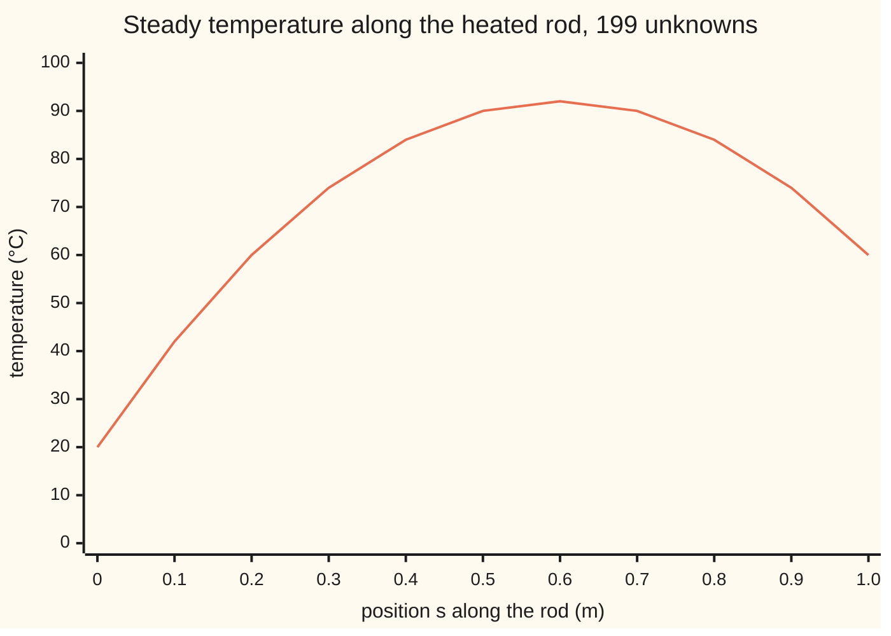
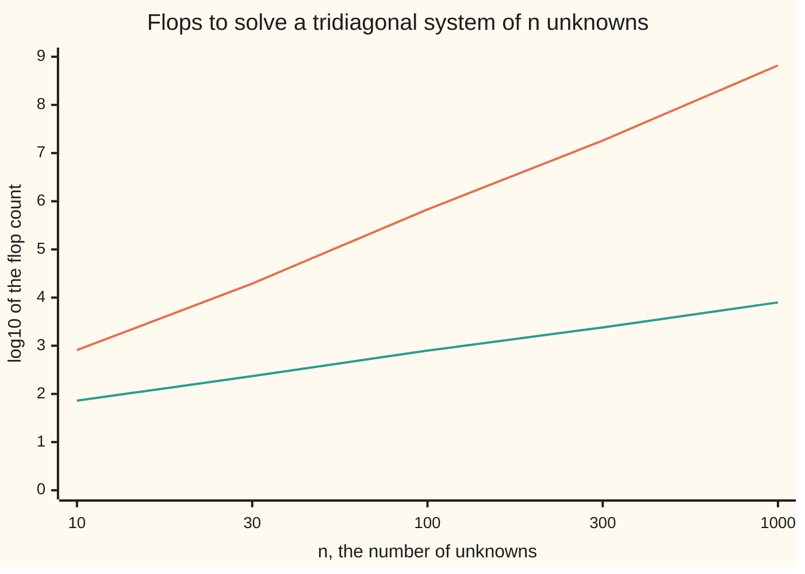

# The Thomas algorithm: a chain of unknowns solved in one sweep down and one back

[Syllabus](../../../SYLLABUS.md) → [Numerical analysis](../README.md) → [Numerical Linear Algebra](../README.md#s03) → The Thomas algorithm

---

## General Overview

A steel rod 1 m long has its left end clamped in a 20 °C block and its right end in a 60 °C block. An electric current heats it evenly along its length. Where is it hottest, and how hot? The rod's numbers on this card are illustrative.

Split the rod into 200 segments, 5 mm each. That gives 199 inside points, each with an unknown temperature. In steady state, each point's temperature is tied only to its two neighbours: heat flows in from one side and out to the other. So the 199 equations form a chain. Each one holds three unknowns, and its neighbour shares two of them.

A matrix built this way is **tridiagonal**: its only nonzero entries sit on the main diagonal and the two diagonals beside it. Treated as a full 199 by 199 system, elimination costs 5,312,902 **flops** (one flop is one floating-point add, subtract, multiply or divide). The **Thomas algorithm** solves it in 1,585 flops, about 3,352 times fewer, and stores 796 numbers instead of 39,601. It answers: hottest at 0.600 m, at 92.000000 °C.

It works in two passes. A sweep down the chain removes each unknown's link to the point before it. A sweep back up then reads each temperature from the one after it.

**Gaussian elimination on a tridiagonal matrix touches only the three diagonals, so a chain of n unknowns is solved in 8n − 7 flops; and when each diagonal entry is at least as big as its two neighbours together, strictly so in the first row and with no link in the chain missing, no pivot is zero and the factors cannot grow.**

**What kind of fact this is:** a method. Its flop count and its pivot bound are theorems, proved on this card in Why it works. Its backward stability is a theorem stated here with its source.

### The picture: the rod's temperature



The line is the Thomas solution, read every 20th point, with the two held ends added. The heating lifts the middle; the hotter right end pushes the peak right of centre, to 0.6 m.

---

## The formula

Notation first, in words. The system is $Ax = d$: $A$ is the matrix, $x$ the list of unknowns (here the temperatures, in °C), $d$ the right side. Row $i$ has three entries: $a_i$ below the diagonal, $b_i$ on it, $c_i$ above it. Row 1 has no $a_1$ and row $n$ has no $c_n$.

$$a_i x_{i-1} + b_i x_i + c_i x_{i+1} = d_i, \qquad i = 1, \dots, n.$$

**Sweep down**, for $i = 2, \dots, n$, starting from $p_1 = b_1$ and $y_1 = d_1$:

$$l_i = \frac{a_i}{p_{i-1}}, \qquad p_i = b_i - l_i c_{i-1}, \qquad y_i = d_i - l_i y_{i-1}.$$

**Sweep back**, for $i = n-1$ down to $1$:

$$x_n = \frac{y_n}{p_n}, \qquad x_i = \frac{y_i - c_i x_{i+1}}{p_i}.$$

**Read it aloud:** going down, use each row's pivot to clear the entry below it and carry the right side along; going back, the last row has one unknown, and each row above then has one unknown left.

The cost and the safety rule are two more lines:

$$F(n) = 8n - 7 \text{ flops}$$

$$\lvert b_i\rvert \ge \lvert a_i\rvert + \lvert c_i\rvert \text{ in every row}, \quad \lvert b_1\rvert > \lvert c_1\rvert, \quad \text{every } a_i \ne 0 \;\Longrightarrow\; \lvert p_i\rvert > \lvert b_i\rvert - \lvert a_i\rvert \text{ for } i \ge 2.$$

**Read it aloud:** the work is eight flops per unknown, less seven; and if each diagonal entry is at least as big as its two neighbours together, strictly bigger than its one neighbour in the first row, and no entry below the diagonal is zero, then every pivot after the first keeps more than the margin $\lvert b_i\rvert - \lvert a_i\rvert$, so no pivot is zero.

| Symbol | Plain meaning | In our example | Push it up and the answer… |
| --- | --- | --- | --- |
| $n$, $h$ | unknowns; segment length | 199; 0.005 m | $n$ up: flops grow in step with $n$ |
| $A$, $L$, $U$, $P$ | the matrix; its two factors, $A = LU$; the row swaps, $PA = LU$ | 199 by 199, three diagonals; $P$ swaps nothing | — |
| $a_i$, $b_i$, $c_i$ | entries below, on and above the diagonal in row $i$ | −1, 2, −1 | $b_i$ up: bigger margin, safer pivots |
| $d_i$ | right side of row $i$ | 0.0100; row 1 adds 20, row 199 adds 60 | temperatures rise |
| $x_i$, $\hat{x}$ | the unknowns; $\hat{x}$, "x-hat", is the computed $x$ | $x_{120}$ = 92.000000 °C | — |
| $l_i$, $p_i$ | multiplier: how much of row $i-1$ to subtract from row $i$; pivot: the diagonal entry left in row $i$ after clearing | row 2: −0.500000; pivots 2.000000, 1.500000, …, 1.005025 | — |
| $y_i$ | the right side after the sweep down | 20.010000, 10.015000, … | — |
| $s$, $T(s)$, $k$, $q$ | position along the rod; exact temperature there; conductivity; heat made per cubic metre | 0.6 m, 92 °C; 50 W/(m K); 20,000 W/m³ | $q$ up: hotter middle |
| $F(n)$, $E(n)$ | flops for the sweep; for dense elimination | 1,585; 5,312,902 | $E$ grows like $n^3$ |
| $\kappa$, $z$ | condition number $\lVert A\rVert_\infty \lVert A^{-1}\rVert_\infty$; the solution of $Az = (1, \dots, 1)$, whose largest entry is $\lVert A^{-1}\rVert_\infty$ | 20000.0; 5000.0 | $\kappa$ up: more digits at risk |
| $\eta$, $u$, $\delta$, $\Delta A$ | backward error; unit roundoff $2^{-53}$; one flop's relative rounding error, $\lvert\delta\rvert \le u$; the change to $A$ that $\hat{x}$ solves exactly | 6.64e-17 | $\eta$ up: a worse solve |
| $\alpha$, $\Delta t$, $r$ | diffusivity; time step; mesh ratio $\alpha\Delta t/h^2$ | 1.2e-5 m²/s; 10 s; 4.8 | $r$ up: margin $1 + r$ grows, still safe |

The steady rod obeys $-kT'' = q$: the curvature of the temperature, times the conductivity, balances the heat made. Its exact answer is the parabola $T(s) = 20 + 40s + 200\,s(1-s)$.

### When it holds

- **Diagonal dominance.** Each $\lvert b_i\rvert$ is at least $\lvert a_i\rvert + \lvert c_i\rvert$, strictly in row 1, with every $a_i$ nonzero. Without it a pivot can be tiny: a well-conditioned 3 by 3 matrix below comes out wrong in the fifth digit.
- **Tridiagonal shape.** One entry below each pivot. A matrix with a few more diagonals (a band) needs the general banded LU; a network with loops needs sparse methods.
- **No row swaps.** The sweep never swaps rows, which is what keeps the band intact. Dominance is what makes skipping the swaps safe.
- **A small $\kappa$ for a small forward error.** The sweep gives a tiny backward error; the forward error is up to $\kappa$ times larger.

---

## Why it works

### Step 0: elimination only ever touches what is already nonzero

Gaussian elimination ([Gaussian elimination](../../03-Algebra/05-Solving%20Systems/02-gaussian-elimination.md)) clears each column below its pivot by subtracting a multiple of the pivot row. In a tridiagonal matrix the column has one entry below the pivot. The pivot row has one entry to the right of the pivot. So one subtraction changes one diagonal entry and one right side, and no new nonzero appears. Everything outside the three diagonals stays zero, so it never needs storing or touching.

The rod's system comes from the centred second difference of [Finite differences](../../08-Differential%20equations%20and%20dynamics/07-Series%20Solutions%20and%20Boundary%20Problems/07-finite-differences-for-boundary-problems.md), which already runs this sweep on a sagging strap. This card adds the factorisation, the exact count, the pivot proof and the error bound.

### Step 1: the sweep is an LU factorisation on a band

[LU with partial pivoting](02-lu-decomposition-and-pivoting.md) writes $PA = LU$: $L$ lower triangular with ones on its diagonal, $U$ upper triangular, $P$ a row swap. Here $P$ is the identity. $L$ has the multipliers $l_i$ just below its diagonal. $U$ has the pivots $p_i$ on its diagonal and the original $c_i$ just above it. Multiply them back:

- the entry below the diagonal is $l_i p_{i-1} = a_i$;
- the diagonal entry is $l_i c_{i-1} + p_i = b_i$;
- the entry above is $c_i$.

So $A = LU$ exactly. The sweep down solves $Ly = d$; the sweep back solves $Ux = y$.

The check runs a dense 199 by 199 elimination with partial pivoting beside the sweep. On the rod no swap is needed, the extra work is all arithmetic on zeros, and the two answers agree bit for bit.

### Step 2: the count is exactly 8n − 7 flops

Count each line once.

| Part | Flops per row | Rows | Total |
| --- | --- | --- | --- |
| multiplier $l_i$ | 1 divide | $n-1$ | $n-1$ |
| pivot $p_i$ | 1 multiply, 1 subtract | $n-1$ | $2(n-1)$ |
| right side $y_i$ | 1 multiply, 1 subtract | $n-1$ | $2(n-1)$ |
| last unknown $x_n$ | 1 divide | 1 | 1 |
| back rows $x_i$ | multiply, subtract, divide | $n-1$ | $3(n-1)$ |

The total is $8(n-1) + 1 = 8n - 7$: 1,585 at $n$ = 199. Dense elimination costs $E(n) = \tfrac23 n^3 + \tfrac32 n^2 - \tfrac76 n$ ([Counting the work](../01-Floating%20Point%20and%20Error/08-operation-counts-and-cost.md)): 5,312,902. Both checks count every flop as it happens and match both formulas.

When pivots repeat across many right sides, as in time stepping, store $l_i$ and $p_i$ once. Each new right side then costs $5n - 4$ flops.

### The picture: flops against size



Orange, the top line: dense elimination, $E(n)$. Teal, the bottom line: the Thomas sweep, $8n - 7$. Each step up is ten times more work. Ten times more unknowns costs the sweep ten times more and dense elimination about a thousand times more.

### Step 3: diagonal dominance keeps every pivot away from zero

The idea in words: a pivot is the diagonal entry minus a share of the row above. If every earlier ratio $c_{i-1}/p_{i-1}$ has size below 1, that share is smaller than $\lvert a_i\rvert$. So the pivot keeps more than $\lvert b_i\rvert - \lvert a_i\rvert$, and that is at least $\lvert c_i\rvert$, which keeps the next ratio below 1 too. The bound passes down the chain.

<details>
<summary>Detailed proof: every pivot exceeds |b_i| − |a_i|</summary>

**Assume** $\lvert b_i\rvert \ge \lvert a_i\rvert + \lvert c_i\rvert$ for every row, $\lvert b_1\rvert > \lvert c_1\rvert$, and $a_i \ne 0$ for $i \ge 2$.

**Claim.** For $i < n$, $\lvert c_i\rvert < \lvert p_i\rvert$; and for every $i \ge 2$, $\lvert p_i\rvert > \lvert b_i\rvert - \lvert a_i\rvert$.

**Start.** $p_1 = b_1$, and $\lvert b_1\rvert > \lvert c_1\rvert$.

**Step.** Suppose $\lvert c_{i-1}\rvert < \lvert p_{i-1}\rvert$. Then

$$\lvert p_i\rvert = \left\lvert b_i - a_i\frac{c_{i-1}}{p_{i-1}}\right\rvert \ge \lvert b_i\rvert - \lvert a_i\rvert\frac{\lvert c_{i-1}\rvert}{\lvert p_{i-1}\rvert} > \lvert b_i\rvert - \lvert a_i\rvert \ge \lvert c_i\rvert.$$

The strict sign uses $a_i \ne 0$ and the ratio below 1. That gives both halves of the claim for row $i$. For $i = n$ there is no $c_n$, and $\lvert p_n\rvert > \lvert b_n\rvert - \lvert a_n\rvert \ge 0$, so the last pivot is nonzero too.

**No growth.** Compare $\lvert L\rvert\lvert U\rvert$ (the factors with every entry made positive, multiplied) with $\lvert A\rvert$, entry by entry. Below the diagonal it is $\lvert l_i\rvert\lvert p_{i-1}\rvert = \lvert a_i\rvert$. Above it is $\lvert c_i\rvert$. On the diagonal it is $\lvert l_i\rvert\lvert c_{i-1}\rvert + \lvert p_i\rvert$. The first term is $\lvert a_i\rvert \lvert c_{i-1}\rvert/\lvert p_{i-1}\rvert < \lvert a_i\rvert$, and the same line read the other way gives $\lvert p_i\rvert < \lvert b_i\rvert + \lvert a_i\rvert$. So the diagonal entry is below $\lvert b_i\rvert + 2\lvert a_i\rvert \le 3\lvert b_i\rvert$. Hence $\lvert L\rvert\lvert U\rvert \le 3\lvert A\rvert$: the factors never grow past the size of $A$.

</details>

On the rod the margin is $2 - 1 = 1$. The pivots are $p_i = (i+1)/i$: 2.000000, 1.500000, 1.333333, down to 1.005025. All stay above 1, as the proof says.

### Step 4: small pivots never appear, so the rounding stays small

The standard model of rounding ([Machine epsilon and cancellation](../01-Floating%20Point%20and%20Error/03-rounding-cancellation-and-machine-epsilon.md)) says each flop is off by a factor $1 + \delta$ with $\lvert\delta\rvert \le u$. Higham's book (chapter 9, in Sources) proves that the computed $\hat{x}$ from the sweep solves a nearby system $(A + \Delta A)\hat{x} = d$. Each entry of $\Delta A$ is at most about $4u$ times the matching entry of $\lvert L\rvert\lvert U\rvert$. For a diagonally dominant tridiagonal $A$, $\lvert L\rvert\lvert U\rvert \le 3\lvert A\rvert$, entry by entry. That makes the sweep backward stable: the computed answer is the exact answer to a slightly changed matrix ([Forward and backward error](../01-Floating%20Point%20and%20Error/06-forward-and-backward-error.md)).

The check measures it. The **backward error** $\eta$ is the residual's size over the sizes of $A$, $\hat{x}$ and $d$:

$$\eta = \frac{\lVert d - A\hat{x}\rVert_\infty}{\lVert A\rVert_\infty\lVert \hat{x}\rVert_\infty + \lVert d\rVert_\infty}.$$

On the rod $\eta$ = 6.64e-17, below $u$. The forward error is then at most about $2\kappa\eta$ in relative terms ([Matrix norms and the condition number](01-matrix-norms-and-the-condition-number.md)).

The condition number needs $\lVert A^{-1}\rVert_\infty$. Every entry of $A^{-1}$ is positive here, so its largest row sum is the largest entry of $z$ in $Az = (1, 1, \dots, 1)$. That $z$ is the parabola $i(n+1-i)/2$, peaking at 5000.0. So $\kappa$ = 4 × 5000.0 = 20000.0.

| Quantity | Value | Kind |
| --- | --- | --- |
| largest true error against the parabola | 1.34e-12 °C | true error |
| relative true error | 1.45e-14 | true error |
| bound $2\kappa\eta$ | 2.66e-12 | bound |
| true over bound | 0.005 | ratio |

In exact arithmetic the grid equals the parabola at every point, because the centred difference is exact on a parabola. So the true error is all rounding, and it sits well inside the bound. The trouble the rod can have is conditioning, not stability.

### Step 5: the same chain in implicit steps and splines

The pattern appears wherever each unknown talks only to its two neighbours.

- **An implicit heat step.** Switch the current off. One backward-Euler step of the cooling rod solves $-r\,T_{i-1} + (1 + 2r)T_i - r\,T_{i+1} = $ old $T_i$, with $r = \alpha\Delta t/h^2$ ([Stepping the heat equation on a grid](../../08-Differential%20equations%20and%20dynamics/10-The%20Classical%20PDEs/09-finite-differences-for-the-heat-equation.md); that card writes the diffusivity as κ, but here κ is the condition number, so the diffusivity is α). With $\alpha$ = 1.2e-5 m²/s and $\Delta t$ = 10 s, $r$ = 4.8. The margin is $1 + 2r - r = 1 + r$ = 5.8 for any $r$, so the step is safe at any size. The smallest pivot is 7.547221. The middle cools from 90.000000 to 89.952000 °C in one step, with residual 1.7e-13.
- **A cubic spline.** The unknowns are the curve's second derivatives at the knots. With equal spacing each row reads 1, 4, 1 ([Cubic splines](../04-Interpolation%20and%20Approximation/05-splines.md)). The margin is 3. The pivots run 4, 3.750000, 3.733333, settling at 2 + √3 = 3.732051.
- **An option grid.** [Pricing on a grid](../../12-Financial%20mathematics/06-Numerical%20Methods%20for%20Pricing/07-finite-differences-for-the-black-scholes-equation.md) solves one tridiagonal system per time step. Its dominant diagonal is what keeps the sweep from dividing by anything near zero.

---

## Worked numbers, by hand

The rod: $n$ = 199, every $a_i = c_i = -1$, $b_i = 2$. The right side is $h^2 q/k$ = 0.0100 in each row, plus 20 in row 1 and 60 in row 199.

| Step | Arithmetic | Value |
| --- | --- | --- |
| row 1 | $p_1 = 2$, $y_1 = 0.01 + 20$ | 2.000000, 20.010000 |
| row 2 | $l_2 = -1/2$; $p_2 = 2 - (-0.5)(-1)$; $y_2 = 0.01 + 0.5 \times 20.01$ | −0.500000, 1.500000, 10.015000 |
| row 3 | $l_3 = -1/1.5$; $p_3 = 2 - 0.666667$; $y_3 = 0.01 + 0.666667 \times 10.015$ | −0.666667, 1.333333, 6.686667 |
| row 199 | same pattern: $l_{199} = -198/199$, $p_{199} = 200/199$ | −0.994975, 1.005025, 61.100503 |
| back, point 199 | $x_{199} = 61.100503 / 1.005025$ | 60.795000 |
| point 198 | $x_{198} = (y_{198} + 60.795) / p_{198}$ | 61.580000 |
| point 197 | same step | 62.355000 |
| point 120, $s$ = 0.6 m | 77 more back steps | **92.000000 °C** |

The rod peaks at 92.000000 °C, 0.600 m from the cool end. The middle reads 90.000000 °C. Both match the parabola $T(s)$.

### What breaks if you drop a piece

| Mistake | Comes out at | What went wrong |
| --- | --- | --- |
| Ends left off the right side | hottest 50.000000 °C at 0.500 m | the held 20 and 60 °C belong in rows 1 and 199 |
| Right side not swept down | 36.610995 °C at 0.6 m | the back sweep needs $y_i$, not $d_i$ |
| Dense elimination on a band | 5,312,902 flops, 3,352 times the sweep | the zeros were treated as data |
| A matrix that is not dominant | error 0.00002220 on a 3 by 3 system | a pivot of 1.000e-12 |

The last row is the broken hypothesis. Take $b = (1, 1 + 10^{-12}, 1)$ and every $a_i$ and $c_i$ equal to 1, with true answer 0.3, 0.6, 0.9. Its $\kappa$ is only 9.000: a well-conditioned problem. The second pivot is 1.000e-12 and the third is −999911107319. The sweep returns 0.299978, 0.600022, 0.900000, wrong in the fifth digit. Elimination with row swaps returns an error of 2.22e-16. This is a stability failure, not a conditioning one.

---

## Code, from first principles, and it actually runs

The code solves the rod three ways. Road one is the Thomas sweep. Road two is the exact parabola. Road three is dense elimination with partial pivoting, which must match the sweep bit for bit. Both programs count flops as they go and compare with $8n - 7$ and $E(n)$. They also bound the true error by $2\kappa\eta$, test the pivot bound on the rod, the heat step and the spline, and print the broken 3 by 3 case. A 12-unknown chain with varying entries checks the general recurrence against dense elimination, and κ is checked against the row sums of A times the closed-form row sums of $A^{-1}$.

### Python

```python
# Tridiagonal systems and the Thomas algorithm -- the check behind the card.
# Standard library only.  A 1 m rod in 200 segments, ends held at 20 C and 60 C,
# heated inside: -k T'' = q.  Road one: the Thomas sweep.  Road two: the exact
# parabola T(s) = 20 + 40 s + 200 s (1 - s).  Road three: dense elimination.
from math import sqrt, log10

def thomas(a, b, c, d, fl):              # a below, b on, c above the diagonal
    n = len(b)
    p, l, y = [b[0]], [0.0], [d[0]]
    for i in range(1, n):                # sweep down: one multiplier per row
        l.append(a[i] / p[i - 1])
        p.append(b[i] - l[i] * c[i - 1])
        y.append(d[i] - l[i] * y[i - 1])
        fl[0] += 5
    x = [0.0] * n
    x[n - 1] = y[n - 1] / p[n - 1]
    fl[0] += 1
    for i in range(n - 2, -1, -1):       # sweep back: last unknown first
        x[i] = (y[i] - c[i] * x[i + 1]) / p[i]
        fl[0] += 3
    return p, l, y, x

def dense(a, b, c, d, fl):               # full elimination, partial pivoting
    n = len(b)
    M = [[0.0] * n + [d[i]] for i in range(n)]
    for i in range(n):
        M[i][i] = b[i]
        if i > 0: M[i][i - 1] = a[i]
        if i < n - 1: M[i][i + 1] = c[i]
    for k in range(n):
        r = max(range(k, n), key=lambda i: abs(M[i][k]))
        M[k], M[r] = M[r], M[k]
        for i in range(k + 1, n):
            m = M[i][k] / M[k][k]
            for j in range(k + 1, n + 1):
                M[i][j] -= m * M[k][j]
            fl[0] += 1 + 2 * (n - k)
    x = [0.0] * n
    for i in range(n - 1, -1, -1):
        s = M[i][n]
        for j in range(i + 1, n):
            s -= M[i][j] * x[j]
        x[i] = s / M[i][i]
        fl[0] += 2 * (n - 1 - i) + 1
    return x

def E(n): return (4 * n**3 + 9 * n**2 - 7 * n) // 6   # dense flops, exact
def F(n): return 8 * n - 7                           # Thomas flops, exact
def resid(a, b, c, d, x):                # d - A x, row by row
    n = len(b)
    return [d[i] - (a[i] * x[i - 1] if i > 0 else 0.0) - b[i] * x[i]
            - (c[i] * x[i + 1] if i < n - 1 else 0.0) for i in range(n)]

n, h, k, q = 199, 0.005, 50.0, 20000.0   # illustrative steel-like k and heating q
a, b, c = [-1.0] * n, [2.0] * n, [-1.0] * n
d = [h * h * q / k] * n
d[0] += 20.0; d[-1] += 60.0              # the held ends move to the right side
f1, f2 = [0], [0]
p, l, y, x = thomas(a, b, c, d, f1)
xd = dense(a, b, c, d, f2)
ex = [20 + 40 * (i * h) + 200 * (i * h) * (1 - i * h) for i in range(1, n + 1)]
print(f"rod: n = {n} unknowns, h = {h:.3f} m, right side h^2 q/k = {d[1]:.4f}, ends 20 and 60 C")
for i in (0, 1, 2):
    print(f"row {i + 1}: multiplier {l[i]:.6f}, pivot {p[i]:.6f}, swept right side {y[i]:.6f}")
print(f"row {n}: multiplier {l[-1]:.6f}, pivot {p[-1]:.6f}, swept right side {y[-1]:.6f}")
print(f"back: T{n}, T{n - 1}, T{n - 2} =", " ".join(f"{v:.6f}" for v in x[-1:-4:-1]))
j = max(range(n), key=lambda i: x[i])
print(f"hottest node: s = {(j + 1) * h:.3f} m, T = {x[j]:.6f} C; middle T = {x[n // 2]:.6f} C")
print("chart, T at s = 0, 0.1, ..., 1.0 m:", " ".join(f"{v:.2f}" for v in [20.0] + x[round(0.1 / h) - 1::round(0.1 / h)] + [60.0]))
print(f"flops: Thomas counted {f1[0]}, 8n - 7 = {F(n)}; dense counted {f2[0]}, E(n) = {E(n)}")
print(f"dense / Thomas = {f2[0] / f1[0]:.1f}; storage 4n = {4 * n} numbers against n^2 = {n * n}")
print("chart, log10 flops at n = 10, 30, 100, 300, 1000:")
print("  Thomas", " ".join(f"{log10(F(m)):.2f}" for m in (10, 30, 100, 300, 1000)))
print("  dense ", " ".join(f"{log10(E(m)):.2f}" for m in (10, 30, 100, 300, 1000)))
same = all(u == v for u, v in zip(x, xd))
print(f"Thomas and dense elimination agree bit for bit: {same}")
err = max(abs(u - v) for u, v in zip(x, ex))
z = thomas(a, b, c, [1.0] * n, [0])[3]   # A z = ones gives the row sums of A^-1
zc = [(i + 1) * (n - i) / 2 for i in range(n)]
kap = 4.0 * max(z)
eta = max(map(abs, resid(a, b, c, d, x))) / (4.0 * max(map(abs, x)) + max(map(abs, d)))
rel, bnd = err / max(map(abs, ex)), 2 * kap * eta
print(f"true error against the parabola {err:.2e} C, relative {rel:.2e}")
print(f"kappa_inf = 4 x {max(z):.1f} = {kap:.1f}; backward error eta = {eta:.2e}")
print(f"bound 2 kappa eta = {bnd:.2e}; true / bound = {rel / bnd:.3f}")
print(f"smallest pivot {min(p):.6f}, bound |b| - |a| = 1; pivots stay above 1: {min(p) > 1}")
# the same pattern: one implicit heat step (r = 4.8) and a natural cubic spline
alpha, dt = 1.2e-5, 10.0
r = alpha * dt / h**2
bi = [1 + 2 * r] * n
dh = x[:]; dh[0] += r * 20.0; dh[-1] += r * 60.0     # heating switched off
ph, _, _, xh = thomas([-r] * n, bi, [-r] * n, dh, [0])
rh = max(map(abs, resid([-r] * n, bi, [-r] * n, dh, xh)))
print(f"implicit step: r = {r:.1f}, smallest pivot {min(ph):.6f}, bound 1 + r = {1 + r:.1f}, "
      f"limit {(bi[0] + sqrt(bi[0]**2 - 4 * r * r)) / 2:.6f}")
print(f"  middle after one 10 s step: {x[n // 2]:.6f} -> {xh[n // 2]:.6f} C; residual {rh:.1e}")
ps = thomas([1.0] * n, [4.0] * n, [1.0] * n, [0.0] * n, [0])[0]
print(f"spline system: pivots 4, {ps[1]:.6f}, {ps[2]:.6f} ... smallest {min(ps):.6f}; "
      f"bound 3, limit 2 + sqrt 3 = {2 + sqrt(3):.6f}")
# what breaks
x0 = thomas(a, b, c, [h * h * q / k] * n, [0])[3]
yb = d[:]                                # forgot to sweep the right side
xb = [0.0] * n; xb[-1] = yb[-1] / p[-1]
for i in range(n - 2, -1, -1): xb[i] = (yb[i] - c[i] * xb[i + 1]) / p[i]
print(f"mistake, ends left off the right side: hottest {max(x0):.6f} C at s = {(x0.index(max(x0)) + 1) * h:.3f} m")
print(f"mistake, right side not swept: T at s = 0.6 m reads {xb[round(0.6 / h) - 1]:.6f} C")
print(f"mistake, dense count for a band: {E(n)} flops, {E(n) / F(n):.0f} times the sweep")
eps = 1e-12                              # not dominant: a tiny pivot appears
A3 = ([0.0, 1.0, 1.0], [1.0, 1.0 + eps, 1.0], [1.0, 1.0, 0.0])
d3 = [0.3 + 0.6, 0.3 + (1.0 + eps) * 0.6 + 0.9, 0.6 + 0.9]   # true x = 0.3, 0.6, 0.9
p3, _, _, x3 = thomas(*A3, d3, [0])
x3d = dense(*A3, d3, [0])
inv = [dense(*A3, [float(i == j) for i in range(3)], [0]) for j in range(3)]
k3 = 3.0 * max(sum(abs(col[i]) for col in inv) for i in range(3))
e3 = max(abs(u - v) for u, v in zip(x3, (0.3, 0.6, 0.9)))
e3d = max(abs(u - v) for u, v in zip(x3d, (0.3, 0.6, 0.9)))
print(f"break: eps = {eps:.0e}, pivots {p3[0]:.1f}, {p3[1]:.3e}, {p3[2]:.0f}; kappa_inf = {k3:.3f}")
print("  sweep gives", " ".join(f"{v:.6f}" for v in x3), f"error {e3:.8f}; pivoted elimination error {e3d:.2e}")
va = [0.0] + [-(1.0 + i % 3) for i in range(1, 12)]   # a dominant chain with varying entries
vb, vc = [5.0 + i % 5 for i in range(12)], [0.25 + 0.5 * (i % 4) for i in range(11)] + [0.0]
vd = [float(i + 1) for i in range(12)]
vx, vxd = thomas(va, vb, vc, vd, [0])[3], dense(va, vb, vc, vd, [0])
rows = [abs(a[i]) * (i > 0) + abs(b[i]) + abs(c[i]) * (i < n - 1) for i in range(n)]   # row sums of A

assert f1[0] == F(n) and f2[0] == E(n)                # counted flops = the formulas
assert same                                           # the sweep is elimination on a band
assert max(abs(u - v) for u, v in zip(z, zc)) < 1e-12 * max(zc)  # row sums of A^-1 = i(n+1-i)/2
assert rel <= bnd and err < 1e-10                     # forward error inside kappa x eta
assert all(abs(p[i] - (i + 2) / (i + 1)) < 1e-12 for i in range(n))   # p_i = (i+1)/i
assert min(ph) >= 1 + r and min(ps) >= 3 and rh < 1e-10                # dominance bound
assert e3 > 1e-6 > e3d                                # no dominance: the sweep loses digits
assert max(abs(u - v) for u, v in zip(vx, vxd)) < 1e-12 * max(map(abs, vxd))   # general recurrence = dense
assert abs(kap - max(rows) * max(zc)) < 1e-9 * kap    # kappa = ||A||_inf x closed-form ||A^-1||_inf
print("ALL CHECKS PASS")
```

**Ran 2026-11-11 on macOS, Python 3.14.10, standard library only. All checks passed. Output, pasted from the run:**

```
rod: n = 199 unknowns, h = 0.005 m, right side h^2 q/k = 0.0100, ends 20 and 60 C
row 1: multiplier 0.000000, pivot 2.000000, swept right side 20.010000
row 2: multiplier -0.500000, pivot 1.500000, swept right side 10.015000
row 3: multiplier -0.666667, pivot 1.333333, swept right side 6.686667
row 199: multiplier -0.994975, pivot 1.005025, swept right side 61.100503
back: T199, T198, T197 = 60.795000 61.580000 62.355000
hottest node: s = 0.600 m, T = 92.000000 C; middle T = 90.000000 C
chart, T at s = 0, 0.1, ..., 1.0 m: 20.00 42.00 60.00 74.00 84.00 90.00 92.00 90.00 84.00 74.00 60.00
flops: Thomas counted 1585, 8n - 7 = 1585; dense counted 5312902, E(n) = 5312902
dense / Thomas = 3352.0; storage 4n = 796 numbers against n^2 = 39601
chart, log10 flops at n = 10, 30, 100, 300, 1000:
  Thomas 1.86 2.37 2.90 3.38 3.90
  dense  2.91 4.29 5.83 7.26 8.82
Thomas and dense elimination agree bit for bit: True
true error against the parabola 1.34e-12 C, relative 1.45e-14
kappa_inf = 4 x 5000.0 = 20000.0; backward error eta = 6.64e-17
bound 2 kappa eta = 2.66e-12; true / bound = 0.005
smallest pivot 1.005025, bound |b| - |a| = 1; pivots stay above 1: True
implicit step: r = 4.8, smallest pivot 7.547221, bound 1 + r = 5.8, limit 7.547221
  middle after one 10 s step: 90.000000 -> 89.952000 C; residual 1.7e-13
spline system: pivots 4, 3.750000, 3.733333 ... smallest 3.732051; bound 3, limit 2 + sqrt 3 = 3.732051
mistake, ends left off the right side: hottest 50.000000 C at s = 0.500 m
mistake, right side not swept: T at s = 0.6 m reads 36.610995 C
mistake, dense count for a band: 5312902 flops, 3352 times the sweep
break: eps = 1e-12, pivots 1.0, 1.000e-12, -999911107319; kappa_inf = 9.000
  sweep gives 0.299978 0.600022 0.900000 error 0.00002220; pivoted elimination error 2.22e-16
ALL CHECKS PASS
```

### Rust

Same rows and labels; the two outputs agree line for line.

```rust
// Tridiagonal systems and the Thomas algorithm -- the same check as the Python, in Rust.
// No crates.  A 1 m rod in 200 segments, ends held at 20 C and 60 C,
// heated inside: -k T'' = q.  Road one: the Thomas sweep.  Road two: the exact
// parabola T(s) = 20 + 40 s + 200 s (1 - s).  Road three: dense elimination.

fn thomas(a: &[f64], b: &[f64], c: &[f64], d: &[f64], fl: &mut u64) -> (Vec<f64>, Vec<f64>, Vec<f64>, Vec<f64>) {
    let n = b.len();
    let (mut p, mut l, mut y) = (vec![b[0]], vec![0.0], vec![d[0]]);
    for i in 1..n {                                   // sweep down: one multiplier per row
        l.push(a[i] / p[i - 1]);
        p.push(b[i] - l[i] * c[i - 1]);
        y.push(d[i] - l[i] * y[i - 1]);
        *fl += 5;
    }
    let mut x = vec![0.0; n];
    x[n - 1] = y[n - 1] / p[n - 1];
    *fl += 1;
    for i in (0..n - 1).rev() {                       // sweep back: last unknown first
        x[i] = (y[i] - c[i] * x[i + 1]) / p[i];
        *fl += 3;
    }
    (p, l, y, x)
}

fn dense(a: &[f64], b: &[f64], c: &[f64], d: &[f64], fl: &mut u64) -> Vec<f64> {
    let n = b.len();                                  // full elimination, partial pivoting
    let mut m: Vec<Vec<f64>> = (0..n).map(|i| { let mut r = vec![0.0; n + 1]; r[n] = d[i]; r }).collect();
    for i in 0..n {
        m[i][i] = b[i];
        if i > 0 { m[i][i - 1] = a[i]; }
        if i < n - 1 { m[i][i + 1] = c[i]; }
    }
    for k in 0..n {
        let mut r = k;
        for i in k + 1..n { if m[i][k].abs() > m[r][k].abs() { r = i; } }
        m.swap(k, r);
        for i in k + 1..n {
            let f = m[i][k] / m[k][k];
            for j in k + 1..=n { let t = f * m[k][j]; m[i][j] -= t; }
            *fl += 1 + 2 * (n - k) as u64;
        }
    }
    let mut x = vec![0.0; n];
    for i in (0..n).rev() {
        let mut s = m[i][n];
        for j in i + 1..n { s -= m[i][j] * x[j]; }
        x[i] = s / m[i][i];
        *fl += 2 * (n - 1 - i) as u64 + 1;
    }
    x
}

fn e_flops(n: u64) -> u64 { (4 * n * n * n + 9 * n * n - 7 * n) / 6 }   // dense flops, exact
fn f_flops(n: u64) -> u64 { 8 * n - 7 }                                // Thomas flops, exact
fn resid(a: &[f64], b: &[f64], c: &[f64], d: &[f64], x: &[f64]) -> Vec<f64> {
    let n = b.len();                                  // d - A x, row by row
    (0..n).map(|i| d[i] - (if i > 0 { a[i] * x[i - 1] } else { 0.0 }) - b[i] * x[i]
        - (if i < n - 1 { c[i] * x[i + 1] } else { 0.0 })).collect()
}
fn amax(v: &[f64]) -> f64 { v.iter().fold(0.0, |m, t| m.max(t.abs())) }
fn vmax(v: &[f64]) -> f64 { v.iter().cloned().fold(f64::MIN, f64::max) }
fn vmin(v: &[f64]) -> f64 { v.iter().cloned().fold(f64::MAX, f64::min) }
fn row(v: &[f64], d: usize) -> String { v.iter().map(|t| format!("{:.*}", d, t)).collect::<Vec<_>>().join(" ") }
fn argmax(v: &[f64]) -> usize { let mut j = 0; for i in 0..v.len() { if v[i] > v[j] { j = i; } } j }

fn main() {
    let (n, h, k, q) = (199usize, 0.005, 50.0, 20000.0);  // illustrative steel-like k and heating q
    let (a, b, c) = (vec![-1.0; n], vec![2.0; n], vec![-1.0; n]);
    let mut d = vec![h * h * q / k; n];
    d[0] += 20.0; d[n - 1] += 60.0;                   // the held ends move to the right side
    let (mut f1, mut f2, mut z0) = (0u64, 0u64, 0u64);
    let (p, l, y, x) = thomas(&a, &b, &c, &d, &mut f1);
    let xd = dense(&a, &b, &c, &d, &mut f2);
    let ex: Vec<f64> = (1..=n).map(|i| { let s = i as f64 * h; 20.0 + 40.0 * s + 200.0 * s * (1.0 - s) }).collect();
    println!("rod: n = {} unknowns, h = {:.3} m, right side h^2 q/k = {:.4}, ends 20 and 60 C", n, h, d[1]);
    for i in 0..3 {
        println!("row {}: multiplier {:.6}, pivot {:.6}, swept right side {:.6}", i + 1, l[i], p[i], y[i]);
    }
    println!("row {}: multiplier {:.6}, pivot {:.6}, swept right side {:.6}", n, l[n - 1], p[n - 1], y[n - 1]);
    println!("back: T{}, T{}, T{} = {:.6} {:.6} {:.6}", n, n - 1, n - 2, x[n - 1], x[n - 2], x[n - 3]);
    let j = argmax(&x);
    println!("hottest node: s = {:.3} m, T = {:.6} C; middle T = {:.6} C", (j + 1) as f64 * h, x[j], x[n / 2]);
    let mut ch = vec![20.0];
    let st = (0.1 / h).round() as usize;              // grid points per 0.1 m
    for i in (st - 1..n).step_by(st) { ch.push(x[i]); }
    ch.push(60.0);
    println!("chart, T at s = 0, 0.1, ..., 1.0 m: {}", row(&ch, 2));
    let nn = n as u64;
    println!("flops: Thomas counted {}, 8n - 7 = {}; dense counted {}, E(n) = {}", f1, f_flops(nn), f2, e_flops(nn));
    println!("dense / Thomas = {:.1}; storage 4n = {} numbers against n^2 = {}", f2 as f64 / f1 as f64, 4 * n, n * n);
    println!("chart, log10 flops at n = 10, 30, 100, 300, 1000:");
    let ms = [10u64, 30, 100, 300, 1000];
    println!("  Thomas {}", row(&ms.iter().map(|&m| (f_flops(m) as f64).log10()).collect::<Vec<_>>(), 2));
    println!("  dense  {}", row(&ms.iter().map(|&m| (e_flops(m) as f64).log10()).collect::<Vec<_>>(), 2));
    let same = x.iter().zip(&xd).all(|(u, v)| u == v);
    println!("Thomas and dense elimination agree bit for bit: {}", if same { "True" } else { "False" });
    let err = x.iter().zip(&ex).fold(0.0f64, |m, (u, v)| m.max((u - v).abs()));
    let z = thomas(&a, &b, &c, &vec![1.0; n], &mut z0).3;      // A z = ones gives the row sums of A^-1
    let zc: Vec<f64> = (0..n).map(|i| (i + 1) as f64 * (n - i) as f64 / 2.0).collect();
    let kap = 4.0 * vmax(&z);
    let eta = amax(&resid(&a, &b, &c, &d, &x)) / (4.0 * amax(&x) + amax(&d));
    let (rel, bnd) = (err / amax(&ex), 2.0 * kap * eta);
    println!("true error against the parabola {:.2e} C, relative {:.2e}", err, rel);
    println!("kappa_inf = 4 x {:.1} = {:.1}; backward error eta = {:.2e}", vmax(&z), kap, eta);
    println!("bound 2 kappa eta = {:.2e}; true / bound = {:.3}", bnd, rel / bnd);
    println!("smallest pivot {:.6}, bound |b| - |a| = 1; pivots stay above 1: {}", vmin(&p), if vmin(&p) > 1.0 { "True" } else { "False" });
    // the same pattern: one implicit heat step (r = 4.8) and a natural cubic spline
    let (alpha, dt) = (1.2e-5, 10.0);
    let r = alpha * dt / (h * h);
    let (ar, bi) = (vec![-r; n], vec![1.0 + 2.0 * r; n]);
    let mut dh = x.clone();
    dh[0] += r * 20.0; dh[n - 1] += r * 60.0;         // heating switched off
    let (ph, _, _, xh) = thomas(&ar, &bi, &ar, &dh, &mut z0);
    let rh = amax(&resid(&ar, &bi, &ar, &dh, &xh));
    println!("implicit step: r = {:.1}, smallest pivot {:.6}, bound 1 + r = {:.1}, limit {:.6}",
             r, vmin(&ph), 1.0 + r, (bi[0] + (bi[0] * bi[0] - 4.0 * r * r).sqrt()) / 2.0);
    println!("  middle after one 10 s step: {:.6} -> {:.6} C; residual {:.1e}", x[n / 2], xh[n / 2], rh);
    let ps = thomas(&vec![1.0; n], &vec![4.0; n], &vec![1.0; n], &vec![0.0; n], &mut z0).0;
    println!("spline system: pivots 4, {:.6}, {:.6} ... smallest {:.6}; bound 3, limit 2 + sqrt 3 = {:.6}",
             ps[1], ps[2], vmin(&ps), 2.0 + 3.0f64.sqrt());
    // what breaks
    let x0 = thomas(&a, &b, &c, &vec![h * h * q / k; n], &mut z0).3;
    let yb = d.clone();                               // forgot to sweep the right side
    let mut xb = vec![0.0; n];
    xb[n - 1] = yb[n - 1] / p[n - 1];
    for i in (0..n - 1).rev() { xb[i] = (yb[i] - c[i] * xb[i + 1]) / p[i]; }
    println!("mistake, ends left off the right side: hottest {:.6} C at s = {:.3} m", vmax(&x0), (argmax(&x0) + 1) as f64 * h);
    println!("mistake, right side not swept: T at s = 0.6 m reads {:.6} C", xb[(0.6 / h).round() as usize - 1]);
    println!("mistake, dense count for a band: {} flops, {:.0} times the sweep", e_flops(nn), e_flops(nn) as f64 / f_flops(nn) as f64);
    let eps = 1e-12;                                  // not dominant: a tiny pivot appears
    let (a3, b3, c3) = ([0.0, 1.0, 1.0], [1.0, 1.0 + eps, 1.0], [1.0, 1.0, 0.0]);
    let d3 = [0.3 + 0.6, 0.3 + (1.0 + eps) * 0.6 + 0.9, 0.6 + 0.9];   // true x = 0.3, 0.6, 0.9
    let (p3, _, _, x3) = thomas(&a3, &b3, &c3, &d3, &mut z0);
    let x3d = dense(&a3, &b3, &c3, &d3, &mut z0);
    let inv: Vec<Vec<f64>> = (0..3).map(|j| dense(&a3, &b3, &c3, &(0..3).map(|i| if i == j { 1.0 } else { 0.0 }).collect::<Vec<_>>(), &mut z0)).collect();
    let k3 = 3.0 * (0..3).map(|i| inv.iter().map(|col| col[i].abs()).sum::<f64>()).fold(0.0, f64::max);
    let tx = [0.3, 0.6, 0.9];
    let e3 = x3.iter().zip(&tx).fold(0.0f64, |m, (u, v)| m.max((u - v).abs()));
    let e3d = x3d.iter().zip(&tx).fold(0.0f64, |m, (u, v)| m.max((u - v).abs()));
    println!("break: eps = {:.0e}, pivots {:.1}, {:.3e}, {:.0}; kappa_inf = {:.3}", eps, p3[0], p3[1], p3[2], k3);
    println!("  sweep gives {} error {:.8}; pivoted elimination error {:.2e}", row(&x3, 6), e3, e3d);
    let va: Vec<f64> = (0..12).map(|i| if i == 0 { 0.0 } else { -(1.0 + (i % 3) as f64) }).collect(); // a dominant chain with varying entries
    let vb: Vec<f64> = (0..12).map(|i| 5.0 + (i % 5) as f64).collect();
    let vc: Vec<f64> = (0..12).map(|i| if i == 11 { 0.0 } else { 0.25 + 0.5 * (i % 4) as f64 }).collect();
    let vd: Vec<f64> = (0..12).map(|i| (i + 1) as f64).collect();
    let (vx, vxd) = (thomas(&va, &vb, &vc, &vd, &mut z0).3, dense(&va, &vb, &vc, &vd, &mut z0));
    let rows: Vec<f64> = (0..n).map(|i| (if i > 0 { a[i].abs() } else { 0.0 }) + b[i].abs() + if i < n - 1 { c[i].abs() } else { 0.0 }).collect(); // row sums of A

    assert!(f1 == f_flops(nn) && f2 == e_flops(nn));                // counted flops = the formulas
    assert!(same);                                                  // the sweep is elimination on a band
    assert!(z.iter().zip(&zc).all(|(u, v)| (u - v).abs() < 1e-12 * vmax(&zc)));  // row sums of A^-1 = i(n+1-i)/2
    assert!(rel <= bnd && err < 1e-10);                             // forward error inside kappa x eta
    assert!((0..n).all(|i| (p[i] - (i + 2) as f64 / (i + 1) as f64).abs() < 1e-12));   // p_i = (i+1)/i
    assert!(vmin(&ph) >= 1.0 + r && vmin(&ps) >= 3.0 && rh < 1e-10);                  // dominance bound
    assert!(e3 > 1e-6 && 1e-6 > e3d);                              // no dominance: the sweep loses digits
    assert!(vx.iter().zip(&vxd).all(|(u, v)| (u - v).abs() < 1e-12 * amax(&vxd)));   // general recurrence = dense
    assert!((kap - vmax(&rows) * vmax(&zc)).abs() < 1e-9 * kap);  // kappa = ||A||_inf x closed-form ||A^-1||_inf
    println!("ALL CHECKS PASS");
}
```

**Ran 2026-11-11 on macOS, rustc 1.98.1, no crates. All checks passed. Output, pasted from the run:**

```
rod: n = 199 unknowns, h = 0.005 m, right side h^2 q/k = 0.0100, ends 20 and 60 C
row 1: multiplier 0.000000, pivot 2.000000, swept right side 20.010000
row 2: multiplier -0.500000, pivot 1.500000, swept right side 10.015000
row 3: multiplier -0.666667, pivot 1.333333, swept right side 6.686667
row 199: multiplier -0.994975, pivot 1.005025, swept right side 61.100503
back: T199, T198, T197 = 60.795000 61.580000 62.355000
hottest node: s = 0.600 m, T = 92.000000 C; middle T = 90.000000 C
chart, T at s = 0, 0.1, ..., 1.0 m: 20.00 42.00 60.00 74.00 84.00 90.00 92.00 90.00 84.00 74.00 60.00
flops: Thomas counted 1585, 8n - 7 = 1585; dense counted 5312902, E(n) = 5312902
dense / Thomas = 3352.0; storage 4n = 796 numbers against n^2 = 39601
chart, log10 flops at n = 10, 30, 100, 300, 1000:
  Thomas 1.86 2.37 2.90 3.38 3.90
  dense  2.91 4.29 5.83 7.26 8.82
Thomas and dense elimination agree bit for bit: True
true error against the parabola 1.34e-12 C, relative 1.45e-14
kappa_inf = 4 x 5000.0 = 20000.0; backward error eta = 6.64e-17
bound 2 kappa eta = 2.66e-12; true / bound = 0.005
smallest pivot 1.005025, bound |b| - |a| = 1; pivots stay above 1: True
implicit step: r = 4.8, smallest pivot 7.547221, bound 1 + r = 5.8, limit 7.547221
  middle after one 10 s step: 90.000000 -> 89.952000 C; residual 1.7e-13
spline system: pivots 4, 3.750000, 3.733333 ... smallest 3.732051; bound 3, limit 2 + sqrt 3 = 3.732051
mistake, ends left off the right side: hottest 50.000000 C at s = 0.500 m
mistake, right side not swept: T at s = 0.6 m reads 36.610995 C
mistake, dense count for a band: 5312902 flops, 3352 times the sweep
break: eps = 1e-12, pivots 1.0, 1.000e-12, -999911107319; kappa_inf = 9.000
  sweep gives 0.299978 0.600022 0.900000 error 0.00002220; pivoted elimination error 2.22e-16
ALL CHECKS PASS
```

### Lean

Lean proves the pivot bound, the factorisation and the flop count of Steps 1 to 3, for every size $n$.

- If each $\lvert b_i\rvert \ge \lvert a_i\rvert + \lvert c_i\rvert$, with $\lvert b_1\rvert > \lvert c_1\rvert$ and every $a_i \ne 0$, every pivot after the first exceeds the margin $\lvert b_i\rvert - \lvert a_i\rvert$.
- Under the same rule no pivot is zero, and $\lvert L\rvert\lvert U\rvert \le 3\lvert A\rvert$, entry by entry.
- Under the same rule $A = LU$ exactly, and the numbers from the sweep down and the sweep back solve $Ax = d$.
- The line-by-line count of Step 2 adds up to exactly $8n - 7$ flops for every $n \ge 1$.
- The worked numbers hold exactly: 1,585 flops at $n$ = 199, $E(199)$ = 5,312,902, the rod and spline pivots, and the tiny pivot $10^{-12}$.

Rounding, the backward error $\eta$, the error bound $2\kappa\eta$ and the flops counted during a real run are left to the Python and Rust checks.

```lean
-- The Thomas algorithm: under diagonal dominance every pivot of the sweep stays above its margin and is nonzero, the factors do not grow, the sweep is A = LU and returns the exact solution, and it costs 8n - 7 flops.
import Mathlib.Data.Matrix.Mul
import Mathlib.Basic.Real.Basic
import Mathlib.Algebra.BigOperators.Intervals
import Mathlib.Order.Interval.Finset.Nat
import Mathlib.Tactic.NormNum
import Mathlib.Tactic.Linarith
import Mathlib.Tactic.FieldSimp

open Matrix

/-! Rows are numbered `1, …, n` as on the card. Row `i` reads
`a i * x (i - 1) + b i * x i + c i * x (i + 1) = d i`; row 1 has no `a 1` and row `n` has
no `c n`, so those two values are never read. In the `Fin n`-indexed matrices, index `i`
is the card's row `i + 1`. -/

/-- The card's pivots: `p 1 = b 1` and `p i = b i - l i * c (i - 1)` with the multiplier
`l i = a i / p (i - 1)`. -/
noncomputable def pivot (a b c : ℕ → ℝ) : ℕ → ℝ
  | 0 => 0
  | 1 => b 1
  | (i + 2) => b (i + 2) - a (i + 2) / pivot a b c (i + 1) * c (i + 1)

/-- The sweep down's right side: `y 1 = d 1` and `y i = d i - l i * y (i - 1)`. -/
noncomputable def swept (a b c d : ℕ → ℝ) : ℕ → ℝ
  | 0 => 0
  | 1 => d 1
  | (i + 2) => d (i + 2) - a (i + 2) / pivot a b c (i + 1) * swept a b c d (i + 1)

/-- The sweep back, counted in steps `k` from the last row: step 0 gives `x n = y n / p n`,
step `k + 1` gives `x i = (y i - c i * x (i + 1)) / p i` for `i = n - (k + 1)`. -/
noncomputable def backStep (n : ℕ) (a b c d : ℕ → ℝ) : ℕ → ℝ
  | 0 => swept a b c d n / pivot a b c n
  | (k + 1) => (swept a b c d (n - (k + 1)) - c (n - (k + 1)) * backStep n a b c d k) /
      pivot a b c (n - (k + 1))

/-- The Thomas algorithm's answer `x i` for row `i`. -/
noncomputable def thomasSol (n : ℕ) (a b c d : ℕ → ℝ) (i : ℕ) : ℝ :=
  backStep n a b c d (n - i)

/-- The tridiagonal matrix `A`: `b` on the diagonal, `a` just below it, `c` just above it. -/
def tridiag (n : ℕ) (a b c : ℕ → ℝ) : Matrix (Fin n) (Fin n) ℝ :=
  Matrix.of fun i j =>
    if (j : ℕ) = i then b (i + 1)
    else if (j : ℕ) + 1 = i then a (i + 1)
    else if (i : ℕ) + 1 = j then c (i + 1)
    else 0

/-- The factor `L`: ones on the diagonal, the multipliers `l i = a i / p (i - 1)` just below. -/
noncomputable def lowerFactor (n : ℕ) (a b c : ℕ → ℝ) : Matrix (Fin n) (Fin n) ℝ :=
  Matrix.of fun i j =>
    if (j : ℕ) = i then 1
    else if (j : ℕ) + 1 = i then a (i + 1) / pivot a b c i
    else 0

/-- The factor `U`: the pivots `p i` on the diagonal, the original `c i` just above. -/
noncomputable def upperFactor (n : ℕ) (a b c : ℕ → ℝ) : Matrix (Fin n) (Fin n) ℝ :=
  Matrix.of fun i j =>
    if (j : ℕ) = i then pivot a b c (i + 1)
    else if (i : ℕ) + 1 = j then c (i + 1)
    else 0

lemma td_sum_below (n i : ℕ) (hi : i < n) (f : ℕ → ℝ)
    (hf : ∀ k, k ≠ i → k + 1 ≠ i → f k = 0) :
    ∑ k ∈ Finset.range n, f k = f i + (if 1 ≤ i then f (i - 1) else 0) := by
  rcases Nat.eq_zero_or_pos i with rfl | hpos
  · rw [Finset.sum_eq_single 0]
    · simp
    · intro k _ hk; exact hf k hk (by omega)
    · intro h; simp at h; omega
  · rw [Finset.sum_eq_add_of_mem i (i - 1) (by simp; omega) (by simp; omega) (by omega)]
    · simp [show 1 ≤ i by omega]
    · rintro k _ ⟨h1, h2⟩; exact hf k h1 (by omega)

#print axioms td_sum_below

lemma td_sum_above (n i : ℕ) (hi : i < n) (f : ℕ → ℝ)
    (hf : ∀ k, k ≠ i → k ≠ i + 1 → f k = 0) :
    ∑ k ∈ Finset.range n, f k = f i + (if i + 1 < n then f (i + 1) else 0) := by
  by_cases h : i + 1 < n
  · rw [Finset.sum_eq_add_of_mem i (i + 1) (by simp; omega) (by simp; omega) (by omega)]
    · simp [h]
    · rintro k _ ⟨h1, h2⟩; exact hf k h1 h2
  · rw [Finset.sum_eq_single i]
    · simp [h]
    · intro k hk hki; simp at hk; exact hf k hki (by omega)
    · intro h'; simp at h'; omega

#print axioms td_sum_above

lemma td_pivot_succ (a b c : ℕ → ℝ) (i : ℕ) (hi : 1 ≤ i) :
    pivot a b c (i + 1) = b (i + 1) - a (i + 1) / pivot a b c i * c i := by
  obtain ⟨m, rfl⟩ : ∃ m, i = m + 1 := ⟨i - 1, by omega⟩
  rfl

#print axioms td_pivot_succ

lemma td_swept_succ (a b c d : ℕ → ℝ) (i : ℕ) (hi : 1 ≤ i) :
    swept a b c d (i + 1) = d (i + 1) - a (i + 1) / pivot a b c i * swept a b c d i := by
  obtain ⟨m, rfl⟩ : ∃ m, i = m + 1 := ⟨i - 1, by omega⟩
  rfl

#print axioms td_swept_succ

lemma td_pivot_inv (n : ℕ) (a b c : ℕ → ℝ)
    (hdom : ∀ i, 1 ≤ i → i ≤ n →
      (if 2 ≤ i then |a i| else 0) + (if i < n then |c i| else 0) ≤ |b i|)
    (hfirst : (if 1 < n then |c 1| else 0) < |b 1|)
    (ha : ∀ i, 2 ≤ i → i ≤ n → a i ≠ 0) :
    ∀ i, 1 ≤ i → i ≤ n → (if i < n then |c i| else 0) < |pivot a b c i| := by
  intro i hi hin
  induction i with
  | zero => omega
  | succ m ih =>
    rcases Nat.eq_zero_or_pos m with rfl | hm
    · simpa [pivot] using hfirst
    · have ih' := ih hm (by omega)
      have hlt : |c m| < |pivot a b c m| := by simpa [show m < n by omega] using ih'
      have hp : 0 < |pivot a b c m| := lt_of_le_of_lt (abs_nonneg _) hlt
      have hapos : 0 < |a (m + 1)| := abs_pos.mpr (ha (m + 1) (by omega) (by omega))
      rw [td_pivot_succ a b c m hm]
      have h1 : |a (m + 1) / pivot a b c m * c m| < |a (m + 1)| := by
        rw [abs_mul, abs_div, div_mul_eq_mul_div, div_lt_iff₀ hp]
        exact mul_lt_mul_of_pos_left hlt hapos
      have h2 := abs_sub_abs_le_abs_sub (b (m + 1)) (a (m + 1) / pivot a b c m * c m)
      have hd := hdom (m + 1) (by omega) (by omega)
      simp only [show 2 ≤ m + 1 by omega, ite_true] at hd
      linarith

#print axioms td_pivot_inv

lemma td_pivot_ne (n : ℕ) (a b c : ℕ → ℝ)
    (hdom : ∀ i, 1 ≤ i → i ≤ n →
      (if 2 ≤ i then |a i| else 0) + (if i < n then |c i| else 0) ≤ |b i|)
    (hfirst : (if 1 < n then |c 1| else 0) < |b 1|)
    (ha : ∀ i, 2 ≤ i → i ≤ n → a i ≠ 0) :
    ∀ i, 1 ≤ i → i ≤ n → pivot a b c i ≠ 0 := by
  intro i hi hin
  have h := td_pivot_inv n a b c hdom hfirst ha i hi hin
  have h0 : (0:ℝ) ≤ (if i < n then |c i| else 0) := by split_ifs <;> simp
  exact abs_pos.mp (lt_of_le_of_lt h0 h)

#print axioms td_pivot_ne

lemma td_step_small (n : ℕ) (a b c : ℕ → ℝ)
    (hdom : ∀ i, 1 ≤ i → i ≤ n →
      (if 2 ≤ i then |a i| else 0) + (if i < n then |c i| else 0) ≤ |b i|)
    (hfirst : (if 1 < n then |c 1| else 0) < |b 1|)
    (ha : ∀ i, 2 ≤ i → i ≤ n → a i ≠ 0) (m : ℕ) (hm : 1 ≤ m) (hmn : m + 1 ≤ n) :
    |a (m + 1)| / |pivot a b c m| * |c m| < |a (m + 1)| := by
  have ih' := td_pivot_inv n a b c hdom hfirst ha m hm (by omega)
  have hlt : |c m| < |pivot a b c m| := by simpa [show m < n by omega] using ih'
  have hp : 0 < |pivot a b c m| := lt_of_le_of_lt (abs_nonneg _) hlt
  have hapos : 0 < |a (m + 1)| := abs_pos.mpr (ha (m + 1) (by omega) (by omega))
  rw [div_mul_eq_mul_div, div_lt_iff₀ hp]
  exact mul_lt_mul_of_pos_left hlt hapos

#print axioms td_step_small

noncomputable def lfN (a b c : ℕ → ℝ) (i k : ℕ) : ℝ :=
  if k = i then 1 else if k + 1 = i then a (i + 1) / pivot a b c i else 0

#print axioms lfN

noncomputable def ufN (a b c : ℕ → ℝ) (k j : ℕ) : ℝ :=
  if j = k then pivot a b c (k + 1) else if k + 1 = j then c (k + 1) else 0

#print axioms ufN

noncomputable def tdN (a b c : ℕ → ℝ) (i j : ℕ) : ℝ :=
  if j = i then b (i + 1) else if j + 1 = i then a (i + 1)
  else if i + 1 = j then c (i + 1) else 0

#print axioms tdN

lemma td_abs_entry (n : ℕ) (a b c : ℕ → ℝ)
    (hdom : ∀ i, 1 ≤ i → i ≤ n →
      (if 2 ≤ i then |a i| else 0) + (if i < n then |c i| else 0) ≤ |b i|)
    (hfirst : (if 1 < n then |c 1| else 0) < |b 1|)
    (ha : ∀ i, 2 ≤ i → i ≤ n → a i ≠ 0) (i j : ℕ) (hi : i < n) (hj : j < n) :
    |lfN a b c i i| * |ufN a b c i j| +
      (if 1 ≤ i then |lfN a b c i (i - 1)| * |ufN a b c (i - 1) j| else 0) ≤
      3 * |tdN a b c i j| := by
  rcases i with _ | m
  · rcases j with _ | j
    · simp [lfN, ufN, tdN, pivot]
      linarith [abs_nonneg (b 1)]
    · rcases j with _ | j
      · simp [lfN, ufN, tdN]
        linarith [abs_nonneg (c 1)]
      · simp [lfN, ufN, tdN]
  · by_cases hjm : j = m + 1
    · subst hjm
      have hs := td_step_small n a b c hdom hfirst ha (m + 1) (by omega) (by omega)
      have hd := hdom (m + 2) (by omega) (by omega)
      simp only [show 2 ≤ m + 2 by omega, ite_true] at hd
      have hc : 0 ≤ (if m + 2 < n then |c (m + 2)| else 0) := by split_ifs <;> simp
      have h2 := abs_sub (b (m + 2)) (a (m + 2) / pivot a b c (m + 1) * c (m + 1))
      rw [abs_mul (a (m + 2) / pivot a b c (m + 1)), abs_div] at h2
      simp [lfN, ufN, tdN, td_pivot_succ a b c (m + 1) (by omega), abs_div]
      linarith
    · by_cases hj2 : j = m + 2
      · subst hj2
        simp [lfN, ufN, tdN]
        linarith [abs_nonneg (c (m + 2))]
      · by_cases hj0 : j = m
        · rw [hj0]
          have hp := td_pivot_ne n a b c hdom hfirst ha (m + 1) (by omega) (by omega)
          have hp' : |pivot a b c (m + 1)| ≠ 0 := abs_ne_zero.mpr hp
          simp [lfN, ufN, tdN, abs_div, hp', show m + 1 + 1 ≠ m by omega]
          linarith [abs_nonneg (a (m + 2))]
        · have e1 : m + 1 + 1 ≠ j := by omega
          have e2 : m + 1 ≠ j := by omega
          simp [lfN, ufN, tdN, hjm, hj0, e1, e2]

#print axioms td_abs_entry

lemma td_lu_entry (n : ℕ) (a b c : ℕ → ℝ)
    (hdom : ∀ i, 1 ≤ i → i ≤ n →
      (if 2 ≤ i then |a i| else 0) + (if i < n then |c i| else 0) ≤ |b i|)
    (hfirst : (if 1 < n then |c 1| else 0) < |b 1|)
    (ha : ∀ i, 2 ≤ i → i ≤ n → a i ≠ 0) (i j : ℕ) (hi : i < n) :
    lfN a b c i i * ufN a b c i j +
      (if 1 ≤ i then lfN a b c i (i - 1) * ufN a b c (i - 1) j else 0) = tdN a b c i j := by
  rcases i with _ | m
  · rcases j with _ | j
    · simp [lfN, ufN, tdN, pivot]
    · rcases j with _ | j
      · simp [lfN, ufN, tdN]
      · simp [lfN, ufN, tdN]
  · have hp := td_pivot_ne n a b c hdom hfirst ha (m + 1) (by omega) (by omega)
    by_cases hjm : j = m + 1
    · subst hjm
      simp [lfN, ufN, tdN, td_pivot_succ a b c (m + 1) (by omega)]
    · by_cases hj2 : j = m + 2
      · subst hj2
        simp [lfN, ufN, tdN]
      · by_cases hj0 : j = m
        · rw [hj0]
          simp [lfN, ufN, tdN, hp, show m + 1 + 1 ≠ m by omega]
        · have e1 : m + 1 + 1 ≠ j := by omega
          have e2 : m + 1 ≠ j := by omega
          simp [lfN, ufN, tdN, hjm, hj0, e1, e2]

#print axioms td_lu_entry

lemma td_sol_last (n : ℕ) (a b c d : ℕ → ℝ) :
    thomasSol n a b c d n = swept a b c d n / pivot a b c n := by
  simp [thomasSol, backStep]

#print axioms td_sol_last

lemma td_sol_lt (n : ℕ) (a b c d : ℕ → ℝ) (i : ℕ) (h : i < n) :
    thomasSol n a b c d i =
      (swept a b c d i - c i * thomasSol n a b c d (i + 1)) / pivot a b c i := by
  unfold thomasSol
  obtain ⟨k, hk⟩ : ∃ k, n - i = k + 1 := ⟨n - i - 1, by omega⟩
  rw [hk, backStep, show n - (k + 1) = i by omega, show n - (i + 1) = k by omega]

#print axioms td_sol_lt

lemma td_U_row (n : ℕ) (a b c d : ℕ → ℝ)
    (hdom : ∀ i, 1 ≤ i → i ≤ n →
      (if 2 ≤ i then |a i| else 0) + (if i < n then |c i| else 0) ≤ |b i|)
    (hfirst : (if 1 < n then |c 1| else 0) < |b 1|)
    (ha : ∀ i, 2 ≤ i → i ≤ n → a i ≠ 0) (i : ℕ) (hi : i < n) :
    ufN a b c i i * thomasSol n a b c d (i + 1) +
      (if i + 1 < n then ufN a b c i (i + 1) * thomasSol n a b c d (i + 1 + 1) else 0) =
      swept a b c d (i + 1) := by
  have hp := td_pivot_ne n a b c hdom hfirst ha (i + 1) (by omega) (by omega)
  by_cases h : i + 1 < n
  · simp only [ufN, h, ite_true, show i + 1 ≠ i by omega, ite_false]
    rw [td_sol_lt n a b c d (i + 1) h]
    field_simp
    ring
  · have hn : i + 1 = n := by omega
    simp only [ufN, h, ite_true, ite_false, add_zero]
    rw [hn, td_sol_last]
    rw [hn] at hp
    field_simp

#print axioms td_U_row

lemma td_L_row (a b c d : ℕ → ℝ) (i : ℕ) :
    lfN a b c i i * swept a b c d (i + 1) +
      (if 1 ≤ i then lfN a b c i (i - 1) * swept a b c d (i - 1 + 1) else 0) = d (i + 1) := by
  rcases i with _ | m
  · simp [lfN, swept]
  · simp [lfN, td_swept_succ a b c d (m + 1) (by omega)]

#print axioms td_L_row

/-- Diagonal dominance keeps every pivot away from zero and the factors from growing.
Suppose each `|b i|` is at least `|a i| + |c i|` (leaving out the absent `a 1` and `c n`),
strictly bigger than `|c 1|` in row 1, and no `a i` below the diagonal is zero. Then every
pivot after the first is bigger in size than the margin `|b i| - |a i|`, no pivot is zero,
and `|L| |U| ≤ 3 |A|` entry by entry. -/
theorem thomas_pivots_exceed_margin_of_diag_dominant (n : ℕ) (a b c : ℕ → ℝ)
    (hdom : ∀ i, 1 ≤ i → i ≤ n →
      (if 2 ≤ i then |a i| else 0) + (if i < n then |c i| else 0) ≤ |b i|)
    (hfirst : (if 1 < n then |c 1| else 0) < |b 1|)
    (ha : ∀ i, 2 ≤ i → i ≤ n → a i ≠ 0) :
    (∀ i, 2 ≤ i → i ≤ n → |b i| - |a i| < |pivot a b c i|) ∧
    (∀ i, 1 ≤ i → i ≤ n → pivot a b c i ≠ 0) ∧
    (∀ i j : Fin n, ((lowerFactor n a b c).map abs * (upperFactor n a b c).map abs) i j ≤
      3 * |tridiag n a b c i j|) := by
  refine ⟨?_, td_pivot_ne n a b c hdom hfirst ha, ?_⟩
  · intro i hi hin
    obtain ⟨m, rfl⟩ : ∃ m, i = m + 1 := ⟨i - 1, by omega⟩
    have hs := td_step_small n a b c hdom hfirst ha m (by omega) hin
    have h2 := abs_sub_abs_le_abs_sub (b (m + 1)) (a (m + 1) / pivot a b c m * c m)
    rw [abs_mul (a (m + 1) / pivot a b c m), abs_div] at h2
    rw [td_pivot_succ a b c m (by omega)]
    linarith
  · intro i j
    have hs : ((lowerFactor n a b c).map abs * (upperFactor n a b c).map abs) i j
        = ∑ k ∈ Finset.range n, |lfN a b c i k| * |ufN a b c k j| := by
      simp only [Matrix.mul_apply, Matrix.map_apply]
      exact Fin.sum_univ_eq_sum_range (fun k => |lfN a b c i k| * |ufN a b c k j|) n
    rw [hs, td_sum_below n i i.isLt _ (fun k hk1 hk2 => by simp [lfN, hk1, hk2])]
    exact td_abs_entry n a b c hdom hfirst ha i j i.isLt j.isLt

/-- The sweep is LU on a band: under the same dominance, `A = L U` exactly, and the
numbers the sweep down and the sweep back produce solve `A x = d`. -/
theorem thomas_sweep_is_lu_and_solves (n : ℕ) (a b c d : ℕ → ℝ)
    (hdom : ∀ i, 1 ≤ i → i ≤ n →
      (if 2 ≤ i then |a i| else 0) + (if i < n then |c i| else 0) ≤ |b i|)
    (hfirst : (if 1 < n then |c 1| else 0) < |b 1|)
    (ha : ∀ i, 2 ≤ i → i ≤ n → a i ≠ 0) :
    tridiag n a b c = lowerFactor n a b c * upperFactor n a b c ∧
    tridiag n a b c *ᵥ (fun i : Fin n => thomasSol n a b c d (i + 1)) =
      fun i : Fin n => d (i + 1) := by
  have hLU : tridiag n a b c = lowerFactor n a b c * upperFactor n a b c := by
    ext i j
    have hs : (lowerFactor n a b c * upperFactor n a b c) i j
        = ∑ k ∈ Finset.range n, lfN a b c i k * ufN a b c k j := by
      simp only [Matrix.mul_apply]
      exact Fin.sum_univ_eq_sum_range (fun k => lfN a b c i k * ufN a b c k j) n
    rw [hs, td_sum_below n i i.isLt _ (fun k hk1 hk2 => by simp [lfN, hk1, hk2])]
    exact (td_lu_entry n a b c hdom hfirst ha i j i.isLt).symm
  refine ⟨hLU, ?_⟩
  rw [hLU, ← Matrix.mulVec_mulVec]
  have hU : upperFactor n a b c *ᵥ (fun i : Fin n => thomasSol n a b c d (i + 1)) =
      fun i : Fin n => swept a b c d (i + 1) := by
    funext i
    have hs : (upperFactor n a b c *ᵥ (fun i : Fin n => thomasSol n a b c d (i + 1))) i
        = ∑ k ∈ Finset.range n, ufN a b c i k * thomasSol n a b c d (k + 1) := by
      simp only [Matrix.mulVec, dotProduct]
      exact Fin.sum_univ_eq_sum_range (fun k => ufN a b c i k * thomasSol n a b c d (k + 1)) n
    rw [hs, td_sum_above n i i.isLt _
      (fun k hk1 hk2 => by simp [ufN, hk1, Ne.symm hk2])]
    exact td_U_row n a b c d hdom hfirst ha i i.isLt
  rw [hU]
  funext i
  have hs : (lowerFactor n a b c *ᵥ (fun i : Fin n => swept a b c d (i + 1))) i
      = ∑ k ∈ Finset.range n, lfN a b c i k * swept a b c d (k + 1) := by
    simp only [Matrix.mulVec, dotProduct]
    exact Fin.sum_univ_eq_sum_range (fun k => lfN a b c i k * swept a b c d (k + 1)) n
  rw [hs, td_sum_below n i i.isLt _ (fun k hk1 hk2 => by simp [lfN, hk1, hk2])]
  exact td_L_row a b c d i

/-- The sweep's flops, line by line as in the card's count: for rows `2, …, n` one divide
for the multiplier, a multiply and a subtract for the pivot, a multiply and a subtract for
the right side; one divide for `x n`; then a multiply, a subtract and a divide for each of
the rows `1, …, n - 1` on the way back. -/
def thomasFlops (n : ℕ) : ℕ :=
  (∑ _i ∈ Finset.Icc 2 n, (1 + 2 + 2)) + 1 + ∑ _i ∈ Finset.Icc 1 (n - 1), 3

/-- A chain of `n ≥ 1` unknowns is solved in exactly `8n - 7` flops. -/
theorem thomas_flop_count (n : ℕ) (hn : 1 ≤ n) : thomasFlops n = 8 * n - 7 := by
  simp only [thomasFlops, Finset.sum_const, Nat.card_Icc, smul_eq_mul]
  omega

/-! The card's exact worked numbers. -/

-- The rod, n = 199: the sweep costs 1,585 flops; dense elimination E(199) = 5,312,902.
example : thomasFlops 199 = 1585 := by simp [thomasFlops]
example : (4 * 199 ^ 3 + 9 * 199 ^ 2 - 7 * 199) / 6 = 5312902 := by norm_num
-- Storage: 4n = 796 numbers for the sweep against n^2 = 39,601 for the full matrix.
example : 4 * 199 = 796 ∧ 199 ^ 2 = 39601 := by norm_num
-- Rod pivots (a = c = -1, b = 2): 2, 3/2, 4/3, ...
example : pivot (fun _ => -1) (fun _ => 2) (fun _ => -1) 1 = 2 := by norm_num [pivot]
example : pivot (fun _ => -1) (fun _ => 2) (fun _ => -1) 2 = 3 / 2 := by norm_num [pivot]
example : pivot (fun _ => -1) (fun _ => 2) (fun _ => -1) 3 = 4 / 3 := by norm_num [pivot]
-- Spline rows 1, 4, 1: pivots 4, 15/4, 56/15.
example : pivot (fun _ => 1) (fun _ => 4) (fun _ => 1) 2 = 15 / 4 := by norm_num [pivot]
example : pivot (fun _ => 1) (fun _ => 4) (fun _ => 1) 3 = 56 / 15 := by norm_num [pivot]
-- The exact parabola T(s) = 20 + 40 s + 200 s (1 - s): ends 20 and 60, 90 in the middle,
-- 92 at s = 3/5 m.
example : (20 : ℚ) + 40 * 0 + 200 * 0 * (1 - 0) = 20 := by norm_num
example : (20 : ℚ) + 40 * 1 + 200 * 1 * (1 - 1) = 60 := by norm_num
example : (20 : ℚ) + 40 * (1 / 2) + 200 * (1 / 2) * (1 - 1 / 2) = 90 := by norm_num
example : (20 : ℚ) + 40 * (3 / 5) + 200 * (3 / 5) * (1 - 3 / 5) = 92 := by norm_num
-- Not dominant: b = (1, 1 + 10^-12, 1), a = c = 1. The second pivot is exactly 10^-12.
example : pivot (fun _ => 1) (fun i => if i = 2 then 1 + 1 / 10 ^ 12 else 1) (fun _ => 1) 2
    = 1 / 10 ^ 12 := by norm_num [pivot]

#print axioms thomas_pivots_exceed_margin_of_diag_dominant
#print axioms thomas_sweep_is_lu_and_solves
#print axioms thomas_flop_count
```

**Checked 2026-11-11 on macOS, Lean 4.36.0-rc2, Mathlib v4.36.0-rc2. Every proof is complete and uses only Lean's standard axioms. Output, pasted from the run:**

```
'td_sum_below' depends on axioms: [propext, Classical.choice, Quot.sound]
'td_sum_above' depends on axioms: [propext, Classical.choice, Quot.sound]
'td_pivot_succ' depends on axioms: [propext, Classical.choice, Quot.sound]
'td_swept_succ' depends on axioms: [propext, Classical.choice, Quot.sound]
'td_pivot_inv' depends on axioms: [propext, Classical.choice, Quot.sound]
'td_pivot_ne' depends on axioms: [propext, Classical.choice, Quot.sound]
'td_step_small' depends on axioms: [propext, Classical.choice, Quot.sound]
'lfN' depends on axioms: [propext, Classical.choice, Quot.sound]
'ufN' depends on axioms: [propext, Classical.choice, Quot.sound]
'tdN' depends on axioms: [propext, Classical.choice, Quot.sound]
'td_abs_entry' depends on axioms: [propext, Classical.choice, Quot.sound]
'td_lu_entry' depends on axioms: [propext, Classical.choice, Quot.sound]
'td_sol_last' depends on axioms: [propext, Classical.choice, Quot.sound]
'td_sol_lt' depends on axioms: [propext, Classical.choice, Quot.sound]
'td_U_row' depends on axioms: [propext, Classical.choice, Quot.sound]
'td_L_row' depends on axioms: [propext, Classical.choice, Quot.sound]
'thomas_pivots_exceed_margin_of_diag_dominant' depends on axioms: [propext, Classical.choice, Quot.sound]
'thomas_sweep_is_lu_and_solves' depends on axioms: [propext, Classical.choice, Quot.sound]
'thomas_flop_count' depends on axioms: [propext, Classical.choice, Quot.sound]
```

> [!TIP]
> **Try changing**
> - **Guess first:** set `n, h = 399, 0.0025` (400 segments). Does the hottest point move? No: still 0.600 m and 92 °C, since the grid is exact on a parabola. The sweep's count about doubles, the dense count grows about eight times, and $\kappa$ grows four times; the true error grows too but stays inside $2\kappa\eta$.
> - **Guess first:** set `dt = 1000.0`, so $r$ = 480. Does the implicit step fail? No: every pivot stays above $1 + r$, and the asserts pass.
> - **Guess first:** set `eps = 1e-6` in the broken case. The tiny pivot is a million times larger, so the sweep's error drops below the printed digits, and the assert that expects a large error fails.
> - **Guess first:** change the rod's diagonal from `2.0` to `1.9`. The matrix is no longer dominant and no longer matches the rod. An assert fails.

---

## The usual mistake

> [!warning]
> **Running the sweep on a matrix that is not diagonally dominant.** The sweep never swaps rows, so nothing protects it from a tiny pivot. The 3 by 3 case has $\kappa$ = 9.000, yet the sweep's error is 0.00002220 against 2.22e-16 with row swaps. Check dominance first; if it fails, use [LU with partial pivoting](02-lu-decomposition-and-pivoting.md) on the band.
>
> - **Forgetting the boundary values.** Held end temperatures go into the first and last right sides. Left out, the peak reads 50.000000 °C at 0.500 m.
> - **Back-substituting the original right side.** The back sweep needs the swept $y_i$. Using $d_i$ gives 36.610995 °C at 0.6 m.
> - **Storing the band as a full matrix.** At $n$ = 199 that is 39,601 numbers instead of 796, and 5,312,902 flops instead of 1,585.
> - **Reading a small residual as a small error.** Residual and true error differ by up to $\kappa$, here 20000.0.

---

## Where you meet it in real life

- **Heat and diffusion codes.** Every implicit time step in one space dimension is one sweep, and a 2-D or 3-D solver that splits by direction runs one sweep per grid line.
- **Option pricing.** Finite-difference pricers solve one tridiagonal system per time step ([Pricing on a grid](../../12-Financial%20mathematics/06-Numerical%20Methods%20for%20Pricing/07-finite-differences-for-the-black-scholes-equation.md)).
- **Curve fitting.** Cubic splines through data points, such as a yield curve through bond quotes, solve a tridiagonal system for the curvatures.
- **Pipes in a row.** A single trunk main with pipes in series gives a chain like the rod's. The shelf's 500-pipe water network has loops, so its matrix is not tridiagonal and needs sparse methods ([Sparse storage and Krylov methods](10-sparse-matrices-and-krylov-methods.md)).

> **Say it back**
> A tridiagonal system is a chain: each unknown links only to its two neighbours. Gaussian elimination on it touches only the three diagonals: one sweep down, one sweep back, 8n − 7 flops. If each diagonal entry is at least as big as its two neighbours together, strictly so in the first row and with no link missing, no pivot is zero and nothing grows, so no row swaps are needed. The result is backward stable, and its forward error is at most about the condition number times the backward error. Heat steps, splines and option grids all produce this chain.

---

## What this builds on

- [LU with partial pivoting](02-lu-decomposition-and-pivoting.md): the factorisation $PA = LU$; the sweep is its band form with no swaps.
- [Finite differences](../../08-Differential%20equations%20and%20dynamics/07-Series%20Solutions%20and%20Boundary%20Problems/07-finite-differences-for-boundary-problems.md): how a boundary problem becomes a tridiagonal system, and the first run of the sweep.
- [Pricing on a grid](../../12-Financial%20mathematics/06-Numerical%20Methods%20for%20Pricing/07-finite-differences-for-the-black-scholes-equation.md): one tridiagonal solve per implicit time step, kept safe by a dominant diagonal.

## Where this goes next

- [Cubic splines](../04-Interpolation%20and%20Approximation/05-splines.md): the curvature system with 4 on the diagonal, solved by this sweep.
- [LU with partial pivoting](02-lu-decomposition-and-pivoting.md): implicit time steps that each cost one sweep.
- [Cholesky](04-cholesky-decomposition.md): the rod's matrix is also symmetric positive definite, and Cholesky on a band is the other safe route.
- [Iterating instead of factoring](09-iterative-methods-jacobi-gauss-seidel-and-conjugate-gradient.md): for systems whose band is too wide to factor cheaply.

The question this card leaves open: when the matrix has a few more diagonals, or a loop joins the ends of the chain, how much of the linear cost survives?

---

## Sources

Verified 2026-11-11: every link below resolves to the publisher's page.

- Higham, Nicholas J. *Accuracy and Stability of Numerical Algorithms*, 2nd ed. SIAM, 2002. [Publisher page](https://doi.org/10.1137/1.9780898718027). Chapter 9: the backward error of tridiagonal LU and the bound for diagonally dominant matrices.
- Conte, S. D., and Carl de Boor. *Elementary Numerical Analysis: An Algorithmic Approach*. SIAM, 2017. [Publisher page](https://doi.org/10.1137/1.9781611975208). Elimination on tridiagonal systems, and the spline system.
- LeVeque, Randall J. *Finite Difference Methods for Ordinary and Partial Differential Equations*. SIAM, 2007. [Publisher page](https://doi.org/10.1137/1.9780898717839). Tridiagonal systems from boundary problems and implicit heat steps.
- Crank, J., and P. Nicolson. "A practical method for numerical evaluation of solutions of partial differential equations of the heat-conduction type." *Mathematical Proceedings of the Cambridge Philosophical Society* 43 (1947). [DOI](https://doi.org/10.1017/S0305004100023197). An implicit heat step of the same kind as this card's backward-Euler step; its system is tridiagonal too, and this sweep solves it.
