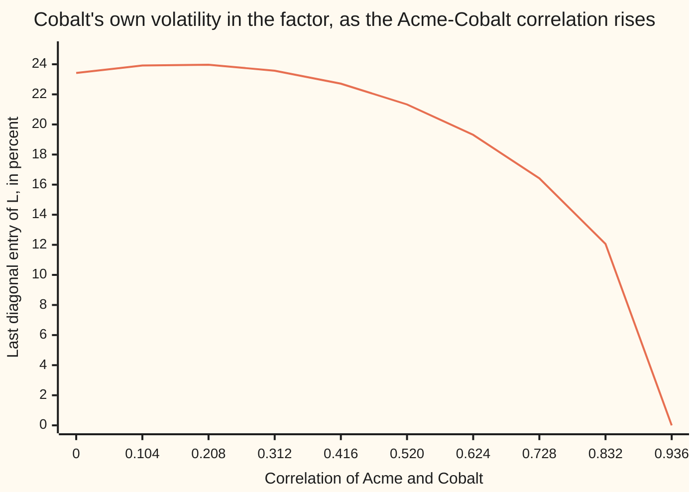

# Cholesky: half the work when a matrix is symmetric and positive definite

[Syllabus](../../../SYLLABUS.md) → [Numerical analysis](../README.md) → [Numerical Linear Algebra](../README.md#s03) → Cholesky

---

## General Overview

A risk desk simulates three shares for the coming year: Borex at $80, Acme at $100 and Cobalt at $120. Their yearly volatilities (the typical size of a year's move) are 20%, 30% and 25%. Borex and Acme move together with correlation 0.6, Borex and Cobalt 0.28, Acme and Cobalt 0.5. These market numbers are illustrative.

The desk keeps all of this in one covariance matrix A (a table of how much each pair of shares moves together), in percent squared. Each diagonal entry is a share's volatility squared: 400, 900 and 625. Each off-diagonal entry is a correlation times two volatilities: 360, 140 and 375. The matrix is symmetric, so its lower half repeats its upper half.

To make random scenarios that move together the right amount, the desk needs a lower-triangular table L (zeros above the diagonal) with L times its transpose (L with its rows written as columns) equal to A. That table is the **Cholesky factor**. For this matrix its rows are (20, 0, 0), (18, 24, 0) and (7, 10.375, 21.641612), found by hand below.

[Correlated paths](../../12-Financial%20mathematics/06-Numerical%20Methods%20for%20Pricing/04-correlated-paths-and-cholesky.md) already builds this factor column by column. It proves the factor exists exactly when A is positive definite: every mix of the shares, other than holding nothing, has a variance above zero. This card asks the numerical questions:

- **Cost.** About n³/3 flops for n shares, against about 2n³/3 for LU. A flop is one addition, subtraction, multiplication or division of two numbers.
- **Safety.** It needs no row swaps, because no entry of L can exceed the square root of its row's diagonal entry of A.
- **Reuse.** One factor solves any number of systems A x = b, at 2n² flops each.
- **The edge.** A failed run is a test result: the matrix is not positive definite. Near the edge, rounding can decide that verdict.

**For a symmetric positive definite matrix, the Cholesky factor L with A = L Lᵀ costs half of LU, needs no pivoting because its entries are bounded by the diagonal, solves systems by two triangular sweeps, and fails exactly when the matrix is not positive definite.**

**What kind of fact this is:** a method resting on theorems. Existence and uniqueness, and the pass-or-fail test, are proved on Correlated paths. The cost, the entry bound and the pivot as a ratio of determinants are proved on this card in Why it works. The rounding bound is stated from a named source, not proved here.

### The picture: the last diagonal entry shrinks to zero at the edge



The line is the third diagonal entry of L: the part of Cobalt's volatility that neither Borex nor Acme explains. Everything else in A stays fixed. At a correlation of 0.936 it reaches zero, and above that no factor exists: the three numbers asked for cannot all hold at once.

---

## The formula

$$A = L\,L^{T}, \qquad \ell_{jj} = \sqrt{a_{jj} - \sum_{k<j} \ell_{jk}^{2}}, \qquad \ell_{ij} = \frac{a_{ij} - \sum_{k<j} \ell_{ik}\ell_{jk}}{\ell_{jj}} \quad (i > j)$$

**Read it aloud:** each diagonal entry of L is the square root of what the diagonal of A still needs after the earlier columns, and each entry below it is what that pair still needs, divided by that root.

The number under the square root is the **pivot** of column j. The run stops if a pivot is zero or negative.

Solving A x = b with the factor takes two sweeps:

$$L\,y = b \ \text{(forward, top row first)}, \qquad L^{T} x = y \ \text{(back, bottom row first)}.$$

The cost, counted on this card:

$$\text{Cholesky: } \frac{2n^{3} + 3n^{2} + n}{6} \text{ flops}, \qquad \text{LU: } \frac{4n^{3} - 3n^{2} - n}{6} \text{ flops}.$$

| Symbol | Plain meaning | In our example | Push it up and the answer… |
| --- | --- | --- | --- |
| $A$, $a_{ij}$ | the symmetric positive definite matrix, and its entry in row i, column j; k counts the earlier columns | covariance in percent squared: 400, 900, 625 on the diagonal | a bigger diagonal entry gives a bigger diagonal entry of L |
| $L$, $\ell_{ij}$ | the Cholesky factor: lower-triangular, positive diagonal | rows (20, 0, 0), (18, 24, 0), (7, 10.375, 21.641612) | — |
| $L^{T}$ | the transpose: L with rows written as columns | upper-triangular | — |
| $n$ | the size: number of rows of A | 3 shares; 500 for the water network, a round size for illustration | flops grow as n³ |
| $b$, $y$, $x$ | right-hand side, the forward sweep's result, the solution of A x = b | b is three ones; x = A⁻¹ times ones | — |
| $z$, $v$ | independent random draws, mean 0, variance 1; v = L z, the correlated shocks, in percent | first z (0.906541, −1.548788, 1.651281); first v (18.130815, −20.853186, 26.013480) | — |
| $\rho_{23}$ | the Acme–Cobalt correlation; $a_{23} = 750\,\rho_{23}$ | 0.5 | the last pivot falls to zero at 0.936 |
| $w$ | portfolio weights: x divided by the sum of its entries | 0.724805, −0.116979, 0.392173 | — |
| $\hat L$, $\Delta A$ | the computed factor, and the change in A that it factors exactly | worst change 1.735e-16 at the decimal edge, relative | — |
| $u$ | unit roundoff: the largest relative error of one rounding, 2⁻⁵³ | about 1.1e-16 | — |
| $\gamma_{n+1}$ | the rounding allowance $(n+1)u / (1 - (n+1)u)$ | $\gamma_4$ = 4.441e-16 | — |
| $\kappa_1(A)$ | condition number in the 1-norm: how much A can magnify a data error | 9.142 at ρ₂₃ = 0.5 | grows without limit at the edge |

The condition number and its norms come from [Matrix norms and the condition number](01-matrix-norms-and-the-condition-number.md); u comes from [Machine epsilon and cancellation](../01-Floating%20Point%20and%20Error/03-rounding-cancellation-and-machine-epsilon.md).

### When it holds

- **A is symmetric.** The method reads only the lower half. Hand it a lopsided matrix and it factors a different, symmetric matrix without warning.
- **A is positive definite:** every nonzero mix x gives xᵀ A x above zero ([Quadratic forms](../../03-Algebra/07-Eigenvalues%20and%20Symmetric%20Matrices/05-quadratic-forms-and-positive-definite.md)). If not, some pivot is zero or negative and the run stops. At ρ₂₃ = 0.95 the third pivot is −21.191406.
- **A is not close to the edge, compared with u.** If a pivot is about u times its diagonal entry, rounding decides its sign. The edge matrix written in decimals passes with a pivot of 1.388e-17.
- **The cost counts are for dense matrices.** A sparse matrix (mostly zeros), like the water network's, can cost far less; see [Sparse storage and Krylov methods](10-sparse-matrices-and-krylov-methods.md).

---

## Why it works

### Step 0: symmetry means half the information

A symmetric matrix of size n has only n(n+1)/2 different entries. LU ignores this and builds two triangles, L and U. For a symmetric positive definite matrix, U is just Lᵀ with its rows rescaled. So one triangle is enough, and building one triangle costs half as much.

### Step 1: the recurrence, in one line

Write out entry (i, j) of L Lᵀ. It is row i of L dotted with row j of L. Because L is triangular, that dot product uses only the first j entries. Set it equal to a_ij and solve for the last unknown: that is the formula above. [Correlated paths](../../12-Financial%20mathematics/06-Numerical%20Methods%20for%20Pricing/04-correlated-paths-and-cholesky.md) gives the full existence and uniqueness proof.

### Step 2: count the flops

Column j (counting from 1) costs:

- the pivot: j − 1 multiplications and j − 1 subtractions, then one square root;
- each of the n − j entries below: 2(j − 1) flops, then one division.

So column j costs (2j − 1)(n − j + 1) flops. Add over j = 1 to n:

$$\sum_{j=1}^{n} (2j-1)(n-j+1) = \frac{2n^{3} + 3n^{2} + n}{6} = \frac{n^{3}}{3} + \frac{n^{2}}{2} + \frac{n}{6}.$$

LU elimination ([LU with partial pivoting](02-lu-decomposition-and-pivoting.md)), counted the same way, costs about 2n³/3. The code counts every flop as it happens and matches both formulas at n = 3 and n = 40.

The halving is a large-n fact. At n = 3 Cholesky uses 14 flops and LU uses 13: the square roots and the n² terms still matter. At n = 40 it is 22,140 against 41,860. At n = 500 it is 41,791,750 against 83,208,250, a ratio of 0.502255.

<details>
<summary>Detailed proof: the sum</summary>

Put m = n − j + 1, so j = n + 1 − m and 2j − 1 = 2n + 1 − 2m. As j runs from 1 to n, m runs from n down to 1. The sum becomes

$$\sum_{m=1}^{n} (2n+1)m - 2m^{2} = (2n+1)\frac{n(n+1)}{2} - \frac{n(n+1)(2n+1)}{3} = \frac{n(n+1)(2n+1)}{6}.$$

Multiply out: (2n³ + 3n² + n)/6. For LU, step k removes m = n − k entries below the pivot, each costing one division and 2m flops on its row: m + 2m² flops. Summing m from 0 to n − 1 gives n(n − 1)/2 + n(n − 1)(2n − 1)/3 = (4n³ − 3n² − n)/6.

</details>

### Step 3: no pivoting, because the diagonal bounds every entry

LU swaps rows to avoid dividing by a small pivot. A small pivot can make the multipliers, and then the entries, grow huge. That growth is what spoils LU without swaps.

Cholesky cannot grow. Entry (i, i) of A = L Lᵀ is row i of L dotted with itself:

$$a_{ii} = \ell_{i1}^{2} + \ell_{i2}^{2} + \dots + \ell_{ii}^{2}.$$

Each square is at most the total. So every entry obeys |ℓ_ij| ≤ √a_ii. In the example, Cobalt's row (7, 10.375, 21.641612) stays below √625 = 25. Across the whole factor, the largest |ℓ_ij| / √a_ii is 1.000000, reached by the first diagonal entry, and no entry exceeds it.

### Step 4: what rounding does, stated from the source

Higham's book (chapter 10) proves this bound for the computed factor L̂ (read "L-hat", the computed L):

$$\hat L \hat L^{T} = A + \Delta A, \qquad |\Delta a_{ij}| \le \gamma_{n+1} \left(|\hat L|\,|\hat L^{T}|\right)_{ij}.$$

So the computed factor is the exact factor of a slightly changed matrix: Cholesky is **backward stable** ([Forward and backward error](../01-Floating%20Point%20and%20Error/06-forward-and-backward-error.md)). By Step 3, and by the Cauchy–Schwarz inequality on two rows (a dot product is at most the product of the two rows' lengths), the right side is at most about γ_{n+1} √(a_ii a_jj). No growth factor appears, unlike LU.

The code measures the worst |Δa_ij| / √(a_ii a_jj):

| Matrix | Measured backward error (true error) | Bound γ₄ | Ratio |
| --- | --- | --- | --- |
| A in percent squared | 0.000e0 (the product rounds back exactly) | 4.441e-16 | 0 |
| the edge matrix in decimals | 1.735e-16 | 4.441e-16 | 0.3906 |

The bound is stated here, not proved. Higham gives the full proof.

### Step 5: the pivot is a ratio of determinants, so it measures distance to the edge

Since A = L Lᵀ, det A = (ℓ₁₁ ℓ₂₂ ⋯ ℓ_nn)², the product of the pivots. The same holds for each top-left block. So pivot k equals the determinant of the top-left k-by-k block divided by that of the (k − 1)-by-(k − 1) block.

In the example the first two pivots are 400 and 576, and 400 × 576 = 230,400 is the top-left 2-by-2 determinant. So the third pivot is det A ÷ 230,400. The code computes it both ways, by the run and by determinants, and they agree.

This gives the test its meaning. Correlated paths proves both directions: a positive definite matrix gives positive pivots, and positive pivots give a positive definite matrix. So the run finishes exactly when A is positive definite, and, through the ratio, exactly when every top-left determinant is positive (Sylvester's criterion). The test costs about n³/3 flops, far less than finding eigenvalues.

Now move the Acme–Cobalt correlation toward the edge, everything else fixed:

| ρ₂₃ | Third pivot (run) | det A ÷ 230,400 | κ₁(A) | Verdict |
| --- | ---: | ---: | ---: | --- |
| 0.5 | 468.359375 | 468.359375 | 9.142 | passes |
| 0.9 | 52.734375 | 52.734375 | 92.45 | passes |
| 0.93 | 8.964844 | 8.964844 | 555.7 | passes |
| 0.935 | 1.499023 | 1.499023 | 3,335 | passes |
| 0.936 | 0.000000 | 0.000000 | none | fails |
| 0.94 | −6.015625 | −6.015625 | none | fails |
| 0.95 | −21.191406 | −21.191406 | none | fails |

As the pivot shrinks, κ₁ grows. A small backward error still holds, but the forward error in a solution can be κ times larger ([Conditioning and stability](../01-Floating%20Point%20and%20Error/05-conditioning-and-stability.md)). Near the edge, the trouble is conditioning, not the method.

### Step 6: at the edge, rounding decides the verdict

At ρ₂₃ = 0.936 the matrix is exactly singular: the third pivot is exactly zero. In percent squared every entry is a whole number, every step is exact, and the run fails as it should.

Write the same matrix in decimals instead: 0.04, 0.036, 0.014, 0.09, 0.0702, 0.0625. Only 0.0625 = 2⁻⁴ is exact in binary; the rest are rounded. The run now gives a third pivot of 1.388e-17 and passes, with L₃₃ = 3.725e-9. That pivot is the size of one or two rounding errors on the entry 0.0625. Its sign is noise.

So a pivot near u times its diagonal entry says "on the edge", not "safe". Higham also proves a sufficient condition for the run to finish: κ times u, times a modest factor that depends on n, must stay below one. Near the edge that condition fails. The usual repairs are to move the matrix to the nearest valid correlation matrix (Higham, 2002) or to add a small amount to the diagonal.

---

## Worked numbers, by hand

The factor of A, then one solve with it.

| Step | Arithmetic | Value |
| --- | --- | --- |
| ℓ₁₁ | √400 | 20 |
| ℓ₂₁, ℓ₃₁ | 360 ÷ 20, 140 ÷ 20 | 18, 7 |
| pivot 2, ℓ₂₂ | 900 − 18², then its square root | 576, 24 |
| ℓ₃₂ | (375 − 7 × 18) ÷ 24 = 249 ÷ 24 | 10.375 |
| pivot 3 | 625 − 7² − 10.375² = 625 − 49 − 107.640625 | 468.359375 |
| ℓ₃₃ | √468.359375 | 21.641612 |
| check | 400 × 576 = 230,400, the top-left 2-by-2 determinant; det A ÷ 230,400 | 468.359375 |
| forward sweep, L y = (1, 1, 1) | y₁ = 1 ÷ 20; y₂ = (1 − 18 y₁) ÷ 24; y₃ = (1 − 7 y₁ − 10.375 y₂) ÷ 21.641612 | 0.05, 0.004167, 0.02804 |
| back sweep, Lᵀ x = y | x₃ = y₃ ÷ 21.641612, then x₂, then x₁; listed as x₁, x₂, x₃ | 0.002394, −0.0003864, 0.001296 |
| weights | x divided by its sum | 72.4805%, −11.6979%, 39.2173% |
| **lowest-risk mix** | variance wᵀ A w = 302.714075, so volatility = √302.714075 | **17.398680%** |

The answer: a fully invested mix of these three shares can get its volatility down to 17.40% a year, below Borex's 20%, by selling a little Acme. Once the factor exists, each solve costs 2n² flops. The code checks the result against Cramer's rule (worst relative gap 3.348e-16) and checks the variance against the identity 1 ÷ (1ᵀ A⁻¹ 1) = 302.714075, where 1 is the vector of three ones.

Then the simulation. One draw z = (0.906541, −1.548788, 1.651281) becomes v = L z = (18.130815, −20.853186, 26.013480): each share's shock for the year, in percent. The lognormal rule of [Correlated paths](../../12-Financial%20mathematics/06-Numerical%20Methods%20for%20Pricing/04-correlated-paths-and-cholesky.md), with no drift, turns a shock into a price: the spot price times exp(shock ÷ 100 − variance ÷ 2), with the variance as a decimal, 0.04 for Borex. The year then ends at $94.00, $77.61 and $150.86, and no draw can push a price below zero. Over 20,000 draws the sample covariance matrix is within 1.140192 standard errors of A in every entry.

### What breaks if you drop a piece

| Mistake | Comes out at | What went wrong |
| --- | --- | --- |
| Mix draws with Lᵀ instead of L | volatilities 27.80%, 26.15%, 21.64% instead of 20%, 30%, 25%; correlation 1–2 is 0.694169, not 0.6 | the covariance of Lᵀ z is Lᵀ L, not L Lᵀ |
| Push ρ₂₃ to 0.95 | third pivot −21.191406; no factor | the matrix is not positive definite: the three correlations cannot all hold |
| Trust a pass at the edge | pivot 1.388e-17, verdict "passes", L₃₃ = 3.725e-9 | an exactly singular matrix, rounded into a tiny positive pivot |
| Factor with LU instead, at n = 500 | 83,208,250 flops instead of 41,791,750 | LU does not use symmetry |

---

## Code, from first principles, and it actually runs

The code factors A, checks the factor against the hand values, and measures the backward error against γ₄. It solves A x = (1, 1, 1) with the factor and checks against Cramer's rule, a separate road that is exact on these whole-number entries until its last division. It counts flops in the real loops and compares them with both formulas. It checks each third pivot along the dial against a determinant ratio, and a 40-by-40 random-walk covariance whose factor is known to be all ones. Then it mixes 20,000 draws, from a written-out SplitMix64 generator with seed 20261111, compares the sample covariance with A in standard errors, and prices the first draw by the lognormal rule. Each draw is the sum of 12 uniform numbers (equally likely anywhere from 0 to 1) minus 6: mean 0 and variance 1, which is all the covariance needs.

### Python

```python
# Cholesky -- the check behind the card.  Standard library only; nothing
# imported holds an answer.  Three shares with volatilities 20%, 30% and 25%
# and correlations 0.6, 0.28 and 0.5 give a covariance matrix in percent
# squared.  Factor it as L L^T, count flops against LU, solve with the
# factor, walk to the edge of positive definiteness, and mix random draws.
from math import exp, sqrt

A = [[400.0, 360.0, 140.0], [360.0, 900.0, 375.0], [140.0, 375.0, 625.0]]
SPOTS, U, N, SEED, BIG = (80.0, 100.0, 120.0), 2.0 ** -53, 20000, 20261111, 500
DIAL = (375.0, 675.0, 697.5, 701.25, 702.0, 705.0, 712.5)   # a23 = 750 x rho23

def cov(a23): return [[400.0, 360.0, 140.0], [360.0, 900.0, a23], [140.0, a23, 625.0]]

def chol(a):                                # column by column; None at a pivot <= 0
    n, f = len(a), 0
    L = [[0.0] * n for _ in range(n)]
    for j in range(n):
        s = a[j][j]
        for k in range(j): s -= L[j][k] * L[j][k]; f += 2
        if s <= 0.0: return None, s, f
        L[j][j] = sqrt(s); f += 1
        for i in range(j + 1, n):
            t = a[i][j]
            for k in range(j): t -= L[i][k] * L[j][k]; f += 2
            L[i][j] = t / L[j][j]; f += 1
    return L, s, f

def lu_flops(a):                            # elimination, counted as on the LU card
    m, n, f = [r[:] for r in a], len(a), 0
    for k in range(n):
        for i in range(k + 1, n):
            r = m[i][k] / m[k][k]; f += 1
            for j in range(k + 1, n): m[i][j] -= r * m[k][j]; f += 2
    return f

def chol_solve(L, b):                       # forward L y = b, then back L^T x = y
    n = len(b); y = [0.0] * n; x = [0.0] * n
    for i in range(n):
        s = b[i]
        for k in range(i): s -= L[i][k] * y[k]
        y[i] = s / L[i][i]
    for i in reversed(range(n)):
        s = y[i]
        for k in range(i + 1, n): s -= L[k][i] * x[k]
        x[i] = s / L[i][i]
    return x, y

def det3(m):
    return (m[0][0] * (m[1][1] * m[2][2] - m[1][2] * m[2][1]) - m[0][1] * (m[1][0] * m[2][2] - m[1][2] * m[2][0])
            + m[0][2] * (m[1][0] * m[2][1] - m[1][1] * m[2][0]))

def cramer(m, b):                           # exact on these entries until the final division
    return [det3([[b[i] if j == c else m[i][j] for j in range(3)] for i in range(3)]) / det3(m) for c in range(3)]

def kappa1(m):                              # ||A||_1 times ||A^-1||_1, the inverse by Cramer's rule
    cols = [cramer(m, [1.0 if i == c else 0.0 for i in range(3)]) for c in range(3)]
    return max(sum(abs(m[i][c]) for i in range(3)) for c in range(3)) * max(sum(abs(v) for v in col) for col in cols)

def backward(a, L):                         # worst |A - L L^T| entry over sqrt(a_ii a_jj)
    n = len(a)
    return max(abs(sum(L[i][k] * L[j][k] for k in range(n)) - a[i][j]) / sqrt(a[i][i] * a[j][j]) for i in range(n) for j in range(n))

def splitmix(state):
    state = (state + 0x9E3779B97F4A7C15) & 0xFFFFFFFFFFFFFFFF
    z = ((state ^ (state >> 30)) * 0xBF58476D1CE4E5B9) & 0xFFFFFFFFFFFFFFFF
    z = ((z ^ (z >> 27)) * 0x94D049BB133111EB) & 0xFFFFFFFFFFFFFFFF
    return state, (z ^ (z >> 31)) >> 11

def sci(x): m, e = f"{x:.3e}".split("e"); return f"{m}e{int(e)}"
def row(label, vals): print(f"{label:<44}" + "".join(f"{v:>12.6f}" for v in vals))
def srow(label, vals): print(f"{label:<44}" + "".join(f"{sci(v):>12}" for v in vals))
def fc(n): return (2 * n ** 3 + 3 * n ** 2 + n) // 6      # Cholesky flops, square roots included
def fl(n): return (4 * n ** 3 - 3 * n ** 2 - n) // 6      # LU flops

L, piv, f3 = chol(A)
hand = [[20.0, 0.0, 0.0], [18.0, 24.0, 0.0], [7.0, 249.0 / 24.0, sqrt(625.0 - 49.0 - (249.0 / 24.0) ** 2)]]
hand_gap = max(abs(L[i][j] - hand[i][j]) for i in range(3) for j in range(3))
growth = max(abs(L[i][j]) / sqrt(A[i][i]) for i in range(3) for j in range(3))
for i in range(3): row(f"L row {i + 1}, then pivot {i + 1}", L[i] + [L[i][i] * L[i][i]])
row("gap to hand factor; max |l_ij|/sqrt(a_ii)", [hand_gap, growth])
D = [[v / 10000.0 for v in r] for r in cov(702.0)]          # the edge matrix, written in decimals
LD, pd, _ = chol(D)
gamma = 4 * U / (1 - 4 * U)
srow("backward error: A, decimal edge; gamma_4", [backward(A, L), backward(D, LD), gamma, backward(D, LD) / gamma])
w1, (wc, yc) = cramer(A, [1.0] * 3), chol_solve(L, [1.0] * 3)
gc = max(abs(wc[i] - w1[i]) / abs(w1[i]) for i in range(3))
mv = [v / sum(wc) for v in wc]
var = sum(mv[i] * A[i][j] * mv[j] for i in range(3) for j in range(3))
srow("forward step y, from L y = ones", yc)
srow("back step x = A^-1 ones, from L^T x = y", wc)
srow("worst relative gap to Cramer's rule", [gc])
row("minimum-variance weights", mv)
row("w^T A w, 1/(1^T A^-1 1), volatility", [var, 1.0 / sum(wc), sqrt(var)])
B = [[float(min(i, j) + 1) for j in range(40)] for i in range(40)]   # a random walk's covariance: L is all ones
LB, _, f40 = chol(B)
ones_gap = max(abs(LB[i][j] - (1.0 if j <= i else 0.0)) for i in range(40) for j in range(40))
for n, c, l in ((3, f3, lu_flops(A)), (40, f40, lu_flops(B))):
    print(f"n = {n:<3} flops counted: Cholesky {c:>7,}  LU {l:>7,}   formulas {fc(n):>7,} {fl(n):>7,}")
print(f"n = {BIG} Cholesky {fc(BIG):,}  LU {fl(BIG):,}  ratio {fc(BIG) / fl(BIG):.6f}  two solves {2 * BIG * BIG:,}")
dial = []
for a23 in DIAL:
    Lm, p, _ = chol(cov(a23))
    d = det3(cov(a23)) / 230400.0
    dial.append((p, d, Lm is not None))
    k = sci(kappa1(cov(a23))) if d > 0 else "none"
    print(f"rho23 {a23 / 750:.6f}  third pivot {p:>11.6f}  det/det2 {d:>11.6f}  kappa1 {k:>9}  {'passes' if Lm else 'fails'}")
for t in range(10):
    Lt, _, _ = chol(cov(750.0 * 0.104 * t))
    print(f"figure, rho23 {0.104 * t:.3f}, L33 {Lt[2][2] if Lt else 0.0:.2f}")
print(f"edge in percent^2: third pivot {dial[4][0]:.6f}, {'fails' if dial[4][0] <= 0 else 'passes'}; det2 = {400.0 * 900.0 - 360.0 * 360.0:.0f}")
print(f"edge in decimals: third pivot {sci(pd)}, L33 {sci(LD[2][2])}, {'passes' if LD else 'fails'}")
state, sxx, first = SEED, [[0.0] * 3 for _ in range(3)], None
for s in range(N):
    z = []
    for i in range(3):
        t = 0.0
        for _ in range(12): state, r = splitmix(state); t += r * 2.0 ** -53
        z.append(t - 6.0)                   # 12 uniforms minus 6: mean 0, variance 1
    v = [sum(L[i][k] * z[k] for k in range(3)) for i in range(3)]   # correlated shocks, percent
    if first is None: first = (z, v)
    for i in range(3):
        for j in range(3): sxx[i][j] += v[i] * v[j]
S = [[v / N for v in r] for r in sxx]
row("first draw z", first[0])
row("first draw v = L z, percent", first[1])
row("prices a year on, from $80, $100, $120", [SPOTS[i] * exp(first[1][i] / 100 - A[i][i] / 20000) for i in range(3)])  # lognormal, no drift
for i in range(3): row(f"sample covariance row {i + 1}, {N} draws", S[i])
se = max(abs(S[i][j] - A[i][j]) / sqrt((A[i][i] * A[j][j] + A[i][j] ** 2) / N) for i in range(3) for j in range(3))
row("worst gap to A, in standard errors", [se])
TL = [[sum(L[k][i] * L[k][j] for k in range(3)) for j in range(3)] for i in range(3)]
row("wrong: L^T as the mixer, volatilities", [sqrt(TL[i][i]) for i in range(3)])
row("wrong: L^T as the mixer, correlation 1-2", [TL[0][1] / sqrt(TL[0][0] * TL[1][1])])
assert hand_gap < 1e-12 and growth <= 1.0          # the factor by hand; no entry above its diagonal's root
assert backward(D, LD) <= gamma                     # the rounding bound holds
assert gc < 1e-13 and abs(var - 1.0 / sum(wc)) < 1e-9
assert ones_gap == 0.0 and (f3, f40, lu_flops(B)) == (fc(3), fc(40), fl(40))
assert all(abs(p - d) < 1e-9 for p, d, _ in dial)      # last pivot = det / leading 2 by 2 det
assert [ok for _, _, ok in dial] == [True] * 4 + [False] * 3 and pd > 0   # the verdicts
assert se < 4.0
print("ALL CHECKS PASS")
```

**Ran 2026-11-11 on macOS, Python 3.14.10, standard library only. All checks passed. Output, pasted from the run:**

```
L row 1, then pivot 1                          20.000000    0.000000    0.000000  400.000000
L row 2, then pivot 2                          18.000000   24.000000    0.000000  576.000000
L row 3, then pivot 3                           7.000000   10.375000   21.641612  468.359375
gap to hand factor; max |l_ij|/sqrt(a_ii)       0.000000    1.000000
backward error: A, decimal edge; gamma_4         0.000e0   1.735e-16   4.441e-16    3.906e-1
forward step y, from L y = ones                 5.000e-2    4.167e-3    2.804e-2
back step x = A^-1 ones, from L^T x = y         2.394e-3   -3.864e-4    1.296e-3
worst relative gap to Cramer's rule            3.348e-16
minimum-variance weights                        0.724805   -0.116979    0.392173
w^T A w, 1/(1^T A^-1 1), volatility           302.714075  302.714075   17.398680
n = 3   flops counted: Cholesky      14  LU      13   formulas      14      13
n = 40  flops counted: Cholesky  22,140  LU  41,860   formulas  22,140  41,860
n = 500 Cholesky 41,791,750  LU 83,208,250  ratio 0.502255  two solves 500,000
rho23 0.500000  third pivot  468.359375  det/det2  468.359375  kappa1   9.142e0  passes
rho23 0.900000  third pivot   52.734375  det/det2   52.734375  kappa1   9.245e1  passes
rho23 0.930000  third pivot    8.964844  det/det2    8.964844  kappa1   5.557e2  passes
rho23 0.935000  third pivot    1.499023  det/det2    1.499023  kappa1   3.335e3  passes
rho23 0.936000  third pivot    0.000000  det/det2    0.000000  kappa1      none  fails
rho23 0.940000  third pivot   -6.015625  det/det2   -6.015625  kappa1      none  fails
rho23 0.950000  third pivot  -21.191406  det/det2  -21.191406  kappa1      none  fails
figure, rho23 0.000, L33 23.42
figure, rho23 0.104, L33 23.92
figure, rho23 0.208, L33 23.97
figure, rho23 0.312, L33 23.57
figure, rho23 0.416, L33 22.71
figure, rho23 0.520, L33 21.33
figure, rho23 0.624, L33 19.31
figure, rho23 0.728, L33 16.42
figure, rho23 0.832, L33 12.06
figure, rho23 0.936, L33 0.00
edge in percent^2: third pivot 0.000000, fails; det2 = 230400
edge in decimals: third pivot 1.388e-17, L33 3.725e-9, passes
first draw z                                    0.906541   -1.548788    1.651281
first draw v = L z, percent                    18.130815  -20.853186   26.013480
prices a year on, from $80, $100, $120         94.003760   77.605502  150.863664
sample covariance row 1, 20000 draws          398.076176  356.857501  140.226126
sample covariance row 2, 20000 draws          356.857501  889.738268  371.130199
sample covariance row 3, 20000 draws          140.226126  371.130199  628.421740
worst gap to A, in standard errors              1.140192
wrong: L^T as the mixer, volatilities          27.802878   26.146522   21.641612
wrong: L^T as the mixer, correlation 1-2        0.694169
ALL CHECKS PASS
```

### Rust

```rust
// Cholesky -- the check behind the card.  std only; nothing used holds an answer.  Three shares,
// volatilities 20%, 30%, 25%, correlations 0.6, 0.28, 0.5: a covariance matrix in percent squared.
// Factor it as L L^T, count flops against LU, solve with it, walk to the edge, and mix random draws.
type M = Vec<Vec<f64>>;
const SPOTS: [f64; 3] = [80.0, 100.0, 120.0];
const N: usize = 20000; const SEED: u64 = 20261111; const BIG: u64 = 500;
const DIAL: [f64; 7] = [375.0, 675.0, 697.5, 701.25, 702.0, 705.0, 712.5]; // a23 = 750 x rho23
const TWO53: f64 = 9007199254740992.0;
fn cov(a23: f64) -> M { vec![vec![400.0, 360.0, 140.0], vec![360.0, 900.0, a23], vec![140.0, a23, 625.0]] }
fn chol(a: &M) -> (Option<M>, f64, u64) { // column by column; None at a pivot <= 0
    let (n, mut f, mut s) = (a.len(), 0u64, 0.0);
    let mut l = vec![vec![0.0; n]; n];
    for j in 0..n {
        s = a[j][j];
        for k in 0..j { s -= l[j][k] * l[j][k]; f += 2; }
        if s <= 0.0 { return (None, s, f); }
        l[j][j] = s.sqrt(); f += 1;
        for i in j + 1..n {
            let mut t = a[i][j];
            for k in 0..j { t -= l[i][k] * l[j][k]; f += 2; }
            l[i][j] = t / l[j][j]; f += 1;
        }
    }
    (Some(l), s, f)
}
fn lu_flops(a: &M) -> u64 { // elimination, counted as on the LU card
    let (mut m, n, mut f) = (a.clone(), a.len(), 0u64);
    for k in 0..n {
        for i in k + 1..n {
            let r = m[i][k] / m[k][k]; f += 1;
            for j in k + 1..n { m[i][j] -= r * m[k][j]; f += 2; }
        }
    }
    f
}
fn chol_solve(l: &M, b: &[f64]) -> (Vec<f64>, Vec<f64>) { // forward L y = b, then back L^T x = y
    let (n, mut y, mut x) = (b.len(), vec![0.0; b.len()], vec![0.0; b.len()]);
    for i in 0..n { let mut s = b[i]; for k in 0..i { s -= l[i][k] * y[k]; } y[i] = s / l[i][i]; }
    for i in (0..n).rev() { let mut s = y[i]; for k in i + 1..n { s -= l[k][i] * x[k]; } x[i] = s / l[i][i]; }
    (x, y)
}
fn det3(m: &M) -> f64 {
    m[0][0] * (m[1][1] * m[2][2] - m[1][2] * m[2][1]) - m[0][1] * (m[1][0] * m[2][2] - m[1][2] * m[2][0])
        + m[0][2] * (m[1][0] * m[2][1] - m[1][1] * m[2][0])
}
fn cramer(m: &M, b: &[f64]) -> Vec<f64> { // exact on these entries until the final division
    (0..3).map(|c| {
        let mc: M = (0..3).map(|i| (0..3).map(|j| if j == c { b[i] } else { m[i][j] }).collect()).collect();
        det3(&mc) / det3(m)
    }).collect()
}
fn kappa1(m: &M) -> f64 { // ||A||_1 times ||A^-1||_1, the inverse by Cramer's rule
    let cols: Vec<Vec<f64>> = (0..3).map(|c| cramer(m, &(0..3).map(|i| if i == c { 1.0 } else { 0.0 }).collect::<Vec<_>>())).collect();
    let na = (0..3).map(|c| (0..3).fold(0.0, |s, i| s + m[i][c].abs())).fold(f64::MIN, f64::max);
    let ni = cols.iter().map(|col| col.iter().fold(0.0, |s, v| s + v.abs())).fold(f64::MIN, f64::max);
    na * ni
}
fn backward(a: &M, l: &M) -> f64 { // worst |A - L L^T| entry over sqrt(a_ii a_jj)
    let (n, mut w) = (a.len(), 0.0f64);
    for i in 0..n { for j in 0..n {
        let mut s = 0.0;
        for k in 0..n { s += l[i][k] * l[j][k]; }
        w = w.max((s - a[i][j]).abs() / (a[i][i] * a[j][j]).sqrt());
    } }
    w
}
fn splitmix(state: &mut u64) -> u64 {
    *state = state.wrapping_add(0x9E3779B97F4A7C15);
    let mut z = (*state ^ (*state >> 30)).wrapping_mul(0xBF58476D1CE4E5B9);
    z = (z ^ (z >> 27)).wrapping_mul(0x94D049BB133111EB);
    (z ^ (z >> 31)) >> 11
}
fn sci(x: f64) -> String { format!("{:.3e}", x) }
fn row(label: &str, vals: &[f64]) { println!("{:<44}{}", label, vals.iter().map(|v| format!("{:>12.6}", v)).collect::<String>()); }
fn srow(label: &str, vals: &[f64]) { println!("{:<44}{}", label, vals.iter().map(|v| format!("{:>12}", sci(*v))).collect::<String>()); }
fn comma(k: u64) -> String {
    let (s, mut out) = (k.to_string(), String::new());
    for (i, ch) in s.chars().enumerate() { if i > 0 && (s.len() - i) % 3 == 0 { out.push(','); } out.push(ch); }
    out
}
fn fc(n: u64) -> u64 { (2 * n * n * n + 3 * n * n + n) / 6 } // Cholesky flops, square roots included
fn fl(n: u64) -> u64 { (4 * n * n * n - 3 * n * n - n) / 6 } // LU flops
fn main() {
    let a = cov(375.0);
    let (lo, _, f3) = chol(&a); let l = lo.unwrap();
    let h32: f64 = 249.0 / 24.0;
    let hand = vec![vec![20.0, 0.0, 0.0], vec![18.0, 24.0, 0.0], vec![7.0, h32, (625.0 - 49.0 - h32 * h32).sqrt()]];
    let (mut hand_gap, mut growth): (f64, f64) = (0.0, 0.0);
    for i in 0..3 { for j in 0..3 { hand_gap = hand_gap.max((l[i][j] - hand[i][j]).abs()); growth = growth.max(l[i][j].abs() / a[i][i].sqrt()); } }
    for i in 0..3 { row(&format!("L row {}, then pivot {}", i + 1, i + 1), &[l[i][0], l[i][1], l[i][2], l[i][i] * l[i][i]]); }
    row("gap to hand factor; max |l_ij|/sqrt(a_ii)", &[hand_gap, growth]);
    let d: M = cov(702.0).iter().map(|r| r.iter().map(|v| v / 10000.0).collect()).collect(); // the edge matrix, written in decimals
    let (ldo, pd, _) = chol(&d); let ld = ldo.clone().unwrap();
    let u = 1.0 / TWO53; let gamma = 4.0 * u / (1.0 - 4.0 * u);
    srow("backward error: A, decimal edge; gamma_4", &[backward(&a, &l), backward(&d, &ld), gamma, backward(&d, &ld) / gamma]);
    let (w1, (wc, yc)) = (cramer(&a, &[1.0; 3]), chol_solve(&l, &[1.0; 3]));
    let gc = (0..3).map(|i| (wc[i] - w1[i]).abs() / w1[i].abs()).fold(0.0, f64::max);
    let sw = wc.iter().fold(0.0, |s, v| s + v);
    let mv: Vec<f64> = wc.iter().map(|v| v / sw).collect();
    let mut var = 0.0; for i in 0..3 { for j in 0..3 { var += mv[i] * a[i][j] * mv[j]; } }
    srow("forward step y, from L y = ones", &yc);
    srow("back step x = A^-1 ones, from L^T x = y", &wc);
    srow("worst relative gap to Cramer's rule", &[gc]);
    row("minimum-variance weights", &mv);
    row("w^T A w, 1/(1^T A^-1 1), volatility", &[var, 1.0 / sw, var.sqrt()]);
    let b: M = (0..40).map(|i| (0..40).map(|j| (i.min(j) + 1) as f64).collect()).collect(); // a random walk's covariance: L is all ones
    let (lbo, _, f40) = chol(&b); let lb = lbo.unwrap();
    let mut ones_gap: f64 = 0.0;
    for i in 0..40 { for j in 0..40 { ones_gap = ones_gap.max((lb[i][j] - if j <= i { 1.0 } else { 0.0 }).abs()); } }
    for (n, c, lf) in [(3u64, f3, lu_flops(&a)), (40, f40, lu_flops(&b))] {
        println!("n = {:<3} flops counted: Cholesky {:>7}  LU {:>7}   formulas {:>7} {:>7}", n, comma(c), comma(lf), comma(fc(n)), comma(fl(n)));
    }
    println!("n = {} Cholesky {}  LU {}  ratio {:.6}  two solves {}", BIG, comma(fc(BIG)), comma(fl(BIG)), fc(BIG) as f64 / fl(BIG) as f64, comma(2 * BIG * BIG));
    let mut dial = Vec::new();
    for a23 in DIAL {
        let (lm, p, _) = chol(&cov(a23));
        let dd = det3(&cov(a23)) / 230400.0;
        dial.push((p, dd, lm.is_some()));
        let k = if dd > 0.0 { sci(kappa1(&cov(a23))) } else { "none".to_string() };
        println!("rho23 {:.6}  third pivot {:>11.6}  det/det2 {:>11.6}  kappa1 {:>9}  {}", a23 / 750.0, p, dd, k, if lm.is_some() { "passes" } else { "fails" });
    }
    for t in 0..10 {
        let (lt, _, _) = chol(&cov(750.0 * 0.104 * t as f64));
        println!("figure, rho23 {:.3}, L33 {:.2}", 0.104 * t as f64, match lt { Some(m) => m[2][2], None => 0.0 });
    }
    println!("edge in percent^2: third pivot {:.6}, {}; det2 = {:.0}", dial[4].0, if dial[4].0 <= 0.0 { "fails" } else { "passes" }, 400.0f64 * 900.0 - 360.0 * 360.0);
    println!("edge in decimals: third pivot {}, L33 {}, {}", sci(pd), sci(ld[2][2]), if ldo.is_some() { "passes" } else { "fails" });
    let (mut state, mut sxx) = (SEED, [[0.0f64; 3]; 3]);
    let mut first: Option<([f64; 3], [f64; 3])> = None;
    for _ in 0..N {
        let mut z = [0.0f64; 3];
        for i in 0..3 {
            let mut t = 0.0;
            for _ in 0..12 { t += splitmix(&mut state) as f64 / TWO53; }
            z[i] = t - 6.0; // 12 uniforms minus 6: mean 0, variance 1
        }
        let mut v = [0.0f64; 3]; // correlated shocks, percent
        for i in 0..3 { for k in 0..3 { v[i] += l[i][k] * z[k]; } }
        if first.is_none() { first = Some((z, v)); }
        for i in 0..3 { for j in 0..3 { sxx[i][j] += v[i] * v[j]; } }
    }
    let s: Vec<Vec<f64>> = sxx.iter().map(|r| r.iter().map(|v| v / N as f64).collect()).collect();
    let (z0, v0) = first.unwrap();
    row("first draw z", &z0);
    row("first draw v = L z, percent", &v0);
    row("prices a year on, from $80, $100, $120", &(0..3).map(|i| SPOTS[i] * (v0[i] / 100.0 - a[i][i] / 20000.0).exp()).collect::<Vec<_>>()); // lognormal, no drift
    for i in 0..3 { row(&format!("sample covariance row {}, {} draws", i + 1, N), &s[i]); }
    let mut se: f64 = 0.0;
    for i in 0..3 { for j in 0..3 {
        se = se.max((s[i][j] - a[i][j]).abs() / ((a[i][i] * a[j][j] + a[i][j] * a[i][j]) / N as f64).sqrt());
    } }
    row("worst gap to A, in standard errors", &[se]);
    let mut tl = [[0.0f64; 3]; 3];
    for i in 0..3 { for j in 0..3 { for k in 0..3 { tl[i][j] += l[k][i] * l[k][j]; } } }
    row("wrong: L^T as the mixer, volatilities", &[tl[0][0].sqrt(), tl[1][1].sqrt(), tl[2][2].sqrt()]);
    row("wrong: L^T as the mixer, correlation 1-2", &[tl[0][1] / (tl[0][0] * tl[1][1]).sqrt()]);
    assert!(hand_gap < 1e-12 && growth <= 1.0); // the factor by hand; no entry above its diagonal's root
    assert!(backward(&d, &ld) <= gamma); // the rounding bound holds
    assert!(gc < 1e-13 && (var - 1.0 / sw).abs() < 1e-9);
    assert!(ones_gap == 0.0 && (f3, f40, lu_flops(&b)) == (fc(3), fc(40), fl(40)));
    assert!(dial.iter().all(|(p, dd, _)| (p - dd).abs() < 1e-9)); // last pivot = det / leading 2 by 2 det
    assert!(dial.iter().map(|d| d.2).collect::<Vec<_>>() == [true, true, true, true, false, false, false] && pd > 0.0); // the verdicts
    assert!(se < 4.0);
    println!("ALL CHECKS PASS");
}
```

**Ran 2026-11-11 on macOS, rustc 1.98.1, no crates. All checks passed. Output, pasted from the run:**

```
L row 1, then pivot 1                          20.000000    0.000000    0.000000  400.000000
L row 2, then pivot 2                          18.000000   24.000000    0.000000  576.000000
L row 3, then pivot 3                           7.000000   10.375000   21.641612  468.359375
gap to hand factor; max |l_ij|/sqrt(a_ii)       0.000000    1.000000
backward error: A, decimal edge; gamma_4         0.000e0   1.735e-16   4.441e-16    3.906e-1
forward step y, from L y = ones                 5.000e-2    4.167e-3    2.804e-2
back step x = A^-1 ones, from L^T x = y         2.394e-3   -3.864e-4    1.296e-3
worst relative gap to Cramer's rule            3.348e-16
minimum-variance weights                        0.724805   -0.116979    0.392173
w^T A w, 1/(1^T A^-1 1), volatility           302.714075  302.714075   17.398680
n = 3   flops counted: Cholesky      14  LU      13   formulas      14      13
n = 40  flops counted: Cholesky  22,140  LU  41,860   formulas  22,140  41,860
n = 500 Cholesky 41,791,750  LU 83,208,250  ratio 0.502255  two solves 500,000
rho23 0.500000  third pivot  468.359375  det/det2  468.359375  kappa1   9.142e0  passes
rho23 0.900000  third pivot   52.734375  det/det2   52.734375  kappa1   9.245e1  passes
rho23 0.930000  third pivot    8.964844  det/det2    8.964844  kappa1   5.557e2  passes
rho23 0.935000  third pivot    1.499023  det/det2    1.499023  kappa1   3.335e3  passes
rho23 0.936000  third pivot    0.000000  det/det2    0.000000  kappa1      none  fails
rho23 0.940000  third pivot   -6.015625  det/det2   -6.015625  kappa1      none  fails
rho23 0.950000  third pivot  -21.191406  det/det2  -21.191406  kappa1      none  fails
figure, rho23 0.000, L33 23.42
figure, rho23 0.104, L33 23.92
figure, rho23 0.208, L33 23.97
figure, rho23 0.312, L33 23.57
figure, rho23 0.416, L33 22.71
figure, rho23 0.520, L33 21.33
figure, rho23 0.624, L33 19.31
figure, rho23 0.728, L33 16.42
figure, rho23 0.832, L33 12.06
figure, rho23 0.936, L33 0.00
edge in percent^2: third pivot 0.000000, fails; det2 = 230400
edge in decimals: third pivot 1.388e-17, L33 3.725e-9, passes
first draw z                                    0.906541   -1.548788    1.651281
first draw v = L z, percent                    18.130815  -20.853186   26.013480
prices a year on, from $80, $100, $120         94.003760   77.605502  150.863664
sample covariance row 1, 20000 draws          398.076176  356.857501  140.226126
sample covariance row 2, 20000 draws          356.857501  889.738268  371.130199
sample covariance row 3, 20000 draws          140.226126  371.130199  628.421740
worst gap to A, in standard errors              1.140192
wrong: L^T as the mixer, volatilities          27.802878   26.146522   21.641612
wrong: L^T as the mixer, correlation 1-2        0.694169
ALL CHECKS PASS
```

### Lean

Lean proves the pass-or-fail test, the entry bound, the pivot ratio and the flop sums for every size n, and checks the hand numbers.

- A symmetric matrix A has a lower-triangular L with a positive diagonal and A = L Lᵀ exactly when A is positive definite.
- For any L with A = L Lᵀ, every entry obeys |ℓ_ij| ≤ √a_ii, so no entry can grow.
- If A = L Lᵀ with L lower-triangular and a positive diagonal, then det A = (ℓ₁₁ ℓ₂₂ ⋯ ℓ_nn)². Each pivot ℓ_kk² equals the top-left k-by-k determinant divided by the (k − 1)-by-(k − 1) one.
- The column costs (2j − 1)(n − j + 1) add up to (2n³ + 3n² + n)/6 for every n.
- LU's step costs m + 2m² add up to (4n³ − 3n² − n)/6, and the ratio of the two totals tends to one half as n grows.
- The hand factor holds exactly: rows (20, 0, 0), (18, 24, 0) and (7, 10.375, √468.359375) give L Lᵀ = A. Also 400 × 576 = 230,400, the top-left 2-by-2 determinant.
- The third pivot, det A ÷ 230,400, is 468.359375, 52.734375, 0, −6.015625 and −21.19140625 at ρ₂₃ = 0.5, 0.9, 0.936, 0.94 and 0.95.
- The flop counts are 14 against 13 at n = 3, 22,140 against 41,860 at n = 40, and 41,791,750 against 83,208,250 at n = 500.

Counting flops in the real loops, the two-sweep solve, rounding at the edge and the simulated draws are left to the Python and Rust checks.

```lean
-- Cholesky: a symmetric matrix has a factor A = L Lᵀ (L lower triangular, positive diagonal) exactly when it is positive definite, every entry of such a factor is at most the square root of its row's diagonal entry of A, each pivot is a ratio of leading determinants, and the flop count is about half of LU's.
import Mathlib.LinearAlgebra.Matrix.PosDef
import Mathlib.LinearAlgebra.Matrix.Block
import Mathlib.LinearAlgebra.Matrix.Notation
import Mathlib.LinearAlgebra.Matrix.Determinant.Basic
import Mathlib.Analysis.Real.Sqrt
import Mathlib.Analysis.SpecificLimits.Basic
import Mathlib.Analysis.Matrix.LDL
import Mathlib.Algebra.Order.Star.Real
import Mathlib.Tactic.NormNum

open Matrix Filter Topology

/-! Matrices are real and square, indexed by `Fin n`. Mathlib's `A.PosDef` is "positive
definite": `A` is symmetric (`IsHermitian`, which over ℝ means `Aᵀ = A`) and every nonzero mix
`x` gives `xᵀ A x > 0`. `L.IsLowerTriangular` means every entry above the diagonal is zero.
The top-left `k`-by-`k` block of `A` is `A.submatrix (Fin.castLE h) (Fin.castLE h)`. -/

theorem cholesky_exists_of_posDef {n : ℕ} (A : Matrix (Fin n) (Fin n) ℝ) (hA : A.PosDef) :
    ∃ L : Matrix (Fin n) (Fin n) ℝ, L.IsLowerTriangular ∧ (∀ i, 0 < L i i) ∧ A = L * Lᵀ := by
  set d := LDL.diagEntries hA
  have hD : LDL.diag hA = diagonal d := rfl
  have hdpos : ∀ i, 0 < d i := by
    intro i
    have hP : (LDL.diag hA).PosDef := by
      rw [LDL.diag_eq_lowerInv_conj]
      exact hA.mul_mul_conjTranspose_same (vecMul_injective_of_invertible _)
    have := hP.diag_pos (i := i)
    simpa [hD] using this
  set L1 := LDL.lower hA * diagonal (fun i => Real.sqrt (d i))
  have hL1 : L1.IsLowerTriangular :=
    (LDL.isLowerTriangular_lower hA).mul (blockTriangular_diagonal _)
  have hA1 : A = L1 * L1ᵀ := by
    have h := LDL.lower_conj_diag hA
    rw [conjTranspose_eq_transpose_of_trivial] at h
    have hd : diagonal d = diagonal (fun i => √(d i)) * (diagonal (fun i => √(d i)))ᵀ := by
      rw [diagonal_transpose, diagonal_mul_diagonal]
      congr 1; ext i; exact (Real.mul_self_sqrt (hdpos i).le).symm
    rw [hD, hd] at h
    rw [← h]
    simp only [L1, transpose_mul, Matrix.mul_assoc]
  have hdet : ∀ i, L1 i i ≠ 0 := by
    have : L1.det ≠ 0 := by
      intro h0
      have := hA.det_pos
      rw [hA1, det_mul, det_transpose, h0] at this; simp at this
    rw [det_of_isLowerTriangular _ hL1] at this
    exact fun i => (Finset.prod_ne_zero_iff.mp this) i (Finset.mem_univ _)
  set s : Fin n → ℝ := fun i => if 0 < L1 i i then 1 else -1
  have hss : diagonal s * (diagonal s)ᵀ = 1 := by
    rw [diagonal_transpose, diagonal_mul_diagonal, ← diagonal_one]
    congr 1; ext i; simp only [s]; split_ifs <;> norm_num
  refine ⟨L1 * diagonal s, hL1.mul (blockTriangular_diagonal _), ?_, ?_⟩
  · intro i
    simp only [mul_diagonal, s]
    have := hdet i
    split_ifs with h
    · simpa using h
    · have : L1 i i < 0 := lt_of_le_of_ne (not_lt.mp h) this
      linarith
  · rw [transpose_mul, Matrix.mul_assoc, ← Matrix.mul_assoc (diagonal s), hss, Matrix.one_mul]
    exact hA1

theorem posDef_of_cholesky {n : ℕ} (L : Matrix (Fin n) (Fin n) ℝ)
    (hL : L.IsLowerTriangular) (hpos : ∀ i, 0 < L i i) : (L * Lᵀ).PosDef := by
  have hu : IsUnit L := by
    rw [isUnit_iff_isUnit_det, det_of_isLowerTriangular _ hL, isUnit_iff_ne_zero]
    exact Finset.prod_ne_zero_iff.mpr fun i _ => (hpos i).ne'
  have := PosDef.mul_conjTranspose_self L (vecMul_injective_iff_isUnit.mpr hu)
  rwa [conjTranspose_eq_transpose_of_trivial] at this

theorem entry_le_sqrt_diag {n : ℕ} (A L : Matrix (Fin n) (Fin n) ℝ) (hA : A = L * Lᵀ)
    (i j : Fin n) : |L i j| ≤ Real.sqrt (A i i) := by
  apply Real.abs_le_sqrt
  rw [hA, Matrix.mul_apply]
  simp only [transpose_apply]
  rw [sq]
  exact Finset.single_le_sum (f := fun k => L i k * L i k) (fun k _ => mul_self_nonneg _)
    (Finset.mem_univ j)

theorem leading_block_det {n m : ℕ} (A L : Matrix (Fin n) (Fin n) ℝ) (hL : L.IsLowerTriangular)
    (hA : A = L * Lᵀ) (h : m ≤ n) :
    (A.submatrix (Fin.castLE h) (Fin.castLE h)).det = (∏ i : Fin m, L (Fin.castLE h i) (Fin.castLE h i)) ^ 2 := by
  set M := L.submatrix (Fin.castLE h) (Fin.castLE h)
  have hM : M.IsLowerTriangular := by
    intro i j hij
    exact hL hij
  have hsub : A.submatrix (Fin.castLE h) (Fin.castLE h) = M * Mᵀ := by
    ext i j
    simp only [hA, submatrix_apply, Matrix.mul_apply, transpose_apply, M]
    symm
    apply Fintype.sum_of_injective (Fin.castLE h) (Fin.castLE_injective h)
    · intro l hl
      have hil : Fin.castLE h i < l := by
        by_contra hc
        apply hl
        refine ⟨⟨l, ?_⟩, ?_⟩
        · have := i.isLt; simp [Fin.lt_def] at hc; omega
        · ext; simp
      rw [hL (by simpa using hil), zero_mul]
    · intro l; rfl
  rw [hsub, det_mul, det_transpose, det_of_isLowerTriangular _ hM, sq]
  rfl

#print axioms cholesky_exists_of_posDef
#print axioms posDef_of_cholesky
#print axioms entry_le_sqrt_diag
#print axioms leading_block_det

/-- The Cholesky factor, as a test and as a bound. For a symmetric matrix `A`:
a lower-triangular `L` with a positive diagonal and `A = L Lᵀ` exists exactly when `A` is
positive definite (so a failed run means "not positive definite"); and every entry of a
factor `A = L Lᵀ` obeys `|ℓ_ij| ≤ √a_ii`, so no entry can grow and no pivoting is needed. -/
theorem cholesky_factor_iff_posDef_and_entries_bounded {n : ℕ}
    (A : Matrix (Fin n) (Fin n) ℝ) (hA : A.IsSymm) :
    (A.PosDef ↔ ∃ L : Matrix (Fin n) (Fin n) ℝ,
        L.IsLowerTriangular ∧ (∀ i, 0 < L i i) ∧ A = L * Lᵀ) ∧
    ∀ L : Matrix (Fin n) (Fin n) ℝ, A = L * Lᵀ → ∀ i j, |L i j| ≤ Real.sqrt (A i i) := by
  refine ⟨⟨fun h => cholesky_exists_of_posDef A h, ?_⟩, fun L hL i j => entry_le_sqrt_diag A L hL i j⟩
  rintro ⟨L, hL, hpos, rfl⟩
  exact posDef_of_cholesky L hL hpos

/-- The pivots measure the distance to the edge. If `A = L Lᵀ` with `L` lower triangular and
a positive diagonal, then `det A = (ℓ₁₁ ℓ₂₂ ⋯ ℓ_nn)²`, and the pivot `ℓ_kk²` of each column
equals the determinant of the top-left block that ends at that column divided by the
determinant of the block just before it (counting columns from 0 here: column `k` uses the
blocks of sizes `k + 1` and `k`). -/
theorem cholesky_pivot_eq_ratio_of_leading_dets {n : ℕ}
    (A L : Matrix (Fin n) (Fin n) ℝ) (hL : L.IsLowerTriangular) (hpos : ∀ i, 0 < L i i)
    (hA : A = L * Lᵀ) :
    A.det = (∏ i, L i i) ^ 2 ∧
    ∀ (k : ℕ) (hk : k < n),
      L ⟨k, hk⟩ ⟨k, hk⟩ ^ 2 =
        (A.submatrix (Fin.castLE hk) (Fin.castLE hk)).det /
          (A.submatrix (Fin.castLE hk.le) (Fin.castLE hk.le)).det := by
  refine ⟨?_, ?_⟩
  · rw [hA, det_mul, det_transpose, det_of_isLowerTriangular _ hL, sq]
  · intro k hk
    rw [leading_block_det (m := k + 1) A L hL hA hk, leading_block_det (m := k) A L hL hA hk.le,
      Fin.prod_univ_castSucc]
    have hne : ∏ i : Fin k, L (Fin.castLE hk.le i) (Fin.castLE hk.le i) ≠ 0 :=
      Finset.prod_ne_zero_iff.mpr fun i _ => (hpos _).ne'
    have e1 : ∀ i : Fin k, Fin.castLE hk (Fin.castSucc i) = Fin.castLE hk.le i := fun i => rfl
    have e2 : Fin.castLE hk (Fin.last k) = ⟨k, hk⟩ := rfl
    simp only [e1, e2]
    field_simp

/-- The cost. Column `j` (from 1) of the Cholesky run costs `(2j − 1)(n − j + 1)` flops, so the
whole run costs `(2n³ + 3n² + n)/6`; LU's step removing `m` entries costs `m + 2m²`, so LU costs
`(4n³ − 3n² − n)/6`; and the ratio of the two tends to one half as `n → ∞`. -/
theorem cholesky_costs_half_of_lu :
    (∀ n : ℕ, ∑ j ∈ Finset.Icc 1 n, (2 * (j : ℝ) - 1) * ((n : ℝ) - j + 1) =
        (2 * (n : ℝ) ^ 3 + 3 * n ^ 2 + n) / 6) ∧
    (∀ n : ℕ, ∑ m ∈ Finset.range n, ((m : ℝ) + 2 * m ^ 2) =
        (4 * (n : ℝ) ^ 3 - 3 * n ^ 2 - n) / 6) ∧
    Tendsto (fun n : ℕ => ((2 * (n : ℝ) ^ 3 + 3 * n ^ 2 + n) / 6) /
        ((4 * (n : ℝ) ^ 3 - 3 * n ^ 2 - n) / 6)) atTop (𝓝 (1 / 2)) := by
  refine ⟨?_, ?_, ?_⟩
  · have gen : ∀ (x : ℝ) (N : ℕ), ∑ k ∈ Finset.range N, (2 * (k : ℝ) + 1) * (x - k) =
        x * N ^ 2 - ((N : ℝ) - 1) * N * (2 * N - 1) / 3 - (N : ℝ) * (N - 1) / 2 := by
      intro x N
      induction N with
      | zero => simp
      | succ N ih => rw [Finset.sum_range_succ, ih]; push_cast; ring
    intro n
    have e : Finset.Icc 1 n = Finset.Ico 1 (n + 1) := rfl
    rw [e, Finset.sum_Ico_eq_sum_range, Nat.add_sub_cancel]
    have := gen n n
    calc _ = ∑ k ∈ Finset.range n, (2 * (k : ℝ) + 1) * ((n : ℝ) - k) := by
          apply Finset.sum_congr rfl; intro k _; push_cast; ring
      _ = _ := by rw [this]; ring
  · intro n
    induction n with
    | zero => simp
    | succ n ih => rw [Finset.sum_range_succ, ih]; push_cast; ring
  · have h : Tendsto (fun n : ℕ => (1 : ℝ) / n) atTop (𝓝 0) := tendsto_one_div_atTop_nhds_zero_nat
    have key : Tendsto (fun n : ℕ => (2 + 3 * (1 / (n : ℝ)) + (1 / (n : ℝ)) ^ 2) /
        (4 - 3 * (1 / (n : ℝ)) - (1 / (n : ℝ)) ^ 2)) atTop
        (𝓝 ((2 + 3 * 0 + 0 ^ 2) / (4 - 3 * 0 - 0 ^ 2))) := by
      apply Tendsto.div _ _ (by norm_num)
      · exact (tendsto_const_nhds.add (h.const_mul 3)).add (h.pow 2)
      · exact (tendsto_const_nhds.sub (h.const_mul 3)).sub (h.pow 2)
    have e : ((2 : ℝ) + 3 * 0 + 0 ^ 2) / (4 - 3 * 0 - 0 ^ 2) = 1 / 2 := by norm_num
    rw [e] at key
    refine key.congr' ?_
    filter_upwards [eventually_ge_atTop 2] with n hn
    have hn' : (2 : ℝ) ≤ n := by exact_mod_cast hn
    have hpos : (0 : ℝ) < n := by linarith
    have hden : (4 * (n : ℝ) ^ 3 - 3 * n ^ 2 - n) ≠ 0 := by
      have h1 : 0 < (n : ℝ) * (4 * n + 1) * (n - 1) :=
        mul_pos (mul_pos hpos (by linarith)) (by linarith)
      have h2 : (4 * (n : ℝ) ^ 3 - 3 * n ^ 2 - n) = (n : ℝ) * (4 * n + 1) * (n - 1) := by ring
      rw [h2]; exact h1.ne'
    have hden2 : (4 - 3 * (1 / (n : ℝ)) - (1 / (n : ℝ)) ^ 2) ≠ 0 := by
      intro h0
      apply hden
      have : (4 * (n : ℝ) ^ 3 - 3 * n ^ 2 - n) = n ^ 3 * (4 - 3 * (1 / (n : ℝ)) - (1 / (n : ℝ)) ^ 2) := by
        field_simp
      rw [this, h0, mul_zero]
    rw [div_eq_div_iff hden2 (by positivity)]
    field_simp

/-! The card's worked numbers. The covariance matrix in percent squared is
`A = !![400, 360, 140; 360, 900, 375; 140, 375, 625]`; the Acme–Cobalt entry is `750 ρ₂₃`. -/

-- The factor by hand: rows (20, 0, 0), (18, 24, 0), (7, 10.375, √468.359375), and L Lᵀ = A.
example :
    !![(20 : ℝ), 0, 0; 18, 24, 0; 7, 83 / 8, Real.sqrt (29975 / 64)] *
      (!![(20 : ℝ), 0, 0; 18, 24, 0; 7, 83 / 8, Real.sqrt (29975 / 64)])ᵀ =
      !![(400 : ℝ), 360, 140; 360, 900, 375; 140, 375, 625] := by
  have hs : Real.sqrt (29975 / 64) * Real.sqrt (29975 / 64) = 29975 / 64 :=
    Real.mul_self_sqrt (by norm_num)
  generalize Real.sqrt (29975 / 64) = s at hs ⊢
  ext i j
  fin_cases i <;> fin_cases j <;> simp [Matrix.mul_apply, Fin.sum_univ_three] <;> linarith

-- The first two pivots multiply to the top-left 2-by-2 determinant: 400 × 576 = 230,400.
example : (400 : ℝ) * 576 = !![(400 : ℝ), 360; 360, 900].det := by rw [Matrix.det_fin_two_of]; norm_num

-- Third pivot = det A ÷ 230,400 = 468.359375 = 29975/64 at ρ₂₃ = 0.5.
example : !![(400 : ℝ), 360, 140; 360, 900, 375; 140, 375, 625].det / 230400 = 29975 / 64 := by
  rw [Matrix.det_fin_three]; simp; norm_num

-- ρ₂₃ = 0.9: third pivot 52.734375 = 3375/64, passes.
example : !![(400 : ℝ), 360, 140; 360, 900, 675; 140, 675, 625].det / 230400 = 3375 / 64 := by
  rw [Matrix.det_fin_three]; simp; norm_num

-- ρ₂₃ = 0.936: the edge, third pivot exactly 0, fails.
example : !![(400 : ℝ), 360, 140; 360, 900, 702; 140, 702, 625].det = 0 := by rw [Matrix.det_fin_three]; simp; norm_num

-- ρ₂₃ = 0.94: third pivot −6.015625 = −385/64, fails.
example : !![(400 : ℝ), 360, 140; 360, 900, 705; 140, 705, 625].det / 230400 = -385 / 64 := by
  rw [Matrix.det_fin_three]; simp; norm_num

-- ρ₂₃ = 0.95: third pivot −21.19140625 = −5425/256, fails.
example :
    !![(400 : ℝ), 360, 140; 360, 900, 1425 / 2; 140, 1425 / 2, 625].det / 230400 = -5425 / 256 := by
  rw [Matrix.det_fin_three]; simp; norm_num

-- Flops at n = 3: Cholesky 14, LU 13, counted column by column.
example : ∑ j ∈ Finset.Icc 1 3, (2 * j - 1) * (3 - j + 1) = 14 := by decide
example : ∑ m ∈ Finset.range 3, (m + 2 * m ^ 2) = 13 := by decide

-- Flops at n = 40 and n = 500 from the two formulas.
example : (2 * 40 ^ 3 + 3 * 40 ^ 2 + 40) / 6 = 22140 ∧ (4 * 40 ^ 3 - 3 * 40 ^ 2 - 40) / 6 = 41860 := by
  norm_num
example : (2 * 500 ^ 3 + 3 * 500 ^ 2 + 500) / 6 = 41791750 ∧
    (4 * 500 ^ 3 - 3 * 500 ^ 2 - 500) / 6 = 83208250 := by
  norm_num

#print axioms cholesky_factor_iff_posDef_and_entries_bounded
#print axioms cholesky_pivot_eq_ratio_of_leading_dets
#print axioms cholesky_costs_half_of_lu
```

**Checked 2026-11-11 on macOS, Lean 4.36.0-rc2, Mathlib v4.36.0-rc2. Every proof is complete and uses only Lean's standard axioms. Output, pasted from the run:**

```
'cholesky_exists_of_posDef' depends on axioms: [propext, Classical.choice, Quot.sound]
'posDef_of_cholesky' depends on axioms: [propext, Classical.choice, Quot.sound]
'entry_le_sqrt_diag' depends on axioms: [propext, Classical.choice, Quot.sound]
'leading_block_det' depends on axioms: [propext, Classical.choice, Quot.sound]
'cholesky_factor_iff_posDef_and_entries_bounded' depends on axioms: [propext, Classical.choice, Quot.sound]
'cholesky_pivot_eq_ratio_of_leading_dets' depends on axioms: [propext, Classical.choice, Quot.sound]
'cholesky_costs_half_of_lu' depends on axioms: [propext, Classical.choice, Quot.sound]
```

> [!TIP]
> **Try changing**
> - Guess first: how close to one half is the cost ratio for 30 unknowns? Set `BIG` to `30`. The line reads 9,455 flops against 17,545, a ratio of 0.538900: the n² terms still show.
> - Guess first: what pivot does a matrix just inside the edge give? In the line that builds `D`, change `702.0` to `701.0` (ρ₂₃ = 0.934667). The decimal run gives a third pivot of 1.998e-4: small, but far above rounding noise.
> - Guess first: does the edge matrix still pass if it is divided by 100 instead of 10,000? Change `10000.0` to `100.0`. The run now fails, and the script stops at the first line that uses the decimal factor, because there is none. Same matrix, other rounding, other verdict.
> - Guess first: do 200 draws still match A within 4 standard errors? Set `N` to `200`. The worst gap is 1.625000 standard errors and the run passes: the tolerance scales with the sample.

---

## The usual mistake

> [!warning]
> **Treating "the run finished" as "the matrix is safely positive definite".** A pass only says every computed pivot was above zero. A pivot of about u times its diagonal entry is rounding noise. The edge matrix in decimals passes with a pivot of 1.388e-17, though it is exactly singular. Check the smallest pivot against its diagonal entry, not just the verdict.
>
> - **Mixing with the transpose.** Lᵀ z has covariance Lᵀ L. Borex's volatility comes out 27.80% instead of 20%.
> - **Using LU on a symmetric positive definite matrix.** It works, but it costs about twice as much: 83,208,250 flops against 41,791,750 at n = 500.
> - **Adding pivoting "to be safe".** Cholesky needs none: every |ℓ_ij| is at most √a_ii. Row swaps alone would break the symmetry the method relies on.
> - **Inverting A to solve A x = b.** The two sweeps cost 2n² flops per right-hand side: 500,000 at n = 500, with the factor already paid for.

---

## Where you meet it in real life

- **Risk desks and Monte Carlo pricing.** Correlated scenarios for many assets come from v = L z, as in [Correlated paths](../../12-Financial%20mathematics/06-Numerical%20Methods%20for%20Pricing/04-correlated-paths-and-cholesky.md). A failed factor is often the first sign that a hand-edited correlation table is impossible.
- **Water and power networks.** The 500-pipe network on this shelf, linearised, written in junction heads only (the nodal form that [LU with partial pivoting](02-lu-decomposition-and-pivoting.md) uses as a check) and with one node at a fixed head, gives a symmetric positive definite matrix. Dense Cholesky at n = 500, a round size for illustration, would cost 41,791,750 flops; sparse versions cost far less.
- **Least squares.** The normal equations of a least-squares fit have a symmetric positive definite matrix, solved by Cholesky; [Least squares two ways](06-least-squares-normal-equations-versus-qr.md) shows when that loses digits and [QR](05-qr-householder-and-gram-schmidt.md) is safer.
- **Optimisation.** Newton's method needs a positive definite Hessian (the matrix of second derivatives). Solvers try a Cholesky factor first; if it fails, they shift the diagonal and try again.
- **Long chains.** A symmetric positive definite tridiagonal matrix is handled by [The Thomas algorithm](03-tridiagonal-systems-and-the-thomas-algorithm.md) in a number of flops proportional to n.

> **Say it back**
> A symmetric positive definite matrix has a lower-triangular factor L with A = L Lᵀ. Building it costs about n³/3 flops, half of LU, and each extra solve costs 2n² flops. It needs no row swaps, because every entry of L is bounded by the square root of its diagonal entry of A, so nothing grows. Each pivot is a ratio of determinants, so the run finishes exactly when the matrix is positive definite. Near the edge the last pivot shrinks toward the size of a rounding error, and rounding can decide the verdict.

---

## What this builds on

- [LU with partial pivoting](02-lu-decomposition-and-pivoting.md): elimination, its 2n³/3 cost and why it swaps rows; this card halves the cost and drops the swaps for one class of matrix.
- [Quadratic forms](../../03-Algebra/07-Eigenvalues%20and%20Symmetric%20Matrices/05-quadratic-forms-and-positive-definite.md): what positive definite means, and the top-left determinant test that the pivots carry out.
- [Correlated paths](../../12-Financial%20mathematics/06-Numerical%20Methods%20for%20Pricing/04-correlated-paths-and-cholesky.md): the column-by-column recurrence, the proof that the factor exists and is unique, and its first use to correlate draws.

## Where this goes next

- [Iterating instead of factoring](09-iterative-methods-jacobi-gauss-seidel-and-conjugate-gradient.md): for a large sparse symmetric positive definite matrix, conjugate gradient avoids the factor and its n³/3 cost altogether.

This card factors a matrix that is valid or not; it leaves open how to repair a correlation matrix that fails, by finding the nearest one that passes.

---

## Sources

Verified 2026-11-11: every link below resolves to the publisher's page.

- Benoit, Commandant. "Note sur une méthode de résolution des équations normales… (Procédé du Commandant Cholesky)." *Bulletin Géodésique* 2 (1924): 67–77. [doi:10.1007/BF03031308](https://doi.org/10.1007/BF03031308). The first publication of the method, for least-squares surveying problems.
- Higham, Nicholas J. *Accuracy and Stability of Numerical Algorithms*, 2nd ed. SIAM, 2002. [doi:10.1137/1.9780898718027](https://doi.org/10.1137/1.9780898718027). Chapter 10: the backward error bound of Step 4 and the condition for the run to finish.
- Trefethen, Lloyd N., and David Bau III. *Numerical Linear Algebra*. SIAM, 1997. [doi:10.1137/1.9780898719574](https://doi.org/10.1137/1.9780898719574). Lecture 23: the n³/3 cost and why no pivoting is needed.
- Higham, Nicholas J. "Computing the Nearest Correlation Matrix — a Problem from Finance." *IMA Journal of Numerical Analysis* 22, no. 3 (2002): 329–343. [doi:10.1093/imanum/22.3.329](https://doi.org/10.1093/imanum/22.3.329). The repair for a correlation table that fails the test.
- Glasserman, Paul. *Monte Carlo Methods in Financial Engineering*. Springer, 2003. [doi:10.1007/978-0-387-21617-1](https://doi.org/10.1007/978-0-387-21617-1). Section 2.3: correlated normal draws from the Cholesky factor.
