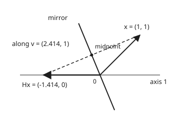
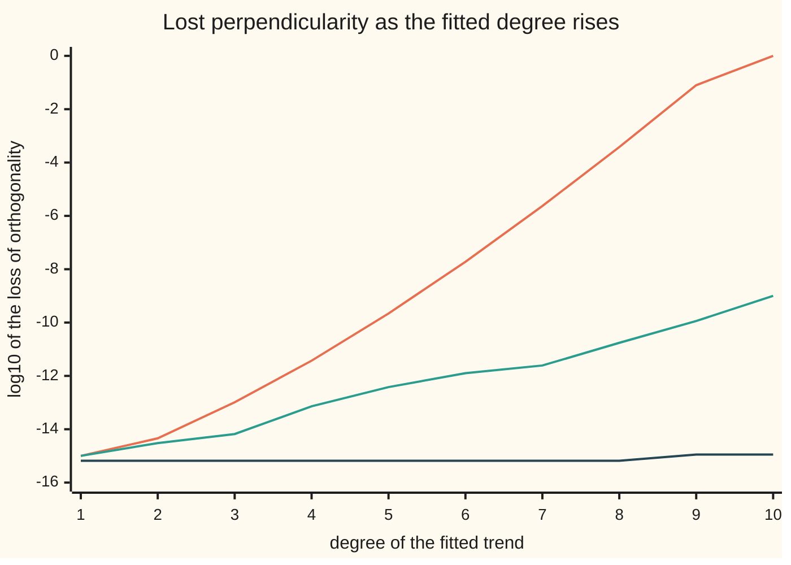

# QR: rotate a matrix into a triangle, by reflections or by orthogonalising

[Syllabus](../../../SYLLABUS.md) → [Numerical analysis](../README.md) → [Numerical Linear Algebra](../README.md#s03) → QR

---

## General Overview

A delivery van's trip computer logs fuel use every 50 km, for 10,000 km. That gives 200 readings, in litres per 100 km. The readings here are simulated and illustrative: a true trend of 7.2 + 0.03 per thousand km, plus noise. The question is how fast fuel use creeps up as the van wears.

A straight line, fuel = $c_0 + c_1 d$ with $d$ the distance in thousands of km, cannot pass through 200 noisy points. The best fit is found from a **QR factorisation**: the 200 × 2 table of the problem is written as $Q$, two perpendicular columns of length 1, times $R$, a 2 × 2 triangle. The fit is then one triangular solve: back substitution, which finds the last unknown first and works upward. Here it gives **7.191751 + 0.031588 d**: fuel use rises by 0.031588 litres per 100 km for every 1,000 km driven.

There are two ways to build $Q$ and $R$.

- **Gram-Schmidt** straightens the columns one at a time. From each column it subtracts its shadows on the columns already done ([Gram-Schmidt](../../03-Algebra/06-Dot%20Products%20and%20Best%20Fits/03-gram-schmidt-and-orthonormal-bases.md) runs it by hand).
- **Householder** reflects the whole table through a mirror, one column at a time. Each mirror clears the entries under the diagonal, until only a triangle is left.

On the straight line, both give the same $R$ to every printed digit, up to the sign of its first row (the fold in Step 1 explains the sign). The difference shows when the columns nearly line up. How nearly they line up is measured by the **condition number** $\kappa$, the table's largest stretch of a vector divided by its smallest ([Matrix norms and the condition number](01-matrix-norms-and-the-condition-number.md)).

Now suppose an analyst doubts that the creep is straight and tries a flexible degree-10 trend on the raw distances, so the table has columns $1, d, d^2, \dots, d^{10}$. That is a common trap. The classical Gram-Schmidt $Q$ then has columns that are not perpendicular (orthogonal, in the usual term) at all: the worst dot product between two of them is off by 0.998.

- **Modified Gram-Schmidt**, which measures each shadow on what is left of the column instead of on the original, is off by 9.98e-10.
- **Householder** is off by 1.11e-15.

Householder also costs fewer flops (single arithmetic operations) for $R$: 1,595 against 1,997 on the line.

**QR writes a table of numbers as perpendicular unit columns times a triangle; Householder gets there by mirrors, which keep $Q$ perpendicular to rounding level whatever the table, while Gram-Schmidt gets there by subtracting shadows, which can lose perpendicularity in proportion to the condition number (modified) or its square (classical).**

**What kind of fact this is:** the existence of QR and the exact properties of a mirror are theorems, proved on this card in Why it works. The floating-point bounds on lost perpendicularity are theorems stated here with their sources, not proved; the code measures them. The flop counts are exact counts of the code's loops, checked against a formula.

### The picture: one mirror folds a column onto the first axis

<p align="center"></p>

Drawn to scale from the checks' `figure,` line. With only two readings, the first column of the table would be x = (1, 1). Its length is 1.414. The mirror sends it to (−1.414, 0): same length, now on the first axis, so the entry below the top is zero. The dashed segment from Hx to x is the mirror's normal direction v = (2.414, 1). Its midpoint (−0.207, 0.5) lies on the mirror.

---

## The formula

The table has $m$ rows (readings) and $n$ columns (unknowns). A QR factorisation is

$$A = QR, \qquad Q^{\mathsf T}Q = I, \qquad r_{ij} = 0 \text{ for } i > j$$

**Read it aloud:** the table equals a matrix whose columns are perpendicular and of length one, times a square triangle with zeros below its diagonal.

Householder builds it from mirrors. For a column piece $x$ with top entry $x_1$:

$$v = x + \operatorname{sign}(x_1)\,\lVert x\rVert\, e_1, \qquad H = I - \frac{2\,v v^{\mathsf T}}{v^{\mathsf T}v}, \qquad Hx = -\operatorname{sign}(x_1)\,\lVert x\rVert\, e_1$$

**Read it aloud:** add the column's length to its top entry to get the mirror's normal; the mirror flips that normal and leaves everything perpendicular to it alone, so the column lands on the first axis with its length kept.

Apply one mirror per column, each to the rows from the diagonal down: $H_n \cdots H_2 H_1 A = R$, and $Q$ is the first $n$ columns of $H_1 H_2 \cdots H_n$.

Gram-Schmidt builds $Q$ one column at a time. Start column $j$ as $w = a_j$, then for each earlier $k$:

$$r_{kj} = q_k \cdot a_j \;\text{(classical)} \quad\text{or}\quad r_{kj} = q_k \cdot w \;\text{(modified)}, \qquad w \leftarrow w - r_{kj}\, q_k$$

and finally $r_{jj} = \lVert w\rVert$, $q_j = w / r_{jj}$.

**Read it aloud:** subtract from each column its shadow on every finished direction; classical measures every shadow on the original column, modified on what is left so far.

In floating point, the lost perpendicularity is at most a constant times these sizes (written $\lesssim$):

$$\lVert Q^{\mathsf T}Q - I\rVert \lesssim u \;\text{(Householder)}, \qquad \lesssim u\,\kappa \;\text{(modified)}, \qquad \lesssim u\,\kappa^2 \;\text{(classical)}$$

**Read it aloud:** Householder's columns stay perpendicular to rounding level; modified Gram-Schmidt can lose perpendicularity up to a constant times the condition number times $u$, classical up to a constant times its square times $u$, and in practice the loss is usually near that size.

| Symbol | Plain meaning | In our example | Push it up and the answer… |
| --- | --- | --- | --- |
| $A$, $m$, $n$ | the table: $m$ rows, $n$ columns | 200 × 2: a column of ones and a column of $d$ | more columns: more work and, often, nearer-parallel columns |
| $a_j$, $q_j$, $w$ | column $j$ of $A$, and of $Q$; the part of $a_j$ that Gram-Schmidt has not yet subtracted away | $a_1$ is all ones; $q_1$ is all $1/14.142136$ | — |
| $Q$ | the $m \times n$ matrix of perpendicular unit columns | built both ways below | — |
| $R$, $r_{ij}$ | the $n \times n$ upper triangle, and its entry in row $i$, column $j$ | $r_{11} = 14.142136$, $r_{12} = 70.357125$, $r_{22} = 40.824319$, up to sign | — |
| $d$ | distance on the trip meter, in thousands of km | 0.00 to 9.95, mean 4.975 | — |
| $y$, $c_0$, $c_1$ | the fuel readings; the fitted intercept and slope | $c_0 = 7.191751$ L/100 km, $c_1 = 0.031588$ per 1,000 km | — |
| $H$, $v$, $f$ | a Householder mirror; its normal vector; the factor $2v^{\mathsf T}b/v^{\mathsf T}v$ it applies to a column $b$ | first $v$ has top entry 15.142136 and $v^{\mathsf T}v = 428.284271$; $f = 4.646447$ on $d$ | — |
| $x$, $x_1$, $e_1$, $\lVert x\rVert$ | the column piece being folded, its top entry, the first axis $(1, 0, \dots, 0)$, and its length; $\operatorname{sign}(x_1)$ is $+1$ when $x_1 \ge 0$, else $-1$ | $x$ = 200 ones, length 14.142136 | — |
| $Q^{\mathsf T}$, $I$ | $Q$ with rows and columns swapped; the identity matrix | $Q^{\mathsf T}Q = I$ exactly, in exact arithmetic | — |
| $u$ | the unit roundoff, $2^{-53}$, about $1.1 \times 10^{-16}$ | the size of one rounding error | — |
| $\kappa$ | the condition number of $A$ with each column scaled to length 1: largest stretch over smallest | 3.72 for the line; 1.34e7 for degree 10 | Gram-Schmidt loses more perpendicularity |
| $\lVert Q^{\mathsf T}Q - I\rVert$, $p$ | the loss of orthogonality: in the bounds, the 2-norm of $Q^{\mathsf T}Q - I$ (largest stretch, as on [Matrix norms and the condition number](01-matrix-norms-and-the-condition-number.md)); the code measures its largest entry in size, which is never more than the 2-norm, so the bounds cover it too; and the degree of the fitted trend | at $p = 10$: 9.98e-1 classical, 9.98e-10 modified, 1.11e-15 Householder | grows with $p$ for both Gram-Schmidts |

### When it holds

- **Independent columns.** QR exists for every table, but $R$ has a zero on its diagonal when a column is a mix of earlier ones. Gram-Schmidt then divides by zero, and the fit has no unique answer.
- **Householder's sign rule.** The sign in $v$ makes $x_1$ and $\lVert x\rVert$ add, never cancel. With the other sign, a column already close to the first axis gives $v$ as a difference of two nearly equal numbers. Then $v$ loses its digits, and the mirror no longer clears the entries below the top.
- **Well-separated columns, for classical Gram-Schmidt.** Its loss grows like $u\kappa^2$. At degree 10, $\kappa$ = 1.34e7, and the loss reaches 0.998: two columns of $Q$ point almost the same way.
- **The loss bounds need a constant times $u\kappa$ (modified) or $u\kappa^2$ (classical) below 1.** The constant grows with the table's size, so this can fail while $u\kappa^2$ is still small. At degree 10, $u\kappa^2$ is below 1 (the loss, 9.98e-1, is 50.206 times it), yet classical's loss has reached about 1, the most two unit columns can overlap; past that point no bound applies.
- **Exact arithmetic makes all three agree.** With positive diagonal entries in $R$, the factorisation is unique, so any difference between the methods is rounding.

---

## Why it works

### Step 0: two ways to the same triangle

A matrix with perpendicular unit columns keeps lengths and angles. So turning $A$ into a triangle by such matrices loses nothing. There are two ways to do it.

- **Gram-Schmidt** finds $Q$ first. It multiplies $A$ on the right by triangular steps until the columns are perpendicular: $A$ times a triangle equals $Q$.
- **Householder** finds $R$ first. It multiplies $A$ on the left by mirrors until the table is a triangle: mirrors times $A$ equals $R$.

The first route computes perpendicularity by subtraction, so rounding can spoil it. The second applies matrices that are perpendicular by their form, so rounding cannot spoil it much.

### Step 1: QR exists, and is unique

Run Gram-Schmidt in exact arithmetic on independent columns, as on the [Gram-Schmidt](../../03-Algebra/06-Dot%20Products%20and%20Best%20Fits/03-gram-schmidt-and-orthonormal-bases.md) card. Rearranged, column $j$ is $a_j = r_{1j} q_1 + \dots + r_{jj} q_j$. Column $j$ uses only the first $j$ directions, so the numbers $r_{ij}$ form an upper triangle. That is $A = QR$ with every $r_{jj} > 0$.

<details>
<summary>Detailed proof: with a positive diagonal, Q and R are unique</summary>

Suppose $Q_1 R_1 = Q_2 R_2$, both with $Q_i^{\mathsf T}Q_i = I$ and positive diagonals. Then $Q_2^{\mathsf T}Q_1 = R_2 R_1^{-1}$. The right side is upper triangular with a positive diagonal. The left side, call it $T$, satisfies $T^{\mathsf T}T = R_1^{-\mathsf T}R_2^{\mathsf T}R_2R_1^{-1} = R_1^{-\mathsf T}R_1^{\mathsf T}R_1R_1^{-1} = I$, because $R_i^{\mathsf T}R_i = A^{\mathsf T}A$ for both. An upper triangular $T$ with $T^{\mathsf T}T = I$ is diagonal: its first column has length 1 and a single entry, so that entry is $\pm 1$; the first row's other entries are then 0, and the argument repeats down the diagonal. With a positive diagonal, $T = I$, so $R_1 = R_2$ and $Q_1 = Q_2$. $\blacksquare$

Householder makes some diagonal entries negative, as here ($r_{11} = -14.142136$). Flip the sign of that row of $R$ and that column of $Q$ to compare.

</details>

### Step 2: a mirror keeps lengths and folds a column onto the axis

$H = I - 2vv^{\mathsf T}/(v^{\mathsf T}v)$ is symmetric. Applying it twice gives $I$: the first flip of the $v$ part is undone by the second. So $H^{\mathsf T}H = HH = I$: a mirror keeps every length and angle.

Now choose $v = x - z$, where $z$ is any vector with the same length as $x$. Then

$$v^{\mathsf T}v = \lVert x\rVert^2 - 2z^{\mathsf T}x + \lVert z\rVert^2 = 2(\lVert x\rVert^2 - z^{\mathsf T}x) = 2\,v^{\mathsf T}x$$

So $Hx = x - 2v\,(v^{\mathsf T}x)/(v^{\mathsf T}v) = x - v = z$. The mirror sends $x$ exactly to $z$. Pick $z = -\operatorname{sign}(x_1)\lVert x\rVert e_1$, a point on the first axis, and every entry of $x$ below the top becomes zero.

### Step 3: the sign rule removes the one cancellation

The top entry of $v$ is $x_1 + \operatorname{sign}(x_1)\lVert x\rVert$. Both terms have the same sign, so the sum loses no digits. The other choice, $x_1 - \operatorname{sign}(x_1)\lVert x\rVert$, subtracts two nearly equal numbers when $x$ is already near the axis ([Machine epsilon and cancellation](../01-Floating%20Point%20and%20Error/03-rounding-cancellation-and-machine-epsilon.md)).

The same algebra gives $v^{\mathsf T}v = 2\lVert x\rVert(\lVert x\rVert + \lvert x_1\rvert)$ without a second dot product. For the column of ones, that is $2 \times 14.142136 \times 15.142136 = 428.284271$.

### Step 4: one mirror per column makes the triangle

Mirror $k$ acts only on rows $k$ to $m$. It leaves rows above alone, and it maps a column of zeros to zeros. So the zeros made by earlier mirrors stay. After $n$ mirrors the table is $R$.

The mirrors are never stored as $m \times m$ matrices. Each is kept as its vector $v$. Applying it to a column $b$ costs one dot product and one subtraction: $b - f v$, with $f = 2\,v^{\mathsf T}b / v^{\mathsf T}v$. The fit needs $Q^{\mathsf T}y$, which is the same mirrors applied to $y$. $Q$ itself is never formed.

### Step 5: why Gram-Schmidt loses perpendicularity

Take column $j$. Its leftover $w$ is the column minus its shadows on earlier directions. When the column nearly lies along earlier ones, $w$ is a small difference of large vectors. Each subtraction leaves rounding errors of size about $u\lVert a_j\rVert$, and some point along the earlier directions. Dividing by $r_{jj} = \lVert w\rVert$, which is small, magnifies them by $\lVert a_j\rVert / r_{jj}$, a number that can be as large as $\kappa$.

So $q_j$ leans toward earlier directions by about $u\kappa$. Both versions pay this.

Classical pays twice. It measures every shadow on the original column $a_j$. Suppose $q_1$ and $q_2$ already lean together by a small error. Then the piece of $a_j$ along that lean is never measured, never removed, and gets divided by $r_{jj}$ too. The lean grows by a factor of about $\kappa$. The first lean was about $u\kappa$, so the new one is about $u\kappa^2$.

Modified measures each shadow on what is left, so a piece left behind by one subtraction is measured again by the next.

The precise results, stated here and not proved:

- **Modified:** $\lVert Q^{\mathsf T}Q - I\rVert$ is at most a constant times $u\kappa$, whenever $u\kappa$ is below a second constant's reciprocal; both constants depend only on $m$ and $n$ (Björck, 1967).
- **Classical:** the same with $u\kappa^2$ in place of $u\kappa$ (Giraud, Langou, Rozložník and van den Eshof, 2005).
- **Householder:** the computed $Q$ is within about $mnu$, times a modest constant, of an exactly perpendicular matrix, whatever $\kappa$ is (Higham, chapter 19).

The code tests the shape of these bounds. It computes $\kappa$ separately, by power iteration on $R$ (multiplying a vector by the matrix over and over until it settles on the most-stretched direction), and divides each loss by $u\kappa$ or $u\kappa^2$:

| Degree $p$ | $\kappa$ | Classical | Modified | Householder | Classical ÷ $u\kappa^2$ | Modified ÷ $u\kappa$ |
| --- | --- | --- | --- | --- | --- | --- |
| 1 (the line) | 3.72 | 1.00e-15 | 1.00e-15 | 6.66e-16 | 0.653 | 2.426 |
| 4 | 452 | 3.68e-12 | 7.30e-14 | 6.66e-16 | 0.162 | 1.455 |
| 7 | 7.52e4 | 2.34e-6 | 2.47e-12 | 6.66e-16 | 3.724 | 0.296 |
| 10 | 1.34e7 | **9.98e-1** | 9.98e-10 | 1.11e-15 | 50.206 | 0.672 |

Across ten degrees the modified loss stays between 0.296 and 2.426 times $u\kappa$. The classical loss stays between 0.127 and 126 times $u\kappa^2$ while it climbs fifteen orders of magnitude. Householder does not move. The theorems give only upper limits: the lower limits in the code's asserts, 0.1 times $u\kappa$ and $u\kappa^2$, describe this code on this table, and another table can sit lower (the first experiment under Try changing reaches 0.048 times $u\kappa^2$).



Top line (orange): classical Gram-Schmidt. Middle line (green): modified Gram-Schmidt. Bottom line (dark blue): Householder. The axis is log10 of the loss, since the chart has no log scale.

### Step 6: the cure, and the cost of each road

Classical Gram-Schmidt run twice on each column (project, then project the leftover again) brings degree 10 back to a loss of 8.88e-16. It doubles the Gram-Schmidt work.

Flops (one add, subtract, multiply or divide, as on [Counting the work](../01-Floating%20Point%20and%20Error/08-operation-counts-and-cost.md)):

- **Gram-Schmidt.** Each pair of columns costs a dot product and a subtraction, about $4m$ flops. There are about $n^2/2$ pairs, so about $2mn^2$ flops.
- **Householder, $R$ only.** Mirror $k$ is applied to $n - k$ columns of length $m - k$, at about $4(m - k)$ flops each. The sum is about $2mn^2 - 2n^3/3$ flops.
- **Householder, $Q$ formed.** Applying all the mirrors to the first $n$ columns of $I$ costs about twice the $R$ work again, in this code. A version that skips the known zeros of $I$ needs less.

The code counts every vector operation of its own loops at $m = 200$. Each count equals the exact sum for those loops, checked by a separate formula.

| $n$ | Gram-Schmidt counted | $2mn^2$ | Householder $R$ counted | $2mn^2 - 2n^3/3$ | Extra to form $Q$ |
| --- | --- | --- | --- | --- | --- |
| 2 | 1,997 | 1,600 | 1,595 | 1,594.7 | 3,188 |
| 11 | 50,534 | 48,400 | 47,564 | 47,512.7 | 94,259 |
| 50 | 1,008,725 | 1,000,000 | 917,875 | 916,666.7 | 1,752,500 |

For a fit, Householder is the cheaper road and the steadier one, as long as $Q$ is not formed. When $Q$ itself is wanted, this code's Householder costs more than twice Gram-Schmidt's total: add the last column to the fourth and compare with the second.

---

## Worked numbers, by hand

Householder on the line. The first column is 200 ones; the second is $d$ = 0.00, 0.05, …, 9.95.

| Step | Arithmetic | Value |
| --- | --- | --- |
| length of the ones column | $\sqrt{200}$ | 14.142136 |
| top of $v$ | $1 + 14.142136$ | 15.142136 |
| $v^{\mathsf T}v$ | $2 \times 14.142136 \times 15.142136$ | 428.284271 |
| $v^{\mathsf T}d$ | $15.142136 \times 0 + (\text{sum of the other } d) = 995.00$ | 995.00 |
| mirror factor $f$ | $2 \times 995.00 / 428.284271$ | 4.646447 |
| new top of $d$, which is $r_{12}$ | $0 - 4.646447 \times 15.142136$ | −70.357125 |
| check by Gram-Schmidt | $q_1 \cdot d = 995.00 / 14.142136$ | 70.357125 |
| $r_{22}$, the length left below the top | $\sqrt{\text{sum of }(d - 4.975)^2} = \sqrt{1666.625000}$ | 40.824319 |
| the fit | solve $Rc = Q^{\mathsf T}y$ | **$c_0$ = 7.191751, $c_1$ = 0.031588** |

Fuel use rises by 0.031588 litres per 100 km for every 1,000 km. The simulated truth was 0.03, so the noise moved the slope a little. The centred formula, built from sums of products as on [The dot product](../../03-Algebra/06-Dot%20Products%20and%20Best%20Fits/01-dot-product.md), gives the same two numbers: a third road.

### What breaks if you drop a piece

| Mistake | Comes out at | What went wrong |
| --- | --- | --- |
| Classical Gram-Schmidt on the degree-10 trend | loss of orthogonality 9.98e-1 | shadows measured on the original column; the loss grows like $u\kappa^2$ |
| Modified Gram-Schmidt, same table | 9.98e-10 | better, but still $u\kappa$, with $\kappa$ = 1.34e7 |
| Trusting a small $A - QR$ as proof that $Q$ is fine | classical residual 2.49e-16 while its loss is 9.98e-1 | $QR$ reproduces $A$; it is $Q^{\mathsf T}Q = I$ that failed |
| Forming $Q$ when only $R$ and $Q^{\mathsf T}y$ are needed | 3,188 extra flops on top of 1,595 | the mirrors can be applied to $y$ directly |

---

## Code, from first principles, and it actually runs

The code simulates the 200 readings with a SplitMix64 generator, seed 2026, so both languages draw the same noise. It takes three roads to $R$ and the fit: the closed form from sums ($r_{11} = \sqrt{m}$, $r_{12} = \sqrt{m}$ times the mean, $r_{22}$ from the centred sum of squares), Householder mirrors, and Gram-Schmidt. All three agree to 1e-12. Then it raises the degree to 10 and measures the loss of orthogonality three ways, against $\kappa$ found by a separate power iteration. Last, it counts flops and checks each count against an exact formula.

### Python

```python
# QR two ways: the check behind the card.  Standard library only.
# 200 fuel readings (illustrative, simulated), one every 50 km.  Fit a line by
# Householder reflections and by Gram-Schmidt, test R against its closed form,
# measure lost orthogonality as the fitted degree rises, and count the flops.
from math import sqrt, log10
U = 2.0 ** -53                                   # unit roundoff of a double
def sci(v):                                      # 1.23e-10, the form Rust prints
    m, e = f"{v:.2e}".split("e"); return f"{m}e{int(e)}"
def rng(seed, M=(1 << 64) - 1):                  # SplitMix64, uniform in [0, 1)
    while True:
        seed = (seed + 0x9E3779B97F4A7C15) & M
        z = ((seed ^ (seed >> 30)) * 0xBF58476D1CE4E5B9) & M
        z = ((z ^ (z >> 27)) * 0x94D049BB133111EB) & M
        yield ((z ^ (z >> 31)) >> 11) * U
FL = [0]                                         # flop counter for vector work
def dot(u, v):
    s = 0.0
    for a, b in zip(u, v): s += a * b
    FL[0] += 2 * len(u) - 1; return s
def axpy(f, v, w):                               # w - f v
    FL[0] += 2 * len(v); return [b - f * a for a, b in zip(v, w)]
def gram_schmidt(A, modified=False, passes=1):   # A, Q: lists of columns
    Q, R = [], [[0.0] * len(A) for _ in A]
    for j, a in enumerate(A):
        v = a
        for _ in range(passes):
            base = v                             # classical projects this, modified the running v
            for k in range(j):
                r = dot(Q[k], v if modified else base)
                v = axpy(r, Q[k], v)
                R[k][j] += r
        R[j][j] = sqrt(dot(v, v)); FL[0] += len(v)
        Q.append([b / R[j][j] for b in v])
    return Q, R
def householder(A):                              # the reflectors and R; Q is never formed
    W, V, n = [a[:] for a in A], [], len(A)
    for k in range(n):
        x = W[k][k:]
        nx = sqrt(dot(x, x))
        s = 1.0 if x[0] >= 0 else -1.0           # sign that avoids cancellation
        v = x[:]; v[0] += s * nx
        vv = 2.0 * nx * (nx + abs(x[0]))         # = v.v, without a second dot product
        V.append((v, vv))
        W[k][k:] = [-s * nx] + [0.0] * (len(x) - 1)
        for j in range(k + 1, n):
            W[j][k:] = axpy(2.0 * dot(v, W[j][k:]) / vv, v, W[j][k:])
    return V, [[W[j][i] if i <= j else 0.0 for j in range(n)] for i in range(n)]
def reflect(V, y, back=False):                   # H_n...H_1 y, or H_1...H_n y
    y = y[:]
    for k in (range(len(V) - 1, -1, -1) if back else range(len(V))):
        v, vv = V[k]
        y[k:] = axpy(2.0 * dot(v, y[k:]) / vv, v, y[k:])
    return y
def thin_q(V, m):                                # Q's n columns: the reflections applied to I's
    return [reflect(V, [1.0 if i == j else 0.0 for i in range(m)], True) for j in range(len(V))]
def loss(Q):                                     # largest entry of Q^T Q - I, in size
    return max(abs(dot(Q[i], Q[j]) - (1.0 if i == j else 0.0)) for i in range(len(Q)) for j in range(len(Q)))
def solve_r(R, z):                               # back substitution
    c = [0.0] * len(z)
    for i in range(len(z) - 1, -1, -1):
        s = z[i]
        for j in range(i + 1, len(z)): s -= R[i][j] * c[j]
        c[i] = s / R[i][i]
    return c
def smax(T):                                     # largest stretch, by power iteration on T^T T
    v, n = [1.0] * len(T), len(T)
    for _ in range(400):
        w = [dot(row, v) for row in T]
        w = [dot([row[j] for row in T], w) for j in range(n)]
        t = sqrt(dot(w, w)); v = [a / t for a in w]
    return sqrt(t)
def kappa(R):                                    # condition number with columns scaled to length 1
    n = len(R); c = [sqrt(dot([R[i][j] for i in range(n)], [R[i][j] for i in range(n)])) for j in range(n)]
    S = [[R[i][j] / c[j] for j in range(n)] for i in range(n)]
    inv = [solve_r(S, [1.0 if i == j else 0.0 for i in range(n)]) for j in range(n)]  # columns
    return smax(S) * smax([[inv[j][i] for j in range(n)] for i in range(n)])
g, m = rng(2026), 200
d = [0.05 * i for i in range(m)]                 # thousands of km on the trip meter
noise = lambda: dot([next(g) for _ in range(12)], [1.0] * 12) - 6.0  # mean 0, spread 1
y = [7.2 + 0.03 * di + 0.25 * noise() for di in d]  # litres per 100 km, illustrative
ones = [1.0] * m
mean = dot(ones, d) / m
dc = [di - mean for di in d]; ss = dot(dc, dc)   # centred distances
closed = [sqrt(m), sqrt(m) * mean, sqrt(ss)]
print(f"data,n={m},d from 0.00 to {d[-1]:.2f} thousand km,mean d={mean:.4f},sum d={mean * m:.2f},sum (d-mean)^2={ss:.6f}")
print(f"R closed form,r11={closed[0]:.6f},r12={closed[1]:.6f},r22={closed[2]:.6f}")
V, Rh = householder([ones, d])
Qg, Rg = gram_schmidt([ones, d])
for name, R in (("householder", Rh), ("gram-schmidt", Rg)):
    print(f"R {name},r11={R[0][0]:.6f},r12={R[0][1]:.6f},r22={R[1][1]:.6f}")
    for got, want in zip((abs(R[0][0]), abs(R[0][1]), abs(R[1][1])), closed):
        assert abs(got - want) < 1e-12 * want, (name, got, want)
v0, vv = V[0][0][0], V[0][1]; f = 2.0 * mean * m / vv
print(f"first reflector,v1={v0:.6f},v.v={vv:.6f},f={f:.6f},new top of d=-f*v1={-f * v0:.6f}")
assert abs(-f * v0 + closed[1]) < 1e-12 * closed[1]       # the hand route to r12 against the closed form
yb = dot(ones, y) / m; sxy = dot(dc, [yi - yb for yi in y])
cf = [yb - sxy / ss * mean, sxy / ss]
ch = solve_r(Rh, reflect(V, y)[:2])
cg = solve_r(Rg, [dot(q, y) for q in Qg])
for name, c in (("centred formula", cf), ("householder", ch), ("gram-schmidt", cg)):
    print(f"fit {name},intercept={c[0]:.6f} L/100km,slope={c[1]:.6f} L/100km per 1000 km")
assert all(abs(c[0] - cf[0]) < 1e-12 and abs(c[1] - cf[1]) < 1e-12 for c in (ch, cg))  # both QR fits = formula
print(f"line fit loss of orthogonality,householder={sci(loss(thin_q(V, m)))},gram-schmidt={sci(loss(Qg))}")
print("degree,kappa,classical,modified,householder,classical/(u kappa^2),modified/(u kappa)")
cols, pts = [ones], [[], [], []]
for p in range(1, 11):
    cols.append([a * b for a, b in zip(cols[-1], d)])
    V, R = householder(cols)
    k = kappa(R)
    lc, lm, lh = loss(gram_schmidt(cols)[0]), loss(gram_schmidt(cols, True)[0]), loss(thin_q(V, m))
    print(f"{p},{sci(k)},{sci(lc)},{sci(lm)},{sci(lh)},{lc / (U * k * k):.3f},{lm / (U * k):.3f}")
    for lst, val in zip(pts, (lc, lm, lh)): lst.append(f"{log10(val):.2f}")
    assert lh < 1e-14                            # Householder: orthogonal to rounding, any kappa
    assert 0.1 < lm / (U * k) < 10               # modified: near u kappa (lower limit: this code, this table)
    if p >= 3: assert lc > 10 * lm and lc > 0.1 * U * k * k  # classical: near u kappa^2, as run here
for name, lst in zip(("classical", "modified", "householder"), pts):
    print(f"chart log10 loss {name}," + ",".join(lst))
(Qc, Rc), res = gram_schmidt(cols), 0.0
for j in range(11):                              # each column's worst miss over its largest entry
    for i in range(m):
        res = max(res, abs(cols[j][i] - dot([Qc[k][i] for k in range(j + 1)], [Rc[k][j] for k in range(j + 1)])) / cols[j][m - 1])
l2 = loss(gram_schmidt(cols, passes=2)[0])
print(f"degree 10,classical twice loss={sci(l2)},classical A-QR relative residual={sci(res)}")
assert l2 < 1e-14 and res < 1e-13
print("cost,m,n,gram-schmidt,2mn^2,householder R,2mn^2-2n^3/3,householder thin Q extra")
for n in (2, 11, 50):
    A = [[next(g) for _ in range(m)] for _ in range(n)]
    FL[0] = 0; gram_schmidt(A); fg = FL[0]
    FL[0] = 0; V, R = householder(A); fh = FL[0]
    FL[0] = 0; thin_q(V, m); fq = FL[0]
    print(f"cost,{m},{n},{fg},{2 * m * n * n},{fh},{2 * m * n * n - 2 * n ** 3 / 3:.1f},{fq}")
    assert fg == n * (n - 1) // 2 * (4 * m - 1) + n * (3 * m - 1)
    assert fh == sum((2 * (m - k) - 1) + (n - k - 1) * (4 * (m - k) - 1) for k in range(n))
x = [1.0, 1.0]                                   # the figure: two readings, both ones
v = householder([x])[0][0][0]
hx = axpy(2.0 * dot(v, x) / dot(v, v), v, x)     # reflect x in full, with v.v by dot product
print(f"figure,x=(1,1),Hx=({hx[0]:.6f},{hx[1]:.6f}),v=({v[0]:.6f},{v[1]:.6f}),midpoint=({(x[0] + hx[0]) / 2:.6f},{(x[1] + hx[1]) / 2:.6f})")
assert abs(hx[0] + sqrt(2.0)) < 1e-15 and abs(hx[1]) < 1e-15
print("ALL CHECKS PASS")
```

**Ran 2026-11-11 on macOS, Python 3.14.10, standard library only. All checks passed. Output, pasted from the run:**

```
data,n=200,d from 0.00 to 9.95 thousand km,mean d=4.9750,sum d=995.00,sum (d-mean)^2=1666.625000
R closed form,r11=14.142136,r12=70.357125,r22=40.824319
R householder,r11=-14.142136,r12=-70.357125,r22=40.824319
R gram-schmidt,r11=14.142136,r12=70.357125,r22=40.824319
first reflector,v1=15.142136,v.v=428.284271,f=4.646447,new top of d=-f*v1=-70.357125
fit centred formula,intercept=7.191751 L/100km,slope=0.031588 L/100km per 1000 km
fit householder,intercept=7.191751 L/100km,slope=0.031588 L/100km per 1000 km
fit gram-schmidt,intercept=7.191751 L/100km,slope=0.031588 L/100km per 1000 km
line fit loss of orthogonality,householder=6.66e-16,gram-schmidt=1.00e-15
degree,kappa,classical,modified,householder,classical/(u kappa^2),modified/(u kappa)
1,3.72e0,1.00e-15,1.00e-15,6.66e-16,0.653,2.426
2,1.68e1,4.57e-15,3.00e-15,6.66e-16,0.146,1.613
3,8.51e1,1.02e-13,6.57e-15,6.66e-16,0.127,0.696
4,4.52e2,3.68e-12,7.30e-14,6.66e-16,0.162,1.455
5,2.46e3,2.17e-10,3.79e-13,6.66e-16,0.325,1.391
6,1.35e4,1.91e-8,1.27e-12,6.66e-16,0.941,0.848
7,7.52e4,2.34e-6,2.47e-12,6.66e-16,3.724,0.296
8,4.21e5,3.80e-4,1.74e-11,6.66e-16,19.292,0.372
9,2.37e6,7.86e-2,1.16e-10,1.11e-15,126.214,0.440
10,1.34e7,9.98e-1,9.98e-10,1.11e-15,50.206,0.672
chart log10 loss classical,-15.00,-14.34,-12.99,-11.43,-9.66,-7.72,-5.63,-3.42,-1.10,-0.00
chart log10 loss modified,-15.00,-14.52,-14.18,-13.14,-12.42,-11.90,-11.61,-10.76,-9.94,-9.00
chart log10 loss householder,-15.18,-15.18,-15.18,-15.18,-15.18,-15.18,-15.18,-15.18,-14.95,-14.95
degree 10,classical twice loss=8.88e-16,classical A-QR relative residual=2.49e-16
cost,m,n,gram-schmidt,2mn^2,householder R,2mn^2-2n^3/3,householder thin Q extra
cost,200,2,1997,1600,1595,1594.7,3188
cost,200,11,50534,48400,47564,47512.7,94259
cost,200,50,1008725,1000000,917875,916666.7,1752500
figure,x=(1,1),Hx=(-1.414214,0.000000),v=(2.414214,1.000000),midpoint=(-0.207107,0.500000)
ALL CHECKS PASS
```

### Rust

```rust
// QR two ways: the check behind the card.  Rust std only.
// 200 fuel readings (illustrative, simulated), one every 50 km.  Fit a line by
// Householder reflections and by Gram-Schmidt, test R against its closed form,
// measure lost orthogonality as the fitted degree rises, and count the flops.
use std::sync::atomic::{AtomicU64, Ordering::Relaxed};
type M = Vec<Vec<f64>>;
type Refl = Vec<(Vec<f64>, f64)>;
const U: f64 = 1.0 / 9007199254740992.0; // unit roundoff of a double, 2^-53
static FL: AtomicU64 = AtomicU64::new(0); // flop counter for vector work
fn sci(v: f64) -> String { format!("{:.2e}", v) } // 1.23e-10, as Python prints it here
fn rng(s: &mut u64) -> f64 { // SplitMix64, uniform in [0, 1)
    *s = s.wrapping_add(0x9E3779B97F4A7C15);
    let z = (*s ^ (*s >> 30)).wrapping_mul(0xBF58476D1CE4E5B9);
    let z = (z ^ (z >> 27)).wrapping_mul(0x94D049BB133111EB);
    ((z ^ (z >> 31)) >> 11) as f64 * U
}
fn dot(u: &[f64], v: &[f64]) -> f64 {
    let mut s = 0.0;
    for (a, b) in u.iter().zip(v) { s += a * b; }
    FL.fetch_add(2 * u.len() as u64 - 1, Relaxed); s
}
fn axpy(f: f64, v: &[f64], w: &[f64]) -> Vec<f64> { // w - f v
    FL.fetch_add(2 * v.len() as u64, Relaxed);
    v.iter().zip(w).map(|(a, b)| b - f * a).collect()
}
fn unit(n: usize, j: usize) -> Vec<f64> { (0..n).map(|i| if i == j { 1.0 } else { 0.0 }).collect() }
fn gram_schmidt(a: &M, modified: bool, passes: usize) -> (M, M) { // a, q: lists of columns
    let n = a.len(); let (mut q, mut r): (M, M) = (vec![], vec![vec![0.0; n]; n]);
    for j in 0..n {
        let mut v = a[j].clone();
        for _ in 0..passes {
            let base = v.clone(); // classical projects this, modified the running v
            for k in 0..j {
                let rk = dot(&q[k], if modified { &v } else { &base });
                v = axpy(rk, &q[k], &v);
                r[k][j] += rk;
            }
        }
        r[j][j] = dot(&v, &v).sqrt(); FL.fetch_add(v.len() as u64, Relaxed);
        q.push(v.iter().map(|b| b / r[j][j]).collect());
    }
    (q, r)
}
fn householder(a: &M) -> (Refl, M) { // the reflectors and R; Q is never formed
    let (mut w, mut vs, n) = (a.clone(), vec![], a.len());
    for k in 0..n {
        let x = w[k][k..].to_vec(); let nx = dot(&x, &x).sqrt();
        let s = if x[0] >= 0.0 { 1.0 } else { -1.0 }; // sign that avoids cancellation
        let mut v = x.clone(); v[0] += s * nx;
        let vv = 2.0 * nx * (nx + x[0].abs()); // = v.v, without a second dot product
        for i in k..w[k].len() { w[k][i] = if i == k { -s * nx } else { 0.0 }; }
        for j in k + 1..n {
            let t = axpy(2.0 * dot(&v, &w[j][k..]) / vv, &v, &w[j][k..]);
            w[j].splice(k.., t);
        }
        vs.push((v, vv));
    }
    let r = (0..n).map(|i| (0..n).map(|j| if i <= j { w[j][i] } else { 0.0 }).collect()).collect();
    (vs, r)
}
fn reflect(vs: &Refl, y: &[f64], back: bool) -> Vec<f64> { // H_n...H_1 y, or H_1...H_n y
    let mut y = y.to_vec();
    let order: Vec<usize> = if back { (0..vs.len()).rev().collect() } else { (0..vs.len()).collect() };
    for k in order {
        let t = axpy(2.0 * dot(&vs[k].0, &y[k..]) / vs[k].1, &vs[k].0, &y[k..]);
        y.splice(k.., t);
    }
    y
}
fn thin_q(vs: &Refl, m: usize) -> M { (0..vs.len()).map(|j| reflect(vs, &unit(m, j), true)).collect() }
fn loss(q: &M) -> f64 { // largest entry of Q^T Q - I, in size
    let mut l: f64 = 0.0;
    for i in 0..q.len() { for j in 0..q.len() { l = l.max((dot(&q[i], &q[j]) - unit(q.len(), j)[i]).abs()); } }
    l
}
fn solve_r(r: &M, z: &[f64]) -> Vec<f64> { // back substitution
    let mut c = vec![0.0; z.len()];
    for i in (0..z.len()).rev() {
        let mut s = z[i]; for j in i + 1..z.len() { s -= r[i][j] * c[j]; }
        c[i] = s / r[i][i];
    }
    c
}
fn smax(t: &M) -> f64 { // largest stretch, by power iteration on T^T T
    let (n, mut s) = (t.len(), 0.0); let mut v = vec![1.0; n];
    for _ in 0..400 {
        let w: Vec<f64> = t.iter().map(|row| dot(row, &v)).collect();
        let w: Vec<f64> = (0..n).map(|j| dot(&t.iter().map(|row| row[j]).collect::<Vec<_>>(), &w)).collect();
        s = dot(&w, &w).sqrt(); v = w.iter().map(|a| a / s).collect();
    }
    s.sqrt()
}
fn kappa(r: &M) -> f64 { // condition number with columns scaled to length 1
    let n = r.len();
    let c: Vec<f64> = (0..n).map(|j| { let col: Vec<f64> = (0..n).map(|i| r[i][j]).collect(); dot(&col, &col).sqrt() }).collect();
    let s: M = (0..n).map(|i| (0..n).map(|j| r[i][j] / c[j]).collect()).collect();
    let inv: M = (0..n).map(|j| solve_r(&s, &unit(n, j))).collect(); // columns
    smax(&s) * smax(&(0..n).map(|i| (0..n).map(|j| inv[j][i]).collect()).collect())
}
fn main() {
    let (mut g, m) = (2026u64, 200);
    let d: Vec<f64> = (0..m).map(|i| 0.05 * i as f64).collect(); // thousands of km on the trip meter
    let mut noise = || dot(&(0..12).map(|_| rng(&mut g)).collect::<Vec<_>>(), &[1.0; 12]) - 6.0; // mean 0, spread 1
    let y: Vec<f64> = d.iter().map(|di| 7.2 + 0.03 * di + 0.25 * noise()).collect(); // litres per 100 km, illustrative
    let ones = vec![1.0; m]; let mean = dot(&ones, &d) / m as f64;
    let dc: Vec<f64> = d.iter().map(|di| di - mean).collect(); let ss = dot(&dc, &dc); // centred distances
    let closed = [(m as f64).sqrt(), (m as f64).sqrt() * mean, ss.sqrt()];
    println!("data,n={},d from 0.00 to {:.2} thousand km,mean d={:.4},sum d={:.2},sum (d-mean)^2={:.6}", m, d[m - 1], mean, mean * m as f64, ss);
    println!("R closed form,r11={:.6},r12={:.6},r22={:.6}", closed[0], closed[1], closed[2]);
    let (vs, rh) = householder(&vec![ones.clone(), d.clone()]);
    let (qg, rg) = gram_schmidt(&vec![ones.clone(), d.clone()], false, 1);
    for (name, r) in [("householder", &rh), ("gram-schmidt", &rg)] {
        println!("R {},r11={:.6},r12={:.6},r22={:.6}", name, r[0][0], r[0][1], r[1][1]);
        for (got, want) in [r[0][0].abs(), r[0][1].abs(), r[1][1].abs()].iter().zip(closed) {
            assert!((got - want).abs() < 1e-12 * want, "{} {} {}", name, got, want);
        }
    }
    let (v0, vv) = (vs[0].0[0], vs[0].1); let f = 2.0 * mean * m as f64 / vv;
    println!("first reflector,v1={:.6},v.v={:.6},f={:.6},new top of d=-f*v1={:.6}", v0, vv, f, -f * v0);
    assert!((-f * v0 + closed[1]).abs() < 1e-12 * closed[1]); // the hand route to r12 against the closed form
    let yb = dot(&ones, &y) / m as f64; let sxy = dot(&dc, &y.iter().map(|yi| yi - yb).collect::<Vec<_>>());
    let cf = vec![yb - sxy / ss * mean, sxy / ss]; let ch = solve_r(&rh, &reflect(&vs, &y, false)[..2]);
    let cg = solve_r(&rg, &qg.iter().map(|q| dot(q, &y)).collect::<Vec<_>>());
    for (name, c) in [("centred formula", &cf), ("householder", &ch), ("gram-schmidt", &cg)] {
        println!("fit {},intercept={:.6} L/100km,slope={:.6} L/100km per 1000 km", name, c[0], c[1]);
    }
    assert!([&ch, &cg].iter().all(|c| (c[0] - cf[0]).abs() < 1e-12 && (c[1] - cf[1]).abs() < 1e-12)); // both QR fits = formula
    println!("line fit loss of orthogonality,householder={},gram-schmidt={}", sci(loss(&thin_q(&vs, m))), sci(loss(&qg)));
    println!("degree,kappa,classical,modified,householder,classical/(u kappa^2),modified/(u kappa)");
    let (mut cols, mut pts): (M, Vec<Vec<String>>) = (vec![ones.clone()], vec![vec![]; 3]);
    for p in 1..=10 {
        let next: Vec<f64> = cols[cols.len() - 1].iter().zip(&d).map(|(a, b)| a * b).collect(); cols.push(next);
        let (vs, r) = householder(&cols);
        let k = kappa(&r);
        let (lc, lm, lh) = (loss(&gram_schmidt(&cols, false, 1).0), loss(&gram_schmidt(&cols, true, 1).0), loss(&thin_q(&vs, m)));
        println!("{},{},{},{},{},{:.3},{:.3}", p, sci(k), sci(lc), sci(lm), sci(lh), lc / (U * k * k), lm / (U * k));
        for (lst, val) in pts.iter_mut().zip([lc, lm, lh]) { lst.push(format!("{:.2}", val.log10())); }
        assert!(lh < 1e-14); // Householder: orthogonal to rounding, any kappa
        assert!(0.1 < lm / (U * k) && lm / (U * k) < 10.0); // modified: near u kappa (lower limit: this code, this table)
        if p >= 3 { assert!(lc > 10.0 * lm && lc > 0.1 * U * k * k); } // classical: near u kappa^2, as run here
    }
    for (name, lst) in ["classical", "modified", "householder"].iter().zip(&pts) { println!("chart log10 loss {},{}", name, lst.join(",")); }
    let ((qc, rc), mut res) = (gram_schmidt(&cols, false, 1), 0.0f64);
    for j in 0..11 { // each column's worst miss over its largest entry
        for i in 0..m {
            let (a, b): (Vec<f64>, Vec<f64>) = ((0..=j).map(|k| qc[k][i]).collect(), (0..=j).map(|k| rc[k][j]).collect());
            res = res.max((cols[j][i] - dot(&a, &b)).abs() / cols[j][m - 1]);
        }
    }
    let l2 = loss(&gram_schmidt(&cols, false, 2).0);
    println!("degree 10,classical twice loss={},classical A-QR relative residual={}", sci(l2), sci(res));
    assert!(l2 < 1e-14 && res < 1e-13);
    println!("cost,m,n,gram-schmidt,2mn^2,householder R,2mn^2-2n^3/3,householder thin Q extra");
    for n in [2usize, 11, 50] {
        let a: M = (0..n).map(|_| (0..m).map(|_| rng(&mut g)).collect()).collect();
        FL.store(0, Relaxed); gram_schmidt(&a, false, 1); let fg = FL.load(Relaxed) as usize; // count each road
        FL.store(0, Relaxed); let (vs, _) = householder(&a); let fh = FL.load(Relaxed) as usize;
        FL.store(0, Relaxed); thin_q(&vs, m); let fq = FL.load(Relaxed);
        let (mf, nf) = (m as f64, n as f64); // the leading terms, as reals
        println!("cost,{},{},{},{},{},{:.1},{}", m, n, fg, 2 * m * n * n, fh, 2.0 * mf * nf * nf - 2.0 * nf * nf * nf / 3.0, fq);
        assert_eq!(fg, n * (n - 1) / 2 * (4 * m - 1) + n * (3 * m - 1));
        assert_eq!(fh, (0..n).map(|k| (2 * (m - k) - 1) + (n - k - 1) * (4 * (m - k) - 1)).sum::<usize>());
    }
    let x = vec![1.0, 1.0]; // the figure: two readings, both ones
    let v = householder(&vec![x.clone()]).0[0].0.clone();
    let hx = axpy(2.0 * dot(&v, &x) / dot(&v, &v), &v, &x); // reflect x in full, with v.v by dot product
    println!("figure,x=(1,1),Hx=({:.6},{:.6}),v=({:.6},{:.6}),midpoint=({:.6},{:.6})", hx[0], hx[1], v[0], v[1], (x[0] + hx[0]) / 2.0, (x[1] + hx[1]) / 2.0);
    assert!((hx[0] + 2.0f64.sqrt()).abs() < 1e-15 && hx[1].abs() < 1e-15);
    println!("ALL CHECKS PASS");
}
```

**Ran 2026-11-11 on macOS, rustc 1.98.1, no crates. All checks passed. Output, pasted from the run:**

```
data,n=200,d from 0.00 to 9.95 thousand km,mean d=4.9750,sum d=995.00,sum (d-mean)^2=1666.625000
R closed form,r11=14.142136,r12=70.357125,r22=40.824319
R householder,r11=-14.142136,r12=-70.357125,r22=40.824319
R gram-schmidt,r11=14.142136,r12=70.357125,r22=40.824319
first reflector,v1=15.142136,v.v=428.284271,f=4.646447,new top of d=-f*v1=-70.357125
fit centred formula,intercept=7.191751 L/100km,slope=0.031588 L/100km per 1000 km
fit householder,intercept=7.191751 L/100km,slope=0.031588 L/100km per 1000 km
fit gram-schmidt,intercept=7.191751 L/100km,slope=0.031588 L/100km per 1000 km
line fit loss of orthogonality,householder=6.66e-16,gram-schmidt=1.00e-15
degree,kappa,classical,modified,householder,classical/(u kappa^2),modified/(u kappa)
1,3.72e0,1.00e-15,1.00e-15,6.66e-16,0.653,2.426
2,1.68e1,4.57e-15,3.00e-15,6.66e-16,0.146,1.613
3,8.51e1,1.02e-13,6.57e-15,6.66e-16,0.127,0.696
4,4.52e2,3.68e-12,7.30e-14,6.66e-16,0.162,1.455
5,2.46e3,2.17e-10,3.79e-13,6.66e-16,0.325,1.391
6,1.35e4,1.91e-8,1.27e-12,6.66e-16,0.941,0.848
7,7.52e4,2.34e-6,2.47e-12,6.66e-16,3.724,0.296
8,4.21e5,3.80e-4,1.74e-11,6.66e-16,19.292,0.372
9,2.37e6,7.86e-2,1.16e-10,1.11e-15,126.214,0.440
10,1.34e7,9.98e-1,9.98e-10,1.11e-15,50.206,0.672
chart log10 loss classical,-15.00,-14.34,-12.99,-11.43,-9.66,-7.72,-5.63,-3.42,-1.10,-0.00
chart log10 loss modified,-15.00,-14.52,-14.18,-13.14,-12.42,-11.90,-11.61,-10.76,-9.94,-9.00
chart log10 loss householder,-15.18,-15.18,-15.18,-15.18,-15.18,-15.18,-15.18,-15.18,-14.95,-14.95
degree 10,classical twice loss=8.88e-16,classical A-QR relative residual=2.49e-16
cost,m,n,gram-schmidt,2mn^2,householder R,2mn^2-2n^3/3,householder thin Q extra
cost,200,2,1997,1600,1595,1594.7,3188
cost,200,11,50534,48400,47564,47512.7,94259
cost,200,50,1008725,1000000,917875,916666.7,1752500
figure,x=(1,1),Hx=(-1.414214,0.000000),v=(2.414214,1.000000),midpoint=(-0.207107,0.500000)
ALL CHECKS PASS
```

### Lean

Lean proves Step 1 and the exact algebra of Steps 2 and 3, for tables and column pieces of any size.

- If the columns of $A$ are independent, $A = QR$ for exactly one pair $Q$, $R$. Here $Q^{\mathsf T}Q = I$, and $R$ is upper triangular with every $r_{jj} > 0$.
- The mirror $H = I - 2vv^{\mathsf T}/(v^{\mathsf T}v)$, with $v = x + \operatorname{sign}(x_1)\lVert x\rVert e_1$, is symmetric, and $HH = I$.
- That mirror sends $x$ to $-\operatorname{sign}(x_1)\lVert x\rVert e_1$, a point on the first axis.
- With the sign rule, $v^{\mathsf T}v = 2\lVert x\rVert(\lVert x\rVert + \lvert x_1\rvert)$, with no second dot product.
- The distances add to 995.00, and their centred squares add to 1666.625.
- The flop formulas give 1,997, 50,534 and 1,008,725 for Gram-Schmidt, and 1,595, 47,564 and 917,875 for Householder's $R$.

The Python and Rust checks keep the rest: every rounding effect, the measured losses, the fitted line and Step 4's full triangle.

```lean
-- QR: a table with independent columns is exactly one perpendicular-unit-column matrix times one upper triangle with a positive diagonal, and a Householder mirror is symmetric, undoes itself and folds its column onto the first axis.
import Mathlib.LinearAlgebra.Matrix.Block
import Mathlib.LinearAlgebra.LinearIndependent.Defs
import Mathlib.Data.Matrix.Mul
import Mathlib.Analysis.Real.Sqrt
import Mathlib.Algebra.BigOperators.Intervals
import Mathlib.Tactic.NormNum
import Mathlib.Analysis.InnerProductSpace.GramSchmidtOrtho
import Mathlib.Analysis.InnerProductSpace.PiL2
import Mathlib.Tactic.LinearCombination
import Mathlib.Tactic.FieldSimp
import Mathlib.Tactic.Ring
import Mathlib.LinearAlgebra.Matrix.DotProduct

open Matrix

theorem qr_exists_aux {m n : ℕ} (A : Matrix (Fin m) (Fin n) ℝ)
    (hA : LinearIndependent ℝ Aᵀ) :
    ∃ Q : Matrix (Fin m) (Fin n) ℝ, ∃ R : Matrix (Fin n) (Fin n) ℝ,
      Qᵀ * Q = 1 ∧ R.BlockTriangular id ∧ (∀ i, 0 < R i i) ∧ A = Q * R := by
  classical
  let f : Fin n → EuclideanSpace ℝ (Fin m) := fun j => WithLp.toLp 2 (Aᵀ j)
  have hf : LinearIndependent ℝ f :=
    hA.map' (WithLp.linearEquiv 2 ℝ (Fin m → ℝ)).symm.toLinearMap
      (WithLp.linearEquiv 2 ℝ (Fin m → ℝ)).symm.ker
  let q := InnerProductSpace.gramSchmidtNormed ℝ f
  have hq : Orthonormal ℝ q := InnerProductSpace.gramSchmidtNormed_orthonormal hf
  refine ⟨Matrix.of fun k j => q j k, Matrix.of fun i j => inner ℝ (q i) (f j), ?_, ?_, ?_, ?_⟩
  · ext i j
    have := (orthonormal_iff_ite.mp hq) i j
    rw [EuclideanSpace.inner_eq_star_dotProduct] at this
    simp only [Matrix.mul_apply, transpose_apply, of_apply, Matrix.one_apply]
    rw [← this]
    simp [dotProduct, mul_comm]
  · intro i j hij
    simp only [of_apply, q, InnerProductSpace.gramSchmidtNormed, inner_smul_left]
    rw [InnerProductSpace.gramSchmidt_inv_triangular ℝ f (show j < i from hij)]
    simp
  · intro j
    simp only [of_apply, q, InnerProductSpace.gramSchmidtNormed, real_inner_smul_left]
    have hne := InnerProductSpace.gramSchmidt_ne_zero j hf
    have key : inner ℝ (InnerProductSpace.gramSchmidt ℝ f j) (f j)
        = ‖InnerProductSpace.gramSchmidt ℝ f j‖ ^ 2 := by
      conv_lhs => rw [InnerProductSpace.gramSchmidt_def'' ℝ f j]
      rw [inner_add_right, inner_sum, real_inner_self_eq_norm_sq]
      rw [Finset.sum_eq_zero, add_zero]
      intro i hi
      rw [inner_smul_right, InnerProductSpace.gramSchmidt_orthogonal ℝ f
        (Finset.mem_Iio.mp hi).ne', mul_zero]
    rw [key]
    have : 0 < ‖InnerProductSpace.gramSchmidt ℝ f j‖ := norm_pos_iff.mpr hne
    simp only [RCLike.ofReal_real_eq_id, id]
    field_simp
    positivity
  · have hspan : ∀ j, f j ∈ Submodule.span ℝ (Set.range q) := by
      intro j
      rw [InnerProductSpace.span_gramSchmidtNormed_range, InnerProductSpace.span_gramSchmidt]
      exact Submodule.subset_span ⟨j, rfl⟩
    ext k j
    obtain ⟨c, hc⟩ := (Submodule.mem_span_range_iff_exists_fun ℝ).mp (hspan j)
    have hcoef : ∀ i, inner ℝ (q i) (f j) = c i := by
      intro i; rw [← hc]; exact hq.inner_right_fintype c i
    have : A k j = (f j) k := rfl
    rw [this, ← hc]
    simp only [Matrix.mul_apply, of_apply, hcoef]
    simp [mul_comm]

theorem qr_unique_aux {m n : ℕ} (Q₁ Q₂ : Matrix (Fin m) (Fin n) ℝ)
    (R₁ R₂ : Matrix (Fin n) (Fin n) ℝ) (hQ₁ : Q₁ᵀ * Q₁ = 1) (hQ₂ : Q₂ᵀ * Q₂ = 1)
    (hR₁ : R₁.BlockTriangular id) (hR₂ : R₂.BlockTriangular id)
    (hd₁ : ∀ i, 0 < R₁ i i) (hd₂ : ∀ i, 0 < R₂ i i) (h : Q₁ * R₁ = Q₂ * R₂) :
    Q₁ = Q₂ ∧ R₁ = R₂ := by
  classical
  have hdet : IsUnit R₁.det := by
    rw [det_of_isUpperTriangular hR₁]
    exact (Finset.prod_pos fun i _ => hd₁ i).ne'.isUnit
  have : Invertible R₁ := (R₁.isUnit_iff_isUnit_det.mpr hdet).invertible
  set M := R₂ * R₁⁻¹ with hMdef
  have hM : M.BlockTriangular id := hR₂.mul (blockTriangular_inv_of_blockTriangular hR₁)
  have hMR : M * R₁ = R₂ := by rw [hMdef, Matrix.inv_mul_cancel_right_of_invertible]
  have hQ : Q₁ = Q₂ * M := by
    rw [hMdef, ← Matrix.mul_assoc, ← h, Matrix.mul_inv_cancel_right_of_invertible]
  clear_value M
  have hMM : Mᵀ * M = 1 := by
    rw [← hQ₁, hQ, transpose_mul, Matrix.mul_assoc, ← Matrix.mul_assoc Q₂ᵀ, hQ₂,
      Matrix.one_mul]
  have : Invertible M := invertibleOfLeftInverse M Mᵀ hMM
  have hMinv : M⁻¹ = Mᵀ := Matrix.inv_eq_left_inv hMM
  have hMl : ∀ i j, i ≠ j → M i j = 0 := by
    intro i j hij
    rcases lt_or_gt_of_ne hij with hlt | hlt
    · have := blockTriangular_inv_of_blockTriangular hM (i := j) (j := i) hlt
      rw [hMinv] at this
      simpa using this
    · exact hM hlt
  have hdiag : ∀ i, M i i * R₁ i i = R₂ i i := by
    intro i
    rw [← hMR, Matrix.mul_apply, Finset.sum_eq_single i]
    · intro k _ hk
      rw [hMl i k (Ne.symm hk), zero_mul]
    · simp
  have hMpos : ∀ i, 0 < M i i := by
    intro i
    have := hdiag i
    have h1 := hd₁ i
    have h2 := hd₂ i
    by_contra hneg
    push Not at hneg
    nlinarith
  have hMone : M = 1 := by
    ext i j
    by_cases hij : i = j
    · subst hij
      have := congrFun (congrFun hMM i) i
      rw [Matrix.mul_apply, Finset.sum_eq_single i] at this
      · simp only [transpose_apply, Matrix.one_apply_eq] at this
        have hp := hMpos i
        rw [Matrix.one_apply_eq]
        nlinarith
      · intro k _ hk
        rw [transpose_apply, hMl k i hk, zero_mul]
      · simp
    · rw [hMl i j hij, Matrix.one_apply_ne hij]
  refine ⟨?_, ?_⟩
  · rw [hQ, hMone, Matrix.mul_one]
  · rw [← hMR, hMone, Matrix.one_mul]

theorem householder_dot_aux {m : ℕ} (x : Fin (m + 1) → ℝ) (s : ℝ) (hs : s * s = 1) :
    let v : Fin (m + 1) → ℝ := x + (s * Real.sqrt (x ⬝ᵥ x)) • Pi.single 0 1
    v ⬝ᵥ v = 2 * (x ⬝ᵥ x + s * Real.sqrt (x ⬝ᵥ x) * x 0) ∧
      v ⬝ᵥ x = x ⬝ᵥ x + s * Real.sqrt (x ⬝ᵥ x) * x 0 := by
  intro v
  have hxx : 0 ≤ x ⬝ᵥ x := Finset.sum_nonneg fun i _ => mul_self_nonneg (x i)
  have hr : Real.sqrt (x ⬝ᵥ x) ^ 2 = x ⬝ᵥ x := Real.sq_sqrt hxx
  have h1 : (Pi.single 0 1 : Fin (m + 1) → ℝ) ⬝ᵥ x = x 0 := by simp
  have h2 : x ⬝ᵥ (Pi.single 0 1 : Fin (m + 1) → ℝ) = x 0 := by simp
  have h3 : (Pi.single 0 1 : Fin (m + 1) → ℝ) ⬝ᵥ (Pi.single 0 1 : Fin (m + 1) → ℝ) = 1 := by
    simp
  constructor
  · simp only [v, add_dotProduct, dotProduct_add, smul_dotProduct, dotProduct_smul, h1, h2, h3,
      smul_eq_mul]
    linear_combination (x ⬝ᵥ x) * hs + (s * s) * hr
  · simp only [v, add_dotProduct, smul_dotProduct, h1, smul_eq_mul]

theorem householder_length_aux {m : ℕ} (x : Fin (m + 1) → ℝ) :
    let s : ℝ := if 0 ≤ x 0 then 1 else -1
    let v : Fin (m + 1) → ℝ := x + (s * Real.sqrt (x ⬝ᵥ x)) • Pi.single 0 1
    v ⬝ᵥ v = 2 * Real.sqrt (x ⬝ᵥ x) * (Real.sqrt (x ⬝ᵥ x) + |x 0|) := by
  intro s v
  have hs : s * s = 1 := by simp only [s]; split_ifs <;> norm_num
  have hsx : s * x 0 = |x 0| := by
    simp only [s]; split_ifs with h
    · rw [abs_of_nonneg h, one_mul]
    · rw [abs_of_neg (not_le.mp h)]; ring
  have hxx : 0 ≤ x ⬝ᵥ x := Finset.sum_nonneg fun i _ => mul_self_nonneg (x i)
  have hr : Real.sqrt (x ⬝ᵥ x) ^ 2 = x ⬝ᵥ x := Real.sq_sqrt hxx
  rw [(householder_dot_aux x s hs).1]
  linear_combination (-2) * hr + 2 * Real.sqrt (x ⬝ᵥ x) * hsx

#print axioms qr_exists_aux
#print axioms qr_unique_aux
#print axioms householder_dot_aux
#print axioms householder_length_aux

/-- QR exists and is unique: if the `n` columns of an `m × n` real table `A` are linearly
independent, then there is exactly one pair `(Q, R)` with `A = Q R`, where `Q` is `m × n` with
perpendicular unit columns (`Qᵀ Q = I`) and `R` is `n × n`, upper triangular (`r_ij = 0` for
`i > j`) with every diagonal entry positive. -/
theorem qr_factorisation_exists_unique {m n : ℕ} (A : Matrix (Fin m) (Fin n) ℝ)
    (hA : LinearIndependent ℝ Aᵀ) :
    ∃! QR : Matrix (Fin m) (Fin n) ℝ × Matrix (Fin n) (Fin n) ℝ,
      QR.1ᵀ * QR.1 = 1 ∧ QR.2.BlockTriangular id ∧ (∀ i, 0 < QR.2 i i) ∧ A = QR.1 * QR.2 := by
  obtain ⟨Q, R, hQ, hR, hd, hAQR⟩ := qr_exists_aux A hA
  refine ⟨(Q, R), ⟨hQ, hR, hd, hAQR⟩, ?_⟩
  rintro ⟨Q', R'⟩ ⟨hQ', hR', hd', hA'⟩
  obtain ⟨h1, h2⟩ := qr_unique_aux Q' Q R' R hQ' hQ hR' hR hd' hd (hA'.symm.trans hAQR)
  rw [h1, h2]

/-- The Householder mirror: for a column piece `x` with top entry `x₁`, put
`v = x + sign(x₁) ‖x‖ e₁` (sign `+1` when `x₁ ≥ 0`, else `-1`) and `H = I - 2 v vᵀ / (vᵀ v)`.
Then `H` is symmetric, applying it twice gives `I` (so it keeps every length and angle), and it
sends `x` to `-sign(x₁) ‖x‖ e₁`, a point on the first axis. -/
theorem householder_mirror_folds_column_onto_axis {m : ℕ} (x : Fin (m + 1) → ℝ) :
    let s : ℝ := if 0 ≤ x 0 then 1 else -1
    let e₁ : Fin (m + 1) → ℝ := Pi.single 0 1
    let v : Fin (m + 1) → ℝ := x + (s * Real.sqrt (x ⬝ᵥ x)) • e₁
    let H : Matrix (Fin (m + 1)) (Fin (m + 1)) ℝ := 1 - (2 / (v ⬝ᵥ v)) • vecMulVec v v
    Hᵀ = H ∧ H * H = 1 ∧ H *ᵥ x = (-(s * Real.sqrt (x ⬝ᵥ x))) • e₁ := by
  intro s e₁ v H
  have hs : s * s = 1 := by simp only [s]; split_ifs <;> norm_num
  obtain ⟨hvv, hvx⟩ := householder_dot_aux x s hs
  refine ⟨?_, ?_, ?_⟩
  · simp only [H, transpose_sub, transpose_one, transpose_smul, transpose_vecMulVec]
  · have hPP : vecMulVec v v * vecMulVec v v = (v ⬝ᵥ v) • vecMulVec v v := by
      rw [vecMulVec_mul_vecMulVec, vecMulVec_smul]
    have hcc : 2 / (v ⬝ᵥ v) * (2 / (v ⬝ᵥ v) * (v ⬝ᵥ v)) = 2 / (v ⬝ᵥ v) + 2 / (v ⬝ᵥ v) := by
      by_cases h0 : v ⬝ᵥ v = 0
      · simp [h0]
      · field_simp; ring
    simp only [H, sub_mul, mul_sub, Matrix.one_mul, Matrix.mul_one, Matrix.smul_mul,
      Matrix.mul_smul, hPP, smul_smul, hcc, add_smul]
    abel
  · have hvv' : v ⬝ᵥ v = 2 * (x ⬝ᵥ x + s * Real.sqrt (x ⬝ᵥ x) * x 0) := hvv
    have hvx' : v ⬝ᵥ x = x ⬝ᵥ x + s * Real.sqrt (x ⬝ᵥ x) * x 0 := hvx
    have hlen : v ⬝ᵥ v = 2 * Real.sqrt (x ⬝ᵥ x) * (Real.sqrt (x ⬝ᵥ x) + |x 0|) :=
      householder_length_aux x
    have hHx : H *ᵥ x = x - (2 / (v ⬝ᵥ v) * (v ⬝ᵥ x)) • v := by
      simp only [H, sub_mulVec, one_mulVec, smul_mulVec, vecMulVec_mulVec, op_smul_eq_smul,
        smul_smul]
    by_cases h0 : v ⬝ᵥ v = 0
    · have hr0 : Real.sqrt (x ⬝ᵥ x) = 0 := by
        have h1 := Real.sqrt_nonneg (x ⬝ᵥ x)
        have h2 := abs_nonneg (x 0)
        nlinarith
      have hx0 : x = 0 := by
        apply dotProduct_self_eq_zero.mp
        have hxx : 0 ≤ x ⬝ᵥ x := Finset.sum_nonneg fun i _ => mul_self_nonneg (x i)
        rw [Real.sqrt_eq_zero hxx] at hr0
        exact hr0
      rw [hHx, h0, div_zero, zero_mul, zero_smul, sub_zero, hr0, mul_zero, neg_zero, zero_smul]
      exact hx0
    · have hw : x ⬝ᵥ x + s * Real.sqrt (x ⬝ᵥ x) * x 0 ≠ 0 := by
        intro hw; apply h0; rw [hvv', hw, mul_zero]
      have hone : 2 / (v ⬝ᵥ v) * (v ⬝ᵥ x) = 1 := by
        rw [hvv', hvx']; field_simp
      rw [hHx, hone, one_smul, neg_smul]
      simp only [v]
      abel

/-- The sign rule's shortcut: with `v = x + sign(x₁) ‖x‖ e₁`, the mirror's scale is
`vᵀ v = 2 ‖x‖ (‖x‖ + |x₁|)`, with no second dot product and no cancellation. -/
theorem householder_normal_length_sq {m : ℕ} (x : Fin (m + 1) → ℝ) :
    let s : ℝ := if 0 ≤ x 0 then 1 else -1
    let v : Fin (m + 1) → ℝ := x + (s * Real.sqrt (x ⬝ᵥ x)) • Pi.single 0 1
    v ⬝ᵥ v = 2 * Real.sqrt (x ⬝ᵥ x) * (Real.sqrt (x ⬝ᵥ x) + |x 0|) := by
  exact householder_length_aux x

-- Worked numbers: the distances are d_i = i/20 for i = 0, ..., 199. Their sum is 19900/20 = 995.
example : ∑ i ∈ Finset.range 200, i = 19900 := by
  decide +kernel

-- Their centred sum of squares: d_i - 4.975 = (2i - 199)/40, and 2666600/1600 = 1666.625.
example : ∑ i ∈ Finset.range 200, ((2 * i - 199 : ℤ)) ^ 2 = 2666600 := by
  decide +kernel

-- Flop counts at m = 200: Gram-Schmidt n(n-1)/2 (4m-1) + n(3m-1) for n = 2, 11, 50.
example : 2 * (2 - 1) / 2 * (4 * 200 - 1) + 2 * (3 * 200 - 1) = 1997 := by norm_num
example : 11 * (11 - 1) / 2 * (4 * 200 - 1) + 11 * (3 * 200 - 1) = 50534 := by norm_num
example : 50 * (50 - 1) / 2 * (4 * 200 - 1) + 50 * (3 * 200 - 1) = 1008725 := by norm_num

-- Householder R count at m = 200: the sum over k < n of (2(m-k)-1) + (n-k-1)(4(m-k)-1).
example : ∑ k ∈ Finset.range 2, ((2 * (200 - k) - 1) + (2 - k - 1) * (4 * (200 - k) - 1)) = 1595 := by
  decide +kernel
example : ∑ k ∈ Finset.range 11, ((2 * (200 - k) - 1) + (11 - k - 1) * (4 * (200 - k) - 1)) = 47564 := by
  decide +kernel
example : ∑ k ∈ Finset.range 50, ((2 * (200 - k) - 1) + (50 - k - 1) * (4 * (200 - k) - 1)) = 917875 := by
  decide +kernel

#print axioms qr_factorisation_exists_unique
#print axioms householder_mirror_folds_column_onto_axis
#print axioms householder_normal_length_sq
```

**Checked 2026-11-11 on macOS, Lean 4.36.0-rc2, Mathlib v4.36.0-rc2. Every proof is complete and uses only Lean's standard axioms. Output, pasted from the run:**

```
'qr_exists_aux' depends on axioms: [propext, Classical.choice, Quot.sound]
'qr_unique_aux' depends on axioms: [propext, Classical.choice, Quot.sound]
'householder_dot_aux' depends on axioms: [propext, Classical.choice, Quot.sound]
'householder_length_aux' depends on axioms: [propext, Classical.choice, Quot.sound]
'qr_factorisation_exists_unique' depends on axioms: [propext, Classical.choice, Quot.sound]
'householder_mirror_folds_column_onto_axis' depends on axioms: [propext, Classical.choice, Quot.sound]
'householder_normal_length_sq' depends on axioms: [propext, Classical.choice, Quot.sound]
```

> [!TIP]
> **Try changing**
> Guess first, then run it. The asserts are tuned to this card's table, so each change below stops the run at an assert.
> - **Centre the distances before taking powers.** Guess first: does measuring from the middle of the run help Gram-Schmidt? Change `zip(cols[-1], d)` to `zip(cols[-1], dc)`. The run stops at degree 3: every loss there is 6.66e-16, so the classical-grows assert fails. Comment out the three asserts in the sweep to reach degree 10: $\kappa$ falls from 1.34e7 to 1.61e3 and the classical loss from 9.98e-1 to 1.38e-11, only 0.048 times $u\kappa^2$.
> - **Run classical Gram-Schmidt twice in the sweep.** Guess first: does a second pass cost accuracy or only work? Change `loss(gram_schmidt(cols)[0])` to `loss(gram_schmidt(cols, passes=2)[0])`. At degree 3 the classical loss is 6.66e-16, below modified's 6.57e-15, and the same assert stops it.
> - **Push the degree to 12.** Guess first: does the classical loss keep growing? Change `range(1, 11)` to `range(1, 13)`. It sticks at 1.00e0 from degree 11, because two unit columns cannot overlap by more than 1. At degree 12, classical ÷ $u\kappa^2$ is 0.049 and the assert stops it. Modified reaches 3.08e-8; Householder stays at 1.11e-15.

---

## The usual mistake

> [!warning]
> **Treating every QR as equally trustworthy.** All three methods give $A = QR$ to rounding level: at degree 10 the classical residual is 2.49e-16. But the classical $Q$ has lost perpendicularity entirely, with loss 9.98e-1. Any later step that assumes $Q^{\mathsf T}Q = I$, such as reading the fit off $Q^{\mathsf T}y$, inherits that error. Check $Q^{\mathsf T}Q - I$, or use Householder.
>
> - **Flipping Householder's sign for neatness.** A positive diagonal in $R$ looks tidier, but taking $x_1 - \lVert x\rVert$ cancels digits when the column already lies near the axis. Keep the sign rule and flip signs afterwards if needed.
> - **Forming $Q$ by habit.** For the line it adds 3,188 flops to 1,595. Apply the mirrors to $y$ instead.
> - **Building $H$ as an $m \times m$ matrix.** That stores $m^2$ entries per mirror and costs about $2m^2$ flops per column it touches, when the vector $v$, with at most $m$ entries, does the same job in about $4m$.
> - **Blaming the method for a bad table.** Raw powers $1, d, \dots, d^{10}$ have $\kappa$ = 1.34e7. Centring $d$ first brings it to 1.61e3. Conditioning is the table's property; perpendicularity loss is the method's response to it.

---

## Where you meet it in real life

- **Fitting curves to data.** Statistics and engineering software solve least-squares fits through Householder QR rather than by forming $A^{\mathsf T}A$; the reason is on [Least squares two ways](06-least-squares-normal-equations-versus-qr.md).
- **Eigenvalue routines.** The QR algorithm factors a matrix and multiplies the factors back in reverse order, over and over. It needs a $Q$ that stays perpendicular, which is why it uses mirrors or rotations ([Eigenvalues by iteration](07-eigenvalues-power-iteration-and-the-qr-algorithm.md)).
- **Iterative solvers.** Krylov methods build perpendicular directions one at a time, which is Gram-Schmidt in the modified form, often with a second pass ([Sparse storage and Krylov methods](10-sparse-matrices-and-krylov-methods.md)).
- **Signal processing and tracking.** Adaptive filters update a QR factorisation as each new sample arrives, because a few rotations update the triangle cheaply and keep its rows accurate.

> **Say it back**
> QR writes a table as perpendicular unit columns times a triangle, and a straight-line fit then needs one triangular solve. Gram-Schmidt builds the columns by subtracting shadows; Householder folds each column onto an axis with a mirror. On the fuel line both give R with entries 14.142136, 70.357125 and 40.824319, up to sign, and the fit 7.191751 + 0.031588 d. On a degree-10 trend, classical Gram-Schmidt loses perpendicularity completely, modified loses it in proportion to the condition number, and Householder keeps it at rounding level. Householder also costs about 2mn² − 2n³/3 flops for R, against 2mn² for Gram-Schmidt.

---

## What this builds on

- [Matrix norms and the condition number](01-matrix-norms-and-the-condition-number.md): $\kappa$, the largest stretch over the smallest, which sets how much perpendicularity Gram-Schmidt loses.
- [Gram-Schmidt](../../03-Algebra/06-Dot%20Products%20and%20Best%20Fits/03-gram-schmidt-and-orthonormal-bases.md): the exact process and its perpendicularity proof; this card adds its rounding behaviour and its rival.
- [The dot product](../../03-Algebra/06-Dot%20Products%20and%20Best%20Fits/01-dot-product.md): lengths, shadows and perpendicularity, used in every step of both methods.

## Where this goes next

- [Least squares two ways](06-least-squares-normal-equations-versus-qr.md): the fit solved through $A^{\mathsf T}A$ against through QR, and why the first squares $\kappa$.
- [Eigenvalues by iteration](07-eigenvalues-power-iteration-and-the-qr-algorithm.md): QR repeated, to find every eigenvalue at once.

Left open: Householder clears a whole column at once, but many tables are mostly zeros already; how can a factorisation clear one entry at a time and leave the zeros alone?

---

## Sources

Verified 2026-11-11: every link below resolves to the publisher's page.

- Householder, Alston S. "Unitary Triangularization of a Nonsymmetric Matrix." *Journal of the ACM* 5, no. 4 (1958): 339–342. [doi:10.1145/320941.320947](https://doi.org/10.1145/320941.320947). The mirror construction and its use to reach a triangle.
- Björck, Åke. "Solving Linear Least Squares Problems by Gram-Schmidt Orthogonalization." *BIT* 7 (1967): 1–21. [doi:10.1007/BF01934122](https://doi.org/10.1007/BF01934122). The rounding analysis of modified Gram-Schmidt: loss of orthogonality of order $u\kappa$.
- Giraud, Luc, Julien Langou, Miroslav Rozložník, and Jasper van den Eshof. "Rounding Error Analysis of the Classical Gram-Schmidt Orthogonalization Process." *Numerische Mathematik* 101 (2005): 87–100. [doi:10.1007/s00211-005-0615-4](https://doi.org/10.1007/s00211-005-0615-4). The $u\kappa^2$ bound for classical Gram-Schmidt.
- Trefethen, Lloyd N., and David Bau III. *Numerical Linear Algebra*. SIAM, 1997. [doi:10.1137/1.9780898719574](https://doi.org/10.1137/1.9780898719574). Lectures 7 to 10: QR, both Gram-Schmidts, Householder and their flop counts.
- Higham, Nicholas J. *Accuracy and Stability of Numerical Algorithms*, 2nd ed. SIAM, 2002. [doi:10.1137/1.9780898718027](https://doi.org/10.1137/1.9780898718027). Chapter 19: the rounding analysis of Householder QR and Gram-Schmidt.
