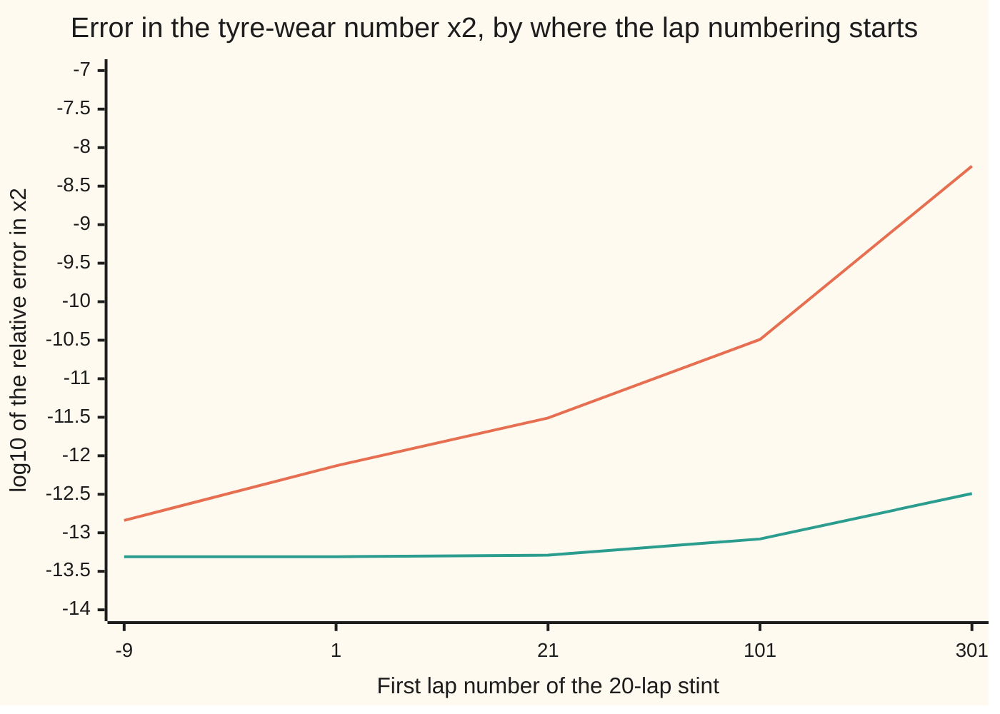

# Least squares two ways: the normal equations square the conditioning, QR does not

[Syllabus](../../../SYLLABUS.md) → [Numerical analysis](../README.md) → [Numerical Linear Algebra](../README.md#s03) → Least squares two ways

---

## General Overview

A kart team is partway through a 24-hour race. One driver has just finished a 20-lap stint, laps 301 to 320. The lap times start at 61.318 s, fall to 60.965 s, then climb back to 61.217 s. Fresh tyres and a lighter fuel load make the car faster; worn tyres make it slower. (The times are illustrative.)

The engineer fits a curve, lap time = x0 + x1 × lap + x2 × lap², to the 20 times. The number she wants is x2, the bend of the curve. It measures tyre wear: each lap the slowdown grows by 2 × x2, which here is 7.2392 ms. The fit also puts the fastest lap at 311.1317.

There are two standard ways to compute that fit. Both start from the data matrix A, which has one row (1, lap, lap²) per lap. The **normal equations** multiply A by its own transpose, AᵀA, and solve a small 3 × 3 system. **QR** first rotates the data into a triangle, then solves that. In exact arithmetic they give the same answer. In floating point, on these laps, the normal equations get x2 right to about 8 digits and QR to about 12. The normal equations lose four digits more, and the card shows exactly where they go. The loss is set by the **condition number** κ of A: the largest factor by which the fit can magnify a small error in its data.

**Forming AᵀA squares the condition number κ, so the normal equations lose about twice as many digits as the problem itself does; QR works on A directly and keeps κ, so choose the normal equations only when κ² times the rounding unit is still smaller than the accuracy you need, which centring the data usually arranges.**

**What kind of fact this is:** a theorem, κ(AᵀA) = κ(A)², proved on this card in Why it works, plus two error estimates. The estimate for the normal equations is derived here. The estimate for QR is stated with its key steps and a named source.

### The picture: the same 20 laps, numbered from different starting laps

The curve and the tyre-wear number do not change when the laps are renumbered. Only the conditioning does. Each point below is one numbering of the same stint, from laps −9 to 10 (centred) up to laps 301 to 320.



The orange line is the normal equations. The green line is Householder QR. Both are measured against the exact answer, computed in integer arithmetic. With centred laps both errors sit near rounding level, within a factor of 3 of each other. At laps 301 to 320 the orange line has climbed more than four steps of ten above the green one.

---

## The formula

The data are 20 equations in 3 unknowns, one per lap:

$$A x \approx b$$

Here $A$ is a 20 × 3 matrix whose row for lap $L$ is (1, $L$, $L^2$), $b$ holds the 20 lap times, and $x$ = (x0, x1, x2) holds the coefficients. Least squares picks the $x$ that makes the sum of squared misses as small as possible. The two routes to it are

$$\text{normal equations: } A^T A\,x = A^T b \qquad\qquad \text{QR: } A = QR,\quad R\,x = Q^T b$$

and their errors, in a computer that rounds every operation, are

$$\kappa(A^TA) = \kappa(A)^2, \qquad \frac{\lVert\hat x_{NE} - x\rVert}{\lVert x\rVert} \approx \kappa^2 u, \qquad \frac{\lVert\hat x_{QR} - x\rVert}{\lVert x\rVert} \lesssim (\kappa + \kappa^2 \tan\theta)\, u$$

**Read it aloud:** multiplying A by its transpose squares its condition number, so the normal equations can lose about κ² times the rounding unit, while QR loses about κ times the rounding unit plus a κ² term that is shrunk by how badly the curve misses the data.

| Symbol | Plain meaning | In our example | Push it up and the answer… |
| --- | --- | --- | --- |
| $L$ | lap number, from the race timing sheet | 301 to 320 | further from zero means nearly parallel columns: κ grows |
| $m$, $n$ | number of data rows, number of unknowns | 20 laps, 3 coefficients | more rows add work, not conditioning |
| $A$ | the design matrix: one row (1, $L$, $L^2$) per lap | 20 × 3 | — |
| $b$ | the measured lap times, in seconds | 61.318, 61.418, … | — |
| $x$ | the coefficients x0, x1, x2 of the fitted curve | x2 = 3.619617224880e-03 s per lap² | — |
| $\hat x$ | "x-hat", the computed $x$, with its rounding errors | $\hat x_{NE}$, $\hat x_{QR}$ | — |
| $A^TA$ | the 3 × 3 matrix of dot products of A's columns | κ = 190,657,122.4 | its κ is the square of A's |
| $Q$, $R$ | $Q$: columns at right angles, each of length 1; $R$: an upper triangle | from Householder reflections | — |
| $\kappa$ | condition number: largest stretch of $A$ over smallest, columns scaled to length 1 | 13,807.9 | every error estimate grows with it |
| $u$ | unit roundoff, $2^{-53}$: the largest relative error of one rounding | 1.110e-16 | — |
| $\theta$ | the angle between $b$ and the best fit $Ax$; $\tan\theta$ = misfit length ÷ fit length | $\tan\theta$ = 1.250e-03 | QR's κ² term grows |

Three symbols come from earlier cards. The hat for a computed value and $u$ are from [Machine epsilon and cancellation](../01-Floating%20Point%20and%20Error/03-rounding-cancellation-and-machine-epsilon.md). κ is from [Conditioning and stability](../01-Floating%20Point%20and%20Error/05-conditioning-and-stability.md) and, for matrices, [Matrix norms and the condition number](01-matrix-norms-and-the-condition-number.md).

κ here is measured after each column of $A$ is scaled to length 1. Units alone can inflate an unscaled κ: counting laps in hundreds would change it. Both methods are almost blind to column scaling (exactly blind for scaling by powers of 2), so the scaled κ is the one that predicts their errors.

### When it holds

- **The columns of A are independent.** If two columns were exact copies, κ would be infinite and neither method would give one answer; that case needs [Singular value decomposition](08-svd-and-the-pseudoinverse.md).
- **The rounding is the only error counted.** The estimates say what the computer adds. They say nothing about errors already in the data; here a 1 ms timing error moves x2 by a relative 8.97e-04, far more than either method's rounding.
- **κ² u is below 1.** Past that, the normal equations can return no correct digits at all, or Cholesky can meet a negative number under a square root and stop.
- **QR is done by an orthogonal method.** Householder reflections keep $Q$ orthogonal to rounding level. Classical Gram–Schmidt does not, and its answer here is off by 2.80e-10, closer to the normal equations than to Householder.
- **The estimates are estimates.** They show the size of the error, not a guarantee. On this stint the measured errors are 0.273 and 0.012 of them.

---

## Why it works

### Step 0: a computer solves a nearby problem, so the answer moves by κ of the problem it actually solves

A stable method gives the exact answer to a problem whose data are off by a few rounding units ([Forward and backward error](../01-Floating%20Point%20and%20Error/06-forward-and-backward-error.md)). The answer then moves by up to κ times that data error. So the whole question is: which problem does each method end up solving, and what is its κ?

The normal equations replace the fitting problem by the square system $A^TA\,x = A^Tb$. QR replaces it by the triangle $Rx = Q^Tb$. The next two steps show that the first has κ², the second keeps κ.

### Step 1: multiplying A by its transpose squares its condition number

Take any direction $v$ of length 1. Its stretch under $A$ is the length $\lVert Av\rVert$. Squaring that length gives

$$\lVert Av\rVert^2 = (Av)^T(Av) = v^T (A^TA)\, v.$$

The largest and smallest values of $v^T(A^TA)v$ over all such $v$ are the largest and smallest stretches of the symmetric matrix $A^TA$. So $A^TA$ stretches by exactly the squares of what $A$ stretches by, and the ratio κ is squared. The fold has the full argument.

The code checks this two independent ways. Rotating the scaled columns of $A$ until they are at right angles gives κ(A) = 13,807.9. Doing the same to $A^TA$ gives 190,657,122.4. The square of the first is 190,657,125.2: the same to seven digits. The small difference is rounding in the second computation.

<details>
<summary>Detailed proof: the stretches of AᵀA are the squares of the stretches of A</summary>

Write $G = A^TA$. It is symmetric, so it has perpendicular unit eigenvectors $q_1, q_2, q_3$ with eigenvalues $\lambda_1 \ge \lambda_2 \ge \lambda_3$ (the spectral theorem from the algebra wing). Each $\lambda_i = q_i^T G q_i = \lVert Aq_i\rVert^2 \ge 0$, and it is above 0 when the columns of $A$ are independent.

Any unit vector is $v = c_1 q_1 + c_2 q_2 + c_3 q_3$ with $c_1^2 + c_2^2 + c_3^2 = 1$. Then

$$\lVert Av\rVert^2 = v^T G v = \lambda_1 c_1^2 + \lambda_2 c_2^2 + \lambda_3 c_3^2,$$

which lies between $\lambda_3$ and $\lambda_1$ and reaches both ends at $v = q_3$ and $v = q_1$. So the largest stretch of $A$ is $\sigma_{\max} = \sqrt{\lambda_1}$ and the smallest is $\sigma_{\min} = \sqrt{\lambda_3}$.

$G$ itself stretches $q_i$ by $\lambda_i$ and any unit $v$ by $\sqrt{\lambda_1^2c_1^2+\lambda_2^2c_2^2+\lambda_3^2c_3^2}$, which lies between $\lambda_3$ and $\lambda_1$. So

$$\kappa(G) = \frac{\lambda_1}{\lambda_3} = \left(\frac{\sigma_{\max}}{\sigma_{\min}}\right)^2 = \kappa(A)^2. \qquad\blacksquare$$

</details>

### Step 2: the normal equations therefore lose about κ² u

Even a perfect solver for $A^TAx = A^Tb$ starts from stored numbers. Here every entry of $A^TA$ is a whole number below $2^{53}$, so it is stored exactly. The three entries of $A^Tb$ are sums of products of lap times, and each of those operations rounds. Cholesky ([Cholesky](04-cholesky-decomposition.md)) then solves the system stably: its answer is exact for a matrix and right-hand side off by a few rounding units.

So the computed $\hat x_{NE}$ is the exact answer to a problem whose data moved by about $u$, and that problem has condition number κ². The relative error is about κ²u:

- estimate: 13,807.9² × 1.110e-16 = 2.12e-08;
- measured, on x2: 5.78e-09, a ratio of 0.273.

The loss happens before any clever solver could help. Once the problem is written as $A^TA$, κ² is built in.

### Step 3: QR keeps κ, apart from a term shrunk by the misfit

QR writes $A = QR$, where $Q$ has three columns at right angles, each of length 1, and $R$ is a 3 × 3 upper triangle ([QR](05-qr-householder-and-gram-schmidt.md)). Multiplying by $Q^T$ does not change lengths in the directions $Q$ spans, so the squared miss becomes $\lVert Q^Tb - Rx\rVert^2$ plus a part $x$ cannot touch. The best $x$ solves the triangle $Rx = Q^Tb$.

Two facts make this safe:

1. **$R$ has the same stretches as $A$.** For any $v$, $\lVert Av\rVert = \lVert QRv\rVert = \lVert Rv\rVert$, because $Q$ keeps lengths. So κ(R) = κ(A): nothing is squared.
2. **Householder QR is backward stable.** Its $\hat x_{QR}$ is the exact least-squares answer for data $A + \delta A$, $b + \delta b$, each off by a small multiple of $u$ (Higham, chapter 20).

The least-squares problem itself then turns a data error of size $u$ into an answer error of about $(\kappa + \kappa^2 \tan\theta)u$. This was shown by Golub and Wilkinson in 1966; it is stated here, not proved. The key step: tilting the columns of $A$ slightly tilts the flat sheet the fit lives on. The leftover misfit, of relative length $\tan\theta$, then swings with the sheet, and solving back through $R$ amplifies that swing by κ again.

So QR also meets κ², but multiplied by $\tan\theta$, which is small when the curve fits well. Here:

- $\tan\theta$ = 1.250e-03, because the misses are tiny next to 61-second lap times;
- estimate: (13,807.9 + 13,807.9² × 1.250e-03) × 1.110e-16 = 2.80e-11;
- measured, on x2: 3.26e-13, a ratio of 0.012.

The normal equations pay κ² even when the fit is perfect. QR pays κ² only in proportion to the misfit.

### Step 4: κ depends on how spread out the data are, so choose by that

Why is κ so large here? Over laps 301 to 320, the columns 1, $L$ and $L^2$ hardly change in shape: each just rises a little across the stint. Three nearly parallel columns make a nearly flat matrix, and the fit has to balance huge coefficients that cancel. The intercept x0 = 4.114391447710e+02 s is the lap time the curve predicts for lap 0, an extrapolation no one would read.

The ratio that matters is where the data sit compared with how wide they spread: the centre of the lap numbers divided by their half-width. Renumbering the same stint changes only this ratio:

| First lap | Centre ÷ half-width | κ | κ²u | Normal equations error | QR error |
| --- | ---: | ---: | ---: | ---: | ---: |
| −9 (centred) | 0.05 | 2.7 | 7.98e-16 | 1.44e-13 | 4.92e-14 |
| 1 | 1.11 | 18.4 | 3.78e-14 | 7.34e-13 | 4.90e-14 |
| 21 | 3.21 | 135.4 | 2.04e-12 | 3.12e-12 | 5.10e-14 |
| 101 | 11.63 | 1,750.6 | 3.40e-10 | 3.27e-11 | 8.32e-14 |
| 301 | 32.68 | 13,807.9 | 2.12e-08 | 5.78e-09 | 3.26e-13 |

The tyre-wear number x2 is the same in every row; only the rounding differs.

In the top rows both errors sit above κ²u. The estimates are for the whole answer x, measured in the scaled columns. With laps near zero, x2 is a tiny part of that answer, so its own relative error is larger than the whole vector's. From lap 101 on, x2 carries a fair share of the answer, and its error tracks the estimates.

The rule that follows:

1. Estimate κ of the scaled columns, or at least the centre ÷ half-width ratio.
2. If κ²u is far below the accuracy you need, and far below the data's own error, the normal equations are fine and cheaper.
3. Otherwise use QR, or centre the data first, which shrinks κ for both.

The cost difference is a factor of about two. For $m$ rows and $n$ unknowns, the normal equations take about $mn^2 + n^3/3$ flops and Householder QR about $2mn^2 - 2n^3/3$ ([Counting the work](../01-Floating%20Point%20and%20Error/08-operation-counts-and-cost.md)). For this stint that is 189 against 342. For a million rows of telemetry with three unknowns, 9,000,009 against 17,999,982.

---

## Worked numbers, by hand

The stint is laps 301 to 320, 20 lap times, a quadratic with 3 coefficients. The trouble is conditioning, not instability: both methods are stable, and the normal equations lose digits because they solve a worse-conditioned problem.

| Step | Arithmetic | Value |
| --- | --- | --- |
| κ of A, columns scaled | one-sided Jacobi on A | 13,807.9 |
| κ of AᵀA | one-sided Jacobi on AᵀA | 190,657,122.4 |
| κ squared | 13,807.9 × 13,807.9 | 190,657,125.2 |
| unit roundoff u | 2⁻⁵³ | 1.110e-16 |
| normal equations estimate | κ² × u | 2.12e-08 |
| misfit angle | tan θ = misfit length ÷ fit length | 1.250e-03 |
| QR estimate | (κ + κ² × tan θ) × u | 2.80e-11 |
| exact x2 | integer arithmetic | 3.619617224880e-03 |
| normal equations x2 | Cholesky on AᵀA | 3.619617203975e-03, error 5.78e-09 |
| QR x2 | Householder | 3.619617224879e-03, error 3.26e-13 |
| ratio of errors | 5.78e-09 ÷ 3.26e-13 | **17,716: about 4.25 digits** |

The normal equations agree with the exact x2 to 8 digits and QR to 12. Squaring κ cost four digits, as the overview said. For the team the loss is harmless, because a 1 ms timing error moves x2 by a relative 8.97e-04; it becomes real when κ²u approaches the accuracy the data carry.

### What breaks if you drop a piece

| Mistake | Comes out at | What went wrong |
| --- | --- | --- |
| Normal equations on the raw lap numbers 301 to 320 | x2 error 5.78e-09, against 3.26e-13 for QR | Forming AᵀA squared κ to 190,657,122.4 |
| QR by classical Gram–Schmidt instead of Householder | x2 error 2.80e-10 | The computed Q is no longer orthogonal, so $Q^Tb$ carries some κ² error back in |
| Trusting the normal equations because the residual is small | sum of squared misses, summed exactly, 0.117022316609705: the same as the exact fit's to all 15 printed digits | The residual cannot see that x2 is wrong in its 9th digit; a small residual is a small backward error, not a small forward error |

---

## Code, from first principles, and it actually runs

The code fits the 20 lap times three ways and compares them. Road one is exact: it turns each stored lap time into an integer, solves the 3 × 3 normal equations by Cramer's rule in whole numbers on the laps as numbered, and only then divides. Each renumbering feeds it different whole numbers, so getting the same x2 at every numbering is a real test. The sums of squared misses are summed exactly too, in whole units of 2⁻⁶², because in floating point the misses come from cancelling numbers near 61 and their last digits are rounding. Road two is the normal equations with Cholesky in floating point. Road three is Householder QR. Two separate computations find κ by one-sided Jacobi rotations: one rotates the scaled columns of A itself, never forming AᵀA; the other rotates AᵀA. The code then renumbers the stint five ways to show κ and both errors moving together.

### Python

```python
# Least squares two ways: normal equations against Householder QR, on a quadratic fit
# to 20 kart lap times (illustrative data, in seconds). Standard library only.
# Roads: exact integer arithmetic (Cramer's rule), Householder QR, normal equations
# with Cholesky; kappa of A and of A^T A by one-sided Jacobi on each separately.
from math import sqrt, log10
TIMES = [61.318, 61.418, 61.327, 61.293, 61.278, 61.133, 61.071, 61.026, 61.065, 60.965,
         60.982, 61.006, 61.020, 61.123, 61.212, 61.180, 61.218, 61.388, 61.188, 61.217]
LAP0, M, U = 301, 20, 2.0 ** -53         # first lap of the stint, laps, unit roundoff

def dot(p, q):                           # plain loop: same rounding in Python and Rust
    t = 0.0
    for a, b in zip(p, q): t += a * b
    return t
def columns(a):                          # A as three columns: 1, lap, lap^2
    laps = [float(a + i) for i in range(M)]
    return [[1.0] * M, laps, [v * v for v in laps]]
def det3(g):
    return (g[0][0] * (g[1][1] * g[2][2] - g[1][2] * g[2][1]) - g[0][1] * (g[1][0] * g[2][2]
            - g[1][2] * g[2][0]) + g[0][2] * (g[1][0] * g[2][1] - g[1][1] * g[2][0]))
def exact(a, times):                     # road 1: exact rationals in integers
    t = [a + i for i in range(M)]        # the laps as numbered: each offset gives new integers
    yi = [int(v * 2.0 ** 47) for v in times]   # each stored double, times 2^47, exactly
    g = [[sum(v ** (j + k) for v in t) for k in range(3)] for j in range(3)]
    h = [sum(v ** j * y for v, y in zip(t, yi)) for j in range(3)]
    d, n = det3(g), []
    for j in range(3):
        gj = [[h[i] if k == j else g[i][k] for k in range(3)] for i in range(3)]
        n.append(det3(gj))
    assert max(abs(v).bit_length() for v in n + [d << 47]) < 127        # fits Rust's i128
    return [float(v) / float(d << 47) for v in n]
def back(r, z):                          # solve the triangle R x = z from the bottom up
    x = [0.0] * 3
    for i in (2, 1, 0):
        e = z[i]
        for k in range(i + 1, 3): e -= r[i][k] * x[k]
        x[i] = e / r[i][i]
    return x
def normal(c, y):                        # road 2: A^T A x = A^T b by Cholesky
    g = [[dot(c[j], c[k]) for k in range(3)] for j in range(3)]
    r = [[0.0] * 3 for _ in range(3)]
    for j in range(3):
        d = g[j][j]
        for k in range(j): d -= r[k][j] * r[k][j]
        r[j][j] = sqrt(d)
        for i in range(j + 1, 3):
            e = g[j][i]
            for k in range(j): e -= r[k][j] * r[k][i]
            r[j][i] = e / r[j][j]
    z = [0.0] * 3                        # forward solve R^T z = A^T b
    for i in range(3):
        e = dot(c[i], y)
        for k in range(i): e -= r[k][i] * z[k]
        z[i] = e / r[i][i]
    return back(r, z)
def householder(c, y):                   # road 3: reflect A into a triangle R
    v_cols, b, r = [col[:] for col in c], list(y), [[0.0] * 3 for _ in range(3)]
    for j in range(3):
        col = v_cols[j][j:]
        nrm = sqrt(dot(col, col))
        alpha = -nrm if col[0] > 0 else nrm
        v = col[:]; v[0] -= alpha
        vv = dot(v, v)
        for w in v_cols[j:] + [b]:
            f = 2.0 * dot(v, w[j:]) / vv
            for i in range(j, M): w[i] -= f * v[i - j]
        for k in range(j, 3): r[j][k] = v_cols[k][j]
    return back(r, b[:3])
def gram_schmidt(c, y):                  # classical Gram-Schmidt, for "what breaks"
    q, r = [], [[0.0] * 3 for _ in range(3)]
    for j in range(3):
        v = c[j][:]
        for k in range(j):
            r[k][j] = dot(q[k], c[j])
            for i in range(M): v[i] -= r[k][j] * q[k][i]
        r[j][j] = sqrt(dot(v, v)); q.append([w / r[j][j] for w in v])
    return back(r, [dot(qk, y) for qk in q])
def sing(cols):                          # one-sided Jacobi: rotate columns until perpendicular
    v = [col[:] for col in cols]
    for sweep in range(40):
        worst = 0.0
        for p in range(3):
            for q in range(p + 1, 3):
                al, be, ga = dot(v[p], v[p]), dot(v[q], v[q]), dot(v[p], v[q])
                if ga == 0.0: continue
                worst = max(worst, abs(ga) / sqrt(al * be))
                ze = (be - al) / (2.0 * ga)
                t = (1.0 if ze >= 0 else -1.0) / (abs(ze) + sqrt(1.0 + ze * ze))
                cs = 1.0 / sqrt(1.0 + t * t); sn = cs * t
                for i in range(len(v[p])):
                    x1, x2 = v[p][i], v[q][i]
                    v[p][i], v[q][i] = cs * x1 - sn * x2, sn * x1 + cs * x2
        if worst < 1e-15: break
    s = sorted(sqrt(dot(w, w)) for w in v)
    return s[2] / s[0]                   # largest stretch over smallest: kappa
def kappa(c):                            # kappa of A with each column scaled to length 1
    return sing([[v / sqrt(dot(col, col)) for v in col] for col in c])
def rel2(xh, x): return abs(xh[2] - x[2]) / abs(x[2])   # relative error in x2, the wear number
def rss(c, x):                           # residual sum of squares, exact: misses in whole units of 2^-62
    sx = [int(v * 2.0 ** 62) for v in x]; assert all((v * 2.0 ** 62).is_integer() for v in x)
    q = sum((int(TIMES[i] * 2.0 ** 62) - sx[0] - sx[1] * int(c[1][i]) - sx[2] * int(c[2][i])) ** 2 for i in range(M))
    assert q.bit_length() < 127; return float(q) / 2.0 ** 62 / 2.0 ** 62   # q fits Rust's i128

C = columns(LAP0)
xe, xq, xn, xg = exact(LAP0, TIMES), householder(C, TIMES), normal(C, TIMES), gram_schmidt(C, TIMES)
for name, x in (("exact", xe), ("QR", xq), ("normal eqns", xn)):
    print(f"{name:<12} x0 {x[0]:.12e}  x1 {x[1]:.12e}  x2 {x[2]:.12e}")
k = kappa(C)
cs = [[v / sqrt(dot(col, col)) for v in col] for col in C]
kg = sing([[dot(cs[j], cs[i]) for i in range(3)] for j in range(3)])   # kappa of A^T A
fit = [xe[0] + xe[1] * C[1][i] + xe[2] * C[2][i] for i in range(M)]
tan = sqrt(rss(C, xe)) / sqrt(dot(fit, fit))
eq, en, eg = rel2(xq, xe), rel2(xn, xe), rel2(xg, xe)
print(f"kappa(A) {k:.1f}  kappa(A^T A) {kg:.1f}  kappa(A)^2 {k * k:.1f}")
print(f"tan theta {tan:.3e}   u {U:.3e}")
eqs, ens = (k + k * k * tan) * U, k * k * U
print(f"x2 error, QR          {eq:.2e}   estimate (k + k^2 tan)u {eqs:.2e}   ratio {eq / eqs:.3f}")
print(f"x2 error, normal eqns {en:.2e}   estimate k^2 u {ens:.2e}   ratio {en / ens:.3f}")
print(f"normal eqns / QR error {en / eq:.0f}, about {log10(en / eq):.2f} digits")
print(f"x2 error, classical Gram-Schmidt {eg:.2e}")
print(f"rss, summed exactly: exact fit {rss(C, xe):.15f}  QR {rss(C, xq):.15f}  normal {rss(C, xn):.15f}")
print(f"fastest lap {-xe[1] / (2 * xe[2]):.4f}, wear 2*x2 {2000 * xe[2]:.4f} ms per lap per lap")
bumped = TIMES[:]; bumped[0] = 61.319
print(f"lap {LAP0} timed 1 ms slower: x2 moves {rel2(exact(LAP0, bumped), xe):.2e}")
for m in (20, 1000000): print(f"flops m={m}: normal {m * 9 + 9}, Householder {18 * m - 18}")
print("sweep first lap, centre/half-width, kappa, k^2 u, normal, QR, log10 normal, log10 QR")
sweep = {}
for a in (-9, 1, 21, 101, 301):
    c = columns(a); x = exact(a, TIMES)
    sweep[a] = (kappa(c), rel2(normal(c, TIMES), x), rel2(householder(c, TIMES), x))
    kk, e1, e2 = sweep[a]
    print(f"sweep {a:>5} {(a + 9.5) / 9.5:>8.2f} {kk:>9.1f} {kk * kk * U:.2e} {e1:.2e} {e2:.2e} {log10(e1):6.2f} {log10(e2):6.2f}")

assert abs(xe[2] - 0.0036196172248804) < 1e-15        # exact x2, pinned to 14 digits
assert all(abs(exact(a, TIMES)[2] - xe[2]) < 1e-15 for a in (-9, 1, 21, 101))  # same x2, new integers
assert eq < 1e-11 and 0.1 < en / ens < 1 and en / eq > 1e3   # NE near k^2 u; QR 4 digits ahead
assert abs(kg / (k * k) - 1.0) < 1e-6                    # kappa(A^T A) = kappa(A)^2
assert sweep[-9][1] < 1e-12 and sweep[301][1] > 1e3 * sweep[-9][1]   # centring rescues it
assert abs(rss(C, xn) - rss(C, xe)) < 1e-15               # residual hides the loss
assert abs(-xq[1] / (2 * xq[2]) + xe[1] / (2 * xe[2])) < 1e-9
print("ALL CHECKS PASS")
```

**Ran 2026-11-11 on macOS, Python 3.14.10, standard library only. All checks passed. Output, pasted from the run:**

```
exact        x0 4.114391447710e+02  x1 -2.252355228982e+00  x2 3.619617224880e-03
QR           x0 4.114391447709e+02  x1 -2.252355228981e+00  x2 3.619617224879e-03
normal eqns  x0 4.114391427559e+02  x1 -2.252355215998e+00  x2 3.619617203975e-03
kappa(A) 13807.9  kappa(A^T A) 190657122.4  kappa(A)^2 190657125.2
tan theta 1.250e-03   u 1.110e-16
x2 error, QR          3.26e-13   estimate (k + k^2 tan)u 2.80e-11   ratio 0.012
x2 error, normal eqns 5.78e-09   estimate k^2 u 2.12e-08   ratio 0.273
normal eqns / QR error 17716, about 4.25 digits
x2 error, classical Gram-Schmidt 2.80e-10
rss, summed exactly: exact fit 0.117022316609705  QR 0.117022316609705  normal 0.117022316609705
fastest lap 311.1317, wear 2*x2 7.2392 ms per lap per lap
lap 301 timed 1 ms slower: x2 moves 8.97e-04
flops m=20: normal 189, Householder 342
flops m=1000000: normal 9000009, Householder 17999982
sweep first lap, centre/half-width, kappa, k^2 u, normal, QR, log10 normal, log10 QR
sweep    -9     0.05       2.7 7.98e-16 1.44e-13 4.92e-14 -12.84 -13.31
sweep     1     1.11      18.4 3.78e-14 7.34e-13 4.90e-14 -12.13 -13.31
sweep    21     3.21     135.4 2.04e-12 3.12e-12 5.10e-14 -11.51 -13.29
sweep   101    11.63    1750.6 3.40e-10 3.27e-11 8.32e-14 -10.49 -13.08
sweep   301    32.68   13807.9 2.12e-08 5.78e-09 3.26e-13  -8.24 -12.49
ALL CHECKS PASS
```

### Rust

The same computation, operation for operation, so the output is identical. Rust writes exponents as `e-8`, so a small helper prints them the way Python does.

```rust
// Least squares two ways: normal equations against Householder QR, on a quadratic fit
// to 20 kart lap times (illustrative data, in seconds). Standard library only.
// Roads: exact integer arithmetic (Cramer's rule), Householder QR, normal equations
// with Cholesky; kappa of A and of A^T A by one-sided Jacobi on each separately.
const TIMES: [f64; 20] = [61.318, 61.418, 61.327, 61.293, 61.278, 61.133, 61.071, 61.026,
    61.065, 60.965, 60.982, 61.006, 61.020, 61.123, 61.212, 61.180, 61.218, 61.388, 61.188, 61.217];
const LAP0: i64 = 301; const M: usize = 20; // first lap of the stint, laps
const U: f64 = 1.0 / 9007199254740992.0; const S62: f64 = 4611686018427387904.0; // unit roundoff 2^-53; 2^62

fn fe(x: f64, p: usize) -> String { // Python-style e-notation: 1.23e-08
    let s = format!("{:.*e}", p, x);
    let (m, e) = s.split_once('e').unwrap(); let n: i32 = e.parse().unwrap();
    format!("{}e{}{:02}", m, if n < 0 { '-' } else { '+' }, n.abs())
}
fn dot(p: &[f64], q: &[f64]) -> f64 { // plain loop: same rounding in Python and Rust
    let mut t = 0.0;
    for (a, b) in p.iter().zip(q) { t += a * b; } t
}
fn columns(a: i64) -> Vec<Vec<f64>> { // A as three columns: 1, lap, lap^2
    let laps: Vec<f64> = (0..M).map(|i| (a + i as i64) as f64).collect();
    vec![vec![1.0; M], laps.clone(), laps.iter().map(|v| v * v).collect()]
}
fn det3(g: &[[i128; 3]; 3]) -> i128 {
    g[0][0] * (g[1][1] * g[2][2] - g[1][2] * g[2][1]) - g[0][1] * (g[1][0] * g[2][2]
        - g[1][2] * g[2][0]) + g[0][2] * (g[1][0] * g[2][1] - g[1][1] * g[2][0])
}
fn exact(a: i64, times: &[f64]) -> Vec<f64> { // road 1: exact rationals in integers
    let t: Vec<i128> = (0..M).map(|i| (a + i as i64) as i128).collect(); // laps as numbered: new integers
    let yi: Vec<i128> = times.iter().map(|v| (v * 140737488355328.0) as i128).collect(); // x 2^47
    let (mut g, mut h) = ([[0i128; 3]; 3], [0i128; 3]);
    for j in 0..3 {
        for k in 0..3 { g[j][k] = t.iter().map(|v| v.pow((j + k) as u32)).sum(); }
        h[j] = t.iter().zip(&yi).map(|(v, y)| v.pow(j as u32) * y).sum();
    }
    let (d, mut n) = (det3(&g), [0i128; 3]);
    for j in 0..3 {
        let mut gj = g;
        for i in 0..3 { gj[i][j] = h[i]; } n[j] = det3(&gj);
    }
    n.iter().map(|v| *v as f64 / ((d << 47) as f64)).collect()
}
fn back(r: &[[f64; 3]; 3], z: &[f64]) -> Vec<f64> { // solve R x = z from the bottom up
    let mut x = vec![0.0; 3]; for i in (0..3).rev() {
        let mut e = z[i];
        for k in i + 1..3 { e -= r[i][k] * x[k]; } x[i] = e / r[i][i];
    }
    x
}
fn normal(c: &[Vec<f64>], y: &[f64]) -> Vec<f64> { // road 2: A^T A x = A^T b by Cholesky
    let (mut g, mut r) = ([[0.0; 3]; 3], [[0.0; 3]; 3]);
    for j in 0..3 { for k in 0..3 { g[j][k] = dot(&c[j], &c[k]); } }
    for j in 0..3 {
        let mut d = g[j][j];
        for k in 0..j { d -= r[k][j] * r[k][j]; } r[j][j] = d.sqrt();
        for i in j + 1..3 {
            let mut e = g[j][i];
            for k in 0..j { e -= r[k][j] * r[k][i]; } r[j][i] = e / r[j][j];
        }
    }
    let mut z = vec![0.0; 3]; for i in 0..3 { // forward solve R^T z = A^T b
        let mut e = dot(&c[i], y);
        for k in 0..i { e -= r[k][i] * z[k]; } z[i] = e / r[i][i];
    }
    back(&r, &z)
}
fn householder(c: &[Vec<f64>], y: &[f64]) -> Vec<f64> { // road 3: reflect A into a triangle
    let mut w: Vec<Vec<f64>> = c.to_vec();
    w.push(y.to_vec()); // b rides along as a fourth column
    let mut r = [[0.0; 3]; 3];
    for j in 0..3 {
        let nrm = dot(&w[j][j..], &w[j][j..]).sqrt();
        let alpha = if w[j][j] > 0.0 { -nrm } else { nrm };
        let mut v = w[j][j..].to_vec(); v[0] -= alpha;
        let vv = dot(&v, &v);
        for col in w.iter_mut().skip(j) {
            let f = 2.0 * dot(&v, &col[j..]) / vv;
            for i in j..M { col[i] -= f * v[i - j]; }
        }
        for k in j..3 { r[j][k] = w[k][j]; }
    }
    back(&r, &w[3][..3])
}
fn gram_schmidt(c: &[Vec<f64>], y: &[f64]) -> Vec<f64> { // classical, for "what breaks"
    let (mut q, mut r): (Vec<Vec<f64>>, _) = (Vec::new(), [[0.0; 3]; 3]);
    for j in 0..3 {
        let mut v = c[j].clone(); for k in 0..j {
            r[k][j] = dot(&q[k], &c[j]);
            for i in 0..M { v[i] -= r[k][j] * q[k][i]; }
        }
        r[j][j] = dot(&v, &v).sqrt();
        q.push(v.iter().map(|w| w / r[j][j]).collect());
    }
    let z: Vec<f64> = q.iter().map(|qk| dot(qk, y)).collect();
    back(&r, &z)
}
fn sing(cols: &[Vec<f64>]) -> f64 { // one-sided Jacobi: rotate columns until perpendicular
    let mut v = cols.to_vec();
    for _sweep in 0..40 {
        let mut worst: f64 = 0.0;
        for p in 0..3 {
            for q in p + 1..3 {
                let (al, be, ga) = (dot(&v[p], &v[p]), dot(&v[q], &v[q]), dot(&v[p], &v[q]));
                if ga == 0.0 { continue; }
                worst = worst.max(ga.abs() / (al * be).sqrt());
                let ze = (be - al) / (2.0 * ga);
                let t = (if ze >= 0.0 { 1.0 } else { -1.0 }) / (ze.abs() + (1.0 + ze * ze).sqrt());
                let cs = 1.0 / (1.0 + t * t).sqrt(); let sn = cs * t;
                for i in 0..v[p].len() {
                    let (x1, x2) = (v[p][i], v[q][i]);
                    (v[p][i], v[q][i]) = (cs * x1 - sn * x2, sn * x1 + cs * x2);
                }
            }
        }
        if worst < 1e-15 { break; }
    }
    let mut s: Vec<f64> = v.iter().map(|w| dot(w, w).sqrt()).collect(); s.sort_by(f64::total_cmp);
    s[2] / s[0] // largest stretch over smallest: kappa
}
fn scaled(c: &[Vec<f64>]) -> Vec<Vec<f64>> { // each column scaled to length 1
    c.iter().map(|col| { let n = dot(col, col).sqrt(); col.iter().map(|v| v / n).collect() }).collect()
}
fn rel2(xh: &[f64], x: &[f64]) -> f64 { (xh[2] - x[2]).abs() / x[2].abs() } // error in x2
fn rss(c: &[Vec<f64>], x: &[f64]) -> f64 { // residual sum of squares, exact: misses in whole units of 2^-62
    let sx: Vec<i128> = x.iter().map(|v| (v * S62) as i128).collect(); assert!(x.iter().all(|v| (v * S62).fract() == 0.0));
    let q: i128 = (0..M).map(|i| (TIMES[i] * S62) as i128 - sx[0] - sx[1] * c[1][i] as i128 - sx[2] * c[2][i] as i128).map(|r| r * r).sum();
    q as f64 / S62 / S62
}
fn main() {
    let c = columns(LAP0);
    let (xe, xq) = (exact(LAP0, &TIMES), householder(&c, &TIMES));
    let (xn, xg) = (normal(&c, &TIMES), gram_schmidt(&c, &TIMES));
    for (name, x) in [("exact", &xe), ("QR", &xq), ("normal eqns", &xn)] {
        println!("{:<12} x0 {}  x1 {}  x2 {}", name, fe(x[0], 12), fe(x[1], 12), fe(x[2], 12));
    }
    let cs = scaled(&c); let k = sing(&cs);
    let gs: Vec<Vec<f64>> = (0..3).map(|j| (0..3).map(|i| dot(&cs[j], &cs[i])).collect()).collect();
    let kg = sing(&gs); // kappa of A^T A
    let fit: Vec<f64> = (0..M).map(|i| xe[0] + xe[1] * c[1][i] + xe[2] * c[2][i]).collect();
    let tan = rss(&c, &xe).sqrt() / dot(&fit, &fit).sqrt();
    let (eq, en, eg) = (rel2(&xq, &xe), rel2(&xn, &xe), rel2(&xg, &xe));
    println!("kappa(A) {:.1}  kappa(A^T A) {:.1}  kappa(A)^2 {:.1}", k, kg, k * k);
    println!("tan theta {}   u {}", fe(tan, 3), fe(U, 3));
    let (eqs, ens) = ((k + k * k * tan) * U, k * k * U);
    println!("x2 error, QR          {}   estimate (k + k^2 tan)u {}   ratio {:.3}", fe(eq, 2), fe(eqs, 2), eq / eqs);
    println!("x2 error, normal eqns {}   estimate k^2 u {}   ratio {:.3}", fe(en, 2), fe(ens, 2), en / ens);
    println!("normal eqns / QR error {:.0}, about {:.2} digits", en / eq, (en / eq).log10());
    println!("x2 error, classical Gram-Schmidt {}", fe(eg, 2));
    println!("rss, summed exactly: exact fit {:.15}  QR {:.15}  normal {:.15}", rss(&c, &xe), rss(&c, &xq), rss(&c, &xn));
    println!("fastest lap {:.4}, wear 2*x2 {:.4} ms per lap per lap", -xe[1] / (2.0 * xe[2]), 2000.0 * xe[2]);
    let mut bumped = TIMES; bumped[0] = 61.319;
    println!("lap {} timed 1 ms slower: x2 moves {}", LAP0, fe(rel2(&exact(LAP0, &bumped), &xe), 2));
    for m in [20i64, 1000000] { println!("flops m={}: normal {}, Householder {}", m, m * 9 + 9, 18 * m - 18); }
    println!("sweep first lap, centre/half-width, kappa, k^2 u, normal, QR, log10 normal, log10 QR");
    let mut sweep = Vec::new();
    for a in [-9i64, 1, 21, 101, 301] {
        let (ca, x) = (columns(a), exact(a, &TIMES));
        let (kk, e1, e2) = (sing(&scaled(&ca)), rel2(&normal(&ca, &TIMES), &x), rel2(&householder(&ca, &TIMES), &x));
        println!("sweep {:>5} {:>8.2} {:>9.1} {} {} {} {:6.2} {:6.2}", a, (a as f64 + 9.5) / 9.5, kk,
            fe(kk * kk * U, 2), fe(e1, 2), fe(e2, 2), e1.log10(), e2.log10());
        sweep.push((kk, e1, e2));
    }
    assert!((xe[2] - 0.0036196172248804).abs() < 1e-15); // exact x2, pinned to 14 digits
    assert!([-9i64, 1, 21, 101].iter().all(|a| (exact(*a, &TIMES)[2] - xe[2]).abs() < 1e-15)); // same x2, new integers
    assert!(eq < 1e-11 && (0.1..1.0).contains(&(en / ens)) && en / eq > 1e3); // NE near k^2 u; QR 4 digits ahead
    assert!((kg / (k * k) - 1.0).abs() < 1e-6); // kappa(A^T A) = kappa(A)^2
    assert!(sweep[0].1 < 1e-12 && sweep[4].1 > 1e3 * sweep[0].1); // centring rescues it
    assert!((rss(&c, &xn) - rss(&c, &xe)).abs() < 1e-15); // residual hides the loss
    assert!((-xq[1] / (2.0 * xq[2]) + xe[1] / (2.0 * xe[2])).abs() < 1e-9);
    println!("ALL CHECKS PASS");
}
```

**Ran 2026-11-11 on macOS, rustc 1.98.1, no crates. All checks passed. Output, pasted from the run:**

```
exact        x0 4.114391447710e+02  x1 -2.252355228982e+00  x2 3.619617224880e-03
QR           x0 4.114391447709e+02  x1 -2.252355228981e+00  x2 3.619617224879e-03
normal eqns  x0 4.114391427559e+02  x1 -2.252355215998e+00  x2 3.619617203975e-03
kappa(A) 13807.9  kappa(A^T A) 190657122.4  kappa(A)^2 190657125.2
tan theta 1.250e-03   u 1.110e-16
x2 error, QR          3.26e-13   estimate (k + k^2 tan)u 2.80e-11   ratio 0.012
x2 error, normal eqns 5.78e-09   estimate k^2 u 2.12e-08   ratio 0.273
normal eqns / QR error 17716, about 4.25 digits
x2 error, classical Gram-Schmidt 2.80e-10
rss, summed exactly: exact fit 0.117022316609705  QR 0.117022316609705  normal 0.117022316609705
fastest lap 311.1317, wear 2*x2 7.2392 ms per lap per lap
lap 301 timed 1 ms slower: x2 moves 8.97e-04
flops m=20: normal 189, Householder 342
flops m=1000000: normal 9000009, Householder 17999982
sweep first lap, centre/half-width, kappa, k^2 u, normal, QR, log10 normal, log10 QR
sweep    -9     0.05       2.7 7.98e-16 1.44e-13 4.92e-14 -12.84 -13.31
sweep     1     1.11      18.4 3.78e-14 7.34e-13 4.90e-14 -12.13 -13.31
sweep    21     3.21     135.4 2.04e-12 3.12e-12 5.10e-14 -11.51 -13.29
sweep   101    11.63    1750.6 3.40e-10 3.27e-11 8.32e-14 -10.49 -13.08
sweep   301    32.68   13807.9 2.12e-08 5.78e-09 3.26e-13  -8.24 -12.49
ALL CHECKS PASS
```

The two outputs are identical, line for line.

### Lean

Lean proves the three matrix facts of Why it works for matrices of every size, and checks the card's whole-number facts.

- When the columns of A are independent, κ(AᵀA) = κ(A)². This holds for any such A, so also with its columns scaled to length 1.
- If A = QR and the columns of Q are at right angles, each of length 1, then κ(R) = κ(A).
- With independent columns and such a QR, x solves AᵀA x = Aᵀb exactly when it solves R x = Qᵀb.
- For laps 301 to 320, the largest entry of AᵀA, the sum of lap⁴, is below 2⁵³.
- The flop counts check out: 189 against 342 for 20 rows, and 9,000,009 against 17,999,982 for a million.

The rounding, both error estimates, the measured errors and the renumbering sweep are left to Python and Rust.

```lean
-- Least squares two ways: multiplying a matrix by its transpose squares its condition number, a QR factor with orthonormal columns keeps it, and in exact arithmetic the normal equations and QR pick the same fit.
import Mathlib.Analysis.InnerProductSpace.PiL2
import Mathlib.LinearAlgebra.Matrix.NonsingularInverse
import Mathlib.Algebra.BigOperators.Intervals
import Mathlib.Analysis.InnerProductSpace.Rayleigh
import Mathlib.Analysis.Matrix.Hermitian

open Matrix

variable {m n : ℕ}

/-- The largest stretch of `A`: the largest length `‖A v‖` over unit vectors `v`, with the
ordinary (Euclidean) length on both sides. -/
noncomputable def maxStretch (A : Matrix (Fin m) (Fin n) ℝ) : ℝ :=
  ⨆ v : Metric.sphere (0 : EuclideanSpace ℝ (Fin n)) 1, ‖toEuclideanLin A v‖

/-- The smallest stretch of `A`: the smallest length `‖A v‖` over unit vectors `v`. -/
noncomputable def minStretch (A : Matrix (Fin m) (Fin n) ℝ) : ℝ :=
  ⨅ v : Metric.sphere (0 : EuclideanSpace ℝ (Fin n)) 1, ‖toEuclideanLin A v‖

/-- The condition number κ(A): the largest stretch of `A` divided by the smallest. -/
noncomputable def condNum (A : Matrix (Fin m) (Fin n) ℝ) : ℝ :=
  maxStretch A / minStretch A

/-- Helper: `⟪AᵀA x, y⟫ = ⟪A x, A y⟫`. -/
lemma inner_transpose_mul_self_apply (A : Matrix (Fin m) (Fin n) ℝ)
    (x y : EuclideanSpace ℝ (Fin n)) :
    inner ℝ (toEuclideanLin (Aᵀ * A) x) y = inner ℝ (toEuclideanLin A x) (toEuclideanLin A y) := by
  simp only [EuclideanSpace.inner_eq_star_dotProduct, toLpLin_apply, star_trivial, ← mulVec_mulVec, dotProduct_mulVec, vecMul_transpose]

/-- Helper: `‖A v‖² = ⟪AᵀA v, v⟫`. -/
lemma norm_sq_eq_inner_transpose_mul_self (A : Matrix (Fin m) (Fin n) ℝ)
    (v : EuclideanSpace ℝ (Fin n)) :
    ‖toEuclideanLin A v‖ ^ 2 = inner ℝ (toEuclideanLin (Aᵀ * A) v) v := by
  rw [inner_transpose_mul_self_apply, real_inner_self_eq_norm_sq]

/-- Helper: the stretches of `A` over the unit sphere are bounded above. -/
lemma bddAbove_stretch (A : Matrix (Fin m) (Fin n) ℝ) :
    BddAbove (Set.range fun v : Metric.sphere (0 : EuclideanSpace ℝ (Fin n)) 1 =>
      ‖toEuclideanLin A v‖) := by
  refine ⟨‖LinearMap.toContinuousLinearMap (toEuclideanLin A)‖, ?_⟩
  rintro _ ⟨v, rfl⟩
  have hv : ‖(v : EuclideanSpace ℝ (Fin n))‖ = 1 := by simp
  have := (LinearMap.toContinuousLinearMap (toEuclideanLin A)).le_opNorm v
  simpa [hv] using this

/-- Helper: the stretches of `A` over the unit sphere are bounded below. -/
lemma bddBelow_stretch (A : Matrix (Fin m) (Fin n) ℝ) :
    BddBelow (Set.range fun v : Metric.sphere (0 : EuclideanSpace ℝ (Fin n)) 1 =>
      ‖toEuclideanLin A v‖) :=
  ⟨0, by rintro _ ⟨v, rfl⟩; exact norm_nonneg _⟩

lemma maxStretch_nonneg (A : Matrix (Fin m) (Fin n) ℝ) : 0 ≤ maxStretch A :=
  Real.iSup_nonneg fun _ => norm_nonneg _

lemma minStretch_nonneg (A : Matrix (Fin m) (Fin n) ℝ) : 0 ≤ minStretch A :=
  Real.iInf_nonneg fun _ => norm_nonneg _

/-- Helper: `‖A w‖ ≤ maxStretch A * ‖w‖`. -/
lemma norm_le_maxStretch_mul (A : Matrix (Fin m) (Fin n) ℝ) (w : EuclideanSpace ℝ (Fin n)) :
    ‖toEuclideanLin A w‖ ≤ maxStretch A * ‖w‖ := by
  by_cases hw : w = 0
  · simp [hw]
  have hpos : 0 < ‖w‖ := norm_pos_iff.mpr hw
  set u : EuclideanSpace ℝ (Fin n) := ‖w‖⁻¹ • w with hu
  have hu1 : u ∈ Metric.sphere (0 : EuclideanSpace ℝ (Fin n)) 1 := by
    simp [hu, norm_smul, hpos.ne']
  have h1 : ‖toEuclideanLin A u‖ ≤ maxStretch A :=
    le_ciSup (bddAbove_stretch A) ⟨u, hu1⟩
  have h2 : ‖toEuclideanLin A u‖ = ‖w‖⁻¹ * ‖toEuclideanLin A w‖ := by
    rw [hu, map_smul, norm_smul, norm_inv, norm_norm]
  rw [h2] at h1
  have := mul_le_mul_of_nonneg_left h1 hpos.le
  rwa [← mul_assoc, mul_inv_cancel₀ hpos.ne', one_mul, mul_comm] at this

/-- Helper: forming `AᵀA` squares the largest stretch. -/
lemma maxStretch_transpose_mul_self (A : Matrix (Fin m) (Fin n) ℝ) :
    maxStretch (Aᵀ * A) = maxStretch A ^ 2 := by
  rcases isEmpty_or_nonempty (Metric.sphere (0 : EuclideanSpace ℝ (Fin n)) 1) with h | h
  · simp [maxStretch]
  apply le_antisymm
  · refine ciSup_le fun v => ?_
    have hv : ‖(v : EuclideanSpace ℝ (Fin n))‖ = 1 := by simp
    set T := toEuclideanLin (Aᵀ * A)
    set t := ‖T v‖ with ht
    have ht0 : 0 ≤ t := norm_nonneg _
    have hM := maxStretch_nonneg A
    have key : t ^ 2 ≤ maxStretch A ^ 2 * t := by
      calc t ^ 2 = inner ℝ (T v) (T v) := (real_inner_self_eq_norm_sq _).symm
        _ = inner ℝ (toEuclideanLin A v) (toEuclideanLin A (T v)) :=
          inner_transpose_mul_self_apply A _ _
        _ ≤ ‖toEuclideanLin A v‖ * ‖toEuclideanLin A (T v)‖ := real_inner_le_norm _ _
        _ ≤ (maxStretch A * 1) * (maxStretch A * t) := by
          have h1 := norm_le_maxStretch_mul A v
          have h2 := norm_le_maxStretch_mul A (T v)
          rw [hv] at h1
          exact mul_le_mul h1 h2 (norm_nonneg _) (by positivity)
        _ = maxStretch A ^ 2 * t := by ring
    rcases ht0.lt_or_eq with htp | hte
    · nlinarith
    · rw [← hte]; positivity
  · have hS := maxStretch_nonneg (Aᵀ * A)
    have hle : maxStretch A ≤ √(maxStretch (Aᵀ * A)) := by
      refine ciSup_le fun v => ?_
      have hv : ‖(v : EuclideanSpace ℝ (Fin n))‖ = 1 := by simp
      rw [Real.le_sqrt (norm_nonneg _) hS, norm_sq_eq_inner_transpose_mul_self]
      calc inner ℝ (toEuclideanLin (Aᵀ * A) v) v
          ≤ ‖toEuclideanLin (Aᵀ * A) v‖ * ‖(v : EuclideanSpace ℝ (Fin n))‖ :=
            real_inner_le_norm _ _
        _ = ‖toEuclideanLin (Aᵀ * A) v‖ := by rw [hv, mul_one]
        _ ≤ maxStretch (Aᵀ * A) := le_ciSup (bddAbove_stretch _) v
    exact (Real.le_sqrt (maxStretch_nonneg A) hS).mp hle

/-- Helper: forming `AᵀA` squares the smallest stretch. -/
lemma minStretch_transpose_mul_self (A : Matrix (Fin m) (Fin n) ℝ) :
    minStretch (Aᵀ * A) = minStretch A ^ 2 := by
  rcases isEmpty_or_nonempty (Metric.sphere (0 : EuclideanSpace ℝ (Fin n)) 1) with h | h
  · simp [minStretch]
  obtain ⟨v₀⟩ := id h
  have hv₀ : ‖(v₀ : EuclideanSpace ℝ (Fin n))‖ = 1 := by simp
  set T := toEuclideanLin (Aᵀ * A) with hTdef
  have hm := minStretch_nonneg A
  apply le_antisymm
  · -- an eigenvector for the bottom of the Rayleigh quotient
    have : Nontrivial (EuclideanSpace ℝ (Fin n)) :=
      nontrivial_of_ne (v₀ : EuclideanSpace ℝ (Fin n)) 0 (by
        intro h0; rw [h0, norm_zero] at hv₀; exact zero_ne_one hv₀)
    have hT : T.IsSymmetric := by
      intro x y
      calc inner ℝ (T x) y = inner ℝ (toEuclideanLin A x) (toEuclideanLin A y) :=
            inner_transpose_mul_self_apply A x y
        _ = inner ℝ (toEuclideanLin A y) (toEuclideanLin A x) := real_inner_comm _ _
        _ = inner ℝ (T y) x := (inner_transpose_mul_self_apply A y x).symm
        _ = inner ℝ x (T y) := real_inner_comm _ _
    have hev := hT.hasEigenvalue_iInf_of_finiteDimensional
    set μ := (⨅ x : { x : EuclideanSpace ℝ (Fin n) // x ≠ 0 },
      RCLike.re (inner ℝ (T x) x) / ‖(x : EuclideanSpace ℝ (Fin n))‖ ^ 2 : ℝ) with hμ
    have hbdd : BddBelow (Set.range fun x : { x : EuclideanSpace ℝ (Fin n) // x ≠ 0 } =>
        RCLike.re (inner ℝ (T x) x) / ‖(x : EuclideanSpace ℝ (Fin n))‖ ^ 2) := by
      refine ⟨0, ?_⟩
      rintro _ ⟨x, rfl⟩
      simp only [RCLike.re_to_real]
      rw [hTdef, ← norm_sq_eq_inner_transpose_mul_self]
      positivity
    obtain ⟨w, hw⟩ := hev.exists_hasEigenvector
    have hTw := hw.apply_eq_smul
    have hw0 : w ≠ 0 := hw.2
    have hwpos : 0 < ‖w‖ := norm_pos_iff.mpr hw0
    set u : EuclideanSpace ℝ (Fin n) := ‖w‖⁻¹ • w with hu
    have hu1 : ‖u‖ = 1 := by simp [hu, norm_smul, hwpos.ne']
    have hTu : T u = μ • u := by
      rw [hu, map_smul, hTw, smul_comm]
      rfl
    have hμu : μ = ‖toEuclideanLin A u‖ ^ 2 := by
      rw [norm_sq_eq_inner_transpose_mul_self, ← hTdef, hTu, real_inner_smul_left,
        real_inner_self_eq_norm_sq, hu1]
      ring
    -- `‖A u‖` is at most every stretch of `A`
    have hAu : ‖toEuclideanLin A u‖ ≤ minStretch A := by
      refine le_ciInf fun v => ?_
      have hv : ‖(v : EuclideanSpace ℝ (Fin n))‖ = 1 := by simp
      have hv0 : (v : EuclideanSpace ℝ (Fin n)) ≠ 0 := by
        intro h0; rw [h0, norm_zero] at hv; exact zero_ne_one hv
      have h1 : μ ≤ _ := ciInf_le hbdd ⟨v, hv0⟩
      simp only [RCLike.re_to_real, hv, one_pow, div_one] at h1
      rw [hTdef, ← norm_sq_eq_inner_transpose_mul_self, hμu] at h1
      exact (pow_le_pow_iff_left₀ (norm_nonneg _) (norm_nonneg _) two_ne_zero).mp h1
    calc minStretch (Aᵀ * A) ≤ ‖T u‖ :=
          ciInf_le (bddBelow_stretch _) ⟨u, by simpa using hu1⟩
      _ = ‖toEuclideanLin A u‖ ^ 2 := by
          rw [hTu, norm_smul, hu1, mul_one, Real.norm_eq_abs, abs_of_nonneg (by rw [hμu]; positivity),
            hμu]
      _ ≤ minStretch A ^ 2 := pow_le_pow_left₀ (norm_nonneg _) hAu 2
  · refine le_ciInf fun v => ?_
    have hv : ‖(v : EuclideanSpace ℝ (Fin n))‖ = 1 := by simp
    have h1 : minStretch A ≤ ‖toEuclideanLin A v‖ := ciInf_le (bddBelow_stretch A) v
    calc minStretch A ^ 2 ≤ ‖toEuclideanLin A v‖ ^ 2 := pow_le_pow_left₀ hm h1 2
      _ = inner ℝ (T v) v := norm_sq_eq_inner_transpose_mul_self A v
      _ ≤ ‖T v‖ * ‖(v : EuclideanSpace ℝ (Fin n))‖ := real_inner_le_norm _ _
      _ = ‖T v‖ := by rw [hv, mul_one]

/-- Helper: a matrix with `Qᵀ Q = 1` keeps lengths. -/
lemma norm_toEuclideanLin_of_transpose_mul_self_eq_one (Q : Matrix (Fin m) (Fin n) ℝ)
    (hQ : Qᵀ * Q = 1) (w : EuclideanSpace ℝ (Fin n)) :
    ‖toEuclideanLin Q w‖ = ‖w‖ := by
  have h : ‖toEuclideanLin Q w‖ ^ 2 = ‖w‖ ^ 2 := by
    rw [norm_sq_eq_inner_transpose_mul_self, hQ, toLpLin_one, LinearMap.id_apply,
      real_inner_self_eq_norm_sq]
  exact (sq_eq_sq₀ (norm_nonneg _) (norm_nonneg _)).mp h

#print axioms inner_transpose_mul_self_apply
#print axioms norm_sq_eq_inner_transpose_mul_self
#print axioms bddAbove_stretch
#print axioms bddBelow_stretch
#print axioms maxStretch_nonneg
#print axioms minStretch_nonneg
#print axioms norm_le_maxStretch_mul
#print axioms maxStretch_transpose_mul_self
#print axioms minStretch_transpose_mul_self
#print axioms norm_toEuclideanLin_of_transpose_mul_self_eq_one

/-- Forming AᵀA squares the condition number: when the columns of `A` are independent,
κ(AᵀA) = κ(A)². -/
theorem condNum_transpose_mul_self_eq_sq (A : Matrix (Fin m) (Fin n) ℝ)
    (hA : LinearIndependent ℝ Aᵀ) :
    condNum (Aᵀ * A) = condNum A ^ 2 := by
  rw [condNum, condNum, maxStretch_transpose_mul_self, minStretch_transpose_mul_self, div_pow]

/-- QR keeps the condition number: if `A = Q R` and the columns of `Q` are at right angles,
each of length 1 (`Qᵀ Q = 1`), then `R` has the same condition number as `A`. -/
theorem condNum_R_eq_of_qr (A Q : Matrix (Fin m) (Fin n) ℝ) (R : Matrix (Fin n) (Fin n) ℝ)
    (hQ : Qᵀ * Q = 1) (hQR : A = Q * R) :
    condNum R = condNum A := by
  have h : ∀ v : EuclideanSpace ℝ (Fin n),
      ‖toEuclideanLin A v‖ = ‖toEuclideanLin R v‖ := by
    intro v
    rw [hQR, toLpLin_mul_same, LinearMap.comp_apply,
      norm_toEuclideanLin_of_transpose_mul_self_eq_one Q hQ]
  simp only [condNum, maxStretch, minStretch, h]

/-- In exact arithmetic the two routes give the same fit: if the columns of `A` are
independent and `A = Q R` with `Qᵀ Q = 1`, then `x` solves the normal equations
AᵀA x = Aᵀb exactly when it solves the triangle R x = Qᵀb. -/
theorem normal_equations_iff_qr (A Q : Matrix (Fin m) (Fin n) ℝ) (R : Matrix (Fin n) (Fin n) ℝ)
    (hA : LinearIndependent ℝ Aᵀ) (hQ : Qᵀ * Q = 1) (hQR : A = Q * R)
    (x : Fin n → ℝ) (b : Fin m → ℝ) :
    (Aᵀ * A) *ᵥ x = Aᵀ *ᵥ b ↔ R *ᵥ x = Qᵀ *ᵥ b := by
  have hAinj : Function.Injective A.mulVec := Matrix.mulVec_injective_iff.mpr hA
  have hRinj : Function.Injective R.mulVec := by
    intro x y hxy
    apply hAinj
    simp only [hQR, ← mulVec_mulVec, hxy]
  have hRt : Function.Injective Rᵀ.mulVec :=
    mulVec_injective_iff_isUnit.mpr ((isUnit_transpose R).mpr (mulVec_injective_iff_isUnit.mp hRinj))
  have h1 : Aᵀ * A = Rᵀ * R := by
    rw [hQR, transpose_mul, Matrix.mul_assoc, ← Matrix.mul_assoc Qᵀ, hQ, Matrix.one_mul]
  have h2 : Aᵀ = Rᵀ * Qᵀ := by rw [hQR, transpose_mul]
  rw [h1, h2, ← mulVec_mulVec, ← mulVec_mulVec]
  exact hRt.eq_iff

/-! The card's whole-number facts. -/

-- Every entry of AᵀA for laps 301 to 320 is a whole number below 2^53, so it is stored
-- exactly; the largest entry is the sum of lap⁴.
example : (∑ i ∈ Finset.range 20, (301 + i) ^ 4) < 2 ^ 53 := by
  decide

-- Flops for m = 20 rows, n = 3 unknowns: normal equations m n² + n³/3 = 189,
-- Householder QR 2 m n² − 2 n³/3 = 342.
example : 20 * 3 ^ 2 + 3 ^ 3 / 3 = 189 := by norm_num
example : 2 * 20 * 3 ^ 2 - 2 * 3 ^ 3 / 3 = 342 := by norm_num

-- Flops for a million rows and 3 unknowns: 9,000,009 against 17,999,982.
example : 1000000 * 3 ^ 2 + 3 ^ 3 / 3 = 9000009 := by norm_num
example : 2 * 1000000 * 3 ^ 2 - 2 * 3 ^ 3 / 3 = 17999982 := by norm_num

#print axioms condNum_transpose_mul_self_eq_sq
#print axioms condNum_R_eq_of_qr
#print axioms normal_equations_iff_qr
```

**Checked 2026-11-11 on macOS, Lean 4.36.0-rc2, Mathlib v4.36.0-rc2. Every proof is complete and uses only Lean's standard axioms. Output, pasted from the run:**

```
'inner_transpose_mul_self_apply' depends on axioms: [propext, Classical.choice, Quot.sound]
'norm_sq_eq_inner_transpose_mul_self' depends on axioms: [propext, Classical.choice, Quot.sound]
'bddAbove_stretch' depends on axioms: [propext, Classical.choice, Quot.sound]
'bddBelow_stretch' depends on axioms: [propext, Classical.choice, Quot.sound]
'maxStretch_nonneg' depends on axioms: [propext, Classical.choice, Quot.sound]
'minStretch_nonneg' depends on axioms: [propext, Classical.choice, Quot.sound]
'norm_le_maxStretch_mul' depends on axioms: [propext, Classical.choice, Quot.sound]
'maxStretch_transpose_mul_self' depends on axioms: [propext, Classical.choice, Quot.sound]
'minStretch_transpose_mul_self' depends on axioms: [propext, Classical.choice, Quot.sound]
'norm_toEuclideanLin_of_transpose_mul_self_eq_one' depends on axioms: [propext, Classical.choice, Quot.sound]
'condNum_transpose_mul_self_eq_sq' depends on axioms: [propext, Classical.choice, Quot.sound]
'condNum_R_eq_of_qr' depends on axioms: [propext, Classical.choice, Quot.sound]
'normal_equations_iff_qr' depends on axioms: [propext, Classical.choice, Quot.sound]
```

> [!TIP]
> **Try changing**
> The asserts are pinned to laps 301 to 320; the `sweep` lines show the answers.
> - **Guess first:** set `LAP0 = 101`. Does the normal-equations error fall by the same factor as κ² u? κ falls to 1,750.6, κ²u to 3.40e-10, and the measured error to 3.27e-11.
> - **Guess first:** set `LAP0 = -9`, centring the laps. Which method wins now? Neither by much: κ is 2.7, the normal equations reach 1.44e-13 and QR 4.92e-14.
> - **Guess first:** change one lap time by 1 ms, the timing resolution. How far does x2 move? By a relative 8.97e-04, far more than the normal equations' rounding error of 5.78e-09.
> - **Guess first:** swap `householder` for `gram_schmidt` at laps 301 to 320. The error is 2.80e-10, between the other two.

---

## The usual mistake

> [!warning]
> **Forming AᵀA "because it is the formula".** The normal equations are the right *equation* for least squares, but a poor *algorithm* when κ is large. Writing AᵀA down squares κ before any solver starts, so the best solver in the world still loses about κ²u. On this stint that is 5.78e-09 against QR's 3.26e-13.
>
> - **Blaming Cholesky.** Cholesky is stable. The loss comes from the problem it is handed, κ = 190,657,122.4, not from the solver.
> - **Reading a small residual as a correct answer.** The normal equations' sum of squared misses, summed exactly, is 0.117022316609705, the same as the exact fit's to all 15 printed digits, while x2 is wrong in its 9th digit.
> - **Using raw x-values far from zero.** Laps numbered from 301 give κ = 13,807.9; the same laps centred give 2.7. Centre before fitting a polynomial.
> - **Assuming QR is free of κ².** QR still meets κ² × tan θ. Here that is small because tan θ = 1.250e-03; a poor fit with large misses would raise it.

---

## Where you meet it in real life

- **Statistics software.** Regression routines in standard statistics packages solve by a QR factorisation of the data matrix, not by forming AᵀA. [Multiple regression](../../09-Probability%20and%20statistics/09-Regression/03-multiple-regression-and-gauss-markov.md) uses the normal equations to explain the fit; the software uses QR to compute it.
- **Trend lines against dates.** Fitting a curve to values against years like 2001 to 2020, or against timestamps, puts the x-values far from zero, as lap 301 does. Centring or scaling the dates first is the standard cure.
- **Very tall data with few unknowns.** With a million rows and three unknowns, AᵀA is 3 × 3 and can be summed in one pass over data that will not fit in memory. When the data are centred and κ²u is small, the normal equations are the sensible choice: about half the flops, 9,000,009 against 17,999,982.
- **Calibration and surveying.** Instruments and survey networks are adjusted by least squares. When the unknowns are well separated, the normal equations are used; near-dependent unknowns call for QR.

> **Say it back**
> A least-squares fit can be computed from the normal equations AᵀA x = Aᵀb or from QR. Multiplying A by its transpose squares its condition number, so the normal equations lose about κ²u while QR loses about κu plus κ² u × tan θ. On laps 301 to 320, κ = 13,807.9, and the normal equations get the tyre-wear number to 8 digits while QR gets 12. κ grows when the data sit far from zero compared with their spread, so centring the laps brings κ to 2.7 and makes the cheaper normal equations safe again.

---

## What this builds on

- [QR](05-qr-householder-and-gram-schmidt.md): how Householder reflections build $Q$ and $R$, and why classical Gram–Schmidt loses orthogonality.
- [Least squares](../../03-Algebra/06-Dot%20Products%20and%20Best%20Fits/04-least-squares.md): the normal equations as a projection, with the misfit perpendicular to the columns. This card asks how accurately a computer solves them.
- [Least squares](../../09-Probability%20and%20statistics/09-Regression/01-least-squares-regression.md): the fitted line with noise in the data, the error that dwarfs rounding here.
- [Multiple regression](../../09-Probability%20and%20statistics/09-Regression/03-multiple-regression-and-gauss-markov.md): the normal equations for several predictors, $X^TX\beta = X^Ty$, the same system in statistics notation.

## Where this goes next

- [Singular value decomposition](08-svd-and-the-pseudoinverse.md): the stretches σ used in Step 1 as a factorisation, and a fit that still works when the columns are nearly or exactly dependent.
- [Fitting instead of passing through](../04-Interpolation%20and%20Approximation/07-least-squares-and-orthogonal-polynomials.md): choose columns that are already at right angles, orthogonal polynomials, so κ stays near 1 and the conditioning problem never starts.

This card leaves open what to do when κ is so large that even QR's κu is too much, and the columns of A are close to dependent.

---

## Sources

Verified 2026-11-11: every link below resolves to the publisher's page.

- Golub, Gene H. "Numerical Methods for Solving Linear Least Squares Problems." *Numerische Mathematik* 7, no. 3 (1965): 206–216. [doi:10.1007/BF01436075](https://doi.org/10.1007/BF01436075). Least squares by Householder QR instead of the normal equations.
- Golub, Gene H., and J. H. Wilkinson. "Note on the Iterative Refinement of Least Squares Solution." *Numerische Mathematik* 9, no. 2 (1966): 139–148. [doi:10.1007/BF02166032](https://doi.org/10.1007/BF02166032). The κ² tan θ term in the sensitivity of least squares.
- Higham, Nicholas J. *Accuracy and Stability of Numerical Algorithms*, 2nd ed. SIAM, 2002. [doi:10.1137/1.9780898718027](https://doi.org/10.1137/1.9780898718027). Chapters 19 and 20: backward stability of Householder QR and the error bounds for both methods.
- Björck, Åke. *Numerical Methods for Least Squares Problems*. SIAM, 1996. [doi:10.1137/1.9781611971484](https://doi.org/10.1137/1.9781611971484). The comparison of the normal equations, Gram–Schmidt and Householder for least squares.
- Trefethen, Lloyd N., and David Bau III. *Numerical Linear Algebra*. SIAM, 1997. [doi:10.1137/1.9780898719574](https://doi.org/10.1137/1.9780898719574). Lecture 19 solves one ill-conditioned polynomial fit by several methods and compares their digits.
