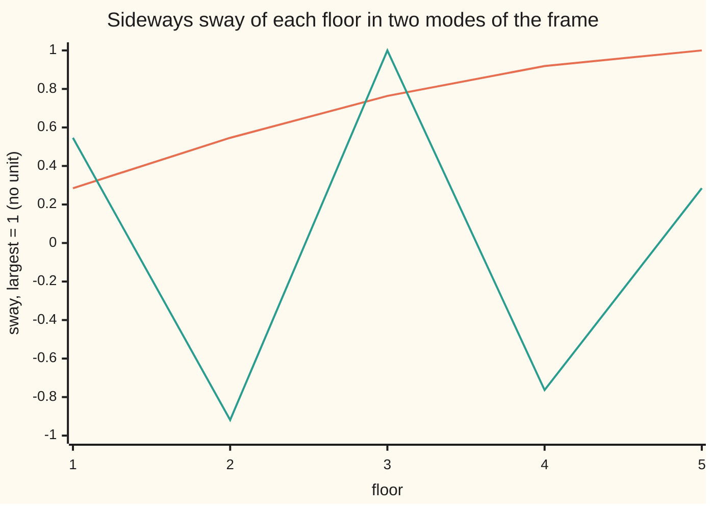
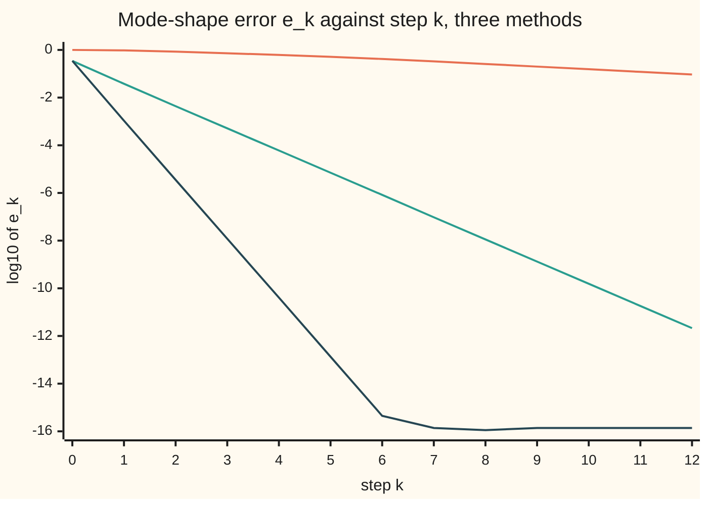

# Eigenvalues by iteration: power steps, shifted inverse steps, and the QR algorithm

[Syllabus](../../../SYLLABUS.md) → [Numerical analysis](../README.md) → [Numerical Linear Algebra](../README.md#s03) → Eigenvalues by iteration

---

## General Overview

A five-storey office frame has a 50-tonne floor at each level. The columns of each storey resist sideways movement with a stiffness of 100 MN/m (100 million newtons per metre of sway). These numbers are illustrative.

When wind or an earthquake pushes the frame, it sways in five fixed patterns called **modes**. Each mode has its own **period**: the time for one full swing. The slowest mode moves 88% of the frame's mass, so it dominates the response. Design codes read the earthquake force off its period. So the number wanted is that period, to three or four digits.

The five periods come from the **eigenvalues** (the stretch factors) of a 5 by 5 matrix. This card finds them without solving any polynomial. It multiplies a guess by the matrix, or solves with it, again and again:

- **Power iteration**, repeated multiplication, finds the stiffest mode: 0.0732 s. That is the wrong mode for design, and it takes 90 steps.
- **Inverse iteration**, repeated solving, finds the slowest mode: 0.4936 s (2.026 Hz), in 10 steps.
- **Shifted inverse iteration** starts from the rule of thumb "0.1 s per storey". That rough guess of 0.5 s cuts the work to 4 steps.
- **The QR algorithm** finds all five eigenvalues together, in 10 steps.

**Repeated multiplication pulls any starting vector toward the eigenvector whose eigenvalue is largest in size, and the error shrinks each step by the ratio of the next-largest size to the largest; solving instead of multiplying, and shifting first, choose which eigenvector wins and how small that ratio is, and the QR algorithm runs the same process on every vector at once.**

**What kind of fact this is:** a set of methods. The rate of power and inverse iteration and the stopping bounds are theorems, proved on this card in Why it works (Steps 1 and 3). The convergence of QR with the Wilkinson shift is a theorem stated in Step 4 with its source, not proved.

### The picture: the slowest and the fastest mode



Orange: mode 1, the slowest, period 0.4936 s. Every floor sways the same way, most at the top. Teal: mode 5, the fastest, period 0.0732 s. Neighbouring floors move in opposite directions. The ground stays fixed at 0.

---

## The formula

**The frame as a matrix.** In a mode, every floor swings at the same rhythm, and the list $v$ of floor sways keeps its shape. Newton's law for the five floors gives $K v = \omega^2 m\,v$. Here $K$ is the stiffness matrix, $m$ the floor mass and $\omega$ the mode's angular frequency in radians per second. Divide by the storey stiffness $s$ and write $A = K/s$:

`A = [[2, -1, 0, 0, 0], [-1, 2, -1, 0, 0], [0, -1, 2, -1, 0], [0, 0, -1, 2, -1], [0, 0, 0, -1, 1]]`

Each floor is pulled by the storey below and the storey above. The top floor has no storey above, so its diagonal entry is 1. Then $A v = \lambda v$ with $\lambda = \omega^2 m/s$, and the period is $P = 2\pi/\omega$ ([Eigenvalues and eigenvectors](../../03-Algebra/07-Eigenvalues%20and%20Symmetric%20Matrices/02-eigenvalues-and-eigenvectors.md)).

**One step.** Pick a shift $\mu$ (a number near the wanted eigenvalue), solve, and rescale to length 1:

$$x_{k+1} = \frac{(A - \mu I)^{-1} x_k}{\lVert (A - \mu I)^{-1} x_k \rVert}, \qquad \hat\lambda_k = x_k^{\mathsf T} A\, x_k .$$

Power iteration is the same step with $A x_k$ in place of $(A - \mu I)^{-1} x_k$. Inverse iteration is the step with $\mu = 0$.

**The rate.** Let $\lambda_t$ be the eigenvalue nearest $\mu$ (the target) and $\lambda_o$ the next nearest. Then

$$e_k \le \gamma^k \tan\theta_0, \qquad \gamma = \frac{\lvert \lambda_t - \mu\rvert}{\lvert \lambda_o - \mu\rvert}, \qquad \lvert \hat\lambda_k - \lambda_t \rvert \le (\lambda_n - \lambda_1)\, e_k^2 .$$

For power iteration, $\gamma$ is the second-largest eigenvalue over the largest.

**Read it aloud:** each step shrinks the distance to the wanted mode by the ratio of how near the target is to the shift against how near the runner-up is, and the eigenvalue estimate's error shrinks with the square of that distance.

**The QR algorithm.** Start from $A_0 = A$ and repeat:

$$A_k - \mu_k I = Q_k R_k, \qquad A_{k+1} = R_k Q_k + \mu_k I .$$

**Read it aloud:** factor the shifted matrix into a rotation times a triangle, multiply them back in the other order, and the diagonal slides toward the eigenvalues.

| Symbol | Plain meaning | In our example | Push it up and the answer… |
| --- | --- | --- | --- |
| $A$, $K$, $I$ | the stiffness matrix $K$ over $s$; the identity matrix | 5 by 5, above | — |
| $n$, $j$ | the matrix size, one row per floor; a mode's number | 5; 1 to 5 | more modes to find |
| $\lambda_j$, $v_j$ | eigenvalue $j$, smallest first, and its unit eigenvector, the mode shape | $\lambda_1$ = 0.081014, $\lambda_5$ = 3.682507 | larger $\lambda$: shorter period |
| $m$, $s$ | floor mass; storey stiffness | 50,000 kg; 1.0e8 N/m | $m$ up: longer periods |
| $\omega_j$, $P_j$ | angular frequency $\sqrt{\lambda_j s/m}$; period $2\pi/\omega_j$ | $P_1$ = 0.4936 s, $P_5$ = 0.0732 s | — |
| $x_k$, $c_j$ | the unit vector after $k$ steps; mode $j$'s share of $x_0$ | $x_0 = (1, 1, 1, 1, 1)/\sqrt5$ | — |
| $\hat\lambda_k$ | the computed eigenvalue: the **Rayleigh quotient** $x_k^{\mathsf T} A x_k$ | 0.200000, 0.081967, 0.081026 | — |
| $r_k$ | the residual $A x_k - \hat\lambda_k x_k$, which the method can compute | stop when its length is below 1e-10 | — |
| $\mu$ | the shift | 0.078957, from a 0.5 s guess | nearer $\lambda_t$: smaller $\gamma$ |
| $\gamma$; $\lambda_t$, $\lambda_o$ | the rate, the error's shrink factor per step; the target eigenvalue and the next nearest to $\mu$ | 0.768724, 0.117364, 0.003365 (power, inverse, shifted); for inverse iteration $\lambda_t = \lambda_1$ and $\lambda_o = \lambda_2$ = 0.690279 | slower convergence |
| $\theta_k$, $e_k$ | angle between $x_k$ and the true mode; the error $e_k = \sin\theta_k$ | $\log_{10} e_0$ = −0.46 for inverse iteration | — |
| $A_k$, $Q_k$, $R_k$, $\mu_k$, $\bar Q_k$ | QR iterate; its rotation factor; its upper triangular factor; its shift; the product of the rotations so far | — | — |

The ones start sends 88% of its weight to mode 1: $\cos^2\theta_0$ = 0.8795, the same number as mode 1's mass share. So $e_0 = \sqrt{1 - 0.8795}$, and $\log_{10} e_0$ = −0.46.

### When it holds

- **A gap.** One eigenvalue must be strictly nearest the shift, so $\gamma < 1$. With the shift exactly midway between $\lambda_1$ and $\lambda_2$, $\gamma = 1$: the estimate settles at 0.135957, which is no eigenvalue, with residual 0.175.
- **The start contains the target.** If $x_0$ has no share of the target mode, exact arithmetic never finds it. Rounding then brings it back slowly. The ones vector has a share of every mode.
- **Rescale every step.** Without it, power iteration's entries grow by about 3.68 a step and overflow to infinity at step 547.
- **Symmetry, for the squared eigenvalue error.** The frame's $A$ is symmetric, so its modes are perpendicular and $\hat\lambda_k$ is off by $e_k^2$. For a non-symmetric matrix the vector still converges at rate $\gamma$, but $\hat\lambda_k$ is only off by about $e_k$.
- **Distinct sizes, for QR without shifts.** Unshifted QR separates eigenvalues at rates $\lambda_{i}/\lambda_{i+1}$. Two equal sizes never separate. Shifts remove the problem and the slowness.

---

## Why it works

### Step 0: every vector is a mix of modes, and each step reweights the mix

The five modes $v_1, \dots, v_5$ are perpendicular, so any start is a mix $x_0 = c_1 v_1 + \dots + c_5 v_5$. Multiplying by $A$ multiplies each share $c_j$ by its own $\lambda_j$. After $k$ steps the shares are $c_j \lambda_j^k$.

The share with the largest $\lvert\lambda_j\rvert$ grows fastest, and the others fade relative to it. Rescaling to length 1 changes only the overall size, never the ratios. So the direction turns toward the winning mode.

For the frame the winner is $\lambda_5$ = 3.682507: the stiffest, fastest mode. That is the wrong one for design. Step 2 fixes that.

### Step 1: the rate is the ratio of the two largest eigenvalues

The error after $k$ steps is set by the largest losing share against the winning share. Each step multiplies that ratio by $\gamma$, the second-largest size over the largest. For the frame, $\gamma = \lambda_4/\lambda_5$ = 0.768724.

<details>
<summary>Detailed proof: tan θ_k ≤ γ^k tan θ_0, and the eigenvalue error is at most the spread times e_k²</summary>

Write $x_0 = \sum_j c_j v_j$ with the $v_j$ perpendicular and of length 1, and let $t$ be the winning index with $c_t \ne 0$. After $k$ steps, before rescaling, the vector is $\sum_j c_j \lambda_j^k v_j$. Rescaling does not change angles.

The tangent of the angle to $v_t$ is the length of the part off $v_t$ over the part along it:

$$\tan\theta_k = \frac{\sqrt{\sum_{j \ne t} c_j^2 \lambda_j^{2k}}}{\lvert c_t\rvert\,\lvert\lambda_t\rvert^k} \le \gamma^k \frac{\sqrt{\sum_{j\ne t} c_j^2}}{\lvert c_t\rvert} = \gamma^k \tan\theta_0,$$

because every $\lvert\lambda_j\rvert \le \gamma\lvert\lambda_t\rvert$ for $j \ne t$. Since $e_k = \sin\theta_k \le \tan\theta_k$, the bound on $e_k$ follows.

For the eigenvalue, write the unit vector as $x_k = \sum_j a_j v_j$ with $\sum_j a_j^2 = 1$. Then $\hat\lambda_k = \sum_j a_j^2 \lambda_j$, so

$$\hat\lambda_k - \lambda_t = \sum_{j \ne t} a_j^2 (\lambda_j - \lambda_t).$$

The off-target weights add to $\sum_{j \ne t} a_j^2 = \sin^2\theta_k = e_k^2$, and each $\lvert\lambda_j - \lambda_t\rvert$ is at most the spread $\lambda_n - \lambda_1$. That gives $\lvert\hat\lambda_k - \lambda_t\rvert \le (\lambda_n - \lambda_1)\,e_k^2$. The proof uses perpendicular eigenvectors, which a symmetric matrix always has.

</details>

The checks measure the rate directly as $e_{k+1}/e_k$, and the eigenvalue error's ratio beside $\gamma^2$:

| Method | $\gamma$, from the gap | seen $e_{k+1}/e_k$ | $\gamma^2$ | seen ratio of $\hat\lambda$ errors |
| --- | --- | --- | --- | --- |
| power, $A x$ | 0.768724 | 0.772534 at $k$ = 10 | 0.590936 | 0.596738 |
| inverse, $\mu = 0$ | 0.117364 | 0.117305 at $k$ = 3 | 0.013774 | 0.013737 |
| shifted, $\mu$ = 0.078957 | 0.003365 | 0.003304 at $k$ = 1 | 0.000011 | 0.000010 |

The seen $e_{k+1}/e_k$ and $\gamma$ agree to within 2%, the tolerance the checks assert. The power and shifted rows are still settling, because a third mode has not faded yet.

### The picture: the error against the step



Orange, the top line: power iteration toward mode 5, $\gamma$ = 0.768724. Teal, the middle line: inverse iteration toward mode 1, $\gamma$ = 0.117364. Dark blue, the bottom line: shifted inverse iteration, $\gamma$ = 0.003365, until rounding stops it near $10^{-16}$ at step 7. Each line is straight because each step multiplies the error by the same $\gamma$.

### Step 2: solving with $A - \mu I$ turns the nearest eigenvalue into the largest

The matrix $(A - \mu I)^{-1}$ has the same modes as $A$. Its eigenvalues are $1/(\lambda_j - \mu)$. The largest of those belongs to the $\lambda_j$ nearest $\mu$. So Step 0 and Step 1 apply unchanged, with the target now the mode nearest the shift.

- **Inverse iteration, $\mu = 0$.** The winner is the smallest eigenvalue, mode 1. The rate is $\lambda_1/\lambda_2$ = 0.081014 / 0.690279 = 0.117364.
- **A shift from a rough guess.** The rule of thumb gives a period of 0.5 s, so $\omega$ = 2π/0.5 and $\mu = \omega^2 m/s$ = 0.078957. The rate is (0.081014 − 0.078957) / (0.690279 − 0.078957) = 0.003365.

The inverse is never formed. Each step solves one system with the tridiagonal matrix $A - \mu I$ by the sweep from [The Thomas algorithm](03-tridiagonal-systems-and-the-thomas-algorithm.md): 8n − 7 = 33 flops (floating-point operations) for the general sweep. One product $Ax$ costs 13 flops here, $3n - 2$, because the off-diagonal entries are −1. A step of inverse iteration costs more than a power step, but it needs far fewer steps.

A good shift makes $A - \mu I$ nearly singular, so the solve has a large error. That error points almost entirely along the wanted mode, and rescaling removes it. Peters and Wilkinson (in Sources) give the full analysis.

### Step 3: stop on the residual, and read the error from the gap

The method cannot see the true error, but it can compute the **residual** $r_k = A x_k - \hat\lambda_k x_k$. For a symmetric matrix, two facts turn the residual into error bounds:

- some eigenvalue lies within $\lVert r_k\rVert$ of $\hat\lambda_k$;
- the mode-shape error is at most $\lVert r_k \rVert$ divided by the gap: the distance from $\hat\lambda_k$ to the nearest other eigenvalue.

<details>
<summary>Detailed proof: an eigenvalue lies within the residual, and the shape error is at most residual over gap</summary>

Write the unit vector as $x_k = \sum_j a_j v_j$, as in the fold of Step 1, with $\sum_j a_j^2 = 1$. Then $A x_k = \sum_j a_j \lambda_j v_j$, so

$$r_k = \sum_j a_j(\lambda_j - \hat\lambda_k)\, v_j, \qquad \lVert r_k\rVert^2 = \sum_j a_j^2 (\lambda_j - \hat\lambda_k)^2,$$

because the $v_j$ are perpendicular and of length 1.

**First bound.** Every $(\lambda_j - \hat\lambda_k)^2$ is at least the smallest of them, and the $a_j^2$ add to 1. So $\lVert r_k\rVert^2 \ge \min_j(\lambda_j - \hat\lambda_k)^2$: the nearest eigenvalue is within $\lVert r_k\rVert$ of $\hat\lambda_k$.

**Second bound.** Drop the target's term, $j = t$. Each remaining $(\lambda_j - \hat\lambda_k)^2$ is at least the gap squared, and the remaining $a_j^2$ add to $\sin^2\theta_k = e_k^2$. So $\lVert r_k\rVert^2 \ge \text{gap}^2\, e_k^2$, which is $e_k \le \lVert r_k\rVert/\text{gap}$.

**One losing mode.** If only $a_t$ and one other share $a_o$ are non-zero, then $\hat\lambda_k - \lambda_t = a_o^2(\lambda_o - \lambda_t)$ and $\lambda_o - \hat\lambda_k = a_t^2(\lambda_o - \lambda_t)$. The sum above becomes $\lVert r_k\rVert = \lvert a_t a_o\rvert\,\lvert\lambda_o - \lambda_t\rvert$, and, with $\lambda_o$ the nearest other eigenvalue, the gap is $a_t^2\lvert\lambda_o - \lambda_t\rvert$. So the bound is $\lvert a_o/a_t\rvert = \tan\theta_k$, against the true $\sin\theta_k$: they differ by the factor $\cos\theta_k$. $\blacksquare$

</details>

So "converged" on this card means the stopping test $\lVert r_k\rVert < 10^{-10}$ passed:

| Method | steps to pass | $\hat\lambda$ | true $e_k$ | bound $\lVert r_k\rVert$/gap | true / bound |
| --- | --- | --- | --- | --- | --- |
| power | 90 | 3.682507065662 | 1.1e-10 | 1.1e-10 | 1.000 |
| inverse | 10 | 0.081014052771 | 1.6e-10 | 1.6e-10 | 1.000 |
| shifted | 4 | 0.081014052771 | 4.0e-11 | 4.0e-11 | 1.000 |

The bound is nearly exact here: by then one losing mode is left, and for one losing mode the bound misses only by a factor $\cos\theta_k$. The check asserts true ≤ bound to within 0.1%, the rounding in two numbers near 1e-10. The fundamental period is $2\pi/\sqrt{0.081014052771 \times 2000}$ = 0.4936 s.

A symmetric matrix's eigenvalues are well conditioned: a change to $A$ of a given size, measured in the 2-norm (the largest factor by which it stretches any vector), moves each eigenvalue by at most that size. The frame's trouble is speed, not conditioning or stability.

### Step 4: the QR algorithm is power iteration on every vector at once

One QR step gives $A_{k+1} = R_k Q_k + \mu_k I = Q_k^{\mathsf T} A_k Q_k$, because $R_k = Q_k^{\mathsf T}(A_k - \mu_k I)$. So every $A_k$ has the same eigenvalues as $A$. The factorisation is the one from [QR](05-qr-householder-and-gram-schmidt.md); the check uses Givens rotations (turns in one plane at a time).

Why the diagonal converges, in words:

1. Multiply the rotations so far, $\bar Q_k = Q_0 Q_1 \cdots Q_{k-1}$. With no shifts, $A^k = \bar Q_k \bar R_k$.
2. So the first column of $\bar Q_k$ is power iteration started from $(1, 0, 0, 0, 0)$. The check confirms it: the two unit vectors agree to $\lvert\cos\rvert$ = 1.000000000000000 after 10 steps.
3. The first two columns are power iteration on a plane, kept perpendicular. The same holds for three, four and five columns.
4. The diagonal of $A_k$ therefore sorts into the eigenvalues, largest first. Each entry just below the diagonal shrinks every step by the ratio of the two eigenvalues it separates, smaller over larger.

After 10 unshifted steps the diagonal reads 3.670167, 2.842853, 1.715687, 0.690279, 0.081014. The entries below it are 1.0e-01, 1.9e-02, 2.5e-04 and 2.8e-10. The last one is tiny because $\lambda_1/\lambda_2$ = 0.117364. The first is slow because $\lambda_4/\lambda_5$ = 0.768724. All four fall below $10^{-12}$ only after 107 steps.

The last column of $\bar Q_k$ runs inverse iteration at the same time. So a shift taken from the bottom corner of $A_k$ speeds up the bottom entry exactly as in Step 2. The check uses the **Wilkinson shift**: the eigenvalue of the bottom 2 by 2 block nearest the corner entry. When the bottom entry below the diagonal falls under $10^{-14}$ times its neighbours, that eigenvalue is final. The algorithm then **deflates** (drops the last row and column) and carries on.

With shifts, all five eigenvalues arrive in 10 steps in total, against 107 without. The corner entry alone as the shift needs 13. They match the closed form $4\sin^2\!\big((2j - 1)\pi/22\big)$ to $10^{-13}$:

| $j$ | 1 | 2 | 3 | 4 | 5 |
| --- | --- | --- | --- | --- | --- |
| $\lambda_j$ | 0.081014052771 | 0.690278532109 | 1.715370323453 | 2.830830026004 | 3.682507065662 |

Two free checks: the eigenvalues add to 9.000000000000, the trace (the sum of the diagonal). They multiply to 1.000000000000, the determinant, which is also the product of the Thomas pivots.

The convergence theorem, stated here and not proved: for a symmetric tridiagonal matrix, QR with the Wilkinson shift always converges, from every start. The bottom entry below the diagonal goes to zero, and once it is small it shrinks at least quadratically: each new value is at most a constant times the square of the last. Parlett (chapter 8, in Sources) gives the proof; Watkins and Trefethen and Bau give the power-iteration picture used above. The cost: for a full symmetric matrix, real codes first reduce it to tridiagonal form, at about $4n^3/3$ flops. Each QR step on the tridiagonal matrix then costs a fixed number of flops per row.

---

## Worked numbers, by hand

Inverse iteration on the frame needs no fractions at the start. The inverse of $A$ has a simple pattern: entry $(i, j)$ is the smaller of $i$ and $j$. Rescaling never changes $\hat\lambda$, so the steps below skip it. Since $A y = x$, the quotient $y^{\mathsf T} A y / y^{\mathsf T} y$ equals $y^{\mathsf T} x / y^{\mathsf T} y$.

| Step | Arithmetic | Value |
| --- | --- | --- |
| start | $x_0 = (1, 1, 1, 1, 1)$; $\hat\lambda_0$ = (sum of all entries of $A$) / 5 = 1/5 | 0.200000 |
| solve $A y = x_0$ | $y_i$ = sum over $j$ of the smaller of $i$, $j$ | (5, 9, 12, 14, 15) |
| $\hat\lambda_1$ | $y^{\mathsf T} x_0 / y^{\mathsf T} y$ = 55 / 671 | 0.081967, period 0.4907 s |
| solve $A z = y$ | $z_1 = 55$, $z_2 = 5 + 2 \times 50$, and so on | (55, 105, 146, 175, 190) |
| $\hat\lambda_2$ | $z^{\mathsf T} y / z^{\mathsf T} z$ = 8272 / 102091 | 0.081026, period 0.4936 s |
| shape | $z / 190$ | 0.2895, 0.5526, 0.7684, 0.9211, 1 |
| rate | $\lambda_1/\lambda_2$ | 0.117364 |
| **answer** | $2\pi/\sqrt{0.081014 \times 1.0\text{e}8 / 5.0\text{e}4}$ | **0.4936 s** |

Two solves already give the period to four digits. The mode shape after two steps is off in the third digit: 0.2895 against the true 0.2846. That is Step 1 in action: the eigenvalue error is about the square of the shape error.

### What breaks if you drop a piece

| Mistake | Comes out at | What went wrong |
| --- | --- | --- |
| Plain power iteration for the design mode | period 0.0732 s, not 0.4936 s | it finds the largest eigenvalue: the stiffest mode, not the slowest |
| No rescaling | entries reach infinity at step 547 | sizes grow by about 3.68 a step until they overflow |
| Shift midway, $\mu$ = 0.385646 | $\hat\lambda$ = 0.135957 after 50 steps, residual 0.175 | two eigenvalues equally near: $\gamma = 1$, no winner |
| Stop when $\hat\lambda$ moves less than 1e-10 | step 46: $\hat\lambda$ error 1.3e-10, shape error 1.2e-05 | the eigenvalue's error is the square of the shape's, so it stops moving first |

The midway shift is the broken hypothesis: no eigenvalue is strictly nearest. The iterate swaps sign between modes 1 and 2 each step, and its Rayleigh quotient sits at a weighted average of the two. Only the residual exposes it.

---

## Code, from first principles, and it actually runs

The code finds the frame's eigenvalues three independent ways. Road one is the closed form $4\sin^2((2j-1)\pi/22)$, checked by its residual. Road two is power, inverse and shifted inverse iteration, each measured against road one, with the rate seen against $\gamma$. Road three is the QR algorithm, with and without shifts, checked against road one, the trace, the determinant from the Thomas pivots, and the power vector; the Wilkinson shift is raced against the corner entry alone. Both programs print the broken cases too.

### Python

```python
# Eigenvalues by iteration -- the check behind the card.  Standard library only.
# A five-storey shear frame: floor mass m, storey stiffness s, A = K / s.
# Road one: the closed form 4 sin^2((2j-1) pi / 22).  Road two: power, inverse
# and shifted inverse iteration.  Road three: the QR algorithm, with trace,
# determinant (product of Thomas pivots) and a power-iteration column as checks.
from math import sin, sqrt, pi, log10

n, m, s = 5, 5.0e4, 1.0e8                  # illustrative: 50 t floors, 100 MN/m storeys
b = [2.0] * (n - 1) + [1.0]                # diagonal of A; every off-diagonal is -1
A = [[b[i] if i == j else (-1.0 if abs(i - j) == 1 else 0.0) for j in range(n)] for i in range(n)]
FL = [0]

def dot(u, v):
    t = 0.0
    for p, q in zip(u, v): t += p * q
    return t
def nrm(x): return sqrt(dot(x, x))
def unit(x):
    r = nrm(x); return [t / r for t in x]
def mv(x):                                 # A x on the three diagonals, flops counted
    y = []
    for i in range(n):
        t = b[i] * x[i]; FL[0] += 1
        if i > 0: t -= x[i - 1]; FL[0] += 1
        if i < n - 1: t -= x[i + 1]; FL[0] += 1
        y.append(t)
    return y
def solve(mu, d):                          # (A - mu I) y = d by the Thomas sweep
    p, z = [b[0] - mu], [d[0]]
    for i in range(1, n):
        l = -1.0 / p[i - 1]
        p.append(b[i] - mu + l); z.append(d[i] - l * z[i - 1])
    y = [0.0] * n; y[-1] = z[-1] / p[-1]
    for i in range(n - 2, -1, -1): y[i] = (z[i] + y[i + 1]) / p[i]
    return y, p
def resid(x, lam): return nrm([u - lam * v for u, v in zip(mv(x), x)])   # |A x - lambda x|
def err(x, v): c = dot(x, v); return nrm([p - c * q for p, q in zip(x, v)])   # e: distance off the true line

sj = [sin((2 * j - 1) * pi / (2 * (2 * n + 1))) for j in range(1, n + 1)]
lam = [4 * t * t for t in sj]              # road one: the closed form
V = [unit([sin((2 * j - 1) * i * pi / (2 * n + 1)) for i in range(1, n + 1)]) for j in range(1, n + 1)]
per = lambda L: 2 * pi / sqrt(L * s / m)   # period in seconds from an eigenvalue of A
print("closed form lambda_1..5:", " ".join(f"{t:.6f}" for t in lam))
print(f"periods: mode 1 {per(lam[0]):.4f} s ({sqrt(lam[0] * s / m) / (2 * pi):.3f} Hz), mode 5 {per(lam[4]):.4f} s")
print("mode 1 shape, top floor = 1:", " ".join(f"{t / V[0][-1]:.4f}" for t in V[0]))
print("mode 5 shape, largest = 1:", " ".join(f"{t / V[4][2]:.4f}" for t in V[4]))
mf = [dot(v, [1.0] * n) * dot(v, [1.0] * n) / n for v in V]
print("share of the frame's mass moving in each mode:", " ".join(f"{t:.4f}" for t in mf))

w0 = 2 * pi / 0.5; mu = w0 * w0 * m / s    # rule of thumb: 0.1 s a storey, so 0.5 s
runs = [("power", lambda x: mv(x), 4, lam[3] / lam[4]),
        ("inverse", lambda x: solve(0.0, x)[0], 0, lam[0] / lam[1]),
        ("shifted", lambda x: solve(mu, x)[0], 0, abs((lam[0] - mu) / (lam[1] - mu)))]
print(f"shift mu from a 0.5 s guess = {mu:.6f}")
hist, tb = {}, {}
for name, step, j, g in runs:
    x, H = unit([1.0] * n), []
    for k in range(121):
        L = dot(x, mv(x)); H.append((err(x, V[j]), abs(L - lam[j]), resid(x, L), L))
        x = unit(step(x))
    hist[name] = H
    kk = {"power": 10, "inverse": 3, "shifted": 1}[name]
    ks = next((k for k in range(121) if H[k][2] < 1e-10), 120)
    print(f"{name}: gamma {g:.6f}, seen e ratio {H[kk + 1][0] / H[kk][0]:.6f}, "
          f"lambda-error ratio {H[kk + 1][1] / H[kk][1]:.6f} (gamma^2 {g * g:.6f})")
    bd = H[ks][2] / min(abs(t - H[ks][3]) for i, t in enumerate(lam) if i != j)   # gap from lambda-hat
    tb[name] = H[ks][0] / bd
    print(f"  residual < 1e-10 at step {ks}: lambda-hat {H[ks][3]:.12f}, true e {H[ks][0]:.1e}, "
          f"bound residual/gap {bd:.1e}, true/bound {H[ks][0] / bd:.3f}")
for name in hist:
    print(f"chart {name}: log10 e_k, k = 0..12:", " ".join(f"{log10(max(h[0], 1e-17)):.2f}" for h in hist[name][:13]))
y = solve(0.0, [1.0] * n)[0]; z = solve(0.0, y)[0]   # by hand: A^-1 has entries min(i, j)
print("by hand: A y = ones gives y =", " ".join(f"{t:.4f}" for t in y), "; A z = y gives z =", " ".join(f"{t:.4f}" for t in z))
print(f"  lambda-hat {dot(y, [1.0] * n):.0f}/{dot(y, y):.0f} = {dot(y, [1.0] * n) / dot(y, y):.6f} ({per(dot(y, [1.0] * n) / dot(y, y)):.4f} s), "
      f"{dot(z, y):.0f}/{dot(z, z):.0f} = {dot(z, y) / dot(z, z):.6f} ({per(dot(z, y) / dot(z, z)):.4f} s)")
print("  shape after two steps, top = 1:", " ".join(f"{t / z[-1]:.4f}" for t in z))
print("first steps, inverse: lambda-hat", " ".join(f"{h[3]:.6f}" for h in hist["inverse"][:4]))
FL[0] = 0; mv([1.0] * n); print(f"flops: A x {FL[0]} = 3n - 2 (off-diagonals are -1); a general Thomas solve 8n - 7 = {8 * n - 7}")

def qr_step(M, mu):                        # M - mu I = Q R by Givens rotations; return R Q + mu I
    k = len(M); R = [r[:] for r in M]; rot = []
    for i in range(k): R[i][i] -= mu
    for i in range(k - 1):
        a, c = R[i][i], R[i + 1][i]; r = sqrt(a * a + c * c); cs, sn = a / r, c / r; rot.append((cs, sn))
        for j in range(k): R[i][j], R[i + 1][j] = cs * R[i][j] + sn * R[i + 1][j], -sn * R[i][j] + cs * R[i + 1][j]
    for i, (cs, sn) in enumerate(rot):
        for j in range(k): R[j][i], R[j][i + 1] = cs * R[j][i] + sn * R[j][i + 1], -sn * R[j][i] + cs * R[j][i + 1]
    for i in range(k): R[i][i] += mu
    return R, rot
M, Qb, steps = [r[:] for r in A], [[float(i == j) for j in range(n)] for i in range(n)], 0
xe = [1.0] + [0.0] * (n - 1)
while max(abs(M[i + 1][i]) for i in range(n - 1)) >= 1e-12:
    M, rot = qr_step(M, 0.0); steps += 1
    for i, (cs, sn) in enumerate(rot):
        for j in range(n): Qb[j][i], Qb[j][i + 1] = cs * Qb[j][i] + sn * Qb[j][i + 1], -sn * Qb[j][i] + cs * Qb[j][i + 1]
    xe = unit(mv(xe))
    if steps == 10:
        print("unshifted QR, 10 steps: diagonal", " ".join(f"{M[i][i]:.6f}" for i in range(n)))
        print("  subdiagonal", " ".join(f"{abs(M[i + 1][i]):.1e}" for i in range(n - 1)))
        col = abs(dot([Qb[j][0] for j in range(n)], xe)); print(f"  |first column of Q-bar . power vector from e1| = {col:.15f}")
print(f"unshifted QR: {steps} steps to subdiagonal < 1e-12; diagonal", " ".join(f"{M[i][i]:.6f}" for i in range(n)))
def shifted_qr(wilkinson):                 # QR with deflation; shift by Wilkinson's rule, or the corner entry alone
    M, e, ws = [r[:] for r in A], n - 1, 0
    while e > 0:
        a, c, d = M[e - 1][e - 1], M[e][e - 1], M[e][e]; h = (a - d) / 2
        w = d - (1.0 if h >= 0 else -1.0) * c * c / (abs(h) + sqrt(h * h + c * c)) if wilkinson else d
        B, _ = qr_step([r[:e + 1] for r in M[:e + 1]], w); ws += 1
        for i in range(e + 1): M[i][:e + 1] = B[i]
        while e > 0 and abs(M[e][e - 1]) < 1e-14 * (abs(M[e][e]) + abs(M[e - 1][e - 1])): e -= 1
    return M, ws
(M, ws), wc = shifted_qr(True), shifted_qr(False)[1]
ev = sorted(M[i][i] for i in range(n))
tr, pr = 0.0, 1.0
for t in ev: tr += t; pr *= t
piv = solve(0.0, [1.0] * n)[1]; dt = 1.0
for t in piv: dt *= t
print(f"shifted QR: {ws} steps (corner shift alone: {wc}); eigenvalues", " ".join(f"{t:.12f}" for t in ev))
print(f"  sum {tr:.12f} = trace 9; product {pr:.12f} = det = Thomas pivots' product {dt:.12f}")
# what breaks
x, k = [1.0] * n, 0
while max(map(abs, x)) < float("inf"): x = mv(x); k += 1
print(f"break, no normalising: entries overflow to inf at step {k}")
mid = (lam[0] + lam[1]) / 2; x = unit([1.0] * n)
for k in range(50): x = unit(solve(mid, x)[0])
Lm = dot(x, mv(x)); print(f"break, shift midway {mid:.6f}: lambda-hat after 50 steps {Lm:.6f}, residual {resid(x, Lm):.3f}")
print(f"break, power iteration for the fundamental: period {per(hist['power'][120][3]):.4f} s, not {per(lam[0]):.4f} s")
H = hist["power"]; kc = next(k for k in range(120) if abs(H[k + 1][3] - H[k][3]) < 1e-10)
print(f"break, stop when lambda-hat moves < 1e-10: step {kc + 1}, lambda error {H[kc + 1][1]:.1e}, mode-shape error e {H[kc + 1][0]:.1e}")

assert max(resid(V[j], lam[j]) for j in range(n)) < 1e-14           # closed form solves A v = lambda v
assert max(abs(p - q) for p, q in zip(ev, lam)) < 1e-13                # QR agrees with the closed form
assert abs(tr - 9.0) < 1e-13 and abs(pr - dt) < 1e-13 and abs(dt - 1.0) < 1e-13
for name, _, _, g in runs:                                             # observed rate = eigenvalue gap
    kk = {"power": 10, "inverse": 3, "shifted": 1}[name]
    assert abs(hist[name][kk + 1][0] / hist[name][kk][0] - g) < 0.02 * g
assert abs(col - 1.0) < 1e-12 and ws < wc < steps / 5                 # QR = power on e1; shifts pay; Wilkinson's best
assert all(t < 1.001 for t in tb.values())                             # true e <= residual/gap, up to rounding
assert resid(x, Lm) > 0.1 and min(abs(Lm - t) for t in lam) > 0.05   # equal gaps: no convergence
print("ALL CHECKS PASS")
```

**Ran 2026-11-11 on macOS, Python 3.14.10, standard library only. All checks passed. Output, pasted from the run:**

```
closed form lambda_1..5: 0.081014 0.690279 1.715370 2.830830 3.682507
periods: mode 1 0.4936 s (2.026 Hz), mode 5 0.0732 s
mode 1 shape, top floor = 1: 0.2846 0.5462 0.7635 0.9190 1.0000
mode 5 shape, largest = 1: 0.5462 -0.9190 1.0000 -0.7635 0.2846
share of the frame's mass moving in each mode: 0.8795 0.0872 0.0242 0.0075 0.0016
shift mu from a 0.5 s guess = 0.078957
power: gamma 0.768724, seen e ratio 0.772534, lambda-error ratio 0.596738 (gamma^2 0.590936)
  residual < 1e-10 at step 90: lambda-hat 3.682507065662, true e 1.1e-10, bound residual/gap 1.1e-10, true/bound 1.000
inverse: gamma 0.117364, seen e ratio 0.117305, lambda-error ratio 0.013737 (gamma^2 0.013774)
  residual < 1e-10 at step 10: lambda-hat 0.081014052771, true e 1.6e-10, bound residual/gap 1.6e-10, true/bound 1.000
shifted: gamma 0.003365, seen e ratio 0.003304, lambda-error ratio 0.000010 (gamma^2 0.000011)
  residual < 1e-10 at step 4: lambda-hat 0.081014052771, true e 4.0e-11, bound residual/gap 4.0e-11, true/bound 1.000
chart power: log10 e_k, k = 0..12: -0.00 -0.02 -0.07 -0.14 -0.21 -0.29 -0.38 -0.48 -0.59 -0.70 -0.81 -0.92 -1.03
chart inverse: log10 e_k, k = 0..12: -0.46 -1.42 -2.36 -3.29 -4.22 -5.15 -6.08 -7.02 -7.95 -8.88 -9.81 -10.74 -11.67
chart shifted: log10 e_k, k = 0..12: -0.46 -2.97 -5.45 -7.92 -10.39 -12.87 -15.35 -15.86 -15.95 -15.86 -15.86 -15.86 -15.86
by hand: A y = ones gives y = 5.0000 9.0000 12.0000 14.0000 15.0000 ; A z = y gives z = 55.0000 105.0000 146.0000 175.0000 190.0000
  lambda-hat 55/671 = 0.081967 (0.4907 s), 8272/102091 = 0.081026 (0.4936 s)
  shape after two steps, top = 1: 0.2895 0.5526 0.7684 0.9211 1.0000
first steps, inverse: lambda-hat 0.200000 0.081967 0.081026 0.081014
flops: A x 13 = 3n - 2 (off-diagonals are -1); a general Thomas solve 8n - 7 = 33
unshifted QR, 10 steps: diagonal 3.670167 2.842853 1.715687 0.690279 0.081014
  subdiagonal 1.0e-01 1.9e-02 2.5e-04 2.8e-10
  |first column of Q-bar . power vector from e1| = 1.000000000000000
unshifted QR: 107 steps to subdiagonal < 1e-12; diagonal 3.682507 2.830830 1.715370 0.690279 0.081014
shifted QR: 10 steps (corner shift alone: 13); eigenvalues 0.081014052771 0.690278532109 1.715370323453 2.830830026004 3.682507065662
  sum 9.000000000000 = trace 9; product 1.000000000000 = det = Thomas pivots' product 1.000000000000
break, no normalising: entries overflow to inf at step 547
break, shift midway 0.385646: lambda-hat after 50 steps 0.135957, residual 0.175
break, power iteration for the fundamental: period 0.0732 s, not 0.4936 s
break, stop when lambda-hat moves < 1e-10: step 46, lambda error 1.3e-10, mode-shape error e 1.2e-05
ALL CHECKS PASS
```

### Rust

Same rows and labels; the two outputs agree line for line.

```rust
// Eigenvalues by iteration -- the same check as the Python, in Rust.  No crates.
// A five-storey shear frame: floor mass m, storey stiffness s, A = K / s.
// Road one: the closed form 4 sin^2((2j-1) pi / 22).  Road two: power, inverse
// and shifted inverse iteration.  Road three: the QR algorithm, with trace,
// determinant (product of Thomas pivots) and a power-iteration column as checks.
use std::f64::consts::PI;
const N: usize = 5;

fn dot(u: &[f64], v: &[f64]) -> f64 { let mut t = 0.0; for i in 0..u.len() { t += u[i] * v[i]; } t }
fn nrm(x: &[f64]) -> f64 { dot(x, x).sqrt() }
fn unit(x: &[f64]) -> Vec<f64> { let r = nrm(x); x.iter().map(|t| t / r).collect() }
fn mv(b: &[f64], x: &[f64], fl: &mut u32) -> Vec<f64> {        // A x on the three diagonals
    (0..N).map(|i| {
        let mut t = b[i] * x[i]; *fl += 1;
        if i > 0 { t -= x[i - 1]; *fl += 1; }
        if i < N - 1 { t -= x[i + 1]; *fl += 1; }
        t }).collect()
}
fn solve(b: &[f64], mu: f64, d: &[f64]) -> (Vec<f64>, Vec<f64>) {   // (A - mu I) y = d, Thomas sweep
    let (mut p, mut z) = (vec![b[0] - mu], vec![d[0]]);
    for i in 1..N {
        let l = -1.0 / p[i - 1];
        p.push(b[i] - mu + l); let zi = d[i] - l * z[i - 1]; z.push(zi);
    }
    let mut y = vec![0.0; N]; y[N - 1] = z[N - 1] / p[N - 1];
    for i in (0..N - 1).rev() { y[i] = (z[i] + y[i + 1]) / p[i]; }
    (y, p)
}
fn resid(b: &[f64], x: &[f64], lam: f64) -> f64 {              // |A x - lambda x|
    let ax = mv(b, x, &mut 0); nrm(&(0..N).map(|i| ax[i] - lam * x[i]).collect::<Vec<_>>())
}
fn err(x: &[f64], v: &[f64]) -> f64 {                          // e: distance off the true line
    let c = dot(x, v); nrm(&(0..N).map(|i| x[i] - c * v[i]).collect::<Vec<_>>())
}
fn pe(x: f64, d: usize) -> String {                            // Python-style 1.2e-05
    let s = format!("{:.*e}", d, x); let (m, e) = s.split_once('e').unwrap();
    let (sg, dg) = if let Some(r) = e.strip_prefix('-') { ('-', r) } else { ('+', e) };
    format!("{}e{}{:0>2}", m, sg, dg)
}
fn row(v: &[f64], d: usize) -> String { v.iter().map(|t| format!("{:.*}", d, t)).collect::<Vec<_>>().join(" ") }
fn qr_step(m0: &[Vec<f64>], mu: f64) -> (Vec<Vec<f64>>, Vec<(f64, f64)>) {   // M - mu I = Q R; R Q + mu I
    let k = m0.len(); let mut r = m0.to_vec(); let mut rot = vec![];
    for i in 0..k { r[i][i] -= mu; }
    for i in 0..k - 1 {
        let (a, c) = (r[i][i], r[i + 1][i]); let h = (a * a + c * c).sqrt(); let (cs, sn) = (a / h, c / h); rot.push((cs, sn));
        for j in 0..k { let (p, q) = (r[i][j], r[i + 1][j]); r[i][j] = cs * p + sn * q; r[i + 1][j] = -sn * p + cs * q; }
    }
    for (i, &(cs, sn)) in rot.iter().enumerate() {
        for j in 0..k { let (p, q) = (r[j][i], r[j][i + 1]); r[j][i] = cs * p + sn * q; r[j][i + 1] = -sn * p + cs * q; }
    }
    for i in 0..k { r[i][i] += mu; }
    (r, rot)
}

fn shifted_qr(a: &[Vec<f64>], wilkinson: bool) -> (Vec<Vec<f64>>, usize) {   // QR with deflation; Wilkinson or corner shift
    let (mut mm, mut e, mut ws) = (a.to_vec(), N - 1, 0);
    while e > 0 {
        let (p, c, d) = (mm[e - 1][e - 1], mm[e][e - 1], mm[e][e]); let h = (p - d) / 2.0;
        let w = if wilkinson { d - (if h >= 0.0 { 1.0 } else { -1.0 }) * c * c / (h.abs() + (h * h + c * c).sqrt()) } else { d };
        let (bb, _) = qr_step(&mm[..e + 1].iter().map(|r| r[..e + 1].to_vec()).collect::<Vec<_>>(), w); ws += 1;
        for i in 0..e + 1 { mm[i][..e + 1].copy_from_slice(&bb[i]); }
        while e > 0 && mm[e][e - 1].abs() < 1e-14 * (mm[e][e].abs() + mm[e - 1][e - 1].abs()) { e -= 1; }
    }
    (mm, ws)
}

fn main() {
    let (m, s) = (5.0e4, 1.0e8);                                // illustrative: 50 t floors, 100 MN/m storeys
    let mut b = vec![2.0; N]; b[N - 1] = 1.0;                   // diagonal of A; every off-diagonal is -1
    let a: Vec<Vec<f64>> = (0..N).map(|i| (0..N).map(|j| if i == j { b[i] } else if i.abs_diff(j) == 1 { -1.0 } else { 0.0 }).collect()).collect();
    let ones = vec![1.0; N];
    let lam: Vec<f64> = (1..=N).map(|j| { let t = ((2 * j - 1) as f64 * PI / (2 * (2 * N + 1)) as f64).sin(); 4.0 * t * t }).collect();
    let v: Vec<Vec<f64>> = (1..=N).map(|j| unit(&(1..=N).map(|i| (((2 * j - 1) * i) as f64 * PI / (2 * N + 1) as f64).sin()).collect::<Vec<_>>())).collect();
    let per = |l: f64| 2.0 * PI / (l * s / m).sqrt();           // period in seconds from an eigenvalue of A
    println!("closed form lambda_1..5: {}", row(&lam, 6));
    println!("periods: mode 1 {:.4} s ({:.3} Hz), mode 5 {:.4} s", per(lam[0]), (lam[0] * s / m).sqrt() / (2.0 * PI), per(lam[4]));
    println!("mode 1 shape, top floor = 1: {}", row(&v[0].iter().map(|t| t / v[0][N - 1]).collect::<Vec<_>>(), 4));
    println!("mode 5 shape, largest = 1: {}", row(&v[4].iter().map(|t| t / v[4][2]).collect::<Vec<_>>(), 4));
    let mf: Vec<f64> = v.iter().map(|w| dot(w, &ones) * dot(w, &ones) / N as f64).collect();
    println!("share of the frame's mass moving in each mode: {}", row(&mf, 4));

    let w0 = 2.0 * PI / 0.5; let mu = w0 * w0 * m / s;           // rule of thumb: 0.1 s a storey, so 0.5 s
    println!("shift mu from a 0.5 s guess = {:.6}", mu);
    let names = ["power", "inverse", "shifted"];
    let (tj, gam, kks) = ([4usize, 0, 0], [lam[3] / lam[4], lam[0] / lam[1], ((lam[0] - mu) / (lam[1] - mu)).abs()], [10usize, 3, 1]);
    let (mut hist, mut tb): (Vec<Vec<(f64, f64, f64, f64)>>, Vec<f64>) = (vec![], vec![]);
    for r in 0..3 {
        let (j, g, kk) = (tj[r], gam[r], kks[r]);
        let mut x = unit(&ones); let mut h = vec![];
        for _ in 0..121 {
            let l = dot(&x, &mv(&b, &x, &mut 0)); h.push((err(&x, &v[j]), (l - lam[j]).abs(), resid(&b, &x, l), l));
            x = unit(&match r { 0 => mv(&b, &x, &mut 0), 1 => solve(&b, 0.0, &x).0, _ => solve(&b, mu, &x).0 });
        }
        let ks = (0..121).find(|&k| h[k].2 < 1e-10).unwrap_or(120);
        println!("{}: gamma {:.6}, seen e ratio {:.6}, lambda-error ratio {:.6} (gamma^2 {:.6})",
                 names[r], g, h[kk + 1].0 / h[kk].0, h[kk + 1].1 / h[kk].1, g * g);
        let bd = h[ks].2 / (0..N).filter(|&i| i != j).map(|i| (lam[i] - h[ks].3).abs()).fold(f64::INFINITY, f64::min);
        tb.push(h[ks].0 / bd);
        println!("  residual < 1e-10 at step {}: lambda-hat {:.12}, true e {}, bound residual/gap {}, true/bound {:.3}",
                 ks, h[ks].3, pe(h[ks].0, 1), pe(bd, 1), h[ks].0 / bd);
        hist.push(h);
    }
    for r in 0..3 {
        println!("chart {}: log10 e_k, k = 0..12: {}", names[r], row(&hist[r][..13].iter().map(|t| t.0.max(1e-17).log10()).collect::<Vec<_>>(), 2));
    }
    let y = solve(&b, 0.0, &ones).0; let z = solve(&b, 0.0, &y).0;   // by hand: A^-1 has entries min(i, j)
    println!("by hand: A y = ones gives y = {} ; A z = y gives z = {}", row(&y, 4), row(&z, 4));
    let (q1, q2) = (dot(&y, &ones) / dot(&y, &y), dot(&z, &y) / dot(&z, &z));
    println!("  lambda-hat {:.0}/{:.0} = {:.6} ({:.4} s), {:.0}/{:.0} = {:.6} ({:.4} s)",
             dot(&y, &ones), dot(&y, &y), q1, per(q1), dot(&z, &y), dot(&z, &z), q2, per(q2));
    println!("  shape after two steps, top = 1: {}", row(&z.iter().map(|t| t / z[N - 1]).collect::<Vec<_>>(), 4));
    println!("first steps, inverse: lambda-hat {}", row(&hist[1][..4].iter().map(|t| t.3).collect::<Vec<_>>(), 6));
    let mut fl = 0; mv(&b, &ones, &mut fl);
    println!("flops: A x {} = 3n - 2 (off-diagonals are -1); a general Thomas solve 8n - 7 = {}", fl, 8 * N - 7);

    let (mut mm, mut qb, mut steps, mut col) = (a.clone(), (0..N).map(|i| (0..N).map(|j| if i == j { 1.0 } else { 0.0 }).collect::<Vec<f64>>()).collect::<Vec<_>>(), 0, 0.0);
    let mut xe = vec![0.0; N]; xe[0] = 1.0;
    while (0..N - 1).map(|i| mm[i + 1][i].abs()).fold(0.0, f64::max) >= 1e-12 {
        let (nm, rot) = qr_step(&mm, 0.0); mm = nm; steps += 1;
        for (i, &(cs, sn)) in rot.iter().enumerate() {
            for j in 0..N { let (p, q) = (qb[j][i], qb[j][i + 1]); qb[j][i] = cs * p + sn * q; qb[j][i + 1] = -sn * p + cs * q; }
        }
        xe = unit(&mv(&b, &xe, &mut 0));
        if steps == 10 {
            println!("unshifted QR, 10 steps: diagonal {}", row(&(0..N).map(|i| mm[i][i]).collect::<Vec<_>>(), 6));
            println!("  subdiagonal {}", (0..N - 1).map(|i| pe(mm[i + 1][i].abs(), 1)).collect::<Vec<_>>().join(" "));
            col = dot(&(0..N).map(|j| qb[j][0]).collect::<Vec<_>>(), &xe).abs();
            println!("  |first column of Q-bar . power vector from e1| = {:.15}", col);
        }
    }
    println!("unshifted QR: {} steps to subdiagonal < 1e-12; diagonal {}", steps, row(&(0..N).map(|i| mm[i][i]).collect::<Vec<_>>(), 6));
    let ((mm, ws), wc) = (shifted_qr(&a, true), shifted_qr(&a, false).1);
    let mut ev: Vec<f64> = (0..N).map(|i| mm[i][i]).collect(); ev.sort_by(|p, q| p.partial_cmp(q).unwrap());
    let (mut tr, mut pr, mut dt) = (0.0, 1.0, 1.0);
    for t in &ev { tr += t; pr *= t; }
    for t in &solve(&b, 0.0, &ones).1 { dt *= t; }
    println!("shifted QR: {} steps (corner shift alone: {}); eigenvalues {}", ws, wc, row(&ev, 12));
    println!("  sum {:.12} = trace 9; product {:.12} = det = Thomas pivots' product {:.12}", tr, pr, dt);
    // what breaks
    let (mut x, mut k) = (ones.clone(), 0);
    while x.iter().fold(0.0f64, |p, t| p.max(t.abs())) < f64::INFINITY { x = mv(&b, &x, &mut 0); k += 1; }
    println!("break, no normalising: entries overflow to inf at step {}", k);
    let mid = (lam[0] + lam[1]) / 2.0; let mut x = unit(&ones);
    for _ in 0..50 { x = unit(&solve(&b, mid, &x).0); }
    let lm = dot(&x, &mv(&b, &x, &mut 0));
    println!("break, shift midway {:.6}: lambda-hat after 50 steps {:.6}, residual {:.3}", mid, lm, resid(&b, &x, lm));
    println!("break, power iteration for the fundamental: period {:.4} s, not {:.4} s", per(hist[0][120].3), per(lam[0]));
    let h = &hist[0]; let kc = (0..120).find(|&k| (h[k + 1].3 - h[k].3).abs() < 1e-10).unwrap();
    println!("break, stop when lambda-hat moves < 1e-10: step {}, lambda error {}, mode-shape error e {}", kc + 1, pe(h[kc + 1].1, 1), pe(h[kc + 1].0, 1));

    assert!((0..N).map(|j| resid(&b, &v[j], lam[j])).fold(0.0, f64::max) < 1e-14);   // closed form solves A v = lambda v
    assert!((0..N).all(|i| (ev[i] - lam[i]).abs() < 1e-13));                         // QR agrees with the closed form
    assert!((tr - 9.0).abs() < 1e-13 && (pr - dt).abs() < 1e-13 && (dt - 1.0).abs() < 1e-13);
    for r in 0..3 {                                                                   // observed rate = eigenvalue gap
        let kk = kks[r]; assert!((hist[r][kk + 1].0 / hist[r][kk].0 - gam[r]).abs() < 0.02 * gam[r]);
    }
    assert!((col - 1.0).abs() < 1e-12 && ws < wc && (wc as f64) < steps as f64 / 5.0); // QR = power on e1; shifts pay; Wilkinson's best
    assert!(tb.iter().all(|t| *t < 1.001));                                           // true e <= residual/gap, up to rounding
    assert!(resid(&b, &x, lm) > 0.1 && lam.iter().all(|t| (lm - t).abs() > 0.05));     // equal gaps: no convergence
    println!("ALL CHECKS PASS");
}
```

**Ran 2026-11-11 on macOS, rustc 1.98.1, no crates. All checks passed. Output, pasted from the run:**

```
closed form lambda_1..5: 0.081014 0.690279 1.715370 2.830830 3.682507
periods: mode 1 0.4936 s (2.026 Hz), mode 5 0.0732 s
mode 1 shape, top floor = 1: 0.2846 0.5462 0.7635 0.9190 1.0000
mode 5 shape, largest = 1: 0.5462 -0.9190 1.0000 -0.7635 0.2846
share of the frame's mass moving in each mode: 0.8795 0.0872 0.0242 0.0075 0.0016
shift mu from a 0.5 s guess = 0.078957
power: gamma 0.768724, seen e ratio 0.772534, lambda-error ratio 0.596738 (gamma^2 0.590936)
  residual < 1e-10 at step 90: lambda-hat 3.682507065662, true e 1.1e-10, bound residual/gap 1.1e-10, true/bound 1.000
inverse: gamma 0.117364, seen e ratio 0.117305, lambda-error ratio 0.013737 (gamma^2 0.013774)
  residual < 1e-10 at step 10: lambda-hat 0.081014052771, true e 1.6e-10, bound residual/gap 1.6e-10, true/bound 1.000
shifted: gamma 0.003365, seen e ratio 0.003304, lambda-error ratio 0.000010 (gamma^2 0.000011)
  residual < 1e-10 at step 4: lambda-hat 0.081014052771, true e 4.0e-11, bound residual/gap 4.0e-11, true/bound 1.000
chart power: log10 e_k, k = 0..12: -0.00 -0.02 -0.07 -0.14 -0.21 -0.29 -0.38 -0.48 -0.59 -0.70 -0.81 -0.92 -1.03
chart inverse: log10 e_k, k = 0..12: -0.46 -1.42 -2.36 -3.29 -4.22 -5.15 -6.08 -7.02 -7.95 -8.88 -9.81 -10.74 -11.67
chart shifted: log10 e_k, k = 0..12: -0.46 -2.97 -5.45 -7.92 -10.39 -12.87 -15.35 -15.86 -15.95 -15.86 -15.86 -15.86 -15.86
by hand: A y = ones gives y = 5.0000 9.0000 12.0000 14.0000 15.0000 ; A z = y gives z = 55.0000 105.0000 146.0000 175.0000 190.0000
  lambda-hat 55/671 = 0.081967 (0.4907 s), 8272/102091 = 0.081026 (0.4936 s)
  shape after two steps, top = 1: 0.2895 0.5526 0.7684 0.9211 1.0000
first steps, inverse: lambda-hat 0.200000 0.081967 0.081026 0.081014
flops: A x 13 = 3n - 2 (off-diagonals are -1); a general Thomas solve 8n - 7 = 33
unshifted QR, 10 steps: diagonal 3.670167 2.842853 1.715687 0.690279 0.081014
  subdiagonal 1.0e-01 1.9e-02 2.5e-04 2.8e-10
  |first column of Q-bar . power vector from e1| = 1.000000000000000
unshifted QR: 107 steps to subdiagonal < 1e-12; diagonal 3.682507 2.830830 1.715370 0.690279 0.081014
shifted QR: 10 steps (corner shift alone: 13); eigenvalues 0.081014052771 0.690278532109 1.715370323453 2.830830026004 3.682507065662
  sum 9.000000000000 = trace 9; product 1.000000000000 = det = Thomas pivots' product 1.000000000000
break, no normalising: entries overflow to inf at step 547
break, shift midway 0.385646: lambda-hat after 50 steps 0.135957, residual 0.175
break, power iteration for the fundamental: period 0.0732 s, not 0.4936 s
break, stop when lambda-hat moves < 1e-10: step 46, lambda error 1.3e-10, mode-shape error e 1.2e-05
ALL CHECKS PASS
```

### Lean

Lean proves the rate of Steps 1 and 2 and the residual bounds of Step 3, for every symmetric matrix of any size.

- Take power iteration on a symmetric $A$, rescaled every step. Say one eigenvalue $\lambda_t$ is strictly largest in size, and $x_0$ has a share of its mode. Then $\tan\theta_k \le \gamma^k \tan\theta_0$ and $e_k \le \gamma^k \tan\theta_0$ at every step, and $e_k$ goes to 0.
- In that setting, $\lvert\hat\lambda_k - \lambda_t\rvert \le (\lambda_n - \lambda_1)\,e_k^2$ at every step.
- Take shifted inverse iteration, with $\lambda_t$ strictly nearest the shift $\mu$ and $x_0$ holding a share of its mode. The same two bounds hold, with $\gamma = \lvert\lambda_t - \mu\rvert/\lvert\lambda_o - \mu\rvert$, and $e_k$ goes to 0. Setting $\mu = 0$ gives inverse iteration.
- For any unit vector, some eigenvalue lies within $\lVert r_k\rVert$ of $\hat\lambda_k$. If the gap is not zero, the mode-shape error is at most $\lVert r_k\rVert$ divided by the gap.
- The by-hand numbers check out: the inverse of $A$ has entry $(i, j)$ equal to the smaller of $i$ and $j$. The solves give (5, 9, 12, 14, 15) and (55, 105, 146, 175, 190). The quotients are 1/5, 55/671 and 8272/102091, the trace is 9 and the determinant is 1.

The frame's eigenvalues, the observed rates, the QR algorithm and every row of What breaks are left to the Python and Rust checks.

```lean
-- Eigenvalues by iteration: for a symmetric matrix, power and shifted inverse iteration shrink the angle to the target mode by the gap ratio γ each step, the eigenvalue estimate is off by at most the spread times the squared shape error, and the residual bounds both errors.
import Mathlib.Analysis.Matrix.Spectrum
import Mathlib.LinearAlgebra.Matrix.NonsingularInverse
import Mathlib.Order.Filter.AtTopBot.Basic
import Mathlib.Topology.Order.Real
import Mathlib.Tactic.NormNum
import Mathlib.Analysis.SpecificLimits.Basic

open Matrix Filter Topology

lemma eig_parseval {n : ℕ} {A : Matrix (Fin n) (Fin n) ℝ} (hA : A.IsHermitian) (y z : Fin n → ℝ) :
    y ⬝ᵥ z = ∑ j, ((⇑(hA.eigenvectorBasis j) : Fin n → ℝ) ⬝ᵥ y) *
      ((⇑(hA.eigenvectorBasis j) : Fin n → ℝ) ⬝ᵥ z) := by
  have h := (hA.eigenvectorBasis).sum_inner_mul_inner (WithLp.toLp 2 y) (WithLp.toLp 2 z)
  simp only [EuclideanSpace.inner_eq_star_dotProduct, star_trivial] at h
  rw [dotProduct_comm y, ← h]
  refine Finset.sum_congr rfl fun j _ => ?_
  rw [dotProduct_comm z]

lemma eig_orth {n : ℕ} {A : Matrix (Fin n) (Fin n) ℝ} (hA : A.IsHermitian) (i j : Fin n) :
    (⇑(hA.eigenvectorBasis i) : Fin n → ℝ) ⬝ᵥ (⇑(hA.eigenvectorBasis j) : Fin n → ℝ) =
      if i = j then 1 else 0 := by
  have h := orthonormal_iff_ite.mp (hA.eigenvectorBasis).orthonormal i j
  rw [EuclideanSpace.inner_eq_star_dotProduct, star_trivial, dotProduct_comm] at h
  exact h

lemma eig_mulVec {n : ℕ} {A : Matrix (Fin n) (Fin n) ℝ} (hA : A.IsHermitian) (j : Fin n)
    (y : Fin n → ℝ) :
    (⇑(hA.eigenvectorBasis j) : Fin n → ℝ) ⬝ᵥ (A *ᵥ y) =
      hA.eigenvalues j * ((⇑(hA.eigenvectorBasis j) : Fin n → ℝ) ⬝ᵥ y) := by
  rw [dotProduct_mulVec, ← mulVec_transpose]
  have hT : Aᵀ = A := by simpa [conjTranspose_eq_transpose_of_trivial] using hA.eq
  rw [hT, hA.mulVec_eigenvectorBasis, smul_dotProduct, smul_eq_mul]

lemma off_sq_eq {n : ℕ} (u : Fin n → Fin n → ℝ) (t : Fin n)
    (hpar : ∀ y z : Fin n → ℝ, y ⬝ᵥ z = ∑ j, (u j ⬝ᵥ y) * (u j ⬝ᵥ z))
    (hunit : u t ⬝ᵥ u t = 1) (y : Fin n → ℝ) :
    (y - (u t ⬝ᵥ y) • u t) ⬝ᵥ (y - (u t ⬝ᵥ y) • u t) =
      ∑ j ∈ Finset.univ.erase t, (u j ⬝ᵥ y) ^ 2 := by
  have h1 : (y - (u t ⬝ᵥ y) • u t) ⬝ᵥ (y - (u t ⬝ᵥ y) • u t) =
      y ⬝ᵥ y - (u t ⬝ᵥ y) ^ 2 := by
    simp only [sub_dotProduct, dotProduct_sub, smul_dotProduct, dotProduct_smul, smul_eq_mul,
      hunit, dotProduct_comm y (u t)]
    ring
  rw [h1, hpar y y, ← Finset.add_sum_erase _ _ (Finset.mem_univ t)]
  simp only [sq]
  ring

lemma sup_ratio_facts {ι : Type*} [Finite ι] (f : ι → ℝ) (h0 : ∀ i, 0 ≤ f i)
    (h1 : ∀ i, f i < 1) :
    0 ≤ ⨆ i, f i ∧ (⨆ i, f i) < 1 ∧ ∀ i, f i ≤ ⨆ i, f i := by
  refine ⟨Real.iSup_nonneg h0, ?_, fun i => le_ciSup (Finite.bddAbove_range f) i⟩
  rcases isEmpty_or_nonempty ι with hι | hι
  · rw [Real.iSup_of_isEmpty]; norm_num
  · obtain ⟨i, hi⟩ := exists_eq_ciSup_of_finite (f := f)
    rw [← hi]; exact h1 i

lemma tendsto_zero_of_le_geom (f : ℕ → ℝ) (γ C : ℝ) (h0 : ∀ k, 0 ≤ f k)
    (h : ∀ k, f k ≤ γ ^ k * C) (hγ0 : 0 ≤ γ) (hγ1 : γ < 1) :
    Tendsto f atTop (𝓝 0) := by
  have hg : Tendsto (fun k => γ ^ k * C) atTop (𝓝 0) := by
    simpa using (tendsto_pow_atTop_nhds_zero_of_lt_one hγ0 hγ1).mul_const C
  exact squeeze_zero h0 h hg

lemma e_le_tan {n : ℕ} (u : Fin n → Fin n → ℝ) (t : Fin n)
    (hpar : ∀ y z : Fin n → ℝ, y ⬝ᵥ z = ∑ j, (u j ⬝ᵥ y) * (u j ⬝ᵥ z))
    (y : Fin n → ℝ) (hy : y ⬝ᵥ y = 1) (hc : u t ⬝ᵥ y ≠ 0) (E : ℝ) (hE : 0 ≤ E) :
    E ≤ E / |u t ⬝ᵥ y| := by
  have hle : (u t ⬝ᵥ y) ^ 2 ≤ 1 := by
    rw [← hy, hpar y y, sq]
    exact Finset.single_le_sum (f := fun j => (u j ⬝ᵥ y) * (u j ⬝ᵥ y))
      (fun j _ => mul_self_nonneg _) (Finset.mem_univ t)
  have habs : |u t ⬝ᵥ y| ≤ 1 := (sq_le_one_iff_abs_le_one _).1 hle
  have hpos : 0 < |u t ⬝ᵥ y| := abs_pos.2 hc
  rw [le_div_iff₀ hpos]
  exact mul_le_of_le_one_right hE habs

lemma iter_core {n : ℕ} (u : Fin n → Fin n → ℝ) (t : Fin n) (M : Matrix (Fin n) (Fin n) ℝ)
    (ν : Fin n → ℝ) (γ : ℝ)
    (hpar : ∀ y z : Fin n → ℝ, y ⬝ᵥ z = ∑ j, (u j ⬝ᵥ y) * (u j ⬝ᵥ z))
    (hunit : u t ⬝ᵥ u t = 1)
    (hM : ∀ j y, u j ⬝ᵥ (M *ᵥ y) = ν j * (u j ⬝ᵥ y))
    (hνt : ν t ≠ 0) (hγ0 : 0 ≤ γ) (hγ : ∀ j, j ≠ t → |ν j| ≤ γ * |ν t|)
    (x : ℕ → Fin n → ℝ) (hx0 : x 0 ⬝ᵥ x 0 = 1) (hstart : u t ⬝ᵥ x 0 ≠ 0)
    (hstep : ∀ k, x (k + 1) = (Real.sqrt ((M *ᵥ x k) ⬝ᵥ (M *ᵥ x k)))⁻¹ • (M *ᵥ x k)) :
    let off : ℕ → Fin n → ℝ := fun k => x k - (u t ⬝ᵥ x k) • u t
    let e : ℕ → ℝ := fun k => Real.sqrt (off k ⬝ᵥ off k)
    let tanθ : ℕ → ℝ := fun k => e k / |u t ⬝ᵥ x k|
    (∀ k, x k ⬝ᵥ x k = 1 ∧ u t ⬝ᵥ x k ≠ 0) ∧ (∀ k, tanθ k ≤ γ ^ k * tanθ 0) ∧
      (∀ k, e k ≤ γ ^ k * tanθ 0) := by
  intro off e tanθ
  have hc : ∀ k j, u j ⬝ᵥ x (k + 1) =
      (Real.sqrt ((M *ᵥ x k) ⬝ᵥ (M *ᵥ x k)))⁻¹ * (ν j * (u j ⬝ᵥ x k)) := by
    intro k j; rw [hstep k, dotProduct_smul, smul_eq_mul, hM]
  have hpos : ∀ k, u t ⬝ᵥ x k ≠ 0 → 0 < (M *ᵥ x k) ⬝ᵥ (M *ᵥ x k) := by
    intro k hk
    have hzt : u t ⬝ᵥ (M *ᵥ x k) ≠ 0 := by rw [hM]; exact mul_ne_zero hνt hk
    rw [hpar (M *ᵥ x k) (M *ᵥ x k)]
    calc 0 < (u t ⬝ᵥ (M *ᵥ x k)) * (u t ⬝ᵥ (M *ᵥ x k)) := mul_self_pos.2 hzt
      _ ≤ ∑ j, (u j ⬝ᵥ (M *ᵥ x k)) * (u j ⬝ᵥ (M *ᵥ x k)) :=
        Finset.single_le_sum (f := fun j => (u j ⬝ᵥ (M *ᵥ x k)) * (u j ⬝ᵥ (M *ᵥ x k)))
          (fun j _ => mul_self_nonneg _) (Finset.mem_univ t)
  have hinv : ∀ k, x k ⬝ᵥ x k = 1 ∧ u t ⬝ᵥ x k ≠ 0 := by
    intro k
    induction k with
    | zero => exact ⟨hx0, hstart⟩
    | succ k ih =>
      have hzz := hpos k ih.2
      have hs : Real.sqrt ((M *ᵥ x k) ⬝ᵥ (M *ᵥ x k)) ≠ 0 := (Real.sqrt_pos.2 hzz).ne'
      have h2 := Real.mul_self_sqrt hzz.le
      refine ⟨?_, ?_⟩
      · have key : ∀ a b : ℝ, a ≠ 0 → a * a = b → a⁻¹ * (a⁻¹ * b) = 1 := by
          intro a b ha hab; rw [← hab]; field_simp
        rw [hstep k, smul_dotProduct, dotProduct_smul, smul_eq_mul, smul_eq_mul]
        exact key _ _ hs h2
      · rw [hc]
        exact mul_ne_zero (inv_ne_zero hs) (mul_ne_zero hνt ih.2)
  have hS : ∀ k, off k ⬝ᵥ off k = ∑ j ∈ Finset.univ.erase t, (u j ⬝ᵥ x k) ^ 2 :=
    fun k => off_sq_eq u t hpar hunit (x k)
  have he : ∀ k, e k = Real.sqrt (∑ j ∈ Finset.univ.erase t, (u j ⬝ᵥ x k) ^ 2) := by
    intro k; show Real.sqrt (off k ⬝ᵥ off k) = _; rw [hS]
  have he0 : ∀ k, 0 ≤ e k := fun k => Real.sqrt_nonneg _
  have htan : ∀ k, tanθ k = e k / |u t ⬝ᵥ x k| := fun k => rfl
  have hone : ∀ k, tanθ (k + 1) ≤ γ * tanθ k := by
    intro k
    have hzz := hpos k (hinv k).2
    set s := (Real.sqrt ((M *ᵥ x k) ⬝ᵥ (M *ᵥ x k)))⁻¹ with hs_def
    have hs : s ≠ 0 := inv_ne_zero (Real.sqrt_pos.2 hzz).ne'
    have hsum : ∑ j ∈ Finset.univ.erase t, (u j ⬝ᵥ x (k + 1)) ^ 2 ≤
        (s * γ * |ν t|) ^ 2 * ∑ j ∈ Finset.univ.erase t, (u j ⬝ᵥ x k) ^ 2 := by
      rw [Finset.mul_sum]
      refine Finset.sum_le_sum fun j hj => ?_
      have hjt : j ≠ t := Finset.ne_of_mem_erase hj
      have h1 : ν j ^ 2 ≤ (γ * |ν t|) ^ 2 := by
        apply sq_le_sq.2
        rw [abs_of_nonneg (mul_nonneg hγ0 (abs_nonneg _))]
        exact hγ j hjt
      rw [hc]
      calc (s * (ν j * (u j ⬝ᵥ x k))) ^ 2 = (s * (u j ⬝ᵥ x k)) ^ 2 * ν j ^ 2 := by ring
        _ ≤ (s * (u j ⬝ᵥ x k)) ^ 2 * (γ * |ν t|) ^ 2 :=
          mul_le_mul_of_nonneg_left h1 (sq_nonneg _)
        _ = (s * γ * |ν t|) ^ 2 * (u j ⬝ᵥ x k) ^ 2 := by ring
    have hek : e (k + 1) ≤ |s| * γ * |ν t| * e k := by
      rw [he, he]
      calc Real.sqrt (∑ j ∈ Finset.univ.erase t, (u j ⬝ᵥ x (k + 1)) ^ 2)
          ≤ Real.sqrt ((s * γ * |ν t|) ^ 2 * ∑ j ∈ Finset.univ.erase t, (u j ⬝ᵥ x k) ^ 2) :=
            Real.sqrt_le_sqrt hsum
        _ = abs (s * γ * |ν t|) * Real.sqrt (∑ j ∈ Finset.univ.erase t, (u j ⬝ᵥ x k) ^ 2) := by
            rw [Real.sqrt_mul (sq_nonneg _), Real.sqrt_sq_eq_abs]
        _ = |s| * γ * |ν t| * Real.sqrt (∑ j ∈ Finset.univ.erase t, (u j ⬝ᵥ x k) ^ 2) := by
            rw [abs_mul, abs_mul, abs_abs, abs_of_nonneg hγ0]
    have hct : |u t ⬝ᵥ x (k + 1)| = |s| * |ν t| * |u t ⬝ᵥ x k| := by
      rw [hc, abs_mul, abs_mul, mul_assoc]
    have hpos' : 0 < |s| * |ν t| * |u t ⬝ᵥ x k| :=
      mul_pos (mul_pos (abs_pos.2 hs) (abs_pos.2 hνt)) (abs_pos.2 (hinv k).2)
    rw [htan, htan, hct]
    calc e (k + 1) / (|s| * |ν t| * |u t ⬝ᵥ x k|)
        ≤ |s| * γ * |ν t| * e k / (|s| * |ν t| * |u t ⬝ᵥ x k|) := by gcongr
      _ = γ * (e k / |u t ⬝ᵥ x k|) := by
        have h1 : |s| ≠ 0 := (abs_pos.2 hs).ne'
        have h2 : |ν t| ≠ 0 := (abs_pos.2 hνt).ne'
        have h3 : |u t ⬝ᵥ x k| ≠ 0 := (abs_pos.2 (hinv k).2).ne'
        field_simp
  have htanK : ∀ k, tanθ k ≤ γ ^ k * tanθ 0 := by
    intro k
    induction k with
    | zero => simp
    | succ k ih =>
      calc tanθ (k + 1) ≤ γ * tanθ k := hone k
        _ ≤ γ * (γ ^ k * tanθ 0) := mul_le_mul_of_nonneg_left ih hγ0
        _ = γ ^ (k + 1) * tanθ 0 := by ring
  refine ⟨hinv, htanK, fun k => ?_⟩
  calc e k ≤ tanθ k := e_le_tan u t hpar (x k) (hinv k).1 (hinv k).2 (e k) (he0 k)
    _ ≤ γ ^ k * tanθ 0 := htanK k

/-- Step 1 of the card, power iteration. Let `A` be a real symmetric matrix with eigenvalues
`λ_j` and perpendicular unit eigenvectors `v_j` (Mathlib's `eigenvalues` and
`eigenvectorBasis`). Suppose the target eigenvalue `λ_t` is strictly the largest in size
(the gap: `|λ_j| < |λ_t|` for every other `j`), the unit start `x₀` has a share of the target
mode (`v_t · x₀ ≠ 0`), and every step multiplies by `A` and rescales to length 1. Let
`γ` be the largest `|λ_j| / |λ_t|` over `j ≠ t` (the second-largest size over the largest),
`tan θ_k` the length of the part of `x_k` off `v_t` over the size of the part along it, and
`e_k` the length of the part off `v_t` (the sine of the angle). Then for every step `k`,
`tan θ_k ≤ γ^k tan θ_0` and `e_k ≤ γ^k tan θ_0`; the Rayleigh quotient `x_kᵀ A x_k` is within
`(λ_n - λ_1) e_k²` of `λ_t`, where `λ_n - λ_1` is the largest eigenvalue minus the smallest;
and `e_k` tends to `0`. -/
theorem power_iteration_error_shrinks_by_eigenvalue_ratio {n : ℕ}
    (A : Matrix (Fin n) (Fin n) ℝ) (hA : A.IsHermitian) (t : Fin n)
    (hgap : ∀ j, j ≠ t → |hA.eigenvalues j| < |hA.eigenvalues t|)
    (x : ℕ → Fin n → ℝ) (hx0 : x 0 ⬝ᵥ x 0 = 1)
    (hstart : (⇑(hA.eigenvectorBasis t) : Fin n → ℝ) ⬝ᵥ x 0 ≠ 0)
    (hstep : ∀ k, x (k + 1) = (Real.sqrt ((A *ᵥ x k) ⬝ᵥ (A *ᵥ x k)))⁻¹ • (A *ᵥ x k)) :
    let v : Fin n → ℝ := ⇑(hA.eigenvectorBasis t)
    let γ : ℝ := ⨆ j : {j : Fin n // j ≠ t}, |hA.eigenvalues j| / |hA.eigenvalues t|
    let off : ℕ → Fin n → ℝ := fun k => x k - (v ⬝ᵥ x k) • v
    let e : ℕ → ℝ := fun k => Real.sqrt (off k ⬝ᵥ off k)
    let tanθ : ℕ → ℝ := fun k => e k / |v ⬝ᵥ x k|
    (∀ k, tanθ k ≤ γ ^ k * tanθ 0) ∧ (∀ k, e k ≤ γ ^ k * tanθ 0) ∧
    (∀ k, |x k ⬝ᵥ (A *ᵥ x k) - hA.eigenvalues t| ≤
      ((⨆ j, hA.eigenvalues j) - (⨅ j, hA.eigenvalues j)) * e k ^ 2) ∧
    Tendsto e atTop (𝓝 0) := by
  intro v γ off e tanθ
  have hpar := eig_parseval hA
  have hunit : v ⬝ᵥ v = 1 := by simpa using eig_orth hA t t
  have hD : ∀ j, |hA.eigenvalues j - hA.eigenvalues t| ≤
      (⨆ j, hA.eigenvalues j) - (⨅ j, hA.eigenvalues j) := by
    intro j
    have h1 := le_ciSup (Finite.bddAbove_range hA.eigenvalues) j
    have h2 := ciInf_le (Finite.bddBelow_range hA.eigenvalues) j
    have h3 := le_ciSup (Finite.bddAbove_range hA.eigenvalues) t
    have h4 := ciInf_le (Finite.bddBelow_range hA.eigenvalues) t
    rw [abs_le]; constructor <;> linarith
  by_cases hlam : hA.eigenvalues t = 0
  · have hall : ∀ j, j = t := by
      intro j
      by_contra h
      have := hgap j h
      rw [hlam, abs_zero] at this
      exact absurd this (not_lt.2 (abs_nonneg _))
    have hS0 : ∀ k, off k ⬝ᵥ off k = 0 := by
      intro k
      show (x k - (v ⬝ᵥ x k) • v) ⬝ᵥ (x k - (v ⬝ᵥ x k) • v) = 0
      rw [off_sq_eq (fun j => (⇑(hA.eigenvectorBasis j) : Fin n → ℝ)) t hpar hunit (x k)]
      apply Finset.sum_eq_zero
      intro j hj
      exact absurd (hall j) (Finset.ne_of_mem_erase hj)
    have he : ∀ k, e k = 0 := by
      intro k; show Real.sqrt (off k ⬝ᵥ off k) = 0; rw [hS0]; simp
    have htan : ∀ k, tanθ k = 0 := by
      intro k; show e k / |v ⬝ᵥ x k| = 0; rw [he]; simp
    refine ⟨fun k => by rw [htan, htan]; simp, fun k => by rw [he, htan]; simp, fun k => ?_, ?_⟩
    · have h0 : x k ⬝ᵥ (A *ᵥ x k) = 0 := by
        rw [hpar]
        apply Finset.sum_eq_zero
        intro j _
        rw [eig_mulVec, hall j, hlam]; ring
      rw [h0, hlam, he]; simp
    · have : e = fun _ => 0 := funext he
      rw [this]; exact tendsto_const_nhds
  · obtain ⟨hγ0, hγ1, hγle⟩ := sup_ratio_facts
      (fun j : {j : Fin n // j ≠ t} => |hA.eigenvalues j| / |hA.eigenvalues t|)
      (fun j => div_nonneg (abs_nonneg _) (abs_nonneg _))
      (fun j => (div_lt_one (abs_pos.2 hlam)).2 (hgap j.1 j.2))
    have hγ : ∀ j, j ≠ t → |hA.eigenvalues j| ≤ γ * |hA.eigenvalues t| :=
      fun j hj => (div_le_iff₀ (abs_pos.2 hlam)).1 (hγle ⟨j, hj⟩)
    obtain ⟨hinv, htan, he⟩ := iter_core (fun j => (⇑(hA.eigenvectorBasis j) : Fin n → ℝ)) t A
      hA.eigenvalues γ hpar hunit (eig_mulVec hA) hlam hγ0 hγ x hx0 hstart hstep
    refine ⟨htan, he, fun k => ?_,
      tendsto_zero_of_le_geom e γ (tanθ 0) (fun k => Real.sqrt_nonneg _) he hγ0 hγ1⟩
    have hxAx : x k ⬝ᵥ (A *ᵥ x k) = ∑ j, hA.eigenvalues j *
        ((⇑(hA.eigenvectorBasis j) : Fin n → ℝ) ⬝ᵥ x k) ^ 2 := by
      rw [hpar]
      refine Finset.sum_congr rfl fun j _ => ?_
      rw [eig_mulVec]; ring
    have hxx : ∑ j, ((⇑(hA.eigenvectorBasis j) : Fin n → ℝ) ⬝ᵥ x k) ^ 2 = 1 := by
      rw [← (hinv k).1, hpar (x k) (x k)]
      refine Finset.sum_congr rfl fun j _ => ?_
      ring
    have hoff := off_sq_eq (fun j => (⇑(hA.eigenvectorBasis j) : Fin n → ℝ)) t hpar hunit (x k)
    have he2 : e k ^ 2 = ∑ j ∈ Finset.univ.erase t,
        ((⇑(hA.eigenvectorBasis j) : Fin n → ℝ) ⬝ᵥ x k) ^ 2 := by
      show Real.sqrt ((x k - (v ⬝ᵥ x k) • v) ⬝ᵥ (x k - (v ⬝ᵥ x k) • v)) ^ 2 = _
      rw [hoff, Real.sq_sqrt (Finset.sum_nonneg fun j _ => sq_nonneg _)]
    have hdiff : x k ⬝ᵥ (A *ᵥ x k) - hA.eigenvalues t = ∑ j ∈ Finset.univ.erase t,
        (hA.eigenvalues j - hA.eigenvalues t) *
          ((⇑(hA.eigenvectorBasis j) : Fin n → ℝ) ⬝ᵥ x k) ^ 2 := by
      rw [Finset.sum_erase _ (by ring)]
      calc x k ⬝ᵥ (A *ᵥ x k) - hA.eigenvalues t
          = ∑ j, hA.eigenvalues j * ((⇑(hA.eigenvectorBasis j) : Fin n → ℝ) ⬝ᵥ x k) ^ 2 -
            hA.eigenvalues t *
              ∑ j, ((⇑(hA.eigenvectorBasis j) : Fin n → ℝ) ⬝ᵥ x k) ^ 2 := by
            rw [hxx, mul_one, hxAx]
        _ = _ := by
            rw [Finset.mul_sum, ← Finset.sum_sub_distrib]
            refine Finset.sum_congr rfl fun j _ => ?_
            ring
    rw [hdiff, he2, Finset.mul_sum]
    calc |∑ j ∈ Finset.univ.erase t, (hA.eigenvalues j - hA.eigenvalues t) *
          ((⇑(hA.eigenvectorBasis j) : Fin n → ℝ) ⬝ᵥ x k) ^ 2|
        ≤ ∑ j ∈ Finset.univ.erase t, |(hA.eigenvalues j - hA.eigenvalues t) *
          ((⇑(hA.eigenvectorBasis j) : Fin n → ℝ) ⬝ᵥ x k) ^ 2| :=
          Finset.abs_sum_le_sum_abs _ _
      _ ≤ _ := Finset.sum_le_sum fun j _ => by
          rw [abs_mul, abs_of_nonneg (sq_nonneg ((⇑(hA.eigenvectorBasis j) : Fin n → ℝ) ⬝ᵥ x k))]
          exact mul_le_mul_of_nonneg_right (hD j) (sq_nonneg _)

/-- Step 2 of the card, shifted inverse iteration. Let `A` be a real symmetric matrix, `μ` a
shift, and suppose the target eigenvalue `λ_t` is strictly nearest `μ` (the gap:
`|λ_t - μ| < |λ_j - μ|` for every other `j`). Start from a unit vector `x₀` with a share of the
target mode, and at every step solve with `A - μI` and rescale to length 1. Let `γ` be the
largest `|λ_t - μ| / |λ_j - μ|` over `j ≠ t`, that is `|λ_t - μ| / |λ_o - μ|` with `λ_o` the
next nearest eigenvalue to `μ`. Then `tan θ_k ≤ γ^k tan θ_0` and `e_k ≤ γ^k tan θ_0` for every
step `k`, and `e_k` tends to `0`. With `μ = 0` this is inverse iteration. -/
theorem shifted_inverse_iteration_error_shrinks_by_gap_ratio {n : ℕ}
    (A : Matrix (Fin n) (Fin n) ℝ) (hA : A.IsHermitian) (μ : ℝ) (t : Fin n)
    (hgap : ∀ j, j ≠ t → |hA.eigenvalues t - μ| < |hA.eigenvalues j - μ|)
    (x : ℕ → Fin n → ℝ) (hx0 : x 0 ⬝ᵥ x 0 = 1)
    (hstart : (⇑(hA.eigenvectorBasis t) : Fin n → ℝ) ⬝ᵥ x 0 ≠ 0)
    (hstep : ∀ k, x (k + 1) =
      (Real.sqrt (((A - μ • 1)⁻¹ *ᵥ x k) ⬝ᵥ ((A - μ • 1)⁻¹ *ᵥ x k)))⁻¹ •
        ((A - μ • 1)⁻¹ *ᵥ x k)) :
    let v : Fin n → ℝ := ⇑(hA.eigenvectorBasis t)
    let γ : ℝ := ⨆ j : {j : Fin n // j ≠ t}, |hA.eigenvalues t - μ| / |hA.eigenvalues j - μ|
    let off : ℕ → Fin n → ℝ := fun k => x k - (v ⬝ᵥ x k) • v
    let e : ℕ → ℝ := fun k => Real.sqrt (off k ⬝ᵥ off k)
    let tanθ : ℕ → ℝ := fun k => e k / |v ⬝ᵥ x k|
    (∀ k, tanθ k ≤ γ ^ k * tanθ 0) ∧ (∀ k, e k ≤ γ ^ k * tanθ 0) ∧
    Tendsto e atTop (𝓝 0) := by
  intro v γ off e tanθ
  have hpar := eig_parseval hA
  have hunit : v ⬝ᵥ v = 1 := by simpa using eig_orth hA t t
  obtain ⟨hγ0, hγ1, hγle⟩ := sup_ratio_facts
    (fun j : {j : Fin n // j ≠ t} => |hA.eigenvalues t - μ| / |hA.eigenvalues j - μ|)
    (fun j => div_nonneg (abs_nonneg _) (abs_nonneg _))
    (fun j => (div_lt_one (lt_of_le_of_lt (abs_nonneg _) (hgap j.1 j.2))).2 (hgap j.1 j.2))
  suffices h : (∀ k, tanθ k ≤ γ ^ k * tanθ 0) ∧ (∀ k, e k ≤ γ ^ k * tanθ 0) from
    ⟨h.1, h.2, tendsto_zero_of_le_geom e γ (tanθ 0) (fun k => Real.sqrt_nonneg _) h.2 hγ0 hγ1⟩
  by_cases hdet : IsUnit (A - μ • (1 : Matrix (Fin n) (Fin n) ℝ)).det
  · have hsolve : ∀ j y, (⇑(hA.eigenvectorBasis j) : Fin n → ℝ) ⬝ᵥ ((A - μ • 1)⁻¹ *ᵥ y) *
        (hA.eigenvalues j - μ) = (⇑(hA.eigenvectorBasis j) : Fin n → ℝ) ⬝ᵥ y := by
      intro j y
      have hy : (A - μ • 1) *ᵥ ((A - μ • 1)⁻¹ *ᵥ y) = y := by
        rw [mulVec_mulVec, mul_nonsing_inv _ hdet, one_mulVec]
      conv_rhs => rw [← hy]
      rw [sub_mulVec, dotProduct_sub, eig_mulVec, smul_mulVec, one_mulVec, dotProduct_smul,
        smul_eq_mul]
      ring
    have hne : ∀ j, hA.eigenvalues j - μ ≠ 0 := by
      intro j h
      have := hsolve j (⇑(hA.eigenvectorBasis j))
      rw [h, mul_zero, eig_orth] at this
      simp at this
    have hM : ∀ j y, (⇑(hA.eigenvectorBasis j) : Fin n → ℝ) ⬝ᵥ ((A - μ • 1)⁻¹ *ᵥ y) =
        (hA.eigenvalues j - μ)⁻¹ * ((⇑(hA.eigenvectorBasis j) : Fin n → ℝ) ⬝ᵥ y) := by
      intro j y
      rw [← hsolve j y]
      field_simp [hne j]
    have hγ : ∀ j, j ≠ t → |(hA.eigenvalues j - μ)⁻¹| ≤ γ * |(hA.eigenvalues t - μ)⁻¹| := by
      intro j hj
      have h := hγle ⟨j, hj⟩
      have ha : 0 < |hA.eigenvalues t - μ| := abs_pos.2 (hne t)
      have hb : 0 < |hA.eigenvalues j - μ| := abs_pos.2 (hne j)
      rw [abs_inv, abs_inv]
      calc |hA.eigenvalues j - μ|⁻¹
          = |hA.eigenvalues t - μ| / |hA.eigenvalues j - μ| * |hA.eigenvalues t - μ|⁻¹ := by
            field_simp
        _ ≤ γ * |hA.eigenvalues t - μ|⁻¹ := mul_le_mul_of_nonneg_right h (inv_nonneg.2 ha.le)
    obtain ⟨_, htan, he⟩ := iter_core (fun j => (⇑(hA.eigenvectorBasis j) : Fin n → ℝ)) t
      (A - μ • 1)⁻¹ (fun j => (hA.eigenvalues j - μ)⁻¹) γ hpar hunit hM (inv_ne_zero (hne t))
      hγ0 hγ x hx0 hstart hstep
    exact ⟨htan, he⟩
  · have hB : (A - μ • (1 : Matrix (Fin n) (Fin n) ℝ))⁻¹ = 0 :=
      nonsing_inv_apply_not_isUnit _ hdet
    have hx : ∀ k, x (k + 1) = 0 := by
      intro k; rw [hstep, hB]; simp
    have he : ∀ k, e (k + 1) = 0 := by
      intro k
      show Real.sqrt ((x (k + 1) - (v ⬝ᵥ x (k + 1)) • v) ⬝ᵥ (x (k + 1) - (v ⬝ᵥ x (k + 1)) • v)) = 0
      rw [hx]; simp
    have htan : ∀ k, tanθ (k + 1) = 0 := by
      intro k; show e (k + 1) / |v ⬝ᵥ x (k + 1)| = 0; rw [he]; simp
    have hnn : 0 ≤ tanθ 0 := div_nonneg (Real.sqrt_nonneg _) (abs_nonneg _)
    have he0 : e 0 ≤ tanθ 0 :=
      e_le_tan (fun j => (⇑(hA.eigenvectorBasis j) : Fin n → ℝ)) t hpar (x 0) hx0 hstart (e 0)
        (Real.sqrt_nonneg _)
    refine ⟨fun k => ?_, fun k => ?_⟩
    · cases k with
      | zero => simp
      | succ k => rw [htan]; positivity
    · cases k with
      | zero => simpa using he0
      | succ k => rw [he]; positivity

/-- Step 3 of the card, stopping on the residual. Let `A` be a real symmetric matrix, `x` a
unit vector, `λ̂ = xᵀ A x` its Rayleigh quotient and `r = A x - λ̂ x` its residual. Then some
eigenvalue lies within `‖r‖` of `λ̂`. And for a target mode `v_t`, if the gap (the distance
from `λ̂` to the nearest eigenvalue `λ_j` with `j ≠ t`) is positive, the shape error
`e = ‖x - (v_t · x) v_t‖` is at most `‖r‖` divided by the gap. -/
theorem residual_bounds_eigenvalue_and_shape_error {n : ℕ}
    (A : Matrix (Fin n) (Fin n) ℝ) (hA : A.IsHermitian)
    (x : Fin n → ℝ) (hx : x ⬝ᵥ x = 1) :
    let lhat : ℝ := x ⬝ᵥ (A *ᵥ x)
    let r : Fin n → ℝ := A *ᵥ x - lhat • x
    (∃ j, |hA.eigenvalues j - lhat| ≤ Real.sqrt (r ⬝ᵥ r)) ∧
    ∀ t : Fin n,
      let v : Fin n → ℝ := ⇑(hA.eigenvectorBasis t)
      let gap : ℝ := ⨅ j : {j : Fin n // j ≠ t}, |hA.eigenvalues j - lhat|
      0 < gap →
        Real.sqrt ((x - (v ⬝ᵥ x) • v) ⬝ᵥ (x - (v ⬝ᵥ x) • v)) ≤ Real.sqrt (r ⬝ᵥ r) / gap := by
  intro lhat r
  have hpar := eig_parseval hA
  have hr : ∀ j, (⇑(hA.eigenvectorBasis j) : Fin n → ℝ) ⬝ᵥ r =
      (hA.eigenvalues j - lhat) * ((⇑(hA.eigenvectorBasis j) : Fin n → ℝ) ⬝ᵥ x) := by
    intro j
    show (⇑(hA.eigenvectorBasis j) : Fin n → ℝ) ⬝ᵥ (A *ᵥ x - lhat • x) = _
    rw [dotProduct_sub, eig_mulVec, dotProduct_smul, smul_eq_mul]
    ring
  have hrr : r ⬝ᵥ r = ∑ j, (hA.eigenvalues j - lhat) ^ 2 *
      ((⇑(hA.eigenvectorBasis j) : Fin n → ℝ) ⬝ᵥ x) ^ 2 := by
    rw [hpar]
    refine Finset.sum_congr rfl fun j _ => ?_
    rw [hr]; ring
  have hxx : ∑ j, ((⇑(hA.eigenvectorBasis j) : Fin n → ℝ) ⬝ᵥ x) ^ 2 = 1 := by
    rw [← hx, hpar x x]
    refine Finset.sum_congr rfl fun j _ => ?_
    ring
  constructor
  · have hne : Nonempty (Fin n) := by
      rcases Nat.eq_zero_or_pos n with hn | hn
      · subst hn; simp [dotProduct] at hx
      · exact ⟨⟨0, hn⟩⟩
    obtain ⟨j0, -, hj0⟩ := Finset.exists_min_image Finset.univ
      (fun j => |hA.eigenvalues j - lhat|) Finset.univ_nonempty
    refine ⟨j0, Real.abs_le_sqrt ?_⟩
    rw [hrr]
    calc (hA.eigenvalues j0 - lhat) ^ 2
        = ∑ j, (hA.eigenvalues j0 - lhat) ^ 2 *
            ((⇑(hA.eigenvectorBasis j) : Fin n → ℝ) ⬝ᵥ x) ^ 2 := by
          rw [← Finset.mul_sum, hxx, mul_one]
      _ ≤ _ := Finset.sum_le_sum fun j _ =>
          mul_le_mul_of_nonneg_right (sq_le_sq.2 (hj0 j (Finset.mem_univ j))) (sq_nonneg _)
  · intro t v gap hgap
    have hunit : v ⬝ᵥ v = 1 := by simpa using eig_orth hA t t
    have hgle : ∀ j, j ≠ t → gap ≤ |hA.eigenvalues j - lhat| :=
      fun j hj => ciInf_le (Finite.bddBelow_range _) (⟨j, hj⟩ : {j : Fin n // j ≠ t})
    have hoff := off_sq_eq (fun j => (⇑(hA.eigenvectorBasis j) : Fin n → ℝ)) t hpar hunit x
    show Real.sqrt ((x - (v ⬝ᵥ x) • v) ⬝ᵥ (x - (v ⬝ᵥ x) • v)) ≤ Real.sqrt (r ⬝ᵥ r) / gap
    rw [hoff, le_div_iff₀ hgap]
    have hS : (∑ j ∈ Finset.univ.erase t, ((⇑(hA.eigenvectorBasis j) : Fin n → ℝ) ⬝ᵥ x) ^ 2) *
        gap ^ 2 ≤ r ⬝ᵥ r := by
      rw [hrr, Finset.sum_mul]
      calc ∑ j ∈ Finset.univ.erase t, ((⇑(hA.eigenvectorBasis j) : Fin n → ℝ) ⬝ᵥ x) ^ 2 * gap ^ 2
          ≤ ∑ j ∈ Finset.univ.erase t, (hA.eigenvalues j - lhat) ^ 2 *
              ((⇑(hA.eigenvectorBasis j) : Fin n → ℝ) ⬝ᵥ x) ^ 2 :=
            Finset.sum_le_sum fun j hj => by
              have h1 := hgle j (Finset.ne_of_mem_erase hj)
              have h2 : gap ^ 2 ≤ (hA.eigenvalues j - lhat) ^ 2 := by
                apply sq_le_sq.2
                rw [abs_of_pos hgap]
                exact h1
              rw [mul_comm]
              exact mul_le_mul_of_nonneg_right h2 (sq_nonneg _)
        _ ≤ _ := Finset.sum_le_sum_of_subset_of_nonneg (Finset.erase_subset _ _)
            (fun j _ _ => mul_nonneg (sq_nonneg _) (sq_nonneg _))
    calc Real.sqrt (∑ j ∈ Finset.univ.erase t, ((⇑(hA.eigenvectorBasis j) : Fin n → ℝ) ⬝ᵥ x) ^ 2)
          * gap
        = Real.sqrt ((∑ j ∈ Finset.univ.erase t,
            ((⇑(hA.eigenvectorBasis j) : Fin n → ℝ) ⬝ᵥ x) ^ 2) * gap ^ 2) := by
          rw [Real.sqrt_mul' _ (sq_nonneg _), Real.sqrt_sq hgap.le]
      _ ≤ Real.sqrt (r ⬝ᵥ r) := Real.sqrt_le_sqrt hS

/-- The frame's matrix `A = K / s`, five storeys, the top floor's diagonal entry 1. -/
def frameA : Matrix (Fin 5) (Fin 5) ℤ :=
  !![2, -1, 0, 0, 0; -1, 2, -1, 0, 0; 0, -1, 2, -1, 0; 0, 0, -1, 2, -1; 0, 0, 0, -1, 1]

-- The card's hand computation: the inverse of `A` has entry `(i, j)` equal to the smaller of `i`
-- and `j` (counting from 1).
example : frameA * (Matrix.of fun i j : Fin 5 => (min i.val j.val + 1 : ℤ)) = 1 := by decide

-- Solve `A y = (1, 1, 1, 1, 1)`: `y = (5, 9, 12, 14, 15)`; then `A z = y`: `z = (55, 105, 146, 175, 190)`.
example : frameA *ᵥ ![5, 9, 12, 14, 15] = ![1, 1, 1, 1, 1] := by decide
example : frameA *ᵥ ![55, 105, 146, 175, 190] = ![5, 9, 12, 14, 15] := by decide

-- The Rayleigh quotients 55 / 671 and 8272 / 102091.
example : (![5, 9, 12, 14, 15] : Fin 5 → ℤ) ⬝ᵥ ![1, 1, 1, 1, 1] = 55 ∧
    (![5, 9, 12, 14, 15] : Fin 5 → ℤ) ⬝ᵥ ![5, 9, 12, 14, 15] = 671 := by decide
example : (![55, 105, 146, 175, 190] : Fin 5 → ℤ) ⬝ᵥ ![5, 9, 12, 14, 15] = 8272 ∧
    (![55, 105, 146, 175, 190] : Fin 5 → ℤ) ⬝ᵥ ![55, 105, 146, 175, 190] = 102091 := by decide

-- The start's Rayleigh quotient: the sum of all entries of `A` is 1, so `λ̂_0 = 1/5`.
example : (![1, 1, 1, 1, 1] : Fin 5 → ℤ) ⬝ᵥ (frameA *ᵥ ![1, 1, 1, 1, 1]) = 1 := by decide

-- The two free checks: the trace is 9 and the determinant is 1.
example : frameA.trace = 9 := by decide
example : frameA.det = 1 := by
  simp [frameA, Matrix.det_succ_row_zero, Fin.sum_univ_succ, Fin.succAbove]

#print axioms power_iteration_error_shrinks_by_eigenvalue_ratio
#print axioms shifted_inverse_iteration_error_shrinks_by_gap_ratio
#print axioms residual_bounds_eigenvalue_and_shape_error
#print axioms eig_parseval
#print axioms eig_orth
#print axioms eig_mulVec
#print axioms off_sq_eq
#print axioms sup_ratio_facts
#print axioms tendsto_zero_of_le_geom
#print axioms e_le_tan
#print axioms iter_core
```

**Checked 2026-11-11 on macOS, Lean 4.36.0-rc2, Mathlib v4.36.0-rc2. Every proof is complete and uses only Lean's standard axioms. Output, pasted from the run:**

```
'power_iteration_error_shrinks_by_eigenvalue_ratio' depends on axioms: [propext, Classical.choice, Quot.sound]
'shifted_inverse_iteration_error_shrinks_by_gap_ratio' depends on axioms: [propext, Classical.choice, Quot.sound]
'residual_bounds_eigenvalue_and_shape_error' depends on axioms: [propext, Classical.choice, Quot.sound]
'eig_parseval' depends on axioms: [propext, Classical.choice, Quot.sound]
'eig_orth' depends on axioms: [propext, Classical.choice, Quot.sound]
'eig_mulVec' depends on axioms: [propext, Classical.choice, Quot.sound]
'off_sq_eq' depends on axioms: [propext, Classical.choice, Quot.sound]
'sup_ratio_facts' depends on axioms: [propext, Classical.choice, Quot.sound]
'tendsto_zero_of_le_geom' depends on axioms: [propext, Classical.choice, Quot.sound]
'e_le_tan' depends on axioms: [propext, Classical.choice, Quot.sound]
'iter_core' depends on axioms: [propext, Classical.choice, Quot.sound]
```

> [!TIP]
> **Try changing**
> - **Guess first:** set the period guess from 0.5 to 0.4 in `w0 = 2 * pi / 0.5`. Is a worse guess still better than no shift? Yes: $\mu$ = 0.123370, $\gamma$ = 0.074714, and the residual test passes at step 9 instead of 4. Plain inverse iteration needs 10.
> - **Guess first:** double the floor mass, `m = 1.0e5`. The eigenvalues of $A$ do not change, and every period grows by $\sqrt2$: mode 1 becomes 0.6981 s. The 0.5 s guess is now poor: $\gamma$ = 0.144449 and 12 steps, worse than no shift.
> - **Guess first:** in `shifted_qr`, take the other root of the 2 by 2 block, the one far from the corner: change `d - (1.0 if h >= 0` to `d + (1.0 if h >= 0`. Does any root of the block do? All five eigenvalues still arrive, but in 13 steps, no better than the corner entry alone, and the assert that Wilkinson's shift wins stops the run.
> - **Guess first:** start from `[1.0, -1.0, 1.0, -1.0, 1.0]`, which looks like mode 5. Power iteration passes its test at step 75 instead of 90. An assert fails: the shifted run's first-step ratio reads 0.001580, not yet $\gamma$, because this start holds little of mode 2.

---

## The usual mistake

> [!warning]
> **Reading "dominant" in two senses.** In power iteration the dominant eigenvalue is the largest one. For the frame that is the stiffest mode, period 0.0732 s, carrying 0.16% of the mass. In structural design the dominant mode is the slowest one, 0.4936 s, carrying 88%. To find it, solve with $A$ instead of multiplying: inverse iteration.
>
> - **Stopping when the eigenvalue stops moving.** The eigenvalue settles first. At that point, step 46 of power iteration, the mode shape is still off by 1.2e-05. Stop on the residual instead.
> - **Forgetting to rescale.** The entries overflow to infinity at step 547.
> - **A shift halfway between two modes.** The estimate settles at 0.135957, which is not an eigenvalue. Only the residual, 0.175, shows it.
> - **Running QR without shifts.** It works, but takes 107 steps where shifts take 10.

---

## Where you meet it in real life

- **Building and bridge design.** Seismic codes set the design force from the fundamental period. Engineering software finds the lowest few modes by shifted inverse iteration, or by the Lanczos method, which keeps every iteration vector instead of only the last.
- **Web search.** [PageRank by power iteration](../../14-Applied%20and%20computational/07-Network%20Science%20and%20Spectral%20Graphs/02-power-iteration-and-the-damping-factor.md) runs plain power iteration on a matrix of links. Its damping factor sets $\gamma$ to at most 0.85.
- **Data analysis.** The first principal component of a data table is the top eigenvector of its covariance matrix. Power iteration finds it without forming every eigenvalue.
- **Physics and chemistry.** The ground state of a quantum system is the lowest eigenvalue of its energy matrix. Inverse iteration with a shift near a known energy finds it.
- **Numerical libraries.** Standard routines for all eigenvalues of a symmetric matrix reduce it to tridiagonal form and then run shifted QR steps.

> **Say it back**
> Multiplying by a matrix again and again turns any vector toward the eigenvector with the largest eigenvalue. The error shrinks each step by the ratio of the second-largest eigenvalue to the largest. Solving with $A - \mu I$ instead makes the eigenvalue nearest $\mu$ win, and a good shift makes the ratio tiny. Stop when the residual is small, and divide it by the gap to bound the shape error. The QR algorithm runs this on all vectors at once and, with shifts, finds every eigenvalue in a few steps.

---

## What this builds on

- [QR](05-qr-householder-and-gram-schmidt.md): the factorisation $A = QR$ that each QR step uses, and the keep-them-perpendicular step behind Step 4.
- [Eigenvalues and eigenvectors](../../03-Algebra/07-Eigenvalues%20and%20Symmetric%20Matrices/02-eigenvalues-and-eigenvectors.md): what $A v = \lambda v$ means, and the trace and determinant checks.
- [Diagonalisation](../../03-Algebra/07-Eigenvalues%20and%20Symmetric%20Matrices/03-diagonalisation-and-matrix-powers.md): writing a vector as a mix of eigenvectors, so that $A^k$ acts on each share separately.
- [PageRank by power iteration](../../14-Applied%20and%20computational/07-Network%20Science%20and%20Spectral%20Graphs/02-power-iteration-and-the-damping-factor.md): the first run of power iteration, with its error shrinking by the damping factor. This card proves the rate for any symmetric matrix from the eigenvalue gap.

## Where this goes next

- [Singular value decomposition](08-svd-and-the-pseudoinverse.md): the singular values are square roots of the eigenvalues of $A^{\mathsf T} A$, and they are computed by a QR-style iteration.
- [Sparse storage and Krylov methods](10-sparse-matrices-and-krylov-methods.md): keeping every power-iteration vector, not only the last, gives Lanczos and Arnoldi, which find a few eigenvalues of huge sparse matrices.

The question this card leaves open: for a matrix with a million rows, where even one QR step is too costly, how many products with $A$ does it take to find the lowest ten modes?

---

## Sources

Verified 2026-11-11: every link below resolves to the publisher's page.

- Trefethen, Lloyd N., and David Bau III. *Numerical Linear Algebra*. SIAM, 1997. [doi:10.1137/1.9780898719574](https://doi.org/10.1137/1.9780898719574). Lectures 26 to 29: power and inverse iteration, the Rayleigh quotient, the QR algorithm with shifts, and the cost of reduction to tridiagonal form.
- Parlett, Beresford N. *The Symmetric Eigenvalue Problem*. SIAM, 1998. [doi:10.1137/1.9781611971163](https://doi.org/10.1137/1.9781611971163). The residual bounds for symmetric matrices, the Wilkinson shift, and the proof in chapter 8 that QR with that shift always converges on a symmetric tridiagonal matrix.
- Peters, G., and J. H. Wilkinson. "Inverse Iteration, Ill-Conditioned Equations and Newton's Method." *SIAM Review* 21, no. 3 (1979): 339–360. [doi:10.1137/1021052](https://doi.org/10.1137/1021052). Why a nearly singular solve still gives an accurate eigenvector.
- Francis, J. G. F. "The QR Transformation: A Unitary Analogue to the LR Transformation, Part 1." *The Computer Journal* 4, no. 3 (1961): 265–271. [doi:10.1093/comjnl/4.3.265](https://doi.org/10.1093/comjnl/4.3.265). The original QR algorithm.
- Watkins, David S. "Understanding the QR Algorithm." *SIAM Review* 24, no. 4 (1982): 427–440. [doi:10.1137/1024100](https://doi.org/10.1137/1024100). The QR algorithm as power and inverse iteration on all columns at once.
