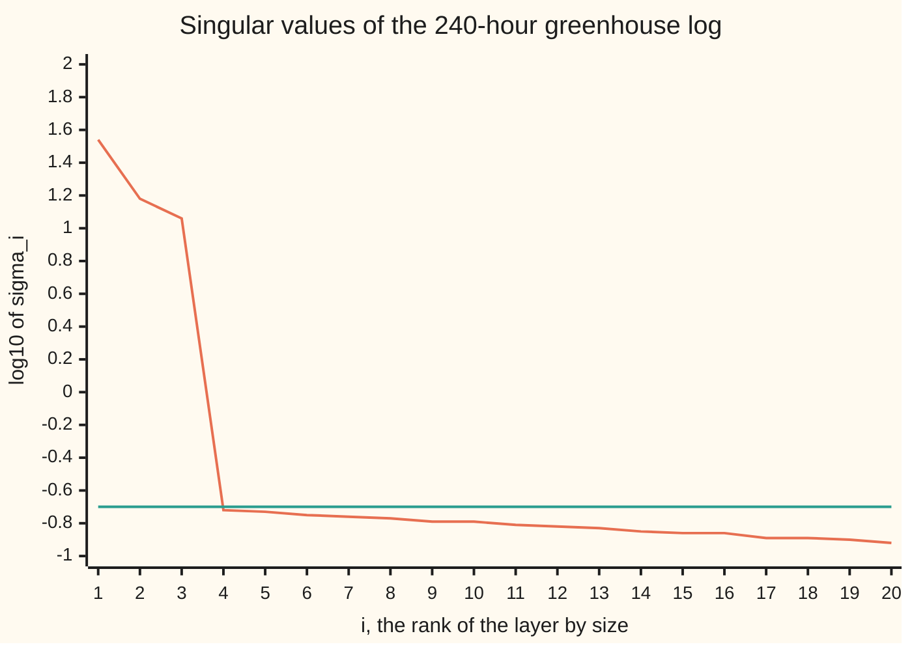

# Singular value decomposition: rank you can trust, and the best low-rank fit

[Syllabus](../../../SYLLABUS.md) → [Numerical analysis](../README.md) → [Numerical Linear Algebra](../README.md#s03) → Singular value decomposition

---

## General Overview

A greenhouse logs 20 sensors every hour: 8 air temperatures, 6 humidities, 4 light meters and 2 soil-moisture probes. Ten days give a table of 240 rows and 20 columns. The grower wants two things from it: a rule that predicts the hourly water use from the 20 readings, and a smaller file to keep. The log on this card is simulated, so its numbers are illustrative, but the true answer is known.

Only three things drive the 20 columns: the sun, the night heating and the watering. Every sensor reads a fixed blend of those three, plus a little noise. So the table is really three columns wide, yet with noise in every reading, ordinary elimination finds 20 independent columns.

The singular value decomposition (SVD) says so. It writes the table as a sum of 20 layers, each a single pattern, ranked by size. Here three layers are big (34.7454, 15.2587 and 11.5585) and the other seventeen are all at or below 0.1887, at the size of the sensor noise. That gap gives the rank you can trust (the number of independent patterns): 3. Keep the three big layers and you get the closest rank-3 table there is, in 783 numbers instead of 4,800. Fit the water use through those three layers and a drifting sensor moves the prediction by 0.153 L/h instead of 1.585 L/h.

**The singular values rank a table's patterns by size, so counting those above the noise gives the rank you can trust, keeping the top k gives the closest rank-k table (Eckart–Young), and dividing only by those kept gives a least-squares answer that noise cannot blow up.**

**What kind of fact this is:** a method, truncated SVD, resting on theorems proved on this card in Why it works: Eckart–Young in two norms, Weyl's bound on how far noise moves a singular value, and the minimum-length property of the pseudoinverse. The noise tolerance, the noise size times (√rows + √columns), is an estimate from random-matrix theory, stated with its source, not proved here.

### The picture: three patterns above a floor of noise



Orange: log10 of each singular value. Teal: log10 of the noise tolerance 0.1996, a flat line at −0.70. Three values sit far above it; seventeen sit just below it, in a slow slope that is the noise's own spread. Between layer 3 and layer 4 is a cliff: 11.5585 against 0.1887.

---

## The formula

Notation first, in words. The log is the matrix $A$, with $m$ = 240 rows (hours) and $n$ = 20 columns (sensors). [The singular value decomposition](../../03-Algebra/07-Eigenvalues%20and%20Symmetric%20Matrices/06-singular-value-decomposition.md) writes $A = U S V^T$: perpendicular unit **output axes** $u_i$ (columns of $U$, each 240 long), **stretch factors** $\sigma_i$, the **singular values**, largest first (the diagonal of $S$), and perpendicular unit **input axes** $v_i$ (columns of $V$, each 20 long). This card uses three readings of that factorisation.

$$A = \sum_{i=1}^{n} \sigma_i\, u_i v_i^T, \qquad A_k = \sum_{i=1}^{k} \sigma_i\, u_i v_i^T, \qquad x_k = A_k^{+}\, y = \sum_{i=1}^{k} \frac{u_i^T y}{\sigma_i}\, v_i$$

**Read it aloud:** the table is a stack of layers, each a column pattern times a row pattern times a size; the rank-$k$ fit keeps the $k$ biggest layers; the truncated least-squares answer divides the data's share along each kept layer by that layer's size.

What the singular values tell you directly:

$$\operatorname{rank}_\tau(A) = \#\{\,i : \sigma_i > \tau\,\}, \qquad \kappa_2(A) = \frac{\sigma_1}{\sigma_n}, \qquad \lVert A - A_k\rVert_2 = \sigma_{k+1}, \qquad \lVert A - A_k\rVert_F = \sqrt{\sigma_{k+1}^2 + \dots + \sigma_n^2}$$

**Read it aloud:** the trusted rank is the count of singular values above a tolerance; the condition number is the largest over the smallest; and the error of the best rank-$k$ fit is the first dropped value in the 2-norm, or the root-sum-square of all dropped values entry by entry.

| Symbol | Plain meaning | In our example | Push it up and the answer… |
| --- | --- | --- | --- |
| $A$, $m$, $n$ | the log; its rows (hours) and columns (sensors) | 240 by 20, one shared illustrative scale | more rows: noise values grow like $\sqrt m$ |
| $\sigma_i$, $u_i$, $v_i$, $U$, $S$, $V$, $S^+$ | the $i$-th singular value and its output and input axes; the matrices holding them; $S$ with each nonzero $\sigma_i$ turned into $1/\sigma_i$ | $\sigma_1$ = 34.7454, $\sigma_{20}$ = 0.1191 | — |
| $A_0$, $E$, $\delta$ | the noise-free log; the noise, $A = A_0 + E$; the noise's standard deviation | rank 3; $\lVert E\rVert_2$ = 0.1915; 0.01 | $\delta$ up: the floor rises toward the three signals |
| $\tau$, $\operatorname{rank}_\tau$, $r$ | a tolerance; the count of $\sigma_i$ above it; the count of nonzero $\sigma_i$ | $\delta(\sqrt m+\sqrt n)$ = 0.1996; rank 3 | $\tau$ below the floor: noise counts as rank |
| $k$, $A_k$ | layers kept; the rank-$k$ fit | 3; 783 numbers | $k$ up: closer to the log, closer to its noise |
| $\lVert\cdot\rVert_2$, $\lVert\cdot\rVert_F$ | largest stretch of a matrix; root-sum-square of its entries | $\lVert A - A_3\rVert_F$ = 0.6339 | — |
| $\kappa_2$ | condition number $\sigma_1/\sigma_n$ | 291.8; kept part 3.01 | more digits and more noise amplified |
| $y$, $c_i$ | water use to predict, litres per hour above base; its share $u_i^T y$ along layer $i$ | $c_1$ = 32.4875, $c_{20}$ = −0.7823 | — |
| $A^+$, $x_k$ | the pseudoinverse; the truncated least-squares coefficients | $\lvert x_3\rvert$ = 2.267, $\lvert x_{20}\rvert$ = 9.039 | — |
| $B$, $w$, $z_i$, $X$, $Y$ | names inside the proofs: a rival low-rank table; a unit input; the coordinates of $x$ along the $v_i$; any two matrices | — | — |
| $\varepsilon_{\text{mach}}$, $u$ | machine epsilon $2^{-52}$; unit roundoff $2^{-53}$ (bare $u$, no subscript) | $\kappa_2^2 u$ = 9.453e-12 | — |

The **pseudoinverse** $A^+$ is $V S^+ U^T$, where $S^+$ replaces each nonzero $\sigma_i$ by $1/\sigma_i$ and keeps the zeros. Truncation means treating every $\sigma_i$ at or below $\tau$ as zero: $x_k = A_k^+ y$.

### When it holds

- **A gap in the singular values, and the cut placed at it.** Truncation needs signal values well above the noise floor. Without a gap, any cut-off is a guess. With one, the cut belongs at the gap: keep only 1 layer, cutting into the signal, and the test error jumps to 1.8753 L/h.
- **A tolerance above the noise, not just above rounding.** The rounding tolerance $\max(m,n)\,\varepsilon_{\text{mach}}\,\sigma_1$ = 1.852e-12 counts all 20 noisy layers as rank. It only suits data that is exact apart from rounding.
- **Columns in comparable units.** Singular values compare sizes across columns. Rescale one sensor by 1000 and its layer moves up the ranking. Here every sensor is built on one shared illustrative scale.
- **Noise that is not itself a pattern.** A stuck sensor or a shared calibration error is a pattern, and it gets its own large singular value. Weyl's bound below covers any noise, but only up to $\lVert E\rVert_2$.

---

## Why it works

### Step 0: sort the table into layers, then read sizes

The SVD turns any table into independent layers. Layer $i$ is a column pattern $u_i$ (how the 240 hours move), a row pattern $v_i$ (how the 20 sensors blend), and a size $\sigma_i$. The layers do not overlap: their axes are perpendicular. So questions about the whole table become questions about a sorted list of 20 numbers. Rank is how many are not negligible. Conditioning is the spread of the list. The best fit drops the bottom of the list. That is all three jobs of this card.

[The singular value decomposition](../../03-Algebra/07-Eigenvalues%20and%20Symmetric%20Matrices/06-singular-value-decomposition.md) proves $A = USV^T$ exists, reads exact rank from it and states Eckart–Young without proof. [Principal components](../../14-Applied%20and%20computational/06-Machine%20Learning%20Mathematics/07-principal-components-and-dimension-reduction.md) uses it to project data onto fewer axes. This card proves the best-fit theorem, decides what "zero" means in floating point and noise, and solves least squares with it.

### Step 1: the best rank-k fit drops the smallest layers (Eckart–Young)

Any rank-$k$ matrix $B$ flattens at least $n-k$ input directions to zero. The top $k+1$ input axes $v_1, \dots, v_{k+1}$ span $k+1$ directions. Together that is more than $n$, so some unit input $w$ lies in both. $B$ sends $w$ to zero, but $A$ stretches it by at least $\sigma_{k+1}$. So $A - B$ misses by at least $\sigma_{k+1}$ in the 2-norm, and $A_k$ misses by exactly that.

<details>
<summary>Detailed proof: Eckart–Young in the 2-norm and the Frobenius norm, and Weyl's bound</summary>

**2-norm.** Let $B$ have rank at most $k$. Its null space has dimension at least $n-k$; the span of $v_1, \dots, v_{k+1}$ has dimension $k+1$. Their dimensions add to more than $n$, so they share a unit vector $w$. Then $(A - B)w = Aw = \sum_{i \le k+1} \sigma_i (v_i^T w)\, u_i$, whose squared length is $\sum_{i\le k+1} \sigma_i^2 (v_i^T w)^2 \ge \sigma_{k+1}^2 \sum_{i \le k+1} (v_i^T w)^2 = \sigma_{k+1}^2$. So $\lVert A - B\rVert_2 \ge \sigma_{k+1}$. And $A - A_k = \sum_{i>k}\sigma_i u_i v_i^T$ has largest stretch $\sigma_{k+1}$. Read with $k = i-1$: $\sigma_i(A) = \min \lVert A - B\rVert_2$ over $B$ of rank below $i$.

**Weyl.** For any $X$, $Y$: $\sigma_{i+j-1}(X+Y) \le \sigma_i(X) + \sigma_j(Y)$. Proof: $X_{i-1} + Y_{j-1}$ has rank below $i+j-1$, so by the line above $\sigma_{i+j-1}(X+Y) \le \lVert X + Y - X_{i-1} - Y_{j-1}\rVert_2 \le \sigma_i(X) + \sigma_j(Y)$. With $j = 1$, $X = A_0$, $Y = E$, and again with $X = A$, $Y = -E$: $\lvert\sigma_i(A) - \sigma_i(A_0)\rvert \le \lVert E\rVert_2$.

**Frobenius norm.** Let $B$ have rank at most $k$, so $\sigma_{k+1}(B) = 0$. Weyl with $X = A - B$, $Y = B$, $j = k+1$ gives $\sigma_{i+k}(A) \le \sigma_i(A - B)$ for every $i$. Square and add: $\lVert A - B\rVert_F^2 = \sum_i \sigma_i(A-B)^2 \ge \sum_{i} \sigma_{i+k}(A)^2 = \lVert A - A_k\rVert_F^2$. The first equality holds because $U$ and $V$ keep lengths, so the squares of the entries add to the squares of the singular values.

</details>

On the log, three rival rank-3 tables, measured by $\lVert A - B\rVert_F$:

| Rank-3 table $B$ | Miss $\lVert A - B\rVert_F$ |
| --- | --- |
| $A_3$, the top three layers | **0.6339**, equal to $\sqrt{\sigma_4^2 + \dots + \sigma_{20}^2}$ = 0.6339 |
| $A_0$, the true noise-free log | 0.6924 |
| the best fit from three real sensors (temperature 1, humidity 1, light 1) | 0.8838 |

The SVD fit beats even the truth, because it also fits a little of the noise. In the 2-norm, power iteration on $A - A_3$ returns 0.1887, equal to $\sigma_4$.

### Step 2: noise moves each singular value by at most the noise's size (Weyl)

The noise-free log $A_0$ has exactly three nonzero singular values. Weyl's bound from the fold says adding noise $E$ moves each $\sigma_i$ by at most $\lVert E\rVert_2$, the noise's largest stretch. So $\sigma_4, \dots, \sigma_{20}$ of the real log lie between 0 and $\lVert E\rVert_2$.

The check knows $E$, so it measures both sides. $\lVert E\rVert_2$ = 0.1915 by power iteration. The largest shift $\lvert\sigma_i(A) - \sigma_i(A_0)\rvert$ over all 20 values is 0.1887. That is $\sigma_4$ itself, rising from about zero, and it sits inside the bound: bound ÷ true shift = 1.015.

In practice $E$ is unknown, but its typical size is. For noise with independent entries of standard deviation $\delta$, Gordon's theorem (Vershynin, chapter 7, in Sources) gives an expected $\lVert E\rVert_2$ of at most $\delta(\sqrt m + \sqrt n)$ for Gaussian entries. The check's noise is a sum of three uniform draws, close to Gaussian, so the bound serves as an estimate here, not a guarantee. Here that is $0.01 \times (\sqrt{240} + \sqrt{20})$ = 0.1996, just above the measured 0.1915: estimate ÷ measured = 1.042. Counting the singular values above it gives rank 3.

### Step 3: rank you can trust, at two levels

"Rank" in exact arithmetic is the count of nonzero $\sigma_i$. In floating point it is the count above a tolerance, and the tolerance must match how the data was made.

| Data | Tolerance | Count | Verdict |
| --- | --- | --- | --- |
| noise-free log $A_0$, rounding only | $\max(m,n)\,\varepsilon_{\text{mach}}\,\sigma_1$ = 1.852e-12 | 3 | right: $\sigma_4$ = 2.506e-15, rounding dust |
| noise-free log, "nonzero" | 0 | 20 | wrong: rounding never gives an exact 0 |
| real log, rounding tolerance | 1.852e-12 | 20 | true but useless: 17 layers of noise |
| real log, noise tolerance | 0.1996 | **3** | the rank you can trust |

The rounding tolerance uses the machine epsilon ([Machine epsilon and cancellation](../01-Floating%20Point%20and%20Error/03-rounding-cancellation-and-machine-epsilon.md)) because a backward-stable SVD returns the exact singular values of $A$ plus a perturbation of about $\varepsilon_{\text{mach}}$ times $\lVert A \rVert_2$, and Weyl turns that into the same shift in each $\sigma_i$.

### Step 4: the pseudoinverse divides only where it is safe

Least squares asks for the $x$ that makes $\lVert Ax - y\rVert$ smallest ([Least squares two ways](06-least-squares-normal-equations-versus-qr.md)). Turn to the SVD's axes: write $x = \sum z_i v_i$ and $c_i = u_i^T y$. Then the squared miss is $\sum_i (\sigma_i z_i - c_i)^2$ plus a part of $y$ no $x$ can reach. Each term is its own small problem. Where $\sigma_i > 0$ the best $z_i$ is $c_i/\sigma_i$. Where $\sigma_i = 0$ any $z_i$ fits equally well, and setting it to 0 gives the shortest $x$. That shortest answer is $x = A^+ y$.

<details>
<summary>Detailed proof: A⁺y is the shortest least-squares solution</summary>

Extend $u_1, \dots, u_n$ to a full set of perpendicular unit vectors $u_1, \dots, u_m$. Lengths do not change under $U^T$ or $V$. With $z = V^T x$ and $c = U^T y$: $\lVert Ax - y\rVert^2 = \lVert S z - c\rVert^2 = \sum_{i \le r} (\sigma_i z_i - c_i)^2 + \sum_{i > r} c_i^2$, where $r$ counts the nonzero $\sigma_i$. The last sum does not depend on $x$. The first is zero exactly when $z_i = c_i/\sigma_i$ for $i \le r$, and $z_{r+1}, \dots, z_n$ are free. Since $\lVert x\rVert = \lVert z\rVert$, the shortest choice sets the free ones to 0. That $x$ is $\sum_{i\le r} (c_i/\sigma_i) v_i = V S^+ U^T y$.

Penrose (1955) showed $X = A^+$ is the only matrix with $AXA = A$, $XAX = X$, and $AX$ and $XA$ symmetric. The check confirms all four for $A_3^+$, with residuals at most 1.584e-13.

</details>

The danger is the division. Each $c_i$ carries the water meter's noise, about 0.3 L/h in every direction. Dividing by $\sigma_{20}$ = 0.1191 multiplies it by $1/\sigma_{20}$ = 8.3981 (from the unrounded $\sigma_{20}$). Truncation sets $\sigma_4$ to $\sigma_{20}$ to zero, so their noisy shares are never divided at all.

### Step 5: what truncation does to the condition number

The condition number ([Matrix norms and the condition number](01-matrix-norms-and-the-condition-number.md)) bounds how much a relative change in the water readings $y$ can grow in the answer, for a fit as close as this one. For least squares on all 20 columns it is $\sigma_1/\sigma_{20}$ = 291.8. A change in the log $A$ itself adds a second term, $\kappa_2^2$ times the misfit's length over the fit's ([Least squares two ways](06-least-squares-normal-equations-versus-qr.md)). For the truncated problem only the kept layers count: $\sigma_1/\sigma_3$ = 3.01. The price is a bias: any true signal along the dropped layers is lost. Here the true water use depends only on the three hidden signals, so almost nothing real is lost.

The log's trouble is conditioning, not stability. The Jacobi SVD and the normal equations agree to 6.4e-12, the size $\kappa_2^2 u$ = 9.453e-12 predicts. Both answer the ill-posed question (one whose answer swings widely with tiny changes in the data) accurately; truncation changes the question.

### Step 6: the cost

The code uses the **one-sided Jacobi** SVD: rotate pairs of columns until every pair is perpendicular, then read each $\sigma_i$ as a column length. It needed 9 sweeps over all pairs of columns and 4335960 flops (dot products and rotations; the few scalar flops per pair are not counted). Householder QR of the same table costs $2mn^2 - 2n^3/3$ = 186667 flops, so Jacobi cost 23.2 times QR here. Library routines use Golub–Kahan bidiagonalisation (Sources), at a small multiple of the QR cost. Jacobi is used here because it is short to write.

---

## Worked numbers, by hand

From the 20 singular values and the shares $c_i = u_i^T y$, all printed by the checks. Each value is worked from the unrounded numbers, so a last digit can differ from the rounded inputs shown:

| Step | Arithmetic | Value |
| --- | --- | --- |
| noise tolerance | $0.01 \times (\sqrt{240} + \sqrt{20})$ | 0.1996 |
| trusted rank | count of 34.7454, 15.2587, 11.5585, 0.1887, … above 0.1996 | 3 |
| condition number, all 20 | 34.7454 / 0.1191 | 291.8 |
| condition number, kept part | 34.7454 / 11.5585 | 3.01 |
| coefficient along layer 1 | 32.4875 / 34.7454 | 0.9350 |
| coefficient along layer 3 | 16.1939 / 11.5585 | 1.4010 |
| coefficient along layer 20 | −0.7823 / 0.1191 | −6.5700, dropped by truncation |
| length of the coefficients | $\lvert x_3\rvert$ against $\lvert x_{20}\rvert$ | 2.267 against 9.039 |
| sensor 6 drifts by +0.5 | 0.5 × its coefficient | **+0.153 L/h** truncated, +1.585 L/h all 20 |
| storage for $A_3$ | $3 \times (240 + 20 + 1)$ of $240 \times 20$ | 783 of 4800, 16.3% |
| error of $A_3$ | $\sqrt{0.1887^2 + \dots + 0.1191^2}$ = 0.6339, over $\lVert A\rVert_F$ | 1.598e-02 relative |

The truncated rule predicts the next ten days with an rms error of 0.2821 L/h, against 0.2965 L/h for all 20 layers; the water meter's own noise is 0.3 L/h. The real gain is robustness: a half-unit drift in one temperature sensor costs 0.153 L/h, not 1.585 L/h.

The compressed log is also closer to the truth than the raw log. Its relative distance from $A_0$ is 7.019e-03, against 1.745e-02 for the raw log: dropping 17 noise layers removes most of the noise.

### What breaks if you drop a piece

| Mistake | Comes out at | What went wrong |
| --- | --- | --- |
| Rank as the count of $\sigma_i > 0$ | 20, and 20 even for the noise-free log | rounding leaves $\sigma_4$ at 2.506e-15, never exactly 0 |
| Rounding tolerance on noisy data | rank 20 | 1.852e-12 sits far below the noise floor of 0.1996 |
| Keep all 20 layers: the plain pseudoinverse | drift moves the prediction +1.585 L/h; test rms 0.2965 | dividing noise by $\sigma_{20}$ = 0.1191 amplifies it 8.3981 times |
| Keep too few: 1 layer | test rms 1.8753 L/h | the heating and watering signals are cut; keeping 6 gives 0.2833, a mild loss the other way |

The broken hypothesis is the tolerance. Below the noise floor, the gap that makes truncation safe is ignored and noise is treated as signal.

---

## Code, from first principles, and it actually runs

The code builds the log from three known signals and SplitMix64 noise, so the truth is on hand. Road one is a one-sided Jacobi SVD. Road two checks it independently: power iteration for $\sigma_1$ and for $\lVert A - A_3\rVert_2$, the sum of squared entries against $\sum\sigma_i^2$, the normal equations against the full pseudoinverse, a three-column regression on the scores $Av_i$ against the truncated answer, and Penrose's four conditions. Road three compares with the known signal and noise: Weyl's bound, and Eckart–Young against the true log and against three real sensors.

### Python

```python
# SVD and the pseudoinverse -- the check behind the card.  Standard library only.
# A greenhouse logs 20 sensors every hour for 10 days (240 rows, 10 more days to test);
# the readings carry three hidden signals (sun, night heating, watering) plus noise.
# Road one: a one-sided Jacobi SVD.  Road two: power iteration, normal equations and
# Penrose's four conditions.  Road three: the known signal and noise the log was built from.
from math import sqrt, log10

S = [2026]
def nxt():                                   # SplitMix64, seed 2026
    S[0] = (S[0] + 0x9E3779B97F4A7C15) & (2**64 - 1); z = S[0]
    z = ((z ^ (z >> 30)) * 0xBF58476D1CE4E5B9) & (2**64 - 1)
    z = ((z ^ (z >> 27)) * 0x94D049BB133111EB) & (2**64 - 1)
    return z ^ (z >> 31)
def unif(): return (nxt() >> 11) * 2.0**-53
def gauss(): return (2 * unif() - 1) + (2 * unif() - 1) + (2 * unif() - 1)   # mean 0, sd 1
def dot(x, y):                               # plain left-to-right sum, as in the Rust
    s = 0.0
    for a, b in zip(x, y): s += a * b
    return s
def nrm(x): return sqrt(dot(x, x))
def col(M, j): return [r[j] for r in M]
def mv(M, x): return [dot(r, x) for r in M]
def mtv(M, y): return [dot(col(M, j), y) for j in range(len(M[0]))]
def fro(M): return sqrt(dot([dot(r, r) for r in M], [1.0] * len(M)))
def sub(P, Q): return [[a - b for a, b in zip(p, q)] for p, q in zip(P, Q)]
def tr(M): return [col(M, j) for j in range(len(M[0]))]
def norm2(M):                                # largest singular value by power iteration
    x = [1.0] * len(M[0])
    for _ in range(400):
        z = mtv(M, mv(M, x)); nz = nrm(z); x = [v / nz for v in z]
    return nrm(mv(M, x))
def svd(A):                                  # one-sided Jacobi: rotate columns until orthogonal
    m, n = len(A), len(A[0])
    W, V = tr(A), [[float(i == j) for i in range(n)] for j in range(n)]
    fl, sweeps, rot = 0, 0, 1
    while rot:
        sweeps += 1; rot = 0
        for p in range(n - 1):
            for q in range(p + 1, n):
                a, b, c = dot(W[p], W[p]), dot(W[q], W[q]), dot(W[p], W[q]); fl += 6 * m
                if abs(c) <= 1e-15 * sqrt(a * b): continue
                z = (b - a) / (2 * c); t = (1.0 if z >= 0 else -1.0) / (abs(z) + sqrt(1 + z * z))
                cs = 1 / sqrt(1 + t * t); sn = cs * t; rot += 1; fl += 6 * (m + n)
                for X in (W, V):
                    xp, xq = X[p], X[q]
                    X[p] = [cs * u - sn * v for u, v in zip(xp, xq)]
                    X[q] = [sn * u + cs * v for u, v in zip(xp, xq)]
    s = [nrm(w) for w in W]
    o = sorted(range(n), key=lambda j: -s[j])
    return [s[j] for j in o], [[x / s[j] for x in W[j]] for j in o], [V[j] for j in o], sweeps, fl
def chol_solve(G, B):                        # G x = b for each b in B, G symmetric positive definite
    n = len(G); L = [[0.0] * n for _ in range(n)]
    for i in range(n):
        for j in range(i + 1):
            s = G[i][j] - dot(L[i][:j], L[j][:j])
            if i == j: L[i][i] = sqrt(s)
            else: L[i][j] = s / L[j][j]
    X = [list(b) for b in B]
    for y in X:                              # forward with L, then back with L transposed
        for i in range(n): y[i] = (y[i] - dot(L[i][:i], y[:i])) / L[i][i]
        for i in range(n - 1, -1, -1): y[i] = (y[i] - dot(col(L, i)[i + 1:], y[i + 1:])) / L[i][i]
    return X
def lowrank(s, U, V, k): return [[dot([s[i] * U[i][r] for i in range(k)], [V[i][j] for i in range(k)])
                                  for j in range(len(V[0]))] for r in range(len(U[0]))]
def e(x): return f"{x:.3e}"                  # three-digit e-notation, same in the Rust
def rms(x, M, b): r = [p - q for p, q in zip(mv(M, x), b)]; return sqrt(dot(r, r) / len(b))
def gap(x, y): return nrm([a - b for a, b in zip(x, y)]) / nrm(y)

base = [(1.0, 0.8, -0.2)] * 8 + [(-0.6, -0.2, 1.0)] * 6 + [(1.2, 0.0, 0.0)] * 4 + [(0.0, 0.0, 1.2)] * 2
Ld = [[base[j][k] + 0.3 * (2 * unif() - 1) for j in range(20)] for k in range(3)]   # loadings
days = [(0.6 + 0.4 * unif(), 0.5 + unif()) for _ in range(20)]                      # cloud, cold
sig = []
for t in range(480):
    h, (cl, co) = t % 24, days[t // 24]
    k = h - 6 if 6 <= h < 15 else (h - 15 if h >= 15 else h + 9); w = 1.0
    for _ in range(k): w *= 0.6                # moisture decays 40% an hour after watering
    sig.append((cl * max(0.0, 1 - (h - 13) / 6 * ((h - 13) / 6)), co if (h < 7 or h >= 19) else 0.0, w))
dlt = 0.01                                     # sensor noise, standard units (illustrative)
S0 = [[dot(sg, col(Ld, j)) for j in range(20)] for sg in sig]   # noise-free log, A0 on the card
E = [[dlt * gauss() for j in range(20)] for t in range(480)]
A = [[a + b for a, b in zip(p, q)] for p, q in zip(S0, E)]
y = [3 * s1 + s2 + 5 * s3 + 0.3 * gauss() for (s1, s2, s3) in sig]   # water use, L/h above base
At, Ate, yt, yte, St, Et, m, n = A[:240], A[240:], y[:240], y[240:], S0[:240], E[:240], 240, 20
s, U, V, sweeps, fl = svd(At)
s0, nE, eps = svd(St)[0], norm2(Et), 2.0**-52
print(f"log: m = {m} hours, n = {n} sensors, noise sd {dlt}; Jacobi sweeps {sweeps}, flops {fl}")
print(f"Householder QR of the same table: 2mn^2 - 2n^3/3 = {2*m*n*n - 2*n**3//3} flops; "
      f"Jacobi / QR = {fl / (2*m*n*n - 2*n**3//3):.1f}")
print("singular values 1-5:", " ".join(f"{v:.4f}" for v in s[:5]) + "\nsingular values 16-20:", " ".join(f"{v:.4f}" for v in s[15:]))
print("chart, log10 sigma_i:", " ".join(f"{log10(v):.2f}" for v in s))
tr_, tn = max(m, n) * eps * s[0], dlt * (sqrt(m) + sqrt(n))
r_round, r_noise = len([v for v in s if v > tr_]), len([v for v in s if v > tn])
print(f"rank, rounding tolerance max(m,n) eps sigma1 = {e(tr_)}: {r_round}")
print(f"rank, noise tolerance delta(sqrt m + sqrt n) = {tn:.4f} (log10 {log10(tn):.2f}): {r_noise}")
print(f"noise-free log: sigma_4 = {e(s0[3])}, rank at rounding tolerance {len([v for v in s0 if v > tr_])}")
wey = max(abs(a - b) for a, b in zip(s, s0))
print(f"||E||_2 = {nE:.4f}; Weyl: largest shift |sigma_i(A) - sigma_i(A0)| = {wey:.4f}, bound / shift {nE / wey:.3f}; tolerance / ||E||_2 {tn / nE:.3f}")
print(f"kappa_2(A) = sigma1/sigma20 = {s[0] / s[19]:.1f}; rank-3 part sigma1/sigma3 = {s[0] / s[2]:.2f}")
A3 = lowrank(s, U, V, 3)
cols = [col(At, j) for j in (0, 8, 14)]          # one temperature, humidity and light sensor
Z = chol_solve([[dot(a, b) for b in cols] for a in cols], [[dot(c, col(At, j)) for c in cols] for j in range(n)])
Csub = [[dot(col(cols, i), Z[j]) for j in range(n)] for i in range(m)]
fA, fbest, ftrue, fsub, sp = fro(At), fro(sub(At, A3)), fro(Et), fro(sub(At, Csub)), norm2(sub(At, A3))
print(f"Eckart-Young, ||A - B||_F over rank-3 B: SVD {fbest:.4f} (formula {nrm(s[3:]):.4f}), "
      f"true signal {ftrue:.4f}, three sensors {fsub:.4f}")
print(f"spectral: ||A - A_3||_2 by power iteration {sp:.4f}, sigma_4 = {s[3]:.4f}")
fS, f3S = fro(St), fro(sub(A3, St))
print(f"compression: {3 * (m + n + 1)} numbers for {m * n} ({3 * (m + n + 1) / (m * n):.1%}); error {fbest / fA:.3e}")
print(f"distance to the true signal: raw log {ftrue / fS:.3e}, rank-3 fit {f3S / fS:.3e}")
c = [dot(u, yt) for u in U]
def trunc(k): return [dot([c[i] / s[i] for i in range(k)], col(V[:k], j)) for j in range(n)]
xf, x3, x1, x6 = trunc(20), trunc(3), trunc(1), trunc(6)
(xne,) = chol_solve([[dot(a, b) for b in tr(At)] for a in tr(At)], [mtv(At, yt)])
P = [mv(At, V[i]) for i in range(3)]
zs = chol_solve([[dot(a, b) for b in P] for a in P], [[dot(a, yt) for a in P]])[0]
x3b = [dot(zs, col(V[:3], j)) for j in range(n)]
for lab, x in (("all 20", xf), ("rank 3", x3)):
    print(f"{lab}: |x| = {nrm(x):.3f}, largest |x_j| {max(map(abs, x)):.3f}; "
          f"fit rms {rms(x, At, yt):.4f}, test rms {rms(x, Ate, yte):.4f} L/h")
print(f"normal equations vs SVD, all 20: relative gap {gap(xne, xf):.1e}; kappa^2 u = {e((s[0] / s[19]) ** 2 * eps / 2)}")
print(f"rank 3 by the scores road: relative gap {gap(x3b, x3):.1e}")
print(f"sensor 6 drifts +0.5: prediction moves {0.5 * xf[5]:+.3f} L/h all 20, {0.5 * x3[5]:+.3f} L/h rank 3")
print("i = 1, 3, 4, 20: c_i = u_i.y", " ".join(f"{c[i]:.4f}" for i in (0, 2, 3, 19)),
      "| 1/sigma_i", " ".join(f"{1 / s[i]:.4f}" for i in (0, 2, 3, 19)), "| c_i/sigma_i", " ".join(f"{c[i] / s[i]:.4f}" for i in (0, 2, 3, 19)))
X3 = [[dot([V[i][j] / s[i] for i in range(3)], col(U[:3], r)) for r in range(m)] for j in range(n)]
XA, X3t = [[dot(X3[i], col(A3, j)) for j in range(n)] for i in range(n)], tr(X3)
AX = [[dot(a, x) for x in X3t] for a in A3]
pen = [fro(sub([mtv(XA, r) for r in A3], A3)), fro(sub([[dot(r, x) for x in X3t] for r in XA], X3)),
       fro(sub(AX, tr(AX))), fro(sub(XA, tr(XA)))]
print("Penrose conditions on A_3^+, residuals:", " ".join(e(v) for v in pen))
print(f"break, rank = count of sigma > 0: {len([v for v in s if v > 0])}; noise-free log: {len([v for v in s0 if v > 0])}")
print(f"break, keep 1 value: test rms {rms(x1, Ate, yte):.4f}; keep 6: test rms {rms(x6, Ate, yte):.4f}")

assert abs(fbest - nrm(s[3:])) < 1e-10 * fA and fbest < ftrue < fsub       # Eckart-Young, Frobenius
assert abs(sp - s[3]) < 1e-6 and abs(s[0] - norm2(At)) < 1e-9             # Eckart-Young, spectral
assert abs(fA ** 2 - dot(s, s)) < 1e-9 * fA ** 2                           # squares of entries
assert wey <= nE and s[2] > tn > nE > s[3] and r_noise == 3 and r_round == 20   # Weyl, the gap
assert gap(xne, xf) < 1e-8 and gap(x3b, x3) < 1e-12                        # two roads to each fit
assert max(pen) < 1e-10 and f3S < ftrue and rms(x3, Ate, yte) < rms(xf, Ate, yte)
print("ALL CHECKS PASS")
```

**Ran 2026-11-11 on macOS, Python 3.14.10, standard library only. All checks passed. Output, pasted from the run:**

```
log: m = 240 hours, n = 20 sensors, noise sd 0.01; Jacobi sweeps 9, flops 4335960
Householder QR of the same table: 2mn^2 - 2n^3/3 = 186667 flops; Jacobi / QR = 23.2
singular values 1-5: 34.7454 15.2587 11.5585 0.1887 0.1847
singular values 16-20: 0.1370 0.1300 0.1281 0.1254 0.1191
chart, log10 sigma_i: 1.54 1.18 1.06 -0.72 -0.73 -0.75 -0.76 -0.77 -0.79 -0.79 -0.81 -0.82 -0.83 -0.85 -0.86 -0.86 -0.89 -0.89 -0.90 -0.92
rank, rounding tolerance max(m,n) eps sigma1 = 1.852e-12: 20
rank, noise tolerance delta(sqrt m + sqrt n) = 0.1996 (log10 -0.70): 3
noise-free log: sigma_4 = 2.506e-15, rank at rounding tolerance 3
||E||_2 = 0.1915; Weyl: largest shift |sigma_i(A) - sigma_i(A0)| = 0.1887, bound / shift 1.015; tolerance / ||E||_2 1.042
kappa_2(A) = sigma1/sigma20 = 291.8; rank-3 part sigma1/sigma3 = 3.01
Eckart-Young, ||A - B||_F over rank-3 B: SVD 0.6339 (formula 0.6339), true signal 0.6924, three sensors 0.8838
spectral: ||A - A_3||_2 by power iteration 0.1887, sigma_4 = 0.1887
compression: 783 numbers for 4800 (16.3%); error 1.598e-02
distance to the true signal: raw log 1.745e-02, rank-3 fit 7.019e-03
all 20: |x| = 9.039, largest |x_j| 3.646; fit rms 0.2988, test rms 0.2965 L/h
rank 3: |x| = 2.267, largest |x_j| 1.069; fit rms 0.3082, test rms 0.2821 L/h
normal equations vs SVD, all 20: relative gap 6.4e-12; kappa^2 u = 9.453e-12
rank 3 by the scores road: relative gap 1.6e-15
sensor 6 drifts +0.5: prediction moves +1.585 L/h all 20, +0.153 L/h rank 3
i = 1, 3, 4, 20: c_i = u_i.y 32.4875 16.1939 0.0618 -0.7823 | 1/sigma_i 0.0288 0.0865 5.2992 8.3981 | c_i/sigma_i 0.9350 1.4010 0.3275 -6.5700
Penrose conditions on A_3^+, residuals: 1.584e-13 3.932e-16 1.266e-15 1.037e-15
break, rank = count of sigma > 0: 20; noise-free log: 20
break, keep 1 value: test rms 1.8753; keep 6: test rms 0.2833
ALL CHECKS PASS
```

### Rust

Same rows and labels; the two outputs agree line for line.

```rust
// SVD and the pseudoinverse -- the same check as the Python, in Rust.  No crates.
// A greenhouse logs 20 sensors every hour for 10 days (240 rows, 10 more days to test);
// the readings carry three hidden signals (sun, night heating, watering) plus noise.
// Road one: a one-sided Jacobi SVD.  Road two: power iteration, normal equations and
// Penrose's four conditions.  Road three: the known signal and noise the log was built from.
type M = Vec<Vec<f64>>;

struct Rng(u64);
impl Rng {
    fn next(&mut self) -> u64 {                      // SplitMix64, seed 2026
        self.0 = self.0.wrapping_add(0x9E3779B97F4A7C15); let mut z = self.0;
        z = (z ^ (z >> 30)).wrapping_mul(0xBF58476D1CE4E5B9);
        z = (z ^ (z >> 27)).wrapping_mul(0x94D049BB133111EB);
        z ^ (z >> 31)
    }
    fn unif(&mut self) -> f64 { (self.next() >> 11) as f64 * 2f64.powi(-53) }
    fn gauss(&mut self) -> f64 { let a = 2.0 * self.unif() - 1.0; let b = 2.0 * self.unif() - 1.0; a + b + (2.0 * self.unif() - 1.0) }
}
fn dot(x: &[f64], y: &[f64]) -> f64 { let mut s = 0.0; for (a, b) in x.iter().zip(y) { s += a * b; } s }
fn nrm(x: &[f64]) -> f64 { dot(x, x).sqrt() }
fn col(m: &M, j: usize) -> Vec<f64> { m.iter().map(|r| r[j]).collect() }
fn mv(m: &M, x: &[f64]) -> Vec<f64> { m.iter().map(|r| dot(r, x)).collect() }
fn mtv(m: &M, y: &[f64]) -> Vec<f64> { (0..m[0].len()).map(|j| dot(&col(m, j), y)).collect() }
fn fro(m: &M) -> f64 { let d: Vec<f64> = m.iter().map(|r| dot(r, r)).collect(); dot(&d, &vec![1.0; m.len()]).sqrt() }
fn sub(p: &M, q: &M) -> M { p.iter().zip(q).map(|(a, b)| a.iter().zip(b).map(|(x, y)| x - y).collect()).collect() }
fn tr(m: &M) -> M { (0..m[0].len()).map(|j| col(m, j)).collect() }
fn norm2(m: &M) -> f64 {                             // largest singular value by power iteration
    let mut x = vec![1.0; m[0].len()];
    for _ in 0..400 { let z = mtv(m, &mv(m, &x)); let nz = nrm(&z); x = z.iter().map(|v| v / nz).collect(); }
    nrm(&mv(m, &x))
}
fn svd(a: &M) -> (Vec<f64>, M, M, u32, u64) {       // one-sided Jacobi: rotate columns until orthogonal
    let (m, n) = (a.len(), a[0].len());
    let mut w = tr(a);
    let mut v: M = (0..n).map(|j| (0..n).map(|i| if i == j { 1.0 } else { 0.0 }).collect()).collect();
    let (mut fl, mut sweeps, mut rot) = (0u64, 0u32, 1u32);
    while rot > 0 {
        sweeps += 1; rot = 0;
        for p in 0..n - 1 {
            for q in p + 1..n {
                let (a, b, c) = (dot(&w[p], &w[p]), dot(&w[q], &w[q]), dot(&w[p], &w[q])); fl += 6 * m as u64;
                if c.abs() <= 1e-15 * (a * b).sqrt() { continue; }
                let z = (b - a) / (2.0 * c);
                let t = (if z >= 0.0 { 1.0 } else { -1.0 }) / (z.abs() + (1.0 + z * z).sqrt());
                let cs = 1.0 / (1.0 + t * t).sqrt(); let sn = cs * t; rot += 1; fl += 6 * (m + n) as u64;
                for x in [&mut w, &mut v] {
                    let (xp, xq) = (x[p].clone(), x[q].clone());
                    x[p] = xp.iter().zip(&xq).map(|(u, v)| cs * u - sn * v).collect();
                    x[q] = xp.iter().zip(&xq).map(|(u, v)| sn * u + cs * v).collect();
                }
            }
        }
    }
    let s: Vec<f64> = w.iter().map(|c| nrm(c)).collect();
    let mut o: Vec<usize> = (0..n).collect();
    o.sort_by(|&i, &j| s[j].partial_cmp(&s[i]).unwrap());
    (o.iter().map(|&j| s[j]).collect(), o.iter().map(|&j| w[j].iter().map(|x| x / s[j]).collect()).collect(),
     o.iter().map(|&j| v[j].clone()).collect(), sweeps, fl)
}
fn chol_solve(g: &M, bs: &M) -> M {                 // G x = b for each b, G symmetric positive definite
    let n = g.len(); let mut l = vec![vec![0.0; n]; n];
    for i in 0..n {
        for j in 0..=i {
            let s = g[i][j] - dot(&l[i][..j], &l[j][..j]);
            if i == j { l[i][i] = s.sqrt(); } else { l[i][j] = s / l[j][j]; }
        }
    }
    let mut xs = bs.clone();
    for y in xs.iter_mut() {                          // forward with L, then back with L transposed
        for i in 0..n { y[i] = (y[i] - dot(&l[i][..i], &y[..i])) / l[i][i]; }
        for i in (0..n).rev() { y[i] = (y[i] - dot(&col(&l, i)[i + 1..], &y[i + 1..])) / l[i][i]; }
    }
    xs
}
fn lowrank(s: &[f64], u: &M, v: &M, k: usize) -> M {
    (0..u[0].len()).map(|r| (0..v[0].len()).map(|j| dot(&(0..k).map(|i| s[i] * u[i][r]).collect::<Vec<_>>(),
        &(0..k).map(|i| v[i][j]).collect::<Vec<_>>())).collect()).collect()
}
fn e(x: f64) -> String {                             // Python's 1.234e-05 form: sign and two digits
    let t = format!("{:.3e}", x); let (a, p) = t.split_once('e').unwrap(); let p: i32 = p.parse().unwrap();
    format!("{}e{}{:02}", a, if p < 0 { '-' } else { '+' }, p.abs())
}
fn rms(x: &[f64], m: &M, b: &[f64]) -> f64 { let r: Vec<f64> = mv(m, x).iter().zip(b).map(|(p, q)| p - q).collect(); (dot(&r, &r) / b.len() as f64).sqrt() }
fn gap(x: &[f64], y: &[f64]) -> f64 { nrm(&x.iter().zip(y).map(|(a, b)| a - b).collect::<Vec<_>>()) / nrm(y) }
fn amax(x: &[f64]) -> f64 { x.iter().fold(0.0, |m, v| m.max(v.abs())) }
fn join(x: &[f64], d: usize) -> String { x.iter().map(|v| format!("{:.*}", d, v)).collect::<Vec<_>>().join(" ") }

fn main() {
    let mut g = Rng(2026);
    let base: Vec<[f64; 3]> = [([1.0, 0.8, -0.2], 8), ([-0.6, -0.2, 1.0], 6), ([1.2, 0.0, 0.0], 4), ([0.0, 0.0, 1.2], 2)]
        .iter().flat_map(|&(b, k)| vec![b; k]).collect();
    let ld: M = (0..3).map(|k| (0..20).map(|j| base[j][k] + 0.3 * (2.0 * g.unif() - 1.0)).collect()).collect();
    let days: Vec<(f64, f64)> = (0..20).map(|_| { let a = 0.6 + 0.4 * g.unif(); (a, 0.5 + g.unif()) }).collect();
    let mut sig: M = vec![];
    for t in 0..480usize {
        let (h, (cl, co)) = (t % 24, days[t / 24]);
        let k = if (6..15).contains(&h) { h - 6 } else if h >= 15 { h - 15 } else { h + 9 };
        let mut w = 1.0; for _ in 0..k { w *= 0.6; }  // moisture decays 40% an hour after watering
        let d = (h as f64 - 13.0) / 6.0;
        sig.push(vec![cl * (1.0 - d * d).max(0.0), if h < 7 || h >= 19 { co } else { 0.0 }, w]);
    }
    let dlt = 0.01;                                   // sensor noise, standard units (illustrative)
    let s0m: M = sig.iter().map(|sg| (0..20).map(|j| dot(sg, &col(&ld, j))).collect()).collect();   // A0 on the card
    let em: M = (0..480).map(|_| (0..20).map(|_| dlt * g.gauss()).collect()).collect();
    let a: M = s0m.iter().zip(&em).map(|(p, q)| p.iter().zip(q).map(|(x, y)| x + y).collect()).collect();
    let y: Vec<f64> = sig.iter().map(|s| 3.0 * s[0] + s[1] + 5.0 * s[2] + 0.3 * g.gauss()).collect();
    let (at, ate, yt, yte) = (a[..240].to_vec(), a[240..].to_vec(), &y[..240], &y[240..]);
    let (st, et, m, n) = (s0m[..240].to_vec(), em[..240].to_vec(), 240usize, 20usize);
    let (s, u, v, sweeps, fl) = svd(&at);
    let (s0, ne, eps) = (svd(&st).0, norm2(&et), 2f64.powi(-52));
    println!("log: m = {} hours, n = {} sensors, noise sd {}; Jacobi sweeps {}, flops {}", m, n, dlt, sweeps, fl);
    let qr = 2 * m * n * n - 2 * n * n * n / 3;
    println!("Householder QR of the same table: 2mn^2 - 2n^3/3 = {} flops; Jacobi / QR = {:.1}", qr, fl as f64 / qr as f64);
    println!("singular values 1-5: {}\nsingular values 16-20: {}", join(&s[..5], 4), join(&s[15..], 4));
    println!("chart, log10 sigma_i: {}", join(&s.iter().map(|x| x.log10()).collect::<Vec<_>>(), 2));
    let (trr, tn) = (m.max(n) as f64 * eps * s[0], dlt * ((m as f64).sqrt() + (n as f64).sqrt()));
    let (r_round, r_noise) = (s.iter().filter(|&&x| x > trr).count(), s.iter().filter(|&&x| x > tn).count());
    println!("rank, rounding tolerance max(m,n) eps sigma1 = {}: {}", e(trr), r_round);
    println!("rank, noise tolerance delta(sqrt m + sqrt n) = {:.4} (log10 {:.2}): {}", tn, tn.log10(), r_noise);
    println!("noise-free log: sigma_4 = {}, rank at rounding tolerance {}", e(s0[3]), s0.iter().filter(|&&x| x > trr).count());
    let wey = s.iter().zip(&s0).fold(0.0f64, |mx, (a, b)| mx.max((a - b).abs()));
    println!("||E||_2 = {:.4}; Weyl: largest shift |sigma_i(A) - sigma_i(A0)| = {:.4}, bound / shift {:.3}; tolerance / ||E||_2 {:.3}", ne, wey, ne / wey, tn / ne);
    println!("kappa_2(A) = sigma1/sigma20 = {:.1}; rank-3 part sigma1/sigma3 = {:.2}", s[0] / s[19], s[0] / s[2]);
    let a3 = lowrank(&s, &u, &v, 3);
    let cols: M = [0usize, 8, 14].iter().map(|&j| col(&at, j)).collect();   // temperature, humidity, light
    let gm: M = cols.iter().map(|a| cols.iter().map(|b| dot(a, b)).collect()).collect();
    let z = chol_solve(&gm, &(0..n).map(|j| cols.iter().map(|c| dot(c, &col(&at, j))).collect()).collect());
    let csub: M = (0..m).map(|i| (0..n).map(|j| dot(&col(&cols, i), &z[j])).collect()).collect();
    let (fs, f3s, kept) = (fro(&st), fro(&sub(&a3, &st)), 3 * (m + n + 1));
    let (fa, fbest, ftrue, fsub, sp) = (fro(&at), fro(&sub(&at, &a3)), fro(&et), fro(&sub(&at, &csub)), norm2(&sub(&at, &a3)));
    println!("Eckart-Young, ||A - B||_F over rank-3 B: SVD {:.4} (formula {:.4}), true signal {:.4}, three sensors {:.4}",
             fbest, nrm(&s[3..]), ftrue, fsub);
    println!("spectral: ||A - A_3||_2 by power iteration {:.4}, sigma_4 = {:.4}", sp, s[3]);
    println!("compression: {} numbers for {} ({:.1}%); error {}", kept, m * n, 100.0 * kept as f64 / (m * n) as f64, e(fbest / fa));
    println!("distance to the true signal: raw log {}, rank-3 fit {}", e(ftrue / fs), e(f3s / fs));
    let c: Vec<f64> = u.iter().map(|ui| dot(ui, yt)).collect();
    let trunc = |k: usize| -> Vec<f64> { (0..n).map(|j| dot(&(0..k).map(|i| c[i] / s[i]).collect::<Vec<_>>(),
        &(0..k).map(|i| v[i][j]).collect::<Vec<_>>())).collect() };
    let (xf, x3, x1, x6) = (trunc(20), trunc(3), trunc(1), trunc(6));
    let att = tr(&at);                                // normal equations: (A^T A) x = A^T y
    let xs = chol_solve(&att.iter().map(|a| att.iter().map(|b| dot(a, b)).collect()).collect(), &vec![mtv(&at, yt)]);
    let pm: M = (0..3).map(|i| mv(&at, &v[i])).collect();      // scores road: regress on A v_1, A v_2, A v_3
    let zs = chol_solve(&pm.iter().map(|a| pm.iter().map(|b| dot(a, b)).collect()).collect(),
                        &vec![pm.iter().map(|a| dot(a, yt)).collect()]);
    let x3b: Vec<f64> = (0..n).map(|j| dot(&zs[0], &(0..3).map(|i| v[i][j]).collect::<Vec<_>>())).collect();
    for (lab, x) in [("all 20", &xf), ("rank 3", &x3)] { println!("{}: |x| = {:.3}, largest |x_j| {:.3}; fit rms {:.4}, test rms {:.4} L/h",
        lab, nrm(x), amax(x), rms(x, &at, yt), rms(x, &ate, yte)); }
    println!("normal equations vs SVD, all 20: relative gap {:.1e}; kappa^2 u = {}", gap(&xs[0], &xf), e((s[0] / s[19]).powi(2) * eps / 2.0));
    println!("rank 3 by the scores road: relative gap {:.1e}", gap(&x3b, &x3));
    println!("sensor 6 drifts +0.5: prediction moves {:+.3} L/h all 20, {:+.3} L/h rank 3", 0.5 * xf[5], 0.5 * x3[5]);
    let ii = [0usize, 2, 3, 19]; println!("i = 1, 3, 4, 20: c_i = u_i.y {} | 1/sigma_i {} | c_i/sigma_i {}", join(&ii.map(|i| c[i]), 4),
             join(&ii.map(|i| 1.0 / s[i]), 4), join(&ii.map(|i| c[i] / s[i]), 4));
    let x3m: M = (0..n).map(|j| (0..m).map(|r| dot(&(0..3).map(|i| v[i][j] / s[i]).collect::<Vec<_>>(),
        &(0..3).map(|i| u[i][r]).collect::<Vec<_>>())).collect()).collect();
    let (xa, x3t): (M, M) = ((0..n).map(|i| (0..n).map(|j| dot(&x3m[i], &col(&a3, j))).collect()).collect(), tr(&x3m));
    let (ax, axa): (M, M) = (a3.iter().map(|r| x3t.iter().map(|x| dot(r, x)).collect()).collect(), a3.iter().map(|r| mtv(&xa, r)).collect());
    let xax: M = xa.iter().map(|r| x3t.iter().map(|x| dot(r, x)).collect()).collect();
    let pen = [fro(&sub(&axa, &a3)), fro(&sub(&xax, &x3m)), fro(&sub(&ax, &tr(&ax))), fro(&sub(&xa, &tr(&xa)))];
    println!("Penrose conditions on A_3^+, residuals: {}", pen.iter().map(|&x| e(x)).collect::<Vec<_>>().join(" "));
    let pos = |x: &[f64]| x.iter().filter(|&&t| t > 0.0).count(); println!("break, rank = count of sigma > 0: {}; noise-free log: {}", pos(&s), pos(&s0));
    println!("break, keep 1 value: test rms {:.4}; keep 6: test rms {:.4}", rms(&x1, &ate, yte), rms(&x6, &ate, yte));

    assert!((fbest - nrm(&s[3..])).abs() < 1e-10 * fa && fbest < ftrue && ftrue < fsub);   // Eckart-Young, Frobenius
    assert!((sp - s[3]).abs() < 1e-6 && (s[0] - norm2(&at)).abs() < 1e-9);                // Eckart-Young, spectral
    assert!((fa * fa - dot(&s, &s)).abs() < 1e-9 * fa * fa);                               // squares of entries
    assert!(wey <= ne && s[2] > tn && tn > ne && ne > s[3] && r_noise == 3 && r_round == 20);   // Weyl, the gap
    assert!(gap(&xs[0], &xf) < 1e-8 && gap(&x3b, &x3) < 1e-12);                              // two roads to each fit
    assert!(pen.iter().all(|&x| x < 1e-10) && f3s < ftrue && rms(&x3, &ate, yte) < rms(&xf, &ate, yte));
    println!("ALL CHECKS PASS");
}
```

**Ran 2026-11-11 on macOS, rustc 1.98.1, no crates. All checks passed. Output, pasted from the run:**

```
log: m = 240 hours, n = 20 sensors, noise sd 0.01; Jacobi sweeps 9, flops 4335960
Householder QR of the same table: 2mn^2 - 2n^3/3 = 186667 flops; Jacobi / QR = 23.2
singular values 1-5: 34.7454 15.2587 11.5585 0.1887 0.1847
singular values 16-20: 0.1370 0.1300 0.1281 0.1254 0.1191
chart, log10 sigma_i: 1.54 1.18 1.06 -0.72 -0.73 -0.75 -0.76 -0.77 -0.79 -0.79 -0.81 -0.82 -0.83 -0.85 -0.86 -0.86 -0.89 -0.89 -0.90 -0.92
rank, rounding tolerance max(m,n) eps sigma1 = 1.852e-12: 20
rank, noise tolerance delta(sqrt m + sqrt n) = 0.1996 (log10 -0.70): 3
noise-free log: sigma_4 = 2.506e-15, rank at rounding tolerance 3
||E||_2 = 0.1915; Weyl: largest shift |sigma_i(A) - sigma_i(A0)| = 0.1887, bound / shift 1.015; tolerance / ||E||_2 1.042
kappa_2(A) = sigma1/sigma20 = 291.8; rank-3 part sigma1/sigma3 = 3.01
Eckart-Young, ||A - B||_F over rank-3 B: SVD 0.6339 (formula 0.6339), true signal 0.6924, three sensors 0.8838
spectral: ||A - A_3||_2 by power iteration 0.1887, sigma_4 = 0.1887
compression: 783 numbers for 4800 (16.3%); error 1.598e-02
distance to the true signal: raw log 1.745e-02, rank-3 fit 7.019e-03
all 20: |x| = 9.039, largest |x_j| 3.646; fit rms 0.2988, test rms 0.2965 L/h
rank 3: |x| = 2.267, largest |x_j| 1.069; fit rms 0.3082, test rms 0.2821 L/h
normal equations vs SVD, all 20: relative gap 6.4e-12; kappa^2 u = 9.453e-12
rank 3 by the scores road: relative gap 1.6e-15
sensor 6 drifts +0.5: prediction moves +1.585 L/h all 20, +0.153 L/h rank 3
i = 1, 3, 4, 20: c_i = u_i.y 32.4875 16.1939 0.0618 -0.7823 | 1/sigma_i 0.0288 0.0865 5.2992 8.3981 | c_i/sigma_i 0.9350 1.4010 0.3275 -6.5700
Penrose conditions on A_3^+, residuals: 1.584e-13 3.932e-16 1.266e-15 1.037e-15
break, rank = count of sigma > 0: 20; noise-free log: 20
break, keep 1 value: test rms 1.8753; keep 6: test rms 0.2833
ALL CHECKS PASS
```

### Lean

Lean proves the three theorems of Why it works for every real matrix, of any size, and for every $k$.

- Every table $B$ of rank at most $k$ misses $A$ by at least $\sigma_{k+1}$ in the 2-norm.
- For the same $B$, $\lVert A - B\rVert_F^2$ is at least $\sigma_{k+1}^2 + \dots + \sigma_n^2$.
- Some table of rank at most $k$ meets both bounds exactly, so no rank-$k$ table is closer.
- Adding noise $E$ moves each singular value by at most $\lVert E\rVert_2$: Weyl's bound.
- Exactly one matrix meets Penrose's four conditions, and that matrix is $A^+$.
- $A^+ y$ is a least-squares solution, and every other least-squares solution is strictly longer.
- The whole-number arithmetic holds: 783 numbers of 4,800 for $A_3$, and 186,667 flops for Householder QR.

The decimals, the noise tolerance, the rank count, the Jacobi SVD and the test errors are left to the Python and Rust checks.

```lean
-- Singular value decomposition: keeping the top k layers of the SVD gives the closest rank-k matrix in the 2-norm and the Frobenius norm, noise moves each singular value by at most its 2-norm, and the pseudoinverse gives the shortest least-squares solution.
import Mathlib.Analysis.InnerProductSpace.SingularValues
import Mathlib.Analysis.InnerProductSpace.PiL2
import Mathlib.Topology.Algebra.Module.FiniteDimension
import Mathlib.LinearAlgebra.Matrix.Rank
import Mathlib.LinearAlgebra.Finsupp.LinearCombination
import Mathlib.Analysis.Matrix.Spectrum
import Mathlib.Algebra.Order.Star.Real

open Matrix

/-!
Conventions. A real `m × n` matrix `A` acts on Euclidean space through `Matrix.toEuclideanLin`.
Its singular values are Mathlib's `LinearMap.singularValues`, largest first and indexed from 0,
so the card's `σ_(k+1)` is `(toEuclideanLin A).singularValues k`.
The 2-norm `‖A‖₂` (largest stretch) is the operator norm of `toEuclideanLin A`;
the squared Frobenius norm `‖A‖_F²` is the sum of the squares of the entries.
-/

-- Helper lemmas used by the three theorems below.

section svdHelpers

open scoped RealInnerProductSpace

variable {E F : Type*} [NormedAddCommGroup E] [InnerProductSpace ℝ E] [FiniteDimensional ℝ E]
  [NormedAddCommGroup F] [InnerProductSpace ℝ F] [FiniteDimensional ℝ F]

/-- The squared length of `T x`, written in the eigenvector basis of `Tᵀ T`. -/
theorem svdAux_norm_sq (T : E →ₗ[ℝ] F) (x : E) :
    ‖T x‖ ^ 2 = ∑ i : Fin (Module.finrank ℝ E), T.singularValues i ^ 2 *
      ⟪T.isSymmetric_adjoint_comp_self.eigenvectorBasis rfl i, x⟫ ^ 2 := by
  set hT := T.isSymmetric_adjoint_comp_self
  set v := hT.eigenvectorBasis rfl
  have h1 : ‖T x‖ ^ 2 = ⟪x, (LinearMap.adjoint T ∘ₗ T) x⟫ := by
    rw [LinearMap.comp_apply, LinearMap.adjoint_inner_right, real_inner_self_eq_norm_sq]
  rw [h1, ← v.sum_repr' ((LinearMap.adjoint T ∘ₗ T) x), inner_sum]
  refine Finset.sum_congr rfl fun i _ => ?_
  rw [inner_smul_right, ← hT (v i) x, hT.apply_eigenvectorBasis rfl i, real_inner_smul_left,
    ← T.sq_singularValues_fin rfl i, real_inner_comm x (v i)]
  simp only [RCLike.ofReal_real_eq_id, id]
  ring

/-- The sum of `‖T bⱼ‖²` over any orthonormal basis is the sum of the squared singular values. -/
theorem svdAux_sum_sq_basis {ι : Type*} [Fintype ι] (T : E →ₗ[ℝ] F) (b : OrthonormalBasis ι ℝ E) :
    ∑ j, ‖T (b j)‖ ^ 2 = ∑ i ∈ Finset.range (Module.finrank ℝ E), T.singularValues i ^ 2 := by
  set v := T.isSymmetric_adjoint_comp_self.eigenvectorBasis rfl
  rw [← Fin.sum_univ_eq_sum_range (fun i => T.singularValues i ^ 2)]
  simp_rw [svdAux_norm_sq]
  rw [Finset.sum_comm]
  refine Finset.sum_congr rfl fun i _ => ?_
  rw [← Finset.mul_sum]
  simp_rw [real_inner_comm (b _)]
  rw [b.sum_sq_inner_right, v.orthonormal.1 i]
  simp

/-- Lower bound: any map of rank at most `k` misses `T` by at least `σ_k` in operator norm. -/
theorem svdAux_lower (T B : E →ₗ[ℝ] F) (k : ℕ) (hB : Module.finrank ℝ (LinearMap.range B) ≤ k) :
    T.singularValues k ≤ ‖LinearMap.toContinuousLinearMap (T - B)‖ := by
  by_cases hk : Module.finrank ℝ E ≤ k
  · rw [T.singularValues_of_finrank_le hk]; exact norm_nonneg _
  push Not at hk
  set v := T.isSymmetric_adjoint_comp_self.eigenvectorBasis rfl
  set f : Fin (k + 1) → E := fun j => v (Fin.castLE hk j)
  set W := Submodule.span ℝ (Set.range f)
  have hW : Module.finrank ℝ W = k + 1 := by
    have hli : LinearIndependent ℝ f :=
      v.orthonormal.linearIndependent.comp _ (Fin.castLE_injective hk)
    rw [finrank_span_eq_card hli, Fintype.card_fin]
  have hrn := LinearMap.finrank_range_add_finrank_ker (B.domRestrict W)
  have hle : Module.finrank ℝ (LinearMap.range (B.domRestrict W)) ≤ k :=
    (Submodule.finrank_mono (LinearMap.range_domRestrict_le_range B W)).trans hB
  have hker : LinearMap.ker (B.domRestrict W) ≠ ⊥ := by
    intro h
    rw [h, finrank_bot, hW] at hrn
    omega
  obtain ⟨z, hz, hz0⟩ := Submodule.exists_mem_ne_zero_of_ne_bot hker
  set w : E := (z : E)
  have hw0 : w ≠ 0 := fun h => hz0 (Subtype.ext h)
  have hBw : B w = 0 := hz
  have hcoef : ∀ i : Fin (Module.finrank ℝ E), k < i.val → ⟪v i, w⟫ = 0 := by
    intro i hi
    obtain ⟨c, hc⟩ := (Submodule.mem_span_range_iff_exists_fun ℝ).mp z.2
    rw [show w = (z : E) from rfl, ← hc, inner_sum]
    refine Finset.sum_eq_zero fun j _ => ?_
    rw [inner_smul_right, v.orthonormal.2 ?_, mul_zero]
    intro h
    have := congrArg Fin.val h
    simp at this
    omega
  have hsq : (T.singularValues k * ‖w‖) ^ 2 ≤ ‖T w‖ ^ 2 := by
    rw [mul_pow, ← v.sum_sq_inner_right w, Finset.mul_sum, svdAux_norm_sq]
    refine Finset.sum_le_sum fun i _ => ?_
    by_cases hi : k < i.val
    · rw [hcoef i hi]; simp
    · push Not at hi
      have h1 : T.singularValues k ≤ T.singularValues i := T.singularValues_antitone hi
      have h2 : T.singularValues k ^ 2 ≤ T.singularValues i ^ 2 :=
        pow_le_pow_left₀ (T.singularValues_nonneg k) h1 2
      exact mul_le_mul_of_nonneg_right h2 (sq_nonneg _)
  have h1 : T.singularValues k * ‖w‖ ≤ ‖T w‖ :=
    (pow_le_pow_iff_left₀ (mul_nonneg (T.singularValues_nonneg k) (norm_nonneg _))
      (norm_nonneg _) two_ne_zero).mp hsq
  have h2 : ‖T w‖ ≤ ‖LinearMap.toContinuousLinearMap (T - B)‖ * ‖w‖ := by
    have := (LinearMap.toContinuousLinearMap (T - B)).le_opNorm w
    rwa [LinearMap.coe_toContinuousLinearMap', LinearMap.sub_apply, hBw, sub_zero] at this
  exact le_of_mul_le_mul_right (h1.trans h2) (norm_pos_iff.mpr hw0)

/-- Truncation: keeping the top `k` eigen-directions gives a map of rank at most `k` that misses
`T` by exactly `σ_k` in operator norm, and whose error has squared singular values
`σ_k², …, σ_(n-1)²` in total. -/
theorem svdAux_trunc (T : E →ₗ[ℝ] F) (k : ℕ) :
    ∃ C : E →ₗ[ℝ] F, Module.finrank ℝ (LinearMap.range C) ≤ k ∧
      ‖LinearMap.toContinuousLinearMap (T - C)‖ = T.singularValues k ∧
      ∑ i ∈ Finset.range (Module.finrank ℝ E), (T - C).singularValues i ^ 2
        = ∑ i ∈ Finset.Ico k (Module.finrank ℝ E), T.singularValues i ^ 2 := by
  classical
  set v := T.isSymmetric_adjoint_comp_self.eigenvectorBasis rfl
  set s := Finset.univ.filter (fun i : Fin (Module.finrank ℝ E) => i.val < k)
  set P : E →ₗ[ℝ] E := ∑ i ∈ s, (innerₛₗ ℝ (v i)).smulRight (v i)
  have hP : ∀ x, P x = ∑ i ∈ s, ⟪v i, x⟫ • v i := by
    intro x; simp [P]
  have hvv : ∀ i j, ⟪v i, v j⟫ = if i = j then (1 : ℝ) else 0 :=
    fun i j => orthonormal_iff_ite.mp v.orthonormal i j
  have hPin : ∀ x j, ⟪v j, x - P x⟫ = if j ∈ s then 0 else ⟪v j, x⟫ := by
    intro x j
    rw [inner_sub_right, hP, inner_sum]
    simp_rw [inner_smul_right, hvv, mul_ite, mul_one, mul_zero]
    rw [Finset.sum_ite_eq]
    split_ifs <;> simp [real_inner_comm]
  have hPv : ∀ j, v j - P (v j) = if j ∈ s then 0 else v j := by
    intro j
    rw [hP]
    simp_rw [hvv, ite_smul, one_smul, zero_smul]
    rw [Finset.sum_ite_eq']
    split_ifs <;> simp
  have hTC : ∀ x, (T - T ∘ₗ P) x = T (x - P x) := by
    intro x; simp [map_sub]
  have hrank : Module.finrank ℝ (LinearMap.range (T ∘ₗ P)) ≤ k := by
    rw [LinearMap.range_comp]
    refine (Submodule.finrank_map_le T _).trans ?_
    have hsub : LinearMap.range P ≤ Submodule.span ℝ ((s.image v : Finset E) : Set E) := by
      rintro _ ⟨x, rfl⟩
      rw [hP]
      refine Submodule.sum_mem _ fun i hi => Submodule.smul_mem _ _ (Submodule.subset_span ?_)
      simp only [Finset.coe_image]
      exact Set.mem_image_of_mem _ hi
    refine (Submodule.finrank_mono hsub).trans ((finrank_span_finset_le_card _).trans ?_)
    refine Finset.card_image_le.trans ?_
    calc s.card ≤ (Finset.range k).card := by
          refine Finset.card_le_card_of_injOn Fin.val ?_ (fun a _ b _ h => Fin.ext h)
          intro i hi
          simp only [s, Finset.coe_filter, Finset.mem_univ, true_and, Set.mem_ofPred_eq] at hi
          simpa using hi
      _ = k := Finset.card_range k
  have hup : ‖LinearMap.toContinuousLinearMap (T - T ∘ₗ P)‖ ≤ T.singularValues k := by
    refine ContinuousLinearMap.opNorm_le_bound _ (T.singularValues_nonneg k) fun x => ?_
    rw [LinearMap.coe_toContinuousLinearMap', hTC]
    refine (pow_le_pow_iff_left₀ (norm_nonneg _)
      (mul_nonneg (T.singularValues_nonneg k) (norm_nonneg _)) two_ne_zero).mp ?_
    rw [mul_pow, ← v.sum_sq_inner_right x, Finset.mul_sum, svdAux_norm_sq]
    refine Finset.sum_le_sum fun i _ => ?_
    rw [hPin]
    split_ifs with hi
    · simp only [ne_eq, OfNat.ofNat_ne_zero, not_false_eq_true, zero_pow, mul_zero]
      exact mul_nonneg (sq_nonneg _) (sq_nonneg _)
    · have hki : k ≤ i.val := by
        simp only [s, Finset.mem_filter, Finset.mem_univ, true_and] at hi
        omega
      have h1 : T.singularValues i ≤ T.singularValues k := T.singularValues_antitone hki
      have h2 : T.singularValues i ^ 2 ≤ T.singularValues k ^ 2 :=
        pow_le_pow_left₀ (T.singularValues_nonneg i) h1 2
      exact mul_le_mul_of_nonneg_right h2 (sq_nonneg _)
  refine ⟨T ∘ₗ P, hrank, le_antisymm hup (svdAux_lower T _ k hrank), ?_⟩
  rw [← svdAux_sum_sq_basis (T - T ∘ₗ P) v]
  have hj : ∀ j, ‖(T - T ∘ₗ P) (v j)‖ ^ 2
      = if j.val < k then 0 else T.singularValues j ^ 2 := by
    intro j
    rw [hTC, hPv]
    by_cases hj : j ∈ s
    · have : j.val < k := by simpa [s] using hj
      simp [hj, this]
    · have : ¬ j.val < k := by simpa [s] using hj
      simp only [hj, ite_false, this]
      rw [svdAux_norm_sq]
      change ∑ i : Fin (Module.finrank ℝ E), T.singularValues i ^ 2 * ⟪v i, v j⟫ ^ 2 = _
      simp_rw [hvv]
      simp
  simp_rw [hj]
  rw [Fin.sum_univ_eq_sum_range (fun i => if i < k then (0 : ℝ) else T.singularValues i ^ 2),
    Finset.sum_ite, Finset.sum_const_zero, zero_add]
  congr 1
  ext i
  simp only [Finset.mem_filter, Finset.mem_range, Finset.mem_Ico]
  omega

/-- Interlacing: removing a map of rank at most `k` lowers the index of each singular value by at
most `k`. -/
theorem svdAux_shift (T B : E →ₗ[ℝ] F) (k j : ℕ)
    (hB : Module.finrank ℝ (LinearMap.range B) ≤ k) :
    T.singularValues (k + j) ≤ (T - B).singularValues j := by
  obtain ⟨C, hC, hCn, -⟩ := svdAux_trunc (T - B) j
  have hBC : Module.finrank ℝ (LinearMap.range (B + C)) ≤ k + j :=
    (Submodule.finrank_mono (LinearMap.range_add_le B C)).trans
      ((Submodule.finrank_add_le_finrank_add_finrank _ _).trans (add_le_add hB hC))
  have h := svdAux_lower T (B + C) (k + j) hBC
  rwa [show T - (B + C) = (T - B) - C by abel, hCn] at h

/-- Eckart–Young in the Frobenius norm, for linear maps. -/
theorem svdAux_frob (T B : E →ₗ[ℝ] F) (k : ℕ)
    (hB : Module.finrank ℝ (LinearMap.range B) ≤ k) :
    ∑ i ∈ Finset.Ico k (Module.finrank ℝ E), T.singularValues i ^ 2
      ≤ ∑ i ∈ Finset.range (Module.finrank ℝ E), (T - B).singularValues i ^ 2 := by
  rw [Finset.sum_Ico_eq_sum_range]
  calc ∑ j ∈ Finset.range (Module.finrank ℝ E - k), T.singularValues (k + j) ^ 2
      ≤ ∑ j ∈ Finset.range (Module.finrank ℝ E - k), (T - B).singularValues j ^ 2 :=
        Finset.sum_le_sum fun j _ =>
          pow_le_pow_left₀ (T.singularValues_nonneg _) (svdAux_shift T B k j hB) 2
    _ ≤ ∑ j ∈ Finset.range (Module.finrank ℝ E), (T - B).singularValues j ^ 2 :=
        Finset.sum_le_sum_of_subset_of_nonneg
          (Finset.range_subset_range.mpr (Nat.sub_le _ _)) (fun _ _ _ => sq_nonneg _)

/-- Weyl's bound for linear maps: adding `D` raises each singular value by at most `‖D‖`. -/
theorem svdAux_weyl (T D : E →ₗ[ℝ] F) (i : ℕ) :
    (T + D).singularValues i ≤ T.singularValues i + ‖LinearMap.toContinuousLinearMap D‖ := by
  obtain ⟨C, hC, hCn, -⟩ := svdAux_trunc T i
  calc (T + D).singularValues i ≤ ‖LinearMap.toContinuousLinearMap (T + D - C)‖ :=
        svdAux_lower (T + D) C i hC
    _ = ‖LinearMap.toContinuousLinearMap (T - C) + LinearMap.toContinuousLinearMap D‖ := by
        rw [show T + D - C = (T - C) + D by abel, map_add]
    _ ≤ _ := by rw [← hCn]; exact norm_add_le _ _

end svdHelpers

theorem svdAux_mat_rank {m n : ℕ} (B : Matrix (Fin m) (Fin n) ℝ) :
    B.rank = Module.finrank ℝ (LinearMap.range (toEuclideanLin B)) := by
  rw [toEuclideanLin_eq_toLin_orthonormal]
  exact B.rank_eq_finrank_range_toLin _ _

theorem svdAux_mat_frob {m n : ℕ} (M : Matrix (Fin m) (Fin n) ℝ) :
    ∑ i, ∑ j, M i j ^ 2 = ∑ i ∈ Finset.range n, (toEuclideanLin M).singularValues i ^ 2 := by
  have h := svdAux_sum_sq_basis (toEuclideanLin M) (EuclideanSpace.basisFun (Fin n) ℝ)
  rw [finrank_euclideanSpace_fin] at h
  rw [← h, Finset.sum_comm]
  refine Finset.sum_congr rfl fun j _ => ?_
  rw [EuclideanSpace.norm_sq_eq]
  simp [toLpLin_apply]

/-- A real symmetric matrix `S` has a symmetric generalized inverse `G` that commutes with it. -/
theorem svdAux_sym_ginv {n : ℕ} (S : Matrix (Fin n) (Fin n) ℝ) (hS : Sᵀ = S) :
    ∃ G : Matrix (Fin n) (Fin n) ℝ, Gᵀ = G ∧ S * G * S = S ∧ G * S * G = G ∧ G * S = S * G := by
  have hH : S.IsHermitian := by
    rw [IsHermitian, conjTranspose_eq_transpose_of_trivial, hS]
  set U := hH.eigenvectorUnitary
  set φ := Unitary.conjStarAlgAut ℝ (Matrix (Fin n) (Fin n) ℝ) U
  set d : Fin n → ℝ := RCLike.ofReal ∘ hH.eigenvalues
  have hSd : S = φ (diagonal d) := hH.spectral_theorem
  refine ⟨φ (diagonal d⁻¹), ?_, ?_, ?_, ?_⟩
  · rw [← conjTranspose_eq_transpose_of_trivial, ← star_eq_conjTranspose, ← map_star,
      star_eq_conjTranspose, diagonal_conjTranspose, star_trivial]
  · rw [hSd, ← map_mul, ← map_mul, diagonal_mul_diagonal, diagonal_mul_diagonal]
    congr 2
    funext i
    simp only [Pi.inv_apply]
    by_cases h : d i = 0
    · simp [h]
    · field_simp
  · rw [hSd, ← map_mul, ← map_mul, diagonal_mul_diagonal, diagonal_mul_diagonal]
    congr 2
    funext i
    simp only [Pi.inv_apply]
    by_cases h : d i = 0
    · simp [h]
    · field_simp
  · rw [hSd, ← map_mul, ← map_mul, diagonal_mul_diagonal, diagonal_mul_diagonal]
    congr 2
    funext i
    simp only [Pi.inv_apply]
    ring

/-- Any two matrices meeting Penrose's four conditions are equal. -/
theorem svdAux_penrose_unique {m n : ℕ} (A : Matrix (Fin m) (Fin n) ℝ)
    (X Y : Matrix (Fin n) (Fin m) ℝ)
    (hX1 : A * X * A = A) (hX2 : X * A * X = X) (hX3 : (A * X)ᵀ = A * X) (hX4 : (X * A)ᵀ = X * A)
    (hY1 : A * Y * A = A) (hY2 : Y * A * Y = Y) (hY3 : (A * Y)ᵀ = A * Y) (hY4 : (Y * A)ᵀ = Y * A) :
    X = Y := by
  have hAt1 : Aᵀ = Aᵀ * (A * Y) := by
    conv_lhs => rw [← hY1]
    rw [transpose_mul, hY3]
  have hAt2 : Aᵀ = (X * A) * Aᵀ := by
    conv_lhs => rw [← hX1]
    rw [Matrix.mul_assoc, transpose_mul, hX4]
  have hX : X = X * A * Y := by
    calc X = X * (A * X) := by rw [← Matrix.mul_assoc, hX2]
      _ = X * (A * X)ᵀ := by rw [hX3]
      _ = X * (Xᵀ * (Aᵀ * (A * Y))) := by rw [transpose_mul, ← hAt1]
      _ = X * ((A * X)ᵀ * (A * Y)) := by rw [transpose_mul, Matrix.mul_assoc]
      _ = (X * A * X) * A * Y := by rw [hX3]; simp only [Matrix.mul_assoc]
      _ = X * A * Y := by rw [hX2]
  have hY : Y = X * A * Y := by
    calc Y = (Y * A) * Y := by rw [hY2]
      _ = (Y * A)ᵀ * Y := by rw [hY4]
      _ = ((X * A) * Aᵀ * Yᵀ) * Y := by rw [transpose_mul, ← hAt2]
      _ = (X * A) * (Y * A)ᵀ * Y := by rw [transpose_mul]; simp only [Matrix.mul_assoc]
      _ = (X * A) * (Y * A * Y) := by rw [hY4]; simp only [Matrix.mul_assoc]
      _ = X * A * Y := by rw [hY2]
  rw [hX, ← hY]

/-- Some matrix meets Penrose's four conditions: `X = G Aᵀ` with `G` a symmetric generalized
inverse of `Aᵀ A`. -/
theorem svdAux_penrose_exists {m n : ℕ} (A : Matrix (Fin m) (Fin n) ℝ) :
    ∃ X : Matrix (Fin n) (Fin m) ℝ,
      A * X * A = A ∧ X * A * X = X ∧ (A * X)ᵀ = A * X ∧ (X * A)ᵀ = X * A := by
  have hS : (Aᵀ * A)ᵀ = Aᵀ * A := by rw [transpose_mul, transpose_transpose]
  obtain ⟨G, hGt, h1, h2, h3⟩ := svdAux_sym_ginv (Aᵀ * A) hS
  have hN : A * (G * (Aᵀ * A)) = A := by
    have hSN : (Aᵀ * A) * (G * (Aᵀ * A) - 1) = 0 := by
      rw [Matrix.mul_sub, ← Matrix.mul_assoc, h1, Matrix.mul_one, sub_self]
    have hM : (A * (G * (Aᵀ * A) - 1))ᴴ * (A * (G * (Aᵀ * A) - 1)) = 0 := by
      rw [conjTranspose_eq_transpose_of_trivial, transpose_mul, Matrix.mul_assoc,
        ← Matrix.mul_assoc Aᵀ, hSN, Matrix.mul_zero]
    have h := conjTranspose_mul_self_eq_zero.mp hM
    rwa [Matrix.mul_sub, Matrix.mul_one, sub_eq_zero] at h
  refine ⟨G * Aᵀ, ?_, ?_, ?_, ?_⟩
  · calc A * (G * Aᵀ) * A = A * (G * (Aᵀ * A)) := by simp only [Matrix.mul_assoc]
      _ = A := hN
  · calc G * Aᵀ * A * (G * Aᵀ) = G * (Aᵀ * A) * G * Aᵀ := by simp only [Matrix.mul_assoc]
      _ = G * Aᵀ := by rw [h2]
  · rw [transpose_mul, transpose_mul, transpose_transpose, hGt, Matrix.mul_assoc]
  · rw [Matrix.mul_assoc, transpose_mul, hS, hGt, h3]

/-- If `X` meets Penrose's four conditions, `X y` is the shortest least-squares solution. -/
theorem svdAux_least_squares {m n : ℕ} (A : Matrix (Fin m) (Fin n) ℝ)
    (X : Matrix (Fin n) (Fin m) ℝ)
    (h1 : A * X * A = A) (h2 : X * A * X = X) (h3 : (A * X)ᵀ = A * X) (h4 : (X * A)ᵀ = X * A)
    (y : Fin m → ℝ) :
    (∀ x : Fin n → ℝ, (A *ᵥ (X *ᵥ y) - y) ⬝ᵥ (A *ᵥ (X *ᵥ y) - y) ≤ (A *ᵥ x - y) ⬝ᵥ (A *ᵥ x - y)) ∧
      ∀ x : Fin n → ℝ,
        (A *ᵥ x - y) ⬝ᵥ (A *ᵥ x - y) ≤ (A *ᵥ (X *ᵥ y) - y) ⬝ᵥ (A *ᵥ (X *ᵥ y) - y) →
        x ≠ X *ᵥ y → (X *ᵥ y) ⬝ᵥ (X *ᵥ y) < x ⬝ᵥ x := by
  have hAtAX : Aᵀ * A * X = Aᵀ := by
    rw [Matrix.mul_assoc, ← h3, ← transpose_mul, h1]
  have hAr : Aᵀ *ᵥ (A *ᵥ (X *ᵥ y) - y) = 0 := by
    rw [mulVec_sub, mulVec_mulVec, mulVec_mulVec, hAtAX, sub_self]
  have horth : ∀ z, (A *ᵥ z) ⬝ᵥ (A *ᵥ (X *ᵥ y) - y) = 0 := by
    intro z
    rw [dotProduct_comm, dotProduct_mulVec, ← mulVec_transpose, hAr, zero_dotProduct]
  have hsplit : ∀ x, (A *ᵥ x - y) ⬝ᵥ (A *ᵥ x - y)
      = (A *ᵥ (x - X *ᵥ y)) ⬝ᵥ (A *ᵥ (x - X *ᵥ y))
        + (A *ᵥ (X *ᵥ y) - y) ⬝ᵥ (A *ᵥ (X *ᵥ y) - y) := by
    intro x
    have h : A *ᵥ x - y = A *ᵥ (x - X *ᵥ y) + (A *ᵥ (X *ᵥ y) - y) := by
      rw [mulVec_sub]; abel
    rw [h, add_dotProduct, dotProduct_add, dotProduct_add, horth,
      dotProduct_comm (A *ᵥ (X *ᵥ y) - y), horth]
    ring
  have hnnm : ∀ u : Fin m → ℝ, 0 ≤ u ⬝ᵥ u :=
    fun u => Finset.sum_nonneg fun i _ => mul_self_nonneg (u i)
  have hnnn : ∀ u : Fin n → ℝ, 0 ≤ u ⬝ᵥ u :=
    fun u => Finset.sum_nonneg fun i _ => mul_self_nonneg (u i)
  refine ⟨fun x => by rw [hsplit x]; linarith [hnnm (A *ᵥ (x - X *ᵥ y))], fun x hx hne => ?_⟩
  have hz : A *ᵥ (x - X *ᵥ y) = 0 := by
    rw [hsplit x] at hx
    exact dotProduct_self_eq_zero.mp (le_antisymm (by linarith) (hnnm _))
  have hz0 : x - X *ᵥ y ≠ 0 := sub_ne_zero.mpr hne
  have hp : X *ᵥ y = (X * A) *ᵥ (X *ᵥ y) := by rw [mulVec_mulVec, h2]
  have hpz : (X *ᵥ y) ⬝ᵥ (x - X *ᵥ y) = 0 := by
    calc (X *ᵥ y) ⬝ᵥ (x - X *ᵥ y) = ((X * A) *ᵥ (X *ᵥ y)) ⬝ᵥ (x - X *ᵥ y) := by rw [← hp]
      _ = ((X * A)ᵀ *ᵥ (x - X *ᵥ y)) ⬝ᵥ (X *ᵥ y) := by
        rw [dotProduct_comm, dotProduct_mulVec, mulVec_transpose]
      _ = 0 := by rw [h4, ← mulVec_mulVec, hz, mulVec_zero, zero_dotProduct]
  have hpos : 0 < (x - X *ᵥ y) ⬝ᵥ (x - X *ᵥ y) :=
    lt_of_le_of_ne (hnnn _) (Ne.symm (mt dotProduct_self_eq_zero.mp hz0))
  have hx' : x = X *ᵥ y + (x - X *ᵥ y) := by abel
  rw [hx', add_dotProduct, dotProduct_add, dotProduct_add, hpz,
    dotProduct_comm (x - X *ᵥ y), hpz]
  linarith

#print axioms svdAux_norm_sq
#print axioms svdAux_sum_sq_basis
#print axioms svdAux_lower
#print axioms svdAux_trunc
#print axioms svdAux_shift
#print axioms svdAux_frob
#print axioms svdAux_weyl
#print axioms svdAux_mat_rank
#print axioms svdAux_mat_frob
#print axioms svdAux_sym_ginv
#print axioms svdAux_penrose_unique
#print axioms svdAux_penrose_exists
#print axioms svdAux_least_squares

/-- Eckart–Young. For any real `m × n` matrix `A` and any `k`: every matrix `B` of rank at most `k`
misses `A` by at least `σ_(k+1)` in the 2-norm and by at least `σ_(k+1)² + … + σ_n²` in the squared
Frobenius norm, and some matrix `A_k` of rank at most `k` (the top `k` layers) attains both
bounds exactly. So the top `k` layers are the closest rank-`k` table in both norms. -/
theorem best_rank_k_fit_keeps_top_k_layers {m n : ℕ} (A : Matrix (Fin m) (Fin n) ℝ) (k : ℕ) :
    (∀ B : Matrix (Fin m) (Fin n) ℝ, B.rank ≤ k →
        (toEuclideanLin A).singularValues k
            ≤ ‖LinearMap.toContinuousLinearMap (toEuclideanLin (A - B))‖ ∧
        ∑ i ∈ Finset.Ico k n, (toEuclideanLin A).singularValues i ^ 2
            ≤ ∑ i, ∑ j, (A - B) i j ^ 2) ∧
    ∃ Ak : Matrix (Fin m) (Fin n) ℝ, Ak.rank ≤ k ∧
        ‖LinearMap.toContinuousLinearMap (toEuclideanLin (A - Ak))‖
            = (toEuclideanLin A).singularValues k ∧
        ∑ i, ∑ j, (A - Ak) i j ^ 2
            = ∑ i ∈ Finset.Ico k n, (toEuclideanLin A).singularValues i ^ 2 := by
  refine ⟨fun B hB => ?_, ?_⟩
  · have hB' : Module.finrank ℝ (LinearMap.range (toEuclideanLin B)) ≤ k := by
      rwa [← svdAux_mat_rank]
    refine ⟨?_, ?_⟩
    · rw [map_sub]; exact svdAux_lower _ _ k hB'
    · have h := svdAux_frob (toEuclideanLin A) (toEuclideanLin B) k hB'
      rw [finrank_euclideanSpace_fin] at h
      rwa [svdAux_mat_frob, map_sub]
  · obtain ⟨C, hC, hCn, hCf⟩ := svdAux_trunc (toEuclideanLin A) k
    rw [finrank_euclideanSpace_fin] at hCf
    refine ⟨toEuclideanLin.symm C, ?_, ?_, ?_⟩
    · rw [svdAux_mat_rank, LinearEquiv.apply_symm_apply]; exact hC
    · rw [map_sub, LinearEquiv.apply_symm_apply, hCn]
    · rw [svdAux_mat_frob, map_sub, LinearEquiv.apply_symm_apply, hCf]

/-- Weyl's bound. If the measured matrix is `A = A₀ + E`, then every singular value of `A` lies
within `‖E‖₂` of the matching singular value of the noise-free `A₀`. -/
theorem singular_value_moves_at_most_noise_norm {m n : ℕ} (A₀ E : Matrix (Fin m) (Fin n) ℝ)
    (i : ℕ) :
    |(toEuclideanLin (A₀ + E)).singularValues i - (toEuclideanLin A₀).singularValues i|
      ≤ ‖LinearMap.toContinuousLinearMap (toEuclideanLin E)‖ := by
  have h1 := svdAux_weyl (toEuclideanLin A₀) (toEuclideanLin E) i
  have h2 := svdAux_weyl (toEuclideanLin (A₀ + E)) (-toEuclideanLin E) i
  rw [map_add, add_neg_cancel_right, map_neg, norm_neg] at h2
  rw [map_add, abs_sub_le_iff]
  constructor <;> linarith

/-- The pseudoinverse. Exactly one matrix `X` satisfies Penrose's four conditions
`A X A = A`, `X A X = X`, `(A X)ᵀ = A X`, `(X A)ᵀ = X A`; this is `A⁺`. For every `y`,
`A⁺ y` is a least-squares solution (no `x` makes `‖A x - y‖²` smaller), and every other
least-squares solution is strictly longer: `A⁺ y` is the shortest one. -/
theorem pseudoinverse_gives_shortest_least_squares {m n : ℕ} (A : Matrix (Fin m) (Fin n) ℝ) :
    (∃! X : Matrix (Fin n) (Fin m) ℝ,
        A * X * A = A ∧ X * A * X = X ∧ (A * X)ᵀ = A * X ∧ (X * A)ᵀ = X * A) ∧
    ∀ X : Matrix (Fin n) (Fin m) ℝ,
      A * X * A = A → X * A * X = X → (A * X)ᵀ = A * X → (X * A)ᵀ = X * A →
      ∀ y : Fin m → ℝ,
        (∀ x : Fin n → ℝ, (A *ᵥ (X *ᵥ y) - y) ⬝ᵥ (A *ᵥ (X *ᵥ y) - y) ≤ (A *ᵥ x - y) ⬝ᵥ (A *ᵥ x - y)) ∧
        ∀ x : Fin n → ℝ,
          (A *ᵥ x - y) ⬝ᵥ (A *ᵥ x - y) ≤ (A *ᵥ (X *ᵥ y) - y) ⬝ᵥ (A *ᵥ (X *ᵥ y) - y) →
          x ≠ X *ᵥ y → (X *ᵥ y) ⬝ᵥ (X *ᵥ y) < x ⬝ᵥ x := by
  refine ⟨?_, fun X h1 h2 h3 h4 y => svdAux_least_squares A X h1 h2 h3 h4 y⟩
  obtain ⟨X, hX⟩ := svdAux_penrose_exists A
  exact ⟨X, hX, fun Y hY => svdAux_penrose_unique A Y X hY.1 hY.2.1 hY.2.2.1 hY.2.2.2
    hX.1 hX.2.1 hX.2.2.1 hX.2.2.2⟩

-- The card's whole-number worked examples.
-- Storage for the rank-3 fit of the 240 × 20 log: 3 × (240 + 20 + 1) = 783 numbers of 4,800.
example : 3 * (240 + 20 + 1) = 783 := by norm_num
example : 240 * 20 = 4800 := by norm_num
-- Householder QR of the same table: 2mn² − 2n³/3 = 186,667 flops (whole-number division).
example : 2 * 240 * 20 ^ 2 - 2 * 20 ^ 3 / 3 = 186667 := by decide

#print axioms best_rank_k_fit_keeps_top_k_layers
#print axioms singular_value_moves_at_most_noise_norm
#print axioms pseudoinverse_gives_shortest_least_squares
```

**Checked 2026-11-11 on macOS, Lean 4.36.0-rc2, Mathlib v4.36.0-rc2. Every proof is complete and uses only Lean's standard axioms. Output, pasted from the run:**

```
'svdAux_norm_sq' depends on axioms: [propext, Classical.choice, Quot.sound]
'svdAux_sum_sq_basis' depends on axioms: [propext, Classical.choice, Quot.sound]
'svdAux_lower' depends on axioms: [propext, Classical.choice, Quot.sound]
'svdAux_trunc' depends on axioms: [propext, Classical.choice, Quot.sound]
'svdAux_shift' depends on axioms: [propext, Classical.choice, Quot.sound]
'svdAux_frob' depends on axioms: [propext, Classical.choice, Quot.sound]
'svdAux_weyl' depends on axioms: [propext, Classical.choice, Quot.sound]
'svdAux_mat_rank' depends on axioms: [propext, Classical.choice, Quot.sound]
'svdAux_mat_frob' depends on axioms: [propext, Classical.choice, Quot.sound]
'svdAux_sym_ginv' depends on axioms: [propext, Classical.choice, Quot.sound]
'svdAux_penrose_unique' depends on axioms: [propext, Classical.choice, Quot.sound]
'svdAux_penrose_exists' depends on axioms: [propext, Classical.choice, Quot.sound]
'svdAux_least_squares' depends on axioms: [propext, Classical.choice, Quot.sound]
'best_rank_k_fit_keeps_top_k_layers' depends on axioms: [propext, Classical.choice, Quot.sound]
'singular_value_moves_at_most_noise_norm' depends on axioms: [propext, Classical.choice, Quot.sound]
'pseudoinverse_gives_shortest_least_squares' depends on axioms: [propext, Classical.choice, Quot.sound]
```

> [!TIP]
> **Try changing**
> - **Guess first:** set `dlt = 0.001`, cleaner sensors. Does the all-20 fit get safer? No: the noise singular values shrink, so dividing by them amplifies the water meter's noise more. The all-20 coefficients and the drift effect grow many times over; the rank-3 answer hardly moves. The asserts still pass.
> - **Guess first:** count the rank with the rounding tolerance `tr_` in place of `tn`. The count becomes 20 and an assert stops the run.
> - **Guess first:** keep 4 layers in `A3 = lowrank(s, U, V, 3)`. The fit is closer to the log, but the first assert expects the miss of a rank-3 fit, $\sqrt{\sigma_4^2 + \dots + \sigma_{20}^2}$, and stops the run.

---

## The usual mistake

> [!warning]
> **Trusting the full pseudoinverse on data whose small singular values are noise.** The plain $A^+$ divides by every nonzero $\sigma_i$, including $\sigma_{20}$ = 0.1191, so the water meter's noise along that layer comes back 8.3981 times bigger. The coefficients reach length 9.039 against 2.267, and a half-unit sensor drift moves the prediction 1.585 L/h. Truncate at the noise floor first.
>
> - **Reading rank as "nonzero singular values".** Rounding never returns an exact zero: the noise-free log has $\sigma_4$ = 2.506e-15, and the count is 20, not 3.
> - **Using the rounding tolerance on measured data.** 1.852e-12 is the right "zero" for exact data and the wrong one for sensors with 0.01 noise: rank 20 again.
> - **Truncating past the signal.** One layer gives a test error of 1.8753 L/h; the cut belongs at the gap, not as low as possible.
> - **Reading a low residual as a good model.** The all-20 fit has the lower fit error, 0.2988 against 0.3082, and the worse test error, 0.2965 against 0.2821.

---

## Where you meet it in real life

- **Sensor networks and process plants.** Many instruments watch a few physical drivers. The singular values show how many drivers there are, and the truncated fit gives predictions that survive one instrument drifting.
- **Image and data compression.** A rank-$k$ fit stores $k(m+n+1)$ numbers instead of $mn$, and Eckart–Young guarantees no rank-$k$ table is closer.
- **Ill-posed inverse problems.** Deblurring an image or reading a heat source from surface temperatures gives singular values that fall smoothly to zero; truncated SVD is a standard regularisation (Hansen, in Sources).
- **Water networks.** The shelf's 500-pipe network with no fixed pressure anywhere has a matrix one short of full rank: pressures are known only up to a constant. The pseudoinverse picks the answer with zero mean pressure change, the shortest one.

> **Say it back**
> The SVD sorts a table into layers of decreasing size, the singular values. Noise moves each singular value by at most the noise's own size, so the count above that floor is the rank you can trust. Keeping the top k layers gives the closest rank-k table in both norms, which is Eckart–Young. The pseudoinverse divides the data's share along each layer by that layer's size, so tiny layers amplify noise; truncation divides only by the kept ones. On the greenhouse log, 3 of 20 layers carry the signal, a sensor drift costs 0.153 L/h instead of 1.585 L/h, and 783 numbers replace 4,800.

---

## What this builds on

- [Least squares two ways](06-least-squares-normal-equations-versus-qr.md): the least-squares problem, and why the normal equations square the condition number.
- [Eigenvalues by iteration](07-eigenvalues-power-iteration-and-the-qr-algorithm.md): power iteration, which the checks use for $\sigma_1$, $\lVert E\rVert_2$ and $\lVert A - A_3\rVert_2$.
- [The singular value decomposition](../../03-Algebra/07-Eigenvalues%20and%20Symmetric%20Matrices/06-singular-value-decomposition.md): $A = USV^T$, its existence proof, and exact rank from the singular values.
- [Principal components](../../09-Probability%20and%20statistics/09-Regression/07-principal-components.md): the statistics view, where the singular values of a centred table give the variance along each component.
- [Principal components](../../14-Applied%20and%20computational/06-Machine%20Learning%20Mathematics/07-principal-components-and-dimension-reduction.md): the computing view, projecting a wide table onto a few components.

## Where this goes next

- [Iterating instead of factoring](09-iterative-methods-jacobi-gauss-seidel-and-conjugate-gradient.md): the next card, for systems too large to factor, where an SVD is out of reach.
- [Sparse storage and Krylov methods](10-sparse-matrices-and-krylov-methods.md): storing only the nonzeros, and Krylov methods such as GMRES that solve large sparse systems from products alone; the same Arnoldi basis also finds a few eigenvalues.
- Compact operators (planned): the SVD for operators on functions, where singular values fall to zero and truncation becomes regularisation.

The question this card leaves open: when the singular values fall smoothly with no gap, where should the cut go?

---

## Sources

Verified 2026-11-11: every link below resolves to the publisher's page.

- Eckart, Carl, and Gale Young. "The Approximation of One Matrix by Another of Lower Rank." *Psychometrika* 1, no. 3 (1936): 211–218. [doi:10.1007/BF02288367](https://doi.org/10.1007/BF02288367). The best low-rank fit, proved on this card in Step 1.
- Penrose, R. "A generalized inverse for matrices." *Mathematical Proceedings of the Cambridge Philosophical Society* 51, no. 3 (1955): 406–413. [doi:10.1017/S0305004100030401](https://doi.org/10.1017/S0305004100030401). The four conditions that define the pseudoinverse.
- Golub, G., and W. Kahan. "Calculating the Singular Values and Pseudo-Inverse of a Matrix." *Journal of the Society for Industrial and Applied Mathematics, Series B: Numerical Analysis* 2, no. 2 (1965): 205–224. [doi:10.1137/0702016](https://doi.org/10.1137/0702016). The bidiagonalisation route that library SVD routines use.
- Hansen, Per Christian. *Rank-Deficient and Discrete Ill-Posed Problems*. SIAM, 1998. [Publisher page](https://doi.org/10.1137/1.9780898719697). Numerical rank, truncated SVD and the choice of cut-off.
- Vershynin, Roman. *High-Dimensional Probability*. Cambridge University Press, 2018. [Publisher page](https://doi.org/10.1017/9781108231596). Chapter 7: Gordon's bound $\sqrt m + \sqrt n$ on the expected norm of a Gaussian random matrix.
