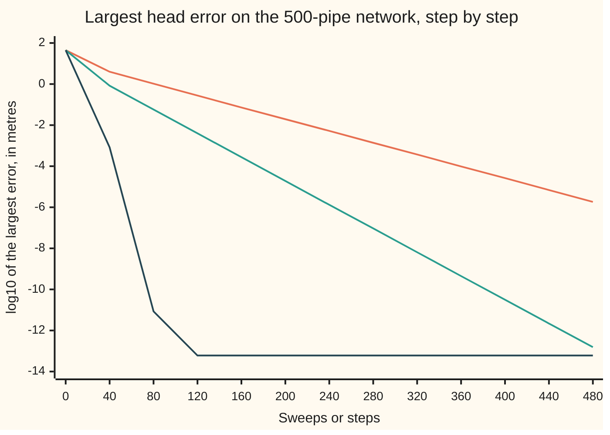

# Iterating instead of factoring: Jacobi, Gauss-Seidel and conjugate gradient

[Syllabus](../../../SYLLABUS.md) → [Numerical analysis](../README.md) → [Numerical Linear Algebra](../README.md#s03) → Iterating instead of factoring

---

## General Overview

A town's water mains form a grid: 10 rows of 25 junctions, 250 junctions in all, joined by 465 pipes. Another 35 pipes feed the top row and the left column from a supply main held at a head of 50 m. Head is pressure written as the height of a water column, in metres. That makes 500 pipes. Each pipe passes 1 litre a second (L/s) for every metre of head difference across it. Customers at each junction draw 0.1 L/s for every metre of head they get. These numbers are illustrative.

The engineer wants the 250 settled heads, to well under a millimetre. At each junction, water in must equal water out. That gives one linear equation per junction: 250 equations, written A x = b. Each equation mentions only its own junction and up to four neighbours. So the matrix A has 1,180 nonzero entries out of 62,500 (1.89%).

A dense [Cholesky](04-cholesky-decomposition.md) factorisation, which treats all 62,500 entries as data, would cost 5,239,625 flops (a flop is one addition, subtraction, multiplication or division). A band Cholesky costs far less. Numbered row by row, every nonzero sits within 25 places of the diagonal, and the factor fills in only inside that band, so the factorisation and its two triangular solves cost 181,825 flops. The methods on this card never factor A. They start from a guess and **relax** it: they correct the heads, sweep after sweep, until a stopping test says they have settled. They only ever multiply by A, using the 1,180 nonzeros.

- **Jacobi** sets each junction's head to the value that balances its water, using the neighbours' old heads. It needs 471 sweeps.
- **Gauss-Seidel** does the same, but uses each new head as soon as it exists. It needs 233 sweeps, about half.
- **Conjugate gradient** works when A is symmetric positive definite: symmetric, with xᵀAx > 0 for every nonzero list x. It takes the best step along directions chosen so that no step undoes an earlier one. It needs 57 steps and 262,770 flops: 19.9 times fewer than the dense factorisation, but 1.45 times the band solve.

All the runs land within 2.465e-6 m of the exact heads: 44.800616 m at the corner nearest the main, 3.718894 m at the far corner.

So at 250 unknowns a band solve is the cheapest; numbered column by column, with a band of 10, it costs only 39,705 flops. Iterating pays off when the band is wide or fill-in is heavy, as on large 2-D and 3-D grids, or when A is known only through products with it. This small network shows how the methods behave.

**Jacobi and Gauss-Seidel balance one equation at a time and converge when each diagonal entry outweighs the rest of its row; conjugate gradient, on a symmetric positive definite matrix, needs steps that grow only like the square root of the condition number κ (how much A can magnify a relative error).**

**What kind of fact this is:** methods resting on theorems. Jacobi's convergence for a diagonally dominant matrix is proved on this card in Why it works, and so are the same bound for Gauss-Seidel and the conjugate gradient bound, from the method's best-polynomial property. Gauss-Seidel's convergence for every symmetric positive definite matrix and Young's best relaxation factor are stated with their sources.

### The picture: how fast the error falls

Each method runs for 480 steps on the network with no stopping test. The chart has no log scale, so it plots log10 of the largest head error in metres. A value of −3 means a millimetre.



The orange line is Jacobi, the green line Gauss-Seidel, the dark line conjugate gradient. The two sweeping methods fall along straight lines: a fixed fraction of the error goes each sweep. Gauss-Seidel's line is twice as steep. Conjugate gradient plunges and then sits at 10^−13.22 m, where rounding stops the fall.

---

## The formula

Split A into its diagonal D, the part below the diagonal L, and the part above it U, so A = D + L + U. (On this card L is the lower part of A, not a Cholesky factor.) Write x_i^(k) for junction i's head after k sweeps.

$$\text{Jacobi:}\quad x_i^{(k+1)} = \frac{1}{a_{ii}}\Big(b_i - \sum_{j \ne i} a_{ij}\, x_j^{(k)}\Big)$$

$$\text{Gauss-Seidel:}\quad x_i^{(k+1)} = \frac{1}{a_{ii}}\Big(b_i - \sum_{j < i} a_{ij}\, x_j^{(k+1)} - \sum_{j > i} a_{ij}\, x_j^{(k)}\Big)$$

$$\text{SOR:}\quad x_i \leftarrow x_i + \omega\,\big(\text{Gauss-Seidel value} - x_i\big)$$

Each sweep moves the error e_k = x^(k) − x* by a fixed matrix G, and two bounds say how fast it shrinks:

$$e_{k+1} = G\,e_k, \qquad \lVert e_k \rVert_\infty \le q^{k}\,\lVert e_0 \rVert_\infty \ \text{(Jacobi, Gauss-Seidel)}, \qquad \lVert e_k \rVert_A \le 2\left(\frac{\sqrt{\kappa}-1}{\sqrt{\kappa}+1}\right)^{k} \lVert e_0 \rVert_A \ \text{(CG)}$$

**Read it aloud:** solve each junction's equation for its own head, using the neighbours' latest heads; each sweep shrinks the error by at least q, and each conjugate gradient step by at least a factor set by √κ.

| Symbol | Plain meaning | In our example | Push it up and the answer… |
| --- | --- | --- | --- |
| $A$, $a_{ij}$, $n$ | the matrix of the network's water balance, its entry in row i, column j, and its size | n = 250; diagonal entries 2.1 to 4.1; each pipe between junctions puts −1 off the diagonal | — |
| $x$, $x^*$, $x^{(k)}$ | heads in metres: any list of them, the exact solution, and the guess after k sweeps | x* runs from 44.800616 m to 3.718894 m; x^(0) is all zeros | — |
| $b$ | the right-hand side: 50 for each supply pipe at a junction, else 0 | 100 at the corner (0, 0), which has two supply pipes | heads rise in proportion |
| $D$, $L$, $U$ | the diagonal of A, the part below it, the part above it | D holds the 2.1 to 4.1 | — |
| $e_k$, $\lVert e_k\rVert_\infty$ | the error x^(k) − x*, and its largest entry in size (the max norm) | 44.800616 m at the start | — |
| $G$, $p_k$, $T_k$ | the iteration matrix: one sweep sends e_k to G e_k. For Jacobi $G = -D^{-1}(L+U)$. For CG, $p_k$ is the degree-k polynomial with $p_k(0) = 1$ that sends e_0 to e_k; $T_k$ is the Chebyshev polynomial of degree k that bounds it (y, y_0, γ and θ are names inside that proof) | 250 by 250, never stored | — |
| $\rho(G)$, $\rho_J$ | the spectral radius: the largest size of any eigenvalue of G; ρ_J is Jacobi's | 0.967264 for Jacobi, 0.935600 for Gauss-Seidel | more sweeps; at 1 or above, no convergence |
| $q$ | the dominance ratio: the largest, over rows, of the off-diagonal sizes added up and divided by the diagonal | 4 ÷ 4.1 = 0.975610 | a weaker guarantee |
| $\omega$, $\omega^*$ | the relaxation factor of SOR (successive over-relaxation): how far past the Gauss-Seidel value to move; ω* is Young's best value | best 1.6 of the ten tried; ω* = 1.5952 | sweeps fall, then rise again |
| $\lambda_{\min}$, $\lambda_{\max}$, $\kappa$ | the smallest and largest eigenvalues of A, and the condition number κ = λmax / λmin | 0.126132, 7.995987, 63.3940 | CG needs more steps; its steps per digit grow like √κ |
| $\lVert v\rVert_A$ | the energy norm: the length of a list v measured by A, $\sqrt{v^{T} A v}$ | 1.719e1 after 10 CG steps | — |
| $r_k$ | the residual b − A x^(k): how far each junction's water fails to balance, in L/s | relative size below 1e-8 at the stop | — |

The norms and κ come from [Matrix norms and the condition number](01-matrix-norms-and-the-condition-number.md). The spectral radius ρ(G) is new on this card.

### When it holds

- **Jacobi needs ρ(G) < 1.** Strict diagonal dominance (q < 1) is an easy test that guarantees it. Without it Jacobi can blow up: on `[[1, 0.8, 0.8], [0.8, 1, 0.8], [0.8, 0.8, 1]]` its error grows 1.6000 times per sweep.
- **Gauss-Seidel converges under dominance or for a symmetric positive definite A.** The same 3-by-3 matrix is positive definite, and Gauss-Seidel converges on it while Jacobi fails.
- **Conjugate gradient needs A symmetric positive definite** ([Quadratic forms](../../03-Algebra/07-Eigenvalues%20and%20Symmetric%20Matrices/05-quadratic-forms-and-positive-definite.md)). For other matrices its step lengths lose their meaning; [Sparse storage and Krylov methods](10-sparse-matrices-and-krylov-methods.md) gives methods that do not need symmetry.
- **Speed needs ρ well below 1, or κ modest.** If customers draw 0.01 instead of 0.1 L/s per metre, q rises to 0.997506 and Jacobi needs 1,610 sweeps.
- **Rounding sets a floor.** No method gets closer than about 10^−13 m to the Cholesky answer here. That is the size of κ times the unit roundoff u (2^−53) times the 45 m head: rounding in both solves.

---

## Why it works

### Step 0: turn the equation into a balance you can repeat

Each row of A x = b says one junction's water balances. Solve that row for its own head, and you get the head the junction would have if its neighbours were right. The exact answer x* is the one list that every row agrees with. So x* is a **fixed point** of the sweep: a sweep leaves it unchanged ([Fixed points](../02-Root%20Finding%20and%20Fixed%20Points/06-fixed-point-iteration-and-contraction.md)).

Subtract the sweep applied to x* from the sweep applied to x^(k). The right-hand side b cancels, and what is left is

$$e_{k+1} = G\,e_k, \qquad\text{so}\qquad e_k = G^{k} e_0 .$$

The error does not depend on b at all, only on G. Everything below is about making G small.

### Step 1: the spectral radius decides

If G has an eigenvalue λ with |λ| ≥ 1, start with the error along its eigenvector v. Then e_k = λ^k v, which never shrinks. So ρ(G) < 1 is necessary.

It is also sufficient: if ρ(G) < 1, then G^k → 0 and every start converges. The proof needs the Jordan form or a matrix norm built to fit G; Varga (chapter 1) gives it. Asymptotically the error shrinks by a factor ρ(G) per sweep.

The code finds ρ for Jacobi by power iteration ([Eigenvalues by iteration](07-eigenvalues-power-iteration-and-the-qr-algorithm.md)): 0.967264. The measured shrink per sweep, between sweeps 300 and 400, is 0.9674.

### Step 2: diagonal dominance makes Jacobi a contraction

A matrix is **strictly diagonally dominant** by rows when each diagonal entry is bigger in size than the rest of its row added up. Then q < 1.

**Theorem.** If A is strictly diagonally dominant, Jacobi converges from every start, and ‖e_k‖∞ ≤ q^k ‖e_0‖∞.

**Proof.** The exact solution satisfies the Jacobi formula too. Subtract it from the formula for x^(k+1), entry by entry:

$$e_{k+1,i} = -\frac{1}{a_{ii}} \sum_{j\ne i} a_{ij}\, e_{k,j} .$$

Take sizes. Each |e_{k,j}| is at most ‖e_k‖∞, so

$$|e_{k+1,i}| \le \frac{\sum_{j\ne i} |a_{ij}|}{|a_{ii}|}\,\lVert e_k\rVert_\infty \le q\,\lVert e_k\rVert_\infty .$$

This holds for every i, so ‖e_{k+1}‖∞ ≤ q ‖e_k‖∞. Repeat k times. Since q < 1, the error goes to zero. ∎

On the network, a junction with four pipes has diagonal 4 + 0.1 = 4.1 and four off-diagonal entries of −1. So q = 4 ÷ 4.1 = 0.975610. The customers' draw is what makes the dominance strict. The bound holds at every sweep:

| Jacobi sweep | True largest error | Bound q^k × 44.800616 m | Bound ÷ true |
| ---: | ---: | ---: | ---: |
| 100 | 5.359e-1 m | 3.792e0 m | 7.1 |
| 200 | 1.951e-2 m | 3.210e-1 m | 16.5 |
| 300 | 7.158e-4 m | 2.717e-2 m | 38.0 |
| 400 | 2.602e-5 m | 2.300e-3 m | 88.4 |

The bound is safe but grows loose, because q (0.975610) is the worst single row and ρ (0.967264) is the long-run rate per sweep.

### Step 3: Gauss-Seidel uses news as soon as it arrives

Gauss-Seidel sweeps in reading order, top row first, left to right. When it reaches a junction, the neighbours above and to the left already have new heads, and it uses them.

The same dominance proof works, with one extra induction, so ‖e_k‖∞ ≤ q^k ‖e_0‖∞ for Gauss-Seidel too.

<details>
<summary>Detailed proof: the dominance bound for Gauss-Seidel</summary>

Write E = ‖e_k‖∞. Gauss-Seidel's error in entry i is

$$e_{k+1,i} = -\frac{1}{a_{ii}}\Big(\sum_{j<i} a_{ij}\, e_{k+1,j} + \sum_{j>i} a_{ij}\, e_{k,j}\Big).$$

Suppose every new entry before i obeys |e_{k+1,j}| ≤ qE. Since q < 1, each is at most E, and each old entry is at most E. So |e_{k+1,i}| ≤ (Σ_{j≠i} |a_ij| ÷ |a_ii|) E ≤ qE. That carries the claim from the first entry to the last. So ‖e_{k+1}‖∞ ≤ q ‖e_k‖∞.

</details>

Two more facts are stated here, with sources. First, Gauss-Seidel converges for every symmetric positive definite A, dominant or not (Saad, chapter 4). Second, for grid matrices like this one, swept in this order, ρ for Gauss-Seidel is exactly ρ for Jacobi squared (Young, 1954). The code checks the second fact: ρ² = 0.935600, and the measured shrink per sweep is 0.9355. A squared rate means half the sweeps: 233 against 471.

### Step 4: over-relaxation, the sweep on the plate

SOR moves each head past the Gauss-Seidel value by the factor ω. For this kind of matrix, Young proved the best factor is

$$\omega^{*} = \frac{2}{1 + \sqrt{1 - \rho_J^{2}}},$$

where ρ_J is Jacobi's spectral radius. Here that gives 1.5952. The code tries ω = 1.0, 1.1, …, 1.9 and finds the fewest sweeps at 1.6: 44 sweeps, against 233 for plain Gauss-Seidel.

[Laplace's equation](../../08-Differential%20equations%20and%20dynamics/10-The%20Classical%20PDEs/07-laplaces-equation-and-harmonic-functions.md) relaxes a heated plate point by point with the factor 2 ÷ (1 + sin(π/n)). That sweep is Gauss-Seidel with relaxation, and that factor is Young's formula for the square plate.

### Step 5: conjugate gradient, and why its bound has √κ

[Conjugate gradient](../../15-Optimization/02-Unconstrained%20Methods/07-conjugate-gradient-method.md) minimises the bowl ½ xᵀAx − bᵀx along directions that never undo each other's work, and finishes within n steps in exact arithmetic. That card derives the method. This step explains its speed bound.

After k steps, the error is a polynomial in A applied to the first error: e_k = p_k(A) e_0, with p_k of degree k and p_k(0) = 1, because each step adds only A times earlier directions. Conjugate gradient picks, among all such polynomials, the one with the smallest ‖e_k‖_A.

Now use [The spectral theorem](../../03-Algebra/07-Eigenvalues%20and%20Symmetric%20Matrices/04-spectral-theorem.md): write e_0 along A's perpendicular eigenvectors. Then p(A) multiplies each piece by p(λ), so

$$\lVert e_k\rVert_A \le \Big(\max_{\lambda_{\min}\le\lambda\le\lambda_{\max}} |p(\lambda)|\Big)\, \lVert e_0\rVert_A \quad\text{for every allowed } p .$$

Choose p to be a Chebyshev polynomial stretched onto [λmin, λmax]: the polynomial that stays smallest on that interval while fixed at 1 at zero. Its largest size there is at most 2((√κ − 1)/(√κ + 1))^k. That gives the bound in the formula. The fold proves the Chebyshev step; Trefethen and Bau (Lecture 38) give the same argument.

<details>
<summary>Detailed proof: the Chebyshev step</summary>

The Chebyshev polynomials start with T_0(y) = 1 and T_1(y) = y, and continue by T_{k+1}(y) = 2y T_k(y) − T_{k−1}(y). So T_k has degree k. Here y is a plain number, not a head.

The cosine rule cos((k + 1)θ) = 2 cos θ cos kθ − cos((k − 1)θ) is the same recurrence, so T_k(cos θ) = cos kθ. Every y from −1 to 1 is some cos θ, so there |T_k(y)| ≤ 1.

For y ≥ 1, let γ = y + √(y² − 1), so 1/γ = y − √(y² − 1) and y = ½(γ + 1/γ). The numbers ½(γ^k + γ^(−k)) start at 1 and y and obey the same recurrence, so T_k(y) = ½(γ^k + γ^(−k)) ≥ ½ γ^k.

Now stretch the interval. The map y(λ) = (λmax + λmin − 2λ) ÷ (λmax − λmin) sends [λmin, λmax] onto [−1, 1], and sends λ = 0 to y_0 = (κ + 1) ÷ (κ − 1), which is above 1. Take

$$p(\lambda) = \frac{T_k\big(y(\lambda)\big)}{T_k(y_0)} .$$

It has degree k and p(0) = 1, so it is allowed, and on the interval |p(λ)| ≤ 1 ÷ T_k(y_0). Finally y_0² − 1 = 4κ ÷ (κ − 1)², so γ = y_0 + √(y_0² − 1) = (κ + 1 + 2√κ) ÷ (κ − 1) = (√κ + 1) ÷ (√κ − 1). Hence 1 ÷ T_k(y_0) ≤ 2γ^(−k) = 2((√κ − 1)/(√κ + 1))^k. ∎

</details>

The network's eigenvalues are known exactly, which gives κ without any iteration:

<details>
<summary>Detailed derivation: the network's eigenvalues in closed form</summary>

A is the sum of three simple pieces. The first is a path matrix along each row of 25 junctions, fed at its left end. The second is a path matrix along each column of 10 junctions, fed at its top end. The third is 0.1 times the identity.

Take a path of m junctions, fed at one end and closed at the other. Its eigenvectors have entries sin(θ i) for i = 1, …, m, where θ = (2k − 1)π / (2m + 1). Its eigenvalues are 2 − 2 cos θ. The fed end acts as a node held at zero, and the closed end as a mirror, and this θ satisfies both.

The grid's eigenvectors are products of a row sine and a column sine, and its eigenvalues are sums: one row value, one column value, and 0.1. The smallest is 0.126132 and the largest 7.995987.

The code also uses these 250 eigenvectors as a second road to x*: it adds up (qᵀb ÷ λ qᵀq) q over all of them. That answer matches the Cholesky solve to better than 1e-10 m.

</details>

So κ = 63.3940, √κ = 7.9620, and the factor per step is 0.7768. Gradient descent would have (κ − 1)/(κ + 1) instead, far closer to 1. The bound holds at every step:

| CG step | True ‖e_k‖_A | Bound | Bound ÷ true |
| ---: | ---: | ---: | ---: |
| 10 | 1.719e1 | 4.124e1 | 2.4 |
| 20 | 1.220e0 | 3.301e0 | 2.7 |
| 30 | 9.288e-2 | 2.642e-1 | 2.8 |
| 40 | 3.361e-3 | 2.115e-2 | 6.3 |
| 50 | 5.510e-5 | 1.693e-3 | 30.7 |

The measured factor per step is 0.7289, better than 0.7768. The ratio grows because conjugate gradient does better than the worst case: once it has dealt with the extreme eigenvalues, the rest behave as if κ were smaller.

### Step 6: what "settled" means

Every run stops when the relative residual ‖b − A x‖₂ ÷ ‖b‖₂ falls below 1e-8. A small residual is a small backward error ([Conditioning and stability](../01-Floating%20Point%20and%20Error/05-conditioning-and-stability.md)): the computed heads exactly balance a network whose supply differs by a part in 10^8.

To claim small forward error, multiply by κ. For conjugate gradient the relative error is at most 63.3940 × the relative residual, a bound of 6.262e-7. The true relative error is 1.082e-8; the bound is 57.9 times the true value.

A second certificate needs no exact answer: ‖x − x*‖₂ ≤ ‖r‖₂ ÷ λmin. It gives 2.382e-5 m, against a true 3.487e-6 m: 6.8 times the true error. With κ only 63, conditioning is no trouble here. The trouble is speed, and that is what separates the three methods.

---

## Worked numbers, by hand

One sweep of each sweeping method from all-zero heads, then the rates. Junction (r, c) is row r, column c, counted from 0 at the corner nearest the main.

| Step | Arithmetic | Value |
| --- | --- | --- |
| corner (0, 0): its row of A | 2 pipes to neighbours + 2 supply pipes + 0.1 draw on the diagonal; b = 2 × 50 | diagonal 4.1, b = 100 |
| Jacobi, (0, 0) | 100 ÷ 4.1 | 24.390244 m |
| Jacobi, (0, 1) and (1, 0) | one supply pipe each, old neighbours all 0: 50 ÷ 4.1 | 12.195122 m |
| Jacobi, (1, 1) | no supply, neighbours all 0: 0 ÷ 4.1 | 0.000000 m |
| Gauss-Seidel, (0, 1) | uses the new (0, 0): (50 + 24.390244) ÷ 4.1 | 18.143962 m |
| Gauss-Seidel, (1, 0) | also uses the new (0, 0) | 18.143962 m |
| Gauss-Seidel, (1, 1) | uses two new neighbours: (18.143962 + 18.143962) ÷ 4.1 | 8.850713 m |
| dominance ratio | 4 ÷ 4.1 | q = 0.975610 |
| Jacobi bound at sweep 400 | 0.975610^400 × 44.800616 | 2.300e-3 m |
| CG factor | (7.9620 − 1) ÷ (7.9620 + 1) | 0.7768 |
| **cost to settle** | Jacobi 471 × 2,110; Gauss-Seidel 233 × 2,110; CG 57 × 4,610 flops | **993,810; 491,630; 262,770 flops** |

After one sweep, Gauss-Seidel has already reached junction (1, 1); Jacobi has not. Settled, the corner reads 44.800616 m, and the main delivers 422.282264 L/s, exactly what the customers draw. Conjugate gradient settles in 262,770 flops; a dense Cholesky factorisation needs 5,239,625, which is 19.9 times as many. A band Cholesky with its two solves needs only 181,825, or 39,705 with the junctions numbered column by column, so at this size the band solve wins. SOR at ω = 1.6 takes 125,840 flops, but that count leaves out the cost of finding ω, which needs ρ_J or a scan of trial runs.

The flop counts per step come from the nonzeros. A sweep does a multiply and a subtract for each off-diagonal entry and one division per row: 2,110. A conjugate gradient step does one product with A, two dot products and three list updates: 4,610. An SOR sweep adds three flops per junction: 2,860.

### What breaks if you drop a piece

| Mistake | Comes out at | What went wrong |
| --- | --- | --- |
| Run Jacobi on `[[1, 0.8, 0.8], [0.8, 1, 0.8], [0.8, 0.8, 1]]` | error 1,329,228 after 30 sweeps, from a true answer of (1, 1, 1) | no dominance: 0.8 + 0.8 outweighs 1, and the error grows 1.6000 times a sweep |
| Run Gauss-Seidel on that matrix instead | error 8.661e-5 after 30 sweeps | it converges, because the matrix is positive definite: its eigenvalues are 2.6, 0.2 and 0.2, all positive |
| Stop Jacobi when a sweep moves no head by 1e-3 m | stops at sweep 188 with a true error of 0.029015 m | a slow method takes small steps while still far away |
| Over-relax with ω = 1.9 | 181 sweeps instead of 44 at ω = 1.6 | past Young's 1.5952, each sweep overshoots and the error swings |

---

## Code, from first principles, and it actually runs

The code builds the 500-pipe network, solves it directly by a dense Cholesky factorisation (road 1), and again from the closed-form eigenvectors (road 2). The two agree to 1e-10 m. Then it runs Jacobi, Gauss-Seidel, SOR and conjugate gradient to the same stopping test, and measures each against road 1. It checks the dominance bound at every Jacobi sweep and the conjugate gradient bound at every step. It checks the residual certificate, which is a third road needing no exact answer. It finds ρ by power iteration and compares it with the measured rates and with Young's formula. It counts a band Cholesky's flops by the dense count's rules, and checks that the count at full width equals the dense one plus two solves. All sums run left to right in both languages, so the outputs match.

### Python

```python
# Iterating instead of factoring -- the check behind the card.  Standard library only; nothing
# imported holds an answer.  A 10-by-25 grid of junctions joined by 465 pipes, fed by 35 more
# pipes from a main at 50 m: 500 pipes, 250 unknown pressure heads.  Each pipe passes 1 L/s per
# metre of head difference; customers draw 0.1 L/s per metre of head (illustrative numbers).
from math import sqrt, sin, cos, pi, log10
R, C, H0, DRAW, TOL, CHART = 10, 25, 50.0, 0.1, 1e-8, 480; n = R * C
off, diag, b, pipes = [[] for _ in range(n)], [DRAW] * n, [0.0] * n, 0
for r in range(R):
    for c in range(C):
        i = r * C + c
        for rr, cc in ((r, c + 1), (r + 1, c)):
            if rr < R and cc < C:
                j = rr * C + cc; off[i].append((j, -1.0)); off[j].append((i, -1.0))
                diag[i] += 1.0; diag[j] += 1.0; pipes += 1
        for fed in (r == 0, c == 0):           # pipes from the main to the top row and the left column
            if fed: diag[i] += 1.0; b[i] += H0; pipes += 1
M, nnz = (off, diag, b), n + sum(len(o) for o in off)
def dot(u, v):                                 # plain left-to-right sum, as in the Rust
    s = 0.0
    for i in range(len(u)): s += u[i] * v[i]
    return s
def ax(M, x):
    o, d, _ = M; y = []
    for i in range(len(x)):
        s = d[i] * x[i]
        for j, a in o[i]: s += a * x[j]
        y.append(s)
    return y
def sweep(M, x, w, gs):                        # one Jacobi (gs False) or Gauss-Seidel/SOR sweep
    o, d, bb = M; src = x if gs else x[:]; new = x if gs else [0.0] * len(x)
    for i in range(len(x)):
        s = bb[i]
        for j, a in o[i]: s -= a * src[j]
        new[i] = x[i] + w * (s / d[i] - x[i])
    return new
def cholesky_solve(M):                         # road 1, the direct solve: dense L L^T, then two sweeps
    o, d, bb = M; m = len(bb); od = [dict(o[i]) for i in range(m)]
    A = [[d[i] if i == j else od[i].get(j, 0.0) for j in range(m)] for i in range(m)]
    L, y, x = [[0.0] * m for _ in range(m)], [0.0] * m, [0.0] * m
    for j in range(m):
        s = A[j][j]
        for k in range(j): s -= L[j][k] * L[j][k]
        L[j][j] = sqrt(s)
        for i in range(j + 1, m):
            t = A[i][j]
            for k in range(j): t -= L[i][k] * L[j][k]
            L[i][j] = t / L[j][j]
    for i in range(m):
        s = bb[i]
        for k in range(i): s -= L[i][k] * y[k]
        y[i] = s / L[i][i]
    for i in reversed(range(m)):
        s = y[i]
        for k in range(i + 1, m): s -= L[k][i] * x[k]
        x[i] = s / L[i][i]
    return x
xs, ones = cholesky_solve(M), [1.0] * n; bn, xn = sqrt(dot(b, b)), sqrt(dot(xs, xs))
def err(x): return max(abs(x[i] - xs[i]) for i in range(n))
def enA(x): e = [x[i] - xs[i] for i in range(n)]; return sqrt(dot(e, ax(M, e)))
def rel2(x): e = [x[i] - xs[i] for i in range(n)]; return sqrt(dot(e, e)) / xn
def relres(x): r = [b[i] - t for i, t in enumerate(ax(M, x))]; return sqrt(dot(r, r)) / bn
def stationary(w, gs, steps=0, stop=0.0):
    x, k, hist = [0.0] * n, 0, [[0.0] * n]
    while (k < steps if steps else relres(x) > TOL) and k < 20000:
        old = x[:]; x = sweep(M, x, w, gs); k += 1; hist.append(x[:])
        if stop and max(abs(x[i] - old[i]) for i in range(n)) < stop: break
    return k, x, hist
def cg(steps=0):
    x, r = [0.0] * n, b[:]; d, rr, k, hist = r[:], dot(r, r), 0, [[0.0] * n]
    while (k < steps if steps else sqrt(rr) / bn > TOL) and k < 20000:
        Ad = ax(M, d); al = rr / dot(d, Ad)
        x = [x[i] + al * d[i] for i in range(n)]; r = [r[i] - al * Ad[i] for i in range(n)]
        rn = dot(r, r); d = [r[i] + rn / rr * d[i] for i in range(n)]; rr, k = rn, k + 1; hist.append(x)
    return k, x, hist
def sci(x): m, e = f"{x:.3e}".split("e"); return f"{m}e{int(e)}"
j1, g1 = sweep(M, [0.0] * n, 1.0, False), sweep(M, [0.0] * n, 1.0, True)
inflow = dot([2.0 if i == 0 else 1.0 if i < C or i % C == 0 else 0.0 for i in range(n)], [H0 - t for t in xs])
print(f"network: {n} junctions, {pipes} pipes, {nnz} nonzeros of {n * n} ({100 * nnz / (n * n):.2f}%), diagonal {min(diag):.1f} to {max(diag):.1f}")
print(f"Jacobi sweep 1 at (0,0) (0,1) (1,0) (1,1): {j1[0]:.6f} {j1[1]:.6f} {j1[C]:.6f} {j1[C + 1]:.6f}")
print(f"Gauss-Seidel sweep 1 at the same four:    {g1[0]:.6f} {g1[1]:.6f} {g1[C]:.6f} {g1[C + 1]:.6f}")
print(f"settled heads, m: corner (0,0) {xs[0]:.6f}  far corner {xs[n - 1]:.6f}  mean {dot(xs, ones) / n:.6f}")
print(f"mass balance, L/s: in from the main {inflow:.6f}  drawn by customers {DRAW * dot(xs, ones):.6f}")
def mu(m, k): return 2.0 - 2.0 * cos((2 * k - 1) * pi / (2 * m + 1))
xsp = [0.0] * n                                # road 2: the spectral theorem, eigenvectors in closed form
for kc in range(1, C + 1):
    for kr in range(1, R + 1):
        q = [sin((2 * kc - 1) * pi * (c + 1) / (2 * C + 1)) * sin((2 * kr - 1) * pi * (r + 1) / (2 * R + 1))
             for r in range(R) for c in range(C)]
        cf = dot(q, b) / (dot(q, q) * (mu(C, kc) + mu(R, kr) + DRAW))
        for i in range(n): xsp[i] += cf * q[i]
print(f"spectral road: corner {xsp[0]:.6f}  far corner {xsp[n - 1]:.6f}  agrees with Cholesky to 1e-10: {'yes' if err(xsp) < 1e-10 else 'no'}")
lmin, lmax = mu(C, 1) + mu(R, 1) + DRAW, mu(C, C) + mu(R, R) + DRAW; kap = lmax / lmin; rcg = (sqrt(kap) - 1) / (sqrt(kap) + 1)
qd = max(sum(abs(a) for _, a in off[i]) / diag[i] for i in range(n))
Z, v = (off, diag, [0.0] * n), [1.0] * n       # rho of the Jacobi matrix G, by power iteration
for _ in range(3000): v = sweep(Z, v, 1.0, False); s = sqrt(dot(v, v)); v = [t / s for t in v]
g2 = sweep(Z, sweep(Z, v, 1.0, False), 1.0, False); rhoj = sqrt(sqrt(dot(g2, g2))); wy = 2.0 / (1.0 + sqrt(1.0 - rhoj * rhoj))
print(f"lambda min {lmin:.6f}  max {lmax:.6f}  kappa {kap:.4f}  sqrt kappa {sqrt(kap):.4f}  CG factor {rcg:.4f}")
print(f"dominance q {qd:.6f}  rho Jacobi {rhoj:.6f}  rho^2 {rhoj * rhoj:.6f}  Young omega {wy:.4f}")
fj, fcg = 2 * (nnz - n) + n, (2 * nnz - n) + 2 * (2 * n - 1) + 3 * 2 * n + 2
scan = [(w / 10, stationary(w / 10, True)[0]) for w in range(10, 20)]; wb = min(scan, key=lambda t: t[1])[0]
runs = [("Jacobi", stationary(1.0, False), fj), ("Gauss-Seidel", stationary(1.0, True), fj),
        (f"SOR omega {wb:.1f}", stationary(wb, True), fj + 3 * n), ("conjugate gradient", cg(), fcg)]
for name, (k, x, _), f in runs:
    print(f"{name:<19} steps {k:>4}  flops {k * f:>9,}  max error {sci(err(x)):>9} m  rel residual {sci(relres(x))}")
print(f"flops: dense Cholesky {(2 * n ** 3 + 3 * n ** 2 + n) // 6:,}; per step: sweep {fj:,}, SOR {fj + 3 * n:,}, CG {fcg:,}; Cholesky / CG {(2 * n ** 3 + 3 * n ** 2 + n) // 6 / (runs[3][1][0] * fcg):.1f}")
def band(p): return sum(2 * (j - max(0, i - p)) + 1 for j in range(n) for i in range(j, min(j + p, n - 1) + 1)) + 2 * sum(2 * min(i, p) + 1 for i in range(n))
print(f"flops: band Cholesky and two solves, half-bandwidth {C} (row by row) {band(C):,}, {R} (column by column) {band(R):,}; CG / band {runs[3][1][0] * fcg / band(C):.2f}, {runs[3][1][0] * fcg / band(R):.2f}")
print("SOR scan, omega:steps " + " ".join(f"{w:.1f}:{k}" for w, k in scan))
hj, hg, hc, e0, a0 = runs[0][1][2], runs[1][1][2], runs[3][1][2], err([0.0] * n), enA([0.0] * n)
for k in (100, 200, 300, 400):
    t, bd = err(hj[k]), qd ** k * e0
    print(f"Jacobi sweep {k}: true max error {sci(t)} m  bound q^k e0 {sci(bd)} m  ratio {bd / t:.1f}")
for k in (10, 20, 30, 40, 50):
    t, bd = enA(hc[k]), 2 * rcg ** k * a0
    print(f"CG step {k}: true A-norm error {sci(t)}  bound {sci(bd)}  ratio {bd / t:.1f}")
obs = ((err(hj[400]) / err(hj[300])) ** 0.01, (err(hg[200]) / err(hg[100])) ** 0.01, (enA(hc[50]) / enA(hc[10])) ** 0.025)
print(f"observed factor per step: Jacobi {obs[0]:.4f}  Gauss-Seidel {obs[1]:.4f}  CG {obs[2]:.4f}")
xc = runs[3][1][1]; rc = [b[i] - t for i, t in enumerate(ax(M, xc))]; e2 = rel2(xc) * xn
print(f"CG certificate: |error| {sci(e2)} <= |residual| / lambda min {sci(sqrt(dot(rc, rc)) / lmin)}  ratio {sqrt(dot(rc, rc)) / lmin / e2:.1f}")
print(f"CG forward: rel error {sci(rel2(xc))} <= kappa x rel residual {sci(kap * relres(xc))}  ratio {kap * relres(xc) / rel2(xc):.1f}")
fJ, fG, fC = stationary(1.0, False, CHART)[2], stationary(1.0, True, CHART)[2], cg(CHART)[2]
for k in range(0, CHART + 1, 40):
    print(f"figure, step {k}, log10 max error J {log10(err(fJ[k])):.2f} GS {log10(err(fG[k])):.2f} CG {log10(err(fC[k])):.2f}")
ks, xstop, hs = stationary(1.0, False, stop=1e-3); mv = max(abs(hs[-1][i] - hs[-2][i]) for i in range(n))
print(f"wrong: stop Jacobi when a sweep moves < 1e-3 m: sweep {ks}, true max error {err(xstop):.6f} m; last move {mv:.6f} m x rho/(1-rho) {rhoj / (1 - rhoj):.4f} = {mv * rhoj / (1 - rhoj):.6f} m")
T, tj, tg = ([[(1, 0.8), (2, 0.8)], [(0, 0.8), (2, 0.8)], [(0, 0.8), (1, 0.8)]], [1.0] * 3, [2.6] * 3), [0.0] * 3, [0.0] * 3
for _ in range(30): tp = tj; tj = sweep(T, tj, 1.0, False); tg = sweep(T, tg, 1.0, True)
ej, eg, ep = (max(abs(t - 1) for t in u) for u in (tj, tg, tp))
ev = [(v, dot(v, ax(T, v)) / dot(v, v)) for v in ([1.0] * 3, [1.0, -1.0, 0.0], [1.0, 1.0, -2.0])]   # three eigenvectors
print("3x3: eigenvalues " + " ".join(f"{l:.1f}" for _, l in ev) + f" at (1,1,1) (1,-1,0) (1,1,-2); Jacobi error grows {ej / ep:.4f} per sweep")
print(f"wrong: Jacobi on [[1,.8,.8],[.8,1,.8],[.8,.8,1]], 30 sweeps: error {ej:.1f}; Gauss-Seidel {sci(eg)}")
assert err(xsp) < 1e-10 and abs(inflow - DRAW * dot(xs, ones)) < 1e-9   # roads 1 and 2 agree; water balances
assert all(relres(x) <= TOL and rel2(x) <= kap * relres(x) for _, (k, x, _), _ in runs)
assert all(qd ** k * e0 >= err(hj[k]) for k in range(len(hj)))          # dominance bound, every sweep
assert all(2 * rcg ** k * a0 >= enA(hc[k]) for k in range(len(hc)))      # CG bound, every step
assert rhoj < qd and abs(obs[0] - rhoj) < 2e-3 and abs(obs[1] - rhoj ** 2) < 2e-3 and abs(wy - wb) < 0.05
assert e2 <= sqrt(dot(rc, rc)) / lmin and runs[3][1][0] < runs[1][1][0] < runs[0][1][0]
assert band(n - 1) == (2 * n ** 3 + 3 * n ** 2 + n) // 6 + 2 * n * n      # full band = the dense count, plus two solves
assert err(xstop) > 10 * 1e-3 and ej > 1e3 and eg < 1e-3 and all(l > 0 and max(abs(a - l * c) for a, c in zip(ax(T, v), v)) < 1e-12 for v, l in ev)
print("ALL CHECKS PASS")
```

**Ran 2026-11-11 on macOS, Python 3.14.10, standard library only. All checks passed. Output, pasted from the run:**

```
network: 250 junctions, 500 pipes, 1180 nonzeros of 62500 (1.89%), diagonal 2.1 to 4.1
Jacobi sweep 1 at (0,0) (0,1) (1,0) (1,1): 24.390244 12.195122 12.195122 0.000000
Gauss-Seidel sweep 1 at the same four:    24.390244 18.143962 18.143962 8.850713
settled heads, m: corner (0,0) 44.800616  far corner 3.718894  mean 16.891291
mass balance, L/s: in from the main 422.282264  drawn by customers 422.282264
spectral road: corner 44.800616  far corner 3.718894  agrees with Cholesky to 1e-10: yes
lambda min 0.126132  max 7.995987  kappa 63.3940  sqrt kappa 7.9620  CG factor 0.7768
dominance q 0.975610  rho Jacobi 0.967264  rho^2 0.935600  Young omega 1.5952
Jacobi              steps  471  flops   993,810  max error  2.465e-6 m  rel residual 9.778e-9
Gauss-Seidel        steps  233  flops   491,630  max error  2.121e-6 m  rel residual 9.763e-9
SOR omega 1.6       steps   44  flops   125,840  max error  5.670e-7 m  rel residual 8.170e-9
conjugate gradient  steps   57  flops   262,770  max error  7.594e-7 m  rel residual 9.878e-9
flops: dense Cholesky 5,239,625; per step: sweep 2,110, SOR 2,860, CG 4,610; Cholesky / CG 19.9
flops: band Cholesky and two solves, half-bandwidth 25 (row by row) 181,825, 10 (column by column) 39,705; CG / band 1.45, 6.62
SOR scan, omega:steps 1.0:233 1.1:189 1.2:152 1.3:120 1.4:93 1.5:67 1.6:44 1.7:56 1.8:90 1.9:181
Jacobi sweep 100: true max error 5.359e-1 m  bound q^k e0 3.792e0 m  ratio 7.1
Jacobi sweep 200: true max error 1.951e-2 m  bound q^k e0 3.210e-1 m  ratio 16.5
Jacobi sweep 300: true max error 7.158e-4 m  bound q^k e0 2.717e-2 m  ratio 38.0
Jacobi sweep 400: true max error 2.602e-5 m  bound q^k e0 2.300e-3 m  ratio 88.4
CG step 10: true A-norm error 1.719e1  bound 4.124e1  ratio 2.4
CG step 20: true A-norm error 1.220e0  bound 3.301e0  ratio 2.7
CG step 30: true A-norm error 9.288e-2  bound 2.642e-1  ratio 2.8
CG step 40: true A-norm error 3.361e-3  bound 2.115e-2  ratio 6.3
CG step 50: true A-norm error 5.510e-5  bound 1.693e-3  ratio 30.7
observed factor per step: Jacobi 0.9674  Gauss-Seidel 0.9355  CG 0.7289
CG certificate: |error| 3.487e-6 <= |residual| / lambda min 2.382e-5  ratio 6.8
CG forward: rel error 1.082e-8 <= kappa x rel residual 6.262e-7  ratio 57.9
figure, step 0, log10 max error J 1.65 GS 1.65 CG 1.65
figure, step 40, log10 max error J 0.60 GS -0.08 CG -3.08
figure, step 80, log10 max error J 0.02 GS -1.24 CG -11.07
figure, step 120, log10 max error J -0.56 GS -2.40 CG -13.22
figure, step 160, log10 max error J -1.14 GS -3.56 CG -13.22
figure, step 200, log10 max error J -1.71 GS -4.72 CG -13.22
figure, step 240, log10 max error J -2.28 GS -5.88 CG -13.22
figure, step 280, log10 max error J -2.86 GS -7.03 CG -13.22
figure, step 320, log10 max error J -3.43 GS -8.19 CG -13.22
figure, step 360, log10 max error J -4.01 GS -9.35 CG -13.22
figure, step 400, log10 max error J -4.58 GS -10.50 CG -13.22
figure, step 440, log10 max error J -5.16 GS -11.66 CG -13.22
figure, step 480, log10 max error J -5.74 GS -12.81 CG -13.22
wrong: stop Jacobi when a sweep moves < 1e-3 m: sweep 188, true max error 0.029015 m; last move 0.000990 m x rho/(1-rho) 29.5478 = 0.029242 m
3x3: eigenvalues 2.6 0.2 0.2 at (1,1,1) (1,-1,0) (1,1,-2); Jacobi error grows 1.6000 per sweep
wrong: Jacobi on [[1,.8,.8],[.8,1,.8],[.8,.8,1]], 30 sweeps: error 1329228.0; Gauss-Seidel 8.661e-5
ALL CHECKS PASS
```

### Rust

```rust
// Iterating instead of factoring -- the check behind the card.  std only; nothing used holds an
// answer.  A 10-by-25 grid of junctions joined by 465 pipes, fed by 35 more pipes from a main at
// 50 m: 500 pipes, 250 unknown pressure heads.  Each pipe passes 1 L/s per metre of head
// difference; customers draw 0.1 L/s per metre of head (illustrative numbers).
use std::f64::consts::PI;
const R: usize = 10; const C: usize = 25; const H0: f64 = 50.0; const DRAW: f64 = 0.1;
const TOL: f64 = 1e-8; const CHART: usize = 480;
struct Sys { off: Vec<Vec<(usize, f64)>>, diag: Vec<f64>, b: Vec<f64> }
fn dot(u: &[f64], v: &[f64]) -> f64 { let mut s = 0.0; for i in 0..u.len() { s += u[i] * v[i]; } s } // plain left-to-right sum
fn ax(m: &Sys, x: &[f64]) -> Vec<f64> {
    (0..x.len()).map(|i| { let mut s = m.diag[i] * x[i]; for &(j, a) in &m.off[i] { s += a * x[j]; } s }).collect()
}
fn sweep(m: &Sys, x: &[f64], w: f64, gs: bool) -> Vec<f64> { // one Jacobi (gs false) or Gauss-Seidel/SOR sweep
    let src = x.to_vec(); let mut new = if gs { x.to_vec() } else { vec![0.0; x.len()] };
    for i in 0..x.len() {
        let mut s = m.b[i];
        for &(j, a) in &m.off[i] { s -= a * if gs { new[j] } else { src[j] }; }
        new[i] = x[i] + w * (s / m.diag[i] - x[i]);
    }
    new
}
fn cholesky_solve(m: &Sys) -> Vec<f64> { // road 1, the direct solve: dense L L^T, then two sweeps
    let n = m.b.len(); let mut a = vec![vec![0.0; n]; n];
    for i in 0..n { a[i][i] = m.diag[i]; for &(j, v) in &m.off[i] { a[i][j] = v; } }
    let (mut l, mut y, mut x) = (vec![vec![0.0; n]; n], vec![0.0; n], vec![0.0; n]);
    for j in 0..n {
        let mut s = a[j][j]; for k in 0..j { s -= l[j][k] * l[j][k]; } l[j][j] = s.sqrt();
        for i in j + 1..n { let mut t = a[i][j]; for k in 0..j { t -= l[i][k] * l[j][k]; } l[i][j] = t / l[j][j]; }
    }
    for i in 0..n { let mut s = m.b[i]; for k in 0..i { s -= l[i][k] * y[k]; } y[i] = s / l[i][i]; }
    for i in (0..n).rev() { let mut s = y[i]; for k in i + 1..n { s -= l[k][i] * x[k]; } x[i] = s / l[i][i]; }
    x
}
fn sci(x: f64) -> String { format!("{:.3e}", x) }
fn comma(k: usize) -> String {
    let (s, mut out) = (k.to_string(), String::new());
    for (i, ch) in s.chars().enumerate() { if i > 0 && (s.len() - i) % 3 == 0 { out.push(','); } out.push(ch); }
    out
}
fn mu(m: usize, k: usize) -> f64 { 2.0 - 2.0 * (((2 * k - 1) as f64) * PI / ((2 * m + 1) as f64)).cos() }
fn main() {
    let n = R * C;
    let (mut off, mut diag, mut b, mut pipes) = (vec![Vec::new(); n], vec![DRAW; n], vec![0.0; n], 0);
    for r in 0..R { for c in 0..C {
        let i = r * C + c;
        for (rr, cc) in [(r, c + 1), (r + 1, c)] {
            if rr < R && cc < C {
                let j = rr * C + cc; off[i].push((j, -1.0)); off[j].push((i, -1.0));
                diag[i] += 1.0; diag[j] += 1.0; pipes += 1;
            }
        }
        for fed in [r == 0, c == 0] { if fed { diag[i] += 1.0; b[i] += H0; pipes += 1; } } // pipes from the main
    } }
    let nnz = n + off.iter().map(|o| o.len()).sum::<usize>();
    let m = Sys { off, diag, b };
    let xs = cholesky_solve(&m); let ones = vec![1.0; n];
    let (bn, xn) = (dot(&m.b, &m.b).sqrt(), dot(&xs, &xs).sqrt());
    let err = |x: &[f64]| (0..n).map(|i| (x[i] - xs[i]).abs()).fold(0.0, f64::max);
    let ena = |x: &[f64]| { let e: Vec<f64> = (0..n).map(|i| x[i] - xs[i]).collect(); dot(&e, &ax(&m, &e)).sqrt() };
    let rel2 = |x: &[f64]| { let e: Vec<f64> = (0..n).map(|i| x[i] - xs[i]).collect(); dot(&e, &e).sqrt() / xn };
    let relres = |x: &[f64]| { let r: Vec<f64> = ax(&m, x).iter().enumerate().map(|(i, t)| m.b[i] - t).collect(); dot(&r, &r).sqrt() / bn };
    let stationary = |w: f64, gs: bool, steps: usize, stop: f64| {
        let (mut x, mut k, mut hist) = (vec![0.0; n], 0usize, vec![vec![0.0; n]]);
        while (if steps > 0 { k < steps } else { relres(&x) > TOL }) && k < 20000 {
            let old = x.clone(); x = sweep(&m, &x, w, gs); k += 1; hist.push(x.clone());
            if stop > 0.0 && (0..n).map(|i| (x[i] - old[i]).abs()).fold(0.0, f64::max) < stop { break; }
        }
        (k, x, hist)
    };
    let cg = |steps: usize| {
        let (mut x, mut r) = (vec![0.0; n], m.b.clone());
        let (mut d, mut rr, mut k, mut hist) = (r.clone(), dot(&r, &r), 0usize, vec![vec![0.0; n]]);
        while (if steps > 0 { k < steps } else { rr.sqrt() / bn > TOL }) && k < 20000 {
            let ad = ax(&m, &d); let al = rr / dot(&d, &ad);
            x = (0..n).map(|i| x[i] + al * d[i]).collect(); r = (0..n).map(|i| r[i] - al * ad[i]).collect();
            let rn = dot(&r, &r); d = (0..n).map(|i| r[i] + rn / rr * d[i]).collect(); rr = rn; k += 1; hist.push(x.clone());
        }
        (k, x, hist)
    };
    let (j1, g1) = (sweep(&m, &vec![0.0; n], 1.0, false), sweep(&m, &vec![0.0; n], 1.0, true));
    let wts: Vec<f64> = (0..n).map(|i| if i == 0 { 2.0 } else if i < C || i % C == 0 { 1.0 } else { 0.0 }).collect();
    let inflow = dot(&wts, &xs.iter().map(|t| H0 - t).collect::<Vec<_>>());
    println!("network: {} junctions, {} pipes, {} nonzeros of {} ({:.2}%), diagonal {:.1} to {:.1}", n, pipes, nnz, n * n, 100.0 * nnz as f64 / (n * n) as f64,
             m.diag.iter().fold(f64::MAX, |a, &b| a.min(b)), m.diag.iter().fold(0.0, |a: f64, &b| a.max(b)));
    println!("Jacobi sweep 1 at (0,0) (0,1) (1,0) (1,1): {:.6} {:.6} {:.6} {:.6}", j1[0], j1[1], j1[C], j1[C + 1]);
    println!("Gauss-Seidel sweep 1 at the same four:    {:.6} {:.6} {:.6} {:.6}", g1[0], g1[1], g1[C], g1[C + 1]);
    println!("settled heads, m: corner (0,0) {:.6}  far corner {:.6}  mean {:.6}", xs[0], xs[n - 1], dot(&xs, &ones) / n as f64);
    println!("mass balance, L/s: in from the main {:.6}  drawn by customers {:.6}", inflow, DRAW * dot(&xs, &ones));
    let mut xsp = vec![0.0; n]; // road 2: the spectral theorem, eigenvectors in closed form
    for kc in 1..=C { for kr in 1..=R {
        let mut q = Vec::new();
        for r in 0..R { for c in 0..C {
            q.push((((2 * kc - 1) as f64) * PI * ((c + 1) as f64) / ((2 * C + 1) as f64)).sin()
                * (((2 * kr - 1) as f64) * PI * ((r + 1) as f64) / ((2 * R + 1) as f64)).sin());
        } }
        let cf = dot(&q, &m.b) / (dot(&q, &q) * (mu(C, kc) + mu(R, kr) + DRAW));
        for i in 0..n { xsp[i] += cf * q[i]; }
    } }
    println!("spectral road: corner {:.6}  far corner {:.6}  agrees with Cholesky to 1e-10: {}", xsp[0], xsp[n - 1], if err(&xsp) < 1e-10 { "yes" } else { "no" });
    let (lmin, lmax) = (mu(C, 1) + mu(R, 1) + DRAW, mu(C, C) + mu(R, R) + DRAW);
    let kap = lmax / lmin; let rcg = (kap.sqrt() - 1.0) / (kap.sqrt() + 1.0);
    let qd = (0..n).map(|i| m.off[i].iter().map(|&(_, a)| a.abs()).sum::<f64>() / m.diag[i]).fold(0.0, f64::max);
    let z = Sys { off: m.off.clone(), diag: m.diag.clone(), b: vec![0.0; n] }; // rho of the Jacobi matrix G, by power iteration
    let mut v = vec![1.0; n];
    for _ in 0..3000 { v = sweep(&z, &v, 1.0, false); let s = dot(&v, &v).sqrt(); v = v.iter().map(|t| t / s).collect(); }
    let g2 = sweep(&z, &sweep(&z, &v, 1.0, false), 1.0, false); let rhoj = dot(&g2, &g2).sqrt().sqrt();
    let wy = 2.0 / (1.0 + (1.0 - rhoj * rhoj).sqrt());
    println!("lambda min {:.6}  max {:.6}  kappa {:.4}  sqrt kappa {:.4}  CG factor {:.4}", lmin, lmax, kap, kap.sqrt(), rcg);
    println!("dominance q {:.6}  rho Jacobi {:.6}  rho^2 {:.6}  Young omega {:.4}", qd, rhoj, rhoj * rhoj, wy);
    let (fj, fcg) = (2 * (nnz - n) + n, (2 * nnz - n) + 2 * (2 * n - 1) + 3 * 2 * n + 2);
    let scan: Vec<(f64, usize)> = (10..20).map(|w| (w as f64 / 10.0, stationary(w as f64 / 10.0, true, 0, 0.0).0)).collect();
    let mut wb = scan[0]; for &s in &scan { if s.1 < wb.1 { wb = s; } }
    let runs = [("Jacobi".to_string(), stationary(1.0, false, 0, 0.0), fj), ("Gauss-Seidel".to_string(), stationary(1.0, true, 0, 0.0), fj),
        (format!("SOR omega {:.1}", wb.0), stationary(wb.0, true, 0, 0.0), fj + 3 * n), ("conjugate gradient".to_string(), cg(0), fcg)];
    for (name, (k, x, _), f) in &runs {
        println!("{:<19} steps {:>4}  flops {:>9}  max error {:>9} m  rel residual {}", name, k, comma(k * f), sci(err(x)), sci(relres(x)));
    }
    println!("flops: dense Cholesky {}; per step: sweep {}, SOR {}, CG {}; Cholesky / CG {:.1}", comma((2 * n * n * n + 3 * n * n + n) / 6), comma(fj), comma(fj + 3 * n), comma(fcg),
             ((2 * n * n * n + 3 * n * n + n) / 6) as f64 / (runs[3].1 .0 * fcg) as f64);
    let band = |p: usize| -> usize { (0..n).map(|j| (j..=(j + p).min(n - 1)).map(|i| 2 * (j - i.saturating_sub(p)) + 1).sum::<usize>()).sum::<usize>()
        + 2 * (0..n).map(|i| 2 * i.min(p) + 1).sum::<usize>() }; // band Cholesky + two solves, half-bandwidth p
    let cgf = (runs[3].1 .0 * fcg) as f64;
    println!("flops: band Cholesky and two solves, half-bandwidth {} (row by row) {}, {} (column by column) {}; CG / band {:.2}, {:.2}", C, comma(band(C)), R, comma(band(R)),
             cgf / band(C) as f64, cgf / band(R) as f64);
    println!("SOR scan, omega:steps {}", scan.iter().map(|(w, k)| format!("{:.1}:{}", w, k)).collect::<Vec<_>>().join(" "));
    let (hj, hg, hc) = (&runs[0].1 .2, &runs[1].1 .2, &runs[3].1 .2);
    let (e0, a0) = (err(&vec![0.0; n]), ena(&vec![0.0; n]));
    for k in [100, 200, 300, 400] {
        let (t, bd) = (err(&hj[k]), qd.powi(k as i32) * e0);
        println!("Jacobi sweep {}: true max error {} m  bound q^k e0 {} m  ratio {:.1}", k, sci(t), sci(bd), bd / t);
    }
    for k in [10, 20, 30, 40, 50] {
        let (t, bd) = (ena(&hc[k]), 2.0 * rcg.powi(k as i32) * a0);
        println!("CG step {}: true A-norm error {}  bound {}  ratio {:.1}", k, sci(t), sci(bd), bd / t);
    }
    let obs = ((err(&hj[400]) / err(&hj[300])).powf(0.01), (err(&hg[200]) / err(&hg[100])).powf(0.01), (ena(&hc[50]) / ena(&hc[10])).powf(0.025));
    println!("observed factor per step: Jacobi {:.4}  Gauss-Seidel {:.4}  CG {:.4}", obs.0, obs.1, obs.2);
    let xc = &runs[3].1 .1; let rc: Vec<f64> = ax(&m, xc).iter().enumerate().map(|(i, t)| m.b[i] - t).collect(); let e2 = rel2(xc) * xn;
    println!("CG certificate: |error| {} <= |residual| / lambda min {}  ratio {:.1}", sci(e2), sci(dot(&rc, &rc).sqrt() / lmin), dot(&rc, &rc).sqrt() / lmin / e2);
    println!("CG forward: rel error {} <= kappa x rel residual {}  ratio {:.1}", sci(rel2(xc)), sci(kap * relres(xc)), kap * relres(xc) / rel2(xc));
    let (fjc, fgc, fcc) = (stationary(1.0, false, CHART, 0.0).2, stationary(1.0, true, CHART, 0.0).2, cg(CHART).2);
    for k in (0..=CHART).step_by(40) {
        println!("figure, step {}, log10 max error J {:.2} GS {:.2} CG {:.2}", k, err(&fjc[k]).log10(), err(&fgc[k]).log10(), err(&fcc[k]).log10());
    }
    let (ks, xstop, hs) = stationary(1.0, false, 0, 1e-3);
    let mv = (0..n).map(|i| (hs[hs.len() - 1][i] - hs[hs.len() - 2][i]).abs()).fold(0.0, f64::max);
    println!("wrong: stop Jacobi when a sweep moves < 1e-3 m: sweep {}, true max error {:.6} m; last move {:.6} m x rho/(1-rho) {:.4} = {:.6} m",
             ks, err(&xstop), mv, rhoj / (1.0 - rhoj), mv * rhoj / (1.0 - rhoj));
    let t = Sys { off: vec![vec![(1, 0.8), (2, 0.8)], vec![(0, 0.8), (2, 0.8)], vec![(0, 0.8), (1, 0.8)]], diag: vec![1.0; 3], b: vec![2.6; 3] };
    let (mut tj, mut tg, mut tp) = (vec![0.0; 3], vec![0.0; 3], vec![0.0; 3]);
    for _ in 0..30 { tp = tj.clone(); tj = sweep(&t, &tj, 1.0, false); tg = sweep(&t, &tg, 1.0, true); }
    let worst = |u: &[f64]| u.iter().map(|v| (v - 1.0).abs()).fold(0.0, f64::max);
    let (ej, eg, ep) = (worst(&tj), worst(&tg), worst(&tp));
    let ev: Vec<(Vec<f64>, f64)> = [vec![1.0; 3], vec![1.0, -1.0, 0.0], vec![1.0, 1.0, -2.0]].into_iter()
        .map(|v| { let l = dot(&v, &ax(&t, &v)) / dot(&v, &v); (v, l) }).collect(); // three eigenvectors
    println!("3x3: eigenvalues {} at (1,1,1) (1,-1,0) (1,1,-2); Jacobi error grows {:.4} per sweep",
             ev.iter().map(|(_, l)| format!("{:.1}", l)).collect::<Vec<_>>().join(" "), ej / ep);
    println!("wrong: Jacobi on [[1,.8,.8],[.8,1,.8],[.8,.8,1]], 30 sweeps: error {:.1}; Gauss-Seidel {}", ej, sci(eg));
    assert!(err(&xsp) < 1e-10 && (inflow - DRAW * dot(&xs, &ones)).abs() < 1e-9); // roads 1 and 2 agree; water balances
    assert!(runs.iter().all(|(_, (_, x, _), _)| relres(x) <= TOL && rel2(x) <= kap * relres(x)));
    assert!((0..hj.len()).all(|k| qd.powi(k as i32) * e0 >= err(&hj[k]))); // dominance bound, every sweep
    assert!((0..hc.len()).all(|k| 2.0 * rcg.powi(k as i32) * a0 >= ena(&hc[k]))); // CG bound, every step
    assert!(rhoj < qd && (obs.0 - rhoj).abs() < 2e-3 && (obs.1 - rhoj * rhoj).abs() < 2e-3 && (wy - wb.0).abs() < 0.05);
    assert!(e2 <= dot(&rc, &rc).sqrt() / lmin && runs[3].1 .0 < runs[1].1 .0 && runs[1].1 .0 < runs[0].1 .0);
    assert!(band(n - 1) == (2 * n * n * n + 3 * n * n + n) / 6 + 2 * n * n); // full band = the dense count, plus two solves
    assert!(err(&xstop) > 10.0 * 1e-3 && ej > 1e3 && eg < 1e-3
        && ev.iter().all(|(v, l)| *l > 0.0 && ax(&t, v).iter().zip(v).map(|(a, c)| (a - l * c).abs()).fold(0.0, f64::max) < 1e-12));
    println!("ALL CHECKS PASS");
}
```

**Ran 2026-11-11 on macOS, rustc 1.98.1, no crates. All checks passed. Output, pasted from the run:**

```
network: 250 junctions, 500 pipes, 1180 nonzeros of 62500 (1.89%), diagonal 2.1 to 4.1
Jacobi sweep 1 at (0,0) (0,1) (1,0) (1,1): 24.390244 12.195122 12.195122 0.000000
Gauss-Seidel sweep 1 at the same four:    24.390244 18.143962 18.143962 8.850713
settled heads, m: corner (0,0) 44.800616  far corner 3.718894  mean 16.891291
mass balance, L/s: in from the main 422.282264  drawn by customers 422.282264
spectral road: corner 44.800616  far corner 3.718894  agrees with Cholesky to 1e-10: yes
lambda min 0.126132  max 7.995987  kappa 63.3940  sqrt kappa 7.9620  CG factor 0.7768
dominance q 0.975610  rho Jacobi 0.967264  rho^2 0.935600  Young omega 1.5952
Jacobi              steps  471  flops   993,810  max error  2.465e-6 m  rel residual 9.778e-9
Gauss-Seidel        steps  233  flops   491,630  max error  2.121e-6 m  rel residual 9.763e-9
SOR omega 1.6       steps   44  flops   125,840  max error  5.670e-7 m  rel residual 8.170e-9
conjugate gradient  steps   57  flops   262,770  max error  7.594e-7 m  rel residual 9.878e-9
flops: dense Cholesky 5,239,625; per step: sweep 2,110, SOR 2,860, CG 4,610; Cholesky / CG 19.9
flops: band Cholesky and two solves, half-bandwidth 25 (row by row) 181,825, 10 (column by column) 39,705; CG / band 1.45, 6.62
SOR scan, omega:steps 1.0:233 1.1:189 1.2:152 1.3:120 1.4:93 1.5:67 1.6:44 1.7:56 1.8:90 1.9:181
Jacobi sweep 100: true max error 5.359e-1 m  bound q^k e0 3.792e0 m  ratio 7.1
Jacobi sweep 200: true max error 1.951e-2 m  bound q^k e0 3.210e-1 m  ratio 16.5
Jacobi sweep 300: true max error 7.158e-4 m  bound q^k e0 2.717e-2 m  ratio 38.0
Jacobi sweep 400: true max error 2.602e-5 m  bound q^k e0 2.300e-3 m  ratio 88.4
CG step 10: true A-norm error 1.719e1  bound 4.124e1  ratio 2.4
CG step 20: true A-norm error 1.220e0  bound 3.301e0  ratio 2.7
CG step 30: true A-norm error 9.288e-2  bound 2.642e-1  ratio 2.8
CG step 40: true A-norm error 3.361e-3  bound 2.115e-2  ratio 6.3
CG step 50: true A-norm error 5.510e-5  bound 1.693e-3  ratio 30.7
observed factor per step: Jacobi 0.9674  Gauss-Seidel 0.9355  CG 0.7289
CG certificate: |error| 3.487e-6 <= |residual| / lambda min 2.382e-5  ratio 6.8
CG forward: rel error 1.082e-8 <= kappa x rel residual 6.262e-7  ratio 57.9
figure, step 0, log10 max error J 1.65 GS 1.65 CG 1.65
figure, step 40, log10 max error J 0.60 GS -0.08 CG -3.08
figure, step 80, log10 max error J 0.02 GS -1.24 CG -11.07
figure, step 120, log10 max error J -0.56 GS -2.40 CG -13.22
figure, step 160, log10 max error J -1.14 GS -3.56 CG -13.22
figure, step 200, log10 max error J -1.71 GS -4.72 CG -13.22
figure, step 240, log10 max error J -2.28 GS -5.88 CG -13.22
figure, step 280, log10 max error J -2.86 GS -7.03 CG -13.22
figure, step 320, log10 max error J -3.43 GS -8.19 CG -13.22
figure, step 360, log10 max error J -4.01 GS -9.35 CG -13.22
figure, step 400, log10 max error J -4.58 GS -10.50 CG -13.22
figure, step 440, log10 max error J -5.16 GS -11.66 CG -13.22
figure, step 480, log10 max error J -5.74 GS -12.81 CG -13.22
wrong: stop Jacobi when a sweep moves < 1e-3 m: sweep 188, true max error 0.029015 m; last move 0.000990 m x rho/(1-rho) 29.5478 = 0.029242 m
3x3: eigenvalues 2.6 0.2 0.2 at (1,1,1) (1,-1,0) (1,1,-2); Jacobi error grows 1.6000 per sweep
wrong: Jacobi on [[1,.8,.8],[.8,1,.8],[.8,.8,1]], 30 sweeps: error 1329228.0; Gauss-Seidel 8.661e-5
ALL CHECKS PASS
```

### Lean

Lean proves the dominance theorem for Jacobi and Gauss-Seidel and the Chebyshev step of the conjugate gradient bound, for every size n.

- If A is strictly diagonally dominant and A x* = b, then q < 1, and Jacobi obeys ‖e_k‖∞ ≤ q^k ‖e_0‖∞ from every start, so it converges.
- Gauss-Seidel, sweeping in order, obeys the same bound under the same conditions, so it converges too.
- Let A be symmetric positive definite, with every eigenvalue between λmin > 0 and λmax, and κ = λmax ÷ λmin. Then for each k, one polynomial p of degree at most k with p(0) = 1 gives ‖p(A) e‖_A ≤ 2((√κ − 1)/(√κ + 1))^k ‖e‖_A for every e.
- The network's counts check out: 500 pipes, 1,180 nonzeros, 2,110 and 4,610 flops a step, and 5,239,625 for dense Cholesky.
- The four costs to settle check out: 993,810, 491,630, 262,770 and 125,840 flops.
- The hand table is exact: q = 4 ÷ 4.1 = 40/41, and the first Jacobi and Gauss-Seidel values are the stated fractions.
- The 3-by-3 matrix has eigenvalues 2.6, 0.2 and 0.2 at (1, 1, 1), (1, −1, 0) and (1, 1, −2).
- It is not diagonally dominant, and one Jacobi sweep multiplies the error (1, 1, 1) by −1.6.

Conjugate gradient picking the best such polynomial is taken from Step 5; heads, rates, ρ values and the SOR scan are left to Python and Rust.

```lean
-- Iterating instead of factoring: on a strictly diagonally dominant matrix, Jacobi and Gauss-Seidel converge from every start with max-norm error at most q^k times the first error, and for a symmetric positive definite matrix a polynomial with p(0) = 1 shrinks every error in the energy norm by 2((√κ − 1)/(√κ + 1))^k, the conjugate gradient bound.
import Mathlib.Analysis.Matrix.Spectrum
import Mathlib.Analysis.Normed.Group.Basic
import Mathlib.Analysis.SpecialFunctions.Pow.Real
import Mathlib.LinearAlgebra.Matrix.PosDef
import Mathlib.Algebra.Polynomial.AlgebraMap
import Mathlib.Order.Filter.AtTopBot.Basic
import Mathlib.Topology.Order.Basic
import Mathlib.Tactic.NormNum
import Mathlib.Tactic.FinCases
import Mathlib.Analysis.SpecialFunctions.Trigonometric.Chebyshev.Basic
import Mathlib.Analysis.SpecialFunctions.Trigonometric.Inverse

open Matrix Filter Topology Polynomial

variable {n : ℕ}

/-- Strict diagonal dominance by rows: in every row, the diagonal entry is bigger in size than
the other entries of that row added up in size. -/
def StrictlyDiagDominant (A : Matrix (Fin n) (Fin n) ℝ) : Prop :=
  ∀ i, ∑ j ∈ Finset.univ.erase i, |A i j| < |A i i|

/-- The dominance ratio `q`: the largest, over the rows, of the off-diagonal sizes added up and
divided by the size of the diagonal entry. -/
noncomputable def dominanceRatio (A : Matrix (Fin n) (Fin n) ℝ) : ℝ :=
  ⨆ i, (∑ j ∈ Finset.univ.erase i, |A i j|) / |A i i|

/-- One Jacobi sweep for `A x = b`: each entry `i` is set to the value that balances row `i`,
using the old values of all the other entries,
`x_i ← (b_i − Σ_{j ≠ i} a_ij x_j) / a_ii`. -/
noncomputable def jacobiSweep (A : Matrix (Fin n) (Fin n) ℝ) (b x : Fin n → ℝ) : Fin n → ℝ :=
  fun i => (b i - ∑ j ∈ Finset.univ.erase i, A i j * x j) / A i i

/-- One Gauss-Seidel sweep for `A x = b`, in the order `0, 1, …, n − 1`: entry `i` is set to
the value that balances row `i`, using the new values of the entries before it and the old
values of the entries after it,
`x_i ← (b_i − Σ_{j < i} a_ij x_j^new − Σ_{j > i} a_ij x_j^old) / a_ii`. -/
noncomputable def gaussSeidelSweep (A : Matrix (Fin n) (Fin n) ℝ) (b x : Fin n → ℝ) :
    Fin n → ℝ :=
  go
where
  /-- The new value of entry `i`, computed from the new values before it. -/
  go (i : Fin n) : ℝ :=
    (b i - ∑ j : {j : Fin n // j < i}, A i j * go j.1
      - ∑ j ∈ Finset.univ.filter (fun j => i < j), A i j * x j) / A i i
  termination_by i.val
  decreasing_by exact j.2

/-- The energy norm `‖v‖_A = √(vᵀ A v)` of a list `v`, measured by the matrix `A`. -/
noncomputable def energyNorm (A : Matrix (Fin n) (Fin n) ℝ) (v : Fin n → ℝ) : ℝ :=
  Real.sqrt (v ⬝ᵥ (A *ᵥ v))

lemma sdd_diag_pos (A : Matrix (Fin n) (Fin n) ℝ) (hA : StrictlyDiagDominant A) (i : Fin n) :
    0 < |A i i| :=
  lt_of_le_of_lt (Finset.sum_nonneg fun j _ => abs_nonneg (A i j)) (hA i)

lemma dominanceRatio_nonneg (A : Matrix (Fin n) (Fin n) ℝ) : 0 ≤ dominanceRatio A :=
  Real.iSup_nonneg fun i => div_nonneg (Finset.sum_nonneg fun j _ => abs_nonneg _) (abs_nonneg _)

lemma dominanceRatio_lt_one (A : Matrix (Fin n) (Fin n) ℝ) (hA : StrictlyDiagDominant A) :
    dominanceRatio A < 1 := by
  rcases isEmpty_or_nonempty (Fin n) with h | h
  · rw [dominanceRatio, Real.iSup_of_isEmpty]; norm_num
  · obtain ⟨i, hi⟩ := exists_eq_ciSup_of_finite
      (f := fun i => (∑ j ∈ Finset.univ.erase i, |A i j|) / |A i i|)
    rw [dominanceRatio, ← hi]
    exact (div_lt_one (sdd_diag_pos A hA i)).2 (hA i)

lemma sum_off_le (A : Matrix (Fin n) (Fin n) ℝ) (hA : StrictlyDiagDominant A) (i : Fin n) :
    ∑ j ∈ Finset.univ.erase i, |A i j| ≤ dominanceRatio A * |A i i| := by
  have h : (∑ j ∈ Finset.univ.erase i, |A i j|) / |A i i| ≤ dominanceRatio A :=
    le_ciSup (f := fun i => (∑ j ∈ Finset.univ.erase i, |A i j|) / |A i i|)
      (Set.finite_range _).bddAbove i
  exact (div_le_iff₀ (sdd_diag_pos A hA i)).1 h

lemma coord_le_norm (v : Fin n → ℝ) (j : Fin n) : |v j| ≤ ‖v‖ := by
  have := norm_le_pi_norm v j
  rwa [Real.norm_eq_abs] at this

lemma jacobi_step (A : Matrix (Fin n) (Fin n) ℝ) (b xstar : Fin n → ℝ)
    (hA : StrictlyDiagDominant A) (hx : A *ᵥ xstar = b) (x : Fin n → ℝ) :
    ‖jacobiSweep A b x - xstar‖ ≤ dominanceRatio A * ‖x - xstar‖ := by
  refine (pi_norm_le_iff_of_nonneg
    (mul_nonneg (dominanceRatio_nonneg A) (norm_nonneg _))).2 fun i => ?_
  rw [Real.norm_eq_abs]
  have hAi := sdd_diag_pos A hA i
  have hAi' : A i i ≠ 0 := abs_pos.1 hAi
  have hb : b i = A i i * xstar i + ∑ j ∈ Finset.univ.erase i, A i j * xstar j := by
    rw [← hx]; simp only [mulVec, dotProduct]
    exact (Finset.add_sum_erase _ (fun j => A i j * xstar j) (Finset.mem_univ i)).symm
  have key : (jacobiSweep A b x - xstar) i =
      (∑ j ∈ Finset.univ.erase i, A i j * (xstar j - x j)) / A i i := by
    simp only [Pi.sub_apply, jacobiSweep, hb, mul_sub, Finset.sum_sub_distrib]
    field_simp
    ring
  rw [key, abs_div, div_le_iff₀ hAi]
  calc |∑ j ∈ Finset.univ.erase i, A i j * (xstar j - x j)|
      ≤ ∑ j ∈ Finset.univ.erase i, |A i j| * ‖x - xstar‖ := by
        refine (Finset.abs_sum_le_sum_abs _ _).trans (Finset.sum_le_sum fun j _ => ?_)
        rw [abs_mul]
        refine mul_le_mul_of_nonneg_left ?_ (abs_nonneg _)
        rw [abs_sub_comm]
        exact coord_le_norm (x - xstar) j
    _ = (∑ j ∈ Finset.univ.erase i, |A i j|) * ‖x - xstar‖ := by rw [Finset.sum_mul]
    _ ≤ (dominanceRatio A * |A i i|) * ‖x - xstar‖ :=
        mul_le_mul_of_nonneg_right (sum_off_le A hA i) (norm_nonneg _)
    _ = dominanceRatio A * ‖x - xstar‖ * |A i i| := by ring

lemma iterate_bound (f : (Fin n → ℝ) → (Fin n → ℝ)) (xstar : Fin n → ℝ) (q : ℝ) (hq : 0 ≤ q)
    (hf : ∀ x, ‖f x - xstar‖ ≤ q * ‖x - xstar‖) (x0 : Fin n → ℝ) (k : ℕ) :
    ‖f^[k] x0 - xstar‖ ≤ q ^ k * ‖x0 - xstar‖ := by
  induction k with
  | zero => simp
  | succ k ih =>
    rw [Function.iterate_succ_apply', pow_succ]
    calc ‖f (f^[k] x0) - xstar‖ ≤ q * ‖f^[k] x0 - xstar‖ := hf _
      _ ≤ q * (q ^ k * ‖x0 - xstar‖) := mul_le_mul_of_nonneg_left ih hq
      _ = q ^ k * q * ‖x0 - xstar‖ := by ring

lemma iterate_tendsto (f : (Fin n → ℝ) → (Fin n → ℝ)) (xstar : Fin n → ℝ) (q : ℝ) (hq : 0 ≤ q)
    (hq1 : q < 1) (x0 : Fin n → ℝ) (h : ∀ k : ℕ, ‖f^[k] x0 - xstar‖ ≤ q ^ k * ‖x0 - xstar‖) :
    Tendsto (fun k : ℕ => f^[k] x0) atTop (𝓝 xstar) := by
  rw [tendsto_iff_norm_sub_tendsto_zero]
  refine squeeze_zero (fun k => norm_nonneg _) h ?_
  simpa using (tendsto_pow_atTop_nhds_zero_of_lt_one hq hq1).mul_const ‖x0 - xstar‖

lemma sum_erase_split (f : Fin n → ℝ) (i : Fin n) :
    ∑ j ∈ Finset.univ.erase i, f j =
      ∑ j ∈ Finset.univ.filter (fun j => j < i), f j +
        ∑ j ∈ Finset.univ.filter (fun j => i < j), f j := by
  rw [← Finset.sum_filter_add_sum_filter_not (Finset.univ.erase i) (fun j => j < i)]
  congr 1
  · congr 1; ext j; simp only [Finset.mem_filter, Finset.mem_erase, Finset.mem_univ, and_true,
      true_and]
    exact ⟨fun h => h.2, fun h => ⟨ne_of_lt h, h⟩⟩
  · congr 1; ext j; simp only [Finset.mem_filter, Finset.mem_erase, Finset.mem_univ, and_true,
      true_and, not_lt]
    exact ⟨fun h => lt_of_le_of_ne h.2 (Ne.symm h.1), fun h => ⟨ne_of_gt h, le_of_lt h⟩⟩

lemma gs_coord (A : Matrix (Fin n) (Fin n) ℝ) (b xstar : Fin n → ℝ)
    (hA : StrictlyDiagDominant A) (hx : A *ᵥ xstar = b) (x : Fin n → ℝ) :
    ∀ m : ℕ, ∀ i : Fin n, i.val = m →
      |gaussSeidelSweep.go A b x i - xstar i| ≤ dominanceRatio A * ‖x - xstar‖ := by
  intro m
  induction m using Nat.strong_induction_on with
  | _ m ih =>
  intro i hi
  set E := ‖x - xstar‖
  set q := dominanceRatio A
  have hq0 := dominanceRatio_nonneg A
  have hq1 := dominanceRatio_lt_one A hA
  have hE : 0 ≤ E := norm_nonneg _
  have hAi := sdd_diag_pos A hA i
  have hAi' : A i i ≠ 0 := abs_pos.1 hAi
  have hsub : ∑ j : {j : Fin n // j < i}, A i j * gaussSeidelSweep.go A b x j.1 =
      ∑ j ∈ Finset.univ.filter (fun j => j < i), A i j * gaussSeidelSweep.go A b x j :=
    (Finset.sum_subtype _ (by simp) (fun j => A i j * gaussSeidelSweep.go A b x j)).symm
  have hb : b i = A i i * xstar i + (∑ j ∈ Finset.univ.filter (fun j => j < i), A i j * xstar j +
        ∑ j ∈ Finset.univ.filter (fun j => i < j), A i j * xstar j) := by
    rw [← sum_erase_split, ← hx]; simp only [mulVec, dotProduct]
    exact (Finset.add_sum_erase _ (fun j => A i j * xstar j) (Finset.mem_univ i)).symm
  have key : gaussSeidelSweep.go A b x i - xstar i =
      (∑ j ∈ Finset.univ.filter (fun j => j < i),
          A i j * (xstar j - gaussSeidelSweep.go A b x j) +
        ∑ j ∈ Finset.univ.filter (fun j => i < j), A i j * (xstar j - x j)) / A i i := by
    rw [gaussSeidelSweep.go, hsub, hb]
    simp only [mul_sub, Finset.sum_sub_distrib]
    field_simp
    ring
  rw [key, abs_div, div_le_iff₀ hAi]
  calc _ ≤ ∑ j ∈ Finset.univ.filter (fun j => j < i), |A i j| * E +
        ∑ j ∈ Finset.univ.filter (fun j => i < j), |A i j| * E := by
        refine (abs_add_le _ _).trans (add_le_add ?_ ?_)
        · refine (Finset.abs_sum_le_sum_abs _ _).trans (Finset.sum_le_sum fun j hj => ?_)
          rw [abs_mul]
          refine mul_le_mul_of_nonneg_left ?_ (abs_nonneg _)
          have hj' : j < i := (Finset.mem_filter.1 hj).2
          rw [abs_sub_comm]
          refine (ih j.val (hi ▸ hj') j rfl).trans ?_
          calc q * E ≤ 1 * E := mul_le_mul_of_nonneg_right hq1.le hE
            _ = E := one_mul E
        · refine (Finset.abs_sum_le_sum_abs _ _).trans (Finset.sum_le_sum fun j _ => ?_)
          rw [abs_mul]
          refine mul_le_mul_of_nonneg_left ?_ (abs_nonneg _)
          rw [abs_sub_comm]
          exact coord_le_norm (x - xstar) j
    _ = (∑ j ∈ Finset.univ.erase i, |A i j|) * E := by
        rw [sum_erase_split, add_mul, Finset.sum_mul, Finset.sum_mul]
    _ ≤ (q * |A i i|) * E := mul_le_mul_of_nonneg_right (sum_off_le A hA i) hE
    _ = q * E * |A i i| := by ring

lemma gs_step (A : Matrix (Fin n) (Fin n) ℝ) (b xstar : Fin n → ℝ)
    (hA : StrictlyDiagDominant A) (hx : A *ᵥ xstar = b) (x : Fin n → ℝ) :
    ‖gaussSeidelSweep A b x - xstar‖ ≤ dominanceRatio A * ‖x - xstar‖ := by
  refine (pi_norm_le_iff_of_nonneg
    (mul_nonneg (dominanceRatio_nonneg A) (norm_nonneg _))).2 fun i => ?_
  rw [Real.norm_eq_abs]
  exact gs_coord A b xstar hA hx x i.val i rfl

lemma quad_conj (U : Matrix (Fin n) (Fin n) ℝ) (d v : Fin n → ℝ) :
    v ⬝ᵥ ((U * diagonal d * star U) *ᵥ v) = ∑ i, d i * (star U *ᵥ v) i ^ 2 := by
  rw [← mulVec_mulVec, ← mulVec_mulVec, dotProduct_mulVec, ← mulVec_transpose,
    star_eq_conjTranspose, conjTranspose_eq_transpose_of_trivial]
  simp only [dotProduct, mulVec_diagonal]
  exact Finset.sum_congr rfl fun i _ => by ring

lemma conj_mulVec (U : Matrix (Fin n) (Fin n) ℝ) (hU : star U * U = 1) (f e : Fin n → ℝ) :
    star U *ᵥ ((U * diagonal f * star U) *ᵥ e) = fun i => f i * (star U *ᵥ e) i := by
  rw [mulVec_mulVec]
  simp only [← Matrix.mul_assoc, hU, Matrix.one_mul]
  rw [← mulVec_mulVec]
  ext i
  simp [mulVec_diagonal]

lemma aeval_spectral (A : Matrix (Fin n) (Fin n) ℝ) (hH : A.IsHermitian) (p : ℝ[X]) :
    aeval A p = (hH.eigenvectorUnitary : Matrix (Fin n) (Fin n) ℝ) *
      diagonal (fun i => p.eval (hH.eigenvalues i)) *
      star (hH.eigenvectorUnitary : Matrix (Fin n) (Fin n) ℝ) := by
  have h := congrArg (fun M => aeval M p) hH.spectral_theorem
  rw [h, aeval_algHom_apply, Unitary.conjStarAlgAut_apply]
  congr 2
  have hd : diagonal (RCLike.ofReal ∘ hH.eigenvalues) =
      diagonalAlgHom ℝ (fun i => hH.eigenvalues i) := by
    show diagonal _ = diagonal _
    congr 1
  rw [hd, aeval_algHom_apply, aeval_pi_apply]
  rfl

lemma A_spectral (A : Matrix (Fin n) (Fin n) ℝ) (hH : A.IsHermitian) :
    A = (hH.eigenvectorUnitary : Matrix (Fin n) (Fin n) ℝ) *
      diagonal (fun i => hH.eigenvalues i) *
      star (hH.eigenvectorUnitary : Matrix (Fin n) (Fin n) ℝ) := by
  conv_lhs => rw [hH.spectral_theorem]
  rw [Unitary.conjStarAlgAut_apply]
  congr 2

lemma energy_bound (A : Matrix (Fin n) (Fin n) ℝ) (hA : A.PosDef) (p : ℝ[X]) (c : ℝ)
    (hc : 0 ≤ c) (hpos : ∀ i, 0 ≤ hA.isHermitian.eigenvalues i)
    (hp : ∀ i, |p.eval (hA.isHermitian.eigenvalues i)| ≤ c) (e : Fin n → ℝ) :
    energyNorm A (aeval A p *ᵥ e) ≤ c * energyNorm A e := by
  set hH := hA.isHermitian
  set U : Matrix (Fin n) (Fin n) ℝ := (hH.eigenvectorUnitary : Matrix (Fin n) (Fin n) ℝ)
  have hU : star U * U = 1 := Unitary.star_mul_self_of_mem hH.eigenvectorUnitary.2
  set d := hH.eigenvalues
  have hA' := A_spectral A hH
  have hq : ∀ v, v ⬝ᵥ (A *ᵥ v) = ∑ i, d i * (star U *ᵥ v) i ^ 2 := by
    intro v
    have : A *ᵥ v = (U * diagonal d * star U) *ᵥ v := congrArg (· *ᵥ v) hA'
    rw [this, quad_conj]
  rw [energyNorm, energyNorm, hq, hq, aeval_spectral A hH p, conj_mulVec U hU]
  rw [← Real.sqrt_sq hc, ← Real.sqrt_mul (sq_nonneg c)]
  apply Real.sqrt_le_sqrt
  rw [Finset.mul_sum]
  refine Finset.sum_le_sum fun i _ => ?_
  have h1 : (p.eval (d i)) ^ 2 ≤ c ^ 2 := by
    rw [← sq_abs]; exact pow_le_pow_left₀ (abs_nonneg _) (hp i) 2
  have h2 : 0 ≤ d i * (star U *ᵥ e) i ^ 2 := mul_nonneg (hpos i) (sq_nonneg _)
  calc d i * (p.eval (d i) * (star U *ᵥ e) i) ^ 2
      = (p.eval (d i)) ^ 2 * (d i * (star U *ᵥ e) i ^ 2) := by ring
    _ ≤ c ^ 2 * (d i * (star U *ᵥ e) i ^ 2) := mul_le_mul_of_nonneg_right h1 h2

open Polynomial.Chebyshev in
lemma cheb_abs_le_one (k : ℕ) (x : ℝ) (hx : |x| ≤ 1) : |(T ℝ (k : ℤ)).eval x| ≤ 1 := by
  obtain ⟨h1, h2⟩ := abs_le.1 hx
  rw [← Real.cos_arccos h1 h2, T_real_cos]
  exact Real.abs_cos_le_one _

open Polynomial.Chebyshev in
lemma cheb_poly (a b : ℝ) (ha : 0 < a) (hab : a ≤ b) (k : ℕ) :
    ∃ p : ℝ[X], p.natDegree ≤ k ∧ p.eval 0 = 1 ∧ ∀ x, a ≤ x → x ≤ b →
      |p.eval x| ≤ 2 * ((Real.sqrt (b / a) - 1) / (Real.sqrt (b / a) + 1)) ^ k := by
  rcases hab.eq_or_lt with rfl | hab
  · refine ⟨(1 - C (1 / a) * X) ^ k, ?_, ?_, ?_⟩
    · refine (natDegree_pow_le_of_le k
        (show (1 - C (1 / a) * X : ℝ[X]).natDegree ≤ 1 by compute_degree!)).trans (by simp)
    · simp
    · intro x h1 h2
      have hx : x = a := le_antisymm h2 h1
      subst hx
      rw [div_self ha.ne', Real.sqrt_one]
      have : eval x (1 - C (1 / x) * X) = 0 := by
        simp [ha.ne']
      rw [eval_pow, this]
      rcases k with _ | k <;> simp
  · set s := Real.sqrt (b / a) with hs
    have hba : 1 < b / a := (one_lt_div ha).2 hab
    have hs1 : 1 < s := by
      rw [hs, show (1:ℝ) = Real.sqrt 1 by simp]
      exact Real.sqrt_lt_sqrt zero_le_one hba
    have hss : s ^ 2 = b / a := Real.sq_sqrt (by positivity)
    set y := (s + 1) / (s - 1) with hy
    have hy0 : 0 < y := div_pos (by linarith) (by linarith)
    set u := Real.log y
    set x0 := (b + a) / (b - a) with hx0
    have hcosh : Real.cosh u = x0 := by
      rw [Real.cosh_eq, Real.exp_neg, Real.exp_log hy0, hx0, hy]
      have hbab : b = s ^ 2 * a := by rw [hss]; field_simp
      rw [hbab]
      have h1 : s - 1 ≠ 0 := by linarith
      have h2 : s + 1 ≠ 0 := by linarith
      have h3 : s ^ 2 * a - a ≠ 0 := by
        have : s ^ 2 * a - a = (s - 1) * (s + 1) * a := by ring
        rw [this]; exact mul_ne_zero (mul_ne_zero h1 h2) ha.ne'
      have h4 : s ^ 2 - 1 ≠ 0 := by
        have : s ^ 2 - 1 = (s - 1) * (s + 1) := by ring
        rw [this]; exact mul_ne_zero h1 h2
      rw [show s ^ 2 * a + a = (s ^ 2 + 1) * a by ring, show s ^ 2 * a - a = (s ^ 2 - 1) * a by ring,
        mul_div_mul_right _ _ ha.ne', inv_div, div_add_div _ _ h1 h2, div_div,
        div_eq_div_iff (mul_ne_zero (mul_ne_zero h1 h2) two_ne_zero) h4]
      ring
    set τ := (T ℝ (k : ℤ)).eval x0 with hτ
    have hτ_ge : y ^ k / 2 ≤ τ := by
      rw [hτ, ← hcosh, T_real_cosh, Real.cosh_eq]
      have : Real.exp (((k : ℤ) : ℝ) * u) = y ^ k := by
        rw [show (((k : ℤ) : ℝ)) = (k : ℝ) by push_cast; rfl, Real.exp_nat_mul,
          Real.exp_log hy0]
      rw [this]
      have : 0 < Real.exp (-(((k : ℤ) : ℝ) * u)) := Real.exp_pos _
      linarith
    have hτ0 : 0 < τ := lt_of_lt_of_le (by positivity) hτ_ge
    refine ⟨C (1 / τ) * (T ℝ (k : ℤ)).comp (C x0 - C (2 / (b - a)) * X), ?_, ?_, ?_⟩
    · refine (natDegree_C_mul_le _ _).trans ?_
      refine natDegree_comp_le.trans ?_
      rw [natDegree_T]
      have : (C x0 - C (2 / (b - a)) * X).natDegree ≤ 1 := by compute_degree!
      simpa using Nat.mul_le_mul_left k this
    · simp only [eval_mul, eval_C, eval_comp, eval_sub, eval_X, mul_zero, sub_zero]
      rw [← hτ]; field_simp
    · intro x h1 h2
      simp only [eval_mul, eval_C, eval_comp, eval_sub, eval_X]
      have hba' : 0 < b - a := by linarith
      have ht : |x0 - 2 / (b - a) * x| ≤ 1 := by
        have : x0 - 2 / (b - a) * x = (b + a - 2 * x) / (b - a) := by
          rw [hx0]; field_simp
        rw [this, abs_le, le_div_iff₀ hba', div_le_iff₀ hba']
        constructor <;> linarith
      rw [abs_mul, abs_of_pos (by positivity : (0:ℝ) < 1 / τ)]
      have hT := cheb_abs_le_one k _ ht
      have hr : (s - 1) / (s + 1) = 1 / y := by rw [hy, one_div_div]
      rw [hr, div_pow, one_pow]
      calc 1 / τ * |(T ℝ (k : ℤ)).eval (x0 - 2 / (b - a) * x)| ≤ 1 / τ * 1 :=
            mul_le_mul_of_nonneg_left hT (by positivity)
        _ = 1 / τ := mul_one _
        _ ≤ 1 / (y ^ k / 2) := one_div_le_one_div_of_le (by positivity) hτ_ge
        _ = 2 * (1 / y ^ k) := by field_simp

/-- **Jacobi converges for a strictly diagonally dominant matrix.**
Let `A` be strictly diagonally dominant by rows, and let `x*` solve `A x* = b`. Then the
dominance ratio `q` is below 1, and from every start `x⁽⁰⁾` the Jacobi sweeps satisfy
`‖x⁽ᵏ⁾ − x*‖∞ ≤ q^k ‖x⁽⁰⁾ − x*‖∞` for every `k` (the norm on `Fin n → ℝ` is the max norm),
so they converge to `x*`. -/
theorem jacobi_converges_of_strictly_diag_dominant (A : Matrix (Fin n) (Fin n) ℝ)
    (b xstar : Fin n → ℝ) (hA : StrictlyDiagDominant A) (hx : A *ᵥ xstar = b)
    (x0 : Fin n → ℝ) :
    dominanceRatio A < 1 ∧
    (∀ k : ℕ, ‖(jacobiSweep A b)^[k] x0 - xstar‖ ≤ dominanceRatio A ^ k * ‖x0 - xstar‖) ∧
    Tendsto (fun k : ℕ => (jacobiSweep A b)^[k] x0) atTop (𝓝 xstar) := by
  have hk := iterate_bound (jacobiSweep A b) xstar _ (dominanceRatio_nonneg A)
    (jacobi_step A b xstar hA hx) x0
  exact ⟨dominanceRatio_lt_one A hA, hk, iterate_tendsto _ xstar _ (dominanceRatio_nonneg A)
    (dominanceRatio_lt_one A hA) x0 hk⟩

/-- **Gauss-Seidel obeys the same dominance bound.**
Let `A` be strictly diagonally dominant by rows, and let `x*` solve `A x* = b`. Then from every
start `x⁽⁰⁾` the Gauss-Seidel sweeps satisfy `‖x⁽ᵏ⁾ − x*‖∞ ≤ q^k ‖x⁽⁰⁾ − x*‖∞` for every `k`,
with `q` the dominance ratio, so they converge to `x*`. -/
theorem gauss_seidel_converges_of_strictly_diag_dominant (A : Matrix (Fin n) (Fin n) ℝ)
    (b xstar : Fin n → ℝ) (hA : StrictlyDiagDominant A) (hx : A *ᵥ xstar = b)
    (x0 : Fin n → ℝ) :
    (∀ k : ℕ, ‖(gaussSeidelSweep A b)^[k] x0 - xstar‖ ≤ dominanceRatio A ^ k * ‖x0 - xstar‖) ∧
    Tendsto (fun k : ℕ => (gaussSeidelSweep A b)^[k] x0) atTop (𝓝 xstar) := by
  have hk := iterate_bound (gaussSeidelSweep A b) xstar _ (dominanceRatio_nonneg A)
    (gs_step A b xstar hA hx) x0
  exact ⟨hk, iterate_tendsto _ xstar _ (dominanceRatio_nonneg A)
    (dominanceRatio_lt_one A hA) x0 hk⟩

/-- **The conjugate gradient bound, from a stretched Chebyshev polynomial.**
Let `A` be symmetric positive definite, with every eigenvalue between `λmin > 0` and `λmax`, and
let `κ = λmax / λmin`. Then for every number of steps `k` there is a polynomial `p` of degree at
most `k` with `p(0) = 1` that shrinks every error in the energy norm by the factor
`2((√κ − 1)/(√κ + 1))^k`: `‖p(A) e‖_A ≤ 2((√κ − 1)/(√κ + 1))^k ‖e‖_A`. Conjugate gradient's
error after `k` steps is `p_k(A) e₀` for the allowed polynomial with the smallest `‖p_k(A) e₀‖_A`,
so `‖e_k‖_A ≤ 2((√κ − 1)/(√κ + 1))^k ‖e₀‖_A`. -/
theorem conjugate_gradient_chebyshev_bound (A : Matrix (Fin n) (Fin n) ℝ) (hA : A.PosDef)
    (lmin lmax : ℝ) (hlmin : 0 < lmin)
    (heig : ∀ i, lmin ≤ hA.isHermitian.eigenvalues i ∧ hA.isHermitian.eigenvalues i ≤ lmax)
    (k : ℕ) :
    ∃ p : ℝ[X], p.natDegree ≤ k ∧ p.eval 0 = 1 ∧
      ∀ e : Fin n → ℝ, energyNorm A (aeval A p *ᵥ e) ≤
        2 * ((Real.sqrt (lmax / lmin) - 1) / (Real.sqrt (lmax / lmin) + 1)) ^ k *
          energyNorm A e := by
  rcases Nat.eq_zero_or_pos n with rfl | hn
  · refine ⟨1, by simp, by simp, fun e => ?_⟩
    simp [energyNorm, dotProduct]
  · have hab : lmin ≤ lmax := (heig ⟨0, hn⟩).1.trans (heig ⟨0, hn⟩).2
    obtain ⟨p, hpdeg, hp0, hpb⟩ := cheb_poly lmin lmax hlmin hab k
    refine ⟨p, hpdeg, hp0, fun e => ?_⟩
    have hs1 : 1 ≤ Real.sqrt (lmax / lmin) := by
      rw [show (1:ℝ) = Real.sqrt 1 by simp]
      exact Real.sqrt_le_sqrt ((one_le_div hlmin).2 hab)
    have hc : 0 ≤ 2 * ((Real.sqrt (lmax / lmin) - 1) / (Real.sqrt (lmax / lmin) + 1)) ^ k := by
      have : 0 ≤ (Real.sqrt (lmax / lmin) - 1) / (Real.sqrt (lmax / lmin) + 1) :=
        div_nonneg (by linarith) (by linarith)
      positivity
    exact energy_bound A hA p _ hc (fun i => hlmin.le.trans (heig i).1)
      (fun i => hpb _ (heig i).1 (heig i).2) e

/-! ## The card's whole-number and exact worked examples -/

-- The network: 10 rows of 24 pipes and 9 rows of 25 between junctions, plus 25 + 10 from the main.
example : 10 * 24 + 9 * 25 = 465 ∧ 465 + 25 + 10 = 500 := by norm_num
-- Nonzeros of A: one diagonal entry per junction and two entries per pipe between junctions.
example : 250 + 2 * 465 = 1180 ∧ 250 * 250 = 62500 := by norm_num
-- Flops per step: a sweep, and a conjugate gradient step, from the 1,180 nonzeros at n = 250.
example : 2 * (1180 - 250) + 250 = 2110 ∧
    (2 * 1180 - 250) + 2 * (2 * 250 - 1) + 3 * 2 * 250 + 2 = 4610 := by norm_num
-- Cost to settle: Jacobi 471 sweeps, Gauss-Seidel 233 sweeps, CG 57 steps, SOR 44 sweeps.
example : 471 * 2110 = 993810 ∧ 233 * 2110 = 491630 ∧ 57 * 4610 = 262770 ∧
    44 * (2110 + 3 * 250) = 125840 := by norm_num
-- A dense Cholesky factorisation and its two solves at n = 250.
example : (2 * 250 ^ 3 + 3 * 250 ^ 2 + 250) / 6 = 5239625 := by norm_num
-- The dominance ratio at a junction with four pipes: 4 ÷ 4.1 = 40/41.
example : (4 : ℚ) / (4 + 1 / 10) = 40 / 41 := by norm_num
-- First Jacobi sweep at the corner: 100 ÷ 4.1; first Gauss-Seidel values at (0, 1) and (1, 1).
example : (100 : ℚ) / (41 / 10) = 1000 / 41 ∧
    ((50 : ℚ) + 1000 / 41) / (41 / 10) = 30500 / 1681 ∧
    ((30500 : ℚ) / 1681 + 30500 / 1681) / (41 / 10) = 610000 / 68921 := by norm_num

/-- The card's 3-by-3 matrix with 1 on the diagonal and 0.8 elsewhere. -/
noncomputable def badMatrix : Matrix (Fin 3) (Fin 3) ℝ :=
  !![1, 4/5, 4/5; 4/5, 1, 4/5; 4/5, 4/5, 1]

-- Its eigenvalues 2.6, 0.2 and 0.2, at (1, 1, 1), (1, −1, 0) and (1, 1, −2).
example : badMatrix *ᵥ ![1, 1, 1] = (13 / 5 : ℝ) • ![1, 1, 1] := by
  ext i; fin_cases i <;> simp [badMatrix, mulVec, dotProduct, Fin.sum_univ_three] <;> norm_num
example : badMatrix *ᵥ ![1, -1, 0] = (1 / 5 : ℝ) • ![1, -1, 0] := by
  ext i; fin_cases i <;> simp [badMatrix, mulVec, dotProduct, Fin.sum_univ_three] <;> norm_num
example : badMatrix *ᵥ ![1, 1, -2] = (1 / 5 : ℝ) • ![1, 1, -2] := by
  ext i; fin_cases i <;> simp [badMatrix, mulVec, dotProduct, Fin.sum_univ_three] <;> norm_num
-- It is not diagonally dominant: 0.8 + 0.8 outweighs 1.
example : ¬ StrictlyDiagDominant badMatrix := by
  intro h
  have h0 := h 0
  rw [Finset.sum_erase_eq_sub (Finset.mem_univ _), Fin.sum_univ_three] at h0
  simp [badMatrix] at h0
  norm_num [abs_of_pos] at h0
-- One Jacobi sweep on the error (b = 0) multiplies the error (1, 1, 1) by −1.6.
example : jacobiSweep badMatrix 0 ![1, 1, 1] = (-8 / 5 : ℝ) • ![1, 1, 1] := by
  ext i
  fin_cases i <;>
  simp [jacobiSweep, badMatrix, Finset.sum_erase_eq_sub, Fin.sum_univ_three] <;> norm_num

#print axioms jacobi_converges_of_strictly_diag_dominant
#print axioms gauss_seidel_converges_of_strictly_diag_dominant
#print axioms conjugate_gradient_chebyshev_bound
#print axioms sdd_diag_pos
#print axioms dominanceRatio_nonneg
#print axioms dominanceRatio_lt_one
#print axioms sum_off_le
#print axioms coord_le_norm
#print axioms jacobi_step
#print axioms iterate_bound
#print axioms iterate_tendsto
#print axioms sum_erase_split
#print axioms gs_coord
#print axioms gs_step
#print axioms quad_conj
#print axioms conj_mulVec
#print axioms aeval_spectral
#print axioms A_spectral
#print axioms energy_bound
#print axioms cheb_abs_le_one
#print axioms cheb_poly
```

**Checked 2026-11-11 on macOS, Lean 4.36.0-rc2, Mathlib v4.36.0-rc2. Every proof is complete and uses only Lean's standard axioms. Output, pasted from the run:**

```
'jacobi_converges_of_strictly_diag_dominant' depends on axioms: [propext, Classical.choice, Quot.sound]
'gauss_seidel_converges_of_strictly_diag_dominant' depends on axioms: [propext, Classical.choice, Quot.sound]
'conjugate_gradient_chebyshev_bound' depends on axioms: [propext, Classical.choice, Quot.sound]
'sdd_diag_pos' depends on axioms: [propext, Classical.choice, Quot.sound]
'dominanceRatio_nonneg' depends on axioms: [propext, Classical.choice, Quot.sound]
'dominanceRatio_lt_one' depends on axioms: [propext, Classical.choice, Quot.sound]
'sum_off_le' depends on axioms: [propext, Classical.choice, Quot.sound]
'coord_le_norm' depends on axioms: [propext, Classical.choice, Quot.sound]
'jacobi_step' depends on axioms: [propext, Classical.choice, Quot.sound]
'iterate_bound' depends on axioms: [propext, Classical.choice, Quot.sound]
'iterate_tendsto' depends on axioms: [propext, Classical.choice, Quot.sound]
'sum_erase_split' depends on axioms: [propext, Classical.choice, Quot.sound]
'gs_coord' depends on axioms: [propext, Classical.choice, Quot.sound]
'gs_step' depends on axioms: [propext, Classical.choice, Quot.sound]
'quad_conj' depends on axioms: [propext, Classical.choice, Quot.sound]
'conj_mulVec' depends on axioms: [propext, Classical.choice, Quot.sound]
'aeval_spectral' depends on axioms: [propext, Classical.choice, Quot.sound]
'A_spectral' depends on axioms: [propext, Classical.choice, Quot.sound]
'energy_bound' depends on axioms: [propext, Classical.choice, Quot.sound]
'cheb_abs_le_one' depends on axioms: [propext, Classical.choice, Quot.sound]
'cheb_poly' depends on axioms: [propext, Classical.choice, Quot.sound]
```

> [!TIP]
> **Try changing**
> - Guess first: what happens if customers draw less, so the diagonal barely outweighs the rest? Set `DRAW` to `0.01`. Now q = 0.997506, ρ_J = 0.990361 and κ = 218.8103. Jacobi needs 1,610 sweeps, Gauss-Seidel 803, and conjugate gradient only 74, because √κ grew less than 1/(1 − ρ_J), which sets Jacobi's pace.
> - Guess first: how many extra steps do four more digits cost? Set `TOL` to `1e-12`. Conjugate gradient needs 78 steps instead of 57, and Jacobi 748 instead of 471.
> - Guess first: does doubling the network double the work per digit? Set `R` to `20`: 500 junctions, 1,000 pipes. κ rises only to 73.5115, conjugate gradient needs 71 steps, and Jacobi 529.
> - Guess first: is a higher ω always better? Read the scan line: steps fall from 233 at ω = 1.0 to 44 at 1.6, then climb back to 181 at 1.9.

---

## The usual mistake

> [!warning]
> **Stopping when the sweeps stop moving.** A sweep that changes no head by more than 1e-3 m looks settled. Jacobi passes that test at sweep 188, but its true error is 0.029015 m. When each sweep shrinks the error by ρ, the error left is about the last move times ρ ÷ (1 − ρ): 0.000990 × 29.5478 = 0.029242 m. A slow method takes small steps while still far from the answer. Stop on the residual, and convert it to an error with κ.
>
> - **Assuming Jacobi always converges.** It needs ρ(G) < 1. On a positive definite matrix without dominance, `[[1, 0.8, 0.8], [0.8, 1, 0.8], [0.8, 0.8, 1]]`, the error reaches 1,329,228 in 30 sweeps.
> - **Reading the residual as the error.** A relative residual of 9.878e-9 allows a relative error up to κ times as large: 6.262e-7 here. The true value happens to be 1.082e-8, 57.9 times smaller.
> - **Pushing ω too high.** SOR at ω = 1.9 takes 181 sweeps, against 44 at ω = 1.6.
> - **Running conjugate gradient on a matrix that is not symmetric positive definite.** Its step lengths assume a bowl. Without one, the bound above says nothing.

---

## Where you meet it in real life

- **Water and gas networks.** Pressure solvers for mains balance flow at every junction, as in this card's network. Large networks are too big to factor densely, so their solvers use sparsity.
- **Heat, electric potential and groundwater on grids.** A steady field on a grid gives a sparse, diagonally dominant system like the heated plate on [Laplace's equation](../../08-Differential%20equations%20and%20dynamics/10-The%20Classical%20PDEs/07-laplaces-equation-and-harmonic-functions.md). SOR was invented for exactly these problems.
- **Structures and finite elements.** Stiffness matrices are symmetric positive definite and can have millions of rows. Conjugate gradient, usually with a preconditioner, is a standard solver for them.
- **Multigrid solvers.** A few Gauss-Seidel sweeps remove the jagged part of the error quickly, even when they are slow on the smooth part. Multigrid uses them that way, as smoothers.
- **Smoothing data.** The greenhouse thermometer on [Conjugate gradient](../../15-Optimization/02-Unconstrained%20Methods/07-conjugate-gradient-method.md) solves a 1,000-unknown system of the same kind.

> **Say it back**
> Jacobi and Gauss-Seidel solve A x = b by balancing one equation at a time and repeating. The error is multiplied by a fixed matrix G each sweep, so they converge exactly when its spectral radius is below 1. Strict diagonal dominance guarantees that, with the error shrinking at least by the ratio q per sweep. Gauss-Seidel uses new values at once and, on grids, halves the sweeps; over-relaxation cuts them further. Conjugate gradient, for symmetric positive definite matrices, shrinks the error at least by (√κ − 1)/(√κ + 1) per step, so its steps per digit grow only like √κ.

---

## What this builds on

- [Matrix norms and the condition number](01-matrix-norms-and-the-condition-number.md): the max norm used in the dominance proof, and κ, which turns a residual into an error bound.
- [Cholesky](04-cholesky-decomposition.md): the direct solve that this card's methods avoid, and the road-1 answer the code measures them against.
- [The spectral theorem](../../03-Algebra/07-Eigenvalues%20and%20Symmetric%20Matrices/04-spectral-theorem.md): perpendicular eigenvectors, which split CG's error into pieces and give the closed-form road.
- [Quadratic forms](../../03-Algebra/07-Eigenvalues%20and%20Symmetric%20Matrices/05-quadratic-forms-and-positive-definite.md): what positive definite means, the condition conjugate gradient and Gauss-Seidel rely on.
- [Conjugate gradient](../../15-Optimization/02-Unconstrained%20Methods/07-conjugate-gradient-method.md): the method itself and why it finishes within n steps; this card adds the error analysis.
- [Laplace's equation](../../08-Differential%20equations%20and%20dynamics/10-The%20Classical%20PDEs/07-laplaces-equation-and-harmonic-functions.md): the plate relaxed with over-relaxation, here named as SOR.

## Where this goes next

- [Sparse storage and Krylov methods](10-sparse-matrices-and-krylov-methods.md): how to store only the nonzeros, preconditioners that shrink κ, and Krylov methods such as GMRES for matrices that are not symmetric.
- [The Thomas algorithm](03-tridiagonal-systems-and-the-thomas-algorithm.md): Jacobi's sweeps add up the series I + G + G² + …, and that card shows when such a series gives the inverse.

This card leaves open how to transform A so that κ becomes small, which is what preconditioning sets out to do.

---

## Sources

Verified 2026-11-11: every link below resolves to the publisher's page.

- Saad, Yousef. *Iterative Methods for Sparse Linear Systems*, 2nd ed. SIAM, 2003. [doi:10.1137/1.9780898718003](https://doi.org/10.1137/1.9780898718003). Chapter 4: Jacobi, Gauss-Seidel and SOR, diagonal dominance, and Gauss-Seidel's convergence for symmetric positive definite matrices.
- Varga, Richard S. *Matrix Iterative Analysis*, 2nd ed. Springer, 2000. [doi:10.1007/978-3-642-05156-2](https://doi.org/10.1007/978-3-642-05156-2). Chapter 1: the spectral radius, and why ρ(G) < 1 is exactly the condition for convergence.
- Young, David M. "Iterative Methods for Solving Partial Difference Equations of Elliptic Type." *Transactions of the American Mathematical Society* 76, no. 1 (1954): 92–111. [doi:10.1090/S0002-9947-1954-0059635-7](https://doi.org/10.1090/S0002-9947-1954-0059635-7). The theory of SOR: ρ for Gauss-Seidel as Jacobi's squared, and the best factor ω.
- Hestenes, Magnus R., and Eduard Stiefel. "Methods of Conjugate Gradients for Solving Linear Systems." *Journal of Research of the National Bureau of Standards* 49, no. 6 (1952): 409–436. [doi:10.6028/jres.049.044](https://doi.org/10.6028/jres.049.044). The first publication of conjugate gradient.
- Trefethen, Lloyd N., and David Bau III. *Numerical Linear Algebra*. SIAM, 1997. [doi:10.1137/1.9780898719574](https://doi.org/10.1137/1.9780898719574). Lecture 38: conjugate gradient as a polynomial problem, and the Chebyshev proof of the √κ bound.
