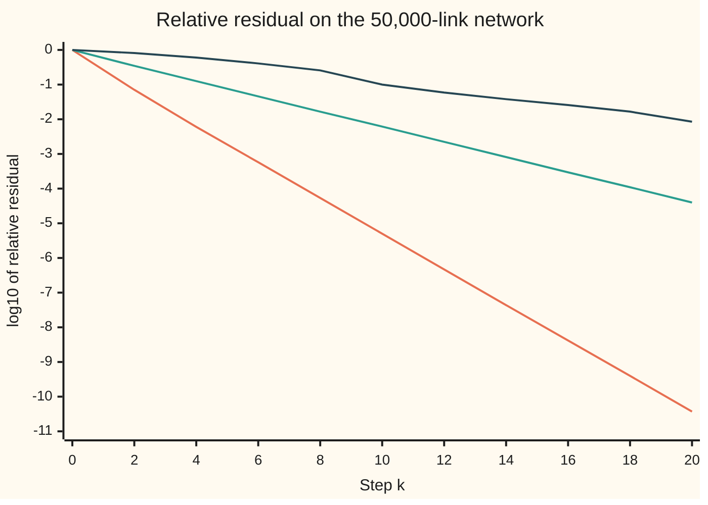

# Sparse storage and Krylov methods: work only where the entries are

[Syllabus](../../../SYLLABUS.md) → [Numerical analysis](../README.md) → [Numerical Linear Algebra](../README.md#s03) → Sparse storage and Krylov methods

---

## General Overview

A city traffic office models 50,000 road links. A link is one stretch of road between two junctions. Each link meets three others at each end, so it has six neighbours. Cars join each link from side streets, drive it in 1 to 30 minutes, then exit the network or turn onto a neighbour. The office wants the steady state: how many cars sit on each link when inflow and outflow balance. All traffic numbers here are illustrative.

That steady state is one linear system with 50,000 unknowns. Written as a full table, the matrix has 2,500,000,000 entries and takes 20,000,000,000 bytes (20 GB). Only 350,000 of those entries are not zero: 0.014%. Dense LU ([LU with partial pivoting](02-lu-decomposition-and-pivoting.md)) would cost 83,333,333,333,333 flops (a flop is one addition, subtraction, multiplication or division).

This card does two things instead:

- **Store only the nonzeros.** Compressed sparse row storage keeps the matrix in 4,400,004 bytes (4.4 MB), 4,545.5 times less. One product with the matrix then costs 700,000 flops, not 5,000,000,000.
- **Solve using only products.** GMRES (the generalised minimal residual method) builds its answer from the right-hand side and repeated products with the matrix. With a cheap preconditioner (a rescaling of the system that makes it easier to solve), it reaches a relative residual below 1e-10 in 20 steps and 60,000,000 flops. The relative residual is how far A x misses the right-hand side, as a fraction of the right-hand side's length. It finds 1,214,445.5 cars on the network.

The matrix is not symmetric: the share of traffic turning from link 1 onto link 0 is not the share turning from link 0 onto link 1. So conjugate gradient, which needs a symmetric positive definite matrix ([Iterating instead of factoring](09-iterative-methods-jacobi-gauss-seidel-and-conjugate-gradient.md)), has no guarantee here. GMRES needs only an invertible matrix.

**Store only a sparse matrix's nonzeros, so a product costs two flops per nonzero, and let GMRES build the answer from products, taking the best mix of preconditioned products at each step.**

**What kind of fact this is:** a method resting on theorems. The storage count, the cost count, GMRES's guarantee (never worse than Jacobi, and below a geometric bound here) and the bound on the condition number are proved on this card in Why it works. That restarted GMRES can stall is stated from a named source, not proved.

### The picture: GMRES with a preconditioner against plain Jacobi and plain GMRES



Orange (steepest): GMRES with the Jacobi preconditioner. Green: plain Jacobi iteration, the method of [Iterating instead of factoring](09-iterative-methods-jacobi-gauss-seidel-and-conjugate-gradient.md). Dark blue (flattest): GMRES with no preconditioner. Each step costs one product with the matrix. A fall of one unit on the vertical axis is one more correct digit in the residual.

---

## The formula

The model first. Link i holds x_i cars and takes t_i minutes to drive, so cars leave it at x_i / t_i a minute. A share e_i of them exits; a share w_ji of link j's leaving cars turns onto link i. In steady state, what leaves link i equals what joins it:

$$\frac{x_i}{t_i} - \sum_{j \text{ next to } i} w_{ji}\,\frac{x_j}{t_j} = s_i \qquad\text{that is}\qquad A\,x = s.$$

**Read it aloud:** the cars leaving link i each minute, less those turning in from its six neighbours, equal the cars joining from side streets.

Compressed sparse row (CSR) storage keeps three arrays: val, the nonzero values row by row; col, the column of each; and ptr, where each row starts in val. A product then reads

$$y_i = \sum_{p=\mathrm{ptr}_i}^{\mathrm{ptr}_{i+1}-1} \mathrm{val}_p\, x_{\mathrm{col}_p}, \qquad \text{bytes: dense } 8n^2, \quad \text{CSR } 8\,\mathrm{nnz} + 4\,\mathrm{nnz} + 4(n+1).$$

**Read it aloud:** entry i of the product walks along row i's stored values only, each times the entry of x in its column.

GMRES with a right preconditioner M solves B u = s with B = A M⁻¹, then sets x = M⁻¹ u. Step k picks

$$u_k = \text{the } u \text{ in } \mathcal{K}_k = \mathrm{span}\{s,\ Bs,\ \dots,\ B^{k-1}s\} \text{ that makes } \lVert s - B\,u \rVert_2 \text{ smallest}.$$

**Read it aloud:** among all mixes of the right-hand side and its first k − 1 products with B, take the one whose residual is shortest.

Here M is the diagonal of A, so M⁻¹ multiplies entry i by t_i. Write W for the turning table of all the shares w_ji. Then A = (I − Wᵀ) M and B = I − Wᵀ, and the card proves

$$\frac{\lVert r_k \rVert_2}{\lVert s \rVert_2} \;\le\; \frac{\lVert (W^{T})^{k} s \rVert_2}{\lVert s \rVert_2} \;\le\; \beta^{k}, \qquad \beta = \sqrt{\lVert W^{T}\rVert_1\,\lVert W^{T}\rVert_\infty}.$$

**Read it aloud:** GMRES's residual is no larger than plain Jacobi's, which shrinks at least by the factor β each step.

| Symbol | Plain meaning | In our example | Push it up and the answer… |
| --- | --- | --- | --- |
| $x_i$, $s_i$ | cars on link i; cars a minute joining it from side streets (i, j number the links) | 11.5495 cars on link 0; s_i between 0.5 and 1.5 | more inflow, more cars |
| $t_i$, $e_i$ | minutes to drive link i; share of its leaving cars that exit | 5 minutes for link 0; e_i between 0.3 and 0.5 | lower exits: more steps |
| $W$, $w_{ji}$ | the turning table: w_ji, in row j and column i, is the share of link j's leaving cars that turn onto link i; Wᵀ is W with rows written as columns | six nonzeros per row, each row summing to 1 − e_j | — |
| $A$, $n$ | the system matrix and its number of rows | 50,000 by 50,000 | dense cost grows as n² to store, n³ to factor |
| nnz, val, col, ptr | the nonzero count and the three CSR arrays; p counts through val; $y$ is the product A x | 350,000; row 0 is val[0] to val[6] | storage and product cost grow with nnz |
| $M$, $u$ | the preconditioner, here diag(A) with entries 1/t_i; the unknown GMRES works on, x = M⁻¹u | 0.2000 for link 0 | — |
| $B$ | the preconditioned matrix A M⁻¹, here I − Wᵀ (I the identity) | eigenvalues within 0.7 of 1 | — |
| $r_k$ | the residual s − A x_k after k steps | relative 3.690e-11 at k = 20 | — |
| $\mathcal{K}_k$ | the Krylov space: every mix of s, Bs, …, B^(k−1)s | k = 20 directions at the end | bigger k, smaller residual |
| $Q_k$, $\tilde H_k$ | the Arnoldi basis, k orthonormal vectors ($Q_{k+1}$ adds one more), and the small (k + 1)-by-k table that records B on it | $Q_{21}$: 21 vectors, 8,400,000 bytes at k = 20 | memory grows by 8n bytes a step |
| $\beta$; ‖·‖₁, ‖·‖∞, ‖·‖₂ | the bound's rate, a bound on ‖Wᵀ‖₂ and not the spectral radius ρ of [Iterating instead of factoring](09-iterative-methods-jacobi-gauss-seidel-and-conjugate-gradient.md); largest column sum, largest row sum, and length of a vector or the largest stretch of a matrix | ‖Wᵀ‖₁ = 0.699991, ‖Wᵀ‖∞ = 0.948363, β = 0.814767; plain Jacobi's observed factor 0.6025 a step | β near 1: a weak bound |
| $\kappa_2(A)$ | the condition number in the 2-norm: how much A can magnify a relative error | at most 293.9 (a bound, Step 5); the known-answer run shows an amplification of 10.1 | bigger κ, larger true error for the same residual |

The norms and κ come from [Matrix norms and the condition number](01-matrix-norms-and-the-condition-number.md). Flop counting comes from [Counting the work](../01-Floating%20Point%20and%20Error/08-operation-counts-and-cost.md).

### When it holds

- **A is sparse.** CSR pays 12 bytes per nonzero plus 4 per row. If more than two thirds of the entries were nonzero, it would cost more than the dense table, and each product would cost about 2n² flops.
- **A is invertible.** If no car ever exits, every column of A sums to zero and no steady state exists. GMRES then stalls: the residual sits at 0.968444 after 20 steps, above a proven floor of 0.960495.
- **The preconditioner is cheap and close to A.** Applying M⁻¹ costs n multiplications here. If every link took 5 minutes, M would be a constant times I and would change nothing.
- **There is memory for the basis.** GMRES keeps every basis vector, 8n bytes each, and its Gram–Schmidt work grows with every step. Long runs are restarted from the latest answer, and restarted GMRES can stall (Saad, 2003). This card runs without restarts.
- **The bound needs β < 1.** Here every link loses at least 30% of its cars to exits, so β = 0.814767. Without exits, ‖Wᵀ‖₁ = 1 and the bound says nothing.

---

## Why it works

### Step 0: products are cheap, so build the answer from products

On a sparse matrix, a product costs two flops per nonzero: 700,000 here. A factorisation must create new nonzeros and costs far more. So a solver that only multiplies by A can afford many steps.

Plain Jacobi already does this: it updates x from the latest residual. It forgets every earlier direction. GMRES keeps them all, s, Bs, B²s and so on, and picks the best mix each step. That collection of mixes is the Krylov space.

### Step 1: compressed rows hold the nonzeros and nothing else

Row 0 of A, link 0, a 5-minute stretch, holds seven entries:

| Array | Contents |
| --- | --- |
| ptr | `[0, 7]`: row 0 runs from val[0] to val[6]; row 1 starts at 7 |
| col | `[0, 1, 199, 200, 49800, 399, 49801]`: link 0 and its six neighbours |
| val | 0.2000, −0.0035, −0.0102, −0.0309, −0.0018, −0.0714, −0.0190 |

The diagonal entry is 1/5 = 0.2000: link 0 empties at a fifth of its cars a minute. Each other entry is minus a neighbour's turning share over that neighbour's driving time.

Values take 8 bytes and column numbers 4, so each nonzero costs 12 bytes; ptr adds 4 bytes per row, plus 4 for the end marker. That gives 4,400,004 bytes. A list of (row, column, value) triplets takes 16 bytes per nonzero, 5,600,000 bytes: CSR saves the row number by sharing it through ptr.

The product formula touches each stored value once: one multiplication and one addition, so 2 × nnz = 700,000 flops.

### Step 2: Arnoldi turns the big problem into a small one

Products s, Bs, B²s quickly point in nearly the same direction, so they make a poor basis. Arnoldi's method (1951) straightens them as it goes. It multiplies the newest basis vector by B, then removes its parts along every earlier vector (Gram–Schmidt, from [QR](05-qr-householder-and-gram-schmidt.md)), and scales what remains to length one.

The numbers removed fill the small table H̃_k, so that B Q_k = Q_{k+1} H̃_k. Any u in the Krylov space is Q_k times a short vector of k weights. Q_{k+1} has orthonormal columns (each of length one, all at right angles to each other), so it preserves length, and

$$\lVert s - B Q_k\,\text{weights} \rVert_2 = \lVert (\lVert s\rVert_2, 0, \dots, 0) - \tilde H_k\,\text{weights} \rVert_2 .$$

So each step solves a least-squares problem with k + 1 rows, not 50,000. Plane rotations (Givens rotations) bring H̃_k to triangular form one column at a time. The last entry of the rotated right-hand side is the residual length, so GMRES knows its residual without forming x.

The worked numbers below run step 1 by hand: with one direction, the best multiple of Bs is a one-line formula.

### Step 3: GMRES is never worse than Jacobi, and the bound

Jacobi, started from x = 0, updates x_{k+1} = x_k + M⁻¹(s − A x_k). Multiply by A and subtract from s: the new residual is (I − B) times the old one, which is Wᵀ times the old one. So after k steps Jacobi's residual is (Wᵀ)ᵏ s.

Jacobi's iterate is M⁻¹ times a mix of s, Bs, …, B^(k−1)s, so it lies in GMRES's search set. GMRES takes the best member of that set, so its residual is no longer than Jacobi's. Then

$$\lVert (W^{T})^{k} s\rVert_2 \le \lVert W^{T}\rVert_2^{k}\,\lVert s\rVert_2 \le \beta^{k}\,\lVert s\rVert_2 .$$

‖Wᵀ‖₁ is the largest column sum of Wᵀ, which is the largest row sum of W: the most traffic any link sends on, 1 − e_j at most 0.699991. ‖Wᵀ‖∞ is the most traffic that turns into any one link: 0.948363. So β = 0.814767.

β bounds a norm. It is not Jacobi's spectral radius ρ from [Iterating instead of factoring](09-iterative-methods-jacobi-gauss-seidel-and-conjugate-gradient.md), which sets the long-run rate and is at most 0.699991 by Step 4. Plain Jacobi's residual shrinks by a factor of 0.6025 a step, on average over its first 20 steps, well inside β.

<details>
<summary>Detailed proof: the 2-norm is at most the square root of the 1-norm times the ∞-norm</summary>

‖Wᵀ‖₂² is the largest eigenvalue of W Wᵀ. Every eigenvalue is at most any induced norm of its matrix, so ‖Wᵀ‖₂² ≤ ‖W Wᵀ‖₁ ≤ ‖W‖₁ ‖Wᵀ‖₁. The largest column sum of W is the largest row sum of Wᵀ, so ‖W‖₁ = ‖Wᵀ‖∞. Take square roots: ‖Wᵀ‖₂ ≤ β.

</details>

The code checks both inequalities in floating point at every fourth step:

| Step k | GMRES (measured) | Jacobi (measured) | Bound βᵏ | GMRES ÷ bound |
| ---: | ---: | ---: | ---: | ---: |
| 0 | 1.000e0 | 1.000e0 | 1.000e0 | 1.000e0 |
| 4 | 6.009e-3 | 1.267e-1 | 4.407e-1 | 1.363e-2 |
| 8 | 5.394e-5 | 1.676e-2 | 1.942e-1 | 2.778e-4 |
| 12 | 4.674e-7 | 2.229e-3 | 8.559e-2 | 5.461e-6 |
| 16 | 4.154e-9 | 2.972e-4 | 3.772e-2 | 1.101e-7 |
| 20 | 3.690e-11 | 3.974e-5 | 1.662e-2 | 2.220e-9 |

The bound is true but loose: at step 20 GMRES's residual is 2.220e-9 times the bound. Jacobi needs 46 steps to pass 1e-10; GMRES needs 20.

### Step 4: why the preconditioner matters

Without M, GMRES works on A itself. Its columns carry the factor 1/t_i, and t_i runs from 1 to 30 minutes. That spreads A's eigenvalues toward zero. GMRES's residual is a polynomial in A applied to s, with value 1 at zero. Such a polynomial cannot be small on eigenvalues close to zero, so progress is slow: 96 steps.

With M = diag(A), B = I − Wᵀ. Every eigenvalue of Wᵀ has size at most ‖Wᵀ‖₁ = 0.699991, so every eigenvalue of B lies within 0.7 of 1, far from zero. The travel times drop out of B entirely. That is the whole job of a preconditioner: make B close to the identity, at a cost close to a product.

### Step 5: what "converged" means here

The stopping test is GMRES's own residual estimate below 1e-10. The code recomputes the residual from scratch with a separate product: 3.690e-11, equal to the estimate. A small residual is a small backward error: x solves exactly a system whose right-hand side moved by that fraction ([Forward and backward error](../01-Floating%20Point%20and%20Error/06-forward-and-backward-error.md)).

The relative error in x can be larger than the relative residual, by up to the condition number κ₂(A), when both are measured as lengths (2-norms). The code bounds κ₂(A) instead of computing it. Since ‖Wᵀ‖₂ ≤ β < 1, (I − Wᵀ)v is never longer than (1 + β) times v and never shorter than (1 − β) times v. With A = (I − Wᵀ)M, that gives ‖A‖₂ ≤ (1 + β) ÷ (the shortest time, 1 minute) and ‖A⁻¹‖₂ ≤ (the longest time, 30 minutes) ÷ (1 − β), so κ₂(A) ≤ 293.9.

On a known answer, all ones, the relative residual is 4.657e-11 and the relative error 4.720e-10: an amplification of 10.1. The error bound, 293.9 × 4.657e-11 = 1.369e-8, is 29.0 times the true error. This is conditioning, not instability ([Conditioning and stability](../01-Floating%20Point%20and%20Error/05-conditioning-and-stability.md)).

---

## Worked numbers, by hand

| Step | Arithmetic | Value |
| --- | --- | --- |
| dense entries | 50,000 × 50,000 | 2,500,000,000 |
| dense bytes | 2,500,000,000 × 8 | 20,000,000,000 |
| nonzeros | 50,000 × (1 + 6) | 350,000 |
| CSR bytes | 350,000 × 8 + 350,000 × 4 + 50,001 × 4 | 4,400,004 |
| saving | 20,000,000,000 ÷ 4,400,004 | 4,545.5 |
| one product | 2 × 350,000, against 2 × 2,500,000,000 | 700,000 against 5,000,000,000 flops |
| GMRES step 1 | α = s · Bs ÷ Bs · Bs = 24,141.2642 ÷ 12,684.6154 | 1.903192 |
| residual after step 1 | √(232.5299² − 1.903192 × 24,141.2642) ÷ 232.5299 | 0.387637 |
| cost of 20 steps | each step: 700,000 + 50,000 + 4 × 50,000 × (k + 1) + 3 × 50,000, summed over k = 0 to 19 | 60,000,000 flops |
| memory for the basis | 21 vectors × 50,000 × 8 bytes | 8,400,000 bytes |
| **steady state** | GMRES to a relative residual of 3.690e-11 | **1,214,445.5 cars** |

About 1.2 million cars are on the network at any moment, and link 0, a 5-minute stretch, holds 11.5495 of them. The 20 GMRES steps cost 60,000,000 flops, with 4,400,004 bytes for the matrix and 8,400,000 for the basis. Dense LU would need 83,333,333,333,333 flops and 20,000,000,000 bytes. Cars balance: 49,941.1744 a minute join from side streets and 49,941.1744 a minute exit.

### What breaks if you drop a piece

| Mistake | Comes out at | What went wrong |
| --- | --- | --- |
| No preconditioner | 96 steps, not 20; residual 8.425e-3 at step 20; 1,012,800,000 flops and 38,800,000 bytes of basis | travel times from 1 to 30 minutes spread A's eigenvalues toward zero |
| Plain Jacobi instead of GMRES | 46 steps; residual 3.974e-5 at step 20 | Jacobi keeps one fixed polynomial, (1 − z)ᵏ, not the best one |
| A closed network: no car exits | residual 0.968446 at step 10 and 0.968444 at step 20, above the floor 0.960495 | A is singular: cars arrive and never leave, so no steady state exists |
| Store the dense table | 20,000,000,000 bytes; 5,000,000,000 flops per product | almost every stored entry is a zero |

The floor has a short proof. With no exits, every column of A sums to zero, so the entries of any residual s − A x sum to Σ s_i = 49,941.1744. A vector with that sum has length at least Σ s_i ÷ √n, which divided by ‖s‖₂ gives 0.960495.

---

## Code, from first principles, and it actually runs

The code builds the network from a written-out SplitMix64 generator with seed 20261111, stores A in CSR, and solves it by GMRES with Arnoldi and Givens rotations. Seven roads check the answer. The CSR product matches a separate link-by-link product. GMRES's first step matches the one-line formula. Plain Jacobi, an independent method, reaches the same solution. The residual is recomputed by the link-by-link product. A manufactured answer of all ones gives a true error, checked against the bound on κ₂(A). Cars in equal cars out. The closed network stalls above its proven floor.

### Python

```python
# Sparse storage and Krylov methods -- the check behind the card.  Standard
# library only.  50,000 road links on a 250-by-200 torus, six neighbours each.
# Steady traffic is a nonsymmetric system A x = s, stored in compressed rows,
# solved by GMRES, and checked by Jacobi, link lists, a known answer and balance.
from math import sqrt, log10

M64, state = (1 << 64) - 1, [20261111]
def nxt():                                   # SplitMix64, written out
    state[0] = (state[0] + 0x9E3779B97F4A7C15) & M64
    z = state[0]
    z = ((z ^ (z >> 30)) * 0xBF58476D1CE4E5B9) & M64
    z = ((z ^ (z >> 27)) * 0x94D049BB133111EB) & M64
    return z ^ (z >> 31)
def unif(): return (nxt() >> 11) / 9007199254740992.0
def sci(v): m, x = f"{v:.3e}".split("e"); return m + "e" + str(int(x))  # as Rust
def dot(u, v):
    acc = 0.0
    for a, b in zip(u, v): acc += a * b
    return acc

R, C = 250, 200; n = R * C
OFF = [(0, 1), (0, -1), (1, 0), (-1, 0), (1, -1), (-1, 1)]  # k ^ 1 reverses k
nb = [[((i // C + dr) % R) * C + (i % C + dc) % C for dr, dc in OFF] for i in range(n)]
t, e, W, s = [0.0] * n, [0.0] * n, [], [0.0] * n
for j in range(n):                           # illustrative traffic numbers
    t[j] = [1.0, 2.0, 5.0, 10.0, 30.0][nxt() % 5]   # minutes to drive link j
    e[j] = 0.3 + 0.2 * unif()                # share of its cars that exit
    g = [0.5 + unif() for _ in range(6)]
    tot = dot(g, [1.0] * 6)                  # a plain left-to-right sum
    W.append([(1.0 - e[j]) * v / tot for v in g])   # share turning onto nb[j][k]
    s[j] = 0.5 + unif()                      # cars a minute from side streets

ptr, col, val = [0], [], []                  # compressed sparse row (CSR)
for i in range(n):
    col.append(i); val.append(1.0 / t[i])
    for k in range(6):
        j = nb[i][k]
        col.append(j); val.append(-W[j][k ^ 1] / t[j])
    ptr.append(len(col))
def csr(x):                                  # y = A x, touching nonzeros only
    y = [0.0] * n
    for i in range(n):
        acc = 0.0
        for p in range(ptr[i], ptr[i + 1]): acc += val[p] * x[col[p]]
        y[i] = acc
    return y
def by_links(x, ex):                         # y = A x again, link by link;
    y = [x[i] / t[i] for i in range(n)]      # ex = False: nobody exits
    for j in range(n):
        for k in range(6):
            w = W[j][k] if ex else W[j][k] / (1.0 - e[j])
            y[nb[j][k]] -= w * (x[j] / t[j])
    return y

def gmres(op, b, tol, kmax):                 # Arnoldi + Givens rotations
    bnorm = sqrt(dot(b, b)); Q = [[v / bnorm for v in b]]
    H, cs, sn, g, hist = [], [], [], [bnorm], [1.0]
    for k in range(kmax):
        w = op(Q[k]); h = []
        for q in Q:                          # modified Gram-Schmidt
            hj = dot(w, q); h.append(hj)
            w = [a - hj * c for a, c in zip(w, q)]
        h.append(sqrt(dot(w, w)))
        for j in range(k):                   # old rotations, then a new one
            a, c = h[j], h[j + 1]
            h[j], h[j + 1] = cs[j] * a + sn[j] * c, -sn[j] * a + cs[j] * c
        r = sqrt(h[k] * h[k] + h[k + 1] * h[k + 1])
        cs.append(h[k] / r); sn.append(h[k + 1] / r)
        Q.append([v / h[k + 1] for v in w]); h[k] = r
        g.append(-sn[k] * g[k]); g[k] = cs[k] * g[k]
        H.append(h); hist.append(abs(g[k + 1]) / bnorm)
        if hist[-1] < tol: break
    m = len(H); y = [0.0] * m
    for i in range(m - 1, -1, -1):           # back-substitute the small system
        acc = g[i]
        for j in range(i + 1, m): acc -= H[j][i] * y[j]
        y[i] = acc / H[i][i]
    u = [0.0] * n
    for j in range(m): u = [a + y[j] * c for a, c in zip(u, Q[j])]
    return u, hist

nnz = len(val); dense, crs = 8 * n * n, 8 * nnz + 4 * nnz + 4 * (n + 1)
print(f"network,links={n:,},nonzeros={nnz:,},share={100 * nnz / n / n:.3f}%")
print(f"storage,dense_entries={n * n:,},dense_bytes={dense:,},csr_bytes={crs:,},triplet_bytes={16 * nnz:,}")
print(f"storage,saving={dense / crs:.1f},product_flops_dense={2 * n * n:,},csr={2 * nnz:,}")
print(f"row0,ptr={ptr[:2]},col={col[:7]}")
print("row0,val=" + ", ".join(f"{v:.4f}" for v in val[:7]))
z = [unif() for _ in range(n)]
gap = max(abs(a - c) for a, c in zip(csr(z), by_links(z, True)))
assert gap < 1e-13; print(f"product,csr_vs_link_lists_max_gap={sci(gap)}")

pre = lambda v: csr([a * c for a, c in zip(t, v)])   # B = A M^-1, M = diag(A)
nb2, Bs = sqrt(dot(s, s)), pre(s)
al = dot(s, Bs) / dot(Bs, Bs)
r1 = sqrt(dot(s, s) - al * dot(s, Bs)) / nb2
u, hist = gmres(pre, s, 1e-10, 60); x = [a * c for a, c in zip(t, u)]   # x = M^-1 u
assert abs(hist[1] - r1) < 1e-12
print(f"step1,norm_s={nb2:.4f},s.Bs={dot(s, Bs):.4f},Bs.Bs={dot(Bs, Bs):.4f},alpha={al:.6f}")
print(f"step1,residual={r1:.6f},gmres={hist[1]:.6f}")
xj, jh = [0.0] * n, []                       # plain Jacobi: x += M^-1 (s - A x)
while True:
    r = [a - c for a, c in zip(s, csr(xj))]
    jh.append(sqrt(dot(r, r)) / nb2)
    if jh[-1] < 1e-10: break
    xj = [a + c * d for a, c, d in zip(xj, t, r)]
inflow = [1.0 - v for v in by_links(t, True)]   # shares turning into each link
n1, ninf = max(1.0 - v for v in e), max(inflow); beta = sqrt(n1 * ninf)
print(f"bound,norm1={n1:.6f},norm_inf={ninf:.6f},beta={beta:.6f},jacobi_factor_per_step_over_20={jh[20] ** 0.05:.4f}")
print("step,gmres,jacobi,bound,gmres/bound")
for k in range(0, len(hist), 4):
    assert hist[k] <= jh[k] * (1 + 1e-9) and jh[k] <= beta ** k * (1 + 1e-9)
    print(f"{k},{sci(hist[k])},{sci(jh[k])},{sci(beta ** k)},{sci(hist[k] / beta ** k)}")
x0, hist0 = gmres(csr, s, 1e-10, 150)        # no preconditioner
tr = [a - c for a, c in zip(s, by_links(x, True))]; true = sqrt(dot(tr, tr)) / nb2
gj, g0 = (max(abs(a - c) / c for a, c in zip(y, x)) for y in (xj, x0))
K = len(hist) - 1; assert true < 2e-10 and gj < 1e-8 and g0 < 1e-8 and len(hist0) > 3 * len(hist)
print(f"solve,steps={K},estimate={sci(hist[-1])},true_residual={sci(true)}")
print(f"solve,jacobi_steps={len(jh) - 1},max_rel_gap={sci(gj)}")
print(f"solve,plain_steps={len(hist0) - 1},at_step_{K}={sci(hist0[K])},max_rel_gap={sci(g0)}")
for st, pc in ((K, 1), (len(hist0) - 1, 0)):
    fl = sum(2 * nnz + pc * n + 4 * n * (k + 1) + 3 * n for k in range(st))
    print(f"cost,steps={st},flops={fl:,},basis_bytes={8 * n * (st + 1):,}")
print(f"cost,dense_lu_flops={2 * n ** 3 // 3:,}")
bm = by_links([1.0] * n, True); um, hm = gmres(pre, bm, 1e-10, 60)   # answer: all ones
xm = [a * c for a, c in zip(t, um)]; rm = [a - c for a, c in zip(bm, by_links(xm, True))]
dm = [v - 1.0 for v in xm]; er, rr = sqrt(dot(dm, dm) / n), sqrt(dot(rm, rm) / dot(bm, bm))   # relative, as lengths
kb = (1 + beta) * max(t) / min(t) / (1 - beta); assert er < 1e-8 and (beta >= 1 or er <= kb * rr)   # kappa_2 bound, Step 5
print(f"manufactured,steps={len(hm) - 1},rel_residual={sci(rr)},rel_error={sci(er)},ratio={er / rr:.1f},kappa2_bound={kb:.1f},error_bound={sci(kb * rr)},bound/true={kb * rr / er:.1f}")
cin, cars, cout = dot(s, [1.0] * n), dot(x, [1.0] * n), dot(e, [a / c for a, c in zip(x, t)])
assert abs(cin - cout) < 1e-9 * cin
print(f"balance,cars_in_per_min={cin:.4f},cars_out_per_min={cout:.4f}")
print(f"answer,cars_on_network={cars:.1f},link0_cars={x[0]:.4f},link0_minutes={t[0]:.0f}")
closed = lambda v: by_links([a * c for a, c in zip(t, v)], False)  # e = 0
_, hc = gmres(closed, s, 1e-10, K); floor = cin / sqrt(n) / nb2   # proven floor
assert floor <= hc[-1] < 1.01 * floor and hc[10] - hc[-1] < 1e-5
print(f"closed,residual_at_step_10={hc[10]:.6f},at_step_{K}={hc[-1]:.6f},floor={floor:.6f}")
print("chart,step," + ",".join(str(k) for k in range(0, 21, 2)))
for name, hs in (("gmres_jacobi", hist), ("jacobi", jh), ("gmres_plain", hist0)):
    print(f"chart,{name}," + ",".join(f"{log10(hs[k]):.2f}" for k in range(0, 21, 2)))
print("ALL CHECKS PASS")
```

**Ran 2026-11-11 on macOS, Python 3.14.10, standard library only. All checks passed. Output, pasted from the run:**

```
network,links=50,000,nonzeros=350,000,share=0.014%
storage,dense_entries=2,500,000,000,dense_bytes=20,000,000,000,csr_bytes=4,400,004,triplet_bytes=5,600,000
storage,saving=4545.5,product_flops_dense=5,000,000,000,csr=700,000
row0,ptr=[0, 7],col=[0, 1, 199, 200, 49800, 399, 49801]
row0,val=0.2000, -0.0035, -0.0102, -0.0309, -0.0018, -0.0714, -0.0190
product,csr_vs_link_lists_max_gap=2.220e-16
step1,norm_s=232.5299,s.Bs=24141.2642,Bs.Bs=12684.6154,alpha=1.903192
step1,residual=0.387637,gmres=0.387637
bound,norm1=0.699991,norm_inf=0.948363,beta=0.814767,jacobi_factor_per_step_over_20=0.6025
step,gmres,jacobi,bound,gmres/bound
0,1.000e0,1.000e0,1.000e0,1.000e0
4,6.009e-3,1.267e-1,4.407e-1,1.363e-2
8,5.394e-5,1.676e-2,1.942e-1,2.778e-4
12,4.674e-7,2.229e-3,8.559e-2,5.461e-6
16,4.154e-9,2.972e-4,3.772e-2,1.101e-7
20,3.690e-11,3.974e-5,1.662e-2,2.220e-9
solve,steps=20,estimate=3.690e-11,true_residual=3.690e-11
solve,jacobi_steps=46,max_rel_gap=3.567e-10
solve,plain_steps=96,at_step_20=8.425e-3,max_rel_gap=1.746e-9
cost,steps=20,flops=60,000,000,basis_bytes=8,400,000
cost,steps=96,flops=1,012,800,000,basis_bytes=38,800,000
cost,dense_lu_flops=83,333,333,333,333
manufactured,steps=20,rel_residual=4.657e-11,rel_error=4.720e-10,ratio=10.1,kappa2_bound=293.9,error_bound=1.369e-8,bound/true=29.0
balance,cars_in_per_min=49941.1744,cars_out_per_min=49941.1744
answer,cars_on_network=1214445.5,link0_cars=11.5495,link0_minutes=5
closed,residual_at_step_10=0.968446,at_step_20=0.968444,floor=0.960495
chart,step,0,2,4,6,8,10,12,14,16,18,20
chart,gmres_jacobi,0.00,-1.15,-2.22,-3.24,-4.27,-5.30,-6.33,-7.36,-8.38,-9.40,-10.43
chart,jacobi,0.00,-0.46,-0.90,-1.34,-1.78,-2.21,-2.65,-3.09,-3.53,-3.96,-4.40
chart,gmres_plain,0.00,-0.09,-0.22,-0.39,-0.59,-1.00,-1.23,-1.42,-1.59,-1.78,-2.07
ALL CHECKS PASS
```

### Rust

```rust
// Sparse storage and Krylov methods -- the check behind the card.  Rust std
// only.  50,000 road links on a 250-by-200 torus, six neighbours each.
// Steady traffic is a nonsymmetric system A x = s, stored in compressed rows,
// solved by GMRES, and checked by Jacobi, link lists, a known answer and balance.

fn nxt(st: &mut u64) -> u64 { // SplitMix64, written out
    *st = st.wrapping_add(0x9E3779B97F4A7C15);
    let mut z = (*st ^ (*st >> 30)).wrapping_mul(0xBF58476D1CE4E5B9);
    z = (z ^ (z >> 27)).wrapping_mul(0x94D049BB133111EB);
    z ^ (z >> 31)
}
fn unif(st: &mut u64) -> f64 { (nxt(st) >> 11) as f64 / 9007199254740992.0 }
fn sci(v: f64) -> String { format!("{:.3e}", v) }
fn commas(v: u128) -> String {
    let (d, mut out) = (v.to_string(), String::new());
    for (i, ch) in d.chars().enumerate() { if i > 0 && (d.len() - i) % 3 == 0 { out.push(','); } out.push(ch); }
    out
}
fn dot(u: &[f64], v: &[f64]) -> f64 { let mut acc = 0.0; for (a, b) in u.iter().zip(v) { acc += a * b; } acc }
fn maxf(v: impl Iterator<Item = f64>) -> f64 { v.fold(f64::MIN, f64::max) }

struct Net { n: usize, nb: Vec<[usize; 6]>, t: Vec<f64>, e: Vec<f64>, w: Vec<[f64; 6]>,
             ptr: Vec<usize>, col: Vec<usize>, val: Vec<f64> }
impl Net {
    fn csr(&self, x: &[f64]) -> Vec<f64> { // y = A x, touching nonzeros only
        (0..self.n).map(|i| { let mut acc = 0.0;
            for p in self.ptr[i]..self.ptr[i + 1] { acc += self.val[p] * x[self.col[p]]; } acc }).collect()
    }
    fn by_links(&self, x: &[f64], ex: bool) -> Vec<f64> { // y = A x again, link by link;
        let mut y: Vec<f64> = (0..self.n).map(|i| x[i] / self.t[i]).collect(); // ex = false: nobody exits
        for j in 0..self.n { for k in 0..6 {
            let w = if ex { self.w[j][k] } else { self.w[j][k] / (1.0 - self.e[j]) };
            y[self.nb[j][k]] -= w * (x[j] / self.t[j]); } }
        y
    }
    fn scaled(&self, v: &[f64]) -> Vec<f64> { self.t.iter().zip(v).map(|(a, c)| a * c).collect() }
}

fn gmres(op: &dyn Fn(&[f64]) -> Vec<f64>, b: &[f64], tol: f64, kmax: usize) -> (Vec<f64>, Vec<f64>) {
    let bnorm = dot(b, b).sqrt(); // Arnoldi + Givens rotations
    let mut q: Vec<Vec<f64>> = vec![b.iter().map(|v| v / bnorm).collect()];
    let (mut hh, mut cs, mut sn): (Vec<Vec<f64>>, Vec<f64>, Vec<f64>) = (vec![], vec![], vec![]);
    let (mut g, mut hist) = (vec![bnorm], vec![1.0]);
    for k in 0..kmax {
        let (mut w, mut h) = (op(&q[k]), vec![]);
        for qj in &q { // modified Gram-Schmidt
            let hj = dot(&w, qj); h.push(hj);
            w = w.iter().zip(qj).map(|(a, c)| a - hj * c).collect();
        }
        h.push(dot(&w, &w).sqrt());
        for j in 0..k { // old rotations, then a new one
            let (a, c) = (h[j], h[j + 1]);
            h[j] = cs[j] * a + sn[j] * c; h[j + 1] = -sn[j] * a + cs[j] * c;
        }
        let r = (h[k] * h[k] + h[k + 1] * h[k + 1]).sqrt();
        cs.push(h[k] / r); sn.push(h[k + 1] / r);
        q.push(w.iter().map(|v| v / h[k + 1]).collect()); h[k] = r;
        g.push(-sn[k] * g[k]); g[k] = cs[k] * g[k];
        hh.push(h); hist.push(g[k + 1].abs() / bnorm);
        if hist[k + 1] < tol { break; }
    }
    let (m, mut u) = (hh.len(), vec![0.0; b.len()]);
    let mut y = vec![0.0; m];
    for i in (0..m).rev() { // back-substitute the small system
        let mut acc = g[i];
        for j in i + 1..m { acc -= hh[j][i] * y[j]; }
        y[i] = acc / hh[i][i];
    }
    for j in 0..m { u = u.iter().zip(&q[j]).map(|(a, c)| a + y[j] * c).collect(); }
    (u, hist)
}

fn main() {
    let (rr, cc, mut st) = (250i64, 200i64, 20261111u64);
    let n = (rr * cc) as usize;
    let off = [(0i64, 1i64), (0, -1), (1, 0), (-1, 0), (1, -1), (-1, 1)]; // k ^ 1 reverses k
    let nb: Vec<[usize; 6]> = (0..n as i64).map(|i| { let mut a = [0usize; 6];
        for (k, (dr, dc)) in off.iter().enumerate() {
            a[k] = (((i / cc + dr).rem_euclid(rr)) * cc + (i % cc + dc).rem_euclid(cc)) as usize; } a }).collect();
    let (mut t, mut e, mut w, mut s) = (vec![0.0; n], vec![0.0; n], vec![[0.0; 6]; n], vec![0.0; n]);
    for j in 0..n { // illustrative traffic numbers
        t[j] = [1.0, 2.0, 5.0, 10.0, 30.0][(nxt(&mut st) % 5) as usize]; // minutes to drive link j
        e[j] = 0.3 + 0.2 * unif(&mut st); // share of its cars that exit
        let g: Vec<f64> = (0..6).map(|_| 0.5 + unif(&mut st)).collect();
        let tot = dot(&g, &[1.0; 6]); // a plain left-to-right sum
        for k in 0..6 { w[j][k] = (1.0 - e[j]) * g[k] / tot; } // share turning onto nb[j][k]
        s[j] = 0.5 + unif(&mut st); // cars a minute from side streets
    }
    let (mut ptr, mut col, mut val) = (vec![0usize], vec![], vec![]); // compressed sparse row (CSR)
    for i in 0..n {
        col.push(i); val.push(1.0 / t[i]);
        for k in 0..6 { let j = nb[i][k]; col.push(j); val.push(-w[j][k ^ 1] / t[j]); }
        ptr.push(col.len());
    }
    let net = Net { n, nb, t, e, w, ptr, col, val };
    let (t, e, one) = (&net.t, &net.e, vec![1.0; n]);
    let nnz = net.val.len();
    let (dense, crs) = (8 * (n * n) as u128, (8 * nnz + 4 * nnz + 4 * (n + 1)) as u128);
    println!("network,links={},nonzeros={},share={:.3}%", commas(n as u128), commas(nnz as u128),
             (100 * nnz) as f64 / n as f64 / n as f64);
    println!("storage,dense_entries={},dense_bytes={},csr_bytes={},triplet_bytes={}", commas((n * n) as u128), commas(dense), commas(crs), commas(16 * nnz as u128));
    println!("storage,saving={:.1},product_flops_dense={},csr={}", dense as f64 / crs as f64,
             commas(2 * (n * n) as u128), commas(2 * nnz as u128));
    println!("row0,ptr={:?},col={:?}", &net.ptr[..2], &net.col[..7]);
    let v0: Vec<String> = net.val[..7].iter().map(|v| format!("{:.4}", v)).collect();
    println!("row0,val={}", v0.join(", "));
    let z: Vec<f64> = (0..n).map(|_| unif(&mut st)).collect();
    let gap = maxf(net.csr(&z).iter().zip(net.by_links(&z, true)).map(|(a, c)| (a - c).abs()));
    assert!(gap < 1e-13); println!("product,csr_vs_link_lists_max_gap={}", sci(gap));

    let pre = |v: &[f64]| net.csr(&net.scaled(v)); // B = A M^-1, M = diag(A)
    let (nb2, bs) = (dot(&s, &s).sqrt(), pre(&s));
    let al = dot(&s, &bs) / dot(&bs, &bs); let r1 = (dot(&s, &s) - al * dot(&s, &bs)).sqrt() / nb2;
    let (u, hist) = gmres(&pre, &s, 1e-10, 60); let x = net.scaled(&u); // x = M^-1 u
    assert!((hist[1] - r1).abs() < 1e-12);
    println!("step1,norm_s={:.4},s.Bs={:.4},Bs.Bs={:.4},alpha={:.6}", nb2, dot(&s, &bs), dot(&bs, &bs), al);
    println!("step1,residual={:.6},gmres={:.6}", r1, hist[1]);
    let (mut xj, mut jh) = (vec![0.0; n], vec![]); // plain Jacobi: x += M^-1 (s - A x)
    loop {
        let r: Vec<f64> = s.iter().zip(net.csr(&xj)).map(|(a, c)| a - c).collect();
        jh.push(dot(&r, &r).sqrt() / nb2);
        if jh[jh.len() - 1] < 1e-10 { break; }
        xj = (0..n).map(|i| xj[i] + t[i] * r[i]).collect();
    }
    let ninf = maxf(net.by_links(t, true).iter().map(|v| 1.0 - v)); // shares turning into each link
    let n1 = maxf(e.iter().map(|v| 1.0 - v)); let beta = (n1 * ninf).sqrt();
    println!("bound,norm1={:.6},norm_inf={:.6},beta={:.6},jacobi_factor_per_step_over_20={:.4}", n1, ninf, beta, jh[20].powf(0.05));
    println!("step,gmres,jacobi,bound,gmres/bound");
    for k in (0..hist.len()).step_by(4) {
        let b = beta.powf(k as f64);
        assert!(hist[k] <= jh[k] * (1.0 + 1e-9) && jh[k] <= b * (1.0 + 1e-9));
        println!("{},{},{},{},{}", k, sci(hist[k]), sci(jh[k]), sci(b), sci(hist[k] / b));
    }
    let (x0, hist0) = gmres(&|v: &[f64]| net.csr(v), &s, 1e-10, 150); // no preconditioner
    let tr: Vec<f64> = s.iter().zip(net.by_links(&x, true)).map(|(a, c)| a - c).collect();
    let tru = dot(&tr, &tr).sqrt() / nb2;
    let gapf = |y: &[f64]| maxf(y.iter().zip(&x).map(|(a, c)| (a - c).abs() / c));
    let (gj, g0, kk) = (gapf(&xj), gapf(&x0), hist.len() - 1);
    assert!(tru < 2e-10 && gj < 1e-8 && g0 < 1e-8 && hist0.len() > 3 * hist.len());
    println!("solve,steps={},estimate={},true_residual={}", kk, sci(hist[kk]), sci(tru));
    println!("solve,jacobi_steps={},max_rel_gap={}", jh.len() - 1, sci(gj));
    println!("solve,plain_steps={},at_step_{}={},max_rel_gap={}", hist0.len() - 1, kk, sci(hist0[kk]), sci(g0));
    for (st, pc) in [(kk, 1usize), (hist0.len() - 1, 0)] {
        let fl: usize = (0..st).map(|k| 2 * nnz + pc * n + 4 * n * (k + 1) + 3 * n).sum();
        println!("cost,steps={},flops={},basis_bytes={}", st, commas(fl as u128), commas((8 * n * (st + 1)) as u128));
    }
    println!("cost,dense_lu_flops={}", commas(2 * (n as u128).pow(3) / 3));
    let bm = net.by_links(&one, true); let (um, hm) = gmres(&pre, &bm, 1e-10, 60); // answer: all ones
    let xm = net.scaled(&um); let rm: Vec<f64> = bm.iter().zip(net.by_links(&xm, true)).map(|(a, c)| a - c).collect();
    let dm: Vec<f64> = xm.iter().map(|v| v - 1.0).collect(); let (er, rr) = ((dot(&dm, &dm) / n as f64).sqrt(), (dot(&rm, &rm) / dot(&bm, &bm)).sqrt());
    let kb = (1.0 + beta) * maxf(t.iter().copied()) / -maxf(t.iter().map(|v| -v)) / (1.0 - beta); assert!(er < 1e-8 && (beta >= 1.0 || er <= kb * rr)); // kappa_2 bound, Step 5
    println!("manufactured,steps={},rel_residual={},rel_error={},ratio={:.1},kappa2_bound={:.1},error_bound={},bound/true={:.1}", hm.len() - 1, sci(rr), sci(er), er / rr, kb, sci(kb * rr), kb * rr / er);
    let xt: Vec<f64> = x.iter().zip(t).map(|(a, c)| a / c).collect();
    let (cin, cars, cout) = (dot(&s, &one), dot(&x, &one), dot(e, &xt));
    assert!((cin - cout).abs() < 1e-9 * cin);
    println!("balance,cars_in_per_min={:.4},cars_out_per_min={:.4}", cin, cout);
    println!("answer,cars_on_network={:.1},link0_cars={:.4},link0_minutes={:.0}", cars, x[0], t[0]);
    let closed = |v: &[f64]| net.by_links(&net.scaled(v), false); // e = 0
    let (_, hc) = gmres(&closed, &s, 1e-10, kk);
    let (floor, last) = (cin / (n as f64).sqrt() / nb2, hc[hc.len() - 1]); // proven floor
    assert!(floor <= last && last < 1.01 * floor && hc[10] - last < 1e-5);
    println!("closed,residual_at_step_10={:.6},at_step_{}={:.6},floor={:.6}", hc[10], kk, last, floor);
    let ks: Vec<String> = (0..21).step_by(2).map(|k: usize| k.to_string()).collect();
    println!("chart,step,{}", ks.join(","));
    for (name, hs) in [("gmres_jacobi", &hist), ("jacobi", &jh), ("gmres_plain", &hist0)] {
        let p: Vec<String> = (0..21).step_by(2).map(|k: usize| format!("{:.2}", hs[k].log10())).collect();
        println!("chart,{},{}", name, p.join(","));
    }
    println!("ALL CHECKS PASS");
}
```

**Ran 2026-11-11 on macOS, rustc 1.98.1, no crates. All checks passed. Output, pasted from the run:**

```
network,links=50,000,nonzeros=350,000,share=0.014%
storage,dense_entries=2,500,000,000,dense_bytes=20,000,000,000,csr_bytes=4,400,004,triplet_bytes=5,600,000
storage,saving=4545.5,product_flops_dense=5,000,000,000,csr=700,000
row0,ptr=[0, 7],col=[0, 1, 199, 200, 49800, 399, 49801]
row0,val=0.2000, -0.0035, -0.0102, -0.0309, -0.0018, -0.0714, -0.0190
product,csr_vs_link_lists_max_gap=2.220e-16
step1,norm_s=232.5299,s.Bs=24141.2642,Bs.Bs=12684.6154,alpha=1.903192
step1,residual=0.387637,gmres=0.387637
bound,norm1=0.699991,norm_inf=0.948363,beta=0.814767,jacobi_factor_per_step_over_20=0.6025
step,gmres,jacobi,bound,gmres/bound
0,1.000e0,1.000e0,1.000e0,1.000e0
4,6.009e-3,1.267e-1,4.407e-1,1.363e-2
8,5.394e-5,1.676e-2,1.942e-1,2.778e-4
12,4.674e-7,2.229e-3,8.559e-2,5.461e-6
16,4.154e-9,2.972e-4,3.772e-2,1.101e-7
20,3.690e-11,3.974e-5,1.662e-2,2.220e-9
solve,steps=20,estimate=3.690e-11,true_residual=3.690e-11
solve,jacobi_steps=46,max_rel_gap=3.567e-10
solve,plain_steps=96,at_step_20=8.425e-3,max_rel_gap=1.746e-9
cost,steps=20,flops=60,000,000,basis_bytes=8,400,000
cost,steps=96,flops=1,012,800,000,basis_bytes=38,800,000
cost,dense_lu_flops=83,333,333,333,333
manufactured,steps=20,rel_residual=4.657e-11,rel_error=4.720e-10,ratio=10.1,kappa2_bound=293.9,error_bound=1.369e-8,bound/true=29.0
balance,cars_in_per_min=49941.1744,cars_out_per_min=49941.1744
answer,cars_on_network=1214445.5,link0_cars=11.5495,link0_minutes=5
closed,residual_at_step_10=0.968446,at_step_20=0.968444,floor=0.960495
chart,step,0,2,4,6,8,10,12,14,16,18,20
chart,gmres_jacobi,0.00,-1.15,-2.22,-3.24,-4.27,-5.30,-6.33,-7.36,-8.38,-9.40,-10.43
chart,jacobi,0.00,-0.46,-0.90,-1.34,-1.78,-2.21,-2.65,-3.09,-3.53,-3.96,-4.40
chart,gmres_plain,0.00,-0.09,-0.22,-0.39,-0.59,-1.00,-1.23,-1.42,-1.59,-1.78,-2.07
ALL CHECKS PASS
```

### Lean

Lean proves GMRES's guarantee, the κ₂(A) bound and the closed-network floor for every network size, turning table W and travel times t_i > 0.

- With M = diag(1/t_i) and A = (I − Wᵀ) M, plain Jacobi from x = 0 has residual exactly (Wᵀ)ᵏ s after k steps.
- GMRES's residual after k steps is never longer than Jacobi's.
- Jacobi's residual is at most βᵏ ‖s‖₂, with β = √(ab), for any a at least ‖Wᵀ‖₁ and any b at least ‖Wᵀ‖∞.
- Let t_min and t_max be the shortest and longest travel times. If β < 1, then A is invertible and κ₂(A) ≤ (1 + β) t_max ÷ ((1 − β) t_min).
- If every column of A sums to zero, every residual s − A x has length at least |Σ s_i| ÷ √n.
- The storage, product and cost counts in Worked numbers, and the dense LU count, are exact. Lean checks only this arithmetic.

The 50,000-link solve, the measured residuals and step counts, and every floating-point number are left to the Python and Rust checks.

```lean
-- Sparse storage and Krylov methods: GMRES with the diagonal preconditioner never leaves a longer residual than plain Jacobi, whose residual (Wᵀ)ᵏ s shrinks at least by β = √(‖Wᵀ‖₁ ‖Wᵀ‖∞) a step, κ₂(A) is at most (1 + β) t_max / ((1 − β) t_min), and a network with no exits leaves every residual above |Σ sᵢ| / √n.
import Mathlib.Analysis.CStarAlgebra.Matrix
import Mathlib.Analysis.InnerProductSpace.PiL2
import Mathlib.LinearAlgebra.Matrix.NonsingularInverse
import Mathlib.LinearAlgebra.Span.Defs
import Mathlib.Algebra.BigOperators.Intervals
import Mathlib.Algebra.Order.Chebyshev

open Matrix

/-- The length (2-norm) of a vector `v`: the Euclidean norm of `v` read as a point of
`EuclideanSpace ℝ (Fin n)`. -/
noncomputable abbrev len2 {n : ℕ} (v : Fin n → ℝ) : ℝ :=
  ‖(WithLp.toLp 2 v : EuclideanSpace ℝ (Fin n))‖

/-- The Krylov space `𝒦ₖ = span {s, B s, …, B^(k−1) s}`: every mix of the right-hand side
and its first `k − 1` products with `B`. -/
def krylov {n : ℕ} (B : Matrix (Fin n) (Fin n) ℝ) (s : Fin n → ℝ) (k : ℕ) :
    Submodule ℝ (Fin n → ℝ) :=
  Submodule.span ℝ (Set.range fun i : Fin k => (B ^ (i : ℕ)) *ᵥ s)

lemma len2_eq_sqrt {n : ℕ} (v : Fin n → ℝ) : len2 v = Real.sqrt (∑ i, v i ^ 2) := by
  simp [len2, EuclideanSpace.norm_eq]

lemma len2_sq {n : ℕ} (v : Fin n → ℝ) : len2 v ^ 2 = ∑ i, v i ^ 2 := by
  rw [len2_eq_sqrt, Real.sq_sqrt (Finset.sum_nonneg fun i _ => sq_nonneg _)]

lemma len2_nonneg {n : ℕ} (v : Fin n → ℝ) : 0 ≤ len2 v := norm_nonneg _

lemma len2_sub_le {n : ℕ} (u w : Fin n → ℝ) : len2 (u - w) ≤ len2 u + len2 w := by
  simp only [len2, WithLp.toLp_sub]
  exact norm_sub_le _ _

lemma len2_sub_ge {n : ℕ} (u w : Fin n → ℝ) : len2 u - len2 w ≤ len2 (u - w) := by
  simp only [len2, WithLp.toLp_sub]
  exact norm_sub_norm_le _ _

lemma len2_eq_zero {n : ℕ} {v : Fin n → ℝ} (h : len2 v = 0) : v = 0 := by
  simp only [len2, norm_eq_zero] at h
  simpa using congrArg WithLp.ofLp h

lemma schur_sq {n : ℕ} (C : Matrix (Fin n) (Fin n) ℝ) (a b : ℝ)
    (ha : ∀ j, ∑ i, |C i j| ≤ a) (hb : ∀ i, ∑ j, |C i j| ≤ b) (v : Fin n → ℝ) :
    ∑ i, (C *ᵥ v) i ^ 2 ≤ a * b * ∑ i, v i ^ 2 := by
  rcases Nat.eq_zero_or_pos n with rfl | hn
  · simp
  have hb0 : 0 ≤ b := le_trans (Finset.sum_nonneg fun j _ => abs_nonneg _) (hb ⟨0, hn⟩)
  have hrow : ∀ i, (C *ᵥ v) i ^ 2 ≤ (∑ j, |C i j|) * ∑ j, |C i j| * v j ^ 2 := by
    intro i
    simp only [mulVec, dotProduct]
    apply Finset.sum_sq_le_sum_mul_sum_of_sq_le_mul
    · intro j _; exact abs_nonneg _
    · intro j _; exact mul_nonneg (abs_nonneg _) (sq_nonneg _)
    · intro j _
      rw [mul_pow, ← sq_abs (C i j)]; ring_nf; rfl
  calc ∑ i, (C *ᵥ v) i ^ 2 ≤ ∑ i, b * ∑ j, |C i j| * v j ^ 2 := by
        apply Finset.sum_le_sum; intro i _
        refine (hrow i).trans ?_
        exact mul_le_mul_of_nonneg_right (hb i)
          (Finset.sum_nonneg fun j _ => mul_nonneg (abs_nonneg _) (sq_nonneg _))
    _ = b * ∑ j, (∑ i, |C i j|) * v j ^ 2 := by
        rw [← Finset.mul_sum, Finset.sum_comm]; simp_rw [Finset.sum_mul]
    _ ≤ b * ∑ j, a * v j ^ 2 := by
        apply mul_le_mul_of_nonneg_left _ hb0
        apply Finset.sum_le_sum; intro j _
        exact mul_le_mul_of_nonneg_right (ha j) (sq_nonneg _)
    _ = a * b * ∑ i, v i ^ 2 := by rw [← Finset.mul_sum]; ring

lemma len2_mulVec_le {n : ℕ} (C : Matrix (Fin n) (Fin n) ℝ) (a b : ℝ)
    (ha : ∀ j, ∑ i, |C i j| ≤ a) (hb : ∀ i, ∑ j, |C i j| ≤ b) (v : Fin n → ℝ) :
    len2 (C *ᵥ v) ≤ Real.sqrt (a * b) * len2 v := by
  rw [len2_eq_sqrt, len2_eq_sqrt,
    ← Real.sqrt_mul' _ (Finset.sum_nonneg fun i _ => sq_nonneg _)]
  exact Real.sqrt_le_sqrt (schur_sq C a b ha hb v)

lemma len2_diag_le {n : ℕ} (d : Fin n → ℝ) (c : ℝ) (hc : 0 ≤ c) (hd : ∀ i, |d i| ≤ c)
    (v : Fin n → ℝ) : len2 (diagonal d *ᵥ v) ≤ c * len2 v := by
  rw [← sq_le_sq₀ (len2_nonneg _) (mul_nonneg hc (len2_nonneg _)), mul_pow, len2_sq, len2_sq,
    Finset.mul_sum]
  apply Finset.sum_le_sum; intro i _
  rw [mulVec_diagonal, mul_pow]
  apply mul_le_mul_of_nonneg_right _ (sq_nonneg _)
  rw [← sq_abs]
  exact pow_le_pow_left₀ (abs_nonneg _) (hd i) 2

lemma len2_diag_ge {n : ℕ} (d : Fin n → ℝ) (c : ℝ) (hc : 0 ≤ c) (hd : ∀ i, c ≤ |d i|)
    (v : Fin n → ℝ) : c * len2 v ≤ len2 (diagonal d *ᵥ v) := by
  rw [← sq_le_sq₀ (mul_nonneg hc (len2_nonneg _)) (len2_nonneg _), mul_pow, len2_sq, len2_sq,
    Finset.mul_sum]
  apply Finset.sum_le_sum; intro i _
  rw [mulVec_diagonal, mul_pow]
  apply mul_le_mul_of_nonneg_right _ (sq_nonneg _)
  rw [← sq_abs (d i)]
  exact pow_le_pow_left₀ hc (hd i) 2

lemma krylov_mono {n : ℕ} (B : Matrix (Fin n) (Fin n) ℝ) (s : Fin n → ℝ) {m k : ℕ}
    (h : m ≤ k) : krylov B s m ≤ krylov B s k := by
  unfold krylov
  apply Submodule.span_mono
  rintro _ ⟨i, rfl⟩
  exact ⟨⟨i, lt_of_lt_of_le i.2 h⟩, rfl⟩

lemma self_mem_krylov {n : ℕ} (B : Matrix (Fin n) (Fin n) ℝ) (s : Fin n → ℝ) (m : ℕ) :
    s ∈ krylov B s (m + 1) :=
  Submodule.subset_span ⟨⟨0, Nat.succ_pos m⟩, by simp⟩

lemma mulVec_mem_krylov {n : ℕ} (B : Matrix (Fin n) (Fin n) ℝ) (s : Fin n → ℝ) {m : ℕ}
    {v : Fin n → ℝ} (hv : v ∈ krylov B s m) : B *ᵥ v ∈ krylov B s (m + 1) := by
  have key : krylov B s m ≤ (krylov B s (m + 1)).comap (Matrix.mulVecLin B) := by
    unfold krylov
    rw [Submodule.span_le]
    rintro _ ⟨i, rfl⟩
    rw [SetLike.mem_coe, Submodule.mem_comap, Matrix.mulVecLin_apply, mulVec_mulVec, ← pow_succ']
    exact Submodule.subset_span ⟨⟨i + 1, by omega⟩, rfl⟩
  exact key hv

#print axioms len2_eq_sqrt
#print axioms len2_sq
#print axioms len2_nonneg
#print axioms len2_sub_le
#print axioms len2_sub_ge
#print axioms len2_eq_zero
#print axioms schur_sq
#print axioms len2_mulVec_le
#print axioms len2_diag_le
#print axioms len2_diag_ge
#print axioms krylov_mono
#print axioms self_mem_krylov
#print axioms mulVec_mem_krylov

/-- GMRES is never worse than Jacobi, and both fall geometrically. Take a turning table `W`,
travel times `tᵢ > 0`, the preconditioner `M = diag(1/tᵢ)` and the system matrix
`A = (I − Wᵀ) M`, so that `B = A M⁻¹ = I − Wᵀ`. Let `a` bound every column sum of `|Wᵀ|`
(so `‖Wᵀ‖₁ ≤ a`) and `b` bound every row sum (so `‖Wᵀ‖∞ ≤ b`). Run plain Jacobi from
`x₀ = 0`, `x_{m+1} = x_m + M⁻¹ (s − A x_m)`, and let `x` be the GMRES iterate after `k` steps:
`M x` lies in the Krylov space `𝒦ₖ(B, s)` and `‖s − A x‖₂` is smallest among all such `x`.
Then GMRES's residual is no longer than Jacobi's, Jacobi's residual is exactly `(Wᵀ)ᵏ s`,
and that is at most `βᵏ ‖s‖₂` with `β = √(a b)`. (The bound says something only when
`β < 1`; it holds whatever `β` is.) -/
theorem gmres_residual_le_jacobi_residual_le_geometric {n : ℕ}
    (W : Matrix (Fin n) (Fin n) ℝ) (t : Fin n → ℝ) (ht : ∀ i, 0 < t i)
    (M A : Matrix (Fin n) (Fin n) ℝ)
    (hM : M = diagonal fun i => (t i)⁻¹) (hA : A = (1 - Wᵀ) * M)
    (a b : ℝ) (ha : ∀ j, ∑ i, |Wᵀ i j| ≤ a) (hb : ∀ i, ∑ j, |Wᵀ i j| ≤ b)
    (s : Fin n → ℝ) (k : ℕ)
    (xJ : ℕ → Fin n → ℝ) (hJ0 : xJ 0 = 0)
    (hJ : ∀ m, xJ (m + 1) = xJ m + M⁻¹ *ᵥ (s - A *ᵥ xJ m))
    (x : Fin n → ℝ) (hx : M *ᵥ x ∈ krylov (A * M⁻¹) s k)
    (hmin : ∀ y : Fin n → ℝ, M *ᵥ y ∈ krylov (A * M⁻¹) s k →
      len2 (s - A *ᵥ x) ≤ len2 (s - A *ᵥ y)) :
    len2 (s - A *ᵥ x) ≤ len2 (s - A *ᵥ xJ k) ∧
      s - A *ᵥ xJ k = (Wᵀ ^ k) *ᵥ s ∧
      len2 ((Wᵀ ^ k) *ᵥ s) ≤ Real.sqrt (a * b) ^ k * len2 s := by
  have hMdet : IsUnit M.det := by
    rw [hM, det_diagonal, isUnit_iff_ne_zero, Finset.prod_ne_zero_iff]
    intro i _
    exact inv_ne_zero (ht i).ne'
  have hMM : M * M⁻¹ = 1 := mul_nonsing_inv M hMdet
  set B := A * M⁻¹ with hBdef
  have hB : B = 1 - Wᵀ := by rw [hBdef, hA, Matrix.mul_assoc, hMM, Matrix.mul_one]
  have hAB : A = B * M := by
    rw [hBdef, Matrix.mul_assoc, nonsing_inv_mul M hMdet, Matrix.mul_one]
  -- Jacobi iterates stay in the Krylov space.
  have hKry : ∀ m, M *ᵥ xJ m ∈ krylov B s m := by
    intro m
    induction m with
    | zero => rw [hJ0, mulVec_zero]; exact Submodule.zero_mem _
    | succ m ih =>
      have e : M *ᵥ xJ (m + 1) = s + M *ᵥ xJ m - B *ᵥ (M *ᵥ xJ m) := by
        rw [hJ m, mulVec_add, mulVec_mulVec, hMM, one_mulVec, hAB, ← mulVec_mulVec]
        abel
      rw [e]
      exact Submodule.sub_mem _
        (Submodule.add_mem _ (self_mem_krylov B s m) (krylov_mono B s (Nat.le_succ m) ih))
        (mulVec_mem_krylov B s ih)
  -- Jacobi residuals.
  have hRes : ∀ m, s - A *ᵥ xJ m = (Wᵀ ^ m) *ᵥ s := by
    intro m
    induction m with
    | zero => rw [hJ0, mulVec_zero, sub_zero, pow_zero, one_mulVec]
    | succ m ih =>
      rw [hJ m, mulVec_add, mulVec_mulVec, ← hBdef, hB, sub_mulVec, one_mulVec, ih,
        pow_succ', ← mulVec_mulVec]
      rw [← ih]
      abel
  -- Geometric decay.
  have hGeo : ∀ m, len2 ((Wᵀ ^ m) *ᵥ s) ≤ Real.sqrt (a * b) ^ m * len2 s := by
    intro m
    induction m with
    | zero => simp
    | succ m ih =>
      rw [pow_succ', ← mulVec_mulVec, pow_succ', mul_assoc]
      exact (len2_mulVec_le Wᵀ a b ha hb _).trans
        (mul_le_mul_of_nonneg_left ih (Real.sqrt_nonneg _))
  exact ⟨hmin (xJ k) (hKry k), hRes k, hGeo k⟩

open scoped Matrix.Norms.L2Operator in
/-- The condition-number bound of Step 5. With `A = (I − Wᵀ) M`, `M = diag(1/tᵢ)`, every
travel time between `t_min > 0` and `t_max ≥ t_min`, and `β = √(a b) < 1` where `a` bounds the
column sums and `b` the row sums of `|Wᵀ|`, the matrix `A` is invertible and its 2-norm
condition number satisfies `κ₂(A) = ‖A‖₂ ‖A⁻¹‖₂ ≤ ((1 + β) / t_min) · (t_max / (1 − β))`. -/
theorem kappa2_le_of_beta_lt_one {n : ℕ}
    (W : Matrix (Fin n) (Fin n) ℝ) (t : Fin n → ℝ) (tmin tmax : ℝ) (htmin : 0 < tmin)
    (htmax : tmin ≤ tmax) (ht : ∀ i, tmin ≤ t i ∧ t i ≤ tmax)
    (M A : Matrix (Fin n) (Fin n) ℝ)
    (hM : M = diagonal fun i => (t i)⁻¹) (hA : A = (1 - Wᵀ) * M)
    (a b : ℝ) (ha : ∀ j, ∑ i, |Wᵀ i j| ≤ a) (hb : ∀ i, ∑ j, |Wᵀ i j| ≤ b)
    (hβ : Real.sqrt (a * b) < 1) :
    IsUnit A.det ∧
      ‖A‖ * ‖A⁻¹‖ ≤ (1 + Real.sqrt (a * b)) / tmin * (tmax / (1 - Real.sqrt (a * b))) := by
  set β := Real.sqrt (a * b) with hβdef
  have hβ0 : 0 ≤ β := Real.sqrt_nonneg _
  have htmax0 : 0 < tmax := lt_of_lt_of_le htmin htmax
  have hAv : ∀ v, A *ᵥ v = M *ᵥ v - Wᵀ *ᵥ (M *ᵥ v) := by
    intro v
    rw [hA, ← mulVec_mulVec, sub_mulVec, one_mulVec]
  have hupper : ∀ v, len2 (A *ᵥ v) ≤ (1 + β) / tmin * len2 v := by
    intro v
    have hMv : len2 (M *ᵥ v) ≤ tmin⁻¹ * len2 v := by
      rw [hM]
      apply len2_diag_le _ _ (inv_nonneg.mpr htmin.le)
      intro i
      rw [abs_of_pos (inv_pos.mpr (lt_of_lt_of_le htmin (ht i).1))]
      exact inv_anti₀ htmin (ht i).1
    rw [hAv]
    calc len2 (M *ᵥ v - Wᵀ *ᵥ (M *ᵥ v))
        ≤ len2 (M *ᵥ v) + len2 (Wᵀ *ᵥ (M *ᵥ v)) := len2_sub_le _ _
      _ ≤ len2 (M *ᵥ v) + β * len2 (M *ᵥ v) := by
          gcongr; exact len2_mulVec_le Wᵀ a b ha hb _
      _ = (1 + β) * len2 (M *ᵥ v) := by ring
      _ ≤ (1 + β) * (tmin⁻¹ * len2 v) := by gcongr
      _ = (1 + β) / tmin * len2 v := by ring
  have hlower : ∀ v, (1 - β) / tmax * len2 v ≤ len2 (A *ᵥ v) := by
    intro v
    have hMv : tmax⁻¹ * len2 v ≤ len2 (M *ᵥ v) := by
      rw [hM]
      apply len2_diag_ge _ _ (inv_nonneg.mpr htmax0.le)
      intro i
      rw [abs_of_pos (inv_pos.mpr (lt_of_lt_of_le htmin (ht i).1))]
      exact inv_anti₀ (lt_of_lt_of_le htmin (ht i).1) (ht i).2
    rw [hAv]
    calc (1 - β) / tmax * len2 v = (1 - β) * (tmax⁻¹ * len2 v) := by ring
      _ ≤ (1 - β) * len2 (M *ᵥ v) := by gcongr
      _ = len2 (M *ᵥ v) - β * len2 (M *ᵥ v) := by ring
      _ ≤ len2 (M *ᵥ v) - len2 (Wᵀ *ᵥ (M *ᵥ v)) := by
          gcongr; exact len2_mulVec_le Wᵀ a b ha hb _
      _ ≤ len2 (M *ᵥ v - Wᵀ *ᵥ (M *ᵥ v)) := len2_sub_ge _ _
  have hc : 0 < (1 - β) / tmax := div_pos (by linarith) htmax0
  have hdet : IsUnit A.det := by
    rw [isUnit_iff_ne_zero]
    intro h0
    obtain ⟨v, hv0, hv⟩ := (Matrix.exists_mulVec_eq_zero_iff (M := A)).mpr h0
    have h1 := hlower v
    rw [hv] at h1
    have h2 : len2 (0 : Fin n → ℝ) = 0 := by simp [len2]
    rw [h2] at h1
    have h3 : len2 v = 0 :=
      le_antisymm (nonpos_of_mul_nonpos_right h1 hc) (len2_nonneg v)
    exact hv0 (len2_eq_zero h3)
  refine ⟨hdet, ?_⟩
  have hnormA : ‖A‖ ≤ (1 + β) / tmin := by
    rw [cstar_norm_def]
    refine ContinuousLinearMap.opNorm_le_bound _ (div_nonneg (by linarith) htmin.le) ?_
    intro x
    have := hupper (WithLp.ofLp x)
    show ‖WithLp.toLp 2 (A *ᵥ x.ofLp)‖ ≤ _
    simpa [len2] using this
  have hnormAinv : ‖A⁻¹‖ ≤ tmax / (1 - β) := by
    rw [cstar_norm_def]
    refine ContinuousLinearMap.opNorm_le_bound _ (div_nonneg htmax0.le (by linarith)) ?_
    intro x
    have h1 := hlower (A⁻¹ *ᵥ WithLp.ofLp x)
    rw [mulVec_mulVec, mul_nonsing_inv A hdet, one_mulVec] at h1
    have h2 : len2 (A⁻¹ *ᵥ WithLp.ofLp x) ≤ tmax / (1 - β) * len2 (WithLp.ofLp x) := by
      rw [div_mul_eq_mul_div, le_div_iff₀ (by linarith)]
      rw [div_mul_eq_mul_div, div_le_iff₀ htmax0] at h1
      linarith
    show ‖WithLp.toLp 2 (A⁻¹ *ᵥ x.ofLp)‖ ≤ _
    simpa [len2] using h2
  exact mul_le_mul hnormA hnormAinv (norm_nonneg _) (div_nonneg (by linarith) htmin.le)

/-- The closed-network floor. If every column of `A` sums to zero (no car ever exits), then
for every candidate answer `x`, in particular every GMRES iterate, the residual is at least
`|Σ sᵢ| / √n` long: no steady state exists and no solver can get below that floor. -/
theorem residual_ge_floor_of_column_sums_zero {n : ℕ}
    (A : Matrix (Fin n) (Fin n) ℝ) (hcol : ∀ j, ∑ i, A i j = 0)
    (s x : Fin n → ℝ) :
    |∑ i, s i| / Real.sqrt n ≤ len2 (s - A *ᵥ x) := by
  have hsum : ∑ i, (s - A *ᵥ x) i = ∑ i, s i := by
    have h0 : ∑ i, (A *ᵥ x) i = 0 := by
      simp only [mulVec, dotProduct]
      rw [Finset.sum_comm]
      simp [← Finset.sum_mul, hcol]
    simp [Finset.sum_sub_distrib, h0]
  apply div_le_of_le_mul₀ (Real.sqrt_nonneg _) (len2_nonneg _)
  rw [← hsum, ← sq_le_sq₀ (abs_nonneg _) (mul_nonneg (len2_nonneg _) (Real.sqrt_nonneg _)),
    sq_abs, mul_pow, len2_sq, Real.sq_sqrt (Nat.cast_nonneg _), mul_comm]
  simpa using sq_sum_le_card_mul_sum_sq (s := Finset.univ) (f := fun i => (s - A *ᵥ x) i)

/-! The card's whole-number worked examples: 50,000 links, six neighbours each. -/

-- Dense entries and bytes: 50,000 × 50,000 = 2,500,000,000 entries, × 8 = 20,000,000,000 bytes.
example : 50000 * 50000 = 2500000000 ∧ 50000 * 50000 * 8 = 20000000000 := by norm_num

-- Nonzeros: 50,000 × (1 + 6) = 350,000.
example : 50000 * (1 + 6) = 350000 := by norm_num

-- CSR bytes: 350,000 × 8 + 350,000 × 4 + 50,001 × 4 = 4,400,004; triplets: 16 × 350,000 = 5,600,000.
example : 350000 * 8 + 350000 * 4 + 50001 * 4 = 4400004 ∧ 16 * 350000 = 5600000 := by norm_num

-- One product: 2 × 350,000 = 700,000 flops in CSR against 2 × 2,500,000,000 = 5,000,000,000 dense.
example : 2 * 350000 = 700000 ∧ 2 * 2500000000 = 5000000000 := by norm_num

-- Cost of 20 preconditioned GMRES steps: 60,000,000 flops; basis 21 × 50,000 × 8 = 8,400,000 bytes.
example : ∑ k ∈ Finset.range 20,
    (2 * 350000 + 50000 + 4 * 50000 * (k + 1) + 3 * 50000) = 60000000 := by
  norm_num [Finset.sum_range_succ]
example : 21 * 50000 * 8 = 8400000 := by norm_num

-- Plain GMRES, 96 steps with no preconditioner: 1,012,800,000 flops; basis 97 × 50,000 × 8 = 38,800,000 bytes.
example : ∑ k ∈ Finset.range 96,
    (2 * 350000 + 4 * 50000 * (k + 1) + 3 * 50000) = 1012800000 := by
  norm_num [Finset.sum_range_succ]
example : 97 * 50000 * 8 = 38800000 := by norm_num

-- Dense LU: 2 × 50,000³ / 3 = 83,333,333,333,333 flops (rounded down).
example : 2 * 50000 ^ 3 / 3 = 83333333333333 := by norm_num

#print axioms gmres_residual_le_jacobi_residual_le_geometric
#print axioms kappa2_le_of_beta_lt_one
#print axioms residual_ge_floor_of_column_sums_zero
```

**Checked 2026-11-11 on macOS, Lean 4.36.0-rc2, Mathlib v4.36.0-rc2. Every proof is complete and uses only Lean's standard axioms. Output, pasted from the run:**

```
'len2_eq_sqrt' depends on axioms: [propext, Classical.choice, Quot.sound]
'len2_sq' depends on axioms: [propext, Classical.choice, Quot.sound]
'len2_nonneg' depends on axioms: [propext, Classical.choice, Quot.sound]
'len2_sub_le' depends on axioms: [propext, Classical.choice, Quot.sound]
'len2_sub_ge' depends on axioms: [propext, Classical.choice, Quot.sound]
'len2_eq_zero' depends on axioms: [propext, Classical.choice, Quot.sound]
'schur_sq' depends on axioms: [propext, Classical.choice, Quot.sound]
'len2_mulVec_le' depends on axioms: [propext, Classical.choice, Quot.sound]
'len2_diag_le' depends on axioms: [propext, Classical.choice, Quot.sound]
'len2_diag_ge' depends on axioms: [propext, Classical.choice, Quot.sound]
'krylov_mono' depends on axioms: [propext, Classical.choice, Quot.sound]
'self_mem_krylov' depends on axioms: [propext, Classical.choice, Quot.sound]
'mulVec_mem_krylov' depends on axioms: [propext, Classical.choice, Quot.sound]
'gmres_residual_le_jacobi_residual_le_geometric' depends on axioms: [propext, Classical.choice, Quot.sound]
'kappa2_le_of_beta_lt_one' depends on axioms: [propext, Classical.choice, Quot.sound]
'residual_ge_floor_of_column_sums_zero' depends on axioms: [propext, Classical.choice, Quot.sound]
```

> [!TIP]
> **Try changing**
> - **Guess first:** lower the exits with `e[j] = 0.1 + 0.2 * unif()`. Does GMRES slow down? Yes: 31 steps, Jacobi 106, plain GMRES 130. β rises to 1.053567, so the bound says nothing (the κ₂ bound built from it even turns negative), yet every check still passes: the bound is enough for convergence, not needed for it.
> - **Guess first:** make every link take 5 minutes, `[5.0, 5.0, 5.0, 5.0, 5.0]`. Plain GMRES now needs 20 steps too, since M is just a constant. The assert that expects more than three times as many steps stops the run.
> - **Guess first:** widen the times to `[1.0, 3.0, 10.0, 30.0, 100.0]`. Preconditioned GMRES gives the same 20 steps and the same residuals, because B does not contain t. Plain GMRES does not reach 1e-10 within its 150-step cap, and an assert stops the run.
> - **Guess first:** loosen the tolerance to `1e-6`. GMRES stops after 12 steps with a true residual of 4.674e-7, and the solution differs from Jacobi's by 2.443e-6. The assert on the residual stops the run.

---

## The usual mistake

> [!warning]
> **Reading a small residual as a small error.** The residual is a backward error: it says how far the right-hand side would have to move. The relative error in x can be up to κ₂(A) times the relative residual, and here κ₂(A) is at most 293.9. On the all-ones test, a relative residual of 4.657e-11 comes with a relative error of 4.720e-10, 10.1 times larger.
>
> - **Skipping the preconditioner.** Plain GMRES takes 96 steps, 1,012,800,000 flops and 38,800,000 bytes of basis, against 20 steps, 60,000,000 flops and 8,400,000 bytes.
> - **Forming the dense table "just to look".** It needs 20,000,000,000 bytes, against 4,400,004 in CSR.
> - **Expecting an answer when none exists.** On a closed network GMRES returns a vector, but its residual stays at 0.968444. Check the residual, not just that the run ended.
> - **Using Jacobi because it is simpler.** GMRES is never worse than Jacobi, and here it is far better: 20 steps against 46.

---

## Where you meet it in real life

- **Traffic and transport models.** Steady flows on a road or rail network are sparse linear systems of this shape, with one row per link and a handful of nonzeros per row.
- **Web search ranking.** PageRank solves a system of the same shape: the identity minus a damping share times a transposed table of how each page's links split among other pages. That table is sparse and nonsymmetric, like the turning table.
- **Fluid flow and heat with wind.** A flow that carries heat one way makes the discretised matrix nonsymmetric. Solvers for such grids run GMRES with stronger preconditioners, such as incomplete LU: LU that keeps only the nonzeros A already has (Saad, 2003).
- **Water networks.** This shelf's 500-pipe water network gives a symmetric matrix after linearising. At city scale the same CSR storage holds it, and conjugate gradient takes the place of GMRES.

> **Say it back**
> A sparse matrix is stored as its nonzeros, their column numbers and where each row starts, so storage and each product cost in proportion to the nonzeros. GMRES builds its answer from the right-hand side and repeated products, and at each step takes the mix with the shortest residual. Arnoldi's orthonormal basis turns that choice into a small least-squares problem. Because plain Jacobi's answer is one of the mixes, GMRES is never worse than Jacobi. A preconditioner rescales the problem so the products combine quickly: 20 steps instead of 96 on the road network.

---

## What this builds on

- [Iterating instead of factoring](09-iterative-methods-jacobi-gauss-seidel-and-conjugate-gradient.md): Jacobi iteration and its spectral radius, and conjugate gradient for symmetric positive definite matrices. This card's Jacobi is that card's, and GMRES extends the Krylov idea to nonsymmetric matrices.
- [The adjacency matrix](../../04-Combinatorics%20and%20graphs/09-Graphs%20-%20Dots%20and%20Lines/07-adjacency-matrix-and-walk-counting.md): a network written as a table with one row and column per node. Here the table is weighted, and almost all of it is zero.
- [Matrix norms and the condition number](01-matrix-norms-and-the-condition-number.md): the 1-, 2- and ∞-norms in the bound, and κ in the error warning.
- [QR](05-qr-householder-and-gram-schmidt.md): Gram–Schmidt and plane rotations, the two tools inside Arnoldi and GMRES.
- [Eigenvalues by iteration](07-eigenvalues-power-iteration-and-the-qr-algorithm.md): power iteration keeps only the latest product. A Krylov method keeps every product, and the same Arnoldi basis also finds a few eigenvalues of a huge sparse matrix.

## Where this goes next

- [Assembly and error](../07-PDE%20Solvers/08-finite-element-assembly-and-error.md): how a finite-element solver builds a sparse matrix from many small local pieces, and what error the solve leaves.

This card used the simplest preconditioner, the diagonal; it leaves open how to choose a preconditioner for a matrix whose trouble is not just scaling.

---

## Sources

Verified 2026-11-11: every link below resolves to the publisher's page.

- Saad, Youcef, and Martin H. Schultz. "GMRES: A Generalized Minimal Residual Algorithm for Solving Nonsymmetric Linear Systems." *SIAM Journal on Scientific and Statistical Computing* 7, no. 3 (1986): 856–869. [doi:10.1137/0907058](https://doi.org/10.1137/0907058). The method, its Givens-rotation form and the residual it minimises.
- Arnoldi, W. E. "The Principle of Minimized Iterations in the Solution of the Matrix Eigenvalue Problem." *Quarterly of Applied Mathematics* 9 (1951): 17–29. [doi:10.1090/qam/42792](https://doi.org/10.1090/qam/42792). The orthonormal Krylov basis of Step 2.
- Saad, Yousef. *Iterative Methods for Sparse Linear Systems*, 2nd ed. SIAM, 2003. [doi:10.1137/1.9780898718003](https://doi.org/10.1137/1.9780898718003). Sparse storage formats, restarted GMRES and its stalling, and preconditioners including incomplete LU.
- Davis, Timothy A. *Direct Methods for Sparse Linear Systems*. SIAM, 2006. [doi:10.1137/1.9780898718881](https://doi.org/10.1137/1.9780898718881). Compressed row and column storage, and the fill-in that makes sparse factorisation costly.
- Trefethen, Lloyd N., and David Bau III. *Numerical Linear Algebra*. SIAM, 1997. [doi:10.1137/1.9780898719574](https://doi.org/10.1137/1.9780898719574). Lectures 33 to 35: Arnoldi, GMRES, and convergence as a polynomial problem.
