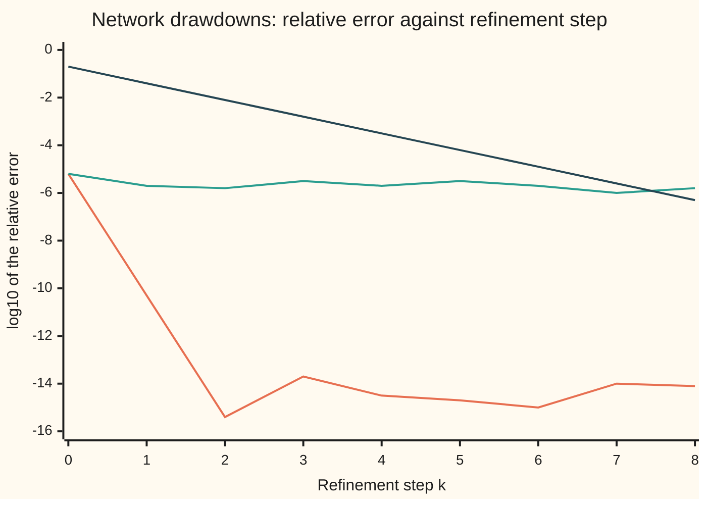

# Iterative refinement: factor cheaply, compute the residual carefully, and win back full accuracy

[Syllabus](../../../SYLLABUS.md) → [Numerical analysis](../README.md) → [Numerical Linear Algebra](../README.md#s03) → Iterative refinement

---

## General Overview

A water utility models a town's network: 500 pipes joining 256 junctions, fed from one reservoir. The unknowns are the 256 **drawdowns**: how far the head (water pressure, as a height in metres) at each junction sits below the reservoir. Every junction draws about 1 L/s. Balancing the water at each junction gives one linear system of 256 equations. The network is illustrative. Its condition number κ, the most it can magnify a relative error, is about 1.4e3.

The model works in **double precision** (IEEE 754 binary64: 53 significant bits, about 16 digits), so the answer is wanted to double accuracy. The expensive part of the solve is the LU factorisation: splitting the matrix into a lower and an upper triangular factor, about $`\tfrac{2}{3}n^3`$ flops for n unknowns. Run it in **single precision** (binary32: 24 significant bits, about 7 digits) and every number takes half the memory. But single-precision LU alone gets the drawdowns right to only 6.84e-6, relative.

**Iterative refinement** wins the lost digits back. Keep the single-precision factors. Compute the **residual** (what the current answer misses the equations by) in double. Solve for a correction with the same cheap factors, and add it on. The error goes 6.84e-6, 5.22e-11, 3.98e-16, then settles between 8.95e-16 and 2.21e-14. That is as good as an all-double LU, whose error is 1.59e-14. Four refinement steps add 9.40% to the factorisation's flops.

**Each refinement step multiplies the error by about κ times the factor's unit roundoff, so a factor in low precision, used on residuals computed in high precision, converges to a high-precision answer whenever κ times that roundoff is well below 1.**

**What kind of fact this is:** a theorem with a method built on it. The error recursion and the contraction bound are proved on this card in Why it works, in exact arithmetic with the rounding of the factors measured. The limiting accuracy once rounding in the residual takes over is a theorem stated with its key steps and named sources. The water network is an illustrative linear model.

---

## The formula

One refinement step, with the precision each part runs in:

```math
r_k = b - A\hat x_k \ \ (\text{double}), \qquad F d_k = r_k \ \ (\text{single}), \qquad \hat x_{k+1} = \hat x_k + d_k \ \ (\text{double})
```

**Read it aloud:** measure how far the current answer misses the equations, in double; solve for a correction with the cheap single-precision factors; add the correction to the answer, in double.

What each step does to the error $`e_k = \hat x_k - x^*`$ (computed answer minus true answer):

```math
e_{k+1} = G\,e_k, \qquad G = I - F^{-1}A, \qquad \|G\| \le \frac{\kappa\,\eta}{1 - \kappa\,\eta} \approx \kappa\,u_s
```

**Read it aloud:** each step multiplies the error by the matrix G, and G's size is at most about the condition number times the factor's relative error, which is about κ times single precision's unit roundoff.

Where it stops, once rounding in the residual takes over (a rule of thumb, from Higham's chapter 12 in Sources):

```math
\frac{\|\hat x_k - x^*\|}{\|x^*\|} \;\to\; \text{about } u_d + \kappa\,u_r
```

**Read it aloud:** the final relative error is about double's unit roundoff plus κ times the unit roundoff of the residual.

| Symbol | Plain meaning | In our example | Push it up and the answer… |
| --- | --- | --- | --- |
| $`A`$ | the network matrix: row i says water into junction i equals the demand drawn there | 256 by 256; conductances 1, 2 or 3 L/s per m | — |
| $`x^*`$, $`\hat x_k`$ | the true drawdowns, in m; the computed drawdowns after k steps | largest 71.416629 m | — |
| $`b`$ | the demands, in L/s | 0.9999933 to 1.0000067 | drawdowns grow |
| $`n`$ | the number of unknowns | 256 | factor work grows like $`n^3`$, each step like $`n^2`$ |
| $`F = P^T \hat L \hat U`$, $`P`$ | the factors LU with partial pivoting computed in single precision, multiplied back together and returned to A's row order; P is the row order of PA = LU; $`\gamma_{3n} \approx 3nu`$ is the LU card's allowance for 3n roundings | 0 row swaps, so P = I | — |
| $`\Delta A`$, $`\eta`$ | what the factorisation got wrong, $`F - A`$; its relative size $`\lVert\Delta A\rVert / \lVert A\rVert`$ | 1.64e-7, which is 2.75 $`u_s`$ | each step gains fewer digits |
| $`r_k`$, $`d_k`$ | the residual, in L/s; the correction, in m | correction sizes 6.84e-6, 5.22e-11, … of $`\lVert\hat x\rVert`$ | — |
| $`e_k`$ | the error $`\hat x_k - x^*`$, reported relative to $`\lVert x^*\rVert`$ | 6.84e-6, 5.22e-11, 3.98e-16 | — |
| $`G`$, $`I`$, $`M`$ | the **iteration matrix** $`I - F^{-1}A`$; the identity matrix; proof shorthand $`M = A^{-1}\Delta A`$ | $`\lVert G\rVert`$ = 4.30e-5 | above 1: no convergence promised |
| $`\kappa`$ | the condition number $`\lVert A\rVert\,\lVert A^{-1}\rVert`$ | 20.00 × 71.4166 = 1428.33 | each step gains fewer digits, and the floor rises |
| $`u_h`$, $`u_s`$, $`u_d`$ | unit roundoff of half, single and double precision | 4.88e-4, 5.96e-8, 1.11e-16 | — |
| $`u_r`$ | the unit roundoff the residual is computed in | $`u_d`$; $`u_s`$ in What breaks | the floor rises with it |

Every norm $`\lVert\cdot\rVert`$ is the infinity-norm: the largest entry of a vector, the largest row sum of absolute values of a matrix ([Matrix norms and the condition number](01-matrix-norms-and-the-condition-number.md)). The **unit roundoff** u is the largest relative error of one rounding in a format: $`2^{-11}`$, $`2^{-24}`$ and $`2^{-53}`$ for half, single and double ([IEEE 754](../01-Floating%20Point%20and%20Error/02-ieee-floating-point.md)).

### When it holds

- **κη is below 1/2, which in practice means κ u of the factor is well below 1.** Here κ $`u_s`$ = 8.51e-5. With half-precision factors on a weakly fed network, κ $`u_h`$ = 42.7, and twelve steps move the error only from 9.571e-1 to 5.688e-1.
- **The residual is computed in higher precision than the factor.** Computed in single, the residual's own rounding is as large as the error it should measure. With the residual and the answer both in single, the error stalls between 9.08e-7 and 3.30e-6.
- **The answer is stored in the higher precision.** A single-precision answer cannot hold more than single's digits: stored that way, the error sits at 5.34e-8.
- **The factor's numbers fit its format's range.** Half precision's smallest normal number is 6.10e-5, and 452 entries of this network's half-precision factors fall below it. The checks round to 11 bits but ignore range; real half-precision solvers scale the matrix first.

---

## Why it works

### Step 0: the correction only has to be roughly right

The residual equation $`A e = r`$ has the same matrix as the original problem, and its answer is the error itself. A solver right to five digits gets the error right to five digits. Subtracting it leaves an error five digits smaller, and each repeat wins five more.

That needs two things. The residual must be computed accurately, or the equation for the error is wrong. And the cheap solver must be right to at least one digit, or each step makes no progress.

### Step 1: in exact arithmetic, each step multiplies the error by G

Write the true answer as $`x^*`$, so $`A x^* = b`$. The residual is $`r_k = b - A\hat x_k = A x^* - A\hat x_k = -A e_k`$. The correction solves $`F d_k = r_k`$, so $`d_k = -F^{-1} A e_k`$. Then

```math
e_{k+1} = \hat x_k + d_k - x^* = e_k - F^{-1}A\,e_k = (I - F^{-1}A)\,e_k = G\,e_k
```

Apply it k times: $`e_k = G^k e_0`$, so $`\lVert e_k\rVert \le \lVert G\rVert^k \lVert e_0\rVert`$. The error shrinks by at least the factor $`\lVert G\rVert`$ per step. If F were A exactly, G would be zero and one step would finish the job.

The checks test this step directly. From the single-precision answer's error $`e_0`$, they compute $`G e_0`$ in double and compare it with the error after one real refinement step. The prediction is 5.26e-11; the observed error is 0.992 times that.

### Step 2: G is small when the factor is close to A

Write $`F = P^T\hat L\hat U = A + \Delta A`$, where $`\Delta A`$ is everything the single-precision factorisation got wrong. Then $`G = F^{-1}(F - A) = F^{-1}\Delta A`$, so

```math
\lVert G\rVert \le \lVert F^{-1}\rVert\,\lVert \Delta A\rVert
```

The factor of $`\lVert F^{-1}\rVert`$ is close to $`\lVert A^{-1}\rVert`$ as long as $`\Delta A`$ is small next to A. With $`\eta = \lVert\Delta A\rVert / \lVert A\rVert`$, the fold below proves $`\lVert F^{-1}\rVert \le \lVert A^{-1}\rVert / (1 - \kappa\eta)`$. Together:

```math
\lVert G\rVert \le \frac{\kappa\,\eta}{1 - \kappa\,\eta}
```

This is below 1 when κη is below 1/2. So convergence is guaranteed, for any starting error, once the factor's relative error times κ is under a half.

<details>
<summary>Detailed proof: the bound on the inverse of the factor</summary>

Let $`\lVert A^{-1}\rVert\,\lVert\Delta A\rVert = \kappa\eta < 1`$. Write $`F = A + \Delta A = A(I + A^{-1}\Delta A)`$, and let $`M = A^{-1}\Delta A`$, with $`\lVert M\rVert \le \kappa\eta < 1`$.

The series $`I - M + M^2 - M^3 + \dots`$ converges, since its terms shrink at least as fast as $`(\kappa\eta)^j`$. Multiply it by $`I + M`$: every term cancels except I. So it is $`(I + M)^{-1}`$, and its norm is at most the geometric sum

$`\displaystyle \lVert (I + M)^{-1}\rVert \le \sum_{j \ge 0} (\kappa\eta)^j = \frac{1}{1 - \kappa\eta}`$

Then $`F^{-1} = (I + M)^{-1}A^{-1}`$, so $`\lVert F^{-1}\rVert \le \lVert A^{-1}\rVert / (1 - \kappa\eta)`$. With $`G = F^{-1}\Delta A`$:

$`\displaystyle \lVert G\rVert \le \frac{\lVert A^{-1}\rVert\,\lVert\Delta A\rVert}{1 - \kappa\eta} = \frac{\kappa\eta}{1 - \kappa\eta}`$

since $`\lVert A^{-1}\rVert\,\lVert\Delta A\rVert = \lVert A^{-1}\rVert\,\lVert A\rVert\,\eta = \kappa\eta`$. The right side is below 1 exactly when $`\kappa\eta < 1/2`$.

</details>

### Step 3: the factor's relative error is a few units of its roundoff

[LU with partial pivoting](02-lu-decomposition-and-pivoting.md) shows that the computed factors are the exact factors of a nearby matrix: $`\hat L\hat U = P(A + \Delta A)`$ with $`\lvert P\Delta A\rvert \le \gamma_{3n}\lvert\hat L\rvert\lvert\hat U\rvert`$, where $`\gamma_{3n} \approx 3nu`$. So η is a modest multiple of the factor's unit roundoff, as long as the growth factor (the largest entry met during elimination, divided by the largest entry of A) stays small.

That worst-case bound is loose: with growth factor 1 it allows η up to about $`3n^3 u`$, which at n = 256 is above 1 in single precision. It promises nothing there. The checks measure η directly instead, from the single-precision factors multiplied in double: η = 1.64e-7, only 2.75 $`u_s`$. With η near $`u_s`$, the bound reads $`\lVert G\rVert \approx \kappa u_s`$.

The three numbers, from loosest to tightest:

| Quantity | Value | Times the observed step ratio |
| --- | ---: | ---: |
| bound $`\kappa\eta/(1 - \kappa\eta)`$ | 2.34e-4 | 30.7 |
| exact $`\lVert G\rVert`$ | 4.30e-5 | 5.6 |
| observed ratio $`e_1/e_0`$ and $`e_2/e_1`$ | 7.63e-6 | 1 |

The bound is safe, 30.7 times the truth: the norm is a worst case over every direction, and the real error points in a kinder one.

### Step 4: rounding in the residual sets a floor

So far the residual was exact. In fact it is computed in some precision $`u_r`$. Its rounding error is about $`u_r`$ times the size of the terms $`\lvert A\rvert\lvert\hat x\rvert`$, and solving with it turns that into an error in x up to κ times larger. Each step therefore adds a fresh error of about $`\kappa u_r`$, while it shrinks the old one by $`\lVert G\rVert`$. The error falls until the two balance, at about $`u_d + \kappa u_r`$.

This is stated with its key step, not proved line by line. The full theorem, with its constants, is Theorem 12.1 of Higham's book and the main theorem of Carson and Higham (Sources). It explains the three runs:

- **Residual in double** ($`u_r = u_d`$): the rule of thumb puts the floor at about κ $`u_d`$ = 1.59e-13. The observed error settles between 8.95e-16 and 2.21e-14.
- **Residual and answer in single** ($`u_r = u_s`$, called **fixed-precision refinement**): the floor is about κ $`u_s`$ = 8.51e-5 at worst. The observed error stalls between 9.08e-7 and 3.30e-6.
- **Residual in a precision beyond double** (three precisions: one for the factor, one for the answer, one for the residual): the floor drops to about $`u_d`$ even for larger κ. Carson and Higham analyse this case; the checks do not run it.

### Step 5: when to stop

Refinement cannot see the true error. It sees the size of each correction, $`\lVert d_k\rVert / \lVert\hat x_k\rVert`$, which tracks the error before it. The usual test stops when the correction drops below $`u_d`$, or when it stops halving, because then the floor has been reached.

Here the corrections are 6.84e-6, 5.22e-11, 2.18e-14, 2.52e-14. The fourth is more than half the third, so the test stops after step 4, with error 3.18e-15.

### The picture: the error, step by step, for three ways of refining



The orange line is mixed precision: single-precision factors, double residual. It drops about five digits a step to the double floor, then wanders under it. The teal line is fixed precision, everything in single: it stalls near 1e-6. The dark line uses half-precision factors with a double residual. Its κ $`u_h`$ is 0.70 and its measured κη is 1.09, above the 1/2 the proof needs, so the bound promises nothing. It converges because the actual $`\lVert G\rVert`$ is 0.280: the error shrinks by 0.20 a step, about 0.7 digits, and reaches 1e-12 after 17 steps. Both checks print every point.

### Half precision on graphics processors, in outline

Graphics processors (GPUs) have units that multiply half-precision numbers (binary16: 11 significant bits, $`u_h = 2^{-11}`$) far faster than doubles. Factor in half and refine in double, and the $`n^3`$ work runs on those units (Haidar and coauthors, Sources).

The limit is κ $`u_h`$. At 0.70 the proved bound already gives no promise (κη = 1.09), and the half run above converges, slowly, only because its measured $`\lVert G\rVert`$ is 0.280. On a network fed through one weak pipe, κ = 87426.80, κ $`u_h`$ = 42.7, and refinement stalls. Single-precision factors still work there: three steps reach 1.53e-13. The other remedy solves each correction equation with a Krylov method (an iteration built from repeated products with A), preconditioned by the half-precision factors: GMRES-based refinement (GMRES, the generalised minimal residual method, is the Krylov method used), analysed by Carson and Higham.

---

## Worked numbers, by hand

| Step | Arithmetic | Value |
| --- | --- | --- |
| condition number | $`\lVert A\rVert \times \lVert A^{-1}\rVert`$ = 20.00 × 71.4166 | κ = 1428.33 |
| rule-of-thumb rate | κ $`u_s`$ = 1428.33 × 5.96e-8 | 8.51e-5 per step |
| proved bound, measured η | κη/(1 − κη) with η = 1.64e-7 | 2.34e-4 per step |
| single-precision LU alone | relative error of $`\hat x_0`$ | 6.84e-6 |
| step 1 | residual in double; correction from F in single; error 6.84e-6 × 7.63e-6 | 5.22e-11 |
| step 2 | same factors again; error 5.22e-11 × 7.63e-6 | 3.98e-16 |
| step 3 | the residual's rounding now dominates | 2.21e-14 |
| step 4 | correction 2.52e-14 is more than half of 2.18e-14: stop | 3.18e-15 |
| cost of the factor | $`\tfrac{1}{6}(4n^3 - 3n^2 - n)`$ at n = 256, in single | 11,152,000 flops |
| cost of one step | residual $`2n^2`$ + solve $`2n^2 - n`$ + update n | 262,144 flops = $`4n^2`$ |
| **result** | **4 steps cost 9.40% of the factor; error 3.18e-15 against 1.59e-14 for all-double LU** | **double accuracy, single-precision factor** |

The drawdowns now have relative error 3.18e-15, better than an LU done entirely in double. The $`n^3`$ work ran in single precision, and the refinement added under a tenth to the flop count. At n = 1000 the same four steps would add only 2.40%.

### What breaks if you drop a piece

| Mistake | Comes out at | What went wrong |
| --- | --- | --- |
| No refinement: single-precision LU alone | 6.84e-6 | The factor's rounding, times κ, is the whole error |
| Residual and answer in single | stalls between 9.08e-7 and 3.30e-6 | The residual's own rounding is as large as the error it should measure |
| Answer stored in single | stalls at 5.34e-8 | Every update is rounded back to 24 bits |
| Half-precision factor, weak feed, κ $`u_h`$ = 42.7 | 9.571e-1 → 5.688e-1 after 12 steps | κ $`u_h`$ is far above 1, so G need not be small and nothing is promised |

The last row is Step 2's hypothesis failing. Here refinement crawls; on other matrices it can diverge.

---

## Code, from first principles, and it actually runs

The code builds the 16 by 16 grid network, factors it with partial pivoting in half, single and double precision, and refines in each mode. Every operation is rounded to the chosen number of bits by a function written out in both languages, cross-checked against the language's own single-precision type, labelled library. It takes four roads. Road one is the true answer, known to the last bit: drawdowns rounded to a grid of $`2^{-20}`$ m, with the demands they imply checked exact in whole-number arithmetic. Road two is ordinary double-precision LU, for comparison. Road three tests the proof: it computes $`G e_0`$ and compares it with the observed next error. Road four computes κ twice, from the full inverse and from $`A^{-1}`$ times a vector of ones, which is enough here because $`A^{-1}`$ has no negative entries.

### Python

```python
# Iterative refinement: factor once in low precision, form each residual in double, win back double accuracy.
import math, struct

R = C = 16; N = R * C  # a 16 by 16 grid of junctions: 256 unknown drawdowns, 480 grid pipes + 20 feed pipes

def rnd(x, p):  # round a double to p significant bits, ties to even (p = 24 single, 11 half, 53 double)
    if p == 53 or x == 0.0: return x
    b = struct.unpack('<Q', struct.pack('<d', x))[0]
    sh = 53 - p; rem = b & ((1 << sh) - 1); t = b - rem; half = 1 << (sh - 1)
    if rem > half or (rem == half and (t >> sh) & 1): t += 1 << sh
    return struct.unpack('<d', struct.pack('<Q', t))[0]

def network(feeds, g_feed):  # nodal matrix: row i says water into junction i = the demand drawn there
    A = [[0.0] * N for _ in range(N)]
    def pipe(i, j, g):
        A[i][i] += g; A[j][j] += g; A[i][j] -= g; A[j][i] -= g
    for r in range(R):
        for c in range(C):
            k = r * C + c
            if c + 1 < C: pipe(k, k + 1, 1 + (7 * r + 3 * c) % 3)   # conductance 1, 2 or 3 L/s per m
            if r + 1 < R: pipe(k, k + C, 1 + (7 * r + 3 * c + 1) % 3)
    for k in feeds: A[k][k] += g_feed  # a feed pipe from the reservoir
    return A

def lu(A, p):  # LU with partial pivoting, every operation rounded to p bits
    a = [[rnd(v, p) for v in row] for row in A]; perm = list(range(N)); swaps = 0
    for k in range(N):
        m = max(range(k, N), key=lambda i: abs(a[i][k]))
        if m != k: a[k], a[m] = a[m], a[k]; perm[k], perm[m] = perm[m], perm[k]; swaps += 1
        cols = [j for j in range(k + 1, N) if a[k][j] != 0.0]
        for i in range(k + 1, N):
            if a[i][k] == 0.0: continue  # a zero multiplier changes nothing: skipped for speed only
            l = rnd(a[i][k] / a[k][k], p); a[i][k] = l
            for j in cols: a[i][j] = rnd(a[i][j] - rnd(l * a[k][j], p), p)
    nzL = [[j for j in range(i) if a[i][j] != 0.0] for i in range(N)]
    nzU = [[j for j in range(i + 1, N) if a[i][j] != 0.0] for i in range(N)]
    return a, perm, nzL, nzU, swaps

def solve(F, b, p):  # sweep down L, then up U, rounding to p bits
    a, perm, nzL, nzU, _ = F; y = [0.0] * N; x = [0.0] * N
    for i in range(N):
        s = rnd(b[perm[i]], p)
        for j in nzL[i]: s = rnd(s - rnd(a[i][j] * y[j], p), p)
        y[i] = s
    for i in range(N - 1, -1, -1):
        s = y[i]
        for j in nzU[i]: s = rnd(s - rnd(a[i][j] * x[j], p), p)
        x[i] = rnd(s / a[i][i], p)
    return x

def matvec(A, x, p=53):
    out = []
    for row in A:
        s = 0.0
        for j, v in enumerate(row):
            if v != 0.0: s = rnd(s + rnd(v * x[j], p), p)
        out.append(s)
    return out

norm = lambda v: max(abs(t) for t in v)
def setup(feeds, g_feed):  # matrix, kappa two ways, and a true answer known to the last bit
    A = network(feeds, g_feed); F64 = lu(A, 53); nA = max(sum(abs(v) for v in row) for row in A)
    inv = [solve(F64, [1.0 if i == j else 0.0 for i in range(N)], 53) for j in range(N)]  # columns
    n_inv = max(sum(abs(inv[j][i]) for j in range(N)) for i in range(N))
    w = solve(F64, [1.0] * N, 53)  # A^-1 has no negative entry, so its norm is the largest entry of A^-1 * ones
    xs = [round(v * 2**20) / 2**20 for v in w]  # true drawdowns: rounded to a 2^-20 m grid
    b = matvec(A, xs)  # demands those drawdowns imply; checked exact in whole-number arithmetic
    exact = all(sum(int(v * 2**10) * int(xs[j] * 2**20) for j, v in enumerate(row)) == int(b[i] * 2**30)
                and (b[i] * 2**30).is_integer() for i, row in enumerate(A))
    return A, F64, nA, n_inv, norm(w), xs, b, exact

def refine(A, F, b, xs, pf, pr, px, steps):  # factor precision pf, residual pr, stored answer px
    x = [rnd(v, px) for v in solve(F, b, pf)]; err = [norm([x[i] - xs[i] for i in range(N)]) / norm(xs)]; dn = []
    for _ in range(steps):
        r = [rnd(b[i] - v, pr) for i, v in enumerate(matvec(A, x, pr))]
        d = solve(F, r, pf); dn.append(norm(d) / norm(x))
        x = [rnd(x[i] + d[i], px) for i in range(N)]; err.append(norm([x[i] - xs[i] for i in range(N)]) / norm(xs))
    return err, dn

U = {11: 2.0**-11, 24: 2.0**-24, 53: 2.0**-53}
feeds = list(range(C)) + [C * r for r in range(1, 5)]  # top row and four junctions down the left side
A, F64, nA, n_inv, n_w, xs, b, exact = setup(feeds, 2.0)
kap = nA * n_inv; f32 = lambda v: struct.unpack('<f', struct.pack('<f', v))[0]
print(f"network: {N} junctions, {2 * R * (C - 1)} grid pipes + {len(feeds)} feed pipes; A is {N} by {N}")
print(f"norm A {nA:.2f}  norm A^-1 {n_inv:.4f} (full inverse) {n_w:.4f} (A^-1 x ones)  kappa {kap:.2f}")
print(f"unit roundoff: half {U[11]:.2e}  single {U[24]:.2e}  double {U[53]:.2e}")
print(f"kappa x u: half {kap * U[11]:.2f}  single {kap * U[24]:.2e}  double {kap * U[53]:.2e}")
print(f"true drawdowns: largest {max(xs):.6f} m; demands {min(b):.7f} to {max(b):.7f} L/s; exact: {exact}")
assert exact and abs(n_inv - n_w) < 1e-12 * n_w and 1e3 < kap < 2e3
def eta_G(F):  # eta = |PA - LU|/|A| and |G| = |I - F^-1 A| for the factors F
    a = F[0]; rows = [[a[i][j] if j >= i else 0.0 for j in range(N)] for i in range(N)]
    for i in range(N):  # rows of L times U, in double: products of singles or halves are exact
        for k in F[2][i]:
            for j in range(k, N): rows[i][j] += a[i][k] * a[k][j]
    M = [solve(F, [A[i][j] for i in range(N)], 53) for j in range(N)]  # columns of F^-1 A
    return (max(sum(abs(A[F[1][i]][j] - rows[i][j]) for j in range(N)) for i in range(N)) / nA,
            max(sum(abs((1.0 if i == j else 0.0) - M[j][i]) for j in range(N)) for i in range(N)))
F32 = lu(A, 24); a32 = F32[0]; eta, nG = eta_G(F32)
lib = sum(f32(v) == v for row in a32 for v in row)
print(f"single LU: swaps {F32[4]}, eta = |PA - LU|/|A| {eta:.2e} = {eta / U[24]:.2f} u_single, library f32 agrees on {lib} of {N * N}")
print(f"|G| = |I - F^-1 A| {nG:.2e} <= kappa eta/(1 - kappa eta) {kap * eta / (1 - kap * eta):.2e}")
assert lib == N * N and nG <= kap * eta / (1 - kap * eta) and nG < 1
mix, dmix = refine(A, F32, b, xs, 24, 53, 53, 8); fix, _ = refine(A, F32, b, xs, 24, 24, 24, 8)
F16 = lu(A, 11); hal, _ = refine(A, F16, b, xs, 11, 53, 53, 8); eh, gh = eta_G(F16)
print("step  mixed: single LU,  |d|/|x|   fixed: all     half LU,")
print("      double residual               single         double residual")
for k in range(9):
    print(f"{k:3d}   {mix[k]:.2e}  {dmix[k - 1] if k else 0.0:10.2e}    {fix[k]:.2e}       {hal[k]:.2e}")
x0 = solve(F32, b, 24); e0 = [x0[i] - xs[i] for i in range(N)]
ge = [e0[i] - v for i, v in enumerate(solve(F32, matvec(A, e0), 53))]  # G e0, the proof's prediction of e1
r1 = norm(ge) / norm(xs)
rat = mix[1] / mix[0]; bnd = kap * eta / (1 - kap * eta)
print(f"step ratios {rat:.2e} {mix[2] / mix[1]:.2e}; |G| is {nG / rat:.1f} times the first, the bound {bnd / rat:.1f} times")
print(f"proof's G e0 predicts e1 {r1:.2e}; observed e1 / predicted {mix[1] / r1:.3f}")
stop = next(k for k in range(1, 8) if dmix[k] <= U[53] or dmix[k] > dmix[k - 1] / 2)
xd = solve(F64, b, 53); ed = norm([xd[i] - xs[i] for i in range(N)]) / norm(xs)
print(f"stop test passes at step {stop + 1}: error {mix[stop + 1]:.2e}; floor kappa x u_double {kap * U[53]:.2e}; double LU {ed:.2e}")
assert mix[1] < kap * U[24] * mix[0] and mix[2] < 1e-14 and max(mix[3:]) < kap * U[53] and abs(mix[1] / r1 - 1) < 0.1
assert min(fix) > 10 * U[24] and hal[8] < 1e-5 and hal[8] < hal[4] < hal[0] and kap * eh > 0.5 and all(hal[k + 1] < gh * hal[k] for k in range(8))
f_cost = (4 * N**3 - 3 * N**2 - N) // 6; s_cost = 2 * N * N + (2 * N * N - N) + N
print(f"flops n = {N}: factor {f_cost:,} (single), each step {s_cost:,} = 4n^2, {stop + 1} steps {(stop + 1) * s_cost / f_cost:.2%} of the factor")
tiny = sum(1 for row in F16[0] for v in row if 0.0 < abs(v) < 2.0**-14)
print(f"half LU: {tiny} factor entries below 6.10e-5, half precision's smallest normal number (range ignored here)")
print(f"half LU: swaps {F16[4]}, eta {eh:.2e} = {eh / U[11]:.2f} u_half, kappa eta {kap * eh:.2f} > 1/2, yet |G| {gh:.3f} < 1; step ratio {hal[1] / hal[0]:.2f}")
Aw, Fw64, nAw, niw, _, xw, bw, ex2 = setup([0], 2.0**-4); kw = nAw * niw
hw, _ = refine(Aw, lu(Aw, 11), bw, xw, 11, 53, 53, 12); sw, _ = refine(Aw, lu(Aw, 24), bw, xw, 24, 53, 53, 3)
xsg, _ = refine(A, F32, b, xs, 24, 53, 24, 8)
print(f"weak feed (one pipe, 0.0625 L/s per m): kappa {kw:.2f}, kappa x u_half {kw * U[11]:.1f}, exact: {ex2}")
print(f"  half LU after 12 steps: error {hw[12]:.3e} (start {hw[0]:.3e}); single LU after 3 steps: {sw[3]:.2e}")
print(f"wrong: no refinement {mix[0]:.2e}; answer kept in single {min(xsg[1:]):.2e} to {max(xsg[1:]):.2e}")
print(f"wrong: residual and answer in single {min(fix[1:]):.2e} to {max(fix[1:]):.2e}")
assert ex2 and kw * U[11] > 1 and hw[12] > 0.1 and sw[3] < 1e-11 and min(xsg[1:]) > 0.1 * U[24]
lg = lambda v: f"{math.log10(v):6.1f}"
print("chart, step         " + " ".join(f"{k:6d}" for k in range(9)))
for name, e in (("mixed", mix), ("fixed", fix), ("half ", hal)):
    print(f"chart, log10 {name}  " + " ".join(lg(v) for v in e))
n2 = 1000; f2 = (4 * n2**3 - 3 * n2**2 - n2) // 6
print(f"try: half steps to 1e-12: {next(k for k, v in enumerate(refine(A, F16, b, xs, 11, 53, 53, 30)[0]) if v < 1e-12)}; n = 1000: {stop + 1} steps {(stop + 1) * 4 * n2 * n2 / f2:.2%} of the factor")
print("ALL CHECKS PASS")
```

**Ran 2026-11-24 on macOS, Python 3.14.10, standard library only. All checks passed. Output, pasted from the run:**

```
network: 256 junctions, 480 grid pipes + 20 feed pipes; A is 256 by 256
norm A 20.00  norm A^-1 71.4166 (full inverse) 71.4166 (A^-1 x ones)  kappa 1428.33
unit roundoff: half 4.88e-04  single 5.96e-08  double 1.11e-16
kappa x u: half 0.70  single 8.51e-05  double 1.59e-13
true drawdowns: largest 71.416629 m; demands 0.9999933 to 1.0000067 L/s; exact: True
single LU: swaps 0, eta = |PA - LU|/|A| 1.64e-07 = 2.75 u_single, library f32 agrees on 65536 of 65536
|G| = |I - F^-1 A| 4.30e-05 <= kappa eta/(1 - kappa eta) 2.34e-04
step  mixed: single LU,  |d|/|x|   fixed: all     half LU,
      double residual               single         double residual
  0   6.84e-06    0.00e+00    6.84e-06       2.03e-01
  1   5.22e-11    6.84e-06    2.00e-06       4.08e-02
  2   3.98e-16    5.22e-11    1.72e-06       8.31e-03
  3   2.21e-14    2.18e-14    3.02e-06       1.67e-03
  4   3.18e-15    2.52e-14    1.87e-06       3.34e-04
  5   1.79e-15    4.70e-15    3.30e-06       6.71e-05
  6   8.95e-16    2.37e-15    2.03e-06       1.35e-05
  7   8.95e-15    8.72e-15    9.08e-07       2.72e-06
  8   7.76e-15    1.64e-14    1.60e-06       5.48e-07
step ratios 7.63e-06 7.63e-06; |G| is 5.6 times the first, the bound 30.7 times
proof's G e0 predicts e1 5.26e-11; observed e1 / predicted 0.992
stop test passes at step 4: error 3.18e-15; floor kappa x u_double 1.59e-13; double LU 1.59e-14
flops n = 256: factor 11,152,000 (single), each step 262,144 = 4n^2, 4 steps 9.40% of the factor
half LU: 452 factor entries below 6.10e-5, half precision's smallest normal number (range ignored here)
half LU: swaps 0, eta 7.63e-04 = 1.56 u_half, kappa eta 1.09 > 1/2, yet |G| 0.280 < 1; step ratio 0.20
weak feed (one pipe, 0.0625 L/s per m): kappa 87426.80, kappa x u_half 42.7, exact: True
  half LU after 12 steps: error 5.688e-01 (start 9.571e-01); single LU after 3 steps: 1.53e-13
wrong: no refinement 6.84e-06; answer kept in single 5.34e-08 to 5.34e-08
wrong: residual and answer in single 9.08e-07 to 3.30e-06
chart, step              0      1      2      3      4      5      6      7      8
chart, log10 mixed    -5.2  -10.3  -15.4  -13.7  -14.5  -14.7  -15.0  -14.0  -14.1
chart, log10 fixed    -5.2   -5.7   -5.8   -5.5   -5.7   -5.5   -5.7   -6.0   -5.8
chart, log10 half     -0.7   -1.4   -2.1   -2.8   -3.5   -4.2   -4.9   -5.6   -6.3
try: half steps to 1e-12: 17; n = 1000: 4 steps 2.40% of the factor
ALL CHECKS PASS
```

### Rust

```rust
// Iterative refinement: factor once in low precision, form each residual in double, win back double accuracy.
const R: usize = 16;
const C: usize = 16;
const N: usize = R * C; // a 16 by 16 grid of junctions: 256 unknown drawdowns, 480 grid pipes + 20 feed pipes
type Mat = Vec<Vec<f64>>;
struct Lu { a: Mat, perm: Vec<usize>, nz_l: Vec<Vec<usize>>, nz_u: Vec<Vec<usize>>, swaps: usize }

fn rnd(x: f64, p: u32) -> f64 { // round a double to p significant bits, ties to even (p = 24 single, 11 half, 53 double)
    if p == 53 || x == 0.0 { return x; }
    let b = x.to_bits(); let sh = 53 - p; let rem = b & ((1u64 << sh) - 1); let mut t = b - rem; let half = 1u64 << (sh - 1);
    if rem > half || (rem == half && (t >> sh) & 1 == 1) { t += 1u64 << sh; }
    f64::from_bits(t)
}
fn network(feeds: &[usize], g_feed: f64) -> Mat { // nodal matrix: row i says water into junction i = the demand drawn there
    let mut a = vec![vec![0.0; N]; N];
    let mut pipe = |i: usize, j: usize, g: f64| { a[i][i] += g; a[j][j] += g; a[i][j] -= g; a[j][i] -= g; };
    for r in 0..R { for c in 0..C {
        let k = r * C + c;
        if c + 1 < C { pipe(k, k + 1, (1 + (7 * r + 3 * c) % 3) as f64); } // conductance 1, 2 or 3 L/s per m
        if r + 1 < R { pipe(k, k + C, (1 + (7 * r + 3 * c + 1) % 3) as f64); }
    } }
    for &k in feeds { a[k][k] += g_feed; } // a feed pipe from the reservoir
    a
}
fn lu(m: &Mat, p: u32) -> Lu { // LU with partial pivoting, every operation rounded to p bits
    let mut a: Mat = m.iter().map(|row| row.iter().map(|&v| rnd(v, p)).collect()).collect();
    let mut perm: Vec<usize> = (0..N).collect(); let mut swaps = 0;
    for k in 0..N {
        let mut mi = k;
        for i in k..N { if a[i][k].abs() > a[mi][k].abs() { mi = i; } }
        if mi != k { a.swap(k, mi); perm.swap(k, mi); swaps += 1; }
        let cols: Vec<usize> = (k + 1..N).filter(|&j| a[k][j] != 0.0).collect();
        for i in k + 1..N {
            if a[i][k] == 0.0 { continue; } // a zero multiplier changes nothing: skipped for speed only
            let l = rnd(a[i][k] / a[k][k], p); a[i][k] = l;
            for &j in &cols { a[i][j] = rnd(a[i][j] - rnd(l * a[k][j], p), p); }
        }
    }
    let nz_l = (0..N).map(|i| (0..i).filter(|&j| a[i][j] != 0.0).collect()).collect();
    let nz_u = (0..N).map(|i| (i + 1..N).filter(|&j| a[i][j] != 0.0).collect()).collect();
    Lu { a, perm, nz_l, nz_u, swaps }
}
fn solve(f: &Lu, b: &[f64], p: u32) -> Vec<f64> { // sweep down L, then up U, rounding to p bits
    let (mut y, mut x) = (vec![0.0; N], vec![0.0; N]);
    for i in 0..N {
        let mut s = rnd(b[f.perm[i]], p);
        for &j in &f.nz_l[i] { s = rnd(s - rnd(f.a[i][j] * y[j], p), p); }
        y[i] = s;
    }
    for i in (0..N).rev() {
        let mut s = y[i];
        for &j in &f.nz_u[i] { s = rnd(s - rnd(f.a[i][j] * x[j], p), p); }
        x[i] = rnd(s / f.a[i][i], p);
    }
    x
}
fn matvec(a: &Mat, x: &[f64], p: u32) -> Vec<f64> {
    a.iter().map(|row| { let mut s = 0.0;
        for (j, &v) in row.iter().enumerate() { if v != 0.0 { s = rnd(s + rnd(v * x[j], p), p); } } s }).collect()
}
fn norm(v: &[f64]) -> f64 { v.iter().fold(0.0, |m: f64, t| m.max(t.abs())) }
fn rel(x: &[f64], xs: &[f64]) -> f64 { norm(&(0..N).map(|i| x[i] - xs[i]).collect::<Vec<_>>()) / norm(xs) }
fn unit(j: usize) -> Vec<f64> { (0..N).map(|i| if i == j { 1.0 } else { 0.0 }).collect() }
fn setup(feeds: &[usize], g_feed: f64) -> (Mat, Lu, f64, f64, f64, Vec<f64>, Vec<f64>, bool) { // kappa two ways, exact truth
    let a = network(feeds, g_feed); let f64lu = lu(&a, 53);
    let na = a.iter().map(|row| row.iter().map(|v| v.abs()).sum::<f64>()).fold(0.0, f64::max);
    let inv: Mat = (0..N).map(|j| solve(&f64lu, &unit(j), 53)).collect(); // columns
    let n_inv = (0..N).map(|i| (0..N).map(|j| inv[j][i].abs()).sum::<f64>()).fold(0.0, f64::max);
    let w = solve(&f64lu, &vec![1.0; N], 53); // A^-1 has no negative entry, so its norm is the largest entry of A^-1 * ones
    let xs: Vec<f64> = w.iter().map(|v| (v * 1048576.0).round_ties_even() / 1048576.0).collect(); // 2^-20 m grid
    let b = matvec(&a, &xs, 53); // demands those drawdowns imply; checked exact in whole-number arithmetic
    let exact = a.iter().enumerate().all(|(i, row)| (b[i] * 2f64.powi(30)).fract() == 0.0 &&
        row.iter().enumerate().map(|(j, v)| (v * 1024.0) as i128 * (xs[j] * 1048576.0) as i128).sum::<i128>()
            == (b[i] * 2f64.powi(30)) as i128);
    (a, f64lu, na, n_inv, norm(&w), xs, b, exact)
}
fn refine(a: &Mat, f: &Lu, b: &[f64], xs: &[f64], pf: u32, pr: u32, px: u32, steps: usize) -> (Vec<f64>, Vec<f64>) {
    let mut x: Vec<f64> = solve(f, b, pf).iter().map(|&v| rnd(v, px)).collect(); // pf factor, pr residual, px answer
    let (mut err, mut dn) = (vec![rel(&x, xs)], vec![]);
    for _ in 0..steps {
        let r: Vec<f64> = matvec(a, &x, pr).iter().enumerate().map(|(i, v)| rnd(b[i] - v, pr)).collect();
        let d = solve(f, &r, pf); dn.push(norm(&d) / norm(&x));
        x = (0..N).map(|i| rnd(x[i] + d[i], px)).collect(); err.push(rel(&x, xs));
    }
    (err, dn)
}
fn e(x: f64, p: usize) -> String { // Python-style e-notation: 6.84e-06
    let s = format!("{:.*e}", p, x); let (m, ex) = s.split_once('e').unwrap(); let ex: i32 = ex.parse().unwrap();
    format!("{}e{}{:02}", m, if ex < 0 { '-' } else { '+' }, ex.abs())
}
fn commas(n: u64) -> String {
    let s = n.to_string(); let mut out = String::new();
    for (i, ch) in s.chars().enumerate() { if i > 0 && (s.len() - i) % 3 == 0 { out.push(','); } out.push(ch); }
    out
}
fn first_where(v: &[f64], t: f64) -> usize { v.iter().position(|&x| x < t).unwrap() }
fn eta_g(a: &Mat, f: &Lu, na: f64) -> (f64, f64) { // eta = |PA - LU|/|A| and |G| = |I - F^-1 A| for the factors f
    let mut rows: Mat = (0..N).map(|i| (0..N).map(|j| if j >= i { f.a[i][j] } else { 0.0 }).collect()).collect();
    for i in 0..N { for &k in &f.nz_l[i] { for j in k..N { rows[i][j] += f.a[i][k] * f.a[k][j]; } } } // L times U, exact products
    let eta = (0..N).map(|i| (0..N).map(|j| (a[f.perm[i]][j] - rows[i][j]).abs()).sum::<f64>()).fold(0.0, f64::max) / na;
    let m: Mat = (0..N).map(|j| solve(f, &(0..N).map(|i| a[i][j]).collect::<Vec<_>>(), 53)).collect(); // F^-1 A
    (eta, (0..N).map(|i| (0..N).map(|j| (if i == j { 1.0 } else { 0.0 } - m[j][i]).abs()).sum::<f64>()).fold(0.0, f64::max))
}
fn main() {
    let (u11, u24, u53) = (2f64.powi(-11), 2f64.powi(-24), 2f64.powi(-53));
    let mut feeds: Vec<usize> = (0..C).collect(); feeds.extend((1..5).map(|r| C * r)); // top row and four down the left side
    let (a, f64lu, na, n_inv, n_w, xs, b, exact) = setup(&feeds, 2.0);
    let kap = na * n_inv;
    println!("network: {} junctions, {} grid pipes + {} feed pipes; A is {} by {}", N, 2 * R * (C - 1), feeds.len(), N, N);
    println!("norm A {:.2}  norm A^-1 {:.4} (full inverse) {:.4} (A^-1 x ones)  kappa {:.2}", na, n_inv, n_w, kap);
    println!("unit roundoff: half {}  single {}  double {}", e(u11, 2), e(u24, 2), e(u53, 2));
    println!("kappa x u: half {:.2}  single {}  double {}", kap * u11, e(kap * u24, 2), e(kap * u53, 2));
    let (mn, mx) = (b.iter().cloned().fold(f64::MAX, f64::min), b.iter().cloned().fold(f64::MIN, f64::max));
    let pyb = |t: bool| if t { "True" } else { "False" };
    println!("true drawdowns: largest {:.6} m; demands {:.7} to {:.7} L/s; exact: {}", norm(&xs), mn, mx, pyb(exact));
    assert!(exact && (n_inv - n_w).abs() < 1e-12 * n_w && 1e3 < kap && kap < 2e3);
    let f32lu = lu(&a, 24); let a32 = &f32lu.a; let (eta, ng) = eta_g(&a, &f32lu, na);
    let lib = a32.iter().flatten().filter(|&&v| (v as f32) as f64 == v).count();
    println!("single LU: swaps {}, eta = |PA - LU|/|A| {} = {:.2} u_single, library f32 agrees on {} of {}", f32lu.swaps, e(eta, 2), eta / u24, lib, N * N);
    println!("|G| = |I - F^-1 A| {} <= kappa eta/(1 - kappa eta) {}", e(ng, 2), e(kap * eta / (1.0 - kap * eta), 2));
    assert!(lib == N * N && ng <= kap * eta / (1.0 - kap * eta) && ng < 1.0);
    let (mix, dmix) = refine(&a, &f32lu, &b, &xs, 24, 53, 53, 8); let (fix, _) = refine(&a, &f32lu, &b, &xs, 24, 24, 24, 8);
    let f16lu = lu(&a, 11); let (hal, _) = refine(&a, &f16lu, &b, &xs, 11, 53, 53, 8); let (eh, gh) = eta_g(&a, &f16lu, na);
    println!("step  mixed: single LU,  |d|/|x|   fixed: all     half LU,");
    println!("      double residual               single         double residual");
    for k in 0..9 {
        println!("{:3}   {}  {:>10}    {}       {}", k, e(mix[k], 2), e(if k > 0 { dmix[k - 1] } else { 0.0 }, 2), e(fix[k], 2), e(hal[k], 2));
    }
    let x0 = solve(&f32lu, &b, 24); let e0: Vec<f64> = (0..N).map(|i| x0[i] - xs[i]).collect();
    let fe = solve(&f32lu, &matvec(&a, &e0, 53), 53);
    let ge: Vec<f64> = (0..N).map(|i| e0[i] - fe[i]).collect(); // G e0, the proof's prediction of e1
    let r1 = norm(&ge) / norm(&xs);
    let (rat, bnd) = (mix[1] / mix[0], kap * eta / (1.0 - kap * eta));
    println!("step ratios {} {}; |G| is {:.1} times the first, the bound {:.1} times", e(rat, 2), e(mix[2] / mix[1], 2), ng / rat, bnd / rat);
    println!("proof's G e0 predicts e1 {}; observed e1 / predicted {:.3}", e(r1, 2), mix[1] / r1);
    let stop = (1..8).find(|&k| dmix[k] <= u53 || dmix[k] > dmix[k - 1] / 2.0).unwrap();
    let xd = solve(&f64lu, &b, 53); let ed = rel(&xd, &xs);
    println!("stop test passes at step {}: error {}; floor kappa x u_double {}; double LU {}", stop + 1, e(mix[stop + 1], 2), e(kap * u53, 2), e(ed, 2));
    let mx3 = mix[3..].iter().cloned().fold(0.0, f64::max);
    assert!(mix[1] < kap * u24 * mix[0] && mix[2] < 1e-14 && mx3 < kap * u53 && (mix[1] / r1 - 1.0).abs() < 0.1);
    assert!(fix.iter().cloned().fold(1.0, f64::min) > 10.0 * u24 && hal[8] < 1e-5 && hal[8] < hal[4] && hal[4] < hal[0] && kap * eh > 0.5 && (0..8).all(|k| hal[k + 1] < gh * hal[k]));
    let n = N as u64; let f_cost = (4 * n * n * n - 3 * n * n - n) / 6; let s_cost = 2 * n * n + (2 * n * n - n) + n;
    println!("flops n = {}: factor {} (single), each step {} = 4n^2, {} steps {:.2}% of the factor", N, commas(f_cost), commas(s_cost), stop + 1, (stop + 1) as f64 * s_cost as f64 / f_cost as f64 * 100.0);
    let tiny = f16lu.a.iter().flatten().filter(|&&v| v != 0.0 && v.abs() < 2f64.powi(-14)).count();
    println!("half LU: {} factor entries below 6.10e-5, half precision's smallest normal number (range ignored here)", tiny);
    println!("half LU: swaps {}, eta {} = {:.2} u_half, kappa eta {:.2} > 1/2, yet |G| {:.3} < 1; step ratio {:.2}", f16lu.swaps, e(eh, 2), eh / u11, kap * eh, gh, hal[1] / hal[0]);
    let (aw, _, naw, niw, _, xw, bw, ex2) = setup(&[0], 2f64.powi(-4)); let kw = naw * niw;
    let (hw, _) = refine(&aw, &lu(&aw, 11), &bw, &xw, 11, 53, 53, 12); let (sw, _) = refine(&aw, &lu(&aw, 24), &bw, &xw, 24, 53, 53, 3);
    let (xsg, _) = refine(&a, &f32lu, &b, &xs, 24, 53, 24, 8);
    println!("weak feed (one pipe, 0.0625 L/s per m): kappa {:.2}, kappa x u_half {:.1}, exact: {}", kw, kw * u11, pyb(ex2));
    println!("  half LU after 12 steps: error {} (start {}); single LU after 3 steps: {}", e(hw[12], 3), e(hw[0], 3), e(sw[3], 2));
    let mnmx = |v: &[f64]| (v.iter().cloned().fold(f64::MAX, f64::min), v.iter().cloned().fold(0.0, f64::max));
    let ((g1, g2), (h1, h2)) = (mnmx(&xsg[1..]), mnmx(&fix[1..]));
    println!("wrong: no refinement {}; answer kept in single {} to {}", e(mix[0], 2), e(g1, 2), e(g2, 2));
    println!("wrong: residual and answer in single {} to {}", e(h1, 2), e(h2, 2));
    assert!(ex2 && kw * u11 > 1.0 && hw[12] > 0.1 && sw[3] < 1e-11 && g1 > 0.1 * u24);
    println!("chart, step         {}", (0..9).map(|k| format!("{:6}", k)).collect::<Vec<_>>().join(" "));
    for (name, v) in [("mixed", &mix), ("fixed", &fix), ("half ", &hal)] {
        println!("chart, log10 {}  {}", name, v.iter().map(|x| format!("{:6.1}", x.log10())).collect::<Vec<_>>().join(" "));
    }
    let n2: u64 = 1000; let f2 = (4 * n2 * n2 * n2 - 3 * n2 * n2 - n2) / 6;
    let k12 = first_where(&refine(&a, &f16lu, &b, &xs, 11, 53, 53, 30).0, 1e-12);
    println!("try: half steps to 1e-12: {}; n = 1000: {} steps {:.2}% of the factor", k12, stop + 1, (stop + 1) as f64 * 4.0 * (n2 * n2) as f64 / f2 as f64 * 100.0);
    println!("ALL CHECKS PASS");
}
```

**Ran 2026-11-24 on macOS, rustc 1.98.1, no crates. All checks passed. Output, pasted from the run:**

```
network: 256 junctions, 480 grid pipes + 20 feed pipes; A is 256 by 256
norm A 20.00  norm A^-1 71.4166 (full inverse) 71.4166 (A^-1 x ones)  kappa 1428.33
unit roundoff: half 4.88e-04  single 5.96e-08  double 1.11e-16
kappa x u: half 0.70  single 8.51e-05  double 1.59e-13
true drawdowns: largest 71.416629 m; demands 0.9999933 to 1.0000067 L/s; exact: True
single LU: swaps 0, eta = |PA - LU|/|A| 1.64e-07 = 2.75 u_single, library f32 agrees on 65536 of 65536
|G| = |I - F^-1 A| 4.30e-05 <= kappa eta/(1 - kappa eta) 2.34e-04
step  mixed: single LU,  |d|/|x|   fixed: all     half LU,
      double residual               single         double residual
  0   6.84e-06    0.00e+00    6.84e-06       2.03e-01
  1   5.22e-11    6.84e-06    2.00e-06       4.08e-02
  2   3.98e-16    5.22e-11    1.72e-06       8.31e-03
  3   2.21e-14    2.18e-14    3.02e-06       1.67e-03
  4   3.18e-15    2.52e-14    1.87e-06       3.34e-04
  5   1.79e-15    4.70e-15    3.30e-06       6.71e-05
  6   8.95e-16    2.37e-15    2.03e-06       1.35e-05
  7   8.95e-15    8.72e-15    9.08e-07       2.72e-06
  8   7.76e-15    1.64e-14    1.60e-06       5.48e-07
step ratios 7.63e-06 7.63e-06; |G| is 5.6 times the first, the bound 30.7 times
proof's G e0 predicts e1 5.26e-11; observed e1 / predicted 0.992
stop test passes at step 4: error 3.18e-15; floor kappa x u_double 1.59e-13; double LU 1.59e-14
flops n = 256: factor 11,152,000 (single), each step 262,144 = 4n^2, 4 steps 9.40% of the factor
half LU: 452 factor entries below 6.10e-5, half precision's smallest normal number (range ignored here)
half LU: swaps 0, eta 7.63e-04 = 1.56 u_half, kappa eta 1.09 > 1/2, yet |G| 0.280 < 1; step ratio 0.20
weak feed (one pipe, 0.0625 L/s per m): kappa 87426.80, kappa x u_half 42.7, exact: True
  half LU after 12 steps: error 5.688e-01 (start 9.571e-01); single LU after 3 steps: 1.53e-13
wrong: no refinement 6.84e-06; answer kept in single 5.34e-08 to 5.34e-08
wrong: residual and answer in single 9.08e-07 to 3.30e-06
chart, step              0      1      2      3      4      5      6      7      8
chart, log10 mixed    -5.2  -10.3  -15.4  -13.7  -14.5  -14.7  -15.0  -14.0  -14.1
chart, log10 fixed    -5.2   -5.7   -5.8   -5.5   -5.7   -5.5   -5.7   -6.0   -5.8
chart, log10 half     -0.7   -1.4   -2.1   -2.8   -3.5   -4.2   -4.9   -5.6   -6.3
try: half steps to 1e-12: 17; n = 1000: 4 steps 2.40% of the factor
ALL CHECKS PASS
```

The two outputs are identical. Every rounding to single or half precision agrees bit for bit between the two languages.

### Lean

Lean proves Steps 1 and 2 in exact arithmetic, for every square invertible A and any factor F, and checks the network's flop counts.

- Take an invertible factor F and the true answer $`x^*`$, with $`A x^* = b`$. Then one refinement step maps the error $`e_k`$ to $`e_{k+1} = G e_k`$, where $`G = I - F^{-1}A`$.
- Suppose A is invertible and κη is below 1. Then F is invertible, and $`\lVert F^{-1}\rVert \le \lVert A^{-1}\rVert/(1 - \kappa\eta)`$.
- Suppose A is invertible and κη is below 1. Then $`\lVert G\rVert \le \kappa\eta/(1 - \kappa\eta)`$.
- Suppose A is invertible, κη is below 1/2, and every step is done in exact arithmetic. Then $`\lVert e_k\rVert \le (\kappa\eta/(1 - \kappa\eta))^k \lVert e_0\rVert`$ for every step k.
- Take the same conditions. Then κη/(1 − κη) is below 1, and the computed answers $`\hat x_k`$ converge to $`x^*`$ from any start.
- The network has 16 × 16 = 256 junctions, and 480 grid pipes plus 20 feed pipes, 500 in all.
- Take n = 256. Then the factor costs 11,152,000 flops, and one step costs $`4n^2`$ = 262,144 flops.
- Take four refinement steps. Then they cost 9.40% of the factor at n = 256, and 2.40% at n = 1000.

Rounding, the size of η, Step 4's floor, the stopping test and every measured error are left to the Python and Rust checks.

```lean
-- Iterative refinement: in exact arithmetic each refinement step multiplies the error by G = I - F⁻¹A, whose infinity-norm is at most κη/(1 - κη), so the iterates converge to the true answer whenever κη < 1/2.
import Mathlib.Analysis.Matrix.Normed
import Mathlib.LinearAlgebra.Matrix.NonsingularInverse
import Mathlib.Analysis.SpecificLimits.Basic

open Matrix Filter Topology
open scoped Matrix.Norms.Operator

variable {n : Type*} [Fintype n] [DecidableEq n]

/-- The condition number times the relative error is `‖A⁻¹‖ ‖F - A‖`. -/
lemma ir_kappa_eta (A F : Matrix n n ℝ) :
    ‖A‖ * ‖A⁻¹‖ * (‖F - A‖ / ‖A‖) = ‖A⁻¹‖ * ‖F - A‖ := by
  by_cases h : ‖A‖ = 0
  · have hA0 : A = 0 := norm_eq_zero.mp h
    simp [hA0]
  · field_simp

/-- The error recursion for one refinement step. -/
lemma ir_error_step (A F : Matrix n n ℝ) (b xs x d : n → ℝ)
    (hF : IsUnit F.det) (hxs : A *ᵥ xs = b) (hd : F *ᵥ d = b - A *ᵥ x) :
    (x + d) - xs = (1 - F⁻¹ * A) *ᵥ (x - xs) := by
  have hd' : d = F⁻¹ *ᵥ (b - A *ᵥ x) := by
    rw [← hd, mulVec_mulVec, nonsing_inv_mul F hF, one_mulVec]
  subst hxs
  rw [hd', sub_mulVec, one_mulVec, ← mulVec_mulVec, mulVec_sub, mulVec_sub, mulVec_sub]
  abel

/-- The perturbation bound, with `t = ‖A⁻¹‖ ‖F - A‖`. -/
lemma ir_norm_bound (A F : Matrix n n ℝ) (hA : IsUnit A.det)
    (ht : ‖A⁻¹‖ * ‖F - A‖ < 1) :
    IsUnit F.det ∧ ‖F⁻¹‖ ≤ ‖A⁻¹‖ / (1 - ‖A⁻¹‖ * ‖F - A‖) ∧
      ‖1 - F⁻¹ * A‖ ≤ ‖A⁻¹‖ * ‖F - A‖ / (1 - ‖A⁻¹‖ * ‖F - A‖) := by
  set t := ‖A⁻¹‖ * ‖F - A‖ with ht_def
  have hP : ‖A⁻¹ * (F - A)‖ ≤ t := linfty_opNorm_mul _ _
  have hF : IsUnit F.det := by
    rw [isUnit_iff_ne_zero]
    intro h0
    obtain ⟨v, hv, hFv⟩ := exists_mulVec_eq_zero_iff.mpr h0
    have hvv : (A⁻¹ * (F - A)) *ᵥ v = -v := by
      rw [← mulVec_mulVec, sub_mulVec, hFv, zero_sub, mulVec_neg, mulVec_mulVec,
        nonsing_inv_mul A hA, one_mulVec]
    have h1 : ‖v‖ ≤ t * ‖v‖ := by
      calc ‖v‖ = ‖(A⁻¹ * (F - A)) *ᵥ v‖ := by rw [hvv, norm_neg]
        _ ≤ ‖A⁻¹ * (F - A)‖ * ‖v‖ := linfty_opNorm_mulVec _ _
        _ ≤ t * ‖v‖ := by gcongr
    have hpos : 0 < ‖v‖ := norm_pos_iff.mpr hv
    nlinarith
  have h1t : 0 < 1 - t := by linarith
  have hid : F⁻¹ = A⁻¹ - A⁻¹ * (F - A) * F⁻¹ := by
    rw [mul_sub, sub_mul, mul_assoc, mul_nonsing_inv F hF, mul_one, nonsing_inv_mul A hA,
      one_mul]
    abel
  have hFinv : ‖F⁻¹‖ ≤ ‖A⁻¹‖ / (1 - t) := by
    rw [le_div_iff₀ h1t]
    have : ‖F⁻¹‖ ≤ ‖A⁻¹‖ + t * ‖F⁻¹‖ := by
      calc ‖F⁻¹‖ = ‖A⁻¹ - A⁻¹ * (F - A) * F⁻¹‖ := by rw [← hid]
        _ ≤ ‖A⁻¹‖ + ‖A⁻¹ * (F - A) * F⁻¹‖ := norm_sub_le _ _
        _ ≤ ‖A⁻¹‖ + ‖A⁻¹ * (F - A)‖ * ‖F⁻¹‖ := by gcongr; exact linfty_opNorm_mul _ _
        _ ≤ ‖A⁻¹‖ + t * ‖F⁻¹‖ := by gcongr
    nlinarith
  refine ⟨hF, hFinv, ?_⟩
  have hG : 1 - F⁻¹ * A = F⁻¹ * (F - A) := by
    rw [mul_sub, nonsing_inv_mul F hF]
  calc ‖1 - F⁻¹ * A‖ = ‖F⁻¹ * (F - A)‖ := by rw [hG]
    _ ≤ ‖F⁻¹‖ * ‖F - A‖ := linfty_opNorm_mul _ _
    _ ≤ ‖A⁻¹‖ / (1 - t) * ‖F - A‖ := by gcongr
    _ = t / (1 - t) := by rw [ht_def]; ring

#print axioms ir_kappa_eta
#print axioms ir_error_step
#print axioms ir_norm_bound

/-- Iterative refinement converges. Let `A` be invertible with true answer `A x* = b`, and let
`F` be the computed factors multiplied back together, `F = A + ΔA`. Measure everything in the
infinity-norm, with condition number `κ = ‖A‖ ‖A⁻¹‖` and the factor's relative error
`η = ‖F - A‖ / ‖A‖`. Run the refinement step: residual `r_k = b - A x̂_k`, correction `F d_k = r_k`,
new answer `x̂_(k+1) = x̂_k + d_k`. If `κη < 1/2`, then `q = κη / (1 - κη)` is below 1, every step
multiplies the error bound by `q`, so `‖x̂_k - x*‖ ≤ q^k ‖x̂_0 - x*‖`, and the iterates converge to
`x*` from any starting answer. -/
theorem iterative_refinement_converges
    (A F : Matrix n n ℝ) (b xs : n → ℝ) (x d : ℕ → n → ℝ)
    (hA : IsUnit A.det) (hxs : A *ᵥ xs = b)
    (hd : ∀ k, F *ᵥ d k = b - A *ᵥ x k) (hx : ∀ k, x (k + 1) = x k + d k)
    (hκη : ‖A‖ * ‖A⁻¹‖ * (‖F - A‖ / ‖A‖) < 1 / 2) :
    let κη := ‖A‖ * ‖A⁻¹‖ * (‖F - A‖ / ‖A‖)
    κη / (1 - κη) < 1 ∧
      (∀ k, ‖x k - xs‖ ≤ (κη / (1 - κη)) ^ k * ‖x 0 - xs‖) ∧
      Tendsto x atTop (𝓝 xs) := by
  intro κη
  have hk : κη = ‖A⁻¹‖ * ‖F - A‖ := ir_kappa_eta A F
  rw [ir_kappa_eta A F] at hκη
  rw [hk]
  set t := ‖A⁻¹‖ * ‖F - A‖ with ht_def
  have ht0 : 0 ≤ t := mul_nonneg (norm_nonneg _) (norm_nonneg _)
  obtain ⟨hF, -, hG⟩ := ir_norm_bound A F hA (by linarith)
  rw [← ht_def] at hG
  have h1t : 0 < 1 - t := by linarith
  have hq0 : 0 ≤ t / (1 - t) := div_nonneg ht0 h1t.le
  have hq1 : t / (1 - t) < 1 := by rw [div_lt_one h1t]; linarith
  have hbound : ∀ k, ‖x k - xs‖ ≤ (t / (1 - t)) ^ k * ‖x 0 - xs‖ := by
    intro k
    induction k with
    | zero => simp
    | succ k ih =>
      have hstep : x (k + 1) - xs = (1 - F⁻¹ * A) *ᵥ (x k - xs) := by
        rw [hx k]; exact ir_error_step A F b xs (x k) (d k) hF hxs (hd k)
      calc ‖x (k + 1) - xs‖ = ‖(1 - F⁻¹ * A) *ᵥ (x k - xs)‖ := by rw [hstep]
        _ ≤ ‖1 - F⁻¹ * A‖ * ‖x k - xs‖ := linfty_opNorm_mulVec _ _
        _ ≤ t / (1 - t) * ((t / (1 - t)) ^ k * ‖x 0 - xs‖) := by gcongr
        _ = (t / (1 - t)) ^ (k + 1) * ‖x 0 - xs‖ := by ring
  refine ⟨hq1, hbound, ?_⟩
  rw [tendsto_iff_norm_sub_tendsto_zero]
  have hlim : Tendsto (fun k => (t / (1 - t)) ^ k * ‖x 0 - xs‖) atTop (𝓝 0) := by
    simpa using (tendsto_pow_atTop_nhds_zero_of_lt_one hq0 hq1).mul_const ‖x 0 - xs‖
  exact squeeze_zero (fun k => norm_nonneg _) hbound hlim

/-- The error recursion. If the factor `F` is invertible, `A x* = b`, and one refinement step
computes the residual `r = b - A x̂`, solves `F d = r` and sets `x̂' = x̂ + d`, then in exact
arithmetic the new error is the iteration matrix `G = I - F⁻¹ A` applied to the old error:
`x̂' - x* = G (x̂ - x*)`. -/
theorem refinement_error_recursion
    (A F : Matrix n n ℝ) (b xs x d : n → ℝ)
    (hF : IsUnit F.det) (hxs : A *ᵥ xs = b) (hd : F *ᵥ d = b - A *ᵥ x) :
    (x + d) - xs = (1 - F⁻¹ * A) *ᵥ (x - xs) := by
  exact ir_error_step A F b xs x d hF hxs hd

/-- The bound on the iteration matrix. If `A` is invertible and `κη < 1`, with
`κ = ‖A‖ ‖A⁻¹‖` and `η = ‖F - A‖ / ‖A‖` in the infinity-norm, then the factor `F` is invertible,
`‖F⁻¹‖ ≤ ‖A⁻¹‖ / (1 - κη)`, and `‖I - F⁻¹ A‖ ≤ κη / (1 - κη)`. -/
theorem norm_iteration_matrix_le
    (A F : Matrix n n ℝ) (hA : IsUnit A.det)
    (hκη : ‖A‖ * ‖A⁻¹‖ * (‖F - A‖ / ‖A‖) < 1) :
    let κη := ‖A‖ * ‖A⁻¹‖ * (‖F - A‖ / ‖A‖)
    IsUnit F.det ∧ ‖F⁻¹‖ ≤ ‖A⁻¹‖ / (1 - κη) ∧ ‖1 - F⁻¹ * A‖ ≤ κη / (1 - κη) := by
  intro κη
  have hk : κη = ‖A⁻¹‖ * ‖F - A‖ := ir_kappa_eta A F
  rw [ir_kappa_eta A F] at hκη
  rw [hk]
  exact ir_norm_bound A F hA hκη

-- The network: a 16 by 16 grid of junctions has 256 unknowns and 2 × 16 × 15 = 480 grid pipes;
-- with 20 feed pipes that is 500 pipes.
example : 16 * 16 = 256 ∧ 2 * 16 * (16 - 1) = 480 ∧ 480 + 20 = 500 := by decide

-- Cost of the factor at n = 256: (4n^3 - 3n^2 - n)/6 = 11,152,000 flops, an exact division.
example : (4 * 256 ^ 3 - 3 * 256 ^ 2 - 256) / 6 = 11152000 ∧
    (4 * 256 ^ 3 - 3 * 256 ^ 2 - 256) % 6 = 0 := by norm_num

-- Cost of one step at n = 256: residual 2n^2 + solve (2n^2 - n) + update n = 4n^2 = 262,144 flops.
example : 2 * 256 ^ 2 + (2 * 256 ^ 2 - 256) + 256 = 4 * 256 ^ 2 ∧ 4 * 256 ^ 2 = 262144 := by
  norm_num

-- Four steps cost 9.40% of the factor at n = 256 and 2.40% at n = 1000 (to two decimals).
example : (9395 : ℚ) / 100000 ≤ 4 * 262144 / 11152000 ∧
    (4 * 262144 : ℚ) / 11152000 < 9405 / 100000 := by norm_num
example : (4 * 1000 ^ 3 - 3 * 1000 ^ 2 - 1000) / 6 = 666166500 ∧
    (2395 : ℚ) / 100000 ≤ 4 * (4 * 1000 ^ 2) / 666166500 ∧
    (4 * (4 * 1000 ^ 2) : ℚ) / 666166500 < 2405 / 100000 := by norm_num

#print axioms iterative_refinement_converges
#print axioms refinement_error_recursion
#print axioms norm_iteration_matrix_le
```

**Checked 2026-11-24 on macOS, Lean 4.36.0-rc2, Mathlib v4.36.0-rc2. Every proof is complete and uses only Lean's standard axioms. Output, pasted from the run:**

```
'ir_kappa_eta' depends on axioms: [propext, Classical.choice, Quot.sound]
'ir_error_step' depends on axioms: [propext, Classical.choice, Quot.sound]
'ir_norm_bound' depends on axioms: [propext, Classical.choice, Quot.sound]
'iterative_refinement_converges' depends on axioms: [propext, Classical.choice, Quot.sound]
'refinement_error_recursion' depends on axioms: [propext, Classical.choice, Quot.sound]
'norm_iteration_matrix_le' depends on axioms: [propext, Classical.choice, Quot.sound]
```

> [!TIP]
> **Try changing**
> - Guess first: with half-precision factors on the main network, how many steps reach an error of 1e-12? Run `refine` with `pf = 11` for 30 steps. Answer: 17, at about a fifth per step.
> - Guess first: at n = 1000, what share of the factorisation do four refinement steps cost? Change `n2`. Answer: 2.40%, against 9.40% at n = 256. The steps grow like $`n^2`$ and the factor like $`n^3`$.
> - Guess first: does single-precision refinement still work on the weakly fed network, κ = 87426.80? Answer: yes; three steps reach 1.53e-13, because κ $`u_s`$ is still below 1.
> - Guess first: what does refinement reach with the residual and the answer in single? Set `pr = 24` and `px = 24`. Answer: it stalls between 9.08e-7 and 3.30e-6.

---

## The usual mistake

> [!warning]
> **Computing the residual in the same low precision as the factor and expecting full accuracy.** The residual $`b - A\hat x`$ subtracts two nearly equal numbers, so its rounding error is about u times $`\lvert A\rvert\lvert\hat x\rvert`$, not u times the residual. In single, that rounding is as big as the error being measured. With the residual and the answer both in single, the network's error stalls between 9.08e-7 and 3.30e-6, never near the 3.18e-15 that a double residual gives.
>
> Smaller traps:
> - **Storing the answer in single.** The corrections are right, but rounding the sum back to 24 bits throws them away: the error sits at 5.34e-8.
> - **Factoring in half without checking κ.** With κ $`u_h`$ = 42.7 the error moves from 9.571e-1 to only 5.688e-1 in 12 steps. Estimate κ, or watch the corrections: if they do not halve, stop.
> - **Running a fixed number of steps.** After step 2 the error is at the floor. Steps 5 to 8 wander between 8.95e-16 and 8.95e-15, costing 262,144 flops each for nothing.

---

## Where you meet it in real life

- **Dense linear algebra libraries.** LAPACK, the standard library for dense matrices, has a driver that factors in single precision and refines to a double answer, falling back to a double factorisation if refinement fails to converge. Its fixed-precision refinement routines also return error bounds.
- **GPU solvers.** Solvers on graphics processors factor in half precision on dedicated matrix units and refine in double, as in Haidar and coauthors (Sources).
- **Supercomputer rankings.** A mixed-precision variant of the standard LU benchmark measures how fast a machine solves a dense system to double accuracy using low-precision factors and refinement.
- **Water and power network models.** A network solver that reuses one factorisation over many demand or load patterns can store it in single precision and refine each solve, halving the memory the factors take.

> **Say it back**
> Iterative refinement computes the residual of an answer, solves for a correction with the same cheap factors, and adds it on. In exact arithmetic each step multiplies the error by $`G = I - F^{-1}A`$, whose size is at most κη/(1 − κη), about κ times the factor's unit roundoff. So a single-precision factor, with κ $`u_s`$ = 8.51e-5 here, gains about five digits a step. Rounding in the residual sets a floor of about κ times its unit roundoff, so the residual must be computed, and the answer stored, in double. The network reaches 3.18e-15 in four steps, as good as an all-double solve, for 9.40% extra flops.

---

## What this builds on

- [LU with partial pivoting](02-lu-decomposition-and-pivoting.md): the factors $`\hat L`$, $`\hat U`$ that refinement reuses, and the backward error bound that makes η a few units of roundoff.
- [Matrix norms and the condition number](01-matrix-norms-and-the-condition-number.md): the infinity-norm and κ, which set both the rate of each step and the floor.
- [Forward and backward error](../01-Floating%20Point%20and%20Error/06-forward-and-backward-error.md): the residual as a backward error, and why turning it into a forward error costs a factor of κ.
- [IEEE 754](../01-Floating%20Point%20and%20Error/02-ieee-floating-point.md): the formats behind the three unit roundoffs, and the rounding rule the checks copy bit for bit.
- [Sparse storage and Krylov methods](10-sparse-matrices-and-krylov-methods.md): the Krylov iterations that GMRES-based refinement runs on each correction equation.

---

## Where this goes next

- [Saddle-point systems](12-symmetric-indefinite-systems-ldlt-and-minres.md): the symmetric indefinite factorisation $`LDL^T`$, which refinement can reuse in the same way.
- [BiCGSTAB](13-bicgstab-and-short-recurrences.md): a Krylov method for nonsymmetric systems; Krylov solvers preconditioned by low-precision factors are how refinement goes past κ u = 1.

The question this card leaves open: when κ times the factor's unit roundoff passes 1, how much accuracy can a Krylov solver, preconditioned by the low-precision factors, still recover, and at what cost?

---

## Sources

Verified 2026-11-24: every link below resolves to the publisher's page. Each DOI's title and first author were checked against Crossref.

- Higham, Nicholas J. *Accuracy and Stability of Numerical Algorithms*, 2nd ed. SIAM, 2002. [doi:10.1137/1.9780898718027](https://doi.org/10.1137/1.9780898718027). Chapter 12: iterative refinement, the contraction of the error, the limiting accuracy in fixed and mixed precision, and the stopping test.
- Carson, Erin, and Nicholas J. Higham. "Accelerating the Solution of Linear Systems by Iterative Refinement in Three Precisions." *SIAM Journal on Scientific Computing* 40, no. 2 (2018): A817–A847. [doi:10.1137/17M1140819](https://doi.org/10.1137/17M1140819). Separate precisions for the factor, the working answer and the residual, with GMRES-based refinement for larger κ.
- Moler, Cleve B. "Iterative Refinement in Floating Point." *Journal of the ACM* 14, no. 2 (1967): 316–321. [doi:10.1145/321386.321394](https://doi.org/10.1145/321386.321394). An early rounding-error analysis of refinement with residuals in higher precision.
- Haidar, Azzam, Stanimire Tomov, Jack Dongarra, and Nicholas J. Higham. "Harnessing GPU Tensor Cores for Fast FP16 Arithmetic to Speed up Mixed-Precision Iterative Refinement Solvers." *SC18* (2018): 603–613. [doi:10.1109/SC.2018.00050](https://doi.org/10.1109/SC.2018.00050). Half-precision factorisation on GPUs, refined to double accuracy.
- Golub, Gene H., and Charles F. Van Loan. *Matrix Computations*, 4th ed. Johns Hopkins University Press, 2013. [doi:10.56021/9781421407944](https://doi.org/10.56021/9781421407944). Chapter 3: LU with pivoting for general systems and iterative refinement of the computed solution.
