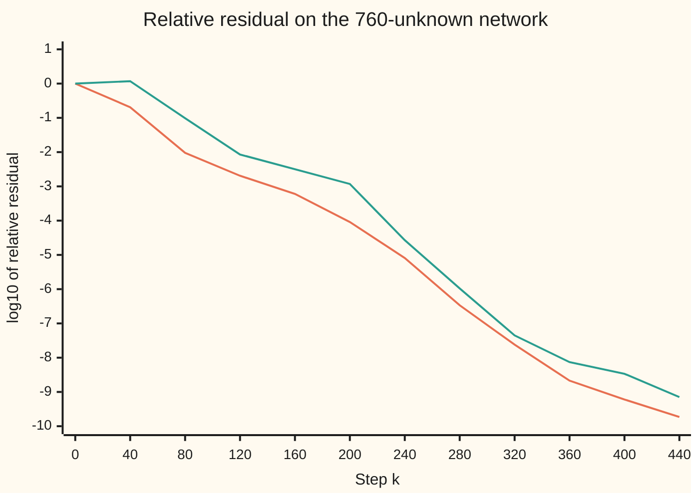
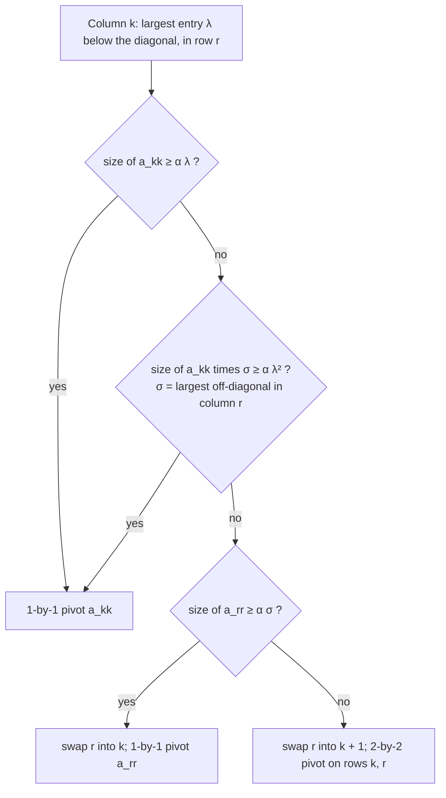

# Saddle-point systems: LDL^T with 2-by-2 pivots, and MINRES

[Syllabus](../../../SYLLABUS.md) → [Numerical analysis](../README.md) → [Numerical Linear Algebra](../README.md#s03) → Saddle-point systems

---

## General Overview

A water utility models 500 pipes and 260 junctions. It wants the flow q in every pipe, in litres a second (L/s), and the head h at every junction: pressure written as the height of a water column, in metres (m). A reservoir holds 60 m, and each junction draws 0.5 to 1.5 L/s.

Each pipe loses head in proportion to its flow. Each junction balances: water in equals water out plus demand. Flows first, heads second, the system reads

```math
\begin{pmatrix} R & E^{T} \\ E & 0 \end{pmatrix}\begin{pmatrix} q \\ h \end{pmatrix} = \begin{pmatrix} g \\ d \end{pmatrix}.
```

Here R lists the pipe resistances, E records which pipe meets which junction, g holds the reservoir's 60 m and d the demands. Call the whole matrix A. It is symmetric, so [Cholesky](04-cholesky-decomposition.md) or conjugate gradient look right. Both fail.

The zero block makes A **indefinite**: some directions x (vectors of unknowns) give $`x^{T} A x > 0`$, others $`x^{T} A x < 0`$. It is a **saddle-point matrix**, named after a surface that curves up one way and down the other. Optimisation builds the same shape, with a Hessian in place of R and the constraint matrix in place of E: the matrix of the [KKT conditions](../../15-Optimization/03-Constrained%20Optimisation/02-kkt-conditions.md).

The smallest case is one frictionless pipe feeding one junction that draws 20 L/s. Its matrix is `[[0, 1], [1, 0]]`. Cholesky's first pivot (the number it must take a square root of) is 0, and swapping rows and columns together cannot help: both diagonal entries are 0. But the whole 2-by-2 block inverts at once and gives 20 L/s and 60 m.

Two tools work:

- **Bunch–Kaufman LDLᵀ**, for dense matrices. It factors A as L D Lᵀ, with D made of 1-by-1 and 2-by-2 blocks chosen by the threshold α = (1 + √17)/8 = 0.640388. It costs about n³/3 flops, half of LU, and counts the positive and negative directions on the way.
- **MINRES** (minimum residual), for large sparse matrices. It needs only products with A, keeps seven vectors, and its residual never rises. On the 500-pipe network it reaches a relative residual (the leftover b − Ax, as a fraction of the right-hand side b) of 9.792e-11 in 446 steps; exact arithmetic would need 358 (Step 8).

**A symmetric indefinite matrix has no Cholesky factor and no conjugate-gradient guarantee; Bunch–Kaufman factors it as L D Lᵀ with 1-by-1 and 2-by-2 pivots chosen by the threshold α = (1 + √17)/8, which bounds growth and reveals the inertia, and MINRES solves a large one from products alone, by Lanczos plus a least-squares step, with a residual that never rises.**

**What kind of fact this is:** methods resting on theorems. Proved in Why it works: no indefinite matrix has a Cholesky factor, the threshold and its growth bounds, the sign of every 2-by-2 pivot, the inertia read from D, MINRES's short recurrence, its falling residual and its convergence bound. Bunch–Kaufman's backward stability is stated from a named source. The network is an illustrative linear model.

### The picture: MINRES against conjugate gradient on the 500-pipe network



Orange: MINRES, which never rises. Green: conjugate gradient on the same matrix, where it has no guarantee: it is above its start at step 40 and, between plotted points, climbs to 19.906 times its starting residual. Each step costs one product with A.

---

## The formula

The factorisation, for any symmetric matrix A of size n:

```math
P A P^{T} = L D L^{T}, \qquad D = \mathrm{diag}(D_1, D_2, \dots), \quad \text{each } D_j \text{ is } 1\times 1 \text{ or } 2\times 2.
```

**Read it aloud:** reorder rows and columns together, then split the matrix into a unit lower-triangular L, a block-diagonal D and the transpose of L.

The pivot rule at step k. Let λ be the largest entry, by size, below the diagonal in column k, found in row r. Let σ be the largest off-diagonal entry, by size, in column r.

```math
\alpha = \frac{1+\sqrt{17}}{8}: \quad \begin{cases} \lvert a_{kk}\rvert \ge \alpha\lambda \ \text{ or } \ \lvert a_{kk}\rvert\,\sigma \ge \alpha\lambda^{2} & \Rightarrow \ 1\times 1 \text{ pivot } a_{kk} \\ \text{else } \lvert a_{rr}\rvert \ge \alpha\sigma & \Rightarrow \ 1\times 1 \text{ pivot } a_{rr} \\ \text{else} & \Rightarrow \ 2\times 2 \text{ pivot on rows } k, r \end{cases}
```

**Read it aloud:** keep the diagonal pivot if it is big enough; otherwise try the other row's diagonal; otherwise take the two rows together as a 2-by-2 block.

MINRES picks, at step k, the best point of the Krylov space (every mix of b, Ab, …, A^(k−1) b):

```math
x_k = \underset{x \in \mathcal{K}_k}{\mathrm{argmin}}\ \lVert b - A x \rVert_2, \qquad \mathcal{K}_k = \mathrm{span}\{b, Ab, \dots, A^{k-1} b\}.
```

**Read it aloud:** among all mixes of the right-hand side and its first k − 1 products with A, take the one whose residual is shortest.

| Symbol | Plain meaning | In our example | Push it up and the answer… |
| --- | --- | --- | --- |
| $`A`$, $`n`$ | the symmetric saddle-point matrix, and its size: pipes plus junctions | n = 5 for the loop; n = 760 for the network | dense cost grows as n³ |
| $`q`$, $`h`$ | pipe flows in L/s; junction heads in m | loop: q = (32.5, 12.5, 17.5), h = (56.75, 53) | — |
| $`R`$, $`r_p`$ | diagonal table of pipe resistances: m of head lost per L/s in pipe p | loop: 0.1, 0.3, 0.4; network: 0.01 to 0.08 | heads fall faster along the pipe |
| $`E`$ | the incidence table: +1 where a pipe flows into a junction, −1 where it flows out | loop: rows (1, −1, 0) and (0, 1, 1) | — |
| $`g`$, $`d`$ | 60 m for each pipe leaving the reservoir, 0 for the rest; junction demands in L/s | loop: g = (60, 0, 60), d = (20, 30) | more demand, lower heads |
| $`P`$, $`L`$, $`D`$, $`F`$ | the reordering, the unit lower-triangular factor, the block-diagonal factor; F = `[[p, q], [q, t]]` is one 2-by-2 block of D | loop order q₁ h₁ q₃ h₂ q₂; D blocks `[0.1 1; 1 0]`, `[0.4 1; 1 0]`, `[0.8]` | — |
| $`\alpha`$, $`\lambda`$, $`\sigma`$ | the threshold; largest entry below the pivot; largest off-diagonal entry in row r | 0.640388; λ = 1, σ = 1 at the loop's first step | a bigger α takes more 2-by-2 pivots |
| $`\rho`$, $`\mu`$ | growth factor: the largest entry met during the factorisation, over the largest entry of A; μ is the largest entry at the current step; u = 2⁻⁵³ is the unit roundoff | 1.000000 on the loop; 2.536 on a 100-pipe district | bounded by 2.561553 to the power n − 1 |
| $`(n_+, n_-, n_0)`$ | inertia: how many eigenvalues are positive, negative, zero | loop (3, 2, 0); network (500, 260, 0) | — |
| $`S`$ | the nodal matrix $`E R^{-1} E^{T}`$, symmetric positive definite | 260 by 260; Cholesky pivots 8.318545 to 160.058261 | — |
| $`b`$, $`x_k`$, $`r_k`$, $`\mathcal{K}_k`$ | the right-hand side (g, d); MINRES's answer after k steps, its residual b − A x_k, and the space it searches; w_k is the direction of step k | relative residual 9.792e-11 at k = 446 | bigger k, smaller residual |
| $`v_k`$, $`\delta_k`$, $`\beta_k`$, $`\theta_i`$, $`\kappa`$ | Lanczos vectors (the columns of V_k; GMRES's table H̃_k becomes the tridiagonal T̃_k) and the diagonal and off-diagonal entries of their tridiagonal table T̃_k; the eigenvalues θ_i of A, and κ, the largest eigenvalue size over the smallest | seven vectors of 760 numbers kept | bigger κ, more steps |

Norms and the condition number come from [Matrix norms and the condition number](01-matrix-norms-and-the-condition-number.md). The flop, one addition, subtraction, multiplication or division, comes from [Counting the work](../01-Floating%20Point%20and%20Error/08-operation-counts-and-cost.md).

Clashes, said once: r alone is the pivot row, $`r_p`$ a resistance, $`r_k`$ a residual. ρ is the growth factor (g on the LU card, but g is the reservoir's heads here), not a spectral radius. The θ_i are A's eigenvalues, not Ritz values; the Lanczos card writes $`q_k`$, $`\alpha_k`$ for $`v_k`$, $`\delta_k`$.

### When it holds

- **A is symmetric.** Both methods rely on it. A lopsided matrix needs LU or GMRES from [Sparse storage and Krylov methods](10-sparse-matrices-and-krylov-methods.md).
- **Every junction reaches the reservoir (E has full row rank), and every demand-free circulation loses head (R is positive definite on the null space of E).** Every r_p > 0 is enough, not needed: the one frictionless pipe is fine. A cut-off junction has a free head, and a loop of frictionless pipes lets water circle for nothing: either way A gets a zero eigenvalue.
- **MINRES's pace depends on how close the eigenvalues come to zero, from both sides.** Without a preconditioner (a cheap approximate inverse applied each step), the network takes 446 steps for 760 unknowns.
- **The growth bound is a worst case.** At n = 160 it is 8.954e64; the measured growth is 2.536.
- **Dense Bunch–Kaufman ignores sparsity.** Its n³/3 flops suit hundreds of unknowns, not millions; for those, MINRES avoids the factor altogether.

---

## Why it works

### Step 0: a symmetric matrix with a negative direction has no Cholesky factor

For any real L, $`x^{T} (L L^{T}) x = \lVert L^{T} x \rVert^{2} \ge 0`$. So L Lᵀ never has a negative direction. The one-pipe matrix has one: x = (1, −1) makes $`x^{T} A x`$ negative.

A zero on the diagonal beside a nonzero entry is enough to rule a factor out. If $`a_{ii} = 0`$ and A = L Lᵀ, then the sum of squares $`\sum_k \ell_{ik}^{2}`$ is 0. So row i of L is zero, and then so is row i of A. Every head row of a network matrix has a zero diagonal and a ±1 beside it.

On the loop, Cholesky's pivots are 0.1, 0.3 and 0.4, the three resistances. The fourth is 0 − 1/0.1 − 1/0.3 = −13.333333, and the run stops. That negative pivot is not bad luck: it is the matrix's first negative direction showing through.

### Step 1: pivoting must be symmetric, so 1-by-1 pivots are not enough

[LU with partial pivoting](02-lu-decomposition-and-pivoting.md) swaps rows only. That works on the loop, but it breaks the symmetry: the factors are two different triangles, the cost is 2n³/3 flops, and the signs of the eigenvalues are lost.

To keep symmetry, rows and columns must swap together, as P A Pᵀ. A symmetric swap moves diagonal entries only onto the diagonal. If every diagonal entry is zero or tiny, no 1-by-1 pivot is safe. A 2-by-2 block is: `[[0, 1], [1, 0]]` has determinant −1 and inverts at once. Bunch and Kaufman (1977) allow both block sizes.

### Step 2: the decision rule



Each test looks only at two columns, so the search costs about n² comparisons in all, small beside the n³/3 flops of elimination. Elimination then runs as in Cholesky, with a block in place of a number: for a 2-by-2 pivot F, the rows below take multipliers $`[a_{ik}, a_{ir}]\,F^{-1}`$.

### Step 3: the threshold balances two growth bounds

Write μ for the largest entry of the active matrix. Each kind of step can enlarge it:

- **A 1-by-1 step** adds $`-a_{ik} a_{kj} / a_{kk}`$ to each entry. In each 1-by-1 case of the rule this is at most μ/α, so the new largest entry is at most (1 + 1/α) μ = 2.561553 μ.
- **A 2-by-2 step** retires two columns at once. Its additions are at most 2μ/(1 − α), so the new largest entry is at most (1 + 2/(1 − α)) μ = 6.561553 μ.

Two 1-by-1 steps also retire two columns, at a cost of (1 + 1/α)². Choosing α so that both routes cost the same gives

```math
\left(1 + \frac{1}{\alpha}\right)^{2} = 1 + \frac{2}{1-\alpha} \iff 4\alpha^{2} - \alpha - 1 = 0 \iff \alpha = \frac{1+\sqrt{17}}{8} = 0.640388.
```

Then $`(2.561553)^{2} = 6.561553`$, and the growth factor obeys $`\rho \le 2.561553^{\,n-1}`$. Partial pivoting in LU has the bound 2^(n−1); the price of keeping symmetry is a slightly larger base.

<details>
<summary>Detailed proof: the two growth bounds</summary>

Let |a_ik| ≤ λ for i ≠ k, and |a_ir| ≤ σ for i ≠ r, with both λ and σ at most μ.

1-by-1 pivot a_kk with |a_kk| ≥ αλ: each addition is at most λ·λ/(αλ) = λ/α ≤ μ/α.

1-by-1 pivot a_kk with |a_kk| σ ≥ αλ²: each addition is at most λ²/|a_kk| ≤ σ/α ≤ μ/α.

1-by-1 pivot a_rr with |a_rr| ≥ ασ: column r's entries are at most σ, so each addition is at most σ²/(ασ) = σ/α ≤ μ/α.

2-by-2 pivot F = `[[p, q], [q, t]]` with p = a_kk, q = a_rk (so |q| = λ), t = a_rr. It is taken only when |p| σ < αλ² and |t| < ασ. Then |p t| < αλ²/σ · ασ = α²λ², so

$`\displaystyle \lvert \det F\rvert = \lvert q^{2} - p t\rvert \ge \lambda^{2} - \alpha^{2}\lambda^{2} = \lambda^{2}(1-\alpha^{2}).`$

The addition to entry (i, j) is $`[a_{ik}, a_{ir}]\,F^{-1}\,[a_{kj}, a_{rj}]^{T}`$. Bound each piece by its size, with $`F^{-1} = \frac{1}{\det F}`$ `[[t, −q], [−q, p]]`:

$`\displaystyle \le \frac{\lambda^{2}\lvert t\rvert + 2\lambda^{2}\sigma + \sigma^{2}\lvert p\rvert}{\lambda^{2}(1-\alpha^{2})} < \frac{\alpha\lambda^{2}\sigma + 2\lambda^{2}\sigma + \alpha\lambda^{2}\sigma}{\lambda^{2}(1-\alpha^{2})} = \frac{2\sigma}{1-\alpha} \le \frac{2\mu}{1-\alpha}.`$

</details>

### Step 4: every 2-by-2 pivot has one positive and one negative direction

The fold above showed $`\lvert p t\rvert < \alpha^{2}\lambda^{2} < \lambda^{2} = q^{2}`$ for every 2-by-2 pivot. So

```math
\det F = p t - q^{2} < 0.
```

A symmetric 2-by-2 block's determinant is the product of its two eigenvalues. A negative product means one positive eigenvalue and one negative one. So each 2-by-2 block adds one to each count.

### Step 5: the inertia comes free

Write W = Pᵀ L. Then A = W D Wᵀ with W invertible: A and D are **congruent**. Sylvester's law of inertia, proved on [Bilinear forms](../../03-Algebra/07-Eigenvalues%20and%20Symmetric%20Matrices/12-bilinear-forms-and-sylvesters-law.md), says congruent symmetric matrices have the same counts of positive, negative and zero eigenvalues. So count D's signs: each 1-by-1 block by its sign, each 2-by-2 block as one of each.

On the loop, D has two 2-by-2 blocks and the pivot 0.8: inertia (3, 2, 0). On a 100-pipe district (n = 160) it takes 59 2-by-2 pivots and reads (100, 60, 0). In general, with R positive definite and E of full row rank, the inertia is (pipes, junctions, 0) (Benzi, Golub and Liesen, 2005). The flows minimise, the heads maximise: a saddle.

The block form shows why. Eliminate all the flows as one big pivot:

```math
\begin{pmatrix} R & E^{T} \\ E & 0 \end{pmatrix} = \begin{pmatrix} I & 0 \\ E R^{-1} & I \end{pmatrix} \begin{pmatrix} R & 0 \\ 0 & -S \end{pmatrix} \begin{pmatrix} I & R^{-1} E^{T} \\ 0 & I \end{pmatrix}, \qquad S = E R^{-1} E^{T}.
```

On the network, R gives 500 positive entries. Cholesky runs through S with pivots from 8.318545 to 160.058261, so S is positive definite and −S gives 260 negative ones: (500, 260, 0). This block form is also the **nodal method**, the code's second road: solve S h = E R⁻¹ g − d by Cholesky, then each flow is its head drop over its resistance.

### Step 6: what rounding does, stated from the source

Higham (2002, chapter 11) proves Bunch–Kaufman normwise backward stable ([Forward and backward error](../01-Floating%20Point%20and%20Error/06-forward-and-backward-error.md)): the computed L̂ D̂ L̂ᵀ factors A plus a change no bigger than a modest multiple of n, the unit roundoff u = 2⁻⁵³, the growth ρ and the size of A. On the district ρ is 2.536, and the factor's answer is within 4.817e-8 of MINRES's.

Without the threshold, a tiny pivot gets through. Give pipe 1 of the loop a resistance of 1e-13 m per L/s. Plain 1-by-1 pivoting divides by 1e-13, makes a multiplier of 1e13, and adds numbers near 1e13 to numbers near 1. It returns q₁ = 37.250000 L/s. Bunch–Kaufman sees 1e-13 < αλ, takes a 2-by-2 pivot, and returns 37.142857, the loop rule's answer.

### Step 7: MINRES is GMRES with a short memory

[Sparse storage and Krylov methods](10-sparse-matrices-and-krylov-methods.md) builds GMRES: Arnoldi makes an orthonormal basis V_k of the Krylov space, with A V_k = V_{k+1} H̃_k, and each step solves a small least-squares problem. MINRES adds one fact: A is symmetric.

Then $`V_k^{T} A V_k`$ is symmetric, and it is upper Hessenberg (zero below the first subdiagonal), as in Arnoldi. A symmetric Hessenberg matrix is **tridiagonal**: only its diagonal δ_k and the entries β_k beside it survive. So Arnoldi's long Gram–Schmidt sweep shrinks to three terms, the **Lanczos** recurrence:

```math
\beta_{k+1} v_{k+1} = A v_k - \delta_k v_k - \beta_k v_{k-1}, \qquad \delta_k = v_k^{T} A v_k .
```

The least-squares table T̃_k is tridiagonal too. Each new column has three nonzeros, so one new plane rotation (a Givens rotation) makes it triangular, and the answer updates along a direction $`w_k`$ built from the last two. That is MINRES (Paige and Saunders, 1975). The code keeps seven vectors of length n at every step; GMRES keeps one more vector every step.

### Step 8: why the residual never rises, and how fast it falls

The Krylov spaces are nested, $`\mathcal{K}_k \subset \mathcal{K}_{k+1}`$, and a minimum over a bigger set is no larger. So $`\lVert r_{k+1}\rVert \le \lVert r_k\rVert`$. The code recomputes b − A x_k at all 446 steps: it rises 0 times. The rotations also give the residual's length without forming it: the running estimate 9.792e-11 matches the recomputed 9.792e-11. That estimate, a product of rotation sines, cannot rise, so only the recomputed residual tests the claim.

Conjugate gradient has no such property here. The optimisation card [Conjugate gradient](../../15-Optimization/02-Unconstrained%20Methods/07-conjugate-gradient-method.md) shows it going astray on a two-variable saddle. Its step length $`r^{T} r / p^{T} A p`$ assumes $`p^{T} A p > 0`$, a bowl. On the network, 224 of its 466 steps have $`p^{T} A p < 0`$. On the one pipe with zero demand, b = (60, 0), its first direction is p = b with $`p^{T} A p = 0`$: it divides by zero at step 1. MINRES solves that system in 2 steps.

For speed: $`r_k = p(A)\,b`$ for some polynomial p of degree k with p(0) = 1, and MINRES gets the best one, so $`\lVert r_k \rVert \le \max_i \lvert p(\theta_i)\rvert \, \lVert b \rVert`$ for every such p, where θ_i are the eigenvalues. If they lie in [−θ_max, −θ_min] ∪ [θ_min, θ_max], with κ = θ_max/θ_min, then

```math
\frac{\lVert r_k\rVert}{\lVert b\rVert} \le 2\left(\frac{\kappa - 1}{\kappa + 1}\right)^{\lfloor k/2 \rfloor}.
```

A positive definite matrix gets the rate (√κ − 1)/(√κ + 1) every step instead. So an indefinite system needs steps in proportion to κ where a definite one needs √κ. That is why practical codes add a preconditioner.

Rounding costs steps too. In floating point the Lanczos vectors lose orthogonality (the Lanczos card explains how), so the least-squares step works in a slightly wrong space. Reorthogonalising each new vector against all earlier ones imitates exact arithmetic: MINRES then needs 358 steps. Of the 446, 88 are lost to rounding, not to the eigenvalues.

<details>
<summary>Detailed proof: the two-interval bound from the one-interval bound</summary>

[Iterating instead of factoring](09-iterative-methods-jacobi-gauss-seidel-and-conjugate-gradient.md) builds, from a Chebyshev polynomial: for 0 < m ≤ M with κ' = M/m, a polynomial s of degree j with s(0) = 1 and |s(z)| ≤ 2((√κ' − 1)/(√κ' + 1))^j for all z in [m, M].

Put z = θ². Every eigenvalue θ of A has θ² in [θ_min², θ_max²], so κ' = κ² and √κ' = κ. Let p(θ) = s(θ²). It has degree 2j, p(0) = s(0) = 1, and

$`\displaystyle \max_i \lvert p(\theta_i)\rvert \le 2\left(\frac{\kappa-1}{\kappa+1}\right)^{j}.`$

Since A = Σ θ_i u_i u_iᵀ with orthonormal u_i, $`\lVert p(A) b\rVert \le \max_i \lvert p(\theta_i)\rvert\,\lVert b\rVert`$. MINRES's residual is the smallest over all p of degree at most k with p(0) = 1, and with j = ⌊k/2⌋ this p qualifies.

</details>

### Step 9: what "converged" means here

The stopping test is the residual estimate below 1e-10. The recomputed relative residual, 9.792e-11, is a small backward error. The answer is within 2.338e-7 (L/s or m) of the nodal answer: the residual amplified by the condition number, a matter of conditioning, not of the method ([Conditioning and stability](../01-Floating%20Point%20and%20Error/05-conditioning-and-stability.md)). Water balances: the reservoir supplies 260.311776 L/s, the total demand.

---

## Worked numbers, by hand

Bunch–Kaufman on the 3-pipe loop of [LU with partial pivoting](02-lu-decomposition-and-pivoting.md): resistances 0.1, 0.3, 0.4; demands 20 and 30 L/s; reservoir at 60 m. Unknowns q₁, q₂, q₃, h₁, h₂.

| Step | Arithmetic | Value |
| --- | --- | --- |
| step 1: test a₁₁ | λ = 1 (row h₁); is 0.1 ≥ α × 1 = 0.640388? | no |
| step 1: second test | σ = 1 (column h₁); is 0.1 × 1 ≥ 0.640388 × 1²? Is a(h₁, h₁) = 0 ≥ 0.640388? | no, no |
| step 1: 2-by-2 pivot | rows q₁, h₁: `[0.1 1; 1 0]`, det = 0 − 1 | −1 |
| multipliers for q₂ | (0, −1) times F⁻¹ = `[0 1; 1 −0.1]` | (−1, 0.1) |
| update q₂'s diagonal | 0.3 − (−1 × 0 + 0.1 × −1) | 0.4 |
| step 2: 2-by-2 pivot | rows q₃, h₂: `[0.4 1; 1 0]` fails both tests, det = −1 | −1 |
| multipliers for q₂ | (0, 1) times `[0 1; 1 −0.4]` | (1, −0.4) |
| step 3: last pivot | 0.4 − (1 × 0 − 0.4 × 1) = 0.1 + 0.3 + 0.4, the loop's total resistance | 0.8 |
| forward sweep | right side in pivot order (60, 20, 60, 30, 0); only the last entry changes: 0 − (−1 × 60 + 0.1 × 20 + 1 × 60 − 0.4 × 30) | 10 |
| block solves | `[0.1 1; 1 0]` z = (60, 20) gives (20, 60 − 0.1 × 20); `[0.4 1; 1 0]` z = (60, 30) gives (30, 60 − 0.4 × 30) | (20, 58), (30, 48) |
| last pivot solve | q₂ = 10 ÷ 0.8 | 12.5 |
| back sweep | q₁ = 20 + q₂; h₁ = 58 − 0.1 q₂; q₃ = 30 − q₂; h₂ = 48 + 0.4 q₂ | 32.5, 56.75, 17.5, 53 |
| inertia | two blocks with det < 0, one pivot 0.8 > 0 | **(3, 2, 0)** |

The answer: 12.5 L/s goes round through pipe 2, and the junctions sit at 56.75 m and 53 m. The factorisation has rediscovered the loop rule: the last step is $`q_2 = (30\,r_3 - 20\,r_1)/(r_1 + r_2 + r_3)`$ = 10/0.8. MINRES reaches the same answer in 5 steps, with relative residuals 1.000e0, 5.855e-1, 2.552e-1, 2.268e-1, 7.498e-2, 6.480e-16, a gap of 5.684e-14 to the factor.

On the 500-pipe network, by count:

| Item | Arithmetic | Value |
| --- | --- | --- |
| unknowns | 500 flows + 260 heads | n = 760 |
| stored entries | 500 resistances + 2 × (2 × 500 − 13) incidence entries | 2,474 |
| dense Bunch–Kaufman | 760³/3 | 146,325,333 flops |
| dense LU | 2 × 760³/3 | 292,650,666 flops |
| one MINRES step | 2 × 2,474 + 16 × 760 | 17,108 flops |
| **MINRES to 1e-10** | 446 steps × 17,108 | **7,630,168 flops** |

### What breaks if you drop a piece

| Mistake | Comes out at | What went wrong |
| --- | --- | --- |
| Cholesky on the loop | pivots 0.1, 0.3, 0.4, then −13.333333: stops | the matrix has negative directions; L Lᵀ has none |
| 1-by-1 pivots only, pipe 1 at r = 1e-13 | q₁ = 37.250000 L/s instead of 37.142857 | a pivot of 1e-13 makes multipliers of 1e13 that swamp the other entries |
| Conjugate gradient on one pipe with zero demand | $`p^{T} A p = 0`$ at step 1: division by zero | the step length assumes a bowl |
| Conjugate gradient on the network | residual climbs to 19.906 times its start; 224 steps with $`p^{T} A p < 0`$ | no minimising property; it finishes here by luck, not by theorem |

---

## Code, from first principles, and it actually runs

The code runs Bunch–Kaufman on the one pipe, the loop, the loop with a near-frictionless pipe and a 100-pipe district. It runs MINRES on the one pipe, the loop, the district and the 500-pipe network, and conjugate gradient on the one pipe and the network. It takes four independent roads. The loop's factor matches the loop rule, a closed form. MINRES matches the factor on the loop and on the district. On the network, MINRES matches the nodal method, a Cholesky solve of a different, positive definite system. The residual is recomputed by a separate product at every step, and water in equals water out. A second network run imitates exact arithmetic by reorthogonalising. The resistances and demands come from the golden-ratio sequence (k × 0.618… with the whole part dropped), the same in both languages.

### Python

```python
# Saddle-point systems -- the check behind the card.  Standard library only; nothing imported holds an answer.  Water
# flows q (L/s) and heads h (m) solve [[R, E^T], [E, 0]] (q, h) = (g, d): symmetric, indefinite.  Several roads, compared.
from math import sqrt, log10; from functools import reduce
ALPHA, H = (1 + sqrt(17)) / 8, 60.0
def dot(u, v): return reduce(lambda s, t: s + t[0] * t[1], zip(u, v), 0.0)   # left to right, no compensation
def bk(a0, plain=False):           # Bunch-Kaufman: P A P^T = L D L^T, D made of 1x1 and 2x2 blocks
    n, a, k = len(a0), [r[:] for r in a0], 0; big0 = big = max(abs(v) for r in a0 for v in r)
    L, perm, blocks = [[float(i == j) for j in range(n)] for i in range(n)], list(range(n)), []
    def swap(i, j):                # rows AND columns together, so the matrix stays symmetric
        a[i], a[j], perm[i], perm[j] = a[j], a[i], perm[j], perm[i]
        for r in a: r[i], r[j] = r[j], r[i]
        for c in range(k): L[i][c], L[j][c] = L[j][c], L[i][c]
    while k < n:
        r = max(range(k + 1, n), key=lambda i: abs(a[i][k]), default=k); lam, s = abs(a[r][k]) if r > k else 0.0, 1
        if not plain and abs(a[k][k]) < ALPHA * lam:
            sig = max(abs(a[i][r]) for i in range(k, n) if i != r)
            if abs(a[k][k]) * sig >= ALPHA * lam * lam: pass           # keep the 1x1 pivot
            elif abs(a[r][r]) >= ALPHA * sig: swap(k, r)               # 1x1 pivot from row r
            else: s = 2; swap(k + 1, r)                               # 2x2 pivot on rows k, r
        if s == 1:
            for i in range(k + 1, n): L[i][k] = a[i][k] / a[k][k]
            blocks.append((a[k][k],))
        else:
            p, q, t = a[k][k], a[k + 1][k], a[k + 1][k + 1]; det = p * t - q * q
            for i in range(k + 2, n):
                L[i][k], L[i][k + 1] = (a[i][k] * t - a[i][k + 1] * q) / det, (a[i][k + 1] * p - a[i][k] * q) / det
            blocks.append((p, q, t))
        for i in range(k + s, n):
            for j in range(k + s, n):
                for c in range(k, k + s): a[i][j] -= L[i][c] * a[c][j]
                big = max(big, abs(a[i][j]))
        k += s
    return perm, L, blocks, big / big0
def bk_solve(perm, L, blocks, b):  # forward with L, then the blocks of D, back with L^T, undo P
    n, y, k = len(b), [b[p] for p in perm], 0
    for i in range(n): y[i] -= dot(L[i][:i], y[:i])
    for d in blocks:
        if len(d) == 1: y[k] /= d[0]
        else:
            det, y0 = d[0] * d[2] - d[1] * d[1], y[k]
            y[k], y[k + 1] = (d[2] * y0 - d[1] * y[k + 1]) / det, (d[0] * y[k + 1] - d[1] * y0) / det
        k += min(len(d), 2)
    for i in reversed(range(n)): y[i] -= dot([L[j][i] for j in range(i + 1, n)], y[i + 1:])
    return [y[perm.index(i)] for i in range(n)]
def inertia(D): return [sum(len(d) == 3 or d[0] * sg > 0 for d in D) for sg in (1, -1)]  # a 2x2 block: one of each
def minres(mv, b, tol, kmax, full=False):  # Lanczos plus one plane rotation a step; seven vectors kept (all, if full)
    n, b1, bet, cs, sn, dbar, eps, V = len(b), sqrt(dot(b, b)), 0.0, -1.0, 0.0, 0.0, 0.0, []
    v, vp, w, w2, x, phib, hist, tr = [t / b1 for t in b], [0.0] * n, [0.0] * n, [0.0] * n, [0.0] * n, b1, [1.0], [1.0]
    for k in range(kmax):
        p = mv(v); al = dot(v, p); p = [p[i] - al * v[i] - bet * vp[i] for i in range(n)]; V += [v] * full
        for u in V + V: c = dot(u, p); p = [p[i] - c * u[i] for i in range(n)]   # full: orthogonal to all, as in exact arithmetic
        bn = sqrt(dot(p, p)); oeps, delta, gbar = eps, cs * dbar + sn * al, sn * dbar - cs * al
        eps, dbar, gam = sn * bn, -cs * bn, sqrt(gbar * gbar + bn * bn)
        cs, sn = gbar / gam, bn / gam; phi, phib = cs * phib, sn * phib
        w1, w2 = w2, w; w = [(v[i] - oeps * w1[i] - delta * w2[i]) / gam for i in range(n)]
        x = [x[i] + phi * w[i] for i in range(n)]; hist.append(abs(phib) / b1); r = [s - t for s, t in zip(mv(x), b)]; tr.append(sqrt(dot(r, r)) / b1)
        if hist[-1] < tol or bn == 0.0: return x, hist, tr          # hist: the rotations' estimate; tr: b - A x recomputed
        vp, v, bet = v, [t / bn for t in p], bn
    return x, hist, tr
def cg(mv, b, tol, kmax):          # conjugate gradient, run where it has no guarantee
    n, x, r, p, neg, hist, rr = len(b), [0.0] * len(b), b[:], b[:], 0, [1.0], dot(b, b)
    for k in range(kmax):
        ap = mv(p); pap = dot(p, ap)
        if pap == 0.0: return x, hist, neg, k + 1          # breakdown: the step length divides by zero
        neg += pap < 0; al = rr / pap
        x, r = [x[i] + al * p[i] for i in range(n)], [r[i] - al * ap[i] for i in range(n)]
        rn = dot(r, r); hist.append(sqrt(rn / dot(b, b)))
        if hist[-1] < tol: break
        p = [r[i] + rn / rr * p[i] for i in range(n)]; rr = rn
    return x, hist, neg, 0
def chol_solve(a, b):              # Cholesky, as on the Cholesky card; None at the first pivot <= 0
    n, L, piv, y = len(a), [[0.0] * len(a) for _ in a], [], b[:]
    for j in range(n):
        piv.append(a[j][j] - dot(L[j][:j], L[j][:j]))
        if piv[-1] <= 0.0: return None, piv
        L[j][j] = sqrt(piv[-1])
        for i in range(j + 1, n): L[i][j] = (a[i][j] - dot(L[i][:j], L[j][:j])) / L[j][j]
    for i in range(n): y[i] = (y[i] - dot(L[i][:i], y[:i])) / L[i][i]
    for i in reversed(range(n)): y[i] = (y[i] - dot([L[j][i] for j in range(i + 1, n)], y[i + 1:])) / L[i][i]
    return y, piv
class Net:                         # pipe (a, b, r): a to b, r m per L/s; a = -1 is the reservoir at H
    def __init__(s, pipes, dem): s.pp, s.d, s.m, s.n, s.rhs = pipes, dem, len(pipes), len(pipes) + len(dem), [H if a < 0 else 0.0 for a, b, r in pipes] + dem
    def mv(s, v):                  # (R q + E^T h, E q), one pass over the pipes
        y, m = [0.0] * s.n, s.m
        for p, (a, b, r) in enumerate(s.pp):
            y[p] += r * v[p] + v[m + b]; y[m + b] += v[p]
            if a >= 0: y[p] -= v[m + a]; y[m + a] -= v[p]
        return y
    def dense(s): return [s.mv([float(i == j) for i in range(s.n)]) for j in range(s.n)]
    def nodal(s):                  # S h = E R^-1 g - d, S = E R^-1 E^T; then q = R^-1 (g - E^T h)
        S, t = [[0.0] * len(s.d) for _ in s.d], [-v for v in s.d]
        for a, b, r in s.pp:
            S[b][b] += 1 / r; t[b] += H / r if a < 0 else 0.0
            if a >= 0: S[a][a] += 1 / r; S[a][b] -= 1 / r; S[b][a] -= 1 / r
        h, piv = chol_solve(S, t)
        return [((H if a < 0 else h[a]) - h[b]) / r for a, b, r in s.pp] + h, piv
def grid(rows, cols):              # feeders into column 0, pipes along each row, then down each column
    ends = [(-1, i * cols) for i in range(rows)] + [(i * cols + j, i * cols + j + 1) for i in range(rows) for j in range(cols - 1)] + [
        (i * cols + j, i * cols + cols + j) for i in range(rows - 1) for j in range(cols)]
    u = [(k * 0.6180339887498949) % 1.0 for k in range(1, len(ends) + rows * cols + 1)]   # golden-ratio spread, illustrative
    return Net([(a, b, 0.01 + 0.01 * u[p] if a < 0 else 0.02 + 0.06 * u[p]) for p, (a, b) in enumerate(ends)], [0.5 + v for v in u[len(ends):]])
def sci(x): m, e = f"{x:.3e}".split("e"); return f"{m}e{int(e)}"
def gap(u, v): return max(abs(a - b) for a, b in zip(u, v))
def row(label, vals): print(f"{label:<38}" + "".join(f"{v:>11.6f}" for v in vals))
g1, g2 = 1 + 1 / ALPHA, 1 + 2 / (1 - ALPHA); row("alpha; growth: 1x1 step, 2x2 step, g1^2", [ALPHA, g1, g2, g1 * g1])
one = Net([(-1, 0, 0.0)], [20.0]); S2 = one.dense(); B1 = bk(S2); c1 = chol_solve(S2, one.rhs); x1 = bk_solve(*B1[:3], one.rhs)
print(f"one pipe: Cholesky pivot 1 = {c1[1][0]:.6f}; BK 2x2 det {B1[2][0][0] * B1[2][0][2] - B1[2][0][1] ** 2:.6f}, "
      f"inertia {inertia(B1[2])}, q, h = {x1[0]:.6f}, {x1[1]:.6f}")
brk = cg(one.mv, [H, 0.0], 1e-12, 5)[3]; xm, hm, _ = minres(one.mv, [H, 0.0], 1e-12, 5)
print(f"one pipe, demand 0: CG stops at step {brk}, p^T A p = 0; MINRES {len(hm) - 1} steps to q, h = {xm[0]:.6f}, {xm[1]:.6f}")
loop = Net([(-1, 0, 0.1), (0, 1, 0.3), (-1, 1, 0.4)], [20.0, 30.0])      # the LU card's loop, morning demand
A5 = loop.dense(); perm, L5, D5, gr5 = bk(A5); x5 = bk_solve(perm, L5, D5, loop.rhs); c5 = chol_solve(A5, loop.rhs)
row("loop: Cholesky pivots, then it stops", c5[1])
print("loop: order", " ".join(["q1", "q2", "q3", "h1", "h2"][p] for p in perm), "| D blocks", *("[" + " ".join(f"{v:.6f}" for v in d) + "]" for d in D5))
row("loop: last row of L; growth", L5[4] + [gr5]); row("loop: Bunch-Kaufman q1 q2 q3 h1 h2", x5)
q2 = (30 * 0.4 - 20 * 0.1) / (0.1 + 0.3 + 0.4); print(f"loop: inertia {inertia(D5)}; loop rule q2 = {q2:.6f}")
xm5, hm5, _ = minres(loop.mv, loop.rhs, 1e-12, 10); print("loop: MINRES residual by step", *map(sci, hm5), "| gap to BK", sci(gap(xm5, x5)))
tiny = Net([(-1, 0, 1e-13), (0, 1, 0.3), (-1, 1, 0.4)], [20.0, 30.0]); qt = (12 - 20e-13) / (1e-13 + 0.7) + 20   # r1 = 1e-13
xp, xb = [bk_solve(*bk(tiny.dense(), f)[:3], tiny.rhs) for f in (True, False)]; row("tiny r1: q1 by 1x1 order, BK, loop rule", [xp[0], xb[0], qt])
dis = grid(3, 20); Pd = bk(dis.dense()); xd = bk_solve(*Pd[:3], dis.rhs); xdm = minres(dis.mv, dis.rhs, 1e-10, 2000)[0]
print(f"district: {dis.m} pipes, n = {dis.n}; 2x2 pivots {sum(len(d) == 3 for d in Pd[2])}, inertia {inertia(Pd[2])}; growth "
      f"{sci(Pd[3])}, bound {sci(g1 ** (dis.n - 1))}; gap to MINRES {sci(gap(xd, xdm))}")
net = grid(13, 20); xn, pn = net.nodal(); nnz, ones = net.m + 2 * (2 * net.m - 13), [1.0] * net.n; step = 2 * nnz + 16 * net.n
print(f"network: {net.m} pipes, n = {net.n}, stored entries {nnz}; demand {dot(net.d, ones):.6f} L/s")
row("network: nodal pivots: smallest, largest", [min(pn), max(pn)]); print("network: inertia", [net.m, len(pn)])
xm, hm, tm = minres(net.mv, net.rhs, 1e-10, 3000); xc, hc, negc, _ = cg(net.mv, net.rhs, 1e-10, 3000)
res = [a - b for a, b in zip(net.mv(xm), net.rhs)]; rel = sqrt(dot(res, res) / dot(net.rhs, net.rhs))
print(f"network: MINRES {len(hm) - 1} steps, residual {sci(hm[-1])}, recomputed {sci(rel)}; gap to nodal {sci(gap(xm, xn))}, CG's {sci(gap(xc, xn))}")
row("network: heads min, max; reservoir L/s", [min(xm[net.m:]), max(xm[net.m:]), dot(xm[:13], ones)])
print(f"network: CG {len(hc) - 1} steps, {negc} negative p^T A p, worst residual {max(hc):.3f} times the start")
hf = minres(net.mv, net.rhs, 1e-10, 3000, True)[1]; print(f"network: recomputed residual rises {sum(b > a for a, b in zip(tm, tm[1:]))} times; with full reorthogonalisation MINRES needs {len(hf) - 1} steps, {len(hm) - len(hf)} fewer")
print(f"flops at n = {net.n}: dense BK {net.n ** 3 // 3:,}, LU {2 * net.n ** 3 // 3:,}; MINRES {step:,} a step, {step * (len(hm) - 1):,} in all")
for k in range(0, len(hm), 40): print(f"figure, step {k}, MINRES {log10(hm[k]):.2f}, CG {log10(hc[k]):.2f}")
assert abs(g1 * g1 - g2) < 1e-12 and abs(4 * ALPHA * ALPHA - ALPHA - 1) < 1e-15 and c1[0] is None and c5[0] is None and brk == 1
assert gap(x5, [32.5, 12.5, 17.5, 56.75, 53.0]) < 1e-12 and abs(x5[1] - q2) < 1e-12 and abs(xp[0] - qt) > 0.01 and abs(xb[0] - qt) < 1e-9
assert inertia(D5) == [3, 2] and inertia(Pd[2]) == [dis.m, dis.n - dis.m] and min(pn) > 0 and Pd[3] <= g1 ** (dis.n - 1)
assert all(d[0] * d[2] - d[1] ** 2 < 0 for d in D5 + Pd[2] if len(d) == 3)            # every 2x2 pivot: one + and one -
assert gap(xm5, x5) < 1e-10 and gap(xdm, xd) < 1e-7 and gap(xm, xn) < 1e-6 and abs(rel - hm[-1]) < 1e-12 and max(hc) > 1
assert all(b <= a * (1 + 1e-12) for a, b in zip(tm, tm[1:])) and abs(dot(xm[:13], ones) - dot(net.d, ones)) < 1e-6 and hf[-1] < 1e-10 < hf[-2] and len(hf) < len(hm)
print("ALL CHECKS PASS")
```

**Ran 2026-11-24 on macOS, Python 3.14.10, standard library only. All checks passed. Output, pasted from the run:**

```
alpha; growth: 1x1 step, 2x2 step, g1^2   0.640388   2.561553   6.561553   6.561553
one pipe: Cholesky pivot 1 = 0.000000; BK 2x2 det -1.000000, inertia [1, 1], q, h = 20.000000, 60.000000
one pipe, demand 0: CG stops at step 1, p^T A p = 0; MINRES 2 steps to q, h = 0.000000, 60.000000
loop: Cholesky pivots, then it stops     0.100000   0.300000   0.400000 -13.333333
loop: order q1 h1 q3 h2 q2 | D blocks [0.100000 1.000000 0.000000] [0.400000 1.000000 0.000000] [0.800000]
loop: last row of L; growth             -1.000000   0.100000   1.000000  -0.400000   1.000000   1.000000
loop: Bunch-Kaufman q1 q2 q3 h1 h2      32.500000  12.500000  17.500000  56.750000  53.000000
loop: inertia [3, 2]; loop rule q2 = 12.500000
loop: MINRES residual by step 1.000e0 5.855e-1 2.552e-1 2.268e-1 7.498e-2 6.480e-16 | gap to BK 5.684e-14
tiny r1: q1 by 1x1 order, BK, loop rule  37.250000  37.142857  37.142857
district: 100 pipes, n = 160; 2x2 pivots 59, inertia [100, 60]; growth 2.536e0, bound 8.954e64; gap to MINRES 4.817e-8
network: 500 pipes, n = 760, stored entries 2474; demand 260.311776 L/s
network: nodal pivots: smallest, largest   8.318545 160.058261
network: inertia [500, 260]
network: MINRES 446 steps, residual 9.792e-11, recomputed 9.792e-11; gap to nodal 2.338e-7, CG's 6.057e-8
network: heads min, max; reservoir L/s  50.728378  59.774961 260.311776
network: CG 466 steps, 224 negative p^T A p, worst residual 19.906 times the start
network: recomputed residual rises 0 times; with full reorthogonalisation MINRES needs 358 steps, 88 fewer
flops at n = 760: dense BK 146,325,333, LU 292,650,666; MINRES 17,108 a step, 7,630,168 in all
figure, step 0, MINRES 0.00, CG 0.00
figure, step 40, MINRES -0.69, CG 0.07
figure, step 80, MINRES -2.02, CG -1.01
figure, step 120, MINRES -2.69, CG -2.07
figure, step 160, MINRES -3.22, CG -2.50
figure, step 200, MINRES -4.04, CG -2.93
figure, step 240, MINRES -5.09, CG -4.57
figure, step 280, MINRES -6.47, CG -5.98
figure, step 320, MINRES -7.62, CG -7.35
figure, step 360, MINRES -8.67, CG -8.13
figure, step 400, MINRES -9.22, CG -8.47
figure, step 440, MINRES -9.73, CG -9.15
ALL CHECKS PASS
```

### Rust

```rust
// Saddle-point systems -- the check behind the card.  std only; nothing used holds an answer.  Water flows q (L/s)
// and heads h (m) solve [[R, E^T], [E, 0]] (q, h) = (g, d): symmetric, indefinite.  Several roads, compared.
type M = Vec<Vec<f64>>; const H: f64 = 60.0;
fn alpha() -> f64 { (1.0 + 17f64.sqrt()) / 8.0 }
fn dot(u: &[f64], v: &[f64]) -> f64 { u.iter().zip(v).fold(0.0, |s, (a, b)| s + a * b) } // left to right
struct Bk { perm: Vec<usize>, l: M, blocks: Vec<Vec<f64>>, growth: f64 }
fn bk(a0: &M, plain: bool) -> Bk { // Bunch-Kaufman: P A P^T = L D L^T, D made of 1x1 and 2x2 blocks
    let (n, mut a, mut k, al, big0) = (a0.len(), a0.clone(), 0usize, alpha(), a0.iter().flatten().fold(0.0f64, |m, v| m.max(v.abs())));
    let (mut big, mut l): (f64, M) = (big0, (0..n).map(|i| (0..n).map(|j| if i == j { 1.0 } else { 0.0 }).collect()).collect());
    let (mut perm, mut blocks): (Vec<usize>, Vec<Vec<f64>>) = ((0..n).collect(), vec![]);
    let swap = |a: &mut M, l: &mut M, perm: &mut Vec<usize>, k: usize, i: usize, j: usize| { // rows AND columns, so A stays symmetric
        a.swap(i, j); perm.swap(i, j); for r in a.iter_mut() { r.swap(i, j); }
        for c in 0..k { let t = l[i][c]; l[i][c] = l[j][c]; l[j][c] = t; }
    };
    while k < n {
        let (mut lam, mut r, mut s) = (0.0f64, k, 1usize);
        for i in k + 1..n { if a[i][k].abs() > lam { lam = a[i][k].abs(); r = i; } }
        if !plain && a[k][k].abs() < al * lam {
            let sig = (k..n).filter(|&i| i != r).fold(f64::MIN, |m, i| m.max(a[i][r].abs()));
            if a[k][k].abs() * sig >= al * lam * lam {} // keep the 1x1 pivot
            else if a[r][r].abs() >= al * sig { swap(&mut a, &mut l, &mut perm, k, k, r); } // 1x1 pivot from row r
            else { s = 2; swap(&mut a, &mut l, &mut perm, k, k + 1, r); } // 2x2 pivot on rows k, r
        }
        if s == 1 { for i in k + 1..n { l[i][k] = a[i][k] / a[k][k]; } blocks.push(vec![a[k][k]]); } else {
            let (p, q, t) = (a[k][k], a[k + 1][k], a[k + 1][k + 1]); let det = p * t - q * q;
            for i in k + 2..n { l[i][k] = (a[i][k] * t - a[i][k + 1] * q) / det; l[i][k + 1] = (a[i][k + 1] * p - a[i][k] * q) / det; }
            blocks.push(vec![p, q, t]);
        }
        for i in k + s..n { for j in k + s..n { for c in k..k + s { a[i][j] -= l[i][c] * a[c][j]; } big = big.max(a[i][j].abs()); } }
        k += s;
    }
    Bk { perm, l, blocks, growth: big / big0 }
}
fn bk_solve(f: &Bk, b: &[f64]) -> Vec<f64> { // forward with L, then the blocks of D, back with L^T, undo P
    let n = b.len(); let mut y: Vec<f64> = f.perm.iter().map(|&p| b[p]).collect(); let mut k = 0;
    for i in 0..n { let s = dot(&f.l[i][..i], &y[..i]); y[i] -= s; }
    for d in &f.blocks {
        if d.len() == 1 { y[k] /= d[0]; k += 1; } else {
            let (det, y0, y1) = (d[0] * d[2] - d[1] * d[1], y[k], y[k + 1]); y[k] = (d[2] * y0 - d[1] * y1) / det; y[k + 1] = (d[0] * y1 - d[1] * y0) / det; k += 2;
        }
    }
    for i in (0..n).rev() { let col: Vec<f64> = (i + 1..n).map(|j| f.l[j][i]).collect(); let s = dot(&col, &y[i + 1..]); y[i] -= s; }
    (0..n).map(|i| y[f.perm.iter().position(|&p| p == i).unwrap()]).collect()
}
fn inertia(d: &[Vec<f64>]) -> Vec<usize> { // a 2x2 block: one of each
    [1.0, -1.0].iter().map(|sg| d.iter().filter(|b| b.len() == 3 || b[0] * sg > 0.0).count()).collect()
}
fn minres(mv: &dyn Fn(&[f64]) -> Vec<f64>, b: &[f64], tol: f64, kmax: usize, full: bool) -> (Vec<f64>, Vec<f64>, Vec<f64>) { // Lanczos + one rotation a step
    let (n, b1) = (b.len(), dot(b, b).sqrt()); let (mut vs, mut tr): (Vec<Vec<f64>>, Vec<f64>) = (vec![], vec![1.0]); // all vectors, if full
    let (mut bet, mut cs, mut sn, mut dbar, mut eps, mut phib) = (0.0, -1.0, 0.0, 0.0, 0.0, b1);
    let (mut v, mut vp, mut w, mut w2, mut x, mut hist): (Vec<f64>, _, _, _, _, _) = (b.iter().map(|t| t / b1).collect(), vec![0.0; n], vec![0.0; n], vec![0.0; n], vec![0.0; n], vec![1.0]);
    for _ in 0..kmax {
        let mut p = mv(&v); let al = dot(&v, &p);
        for i in 0..n { p[i] = p[i] - al * v[i] - bet * vp[i]; } if full { vs.push(v.clone()); }
        for u in vs.iter().chain(vs.iter()) { let c = dot(u, &p); for i in 0..n { p[i] = p[i] - c * u[i]; } } // full: orthogonal to all, as in exact arithmetic
        let bn = dot(&p, &p).sqrt(); let (oeps, delta, gbar) = (eps, cs * dbar + sn * al, sn * dbar - cs * al);
        eps = sn * bn; dbar = -cs * bn; let gam = (gbar * gbar + bn * bn).sqrt();
        cs = gbar / gam; sn = bn / gam; let phi = cs * phib; phib = sn * phib;
        let w1 = std::mem::replace(&mut w2, w.clone());
        w = (0..n).map(|i| (v[i] - oeps * w1[i] - delta * w2[i]) / gam).collect();
        for i in 0..n { x[i] = x[i] + phi * w[i]; } hist.push(phib.abs() / b1);
        let r: Vec<f64> = mv(&x).iter().zip(b).map(|(s, t)| s - t).collect(); tr.push(dot(&r, &r).sqrt() / b1); // b - A x recomputed
        if *hist.last().unwrap() < tol || bn == 0.0 { return (x, hist, tr); }
        vp = v; v = p.iter().map(|t| t / bn).collect(); bet = bn;
    }
    (x, hist, tr)
}
fn cg(mv: &dyn Fn(&[f64]) -> Vec<f64>, b: &[f64], tol: f64, kmax: usize) -> (Vec<f64>, Vec<f64>, usize, usize) { // no guarantee here
    let n = b.len(); let (mut x, mut r, mut p, mut neg, mut hist, mut rr) = (vec![0.0; n], b.to_vec(), b.to_vec(), 0, vec![1.0], dot(b, b));
    for k in 0..kmax {
        let ap = mv(&p); let pap = dot(&p, &ap);
        if pap == 0.0 { return (x, hist, neg, k + 1); } // breakdown: the step length divides by zero
        neg += (pap < 0.0) as usize; let al = rr / pap;
        for i in 0..n { x[i] = x[i] + al * p[i]; r[i] = r[i] - al * ap[i]; }
        let rn = dot(&r, &r); hist.push((rn / dot(b, b)).sqrt());
        if *hist.last().unwrap() < tol { break; }
        for i in 0..n { p[i] = r[i] + rn / rr * p[i]; } rr = rn;
    }
    (x, hist, neg, 0)
}
fn chol_solve(a: &M, b: &[f64]) -> (Option<Vec<f64>>, Vec<f64>) { // Cholesky, as on the Cholesky card
    let n = a.len(); let (mut l, mut piv, mut y) = (vec![vec![0.0; n]; n], vec![], b.to_vec());
    for j in 0..n {
        piv.push(a[j][j] - dot(&l[j][..j], &l[j][..j]));
        if piv[j] <= 0.0 { return (None, piv); }
        l[j][j] = piv[j].sqrt(); for i in j + 1..n { l[i][j] = (a[i][j] - dot(&l[i][..j], &l[j][..j])) / l[j][j]; }
    }
    for i in 0..n { y[i] = (y[i] - dot(&l[i][..i], &y[..i])) / l[i][i]; }
    for i in (0..n).rev() { let col: Vec<f64> = (i + 1..n).map(|j| l[j][i]).collect(); y[i] = (y[i] - dot(&col, &y[i + 1..])) / l[i][i]; }
    (Some(y), piv)
}
struct Net { pp: Vec<(i64, usize, f64)>, d: Vec<f64>, m: usize, n: usize, rhs: Vec<f64> } // pipe (a, b, r); a = -1: reservoir at H
impl Net {
    fn new(pp: Vec<(i64, usize, f64)>, d: Vec<f64>) -> Net {
        Net { m: pp.len(), n: pp.len() + d.len(), rhs: pp.iter().map(|&(a, _, _)| if a < 0 { H } else { 0.0 }).chain(d.iter().cloned()).collect(), pp, d }
    }
    fn mv(&self, v: &[f64]) -> Vec<f64> { // (R q + E^T h, E q), one pass over the pipes
        let (mut y, m) = (vec![0.0; self.n], self.m);
        for (p, &(a, b, r)) in self.pp.iter().enumerate() {
            y[p] += r * v[p] + v[m + b]; y[m + b] += v[p];
            if a >= 0 { let a = a as usize; y[p] -= v[m + a]; y[m + a] -= v[p]; }
        }
        y
    }
    fn dense(&self) -> M { (0..self.n).map(|j| self.mv(&(0..self.n).map(|i| if i == j { 1.0 } else { 0.0 }).collect::<Vec<_>>())).collect() }
    fn nodal(&self) -> (Vec<f64>, Vec<f64>) { // S h = E R^-1 g - d, S = E R^-1 E^T; then q = R^-1 (g - E^T h)
        let nj = self.d.len(); let (mut s, mut t) = (vec![vec![0.0; nj]; nj], self.d.iter().map(|v| -v).collect::<Vec<f64>>());
        for &(a, b, r) in &self.pp {
            s[b][b] += 1.0 / r; t[b] += if a < 0 { H / r } else { 0.0 };
            if a >= 0 { let a = a as usize; s[a][a] += 1.0 / r; s[a][b] -= 1.0 / r; s[b][a] -= 1.0 / r; }
        }
        let (h, piv) = chol_solve(&s, &t); let h = h.unwrap();
        (self.pp.iter().map(|&(a, b, r)| ((if a < 0 { H } else { h[a as usize] }) - h[b]) / r).chain(h.iter().cloned()).collect(), piv)
    }
}
fn grid(rows: usize, cols: usize) -> Net { // feeders into column 0, pipes along each row, then down each column
    let mut ends: Vec<(i64, usize)> = (0..rows).map(|i| (-1, i * cols)).collect();
    for i in 0..rows { for j in 0..cols - 1 { ends.push(((i * cols + j) as i64, i * cols + j + 1)); } }
    for i in 0..rows - 1 { for j in 0..cols { ends.push(((i * cols + j) as i64, i * cols + cols + j)); } }
    let u: Vec<f64> = (1..=ends.len() + rows * cols).map(|k| (k as f64 * 0.6180339887498949) % 1.0).collect(); // golden-ratio spread
    let pipes = ends.iter().enumerate().map(|(p, &(a, b))| (a, b, if a < 0 { 0.01 + 0.01 * u[p] } else { 0.02 + 0.06 * u[p] })).collect();
    Net::new(pipes, u[ends.len()..].iter().map(|v| 0.5 + v).collect())
}
fn sci(x: f64) -> String { format!("{:.3e}", x) }
fn gap(u: &[f64], v: &[f64]) -> f64 { u.iter().zip(v).fold(f64::MIN, |m, (a, b)| m.max((a - b).abs())) }
fn row(label: &str, vals: &[f64]) { println!("{:<38}{}", label, vals.iter().map(|v| format!("{:>11.6}", v)).collect::<String>()); }
fn comma(k: u64) -> String { let s = k.to_string(); s.chars().enumerate().map(|(i, ch)| if i > 0 && (s.len() - i) % 3 == 0 { format!(",{}", ch) } else { ch.to_string() }).collect() }
fn main() {
    let al = alpha(); let (g1, g2) = (1.0 + 1.0 / al, 1.0 + 2.0 / (1.0 - al)); row("alpha; growth: 1x1 step, 2x2 step, g1^2", &[al, g1, g2, g1 * g1]);
    let one = Net::new(vec![(-1, 0, 0.0)], vec![20.0]); let s2 = one.dense(); let b1 = bk(&s2, false); // [[0, 1], [1, 0]]
    let c1 = chol_solve(&s2, &one.rhs); let x1 = bk_solve(&b1, &one.rhs); let d0 = &b1.blocks[0];
    println!("one pipe: Cholesky pivot 1 = {:.6}; BK 2x2 det {:.6}, inertia {:?}, q, h = {:.6}, {:.6}", c1.1[0], d0[0] * d0[2] - d0[1] * d0[1], inertia(&b1.blocks), x1[0], x1[1]);
    let brk = cg(&|v| one.mv(v), &[H, 0.0], 1e-12, 5).3; let (xm1, hm1, _) = minres(&|v| one.mv(v), &[H, 0.0], 1e-12, 5, false);
    println!("one pipe, demand 0: CG stops at step {}, p^T A p = 0; MINRES {} steps to q, h = {:.6}, {:.6}", brk, hm1.len() - 1, xm1[0], xm1[1]);
    let lp = Net::new(vec![(-1, 0, 0.1), (0, 1, 0.3), (-1, 1, 0.4)], vec![20.0, 30.0]); // the LU card's loop, morning demand
    let a5 = lp.dense(); let f5 = bk(&a5, false); let x5 = bk_solve(&f5, &lp.rhs); let c5 = chol_solve(&a5, &lp.rhs);
    row("loop: Cholesky pivots, then it stops", &c5.1); let names = ["q1", "q2", "q3", "h1", "h2"];
    let blk: Vec<String> = f5.blocks.iter().map(|d| format!("[{}]", d.iter().map(|v| format!("{:.6}", v)).collect::<Vec<_>>().join(" "))).collect();
    println!("loop: order {} | D blocks {}", f5.perm.iter().map(|&p| names[p]).collect::<Vec<_>>().join(" "), blk.join(" "));
    let mut lrow = f5.l[4].clone(); lrow.push(f5.growth); row("loop: last row of L; growth", &lrow); row("loop: Bunch-Kaufman q1 q2 q3 h1 h2", &x5);
    let q2 = (30.0 * 0.4 - 20.0 * 0.1) / (0.1 + 0.3 + 0.4); println!("loop: inertia {:?}; loop rule q2 = {:.6}", inertia(&f5.blocks), q2);
    let (xm5, hm5, _) = minres(&|v| lp.mv(v), &lp.rhs, 1e-12, 10, false);
    println!("loop: MINRES residual by step {} | gap to BK {}", hm5.iter().map(|&v| sci(v)).collect::<Vec<_>>().join(" "), sci(gap(&xm5, &x5)));
    let tiny = Net::new(vec![(-1, 0, 1e-13), (0, 1, 0.3), (-1, 1, 0.4)], vec![20.0, 30.0]); let qt = (12.0 - 20e-13) / (1e-13 + 0.7) + 20.0; // r1 = 1e-13
    let xp = bk_solve(&bk(&tiny.dense(), true), &tiny.rhs); let xb = bk_solve(&bk(&tiny.dense(), false), &tiny.rhs);
    row("tiny r1: q1 by 1x1 order, BK, loop rule", &[xp[0], xb[0], qt]);
    let dis = grid(3, 20); let pd = bk(&dis.dense(), false); let xd = bk_solve(&pd, &dis.rhs); let xdm = minres(&|v| dis.mv(v), &dis.rhs, 1e-10, 2000, false).0;
    let bound = g1.powf((dis.n - 1) as f64); println!("district: {} pipes, n = {}; 2x2 pivots {}, inertia {:?}; growth {}, bound {}; gap to MINRES {}", dis.m, dis.n,
        pd.blocks.iter().filter(|d| d.len() == 3).count(), inertia(&pd.blocks), sci(pd.growth), sci(bound), sci(gap(&xd, &xdm)));
    let net = grid(13, 20); let (xn, pn) = net.nodal(); let nnz = net.m + 2 * (2 * net.m - 13); let ones = vec![1.0; net.n]; let step = 2 * nnz + 16 * net.n;
    println!("network: {} pipes, n = {}, stored entries {}; demand {:.6} L/s", net.m, net.n, nnz, dot(&net.d, &ones));
    let (pmin, pmax) = (pn.iter().fold(f64::MAX, |m, &v| m.min(v)), pn.iter().fold(f64::MIN, |m, &v| m.max(v)));
    row("network: nodal pivots: smallest, largest", &[pmin, pmax]); println!("network: inertia {:?}", [net.m, pn.len()]);
    let (xm, hm, tm) = minres(&|v| net.mv(v), &net.rhs, 1e-10, 3000, false); let (xc, hc, negc, _) = cg(&|v| net.mv(v), &net.rhs, 1e-10, 3000);
    let res: Vec<f64> = net.mv(&xm).iter().zip(&net.rhs).map(|(a, b)| a - b).collect(); let rel = (dot(&res, &res) / dot(&net.rhs, &net.rhs)).sqrt();
    println!("network: MINRES {} steps, residual {}, recomputed {}; gap to nodal {}, CG's {}", hm.len() - 1, sci(hm[hm.len() - 1]), sci(rel), sci(gap(&xm, &xn)), sci(gap(&xc, &xn)));
    let heads = &xm[net.m..]; row("network: heads min, max; reservoir L/s", &[heads.iter().fold(f64::MAX, |m, &v| m.min(v)), heads.iter().fold(f64::MIN, |m, &v| m.max(v)), dot(&xm[..13], &ones)]);
    let worst = hc.iter().fold(f64::MIN, |m, &v| m.max(v)); println!("network: CG {} steps, {} negative p^T A p, worst residual {:.3} times the start", hc.len() - 1, negc, worst);
    let hf = minres(&|v| net.mv(v), &net.rhs, 1e-10, 3000, true).1; println!("network: recomputed residual rises {} times; with full reorthogonalisation MINRES needs {} steps, {} fewer", tm.windows(2).filter(|w| w[1] > w[0]).count(), hf.len() - 1, hm.len() - hf.len());
    let nn = net.n as u64; println!("flops at n = {}: dense BK {}, LU {}; MINRES {} a step, {} in all", nn, comma(nn * nn * nn / 3), comma(2 * nn * nn * nn / 3), comma(step as u64), comma((step * (hm.len() - 1)) as u64));
    for k in (0..hm.len()).step_by(40) { println!("figure, step {}, MINRES {:.2}, CG {:.2}", k, hm[k].log10(), hc[k].log10()); }
    let near = |u: &[f64], v: &[f64], t: f64| gap(u, v) < t;
    assert!((g1 * g1 - g2).abs() < 1e-12 && (4.0 * al * al - al - 1.0).abs() < 1e-15 && c1.0.is_none() && c5.0.is_none() && brk == 1);
    assert!(near(&x5, &[32.5, 12.5, 17.5, 56.75, 53.0], 1e-12) && (x5[1] - q2).abs() < 1e-12 && (xp[0] - qt).abs() > 0.01 && (xb[0] - qt).abs() < 1e-9);
    assert!(inertia(&f5.blocks) == vec![3, 2] && inertia(&pd.blocks) == vec![dis.m, dis.n - dis.m] && pmin > 0.0 && pd.growth <= bound);
    assert!(f5.blocks.iter().chain(&pd.blocks).filter(|d| d.len() == 3).all(|d| d[0] * d[2] - d[1] * d[1] < 0.0)); // every 2x2 pivot: one + and one -
    assert!(near(&xm5, &x5, 1e-10) && near(&xdm, &xd, 1e-7) && near(&xm, &xn, 1e-6) && (rel - hm[hm.len() - 1]).abs() < 1e-12 && worst > 1.0);
    assert!(tm.windows(2).all(|w| w[1] <= w[0] * (1.0 + 1e-12)) && (dot(&xm[..13], &ones) - dot(&net.d, &ones)).abs() < 1e-6 && hf[hf.len() - 1] < 1e-10 && 1e-10 < hf[hf.len() - 2] && hf.len() < hm.len());
    println!("ALL CHECKS PASS");
}
```

**Ran 2026-11-24 on macOS, rustc 1.98.1, no crates. All checks passed. Output, pasted from the run:**

```
alpha; growth: 1x1 step, 2x2 step, g1^2   0.640388   2.561553   6.561553   6.561553
one pipe: Cholesky pivot 1 = 0.000000; BK 2x2 det -1.000000, inertia [1, 1], q, h = 20.000000, 60.000000
one pipe, demand 0: CG stops at step 1, p^T A p = 0; MINRES 2 steps to q, h = 0.000000, 60.000000
loop: Cholesky pivots, then it stops     0.100000   0.300000   0.400000 -13.333333
loop: order q1 h1 q3 h2 q2 | D blocks [0.100000 1.000000 0.000000] [0.400000 1.000000 0.000000] [0.800000]
loop: last row of L; growth             -1.000000   0.100000   1.000000  -0.400000   1.000000   1.000000
loop: Bunch-Kaufman q1 q2 q3 h1 h2      32.500000  12.500000  17.500000  56.750000  53.000000
loop: inertia [3, 2]; loop rule q2 = 12.500000
loop: MINRES residual by step 1.000e0 5.855e-1 2.552e-1 2.268e-1 7.498e-2 6.480e-16 | gap to BK 5.684e-14
tiny r1: q1 by 1x1 order, BK, loop rule  37.250000  37.142857  37.142857
district: 100 pipes, n = 160; 2x2 pivots 59, inertia [100, 60]; growth 2.536e0, bound 8.954e64; gap to MINRES 4.817e-8
network: 500 pipes, n = 760, stored entries 2474; demand 260.311776 L/s
network: nodal pivots: smallest, largest   8.318545 160.058261
network: inertia [500, 260]
network: MINRES 446 steps, residual 9.792e-11, recomputed 9.792e-11; gap to nodal 2.338e-7, CG's 6.057e-8
network: heads min, max; reservoir L/s  50.728378  59.774961 260.311776
network: CG 466 steps, 224 negative p^T A p, worst residual 19.906 times the start
network: recomputed residual rises 0 times; with full reorthogonalisation MINRES needs 358 steps, 88 fewer
flops at n = 760: dense BK 146,325,333, LU 292,650,666; MINRES 17,108 a step, 7,630,168 in all
figure, step 0, MINRES 0.00, CG 0.00
figure, step 40, MINRES -0.69, CG 0.07
figure, step 80, MINRES -2.02, CG -1.01
figure, step 120, MINRES -2.69, CG -2.07
figure, step 160, MINRES -3.22, CG -2.50
figure, step 200, MINRES -4.04, CG -2.93
figure, step 240, MINRES -5.09, CG -4.57
figure, step 280, MINRES -6.47, CG -5.98
figure, step 320, MINRES -7.62, CG -7.35
figure, step 360, MINRES -8.67, CG -8.13
figure, step 400, MINRES -9.22, CG -8.47
figure, step 440, MINRES -9.73, CG -9.15
ALL CHECKS PASS
```

### Lean

Lean proves why Cholesky must fail, the threshold, the sign of every 2-by-2 pivot, and the loop's factor and answer exactly.

- If A = L Lᵀ for any real L and a diagonal entry of A is 0, its whole row is 0. So `[[0, 1], [1, 0]]` has no factor L Lᵀ at all.
- α = (1 + √17)/8 lies between 0 and 1, solves 4α² − α − 1 = 0, and makes (1 + 1/α)² equal 1 + 2/(1 − α): two 1-by-1 growth bounds equal one 2-by-2 bound.
- Every 2-by-2 pivot that passes Bunch–Kaufman's tests has a negative determinant.
- A symmetric 2-by-2 block with a negative determinant has a direction where its quadratic form is positive and one where it is negative.
- The loop's five equations force q₂ = (d₂ r₃ − d₁ r₁)/(r₁ + r₂ + r₃), for any positive resistances.
- The loop's reordered matrix equals L D Lᵀ with the blocks `[0.1 1; 1 0]`, `[0.4 1; 1 0]` and `[0.8]`, and the flows (32.5, 12.5, 17.5) and heads (56.75, 53) solve the system exactly.

The growth bounds, the inertia count through Sylvester's law, MINRES and every floating-point result are left to the Python and Rust checks.

```lean
-- Saddle-point systems: a symmetric matrix with a zero on its diagonal and a nonzero entry in that row has no
-- Cholesky factor; Bunch-Kaufman's threshold balances its two growth bounds; every 2-by-2 pivot it accepts has a
-- negative determinant, so it carries one positive and one negative direction; and the loop network's factor holds.
import Mathlib.LinearAlgebra.Matrix.Notation
import Mathlib.Data.Matrix.Mul
import Mathlib.Analysis.Real.Sqrt
import Mathlib.Tactic

open Matrix

/-- No Cholesky factor past a zero diagonal entry. If `A = L Lᵀ` for any real matrix `L` and `a_ii = 0`,
then every entry of row `i` is zero. So `[[0, 1], [1, 0]]`, and any matrix of the form `[[R, Eᵀ], [E, 0]]`
with `E ≠ 0`, is not `L Lᵀ` for any `L`. -/
theorem row_zero_of_diag_zero {n : ℕ} (A L : Matrix (Fin n) (Fin n) ℝ) (hA : A = L * Lᵀ) (i : Fin n)
    (h0 : A i i = 0) : ∀ j, A i j = 0 := by
  have hsum : ∑ k, L i k * L i k = 0 := by
    have := h0; rw [hA, Matrix.mul_apply] at this; simpa [transpose_apply] using this
  have hz : ∀ k, L i k = 0 := by
    intro k
    have hnn : ∀ k ∈ Finset.univ, 0 ≤ L i k * L i k := fun k _ => mul_self_nonneg _
    have := (Finset.sum_eq_zero_iff_of_nonneg hnn).mp hsum k (Finset.mem_univ _)
    exact mul_self_eq_zero.mp this
  intro j
  rw [hA, Matrix.mul_apply]
  simp [transpose_apply, hz]

theorem swap_has_no_cholesky : ¬ ∃ L : Matrix (Fin 2) (Fin 2) ℝ, !![(0 : ℝ), 1; 1, 0] = L * Lᵀ := by
  rintro ⟨L, hL⟩
  have := row_zero_of_diag_zero _ L hL 0 (by simp) 1
  simp at this

/-- Bunch-Kaufman's threshold. `α = (1 + √17)/8` lies in (0, 1), solves `4α² − α − 1 = 0`, and makes two
1-by-1 steps (growth at most `1 + 1/α` each) cost the same as one 2-by-2 step (growth at most `1 + 2/(1 − α)`). -/
theorem bk_alpha_balance :
    let α : ℝ := (1 + Real.sqrt 17) / 8
    0 < α ∧ α < 1 ∧ 4 * α ^ 2 - α - 1 = 0 ∧ (1 + 1 / α) ^ 2 = 1 + 2 / (1 - α) := by
  intro α
  have h17 : Real.sqrt 17 ^ 2 = 17 := Real.sq_sqrt (by norm_num)
  have hlo : 4 < Real.sqrt 17 := by
    rw [show (4 : ℝ) = Real.sqrt 16 by rw [show (16 : ℝ) = 4 ^ 2 by norm_num, Real.sqrt_sq (by norm_num)]]
    exact Real.sqrt_lt_sqrt (by norm_num) (by norm_num)
  have hhi : Real.sqrt 17 < 7 := by nlinarith
  have hq : 4 * α ^ 2 - α - 1 = 0 := by simp only [α]; nlinarith
  have ha0 : 0 < α := by simp only [α]; linarith
  have ha1 : α < 1 := by simp only [α]; linarith
  refine ⟨ha0, ha1, hq, ?_⟩
  have hne : (1 - α) ≠ 0 := by linarith
  field_simp
  nlinarith

/-- Every 2-by-2 pivot Bunch-Kaufman accepts has a negative determinant. Its block is `[[p, q], [q, t]]` with
`|q| = λ > 0` the largest entry below the first pivot, `σ > 0` the largest off-diagonal entry in row `r`, and it
is chosen only when `|p| σ < α λ²` and `|t| < α σ`, for some `0 < α < 1`. Then `p t − q² < 0`. -/
theorem bk_two_by_two_det_neg (p q t lam sig α : ℝ) (hl : 0 < lam) (hs : 0 < sig) (ha0 : 0 < α) (ha1 : α < 1)
    (hq : |q| = lam) (h1 : |p| * sig < α * lam ^ 2) (h2 : |t| < α * sig) : p * t - q ^ 2 < 0 := by
  have hpt : |p| * sig * |t| ≤ |p| * sig * (α * sig) := mul_le_mul_of_nonneg_left h2.le (by positivity)
  have hb : |p| * sig * (α * sig) ≤ α * lam ^ 2 * (α * sig) := mul_le_mul_of_nonneg_right h1.le (by positivity)
  have h3 : (|p| * |t|) * sig ≤ (α * α * lam ^ 2) * sig := by linarith [hpt.trans hb]
  have h4 : |p| * |t| ≤ α * α * lam ^ 2 := le_of_mul_le_mul_right h3 hs
  have hαα : α * α < 1 := by nlinarith
  have h5 : α * α * lam ^ 2 < lam ^ 2 := mul_lt_of_lt_one_left (by positivity) hαα
  have hq2 : q ^ 2 = lam ^ 2 := by rw [← sq_abs, hq]
  have : p * t ≤ |p| * |t| := by rw [← abs_mul]; exact le_abs_self _
  linarith

/-- A symmetric 2-by-2 block with a negative determinant takes both signs: it has one positive and one
negative direction, so it adds one to each count of the inertia. -/
theorem neg_det_block_both_signs (p q t : ℝ) (h : p * t - q ^ 2 < 0) :
    (∃ x y : ℝ, 0 < p * x ^ 2 + 2 * q * x * y + t * y ^ 2) ∧
    (∃ x y : ℝ, p * x ^ 2 + 2 * q * x * y + t * y ^ 2 < 0) := by
  rcases lt_trichotomy p 0 with hp | hp | hp
  · exact ⟨⟨-q, p, by nlinarith⟩, ⟨1, 0, by nlinarith⟩⟩
  · subst hp
    have hq : q ≠ 0 := by rintro rfl; nlinarith
    refine ⟨⟨(1 - t) / (2 * q), 1, ?_⟩, ⟨(-1 - t) / (2 * q), 1, ?_⟩⟩
    · have e : 0 * ((1 - t) / (2 * q)) ^ 2 + 2 * q * ((1 - t) / (2 * q)) * 1 + t * 1 ^ 2 = 1 := by field_simp; ring
      rw [e]; norm_num
    · have e : 0 * ((-1 - t) / (2 * q)) ^ 2 + 2 * q * ((-1 - t) / (2 * q)) * 1 + t * 1 ^ 2 = -1 := by field_simp; ring
      rw [e]; norm_num
  · exact ⟨⟨1, 0, by nlinarith⟩, ⟨-q, p, by nlinarith⟩⟩

/-- The loop rule. Three pipes from a reservoir at head `H`: pipe 1 to junction 1, pipe 2 from junction 1 to
junction 2, pipe 3 to junction 2, with resistances `r₁, r₂, r₃ > 0` and demands `d₁, d₂`. The five equations
of `[[R, Eᵀ], [E, 0]] (q, h) = (g, d)` force `q₂ = (d₂ r₃ − d₁ r₁)/(r₁ + r₂ + r₃)`. -/
theorem loop_rule (r1 r2 r3 H d1 d2 q1 q2 q3 h1 h2 : ℝ) (hr1 : 0 < r1) (hr2 : 0 < r2) (hr3 : 0 < r3)
    (e1 : r1 * q1 + h1 = H) (e2 : r2 * q2 - h1 + h2 = 0) (e3 : r3 * q3 + h2 = H)
    (e4 : q1 - q2 = d1) (e5 : q2 + q3 = d2) : q2 = (d2 * r3 - d1 * r1) / (r1 + r2 + r3) := by
  rw [eq_div_iff (by linarith)]
  have hq1 : q1 = d1 + q2 := by linarith
  have hq3 : q3 = d2 - q2 := by linarith
  subst hq1 hq3
  nlinarith

/-! The card's worked numbers: the loop with r = (0.1, 0.3, 0.4), H = 60 m, demands 20 and 30 L/s.
Unknowns in Bunch-Kaufman's order (q₁, h₁, q₃, h₂, q₂). -/

-- The reordered matrix P A Pᵀ equals L D Lᵀ, with two 2-by-2 pivots and one 1-by-1 pivot of 0.8.
example :
    !![(1 : ℝ), 0, 0, 0, 0; 0, 1, 0, 0, 0; 0, 0, 1, 0, 0; 0, 0, 0, 1, 0; -1, 1 / 10, 1, -2 / 5, 1] *
      !![(1 / 10 : ℝ), 1, 0, 0, 0; 1, 0, 0, 0, 0; 0, 0, 2 / 5, 1, 0; 0, 0, 1, 0, 0; 0, 0, 0, 0, 4 / 5] *
      (!![(1 : ℝ), 0, 0, 0, 0; 0, 1, 0, 0, 0; 0, 0, 1, 0, 0; 0, 0, 0, 1, 0; -1, 1 / 10, 1, -2 / 5, 1])ᵀ =
    !![(1 / 10 : ℝ), 1, 0, 0, 0; 1, 0, 0, 0, -1; 0, 0, 2 / 5, 1, 0; 0, 0, 1, 0, 1; 0, -1, 0, 1, 3 / 10] := by
  ext i j
  fin_cases i <;> fin_cases j <;> simp [Matrix.mul_apply, Fin.sum_univ_five] <;> norm_num

-- Both 2-by-2 pivots have determinant −1, and the flows and heads (32.5, 12.5, 17.5; 56.75, 53) solve the system.
example : (1 / 10 : ℝ) * 0 - 1 ^ 2 = -1 ∧ (2 / 5 : ℝ) * 0 - 1 ^ 2 = -1 := by norm_num
example :
    !![(1 / 10 : ℝ), 0, 0, 1, 0; 0, 3 / 10, 0, -1, 1; 0, 0, 2 / 5, 0, 1; 1, -1, 0, 0, 0; 0, 1, 1, 0, 0] *ᵥ
      ![(65 / 2 : ℝ), 25 / 2, 35 / 2, 227 / 4, 53] = ![60, 0, 60, 20, 30] := by
  ext i; fin_cases i <;> simp [Matrix.mulVec, dotProduct, Fin.sum_univ_five] <;> norm_num

-- The loop rule on the card's numbers: q₂ = (30 × 0.4 − 20 × 0.1)/0.8 = 12.5 L/s.
example : ((30 : ℝ) * (2 / 5) - 20 * (1 / 10)) / (1 / 10 + 3 / 10 + 2 / 5) = 25 / 2 := by norm_num

#print axioms row_zero_of_diag_zero
#print axioms swap_has_no_cholesky
#print axioms bk_alpha_balance
#print axioms bk_two_by_two_det_neg
#print axioms neg_det_block_both_signs
#print axioms loop_rule
```

**Checked 2026-11-24 on macOS, Lean 4.36.0-rc2, Mathlib v4.36.0-rc2. Every proof is complete and uses only Lean's standard axioms. Output, pasted from the run:**

```
'row_zero_of_diag_zero' depends on axioms: [propext, Classical.choice, Quot.sound]
'swap_has_no_cholesky' depends on axioms: [propext, Classical.choice, Quot.sound]
'bk_alpha_balance' depends on axioms: [propext, Classical.choice, Quot.sound]
'bk_two_by_two_det_neg' depends on axioms: [propext, Classical.choice, Quot.sound]
'neg_det_block_both_signs' depends on axioms: [propext, Classical.choice, Quot.sound]
'loop_rule' depends on axioms: [propext, Classical.choice, Quot.sound]
```

> [!TIP]
> **Try changing**
> - Guess first: how many more MINRES steps does a network twice as long need? Change `grid(13, 20)` to `grid(13, 40)`: 1,000 pipes, n = 1,520. MINRES needs 612 steps, not 446, and conjugate gradient climbs to 22.538 times its start.
> - Guess first: does a less extreme pipe still fool plain 1-by-1 pivoting? Change the near-frictionless pipe's `1e-13` to `1e-8`. Plain pivoting now returns 37.142857, the right answer, and the assert that expected it to fail stops the run.
> - Guess first: how much accuracy does a looser stopping test cost? Change MINRES's `1e-10` on the network to `1e-6`. It stops after 265 steps, but the gap to the nodal answer grows to 3.716e-3, and the assert on that gap stops the run.
> - Guess first: does growth stay small on a bigger district? Change `grid(3, 20)` to `grid(6, 20)`: 220 pipes, n = 340, 116 2-by-2 pivots. Growth is 21.33, against a bound of 3.038e138.

---

## The usual mistake

> [!warning]
> **Running Cholesky or conjugate gradient because the matrix is symmetric.** Both need positive definite, not just symmetric. A saddle-point matrix has one negative direction per constraint. Cholesky stops at the first, at pivot −13.333333 on the loop. Conjugate gradient divides by zero on the one pipe and wanders on the network, up to 19.906 times its starting residual.
>
> - **Pivoting on rows only.** LU solves the system but loses the symmetry, doubles the cost to 292,650,666 flops at n = 760, and hides the inertia.
> - **Accepting any nonzero 1-by-1 pivot.** A pivot of 1e-13 is not zero, but it gives q₁ = 37.250000 L/s instead of 37.142857.
> - **Treating a small residual as a small error.** MINRES's residual is 9.792e-11; its answer is 2.338e-7 from the nodal answer. The condition number sits between them.
> - **Preconditioning MINRES with an indefinite matrix.** Its short recurrence needs a symmetric positive definite preconditioner.

---

## Where you meet it in real life

- **Optimisation solvers.** Each step of [Interior point methods](../../15-Optimization/03-Constrained%20Optimisation/08-interior-point-methods.md) and [Sequential quadratic programming](../../15-Optimization/03-Constrained%20Optimisation/09-sequential-quadratic-programming.md) solves a KKT system of this shape by symmetric indefinite LDLᵀ. An inertia of (variables, constraints, 0) confirms the step heads for a minimum, the test of [Second-order conditions under constraints](../../15-Optimization/03-Constrained%20Optimisation/03-second-order-conditions-for-constrained-problems.md).
- **Water, gas and electrical networks.** Flows and heads, or currents and voltages, give `[[R, E^T], [E, 0]]`; the nodal form is the positive definite alternative when R is easy to invert.
- **Slow viscous flow.** Velocity and pressure in the Stokes equations give a saddle-point system after discretisation; preconditioned MINRES is a standard solver.
- **Structures with supports.** Constraints imposed by Lagrange multipliers put the same zero block beside a stiffness matrix.
- **Dense libraries.** Standard dense linear-algebra libraries use Bunch–Kaufman pivoting for symmetric indefinite systems.

> **Say it back**
> A saddle-point matrix is symmetric but has negative directions, so Cholesky stops and conjugate gradient has no guarantee. Bunch–Kaufman swaps rows and columns together and takes a 2-by-2 pivot when no diagonal entry is big enough; the threshold α = (1 + √17)/8 balances the growth of the two kinds of step. Every 2-by-2 pivot has one positive and one negative eigenvalue, so D reveals the inertia. MINRES minimises the residual over the Krylov space with Lanczos's three-term recurrence and one rotation a step, so it keeps seven vectors and its residual never rises. Indefinite systems converge more slowly than definite ones, so preconditioning matters.

---

## What this builds on

- [LU with partial pivoting](02-lu-decomposition-and-pivoting.md): elimination, row swaps and the 3-pipe loop; this card swaps rows and columns together instead.
- [Cholesky](04-cholesky-decomposition.md): the symmetric factor and its pivots; this card shows where it stops and replaces it with L D Lᵀ.
- [Iterating instead of factoring](09-iterative-methods-jacobi-gauss-seidel-and-conjugate-gradient.md): conjugate gradient and the Chebyshev bound that Step 8 squares.
- [Sparse storage and Krylov methods](10-sparse-matrices-and-krylov-methods.md): Krylov spaces, Arnoldi and GMRES, which MINRES shortens for symmetric matrices.
- [Conjugate gradient](../../15-Optimization/02-Unconstrained%20Methods/07-conjugate-gradient-method.md): conjugate gradient as a minimiser, and its failure on an indefinite matrix, which Step 8 measures on the network.
- [KKT conditions](../../15-Optimization/03-Constrained%20Optimisation/02-kkt-conditions.md): where saddle-point matrices come from; here the heads are the multipliers of the flow-balance constraints.

## Where this goes next

- [BiCGSTAB](13-bicgstab-and-short-recurrences.md): short recurrences for matrices that are not symmetric, where MINRES's three-term trick is not available.
- [Lanczos](14-lanczos-and-rayleigh-ritz.md): the same three-term recurrence, used to find eigenvalues instead of solving a system.
- [Generalised eigenproblems](15-generalised-eigenvalue-problems.md): symmetric matrix pairs, where congruence and inertia appear again.
- [Mixed finite elements](../07-PDE%20Solvers/13-mixed-finite-elements-and-the-inf-sup-condition.md): velocity and pressure as separate unknowns give this card's block shape, and the inf-sup test decides whether it can be inverted.

This card solves the network in 446 unpreconditioned steps; it leaves open which cheap preconditioner, an approximation to the nodal matrix S, brings that count down.

---

## Sources

Verified 2026-11-24: every link below resolves to the publisher's page.

- Bunch, James R., and Linda Kaufman. "Some Stable Methods for Calculating Inertia and Solving Symmetric Linear Systems." *Mathematics of Computation* 31, no. 137 (1977): 163–179. [doi:10.1090/S0025-5718-1977-0428694-0](https://doi.org/10.1090/S0025-5718-1977-0428694-0). The pivoting rule, the threshold α = (1 + √17)/8 and the inertia read from D.
- Paige, C. C., and M. A. Saunders. "Solution of Sparse Indefinite Systems of Linear Equations." *SIAM Journal on Numerical Analysis* 12, no. 4 (1975): 617–629. [doi:10.1137/0712047](https://doi.org/10.1137/0712047). MINRES: Lanczos with a least-squares step and a short recurrence.
- Higham, Nicholas J. *Accuracy and Stability of Numerical Algorithms*, 2nd ed. SIAM, 2002. [doi:10.1137/1.9780898718027](https://doi.org/10.1137/1.9780898718027). Chapter 11: the growth bound and the backward stability of Bunch–Kaufman.
- Benzi, Michele, Gene H. Golub, and Jörg Liesen. "Numerical Solution of Saddle Point Problems." *Acta Numerica* 14 (2005): 1–137. [doi:10.1017/S0962492904000212](https://doi.org/10.1017/S0962492904000212). The inertia of saddle-point matrices, the Schur-complement (nodal) reduction, and MINRES's convergence on two intervals.
