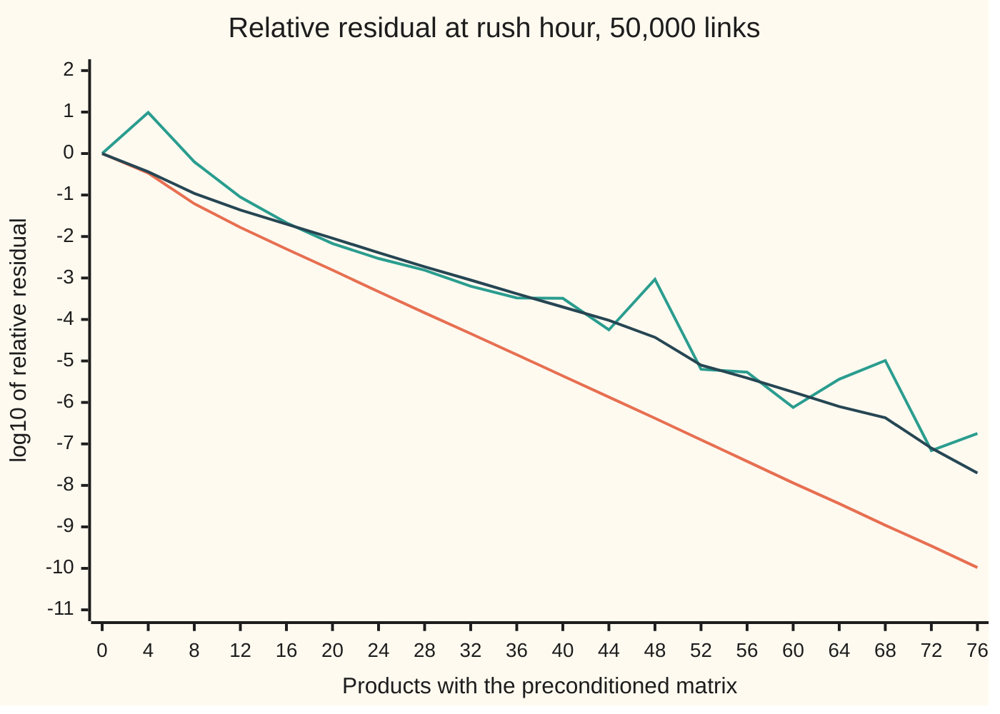

# BiCGSTAB: Krylov steps for non-symmetric systems without GMRES's growing memory

[Syllabus](../../../SYLLABUS.md) → [Numerical analysis](../README.md) → [Numerical Linear Algebra](../README.md#s03) → BiCGSTAB

---

## General Overview

A city traffic office wants the steady number of cars on each of 50,000 road links. [Sparse storage and Krylov methods](10-sparse-matrices-and-krylov-methods.md) solved that system with GMRES (the generalised minimal residual method). It took 20 products with the matrix (one matrix times one vector each) to bring the relative residual below 1e-10. The relative residual is how far the answer misses the right-hand side, as a fraction of the right-hand side's length.

GMRES remembers every direction it builds. After 20 steps it holds 21 basis vectors of 400,000 bytes each: 8,400,000 bytes, plus 400,000 more for every further step. At rush hour fewer cars leave the network: each link loses 2% to 5% of its cars to exits, not 30% to 50% (illustrative numbers). GMRES then needs 77 steps and 80 vectors: 32,000,000 bytes. On a model with millions of links, that growth is what stops GMRES.

BiCGSTAB (the biconjugate gradient method, stabilised) keeps 8 vectors, 3,200,000 bytes, however many steps it takes. Each step costs two products. It reaches 1e-10 in 24 products on the ordinary network and in 94 at rush hour. The price is that it no longer takes the best answer at each step, and it can break down (divide by zero).

A theorem says this trade is forced. The Faber–Manteuffel theorem: for a general non-symmetric matrix, no method can both keep a fixed, short memory and take the best answer at every step.

**BiCGSTAB buys fixed memory with a "shadow" sequence and a smoothing step; for a general non-symmetric matrix, the Faber–Manteuffel theorem says fixed memory always costs the best-answer guarantee.**

**What kind of fact this is:** methods resting on theorems. Four are proved on this card in Why it works. The shadow sequence gives a three-term recurrence. BiCGSTAB's smoothing never raises the residual above its half step. GMRES is never worse at equal products. A ring-shaped shift matrix makes restarted GMRES stall and BiCGSTAB break down. The Faber–Manteuffel theorem is stated with its source, not proved.

### The picture: residuals at rush hour



Orange (steepest, smooth): full GMRES, which holds one more vector per product. Green (jagged): CGS, a fixed-memory method that squares its bumps; it rises above its starting residual. Dark blue: BiCGSTAB, fixed memory, almost as smooth as GMRES. A fall of one unit is one more correct digit in the residual.

---

## The formula

Everything below works on the sparse-storage card's preconditioned system. The system matrix A has a diagonal M, the Jacobi preconditioner (a cheap rescaling that makes the system easier to solve). The method solves B u = s with B = A M⁻¹, then sets x = M⁻¹ u. The residual of B u = s equals the residual of A x = s, so every residual on this card is the traffic system's own.

One BiCGSTAB step, from residual $`r_k`$ and direction $`p_k`$, with a fixed shadow vector $`\tilde r_0`$:

```math
\alpha_k = \frac{\tilde r_0 \cdot r_k}{\tilde r_0 \cdot B p_k}, \qquad r_{k+1/2} = r_k - \alpha_k B p_k, \qquad \omega_k = \frac{(B r_{k+1/2})\cdot r_{k+1/2}}{(B r_{k+1/2})\cdot (B r_{k+1/2})}, \qquad r_{k+1} = r_{k+1/2} - \omega_k B r_{k+1/2}
```

**Read it aloud:** take a BiCG step of length α along p to reach the half-step residual, then take the multiple ω of B times it that makes the new residual as short as possible.

The answer and the next direction follow from the same numbers:

```math
u_{k+1} = u_k + \alpha_k p_k + \omega_k r_{k+1/2}, \qquad \beta_k = \frac{\tilde r_0 \cdot r_{k+1}}{\tilde r_0 \cdot r_k}\cdot\frac{\alpha_k}{\omega_k}, \qquad p_{k+1} = r_{k+1} + \beta_k\,(p_k - \omega_k B p_k)
```

**Read it aloud:** move the answer by both steps, then mix the new residual with the old direction.

Written as polynomials in B, the three short-memory methods leave these residuals:

```math
\text{BiCG: } r_k = \varphi_k(B)\,r_0, \qquad \text{CGS: } r_k = \varphi_k(B)^2\,r_0, \qquad \text{BiCGSTAB: } r_k = \psi_k(B)\,\varphi_k(B)\,r_0, \quad \psi_k(z) = (1-\omega_0 z)(1-\omega_1 z)\cdots(1-\omega_{k-1} z)
```

**Read it aloud:** BiCGSTAB keeps BiCG's polynomial once and replaces the second copy, which CGS uses, with a product of one-step smoothers.

Memory, counted in vectors of n numbers at 8 bytes each:

```math
\text{GMRES after } k \text{ steps: } (k+3)\times 8n \text{ bytes}, \qquad \text{BiCGSTAB at every step: } 8 \times 8n \text{ bytes}
```

**Read it aloud:** GMRES grows by one vector a step; BiCGSTAB never grows.

| Symbol | Plain meaning | In our example | Push it up and the answer… |
| --- | --- | --- | --- |
| $`A`$, $`x`$, $`s`$ | the sparse-storage card's traffic matrix, cars on each link, cars a minute joining from side streets | 50,000 by 50,000; 1,214,445.5 cars in all | — |
| $`M`$, $`B`$, $`u`$ | the Jacobi preconditioner diag(A), the preconditioned matrix B = A M⁻¹, and the unknown with x = M⁻¹u | a product with B is a product with A after rescaling by M⁻¹ | — |
| $`n`$ | the number of unknowns, the length of every vector | 50,000; one vector takes 400,000 bytes | memory grows with n |
| $`r_k`$, $`\lVert\cdot\rVert`$ | the residual s − A x after k steps; its length, so ‖r_k‖ ÷ ‖s‖ is the relative residual | 8.604e-11 after 24 BiCGSTAB products | — |
| $`\mathcal{K}_k(B, r_0)`$ | the Krylov space: every mix of r₀, B r₀, …, B^(k−1) r₀ | where every method on this card looks | bigger k, more room |
| $`\tilde r_0`$ | the shadow residual, a fixed second vector that BiCG and BiCGSTAB test against | here r̃₀ = r₀ = s | a bad choice can cause a breakdown |
| $`p_k`$ | the search direction | p₀ = s | — |
| $`Z`$, $`e_1`$ | Step 7's 8-by-8 shift matrix, a toy ring that moves each entry one place along, and its right-hand side, 1 in place 1 and 0 elsewhere | breakdown at step 1; GMRES(4) stuck at 1.000000 | — |
| $`\alpha_k`$, $`\beta_k`$ | the BiCG step length and the mix of old direction into the new one; this β is not the sparse-storage card's bound rate | α₀ = 2.239741 | — |
| $`r_{k+1/2}`$, $`\omega_k`$ | the half-step residual, after the BiCG step and before smoothing, and the smoothing weight | ‖r_½‖ ÷ ‖s‖ = 0.420516; ω₀ = 0.878737 | ω near 0: the smoother does nothing |
| $`\varphi_k`$, $`\psi_k`$ | BiCG's residual polynomial and BiCGSTAB's smoothing polynomial in a variable z that stands for B, each with value 1 at z = 0 | degree k each | — |
| $`k`$, products | steps taken; products with B (BiCGSTAB uses two a step) | BiCGSTAB: 24 products; GMRES: 20 | — |
| $`m`$ | the restart length of GMRES(m), which keeps only m + 1 basis vectors | GMRES(5): 9 vectors | bigger m: fewer products, more memory |

### When it holds

- **The products are cheap and B is invertible.** As on the sparse-storage card. If no car ever exits, there is no steady state. Then no method on this card gets below that card's proven floor, a relative residual that no choice of x can beat.
- **The shadow vector meets each new vector.** BiCGSTAB divides by r̃₀ · B p_k and by r̃₀ · r_k. BiCG divides by the same products with its moving shadow vectors (Step 2). If a divisor is zero, the step is undefined: a breakdown. The ring network below breaks down at step 1.
- **B times the half-step residual is not at right angles to it.** If it were, ω would be 0, the smoother would do nothing, and β divides by ω. Rotation-like matrices come close to this.
- **Rounding stays small.** BiCGSTAB updates its residual by a formula. In floating point, that updated residual can drift from the true one. Here the code recomputes the residual with a separate product, and both read 8.604e-11.
- **Short and optimal are not both on offer.** For a general non-symmetric B, the Faber–Manteuffel theorem rules it out (Step 6).

---

## Why it works

### Step 0: why GMRES needs all its vectors and conjugate gradient does not

GMRES takes the best answer in the Krylov space, so it makes each new direction orthogonal (at right angles) to every earlier one. It must keep them all. Conjugate gradient ([Iterating instead of factoring](09-iterative-methods-jacobi-gauss-seidel-and-conjugate-gradient.md)) also takes a best answer, but on a symmetric matrix, where each new direction is automatically orthogonal to all but the last two.

A non-symmetric matrix loses that gift. BiCG gets a short memory back another way. It runs a second sequence with Bᵀ (B with rows written as columns) and makes the two sequences orthogonal *to each other*. The price is the best-answer property.

### Step 1: two sequences, three terms each

Two-sided Lanczos builds residuals $`r_0, r_1, \dots`$ from products with B and shadow residuals $`\tilde r_0, \tilde r_1, \dots`$ from products with Bᵀ. It keeps them **biorthogonal**: $`\tilde r_i \cdot r_j = 0`$ whenever $`i \ne j`$.

The key move is that a dot product can pass B across: $`\tilde r_i \cdot (B r_j) = (B^{T} \tilde r_i) \cdot r_j`$. Now $`B^{T} \tilde r_i`$ is a mix of the first i + 2 shadow residuals, so it is orthogonal to $`r_j`$ whenever j > i + 1. Measured against the shadow residuals, B r_j therefore has no part along any r_i older than r_(j−1). Each new vector needs only the last two: a three-term recurrence, like CG's.

<details>
<summary>Detailed proof: biorthogonality makes the recurrence short</summary>

Suppose the residuals satisfy $`r_j \in \mathcal{K}_{j+1}(B, r_0)`$ and $`\tilde r_i \in \mathcal{K}_{i+1}(B^{T}, \tilde r_0)`$, and $`\tilde r_i \cdot r_j = 0`$ for all $`i \ne j`$ up to step k. Assume no breakdown, so $`\tilde r_i \cdot r_i \ne 0`$.

Write the next vector $`B r_k`$ as a mix of $`r_0, \dots, r_{k+1}`$. The weight on $`r_i`$ is found by dotting with $`\tilde r_i`$:

$`\displaystyle c_i = \frac{\tilde r_i \cdot B r_k}{\tilde r_i \cdot r_i} = \frac{(B^{T} \tilde r_i)\cdot r_k}{\tilde r_i \cdot r_i}.`$

The vector $`B^{T} \tilde r_i`$ lies in $`\mathcal{K}_{i+2}(B^{T}, \tilde r_0)`$, which is spanned by $`\tilde r_0, \dots, \tilde r_{i+1}`$. If $`i + 1 < k`$, each of those is orthogonal to $`r_k`$, so $`c_i = 0`$.

Only $`c_{k-1}`$, $`c_k`$ and $`c_{k+1}`$ survive. So $`r_{k+1}`$ comes from $`B r_k`$, $`r_k`$ and $`r_{k-1}`$ alone. The same argument with B and Bᵀ swapped gives the shadow recurrence. Choosing the three weights to make the new pair orthogonal to the last two keeps biorthogonality going, by induction. BiCG's coupled form, with directions p and p̃, is the same recurrence split into two-term steps.

</details>

The code checks this on the first six pairs of the traffic run. The largest cosine between $`\tilde r_i`$ and $`r_j`$, i ≠ j, is 5.361e-14: zero up to rounding.

### Step 2: BiCG, and what it gave up

BiCG uses that recurrence to solve the system. Its residual $`r_k`$ is orthogonal to every shadow direction in $`\mathcal{K}_k(B^{T}, \tilde r_0)`$. That condition fixes the answer, but it is not "the shortest residual". So BiCG's residual can rise. At rush hour it rose 31 times and peaked at 2.730 times its starting value.

BiCG also costs a product with Bᵀ every step. That product does not shorten the residual; it only steers. So BiCG used 176 products at rush hour, against GMRES's 77. In software that supplies only products with A, BiCG cannot run at all.

It can break down two ways. If $`\tilde r_k \cdot r_k = 0`$ with $`r_k \ne 0`$, the Lanczos recurrence cannot continue. If $`\tilde p_k \cdot B p_k = 0`$, the step length α is undefined. Both are exact zeros in theory and near-zeros, with large rounding errors, in practice.

### Step 3: CGS squares the polynomial to drop Bᵀ

BiCG's coefficients are dot products like $`\tilde r_k \cdot r_k = (\varphi_k(B^{T}) \tilde r_0) \cdot (\varphi_k(B) r_0)`$. Pass the polynomial across the dot product, as in Step 1: this equals $`\tilde r_0 \cdot (\varphi_k(B)^2 r_0)`$.

Sonneveld (1989) saw that a method could therefore work with $`\varphi_k(B)^2 r_0`$ directly. That is CGS (conjugate gradient squared). It needs no Bᵀ and two products with B a step. When BiCG's polynomial is small, its square is smaller still. On the ordinary network CGS used the fewest flops of all: 27,700,000, in 22 products.

When φ has a bump, the square makes it worse. At rush hour CGS's residual jumped to 27.41 times its starting value after one step, and rose 12 times in all. Large intermediate values lose digits to rounding.

### Step 4: BiCGSTAB replaces one copy with a smoother

Van der Vorst (1992) kept CGS's trick but swapped the second copy of φ for a polynomial ψ chosen one factor at a time. Each step multiplies by $`(1 - \omega_k B)`$, with ω chosen to make the residual as short as possible. That is one step of GMRES on the half-step residual $`r_{k+1/2}`$.

The best ω comes from a one-line minimisation. The squared length $`\lVert h - \omega B h\rVert^2 = h\cdot h - 2\omega\,(Bh)\cdot h + \omega^2\,(Bh)\cdot(Bh)`$, with h the half-step residual $`r_{k+1/2}`$, is a parabola in ω. Its lowest point is at $`\omega = (Bh)\cdot h \,/\, (Bh)\cdot(Bh)`$, where the new residual is at right angles to Bh; the code checks that angle at the first step, ω₀ = 0.878737.

Since ω = 0 is one of the choices, the full step is never longer than the half step: $`\lVert r_{k+1}\rVert \le \lVert r_{k+1/2}\rVert`$. The smoother cannot make things worse, and the code checks it at every step. At rush hour BiCGSTAB's residual rose twice in this run, a count that depends on rounding, and never went above 0.8409 times its starting value.

The coefficients α and β still come from BiCG's polynomial φ. The extra factor ψ only reshapes the residual; it does not disturb the recurrence. Van der Vorst's paper gives the algebra that keeps both in step. The code checks the result: on the ordinary network, BiCGSTAB's first five step lengths α equal BiCG's to a relative gap of 3.932e-14.

### Step 5: GMRES is never worse at equal products

Every method here starts from x = 0. Each product with B raises the degree of the residual polynomial by at most one. After j products, every residual has the form $`q(B)\,r_0`$ with q of degree at most j and $`q(0) = 1`$. GMRES picks the shortest such residual. So:

- after 2k products, GMRES is no worse than CGS or BiCGSTAB after k steps;
- after k products, GMRES is no worse than BiCG after k steps, which used 2k products.

The code asserts both at every step on both networks. On the ordinary network:

| Products | GMRES | BiCG | CGS | BiCGSTAB |
| ---: | ---: | ---: | ---: | ---: |
| 0 | 1.000e0 | 1.000e0 | 1.000e0 | 1.000e0 |
| 4 | 6.009e-3 | 7.147e-2 | 1.737e-2 | 6.988e-3 |
| 8 | 5.394e-5 | 6.752e-3 | 1.702e-4 | 2.190e-4 |
| 12 | 4.674e-7 | 6.700e-4 | 1.726e-6 | 5.292e-6 |
| 16 | 4.154e-9 | 6.600e-5 | 1.837e-8 | 1.304e-7 |
| 20 | 3.690e-11 | 6.511e-6 | 1.876e-10 | 3.248e-9 |
| 24 | done | 6.514e-7 | done | 8.604e-11 |

So GMRES never loses on products. Its weakness is cost per step: its memory and its orthogonalising work grow every step. Every short method pays for its fixed memory in products.

### Step 6: the Faber–Manteuffel barrier

Faber and Manteuffel (1984) asked when a method like CG can exist. It must be **optimal**: each iterate minimises the error in some fixed inner product (a way of measuring lengths). It must also be **short**: each new direction comes from a fixed number of earlier ones. Their answer, for an invertible matrix, asking the method to work from every starting vector:

- An optimal method whose recurrence uses d + 2 terms exists exactly in two cases. Either the matrix's adjoint (its transpose with respect to that inner product) is a polynomial in the matrix of degree at most d. Or the matrix's minimal polynomial (the lowest-degree polynomial that turns the matrix into zero) has degree at most d + 2.
- For the three-term case, d = 1, this means the matrix is normal (it commutes with its adjoint) and all its eigenvalues lie on one straight line in the complex plane.

A symmetric matrix passes: its eigenvalues lie on the real line. That is why CG, and MINRES on [Saddle-point systems](12-symmetric-indefinite-systems-ldlt-and-minres.md), can be short and optimal. The traffic matrix B is not even normal in the ordinary dot product: B Bᵀ z and Bᵀ B z differ by 0.1003 of their length for a random z. (The code checks only the ordinary dot product.)

The proof is long. This card states the theorem and does not prove it. Its practical reading is simple. For a general non-symmetric matrix, a method keeps all its vectors (GMRES), or it gives up optimality (BiCG, CGS, BiCGSTAB), or it restarts (GMRES(m)).

### Step 7: a ring where both escapes fail

Take the 8-by-8 shift matrix Z, which moves each entry one place along a ring: entry i goes to place i + 1. It is a toy worst case, not a traffic model: a closed ring of roads with no exits would make I − Z singular. Z is normal (ZᵀZ = ZZᵀ = I). But its eigenvalues are the eight eighth roots of 1, spread around a circle, not on a line. Solve Z u = e₁, where e₁ is 1 in place 1 and 0 elsewhere.

- **Full GMRES needs all 8 vectors.** After k < 8 steps the Krylov space holds e₁, …, e_k. Then Z u lies in the span of e₂, …, e_(k+1), at right angles to e₁, so the residual e₁ − Z u has length at least 1. The best choice is u = 0. The residual stays at exactly 1.000000 through step 7 and drops to 0.000e0 at step 8.
- **Restarted GMRES(4) stalls for ever.** Each cycle starts from u = 0 again and finds u = 0 again. After 40 products the residual is still 1.000000.
- **BiCG and BiCGSTAB break down at step 1.** With r̃₀ = r₀ = e₁, the first direction is p₀ = e₁, and Z p₀ = e₂. Then r̃₀ · Z p₀ = 0.0, and α is a division by zero.

### Step 8: choosing between GMRES(m) and BiCGSTAB

| Method | Memory | Products per step | Residual | Can fail by |
| --- | --- | --- | --- | --- |
| GMRES | grows: k + 3 vectors | 1 | never rises; fewest products | running out of memory |
| GMRES(m) | m + 4 vectors | 1, plus 1 a restart | never rises within a cycle | stalling (the ring) or slowing down |
| BiCG | 8 vectors | 2, one with Bᵀ | can rise | breakdown; needs Bᵀ |
| CGS | 9 vectors | 2 | can jump | breakdown; rounding from large bumps |
| BiCGSTAB | 8 vectors | 2 | rarely rises | breakdown; ω near 0 |

In practice:

1. If memory holds the steps you expect, use full GMRES. It uses the fewest products and cannot break down.
2. If memory is tight, try BiCGSTAB first. At rush hour it used 94 products and 3,200,000 bytes; GMRES(5), in 3,600,000 bytes, needed 138.
3. Watch BiCGSTAB for breakdown. Restart it with a new shadow vector if r̃₀ · B p becomes tiny.
4. Use GMRES(m) when the residual must never rise, and pick m as large as memory allows.

### What "converged" means here

Every run stops when its own residual estimate falls below 1e-10; the recomputed residuals agree to all printed digits. A small residual is a small backward error: the answer solves exactly a system whose right-hand side moved by that fraction ([Forward and backward error](../01-Floating%20Point%20and%20Error/06-forward-and-backward-error.md)).

The error in x can be larger by up to the condition number κ₂(A), which the sparse-storage card bounds for the ordinary network. BiCGSTAB's and GMRES's answers differ by at most 7.567e-10 relative, link by link, consistent with that. The rush-hour network's condition number is not bounded on this card.

---

## Worked numbers, by hand

The first BiCGSTAB step on the ordinary network, with r̃₀ = r₀ = p₀ = s:

| Step | Arithmetic | Value |
| --- | --- | --- |
| s · s | sum of squares of the inflows | 54,070.1689 |
| s · Bs and Bs · Bs | the sparse-storage card's numbers | 24,141.2642 and 12,684.6154 |
| α₀ | 54,070.1689 ÷ 24,141.2642 | 2.239741 |
| half step ‖r_½‖ ÷ ‖s‖ | √(54,070.1689 − 2 × 2.239741 × 24,141.2642 + 2.239741² × 12,684.6154) ÷ √54,070.1689 | 0.420516 |
| ω₀ | (B r_½ · r_½) ÷ (B r_½ · B r_½), from the code | 0.878737 |
| full step | ‖r_½ − ω₀ B r_½‖ ÷ ‖s‖ | 0.089618 |
| GMRES, same 2 products | best residual in the same space | 0.070421 |
| products to 1e-10 | GMRES against BiCGSTAB | 20 against 24 |
| memory | 23 × 400,000 against 8 × 400,000 | 9,200,000 against 3,200,000 bytes |
| flops | counted by the code | 62,150,000 against 32,600,000 |
| **steady state** | BiCGSTAB, relative residual 8.604e-11 | **1,214,445.5 cars** |

BiCGSTAB lands on the sparse-storage card's 1,214,445.5 cars, with 49,941.1744 cars a minute in and 49,941.1744 out. It used four more products than GMRES but about half the flops, because GMRES's orthogonalising work grows every step. This GMRES count also includes normalising s and building the answer, which the sparse-storage card's count leaves out. GMRES's 23 vectors are its basis (the sparse-storage card's 8,400,000 bytes) plus a work vector and a scratch vector for M⁻¹.

At rush hour the gap widens: GMRES 77 products, 80 vectors (32,000,000 bytes), 677,750,000 flops; BiCGSTAB 94 products, 8 vectors (3,200,000 bytes), 127,100,000 flops. Rush hour holds 13,875,784.3 cars.

### What breaks if you drop a piece

| Mistake | Comes out at | What went wrong |
| --- | --- | --- |
| Restart GMRES at m = 5 to save memory, rush hour | 138 products, against 77 for full GMRES and 94 for BiCGSTAB | each restart throws away the directions GMRES had built |
| Square the polynomial (CGS), rush hour | residual 27.41 times the start after one step; 12 rises | a bump in φ is squared |
| Keep BiCG without a smoother, rush hour | 176 products; 31 rises; peak 2.730 | it never minimises, and half its products go to Bᵀ |
| Shadow vector equal to r₀ on the ring | breakdown at step 1: r̃₀ · Z p₀ = 0.0 | biorthogonality cannot start |
| GMRES(4) on the ring | residual 1.000000 after 40 products | the answer needs all 8 directions, and restarts keep 4 |

---

## Code, from first principles, and it actually runs

The code rebuilds the sparse-storage card's network from the same SplitMix64 generator and seed. It runs full GMRES, GMRES(5), BiCG, CGS and BiCGSTAB at ordinary exit rates and at rush hour, counting products, vectors and flops, then runs the 8-by-8 shift matrix. Seven roads check the answers:

- BiCGSTAB's answer matches GMRES's, an independent method;
- each residual is recomputed by a separate product;
- the first step matches the hand formula, its ω is the parabola's lowest point, and no full step is longer than its half step (Step 4);
- GMRES beats every method at equal products (Step 5);
- BiCG's pairs are biorthogonal (Step 1), and BiCGSTAB's step lengths α equal BiCG's (Step 4);
- the car total matches the sparse-storage card, and cars in equal cars out;
- the ring stalls and breaks down exactly as Step 7 proves.

### Python

```python
# BiCGSTAB and short recurrences -- the check behind the card.  Standard library only.
# Card 03-10's road network by five Krylov methods; a rush hour; an 8-link ring.
from math import sqrt, log10
M64, state, FL = (1 << 64) - 1, [0], [0]     # FL counts flops as they happen
def nxt():                                   # SplitMix64, written out
    state[0] = (state[0] + 0x9E3779B97F4A7C15) & M64; z = state[0]
    z = ((z ^ (z >> 30)) * 0xBF58476D1CE4E5B9) & M64
    z = ((z ^ (z >> 27)) * 0x94D049BB133111EB) & M64
    return z ^ (z >> 31)
def unif(): return (nxt() >> 11) / 9007199254740992.0
def sci(v): m, x = f"{v:.3e}".split("e"); return m + "e" + str(int(x))  # as Rust
def dot(u, v):
    FL[0] += 2 * len(u); acc = 0.0
    for a, b in zip(u, v): acc += a * b
    return acc
def axpy(a, x, y): FL[0] += 2 * len(x); return [a * p + q for p, q in zip(x, y)]
def nrm(v): return sqrt(dot(v, v))
R, C = 250, 200; n = R * C
OFF = [(0, 1), (0, -1), (1, 0), (-1, 0), (1, -1), (-1, 1)]  # k ^ 1 reverses k
nb = [[((i // C + dr) % R) * C + (i % C + dc) % C for dr, dc in OFF] for i in range(n)]
def network(lo, span):                       # card 03-10's network; exits lo..lo+span
    state[0] = 20261111; t, e, W, s = [0.0] * n, [0.0] * n, [], [0.0] * n
    for j in range(n):                       # illustrative traffic numbers
        t[j] = [1.0, 2.0, 5.0, 10.0, 30.0][nxt() % 5]; e[j] = lo + span * unif()
        g = [0.5 + unif() for _ in range(6)]; tot = dot(g, [1.0] * 6)
        W.append([(1.0 - e[j]) * v / tot for v in g]); s[j] = 0.5 + unif()
    ptr, col, val = [0], [], []              # compressed sparse rows of A
    for i in range(n):
        col.append(i); val.append(1.0 / t[i])
        for k in range(6): col.append(nb[i][k]); val.append(-W[nb[i][k]][k ^ 1] / t[nb[i][k]])
        ptr.append(len(col))
    def B(v):                                # B = A M^-1: scale by t, then A
        FL[0] += 2 * len(val) + n; x = [a * c for a, c in zip(t, v)]; y = [0.0] * n
        for i in range(n):
            acc = 0.0
            for p in range(ptr[i], ptr[i + 1]): acc += val[p] * x[col[p]]
            y[i] = acc
        return y
    def BT(v):                               # B^T = M^-1 A^T: A^T first, then scale
        FL[0] += 2 * len(val) + n; y = [0.0] * n
        for i in range(n):
            for p in range(ptr[i], ptr[i + 1]): y[col[p]] += val[p] * v[i]
        return [a * c for a, c in zip(t, y)]
    return t, e, s, B, BT
def gmres(op, b, tol, kmax):                 # card 03-10's GMRES, Givens rotations
    bn = nrm(b); FL[0] += len(b); Q, H, cs, sn, g, hist = [[v / bn for v in b]], [], [], [], [bn], [1.0]
    for k in range(kmax):
        w = op(Q[k]); h = []
        for q in Q: h.append(dot(w, q)); w = axpy(-h[-1], q, w)
        h.append(nrm(w))
        for j in range(k): h[j], h[j + 1] = cs[j] * h[j] + sn[j] * h[j + 1], -sn[j] * h[j] + cs[j] * h[j + 1]
        r = sqrt(h[k] * h[k] + h[k + 1] * h[k + 1]); hk = h[k + 1] if h[k + 1] != 0.0 else 1.0
        cs.append(h[k] / r); sn.append(h[k + 1] / r); FL[0] += len(b); Q.append([v / hk for v in w])
        h[k] = r; g.append(-sn[k] * g[k]); g[k] = cs[k] * g[k]; H.append(h); hist.append(abs(g[k + 1]) / bn)
        if hist[-1] < tol: break
    m = len(H); y = [0.0] * m; u = [0.0] * len(b)
    for i in range(m - 1, -1, -1):           # back-substitute the small system
        acc = g[i]
        for j in range(i + 1, m): acc -= H[j][i] * y[j]
        y[i] = acc / H[i][i]
    for j in range(m): u = axpy(y[j], Q[j], u)
    return u, hist, len(hist) - 1
def restarted(op, b, m, tol, pmax):          # GMRES(m): keep m + 1 basis vectors
    u, r, hist, prods, bn = [0.0] * len(b), b, [1.0], 0, nrm(b)
    while hist[-1] >= tol and prods < pmax:
        du, h, _ = gmres(op, r, tol * bn / nrm(r), m); u = axpy(1.0, du, u)
        r = axpy(-1.0, op(u), b); prods += len(h); hist.append(nrm(r) / bn)
    return u, hist, prods
def bicg(op, opT, b, rt, tol, kmax):         # two-sided Lanczos, coupled form
    u, r, p, pt, h, bn, keep = [0.0] * len(b), b, b, rt, [1.0], nrm(b), [(b, rt)]; rho = dot(rt, b)
    for k in range(kmax):
        v = op(p); d = dot(pt, v)
        if d == 0.0: return u, h, "breakdown at step " + str(k + 1)
        al = rho / d; u = axpy(al, p, u); r = axpy(-al, v, r); rt = axpy(-al, opT(pt), rt)
        rn = dot(rt, r); be = rn / rho; rho = rn; p = axpy(be, p, r); pt = axpy(be, pt, rt); h.append(nrm(r) / bn)
        if k < 5: keep.append((r, rt, al))     # the first six pairs, for the check
        if h[-1] < tol: break
    return u, h, keep
def cgs(op, b, tol, kmax):                   # Sonneveld: BiCG's polynomial squared
    u, r, w, p, h, bn = [0.0] * len(b), b, b, b, [1.0], nrm(b); rho = dot(b, b)
    for k in range(kmax):
        v = op(p); al = rho / dot(b, v); q = axpy(-al, v, w); w2 = axpy(1.0, q, w)
        u = axpy(al, w2, u); r = axpy(-al, op(w2), r); rn = dot(b, r); be = rn / rho; rho = rn
        w = axpy(be, q, r); p = axpy(be, axpy(be, p, q), w); h.append(nrm(r) / bn)
        if h[-1] < tol: break
    return u, h, None
def bicgstab(op, b, rt, tol, kmax):          # van der Vorst: BiCG times a smoother
    u, r, p, h, bn, steps = [0.0] * len(b), b, b, [1.0], nrm(b), []; rho = dot(rt, b)
    for k in range(kmax):
        v = op(p); d = dot(rt, v)
        if d == 0.0: return u, h, "breakdown at step " + str(k + 1)
        al = rho / d; sv = axpy(-al, v, r); tv = op(sv); om = dot(tv, sv) / dot(tv, tv)
        u = axpy(om, sv, axpy(al, p, u)); r = axpy(-om, tv, sv); rn = dot(rt, r)
        be = rn / rho * al / om; rho = rn; p = axpy(be, axpy(-om, v, p), r); h.append(nrm(r) / bn); steps.append((al, om, nrm(sv) / bn))
        if h[-1] < tol: break
    return u, h, steps
def run(lo, span, label):                    # all five methods on one network
    t, e, s, B, BT = network(lo, span); out = {}
    for nm, f, vec in (("gmres", lambda: gmres(B, s, 1e-10, 200), None), ("gmres5", lambda: restarted(B, s, 5, 1e-10, 400), 9),
                       ("bicg", lambda: bicg(B, BT, s, s, 1e-10, 200), 8), ("cgs", lambda: cgs(B, s, 1e-10, 200), 9),
                       ("bicgstab", lambda: bicgstab(B, s, s, 1e-10, 200), 8)):
        FL[0] = 0; u, h, info = f(); fl = FL[0]; x = [a * c for a, c in zip(t, u)]
        pr = info if nm[:5] == "gmres" else 2 * (len(h) - 1); vec = vec or len(h) + 2
        out[nm] = (h, x, nrm(axpy(-1.0, B(u), s)) / nrm(s), info)
        print(f"{label},{nm},products={pr},residual={sci(h[-1])},true={sci(out[nm][2])},vectors={vec},bytes={8 * n * vec:,},flops={fl:,}")
        assert out[nm][2] < 3e-10 and h[-1] < 1e-10
    hg, hb, hc, hs = (out[m][0] for m in ("gmres", "bicg", "cgs", "bicgstab"))
    for j in range(1, len(hg)):              # GMRES is best at equal powers of B
        assert j >= len(hb) or hg[j] <= hb[j] * (1 + 1e-9)
        assert 2 * j >= len(hg) or j >= len(hc) or hg[2 * j] <= hc[j] * (1 + 1e-9)
        assert 2 * j >= len(hg) or j >= len(hs) or hg[2 * j] <= hs[j] * (1 + 1e-9)
    gap = max(abs(a - c) / c for a, c in zip(out["bicgstab"][1], out["gmres"][1])); assert gap < 1e-8 and all(hs[k + 1] <= out["bicgstab"][3][k][2] * (1 + 1e-12) for k in range(len(hs) - 1))  # never above the half step
    print(f"{label},bicgstab_vs_gmres_max_rel_gap={sci(gap)},cars={dot(out['bicgstab'][1], [1.0] * n):.1f},links={n:,},bytes_per_vector={8 * n:,},gmres_basis_bytes={8 * n * len(hg):,}")
    return t, e, s, B, BT, out
t, e, s, B, BT, easy = run(0.3, 0.2, "easy")
st, keep, bn2, Bs = easy["bicgstab"][3], easy["bicg"][3], dot(s, s), B(s); sB = dot(s, Bs); hv = axpy(-bn2 / sB, Bs, s); Bh = B(hv); r1 = axpy(-st[0][1], Bh, hv)
assert abs(st[0][0] - bn2 / sB) < 1e-12 and abs(st[0][2] - nrm(hv) / sqrt(bn2)) < 1e-12 and abs(dot(Bh, r1)) < 1e-10 * nrm(Bh) * nrm(hv)  # best omega: r1 at right angles to B h
print(f"step1,s.s={bn2:.4f},s.Bs={sB:.4f},Bs.Bs={dot(Bs, Bs):.4f},alpha={st[0][0]:.6f},half_step={st[0][2]:.6f},omega={st[0][1]:.6f},full_step={easy['bicgstab'][0][1]:.6f},gmres_2={easy['gmres'][0][2]:.6f}")
x = easy["bicgstab"][1]; cin, cout = dot(s, [1.0] * n), dot(e, [a / c for a, c in zip(x, t)])
assert abs(cin - cout) < 1e-8 * cin and abs(dot(x, [1.0] * n) - 1214445.5) < 0.1   # card 03-10
print(f"balance,cars_in_per_min={cin:.4f},cars_out_per_min={cout:.4f}")
bio = max(abs(dot(keep[i][1], keep[j][0])) / nrm(keep[i][1]) / nrm(keep[j][0]) for i in range(6) for j in range(6) if i != j); ag = max(abs(keep[k + 1][2] - st[k][0]) / abs(st[k][0]) for k in range(5))
z = [unif() for _ in range(n)]; a1, a2 = B(BT(z)), BT(B(z)); nn = nrm(axpy(-1.0, a2, a1)) / nrm(a1); assert bio < 1e-10 and nn > 0.01 and ag < 1e-8
print(f"lanczos,max_cos_between_shadow_i_and_residual_j={sci(bio)},alpha_gap_bicg_vs_bicgstab={sci(ag)},non_normal_gap={nn:.4f}"); print("products,gmres,bicg,cgs,bicgstab")
for p in range(0, 25, 4):
    print(str(p) + "," + ",".join(sci(h[q]) if q < len(h) else "-" for h, q in
          ((easy["gmres"][0], p), (easy["bicg"][0], p // 2), (easy["cgs"][0], p // 2), (easy["bicgstab"][0], p // 2))))
rush = run(0.02, 0.03, "rush")[5]
for nm in ("bicg", "cgs", "bicgstab"):                # count rises; find the worst
    h = rush[nm][0]; print(f"rush,{nm},rises={sum(1 for k in range(1, len(h)) if h[k] > h[k - 1])},largest={sci(max(h[1:]))}")
assert max(rush["cgs"][0][1:]) > 10.0 and max(rush["bicgstab"][0][1:]) < 1.0; print("chart,products," + ",".join(str(p) for p in range(0, 77, 4)))
for nm, d in (("gmres", 1), ("cgs", 2), ("bicgstab", 2)):
    print(f"chart,{nm}," + ",".join(f"{log10(rush[nm][0][p // d]):.2f}" for p in range(0, 77, 4)))
N, ring, ringT = 8, lambda v: [v[-1]] + v[:-1], lambda v: v[1:] + [v[0]]; e1 = [1.0] + [0.0] * 7  # the shift Z: entry i moves to i + 1
hf = gmres(ring, e1, 1e-12, N)[1]; _, hr, pr = restarted(ring, e1, 4, 1e-12, 40)
why, why2 = bicg(ring, ringT, e1, e1, 1e-12, N)[2], bicgstab(ring, e1, e1, 1e-12, N)[2]
assert max(hf[1:N]) == 1.0 and hf[N] < 1e-15 and hr[-1] == 1.0 and why == why2 == "breakdown at step 1"
print(f"ring,gmres_full_residual_after_7={hf[7]:.6f},after_8={sci(hf[N])},gmres4_after_{pr}_products={hr[-1]:.6f}")
print(f"ring,bicg={why},bicgstab={why2},shadow.Bp={dot(e1, ring(e1)):.1f},normal={all(ring(ringT(v)) == ringT(ring(v)) for v in ([0.0] * i + [1.0] + [0.0] * (N - 1 - i) for i in range(N)))}")
print("ALL CHECKS PASS")
```

**Ran 2026-11-24 on macOS, Python 3.14.10, standard library only. All checks passed. Output, pasted from the run:**

```
easy,gmres,products=20,residual=3.690e-11,true=3.690e-11,vectors=23,bytes=9,200,000,flops=62,150,000
easy,gmres5,products=26,residual=4.804e-11,true=4.804e-11,vectors=9,bytes=3,600,000,flops=39,800,000
easy,bicg,products=40,residual=7.323e-11,true=7.323e-11,vectors=8,bytes=3,200,000,flops=46,200,000
easy,cgs,products=22,residual=1.974e-11,true=1.974e-11,vectors=9,bytes=3,600,000,flops=27,700,000
easy,bicgstab,products=24,residual=8.604e-11,true=8.604e-11,vectors=8,bytes=3,200,000,flops=32,600,000
easy,bicgstab_vs_gmres_max_rel_gap=7.567e-10,cars=1214445.5,links=50,000,bytes_per_vector=400,000,gmres_basis_bytes=8,400,000
step1,s.s=54070.1689,s.Bs=24141.2642,Bs.Bs=12684.6154,alpha=2.239741,half_step=0.420516,omega=0.878737,full_step=0.089618,gmres_2=0.070421
balance,cars_in_per_min=49941.1744,cars_out_per_min=49941.1744
lanczos,max_cos_between_shadow_i_and_residual_j=5.361e-14,alpha_gap_bicg_vs_bicgstab=3.932e-14,non_normal_gap=0.1003
products,gmres,bicg,cgs,bicgstab
0,1.000e0,1.000e0,1.000e0,1.000e0
4,6.009e-3,7.147e-2,1.737e-2,6.988e-3
8,5.394e-5,6.752e-3,1.702e-4,2.190e-4
12,4.674e-7,6.700e-4,1.726e-6,5.292e-6
16,4.154e-9,6.600e-5,1.837e-8,1.304e-7
20,3.690e-11,6.511e-6,1.876e-10,3.248e-9
24,-,6.514e-7,-,8.604e-11
rush,gmres,products=77,residual=7.907e-11,true=7.907e-11,vectors=80,bytes=32,000,000,flops=677,750,000
rush,gmres5,products=138,residual=8.854e-11,true=8.854e-11,vectors=9,bytes=3,600,000,flops=214,000,000
rush,bicg,products=176,residual=2.800e-11,true=2.800e-11,vectors=8,bytes=3,200,000,flops=202,600,000
rush,cgs,products=96,residual=6.795e-11,true=6.795e-11,vectors=9,bytes=3,600,000,flops=120,200,000
rush,bicgstab,products=94,residual=3.580e-11,true=3.580e-11,vectors=8,bytes=3,200,000,flops=127,100,000
rush,bicgstab_vs_gmres_max_rel_gap=1.985e-10,cars=13875784.3,links=50,000,bytes_per_vector=400,000,gmres_basis_bytes=31,200,000
rush,bicg,rises=31,largest=2.730e0
rush,cgs,rises=12,largest=2.741e1
rush,bicgstab,rises=2,largest=8.409e-1
chart,products,0,4,8,12,16,20,24,28,32,36,40,44,48,52,56,60,64,68,72,76
chart,gmres,0.00,-0.47,-1.21,-1.78,-2.30,-2.81,-3.33,-3.84,-4.34,-4.85,-5.36,-5.87,-6.38,-6.90,-7.42,-7.94,-8.44,-8.96,-9.46,-9.98
chart,cgs,0.00,0.99,-0.20,-1.05,-1.67,-2.17,-2.53,-2.81,-3.20,-3.48,-3.49,-4.25,-3.03,-5.20,-5.27,-6.12,-5.44,-4.99,-7.16,-6.75
chart,bicgstab,0.00,-0.44,-0.96,-1.36,-1.70,-2.04,-2.39,-2.73,-3.05,-3.38,-3.70,-4.02,-4.43,-5.10,-5.41,-5.75,-6.10,-6.37,-7.10,-7.70
ring,gmres_full_residual_after_7=1.000000,after_8=0.000e0,gmres4_after_40_products=1.000000
ring,bicg=breakdown at step 1,bicgstab=breakdown at step 1,shadow.Bp=0.0,normal=True
ALL CHECKS PASS
```

### Rust

```rust
// BiCGSTAB and short recurrences -- the check behind the card.  Rust std only.
// Card 03-10's road network by five Krylov methods; a rush hour; an 8-link ring.
use std::sync::atomic::{AtomicUsize, Ordering::Relaxed};
static FL: AtomicUsize = AtomicUsize::new(0); // counts flops as they happen
type Op<'a> = &'a dyn Fn(&[f64]) -> Vec<f64>;
type Pairs = Vec<(Vec<f64>, Vec<f64>, f64)>; type Steps = Vec<(f64, f64, f64)>;
fn nxt(st: &mut u64) -> u64 { // SplitMix64, written out
    *st = st.wrapping_add(0x9E3779B97F4A7C15);
    let mut z = (*st ^ (*st >> 30)).wrapping_mul(0xBF58476D1CE4E5B9);
    z = (z ^ (z >> 27)).wrapping_mul(0x94D049BB133111EB); z ^ (z >> 31)
}
fn unif(st: &mut u64) -> f64 { (nxt(st) >> 11) as f64 / 9007199254740992.0 }
fn sci(v: f64) -> String { format!("{:.3e}", v) }
fn commas(v: usize) -> String { let d = v.to_string(); d.chars().enumerate().map(|(i, c)| if i > 0 && (d.len() - i) % 3 == 0 { format!(",{}", c) } else { c.to_string() }).collect() }
fn dot(u: &[f64], v: &[f64]) -> f64 { FL.fetch_add(2 * u.len(), Relaxed); let mut acc = 0.0; for (a, b) in u.iter().zip(v) { acc += a * b; } acc }
fn axpy(a: f64, x: &[f64], y: &[f64]) -> Vec<f64> { FL.fetch_add(2 * x.len(), Relaxed); x.iter().zip(y).map(|(p, q)| a * p + q).collect() }
fn nrm(v: &[f64]) -> f64 { dot(v, v).sqrt() }
fn mul(a: &[f64], b: &[f64]) -> Vec<f64> { a.iter().zip(b).map(|(p, q)| p * q).collect() }
fn top(h: &[f64]) -> f64 { h.iter().cloned().fold(f64::MIN, f64::max) }
struct Net { n: usize, t: Vec<f64>, e: Vec<f64>, s: Vec<f64>, ptr: Vec<usize>, col: Vec<usize>, val: Vec<f64> }
impl Net {
    fn b(&self, v: &[f64]) -> Vec<f64> { // B = A M^-1: scale by t, then A
        FL.fetch_add(2 * self.val.len() + self.n, Relaxed); let x = mul(&self.t, v);
        (0..self.n).map(|i| { let mut acc = 0.0; for p in self.ptr[i]..self.ptr[i + 1] { acc += self.val[p] * x[self.col[p]]; } acc }).collect()
    }
    fn bt(&self, v: &[f64]) -> Vec<f64> { // B^T = M^-1 A^T: A^T first, then scale
        FL.fetch_add(2 * self.val.len() + self.n, Relaxed); let mut y = vec![0.0; self.n];
        for i in 0..self.n { for p in self.ptr[i]..self.ptr[i + 1] { y[self.col[p]] += self.val[p] * v[i]; } } mul(&self.t, &y)
    }
}
fn network(lo: f64, span: f64, st: &mut u64) -> Net { // card 03-10's network; exits lo..lo+span
    let (rr, cc) = (250i64, 200i64); let n = (rr * cc) as usize; *st = 20261111;
    let off = [(0i64, 1i64), (0, -1), (1, 0), (-1, 0), (1, -1), (-1, 1)]; // k ^ 1 reverses k
    let nb: Vec<[usize; 6]> = (0..n as i64).map(|i| { let mut a = [0usize; 6]; for (k, (dr, dc)) in off.iter().enumerate() {
            a[k] = (((i / cc + dr).rem_euclid(rr)) * cc + (i % cc + dc).rem_euclid(cc)) as usize; } a }).collect();
    let (mut t, mut e, mut w, mut s) = (vec![0.0; n], vec![0.0; n], vec![[0.0; 6]; n], vec![0.0; n]);
    for j in 0..n { // illustrative traffic numbers
        t[j] = [1.0, 2.0, 5.0, 10.0, 30.0][(nxt(st) % 5) as usize]; e[j] = lo + span * unif(st);
        let g: Vec<f64> = (0..6).map(|_| 0.5 + unif(st)).collect(); let tot = dot(&g, &[1.0; 6]); for k in 0..6 { w[j][k] = (1.0 - e[j]) * g[k] / tot; } s[j] = 0.5 + unif(st);
    }
    let (mut ptr, mut col, mut val) = (vec![0usize], vec![], vec![]); // compressed sparse rows of A
    for i in 0..n { col.push(i); val.push(1.0 / t[i]); for k in 0..6 { let j = nb[i][k]; col.push(j); val.push(-w[j][k ^ 1] / t[j]); } ptr.push(col.len()); }
    Net { n, t, e, s, ptr, col, val }
}
fn gmres(op: Op, b: &[f64], tol: f64, kmax: usize) -> (Vec<f64>, Vec<f64>, usize) { // card 03-10's GMRES
    let bn = nrm(b); FL.fetch_add(b.len(), Relaxed); let mut q: Vec<Vec<f64>> = vec![b.iter().map(|v| v / bn).collect()];
    let (mut hh, mut cs, mut sn, mut g, mut hist): (Vec<Vec<f64>>, Vec<f64>, Vec<f64>, Vec<f64>, Vec<f64>) = (vec![], vec![], vec![], vec![bn], vec![1.0]);
    for k in 0..kmax {
        let (mut w, mut h) = (op(&q[k]), vec![]);
        for qj in &q { let hj = dot(&w, qj); h.push(hj); w = axpy(-hj, qj, &w); } h.push(nrm(&w));
        for j in 0..k { let (a, c) = (h[j], h[j + 1]); h[j] = cs[j] * a + sn[j] * c; h[j + 1] = -sn[j] * a + cs[j] * c; }
        let r = (h[k] * h[k] + h[k + 1] * h[k + 1]).sqrt(); let hk = if h[k + 1] != 0.0 { h[k + 1] } else { 1.0 };
        cs.push(h[k] / r); sn.push(h[k + 1] / r); FL.fetch_add(b.len(), Relaxed); q.push(w.iter().map(|v| v / hk).collect());
        h[k] = r; g.push(-sn[k] * g[k]); g[k] = cs[k] * g[k]; hh.push(h); hist.push(g[k + 1].abs() / bn);
        if hist[k + 1] < tol { break; }
    }
    let (m, mut u) = (hh.len(), vec![0.0; b.len()]); let mut y = vec![0.0; m];
    for i in (0..m).rev() { let mut acc = g[i]; for j in i + 1..m { acc -= hh[j][i] * y[j]; } y[i] = acc / hh[i][i]; } // back-substitute
    for j in 0..m { u = axpy(y[j], &q[j], &u); } let k = hist.len() - 1; (u, hist, k)
}
fn restarted(op: Op, b: &[f64], m: usize, tol: f64, pmax: usize) -> (Vec<f64>, Vec<f64>, usize) { // GMRES(m)
    let (mut u, mut r, mut hist, mut prods, bn) = (vec![0.0; b.len()], b.to_vec(), vec![1.0], 0, nrm(b));
    while hist[hist.len() - 1] >= tol && prods < pmax {
        let (du, h, _) = gmres(op, &r, tol * bn / nrm(&r), m); u = axpy(1.0, &du, &u);
        r = axpy(-1.0, &op(&u), b); prods += h.len(); hist.push(nrm(&r) / bn);
    }
    (u, hist, prods)
}
fn bicg(op: Op, opt: Op, b: &[f64], rt0: &[f64], tol: f64, kmax: usize) -> (Vec<f64>, Vec<f64>, Pairs, String) { // two-sided Lanczos
    let (mut u, mut r, mut p, mut pt, mut rt) = (vec![0.0; b.len()], b.to_vec(), b.to_vec(), rt0.to_vec(), rt0.to_vec());
    let (mut h, bn, mut keep) = (vec![1.0], nrm(b), vec![(b.to_vec(), rt0.to_vec(), 0.0)]); let mut rho = dot(rt0, b);
    for k in 0..kmax {
        let v = op(&p); let d = dot(&pt, &v);
        if d == 0.0 { return (u, h, keep, format!("breakdown at step {}", k + 1)); }
        let al = rho / d; u = axpy(al, &p, &u); r = axpy(-al, &v, &r); rt = axpy(-al, &opt(&pt), &rt);
        let rn = dot(&rt, &r); let be = rn / rho; rho = rn; p = axpy(be, &p, &r); pt = axpy(be, &pt, &rt); h.push(nrm(&r) / bn);
        if k < 5 { keep.push((r.clone(), rt.clone(), al)); } // the first six pairs, for the check
        if h[h.len() - 1] < tol { break; }
    }
    (u, h, keep, "ok".to_string())
}
fn cgs(op: Op, b: &[f64], tol: f64, kmax: usize) -> (Vec<f64>, Vec<f64>) { // Sonneveld: BiCG squared
    let (mut u, mut r, mut w, mut p, mut h, bn) = (vec![0.0; b.len()], b.to_vec(), b.to_vec(), b.to_vec(), vec![1.0], nrm(b)); let mut rho = dot(b, b);
    for _ in 0..kmax {
        let v = op(&p); let al = rho / dot(b, &v); let q = axpy(-al, &v, &w); let w2 = axpy(1.0, &q, &w);
        u = axpy(al, &w2, &u); r = axpy(-al, &op(&w2), &r); let rn = dot(b, &r); let be = rn / rho; rho = rn;
        w = axpy(be, &q, &r); p = axpy(be, &axpy(be, &p, &q), &w); h.push(nrm(&r) / bn);
        if h[h.len() - 1] < tol { break; }
    }
    (u, h)
}
fn bicgstab(op: Op, b: &[f64], rt: &[f64], tol: f64, kmax: usize) -> (Vec<f64>, Vec<f64>, Steps, String) { // van der Vorst
    let (mut u, mut r, mut p, mut h, bn, mut steps) = (vec![0.0; b.len()], b.to_vec(), b.to_vec(), vec![1.0], nrm(b), vec![]); let mut rho = dot(rt, b);
    for k in 0..kmax {
        let v = op(&p); let d = dot(rt, &v);
        if d == 0.0 { return (u, h, steps, format!("breakdown at step {}", k + 1)); }
        let al = rho / d; let sv = axpy(-al, &v, &r); let tv = op(&sv); let om = dot(&tv, &sv) / dot(&tv, &tv);
        u = axpy(om, &sv, &axpy(al, &p, &u)); r = axpy(-om, &tv, &sv); let rn = dot(rt, &r);
        let be = rn / rho * al / om; rho = rn; p = axpy(be, &axpy(-om, &v, &p), &r); h.push(nrm(&r) / bn); steps.push((al, om, nrm(&sv) / bn));
        if h[h.len() - 1] < tol { break; }
    }
    (u, h, steps, "ok".to_string())
}
struct Out { h: Vec<Vec<f64>>, x: Vec<Vec<f64>>, steps: Steps, keep: Pairs }
fn run(net: &Net, label: &str) -> Out { // all five methods on one network
    let (n, s, bop, btop) = (net.n, &net.s, |v: &[f64]| net.b(v), |v: &[f64]| net.bt(v));
    let mut o = Out { h: vec![], x: vec![], steps: vec![], keep: vec![] };
    for nm in ["gmres", "gmres5", "bicg", "cgs", "bicgstab"] {
        FL.store(0, Relaxed);
        let (u, h, pr, vec) = match nm {
            "gmres" => { let (u, h, k) = gmres(&bop, s, 1e-10, 200); let v = h.len() + 2; (u, h, k, v) }
            "gmres5" => { let (u, h, p) = restarted(&bop, s, 5, 1e-10, 400); (u, h, p, 9) }
            "bicg" => { let (u, h, kp, _) = bicg(&bop, &btop, s, s, 1e-10, 200); o.keep = kp; let p = 2 * (h.len() - 1); (u, h, p, 8) }
            "cgs" => { let (u, h) = cgs(&bop, s, 1e-10, 200); let p = 2 * (h.len() - 1); (u, h, p, 9) }
            _ => { let (u, h, st, _) = bicgstab(&bop, s, s, 1e-10, 200); o.steps = st; let p = 2 * (h.len() - 1); (u, h, p, 8) }
        };
        let (fl, x) = (FL.load(Relaxed), mul(&net.t, &u)); let tr = nrm(&axpy(-1.0, &net.b(&u), s)) / nrm(s);
        println!("{},{},products={},residual={},true={},vectors={},bytes={},flops={}", label, nm, pr, sci(h[h.len() - 1]), sci(tr), vec, commas(8 * n * vec), commas(fl));
        assert!(tr < 3e-10 && h[h.len() - 1] < 1e-10);
        o.h.push(h); o.x.push(x);
    }
    let (hg, hb, hc, hs) = (&o.h[0], &o.h[2], &o.h[3], &o.h[4]);
    for j in 1..hg.len() { // GMRES is best at equal powers of B
        assert!(j >= hb.len() || hg[j] <= hb[j] * (1.0 + 1e-9));
        assert!(2 * j >= hg.len() || j >= hc.len() || hg[2 * j] <= hc[j] * (1.0 + 1e-9));
        assert!(2 * j >= hg.len() || j >= hs.len() || hg[2 * j] <= hs[j] * (1.0 + 1e-9));
    }
    let gap = top(&o.x[4].iter().zip(&o.x[0]).map(|(a, c)| (a - c).abs() / c).collect::<Vec<f64>>()); assert!(gap < 1e-8 && (0..o.steps.len()).all(|k| hs[k + 1] <= o.steps[k].2 * (1.0 + 1e-12))); // never above the half step
    println!("{},bicgstab_vs_gmres_max_rel_gap={},cars={:.1},links={},bytes_per_vector={},gmres_basis_bytes={}", label, sci(gap), dot(&o.x[4], &vec![1.0; n]), commas(n), commas(8 * n), commas(8 * n * hg.len()));
    o
}
fn main() {
    let mut st = 0u64;
    let net = network(0.3, 0.2, &mut st); let easy = run(&net, "easy");
    let (n, s, t, e, one) = (net.n, &net.s, &net.t, &net.e, vec![1.0; net.n]);
    let (stp, keep, bn2, bs) = (&easy.steps, &easy.keep, dot(s, s), net.b(s)); let sb = dot(s, &bs); let hv = axpy(-bn2 / sb, &bs, s); let bh = net.b(&hv); let r1 = axpy(-stp[0].1, &bh, &hv);
    assert!((stp[0].0 - bn2 / sb).abs() < 1e-12 && (stp[0].2 - nrm(&hv) / bn2.sqrt()).abs() < 1e-12 && dot(&bh, &r1).abs() < 1e-10 * nrm(&bh) * nrm(&hv)); // best omega: r1 at right angles to B h
    println!("step1,s.s={:.4},s.Bs={:.4},Bs.Bs={:.4},alpha={:.6},half_step={:.6},omega={:.6},full_step={:.6},gmres_2={:.6}", bn2, sb, dot(&bs, &bs), stp[0].0, stp[0].2, stp[0].1, easy.h[4][1], easy.h[0][2]);
    let x = &easy.x[4]; let xt: Vec<f64> = x.iter().zip(t).map(|(a, c)| a / c).collect(); let (cin, cout) = (dot(s, &one), dot(e, &xt));
    assert!((cin - cout).abs() < 1e-8 * cin && (dot(x, &one) - 1214445.5).abs() < 0.1); // card 03-10
    println!("balance,cars_in_per_min={:.4},cars_out_per_min={:.4}", cin, cout);
    let mut bio = f64::MIN; for i in 0..6 { for j in 0..6 { if i != j { bio = bio.max(dot(&keep[i].1, &keep[j].0).abs() / nrm(&keep[i].1) / nrm(&keep[j].0)); } } } let ag = top(&(0..5).map(|k| (keep[k + 1].2 - stp[k].0).abs() / stp[k].0.abs()).collect::<Vec<f64>>());
    let z: Vec<f64> = (0..n).map(|_| unif(&mut st)).collect(); let (a1, a2) = (net.b(&net.bt(&z)), net.bt(&net.b(&z)));
    let nn = nrm(&axpy(-1.0, &a2, &a1)) / nrm(&a1); assert!(bio < 1e-10 && nn > 0.01 && ag < 1e-8);
    println!("lanczos,max_cos_between_shadow_i_and_residual_j={},alpha_gap_bicg_vs_bicgstab={},non_normal_gap={:.4}", sci(bio), sci(ag), nn); println!("products,gmres,bicg,cgs,bicgstab");
    for p in (0..25).step_by(4) {
        let cells: Vec<String> = [(0, p), (2, p / 2), (3, p / 2), (4, p / 2)].iter()
            .map(|&(m, q)| if q < easy.h[m].len() { sci(easy.h[m][q]) } else { "-".to_string() }).collect();
        println!("{},{}", p, cells.join(","));
    }
    let rush = run(&network(0.02, 0.03, &mut st), "rush");
    for (nm, m) in [("bicg", 2), ("cgs", 3), ("bicgstab", 4)] { // count rises; find the worst
        let h = &rush.h[m]; println!("rush,{},rises={},largest={}", nm, (1..h.len()).filter(|&k| h[k] > h[k - 1]).count(), sci(top(&h[1..])));
    }
    assert!(top(&rush.h[3][1..]) > 10.0 && top(&rush.h[4][1..]) < 1.0);
    let ps: Vec<String> = (0..77).step_by(4).map(|p: usize| p.to_string()).collect(); println!("chart,products,{}", ps.join(","));
    for (nm, m, d) in [("gmres", 0, 1), ("cgs", 3, 2), ("bicgstab", 4, 2)] {
        let pts: Vec<String> = (0..77).step_by(4).map(|p: usize| format!("{:.2}", rush.h[m][p / d].log10())).collect();
        println!("chart,{},{}", nm, pts.join(","));
    }
    let nr = 8; let ring = |v: &[f64]| { let mut w = vec![v[nr - 1]]; w.extend_from_slice(&v[..nr - 1]); w };
    let ringt = |v: &[f64]| { let mut w = v[1..].to_vec(); w.push(v[0]); w }; let mut e1 = vec![0.0; nr]; e1[0] = 1.0; // the shift Z: entry i moves to i + 1
    let hf = gmres(&ring, &e1, 1e-12, nr).1; let (_, hr, pr) = restarted(&ring, &e1, 4, 1e-12, 40);
    let (why, why2) = (bicg(&ring, &ringt, &e1, &e1, 1e-12, nr).3, bicgstab(&ring, &e1, &e1, 1e-12, nr).3);
    assert!(top(&hf[1..nr]) == 1.0 && hf[nr] < 1e-15 && hr[hr.len() - 1] == 1.0 && why == "breakdown at step 1" && why2 == why);
    println!("ring,gmres_full_residual_after_7={:.6},after_8={},gmres4_after_{}_products={:.6}", hf[7], sci(hf[nr]), pr, hr[hr.len() - 1]);
    let normal = (0..nr).all(|i| { let mut v = vec![0.0; nr]; v[i] = 1.0; ring(&ringt(&v)) == ringt(&ring(&v)) });
    println!("ring,bicg={},bicgstab={},shadow.Bp={:.1},normal={}", why, why2, dot(&e1, &ring(&e1)), if normal { "True" } else { "False" });
    println!("ALL CHECKS PASS");
}
```

**Ran 2026-11-24 on macOS, rustc 1.98.1, no crates. All checks passed. Output, pasted from the run:**

```
easy,gmres,products=20,residual=3.690e-11,true=3.690e-11,vectors=23,bytes=9,200,000,flops=62,150,000
easy,gmres5,products=26,residual=4.804e-11,true=4.804e-11,vectors=9,bytes=3,600,000,flops=39,800,000
easy,bicg,products=40,residual=7.323e-11,true=7.323e-11,vectors=8,bytes=3,200,000,flops=46,200,000
easy,cgs,products=22,residual=1.974e-11,true=1.974e-11,vectors=9,bytes=3,600,000,flops=27,700,000
easy,bicgstab,products=24,residual=8.604e-11,true=8.604e-11,vectors=8,bytes=3,200,000,flops=32,600,000
easy,bicgstab_vs_gmres_max_rel_gap=7.567e-10,cars=1214445.5,links=50,000,bytes_per_vector=400,000,gmres_basis_bytes=8,400,000
step1,s.s=54070.1689,s.Bs=24141.2642,Bs.Bs=12684.6154,alpha=2.239741,half_step=0.420516,omega=0.878737,full_step=0.089618,gmres_2=0.070421
balance,cars_in_per_min=49941.1744,cars_out_per_min=49941.1744
lanczos,max_cos_between_shadow_i_and_residual_j=5.361e-14,alpha_gap_bicg_vs_bicgstab=3.932e-14,non_normal_gap=0.1003
products,gmres,bicg,cgs,bicgstab
0,1.000e0,1.000e0,1.000e0,1.000e0
4,6.009e-3,7.147e-2,1.737e-2,6.988e-3
8,5.394e-5,6.752e-3,1.702e-4,2.190e-4
12,4.674e-7,6.700e-4,1.726e-6,5.292e-6
16,4.154e-9,6.600e-5,1.837e-8,1.304e-7
20,3.690e-11,6.511e-6,1.876e-10,3.248e-9
24,-,6.514e-7,-,8.604e-11
rush,gmres,products=77,residual=7.907e-11,true=7.907e-11,vectors=80,bytes=32,000,000,flops=677,750,000
rush,gmres5,products=138,residual=8.854e-11,true=8.854e-11,vectors=9,bytes=3,600,000,flops=214,000,000
rush,bicg,products=176,residual=2.800e-11,true=2.800e-11,vectors=8,bytes=3,200,000,flops=202,600,000
rush,cgs,products=96,residual=6.795e-11,true=6.795e-11,vectors=9,bytes=3,600,000,flops=120,200,000
rush,bicgstab,products=94,residual=3.580e-11,true=3.580e-11,vectors=8,bytes=3,200,000,flops=127,100,000
rush,bicgstab_vs_gmres_max_rel_gap=1.985e-10,cars=13875784.3,links=50,000,bytes_per_vector=400,000,gmres_basis_bytes=31,200,000
rush,bicg,rises=31,largest=2.730e0
rush,cgs,rises=12,largest=2.741e1
rush,bicgstab,rises=2,largest=8.409e-1
chart,products,0,4,8,12,16,20,24,28,32,36,40,44,48,52,56,60,64,68,72,76
chart,gmres,0.00,-0.47,-1.21,-1.78,-2.30,-2.81,-3.33,-3.84,-4.34,-4.85,-5.36,-5.87,-6.38,-6.90,-7.42,-7.94,-8.44,-8.96,-9.46,-9.98
chart,cgs,0.00,0.99,-0.20,-1.05,-1.67,-2.17,-2.53,-2.81,-3.20,-3.48,-3.49,-4.25,-3.03,-5.20,-5.27,-6.12,-5.44,-4.99,-7.16,-6.75
chart,bicgstab,0.00,-0.44,-0.96,-1.36,-1.70,-2.04,-2.39,-2.73,-3.05,-3.38,-3.70,-4.02,-4.43,-5.10,-5.41,-5.75,-6.10,-6.37,-7.10,-7.70
ring,gmres_full_residual_after_7=1.000000,after_8=0.000e0,gmres4_after_40_products=1.000000
ring,bicg=breakdown at step 1,bicgstab=breakdown at step 1,shadow.Bp=0.0,normal=True
ALL CHECKS PASS
```

### Lean

Lean proves Step 4's smoothing bound and Step 1's short recurrence for every square matrix, and Step 7's ring at every size.

- Take any square matrix B, any half-step residual h, and Step 4's weight ω. Then h − ω B h is at right angles to B h, and no c makes h − c B h shorter.
- So BiCGSTAB's full step is never longer than its half step, whatever B is.
- Suppose r̃ᵢ lies in $`\mathcal{K}_{i+1}(B^{T}, \tilde r_0)`$ and the pairs are biorthogonal, without breakdown, through step k. Then r̃ᵢ · B rₖ = 0 whenever i + 1 < k: the three-term recurrence.
- Take Z as Step 7's shift on a ring of n places, for any n. Then ZᵀZ = ZZᵀ = I.
- Take any u in the Krylov space $`\mathcal{K}_k(Z, e_1)`$ with k < n. Then the residual e₁ − Z u has length at least 1, so full GMRES cannot fall below 1 before step n.
- Take k = n instead. Then some u in $`\mathcal{K}_n(Z, e_1)`$ solves Z u = e₁ exactly.
- Take n ≥ 2. Then e₁ · Z e₁ = 0, so BiCG and BiCGSTAB break down at step 1.
- On the card's 8-place ring, eight shifts bring every entry home, and e₁ · Z e₁ is exactly 0.
- The memory counts hold: 400,000 bytes a vector, 8,400,000 for GMRES's basis and 3,200,000 for BiCGSTAB's 8 vectors.
- So do 9,200,000 bytes for GMRES after 20 steps, 32,000,000 at rush hour, and 3,600,000 for GMRES(5).

The traffic runs, rounding, GMRES(4)'s 40-product stall and BiCGSTAB's α matching BiCG's are left to the Python and Rust checks.

```lean
-- BiCGSTAB: the smoothing step never lengthens the residual, biorthogonal shadow vectors give a three-term recurrence, and on the shift ring GMRES stalls while BiCGSTAB breaks down.
import Mathlib.LinearAlgebra.Matrix.Permutation
import Mathlib.LinearAlgebra.Span.Basic
import Mathlib.Logic.Equiv.Fin.Rotate
import Mathlib.LinearAlgebra.Matrix.DotProduct
import Mathlib.LinearAlgebra.FiniteDimensional.Basic
import Mathlib.LinearAlgebra.Dimension.Constructions

open Matrix

theorem dotProduct_self_nonneg_real {n : ℕ} (v : Fin n → ℝ) : 0 ≤ v ⬝ᵥ v :=
  Finset.sum_nonneg fun i _ => mul_self_nonneg (v i)

#print axioms dotProduct_self_nonneg_real

theorem krylov_span_mono {n : ℕ} (A : Matrix (Fin n) (Fin n) ℝ) (v : Fin n → ℝ) {a b : ℕ}
    (hab : a ≤ b) :
    Submodule.span ℝ (Set.range fun m : Fin a => (A ^ (m : ℕ)) *ᵥ v) ≤
      Submodule.span ℝ (Set.range fun m : Fin b => (A ^ (m : ℕ)) *ᵥ v) := by
  apply Submodule.span_mono
  rintro _ ⟨m, rfl⟩
  exact ⟨⟨m, by omega⟩, rfl⟩

#print axioms krylov_span_mono

theorem krylov_span_step {n : ℕ} (A : Matrix (Fin n) (Fin n) ℝ) (v x : Fin n → ℝ) {a : ℕ}
    (hx : x ∈ Submodule.span ℝ (Set.range fun m : Fin a => (A ^ (m : ℕ)) *ᵥ v)) :
    A *ᵥ x ∈ Submodule.span ℝ (Set.range fun m : Fin (a + 1) => (A ^ (m : ℕ)) *ᵥ v) := by
  induction hx using Submodule.span_induction with
  | mem y hy =>
    obtain ⟨m, rfl⟩ := hy
    apply Submodule.subset_span
    refine ⟨⟨m + 1, by omega⟩, ?_⟩
    simp only [mulVec_mulVec, pow_succ']
  | zero => simp
  | add y z _ _ hy hz => rw [mulVec_add]; exact add_mem hy hz
  | smul c y _ hy => rw [mulVec_smul]; exact Submodule.smul_mem _ c hy

#print axioms krylov_span_step

open Fin.NatCast in
theorem finRotate_pow_apply (n' m : ℕ) (i : Fin (n' + 1)) :
    ((finRotate (n' + 1)) ^ m) i = i + (m : Fin (n' + 1)) := by
  induction m with
  | zero => simp
  | succ m ih =>
    rw [pow_succ', Equiv.Perm.mul_apply, ih, finRotate_apply, Nat.cast_succ, add_assoc]

#print axioms finRotate_pow_apply

open Fin.NatCast in
theorem shift_ring_succ (n' : ℕ) :
    let Z : Matrix (Fin (n' + 1)) (Fin (n' + 1)) ℝ := ((finRotate (n' + 1))⁻¹).permMatrix ℝ
    let e₁ : Fin (n' + 1) → ℝ := Pi.single 0 1
    (Zᵀ * Z = 1 ∧ Z * Zᵀ = 1) ∧
    (∀ k < n' + 1, ∀ u ∈ Submodule.span ℝ (Set.range fun m : Fin k => (Z ^ (m : ℕ)) *ᵥ e₁),
      1 ≤ (e₁ - Z *ᵥ u) ⬝ᵥ (e₁ - Z *ᵥ u)) ∧
    (∃ u ∈ Submodule.span ℝ (Set.range fun m : Fin (n' + 1) => (Z ^ (m : ℕ)) *ᵥ e₁),
      Z *ᵥ u = e₁) ∧
    (2 ≤ n' + 1 → e₁ ⬝ᵥ (Z *ᵥ e₁) = 0) := by
  intro Z e₁
  set σ : Equiv.Perm (Fin (n' + 1)) := (finRotate (n' + 1))⁻¹ with hσ
  have hZv : ∀ v : Fin (n' + 1) → ℝ, Z *ᵥ v = v ∘ σ := fun v => permMatrix_mulVec σ
  have hpow : ∀ m : ℕ, Z ^ m = (σ ^ m).permMatrix ℝ := by
    intro m
    induction m with
    | zero => simp
    | succ m ih => rw [pow_succ', ih, pow_succ, Matrix.permMatrix_mul]
  have hσ0 : σ 0 = Fin.last n' := by
    rw [hσ, Equiv.Perm.inv_eq_iff_eq, finRotate_last]
  have hσpow : ∀ (m : ℕ) (j : Fin (n' + 1)), (σ ^ m) j = 0 ↔ j = (m : Fin (n' + 1)) := by
    intro m j
    rw [hσ, inv_pow, Equiv.Perm.inv_eq_iff_eq, finRotate_pow_apply, zero_add]
  have hZpow : ∀ m : ℕ, Z ^ m *ᵥ e₁ = Pi.single (m : Fin (n' + 1)) 1 := by
    intro m
    funext j
    rw [hpow, permMatrix_mulVec]
    simp only [Function.comp_apply, e₁, Pi.single_apply, hσpow]
  refine ⟨⟨?_, ?_⟩, ?_, ?_, ?_⟩
  · rw [transpose_permMatrix, ← Matrix.permMatrix_mul, mul_inv_cancel, Matrix.permMatrix_one]
  · rw [transpose_permMatrix, ← Matrix.permMatrix_mul, inv_mul_cancel, Matrix.permMatrix_one]
  · intro k hk u hu
    have hu0 : u (Fin.last n') = 0 := by
      induction hu using Submodule.span_induction with
      | mem y hy =>
        obtain ⟨m, rfl⟩ := hy
        simp only
        rw [hZpow, Pi.single_apply, ite_eq_right_iff]
        intro h
        have := congrArg Fin.val h
        rw [Fin.val_last, Fin.val_natCast, Nat.mod_eq_of_lt (by omega)] at this
        omega
      | zero => simp
      | add y z _ _ hy hz => simp [hy, hz]
      | smul c y _ hy => simp [hy]
    have h0 : (e₁ - Z *ᵥ u) 0 = 1 := by
      rw [Pi.sub_apply, hZv, Function.comp_apply, hσ0, hu0]
      simp [e₁]
    have := Finset.single_le_sum (f := fun i => (e₁ - Z *ᵥ u) i * (e₁ - Z *ᵥ u) i)
      (fun i _ => mul_self_nonneg _) (Finset.mem_univ 0)
    simp only [h0, mul_one] at this
    exact this
  · refine ⟨Z ^ n' *ᵥ e₁, Submodule.subset_span ⟨Fin.last n', rfl⟩, ?_⟩
    rw [mulVec_mulVec, ← pow_succ', hZpow, Fin.natCast_self]
  · intro h2
    rw [single_dotProduct, hZv, Function.comp_apply, hσ0, one_mul]
    simp only [e₁]
    rw [Pi.single_apply, ite_eq_right_iff]
    intro h
    have := congrArg Fin.val h
    simp at this
    omega

#print axioms shift_ring_succ

/-- BiCGSTAB's smoothing step (Step 4). Let `h` be the half-step residual and
`ω = (B h · h) / (B h · B h)`. Then the new residual `h - ω B h` is at right angles to `B h`,
its squared length is the lowest of all `h - c B h`, and so it is never longer than the half
step itself (take `c = 0`). -/
theorem bicgstab_smoothing_never_raises_residual {n : ℕ}
    (B : Matrix (Fin n) (Fin n) ℝ) (h : Fin n → ℝ) :
    let w := B *ᵥ h
    let ω := (w ⬝ᵥ h) / (w ⬝ᵥ w)
    w ⬝ᵥ (h - ω • w) = 0 ∧
    (∀ c : ℝ, (h - ω • w) ⬝ᵥ (h - ω • w) ≤ (h - c • w) ⬝ᵥ (h - c • w)) ∧
    (h - ω • w) ⬝ᵥ (h - ω • w) ≤ h ⬝ᵥ h := by
  intro w ω
  have key : ∀ c : ℝ, (h - c • w) ⬝ᵥ (h - c • w) =
      h ⬝ᵥ h - 2 * c * (w ⬝ᵥ h) + c ^ 2 * (w ⬝ᵥ w) := by
    intro c
    simp only [sub_dotProduct, dotProduct_sub, smul_dotProduct, dotProduct_smul, smul_eq_mul,
      dotProduct_comm h w]
    ring
  have hmin : ∀ c : ℝ, (h - ω • w) ⬝ᵥ (h - ω • w) ≤ (h - c • w) ⬝ᵥ (h - c • w) := by
    intro c
    by_cases hw : w ⬝ᵥ w = 0
    · have hw0 : w = 0 := dotProduct_self_eq_zero.mp hw
      simp [hw0]
    · have hpos : 0 < w ⬝ᵥ w := lt_of_le_of_ne (dotProduct_self_nonneg_real w) (Ne.symm hw)
      have : (h - c • w) ⬝ᵥ (h - c • w) - (h - ω • w) ⬝ᵥ (h - ω • w) =
          (c - ω) ^ 2 * (w ⬝ᵥ w) := by
        rw [key, key]
        simp only [ω]
        field_simp
        ring
      nlinarith [sq_nonneg (c - ω)]
  refine ⟨?_, hmin, ?_⟩
  · by_cases hw : w ⬝ᵥ w = 0
    · have hw0 : w = 0 := dotProduct_self_eq_zero.mp hw
      simp [hw0]
    · simp only [dotProduct_sub, dotProduct_smul, smul_eq_mul, ω]
      field_simp
      ring
  · simpa using hmin 0

/-- Biorthogonality makes the recurrence short (Step 1). Suppose each shadow residual
`r̃ᵢ` lies in the Krylov space `𝒦ᵢ₊₁(Bᵀ, r̃₀)`, the shadow residuals and residuals satisfy
`r̃ᵢ · rⱼ = 0` for `i ≠ j` up to step `k`, and there is no breakdown (`r̃ᵢ · rᵢ ≠ 0`).
Then `B rₖ` has no part along any `rᵢ` older than `rₖ₋₁`: `r̃ᵢ · B rₖ = 0` whenever `i + 1 < k`. -/
theorem biorthogonal_residuals_three_term_recurrence {n : ℕ}
    (B : Matrix (Fin n) (Fin n) ℝ) (r rt : ℕ → Fin n → ℝ) (k : ℕ)
    (hrt : ∀ i ≤ k, rt i ∈ Submodule.span ℝ
      (Set.range fun m : Fin (i + 1) => (Bᵀ ^ (m : ℕ)) *ᵥ rt 0))
    (hbi : ∀ i ≤ k, ∀ j ≤ k, i ≠ j → rt i ⬝ᵥ r j = 0)
    (hnb : ∀ i ≤ k, rt i ⬝ᵥ r i ≠ 0) :
    ∀ i, i + 1 < k → rt i ⬝ᵥ (B *ᵥ r k) = 0 := by
  intro i hik
  have hle : ∀ j ≤ k, Submodule.span ℝ (Set.range fun l : Fin (j + 1) => rt l) ≤
      Submodule.span ℝ (Set.range fun m : Fin (j + 1) => (Bᵀ ^ (m : ℕ)) *ᵥ rt 0) := by
    intro j hj
    rw [Submodule.span_le]
    rintro _ ⟨l, rfl⟩
    exact krylov_span_mono Bᵀ (rt 0) (by omega : (l : ℕ) + 1 ≤ j + 1) (hrt l (by omega))
  have hli : ∀ j ≤ k, LinearIndependent ℝ (fun l : Fin (j + 1) => rt l) := by
    intro j hj
    rw [linearIndependent_iff']
    intro s g hg l hl
    have h1 := congrArg (· ⬝ᵥ r l) hg
    simp only [sum_dotProduct, smul_dotProduct, zero_dotProduct, smul_eq_mul] at h1
    rw [Finset.sum_eq_single l] at h1
    · exact (mul_eq_zero.mp h1).resolve_right (hnb l (by omega))
    · intro b _ hb
      rw [hbi b (by omega) l (by omega) (fun h => hb (Fin.ext h)), mul_zero]
    · intro h; exact absurd hl h
  have heq : ∀ j ≤ k, Submodule.span ℝ (Set.range fun l : Fin (j + 1) => rt l) =
      Submodule.span ℝ (Set.range fun m : Fin (j + 1) => (Bᵀ ^ (m : ℕ)) *ᵥ rt 0) := by
    intro j hj
    apply Submodule.eq_of_le_of_finrank_le (hle j hj)
    rw [finrank_span_eq_card (hli j hj)]
    exact finrank_range_le_card _
  rw [dotProduct_mulVec, ← mulVec_transpose]
  have hmem : Bᵀ *ᵥ rt i ∈ Submodule.span ℝ (Set.range fun l : Fin (i + 1 + 1) => rt l) := by
    rw [heq (i + 1) (by omega)]
    exact krylov_span_step Bᵀ (rt 0) (rt i) (hrt i (by omega))
  have hall : ∀ v ∈ Submodule.span ℝ (Set.range fun l : Fin (i + 1 + 1) => rt l),
      v ⬝ᵥ r k = 0 := by
    intro v hv
    induction hv using Submodule.span_induction with
    | mem y hy =>
      obtain ⟨l, rfl⟩ := hy
      exact hbi l (by omega) k le_rfl (by omega)
    | zero => simp
    | add y z _ _ hy hz => rw [add_dotProduct, hy, hz, add_zero]
    | smul c y _ hy => rw [smul_dotProduct, hy, smul_zero]
  exact hall _ hmem

/-- The shift ring (Step 7). `Z` moves entry `i` to place `i + 1` around a ring of `n` places
and `e₁` is 1 in the first place. `Z` is normal (`ZᵀZ = ZZᵀ = 1`). Every answer `u` from a
Krylov space `𝒦ₖ(Z, e₁)` with `k < n` leaves a residual `e₁ - Z u` of squared length at
least 1 (so full GMRES is stuck at 1 until step `n`, and GMRES(m) with `m < n` never moves);
at `k = n` some `u` solves `Z u = e₁` exactly; and when `n ≥ 2` the first BiCG/BiCGSTAB
divisor `e₁ · Z e₁` is 0, a breakdown at step 1. -/
theorem shift_ring_gmres_stalls_and_bicgstab_breaks_down (n : ℕ) [NeZero n] :
    let Z : Matrix (Fin n) (Fin n) ℝ := ((finRotate n)⁻¹).permMatrix ℝ
    let e₁ : Fin n → ℝ := Pi.single 0 1
    (Zᵀ * Z = 1 ∧ Z * Zᵀ = 1) ∧
    (∀ k < n, ∀ u ∈ Submodule.span ℝ (Set.range fun m : Fin k => (Z ^ (m : ℕ)) *ᵥ e₁),
      1 ≤ (e₁ - Z *ᵥ u) ⬝ᵥ (e₁ - Z *ᵥ u)) ∧
    (∃ u ∈ Submodule.span ℝ (Set.range fun m : Fin n => (Z ^ (m : ℕ)) *ᵥ e₁), Z *ᵥ u = e₁) ∧
    (2 ≤ n → e₁ ⬝ᵥ (Z *ᵥ e₁) = 0) := by
  obtain ⟨n', rfl⟩ : ∃ m, n = m + 1 := ⟨n - 1, (Nat.succ_pred_eq_of_pos (NeZero.pos n)).symm⟩
  exact shift_ring_succ n'

-- The card's 8-link ring: eight shifts bring every entry home, and `e₁ · Z e₁ = 0`.
example : (finRotate 8) ^ 8 = 1 := by decide
example : (Pi.single (0 : Fin 8) (1 : ℤ)) ⬝ᵥ
    ((((finRotate 8)⁻¹).permMatrix ℤ) *ᵥ Pi.single (0 : Fin 8) 1) = 0 := by decide

-- Memory counts: one vector of 50,000 doubles; GMRES's 21-vector basis; BiCGSTAB's 8 vectors;
-- GMRES's 23 vectors after 20 steps; rush hour's 80 vectors; GMRES(5)'s 9 vectors.
example : 50000 * 8 = 400000 := by norm_num
example : 21 * 400000 = 8400000 := by norm_num
example : 8 * 400000 = 3200000 := by norm_num
example : (20 + 3) * 400000 = 9200000 := by norm_num
example : (77 + 3) * 400000 = 32000000 := by norm_num
example : (5 + 4) * 400000 = 3600000 := by norm_num

#print axioms bicgstab_smoothing_never_raises_residual
#print axioms biorthogonal_residuals_three_term_recurrence
#print axioms shift_ring_gmres_stalls_and_bicgstab_breaks_down
```

**Checked 2026-11-24 on macOS, Lean 4.36.0-rc2, Mathlib v4.36.0-rc2. Every proof is complete and uses only Lean's standard axioms. Output, pasted from the run:**

```
'dotProduct_self_nonneg_real' depends on axioms: [propext, Classical.choice, Quot.sound]
'krylov_span_mono' depends on axioms: [propext, Classical.choice, Quot.sound]
'krylov_span_step' depends on axioms: [propext, Classical.choice, Quot.sound]
'finRotate_pow_apply' depends on axioms: [propext, Classical.choice, Quot.sound]
'shift_ring_succ' depends on axioms: [propext, Classical.choice, Quot.sound]
'bicgstab_smoothing_never_raises_residual' depends on axioms: [propext, Classical.choice, Quot.sound]
'biorthogonal_residuals_three_term_recurrence' depends on axioms: [propext, Classical.choice, Quot.sound]
'shift_ring_gmres_stalls_and_bicgstab_breaks_down' depends on axioms: [propext, Classical.choice, Quot.sound]
```

> [!TIP]
> **Try changing**
> - **Guess first:** give GMRES(m) more room: change `restarted(B, s, 5, 1e-10, 400), 9` to `restarted(B, s, 20, 1e-10, 400), 24`. Does it catch full GMRES? Nearly: 86 products at rush hour, against 77, but it now holds 24 vectors, 9,600,000 bytes. On the ordinary network it needs 21 products. Every check still passes.
> - **Guess first:** make rush hour worse, `run(0.01, 0.01, "rush")` in place of `run(0.02, 0.03, "rush")`: exits of 1% to 2%. Full GMRES needs 118 products and 121 vectors, 48,400,000 bytes. BiCGSTAB needs 148 products and still 3,200,000 bytes. CGS jumps to 42.23 times its start, and BiCGSTAB climbs above its start to 1.048, so the assert that expects it to stay below 1 stops the run.
> - **Guess first:** on the ring, pick a different shadow vector: change `bicgstab(ring, e1, e1, 1e-12, N)` to `bicgstab(ring, e1, [0.5 ** i for i in range(8)], 1e-12, 40)`. Does BiCGSTAB now work? Yes, slowly: no breakdown, and a residual of 1.408e-13 after 28 steps (56 products), after peaking at 5.063. Full GMRES needed 8 products. The assert that expects a breakdown stops the run.

---

## The usual mistake

> [!warning]
> **Expecting BiCGSTAB's residual to fall every step, the way GMRES's does.** BiCGSTAB does not minimise anything over the whole Krylov space; only its last half step is a minimisation. Its residual can rise (twice at rush hour in this run; the count depends on rounding), and it can stop dead with a division by zero. Watch the residual and the denominator r̃₀ · B p, and restart with a new shadow vector when that denominator gets tiny.
>
> - **Counting steps instead of products.** A BiCGSTAB step costs two products, a GMRES step one. On the ordinary network BiCGSTAB used 24 products, GMRES 20.
> - **Restarting GMRES with a small m and calling it the same method.** GMRES(5) needed 138 products at rush hour, against 77. On the ring, GMRES(4) never moves off 1.000000.
> - **Reaching for BiCG when only products with A are available.** BiCG needs Bᵀ every step. CGS and BiCGSTAB need only B.
> - **Trusting the updated residual alone.** BiCGSTAB's residual comes from a recurrence. Recompute s − A x once at the end; here both read 8.604e-11, but in floating point the two can drift apart.

---

## Where you meet it in real life

- **Flow with a current.** Heat or a pollutant carried by wind or a river gives a non-symmetric matrix on a grid of millions of cells. Such grids are a standard use of GMRES(m) and BiCGSTAB, usually with an incomplete-LU preconditioner: LU that keeps only the nonzeros A already has.
- **Large simulation codes.** Libraries of iterative solvers offer GMRES(m) and BiCGSTAB side by side, so the user can trade memory against a guaranteed fall in the residual, the trade of Step 8.
- **Traffic and web ranking.** The same identity-minus-transposed-table shape as the sparse-storage card's network; for very large tables, fixed memory decides the method.
- **Water networks.** This shelf's 500-pipe network is symmetric, so the Faber–Manteuffel barrier does not apply. In its nodal form it is positive definite, and conjugate gradient is short and optimal; in the flow-and-head form of [Saddle-point systems](12-symmetric-indefinite-systems-ldlt-and-minres.md) it is indefinite, and MINRES is the short optimal method.

> **Say it back**
> GMRES takes the best answer from all the products so far, so it must keep one vector per step. BiCG pairs the residuals with a shadow sequence built from Bᵀ, which makes each step need only the last few vectors, but it no longer minimises and it can break down. CGS squares BiCG's polynomial to drop Bᵀ; BiCGSTAB instead multiplies by a one-step smoother, which keeps memory at 8 vectors and the residual mostly falling. The Faber–Manteuffel theorem says no method is both short and optimal for every non-symmetric matrix. So the choice is GMRES's memory, GMRES(m)'s restarts, or BiCGSTAB's lost guarantee.

---

## What this builds on

- [Sparse storage and Krylov methods](10-sparse-matrices-and-krylov-methods.md): the traffic network, its compressed storage, the Jacobi preconditioner and GMRES, whose residuals and memory this card compares against.
- [Iterating instead of factoring](09-iterative-methods-jacobi-gauss-seidel-and-conjugate-gradient.md): conjugate gradient, the short and optimal method for symmetric positive definite matrices that BiCG tries to extend.
- [Saddle-point systems](12-symmetric-indefinite-systems-ldlt-and-minres.md): MINRES, a short-recurrence minimal-residual method for symmetric matrices that are not positive definite; the second case where short and optimal coexist.

## Where this goes next

- [Lanczos](14-lanczos-and-rayleigh-ritz.md): the one-sided Lanczos process for symmetric matrices, here run two-sided; there it finds eigenvalues of huge sparse matrices.
- [Assembly and error](../07-PDE%20Solvers/08-finite-element-assembly-and-error.md): how a finite-element solver builds large sparse matrices; that card's come from a symmetric energy form, and a convection term (flow with a current) would make them the non-symmetric kind these methods solve.

This card used the simplest preconditioner and the simplest shadow vector; it leaves open how to choose both so that breakdowns and slow stretches become rare.

---

## Sources

Verified 2026-11-24: every link below resolves to the publisher's page.

- van der Vorst, H. A. "Bi-CGSTAB: A Fast and Smoothly Converging Variant of Bi-CG for the Solution of Nonsymmetric Linear Systems." *SIAM Journal on Scientific and Statistical Computing* 13, no. 2 (1992): 631–644. [doi:10.1137/0913035](https://doi.org/10.1137/0913035). The method, its smoothing step and its comparison with CGS.
- Faber, Vance, and Thomas Manteuffel. "Necessary and Sufficient Conditions for the Existence of a Conjugate Gradient Method." *SIAM Journal on Numerical Analysis* 21, no. 2 (1984): 352–362. [doi:10.1137/0721026](https://doi.org/10.1137/0721026). The barrier of Step 6.
- Sonneveld, Peter. "CGS, A Fast Lanczos-Type Solver for Nonsymmetric Linear Systems." *SIAM Journal on Scientific and Statistical Computing* 10, no. 1 (1989): 36–52. [doi:10.1137/0910004](https://doi.org/10.1137/0910004). The squaring trick of Step 3.
- Fletcher, R. "Conjugate Gradient Methods for Indefinite Systems." In *Numerical Analysis*, Lecture Notes in Mathematics 506, Springer, 1976: 73–89. [doi:10.1007/BFb0080116](https://doi.org/10.1007/BFb0080116). BiCG in its coupled two-term form.
- Saad, Yousef. *Iterative Methods for Sparse Linear Systems*, 2nd ed. SIAM, 2003. [doi:10.1137/1.9780898718003](https://doi.org/10.1137/1.9780898718003). Two-sided Lanczos, BiCG and its breakdowns, CGS, BiCGSTAB, restarted GMRES, and incomplete-LU preconditioners.
