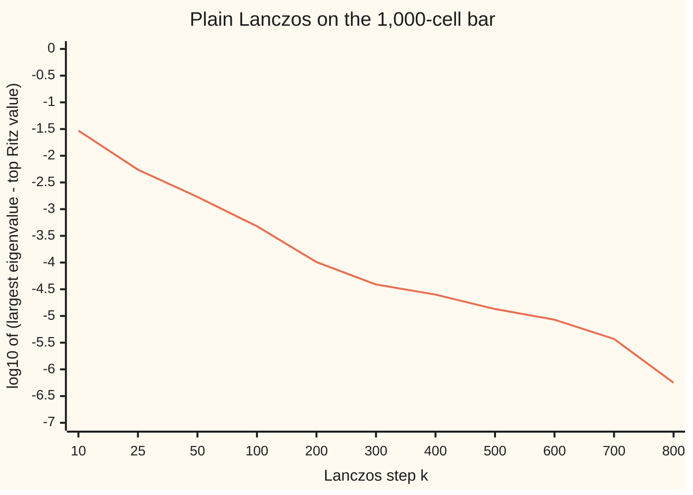

# Lanczos: the extreme eigenvalues of a huge symmetric matrix from a three-term recurrence

[Syllabus](../../../SYLLABUS.md) → [Numerical analysis](../README.md) → [Numerical Linear Algebra](../README.md#s03) → Lanczos

---

## General Overview

A steel bar 1.001 m long has both ends held at a fixed temperature. A simulation splits it into 1,000 cells, 1 mm apart, and tracks each cell's temperature. Heat flows between neighbours, so the model is one matrix, $`L`$, with 2 on the diagonal and −1 beside it: 1,000 rows, at most three nonzeros each.

Two numbers about $`L`$ decide how the simulation behaves. Both are **eigenvalues**: stretch factors of the matrix ([Eigenvalues by iteration](07-eigenvalues-power-iteration-and-the-qr-algorithm.md)).

- **The largest, 3.999990150113,** sets the longest safe time step for the simple explicit scheme. With steel's diffusivity taken as 1.2e-5 m² per second (illustrative), that step is 0.0416668 s.
- **The smallest, 0.000009849886677,** sets how slowly the bar's last warmth fades. Its time constant is 8460.3 s, over two hours.

Their ratio, 406095.0, is the condition number κ of $`L`$. It tells conjugate gradient how many steps it will need ([Iterating instead of factoring](09-iterative-methods-jacobi-gauss-seidel-and-conjugate-gradient.md)).

This bar has a known answer, so it serves as a test. A real engine block has a million cells and no formula. A dense eigen-solver first reduces a full matrix to tridiagonal form, about 4n³/3 flops: 1,333,333,333 even at n = 1,000. **Lanczos** (1950) needs only products with the matrix:

- It multiplies a start vector by $`L`$ again and again, like power iteration, but keeps an orthonormal basis of every product.
- Because $`L`$ is symmetric, each new basis vector needs straightening against only the last two: the **three-term recurrence**.
- The straightening numbers fill a small tridiagonal table $`T_k`$. Its eigenvalues, the **Ritz values**, approximate the outer eigenvalues of $`L`$.

After 50 steps and 600,000 flops (a flop is one addition, subtraction, multiplication or division), the top Ritz value is 3.9983104045, short by 1.680e-3 (true error). Run on the inverse of $`L`$ instead (**shift-invert**), Lanczos finds the smallest eigenvalue to a relative error of 1.978e-12 in 6 steps. Without extra care, rounding makes it then report that eigenvalue again and again: 5 copies by step 40.

**Lanczos builds an orthonormal basis of the products b, Ab, A²b, … with a three-term recurrence that symmetry makes possible, and the eigenvalues of the small tridiagonal table it records are the best estimates that space allows: they close in on the extreme eigenvalues first, fast when those stand apart from the rest.**

**What kind of fact this is:** a method resting on theorems. The three-term recurrence, the optimality of Ritz values, their staying inside the eigenvalue range, the free residual estimate and the Kaniel–Paige convergence bound are proved on this card in Why it works. Paige's theorem on lost orthogonality is stated with its source, not proved.

### The picture: the top Ritz value closing on the largest eigenvalue



The line is the true error of the top Ritz value. The step axis is not evenly spaced. The error passes 1e-3 before step 100 but passes 1e-6 only at step 800, because the bar's top eigenvalues sit packed together.

---

## The formula

Start from a vector $`b`$ and set $`q_1 = b / \lVert b \rVert_2`$, a vector of length one. Each step makes one product and straightens it:

```math
\beta_k\, q_{k+1} = A q_k - \alpha_k q_k - \beta_{k-1} q_{k-1}, \qquad \alpha_k = q_k^{\mathsf T} A q_k, \qquad \beta_k = \lVert A q_k - \alpha_k q_k - \beta_{k-1} q_{k-1} \rVert_2 .
```

**Read it aloud:** multiply the newest basis vector by A, remove its parts along the newest and the one before, and scale what is left to length one.

The coefficients fill the tridiagonal table, and its eigenvalues are the Ritz values:

```math
T_k = \begin{bmatrix} \alpha_1 & \beta_1 & & \\ \beta_1 & \alpha_2 & \ddots & \\ & \ddots & \ddots & \beta_{k-1} \\ & & \beta_{k-1} & \alpha_k \end{bmatrix}, \qquad T_k s = \theta s, \qquad \lVert A y - \theta y \rVert_2 = \beta_k \lvert s_k \rvert \ \text{ for } y = Q_k s .
```

**Read it aloud:** the Ritz values θ are the eigenvalues of the small table, and how far each Ritz pair misses being exact is the next β times the last entry of its small eigenvector.

The top Ritz value approaches the largest eigenvalue $`\lambda_n`$ at a rate set by the gap. This is the Kaniel–Paige bound (Parlett, 1998):

```math
0 \le \lambda_n - \theta_{\max} \le (\lambda_n - \lambda_1) \left( \frac{\tan \varphi_0}{C_{k-1}(1 + 2\gamma)} \right)^{2}, \qquad \gamma = \frac{\lambda_n - \lambda_{n-1}}{\lambda_{n-1} - \lambda_1} .
```

**Read it aloud:** the top Ritz value is never above the largest eigenvalue, and its shortfall is at most the spread of the eigenvalues, times how badly the start vector points, divided by a Chebyshev polynomial that grows faster the wider the top gap.

| Symbol | Plain meaning | In our example | Push it up and the answer… |
| --- | --- | --- | --- |
| $`A`$, $`n`$ | the symmetric matrix and its number of rows | diag(1, 2, 3), n = 3; the bar's L, n = 1,000 | bigger n: more steps to separate packed eigenvalues |
| $`b`$; $`q_j`$, $`Q_k`$ | the start vector; the Lanczos vectors, orthonormal (each of length one, all at right angles); Q_k holds the first k as columns | b = (1, 1, 1) for diag(1, 2, 3); random entries in ±0.5 for the bar | — |
| $`\alpha_j`$, $`\beta_j`$; $`w`$ | the recurrence coefficients: the diagonal and off-diagonal of T_k; w is a straightened product before scaling | α₁ = 2, β₁ = 0.8165 | β_k = 0: the space is complete and every Ritz value is exact |
| $`T_k`$, $`k`$; $`e_k`$ | the k-by-k tridiagonal table; the step count; the last column of the k-by-k identity | T₂ = `[[2, 0.8165], [0.8165, 2]]` | more steps: better Ritz values |
| $`\mathcal{K}_k`$ | the Krylov space: every mix of b, Ab, …, A^(k−1) b | span of (1, 1, 1) and (1, 2, 3) at k = 2 | grows by one direction a step |
| $`\theta`$; $`s`$, $`y`$; $`R`$ | a Ritz value; its unit eigenvector in T_k, with last entry s_k; the Ritz vector Q_k s in full size; the Rayleigh quotient R(y) = yᵀAy ÷ yᵀy | 1.1835 and 2.8165 at k = 2 | — |
| $`\lambda_1, \lambda_{n-1}, \lambda_n`$ | the eigenvalues of A from smallest up: smallest, second largest, largest | for L, 4 sin²(jπ/2002): 0.000009849886677, 3.999960600550, 3.999990150113 | — |
| $`\varphi_0`$ | the angle between b and the top eigenvector | tan²φ₀ = 21,191.40 for the bar | a worse start: a weaker bound |
| $`\gamma`$ | the top gap, relative to the rest of the spread | 7.387e-6 for the bar; 3.0000 after shift-invert | bigger γ: faster convergence |
| $`C_m`$; $`p`$ | p is any polynomial; C_m is the Chebyshev polynomial of degree m: C_m(cos t) = cos(mt), at most 1 in size on [−1, 1], growing fastest of all such polynomials beyond it | written T_m on other cards; here T_k is the table | — |
| $`\sigma`$, $`\mu`$ | a shift, and an eigenvalue μ = 1/(λ − σ) of the inverse (A − σI)⁻¹ | σ = 0; μ₁ = 101524.010664, μ₂ = 25381.065166 | σ nearer λ: μ larger and better separated |
| $`u`$; $`r`$ | the unit roundoff 2⁻⁵³, the largest relative rounding error of one operation; r, the heat scheme's time step in grid units | κu = 4.509e-11; r at most 0.5000012 | larger r: a faster run, until it turns unstable |

The ratio κ = λ_n/λ_1 is the condition number from [Matrix norms and the condition number](01-matrix-norms-and-the-condition-number.md).

### When it holds

- **A is symmetric.** Symmetry cuts the recurrence to three terms. Without it the new vector has parts along every earlier one, and the method becomes Arnoldi's, dearer every step ([Sparse storage and Krylov methods](10-sparse-matrices-and-krylov-methods.md)).
- **The start has some weight on the wanted eigenvector.** Lanczos never sees an eigenvector that b misses. A start of all ones misses the bar's top mode, and the top Ritz value stops at the second eigenvalue (Try changing).
- **The wanted eigenvalues stand apart.** With γ = 7.387e-6 at the bar's top, separating λ_n from its neighbours takes hundreds of steps. Interior eigenvalues converge slowest; shift-invert moves them to the outside.
- **Rounding is accounted for.** Once a Ritz value converges, the q's lose orthogonality and the same eigenvalue shows up again. Reorthogonalisation removes the copies.
- **Shift-invert can afford a solve.** Each step solves with A − σI: about 6n flops by Thomas for the bar, a sparse factorisation on a 3-D grid.

---

## Why it works

### Step 0: keep every product, then pick the best mix

Power iteration keeps only its newest vector, $`A^{k-1} b`$ scaled. Every mix of b, Ab, …, A^(k−1) b costs nothing more: that set is the Krylov space $`\mathcal{K}_k`$, and its best vector can only beat the newest one.

The yardstick for "best" is the **Rayleigh quotient** $`R(y) = y^{\mathsf T} A y / y^{\mathsf T} y`$ ([Eigenvalues by iteration](07-eigenvalues-power-iteration-and-the-qr-algorithm.md)). Its largest value over all vectors is $`\lambda_n`$ and its smallest is $`\lambda_1`$ ([The spectral theorem](../../03-Algebra/07-Eigenvalues%20and%20Symmetric%20Matrices/04-spectral-theorem.md)). Lanczos pushes R as high and as low as the Krylov space allows.

### Step 1: symmetry leaves only three terms

Build the orthonormal basis $`q_1, \dots, q_k`$ of $`\mathcal{K}_k`$ by Gram–Schmidt ([QR](05-qr-householder-and-gram-schmidt.md)): multiply the newest q by A, remove its part along each earlier q, and scale. The part of $`A q_k`$ along an earlier $`q_i`$, with $`i \le k-2`$, is

```math
q_i^{\mathsf T} A q_k = (A q_i)^{\mathsf T} q_k = 0 ,
```

because A is symmetric, and $`A q_i`$ lies in $`\mathcal{K}_{i+1}`$, spanned by $`q_1, \dots, q_{i+1}`$, all at right angles to $`q_k`$. So only the parts along $`q_k`$ and $`q_{k-1}`$ survive. The part along $`q_{k-1}`$ is $`\beta_{k-1}`$, the length found one step earlier. That is the recurrence in The formula.

Collect the steps as columns: $`A Q_k = Q_k T_k + \beta_k q_{k+1} e_k^{\mathsf T}`$, where $`e_k`$ is the last column of the k-by-k identity. Multiply on the left by $`Q_k^{\mathsf T}`$ and the last term vanishes: $`T_k = Q_k^{\mathsf T} A Q_k`$. Each step costs one product and about 9n further flops, and needs only the last two q's in memory.

### Step 2: Ritz values are the best the space allows

Any y in $`\mathcal{K}_k`$ is $`Q_k s`$ for some short vector s. Then $`y^{\mathsf T} A y = s^{\mathsf T} T_k s`$ and $`y^{\mathsf T} y = s^{\mathsf T} s`$. So R over the big space equals the small table's own Rayleigh quotient over all s. By the spectral theorem for $`T_k`$:

- The largest Ritz value is the largest R over $`\mathcal{K}_k`$. It can never pass $`\lambda_n`$, the largest R over everything.
- $`\mathcal{K}_k`$ sits inside $`\mathcal{K}_{k+1}`$, so the top Ritz value never falls as k grows.
- The same holds upside down: the smallest Ritz value never drops below $`\lambda_1`$, and never rises.

This is the **Rayleigh–Ritz** method: project A onto a subspace and solve the small eigenproblem. Lanczos makes the projection tridiagonal for free. On diag(1, 2, 3) the Ritz values 1.1835 and 2.8165 already sit inside [1, 3], and they interlace the eigenvalues 1, 2, 3: one in each gap. Cauchy's interlacing theorem says the Ritz values at step k always interlace those at step k + 1, and at step n − 1 they interlace the eigenvalues of A, as here (Parlett, 1998). This card proves only the two outer cases above.

### Step 3: the residual comes free

Multiply $`A Q_k = Q_k T_k + \beta_k q_{k+1} e_k^{\mathsf T}`$ by a unit eigenvector s of $`T_k`$:

```math
A y - \theta y = \beta_k\, s_k\, q_{k+1}, \qquad \text{so} \qquad \lVert A y - \theta y \rVert_2 = \beta_k \lvert s_k \rvert .
```

So Lanczos knows how good each Ritz pair is without forming y. Some eigenvalue of A lies within that distance of θ ([Eigenvalues by iteration](07-eigenvalues-power-iteration-and-the-qr-algorithm.md), Step 3). On the shift-invert run the estimate matches a residual recomputed from scratch, 9.345e0 against 9.345e0 at step 5. They agree until the recomputed one stops at rounding level, 2.577e-10.

A residual bound places *an* eigenvalue near θ. It does not say which one, and it does not say none is missed.

### Step 4: the Kaniel–Paige bound

Any polynomial p of degree k − 1 gives a vector $`p(A) b`$ in $`\mathcal{K}_k`$, so the top Ritz value is at least $`R(p(A) b)`$. Choose p to be small on $`[\lambda_1, \lambda_{n-1}]`$ and large at $`\lambda_n`$. The best such polynomial is a stretched Chebyshev polynomial, and the bound in The formula follows.

<details>
<summary>Detailed proof: the Kaniel–Paige bound</summary>

Write $`b = \sum_i c_i v_i`$ in orthonormal eigenvectors, so $`\tan^2 \varphi_0 = \sum_{i<n} c_i^2 / c_n^2`$. For $`y = p(A) b`$,

$`\displaystyle \lambda_n - R(y) = \frac{\sum_{i<n} (\lambda_n - \lambda_i)\, p(\lambda_i)^2 c_i^2}{\sum_{i} p(\lambda_i)^2 c_i^2} \le (\lambda_n - \lambda_1)\, \frac{\max_{i<n} p(\lambda_i)^2 \sum_{i<n} c_i^2}{p(\lambda_n)^2 c_n^2} .`$

Take $`p(x) = C_{k-1}\big(1 + 2(x - \lambda_{n-1})/(\lambda_{n-1} - \lambda_1)\big)`$. For x in $`[\lambda_1, \lambda_{n-1}]`$ the argument lies in [−1, 1], so $`p(x)^2 \le 1`$. At $`x = \lambda_n`$ the argument is $`1 + 2\gamma`$. Hence

$`\displaystyle \lambda_n - \theta_{\max} \le \lambda_n - R(y) \le (\lambda_n - \lambda_1)\, \frac{\tan^2 \varphi_0}{C_{k-1}(1 + 2\gamma)^2} .`$

For x ≥ 1, $`C_m(x) = \tfrac12\big[(x + \sqrt{x^2-1})^m + (x - \sqrt{x^2-1})^m\big]`$, which grows like $`e^{2m\sqrt{\gamma}}`$ when $`x = 1 + 2\gamma`$ and γ is small.

</details>

The rate depends on $`\sqrt{\gamma}`$, not on γ as power iteration's does. That square root is Lanczos's advantage. The code compares the bound with the true error on two runs:

| Run | Step k | True error | Bound | Bound ÷ true |
| --- | ---: | ---: | ---: | ---: |
| bar, plain | 50 | 1.680e-3 | 7.902e4 | 4.705e7 (useless) |
| bar, plain | 800 | 5.578e-7 | 5.722e1 | 1.026e8 (useless) |
| shift-invert, relative | 3 | 3.789e-3 | 2.550e0 | 673.1 |
| shift-invert, relative | 5 | 8.712e-9 | 6.777e-5 | 7778.9 |
| shift-invert, relative | 6 | 1.978e-12 | 3.493e-7 | 176623.9 |

On the bar, γ = 7.387e-6 and the bound stays above the whole spread of 4 for 800 steps. The Ritz value still gets close fast, because many eigenvalues crowd just below 4: getting near any of them is getting near λ_n. Telling λ_n = 3.999990150113 apart from λ_(n−1) = 3.999960600550 is what takes the hundreds of steps.

### Step 5: shift-invert moves the wanted eigenvalue to the edge

The smallest eigenvalue of the bar, 0.000009849886677, is tiny next to the spread of 4, and its neighbours crowd close. Plain Lanczos sees it as barely separated. Run Lanczos on $`(A - \sigma I)^{-1}`$ instead. It has the same eigenvectors, and eigenvalues $`\mu = 1/(\lambda - \sigma)`$. With σ = 0 the bar's smallest λ becomes the largest μ, 101524.010664, far above the next, 25381.065166. Now γ = 3.0000.

Each step is one solve with L, done by [The Thomas algorithm](03-tridiagonal-systems-and-the-thomas-algorithm.md). The relative error falls 6.572e-1, 3.789e-3, 3.442e-5, 8.712e-9, 1.978e-12 over steps 2 to 6, and stops at 2.720e-13. That floor is rounding in the solves, below the rough estimate κu = 4.509e-11. Six steps cost 90,000 flops.

A shift σ placed inside the spectrum finds the eigenvalues nearest σ the same way. That is how structural codes find the lowest modes of a frame.

### Step 6: in floating point, orthogonality fails as soon as a Ritz value converges

The proof in Step 1 used exact orthogonality of the q's. Rounding spoils it, and not slowly. Paige (1980) proved that the new vector's part along a Ritz vector y is about $`u \lVert A \rVert_2`$ divided by that pair's residual $`\beta_k |s_k|`$. So the better a Ritz pair converges, the more of its eigenvector leaks back into the new q.

The code measures a proxy for the leak: the largest dot product of the newest q with all earlier ones. Paige's theorem is about the part along the converged Ritz vector, which the proxy contains but does not isolate. On the inverse, ‖A‖₂ is μ₁:

| Step k | Paige level u μ₁ ÷ residual | Proxy, plain Lanczos | Proxy, full reorthogonalisation | Copies of μ₁, plain | Copies, full |
| ---: | ---: | ---: | ---: | ---: | ---: |
| 5 | — | 1.453e-13 | 2.323e-16 | 1 | 1 |
| 8 | 3.331e-7 | 3.253e-8 | 3.567e-16 | 1 | 1 |
| 10 | 5.671e-3 | 3.919e-4 | 2.967e-16 | 1 | 1 |
| 15 | — | 1.194e-1 | 1.815e-16 | 2 | 1 |
| 20 | — | 9.551e-1 | 2.654e-16 | 2 | 1 |
| 40 | — | 1.075e-1 | 3.262e-16 | 5 | 1 |

At the two steps where the level is printed, 8 and 10, the proxy sits below it and grows with it, as the theorem predicts; two points show the trend, not the theorem's constant. Once the q's point partly back along the converged eigenvector, the recurrence rebuilds that eigenvector from scratch. T_k then holds a second copy of μ₁, a **ghost**, and later a third. The ghosts are not wrong values; they are wrong counts.

The remedies:

- **Full reorthogonalisation**: straighten each new q against every earlier one. No ghosts, but all k vectors stay in memory, and 40 steps cost 3,280,000 extra flops.
- **Selective reorthogonalisation** (Parlett and Scott, 1979): straighten only against Ritz vectors whose residual estimate says they have converged, which is where the leak comes from.
- **Keep the ghosts and discard repeats.** Paige (1980) showed that plain Lanczos still delivers accurate eigenvalues; it only reports some more than once.

### Step 7: conjugate gradient is Lanczos in disguise

Conjugate gradient on $`A x = b`$ builds the same Krylov space; its residuals are the q's, up to scaling and sign, and its step lengths come from an LDLᵀ factorisation of the same $`T_k`$. So CG's progress follows the Ritz values, and it loses orthogonality the same way. MINRES runs the same recurrence for a symmetric indefinite matrix ([Saddle-point systems](12-symmetric-indefinite-systems-ldlt-and-minres.md)).

---

## Worked numbers, by hand

Take A = diag(1, 2, 3) and b = (1, 1, 1).

| Step | Arithmetic | Value |
| --- | --- | --- |
| q₁ | (1, 1, 1) ÷ √3 | (0.5774, 0.5774, 0.5774) |
| A q₁ | (1, 2, 3) ÷ √3 | — |
| α₁ | q₁ᵀ A q₁ = (1 + 2 + 3) ÷ 3 | 2.0000 |
| w | A q₁ − 2 q₁ = (−1, 0, 1) ÷ √3 | — |
| β₁ | ‖w‖ = √(2/3) | 0.8165 |
| q₂ | w ÷ β₁ = (−1, 0, 1) ÷ √2 | — |
| α₂ | q₂ᵀ A q₂ = (1 + 3) ÷ 2 | 2.0000 |
| T₂ | `[[2, 0.8165], [0.8165, 2]]` | — |
| **Ritz values** | 2 ± β₁ | **1.1835 and 2.8165** |
| β₂, α₃ | next step: √(1/3); then (1 + 8 + 3) ÷ 6 | 0.5774, 2.0000 |
| T₃'s eigenvalues | 2 and 2 ± √(β₁² + β₂²) = 2 ± 1 | 1.000000, 2.000000, 3.000000 |
| β₃ | zero in exact arithmetic; rounding | 1.596e-15 |

After two products the Ritz values 1.1835 and 2.8165 sit inside [1, 3], already pulling toward its ends. After three, the Krylov space is all of three-dimensional space, β₃ is zero up to rounding, and the Ritz values are exact.

### What breaks if you drop a piece

| Mistake | Comes out at | What went wrong |
| --- | --- | --- |
| No reorthogonalisation, shift-invert run | 2 copies of μ₁ at step 15, 5 at step 40; orthogonality 9.551e-1 at step 20 | rounding leaks the converged eigenvector back into the q's (Paige) |
| Plain Lanczos for the smallest eigenvalue | bottom Ritz value 0.0006796 after 50 steps, a relative error of 68.0 | λ₁ is tiny and packed next to its neighbours; shift-invert needs 6 steps |
| Time step set from the Ritz value after 50 steps | r = 0.5002113 instead of at most 0.5000012; top mode multiplied by −1.0008402 a step, 4441.5 times larger after 10,000 steps | a Ritz value is a lower bound on λ_n, so the step it gives is too long |

The third row uses the explicit heat scheme of [Stepping the heat equation on a grid](../../08-Differential%20equations%20and%20dynamics/10-The%20Classical%20PDEs/09-finite-differences-for-the-heat-equation.md). With r the time step in grid units, each step multiplies the mode with eigenvalue λ by 1 − rλ. It is stable when r λ_n ≤ 2, so r ≤ 0.5000012 here.

---

## Code, from first principles, and it actually runs

The code runs Lanczos on diag(1, 2, 3) and on the 1,000-cell bar, plain and with shift-invert. It reads every Ritz value by Sturm bisection, which counts the negative pivots of T_k − xI to find how many Ritz values lie below x. Five roads check it. The 2-by-2 Ritz values match the closed form 2 ± β₁ and a direct Rayleigh–Ritz on the two vectors b and Ab. The bar's Ritz values are checked against the exact eigenvalues 4 sin²(jπ/2002) from both sides: never past them, and as close as the card reports at steps 50 and 800 and after shift-invert. The residual estimate β_k|s_k| matches a residual recomputed with a separate solve. Plain and fully reorthogonalised runs agree on μ₁. Every true error sits under the Kaniel–Paige bound.

### Python

```python
# Lanczos and Rayleigh-Ritz -- the check behind the card.  Standard library only.
# Road one: diag(1, 2, 3) by hand, by Sturm bisection and by a direct Rayleigh-Ritz.
# Road two: the 1,000-cell bar matrix L = tridiag(-1, 2, -1) against its known
# eigenvalues 4 sin^2(j pi / 2002).  Road three: shift-invert, with and without
# full reorthogonalisation, against the Kaniel-Paige bound and recomputed residuals.
from math import sqrt, sin, cos, pi, log10

M64, state = (1 << 64) - 1, [20261124]
def nxt():                                   # SplitMix64, written out
    state[0] = (state[0] + 0x9E3779B97F4A7C15) & M64
    z = state[0]
    z = ((z ^ (z >> 30)) * 0xBF58476D1CE4E5B9) & M64
    z = ((z ^ (z >> 27)) * 0x94D049BB133111EB) & M64
    return z ^ (z >> 31)
def unif(): return (nxt() >> 11) / 9007199254740992.0
def sci(v): m, x = f"{v:.3e}".split("e"); return m + "e" + str(int(x))  # as Rust
def dot(u, v):
    acc = 0.0
    for a, b in zip(u, v): acc += a * b
    return acc
def lanczos(op, b, m, full):                 # alphas, betas, Lanczos vectors
    nb = sqrt(dot(b, b)); Q = [[v / nb for v in b]]; al, be = [], []
    for k in range(m):
        w = op(Q[k]); a = dot(w, Q[k]); al.append(a)
        w = [x - a * y - (be[k - 1] * z if k > 0 else 0.0) for x, y, z in zip(w, Q[k], Q[k - 1])]
        if full:                             # full reorthogonalisation
            for v in Q:
                h = dot(w, v); w = [x - h * y for x, y in zip(w, v)]
        be.append(sqrt(dot(w, w)))
        if k < m - 1: Q.append([v / be[k] for v in w])
    return al, be, Q
def below(al, be, x):                        # Sturm count: eigenvalues of T_k below x
    c, d = 0, 1.0
    for i in range(len(al)):
        d = al[i] - x - (be[i - 1] * be[i - 1] / d if i > 0 else 0.0)
        d = d if d != 0.0 else 1e-300; c += d < 0.0
    return c
def ritz(al, be, j, lo, hi):                 # j-th smallest Ritz value, by bisection
    for _ in range(100):
        mid = 0.5 * (lo + hi)
        lo, hi = (lo, mid) if below(al, be, mid) > j else (mid, hi)
    return 0.5 * (lo + hi)
def ritzvec(al, be, th):                     # Ritz vector of T_k: two inverse steps
    k, s = len(al), [1.0] * len(al)          # on (th + d) I - T, positive definite
    for _ in range(2):
        c, g = [0.0] * k, [0.0] * k
        for i in range(k):
            m = th * (1 + 1e-13) - al[i] + (be[i - 1] * c[i - 1] if i > 0 else 0.0)
            c[i] = -be[i] / m; g[i] = (s[i] + (be[i - 1] * g[i - 1] if i > 0 else 0.0)) / m
        for i in range(k - 2, -1, -1): g[i] -= c[i] * g[i + 1]
        ns = sqrt(dot(g, g)); s = [v / ns for v in g]
    return s
# ---- road one: diag(1, 2, 3), start (1, 1, 1)/sqrt(3) ----
D = lambda x: [1.0 * x[0], 2.0 * x[1], 3.0 * x[2]]
al, be, Q = lanczos(D, [1.0, 1.0, 1.0], 3, False)
print(f"small,alpha={al[0]:.4f},{al[1]:.4f},{al[2]:.4f},beta={be[0]:.4f},{be[1]:.4f},beta3={sci(be[2])}")
t2 = [ritz(al[:2], be, j, 0.0, 4.0) for j in (0, 1)]
q1 = [1 / sqrt(3.0)] * 3; Aq = D(q1)           # direct Rayleigh-Ritz on span{b, Ab}
v = [x - dot(Aq, q1) * y for x, y in zip(Aq, q1)]; q2 = [x / sqrt(dot(v, v)) for x in v]
h11, h12, h22 = dot(q1, D(q1)), dot(q1, D(q2)), dot(q2, D(q2)); disc = sqrt((h11 - h22) ** 2 + 4 * h12 * h12)
direct = [0.5 * (h11 + h22 - disc), 0.5 * (h11 + h22 + disc)]
assert abs(be[0] - sqrt(2 / 3)) < 1e-15 and abs(be[1] - sqrt(1 / 3)) < 1e-15 and abs(be[2]) < 1e-14
assert all(abs(a - c) < 1e-14 and abs(a - d) < 1e-14 for a, c, d in zip(t2, direct, (2 - be[0], 2 + be[0])))
t3 = [ritz(al, be, j, 0.0, 4.0) for j in range(3)]
assert all(abs(a - c) < 1e-14 for a, c in zip(t3, (1.0, 2.0, 3.0))) and 1.0 <= t2[0] <= 2.0 <= t2[1] <= 3.0
print(f"small,T2_ritz={t2[0]:.4f},{t2[1]:.4f},direct={direct[0]:.4f},{direct[1]:.4f}")
print(f"small,T3_ritz={t3[0]:.6f},{t3[1]:.6f},{t3[2]:.6f}")
# ---- road two: the bar, n = 1,000 cells, plain Lanczos ----
n = 1000
def L(x): return [2.0 * x[i] - (x[i - 1] if i > 0 else 0.0) - (x[i + 1] if i < n - 1 else 0.0) for i in range(n)]
lam = [4.0 * sin(j * pi / 2002.0) ** 2 for j in range(1, n + 1)]   # exact eigenvalues
top, bot = 2.0 + 2.0 * cos(pi / 1001.0), lam[0]
b = [unif() - 0.5 for _ in range(n)]
print(f"bar,lambda_max={top:.12f},spec_form={4 - 2 * (1 - cos(pi / 1001)):.12f},second={lam[-2]:.12f}")
print(f"bar,lambda_min={bot:.15f},kappa={top / bot:.1f}")
def tan2f(v): c2 = dot(b, v) ** 2 / dot(v, v); return (dot(b, b) - c2) / c2   # tan^2 of start angle
tan2 = tan2f([sin(j * 1000 * pi / 1001) for j in range(1, n + 1)])  # top eigenvector
gam = (top - lam[-2]) / (lam[-2] - bot)
al, be, _ = lanczos(L, b, 800, False)
print(f"bar,tan2_theta0={tan2:.2f},gamma={sci(gam)}")
print("k,top_ritz,top_error,bottom_error,kaniel_paige_bound,bound/true")
prev, ks, chart = 0.0, [10, 25, 50, 100, 200, 300, 400, 500, 600, 700, 800], []
for k in ks:
    a = al[:k]; th, tl = ritz(a, be, k - 1, 0.0, 4.5), ritz(a, be, 0, 0.0, 4.5)
    T0, T1, x = 1.0, 1.0 + 2 * gam, 1.0 + 2 * gam            # Chebyshev T_{k-1}(x)
    for _ in range(k - 2): T0, T1 = T1, 2 * x * T1 - T0
    bound = (top - bot) * tan2 / (T1 * T1)
    assert prev - 1e-13 <= th <= top + 1e-13 and top - th <= bound and tl >= bot - 1e-13 and top - th < {50: 2e-3, 800: 1e-6}.get(k, 1.0)
    prev = th; chart.append(log10(top - th))
    if k == 50: th50, tl50 = th, tl
    print(f"{k},{th:.10f},{sci(top - th)},{sci(tl - bot)},{sci(bound)},{sci(bound / (top - th))}")
print("chart,k," + ",".join(str(k) for k in ks))
print("chart,log10_top_error," + ",".join(f"{v:.2f}" for v in chart))
# ---- road three: shift-invert, solve with L by the Thomas algorithm ----
def solve(d):
    cp, dp = [0.0] * n, [0.0] * n
    cp[0], dp[0] = -0.5, d[0] / 2.0
    for i in range(1, n):
        m = 2.0 + cp[i - 1]; cp[i] = -1.0 / m; dp[i] = (d[i] + dp[i - 1]) / m
    x = [0.0] * n; x[-1] = dp[-1]
    for i in range(n - 2, -1, -1): x[i] = dp[i] - cp[i] * x[i + 1]
    return x
mu = [1.0 / v for v in lam[:2]]                                      # 1/lambda_1, 1/lambda_2
tan2 = tan2f([sin(j * pi / 1001) for j in range(1, n + 1)])         # bottom eigenvector
gam = (mu[0] - mu[1]) / (mu[1] - 1.0 / top)
print(f"invert,mu1={mu[0]:.6f},mu2={mu[1]:.6f},tan2_theta0={tan2:.2f},gamma={gam:.4f}")
runs = [lanczos(solve, b, 40, f) for f in (False, True)]
print("k,rel_error,bound,bound/true,residual_estimate,residual_recomputed,copies_plain,copies_full,orth_plain,orth_full")
for k in [2, 3, 4, 5, 6, 8, 10, 15, 20, 30, 40]:
    row = []
    for al, be, Q in runs:
        a = al[:k]; th = ritz(a, be, k - 1, 0.0, 2e5)
        cop = k - below(a, be, mu[0] * (1 - 1e-8))
        orth = max(abs(dot(Q[k - 1], Q[i])) for i in range(k - 1))
        row.append((th, cop, orth))
    al, be, Q = runs[1]; th = row[1][0]; s = ritzvec(al[:k], be, th)
    y = [dot(s, [Q[j][i] for j in range(k)]) for i in range(n)]
    r = [p - th * q for p, q in zip(solve(y), y)]; tr, est = sqrt(dot(r, r)), be[k - 1] * abs(s[-1])
    err = (mu[0] - th) / mu[0]
    T0, T1, x = 1.0, 1.0 + 2 * gam, 1.0 + 2 * gam
    for _ in range(k - 2): T0, T1 = T1, 2 * x * T1 - T0
    bnd = (mu[0] - 1.0 / top) * tan2 / (T1 * T1) / mu[0]
    assert abs(row[0][0] - row[1][0]) < 1e-12 * mu[0] and abs(tr - est) < 1e-13 * mu[0] + 1e-6 * est
    assert (err <= bnd or err < 1e-12) and abs(err) < {5: 1e-8, 6: 1e-11}.get(k, 1e-12 if k > 6 else 1.0)  # both sides; the floor
    ratio = f"{bnd / err:.1f}" if err > 1e-12 else "-"
    print(f"{k},{sci(err)},{sci(bnd)},{ratio},{sci(est)},{sci(tr)},{row[0][1]},{row[1][1]},{sci(row[0][2])},{sci(row[1][2])}")
    if k in (8, 10): print(f"paige,k={k},u*mu1/estimate={sci(2.0 ** -53 * mu[0] / est)},orth_plain={sci(row[0][2])}")
assert row[0][1] >= 3 and row[1][1] == 1
print(f"invert,error_floor={sci(err)},kappa_u={sci(top / bot * 2.0 ** -53)}")

# ---- what it is for: the bar's time step and cooling time (alpha illustrative) ----
h, alpha = 1e-3, 1.2e-5                      # 1 mm cells; steel, m^2/s, illustrative
print(f"use,dt_max_s={2 * h * h / (alpha * top):.7f},r_max={2 / top:.7f},cooling_time_s={h * h / (alpha * bot):.1f}")
g, amp = 1.0 - (2.0 / th50) * top, 1.0      # step set from the Ritz value th50 < lambda_max
for _ in range(10000): amp *= abs(g)
assert g < -1.0 and amp > 1.0
print(f"break,ritz50={th50:.7f},r_from_ritz={2 / th50:.7f},g={g:.7f},growth_10000_steps={amp:.1f}")
print(f"break,plain_bottom_ritz50={tl50:.7f},relative_error={(tl50 - bot) / bot:.1f}")
print(f"cost,plain_50_steps={50 * 12 * n:,},invert_6_steps={6 * 15 * n:,},full_reorth_extra_40={sum(4 * n * (k + 1) for k in range(40)):,},dense_tridiagonalise={4 * n ** 3 // 3:,}")
print("ALL CHECKS PASS")
```

**Ran 2026-11-24 on macOS, Python 3.14.10, standard library only. All checks passed. Output, pasted from the run:**

```
small,alpha=2.0000,2.0000,2.0000,beta=0.8165,0.5774,beta3=1.596e-15
small,T2_ritz=1.1835,2.8165,direct=1.1835,2.8165
small,T3_ritz=1.000000,2.000000,3.000000
bar,lambda_max=3.999990150113,spec_form=3.999990150113,second=3.999960600550
bar,lambda_min=0.000009849886677,kappa=406095.0
bar,tan2_theta0=21191.40,gamma=7.387e-6
k,top_ritz,top_error,bottom_error,kaniel_paige_bound,bound/true
10,3.9704051812,2.958e-2,2.114e-2,8.456e4,2.858e6
25,3.9944829457,5.507e-3,3.730e-3,8.334e4,1.513e7
50,3.9983104045,1.680e-3,6.698e-4,7.902e4,4.705e7
100,3.9995098889,4.803e-4,1.630e-4,6.428e4,1.338e8
200,3.9998882381,1.019e-4,8.410e-5,3.135e4,3.076e8
300,3.9999510942,3.906e-5,7.693e-5,1.218e4,3.117e8
400,3.9999652260,2.492e-5,6.993e-5,4.316e3,1.732e8
500,3.9999766637,1.349e-5,1.539e-5,1.480e3,1.098e8
600,3.9999815531,8.597e-6,9.322e-6,5.020e2,5.840e7
700,3.9999864192,3.731e-6,4.832e-6,1.696e2,4.546e7
800,3.9999895924,5.578e-7,9.213e-7,5.722e1,1.026e8
chart,k,10,25,50,100,200,300,400,500,600,700,800
chart,log10_top_error,-1.53,-2.26,-2.77,-3.32,-3.99,-4.41,-4.60,-4.87,-5.07,-5.43,-6.25
invert,mu1=101524.010664,mu2=25381.065166,tan2_theta0=23995.71,gamma=3.0000
k,rel_error,bound,bound/true,residual_estimate,residual_recomputed,copies_plain,copies_full,orth_plain,orth_full
2,6.572e-1,4.897e2,745.1,3.917e4,3.917e4,0,0,2.887e-16,3.226e-18
3,3.789e-3,2.550e0,673.1,5.524e3,5.524e3,0,0,3.405e-16,9.353e-17
4,3.442e-5,1.315e-2,382.0,5.742e2,5.742e2,0,0,3.590e-14,1.117e-15
5,8.712e-9,6.777e-5,7778.9,9.345e0,9.345e0,1,1,1.453e-13,2.323e-16
6,1.978e-12,3.493e-7,176623.9,1.305e-1,1.305e-1,1,1,9.901e-12,1.405e-16
8,2.720e-13,9.282e-12,-,3.384e-5,3.384e-5,1,1,3.253e-8,3.567e-16
paige,k=8,u*mu1/estimate=3.331e-7,orth_plain=3.253e-8
10,2.720e-13,2.466e-16,-,1.987e-9,2.016e-9,1,1,3.919e-4,2.967e-16
paige,k=10,u*mu1/estimate=5.671e-3,orth_plain=3.919e-4
15,2.720e-13,8.976e-28,-,1.117e-21,2.577e-10,2,1,1.194e-1,1.815e-16
20,2.720e-13,3.267e-39,-,1.209e-24,2.577e-10,2,1,9.551e-1,2.654e-16
30,2.720e-13,4.326e-62,-,4.721e-25,2.577e-10,4,1,4.833e-1,4.135e-16
40,2.720e-13,5.730e-85,-,2.362e-25,2.577e-10,5,1,1.075e-1,3.262e-16
invert,error_floor=2.720e-13,kappa_u=4.509e-11
use,dt_max_s=0.0416668,r_max=0.5000012,cooling_time_s=8460.3
break,ritz50=3.9983104,r_from_ritz=0.5002113,g=-1.0008402,growth_10000_steps=4441.5
break,plain_bottom_ritz50=0.0006796,relative_error=68.0
cost,plain_50_steps=600,000,invert_6_steps=90,000,full_reorth_extra_40=3,280,000,dense_tridiagonalise=1,333,333,333
ALL CHECKS PASS
```

### Rust

```rust
// Lanczos and Rayleigh-Ritz -- the check behind the card.  Rust std only.
// Road one: diag(1, 2, 3) by hand, by Sturm bisection and by a direct Rayleigh-Ritz.
// Road two: the 1,000-cell bar matrix L = tridiag(-1, 2, -1) against its known
// eigenvalues 4 sin^2(j pi / 2002).  Road three: shift-invert, with and without
// full reorthogonalisation, against the Kaniel-Paige bound and recomputed residuals.
use std::f64::consts::PI;

fn nxt(st: &mut u64) -> u64 { // SplitMix64, written out
    *st = st.wrapping_add(0x9E3779B97F4A7C15);
    let mut z = (*st ^ (*st >> 30)).wrapping_mul(0xBF58476D1CE4E5B9);
    z = (z ^ (z >> 27)).wrapping_mul(0x94D049BB133111EB);
    z ^ (z >> 31)
}
fn unif(st: &mut u64) -> f64 { (nxt(st) >> 11) as f64 / 9007199254740992.0 }
fn sci(v: f64) -> String { format!("{:.3e}", v) }
fn commas(v: usize) -> String {
    let (d, mut out) = (v.to_string(), String::new());
    for (i, ch) in d.chars().enumerate() { if i > 0 && (d.len() - i) % 3 == 0 { out.push(','); } out.push(ch); } out
}
fn dot(u: &[f64], v: &[f64]) -> f64 { let mut acc = 0.0; for (a, b) in u.iter().zip(v) { acc += a * b; } acc }
type Run = (Vec<f64>, Vec<f64>, Vec<Vec<f64>>);
fn lanczos(op: &dyn Fn(&[f64]) -> Vec<f64>, b: &[f64], m: usize, full: bool) -> Run {
    let nb = dot(b, b).sqrt(); // alphas, betas, Lanczos vectors
    let mut q: Vec<Vec<f64>> = vec![b.iter().map(|v| v / nb).collect()];
    let (mut al, mut be): (Vec<f64>, Vec<f64>) = (vec![], vec![]);
    for k in 0..m {
        let mut w = op(&q[k]); let a = dot(&w, &q[k]); al.push(a);
        let km = if k > 0 { k - 1 } else { q.len() - 1 };
        w = (0..w.len()).map(|i| w[i] - a * q[k][i] - (if k > 0 { be[k - 1] * q[km][i] } else { 0.0 })).collect();
        if full { // full reorthogonalisation
            for v in &q { let h = dot(&w, v); w = w.iter().zip(v).map(|(x, y)| x - h * y).collect(); }
        }
        be.push(dot(&w, &w).sqrt());
        if k < m - 1 { let bk = be[k]; q.push(w.iter().map(|v| v / bk).collect()); }
    }
    (al, be, q)
}
fn below(al: &[f64], be: &[f64], x: f64) -> usize { // Sturm count: eigenvalues of T_k below x
    let (mut c, mut d) = (0, 1.0);
    for i in 0..al.len() {
        d = al[i] - x - (if i > 0 { be[i - 1] * be[i - 1] / d } else { 0.0 });
        if d == 0.0 { d = 1e-300; } if d < 0.0 { c += 1; }
    }
    c
}
fn ritz(al: &[f64], be: &[f64], j: usize, mut lo: f64, mut hi: f64) -> f64 { // j-th smallest, bisection
    for _ in 0..100 { let mid = 0.5 * (lo + hi); if below(al, be, mid) > j { hi = mid; } else { lo = mid; } }
    0.5 * (lo + hi)
}
fn ritzvec(al: &[f64], be: &[f64], th: f64) -> Vec<f64> { // Ritz vector of T_k: two inverse
    let k = al.len(); let mut s = vec![1.0; k];               // steps on (th + d) I - T
    for _ in 0..2 {
        let (mut c, mut g) = (vec![0.0; k], vec![0.0; k]);
        for i in 0..k {
            let m = th * (1.0 + 1e-13) - al[i] + (if i > 0 { be[i - 1] * c[i - 1] } else { 0.0 });
            c[i] = -be[i] / m; g[i] = (s[i] + (if i > 0 { be[i - 1] * g[i - 1] } else { 0.0 })) / m;
        }
        for i in (0..k - 1).rev() { g[i] -= c[i] * g[i + 1]; }
        let ns = dot(&g, &g).sqrt(); s = g.iter().map(|v| v / ns).collect();
    }
    s
}
fn cheb(x: f64, k: usize) -> f64 { let (mut t0, mut t1) = (1.0, x); // Chebyshev T_{k-1}(x)
    for _ in 0..k - 2 { let t2 = 2.0 * x * t1 - t0; t0 = t1; t1 = t2; }
    t1
}
fn tan2f(b: &[f64], v: &[f64]) -> f64 { let c2 = dot(b, v).powf(2.0) / dot(v, v); (dot(b, b) - c2) / c2 }

fn main() {
    // ---- road one: diag(1, 2, 3), start (1, 1, 1)/sqrt(3) ----
    let dm = |x: &[f64]| vec![1.0 * x[0], 2.0 * x[1], 3.0 * x[2]];
    let (al, be, _) = lanczos(&dm, &[1.0, 1.0, 1.0], 3, false);
    println!("small,alpha={:.4},{:.4},{:.4},beta={:.4},{:.4},beta3={}", al[0], al[1], al[2], be[0], be[1], sci(be[2]));
    let t2: Vec<f64> = (0..2).map(|j| ritz(&al[..2], &be, j, 0.0, 4.0)).collect();
    let q1 = vec![1.0 / 3.0f64.sqrt(); 3]; let aq = dm(&q1); // direct Rayleigh-Ritz on span{b, Ab}
    let v: Vec<f64> = aq.iter().zip(&q1).map(|(x, y)| x - dot(&aq, &q1) * y).collect();
    let q2: Vec<f64> = v.iter().map(|x| x / dot(&v, &v).sqrt()).collect();
    let (h11, h12, h22) = (dot(&q1, &dm(&q1)), dot(&q1, &dm(&q2)), dot(&q2, &dm(&q2)));
    let disc = ((h11 - h22).powf(2.0) + 4.0 * h12 * h12).sqrt();
    let direct = [0.5 * (h11 + h22 - disc), 0.5 * (h11 + h22 + disc)];
    assert!((be[0] - (2.0f64 / 3.0).sqrt()).abs() < 1e-15 && (be[1] - (1.0f64 / 3.0).sqrt()).abs() < 1e-15 && be[2].abs() < 1e-14);
    let closed = [2.0 - be[0], 2.0 + be[0]];
    for i in 0..2 { assert!((t2[i] - direct[i]).abs() < 1e-14 && (t2[i] - closed[i]).abs() < 1e-14); }
    let t3: Vec<f64> = (0..3).map(|j| ritz(&al, &be, j, 0.0, 4.0)).collect();
    for i in 0..3 { assert!((t3[i] - (i + 1) as f64).abs() < 1e-14); }
    assert!(1.0 <= t2[0] && t2[0] <= 2.0 && 2.0 <= t2[1] && t2[1] <= 3.0); // interlacing
    println!("small,T2_ritz={:.4},{:.4},direct={:.4},{:.4}", t2[0], t2[1], direct[0], direct[1]);
    println!("small,T3_ritz={:.6},{:.6},{:.6}", t3[0], t3[1], t3[2]);
    // ---- road two: the bar, n = 1,000 cells, plain Lanczos ----
    let n = 1000usize;
    let lop = |x: &[f64]| -> Vec<f64> { (0..n).map(|i| 2.0 * x[i] - (if i > 0 { x[i - 1] } else { 0.0 })
        - (if i < n - 1 { x[i + 1] } else { 0.0 })).collect() };
    let lam: Vec<f64> = (1..=n).map(|j| 4.0 * (j as f64 * PI / 2002.0).sin().powf(2.0)).collect(); // exact
    let (top, bot) = (2.0 + 2.0 * (PI / 1001.0).cos(), lam[0]);
    let mut st = 20261124u64;
    let b: Vec<f64> = (0..n).map(|_| unif(&mut st) - 0.5).collect();
    println!("bar,lambda_max={:.12},spec_form={:.12},second={:.12}", top, 4.0 - 2.0 * (1.0 - (PI / 1001.0).cos()), lam[n - 2]);
    println!("bar,lambda_min={:.15},kappa={:.1}", bot, top / bot);
    let vt: Vec<f64> = (1..=n).map(|j| ((j * 1000) as f64 * PI / 1001.0).sin()).collect(); // top eigenvector
    let (tan2, gam) = (tan2f(&b, &vt), (top - lam[n - 2]) / (lam[n - 2] - bot));
    let (al, be, _) = lanczos(&lop, &b, 800, false);
    println!("bar,tan2_theta0={:.2},gamma={}", tan2, sci(gam));
    println!("k,top_ritz,top_error,bottom_error,kaniel_paige_bound,bound/true");
    let ks = [10usize, 25, 50, 100, 200, 300, 400, 500, 600, 700, 800];
    let (mut prev, mut chart, mut th50, mut tl50) = (0.0, vec![], 0.0, 0.0);
    for &k in &ks {
        let (th, tl) = (ritz(&al[..k], &be, k - 1, 0.0, 4.5), ritz(&al[..k], &be, 0, 0.0, 4.5));
        let t = cheb(1.0 + 2.0 * gam, k);
        let bound = (top - bot) * tan2 / (t * t);
        assert!(prev - 1e-13 <= th && th <= top + 1e-13 && top - th <= bound && tl >= bot - 1e-13 && top - th < match k { 50 => 2e-3, 800 => 1e-6, _ => 1.0 });
        prev = th; chart.push(format!("{:.2}", (top - th).log10()));
        if k == 50 { th50 = th; tl50 = tl; }
        println!("{},{:.10},{},{},{},{}", k, th, sci(top - th), sci(tl - bot), sci(bound), sci(bound / (top - th)));
    }
    let kss: Vec<String> = ks.iter().map(|k| k.to_string()).collect();
    println!("chart,k,{}", kss.join(","));
    println!("chart,log10_top_error,{}", chart.join(","));
    // ---- road three: shift-invert, solve with L by the Thomas algorithm ----
    let solve = |d: &[f64]| -> Vec<f64> {
        let (mut cp, mut dp) = (vec![0.0; n], vec![0.0; n]); cp[0] = -0.5; dp[0] = d[0] / 2.0;
        for i in 1..n { let m = 2.0 + cp[i - 1]; cp[i] = -1.0 / m; dp[i] = (d[i] + dp[i - 1]) / m; }
        let mut x = vec![0.0; n]; x[n - 1] = dp[n - 1];
        for i in (0..n - 1).rev() { x[i] = dp[i] - cp[i] * x[i + 1]; }
        x
    };
    let mu = [1.0 / lam[0], 1.0 / lam[1]]; // 1/lambda_1, 1/lambda_2
    let v1: Vec<f64> = (1..=n).map(|j| (j as f64 * PI / 1001.0).sin()).collect(); // bottom eigenvector
    let (tan2, gam) = (tan2f(&b, &v1), (mu[0] - mu[1]) / (mu[1] - 1.0 / top));
    println!("invert,mu1={:.6},mu2={:.6},tan2_theta0={:.2},gamma={:.4}", mu[0], mu[1], tan2, gam);
    let runs: Vec<Run> = [false, true].iter().map(|&f| lanczos(&solve, &b, 40, f)).collect();
    println!("k,rel_error,bound,bound/true,residual_estimate,residual_recomputed,copies_plain,copies_full,orth_plain,orth_full");
    let mut last = (vec![], 0.0);
    for k in [2usize, 3, 4, 5, 6, 8, 10, 15, 20, 30, 40] {
        let row: Vec<(f64, usize, f64)> = runs.iter().map(|(al, be, q)| {
            let th = ritz(&al[..k], be, k - 1, 0.0, 2e5);
            let cop = k - below(&al[..k], be, mu[0] * (1.0 - 1e-8));
            let orth = (0..k - 1).map(|i| dot(&q[k - 1], &q[i]).abs()).fold(f64::MIN, f64::max);
            (th, cop, orth)
        }).collect();
        let (al, be, q) = &runs[1]; let th = row[1].0; let s = ritzvec(&al[..k], be, th);
        let y: Vec<f64> = (0..n).map(|i| dot(&s, &(0..k).map(|j| q[j][i]).collect::<Vec<f64>>())).collect();
        let r: Vec<f64> = solve(&y).iter().zip(&y).map(|(p, q)| p - th * q).collect();
        let (tr, est) = (dot(&r, &r).sqrt(), be[k - 1] * s[k - 1].abs());
        let err = (mu[0] - th) / mu[0];
        let t = cheb(1.0 + 2.0 * gam, k);
        let bnd = (mu[0] - 1.0 / top) * tan2 / (t * t) / mu[0];
        assert!((row[0].0 - row[1].0).abs() < 1e-12 * mu[0] && (tr - est).abs() < 1e-13 * mu[0] + 1e-6 * est);
        assert!((err <= bnd || err < 1e-12) && err.abs() < match k { 5 => 1e-8, 6 => 1e-11, _ if k > 6 => 1e-12, _ => 1.0 }); // both sides; the floor
        let ratio = if err > 1e-12 { format!("{:.1}", bnd / err) } else { "-".to_string() };
        println!("{},{},{},{},{},{},{},{},{},{}", k, sci(err), sci(bnd), ratio, sci(est), sci(tr), row[0].1, row[1].1, sci(row[0].2), sci(row[1].2));
        if k == 8 || k == 10 { println!("paige,k={},u*mu1/estimate={},orth_plain={}", k, sci(2f64.powi(-53) * mu[0] / est), sci(row[0].2)); }
        last = (row.iter().map(|r| r.1).collect(), err);
    }
    assert!(last.0[0] >= 3 && last.0[1] == 1);
    println!("invert,error_floor={},kappa_u={}", sci(last.1), sci(top / bot * 2f64.powi(-53)));

    // ---- what it is for: the bar's time step and cooling time (alpha illustrative) ----
    let (h, alpha) = (1e-3, 1.2e-5); // 1 mm cells; steel, m^2/s, illustrative
    println!("use,dt_max_s={:.7},r_max={:.7},cooling_time_s={:.1}", 2.0 * h * h / (alpha * top), 2.0 / top, h * h / (alpha * bot));
    let (g, mut amp) = (1.0 - (2.0 / th50) * top, 1.0f64); // step set from the Ritz value th50 < lambda_max
    for _ in 0..10000 { amp *= g.abs(); }
    assert!(g < -1.0 && amp > 1.0);
    println!("break,ritz50={:.7},r_from_ritz={:.7},g={:.7},growth_10000_steps={:.1}", th50, 2.0 / th50, g, amp);
    println!("break,plain_bottom_ritz50={:.7},relative_error={:.1}", tl50, (tl50 - bot) / bot);
    let reo: usize = (0..40).map(|k| 4 * n * (k + 1)).sum();
    println!("cost,plain_50_steps={},invert_6_steps={},full_reorth_extra_40={},dense_tridiagonalise={}", commas(50 * 12 * n),
             commas(6 * 15 * n), commas(reo), commas(4 * n * n * n / 3));
    println!("ALL CHECKS PASS");
}
```

**Ran 2026-11-24 on macOS, rustc 1.98.1, no crates. All checks passed. Output, pasted from the run:**

```
small,alpha=2.0000,2.0000,2.0000,beta=0.8165,0.5774,beta3=1.596e-15
small,T2_ritz=1.1835,2.8165,direct=1.1835,2.8165
small,T3_ritz=1.000000,2.000000,3.000000
bar,lambda_max=3.999990150113,spec_form=3.999990150113,second=3.999960600550
bar,lambda_min=0.000009849886677,kappa=406095.0
bar,tan2_theta0=21191.40,gamma=7.387e-6
k,top_ritz,top_error,bottom_error,kaniel_paige_bound,bound/true
10,3.9704051812,2.958e-2,2.114e-2,8.456e4,2.858e6
25,3.9944829457,5.507e-3,3.730e-3,8.334e4,1.513e7
50,3.9983104045,1.680e-3,6.698e-4,7.902e4,4.705e7
100,3.9995098889,4.803e-4,1.630e-4,6.428e4,1.338e8
200,3.9998882381,1.019e-4,8.410e-5,3.135e4,3.076e8
300,3.9999510942,3.906e-5,7.693e-5,1.218e4,3.117e8
400,3.9999652260,2.492e-5,6.993e-5,4.316e3,1.732e8
500,3.9999766637,1.349e-5,1.539e-5,1.480e3,1.098e8
600,3.9999815531,8.597e-6,9.322e-6,5.020e2,5.840e7
700,3.9999864192,3.731e-6,4.832e-6,1.696e2,4.546e7
800,3.9999895924,5.578e-7,9.213e-7,5.722e1,1.026e8
chart,k,10,25,50,100,200,300,400,500,600,700,800
chart,log10_top_error,-1.53,-2.26,-2.77,-3.32,-3.99,-4.41,-4.60,-4.87,-5.07,-5.43,-6.25
invert,mu1=101524.010664,mu2=25381.065166,tan2_theta0=23995.71,gamma=3.0000
k,rel_error,bound,bound/true,residual_estimate,residual_recomputed,copies_plain,copies_full,orth_plain,orth_full
2,6.572e-1,4.897e2,745.1,3.917e4,3.917e4,0,0,2.887e-16,3.226e-18
3,3.789e-3,2.550e0,673.1,5.524e3,5.524e3,0,0,3.405e-16,9.353e-17
4,3.442e-5,1.315e-2,382.0,5.742e2,5.742e2,0,0,3.590e-14,1.117e-15
5,8.712e-9,6.777e-5,7778.9,9.345e0,9.345e0,1,1,1.453e-13,2.323e-16
6,1.978e-12,3.493e-7,176623.9,1.305e-1,1.305e-1,1,1,9.901e-12,1.405e-16
8,2.720e-13,9.282e-12,-,3.384e-5,3.384e-5,1,1,3.253e-8,3.567e-16
paige,k=8,u*mu1/estimate=3.331e-7,orth_plain=3.253e-8
10,2.720e-13,2.466e-16,-,1.987e-9,2.016e-9,1,1,3.919e-4,2.967e-16
paige,k=10,u*mu1/estimate=5.671e-3,orth_plain=3.919e-4
15,2.720e-13,8.976e-28,-,1.117e-21,2.577e-10,2,1,1.194e-1,1.815e-16
20,2.720e-13,3.267e-39,-,1.209e-24,2.577e-10,2,1,9.551e-1,2.654e-16
30,2.720e-13,4.326e-62,-,4.721e-25,2.577e-10,4,1,4.833e-1,4.135e-16
40,2.720e-13,5.730e-85,-,2.362e-25,2.577e-10,5,1,1.075e-1,3.262e-16
invert,error_floor=2.720e-13,kappa_u=4.509e-11
use,dt_max_s=0.0416668,r_max=0.5000012,cooling_time_s=8460.3
break,ritz50=3.9983104,r_from_ritz=0.5002113,g=-1.0008402,growth_10000_steps=4441.5
break,plain_bottom_ritz50=0.0006796,relative_error=68.0
cost,plain_50_steps=600,000,invert_6_steps=90,000,full_reorth_extra_40=3,280,000,dense_tridiagonalise=1,333,333,333
ALL CHECKS PASS
```

### Lean

Lean proves the key facts of Steps 1 to 3 for every size, and checks the diag(1, 2, 3) hand numbers exactly.

- Suppose A is symmetric, Q has orthonormal columns, and $`Q^{\mathsf T} A Q\, s = \theta s`$ for some nonzero s. Then θ equals R(y) for the Ritz vector y = Q s.
- Take the same A, Q and θ. Then some eigenvalue of A is at most θ and some is at least θ, so $`\lambda_1 \le \theta \le \lambda_n`$.
- Suppose A is symmetric, the q's are orthonormal, and each $`A q_i`$ lies in $`\mathcal{K}_{i+1}`$. Then $`q_i^{\mathsf T} A q_k = 0`$ whenever $`i \le k - 2`$.
- Suppose the Lanczos relation of Step 1 holds, $`q_{k+1}`$ has length one, and $`T_k s = \theta s`$. Then $`A y - \theta y = \beta_k s_k q_{k+1}`$ for $`y = Q_k s`$.
- Take the same y. Then $`\lVert A y - \theta y \rVert_2 = \lvert \beta_k \rvert \lvert s_k \rvert`$.
- Take A = diag(1, 2, 3) and b = (1, 1, 1). Then α₁ = 2, β₁² = 2/3, and w points along (−1, 0, 1).
- Take the same A. Then α₂ = 2 along (−1, 0, 1), and α₃ = 2 along (1, −2, 1).
- Take T₂ with 2 on the diagonal and √(2/3) beside it. Then its Ritz values are exactly 2 ± √(2/3), that is 1.1835 and 2.8165.
- Both Ritz values sit inside [1, 3], one in each gap of the eigenvalues 1, 2, 3.
- Take T₃ with 2 on the diagonal and √(2/3), √(1/3) beside it. Then 1, 2 and 3 are its eigenvalues.

Interlacing, the top Ritz value's rise with k, the Kaniel–Paige bound and Paige's ghosts are left to the Python and Rust checks.

```lean
-- Lanczos: for a symmetric matrix A and any orthonormal basis Q of a subspace, every eigenvalue of the small matrix T = Qᵀ A Q (a Ritz value) is a Rayleigh quotient of A and lies between A's smallest and largest eigenvalues; symmetry cuts Gram–Schmidt on the Krylov space to a three-term recurrence; and the residual of a Ritz pair is the next β times the last entry of its small eigenvector; the card's diag(1, 2, 3) hand example is checked exactly.
import Mathlib.Analysis.Matrix.Spectrum
import Mathlib.LinearAlgebra.Matrix.Determinant.Basic
import Mathlib.LinearAlgebra.Matrix.Notation
import Mathlib.LinearAlgebra.Span.Basic
import Mathlib.Analysis.Real.Sqrt
import Mathlib.Tactic.NormNum
import Mathlib.Tactic.Ring
import Mathlib.Tactic.Linarith
import Mathlib.Tactic.FieldSimp
import Mathlib.Analysis.Matrix.PosDef
import Mathlib.Algebra.Order.Star.Real

open Matrix

/-! Matrices are real, indexed by `Fin n`. For a real matrix, `A.IsHermitian` says exactly
`Aᵀ = A` (A is symmetric), and `hA.eigenvalues` lists its n real eigenvalues (Mathlib's
spectral theorem). `Q : Matrix (Fin n) (Fin k) ℝ` with `Qᵀ * Q = 1` has k orthonormal columns
q₁, …, q_k, so `Qᵀ * A * Q` is the card's table T_k. `A *ᵥ x` is the matrix-vector product and
`x ⬝ᵥ y` the dot product. -/

theorem lanczos_dot_transpose {n k : ℕ} (Q : Matrix (Fin n) (Fin k) ℝ) (x : Fin k → ℝ)
    (w : Fin n → ℝ) : (Q *ᵥ x) ⬝ᵥ w = x ⬝ᵥ (Qᵀ *ᵥ w) := by
  rw [dotProduct_comm, dotProduct_mulVec, mulVec_transpose, dotProduct_comm]

theorem lanczos_posDef_sub {n : ℕ} (A : Matrix (Fin n) (Fin n) ℝ) (hA : A.IsHermitian) (θ : ℝ)
    (h : ∀ i, θ < hA.eigenvalues i) : (A - θ • 1).PosDef := by
  have e : A - θ • 1 = Unitary.conjStarAlgAut ℝ _ hA.eigenvectorUnitary
      (diagonal (fun i => hA.eigenvalues i - θ)) := by
    have : diagonal (fun i => hA.eigenvalues i - θ) =
        diagonal (RCLike.ofReal ∘ hA.eigenvalues) - θ • (1 : Matrix (Fin n) (Fin n) ℝ) := by
      ext i j; by_cases hij : i = j <;> simp [diagonal, hij]
    rw [this, map_sub, map_smul, map_one, ← hA.spectral_theorem]
  rw [e, Unitary.conjStarAlgAut_apply,
    Matrix.IsUnit.posDef_star_right_conjugate_iff Unitary.isUnit_coe, posDef_diagonal_iff]
  intro i; simpa using h i

theorem lanczos_posDef_sub' {n : ℕ} (A : Matrix (Fin n) (Fin n) ℝ) (hA : A.IsHermitian) (θ : ℝ)
    (h : ∀ i, hA.eigenvalues i < θ) : (θ • 1 - A).PosDef := by
  have e : θ • 1 - A = Unitary.conjStarAlgAut ℝ _ hA.eigenvectorUnitary
      (diagonal (fun i => θ - hA.eigenvalues i)) := by
    have : diagonal (fun i => θ - hA.eigenvalues i) =
        θ • (1 : Matrix (Fin n) (Fin n) ℝ) - diagonal (RCLike.ofReal ∘ hA.eigenvalues) := by
      ext i j; by_cases hij : i = j <;> simp [diagonal, hij]
    rw [this, map_sub, map_smul, map_one, ← hA.spectral_theorem]
  rw [e, Unitary.conjStarAlgAut_apply,
    Matrix.IsUnit.posDef_star_right_conjugate_iff Unitary.isUnit_coe, posDef_diagonal_iff]
  intro i; simpa using h i

/-- Rayleigh–Ritz. Let A be symmetric and let the columns of Q be orthonormal (for Lanczos,
a basis of the Krylov space). If θ is an eigenvalue of T = Qᵀ A Q, with eigenvector s ≠ 0,
then θ is the Rayleigh quotient R(y) = yᵀAy ÷ yᵀy of the full-size Ritz vector y = Q s, and θ
lies inside A's eigenvalue range: some eigenvalue of A is at most θ and some is at least θ.
So a Ritz value never passes the largest eigenvalue λ_n nor drops below the smallest λ₁. -/
theorem ritz_value_between_extreme_eigenvalues {n k : ℕ} (A : Matrix (Fin n) (Fin n) ℝ)
    (hA : A.IsHermitian) (Q : Matrix (Fin n) (Fin k) ℝ) (hQ : Qᵀ * Q = 1)
    (θ : ℝ) (s : Fin k → ℝ) (hs0 : s ≠ 0) (hTs : (Qᵀ * A * Q) *ᵥ s = θ • s) :
    θ = ((Q *ᵥ s) ⬝ᵥ (A *ᵥ (Q *ᵥ s))) / ((Q *ᵥ s) ⬝ᵥ (Q *ᵥ s)) ∧
    (∃ i, hA.eigenvalues i ≤ θ) ∧ (∃ j, θ ≤ hA.eigenvalues j) := by
  have hyy : (Q *ᵥ s) ⬝ᵥ (Q *ᵥ s) = s ⬝ᵥ s := by
    rw [lanczos_dot_transpose, mulVec_mulVec, hQ, one_mulVec]
  have hyAy : (Q *ᵥ s) ⬝ᵥ (A *ᵥ (Q *ᵥ s)) = θ * (s ⬝ᵥ s) := by
    rw [lanczos_dot_transpose, mulVec_mulVec, mulVec_mulVec, hTs,
      dotProduct_smul, smul_eq_mul]
  have hss : 0 < s ⬝ᵥ s := by
    rcases (show 0 ≤ s ⬝ᵥ s by simpa using dotProduct_self_star_nonneg s).lt_or_eq with h | h
    · exact h
    · exact absurd (dotProduct_self_eq_zero.mp h.symm) hs0
  have hy0 : Q *ᵥ s ≠ 0 := by
    intro h; rw [h, zero_dotProduct] at hyy; linarith
  have quad : ∀ c : ℝ, (Q *ᵥ s) ⬝ᵥ ((A - c • 1) *ᵥ (Q *ᵥ s)) = (θ - c) * (s ⬝ᵥ s) := by
    intro c
    rw [sub_mulVec, dotProduct_sub, smul_mulVec, one_mulVec, dotProduct_smul, hyAy, hyy,
      smul_eq_mul]; ring
  refine ⟨by rw [hyAy, hyy]; field_simp, ?_, ?_⟩
  · by_contra hc
    push Not at hc
    have := (lanczos_posDef_sub A hA θ hc).dotProduct_mulVec_pos hy0
    rw [star_trivial, quad] at this
    simp at this
  · by_contra hc
    push Not at hc
    have := (lanczos_posDef_sub' A hA θ hc).dotProduct_mulVec_pos hy0
    rw [star_trivial, sub_mulVec, dotProduct_sub, smul_mulVec, one_mulVec,
      dotProduct_smul, hyAy, hyy, smul_eq_mul] at this
    simp at this

/-- Symmetry leaves only three terms. Let A be symmetric, let q₀, …, q_k be orthonormal, and
let each product A qᵢ lie in the span of q₀, …, q_{i+1} (the Krylov space grows by one
direction a step). Then A q_k has no part along any qᵢ with i ≤ k − 2, so Gram–Schmidt on
A q_k only has to remove its parts along q_k and q_{k−1}. -/
theorem lanczos_three_term_recurrence {n : ℕ} (A : Matrix (Fin n) (Fin n) ℝ) (hA : Aᵀ = A)
    (q : ℕ → Fin n → ℝ) (k : ℕ)
    (horth : ∀ i ≤ k, ∀ j ≤ k, q i ⬝ᵥ q j = if i = j then 1 else 0)
    (hkrylov : ∀ i, i + 2 ≤ k → A *ᵥ q i ∈ Submodule.span ℝ (q '' Set.Iic (i + 1))) :
    ∀ i, i + 2 ≤ k → q i ⬝ᵥ (A *ᵥ q k) = 0 := by
  intro i hi
  have h1 : q i ⬝ᵥ (A *ᵥ q k) = (A *ᵥ q i) ⬝ᵥ q k := by
    rw [dotProduct_mulVec, ← mulVec_transpose, hA]
  rw [h1]
  suffices H : ∀ v ∈ Submodule.span ℝ (q '' Set.Iic (i + 1)), v ⬝ᵥ q k = 0 from
    H _ (hkrylov i hi)
  intro v hmem
  induction hmem using Submodule.span_induction with
  | mem x hx =>
    obtain ⟨j, hj, rfl⟩ := hx
    have hj' : j ≤ i + 1 := hj
    rw [horth j (by omega) k le_rfl]
    exact ite_eq_right_iff.mpr (fun h => absurd h (by omega))
  | zero => simp
  | add x y _ _ hx hy => rw [add_dotProduct, hx, hy, add_zero]
  | smul a x _ hx => rw [smul_dotProduct, hx, smul_zero]

/-- The residual comes free. Suppose the Lanczos relation A Q_k = Q_k T_k + β_k q_{k+1} e_kᵀ
holds, with q_{k+1} of length one and e_k the last column of the identity. If T_k s = θ s and
y = Q_k s, then A y − θ y = β_k s_k q_{k+1}, so ‖A y − θ y‖₂ = |β_k| |s_k|. -/
theorem ritz_residual_from_last_entry {n k : ℕ} (A : Matrix (Fin n) (Fin n) ℝ)
    (Q : Matrix (Fin n) (Fin (k + 1)) ℝ) (T : Matrix (Fin (k + 1)) (Fin (k + 1)) ℝ)
    (β : ℝ) (qnext : Fin n → ℝ) (hnext : qnext ⬝ᵥ qnext = 1)
    (hrel : A * Q = Q * T + vecMulVec (β • qnext) (Pi.single (Fin.last k) 1))
    (θ : ℝ) (s : Fin (k + 1) → ℝ) (hs : T *ᵥ s = θ • s) :
    A *ᵥ (Q *ᵥ s) - θ • (Q *ᵥ s) = (β * s (Fin.last k)) • qnext ∧
    √((A *ᵥ (Q *ᵥ s) - θ • (Q *ᵥ s)) ⬝ᵥ (A *ᵥ (Q *ᵥ s) - θ • (Q *ᵥ s))) =
      |β| * |s (Fin.last k)| := by
  have h1 : A *ᵥ (Q *ᵥ s) - θ • (Q *ᵥ s) = (β * s (Fin.last k)) • qnext := by
    rw [mulVec_mulVec, hrel, add_mulVec, ← mulVec_mulVec, hs, mulVec_smul, vecMulVec_mulVec,
      single_dotProduct, one_mul, op_smul_eq_smul, smul_smul, mul_comm (s (Fin.last k)) β,
      add_sub_cancel_left]
  refine ⟨h1, ?_⟩
  rw [h1, smul_dotProduct, dotProduct_smul, hnext, smul_eq_mul, smul_eq_mul, mul_one,
    ← abs_mul]
  exact Real.sqrt_mul_self_eq_abs _

/-! The card's worked example: A = diag(1, 2, 3), start b = (1, 1, 1). Vectors are kept
unscaled, so each Rayleigh quotient divides by the squared length. -/

-- α₁ = q₁ᵀ A q₁ = bᵀAb ÷ bᵀb = (1 + 2 + 3) ÷ 3 = 2.
example : ((![1, 1, 1] : Fin 3 → ℚ) ⬝ᵥ (diagonal ![1, 2, 3] *ᵥ ![1, 1, 1])) /
    ((![1, 1, 1] : Fin 3 → ℚ) ⬝ᵥ ![1, 1, 1]) = 2 := by
  simp [dotProduct, mulVec_diagonal, Fin.sum_univ_three]; norm_num

-- w = A b − 2 b = (−1, 0, 1), and β₁² = ‖w‖² ÷ ‖b‖² = 2/3.
example : (diagonal ![1, 2, 3] *ᵥ ![1, 1, 1] - (2 : ℚ) • ![1, 1, 1] : Fin 3 → ℚ) =
    ![-1, 0, 1] := by
  ext i; fin_cases i <;> simp [mulVec_diagonal] <;> norm_num

example : ((![-1, 0, 1] : Fin 3 → ℚ) ⬝ᵥ ![-1, 0, 1]) / ((![1, 1, 1] : Fin 3 → ℚ) ⬝ᵥ ![1, 1, 1]) =
    2 / 3 := by
  simp [dotProduct, Fin.sum_univ_three]; norm_num

-- α₂ = (1 + 3) ÷ 2 = 2 along q₂ ∝ (−1, 0, 1); α₃ = (1 + 8 + 3) ÷ 6 = 2 along q₃ ∝ (1, −2, 1).
example : ((![-1, 0, 1] : Fin 3 → ℚ) ⬝ᵥ (diagonal ![1, 2, 3] *ᵥ ![-1, 0, 1])) /
    ((![-1, 0, 1] : Fin 3 → ℚ) ⬝ᵥ ![-1, 0, 1]) = 2 ∧
    ((![1, -2, 1] : Fin 3 → ℚ) ⬝ᵥ (diagonal ![1, 2, 3] *ᵥ ![1, -2, 1])) /
    ((![1, -2, 1] : Fin 3 → ℚ) ⬝ᵥ ![1, -2, 1]) = 2 := by
  simp [dotProduct, mulVec_diagonal, Fin.sum_univ_three]; norm_num

-- T₂ = [[2, √(2/3)], [√(2/3), 2]] has Ritz values 2 ± √(2/3): det(T₂ − θI) = 0 at both.
example : (!![2, √(2/3); √(2/3), 2] - (2 - √(2/3)) • 1 : Matrix (Fin 2) (Fin 2) ℝ).det = 0 ∧
    (!![2, √(2/3); √(2/3), 2] - (2 + √(2/3)) • 1 : Matrix (Fin 2) (Fin 2) ℝ).det = 0 := by
  constructor <;> (rw [det_fin_two]; simp)

-- Both Ritz values sit inside [1, 3], one in each gap of the eigenvalues 1, 2, 3.
example : 1 ≤ 2 - √(2/3) ∧ 2 - √(2/3) ≤ 2 ∧ 2 ≤ 2 + √(2/3) ∧ 2 + √(2/3) ≤ 3 := by
  have h : √(2/3) * √(2/3) = 2/3 := Real.mul_self_sqrt (by norm_num)
  have h0 : 0 ≤ √(2/3) := Real.sqrt_nonneg _
  refine ⟨?_, ?_, ?_, ?_⟩ <;> nlinarith

-- T₃ = [[2, √(2/3), 0], [√(2/3), 2, √(1/3)], [0, √(1/3), 2]] has eigenvalues exactly 1, 2, 3.
example : ∀ c ∈ ({1, 2, 3} : Set ℝ),
    (!![2, √(2/3), 0; √(2/3), 2, √(1/3); 0, √(1/3), 2] - c • 1 :
      Matrix (Fin 3) (Fin 3) ℝ).det = 0 := by
  have h2 : √(2/3) * √(2/3) = 2/3 := Real.mul_self_sqrt (by norm_num)
  have h1 : √(1/3) * √(1/3) = 1/3 := Real.mul_self_sqrt (by norm_num)
  generalize √(2/3) = a at h2 ⊢
  generalize √(1/3) = b at h1 ⊢
  intro c hc
  rw [det_fin_three]
  rcases hc with rfl | rfl | rfl <;> simp <;> nlinarith [h1, h2]

#print axioms ritz_value_between_extreme_eigenvalues
#print axioms lanczos_three_term_recurrence
#print axioms ritz_residual_from_last_entry
#print axioms lanczos_dot_transpose
#print axioms lanczos_posDef_sub
#print axioms lanczos_posDef_sub'
```

**Checked 2026-11-24 on macOS, Lean 4.36.0-rc2, Mathlib v4.36.0-rc2. Every proof is complete and uses only Lean's standard axioms. Output, pasted from the run:**

```
'ritz_value_between_extreme_eigenvalues' depends on axioms: [propext, Classical.choice, Quot.sound]
'lanczos_three_term_recurrence' depends on axioms: [propext, Classical.choice, Quot.sound]
'ritz_residual_from_last_entry' depends on axioms: [propext, Classical.choice, Quot.sound]
'lanczos_dot_transpose' depends on axioms: [propext, Classical.choice, Quot.sound]
'lanczos_posDef_sub' depends on axioms: [propext, Classical.choice, Quot.sound]
'lanczos_posDef_sub'' depends on axioms: [propext, Classical.choice, Quot.sound]
```

> [!TIP]
> **Try changing**
> - **Guess first:** start from all ones, `b = [1.0] * n`. Does the top Ritz value still reach 3.999990150113? No. It stops at 3.9999606006 from step 500 on, short by 2.955e-5: the second eigenvalue. A vector of ones has zero weight on the top mode, and every check still passes, since a stall at a true eigenvalue looks like convergence.
> - **Guess first:** change the seed from 20261124 to 1. The start's tan²φ₀ falls from 21,191.40 to 499.02, and the top error after 50 steps halves, to 8.085e-4. Shift-invert still shows 5 copies of μ₁ at step 40.
> - **Guess first:** set the time step from the Ritz value after 800 steps, `if k == 800:`. The step is still too long, r = 0.5000013, and the top mode is multiplied by −1.0000003 a step. After 10,000 steps it has grown only by a factor printed as 1.0: slow enough to miss, still unstable.

---

## The usual mistake

> [!warning]
> **Reading a repeated Ritz value as a repeated eigenvalue.** Without reorthogonalisation, shift-invert Lanczos on the bar reports μ₁ = 101524.010664 five times by step 40. The bar has it once. The copies are ghosts made by rounding, which Paige's theorem ties to the convergence of that very value.
>
> - **Taking the top Ritz value as an upper bound.** It is a lower bound. A time step set from 3.9983104 gives r = 0.5002113, above the limit 0.5000012, and the top mode grows 4441.5 times in 10,000 steps.
> - **Trusting the bound on packed eigenvalues.** On the bar the Kaniel–Paige bound is 7.902e4 at step 50, where the true error is 1.680e-3. It says nothing until the gap γ is large enough.
> - **Hunting the smallest eigenvalue without shift-invert.** After 50 plain steps the bottom Ritz value is 0.0006796, a relative error of 68.0.

---

## Where you meet it in real life

- **Structural vibration.** Engineering codes find the lowest modes of buildings, bridges and car bodies by shift-invert Lanczos, with the shift near the frequencies of interest ([Eigenvalues by iteration](07-eigenvalues-power-iteration-and-the-qr-algorithm.md) finds one mode at a time).
- **Quantum chemistry and physics.** The ground-state energy is the smallest eigenvalue of a huge sparse energy matrix. Lanczos's 1950 paper was written for eigenvalues of differential and integral operators of this kind.
- **Data analysis.** The top singular values of a large data table X are the square roots of the top eigenvalues of XᵀX. Lanczos on XᵀX, applied as two products, finds them without forming it.
- **Choosing a solver.** The extreme Ritz values give κ cheaply, which predicts how many conjugate gradient steps a system will need.

> **Say it back**
> Lanczos multiplies a start vector by a symmetric matrix again and again and keeps an orthonormal basis of all the products. Symmetry means each new basis vector needs straightening against only the last two, so the work and memory per step stay fixed. The straightening numbers form a small tridiagonal table whose eigenvalues, the Ritz values, are the best estimates the space allows; the extreme ones converge first, at a rate set by the square root of the gap. Shift-invert moves an eigenvalue near a chosen shift to the edge, where it converges in a few steps. In floating point, a converged Ritz value makes the basis lose orthogonality and reappear as a ghost copy, which reorthogonalisation prevents.

---

## What this builds on

- [Eigenvalues by iteration](07-eigenvalues-power-iteration-and-the-qr-algorithm.md): power iteration, shift-invert and the Rayleigh quotient. Lanczos keeps every power-iteration vector instead of only the last.
- [Sparse storage and Krylov methods](10-sparse-matrices-and-krylov-methods.md): the Krylov space and Arnoldi's basis. Lanczos is Arnoldi for a symmetric matrix, where the long sum collapses to three terms.
- [Iterating instead of factoring](09-iterative-methods-jacobi-gauss-seidel-and-conjugate-gradient.md): conjugate gradient, the same Krylov space used to solve a system, with its own Chebyshev bound.
- [Saddle-point systems](12-symmetric-indefinite-systems-ldlt-and-minres.md): MINRES, which runs the Lanczos recurrence to solve symmetric systems that are not positive definite.
- [The spectral theorem](../../03-Algebra/07-Eigenvalues%20and%20Symmetric%20Matrices/04-spectral-theorem.md): real eigenvalues and perpendicular eigenvectors, which make the Rayleigh quotient's maximum the largest eigenvalue.

## Where this goes next

- [Generalised eigenproblems](15-generalised-eigenvalue-problems.md): vibration problems come as K v = λ M v, with a mass matrix M. Lanczos then runs in the inner product set by M.
- [Randomised SVD](17-randomised-svd-and-the-range-finder.md): another way to find a few top singular values from products alone, using many random start vectors at once.

This card found one or two eigenvalues at each end; it leaves open how to find the lowest hundred of a matrix with a million rows without losing count to ghosts.

---

## Sources

Verified 2026-11-24: every link below resolves to the publisher's page.

- Lanczos, Cornelius. "An Iteration Method for the Solution of the Eigenvalue Problem of Linear Differential and Integral Operators." *Journal of Research of the National Bureau of Standards* 45, no. 4 (1950): 255–282. [doi:10.6028/jres.045.026](https://doi.org/10.6028/jres.045.026). The method and its three-term recurrence.
- Paige, C. C. "Accuracy and Effectiveness of the Lanczos Algorithm for the Symmetric Eigenproblem." *Linear Algebra and its Applications* 34 (1980): 235–258. [doi:10.1016/0024-3795(80)90167-6](https://doi.org/10.1016/0024-3795(80)90167-6). Loss of orthogonality goes with convergence of a Ritz pair, and plain Lanczos still finds the eigenvalues.
- Parlett, B. N., and D. S. Scott. "The Lanczos Algorithm with Selective Orthogonalization." *Mathematics of Computation* 33 (1979): 217–238. [doi:10.1090/S0025-5718-1979-0514820-3](https://doi.org/10.1090/S0025-5718-1979-0514820-3). Reorthogonalising only against converged Ritz vectors.
- Parlett, Beresford N. *The Symmetric Eigenvalue Problem*. SIAM, 1998. [doi:10.1137/1.9781611971163](https://doi.org/10.1137/1.9781611971163). Rayleigh–Ritz approximation, Cauchy's interlacing theorem, the Kaniel–Paige error bounds and Lanczos in floating point.
- Trefethen, Lloyd N., and David Bau III. *Numerical Linear Algebra*. SIAM, 1997. [doi:10.1137/1.9780898719574](https://doi.org/10.1137/1.9780898719574). Lecture 36: the Lanczos iteration, Rayleigh–Ritz and the ghost eigenvalues; lecture 26: the cost of reduction to tridiagonal form.
