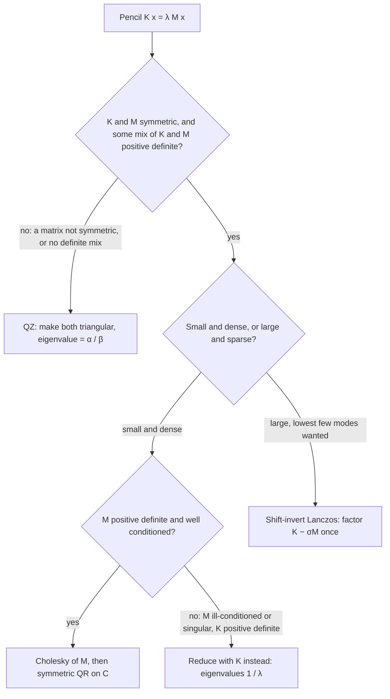
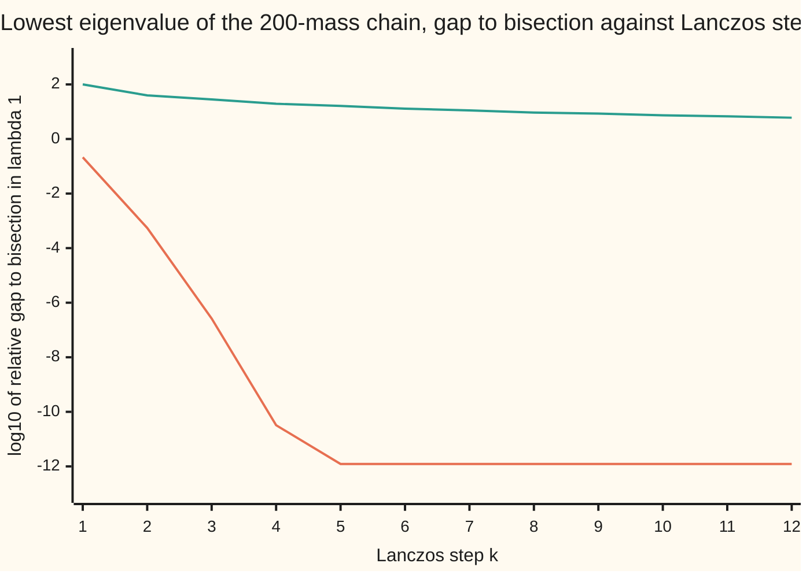

# Generalised eigenproblems: Kx = lambda M x, from masses on springs to the QZ algorithm

[Syllabus](../../../SYLLABUS.md) → [Numerical analysis](../README.md) → [Numerical Linear Algebra](../README.md#s03) → Generalised eigenproblems

---

## General Overview

Two carts sit on a smooth track. The first weighs 2 kg and is tied to a wall by a spring of stiffness 3 N/m (stretched one meter, it pulls back three newtons). The second weighs 1 kg and is tied to the first by a spring of 2 N/m. Its far side is free. Pull the first cart 10 cm, hold the second, and let go.

The carts swing in a mix of two pure patterns, the **normal modes** ([Normal modes](../../08-Differential%20equations%20and%20dynamics/04-Systems%20and%20the%20Matrix%20Exponential/07-coupled-oscillators-and-normal-modes.md)). The slow one repeats every 6.964745 s and the fast one every 3.272607 s. An engineer wants those two periods, the two shapes, and how much of each the release puts in.

Newton's law for both carts reads M x'' = −K x. Here x lists the carts' distances from rest, x'' their accelerations, K is the **stiffness matrix** (how hard the springs pull each cart) and M is the **mass matrix** (the masses on its diagonal). A mode needs K x = λ M x, with λ the mode's squared angular frequency.

On the Normal modes card both masses were equal, so M dropped out. Here it stays on the right-hand side. That is a **generalised eigenvalue problem**, and the pair (K, M) is called a **pencil**.

This card asks the numerical questions:

- **Reduction.** The Cholesky factor of M (a triangle L with M = L Lᵀ) turns the pencil into one symmetric matrix C with the same eigenvalues, 0.813859 and 3.686141.
- **Orthogonality.** The two mode shapes have a plain dot product of −1.000000. Weighted by the masses, it is exactly 0: they are **M-orthogonal**.
- **Danger.** A tiny mass weakens the reduction's accuracy guarantee. At a mass ratio of 2.000e8 the textbook 2-by-2 formula, which keeps only that guarantee, is off by a relative 4.934e-9; a careful formula, or reducing with K, by 1.480e-16.
- **Size.** For a 200-mass chain, shift-invert Lanczos (Step 6) finds the three lowest modes in 12 steps.
- **Breakdown.** A massless cart makes M singular and one eigenvalue infinite. Reducing with K still works; the QZ algorithm (Step 5) is needed only when the pencil is not symmetric-definite.

**A symmetric pencil K x = λ M x with M positive definite is an ordinary symmetric eigenproblem in disguise: factor M = L Lᵀ, solve C y = λ y with C = L⁻¹ K L⁻ᵀ, and the modes come back M-orthogonal; when M is badly conditioned, singular or the pencil is not symmetric-definite, use a different reduction, a shift-and-invert, or QZ.**

**What kind of fact this is:** a set of methods resting on theorems. The reduction, M-orthogonality and the eigenvalue count are proved on this card in Why it works. The rounding estimate for the reduction is a model checked by the code, not a proof. The backward stability of QZ and the convergence of Lanczos are stated with sources, not proved.

### The picture: which route to take



Each box is one section of Why it works: Steps 1 and 2 for the plain route, Steps 4 and 5 for the K-route, Step 5 for QZ and Step 6 for Lanczos.

---

## The formula

```math
K\,x = \lambda\,M\,x, \qquad \det(K - \lambda M) = 0
```

**Read it aloud:** a mode is a shape x that the springs push back along itself, in proportion to the mass at each point, with factor λ.

The reduction, with M = L Lᵀ its Cholesky factorisation ([Cholesky](04-cholesky-decomposition.md)):

```math
C = L^{-1} K L^{-T}, \qquad C\,y = \lambda\,y, \qquad x = L^{-T} y, \qquad v_i^{T} M\, v_j = 0 \ \ (i \ne j)
```

**Read it aloud:** rescale each coordinate by the square root of its mass, solve an ordinary symmetric eigenproblem, scale back, and the modes are perpendicular once lengths are weighted by mass.

For the carts:

```math
K = \begin{pmatrix} 5 & -2 \\ -2 & 2 \end{pmatrix}, \quad M = \begin{pmatrix} 2 & 0 \\ 0 & 1 \end{pmatrix}, \quad \det(K - \lambda M) = 2\lambda^{2} - 9\lambda + 6
```

Row one of K is the first cart: 3 N/m to the wall plus 2 N/m to its neighbor, and −2 for the pull of that neighbor. Row two is the second cart: only the 2 N/m spring.

| Symbol | Plain meaning | In our example | Push it up and the answer… |
| --- | --- | --- | --- |
| $`K`$, $`M`$, $`m_i`$ | stiffness matrix in N/m; mass matrix in kg, here the masses $`m_i`$ on the diagonal | `[[5, -2], [-2, 2]]`; diag(2, 1); m₂ = 1 kg | K up: faster modes; M up: slower modes |
| $`\lambda`$, $`\lambda_1`$, $`\lambda_2`$ | an eigenvalue of the pencil: a mode's squared angular frequency, in 1/s² | 0.813859 and 3.686141 | shorter period |
| $`\omega`$ | angular frequency √λ, in rad/s; the period is 2π/ω | 0.902142 and 1.919932; periods 6.964745 s and 3.272607 s | — |
| $`x`$, $`x(t)`$, $`v_i`$ | displacements from rest in m, at time t in s; mode shape i, first entry scaled to 1 | start (0.1, 0); v₁ = (1, 1.686141), v₂ = (1, −1.186141) | — |
| $`c_i`$, $`E`$ | share of mode i in the start, in m; stored energy ½ xᵀ K x, in J | 0.041296 and 0.058704; 0.025000 J | — |
| $`L`$, $`C`$, $`y`$ | Cholesky factor of M; the reduced matrix L⁻¹ K L⁻ᵀ, with size ‖C‖ its largest eigenvalue; its eigenvector, y = Lᵀ x | L = diag(1.414214, 1); C = `[[2.5, -1.414214], [-1.414214, 2]]` | — |
| $`G`$, $`B`$, $`\mu`$ | Cholesky factor of K; the matrix G⁻¹ M G⁻ᵀ; its eigenvalues μ = 1/λ | at m₂ = 0: μ = 0 and 0.666667 | — |
| $`\sigma`$, $`N(\sigma)`$ | a shift (a trial value of λ); the number of negative pivots of K − σM | N(0.5), N(2), N(4) = 0, 1, 2 | more eigenvalues counted |
| $`\alpha`$, $`\beta`$, $`Q`$, $`Z`$ | QZ's pair for one eigenvalue, λ = α/β; its two orthogonal matrices | at m₂ = 0: (3, 2) and (1, 0) | β down to 0: λ to infinity |
| $`u`$, $`\kappa(M)`$ | unit roundoff 2⁻⁵³; condition number of M, here largest mass over smallest | κ(M) = 2 up to 2.000e8 | the M-route's guarantee weakens |
| $`n`$, $`k`$, $`\theta`$ | chain size; Lanczos steps; an eigenvalue 1/(λ − σ) of the shifted and inverted pencil, whose Lanczos estimates are the **Ritz values** | 200; 12; largest θ = 1/λ₁ at σ = 0 | more steps: more modes found |
| $`D`$, $`I`$ | the diagonal of pivots in K − σM = L D Lᵀ; the identity matrix | at σ = 2: pivots 1 and −4 | — |

Here u comes from [Machine epsilon and cancellation](../01-Floating%20Point%20and%20Error/03-rounding-cancellation-and-machine-epsilon.md) and κ from [Matrix norms and the condition number](01-matrix-norms-and-the-condition-number.md).

### When it holds

- **K and M symmetric.** Real springs pull both ways equally, so K is symmetric. Damping that is not proportional to K and M, or a spinning part, makes the problem quadratic in the frequency; rewritten as a linear pencil of twice the size, it is non-symmetric. Its eigenvalues can then be complex, and only QZ (Step 5) applies.
- **M positive definite.** Every motion has kinetic energy. If a node has no mass, M is singular, Cholesky of M fails, and one eigenvalue is infinite. At m₂ = 0 the polynomial drops to 6 − 4λ: one finite root, 1.500000.
- **M well conditioned, compared with 1/u.** A backward-stable solver on C may move λ₁ by u‖C‖, which grows with κ(M). At κ(M) = 2.000e8 the textbook 2-by-2 formula is off by 4.934e-9, relatively; the true value is 1.499999993.
- **A definite pencil, for the symmetric methods.** It is enough that some mix of the two, a number times K plus a number times M, is positive definite. If no mix is, the eigenvalues can be complex even with K and M symmetric.

---

## Why it works

### Step 0: the mass matrix only changes the ruler

In an ordinary eigenproblem, lengths are measured with the plain dot product. Masses weight the coordinates unequally: moving the 2 kg cart costs twice the kinetic energy of moving the 1 kg cart at the same speed.

So measure each coordinate in units of its square root of mass. In those units every cart weighs one, and the pencil becomes an ordinary symmetric eigenproblem. The Cholesky factor L is exactly that change of units. For a diagonal M it holds the square roots of the masses: 1.414214 and 1.

### Step 1: the Cholesky reduction keeps the eigenvalues and the symmetry

Put y = Lᵀ x into K x = λ L Lᵀ x and multiply on the left by L⁻¹. The result is C y = λ y. The matrix C is symmetric because K is, and positive definite when K is.

For the carts, entry (i, j) of C is K_ij divided by √(m_i m_j): 5 ÷ 2 = 2.5, −2 ÷ 1.414214 = −1.414214, and 2 ÷ 1 = 2. Its trace is 4.5 and its determinant 3, so λ² − 4.5λ + 3 = 0: the pencil's polynomial divided by 2. The code finds 0.813859 and 3.686141 from C, from det(K − λM) and by bisection (Step 3).

<details>
<summary>Detailed proof: the reduction is exact, and orthonormal y give M-orthonormal x</summary>

Let M = L Lᵀ with L invertible. If K x = λ M x and y = Lᵀ x, then x = L⁻ᵀ y and

$`\displaystyle K L^{-T} y = \lambda L L^{T} L^{-T} y = \lambda L\, y \quad\Longrightarrow\quad L^{-1} K L^{-T} y = \lambda\, y.`$

Each step can be undone, so the two problems have the same eigenvalues, and y ≠ 0 exactly when x ≠ 0. The transpose of C is L⁻¹ Kᵀ L⁻ᵀ = C. For any nonzero y, yᵀ C y = xᵀ K x with x = L⁻ᵀ y nonzero, so C is positive definite when K is.

By [The spectral theorem](../../03-Algebra/07-Eigenvalues%20and%20Symmetric%20Matrices/04-spectral-theorem.md), C has real eigenvalues and orthonormal eigenvectors y_i. Then

$`\displaystyle x_i^{T} M\, x_j = y_i^{T} L^{-1} (L L^{T}) L^{-T} y_j = y_i^{T} y_j,`$

which is 1 when i = j and 0 otherwise.

</details>

The eigenvector y of C is not the mode shape. Scaling back by x = L⁻ᵀ y is required. For mode 1, y gives a second entry of 1.192281; scaled back, it is 1.686141.

### Step 2: modes are perpendicular once lengths are weighted by mass

Take two modes, K v_i = λ_i M v_i and K v_j = λ_j M v_j, with λ_i ≠ λ_j. Then v_jᵀ M v_i = 0.

<details>
<summary>Detailed proof: two lines</summary>

Multiply the first equation on the left by v_jᵀ and the second by v_iᵀ:

$`\displaystyle v_j^{T} K v_i = \lambda_i\, v_j^{T} M v_i, \qquad v_i^{T} K v_j = \lambda_j\, v_i^{T} M v_j.`$

K and M are symmetric, so the two left sides are equal, and so are the two products with M. Subtract: (λ_i − λ_j) v_jᵀ M v_i = 0. Since λ_i ≠ λ_j, v_jᵀ M v_i = 0, and then v_jᵀ K v_i = 0 too.

</details>

For the carts: 2 × 1 × 1 + 1 × 1.686141 × (−1.186141) = 0, while the plain dot product is 1 − 2 = −1.000000. The modes are not perpendicular on paper. They are perpendicular in kinetic energy.

This decides how to split a start into modes. The share of mode i is

```math
c_i = \frac{v_i^{T} M\, x(0)}{v_i^{T} M\, v_i}, \qquad x(t) = \sum_i c_i \cos(\omega_i t)\, v_i \quad \text{(released from rest)}.
```

For the release (0.1, 0) m this gives 0.041296 m of mode 1 and 0.058704 m of mode 2. They rebuild the start exactly. Because the modes are also K-perpendicular, the energy splits with no cross terms: 0.003361 J plus 0.021639 J is the 0.025000 J stored at release.

The code checks the whole motion by a second road. It steps M x'' = −K x forward 5,000 times by the leapfrog rule, with a step of 0.001 s. At 5 s both roads give (−0.066081, 0.054621) m.

### Step 3: count the eigenvalues below any shift

Factor K − σM = L D Lᵀ, with D diagonal and L lower triangular with ones on its diagonal. This L is a new triangle, not the Cholesky factor of Step 1. The number of negative entries of D equals the number of eigenvalues of the pencil below σ. Call it N(σ).

For the carts, the pivots of K − σM are 5 − 2σ and then (2 − σ) − 4 ÷ (5 − 2σ). At σ = 2 they are 1 and −4, so N(2) = 1: one eigenvalue lies below 2. The code finds N(0.5), N(2), N(4) = 0, 1, 2.

<details>
<summary>Detailed proof: the count is Sylvester's law of inertia</summary>

With M = L Lᵀ as in Step 1, K − σM = L (C − σI) Lᵀ. Two symmetric matrices are **congruent** when one is the other multiplied by an invertible matrix on the left and its transpose on the right. Sylvester's law of inertia ([Bilinear forms](../../03-Algebra/07-Eigenvalues%20and%20Symmetric%20Matrices/12-bilinear-forms-and-sylvesters-law.md)) says congruent matrices have the same number of negative eigenvalues.

So K − σM has as many negative eigenvalues as C − σI. Those are λ_i − σ, so their count is the number of λ_i below σ. The factorisation of K − σM into its unit triangle, D and the triangle's transpose is also a congruence, so D has the same count. D is diagonal, so its negative eigenvalues are its negative entries.

</details>

Halving an interval on N(σ) is bisection. It needs no polynomial and no reduction, so it is an independent road to every eigenvalue.

### Step 4: a tiny mass weakens the M-route's guarantee

Shrink the second mass. The lowest mode tends to λ₁ = 1.5: the light cart just follows the first, and the 3 N/m spring carries the 2 kg cart alone. The pencil's λ₁ stays well conditioned. But C's last entry, 2 ÷ m₂, grows without limit, and so does C's largest eigenvalue.

A symmetric eigensolver is backward stable ([Forward and backward error](../01-Floating%20Point%20and%20Error/06-forward-and-backward-error.md)): it returns the exact eigenvalues of a matrix within about u‖C‖ of C. Here ‖C‖, the size of C, is its largest eigenvalue. So the guarantee lets the small eigenvalue move by about u times the large one. The estimate in the table is that allowance, u·λ_max(C)/λ₁.

The textbook 2-by-2 formula, half the trace minus a square root, keeps that guarantee and no more: it finds λ₁ as the difference of two nearly equal large numbers, and the subtraction cancels. A careful 2-by-2 solver takes λ₁ = det(C) ÷ λ_max(C), with no subtraction, and on the same C loses nothing. A diagonal M only rescales each entry of C, at full precision, and those entries still pin λ₁. So on the carts the 4.934e-9 is the formula's cancellation, standing in for the most a backward-stable solver may lose.

On a larger pencil a dense solver can mix C's large and small entries, and with an M that is not diagonal the reduction itself can; then the digits are lost for real. Reducing with K rules it out. Cholesky of K gives G, and B = G⁻¹ M G⁻ᵀ has eigenvalues μ = 1/λ. The wanted mode is now B's largest eigenvalue, so backward stability alone pins it to about u times itself.

| m₂ (kg) | κ(M) | true λ₁ | M-route, textbook | M-route, careful | K-route | estimate | ratio |
| --- | ---: | ---: | ---: | ---: | ---: | ---: | ---: |
| 1 | 2.000e0 | 0.813859338 | 2.728e-16 | 1.364e-16 | 4.092e-16 | 5.028e-16 | 0.543 |
| 1e-2 | 2.000e2 | 1.492481486 | 4.463e-16 | 1.488e-16 | 2.976e-16 | 1.495e-14 | 0.030 |
| 1e-4 | 2.000e4 | 1.499924998 | 3.580e-13 | 0.000e0 | 2.961e-16 | 1.480e-12 | 0.242 |
| 1e-6 | 2.000e6 | 1.499999250 | 3.512e-11 | 2.961e-16 | 2.961e-16 | 1.480e-10 | 0.237 |
| 1e-8 | 2.000e8 | 1.499999993 | 4.934e-9 | 1.480e-16 | 1.480e-16 | 1.480e-8 | 0.333 |

Errors are relative true errors, against the root of det(K − λM) by the cancellation-free quadratic formula. The ratio is the textbook error over the estimate. It stays below 1, and the code asserts at most 4.

The problem is well conditioned throughout; only the M-route's guarantee weakens. The safe rule is to reduce with the better-conditioned matrix, so that the wanted eigenvalue is the largest of the reduced problem.

### Step 5: a massless node gives an infinite eigenvalue, and QZ handles it

At m₂ = 0, M = diag(2, 0) is singular. Its Cholesky factor does not exist. The polynomial det(K − λM) = 6 − 4λ has degree 1, so only one finite eigenvalue survives: 1.500000. The other has gone to infinity.

The K-route still works. B has eigenvalues μ = 0 and 0.666667, so λ = 1/0.666667 = 1.500000 and 1/0 = infinity.

QZ writes each eigenvalue as a pair (α, β) with λ = α/β, the roots of det(βK − αM) = 0. At m₂ = 0 that is β(6β − 4α) = 0: the pairs are (3, 2), which is λ = 1.5, and (1, 0), which is infinity. No division ever happens, so nothing overflows.

The QZ algorithm, in outline:

1. Find orthogonal Q and Z (columns perpendicular and of length 1) that make Qᵀ M Z upper triangular and Qᵀ K Z upper Hessenberg (zero below the first subdiagonal).
2. Run QR-style steps on K M⁻¹ without forming M⁻¹: each step multiplies by small rotations on the left and the right.
3. Stop when Qᵀ K Z is triangular too. The diagonal pairs give α_i and β_i.

This is the QR algorithm of [Eigenvalues by iteration](07-eigenvalues-power-iteration-and-the-qr-algorithm.md), generalised to two matrices. Its end point is [Schur's triangle](../../03-Algebra/07-Eigenvalues%20and%20Symmetric%20Matrices/07-schur-triangularisation.md) for a pencil. Moler and Stewart (in Sources) prove it is backward stable on any square pencil. This card states that and does not prove it.

QZ does not use symmetry, so on a symmetric-definite pencil it costs more than the Cholesky route and can return tiny imaginary parts. It is needed only when the pencil is not symmetric-definite: K or M not symmetric, or no mix of them positive definite. A singular M alone is not such a case: here K is positive definite, and the K-route handles it.

### Step 6: the lowest modes of a large pencil, by shift-invert Lanczos

Repeat the two carts 100 times in a line: 200 masses alternating 2 kg and 1 kg, springs alternating 3 and 2 N/m, the far end free. The numbers are illustrative. K is tridiagonal (nonzero only on three diagonals) and M is diagonal. The wanted numbers are the three lowest eigenvalues.

These are 9.850e-5, 8.864e-4 and 2.462e-3 1/s², tiny next to the top of the spectrum. Plain Lanczos ([Lanczos](14-lanczos-and-rayleigh-ritz.md)) on M⁻¹ K finds the ends of the spectrum first, and the bottom end is crowded. After 12 steps its lowest Ritz value is 6.937e-4, a relative error of 6.042.

Shift-invert fixes this. Pick a shift σ near the wanted modes (here σ = 0), factor K − σM once, and run Lanczos on (K − σM)⁻¹ M. Its eigenvalues are θ = 1/(λ − σ). The lowest modes become the largest θ, and they are well apart: λ₂/λ₁ = 8.999.

Lanczos runs in the M inner product, xᵀ M y, in which (K − σM)⁻¹ M is symmetric. Its vectors come out M-orthogonal, like the modes of Step 2.

| Method, 12 steps | λ₁ | relative gap to bisection in λ₁ | relative gaps in λ₂, λ₃ |
| --- | ---: | ---: | ---: |
| shift-invert Lanczos | 9.850e-5 | 1.224e-12 | 1.241e-13, 1.621e-14 |
| plain Lanczos | 6.937e-4 | 6.042e0 | not found |

These are gaps to the bisection reference. For plain Lanczos the gap is the error; for shift-invert it is mostly the reference's own rounding, as the chart shows.

The cost is one factorisation of 597 flops, then 12 solves of 996 flops each: 11,952 flops. A flop is one addition, subtraction, multiplication or division. The products with M and the work to keep the Lanczos vectors orthogonal are extra and are not counted here.



Orange: shift-invert Lanczos. Teal: plain Lanczos. The orange line falls by about three powers of ten a step, then flattens at 1.224e-12 from step 5. That floor belongs to the reference, not to Lanczos. The reference is bisection on counts of K − σM, which fixes a tiny eigenvalue only to a rounding error measured against the largest: the weak guarantee of Step 4 again.

Ericsson and Ruhe (in Sources) give this method and its analysis. With a shift inside the spectrum, K − σM is indefinite and is factored with symmetric pivoting ([Saddle-point systems](12-symmetric-indefinite-systems-ldlt-and-minres.md)); the same factor gives N(σ).

---

## Worked numbers, by hand

The carts, released from (0.1, 0) m.

| Step | Arithmetic | Value |
| --- | --- | --- |
| polynomial | (5 − 2λ)(2 − λ) − (−2)² = 2λ² − 9λ + 6 | coefficients 2, −9, 6 |
| roots | (9 ∓ √33) ÷ 4 | λ₁ = 0.813859, λ₂ = 3.686141 |
| frequencies | √λ | ω = 0.902142, 1.919932 rad/s |
| reduction | L = diag(√2, 1); C entries 5 ÷ 2, −2 ÷ √2, 2 ÷ 1 | 2.5, −1.414214, 2 |
| check on C | trace 4.5, determinant 5 − 2 = 3; λ² − 4.5λ + 3 = 0 | same two roots |
| shapes | row one of (K − λM)v = 0 gives v₂ = (5 − 2λ) ÷ 2 | 1.686141 and −1.186141 |
| M-orthogonality | 2 × 1 × 1 + 1 × 1.686141 × (−1.186141) | 0 (plain dot: −1.000000) |
| share of mode 1 | (2 × 0.1) ÷ (2 + 1.686141²) = 0.2 ÷ 4.843070 | 0.041296 m |
| share of mode 2 | 0.2 ÷ (2 + 1.186141²) = 0.2 ÷ 3.406930 | 0.058704 m |
| energy | ½ × 5 × 0.1²; per mode ½ λ_i c_i² v_iᵀ M v_i | 0.025000 = 0.003361 + 0.021639 J |
| **periods** | 2π ÷ ω | **6.964745 s and 3.272607 s** |

The answer: the carts swing in two patterns, every 6.96 s and every 3.27 s. This release puts most of its energy into the fast one: 0.021639 of the 0.025000 J.

### What breaks if you drop a piece

| Mistake | Comes out at | What went wrong |
| --- | --- | --- |
| Split the start with the plain dot product | shares 0.026021 and 0.041547 m; they rebuild (0.067568, −0.005405) m, not (0.1, 0) | the modes are perpendicular only with the mass weighting |
| Ignore M: take the eigenvalues of K alone | λ = 1 and 6, ω = 1 and 2.449490 rad/s, not 0.902142 and 1.919932 | the masses set the frequencies too |
| Read C's eigenvector as the mode shape | second entries 1.192281 and −0.838728, not 1.686141 and −1.186141 | y = Lᵀ x is in mass-scaled units; scale back by L⁻ᵀ |
| Reduce with M when m₂ = 1e-8 kg, take λ₁ by the textbook formula | λ₁ off by 4.934e-9, relatively; careful formula and K-route: 1.480e-16 | the M-route promises λ₁ only to u‖C‖, and the subtraction delivers no more |
| Reduce with M when m₂ = 0 | no Cholesky factor at all | M is singular: one eigenvalue is infinite; λ₁ = 1.500000 survives |
| Plain Lanczos on the 200-mass chain | λ₁ = 6.937e-4 after 12 steps, relative error 6.042 | the lowest modes are crowded; shift-invert spreads them apart |

---

## Code, from first principles, and it actually runs

The code solves the two-cart pencil three ways: the roots of det(K − λM) by the cancellation-free quadratic formula, the eigenvalues of C, and bisection on the counts N(σ). It builds the shapes two ways, directly and from C's eigenvectors, and checks residuals, M-orthogonality, the shares, the energy split and the motion at 5 s against 5,000 leapfrog steps. It then shrinks the second mass, comparing the M-route (textbook and careful formulas) and the K-route against the cancellation-free roots, and takes the mass to zero. Last, it runs shift-invert and plain Lanczos on a 200-mass chain and checks both against bisection.

### Python

```python
# Generalised eigenproblems -- the check behind the card.  Standard library only;
# nothing imported holds an answer.  Masses 2 kg and 1 kg, springs 3 N/m (wall to
# first mass) and 2 N/m (between): K x = lam M x.  Roots of det(K - lam M), Cholesky
# reduction, M-orthogonal modes, a light second mass down to a massless one, eigenvalue
# counts by Sylvester's law, and shift-invert Lanczos on a 200-mass chain.
from functools import reduce
from math import cos, log10, pi, sqrt

U, X0, T, H, NCH, KL = 2.0 ** -53, (0.10, 0.0), 5.0, 1e-3, 200, 12
DIAL = (1.0, 1e-2, 1e-4, 1e-6, 1e-8)

def sci(x): m, e = f"{x:.3e}".split("e"); return f"{m}e{int(e)}"
def row(label, vals): print(f"{label:<42}" + "".join(f"{v:>12.6f}" for v in vals))
def srow(label, vals): print(f"{label:<42}" + "".join(f"{sci(v):>12}" for v in vals))

def eig2(p, q, r):                  # textbook formula for [[p, q], [q, r]]: half-trace -/+ root
    h = (p + r) / 2.0; s = sqrt(h * h - (p * r - q * q))
    return h - s, h + s

def exact(m2):                      # det(K - lam M) = 2 m2 lam^2 - (4 + 5 m2) lam + 6, no cancellation
    a, b = 2.0 * m2, 4.0 + 5.0 * m2
    lo = 12.0 / (b + sqrt(b * b - 24.0 * a))
    return lo, (6.0 / (a * lo) if a > 0 else float("inf"))

def via_m(m2):                      # reduce with M = L L^T: C = L^-1 K L^-T
    l1, l2 = sqrt(2.0), sqrt(m2)
    return 5.0 / (l1 * l1), -2.0 / (l1 * l2), 2.0 / (l2 * l2)

def via_k(m2):                      # reduce with K = G G^T: B = G^-1 M G^-T has eigenvalues 1/lam
    g11 = sqrt(5.0); g21 = -2.0 / g11; g22 = sqrt(2.0 - g21 * g21)
    return 2.0 / (g11 * g11), -2.0 * g21 / (g11 * g11 * g22), 2.0 * g21 * g21 / (g11 * g11 * g22 * g22) + m2 / (g22 * g22)

def count_below(a, b, m, s):        # negative pivots of K - s M = L D L^T: eigenvalues below s
    n, d = 0, 1.0
    for i in range(len(a)):
        d = a[i] - s * m[i] - (b[i - 1] * b[i - 1] / d if i else 0.0)
        if d == 0.0: d = -1e-300
        n += d < 0.0
    return n

def bisect(a, b, m, j):             # j-th smallest eigenvalue of the tridiagonal pencil
    bb = [0.0] + [abs(v) for v in b] + [0.0]
    hi = max((abs(a[i]) + bb[i] + bb[i + 1]) / m[i] for i in range(len(a))); lo = -hi
    for _ in range(200):
        mid = (lo + hi) / 2.0
        if count_below(a, b, m, mid) >= j: hi = mid
        else: lo = mid
    return (lo + hi) / 2.0

def tot(xs): return reduce(lambda s, v: s + v, xs, 0.0)       # plain left-to-right sum
def mdot(x, y, m): return tot(m[i] * x[i] * y[i] for i in range(len(x)))
def kmul(a, b, x): return [a[i] * x[i] + (b[i - 1] * x[i - 1] if i else 0.0) + (b[i] * x[i + 1] if i < len(x) - 1 else 0.0) for i in range(len(x))]

def lanczos(op, m, k):              # k steps in the M inner product, full reorthogonalisation
    q = [1.0] * len(m); s = sqrt(mdot(q, q, m)); Q, al, be = [[v / s for v in q]], [], []
    for _ in range(k):
        w = op(Q[-1]); al.append(mdot(w, Q[-1], m))
        for _ in range(2):
            for qq in Q: c = mdot(w, qq, m); w = [w[i] - c * qq[i] for i in range(len(w))]
        s = sqrt(mdot(w, w, m)); be.append(s); Q.append([v / s for v in w])
    return al, be

l1, l2 = exact(1.0); om = [sqrt(l1), sqrt(l2)]
row("det(K - lam M) = a lam^2 + b lam + c", [2.0, -9.0, 6.0])
row("lam1, lam2 (1/s^2), stable formula", [l1, l2])
row("omega (rad/s), period (s)", om + [2 * pi / w for w in om])
print("Sylvester counts below 0.5, 2, 4:", [count_below([5.0, 2.0], [-2.0], [2.0, 1.0], s) for s in (0.5, 2.0, 4.0)])
bl = [bisect([5.0, 2.0], [-2.0], [2.0, 1.0], j) for j in (1, 2)]
row("lam1, lam2 by bisection on the counts", bl)
C = via_m(1.0); ce = eig2(*C)
row("L = chol(M) diagonal", [sqrt(2.0), 1.0])
row("C = L^-1 K L^-T: c11 c21 c22, trace, det", list(C) + [C[0] + C[2], C[0] * C[2] - C[1] * C[1]])
row("eigenvalues of C", list(ce))
V = [[1.0, (5.0 - 2.0 * lam) / 2.0] for lam in (l1, l2)]
Y = [[C[1], lam - C[0]] for lam in ce]                              # eigenvectors of C
VB = [[y[0] / sqrt(2.0), y[1] / 1.0] for y in Y]; VB = [[1.0, v[1] / v[0]] for v in VB]   # v = L^-T y
row("mode shapes v1, v2 (second entry, first = 1)", [V[0][1], V[1][1]])
row("same, from C's eigenvectors y, v = L^-T y", [VB[0][1], VB[1][1]])
row("wrong: C's eigenvectors read as shapes", [Y[0][1] / Y[0][0], Y[1][1] / Y[1][0]])
KM, MM = [[5.0, -2.0], [-2.0, 2.0]], [2.0, 1.0]
res = [max(abs(tot(KM[i][j] * V[k][j] for j in range(2)) - lam * MM[i] * V[k][i]) for i in range(2)) for k, lam in ((0, l1), (1, l2))]
srow("residuals |K v - lam M v|", res)
pdot, mx, kx = V[0][0] * V[1][0] + V[0][1] * V[1][1], mdot(V[0], V[1], MM), tot(V[0][i] * KM[i][j] * V[1][j] for i in range(2) for j in range(2))
print(f"v1.v2 plain {pdot:.6f}   v1^T M v2 {sci(mx)}   v1^T K v2 {sci(kx)}")
cm = [mdot(v, X0, MM) / mdot(v, v, MM) for v in V]; cp = [tot(v[i] * X0[i] for i in range(2)) / tot(t * t for t in v) for v in V]
row("release (0.1, 0): c1, c2 (m); v^T M v", cm + [mdot(v, v, MM) for v in V])
row("rebuilt start c1 v1 + c2 v2 (m)", [cm[0] * V[0][i] + cm[1] * V[1][i] for i in range(2)])
row("wrong: shares by the plain dot", cp)
row("wrong: rebuilt start", [cp[0] * V[0][i] + cp[1] * V[1][i] for i in range(2)])
en = [0.5 * lam * c * c * mdot(v, v, MM) for lam, c, v in zip((l1, l2), cm, V)]
E0 = 0.5 * (5.0 * X0[0] * X0[0] - 4.0 * X0[0] * X0[1] + 2.0 * X0[1] * X0[1])     # x^T K x / 2
row("energy (J): start, mode 1, mode 2, sum", [E0] + en + [tot(en)])
x, v = list(X0), [0.0, 0.0]; acc = lambda x: [-(5.0 * x[0] - 2.0 * x[1]) / 2.0, -(-2.0 * x[0] + 2.0 * x[1])]
a0 = acc(x)
for _ in range(round(T / H)):
    v = [v[i] + H / 2 * a0[i] for i in range(2)]; x = [x[i] + H * v[i] for i in range(2)]; a0 = acc(x); v = [v[i] + H / 2 * a0[i] for i in range(2)]
xm = [tot(cm[k] * cos(om[k] * T) * V[k][i] for k in range(2)) for i in range(2)]
row("x(5 s) from modes; from 5,000 leapfrog steps", xm + x)
ke = eig2(5.0, -2.0, 2.0)
row("wrong: eigenvalues of K alone, omegas", list(ke) + [sqrt(t) for t in ke])
dial = []
for m2 in DIAL:
    ex = exact(m2)[0]; cc = via_m(m2); a, big = eig2(*cc); bk = 1.0 / eig2(*via_k(m2))[1]
    sm = (cc[0] * cc[2] - cc[1] * cc[1]) / big                       # same C, small root as det(C) / lam_max: no subtraction
    dial.append((abs(a - ex) / ex, abs(bk - ex) / ex, U * big / ex, abs(sm - ex) / ex)); em, ek, bd, es = dial[-1]
    print(f"m2 {sci(m2):>9}  lam1 {ex:.9f}  kappa(M) {sci(2.0 / m2 if m2 < 2 else m2 / 2):>9}  M h-s {sci(em):>9}  M det/max {sci(es):>9}  K-route {sci(ek):>9}  estimate {sci(bd):>9}  ratio {em / bd:.3f}")
B0 = via_k(0.0); mu = eig2(*B0)
print(f"m2 0: chol(M) fails (pivot m2 = 0); det(K - lam M) = 6 - 4 lam, lam1 = {exact(0.0)[0]:.6f}, lam2 = {exact(0.0)[1]}")
print(f"m2 0: K-route mu {sci(mu[0])} {mu[1]:.6f}; lam1 = 1/mu_max = {1.0 / mu[1]:.6f}; (alpha, beta) = (3, 2), (1, 0)")
mc = [2.0 if i % 2 == 0 else 1.0 for i in range(NCH)]; ks = [3.0 if i % 2 == 0 else 2.0 for i in range(NCH)] + [0.0]
ac, bc = [ks[i] + ks[i + 1] for i in range(NCH)], [-ks[i + 1] for i in range(NCH - 1)]
ref = [bisect(ac, bc, mc, j) for j in (1, 2, 3)]
d, lf = [ac[0]], []
for i in range(1, NCH): lf.append(bc[i - 1] / d[-1]); d.append(ac[i] - lf[-1] * bc[i - 1])
def solve(y):                       # K x = y with the stored L D L^T: 5n - 4 flops
    x = y[:]
    for i in range(1, NCH): x[i] -= lf[i - 1] * x[i - 1]
    x = [x[i] / d[i] for i in range(NCH)]
    for i in range(NCH - 2, -1, -1): x[i] -= lf[i] * x[i + 1]
    return x
si = lanczos(lambda q: solve([mc[i] * q[i] for i in range(NCH)]), mc, KL)
pl = lanczos(lambda q: [t / mc[i] for i, t in enumerate(kmul(ac, bc, q))], mc, KL)
def ritz(al, be, k, j, inv): return 1.0 / bisect(al[:k], be[:k - 1], [1.0] * k, k + 1 - j) if inv else bisect(al[:k], be[:k - 1], [1.0] * k, j)
sl, pv = [ritz(*si, KL, j, True) for j in (1, 2, 3)], ritz(*pl, KL, 1, False)
srow("chain: lam1..3 by bisection; lam2/lam1", ref + [ref[1] / ref[0]])
srow("shift-invert Lanczos, 12 steps", sl)
srow("relative gaps to bisection", [abs(sl[j] - ref[j]) / ref[j] for j in range(3)])
srow("plain Lanczos lam1, relative gap", [pv, abs(pv - ref[0]) / ref[0]])
print(f"cost: 12 solves of {5 * NCH - 4} flops each = {12 * (5 * NCH - 4):,} flops after the {3 * (NCH - 1)}-flop factorisation")
for k in range(1, KL + 1):
    es, ep = (abs(ritz(*s, k, 1, inv) - ref[0]) / ref[0] for s, inv in ((si, True), (pl, False)))
    print(f"figure, k {k}, shift-invert {log10(max(es, 1e-16)):.2f}, plain {log10(max(ep, 1e-16)):.2f}")
assert max(abs(bl[0] - l1), abs(bl[1] - l2), abs(ce[0] - l1), abs(ce[1] - l2)) < 1e-12   # three roads to lam
assert max(abs(VB[k][1] - V[k][1]) for k in range(2)) < 1e-12 and max(res) < 1e-14
assert abs(mx) < 1e-14 and abs(kx) < 1e-13 and abs(pdot + 1.0) < 1e-12      # M-orthogonal, not plain
assert max(abs(xm[i] - x[i]) for i in range(2)) < 1e-5 and abs(tot(en) - E0) < 1e-15
assert all(ek < 1e-14 and es < 1e-14 for _, ek, _, es in dial) and dial[-1][0] > 1e-11 and all(em <= 4 * bd for em, _, bd, _ in dial)
assert abs(1.0 / mu[1] - exact(0.0)[0]) < 1e-15 and max(abs(sl[j] - ref[j]) / ref[j] for j in range(3)) < 1e-10
assert abs(pv - ref[0]) / ref[0] > 1e-2
print("ALL CHECKS PASS")
```

**Ran 2026-11-24 on macOS, Python 3.14.10, standard library only. All checks passed. Output, pasted from the run:**

```
det(K - lam M) = a lam^2 + b lam + c          2.000000   -9.000000    6.000000
lam1, lam2 (1/s^2), stable formula            0.813859    3.686141
omega (rad/s), period (s)                     0.902142    1.919932    6.964745    3.272607
Sylvester counts below 0.5, 2, 4: [0, 1, 2]
lam1, lam2 by bisection on the counts         0.813859    3.686141
L = chol(M) diagonal                          1.414214    1.000000
C = L^-1 K L^-T: c11 c21 c22, trace, det      2.500000   -1.414214    2.000000    4.500000    3.000000
eigenvalues of C                              0.813859    3.686141
mode shapes v1, v2 (second entry, first = 1)    1.686141   -1.186141
same, from C's eigenvectors y, v = L^-T y     1.686141   -1.186141
wrong: C's eigenvectors read as shapes        1.192281   -0.838728
residuals |K v - lam M v|                      0.000e0     0.000e0
v1.v2 plain -1.000000   v1^T M v2 0.000e0   v1^T K v2 0.000e0
release (0.1, 0): c1, c2 (m); v^T M v         0.041296    0.058704    4.843070    3.406930
rebuilt start c1 v1 + c2 v2 (m)               0.100000    0.000000
wrong: shares by the plain dot                0.026021    0.041547
wrong: rebuilt start                          0.067568   -0.005405
energy (J): start, mode 1, mode 2, sum        0.025000    0.003361    0.021639    0.025000
x(5 s) from modes; from 5,000 leapfrog steps   -0.066081    0.054621   -0.066081    0.054621
wrong: eigenvalues of K alone, omegas         1.000000    6.000000    1.000000    2.449490
m2   1.000e0  lam1 0.813859338  kappa(M)   2.000e0  M h-s 2.728e-16  M det/max 1.364e-16  K-route 4.092e-16  estimate 5.028e-16  ratio 0.543
m2  1.000e-2  lam1 1.492481486  kappa(M)   2.000e2  M h-s 4.463e-16  M det/max 1.488e-16  K-route 2.976e-16  estimate 1.495e-14  ratio 0.030
m2  1.000e-4  lam1 1.499924998  kappa(M)   2.000e4  M h-s 3.580e-13  M det/max   0.000e0  K-route 2.961e-16  estimate 1.480e-12  ratio 0.242
m2  1.000e-6  lam1 1.499999250  kappa(M)   2.000e6  M h-s 3.512e-11  M det/max 2.961e-16  K-route 2.961e-16  estimate 1.480e-10  ratio 0.237
m2  1.000e-8  lam1 1.499999993  kappa(M)   2.000e8  M h-s  4.934e-9  M det/max 1.480e-16  K-route 1.480e-16  estimate  1.480e-8  ratio 0.333
m2 0: chol(M) fails (pivot m2 = 0); det(K - lam M) = 6 - 4 lam, lam1 = 1.500000, lam2 = inf
m2 0: K-route mu 0.000e0 0.666667; lam1 = 1/mu_max = 1.500000; (alpha, beta) = (3, 2), (1, 0)
chain: lam1..3 by bisection; lam2/lam1        9.850e-5    8.864e-4    2.462e-3     8.999e0
shift-invert Lanczos, 12 steps                9.850e-5    8.864e-4    2.462e-3
relative gaps to bisection                   1.224e-12   1.241e-13   1.621e-14
plain Lanczos lam1, relative gap              6.937e-4     6.042e0
cost: 12 solves of 996 flops each = 11,952 flops after the 597-flop factorisation
figure, k 1, shift-invert -0.67, plain 2.00
figure, k 2, shift-invert -3.26, plain 1.60
figure, k 3, shift-invert -6.58, plain 1.45
figure, k 4, shift-invert -10.49, plain 1.29
figure, k 5, shift-invert -11.91, plain 1.21
figure, k 6, shift-invert -11.91, plain 1.11
figure, k 7, shift-invert -11.91, plain 1.05
figure, k 8, shift-invert -11.91, plain 0.97
figure, k 9, shift-invert -11.91, plain 0.93
figure, k 10, shift-invert -11.91, plain 0.87
figure, k 11, shift-invert -11.91, plain 0.83
figure, k 12, shift-invert -11.91, plain 0.78
ALL CHECKS PASS
```

### Rust

```rust
// Generalised eigenproblems -- the check behind the card.  std only; nothing used holds an answer.
// Masses 2 kg and 1 kg, springs 3 N/m (wall to first mass) and 2 N/m (between): K x = lam M x.
// Roots of det(K - lam M), Cholesky reduction, M-orthogonal modes, a light second mass down to a
// massless one, eigenvalue counts by Sylvester's law, and shift-invert Lanczos on a 200-mass chain.
use std::f64::consts::PI;
const U: f64 = 1.0 / 9007199254740992.0;
const X0: [f64; 2] = [0.10, 0.0];
const T: f64 = 5.0; const H: f64 = 1e-3; const NCH: usize = 200; const KL: usize = 12;
const DIAL: [f64; 5] = [1.0, 1e-2, 1e-4, 1e-6, 1e-8];
fn sci(x: f64) -> String { format!("{:.3e}", x) }
fn row(label: &str, vals: &[f64]) { println!("{:<42}{}", label, vals.iter().map(|v| format!("{:>12.6}", v)).collect::<String>()); }
fn srow(label: &str, vals: &[f64]) { println!("{:<42}{}", label, vals.iter().map(|v| format!("{:>12}", sci(*v))).collect::<String>()); }
fn eig2(p: f64, q: f64, r: f64) -> (f64, f64) { // textbook formula for [[p, q], [q, r]]: half-trace -/+ root
    let h = (p + r) / 2.0; let s = (h * h - (p * r - q * q)).sqrt();
    (h - s, h + s)
}
fn eig3(c: (f64, f64, f64)) -> (f64, f64) { eig2(c.0, c.1, c.2) }
fn exact(m2: f64) -> (f64, f64) { // det(K - lam M) = 2 m2 lam^2 - (4 + 5 m2) lam + 6, no cancellation
    let (a, b) = (2.0 * m2, 4.0 + 5.0 * m2);
    let lo = 12.0 / (b + (b * b - 24.0 * a).sqrt());
    (lo, if a > 0.0 { 6.0 / (a * lo) } else { f64::INFINITY })
}
fn via_m(m2: f64) -> (f64, f64, f64) { // reduce with M = L L^T: C = L^-1 K L^-T
    let (l1, l2) = (2.0f64.sqrt(), m2.sqrt());
    (5.0 / (l1 * l1), -2.0 / (l1 * l2), 2.0 / (l2 * l2))
}
fn via_k(m2: f64) -> (f64, f64, f64) { // reduce with K = G G^T: B = G^-1 M G^-T has eigenvalues 1/lam
    let g11 = 5.0f64.sqrt(); let g21 = -2.0 / g11; let g22 = (2.0 - g21 * g21).sqrt();
    (2.0 / (g11 * g11), -2.0 * g21 / (g11 * g11 * g22), 2.0 * g21 * g21 / (g11 * g11 * g22 * g22) + m2 / (g22 * g22))
}
fn count_below(a: &[f64], b: &[f64], m: &[f64], s: f64) -> usize { // negative pivots of K - s M = L D L^T
    let (mut n, mut d) = (0, 1.0);
    for i in 0..a.len() {
        d = a[i] - s * m[i] - if i > 0 { b[i - 1] * b[i - 1] / d } else { 0.0 };
        if d == 0.0 { d = -1e-300; }
        if d < 0.0 { n += 1; }
    }
    n
}
fn bisect(a: &[f64], b: &[f64], m: &[f64], j: usize) -> f64 { // j-th smallest eigenvalue of the tridiagonal pencil
    let mut bb = vec![0.0]; bb.extend(b.iter().map(|v| v.abs())); bb.push(0.0);
    let mut hi = (0..a.len()).map(|i| (a[i].abs() + bb[i] + bb[i + 1]) / m[i]).fold(f64::MIN, f64::max);
    let mut lo = -hi;
    for _ in 0..200 {
        let mid = (lo + hi) / 2.0;
        if count_below(a, b, m, mid) >= j { hi = mid; } else { lo = mid; }
    }
    (lo + hi) / 2.0
}
fn mdot(x: &[f64], y: &[f64], m: &[f64]) -> f64 { let mut s = 0.0; for i in 0..x.len() { s += m[i] * x[i] * y[i]; } s }
fn kmul(a: &[f64], b: &[f64], x: &[f64]) -> Vec<f64> {
    let n = x.len();
    (0..n).map(|i| a[i] * x[i] + if i > 0 { b[i - 1] * x[i - 1] } else { 0.0 } + if i < n - 1 { b[i] * x[i + 1] } else { 0.0 }).collect()
}
fn lanczos(op: &dyn Fn(&[f64]) -> Vec<f64>, m: &[f64], k: usize) -> (Vec<f64>, Vec<f64>) { // M inner product, full reorthogonalisation
    let q = vec![1.0; m.len()]; let s = mdot(&q, &q, m);
    let mut qs: Vec<Vec<f64>> = vec![q.iter().map(|v| v / s.sqrt()).collect()];
    let (mut al, mut be) = (Vec::new(), Vec::new());
    for _ in 0..k {
        let last = qs.last().unwrap().clone();
        let mut w = op(&last); al.push(mdot(&w, &last, m));
        for _ in 0..2 { for qq in &qs { let c = mdot(&w, qq, m); for i in 0..w.len() { w[i] -= c * qq[i]; } } }
        let s = mdot(&w, &w, m).sqrt(); be.push(s); qs.push(w.iter().map(|v| v / s).collect());
    }
    (al, be)
}
fn ritz(lz: &(Vec<f64>, Vec<f64>), k: usize, j: usize, inv: bool) -> f64 {
    let ones = vec![1.0; k];
    if inv { 1.0 / bisect(&lz.0[..k], &lz.1[..k - 1], &ones, k + 1 - j) } else { bisect(&lz.0[..k], &lz.1[..k - 1], &ones, j) }
}
fn acc(x: &[f64; 2]) -> [f64; 2] { [-(5.0 * x[0] - 2.0 * x[1]) / 2.0, -(-2.0 * x[0] + 2.0 * x[1])] }
fn comma(k: usize) -> String {
    let (s, mut out) = (k.to_string(), String::new());
    for (i, ch) in s.chars().enumerate() { if i > 0 && (s.len() - i) % 3 == 0 { out.push(','); } out.push(ch); }
    out
}
fn main() {
    let (l1, l2) = exact(1.0); let om = [l1.sqrt(), l2.sqrt()];
    row("det(K - lam M) = a lam^2 + b lam + c", &[2.0, -9.0, 6.0]);
    row("lam1, lam2 (1/s^2), stable formula", &[l1, l2]);
    row("omega (rad/s), period (s)", &[om[0], om[1], 2.0 * PI / om[0], 2.0 * PI / om[1]]);
    let (a2, b2, m2v) = ([5.0, 2.0], [-2.0], [2.0, 1.0]);
    let cnt: Vec<String> = [0.5, 2.0, 4.0].iter().map(|s| count_below(&a2, &b2, &m2v, *s).to_string()).collect();
    println!("Sylvester counts below 0.5, 2, 4: [{}]", cnt.join(", "));
    let bl = [bisect(&a2, &b2, &m2v, 1), bisect(&a2, &b2, &m2v, 2)];
    row("lam1, lam2 by bisection on the counts", &bl);
    let c = via_m(1.0); let ce = eig3(c);
    row("L = chol(M) diagonal", &[2.0f64.sqrt(), 1.0]);
    row("C = L^-1 K L^-T: c11 c21 c22, trace, det", &[c.0, c.1, c.2, c.0 + c.2, c.0 * c.2 - c.1 * c.1]);
    row("eigenvalues of C", &[ce.0, ce.1]);
    let v = [[1.0, (5.0 - 2.0 * l1) / 2.0], [1.0, (5.0 - 2.0 * l2) / 2.0]];
    let y = [[c.1, ce.0 - c.0], [c.1, ce.1 - c.0]]; // eigenvectors of C
    let vb: Vec<[f64; 2]> = y.iter().map(|y| [y[0] / 2.0f64.sqrt(), y[1] / 1.0]).map(|w| [1.0, w[1] / w[0]]).collect(); // v = L^-T y
    row("mode shapes v1, v2 (second entry, first = 1)", &[v[0][1], v[1][1]]);
    row("same, from C's eigenvectors y, v = L^-T y", &[vb[0][1], vb[1][1]]);
    row("wrong: C's eigenvectors read as shapes", &[y[0][1] / y[0][0], y[1][1] / y[1][0]]);
    let (km, mm) = ([[5.0, -2.0], [-2.0, 2.0]], [2.0, 1.0]);
    let res: Vec<f64> = [(0, l1), (1, l2)].iter().map(|&(k, lam)| (0..2).map(|i| {
        let mut s = 0.0; for j in 0..2 { s += km[i][j] * v[k][j]; } (s - lam * mm[i] * v[k][i]).abs() }).fold(f64::MIN, f64::max)).collect();
    srow("residuals |K v - lam M v|", &res);
    let pdot = v[0][0] * v[1][0] + v[0][1] * v[1][1]; let mx = mdot(&v[0], &v[1], &mm);
    let mut kx = 0.0; for i in 0..2 { for j in 0..2 { kx += v[0][i] * km[i][j] * v[1][j]; } }
    println!("v1.v2 plain {:.6}   v1^T M v2 {}   v1^T K v2 {}", pdot, sci(mx), sci(kx));
    let cm: Vec<f64> = v.iter().map(|w| mdot(w, &X0, &mm) / mdot(w, w, &mm)).collect();
    let cp: Vec<f64> = v.iter().map(|w| (0.0 + w[0] * X0[0] + w[1] * X0[1]) / (0.0 + w[0] * w[0] + w[1] * w[1])).collect();
    row("release (0.1, 0): c1, c2 (m); v^T M v", &[cm[0], cm[1], mdot(&v[0], &v[0], &mm), mdot(&v[1], &v[1], &mm)]);
    row("rebuilt start c1 v1 + c2 v2 (m)", &[cm[0] * v[0][0] + cm[1] * v[1][0], cm[0] * v[0][1] + cm[1] * v[1][1]]);
    row("wrong: shares by the plain dot", &cp);
    row("wrong: rebuilt start", &[cp[0] * v[0][0] + cp[1] * v[1][0], cp[0] * v[0][1] + cp[1] * v[1][1]]);
    let en: Vec<f64> = (0..2).map(|k| 0.5 * [l1, l2][k] * cm[k] * cm[k] * mdot(&v[k], &v[k], &mm)).collect();
    let esum = 0.0 + en[0] + en[1];
    let e0 = 0.5 * (5.0 * X0[0] * X0[0] - 4.0 * X0[0] * X0[1] + 2.0 * X0[1] * X0[1]); // x^T K x / 2
    row("energy (J): start, mode 1, mode 2, sum", &[e0, en[0], en[1], esum]);
    let (mut x, mut vel) = (X0, [0.0, 0.0]); let mut a0 = acc(&x);
    for _ in 0..(T / H).round() as usize {
        for i in 0..2 { vel[i] += H / 2.0 * a0[i]; } for i in 0..2 { x[i] += H * vel[i]; }
        a0 = acc(&x); for i in 0..2 { vel[i] += H / 2.0 * a0[i]; }
    }
    let xm: Vec<f64> = (0..2).map(|i| 0.0 + cm[0] * (om[0] * T).cos() * v[0][i] + cm[1] * (om[1] * T).cos() * v[1][i]).collect();
    row("x(5 s) from modes; from 5,000 leapfrog steps", &[xm[0], xm[1], x[0], x[1]]);
    let ke = eig2(5.0, -2.0, 2.0);
    row("wrong: eigenvalues of K alone, omegas", &[ke.0, ke.1, ke.0.sqrt(), ke.1.sqrt()]);
    let mut dial = Vec::new();
    for m2 in DIAL {
        let ex = exact(m2).0; let cc = via_m(m2); let (a, big) = eig3(cc); let bk = 1.0 / eig3(via_k(m2)).1;
        let sm = (cc.0 * cc.2 - cc.1 * cc.1) / big; // same C, small root as det(C) / lam_max: no subtraction
        let (em, ek, bd, es) = ((a - ex).abs() / ex, (bk - ex).abs() / ex, U * big / ex, (sm - ex).abs() / ex);
        dial.push((em, ek, bd, es));
        println!("m2 {:>9}  lam1 {:.9}  kappa(M) {:>9}  M h-s {:>9}  M det/max {:>9}  K-route {:>9}  estimate {:>9}  ratio {:.3}",
            sci(m2), ex, sci(if m2 < 2.0 { 2.0 / m2 } else { m2 / 2.0 }), sci(em), sci(es), sci(ek), sci(bd), em / bd);
    }
    let mu = eig3(via_k(0.0));
    println!("m2 0: chol(M) fails (pivot m2 = 0); det(K - lam M) = 6 - 4 lam, lam1 = {:.6}, lam2 = {}", exact(0.0).0, exact(0.0).1);
    println!("m2 0: K-route mu {} {:.6}; lam1 = 1/mu_max = {:.6}; (alpha, beta) = (3, 2), (1, 0)", sci(mu.0), mu.1, 1.0 / mu.1);
    let mc: Vec<f64> = (0..NCH).map(|i| if i % 2 == 0 { 2.0 } else { 1.0 }).collect();
    let mut ks: Vec<f64> = (0..NCH).map(|i| if i % 2 == 0 { 3.0 } else { 2.0 }).collect(); ks.push(0.0);
    let ac: Vec<f64> = (0..NCH).map(|i| ks[i] + ks[i + 1]).collect();
    let bc: Vec<f64> = (0..NCH - 1).map(|i| -ks[i + 1]).collect();
    let rf: Vec<f64> = (1..4).map(|j| bisect(&ac, &bc, &mc, j)).collect();
    let (mut d, mut lf) = (vec![ac[0]], Vec::new());
    for i in 1..NCH { lf.push(bc[i - 1] / d[i - 1]); d.push(ac[i] - lf[i - 1] * bc[i - 1]); }
    let solve = |yv: &[f64]| -> Vec<f64> { // K x = y with the stored L D L^T: 5n - 4 flops
        let mut x = yv.to_vec();
        for i in 1..NCH { x[i] -= lf[i - 1] * x[i - 1]; }
        for i in 0..NCH { x[i] /= d[i]; }
        for i in (0..NCH - 1).rev() { x[i] -= lf[i] * x[i + 1]; }
        x
    };
    let si = lanczos(&|q: &[f64]| solve(&(0..NCH).map(|i| mc[i] * q[i]).collect::<Vec<_>>()), &mc, KL);
    let pl = lanczos(&|q: &[f64]| kmul(&ac, &bc, q).iter().enumerate().map(|(i, t)| t / mc[i]).collect(), &mc, KL);
    let sl: Vec<f64> = (1..4).map(|j| ritz(&si, KL, j, true)).collect(); let pv = ritz(&pl, KL, 1, false);
    srow("chain: lam1..3 by bisection; lam2/lam1", &[rf[0], rf[1], rf[2], rf[1] / rf[0]]);
    srow("shift-invert Lanczos, 12 steps", &sl);
    let rel: Vec<f64> = (0..3).map(|j| (sl[j] - rf[j]).abs() / rf[j]).collect();
    srow("relative gaps to bisection", &rel);
    srow("plain Lanczos lam1, relative gap", &[pv, (pv - rf[0]).abs() / rf[0]]);
    println!("cost: 12 solves of {} flops each = {} flops after the {}-flop factorisation", 5 * NCH - 4, comma(12 * (5 * NCH - 4)), 3 * (NCH - 1));
    for k in 1..=KL {
        let es = (ritz(&si, k, 1, true) - rf[0]).abs() / rf[0]; let ep = (ritz(&pl, k, 1, false) - rf[0]).abs() / rf[0];
        println!("figure, k {}, shift-invert {:.2}, plain {:.2}", k, es.max(1e-16).log10(), ep.max(1e-16).log10());
    }
    assert!([(bl[0] - l1).abs(), (bl[1] - l2).abs(), (ce.0 - l1).abs(), (ce.1 - l2).abs()].iter().all(|e| *e < 1e-12)); // three roads to lam
    assert!((0..2).all(|k| (vb[k][1] - v[k][1]).abs() < 1e-12) && res.iter().all(|r| *r < 1e-14));
    assert!(mx.abs() < 1e-14 && kx.abs() < 1e-13 && (pdot + 1.0).abs() < 1e-12); // M-orthogonal, not plain
    assert!((0..2).all(|i| (xm[i] - x[i]).abs() < 1e-5) && (esum - e0).abs() < 1e-15);
    assert!(dial.iter().all(|t| t.1 < 1e-14 && t.3 < 1e-14) && dial[4].0 > 1e-11 && dial.iter().all(|t| t.0 <= 4.0 * t.2));
    assert!((1.0 / mu.1 - exact(0.0).0).abs() < 1e-15 && rel.iter().all(|e| *e < 1e-10));
    assert!((pv - rf[0]).abs() / rf[0] > 1e-2);
    println!("ALL CHECKS PASS");
}
```

**Ran 2026-11-24 on macOS, rustc 1.98.1, no crates. All checks passed. Output, pasted from the run:**

```
det(K - lam M) = a lam^2 + b lam + c          2.000000   -9.000000    6.000000
lam1, lam2 (1/s^2), stable formula            0.813859    3.686141
omega (rad/s), period (s)                     0.902142    1.919932    6.964745    3.272607
Sylvester counts below 0.5, 2, 4: [0, 1, 2]
lam1, lam2 by bisection on the counts         0.813859    3.686141
L = chol(M) diagonal                          1.414214    1.000000
C = L^-1 K L^-T: c11 c21 c22, trace, det      2.500000   -1.414214    2.000000    4.500000    3.000000
eigenvalues of C                              0.813859    3.686141
mode shapes v1, v2 (second entry, first = 1)    1.686141   -1.186141
same, from C's eigenvectors y, v = L^-T y     1.686141   -1.186141
wrong: C's eigenvectors read as shapes        1.192281   -0.838728
residuals |K v - lam M v|                      0.000e0     0.000e0
v1.v2 plain -1.000000   v1^T M v2 0.000e0   v1^T K v2 0.000e0
release (0.1, 0): c1, c2 (m); v^T M v         0.041296    0.058704    4.843070    3.406930
rebuilt start c1 v1 + c2 v2 (m)               0.100000    0.000000
wrong: shares by the plain dot                0.026021    0.041547
wrong: rebuilt start                          0.067568   -0.005405
energy (J): start, mode 1, mode 2, sum        0.025000    0.003361    0.021639    0.025000
x(5 s) from modes; from 5,000 leapfrog steps   -0.066081    0.054621   -0.066081    0.054621
wrong: eigenvalues of K alone, omegas         1.000000    6.000000    1.000000    2.449490
m2   1.000e0  lam1 0.813859338  kappa(M)   2.000e0  M h-s 2.728e-16  M det/max 1.364e-16  K-route 4.092e-16  estimate 5.028e-16  ratio 0.543
m2  1.000e-2  lam1 1.492481486  kappa(M)   2.000e2  M h-s 4.463e-16  M det/max 1.488e-16  K-route 2.976e-16  estimate 1.495e-14  ratio 0.030
m2  1.000e-4  lam1 1.499924998  kappa(M)   2.000e4  M h-s 3.580e-13  M det/max   0.000e0  K-route 2.961e-16  estimate 1.480e-12  ratio 0.242
m2  1.000e-6  lam1 1.499999250  kappa(M)   2.000e6  M h-s 3.512e-11  M det/max 2.961e-16  K-route 2.961e-16  estimate 1.480e-10  ratio 0.237
m2  1.000e-8  lam1 1.499999993  kappa(M)   2.000e8  M h-s  4.934e-9  M det/max 1.480e-16  K-route 1.480e-16  estimate  1.480e-8  ratio 0.333
m2 0: chol(M) fails (pivot m2 = 0); det(K - lam M) = 6 - 4 lam, lam1 = 1.500000, lam2 = inf
m2 0: K-route mu 0.000e0 0.666667; lam1 = 1/mu_max = 1.500000; (alpha, beta) = (3, 2), (1, 0)
chain: lam1..3 by bisection; lam2/lam1        9.850e-5    8.864e-4    2.462e-3     8.999e0
shift-invert Lanczos, 12 steps                9.850e-5    8.864e-4    2.462e-3
relative gaps to bisection                   1.224e-12   1.241e-13   1.621e-14
plain Lanczos lam1, relative gap              6.937e-4     6.042e0
cost: 12 solves of 996 flops each = 11,952 flops after the 597-flop factorisation
figure, k 1, shift-invert -0.67, plain 2.00
figure, k 2, shift-invert -3.26, plain 1.60
figure, k 3, shift-invert -6.58, plain 1.45
figure, k 4, shift-invert -10.49, plain 1.29
figure, k 5, shift-invert -11.91, plain 1.21
figure, k 6, shift-invert -11.91, plain 1.11
figure, k 7, shift-invert -11.91, plain 1.05
figure, k 8, shift-invert -11.91, plain 0.97
figure, k 9, shift-invert -11.91, plain 0.93
figure, k 10, shift-invert -11.91, plain 0.87
figure, k 11, shift-invert -11.91, plain 0.83
figure, k 12, shift-invert -11.91, plain 0.78
ALL CHECKS PASS
```

### Lean

Lean proves the reduction of Step 1 and the M-orthogonality of Step 2 for every size, and the carts' hand numbers exactly.

- Suppose K is symmetric, M is positive definite and $`M = L L^T`$. Then $`C = L^{-1} K L^{-T}`$ is symmetric.
- Take the same K, M and L, any λ, and $`x = L^{-T} y`$. Then $`C y = \lambda y`$ exactly when $`K x = \lambda M x`$.
- So the pencil and C have the same eigenvalues: a nonzero mode for λ exists exactly when a nonzero y does.
- Take the same M and L, and $`x_i = L^{-T} y_i`$. Then $`x_i^T M x_j = y_i^T y_j`$, so orthonormal $`y_i`$ give M-orthogonal modes.
- Take K and M symmetric, two modes $`v_i`$ and $`v_j`$, and $`\lambda_i \ne \lambda_j`$. Then $`v_j^T M v_i = 0`$ and $`v_j^T K v_i = 0`$.
- For the carts, $`\det(K - \lambda M) = 2\lambda^2 - 9\lambda + 6`$ for every λ. Both $`(9 - \sqrt{33})/4`$ and $`(9 + \sqrt{33})/4`$ are roots.
- The exact shapes, with second entries $`(1 \pm \sqrt{33})/4`$, have plain dot product −1. Their mass-weighted product is exactly 0.
- C, written out with entries 5/2, −2/√2 and 2, has trace 4.5 and determinant 3.
- At σ = 2 the pivots of K − σM are 1 and −4.
- Take m₂ = 0. Then $`\det(K - \lambda M) = 6 - 4\lambda`$ for every λ, and 1.5 is its root.
- Keep m₂ = 0. Then QZ's $`\det(\beta K - \alpha M)`$ is $`\beta(6\beta - 4\alpha)`$. It is zero at (α, β) = (3, 2) and (1, 0).

Sylvester's count, rounding with a tiny mass, Lanczos on the chain and the carts' motion are left to the Python and Rust checks.

```lean
-- Generalised eigenproblems: for a symmetric pencil K x = λ M x with M positive definite and M = L Lᵀ, the matrix C = L⁻¹ K L⁻ᵀ is symmetric with the same eigenvalues, its eigenvectors map back by x = L⁻ᵀ y, orthonormal y give M-orthonormal modes, and modes with different eigenvalues are M-orthogonal.
import Mathlib.LinearAlgebra.Matrix.PosDef
import Mathlib.LinearAlgebra.Matrix.NonsingularInverse
import Mathlib.LinearAlgebra.Matrix.Notation
import Mathlib.LinearAlgebra.Matrix.Trace
import Mathlib.Analysis.Real.Sqrt
import Mathlib.Tactic.NormNum
import Mathlib.Tactic.Ring

open Matrix

/-! Matrices are real and square, indexed by `Fin n`. `Kᵀ = K` says `K` is symmetric.
Mathlib's `M.PosDef` says `M` is symmetric and `xᵀ M x > 0` for every nonzero `x`.
`A *ᵥ x` is the matrix-vector product, `x ⬝ᵥ y` the plain dot product, and `L⁻¹` the
inverse of `L`. The eigenvalue is written `lam`, since `λ` is a reserved word in Lean. -/

/-- With M positive definite and M = L Lᵀ, the factor L has a nonzero determinant. -/
theorem gep_isUnit_det_factor {n : ℕ} (M L : Matrix (Fin n) (Fin n) ℝ)
    (hM : M.PosDef) (hL : M = L * Lᵀ) : IsUnit L.det := by
  have h := hM.det_pos
  rw [hL, det_mul, det_transpose] at h
  exact isUnit_iff_ne_zero.mpr (fun h0 => by rw [h0, mul_zero] at h; exact lt_irrefl _ h)

/-- With M = L Lᵀ and L invertible, M L⁻ᵀ = L. -/
theorem gep_M_mul_invT {n : ℕ} (M L : Matrix (Fin n) (Fin n) ℝ)
    (hu : IsUnit L.det) (hL : M = L * Lᵀ) : M * (L⁻¹)ᵀ = L := by
  rw [hL, Matrix.mul_assoc, ← transpose_mul, nonsing_inv_mul _ hu, transpose_one, Matrix.mul_one]

/-- The Cholesky reduction. Let K and M be symmetric with M positive definite, and let
M = L Lᵀ (for example its Cholesky factorisation). Then C = L⁻¹ K L⁻ᵀ is symmetric;
C y = λ y holds exactly when x = L⁻ᵀ y solves the pencil K x = λ M x; and the pencil has a
nonzero mode with eigenvalue λ exactly when C has a nonzero eigenvector with eigenvalue λ. -/
theorem cholesky_reduction_same_eigenvalues {n : ℕ} (K M L : Matrix (Fin n) (Fin n) ℝ)
    (hK : Kᵀ = K) (hM : M.PosDef) (hL : M = L * Lᵀ) :
    (L⁻¹ * K * (L⁻¹)ᵀ)ᵀ = L⁻¹ * K * (L⁻¹)ᵀ ∧
    (∀ (lam : ℝ) (y : Fin n → ℝ),
      (L⁻¹ * K * (L⁻¹)ᵀ) *ᵥ y = lam • y ↔
        K *ᵥ ((L⁻¹)ᵀ *ᵥ y) = lam • (M *ᵥ ((L⁻¹)ᵀ *ᵥ y))) ∧
    (∀ lam : ℝ,
      (∃ x : Fin n → ℝ, x ≠ 0 ∧ K *ᵥ x = lam • (M *ᵥ x)) ↔
        (∃ y : Fin n → ℝ, y ≠ 0 ∧ (L⁻¹ * K * (L⁻¹)ᵀ) *ᵥ y = lam • y)) := by
  have hu := gep_isUnit_det_factor M L hM hL
  have hML := gep_M_mul_invT M L hu hL
  have hLt : IsUnit Lᵀ.det := by rw [det_transpose]; exact hu
  have key : ∀ (lam : ℝ) (y : Fin n → ℝ),
      (L⁻¹ * K * (L⁻¹)ᵀ) *ᵥ y = lam • y ↔
        K *ᵥ ((L⁻¹)ᵀ *ᵥ y) = lam • (M *ᵥ ((L⁻¹)ᵀ *ᵥ y)) := by
    intro lam y
    have hMx : M *ᵥ ((L⁻¹)ᵀ *ᵥ y) = L *ᵥ y := by rw [mulVec_mulVec, hML]
    have hCy : (L⁻¹ * K * (L⁻¹)ᵀ) *ᵥ y = L⁻¹ *ᵥ (K *ᵥ ((L⁻¹)ᵀ *ᵥ y)) := by
      rw [mulVec_mulVec, mulVec_mulVec, Matrix.mul_assoc]
    rw [hMx, hCy]
    constructor
    · intro h
      have h2 := congrArg (fun v => L *ᵥ v) h
      simp only [mulVec_smul] at h2
      rw [mulVec_mulVec, mul_nonsing_inv _ hu, one_mulVec] at h2
      exact h2
    · intro h
      rw [h, mulVec_smul, mulVec_mulVec, nonsing_inv_mul _ hu, one_mulVec]
  refine ⟨?_, key, ?_⟩
  · rw [transpose_mul, transpose_mul, transpose_transpose, hK, Matrix.mul_assoc]
  · intro lam
    constructor
    · rintro ⟨x, hx0, hx⟩
      refine ⟨Lᵀ *ᵥ x, ?_, ?_⟩
      · intro h0
        apply hx0
        have h2 := congrArg (fun v => (Lᵀ)⁻¹ *ᵥ v) h0
        simpa [mulVec_mulVec, nonsing_inv_mul _ hLt] using h2
      · have hx' : (L⁻¹)ᵀ *ᵥ (Lᵀ *ᵥ x) = x := by
          rw [mulVec_mulVec, transpose_nonsing_inv, nonsing_inv_mul _ hLt, one_mulVec]
        rw [key, hx']
        exact hx
    · rintro ⟨y, hy0, hy⟩
      refine ⟨(L⁻¹)ᵀ *ᵥ y, ?_, (key lam y).mp hy⟩
      intro h0
      apply hy0
      have h2 := congrArg (fun v => Lᵀ *ᵥ v) h0
      simpa [mulVec_mulVec, transpose_nonsing_inv, mul_nonsing_inv _ hLt] using h2

/-- Orthonormal vectors y of the reduced problem give M-orthonormal modes: with M = L Lᵀ
and M positive definite, the shapes x = L⁻ᵀ y satisfy xᵢᵀ M xⱼ = yᵢᵀ yⱼ. -/
theorem m_inner_product_of_scaled_back {n : ℕ} (M L : Matrix (Fin n) (Fin n) ℝ)
    (hM : M.PosDef) (hL : M = L * Lᵀ) (y z : Fin n → ℝ) :
    ((L⁻¹)ᵀ *ᵥ y) ⬝ᵥ (M *ᵥ ((L⁻¹)ᵀ *ᵥ z)) = y ⬝ᵥ z := by
  have hu := gep_isUnit_det_factor M L hM hL
  rw [mulVec_mulVec, gep_M_mul_invT M L hu hL, mulVec_transpose, dotProduct_mulVec,
    vecMul_vecMul, nonsing_inv_mul _ hu, vecMul_one]

/-- Modes are perpendicular once lengths are weighted by mass: if K and M are symmetric,
K v = λᵢ M v and K w = λⱼ M w with λᵢ ≠ λⱼ, then wᵀ M v = 0, and then wᵀ K v = 0 too. -/
theorem modes_are_m_orthogonal {n : ℕ} (K M : Matrix (Fin n) (Fin n) ℝ)
    (hK : Kᵀ = K) (hM : Mᵀ = M) (v w : Fin n → ℝ) (lamᵢ lamⱼ : ℝ)
    (hv : K *ᵥ v = lamᵢ • (M *ᵥ v)) (hw : K *ᵥ w = lamⱼ • (M *ᵥ w)) (hne : lamᵢ ≠ lamⱼ) :
    w ⬝ᵥ (M *ᵥ v) = 0 ∧ w ⬝ᵥ (K *ᵥ v) = 0 := by
  have hsymK : w ⬝ᵥ (K *ᵥ v) = v ⬝ᵥ (K *ᵥ w) := by
    rw [dotProduct_mulVec, ← mulVec_transpose, hK, dotProduct_comm]
  have hsymM : w ⬝ᵥ (M *ᵥ v) = v ⬝ᵥ (M *ᵥ w) := by
    rw [dotProduct_mulVec, ← mulVec_transpose, hM, dotProduct_comm]
  have h1 : w ⬝ᵥ (K *ᵥ v) = lamᵢ * (w ⬝ᵥ (M *ᵥ v)) := by rw [hv, dotProduct_smul, smul_eq_mul]
  have h2 : v ⬝ᵥ (K *ᵥ w) = lamⱼ * (v ⬝ᵥ (M *ᵥ w)) := by rw [hw, dotProduct_smul, smul_eq_mul]
  have h0 : w ⬝ᵥ (M *ᵥ v) = 0 := by
    have : (lamᵢ - lamⱼ) * (w ⬝ᵥ (M *ᵥ v)) = 0 := by
      rw [sub_mul, ← h1, hsymK, h2, hsymM, sub_self]
    rcases mul_eq_zero.mp this with h | h
    · exact absurd (sub_eq_zero.mp h) hne
    · exact h
  exact ⟨h0, by rw [h1, h0, mul_zero]⟩

/-! The card's worked example: carts of 2 kg and 1 kg, springs of 3 N/m and 2 N/m. -/

-- det(K − λM) = 2λ² − 9λ + 6 for K = [[5, −2], [−2, 2]] and M = diag(2, 1).
example (lam : ℝ) :
    (!![5, -2; -2, 2] - lam • !![2, 0; 0, 1] : Matrix (Fin 2) (Fin 2) ℝ).det =
      2 * lam ^ 2 - 9 * lam + 6 := by
  rw [det_fin_two]; simp; ring

-- The roots λ = (9 ∓ √33)/4 of that polynomial.
example : 2 * ((9 - √33) / 4) ^ 2 - 9 * ((9 - √33) / 4) + 6 = 0 ∧
    2 * ((9 + √33) / 4) ^ 2 - 9 * ((9 + √33) / 4) + 6 = 0 := by
  have h : (√33) ^ 2 = 33 := Real.sq_sqrt (by norm_num)
  constructor <;> nlinarith [h]

-- The modes v = (1, (5 − 2λ)/2) are (1, (1 + √33)/4) and (1, (1 − √33)/4): their plain dot
-- product is −1, their mass-weighted product 2·1·1 + 1·v₂·w₂ is exactly 0.
example : (1 : ℝ) * 1 + ((1 + √33) / 4) * ((1 - √33) / 4) = -1 ∧
    (2 : ℝ) * 1 * 1 + 1 * ((1 + √33) / 4) * ((1 - √33) / 4) = 0 := by
  have h : (√33) ^ 2 = 33 := Real.sq_sqrt (by norm_num)
  constructor <;> nlinarith [h]

-- C = L⁻¹ K L⁻ᵀ with L = diag(√2, 1) is [[5/2, −2/√2], [−2/√2, 2]]: trace 9/2, determinant 3.
example : (!![5 / 2, -2 / √2; -2 / √2, 2] : Matrix (Fin 2) (Fin 2) ℝ).trace = 9 / 2 ∧
    (!![5 / 2, -2 / √2; -2 / √2, 2] : Matrix (Fin 2) (Fin 2) ℝ).det = 3 := by
  have h : (√2) ^ 2 = 2 := Real.sq_sqrt (by norm_num)
  have h0 : (√2) ≠ 0 := by positivity
  refine ⟨?_, ?_⟩
  · simp [trace, Fin.sum_univ_two]; norm_num
  · rw [det_fin_two]; simp; field_simp; nlinarith [h]

-- Counting below σ = 2: the pivots of K − 2M are 5 − 2·2 = 1 and (2 − 2) − 4/1 = −4.
example : (5 : ℚ) - 2 * 2 = 1 ∧ ((2 : ℚ) - 2) - 4 / (5 - 2 * 2) = -4 := by norm_num

-- A massless second cart, M = diag(2, 0): det(K − λM) = 6 − 4λ, whose one root is 3/2.
example (lam : ℝ) :
    (!![5, -2; -2, 2] - lam • !![2, 0; 0, 0] : Matrix (Fin 2) (Fin 2) ℝ).det = 6 - 4 * lam := by
  rw [det_fin_two]; simp; ring

example : (6 : ℚ) - 4 * (3 / 2) = 0 := by norm_num

-- QZ's pairs at m₂ = 0: det(βK − αM) = β(6β − 4α), zero at (α, β) = (3, 2) and (1, 0).
example (α β : ℝ) :
    (β • !![5, -2; -2, 2] - α • !![2, 0; 0, 0] : Matrix (Fin 2) (Fin 2) ℝ).det =
      β * (6 * β - 4 * α) := by
  rw [det_fin_two]; simp; ring

example : (2 : ℚ) * (6 * 2 - 4 * 3) = 0 ∧ (0 : ℚ) * (6 * 0 - 4 * 1) = 0 := by norm_num

#print axioms gep_isUnit_det_factor
#print axioms gep_M_mul_invT
#print axioms cholesky_reduction_same_eigenvalues
#print axioms m_inner_product_of_scaled_back
#print axioms modes_are_m_orthogonal
```

**Checked 2026-11-24 on macOS, Lean 4.36.0-rc2, Mathlib v4.36.0-rc2. Every proof is complete and uses only Lean's standard axioms. Output, pasted from the run:**

```
'gep_isUnit_det_factor' depends on axioms: [propext, Classical.choice, Quot.sound]
'gep_M_mul_invT' depends on axioms: [propext, Classical.choice, Quot.sound]
'cholesky_reduction_same_eigenvalues' depends on axioms: [propext, Classical.choice, Quot.sound]
'm_inner_product_of_scaled_back' depends on axioms: [propext, Classical.choice, Quot.sound]
'modes_are_m_orthogonal' depends on axioms: [propext, Classical.choice, Quot.sound]
```

> [!TIP]
> **Try changing**
> - Guess first: how few Lanczos steps are enough? Set `KL` to `4`. Shift-invert λ₁ is already within 3.212e-11 of bisection, but λ₃ comes out at 2.748e-3, a relative error of 1.163e-1, and the assert on the three lowest modes stops the run.
> - Guess first: what happens if the release is a pure mode? Set `X0` to `(0.10, 0.1686141)`, mode 1's shape. The shares become 0.100000 and −0.000000, and all 0.019708 J of energy sits in mode 1.
> - Guess first: does a longer chain stay as easy? Set `NCH` to `2000`. λ₁ drops to 9.868e-7, and the gap to bisection grows to 2.012e-10, so the assert at 1e-10 stops the run. Shift-invert is still fine: the reference has hit the floor of Step 6.

---

## The usual mistake

> [!warning]
> **Splitting a motion into modes with the plain dot product.** The modes of a pencil are perpendicular only when lengths are weighted by M. With plain dot products the shares come out 0.026021 and 0.041547 m, and they rebuild a start of (0.067568, −0.005405) m instead of (0.1, 0). Use c_i = v_iᵀ M x(0) ÷ v_iᵀ M v_i.
>
> - **Reporting C's eigenvectors as mode shapes.** They are in mass-scaled units: mode 1 reads 1.192281 instead of 1.686141. Multiply by L⁻ᵀ first.
> - **Trusting the M-route when M is ill-conditioned.** At κ(M) = 2.000e8 backward stability promises λ₁ only to u‖C‖, and the textbook formula, which keeps just that promise, is off by 4.934e-9. Reduce with K, or shift and invert.
> - **Treating a failed Cholesky of M as a bug.** A massless node makes M singular. The pencil is fine: it has one infinite eigenvalue and a finite λ₁ = 1.500000.
> - **Running plain Lanczos for the lowest modes.** After 12 steps on the chain its λ₁ has a relative error of 6.042; shift-invert agrees with bisection to 1.224e-12, the reference's own limit.

---

## Where you meet it in real life

- **Structural vibration.** A car body, a bridge or an aircraft wing is meshed into elements, giving a stiffness matrix K and a mass matrix M with many thousands of rows. Engineers want the lowest few modes. Shift-invert Lanczos, with eigenvalue counts as a check, is the standard tool.
- **Crystals.** The 200-mass chain is the textbook model of a crystal with two kinds of atom. Its low modes are sound waves; its high modes, where neighbors move against each other, are the optical branch.
- **Quantum chemistry.** Atomic basis functions overlap, so the energy equations are a pencil with the overlap matrix of the basis in the place of M. When two basis functions are nearly the same, that matrix is ill-conditioned, as in Step 4. Codes drop the nearly repeated combinations before reducing.
- **Statistics.** Fisher's linear discriminant finds the direction that best separates groups. It is a pencil with the spread between group means on the left and the spread within groups in the place of M.
- **Control and circuits.** Models with algebraic constraints have a singular M, as in Step 5. Their infinite eigenvalues are the constraints, and QZ separates them from the true dynamics.

> **Say it back**
> A generalised eigenproblem K x = λ M x has a mass matrix on the right. When K and M are symmetric and M is positive definite, a Cholesky factor M = L Lᵀ turns it into the ordinary symmetric problem C y = λ y, and x = L⁻ᵀ y. The modes are then perpendicular once lengths are weighted by M, so a motion splits into modes with M-weighted dot products. A tiny mass weakens the M-route's accuracy guarantee, so reduce with the better-conditioned matrix or shift and invert, which also finds the lowest modes of a large pencil fast. A singular M gives infinite eigenvalues, which the K-route handles when K is positive definite; the QZ algorithm is needed when the pencil is not symmetric-definite.

---

## What this builds on

- [Normal modes](../../08-Differential%20equations%20and%20dynamics/04-Systems%20and%20the%20Matrix%20Exponential/07-coupled-oscillators-and-normal-modes.md): masses on springs, M x'' = −K x, and modes as eigenvectors; this card handles unequal masses numerically.
- [Cholesky](04-cholesky-decomposition.md): the factor M = L Lᵀ and its cost; this card uses it to reduce the pencil, and shows when it should factor K instead.
- [Eigenvalues by iteration](07-eigenvalues-power-iteration-and-the-qr-algorithm.md): shifted inverse iteration and the QR algorithm; shift-invert and QZ are their versions for a pencil.
- [Lanczos](14-lanczos-and-rayleigh-ritz.md): the Lanczos recurrence and Ritz values; this card runs it in the M inner product on the shifted and inverted pencil.
- [Bilinear forms](../../03-Algebra/07-Eigenvalues%20and%20Symmetric%20Matrices/12-bilinear-forms-and-sylvesters-law.md): Sylvester's law of inertia, which makes the eigenvalue count of Step 3 work.

## Where this goes next

- [Finite elements](../07-PDE%20Solvers/07-finite-elements-galerkin-and-hat-functions.md): hat functions turn a differential equation into a matrix problem; for a vibrating body, the same hat functions give a stiffness matrix and a mass matrix, exactly the pencils of this card.
- [Assembly and error](../07-PDE%20Solvers/08-finite-element-assembly-and-error.md): adding element matrices into the global K, the assembly step that builds such pencils for real structures.

This card's pencils are linear in λ. It leaves open how to find the modes of a damped structure, where a damping matrix times the velocity joins the equation and the problem becomes quadratic in the frequency.

---

## Sources

Verified 2026-11-24: every link below resolves to the publisher's page.

- Moler, C. B., and G. W. Stewart. "An Algorithm for Generalized Matrix Eigenvalue Problems." *SIAM Journal on Numerical Analysis* 10, no. 2 (1973): 241–256. [doi:10.1137/0710024](https://doi.org/10.1137/0710024). The QZ algorithm, the (α, β) form of an eigenvalue, and infinite eigenvalues from a singular M.
- Parlett, Beresford N. *The Symmetric Eigenvalue Problem*. SIAM, 1998. [doi:10.1137/1.9781611971163](https://doi.org/10.1137/1.9781611971163). Chapter 15: the symmetric-definite pencil, reduction by Cholesky and its danger when M is ill-conditioned, and Lanczos for pencils.
- Ericsson, Thomas, and Axel Ruhe. "The Spectral Transformation Lánczos Method for the Numerical Solution of Large Sparse Generalized Symmetric Eigenvalue Problems." *Mathematics of Computation* 35, no. 152 (1980): 1251–1268. [doi:10.1090/S0025-5718-1980-0583502-2](https://doi.org/10.1090/S0025-5718-1980-0583502-2). Shift-invert Lanczos in the M inner product, and eigenvalue counts by the L D Lᵀ factor.
