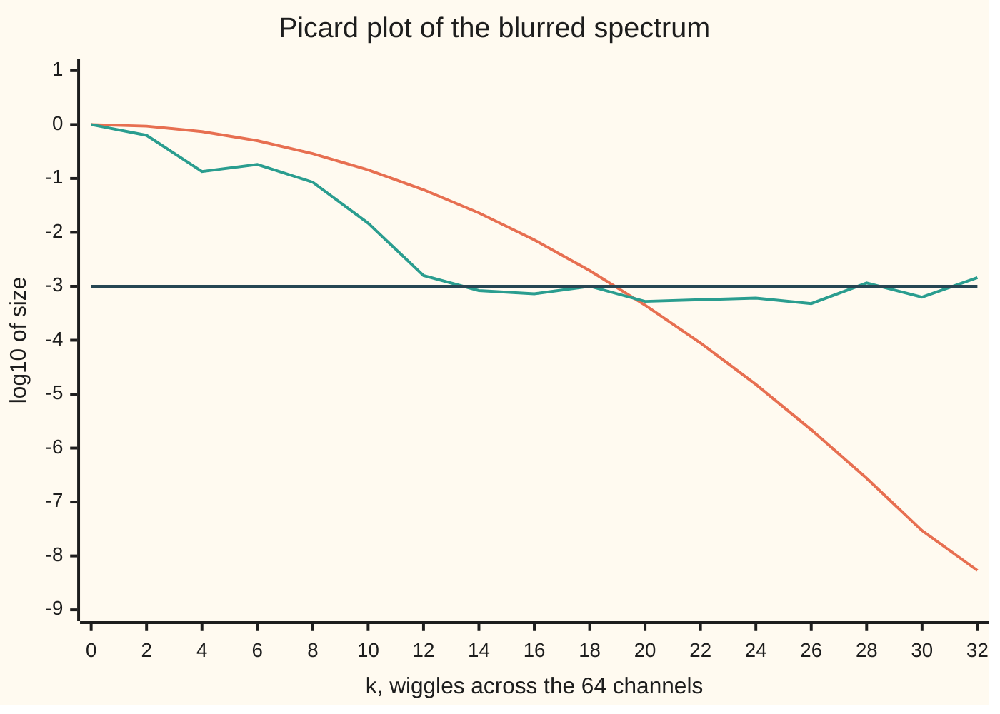
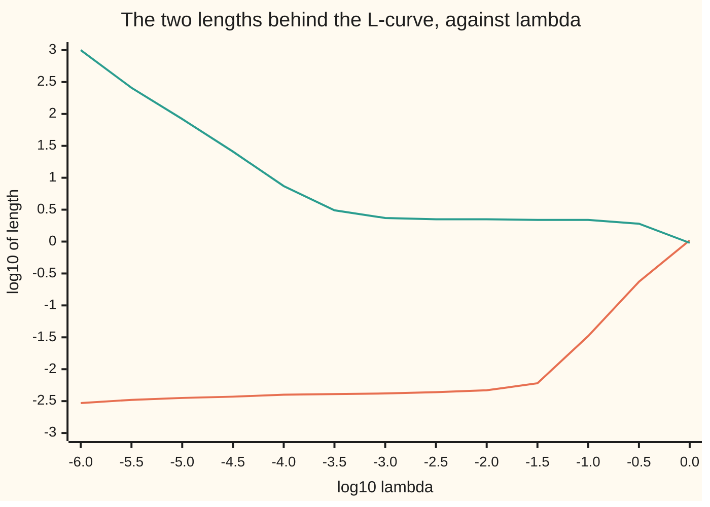

# Ill-posed problems: when the data cannot pin down the answer, and truncated SVD, Tikhonov and the L-curve

[Syllabus](../../../SYLLABUS.md) → [Numerical analysis](../README.md) → [Numerical Linear Algebra](../README.md#s03) → Ill-posed problems

---

## General Overview

A spectrometer splits light into 64 channels and records how bright each one is. The sample gives off two lines: one at channel 26 with height 1.0, one at channel 34 with height 0.6, each about 2 channels wide. The optics smear every line with a Gaussian blur 2 channels wide, and the detector adds noise of 0.001 per channel. The chemist wants the true heights back. All numbers here are illustrative; the code builds them, so the truth is known.

The blur is a linear map, so undoing it means solving one 64 by 64 system. That solve fails completely. The blur flattens fine wiggles by a factor as small as 5.3506e-9, so undoing it multiplies the noise in those wiggles by up to 1.8690e8. The "answer" has error 2.7857e5 on a spectrum whose size is 2.2134. It is pure noise, yet it fits the data to 1.5e-10.

A problem like this is called **ill-posed** (the data cannot pin down the answer: tiny changes in the data swing it wildly). The cure is **regularisation**: trust only the parts of the answer the data can support, and damp the rest. Tikhonov's version, with its strength chosen so that the fit misses the data by about the size of the noise, recovers the line at channel 26 as 0.9732 (true 1.0002) and gets the whole spectrum to within 2.74%.

**The singular values show which parts of an answer the data can carry (the Picard condition); regularisation keeps those parts and damps the rest, by cutting them off (truncated SVD) or by filter factors σ²/(σ² + λ²) (Tikhonov), with λ set so the fit misses the data by about the noise (the discrepancy principle).**

**What kind of fact this is:** a method, resting on theorems proved on this card in Why it works: the plain solve's error bound, the filter-factor formula, the cap of 1/(2λ) on Tikhonov's noise gain, and the fact that the discrepancy principle has exactly one answer. The L-curve and generalised cross-validation are rules of thumb, stated with their sources and not proved. On this spectrum the L-curve rule fails, and the card shows it.

### The picture: the Picard plot



Orange: log10 of $`\sigma_k`$, how much the blur shrinks a wave with $`k`$ wiggles across the 64 channels, falling from 0 to −8.27. Teal: log10 of the data's share $`\lvert u_k^T b\rvert`$ along that wave, as the root mean square over the frequency's cosine and sine waves (Step 2 says why). Dark blue: the noise level, log10 of 0.001 = −3.00. Up to about $`k`$ = 12 the data's shares fall faster than the singular values: that is signal. Past it they sit on the noise floor while $`\sigma_k`$ keeps falling, so dividing one by the other gives noise times a huge number.

---

## The formula

Notation first, in words. The spectrum has $`n`$ = 64 channels. The blur is the matrix $`A`$: entry $`(i, j)`$ is the Gaussian weight of the distance from channel $`j`$ to channel $`i`$, with the ends wrapped round so channel 63 sits next to channel 0. The data are $`b = A x_{\text{true}} + e`$, where $`e`$ is the noise. $`\lVert\cdot\rVert`$ is ordinary length, the square root of the sum of squares.

The SVD ([Singular value decomposition](08-svd-and-the-pseudoinverse.md)) writes $`A = \sum_i \sigma_i u_i v_i^T`$: input patterns $`v_i`$, output patterns $`u_i`$, and stretch factors $`\sigma_i`$, largest first. Each pattern's share of the data is $`c_i = u_i^T b`$. A regularised answer divides each share by its stretch, then scales it by a **filter factor** $`f_i`$ between 0 and 1:

```math
x_{\text{reg}} = \sum_{i=1}^{n} f_i\, \frac{u_i^T b}{\sigma_i}\, v_i, \qquad f_i^{\text{plain}} = 1, \qquad f_i^{\text{TSVD}} = \begin{cases} 1 & \sigma_i \text{ kept} \\ 0 & \text{otherwise} \end{cases}, \qquad f_i^{\text{Tik}} = \frac{\sigma_i^2}{\sigma_i^2 + \lambda^2}
```

**Read it aloud:** the answer is a sum of patterns; each pattern's weight is the data's share divided by how much the blur shrinks that pattern, times a factor saying how far to trust it.

Tikhonov's factors come from one minimisation, solved by the normal equations with a damping term:

```math
x_\lambda = \mathrm{argmin}_x\, \Big(\lVert Ax - b\rVert^2 + \lambda^2 \lVert x\rVert^2\Big), \qquad (A^T A + \lambda^2 I)\, x_\lambda = A^T b
```

**Read it aloud:** the Tikhonov answer is the one that best balances missing the data against its own size, with lambda squared setting the exchange rate.

Three rules for choosing $`\lambda`$:

```math
\text{discrepancy: } \lVert A x_\lambda - b\rVert = \sqrt{n}\,\delta, \qquad \text{L-curve: corner of } \big(\log_{10}\lVert A x_\lambda - b\rVert,\ \log_{10}\lVert x_\lambda\rVert\big), \qquad \text{GCV: minimise } G(\lambda) = \frac{\lVert A x_\lambda - b\rVert^2}{\big(n - \sum_i f_i\big)^2}
```

**Read it aloud:** miss the data by the expected size of the noise; or take the corner where the fit stops improving and the answer starts to grow; or minimise the fit's miss divided by the squared count of the components left unused.

The **Picard condition** asks that the noise-free shares $`\lvert u_i^T A x_{\text{true}}\rvert`$ fall faster than the $`\sigma_i`$. Step 2 reads it off the plot above.

| Symbol | Plain meaning | In our example | Push it up and the answer… |
| --- | --- | --- | --- |
| $`n`$, $`j`$, $`A`$, $`g_j`$, $`s`$ | channels; a channel or distance index; the blur matrix; the blur's weight at distance $`j`$; blur width (standard deviation) in channels | 64; 64 by 64; 2 | $`s`$ up: $`\sigma_{\min}`$ falls fast, worse problem |
| $`x_{\text{true}}`$, $`x`$, $`\lVert\cdot\rVert`$ | the true spectrum; any candidate spectrum; length, the root of the sum of squares | $`\lVert x_{\text{true}}\rVert`$ = 2.2134 | — |
| $`b`$, $`e`$, $`\delta`$ | recorded data; the noise in it; noise standard deviation per channel | $`\lVert e\rVert`$ = 0.00739; $`\delta`$ = 0.001 | $`\delta`$ up: larger $`\lambda`$, larger error |
| $`\sigma_i`$, $`u_i`$, $`v_i`$, $`U`$, $`V`$, $`I`$ | singular values and output and input patterns; the matrices with those patterns as columns; the identity matrix | $`\sigma`$ from 1 down to 5.3506e-9 | — |
| $`k`$ | frequency of a pattern: how many wiggles it has across the 64 channels | 0 to 32 | higher $`k`$: smaller $`\sigma_k`$ |
| $`c_i = u_i^T b`$ | the data's share along pattern $`i`$ | 4.23e-4 for the cosine at $`k`$ = 12 | — |
| $`\kappa`$ | condition number $`\sigma_{\max}/\sigma_{\min}`$: the worst noise gain of the plain solve | 1.8690e8 | — |
| $`\lambda`$, $`\lambda_{\text{DP}}`$ | regularisation parameter, a cut-off level in units of $`\sigma`$; its value from the discrepancy principle | 0.042654 by discrepancy | up: smoother, more bias |
| $`f_i`$ | filter factor: the fraction of pattern $`i`$ kept | 0.6808 at $`k`$ = 12 | $`\lambda`$ up: every $`f_i`$ falls |
| $`x_\lambda`$, $`x_{\text{reg}}`$, $`k_c`$ | Tikhonov answer; any filtered answer; the truncated SVD's highest kept frequency | error 2.74%; $`k_c`$ = 10 | $`k_c`$ up: less bias, more noise |
| $`\rho(\lambda)`$, $`\eta(\lambda)`$, $`G(\lambda)`$ | residual length $`\lVert Ax_\lambda - b\rVert`$; answer length $`\lVert x_\lambda\rVert`$; GCV score | $`\rho`$ = 0.0080 at $`\lambda_{\text{DP}}`$ | $`\lambda`$ up: $`\rho`$ rises, $`\eta`$ falls |
| $`z_i`$, $`m`$ | names inside the proofs: the answer's coordinate along $`v_i`$; a whole-number frequency in Poisson summation | — | — |

The [Regularisation](../../09-Probability%20and%20statistics/09-Regression/06-ridge-and-lasso.md) card writes ridge's charge as one number times $`\sum b_j^2`$ and calls that number $`\lambda`$. It is this card's $`\lambda^2`$. Writing it as a square makes $`\lambda`$ directly comparable with the singular values.

### When it holds

- **The Picard condition holds.** If the noise-free shares do not fall faster than the $`\sigma_i`$, no true answer of moderate size exists. Then no choice of $`\lambda`$ helps.
- **The noise level is known.** The discrepancy principle needs $`\delta`$. Forget the $`\sqrt{n}`$ and the target drops to 0.001, below the actual noise length 0.00739: $`\lambda`$ falls to 7.70e-9 and the error becomes 45,296 times the size of the spectrum.
- **The noise is white** (independent, the same size in every channel). Then it spreads evenly over all patterns, which is why the floor in the Picard plot is flat. Noise concentrated in a few patterns can look like signal.
- **A small, smooth answer is a fair guess.** Tikhonov pulls every damped pattern toward zero. A spectrum with sharp spikes loses height and gains ripples.
- **The model is right.** Here the blur wraps round the ends. A real instrument does not, and a wrong blur matrix adds a model error no $`\lambda`$ removes.

---

## Why it works

### Step 0: one hard problem is 64 easy ones

In the singular patterns the blur does not mix anything. It shrinks pattern $`i`$ by $`\sigma_i`$ and that is all. So solving $`Ax = b`$ is 64 separate one-number problems: $`\sigma_i z_i = c_i`$, where $`z_i`$ is the answer's coordinate along $`v_i`$. Each is solved by dividing. The trouble is entirely in the divisions by tiny $`\sigma_i`$, where $`c_i`$ is mostly noise. Regularisation decides, one pattern at a time, how much of that division to trust.

For this blur the patterns are known in advance. A blur that treats every channel alike, with the ends wrapped round, is a **circulant** matrix (each row is the row above, shifted one place). Its singular patterns are the cosine and sine waves of the discrete Fourier transform, and $`\sigma_k = \sum_j g_j \cos(2\pi k j / n)`$, where $`g_j`$ is the blur's weight at distance $`j`$. Each frequency $`k`$ from 1 to 31 has a cosine and a sine with the same $`\sigma_k`$. The matrix is symmetric with positive $`\sigma_k`$, so here $`u_i = v_i`$, and its singular values are its eigenvalues.

### Step 1: why the plain solve is noise

The plain solve divides every share: $`x - x_{\text{true}} = \sum_i (u_i^T e / \sigma_i)\, v_i`$. The patterns are perpendicular unit vectors, so the error's length is at most $`\lVert e\rVert / \sigma_{\min}`$.

On the spectrum: $`\sigma_{\min}`$ = 5.3506e-9 at $`k`$ = 32, the pattern that alternates +1, −1 from channel to channel. The bound is 0.00739 / 5.3506e-9 = 1.3821e6. The true error is 2.7857e5: bound ÷ true error = 4.96. Either way the answer is useless.

The solver itself did its job. Its residual $`\lVert Ax - b\rVert`$ is 1.5e-10, so it found the exact answer to a question very close to the one asked ([Forward and backward error](../01-Floating%20Point%20and%20Error/06-forward-and-backward-error.md)). The trouble is conditioning, not stability: $`\kappa`$ = 1.8690e8, and the data carry noise at 0.001, not at rounding level.

<details>
<summary>Where 5.35e-9 comes from: the blur's smallest factor in closed form</summary>

At $`k`$ = 32 the cosine is $`(-1)^j`$, so $`\sigma_{32} = \sum_j (-1)^j g_j`$: the blur's weights with alternating signs. The Gaussian weights are $`e^{-j^2/(2s^2)}`$, divided by their sum.

Poisson summation (stated here, not proved) turns a sum over a Gaussian's samples into a sum over its Fourier transform at whole frequencies. Alternating signs shift those frequencies by one half:

$`\displaystyle \frac{\sum_j (-1)^j e^{-j^2/(2s^2)}}{\sum_j e^{-j^2/(2s^2)}} = \frac{\sum_m e^{-2\pi^2 s^2 (m + 1/2)^2}}{\sum_m e^{-2\pi^2 s^2 m^2}} \approx 2 e^{-\pi^2 s^2 / 2}`$

The two terms $`m`$ = 0 and $`m`$ = −1 on top give the 2. Every other term is smaller by a factor of $`e^{-2\pi^2 s^2}`$ or less. With $`s`$ = 2 this is $`2e^{-2\pi^2}`$ = 5.3506e-9, and the cosine sum agrees to better than one part in a million. Wrapping the ends round changes nothing visible, because the weight at distance 32 is $`e^{-128}`$.

A wider blur is far worse. At $`s`$ = 3 the estimate is $`2e^{-9\pi^2/2}`$, below what a double can resolve next to 1.

</details>

### Step 2: the Picard plot shows where the signal ends

Split each share: $`c_i = u_i^T A x_{\text{true}} + u_i^T e = \sigma_i\, (v_i^T x_{\text{true}}) + u_i^T e`$. The first part shrinks with $`\sigma_i`$. The second does not: white noise of size $`\delta`$ in every channel has a share of about $`\delta`$ along every unit pattern.

Each frequency from 1 to 31 has a cosine and a sine pattern, and the signal can sit in either. Both lines are centred where the $`k`$ = 8 cosine is zero, so that share, 2.62e-3, is pure noise, while the sine carries 1.21e-1. So the table and the plot use each frequency's root-mean-square (RMS) share, the square root of the mean of the squared cosine and sine shares. Its noise floor is still about $`\delta`$.

The plot then reads directly:

| $`k`$ | $`\sigma_k`$ | cosine share | sine share | RMS share | RMS share ÷ $`\sigma_k`$ | what it is |
| --- | --- | --- | --- | --- | --- | --- |
| 0 | 1.00e0 | 1.00e0 | — | 1.00e0 | 1.00e0 | signal: the total brightness |
| 4 | 7.35e-1 | 1.36e-1 | 1.34e-1 | 1.35e-1 | 1.83e-1 | signal |
| 8 | 2.91e-1 | 2.62e-3 | 1.21e-1 | 8.58e-2 | 2.94e-1 | signal, all in the sine |
| 12 | 6.23e-2 | 4.23e-4 | 2.23e-3 | 1.60e-3 | 2.57e-2 | at the noise floor |
| 16 | 7.19e-3 | 9.29e-4 | 4.33e-4 | 7.24e-4 | 1.01e-1 | noise |
| 20 | 4.48e-4 | 1.80e-4 | 7.15e-4 | 5.22e-4 | 1.16e0 | noise |
| 24 | 1.51e-5 | 1.81e-4 | 8.28e-4 | 5.99e-4 | 3.98e1 | noise, amplified |
| 28 | 2.73e-7 | 1.12e-3 | 1.18e-3 | 1.15e-3 | 4.21e3 | noise, amplified |
| 32 | 5.35e-9 | 1.45e-3 | — | 1.45e-3 | 2.71e5 | noise, amplified most |

The last column is the plain solve's weight at that frequency. Up to $`k`$ = 12 it is at most 1, ending at 2.57e-2. From $`k`$ = 16 on it grows without limit, because the top is fixed at the noise level while the bottom falls. Those weights carry no information about the spectrum.

### Step 3: Tikhonov's filter factors

<details>
<summary>Detailed proof: minimising the damped miss gives the filter factors and the normal equations</summary>

Lengths do not change under the perpendicular patterns. With $`z = V^T x`$ and $`c = U^T b`$, the quantity to minimise splits pattern by pattern:

$`\displaystyle \lVert Ax - b\rVert^2 + \lambda^2 \lVert x\rVert^2 = \sum_i \Big( (\sigma_i z_i - c_i)^2 + \lambda^2 z_i^2 \Big)`$

Each term is a parabola in $`z_i`$. Setting its slope to zero: $`\sigma_i(\sigma_i z_i - c_i) + \lambda^2 z_i = 0`$, so

$`\displaystyle z_i = \frac{\sigma_i c_i}{\sigma_i^2 + \lambda^2} = \frac{\sigma_i^2}{\sigma_i^2 + \lambda^2}\cdot\frac{c_i}{\sigma_i}`$

which is the filter factor times the plain weight. In matrix form the slope condition reads $`A^T(Ax - b) + \lambda^2 x = 0`$, which is $`(A^T A + \lambda^2 I)x = A^T b`$. For $`\lambda > 0`$ the matrix has all eigenvalues at least $`\lambda^2`$, so the answer is unique.

</details>

The factor $`f = \sigma^2/(\sigma^2 + \lambda^2)`$ depends only on the ratio $`\sigma/\lambda`$. It passes patterns well above $`\lambda`$ and blocks those well below:

| $`\sigma`$ against $`\lambda`$ | filter factor |
| --- | --- |
| $`\sigma = 10\lambda`$ | 0.9901 |
| $`\sigma = \lambda`$ | 0.5000 |
| $`\sigma = \lambda/10`$ | 0.0099 |

So $`\lambda`$ is a cut-off level measured in the same units as $`\sigma`$, with a soft edge one decade wide on each side. At $`\lambda`$ = 0.042654 the factors are 0.9790 at $`k`$ = 8, 0.6808 at $`k`$ = 12 and 0.0276 at $`k`$ = 16. In all, 25 of the 64 patterns keep more than half, frequencies 0 to 12. That is the same place the Picard plot hits the noise floor.

### Step 4: Tikhonov caps the noise gain at 1/(2λ)

The noise reaches the answer as $`\sum_i f_i\,(u_i^T e / \sigma_i)\, v_i`$. The gain on pattern $`i`$ is $`f_i/\sigma_i = \sigma_i/(\sigma_i^2 + \lambda^2)`$. Since $`\sigma^2 + \lambda^2 \ge 2\sigma\lambda`$ (because $`(\sigma - \lambda)^2 \ge 0`$), the gain is at most $`1/(2\lambda)`$, reached exactly at $`\sigma = \lambda`$. So the noise in the answer is at most $`\lVert e\rVert/(2\lambda)`$.

On the spectrum the cap is 1/(2 × 0.042654) = 11.722. The measured gain, the noise part of $`x_\lambda`$ divided by $`\lVert e\rVert`$, is 4.500: cap ÷ true = 2.61. Compare the plain solve's worst gain of 1.8690e8.

The price is **bias**: the patterns damped to keep noise out also lose their share of the true spectrum. Larger $`\lambda`$ means less noise and more bias. The best $`\lambda`$ balances the two.

### Step 5: truncated SVD is the same idea with a hard edge

Truncated SVD (TSVD) sets $`f_i = 1`$ for the patterns kept and 0 for the rest. Here it keeps frequencies 0 to $`k_c`$. The discrepancy rule picks the smallest $`k_c`$ whose residual is at most 0.0080: $`k_c`$ = 10, 21 patterns, residual 0.00791, error 3.51%.

Tikhonov's soft edge does slightly better here, 2.74%. It keeps part of $`k`$ = 11 and 12, where some signal remains. The hard edge either keeps a pattern whole, noise and all, or drops its signal entirely.

### Step 6: choosing λ

**The discrepancy principle** (Morozov). The noise has expected length $`\sqrt{n}\,\delta`$ = $`\sqrt{64}`$ × 0.001 = 0.0080. A fit that misses the data by less than that is fitting noise. So choose $`\lambda`$ to make the residual equal to it. The residual grows with $`\lambda`$, so exactly one $`\lambda`$ works, and bisection finds it.

<details>
<summary>Detailed proof: the residual rises with λ, so the discrepancy equation has one root</summary>

From the filter factors, the residual is $`Ax_\lambda - b = -\sum_i (1 - f_i)\, c_i\, u_i`$ plus any part of $`b`$ outside the span of the $`u_i`$ (none here, since $`A`$ is square and invertible). So

$`\displaystyle \rho(\lambda)^2 = \sum_i \Big( \frac{\lambda^2}{\sigma_i^2 + \lambda^2} \Big)^2 c_i^2`$

Each term rises strictly with $`\lambda`$ whenever $`c_i \ne 0`$. At $`\lambda = 0`$ the residual is 0. As $`\lambda`$ grows without limit it tends to $`\lVert b\rVert`$. So if $`0 < \sqrt{n}\,\delta < \lVert b\rVert`$, exactly one $`\lambda`$ gives $`\rho(\lambda) = \sqrt{n}\,\delta`$.

</details>

The result is $`\lambda_{\text{DP}}`$ = 0.042654, error 2.74%. Scanning the error against the known truth, which no real user can do, gives a best possible $`\lambda`$ = 0.0447 with the same 2.74%. The rule landed on the optimum here.

**Generalised cross-validation** (GCV) needs no noise level. It asks how well the fit would predict each data point if that point were left out, in a form that can be computed in one pass, and minimises $`G(\lambda)`$. Here it picks $`\lambda`$ = 0.0158, error 3.82%. The [Overfitting](../../09-Probability%20and%20statistics/09-Regression/08-cross-validation-and-overfitting.md) card does cross-validation the long way.

**The L-curve** plots $`\log_{10}`$ of the answer's length against $`\log_{10}`$ of the residual as $`\lambda`$ varies. Small $`\lambda`$ gives a steep arm: the answer grows, the fit barely improves. Large $`\lambda`$ gives a flat arm: the fit worsens, the answer barely shrinks. The rule takes the corner, the point of greatest curvature: here $`\lambda`$ = 0.0020, with error 21.83%.



Orange: log10 of the residual $`\rho(\lambda)`$. Teal: log10 of the answer's length $`\eta(\lambda)`$. Left of −3.0, the answer's length shoots up while the residual hardly moves: noise is entering. Right of −1.5, the residual climbs: signal is being cut. The L-curve's corner sits where the teal line flattens; the discrepancy principle's $`\lambda`$ sits where the orange line starts to rise.

The corner is too early because the true spectrum is smooth: its length stops changing long before the noise is out. The corner marks where noise starts to dominate the answer's length, not where it stops spoiling the answer. Hanke (Sources) proved the L-curve can fail this way for smooth solutions.

### Step 7: the cost

One factorisation per $`\lambda`$ is expensive when a rule scans many values. Cholesky on $`A^T A + \lambda^2 I`$ ([Cholesky](04-cholesky-decomposition.md)) costs about $`n^3/3 + 2n^2`$ = 95573 flops per $`\lambda`$ at $`n`$ = 64, after forming $`A^T A`$ once. With the SVD computed once, each new $`\lambda`$ costs only new filter factors and one sum of patterns: about $`2n^2 + 4n`$ = 8448 flops. The L-curve and GCV scans on this card use 121 values of $`\lambda`$. For a circulant blur the fast Fourier transform does the SVD itself in about $`n \log_2 n`$ steps.

The two routes agree. Cholesky's answer at $`\lambda_{\text{DP}}`$ matches the filter formula to a relative difference of 6.9e-14.

---

## Worked numbers, by hand

| Step | Arithmetic | Value |
| --- | --- | --- |
| noise target | $`\sqrt{64} \times 0.001`$ | 0.0080 |
| smallest blur factor | $`2e^{-2\pi^2}`$ | 5.3506e-9 |
| worst noise gain, plain solve | $`1 / 5.3506\text{e-}9`$ | 1.8690e8 |
| plain solve error bound | 0.00739 / 5.3506e-9 | 1.3821e6, against a true 2.7857e5 |
| $`\lambda`$ from the discrepancy principle | bisection on $`\rho(\lambda) = 0.0080`$ | 0.042654 |
| filter factor at $`k`$ = 12 | $`0.062298^2 / (0.062298^2 + 0.042654^2)`$ | 0.6808 |
| Tikhonov's noise-gain cap | $`1 / (2 \times 0.042654)`$ | 11.722, against a measured 4.500 |
| line at channel 26 | blurred 0.7140, true 1.0002 | **0.9732 after Tikhonov** |
| whole spectrum | $`\lVert x_\lambda - x_{\text{true}}\rVert / \lVert x_{\text{true}}\rVert`$ | **0.0274** |

The blur had cut the main line to 0.7140 and filled the gap between the lines: channel 30 read 0.4156 against a true 0.2165. After Tikhonov the line stands at 0.9732, the second at 0.5879 (true 0.6003), and the gap at 0.2113. The two lines are separate again, at close to their true heights.

### What breaks if you drop a piece

| Mistake | Comes out at | What went wrong |
| --- | --- | --- |
| No regularisation: the plain solve | error 2.7857e5; residual 1.5e-10 | divides noise by $`\sigma`$ as small as 5.3506e-9 |
| $`\lambda`$ far too small, 1e-6 | error 448 times the spectrum; channel 26 reads −137.86 | patterns with $`\sigma`$ far below the noise floor kept, noise gain up to $`1/(2\lambda)`$ |
| Discrepancy target $`\delta`$, not $`\sqrt{n}\,\delta`$ | $`\lambda`$ = 7.70e-9, error 45,296 times the spectrum | the target 0.001 is below the noise's length 0.00739, so the fit chases noise |
| $`\lambda`$ = 0.042654 passed where ridge code expects its charge $`\lambda^2`$ | effective $`\lambda = \sqrt{0.042654}`$ = 0.207, error 12.75%; channel 26 reads 0.8489 | $`\lambda`$ is five times too big, so signal is damped too |
| L-curve corner on a smooth truth | $`\lambda`$ = 0.0020, error 21.83% | the corner marks noise arriving, not noise gone |

Row 3 breaks the hypothesis "the noise level is known": the discrepancy principle needs the noise's length right. Row 5 breaks the L-curve's unstated hypothesis: an answer with detail at every scale, which a smooth spectrum lacks.

---

## Code, from first principles, and it actually runs

The code builds the spectrum, the blur and SplitMix64 noise (seed 0x2026), so the truth is known. It takes three independent roads. Road one: the singular values as cosine sums, checked against the aliasing formula $`2e^{-\pi^2 s^2/2}`$. Road two: a Jacobi eigenvalue solver run on the 64 by 64 matrix itself, which knows nothing about Fourier waves. Road three: Tikhonov by Cholesky on the normal equations, against the filter-factor formula, and every residual from the formula against $`Ax - b`$ multiplied out. It then scans $`\lambda`$ for the L-curve, GCV and the best possible error, and prints every number on this card.

### Python

```python
# Deblurring a 64-channel spectrum. Roads: singular values by a cosine sum, by aliasing and by
# Jacobi on A; Tikhonov by filter factors against Cholesky on (A^T A + lam^2 I) x = A^T b.
import math
def sm(v):  # plain left-to-right sum, so Python and Rust add in the same order
    t = 0.0
    for a in v: t += a
    return t
def E(x, d):  # e-notation written the same way in both languages
    m, e = f"{x:.{d}e}".split("e")
    return f"{m}e{int(e)}"
n, s, dl = 64, 2.0, 1e-3
g = [math.exp(-min(j, n - j) ** 2 / (2 * s * s)) for j in range(n)]
g = [v / sm(g) for v in g]
A = [[g[(i - j) % n] for j in range(n)] for i in range(n)]
xt = [math.exp(-(j - 26) ** 2 / 8) + 0.6 * math.exp(-(j - 34) ** 2 / 8) for j in range(n)]
st, M64 = 0x2026, 2**64 - 1
def rnd():  # SplitMix64, seed 0x2026, uniform on [0, 1)
    global st
    st = (st + 0x9E3779B97F4A7C15) & M64
    z = ((st ^ (st >> 30)) * 0xBF58476D1CE4E5B9) & M64
    z = ((z ^ (z >> 27)) * 0x94D049BB133111EB) & M64
    return ((z ^ (z >> 31)) >> 11) / 2.0 ** 53
mv = lambda v: [sm(A[i][j] * v[j] for j in range(n)) for i in range(n)]
nrm = lambda v: math.sqrt(sm(t * t for t in v))
dot = lambda u, v: sm(p * q for p, q in zip(u, v))
sub = lambda u, v: [p - q for p, q in zip(u, v)]
noise = [dl * (sm(rnd() for _ in range(12)) - 6.0) for _ in range(n)]
b = [p + q for p, q in zip(mv(xt), noise)]
K, U = [], []  # real Fourier vectors: the singular vectors of a symmetric circulant blur
for k in range(n // 2 + 1):
    for f in (math.cos, math.sin) if 0 < k < n // 2 else (math.cos,):
        u = [f(2 * math.pi * k * j / n) for j in range(n)]
        K.append(k); U.append([t / nrm(u) for t in u])
sig = [sm(g[j] * math.cos(2 * math.pi * k * j / n) for j in range(n)) for k in K]
c, cn = [dot(u, b) for u in U], [dot(u, noise) for u in U]
ali = 2 * math.exp(-math.pi * math.pi * s * s / 2)
print(f"sigma_max {sig[0]:.6f}  sigma_min {E(sig[-1], 4)}  kappa {E(sig[0] / sig[-1], 4)}")
print(f"aliasing estimate 2exp(-pi^2 s^2/2) {E(ali, 4)}")
assert abs(sig[-1] - ali) / ali < 1e-6
B = [row[:] for row in A]  # road 2: cyclic Jacobi rotations until A is diagonal
for sweep in range(12):
    for p in range(n - 1):
        for q in range(p + 1, n):
            if B[p][q] == 0.0: continue
            th = (B[q][q] - B[p][p]) / (2 * B[p][q])
            t = (1.0 if th >= 0 else -1.0) / (abs(th) + math.sqrt(th * th + 1))
            cs = 1 / math.sqrt(t * t + 1); sn = t * cs
            for r in range(n):
                B[r][p], B[r][q] = cs * B[r][p] - sn * B[r][q], sn * B[r][p] + cs * B[r][q]
            for r in range(n):
                B[p][r], B[q][r] = cs * B[p][r] - sn * B[q][r], sn * B[p][r] + cs * B[q][r]
ev = sorted(B[i][i] for i in range(n))
gap = max(abs(a - e) for a, e in zip(sorted(sig), ev))
print(f"jacobi, 12 sweeps: largest |closed form - jacobi| {E(gap, 1)}, smallest {E(ev[0], 4)}")
assert gap < 1e-13
pc = [math.sqrt(sm(c[i] * c[i] for i in range(n) if K[i] == k) / K.count(k)) for k in range(33)]  # rms share of each cos-sin pair
print("picard: k  sigma_k  |cos share|  |sin share|  rms share  rms/sigma")
for k in (0, 4, 8, 12, 16, 20, 24, 28, 32):
    i = K.index(k)
    print(f"  {k:2d}  {E(sig[i], 2)}  {E(abs(c[i]), 2)}  {E(abs(c[i + 1]), 2) if 0 < k < 32 else '-'}  {E(pc[k], 2)}  {E(pc[k] / sig[i], 2)}")
for name, v in (("log10 sigma", sig), ("log10 rms share", [pc[k] for k in K])):
    print(f"chart {name}:", " ".join(f"{math.log10(v[K.index(k)]):.2f}" for k in range(0, 33, 2)))
print(f"chart noise per coefficient: log10 {E(dl, 0)} = {math.log10(dl):.2f}")
def tik(lam, cc=c):  # filter factors f_i, then x = sum f_i c_i / sigma_i u_i
    f = [sg * sg / (sg * sg + lam * lam) for sg in sig]
    x = [sm(f[i] * cc[i] / sig[i] * U[i][j] for i in range(n)) for j in range(n)]
    return x, math.sqrt(sm(((1 - f[i]) * cc[i]) * ((1 - f[i]) * cc[i]) for i in range(n))), f
err = lambda x: nrm(sub(x, xt)) / nrm(xt)
xn, rn, _ = tik(0.0)
print(f"|x_true| {nrm(xt):.4f}  |noise| {nrm(noise):.5f}  |A x - b| of plain solve {E(nrm(sub(mv(xn), b)), 1)}")
print(f"plain solve: error {E(nrm(sub(xn, xt)), 4)}  bound |noise|/sigma_min {E(nrm(noise) / sig[-1], 4)}"
      f"  bound/true {nrm(noise) / sig[-1] / nrm(sub(xn, xt)):.2f}")
def dp(target):  # bisection on log10 lambda: the residual grows with lambda
    lo, hi = -10.0, 0.0
    for _ in range(60):
        mid = (lo + hi) / 2
        lo, hi = (mid, hi) if tik(10 ** mid)[1] < target else (lo, mid)
    return 10 ** lo
target = math.sqrt(n) * dl
lam = dp(target)
xd, rd, fd = tik(lam)
print(f"discrepancy target sqrt(64) x 1e-3 = {target:.4f}  lambda_DP {E(lam, 4)}")
print(f"  residual by formula {rd:.6f}  by A x - b {nrm(sub(mv(xd), b)):.6f}  rel error {err(xd):.4f}")
assert abs(rd - target) < 1e-9 and abs(nrm(sub(mv(xd), b)) - rd) < 1e-12
xe = tik(lam, cn)[0]
print(f"  noise gain {nrm(xe) / nrm(noise):.3f}  bound 1/(2 lambda) {1 / (2 * lam):.3f}  bound/true {nrm(noise) / (2 * lam * nrm(xe)):.2f}")
assert nrm(xe) / nrm(noise) <= 1 / (2 * lam)
for m in (10.0, 1.0, 0.1):
    print(f"filter factor at sigma = {m:g} lambda: {m * m / (m * m + 1):.4f}")
print(f"factor > 0.5 for {sum(1 for f in fd if f > 0.5)} of {n}, frequencies 0..{max(k for k, f in zip(K, fd) if f > 0.5)}; sigma_12 {sig[K.index(12)]:.6f}; factor at k = 8, 12, 16:",
      " ".join(f"{fd[K.index(k)]:.4f}" for k in (8, 12, 16)))
for j in (26, 30, 34):
    print(f"channel {j}: true {xt[j]:.4f}  blurred {b[j]:.4f}  Tikhonov {xd[j]:.4f}")
N = [[sm(A[r][i] * A[r][j] for r in range(n)) + (lam * lam if i == j else 0.0) for j in range(n)] for i in range(n)]
L = [[0.0] * n for _ in range(n)]  # road 3: Cholesky of A^T A + lam^2 I
for i in range(n):
    for j in range(i + 1):
        t = N[i][j] - sm(L[i][q] * L[j][q] for q in range(j))
        L[i][j] = math.sqrt(t) if i == j else t / L[j][j]
y, xc = [0.0] * n, [0.0] * n
for i in range(n):
    y[i] = (sm(A[r][i] * b[r] for r in range(n)) - sm(L[i][q] * y[q] for q in range(i))) / L[i][i]
for i in reversed(range(n)):
    xc[i] = (y[i] - sm(L[q][i] * xc[q] for q in range(i + 1, n))) / L[i][i]
dif = nrm(sub(xc, xd)) / nrm(xd)
print(f"cholesky against filter formula: relative difference {E(dif, 1)}")
assert dif < 1e-10
for kc in range(33):  # TSVD: keep frequencies 0..kc, smallest kc meeting the target
    keep = [k <= kc for k in K]
    rt = math.sqrt(sm(c[i] * c[i] for i in range(n) if not keep[i]))
    if rt <= target:
        break
xk = [sm(c[i] / sig[i] * U[i][j] for i in range(n) if keep[i]) for j in range(n)]
print(f"TSVD by discrepancy: frequencies 0..{kc}, {sum(keep)} components, residual {rt:.5f}"
      f" (A x - b {nrm(sub(mv(xk), b)):.5f}), rel error {err(xk):.4f}")
grid = [-6 + 0.05 * i for i in range(121)]  # L-curve and GCV, lambda = 10^grid
rho, eta, gcv, ers = [], [], [], []
for e in grid:
    x, r, f = tik(10 ** e)
    rho.append(math.log10(r)); eta.append(math.log10(nrm(x)))
    gcv.append(r * r / ((n - sm(f)) * (n - sm(f)))); ers.append(err(x))
cur = [-1e300] * 121
for i in range(1, 120):
    r1, e1 = (rho[i + 1] - rho[i - 1]) / 0.1, (eta[i + 1] - eta[i - 1]) / 0.1
    r2, e2 = (rho[i + 1] - 2 * rho[i] + rho[i - 1]) / 0.0025, (eta[i + 1] - 2 * eta[i] + eta[i - 1]) / 0.0025
    cur[i] = (r1 * e2 - r2 * e1) / (r1 * r1 + e1 * e1) ** 1.5
pick = [("L-curve corner", cur.index(max(cur))), ("GCV minimum", gcv.index(min(gcv))),
        ("best possible, needs x_true", ers.index(min(ers)))]
for name, i in pick:
    print(f"{name}: lambda {E(10 ** grid[i], 2)}  residual {10 ** rho[i]:.5f}  rel error {ers[i]:.4f}")
assert ers[pick[1][1]] < 2 * ers[pick[2][1]] < ers[pick[0][1]] and err(xd) < 1.1 * ers[pick[2][1]]
print("chart log10 lambda:", " ".join(f"{grid[i]:.1f}" for i in range(0, 121, 10)))
print("chart log10 residual:", " ".join(f"{rho[i]:.2f}" for i in range(0, 121, 10)))
print("chart log10 |x|:", " ".join(f"{eta[i]:.2f}" for i in range(0, 121, 10)))
for l in (1e-6, math.sqrt(lam)):
    print(f"what breaks: lambda {E(l, 2)}  rel error {err(tik(l)[0]):.4f}  height at 26 {tik(l)[0][26]:.4f}")
l1 = dp(dl)
print(f"what breaks: target 1e-3, no sqrt(64): lambda {E(l1, 2)}  rel error {err(tik(l1)[0]):.4f}")
print(f"cost per lambda: cholesky n^3/3 + 2n^2 = {n ** 3 // 3 + 2 * n * n} flops; filter route 2n^2 + 4n = {2 * n * n + 4 * n}")
print("ALL CHECKS PASS")
```

**Ran 2026-11-24 on macOS, Python 3.14.10, standard library only. All checks passed. Output, pasted from the run:**

```
sigma_max 1.000000  sigma_min 5.3506e-9  kappa 1.8690e8
aliasing estimate 2exp(-pi^2 s^2/2) 5.3506e-9
jacobi, 12 sweeps: largest |closed form - jacobi| 2.0e-14, smallest 5.3506e-9
picard: k  sigma_k  |cos share|  |sin share|  rms share  rms/sigma
   0  1.00e0  1.00e0  -  1.00e0  1.00e0
   4  7.35e-1  1.36e-1  1.34e-1  1.35e-1  1.83e-1
   8  2.91e-1  2.62e-3  1.21e-1  8.58e-2  2.94e-1
  12  6.23e-2  4.23e-4  2.23e-3  1.60e-3  2.57e-2
  16  7.19e-3  9.29e-4  4.33e-4  7.24e-4  1.01e-1
  20  4.48e-4  1.80e-4  7.15e-4  5.22e-4  1.16e0
  24  1.51e-5  1.81e-4  8.28e-4  5.99e-4  3.98e1
  28  2.73e-7  1.12e-3  1.18e-3  1.15e-3  4.21e3
  32  5.35e-9  1.45e-3  -  1.45e-3  2.71e5
chart log10 sigma: 0.00 -0.03 -0.13 -0.30 -0.54 -0.84 -1.21 -1.64 -2.14 -2.71 -3.35 -4.05 -4.82 -5.66 -6.56 -7.53 -8.27
chart log10 rms share: 0.00 -0.20 -0.87 -0.74 -1.07 -1.83 -2.80 -3.08 -3.14 -3.00 -3.28 -3.25 -3.22 -3.32 -2.94 -3.20 -2.84
chart noise per coefficient: log10 1e-3 = -3.00
|x_true| 2.2134  |noise| 0.00739  |A x - b| of plain solve 1.5e-10
plain solve: error 2.7857e5  bound |noise|/sigma_min 1.3821e6  bound/true 4.96
discrepancy target sqrt(64) x 1e-3 = 0.0080  lambda_DP 4.2654e-2
  residual by formula 0.008000  by A x - b 0.008000  rel error 0.0274
  noise gain 4.500  bound 1/(2 lambda) 11.722  bound/true 2.61
filter factor at sigma = 10 lambda: 0.9901
filter factor at sigma = 1 lambda: 0.5000
filter factor at sigma = 0.1 lambda: 0.0099
factor > 0.5 for 25 of 64, frequencies 0..12; sigma_12 0.062298; factor at k = 8, 12, 16: 0.9790 0.6808 0.0276
channel 26: true 1.0002  blurred 0.7140  Tikhonov 0.9732
channel 30: true 0.2165  blurred 0.4156  Tikhonov 0.2113
channel 34: true 0.6003  blurred 0.4376  Tikhonov 0.5879
cholesky against filter formula: relative difference 6.9e-14
TSVD by discrepancy: frequencies 0..10, 21 components, residual 0.00791 (A x - b 0.00791), rel error 0.0351
L-curve corner: lambda 2.00e-3  residual 0.00430  rel error 0.2183
GCV minimum: lambda 1.58e-2  residual 0.00478  rel error 0.0382
best possible, needs x_true: lambda 4.47e-2  residual 0.00849  rel error 0.0274
chart log10 lambda: -6.0 -5.5 -5.0 -4.5 -4.0 -3.5 -3.0 -2.5 -2.0 -1.5 -1.0 -0.5 0.0
chart log10 residual: -2.53 -2.48 -2.45 -2.43 -2.40 -2.39 -2.38 -2.36 -2.33 -2.22 -1.48 -0.63 0.02
chart log10 |x|: 3.00 2.41 1.92 1.41 0.87 0.49 0.37 0.35 0.35 0.34 0.34 0.28 -0.02
what breaks: lambda 1.00e-6  rel error 448.4009  height at 26 -137.8600
what breaks: lambda 2.07e-1  rel error 0.1275  height at 26 0.8489
what breaks: target 1e-3, no sqrt(64): lambda 7.70e-9  rel error 45296.0831
cost per lambda: cholesky n^3/3 + 2n^2 = 95573 flops; filter route 2n^2 + 4n = 8448
ALL CHECKS PASS
```

### Rust

```rust
// Deblurring a 64-channel spectrum. Roads: singular values by a cosine sum, by aliasing and by
// Jacobi on A; Tikhonov by filter factors against Cholesky on (A^T A + lam^2 I) x = A^T b.
use std::f64::consts::PI;
const N: usize = 64;
type V = Vec<f64>;
fn sm(v: impl Iterator<Item = f64>) -> f64 { let mut t = 0.0; for a in v { t += a; } t }
fn e(x: f64, d: usize) -> String { format!("{:.*e}", d, x) }
fn nrm(v: &[f64]) -> f64 { sm(v.iter().map(|t| t * t)).sqrt() }
fn dot(u: &[f64], v: &[f64]) -> f64 { sm(u.iter().zip(v).map(|(p, q)| p * q)) }
fn sub(u: &[f64], v: &[f64]) -> V { u.iter().zip(v).map(|(p, q)| p - q).collect() }
struct P { a: Vec<V>, xt: V, sig: V, u: Vec<V> }
impl P {
    fn mv(&self, v: &[f64]) -> V { (0..N).map(|i| sm((0..N).map(|j| self.a[i][j] * v[j]))).collect() }
    fn err(&self, x: &[f64]) -> f64 { nrm(&sub(x, &self.xt)) / nrm(&self.xt) }
    fn tik(&self, lam: f64, cc: &[f64]) -> (V, f64, V) {
        let f: V = self.sig.iter().map(|sg| sg * sg / (sg * sg + lam * lam)).collect();
        let x = (0..N).map(|j| sm((0..N).map(|i| f[i] * cc[i] / self.sig[i] * self.u[i][j]))).collect();
        let r = sm((0..N).map(|i| ((1.0 - f[i]) * cc[i]) * ((1.0 - f[i]) * cc[i]))).sqrt();
        (x, r, f)
    }
    fn dp(&self, target: f64, c: &[f64]) -> f64 {
        let (mut lo, mut hi) = (-10.0f64, 0.0f64);
        for _ in 0..60 {
            let mid = (lo + hi) / 2.0;
            if self.tik(10f64.powf(mid), c).1 < target { lo = mid } else { hi = mid }
        }
        10f64.powf(lo)
    }
}
fn main() {
    let (n, s, dl) = (N, 2.0f64, 1e-3f64);
    let g0: V = (0..n).map(|j| { let m = j.min(n - j) as f64; (-(m * m) / (2.0 * s * s)).exp() }).collect();
    let gs = sm(g0.iter().cloned());
    let g: V = g0.iter().map(|v| v / gs).collect();
    let a: Vec<V> = (0..n).map(|i| (0..n).map(|j| g[(i + n - j) % n]).collect()).collect();
    let gauss = |j: usize, m: f64| { let d = j as f64 - m; (-(d * d) / 8.0).exp() };
    let xt: V = (0..n).map(|j| gauss(j, 26.0) + 0.6 * gauss(j, 34.0)).collect();
    let mut st: u64 = 0x2026;
    let mut rnd = || { // SplitMix64, seed 0x2026, uniform on [0, 1)
        st = st.wrapping_add(0x9E3779B97F4A7C15);
        let mut z = (st ^ (st >> 30)).wrapping_mul(0xBF58476D1CE4E5B9);
        z = (z ^ (z >> 27)).wrapping_mul(0x94D049BB133111EB);
        ((z ^ (z >> 31)) >> 11) as f64 / 9007199254740992.0
    };
    let noise: V = (0..n).map(|_| dl * (sm((0..12).map(|_| rnd())) - 6.0)).collect();
    let (mut kk, mut u): (Vec<usize>, Vec<V>) = (vec![], vec![]);
    for k in 0..=n / 2 {
        let fs: Vec<fn(f64) -> f64> = if k > 0 && k < n / 2 { vec![f64::cos, f64::sin] } else { vec![f64::cos] };
        for f in fs {
            let w: V = (0..n).map(|j| f(2.0 * PI * k as f64 * j as f64 / n as f64)).collect();
            let l = nrm(&w);
            kk.push(k); u.push(w.iter().map(|t| t / l).collect());
        }
    }
    let sig: V = kk.iter().map(|&k| sm((0..n).map(|j| g[j] * (2.0 * PI * k as f64 * j as f64 / n as f64).cos()))).collect();
    let pr = P { a: a.clone(), xt: xt.clone(), sig: sig.clone(), u: u.clone() };
    let b: V = pr.mv(&xt).iter().zip(&noise).map(|(p, q)| p + q).collect();
    let (c, cn): (V, V) = (u.iter().map(|w| dot(w, &b)).collect(), u.iter().map(|w| dot(w, &noise)).collect());
    let ali = 2.0 * (-PI * PI * s * s / 2.0).exp();
    println!("sigma_max {:.6}  sigma_min {}  kappa {}", sig[0], e(sig[n - 1], 4), e(sig[0] / sig[n - 1], 4));
    println!("aliasing estimate 2exp(-pi^2 s^2/2) {}", e(ali, 4));
    assert!((sig[n - 1] - ali).abs() / ali < 1e-6);
    let mut bm = a.clone(); // road 2: cyclic Jacobi rotations until A is diagonal
    for _ in 0..12 {
        for p in 0..n - 1 {
            for q in p + 1..n {
                if bm[p][q] == 0.0 { continue; }
                let th = (bm[q][q] - bm[p][p]) / (2.0 * bm[p][q]);
                let t = (if th >= 0.0 { 1.0 } else { -1.0 }) / (th.abs() + (th * th + 1.0).sqrt());
                let cs = 1.0 / (t * t + 1.0).sqrt(); let sn = t * cs;
                for r in 0..n { let (x, y) = (bm[r][p], bm[r][q]); bm[r][p] = cs * x - sn * y; bm[r][q] = sn * x + cs * y; }
                for r in 0..n { let (x, y) = (bm[p][r], bm[q][r]); bm[p][r] = cs * x - sn * y; bm[q][r] = sn * x + cs * y; }
            }
        }
    }
    let mut ev: V = (0..n).map(|i| bm[i][i]).collect(); ev.sort_by(|x, y| x.partial_cmp(y).unwrap());
    let mut ss = sig.clone(); ss.sort_by(|x, y| x.partial_cmp(y).unwrap());
    let gap = ss.iter().zip(&ev).map(|(x, y)| (x - y).abs()).fold(0.0, f64::max);
    println!("jacobi, 12 sweeps: largest |closed form - jacobi| {}, smallest {}", e(gap, 1), e(ev[0], 4));
    assert!(gap < 1e-13);
    let idx = |k: usize| kk.iter().position(|&q| q == k).unwrap();
    let pc: V = (0..=32).map(|k| (sm((0..n).filter(|&i| kk[i] == k).map(|i| c[i] * c[i])) / kk.iter().filter(|&&q| q == k).count() as f64).sqrt()).collect(); // rms share of each cos-sin pair
    println!("picard: k  sigma_k  |cos share|  |sin share|  rms share  rms/sigma");
    for k in [0, 4, 8, 12, 16, 20, 24, 28, 32] {
        let i = idx(k);
        println!("  {:2}  {}  {}  {}  {}  {}", k, e(sig[i], 2), e(c[i].abs(), 2), if k > 0 && k < 32 { e(c[i + 1].abs(), 2) } else { "-".to_string() }, e(pc[k], 2), e(pc[k] / sig[i], 2));
    }
    let ca: V = kk.iter().map(|&k| pc[k]).collect();
    for (name, v) in [("log10 sigma", &sig), ("log10 rms share", &ca)] {
        let row: Vec<String> = (0..=32).step_by(2).map(|k| format!("{:.2}", v[idx(k)].log10())).collect();
        println!("chart {}: {}", name, row.join(" "));
    }
    println!("chart noise per coefficient: log10 {} = {:.2}", e(dl, 0), dl.log10());
    let (xn, _, _) = pr.tik(0.0, &c);
    println!("|x_true| {:.4}  |noise| {:.5}  |A x - b| of plain solve {}", nrm(&xt), nrm(&noise), e(nrm(&sub(&pr.mv(&xn), &b)), 1));
    let en = nrm(&sub(&xn, &xt));
    println!("plain solve: error {}  bound |noise|/sigma_min {}  bound/true {:.2}", e(en, 4), e(nrm(&noise) / sig[n - 1], 4), nrm(&noise) / sig[n - 1] / en);
    let target = (n as f64).sqrt() * dl;
    let lam = pr.dp(target, &c);
    let (xd, rd, fd) = pr.tik(lam, &c);
    println!("discrepancy target sqrt(64) x 1e-3 = {:.4}  lambda_DP {}", target, e(lam, 4));
    let rdm = nrm(&sub(&pr.mv(&xd), &b));
    println!("  residual by formula {:.6}  by A x - b {:.6}  rel error {:.4}", rd, rdm, pr.err(&xd));
    assert!((rd - target).abs() < 1e-9 && (rdm - rd).abs() < 1e-12);
    let xe = pr.tik(lam, &cn).0;
    println!("  noise gain {:.3}  bound 1/(2 lambda) {:.3}  bound/true {:.2}", nrm(&xe) / nrm(&noise), 1.0 / (2.0 * lam), nrm(&noise) / (2.0 * lam * nrm(&xe)));
    assert!(nrm(&xe) / nrm(&noise) <= 1.0 / (2.0 * lam));
    for m in [10.0f64, 1.0, 0.1] { println!("filter factor at sigma = {} lambda: {:.4}", m, m * m / (m * m + 1.0)); }
    let kmax = kk.iter().zip(&fd).filter(|(_, &f)| f > 0.5).map(|(&k, _)| k).max().unwrap();
    let fk: Vec<String> = [8, 12, 16].iter().map(|&k| format!("{:.4}", fd[idx(k)])).collect();
    println!("factor > 0.5 for {} of {}, frequencies 0..{}; sigma_12 {:.6}; factor at k = 8, 12, 16: {}", fd.iter().filter(|&&f| f > 0.5).count(), n, kmax, sig[idx(12)], fk.join(" "));
    for j in [26, 30, 34] { println!("channel {}: true {:.4}  blurred {:.4}  Tikhonov {:.4}", j, xt[j], b[j], xd[j]); }
    let nm: Vec<V> = (0..n).map(|i| (0..n).map(|j| sm((0..n).map(|r| a[r][i] * a[r][j])) + if i == j { lam * lam } else { 0.0 }).collect()).collect();
    let mut l = vec![vec![0.0; n]; n]; // road 3: Cholesky of A^T A + lam^2 I
    for i in 0..n {
        for j in 0..=i {
            let t = nm[i][j] - sm((0..j).map(|q| l[i][q] * l[j][q]));
            l[i][j] = if i == j { t.sqrt() } else { t / l[j][j] };
        }
    }
    let (mut y, mut xc) = (vec![0.0; n], vec![0.0; n]);
    for i in 0..n { y[i] = (sm((0..n).map(|r| a[r][i] * b[r])) - sm((0..i).map(|q| l[i][q] * y[q]))) / l[i][i]; }
    for i in (0..n).rev() { xc[i] = (y[i] - sm((i + 1..n).map(|q| l[q][i] * xc[q]))) / l[i][i]; }
    let dif = nrm(&sub(&xc, &xd)) / nrm(&xd);
    println!("cholesky against filter formula: relative difference {}", e(dif, 1));
    assert!(dif < 1e-10);
    let (mut kc, mut rt, mut keep) = (0, 0.0, vec![]);
    for k in 0..=32 { // TSVD: keep frequencies 0..kc, smallest kc meeting the target
        kc = k;
        keep = kk.iter().map(|&q| q <= k).collect::<Vec<bool>>();
        rt = sm((0..n).filter(|&i| !keep[i]).map(|i| c[i] * c[i])).sqrt();
        if rt <= target { break; }
    }
    let xk: V = (0..n).map(|j| sm((0..n).filter(|&i| keep[i]).map(|i| c[i] / sig[i] * u[i][j]))).collect();
    let nk = keep.iter().filter(|&&q| q).count();
    println!("TSVD by discrepancy: frequencies 0..{}, {} components, residual {:.5} (A x - b {:.5}), rel error {:.4}", kc, nk, rt, nrm(&sub(&pr.mv(&xk), &b)), pr.err(&xk));
    let grid: V = (0..121).map(|i| -6.0 + 0.05 * i as f64).collect(); // L-curve and GCV
    let (mut rho, mut eta, mut gcv, mut ers) = (vec![], vec![], vec![], vec![]);
    for &ex in &grid {
        let (x, r, f) = pr.tik(10f64.powf(ex), &c);
        rho.push(r.log10()); eta.push(nrm(&x).log10());
        let dn = n as f64 - sm(f.iter().cloned());
        gcv.push(r * r / (dn * dn)); ers.push(pr.err(&x));
    }
    let mut cur = vec![-1e300; 121];
    for i in 1..120 {
        let (r1, e1) = ((rho[i + 1] - rho[i - 1]) / 0.1, (eta[i + 1] - eta[i - 1]) / 0.1);
        let (r2, e2) = ((rho[i + 1] - 2.0 * rho[i] + rho[i - 1]) / 0.0025, (eta[i + 1] - 2.0 * eta[i] + eta[i - 1]) / 0.0025);
        cur[i] = (r1 * e2 - r2 * e1) / (r1 * r1 + e1 * e1).powf(1.5);
    }
    let arg = |v: &V, big: bool| { let mut b = 0; for i in 0..v.len() { if (big && v[i] > v[b]) || (!big && v[i] < v[b]) { b = i; } } b };
    let pick = [("L-curve corner", arg(&cur, true)), ("GCV minimum", arg(&gcv, false)), ("best possible, needs x_true", arg(&ers, false))];
    for (name, i) in pick {
        println!("{}: lambda {}  residual {:.5}  rel error {:.4}", name, e(10f64.powf(grid[i]), 2), 10f64.powf(rho[i]), ers[i]);
    }
    assert!(ers[pick[1].1] < 2.0 * ers[pick[2].1] && 2.0 * ers[pick[2].1] < ers[pick[0].1] && pr.err(&xd) < 1.1 * ers[pick[2].1]);
    for (name, v) in [("lambda", &grid), ("residual", &rho), ("|x|", &eta)] {
        let row: Vec<String> = (0..121).step_by(10).map(|i| format!("{:.*}", if name == "lambda" { 1 } else { 2 }, v[i])).collect();
        println!("chart log10 {}: {}", name, row.join(" "));
    }
    for lv in [1e-6f64, lam.sqrt()] {
        let x = pr.tik(lv, &c).0;
        println!("what breaks: lambda {}  rel error {:.4}  height at 26 {:.4}", e(lv, 2), pr.err(&x), x[26]);
    }
    let l1 = pr.dp(dl, &c);
    println!("what breaks: target 1e-3, no sqrt(64): lambda {}  rel error {:.4}", e(l1, 2), pr.err(&pr.tik(l1, &c).0));
    println!("cost per lambda: cholesky n^3/3 + 2n^2 = {} flops; filter route 2n^2 + 4n = {}", n * n * n / 3 + 2 * n * n, 2 * n * n + 4 * n);
    println!("ALL CHECKS PASS");
}
```

**Ran 2026-11-24 on macOS, rustc 1.98.1, no crates. All checks passed. Output, pasted from the run:**

```
sigma_max 1.000000  sigma_min 5.3506e-9  kappa 1.8690e8
aliasing estimate 2exp(-pi^2 s^2/2) 5.3506e-9
jacobi, 12 sweeps: largest |closed form - jacobi| 2.0e-14, smallest 5.3506e-9
picard: k  sigma_k  |cos share|  |sin share|  rms share  rms/sigma
   0  1.00e0  1.00e0  -  1.00e0  1.00e0
   4  7.35e-1  1.36e-1  1.34e-1  1.35e-1  1.83e-1
   8  2.91e-1  2.62e-3  1.21e-1  8.58e-2  2.94e-1
  12  6.23e-2  4.23e-4  2.23e-3  1.60e-3  2.57e-2
  16  7.19e-3  9.29e-4  4.33e-4  7.24e-4  1.01e-1
  20  4.48e-4  1.80e-4  7.15e-4  5.22e-4  1.16e0
  24  1.51e-5  1.81e-4  8.28e-4  5.99e-4  3.98e1
  28  2.73e-7  1.12e-3  1.18e-3  1.15e-3  4.21e3
  32  5.35e-9  1.45e-3  -  1.45e-3  2.71e5
chart log10 sigma: 0.00 -0.03 -0.13 -0.30 -0.54 -0.84 -1.21 -1.64 -2.14 -2.71 -3.35 -4.05 -4.82 -5.66 -6.56 -7.53 -8.27
chart log10 rms share: 0.00 -0.20 -0.87 -0.74 -1.07 -1.83 -2.80 -3.08 -3.14 -3.00 -3.28 -3.25 -3.22 -3.32 -2.94 -3.20 -2.84
chart noise per coefficient: log10 1e-3 = -3.00
|x_true| 2.2134  |noise| 0.00739  |A x - b| of plain solve 1.5e-10
plain solve: error 2.7857e5  bound |noise|/sigma_min 1.3821e6  bound/true 4.96
discrepancy target sqrt(64) x 1e-3 = 0.0080  lambda_DP 4.2654e-2
  residual by formula 0.008000  by A x - b 0.008000  rel error 0.0274
  noise gain 4.500  bound 1/(2 lambda) 11.722  bound/true 2.61
filter factor at sigma = 10 lambda: 0.9901
filter factor at sigma = 1 lambda: 0.5000
filter factor at sigma = 0.1 lambda: 0.0099
factor > 0.5 for 25 of 64, frequencies 0..12; sigma_12 0.062298; factor at k = 8, 12, 16: 0.9790 0.6808 0.0276
channel 26: true 1.0002  blurred 0.7140  Tikhonov 0.9732
channel 30: true 0.2165  blurred 0.4156  Tikhonov 0.2113
channel 34: true 0.6003  blurred 0.4376  Tikhonov 0.5879
cholesky against filter formula: relative difference 6.9e-14
TSVD by discrepancy: frequencies 0..10, 21 components, residual 0.00791 (A x - b 0.00791), rel error 0.0351
L-curve corner: lambda 2.00e-3  residual 0.00430  rel error 0.2183
GCV minimum: lambda 1.58e-2  residual 0.00478  rel error 0.0382
best possible, needs x_true: lambda 4.47e-2  residual 0.00849  rel error 0.0274
chart log10 lambda: -6.0 -5.5 -5.0 -4.5 -4.0 -3.5 -3.0 -2.5 -2.0 -1.5 -1.0 -0.5 0.0
chart log10 residual: -2.53 -2.48 -2.45 -2.43 -2.40 -2.39 -2.38 -2.36 -2.33 -2.22 -1.48 -0.63 0.02
chart log10 |x|: 3.00 2.41 1.92 1.41 0.87 0.49 0.37 0.35 0.35 0.34 0.34 0.28 -0.02
what breaks: lambda 1.00e-6  rel error 448.4009  height at 26 -137.8600
what breaks: lambda 2.07e-1  rel error 0.1275  height at 26 0.8489
what breaks: target 1e-3, no sqrt(64): lambda 7.70e-9  rel error 45296.0831
cost per lambda: cholesky n^3/3 + 2n^2 = 95573 flops; filter route 2n^2 + 4n = 8448
ALL CHECKS PASS
```

### Lean

Lean proves Steps 3, 4 and 6 for every square $`A`$ whose $`\sigma_i`$ are all positive, and the hand numbers exactly.

- Take the SVD of $`A`$ with every $`\sigma_i > 0`$, and take $`\lambda > 0`$. Then $`x_\lambda`$ solves $`(A^T A + \lambda^2 I)\,x = A^T b`$, and no other $`x`$ does.
- Take the same $`A`$ and $`\lambda`$. Then $`x_\lambda`$ makes $`\lVert Ax - b\rVert^2 + \lambda^2 \lVert x\rVert^2`$ smaller than any other $`x`$ does.
- Take $`\sigma > 0`$ and $`\lambda > 0`$. Then the gain $`\sigma/(\sigma^2 + \lambda^2)`$ is at most $`1/(2\lambda)`$, with equality exactly when $`\sigma = \lambda`$.
- Take the same $`A`$ and $`\lambda`$. Then adding noise $`e`$ to the data moves $`x_\lambda`$ by at most $`\lVert e\rVert/(2\lambda)`$.
- Take the same $`A`$, and suppose $`0 < \sqrt{n}\,\delta < \lVert b\rVert`$. Then $`\rho(\lambda)`$ rises strictly for $`\lambda > 0`$, and exactly one $`\lambda > 0`$ gives $`\rho(\lambda) = \sqrt{n}\,\delta`$.
- The noise target $`\sqrt{64} \times 0.001`$ is exactly 0.008.
- The filter factors at $`\sigma = 10\lambda`$, $`\lambda`$ and $`\lambda/10`$ are exactly 100/101, 1/2 and 1/101.
- The pattern counts are exact: 64 in all, 25 at frequencies 0 to 12, and 21 at frequencies 0 to 10.
- The filter route's cost $`2n^2 + 4n`$ at $`n`$ = 64 is exactly 8448 flops.

The plain solve's bound, the L-curve, GCV and every computed number on the spectrum are left to the Python and Rust checks.

```lean
-- Ill-posed problems: Tikhonov's filter-factor answer is the one and only minimiser of the damped miss and solves the damped normal equations, its noise gain is capped at 1/(2λ), and the discrepancy equation has exactly one root because the residual rises with λ.
import Mathlib.LinearAlgebra.UnitaryGroup
import Mathlib.LinearAlgebra.Matrix.Notation
import Mathlib.Analysis.Real.Sqrt
import Mathlib.Order.Monotone.Basic
import Mathlib.Tactic.FieldSimp
import Mathlib.Tactic.NormNum
import Mathlib.Topology.Order.IntermediateValue
import Mathlib.Topology.Algebra.Order.Field
import Mathlib.Topology.Algebra.Monoid
import Mathlib.LinearAlgebra.Matrix.DotProduct

open Matrix

/-! ### How the card's objects are written here

The blur is a square real matrix `A` with `n` rows and columns. Its SVD is given as on the card:
`A = U * diagonal σ * Vᵀ`, where `U` and `V` are orthogonal (Mathlib's `orthogonalGroup`: their
columns are the output patterns `u_i` and input patterns `v_i`, perpendicular unit vectors) and the
stretch factors `σ i` are positive (the card's blur is square and invertible).

Vectors are functions `Fin n → ℝ`; `M *ᵥ x` is the matrix times a vector and `x ⬝ᵥ y` the dot
product, so the squared length `‖x‖²` is `x ⬝ᵥ x` and the length is `Real.sqrt (x ⬝ᵥ x)`.
The data's share along pattern `i` is `c_i = u_iᵀ b = (Uᵀ *ᵥ b) i`.

Tikhonov's answer with parameter `λ` (written `lam`) is the filtered sum
`x_λ = Σ_i f_i (c_i / σ_i) v_i = V *ᵥ (fun i => f_i * (c_i / σ_i))`, with filter factor
`f_i = σ_i² / (σ_i² + λ²)`. The damped miss is `‖A x - b‖² + λ² ‖x‖²`. -/

lemma dil_dot_self_nonneg {n : ℕ} (v : Fin n → ℝ) : 0 ≤ v ⬝ᵥ v :=
  Finset.sum_nonneg fun i _ => mul_self_nonneg (v i)

lemma dil_orth_norm {n : ℕ} (U : Matrix (Fin n) (Fin n) ℝ) (hU : Uᵀ * U = 1)
    (x : Fin n → ℝ) : (U *ᵥ x) ⬝ᵥ (U *ᵥ x) = x ⬝ᵥ x := by
  rw [dotProduct_mulVec, ← mulVec_transpose, mulVec_mulVec, hU, one_mulVec]

lemma dil_A_mulVec {n : ℕ} (A U V : Matrix (Fin n) (Fin n) ℝ) (σ : Fin n → ℝ)
    (hV : Vᵀ * V = 1) (hA : A = U * diagonal σ * Vᵀ) (w : Fin n → ℝ) :
    A *ᵥ (V *ᵥ w) = U *ᵥ (fun i => σ i * w i) := by
  subst hA
  rw [mulVec_mulVec, Matrix.mul_assoc, Matrix.mul_assoc, hV, Matrix.mul_one,
    ← mulVec_mulVec]
  congr 1
  funext i
  exact mulVec_diagonal _ _ _

lemma dil_At_mulVec {n : ℕ} (A U V : Matrix (Fin n) (Fin n) ℝ) (σ : Fin n → ℝ)
    (hU : Uᵀ * U = 1) (hA : A = U * diagonal σ * Vᵀ) (w : Fin n → ℝ) :
    Aᵀ *ᵥ (U *ᵥ w) = V *ᵥ (fun i => σ i * w i) := by
  subst hA
  rw [transpose_mul, transpose_mul, transpose_transpose, diagonal_transpose, mulVec_mulVec,
    Matrix.mul_assoc, Matrix.mul_assoc, hU, Matrix.mul_one, ← mulVec_mulVec]
  congr 1
  funext i
  exact mulVec_diagonal _ _ _

lemma dil_residual {n : ℕ} (A U V : Matrix (Fin n) (Fin n) ℝ) (σ : Fin n → ℝ)
    (hU : U * Uᵀ = 1) (hV : Vᵀ * V = 1) (hA : A = U * diagonal σ * Vᵀ)
    (w b : Fin n → ℝ) :
    A *ᵥ (V *ᵥ w) - b = U *ᵥ (fun i => σ i * w i - (Uᵀ *ᵥ b) i) := by
  rw [dil_A_mulVec A U V σ hV hA w]
  have hb : b = U *ᵥ (Uᵀ *ᵥ b) := by rw [mulVec_mulVec, hU, one_mulVec]
  conv_lhs => rw [hb]
  rw [← mulVec_sub]
  rfl

#print axioms dil_dot_self_nonneg
#print axioms dil_orth_norm
#print axioms dil_A_mulVec
#print axioms dil_At_mulVec
#print axioms dil_residual

/-- Tikhonov's filter factors (Step 3). Let `A = U diag(σ) Vᵀ` be the SVD of a square matrix, with
`U`, `V` orthogonal and every `σ_i > 0`, and let `λ > 0`. Then the filtered answer
`x_λ = Σ_i σ_i²/(σ_i² + λ²) · (u_iᵀ b / σ_i) · v_i` solves the damped normal equations
`(AᵀA + λ² I) x = Aᵀ b`, it is their only solution, and it is the one and only minimiser of the
damped miss `‖A x - b‖² + λ² ‖x‖²`: every other `x` gives a strictly larger value. -/
theorem tikhonov_filter_factors_solve_damped_least_squares {n : ℕ}
    (A U V : Matrix (Fin n) (Fin n) ℝ) (σ : Fin n → ℝ)
    (hU : U ∈ orthogonalGroup (Fin n) ℝ) (hV : V ∈ orthogonalGroup (Fin n) ℝ)
    (hA : A = U * diagonal σ * Vᵀ) (hσ : ∀ i, 0 < σ i)
    (b : Fin n → ℝ) (lam : ℝ) (hlam : 0 < lam) :
    let xlam : Fin n → ℝ :=
      V *ᵥ (fun i => σ i ^ 2 / (σ i ^ 2 + lam ^ 2) * ((Uᵀ *ᵥ b) i / σ i))
    (Aᵀ * A + lam ^ 2 • (1 : Matrix (Fin n) (Fin n) ℝ)) *ᵥ xlam = Aᵀ *ᵥ b ∧
    (∀ x : Fin n → ℝ,
      (Aᵀ * A + lam ^ 2 • (1 : Matrix (Fin n) (Fin n) ℝ)) *ᵥ x = Aᵀ *ᵥ b → x = xlam) ∧
    ∀ x : Fin n → ℝ, x ≠ xlam →
      (A *ᵥ xlam - b) ⬝ᵥ (A *ᵥ xlam - b) + lam ^ 2 * (xlam ⬝ᵥ xlam)
        < (A *ᵥ x - b) ⬝ᵥ (A *ᵥ x - b) + lam ^ 2 * (x ⬝ᵥ x) := by
  intro xlam
  have hU1 : Uᵀ * U = 1 := (mem_orthogonalGroup_iff' (Fin n) ℝ).mp hU
  have hU2 : U * Uᵀ = 1 := (mem_orthogonalGroup_iff (Fin n) ℝ).mp hU
  have hV1 : Vᵀ * V = 1 := (mem_orthogonalGroup_iff' (Fin n) ℝ).mp hV
  set w : Fin n → ℝ := fun i => σ i ^ 2 / (σ i ^ 2 + lam ^ 2) * ((Uᵀ *ᵥ b) i / σ i) with hw
  have hx : xlam = V *ᵥ w := rfl
  clear_value xlam
  subst hx
  set M := Aᵀ * A + lam ^ 2 • (1 : Matrix (Fin n) (Fin n) ℝ) with hM
  have hMv : ∀ z, M *ᵥ z = Aᵀ *ᵥ (A *ᵥ z) + lam ^ 2 • z := by
    intro z
    rw [hM, add_mulVec, smul_mulVec, one_mulVec, ← mulVec_mulVec]
  have key : ∀ z, z ⬝ᵥ (M *ᵥ z) = (A *ᵥ z) ⬝ᵥ (A *ᵥ z) + lam ^ 2 * (z ⬝ᵥ z) := by
    intro z
    rw [hMv, dotProduct_add, dotProduct_smul, dotProduct_mulVec, vecMul_transpose, smul_eq_mul]
  have hnormal : M *ᵥ (V *ᵥ w) = Aᵀ *ᵥ b := by
    have hb : U *ᵥ (Uᵀ *ᵥ b) = b := by rw [mulVec_mulVec, hU2, one_mulVec]
    conv_rhs => rw [← hb]
    rw [hMv, dil_A_mulVec A U V σ hV1 hA, dil_At_mulVec A U V σ hU1 hA,
      dil_At_mulVec A U V σ hU1 hA, ← mulVec_smul, ← mulVec_add]
    congr 1
    funext i
    have hs := hσ i
    simp only [hw, Pi.add_apply, Pi.smul_apply, smul_eq_mul]
    field_simp
  refine ⟨hnormal, ?_, ?_⟩
  · intro x hxe
    set z := x - V *ᵥ w with hz
    have hMz : M *ᵥ z = 0 := by rw [hz, mulVec_sub, hxe, hnormal, sub_self]
    have h0 := key z
    rw [hMz, dotProduct_zero] at h0
    have h1 := dil_dot_self_nonneg (A *ᵥ z)
    have h2 := dil_dot_self_nonneg z
    have hl2 : 0 < lam ^ 2 := by positivity
    have hzz : z ⬝ᵥ z = 0 := by nlinarith
    rw [dotProduct_self_eq_zero, hz, sub_eq_zero] at hzz
    exact hzz
  · intro x hne
    set z := x - V *ᵥ w with hz
    have hz0 : z ≠ 0 := by rw [hz]; exact sub_ne_zero.mpr hne
    have hzpos : 0 < z ⬝ᵥ z := lt_of_le_of_ne (dil_dot_self_nonneg z)
      (fun h => hz0 (dotProduct_self_eq_zero.mp h.symm))
    have hxz : x = V *ᵥ w + z := by rw [hz]; abel
    set r := A *ᵥ (V *ᵥ w) - b with hr
    have hcross : r ⬝ᵥ (A *ᵥ z) + lam ^ 2 * ((V *ᵥ w) ⬝ᵥ z) = 0 := by
      have h : (M *ᵥ (V *ᵥ w) - Aᵀ *ᵥ b) ⬝ᵥ z = 0 := by
        rw [hnormal, sub_self, zero_dotProduct]
      rw [← h, hMv, dotProduct_mulVec, ← mulVec_transpose, hr, mulVec_sub]
      simp only [sub_dotProduct, add_dotProduct, smul_dotProduct, smul_eq_mul]
      ring
    have hAx : A *ᵥ x - b = r + A *ᵥ z := by rw [hxz, mulVec_add, hr]; abel
    rw [hAx, hxz]
    simp only [add_dotProduct, dotProduct_add]
    rw [dotProduct_comm (A *ᵥ z) r, dotProduct_comm z (V *ᵥ w)]
    have h1 := dil_dot_self_nonneg (A *ᵥ z)
    have hl2 : 0 < lam ^ 2 := by positivity
    nlinarith

/-- Tikhonov caps the noise gain at `1/(2λ)` (Step 4). For `λ > 0`, the gain on a pattern with
stretch `σ > 0` is `f/σ = σ/(σ² + λ²)`; it is at most `1/(2λ)`, with equality exactly when
`σ = λ`. So, with `A = U diag(σ) Vᵀ` as above, adding noise `e` to the data `b` moves Tikhonov's
answer by at most `‖e‖/(2λ)`. -/
theorem tikhonov_noise_gain_at_most_one_over_two_lambda {n : ℕ}
    (A U V : Matrix (Fin n) (Fin n) ℝ) (σ : Fin n → ℝ)
    (hU : U ∈ orthogonalGroup (Fin n) ℝ) (hV : V ∈ orthogonalGroup (Fin n) ℝ)
    (hA : A = U * diagonal σ * Vᵀ) (hσ : ∀ i, 0 < σ i)
    (lam : ℝ) (hlam : 0 < lam) :
    let tik : (Fin n → ℝ) → (Fin n → ℝ) := fun d =>
      V *ᵥ (fun i => σ i ^ 2 / (σ i ^ 2 + lam ^ 2) * ((Uᵀ *ᵥ d) i / σ i))
    (∀ s : ℝ, 0 < s →
      s / (s ^ 2 + lam ^ 2) ≤ 1 / (2 * lam) ∧
      (s / (s ^ 2 + lam ^ 2) = 1 / (2 * lam) ↔ s = lam)) ∧
    ∀ b e : Fin n → ℝ,
      Real.sqrt ((tik (b + e) - tik b) ⬝ᵥ (tik (b + e) - tik b))
        ≤ Real.sqrt (e ⬝ᵥ e) / (2 * lam) := by
  intro tik
  have hU2 : U * Uᵀ = 1 := (mem_orthogonalGroup_iff (Fin n) ℝ).mp hU
  have hV1 : Vᵀ * V = 1 := (mem_orthogonalGroup_iff' (Fin n) ℝ).mp hV
  have hscalar : ∀ s : ℝ, 0 < s →
      s / (s ^ 2 + lam ^ 2) ≤ 1 / (2 * lam) ∧
      (s / (s ^ 2 + lam ^ 2) = 1 / (2 * lam) ↔ s = lam) := by
    intro s hs
    have hd : 0 < s ^ 2 + lam ^ 2 := by positivity
    have h2 : 0 < 2 * lam := by positivity
    refine ⟨?_, ?_⟩
    · rw [div_le_div_iff₀ hd h2]
      nlinarith [sq_nonneg (s - lam)]
    · rw [div_eq_div_iff hd.ne' h2.ne']
      constructor
      · intro h
        have h0 : (s - lam) ^ 2 = 0 := by nlinarith
        have := pow_eq_zero_iff (two_ne_zero) |>.mp h0
        linarith
      · intro h
        subst h
        ring
  refine ⟨hscalar, ?_⟩
  intro b e
  set c : Fin n → ℝ := Uᵀ *ᵥ e with hc
  set u : Fin n → ℝ := fun i => σ i / (σ i ^ 2 + lam ^ 2) * c i with hu
  have hdiff : tik (b + e) - tik b = V *ᵥ u := by
    simp only [tik]
    rw [← mulVec_sub]
    congr 1
    funext i
    have hs := hσ i
    simp only [hu, hc, Pi.sub_apply, mulVec_add, Pi.add_apply]
    field_simp
    ring
  rw [hdiff, dil_orth_norm V hV1]
  have hce : c ⬝ᵥ c = e ⬝ᵥ e := by
    rw [hc]
    exact dil_orth_norm Uᵀ (by rw [transpose_transpose, hU2]) e
  have hk : 0 < 1 / (2 * lam) := by positivity
  have hle : u ⬝ᵥ u ≤ (1 / (2 * lam)) ^ 2 * (c ⬝ᵥ c) := by
    simp only [dotProduct, Finset.mul_sum]
    apply Finset.sum_le_sum
    intro i _
    obtain ⟨h1, -⟩ := hscalar (σ i) (hσ i)
    have hp : 0 ≤ σ i / (σ i ^ 2 + lam ^ 2) := by have := hσ i; positivity
    have hsq : (σ i / (σ i ^ 2 + lam ^ 2)) ^ 2 ≤ (1 / (2 * lam)) ^ 2 :=
      pow_le_pow_left₀ hp h1 2
    simp only [hu]
    nlinarith [mul_self_nonneg (c i)]
  rw [Real.sqrt_le_left (by have := Real.sqrt_nonneg (e ⬝ᵥ e); positivity), div_pow,
    Real.sq_sqrt (dil_dot_self_nonneg e), ← hce]
  calc u ⬝ᵥ u ≤ (1 / (2 * lam)) ^ 2 * (c ⬝ᵥ c) := hle
    _ = c ⬝ᵥ c / (2 * lam) ^ 2 := by ring

/-- The discrepancy principle has exactly one answer (Step 6). With `A = U diag(σ) Vᵀ` as above,
the residual length `ρ(λ) = ‖A x_λ - b‖` of Tikhonov's answer rises strictly with `λ > 0`; so if
the noise target satisfies `0 < √n δ < ‖b‖`, exactly one `λ > 0` makes `ρ(λ) = √n δ`. -/
theorem discrepancy_principle_has_one_root {n : ℕ}
    (A U V : Matrix (Fin n) (Fin n) ℝ) (σ : Fin n → ℝ)
    (hU : U ∈ orthogonalGroup (Fin n) ℝ) (hV : V ∈ orthogonalGroup (Fin n) ℝ)
    (hA : A = U * diagonal σ * Vᵀ) (hσ : ∀ i, 0 < σ i)
    (b : Fin n → ℝ) (δ : ℝ)
    (hpos : 0 < Real.sqrt n * δ) (hlt : Real.sqrt n * δ < Real.sqrt (b ⬝ᵥ b)) :
    let x : ℝ → (Fin n → ℝ) := fun lam =>
      V *ᵥ (fun i => σ i ^ 2 / (σ i ^ 2 + lam ^ 2) * ((Uᵀ *ᵥ b) i / σ i))
    let ρ : ℝ → ℝ := fun lam => Real.sqrt ((A *ᵥ x lam - b) ⬝ᵥ (A *ᵥ x lam - b))
    StrictMonoOn ρ (Set.Ioi 0) ∧
    ∃! lam : ℝ, 0 < lam ∧ ρ lam = Real.sqrt n * δ := by
  intro x ρ
  have hU1 : Uᵀ * U = 1 := (mem_orthogonalGroup_iff' (Fin n) ℝ).mp hU
  have hU2 : U * Uᵀ = 1 := (mem_orthogonalGroup_iff (Fin n) ℝ).mp hU
  have hV1 : Vᵀ * V = 1 := (mem_orthogonalGroup_iff' (Fin n) ℝ).mp hV
  set c : Fin n → ℝ := Uᵀ *ᵥ b with hc
  set G : ℝ → ℝ := fun lam => ∑ i, (lam ^ 2 / (σ i ^ 2 + lam ^ 2) * c i) ^ 2 with hG
  have hden : ∀ i (lam : ℝ), 0 < σ i ^ 2 + lam ^ 2 := fun i lam => by
    have := hσ i; positivity
  have hρG : ρ = fun lam => Real.sqrt (G lam) := by
    funext lam
    simp only [ρ, x]
    rw [dil_residual A U V σ hU2 hV1 hA, dil_orth_norm U hU1]
    congr 1
    simp only [hG, dotProduct]
    apply Finset.sum_congr rfl
    intro i _
    have hs := hσ i
    have hd := hden i lam
    rw [← hc]
    field_simp
    ring
  have hGnn : ∀ lam, 0 ≤ G lam := fun lam => Finset.sum_nonneg fun i _ => sq_nonneg _
  have hbc : b ⬝ᵥ b = ∑ i, c i ^ 2 := by
    rw [← dil_orth_norm Uᵀ (by rw [transpose_transpose, hU2]) b, ← hc]
    simp only [dotProduct, sq]
  set t := Real.sqrt n * δ with ht
  have ht2 : t ^ 2 < ∑ i, c i ^ 2 := by
    rw [← hbc]
    have := (Real.lt_sqrt hpos.le).mp hlt
    exact this
  have hci : ∃ i, c i ≠ 0 := by
    by_contra h
    push Not at h
    have : ∑ i, c i ^ 2 = 0 := Finset.sum_eq_zero fun i _ => by rw [h i]; ring
    nlinarith [sq_nonneg t]
  -- each filter ratio rises strictly with lam > 0
  have hratio : ∀ i (a b' : ℝ), 0 < a → a < b' →
      a ^ 2 / (σ i ^ 2 + a ^ 2) < b' ^ 2 / (σ i ^ 2 + b' ^ 2) := by
    intro i a b' ha hab
    have hs := hσ i
    rw [div_lt_div_iff₀ (hden i a) (hden i b')]
    have : a ^ 2 < b' ^ 2 := by nlinarith
    nlinarith [sq_nonneg (σ i), mul_pos (pow_pos hs 2) (sub_pos.mpr this)]
  have hGmono : StrictMonoOn G (Set.Ioi 0) := by
    intro a ha b' hb' hab
    simp only [Set.mem_Ioi] at ha hb'
    obtain ⟨j, hj⟩ := hci
    apply Finset.sum_lt_sum
    · intro i _
      have h1 := hratio i a b' ha hab
      have h0 : 0 ≤ a ^ 2 / (σ i ^ 2 + a ^ 2) := by have := hden i a; positivity
      rw [mul_pow, mul_pow]
      apply mul_le_mul_of_nonneg_right _ (sq_nonneg _)
      exact pow_le_pow_left₀ h0 h1.le 2
    · refine ⟨j, Finset.mem_univ _, ?_⟩
      have h1 := hratio j a b' ha hab
      have h0 : 0 ≤ a ^ 2 / (σ j ^ 2 + a ^ 2) := by have := hden j a; positivity
      rw [mul_pow, mul_pow]
      apply mul_lt_mul_of_pos_right _ (by positivity)
      exact pow_lt_pow_left₀ h1 h0 two_ne_zero
  have hρmono : StrictMonoOn ρ (Set.Ioi 0) := by
    rw [hρG]
    intro a ha b' hb' hab
    exact Real.sqrt_lt_sqrt (hGnn a) (hGmono ha hb' hab)
  refine ⟨hρmono, ?_⟩
  -- continuity and the limit at infinity
  have hGcont : Continuous G := by
    simp only [hG]
    refine continuous_finsetSum _ fun i _ => ?_
    refine ((Continuous.div (continuous_pow 2) (continuous_const.add (continuous_pow 2))
      fun lam => (hden i lam).ne').mul continuous_const).pow 2
  have hGlim : Filter.Tendsto G Filter.atTop (nhds (∑ i, c i ^ 2)) := by
    simp only [hG]
    refine tendsto_finsetSum _ fun i _ => ?_
    have h1 : Filter.Tendsto (fun lam : ℝ => σ i ^ 2 + lam ^ 2) Filter.atTop Filter.atTop :=
      Filter.tendsto_atTop_add_const_left _ _ (Filter.tendsto_pow_atTop two_ne_zero)
    have h2 : Filter.Tendsto (fun lam : ℝ => σ i ^ 2 / (σ i ^ 2 + lam ^ 2)) Filter.atTop
        (nhds 0) := tendsto_const_nhds.div_atTop h1
    have h3 := ((tendsto_const_nhds (x := (1 : ℝ))).sub h2).mul
      (tendsto_const_nhds (x := c i)) |>.pow 2
    simp only [sub_zero, one_mul] at h3
    refine h3.congr fun lam => ?_
    have hd := hden i lam
    congr 2
    field_simp
    ring
  obtain ⟨N, hN⟩ := Filter.eventually_atTop.mp (hGlim.eventually (lt_mem_nhds ht2))
  set L := max N 1 with hL
  have hL0 : 0 ≤ L := le_trans zero_le_one (le_max_right _ _)
  have hGL : t ^ 2 < G L := hN L (le_max_left _ _)
  have hρ0 : ρ 0 = 0 := by
    rw [hρG]
    simp [hG]
  have hρL : t < ρ L := by
    rw [hρG]
    exact (Real.lt_sqrt hpos.le).mpr hGL
  have hcontOn : ContinuousOn ρ (Set.Icc 0 L) := by
    rw [hρG]
    exact (Real.continuous_sqrt.comp hGcont).continuousOn
  obtain ⟨lam, ⟨hl0, -⟩, hlt'⟩ :=
    intermediate_value_Icc hL0 hcontOn ⟨by rw [hρ0]; exact hpos.le, hρL.le⟩
  have hlpos : 0 < lam := by
    rcases hl0.lt_or_eq with h | h
    · exact h
    · subst h
      rw [hρ0] at hlt'
      exact absurd hlt' hpos.ne
  refine ⟨lam, ⟨hlpos, hlt'⟩, ?_⟩
  rintro μ ⟨hμ, hμt⟩
  exact hρmono.injOn hμ hlpos (hμt.trans hlt'.symm)

-- The card's exact worked numbers.
-- Noise target: √64 × δ = 8δ, so with δ = 0.001 the target is 0.008.
example : Real.sqrt 64 = 8 := by
  rw [show (64 : ℝ) = 8 ^ 2 by norm_num, Real.sqrt_sq (by norm_num)]
-- The filter-factor table: σ = 10λ keeps 100/101 (0.9901), σ = λ keeps 1/2,
-- σ = λ/10 keeps 1/101 (0.0099).
example (lam : ℝ) (h : lam ≠ 0) :
    (10 * lam) ^ 2 / ((10 * lam) ^ 2 + lam ^ 2) = 100 / 101 := by
  field_simp; ring
example (lam : ℝ) (h : lam ≠ 0) : lam ^ 2 / (lam ^ 2 + lam ^ 2) = 1 / 2 := by
  field_simp; ring
example (lam : ℝ) (h : lam ≠ 0) :
    (lam / 10) ^ 2 / ((lam / 10) ^ 2 + lam ^ 2) = 1 / 101 := by
  field_simp; ring
-- Pattern counts: frequency 0, a cosine and a sine for each of 1 to 31, and frequency 32 make 64;
-- frequencies 0 to 12 are 25 patterns (Tikhonov keeps more than half of these);
-- frequencies 0 to 10 are the 21 patterns truncated SVD keeps.
example : 1 + 2 * 31 + 1 = 64 := by norm_num
example : 1 + 2 * 12 = 25 := by norm_num
example : 1 + 2 * 10 = 21 := by norm_num
-- Cost per new λ with the SVD in hand: 2n² + 4n flops at n = 64.
example : 2 * 64 ^ 2 + 4 * 64 = 8448 := by norm_num

#print axioms tikhonov_filter_factors_solve_damped_least_squares
#print axioms tikhonov_noise_gain_at_most_one_over_two_lambda
#print axioms discrepancy_principle_has_one_root
```

**Checked 2026-11-24 on macOS, Lean 4.36.0-rc2, Mathlib v4.36.0-rc2. Every proof is complete and uses only Lean's standard axioms. Output, pasted from the run:**

```
'dil_dot_self_nonneg' depends on axioms: [propext, Classical.choice, Quot.sound]
'dil_orth_norm' depends on axioms: [propext, Classical.choice, Quot.sound]
'dil_A_mulVec' depends on axioms: [propext, Classical.choice, Quot.sound]
'dil_At_mulVec' depends on axioms: [propext, Classical.choice, Quot.sound]
'dil_residual' depends on axioms: [propext, Classical.choice, Quot.sound]
'tikhonov_filter_factors_solve_damped_least_squares' depends on axioms: [propext, Classical.choice, Quot.sound]
'tikhonov_noise_gain_at_most_one_over_two_lambda' depends on axioms: [propext, Classical.choice, Quot.sound]
'discrepancy_principle_has_one_root' depends on axioms: [propext, Classical.choice, Quot.sound]
```

> [!TIP]
> **Try changing**
> - **Guess first:** set `dl = 1e-4`, a detector ten times quieter. Does $`\lambda`$ rise or fall? It falls, more patterns pass the filter, and the error and the line heights both improve. The L-curve still picks too early.
> - **Guess first:** set `dl = 1e-2`, ten times noisier. $`\lambda`$ rises, fewer patterns pass, and the lines come back lower: the noise now hides fine detail for good.
> - **Guess first:** set `s = 3.0`, a wider blur. The smallest singular value falls to rounding level, the cosine sum can no longer resolve it, and the aliasing assert stops the run.
> - **Guess first:** change the seed `0x2026` to `0x2027`. The numbers move, but the ranking holds: the discrepancy principle near the best possible, GCV close behind, the L-curve far worse.

---

## The usual mistake

> [!warning]
> **Trusting a small residual.** The plain solve fits the blurred data to 1.5e-10, and its answer is wrong by 2.7857e5. On an ill-posed problem, many wildly different answers fit the data equally well. A residual below the noise level, here 0.0080, is a warning sign, not a success.
>
> - **Forgetting the √n.** The noise's length is $`\sqrt{n}\,\delta`$, not $`\delta`$. Aim the residual at 0.001 and $`\lambda`$ becomes 7.70e-9, with an error 45,296 times the spectrum.
> - **Mixing up λ and λ².** Ridge-style code often takes the charge $`\lambda^2`$. Passing 0.042654 there means $`\lambda`$ = 0.207 and an error of 12.75%.
> - **Trusting the L-curve corner blindly.** On this smooth spectrum it gives 21.83%, against 2.74% for the discrepancy principle.
> - **Reading noisy shares as signal.** Past $`k`$ = 12 the shares sit at the 0.001 floor. Dividing them by $`\sigma_k`$ produces weights as large as 2.71e5 that say nothing about the spectrum.

---

## Where you meet it in real life

- **Telescopes and microscopes.** Undoing optical blur is this card in two dimensions. A known point-spread function (the image of a single point of light) plays the role of $`A`$.
- **Medical CT scans.** Rebuilding a slice from X-ray projections is ill-posed. Filtered back-projection boosts high frequencies with a ramp filter, then damps the highest with a window, for the same reason Tikhonov does.
- **Geophysics.** Inferring rock density from gravity at the surface, or a heat source from surface temperatures, gives singular values that fall smoothly to zero. Truncated SVD and Tikhonov are standard tools.
- **Differentiating measured data.** Numerical differentiation is ill-posed: it amplifies high-frequency noise. In [Choosing the step](../08-Derivatives%20by%20Machine/04-choosing-the-step-truncation-against-rounding.md) the step size acts as the regularisation parameter.
- **Ridge regression.** The same minimisation, read statistically, in [Regularisation](../../09-Probability%20and%20statistics/09-Regression/06-ridge-and-lasso.md).

> **Say it back**
> A problem is ill-posed when tiny changes in the data swing the answer wildly. The SVD shows why: the answer divides each share of the data by a singular value, and tiny singular values turn noise into huge errors. The Picard plot shows where the data's shares hit the noise floor, so past that point the data carry no information. Truncated SVD drops those patterns; Tikhonov damps them with factors σ²/(σ² + λ²), which caps the noise gain at 1/(2λ). Choosing λ so the fit misses the data by the noise's length recovered the spectrum to 2.74%, where the plain solve was off by 2.7857e5.

---

## What this builds on

- [Singular value decomposition](08-svd-and-the-pseudoinverse.md): the patterns and singular values, truncation when there is a clear gap, and the pseudoinverse. This card handles singular values that fall smoothly, with no gap.
- [Least squares two ways](06-least-squares-normal-equations-versus-qr.md): the normal equations, which Tikhonov damps with $`\lambda^2 I`$.
- [Matrix norms and the condition number](01-matrix-norms-and-the-condition-number.md): $`\kappa`$ as the worst amplification of a data error, here 1.8690e8.
- [Regularisation](../../09-Probability%20and%20statistics/09-Regression/06-ridge-and-lasso.md): ridge and lasso as statistics, with the bias-variance trade. This card is the numerical view of the same penalty.
- [Forward and backward error](../01-Floating%20Point%20and%20Error/06-forward-and-backward-error.md): why a tiny residual says the solver was stable, not that the answer is right.

## Where this goes next

- [Randomised SVD](17-randomised-svd-and-the-range-finder.md): the next card on this shelf. It finds the top singular patterns of a large matrix quickly, which is all a truncated SVD needs.
- [Choosing the step](../08-Derivatives%20by%20Machine/04-choosing-the-step-truncation-against-rounding.md): differentiation of noisy data as an ill-posed problem, with the step as its regulariser.
- [The fast Fourier transform](../07-PDE%20Solvers/09-the-fast-fourier-transform.md): the $`n \log n`$ route to the patterns of every circulant blur.
- [Compact operators](../../18-Functional%20analysis/03-Bounded%20Operators/05-compact-operators.md): the same picture for operators on functions, whose singular values must fall to zero.
- [Integral equations](../../19-Partial%20differential%20equations/07-Nonlinear%20PDE%20and%20Fluids/07-integral-equations-fredholm-and-volterra.md): blurs as integral equations, where ill-posedness first appears.
- [Blurring and unblurring](../../20-Harmonic%20analysis/03-Convolution%20and%20Approximate%20Identities/05-smoothing-blurring-and-deconvolution.md): the Fourier view of the same deblurring, frequency by frequency.

The question this card leaves open: Tikhonov rounds off sharp edges, so what penalty recovers a spectrum or an image with sharp steps?

---

## Sources

Verified 2026-11-24: every link below resolves to the publisher's page.

- Hansen, Per Christian. *Discrete Inverse Problems: Insight and Algorithms*. SIAM, 2010. [doi:10.1137/1.9780898718836](https://doi.org/10.1137/1.9780898718836). The Picard plot, filter factors, truncated SVD and Tikhonov, and the three parameter rules, chapters 3 to 5.
- Engl, Heinz W., Martin Hanke, and Andreas Neubauer. *Regularization of Inverse Problems*. Kluwer, 1996. [doi:10.1007/978-94-009-1740-8](https://doi.org/10.1007/978-94-009-1740-8). The theory behind regularisation and the discrepancy principle, chapters 4 and 5.
- Hansen, Per Christian, and Dianne Prost O'Leary. "The Use of the L-Curve in the Regularization of Discrete Ill-Posed Problems." *SIAM Journal on Scientific Computing* 14, no. 6 (1993): 1487–1503. [doi:10.1137/0914086](https://doi.org/10.1137/0914086). The L-curve and its corner as a rule for $`\lambda`$.
- Hanke, Martin. "Limitations of the L-curve method in ill-posed problems." *BIT Numerical Mathematics* 36 (1996): 287–301. [doi:10.1007/BF01731984](https://doi.org/10.1007/BF01731984). Why the L-curve corner can be too early for smooth solutions, as on this card.
- Golub, Gene H., Michael Heath, and Grace Wahba. "Generalized Cross-Validation as a Method for Choosing a Good Ridge Parameter." *Technometrics* 21, no. 2 (1979): 215–223. [doi:10.1080/00401706.1979.10489751](https://doi.org/10.1080/00401706.1979.10489751). The GCV score $`G(\lambda)`$.
