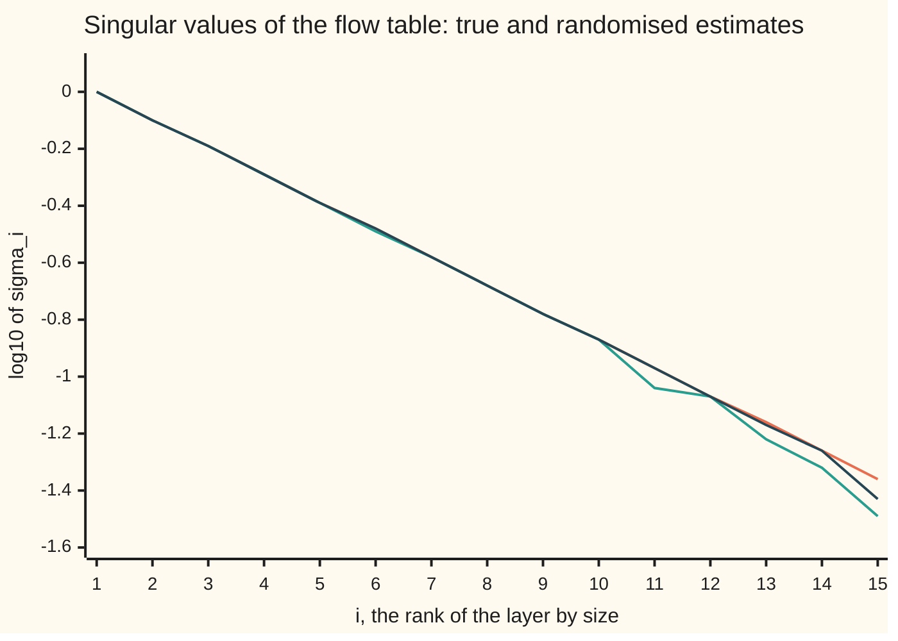

# Randomised SVD: a few random products find the range, then a small SVD finishes

[Syllabus](../../../SYLLABUS.md) → [Numerical analysis](../README.md) → [Numerical Linear Algebra](../README.md#s03) → Randomised SVD

---

## General Overview

A water utility logs the flow in each of its 500 pipes once an hour. After 2,000 hours the log is a table of 2,000 rows and 500 columns: one million numbers. Flows across a network move together. A daily cycle, a weekend pattern and a few big users drive most of the table, so a handful of patterns should describe it.

The tool for "a handful of patterns" is the truncated singular value decomposition (SVD): keep the 10 largest layers of the table (each layer is one pattern times its size) and drop the rest ([Singular value decomposition](08-svd-and-the-pseudoinverse.md) proves no rank-10 table is closer). The catch is cost. A full SVD of this table costs a multiple of $`2000 \times 500^2`$ = 500,000,000 multiplications, and it computes all 500 layers to keep 10.

The randomised SVD multiplies the table by 15 random columns instead. Each product lands mostly in the biggest patterns, because the table stretches those directions most. Fifteen products span the top 10 patterns closely, with 5 spare to catch what leaks. A small SVD of a 15 by 500 matrix finishes the job. The main cost is two products with the table, $`2000 \times 500 \times 15`$ = 15,000,000 multiplications each.

The table on this card is synthetic, so the right answer is known. Its singular values are set to $`0.8^{j-1}`$ for $`j = 1, \dots, 500`$, built into a dense matrix by random mirrors (Householder reflections). The best rank-10 error is 0.178957. The randomised answer has error 0.206934, which is 1.1563 times the best. The theorem on this card promises at most 2.1213 times the best on average, so this run is well inside it. One power step, two more passes over the table, brings the ratio to 1.0000.

**Multiply the table by a few more random vectors than the rank you want, orthonormalise the products to get a basis Q for the table's main directions, then take the SVD of the small matrix Q-transpose times the table: the answer is within a stated factor of the best rank-k fit on average, and power steps push that factor towards 1.**

**What kind of fact this is:** a randomised method with a theorem about its average error. The deterministic error bound and the truncation step are proved on this card in Why it works. The two Gaussian averages that turn it into the factor $`\sqrt{1 + k/(p-1)}`$ are stated with their source (Halko, Martinsson and Tropp, in Sources), not proved. The 200-trial averages are estimates with standard errors.

### The picture: what the 15 products see



Orange: the true $`\log_{10}\sigma_i`$, a straight line because each value is 0.8 times the last. Teal: the estimates from 15 plain products. Dark: the estimates after one power step. The first 10 estimates sit on the true line. The plain sketch drops below it from $`i = 11`$: those directions are only partly caught. The power step pulls them back up as far as $`i = 14`$.

---

## The formula

Notation first, in words. The table is $`A`$, with $`m`$ = 2,000 rows and $`n`$ = 500 columns. Its SVD is $`A = \sum_j \sigma_j u_j v_j^{\mathsf T}`$: singular values $`\sigma_j`$, largest first, with output axes $`u_j`$ and input axes $`v_j`$. The target rank is $`k`$ = 10, the oversampling (spare columns) is $`p`$ = 5, and the sketch width is $`\ell = k + p`$ = 15.

The method, in five lines:

```math
Y = A\,\Omega, \qquad Q = \mathrm{orth}(Y), \qquad B = Q^{\mathsf T}A = \tilde U S Z^{\mathsf T}, \qquad A \approx (Q\tilde U_k)\,S_k\,Z_k^{\mathsf T} = Q B_k
```

**Read it aloud:** multiply the table by a random $`n \times \ell`$ matrix; turn the products into perpendicular unit columns; multiply the table on the left by those columns to get a small $`\ell \times n`$ matrix; take that small matrix's SVD and keep its top $`k`$ layers, lifted back by $`Q`$.

The error guarantee for a Gaussian $`\Omega`$, with $`p \ge 2`$:

```math
\mathbb{E}\,\lVert A - QQ^{\mathsf T}A\rVert_F \le \sqrt{1 + \frac{k}{p-1}}\;\tau_{k+1}, \qquad \mathbb{E}\,\lVert A - QB_k\rVert_F \le \sqrt{2 + \frac{k}{p-1}}\;\tau_{k+1}, \qquad \tau_{k+1} = \sqrt{\sigma_{k+1}^2 + \dots + \sigma_n^2}
```

**Read it aloud:** on average, projecting onto the sketch's directions misses by at most $`\sqrt{1 + k/(p-1)}`$ times the best rank-$`k`$ miss; cutting the answer down to rank $`k`$ costs at most one more best-miss in the square. Here the factors are $`\sqrt{3.5}`$ = 1.8708 and $`\sqrt{4.5}`$ = 2.1213.

With $`q`$ power steps, the products are taken with $`(AA^{\mathsf T})^q A`$ instead of $`A`$, orthonormalising after every product.

| Symbol | Plain meaning | In our example | Push it up and the answer… |
| --- | --- | --- | --- |
| $`A`$, $`m`$, $`n`$ | the flow table; its rows (hours) and columns (pipes) | 2,000 by 500 | more rows or columns: each product costs more, in proportion |
| $`\sigma_j`$, $`u_j`$, $`v_j`$; $`U`$, $`\Sigma`$, $`V`$ | the $`j`$-th singular value and its output and input axes; the same, gathered into matrices | $`\sigma_j = 0.8^{j-1}`$; $`\sigma_{11}`$ = 0.107374 | slower fall: more leaks into the sketch |
| $`k`$, $`A_k`$ | the target rank; the best rank-$`k`$ table, the top $`k`$ SVD layers | 10 | more patterns kept, wider sketch needed |
| $`\tau_{k+1}`$ | the best rank-$`k`$ error, $`\lVert A - A_k\rVert_F`$ | 0.178957 | the yardstick every error is divided by |
| $`p`$, $`\ell`$ | oversampling, the spare columns; sketch width $`k + p`$ | 5; 15 | the bound factor falls: 3.3166, 1.8708, 1.4530, 1.2354 at $`p`$ = 2, 5, 10, 20 |
| $`\Omega`$, $`\omega`$; $`\Psi`$, $`W`$ | the $`n \times \ell`$ test matrix of independent standard normal draws; one fresh test vector; in the single-pass variant, a second random matrix and the second sketch $`\Psi A`$ | 500 by 15 | — |
| $`Y`$, $`Q`$, $`QQ^{\mathsf T}`$, $`\mathrm{orth}`$ | the sketch $`A\Omega`$; perpendicular unit columns spanning it; the projection onto those columns; the step that makes $`Q`$ from $`Y`$ | 2,000 by 15 | — |
| $`B`$, $`B_k`$, $`s_i`$ | the small matrix $`Q^{\mathsf T}A`$; its top $`k`$ SVD layers; its singular values, the estimates of $`\sigma_i`$ | 15 by 500 | — |
| $`\tilde U`$, $`S`$, $`Z`$ | the SVD of $`B`$: output axes, singular values, input axes; subscript $`k`$ keeps the first $`k`$ | $`\tilde U`$ is 15 by 15 | — |
| $`q`$ | the number of power steps | 0 or 1 | the ratio to the best falls towards 1, for two more products each |
| $`\lVert\cdot\rVert_F`$, $`\lVert\cdot\rVert_2`$ | root-sum-square of the entries; largest stretch of a matrix | $`\lVert A\rVert_F^2`$ = 2.7777777778 | — |
| $`\mathbb{E}`$; $`\Sigma_1`$, $`\Sigma_2`$, $`\Omega_1`$, $`\Omega_2`$, $`\Omega_1^{+}`$ | the average over random $`\Omega`$; inside the proof, the top $`k`$ singular values and the rest, $`V^{\mathsf T}\Omega`$ split the same way, and the pseudoinverse of $`\Omega_1`$ | — | — |

### When it holds

- **Gaussian test vectors.** The bound uses two facts about normal draws. Other random matrices (random signs, subsampled Fourier transforms) also work in practice, with weaker or different constants.
- **At least two spare columns, $`p \ge 2`$.** The factor has $`p - 1`$ underneath. With $`p = 0`$, 200 trials average 2.2370 times the best error, and the worst is 3.5399. A square random matrix is sometimes nearly singular, and its inverse then has no finite average size.
- **Singular values that fall, for the answer to be worth having.** The bound is relative to $`\tau_{k+1}`$, so it covers every spectrum. But if the values fall slowly, $`\tau_{k+1}`$ is itself large: even the best rank-$`k`$ table leaves much of $`A`$ unexplained. Power steps also close the gap to the best more slowly, so a slower fall needs more of them (see Try changing).
- **Orthonormalise after every product.** Power steps multiply direction $`j`$ by $`\sigma_j^{2q+1}`$. Without re-orthonormalising, small directions fall below rounding level, and the basis is lost.
- **An average, not a promise for one run.** Any single run can be worse. Here the worst of 200 runs was 1.6431 times the best. The a posteriori check in Step 5 tells you how a given run did.

---

## Why it works

### Step 0: a random product is a vote weighted by size

Multiply the table by one random vector $`\omega`$. In the SVD's axes:

```math
A\omega = \sum_{j} \sigma_j\,(v_j^{\mathsf T}\omega)\,u_j
```

Each $`v_j^{\mathsf T}\omega`$ is a random number of typical size 1. So the product is a mix of all output axes, each weighted by its singular value. Here $`\sigma_1`$ = 1 and $`\sigma_{11}`$ = 0.107374: the top directions dominate every product. Fifteen products give fifteen such mixes. Between them they span the top 10 directions almost exactly, plus a little of the rest.

So the hard question, "which directions matter?", is answered by 15 products. Everything after that works on small matrices.

### Step 1: from the sketch to an SVD

1. **Sketch.** $`Y = A\Omega`$, 2,000 by 15. This is 15,000,000 multiplications.
2. **Orthonormalise.** $`Q`$ = perpendicular unit columns spanning $`Y`$. The code uses modified Gram–Schmidt run twice per column; Householder QR also works ([QR](05-qr-householder-and-gram-schmidt.md)).
3. **Shrink.** $`B = Q^{\mathsf T}A`$, 15 by 500. Another 15,000,000 multiplications.
4. **Small SVD.** $`B = \tilde U S Z^{\mathsf T}`$. The code takes the eigenvalues and eigenvectors of the 15 by 15 matrix $`BB^{\mathsf T}`$ by Jacobi rotations: it rotates one pair of coordinates at a time until every off-diagonal entry is zero. Forming $`BB^{\mathsf T}`$ squares the spread of the singular values, which is harmless here because all 15 lie between $`10^{-1.49}`$ and 1, as the chart shows; a one-sided Jacobi SVD of $`B`$, as on [Singular value decomposition](08-svd-and-the-pseudoinverse.md), avoids the squaring.
5. **Lift.** The rank-$`k`$ answer is $`(Q\tilde U_k)S_k Z_k^{\mathsf T}`$, which equals $`QB_k`$.

### Step 2: inside the sketch's span, the small SVD is optimal

Two facts make the last step safe.

- **The error splits in two.** $`A - QB_k = (A - QQ^{\mathsf T}A) + Q(B - B_k)`$. The first part is perpendicular to every column of $`Q`$. The second lies inside them. So the squares add:

```math
\lVert A - QB_k\rVert_F^2 = \lVert A - QQ^{\mathsf T}A\rVert_F^2 + \lVert B - B_k\rVert_F^2
```

- **The second part is no worse than the best.** $`B = Q^{\mathsf T}A`$, and multiplying by $`Q^{\mathsf T}`$ never stretches a vector. So each $`s_i \le \sigma_i`$, and $`\lVert B - B_k\rVert_F \le \tau_{k+1}`$.

Together: $`\lVert A - QB_k\rVert_F^2 \le \lVert A - QQ^{\mathsf T}A\rVert_F^2 + \tau_{k+1}^2`$. Also, $`QB_k`$ has rank $`k`$, so Eckart–Young (no rank-$`k`$ table beats the truncated SVD) says its error is at least $`\tau_{k+1}`$. Every trial in the checks lands at or above the best.

The check measures the first fact two ways on the dense table. The identity gives 0.206934. Summing the squares of all 1,000,000 entries of $`A - QB_{10}`$ also gives 0.206934.

<details>
<summary>Detailed proof: the Pythagoras split and s_i ≤ σ_i</summary>

**Split.** $`Q^{\mathsf T}(A - QQ^{\mathsf T}A) = Q^{\mathsf T}A - Q^{\mathsf T}A = 0`$, because $`Q^{\mathsf T}Q = I`$. So every column of $`A - QQ^{\mathsf T}A`$ is perpendicular to every column of $`Q(B - B_k)`$. For perpendicular columns, squared lengths add, column by column. Summing over columns gives the Frobenius identity. Also $`\lVert Q(B - B_k)\rVert_F = \lVert B - B_k\rVert_F`$, because $`Q`$ keeps lengths.

**Singular values shrink.** By the minimax characterisation, $`s_i(B)`$ is the smallest $`\lVert B - C\rVert_2`$ over $`C`$ of rank below $`i`$ (proved on [Singular value decomposition](08-svd-and-the-pseudoinverse.md)). Take $`C = Q^{\mathsf T}A_{i-1}`$. Then $`\lVert B - C\rVert_2 = \lVert Q^{\mathsf T}(A - A_{i-1})\rVert_2 \le \lVert A - A_{i-1}\rVert_2 = \sigma_i`$. So $`s_i \le \sigma_i`$, and squaring and summing over $`i > k`$ gives $`\lVert B - B_k\rVert_F^2 \le \tau_{k+1}^2`$.

**Best inside the span.** Any rank-$`k`$ table with columns in the span of $`Q`$ is $`QC`$ with $`C`$ of rank $`k`$. Its error is $`\lVert A - QQ^{\mathsf T}A\rVert_F^2 + \lVert B - C\rVert_F^2`$ by the same split, and Eckart–Young on $`B`$ makes $`C = B_k`$ the smallest.

</details>

### Step 3: why spare columns, and where the bound comes from

Split the SVD axes into the top $`k`$ and the rest. Write $`\Omega_1`$ for the $`k \times \ell`$ part of $`V^{\mathsf T}\Omega`$ along the top axes, and $`\Omega_2`$ for the rest. Then the sketch error obeys a fixed inequality, with no chance in it:

```math
\lVert A - QQ^{\mathsf T}A\rVert_F^2 \le \tau_{k+1}^2 + \lVert \Sigma_2\,\Omega_2\,\Omega_1^{+}\rVert_F^2
```

Here $`\Omega_1^{+}`$ is the pseudoinverse of $`\Omega_1`$. In words: the sketch misses the tail, which nobody can avoid, plus the tail's leak into the sketch, divided by how well the sketch covers the top directions.

Spare columns shrink the leak. $`\Omega_1`$ is $`k \times (k+p)`$. With $`p = 0`$ it is square, and a square random matrix is sometimes close to singular, so $`\Omega_1^{+}`$ is huge. A wide one almost never is.

Two Gaussian facts finish the bound (Halko, Martinsson and Tropp, Propositions 10.1 and 10.2, in Sources):

- $`\Omega_1`$ and $`\Omega_2`$ are independent standard normal matrices, because $`V`$ is a rotation and normal draws look the same in any rotated axes.
- The average of $`\lVert \Omega_1^{+}\rVert_F^2`$ is $`k/(p-1)`$ for $`p \ge 2`$, and infinite for $`p = 0`$ or 1.

So the average squared sketch error is at most $`(1 + k/(p-1))\,\tau_{k+1}^2`$. Its square root gives the first bound in The formula, because the average of an error is at most the square root of the average of its square. Adding Step 2's extra $`\tau_{k+1}^2`$ under the root gives the second.

<details>
<summary>Detailed proof: the inequality with no chance in it</summary>

Write the thin SVD $`A = U\Sigma V^{\mathsf T}`$ with $`U`$ of size $`m \times n`$. Split $`V = [V_1\ V_2]`$ into the top $`k`$ input axes and the rest, $`\Sigma = \mathrm{diag}(\Sigma_1, \Sigma_2)`$, $`\Omega_1 = V_1^{\mathsf T}\Omega`$ and $`\Omega_2 = V_2^{\mathsf T}\Omega`$. Assume $`\Omega_1`$ has full row rank, so $`\Omega_1\Omega_1^{+} = I`$.

$`QQ^{\mathsf T}A`$ is the closest matrix to $`A`$ whose columns lie in the span of $`Y`$. So its error is at most that of any such matrix. Take $`X = Y\,\Omega_1^{+}V_1^{\mathsf T}`$. Since $`Y = U\Sigma V^{\mathsf T}\Omega`$, stacking the two blocks:

$`\displaystyle X = U\begin{bmatrix}\Sigma_1\Omega_1\Omega_1^{+}V_1^{\mathsf T} \\ \Sigma_2\Omega_2\Omega_1^{+}V_1^{\mathsf T}\end{bmatrix} = U\begin{bmatrix}\Sigma_1 V_1^{\mathsf T} \\ \Sigma_2\Omega_2\Omega_1^{+}V_1^{\mathsf T}\end{bmatrix}, \qquad A = U\begin{bmatrix}\Sigma_1 V_1^{\mathsf T} \\ \Sigma_2 V_2^{\mathsf T}\end{bmatrix}`$

So $`A - X = U\,[\,0\,;\ \Sigma_2 V_2^{\mathsf T} - \Sigma_2\Omega_2\Omega_1^{+}V_1^{\mathsf T}\,]`$. The rows of $`V_2^{\mathsf T}`$ are perpendicular to the rows of $`V_1^{\mathsf T}`$, so the two terms are perpendicular and their squares add:

$`\displaystyle \lVert A - X\rVert_F^2 = \lVert \Sigma_2\rVert_F^2 + \lVert \Sigma_2\Omega_2\Omega_1^{+}\rVert_F^2 = \tau_{k+1}^2 + \lVert \Sigma_2\Omega_2\Omega_1^{+}\rVert_F^2.`$

For the average over $`\Omega_2`$ with $`\Omega_1`$ fixed: each entry of $`\Sigma_2\Omega_2 M`$ is a sum of independent normal draws, so $`\mathbb{E}\,\lVert\Sigma_2\Omega_2 M\rVert_F^2 = \lVert\Sigma_2\rVert_F^2\,\lVert M\rVert_F^2`$. With $`M = \Omega_1^{+}`$, this is where $`\mathbb{E}\,\lVert\Omega_1^{+}\rVert_F^2 = k/(p-1)`$ enters. That last value is the mean of an inverse Wishart matrix (the inverse of $`\Omega_1\Omega_1^{\mathsf T}`$, whose trace is $`\lVert\Omega_1^{+}\rVert_F^2`$), stated here, not proved.

</details>

The 200 trials on this table, each with a fresh $`\Omega`$:

| Sketch | Mean ratio to the best | Standard error | Worst of 200 | Bound |
| --- | --- | --- | --- | --- |
| rank-15 projection, $`p = 5`$ | 0.9090 | 0.0100 | 1.4822 | 1.8708 |
| rank-10 answer, $`p = 5`$ | 1.2425 | 0.0069 | 1.6431 | 2.1213 |
| rank-10 answer, $`p = 0`$ | 2.2370 | 0.0223 | 3.5399 | none |

The bound holds with room to spare; it covers every spectrum.

### Step 4: power steps sharpen the fall

The leak term in Step 3 is the tail's singular values against the top ones. To shrink it, sketch a matrix with the same axes but a faster fall. $`(AA^{\mathsf T})^q A`$ has the same $`u_j`$ and $`v_j`$ as $`A`$, with singular values $`\sigma_j^{2q+1}`$. One power step cubes them: the ratio $`\sigma_{11}/\sigma_1`$ = 0.107374 becomes its cube, and the tail's leak becomes negligible.

The cost is two more products per step: 60,000,000 multiplications instead of 30,000,000. On this table one step gives:

- one run: rank-10 error 0.178965, ratio 1.0000;
- 200 runs: mean ratio 1.0004 (standard error 0.0001), worst 1.0053.

The products must be re-orthonormalised after each multiplication: $`Q \leftarrow \mathrm{orth}(A\,\mathrm{orth}(A^{\mathsf T}Q))`$. Without that, the columns all turn towards $`u_1`$, and rounding erases the rest. After 12 steps with no re-orthonormalising, two columns of the computed $`Q`$ overlap by 0.9990 instead of 0, and the formula for the squared error returns $`-0.9939`$: a negative square, so nonsense.

This is the same subspace iteration as the power method for eigenvalues, started from a random block ([Eigenvalues by iteration](07-eigenvalues-power-iteration-and-the-qr-algorithm.md)). The random start is what makes one or two steps enough.

### Step 5: how good was this run? The a posteriori check

The bound is an average. For the run in hand, test it with fresh random vectors. For a standard normal $`\omega`$, the average of $`\lVert M\omega\rVert^2`$ is exactly $`\lVert M\rVert_F^2`$, for any matrix $`M`$. So with $`M = A - QQ^{\mathsf T}A`$ and 10 fresh vectors:

- **Estimate.** The root-mean-square of $`\lVert (A - QQ^{\mathsf T}A)\,\omega_i\rVert`$ is 0.134091. The true error is 0.142543. The ratio is 0.9407. This is an estimate, not a bound: it can land on either side.
- **Bound.** Halko, Martinsson and Tropp (Lemma 4.1) prove $`\lVert A - QQ^{\mathsf T}A\rVert_2 \le 10\sqrt{2/\pi}\,\max_i \lVert (A - QQ^{\mathsf T}A)\,\omega_i\rVert`$, failing with probability at most $`10^{-10}`$ for 10 vectors. Here that gives 1.542227 against a true 0.101997, 15.12 times too high. Safe, but loose.

Each test vector costs one product with $`A`$, and it reuses no randomness from the sketch.

### Step 6: the cost, and one pass over the data

| Route | Products with $`A`$ or $`A^{\mathsf T}`$ | Multiplications in them |
| --- | --- | --- |
| randomised, $`q = 0`$ | 2 | 30,000,000 |
| randomised, $`q = 1`$ | 4 | 60,000,000 |
| dense SVD, leading term $`mn^2`$ | — | 500,000,000 |

The plain randomised route does 16.7 times fewer multiplications than the dense SVD's leading term alone ([Counting the work](../01-Floating%20Point%20and%20Error/08-operation-counts-and-cost.md)). The rest is small: orthonormalising 15 columns of length 2,000 and an SVD of a 15 by 500 matrix.

The table is read in whole passes, two for $`q = 0`$. When it lives on disk or arrives as a stream, a **single-pass** variant (Tropp and co-authors, in Sources) sketches both sides at once: $`Y = A\Omega`$ and $`W = \Psi A`$ for a second random $`\Psi`$. It then solves $`(\Psi Q)B \approx W`$ for $`B`$ without reading $`A`$ again. Each streamed row updates $`Y`$ and $`W`$ and is thrown away. The price is a larger error for the same sketch size.

The same "a random map keeps the important geometry" idea, applied to distances between points, is the Johnson–Lindenstrauss lemma ([Random projection](../../24-Computability%20and%20complexity/06-Data%2C%20Learning%20and%20Fine-Grained%20Complexity/02-dimension-reduction-and-random-projection.md)).

---

## Worked numbers, by hand

From the singular values $`\sigma_j = 0.8^{j-1}`$ and the run printed by the checks:

| Step | Arithmetic | Value |
| --- | --- | --- |
| size of the whole table | $`\lVert A\rVert_F^2 = 1 + 0.64 + 0.64^2 + \dots = 1/(1 - 0.64)`$ | 2.7777777778 |
| $`\sigma_{11}`$ | $`0.8^{10}`$ | 0.107374 |
| best rank-10 error | $`\tau_{11} = 0.8^{10}/\sqrt{1 - 0.64} = 0.107374/0.6`$ | 0.178957 |
| bound factor, rank-15 projection | $`\sqrt{1 + 10/4} = \sqrt{3.5}`$ | 1.8708 |
| bound on its average error | $`1.8708 \times 0.178957`$ | 0.334798 |
| bound factor, rank-10 answer | $`\sqrt{2 + 10/4} = \sqrt{4.5}`$ | 2.1213 |
| bound on its average error | $`2.1213 \times 0.178957`$ | 0.379625 |
| this run, rank-15 projection | error 0.142543, over 0.178957 | 0.7965 |
| this run, rank-10 answer | error 0.206934, over 0.178957 | **1.1563** |
| with one power step | error 0.178965, over 0.178957 | 1.0000 |
| one product | $`2000 \times 500 \times 15`$ | 15,000,000 multiplications |
| against the dense leading term | $`2000 \times 500^2 / 30{,}000{,}000`$ | 16.7 |

So 30,000,000 multiplications give a 10-pattern summary of the flow table whose error is 1.1563 times the smallest possible. Another 30,000,000 bring it to the best possible, to four digits. In the table's own terms, the summary misses by 12.4% of the table's size, $`\lVert A\rVert_F`$ = 1.666667, where the best possible misses by 10.7%.

### What breaks if you drop a piece

| Mistake | Comes out at | What went wrong |
| --- | --- | --- |
| No oversampling, $`p = 0`$ | mean ratio 2.2370 over 200 trials, worst 3.5399 | the 10 by 10 matrix $`\Omega_1`$ is sometimes nearly singular, and the bound's factor is infinite |
| Keep the first 10 columns of $`Q`$, skip the small SVD | error 0.358357, ratio 2.0025 | $`Q`$'s columns come in the order of the random products, not by size; the SVD of $`B`$ finds the best 10 directions inside the sketch |
| Report the rank-15 projection as the rank-10 answer | ratio 0.7965, "better than the best" | $`QQ^{\mathsf T}A`$ has rank 15; no rank-10 table can beat 1 |
| Power steps with no re-orthonormalising, $`q = 12`$ | columns overlap by 0.9990; squared error $`-0.9939`$ | every column turns towards $`u_1`$, and rounding erases the other directions |

The broken hypotheses are the oversampling and the orthonormalising: drop either and the guarantee is gone.

---

## Code, from first principles, and it actually runs

The code builds the dense table from its singular values and four random mirrors, so the best answer is known exactly. It takes **three independent roads**. Road one runs the randomised SVD on the dense table and measures the error twice: by the Pythagoras identity and by summing every residual entry. Road two runs the same sketch in the table's own singular axes, where it must give the same error, and does. Road three runs 200 fresh sketches per setting against the bound and the known best error. Normal draws come from SplitMix64 and Box–Muller ([Rejection sampling and Box-Muller](../../09-Probability%20and%20statistics/11-Simulation/03-rejection-sampling-and-box-muller.md)), seed 2026.

### Python

```python
# Randomised SVD and the range finder -- the check behind the card.  Standard library only.
# A 2,000 by 500 matrix with singular values 0.8^(j-1), built from mirrors so it is dense.
# Road one: the randomised SVD on the dense matrix, its error by the Pythagoras identity
# and by summing every entry of the residual.  Road two: the same run in the matrix's own
# singular axes, where a Gaussian sketch has the same law.  Road three: 200 trials against
# the Halko-Martinsson-Tropp bound and the known best error from Eckart-Young.
from math import sqrt, log, log10, cos, pi

S, MASK = [2026], 2**64 - 1
def nxt():                                   # SplitMix64, seed 2026
    S[0] = (S[0] + 0x9E3779B97F4A7C15) & MASK; z = S[0]
    z = ((z ^ (z >> 30)) * 0xBF58476D1CE4E5B9) & MASK
    z = ((z ^ (z >> 27)) * 0x94D049BB133111EB) & MASK
    return z ^ (z >> 31)
def unif(): return ((nxt() >> 11) + 0.5) * 2.0**-53
def gauss(): return sqrt(-2.0 * log(unif())) * cos(2.0 * pi * unif())   # Box-Muller
def tsum(xs):                                 # plain left-to-right sum (built-in sum compensates)
    s = 0.0
    for x in xs: s += x
    return s
def dot(x, y):                               # plain left-to-right sum, as in the Rust
    s = 0.0
    for a, b in zip(x, y): s += a * b
    return s
def mirror(x, v, vv): c = 2.0 * dot(x, v) / vv; return [a - c * b for a, b in zip(x, v)]
def orth(Y):                                 # modified Gram-Schmidt, run twice per column
    Q = []
    for y in Y:
        w = list(y)
        for _ in range(2):
            for q in Q: c = dot(q, w); w = [a - c * b for a, b in zip(w, q)]
        r = sqrt(dot(w, w)); Q.append([a / r for a in w])
    return Q
def jeig(G):                                 # Jacobi eigenvalues and vectors of a small symmetric G
    n = len(G); G = [r[:] for r in G]; W = [[float(i == j) for j in range(n)] for i in range(n)]
    for _ in range(30):
        if tsum(G[i][j] * G[i][j] for i in range(n) for j in range(n) if i != j) < 1e-32: break
        for p in range(n - 1):
            for q in range(p + 1, n):
                if abs(G[p][q]) < 1e-300: continue
                th = (G[q][q] - G[p][p]) / (2 * G[p][q])
                t = (1.0 if th >= 0 else -1.0) / (abs(th) + sqrt(1 + th * th)); c = 1 / sqrt(1 + t * t); s = c * t
                for M in (G, W):
                    for r in M: a, b = r[p], r[q]; r[p] = c * a - s * b; r[q] = s * a + c * b
                G[p], G[q] = [c * a - s * b for a, b in zip(G[p], G[q])], [s * a + c * b for a, b in zip(G[p], G[q])]
    o = sorted(range(n), key=lambda i: -G[i][i])
    return [G[i][i] for i in o], [[W[r][i] for r in range(n)] for i in o]
def rsvd(mul, mult, Om, q):                  # range finder, q power steps, then the small SVD
    Q = orth(mul(Om))
    for _ in range(q): Q = orth(mul(orth(mult(Q))))
    B = mult(Q)                              # rows of B = Q^T A, each n long
    ev, W = jeig([[dot(x, y) for y in B] for x in B])
    return Q, B, ev, W

m, n, k, p = 2000, 500, 10, 5; l = k + p
sig = [0.8**j for j in range(n)]
tot = tsum(s * s for s in sig); best = sqrt(tsum(s * s for s in sig[k:]))
vU = [[gauss() for _ in range(m)] for _ in range(2)]; vV = [[gauss() for _ in range(n)] for _ in range(2)]
def VT(x):                                   # V^T x, with V = H1 H2 (two mirrors in R^500)
    for v in vV: x = mirror(x, v, dot(v, v))
    return x
cols = []
for j in range(n):                           # column j of A = U [Sigma; 0] V^T, U = G1 G2 in R^2000
    c = [s * vt for s, vt in zip(sig, VT([float(i == j) for i in range(n)]))] + [0.0] * (m - n)
    for v in reversed(vU): c = mirror(c, v, dot(v, v))
    cols.append(c)
rows = [list(r) for r in zip(*cols)]
fro2 = tsum(dot(r, r) for r in rows)
print(f"A: {m} x {n}, sigma_j = 0.8^(j-1); ||A||_F^2 from entries {fro2:.10f}, from sigmas {tot:.10f}")
print(f"best rank-{k} error: Frobenius {best:.6f} = {100 * best / sqrt(tot):.1f}% of ||A||_F {sqrt(tot):.6f}, spectral sigma_11 {sig[k]:.6f}")
print("bound factor sqrt(1 + k/(p-1)) for p = 2, 5, 10, 20: " + " ".join(f"{sqrt(1 + k / (pp - 1)):.4f}" for pp in (2, 5, 10, 20)))
print(f"expected-error bounds at p = {p}: rank-{l} projection {sqrt(1 + k / (p - 1)) * best:.6f}, rank-{k} answer {sqrt(2 + k / (p - 1)) * best:.6f} (factor {sqrt(2 + k / (p - 1)):.4f})")
assert abs(fro2 - tot) < 1e-10 * tot

dmul = lambda X: [[dot(r, x) for r in rows] for x in X]
dmult = lambda X: [[dot(c, x) for c in cols] for x in X]
fmul = lambda X: [[s * a for s, a in zip(sig, x)] for x in X]          # A in its own axes: Sigma
Om = [[gauss() for _ in range(n)] for _ in range(l)]
res = {}
for q in (0, 1):
    Q, B, ev, W = rsvd(dmul, dmult, Om, q)
    proj, trunc = sqrt(tot - tsum(ev)), sqrt(tot - tsum(ev[:k]))
    _, _, evf, _ = rsvd(fmul, fmul, [VT(w) for w in Om], q)
    res[q] = (Q, B, ev, W, trunc)
    print(f"q = {q}: {2 + 2 * q} products with A or A^T, m n l = {m * n * l} multiplications each, {(2 + 2 * q) * m * n * l} in all")
    print(f"q = {q}: error of QQ^T A (rank {l}) {proj:.6f}, ratio to best {proj / best:.4f}; rank-{k} error {trunc:.6f}, ratio {trunc / best:.4f}, {100 * trunc / sqrt(tot):.1f}% of ||A||_F")
    print(f"q = {q}: same sketch in the singular axes, rank-{k} error {sqrt(tot - tsum(evf[:k])):.6f}")
    print(f"q = {q}: log10 of estimated sigma_1..15: " + " ".join(f"{log10(sqrt(e)):.2f}" for e in ev))
    assert abs(sqrt(tot - tsum(evf[:k])) - trunc) < 1e-10 and trunc >= best * (1 - 1e-12)
print("true log10 sigma_1..15: " + " ".join(f"{log10(s):.2f}" for s in sig[:l]))
print(f"cost: m n^2 = {m * n * n}, a dense SVD's leading term; ratio to the q = 0 products {m * n * n / (2 * m * n * l):.1f}")

Q, B, ev, W, trunc = res[0]                  # road one, second half: sum every residual entry
Uk = [[dot(w, [qq[r] for qq in Q]) for w in W[:k]] for r in range(m)]
Ck = [[dot(w, [b[j] for b in B]) for j in range(n)] for w in W[:k]]
direct = 0.0
for r in range(m):
    a = rows[r][:]
    for t in range(k): ct = Uk[r][t]; a = [x - ct * y for x, y in zip(a, Ck[t])]
    direct += dot(a, a)
print(f"rank-{k} error by summing all {m * n} residual entries {sqrt(direct):.6f}; Pythagoras identity {trunc:.6f}")
assert abs(sqrt(direct) - trunc) < 1e-9
e10 = sqrt(tot - tsum(dot(b, b) for b in B[:k]))   # keep Q's first k columns, skip the small SVD
print(f"first {k} columns of Q, no small SVD: error {e10:.6f}, ratio {e10 / best:.4f}")

Qf, Bf, evf, _ = rsvd(fmul, fmul, [VT(w) for w in Om], 0)   # a posteriori estimate, 10 fresh vectors
def resid(x):                                # (I - Q Q^T) Sigma x
    y = [s * a for s, a in zip(sig, x)]
    for qq in Qf: c = dot(qq, y); y = [a - c * b for a, b in zip(y, qq)]
    return y
tests = [sqrt(dot(y, y)) for y in (resid([gauss() for _ in range(n)]) for _ in range(10))]
estF, bound2 = sqrt(tsum(t * t for t in tests) / 10), 10 * sqrt(2 / pi) * max(tests)
x = [1.0] * n
for _ in range(300):                         # true spectral error by power iteration
    y = resid(x); z = [s * a for s, a in zip(sig, y)]; nz = sqrt(dot(z, z)); x = [a / nz for a in z]
true2, trueF = sqrt(dot(resid(x), resid(x))), sqrt(tot - tsum(evf))
print(f"a posteriori, 10 test vectors: Frobenius estimate {estF:.6f} vs true {trueF:.6f}, ratio {estF / trueF:.4f}")
print(f"a posteriori, spectral: bound 10 sqrt(2/pi) max {bound2:.6f} vs true {true2:.6f}, ratio {bound2 / true2:.2f}")
assert 0.5 < estF / trueF < 2.0 and bound2 >= true2

def trial(ll, q):                            # one fresh sketch, in the singular axes
    _, _, e, _ = rsvd(fmul, fmul, [[gauss() for _ in range(n)] for _ in range(ll)], q)
    return sqrt(max(tot - tsum(e), 0.0)) / best, sqrt(max(tot - tsum(e[:k]), 0.0)) / best
T = 200
for ll, q in ((l, 0), (l, 1), (k, 0)):
    rs = [trial(ll, q) for _ in range(T)]
    for i, name in ((0, f"rank-{ll} projection"), (1, f"rank-{k} answer"))[ll == k:]:
        v = [r[i] for r in rs]; mu = tsum(v) / T; se = sqrt(tsum((a - mu) * (a - mu) for a in v) / (T - 1) / T)
        print(f"{T} trials, l = {ll}, q = {q}, {name}: mean ratio {mu:.4f} (se {se:.4f}), worst {max(v):.4f}")
        if ll == l and q == 0: assert mu + 3 * se <= sqrt(1 + k / (p - 1) + i)   # sqrt(3.5), then sqrt(4.5)
        if q == 1 and i == 1: assert abs(mu - 1.0) < 0.01
    assert min(r[1] for r in rs) >= 1 - 1e-12

qq = 12                                      # power steps with no orthonormalising in between
Yb = [[s**(2 * qq + 1) * a for s, a in zip(sig, w)] for w in (VT(w) for w in Om)]
Qb = orth(Yb); Bb = fmul(Qb)
lost = max(abs(dot(a, b) - (i == j)) for i, a in enumerate(Qb) for j, b in enumerate(Qb))
print(f"break, q = {qq} with no re-orthonormalising: loss of orthogonality {lost:.4f}; ||A||_F^2 - ||B||_F^2 = {tot - tsum(dot(b, b) for b in Bb):.4f}")
assert lost > 0.1
print("ALL CHECKS PASS")
```

**Ran 2026-11-24 on macOS, Python 3.14.10, standard library only. All checks passed. Output, pasted from the run:**

```
A: 2000 x 500, sigma_j = 0.8^(j-1); ||A||_F^2 from entries 2.7777777778, from sigmas 2.7777777778
best rank-10 error: Frobenius 0.178957 = 10.7% of ||A||_F 1.666667, spectral sigma_11 0.107374
bound factor sqrt(1 + k/(p-1)) for p = 2, 5, 10, 20: 3.3166 1.8708 1.4530 1.2354
expected-error bounds at p = 5: rank-15 projection 0.334798, rank-10 answer 0.379625 (factor 2.1213)
q = 0: 2 products with A or A^T, m n l = 15000000 multiplications each, 30000000 in all
q = 0: error of QQ^T A (rank 15) 0.142543, ratio to best 0.7965; rank-10 error 0.206934, ratio 1.1563, 12.4% of ||A||_F
q = 0: same sketch in the singular axes, rank-10 error 0.206934
q = 0: log10 of estimated sigma_1..15: -0.00 -0.10 -0.19 -0.29 -0.39 -0.49 -0.58 -0.68 -0.78 -0.87 -1.04 -1.07 -1.22 -1.32 -1.49
q = 1: 4 products with A or A^T, m n l = 15000000 multiplications each, 60000000 in all
q = 1: error of QQ^T A (rank 15) 0.064934, ratio to best 0.3628; rank-10 error 0.178965, ratio 1.0000, 10.7% of ||A||_F
q = 1: same sketch in the singular axes, rank-10 error 0.178965
q = 1: log10 of estimated sigma_1..15: -0.00 -0.10 -0.19 -0.29 -0.39 -0.48 -0.58 -0.68 -0.78 -0.87 -0.97 -1.07 -1.17 -1.26 -1.43
true log10 sigma_1..15: 0.00 -0.10 -0.19 -0.29 -0.39 -0.48 -0.58 -0.68 -0.78 -0.87 -0.97 -1.07 -1.16 -1.26 -1.36
cost: m n^2 = 500000000, a dense SVD's leading term; ratio to the q = 0 products 16.7
rank-10 error by summing all 1000000 residual entries 0.206934; Pythagoras identity 0.206934
first 10 columns of Q, no small SVD: error 0.358357, ratio 2.0025
a posteriori, 10 test vectors: Frobenius estimate 0.134091 vs true 0.142543, ratio 0.9407
a posteriori, spectral: bound 10 sqrt(2/pi) max 1.542227 vs true 0.101997, ratio 15.12
200 trials, l = 15, q = 0, rank-15 projection: mean ratio 0.9090 (se 0.0100), worst 1.4822
200 trials, l = 15, q = 0, rank-10 answer: mean ratio 1.2425 (se 0.0069), worst 1.6431
200 trials, l = 15, q = 1, rank-15 projection: mean ratio 0.3720 (se 0.0020), worst 0.4763
200 trials, l = 15, q = 1, rank-10 answer: mean ratio 1.0004 (se 0.0001), worst 1.0053
200 trials, l = 10, q = 0, rank-10 answer: mean ratio 2.2370 (se 0.0223), worst 3.5399
break, q = 12 with no re-orthonormalising: loss of orthogonality 0.9990; ||A||_F^2 - ||B||_F^2 = -0.9939
ALL CHECKS PASS
```

### Rust

Same rows and labels; the two outputs agree line for line.

```rust
// Randomised SVD and the range finder -- the same check as the Python, in Rust.  No crates.
// A dense 2,000 by 500 matrix, singular values 0.8^(j-1).  Roads: the dense run (error by
// identity and by every residual entry), the same sketch in the singular axes, and 200 trials.
use std::f64::consts::PI;
type M = Vec<Vec<f64>>;

struct Rng(u64);
impl Rng {
    fn next(&mut self) -> u64 {                      // SplitMix64, seed 2026
        self.0 = self.0.wrapping_add(0x9E3779B97F4A7C15); let mut z = self.0;
        z = (z ^ (z >> 30)).wrapping_mul(0xBF58476D1CE4E5B9);
        z = (z ^ (z >> 27)).wrapping_mul(0x94D049BB133111EB);
        z ^ (z >> 31)
    }
    fn unif(&mut self) -> f64 { ((self.next() >> 11) as f64 + 0.5) * 2f64.powi(-53) }
    fn gauss(&mut self) -> f64 { let a = self.unif(); let b = self.unif(); (-2.0 * a.ln()).sqrt() * (2.0 * PI * b).cos() }
    fn vec(&mut self, n: usize) -> Vec<f64> { (0..n).map(|_| self.gauss()).collect() }
}
fn tsum<I: Iterator<Item = f64>>(xs: I) -> f64 { let mut s = 0.0; for x in xs { s += x; } s }
fn dot(x: &[f64], y: &[f64]) -> f64 { let mut s = 0.0; for (a, b) in x.iter().zip(y) { s += a * b; } s }
fn axpy(w: &[f64], c: f64, q: &[f64]) -> Vec<f64> { w.iter().zip(q).map(|(a, b)| a - c * b).collect() }
fn mirror(x: &[f64], v: &[f64], vv: f64) -> Vec<f64> { let c = 2.0 * dot(x, v) / vv; axpy(x, c, v) }
fn orth(y: &M) -> M {                                // modified Gram-Schmidt, run twice per column
    let mut q: M = Vec::new();
    for col in y {
        let mut w = col.clone();
        for _ in 0..2 { for qq in &q { let c = dot(qq, &w); w = axpy(&w, c, qq); } }
        let r = dot(&w, &w).sqrt(); q.push(w.iter().map(|a| a / r).collect());
    }
    q
}
fn jeig(g0: &M) -> (Vec<f64>, M) {                  // Jacobi eigenvalues and vectors of a small symmetric G
    let n = g0.len(); let mut g = g0.clone();
    let mut w: M = (0..n).map(|i| (0..n).map(|j| if i == j { 1.0 } else { 0.0 }).collect()).collect();
    for _ in 0..30 {
        let off = tsum((0..n).flat_map(|i| (0..n).map(move |j| (i, j))).filter(|&(i, j)| i != j).map(|(i, j)| g[i][j] * g[i][j]));
        if off < 1e-32 { break; }
        for p in 0..n - 1 {
            for q in p + 1..n {
                if g[p][q].abs() < 1e-300 { continue; }
                let th = (g[q][q] - g[p][p]) / (2.0 * g[p][q]);
                let t = (if th >= 0.0 { 1.0 } else { -1.0 }) / (th.abs() + (1.0 + th * th).sqrt()); let c = 1.0 / (1.0 + t * t).sqrt(); let s = c * t;
                for mm in [&mut g, &mut w] {
                    for r in mm.iter_mut() { let (a, b) = (r[p], r[q]); r[p] = c * a - s * b; r[q] = s * a + c * b; }
                }
                let (gp, gq) = (g[p].clone(), g[q].clone());
                g[p] = gp.iter().zip(&gq).map(|(a, b)| c * a - s * b).collect();
                g[q] = gp.iter().zip(&gq).map(|(a, b)| s * a + c * b).collect();
            }
        }
    }
    let mut o: Vec<usize> = (0..n).collect();
    o.sort_by(|&i, &j| g[j][j].partial_cmp(&g[i][i]).unwrap());
    (o.iter().map(|&i| g[i][i]).collect(), o.iter().map(|&i| (0..n).map(|r| w[r][i]).collect()).collect())
}
fn rsvd(mul: &dyn Fn(&M) -> M, mult: &dyn Fn(&M) -> M, om: &M, q: usize) -> (M, M, Vec<f64>, M) {
    let mut qm = orth(&mul(om));                     // range finder, q power steps, then the small SVD
    for _ in 0..q { qm = orth(&mul(&orth(&mult(&qm)))); }
    let b = mult(&qm);                               // rows of B = Q^T A, each n long
    let (ev, w) = jeig(&b.iter().map(|x| b.iter().map(|y| dot(x, y)).collect()).collect());
    (qm, b, ev, w)
}
fn tail(tot: f64, e: &[f64]) -> f64 { (tot - tsum(e.iter().cloned())).max(0.0).sqrt() }

fn main() {
    let mut rng = Rng(2026);
    let (m, n, k, p) = (2000usize, 500usize, 10usize, 5usize); let l = k + p;
    let sig: Vec<f64> = (0..n).map(|j| 0.8f64.powf(j as f64)).collect();
    let tot = tsum(sig.iter().map(|s| s * s)); let best = tsum(sig[k..].iter().map(|s| s * s)).sqrt();
    let vu: M = (0..2).map(|_| rng.vec(m)).collect(); let vv: M = (0..2).map(|_| rng.vec(n)).collect();
    let vt = |x: &[f64]| -> Vec<f64> { let mut x = x.to_vec(); for v in &vv { x = mirror(&x, v, dot(v, v)); } x };
    let mut cols: M = Vec::new();
    for j in 0..n {                                  // column j of A = U [Sigma; 0] V^T, U = G1 G2 in R^2000
        let e: Vec<f64> = (0..n).map(|i| if i == j { 1.0 } else { 0.0 }).collect();
        let mut c: Vec<f64> = sig.iter().zip(vt(&e)).map(|(s, x)| s * x).collect(); c.resize(m, 0.0);
        for v in vu.iter().rev() { c = mirror(&c, v, dot(v, v)); }
        cols.push(c);
    }
    let rows: M = (0..m).map(|r| cols.iter().map(|c| c[r]).collect()).collect();
    let fro2 = tsum(rows.iter().map(|r| dot(r, r)));
    println!("A: {} x {}, sigma_j = 0.8^(j-1); ||A||_F^2 from entries {:.10}, from sigmas {:.10}", m, n, fro2, tot);
    println!("best rank-{} error: Frobenius {:.6} = {:.1}% of ||A||_F {:.6}, spectral sigma_11 {:.6}", k, best, 100.0 * best / tot.sqrt(), tot.sqrt(), sig[k]);
    let bf: Vec<String> = [2.0, 5.0, 10.0, 20.0].iter().map(|pp: &f64| format!("{:.4}", (1.0 + k as f64 / (pp - 1.0)).sqrt())).collect();
    println!("bound factor sqrt(1 + k/(p-1)) for p = 2, 5, 10, 20: {}", bf.join(" "));
    let (b1, b2) = ((1.0 + k as f64 / (p - 1) as f64).sqrt(), (2.0 + k as f64 / (p - 1) as f64).sqrt());
    println!("expected-error bounds at p = {}: rank-{} projection {:.6}, rank-{} answer {:.6} (factor {:.4})", p, l, b1 * best, k, b2 * best, b2);
    assert!((fro2 - tot).abs() < 1e-10 * tot);

    let dmul = |x: &M| -> M { x.iter().map(|c| rows.iter().map(|r| dot(r, c)).collect()).collect() };
    let dmult = |x: &M| -> M { x.iter().map(|c| cols.iter().map(|a| dot(a, c)).collect()).collect() };
    let fmul = |x: &M| -> M { x.iter().map(|c| sig.iter().zip(c).map(|(s, a)| s * a).collect()).collect() };
    let om: M = (0..l).map(|_| rng.vec(n)).collect();
    let omf: M = om.iter().map(|w| vt(w)).collect();
    let mut res = Vec::new();
    for q in 0..2usize {
        let (qm, b, ev, w) = rsvd(&dmul, &dmult, &om, q);
        let (proj, trunc) = (tail(tot, &ev), tail(tot, &ev[..k]));
        let (_, _, evf, _) = rsvd(&fmul, &fmul, &omf, q);
        let mnl = m * n * l;
        println!("q = {}: {} products with A or A^T, m n l = {} multiplications each, {} in all", q, 2 + 2 * q, mnl, (2 + 2 * q) * mnl);
        println!("q = {}: error of QQ^T A (rank {}) {:.6}, ratio to best {:.4}; rank-{} error {:.6}, ratio {:.4}, {:.1}% of ||A||_F", q, l, proj, proj / best, k, trunc, trunc / best, 100.0 * trunc / tot.sqrt());
        println!("q = {}: same sketch in the singular axes, rank-{} error {:.6}", q, k, tail(tot, &evf[..k]));
        println!("q = {}: log10 of estimated sigma_1..15: {}", q, ev.iter().map(|e| format!("{:.2}", e.sqrt().log10())).collect::<Vec<_>>().join(" "));
        assert!((tail(tot, &evf[..k]) - trunc).abs() < 1e-10 && trunc >= best * (1.0 - 1e-12));
        res.push((qm, b, w, trunc));
    }
    println!("true log10 sigma_1..15: {}", sig[..l].iter().map(|s| format!("{:.2}", s.log10())).collect::<Vec<_>>().join(" "));
    println!("cost: m n^2 = {}, a dense SVD's leading term; ratio to the q = 0 products {:.1}", m * n * n, (m * n * n) as f64 / (2 * m * n * l) as f64);

    let (qm, b, w, trunc) = &res[0];                 // road one, second half: sum every residual entry
    let uk: M = (0..m).map(|r| { let qr: Vec<f64> = qm.iter().map(|qq| qq[r]).collect(); w[..k].iter().map(|wt| dot(wt, &qr)).collect() }).collect();
    let ck: M = w[..k].iter().map(|wt| (0..n).map(|j| { let bj: Vec<f64> = b.iter().map(|bb| bb[j]).collect(); dot(wt, &bj) }).collect()).collect();
    let mut direct = 0.0;
    for r in 0..m {
        let mut a = rows[r].clone();
        for t in 0..k { a = axpy(&a, uk[r][t], &ck[t]); }
        direct += dot(&a, &a);
    }
    println!("rank-{} error by summing all {} residual entries {:.6}; Pythagoras identity {:.6}", k, m * n, direct.sqrt(), trunc);
    assert!((direct.sqrt() - trunc).abs() < 1e-9);
    let e10 = (tot - tsum(b[..k].iter().map(|bb| dot(bb, bb)))).sqrt();   // keep Q's first k columns, skip the small SVD
    println!("first {} columns of Q, no small SVD: error {:.6}, ratio {:.4}", k, e10, e10 / best);

    let (qf, _, evf, _) = rsvd(&fmul, &fmul, &omf, 0);   // a posteriori estimate, 10 fresh vectors
    let resid = |x: &[f64]| -> Vec<f64> {            // (I - Q Q^T) Sigma x
        let mut y: Vec<f64> = sig.iter().zip(x).map(|(s, a)| s * a).collect();
        for qq in &qf { let c = dot(qq, &y); y = axpy(&y, c, qq); }
        y
    };
    let tests: Vec<f64> = (0..10).map(|_| { let y = resid(&rng.vec(n)); dot(&y, &y).sqrt() }).collect();
    let est_f = (tsum(tests.iter().map(|t| t * t)) / 10.0).sqrt();
    let bound2 = 10.0 * (2.0 / PI).sqrt() * tests.iter().cloned().fold(f64::MIN, f64::max);
    let mut x = vec![1.0; n];
    for _ in 0..300 {                                // true spectral error by power iteration
        let y = resid(&x); let z: Vec<f64> = sig.iter().zip(&y).map(|(s, a)| s * a).collect();
        let nz = dot(&z, &z).sqrt(); x = z.iter().map(|a| a / nz).collect(); }
    let (true2, true_f) = (dot(&resid(&x), &resid(&x)).sqrt(), tail(tot, &evf));
    println!("a posteriori, 10 test vectors: Frobenius estimate {:.6} vs true {:.6}, ratio {:.4}", est_f, true_f, est_f / true_f);
    println!("a posteriori, spectral: bound 10 sqrt(2/pi) max {:.6} vs true {:.6}, ratio {:.2}", bound2, true2, bound2 / true2);
    assert!(0.5 < est_f / true_f && est_f / true_f < 2.0 && bound2 >= true2);

    let t = 200usize;
    for &(ll, q) in &[(l, 0usize), (l, 1), (k, 0)] {
        let rs: Vec<(f64, f64)> = (0..t).map(|_| {     // one fresh sketch, in the singular axes
            let o: M = (0..ll).map(|_| rng.vec(n)).collect();
            let (_, _, e, _) = rsvd(&fmul, &fmul, &o, q);
            (tail(tot, &e) / best, tail(tot, &e[..k]) / best)
        }).collect();
        let names = [format!("rank-{} projection", ll), format!("rank-{} answer", k)];
        for i in (if ll == k { 1 } else { 0 })..2 {
            let v: Vec<f64> = rs.iter().map(|r| if i == 0 { r.0 } else { r.1 }).collect();
            let mu = tsum(v.iter().cloned()) / t as f64;
            let se = (tsum(v.iter().map(|a| (a - mu) * (a - mu))) / (t - 1) as f64 / t as f64).sqrt();
            let worst = v.iter().cloned().fold(f64::MIN, f64::max);
            println!("{} trials, l = {}, q = {}, {}: mean ratio {:.4} (se {:.4}), worst {:.4}", t, ll, q, names[i], mu, se, worst);
            if ll == l && q == 0 { assert!(mu + 3.0 * se <= (1.0 + k as f64 / (p - 1) as f64 + i as f64).sqrt()); }
            if q == 1 && i == 1 { assert!((mu - 1.0).abs() < 0.01); }
        }
        assert!(rs.iter().all(|r| r.1 >= 1.0 - 1e-12));
    }

    let qq = 12.0;                                   // power steps with no orthonormalising in between
    let yb: M = omf.iter().map(|w| sig.iter().zip(w).map(|(s, a)| s.powf(2.0 * qq + 1.0) * a).collect()).collect();
    let qb = orth(&yb); let bb = fmul(&qb);
    let lost = (0..l * l).map(|x| (dot(&qb[x / l], &qb[x % l]) - if x / l == x % l { 1.0 } else { 0.0 }).abs()).fold(0.0, f64::max);
    println!("break, q = {} with no re-orthonormalising: loss of orthogonality {:.4}; ||A||_F^2 - ||B||_F^2 = {:.4}", qq, lost, tot - tsum(bb.iter().map(|b| dot(b, b))));
    assert!(lost > 0.1);
    println!("ALL CHECKS PASS");
}
```

**Ran 2026-11-24 on macOS, rustc 1.98.1, no crates. All checks passed. Output, pasted from the run:**

```
A: 2000 x 500, sigma_j = 0.8^(j-1); ||A||_F^2 from entries 2.7777777778, from sigmas 2.7777777778
best rank-10 error: Frobenius 0.178957 = 10.7% of ||A||_F 1.666667, spectral sigma_11 0.107374
bound factor sqrt(1 + k/(p-1)) for p = 2, 5, 10, 20: 3.3166 1.8708 1.4530 1.2354
expected-error bounds at p = 5: rank-15 projection 0.334798, rank-10 answer 0.379625 (factor 2.1213)
q = 0: 2 products with A or A^T, m n l = 15000000 multiplications each, 30000000 in all
q = 0: error of QQ^T A (rank 15) 0.142543, ratio to best 0.7965; rank-10 error 0.206934, ratio 1.1563, 12.4% of ||A||_F
q = 0: same sketch in the singular axes, rank-10 error 0.206934
q = 0: log10 of estimated sigma_1..15: -0.00 -0.10 -0.19 -0.29 -0.39 -0.49 -0.58 -0.68 -0.78 -0.87 -1.04 -1.07 -1.22 -1.32 -1.49
q = 1: 4 products with A or A^T, m n l = 15000000 multiplications each, 60000000 in all
q = 1: error of QQ^T A (rank 15) 0.064934, ratio to best 0.3628; rank-10 error 0.178965, ratio 1.0000, 10.7% of ||A||_F
q = 1: same sketch in the singular axes, rank-10 error 0.178965
q = 1: log10 of estimated sigma_1..15: -0.00 -0.10 -0.19 -0.29 -0.39 -0.48 -0.58 -0.68 -0.78 -0.87 -0.97 -1.07 -1.17 -1.26 -1.43
true log10 sigma_1..15: 0.00 -0.10 -0.19 -0.29 -0.39 -0.48 -0.58 -0.68 -0.78 -0.87 -0.97 -1.07 -1.16 -1.26 -1.36
cost: m n^2 = 500000000, a dense SVD's leading term; ratio to the q = 0 products 16.7
rank-10 error by summing all 1000000 residual entries 0.206934; Pythagoras identity 0.206934
first 10 columns of Q, no small SVD: error 0.358357, ratio 2.0025
a posteriori, 10 test vectors: Frobenius estimate 0.134091 vs true 0.142543, ratio 0.9407
a posteriori, spectral: bound 10 sqrt(2/pi) max 1.542227 vs true 0.101997, ratio 15.12
200 trials, l = 15, q = 0, rank-15 projection: mean ratio 0.9090 (se 0.0100), worst 1.4822
200 trials, l = 15, q = 0, rank-10 answer: mean ratio 1.2425 (se 0.0069), worst 1.6431
200 trials, l = 15, q = 1, rank-15 projection: mean ratio 0.3720 (se 0.0020), worst 0.4763
200 trials, l = 15, q = 1, rank-10 answer: mean ratio 1.0004 (se 0.0001), worst 1.0053
200 trials, l = 10, q = 0, rank-10 answer: mean ratio 2.2370 (se 0.0223), worst 3.5399
break, q = 12 with no re-orthonormalising: loss of orthogonality 0.9990; ||A||_F^2 - ||B||_F^2 = -0.9939
ALL CHECKS PASS
```

### Lean

Lean proves Step 2's split and best fit and Step 5's average for every size, and the hand numbers exactly.

- Suppose $`Q^{\mathsf T}Q = I`$ and C is any $`\ell \times n`$ matrix, such as $`B_k`$. Then the squared error of QC is that of $`QQ^{\mathsf T}A`$ plus $`\lVert B - C\rVert_F^2`$.
- Take the same Q. Then no QC is closer to A than $`QQ^{\mathsf T}A`$ is.
- Take any matrix M and a test vector ω of independent standard normal draws. Then the average of $`\lVert M\omega\rVert^2`$ is exactly $`\lVert M\rVert_F^2`$.
- One product is 15,000,000 multiplications, so 2 and 4 products are 30,000,000 and 60,000,000.
- The dense leading term is 500,000,000 multiplications, exactly 50/3 times the 30,000,000.
- At k = 10 and p = 5 the squared bound factors are 7/2 and 9/2.
- At p = 2, 10 and 20 the first squared factor is 11, 19/9 and 29/19.
- $`\sigma_{11} = 0.8^{10}`$ is exactly 1048576/9765625, and $`\lVert A\rVert_F^2 = 1/(1 - 0.64)`$ is exactly 25/9.

The Step 3 bound, Eckart–Young and every computed run are left to the Python and Rust checks.

```lean
-- Randomised SVD: for a basis Q with orthonormal columns, the error of Q times any small matrix C splits by Pythagoras into the projection error plus the error of C against Q-transpose A, so the projection is the best fit inside the span of Q, and a vector of independent standard normal draws has average squared image the squared Frobenius norm.
import Mathlib.Analysis.Matrix.Normed
import Mathlib.Probability.Distributions.Gaussian.Real
import Mathlib.MeasureTheory.Constructions.Pi
import Mathlib.Analysis.SpecificLimits.Basic
import Mathlib.Tactic.NormNum

open Matrix MeasureTheory ProbabilityTheory
open scoped Matrix.Norms.Frobenius

/-! ### How the card's objects are written here

The table `A` is an `m × n` real matrix, `A : Matrix (Fin m) (Fin n) ℝ`. The sketch basis `Q` is
`m × ℓ` with perpendicular unit columns, which is `Qᵀ * Q = 1`. The small matrix is
`B = Qᵀ * A`, and `Q * (Qᵀ * A)` is the projection `QQᵀA`. `‖·‖` on matrices is Mathlib's
Frobenius norm (root-sum-square of the entries), opened by `Matrix.Norms.Frobenius`.

A Gaussian test vector `ω : Fin n → ℝ` has independent standard normal entries: its law is
`Measure.pi (fun _ => gaussianReal 0 1)`. The squared length of `M ω` is written out as
`∑ i, (M *ᵥ ω) i ^ 2`. -/

/-! ### Helper lemmas -/

theorem frob_sq_eq_sum {m n : ℕ} (X : Matrix (Fin m) (Fin n) ℝ) :
    ‖X‖ ^ 2 = ∑ i, ∑ j, X i j ^ 2 := by
  rw [frobenius_norm_def, ← Real.sqrt_eq_rpow, Real.sq_sqrt (by positivity)]
  simp [Real.norm_eq_abs, sq_abs]

theorem frob_sq_eq_trace {m n : ℕ} (X : Matrix (Fin m) (Fin n) ℝ) :
    ‖X‖ ^ 2 = trace (Xᵀ * X) := by
  rw [frob_sq_eq_sum, Finset.sum_comm]
  simp only [trace, diag]
  refine Finset.sum_congr rfl fun j _ => ?_
  rw [Matrix.mul_apply]
  simp [sq]

theorem gaussian_second_moment : ∫ x, x * x ∂(gaussianReal 0 1) = 1 := by
  have h := variance_fun_id_gaussianReal (μ := 0) (v := 1)
  rw [variance_eq_integral measurable_id'.aemeasurable] at h
  simpa [sq] using h

theorem gaussian_pair_moment {n : ℕ} (j k : Fin n) :
    Integrable (fun ω : Fin n → ℝ => ω j * ω k) (Measure.pi fun _ => gaussianReal 0 1) ∧
    ∫ ω, ω j * ω k ∂(Measure.pi fun _ : Fin n => gaussianReal 0 1) = if j = k then 1 else 0 := by
  let f : Fin n → ℝ → ℝ := fun i x => (if i = j then x else 1) * (if i = k then x else 1)
  have hprod : ∀ ω : Fin n → ℝ, ∏ i, f i (ω i) = ω j * ω k := by
    intro ω
    simp only [f, Finset.prod_mul_distrib, Finset.prod_ite_eq', Finset.mem_univ, ite_true]
  have hint1 : Integrable (fun x : ℝ => x) (gaussianReal 0 1) :=
    memLp_one_iff_integrable.mp (memLp_id_gaussianReal 1)
  have hint2 : Integrable (fun x : ℝ => x * x) (gaussianReal 0 1) := by
    simpa [sq] using (memLp_id_gaussianReal (μ := 0) (v := 1) 2).integrable_sq
  have hfi : ∀ i, Integrable (f i) (gaussianReal 0 1) := by
    intro i
    simp only [f]
    split_ifs <;> simp [hint1, hint2]
  refine ⟨?_, ?_⟩
  · have := Integrable.fintype_prod (μ := fun _ : Fin n => gaussianReal 0 1) hfi
    simpa [hprod] using this
  · have := integral_fintype_prod_eq_prod (μ := fun _ : Fin n => gaussianReal 0 1) f
    simp only [hprod] at this
    rw [this]
    split_ifs with hjk
    · subst hjk
      refine Finset.prod_eq_one fun i _ => ?_
      simp only [f]
      split_ifs <;> simp [gaussian_second_moment]
    · refine Finset.prod_eq_zero (Finset.mem_univ j) ?_
      simp [f, hjk]

#print axioms frob_sq_eq_sum
#print axioms frob_sq_eq_trace
#print axioms gaussian_second_moment
#print axioms gaussian_pair_moment

/-- The card's error split (Step 2). If `Q` has perpendicular unit columns (`QᵀQ = I`), then for
every small matrix `C` (in particular the rank-`k` truncation `B_k` of `B = QᵀA`) the error of the
lifted answer `QC` splits as the square of the part outside the span of `Q` plus the square of
the part inside it:
`‖A - QC‖_F² = ‖A - QQᵀA‖_F² + ‖QᵀA - C‖_F²`. -/
theorem range_finder_error_split {m n ℓ : ℕ}
    (A : Matrix (Fin m) (Fin n) ℝ) (Q : Matrix (Fin m) (Fin ℓ) ℝ) (hQ : Qᵀ * Q = 1)
    (C : Matrix (Fin ℓ) (Fin n) ℝ) :
    ‖A - Q * C‖ ^ 2 = ‖A - Q * (Qᵀ * A)‖ ^ 2 + ‖Qᵀ * A - C‖ ^ 2 := by
  set D := A - Q * (Qᵀ * A) with hD
  set E := Qᵀ * A - C with hE
  have hsplit : A - Q * C = D + Q * E := by
    simp only [hD, hE, Matrix.mul_sub]; abel
  have hQD : Qᵀ * D = 0 := by
    simp only [hD, Matrix.mul_sub, ← Matrix.mul_assoc, hQ, Matrix.one_mul, sub_self]
  have hDQ : Dᵀ * Q = 0 := by
    have := congrArg Matrix.transpose hQD
    simpa [Matrix.transpose_mul] using this
  rw [hsplit, frob_sq_eq_trace, frob_sq_eq_trace, frob_sq_eq_trace]
  rw [Matrix.transpose_add, Matrix.transpose_mul, Matrix.add_mul, Matrix.mul_add, Matrix.mul_add,
    trace_add, trace_add, trace_add]
  have h1 : Dᵀ * (Q * E) = 0 := by rw [← Matrix.mul_assoc, hDQ, Matrix.zero_mul]
  have h2 : Eᵀ * Qᵀ * D = 0 := by rw [Matrix.mul_assoc, hQD, Matrix.mul_zero]
  have h3 : Eᵀ * Qᵀ * (Q * E) = Eᵀ * E := by
    rw [Matrix.mul_assoc, ← Matrix.mul_assoc Qᵀ, hQ, Matrix.one_mul]
  rw [h1, h2, h3]
  simp

/-- The projection is the best fit inside the sketch's span (Step 2 and the deterministic proof of
Step 3). If `Q` has perpendicular unit columns, then `QQᵀA` is the closest matrix to `A` in the
Frobenius norm among all matrices `QC` whose columns lie in the span of `Q`. -/
theorem projection_is_best_in_span {m n ℓ : ℕ}
    (A : Matrix (Fin m) (Fin n) ℝ) (Q : Matrix (Fin m) (Fin ℓ) ℝ) (hQ : Qᵀ * Q = 1)
    (C : Matrix (Fin ℓ) (Fin n) ℝ) :
    ‖A - Q * (Qᵀ * A)‖ ≤ ‖A - Q * C‖ := by
  have h := range_finder_error_split A Q hQ C
  have h0 : ‖A - Q * (Qᵀ * A)‖ ^ 2 ≤ ‖A - Q * C‖ ^ 2 := by
    rw [h]; nlinarith [sq_nonneg ‖Qᵀ * A - C‖]
  exact (pow_le_pow_iff_left₀ (norm_nonneg _) (norm_nonneg _) two_ne_zero).mp h0

/-- The fact behind the a posteriori check (Step 5). For any matrix `M` and a test vector `ω` of
independent standard normal draws, the average of `‖Mω‖²` is exactly `‖M‖_F²`. -/
theorem gaussian_average_sq_norm_mulVec {m n : ℕ} (M : Matrix (Fin m) (Fin n) ℝ) :
    ∫ ω, ∑ i, (M *ᵥ ω) i ^ 2 ∂(Measure.pi fun _ : Fin n => gaussianReal 0 1) = ‖M‖ ^ 2 := by
  have hexp : ∀ ω : Fin n → ℝ, ∑ i, (M *ᵥ ω) i ^ 2 =
      ∑ i, ∑ j, ∑ k, (M i j * M i k) * (ω j * ω k) := by
    intro ω
    refine Finset.sum_congr rfl fun i _ => ?_
    simp only [mulVec, dotProduct, sq, Finset.sum_mul_sum]
    refine Finset.sum_congr rfl fun j _ => Finset.sum_congr rfl fun k _ => ?_
    ring
  simp_rw [hexp]
  rw [integral_finsetSum _ fun i _ => integrable_finsetSum _ fun j _ =>
    integrable_finsetSum _ fun k _ => (gaussian_pair_moment j k).1.const_mul _]
  simp_rw [integral_finsetSum _ fun j _ =>
    integrable_finsetSum _ fun k _ => (gaussian_pair_moment j k).1.const_mul _]
  simp_rw [integral_finsetSum _ fun k _ => (gaussian_pair_moment _ k).1.const_mul _]
  simp_rw [integral_const_mul, (gaussian_pair_moment _ _).2]
  rw [frob_sq_eq_sum]
  simp [mul_ite, sq]

/-! ### The card's whole-number and exact worked numbers -/

-- One product with the 2,000 by 500 table and a sketch of width 15: 15,000,000 multiplications.
example : 2000 * 500 * 15 = 15000000 := by norm_num

-- Two products for q = 0, four for q = 1.
example : 2 * 15000000 = 30000000 ∧ 4 * 15000000 = 60000000 := by norm_num

-- The dense SVD's leading term m n²: 500,000,000 multiplications, 50/3 (about 16.7) times more.
example : 2000 * 500 ^ 2 = 500000000 := by norm_num
example : ((2000 * 500 ^ 2 : ℕ) : ℚ) / 30000000 = 50 / 3 := by norm_num

-- The squared bound factors at k = 10: 1 + k/(p-1) = 7/2 at p = 5 (so the factor is sqrt 3.5),
-- and 2 + k/(p-1) = 9/2 (so sqrt 4.5) for the rank-10 answer.
example : (1 : ℚ) + 10 / (5 - 1) = 7 / 2 ∧ (2 : ℚ) + 10 / (5 - 1) = 9 / 2 := by norm_num

-- The same squared factor at p = 2, 10, 20: 11, 19/9, 29/19.
example : (1 : ℚ) + 10 / (2 - 1) = 11 ∧ (1 : ℚ) + 10 / (10 - 1) = 19 / 9 ∧
    (1 : ℚ) + 10 / (20 - 1) = 29 / 19 := by norm_num

-- σ₁₁ = 0.8^10 exactly.
example : (4 / 5 : ℚ) ^ 10 = 1048576 / 9765625 := by norm_num

-- The size of the whole table as the card sums it: 1 + 0.64 + 0.64² + ... = 1/(1 - 0.64) = 25/9.
example : ∑' j : ℕ, (16 / 25 : ℝ) ^ j = 25 / 9 := by
  rw [tsum_geometric_of_lt_one (by norm_num) (by norm_num)]
  norm_num

#print axioms range_finder_error_split
#print axioms projection_is_best_in_span
#print axioms gaussian_average_sq_norm_mulVec
```

**Checked 2026-11-24 on macOS, Lean 4.36.0-rc2, Mathlib v4.36.0-rc2. Every proof is complete and uses only Lean's standard axioms. Output, pasted from the run:**

```
'frob_sq_eq_sum' depends on axioms: [propext, Classical.choice, Quot.sound]
'frob_sq_eq_trace' depends on axioms: [propext, Classical.choice, Quot.sound]
'gaussian_second_moment' depends on axioms: [propext, Classical.choice, Quot.sound]
'gaussian_pair_moment' depends on axioms: [propext, Classical.choice, Quot.sound]
'range_finder_error_split' depends on axioms: [propext, Classical.choice, Quot.sound]
'projection_is_best_in_span' depends on axioms: [propext, Classical.choice, Quot.sound]
'gaussian_average_sq_norm_mulVec' depends on axioms: [propext, Classical.choice, Quot.sound]
```

> [!TIP]
> **Try changing**
> - **Guess first:** set `p = 2` in `m, n, k, p = 2000, 500, 10, 5`. The bound factor for the rank-10 answer rises to 3.4641. The plain 200-trial mean rises from 1.2425 to 1.6749, still well inside it. One power step gives 1.0160, and the assert that expects a mean within 0.01 of 1 stops the run.
> - **Guess first:** set `p = 1`. The run stops at the bound line with a division by zero: with one spare column the bound's average is infinite.
> - **Guess first:** change the decay to `0.95**j`. The best rank-10 error grows to 1.917493, and the plain rank-10 ratio is 1.1811. One power step now gives a mean of 1.0254, so the same assert stops the run: a slower fall needs more power steps.
> - **Guess first:** change `(l, 1)` to `(l, 2)` in the trial loop. Two power steps give a mean ratio of 1.0000 and a worst of 1.0000 over 200 trials; the asserts still pass.

---

## The usual mistake

> [!warning]
> **Sketching with exactly k columns.** It looks economical: you want 10 patterns, so you take 10 random products. But a 10 by 10 random matrix is sometimes nearly singular, and then the sketch misses a top direction badly. Over 200 trials the error averages 2.2370 times the best, and one run reached 3.5399. Five spare columns bring the average to 1.2425, for half as much again in each product.
>
> - **Truncating Q instead of B.** The first 10 columns of $`Q`$ are not the 10 biggest directions. Keeping them gives 2.0025 times the best; the SVD of $`B`$ gives 1.1563.
> - **Comparing the wrong ranks.** The rank-15 projection has ratio 0.7965 and looks better than optimal. Report the rank-10 answer, 1.1563.
> - **Power steps without re-orthonormalising.** After 12 steps the columns overlap by 0.9990 and the squared error formula returns $`-0.9939`$.
> - **Trusting the average for one run.** Check the run in hand with fresh test vectors: 0.134091 estimated against a true 0.142543.

---

## Where you meet it in real life

- **Water and power networks.** A rank-10 summary of a sensor log separates the usual daily patterns from the rest. A large leftover in one pipe flags a leak or a faulty meter.
- **Principal components on large data.** Statistics libraries compute the top components of a big centred table by a randomised SVD, because only a few components are wanted ([Principal components](../../14-Applied%20and%20computational/06-Machine%20Learning%20Mathematics/07-principal-components-and-dimension-reduction.md)).
- **Recommendation and text search.** Ratings and word-by-document tables have millions of rows. Their few main patterns come from one or two passes over data that never fits in memory.
- **Scientific computing.** Dense matrices from integral equations have low-rank off-diagonal blocks, each compressed by a range finder from products alone (Martinsson and Tropp, in Sources).

> **Say it back**
> A random product with a table lands mostly in the table's biggest directions, because the table stretches those most. A few more random products than the rank you want, orthonormalised, give a basis $`Q`$ for those directions; the SVD of the small matrix $`Q^{\mathsf T}A`$ then gives the rank-$`k`$ answer. On average its error is at most $`\sqrt{2 + k/(p-1)}`$ times the best possible, and the spare columns are what keep that factor finite. Power steps sharpen the fall of the singular values, but only with re-orthonormalising after each product. On the 2,000 by 500 flow table, 30,000,000 multiplications give 1.1563 times the best error, and one power step gives 1.0000.

---

## What this builds on

- [Singular value decomposition](08-svd-and-the-pseudoinverse.md): the SVD, Eckart–Young, and the minimax property used in Step 2; this card computes only the top layers of it.
- [QR](05-qr-householder-and-gram-schmidt.md): orthonormalising the sketch, and why classical Gram–Schmidt can lose orthogonality.
- [Counting the work](../01-Floating%20Point%20and%20Error/08-operation-counts-and-cost.md): the multiplication counts that make 30,000,000 against 500,000,000 a fair comparison.
- [Principal components](../../14-Applied%20and%20computational/06-Machine%20Learning%20Mathematics/07-principal-components-and-dimension-reduction.md): the top few directions of a data table, which is what the randomised SVD computes cheaply.
- [Eigenvalues by iteration](07-eigenvalues-power-iteration-and-the-qr-algorithm.md): the power method, which Step 4 runs on a random block.
- [Lanczos](14-lanczos-and-rayleigh-ritz.md): the deterministic Krylov route to a few extreme eigenvalues and singular values, one product with the table per step.

## Where this goes next

- [Random projection](../../24-Computability%20and%20complexity/06-Data%2C%20Learning%20and%20Fine-Grained%20Complexity/02-dimension-reduction-and-random-projection.md): the Johnson–Lindenstrauss lemma, the same idea applied to distances between points, with its proof.
- [Compact operators](../../18-Functional%20analysis/03-Bounded%20Operators/05-compact-operators.md): operators on functions whose singular values fall to zero, where a low-rank approximation is the natural way to compute.

The question this card leaves open: when the singular values have no gap and fall slowly, how should k, p and q be chosen for a given error and budget, without knowing the spectrum in advance?

---

## Sources

Verified 2026-11-24: every link below resolves to the publisher's page.

- Halko, N., P. G. Martinsson, and J. A. Tropp. "Finding Structure with Randomness: Probabilistic Algorithms for Constructing Approximate Matrix Decompositions." *SIAM Review* 53, no. 2 (2011): 217–288. [doi:10.1137/090771806](https://doi.org/10.1137/090771806). The range finder, the deterministic bound and its Gaussian average (Theorem 10.5), power steps, and the a posteriori bound (Lemma 4.1).
- Martinsson, Per-Gunnar, and Joel A. Tropp. "Randomized numerical linear algebra: Foundations and algorithms." *Acta Numerica* 29 (2020): 403–572. [doi:10.1017/S0962492920000021](https://doi.org/10.1017/S0962492920000021). A survey of sketching, test-matrix choices, and uses in scientific computing.
- Tropp, Joel A., Alp Yurtsever, Madeleine Udell, and Volkan Cevher. "Practical Sketching Algorithms for Low-Rank Matrix Approximation." *SIAM Journal on Matrix Analysis and Applications* 38, no. 4 (2017): 1454–1485. [doi:10.1137/17M1111590](https://doi.org/10.1137/17M1111590). The single-pass and streaming variant outlined in Step 6.
