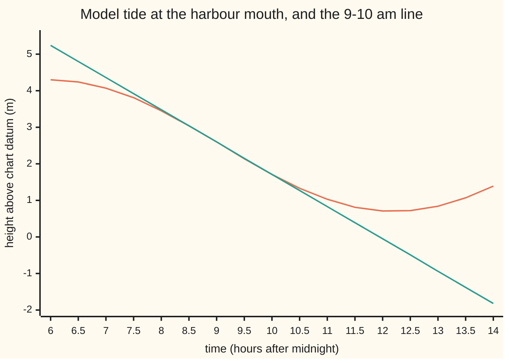
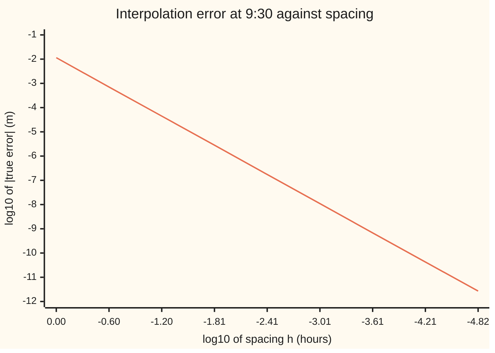

# Linear interpolation: read between two points, and the risk of reading past the last one

[Syllabus](../../../SYLLABUS.md) → [Numerical analysis](../README.md) → [Interpolation and Approximation](../README.md#s04) → Linear interpolation

---

## General Overview

A tide table lists the height of the water once an hour. At a harbour mouth, on an illustrative morning, it reads 2.5956 m at 9 am and 1.7126 m at 10 am. Heights are measured above chart datum, the zero level that charted depths use. The tide is falling.

A yacht needs 2.2 m of tide to cross the sand bar at the mouth. The skipper wants to cross at 9:20. The table has no 9:20 row, so the skipper draws a straight line between the two readings and reads it a third of the way along: 2.3012 m. The true height on this model tide is 2.2925 m. The line is 8.7 mm too high.

That method is **linear interpolation**: join two known points by a straight line and read the line in between. Two questions make it safe to use:

- **How wrong can the line be?** Between the readings, the error is at most the curve's largest bend times the spacing squared, divided by 8. Here that ceiling is 0.0252 m, and a sharper form at 9:20 itself gives 0.0224 m. Either way, provided the bend stays under 0.2015 m per hour squared, as it does on this model tide, the water at 9:20 is certainly above 2.2 m.
- **What if the skipper reads the same line at 1 pm?** That is **extrapolation**: reading the line past the last point. The line says −0.9364 m, a dry bar. The truth is 0.8418 m. Nothing in the two readings warns of an error that size.

**Between two readings, the straight line misses the curve by at most a ceiling on its bend times the spacing squared over 8; past the last reading the same ceiling allows a miss that grows with the square of the distance, with no cap.**

**What kind of fact this is:** a method with a theorem attached. The error formula is proved on [Numerical integration](../../06-Calculus%20and%20analysis/04-Integrals/08-numerical-integration.md); Why it works extends it past the readings and proves the bound. The tide is an illustrative model, H(t) = 2.5 + 1.8 cos(2π(t − 6)/12.42), not a real port's table.

### The picture: the tide and the line through 9 am and 10 am



First line (curved): the model tide. Second line (straight): the line through the 9 am and 10 am readings, extended both ways. Between 9 and 10 the two are indistinguishable at this scale. Two hours out they disagree by most of a metre.

---

## The formula

The time t sits between two reading times a and b, a fraction s of the way along:

$$s = \frac{t-a}{b-a}, \qquad L(t) = (1-s)\,H(a) + s\,H(b)$$

**Read it aloud:** the line's value is a weighted average of the two readings, with weight 1 − s on the earlier one and s on the later one.

The error, for any time t, with h = b − a the spacing:

$$H(t) - L(t) = \tfrac12\,H''(\xi)\,(t-a)(t-b), \qquad |H(t) - L(t)| \le \frac{M h^2}{8} \quad \text{for } a \le t \le b$$

**Read it aloud:** the line misses by half the curve's bend at some point ξ times the product of the distances to the two readings; between the readings that product is at most a quarter of h squared.

In two dimensions, with four corner readings $H_{00}, H_{01}, H_{10}, H_{11}$ (first index: time a or b; second: place $x_0$ or $x_1$), **bilinear interpolation** is:

$$B = (1-s)(1-r)\,H_{00} + (1-s)\,r\,H_{01} + s\,(1-r)\,H_{10} + s\,r\,H_{11}, \qquad |H - B| \le \frac{M_t h_t^2 + M_x h_x^2}{8}$$

**Read it aloud:** weight each corner by how close the point is to it in each direction, and the error is at most the sum of the two one-direction bounds.

| Symbol | Plain meaning | In our example | Push it up and the answer… |
| --- | --- | --- | --- |
| $t$ | time, in hours after midnight | 9 + 1/3 (9:20 am) | moves along the line |
| $H(t)$, $H(t, x)$ | the true water height above chart datum, in m; x adds the place | 2.2925 m at 9:20 at the mouth | — |
| $a$, $b$ | the two reading times | 9 and 10 | — |
| $h$, $h_t$, $h_x$ | the spacing between readings: in time, and in distance | 1 hour; 6 km | the bound grows like the square |
| $s$, $r$ | fraction of the way from the first reading to the second, in time and in distance | 1/3 and 1/3 | more weight on the later or farther reading |
| $L(t)$; $H(t) - L(t)$ | the line's value, the interpolated height; and its true error | 2.3012 m; −0.0087 m | — |
| $H''$ | the second derivative: how fast the slope changes, the curve's bend | runs from −0.0245 to 0.2015 m/h² on [9, 10] | larger error |
| $M$, $M_t$, $M_x$ | an assumed ceiling on the size of the bend: in time, and in distance | 0.2015 m/h²; 0.002015 m/km² | larger bound |
| $\xi$ | (xi) a point between the readings where the error formula reads the bend | 9.4424 h | — |
| $x$, $x_0$, $x_1$ | distance up the estuary, in km, and the two gauges | 2; 0 (mouth) and 6 (town quay) | — |
| $B$, $H_{00} \dots H_{11}$ | the bilinear value, and the four corner readings | 2.4774 m; 2.5956, 3.1285, 1.7126, 2.2324 m | — |
| $\delta$ | an error in a reading itself | none: the model's readings are exact | the line moves by up to δ inside, up to 7.00 δ at 1 pm |

### When it holds

- **The curve has a bounded bend between the readings.** The bound needs a second derivative with a known ceiling M. A tide is smooth, so this holds. A level that hits a floor, such as a gauge at a berth that dries out, has a kink; the error then shrinks only like h, not h squared.
- **The point lies between the readings.** Inside, the factor (t − a)(b − t) is at most h²/4, here 1/4. Outside it has no ceiling: at 1 pm its size is 12.00, and the true error is 1.7783 m.
- **M really caps the bend wherever the error formula can look.** Two readings never measure the bend, even between them; here M comes from the model tide. Inside, ξ stays in [a, b]. Outside, ξ can sit anywhere out to t, past every reading, where not even nearby readings could estimate M. If the bend exceeds M, the bound is wrong.
- **The readings are exact.** A reading off by δ moves the line by at most δ inside, because both weights are positive and add to 1. Outside, one weight is negative, so the same δ is magnified: at 1 pm, up to 7.00 δ.

---

## Why it works

### Step 0: the error is zero at both readings, so only bending can make it

The line passes through both readings, so the error H − L is zero at a and at b. A function that is zero at both ends of an interval can only move away from zero by bending. A straight curve has no bend and is reproduced exactly. So the error must be controlled by the second derivative, the bend, and by how far t sits from the two readings.

### Step 1: the line is a weighted average

The line has one slope, the rate of change between the readings ([Ratios and rates](../../01-Foundations/01-Everyday%20Arithmetic/09-ratios-and-rates.md)): (1.7126 − 2.5956)/1 = −0.8830 m per hour. Starting at the 9 am height and moving t − a hours along it gives the point-slope form of a line ([Lines](../../05-Geometry%20and%20trig/04-Coordinates%20and%20Curves/02-lines-slopes-and-intersections.md)). Rearranged, that is the weights form on this card. The checks build both and get 2.3012 m from each.

The weights 1 − s and s are both positive inside and add to 1. So the line never leaves the band between the two readings there. Outside, s is above 1, the weight 1 − s turns negative, and the line runs off without limit.

Cost, in flops (floating-point operations): a reading in the weights form takes 3 for s and 4 for the average, 7 in all. The slope form takes 3, once the interval's slope (3 flops) is stored.

### Step 2: the error formula, and the bound M h² / 8

[Numerical integration](../../06-Calculus%20and%20analysis/04-Integrals/08-numerical-integration.md) proves that a chord misses a curve by exactly ½ H″(ξ)(t − a)(t − b), for some ξ between a and b, with a helper function and Rolle's theorem used twice. That chord is the linear interpolant, so this is the interpolation error. For t outside [a, b], the same argument run on the three points a, b and t gives the same formula, with ξ between the smallest and largest of them.

The product (t − a)(b − t) is largest at the midpoint, where it equals h²/4. So between the readings, |H − L| ≤ M h²/8.

On the tide at 9:20:

- The bend on [9, 10] peaks at 10 am: M = 0.2015 m/h².
- The bound at 9:20 is M/2 × (1/3)(2/3) = 0.0224 m. The midpoint bound M h²/8 is 0.0252 m.
- The true error is −0.0087 m. The bound is 2.58 times the true error.

The checks also find ξ. The error gives 2e/((t − a)(t − b)) = 0.078258 m/h². That is H″ at ξ = 9.4424 h, inside [9, 10], as the theorem promises. At 9:30 the true error is −0.01137 m, and −H″(9.5)/8 estimates it as −0.01143 m.

### Step 3: the error falls like h squared

Shrink the interval around 9:30 by 4 each time and the error should fall by 16. It does: the observed order is 2.00 at every step from h = 1 to h = 4^−8.

| h (hours) | 1 | 1/4 | 1/16 | 1/64 | 4^−4 | 4^−5 | 4^−6 |
| --- | --- | --- | --- | --- | --- | --- | --- |
| true error (m) | −1.14e-02 | −7.14e-04 | −4.46e-05 | −2.79e-06 | −1.74e-07 | −1.09e-08 | −6.81e-10 |

The next steps give −4.26e-11 and −2.66e-12, still on the line. Then −1.67e-13, −1.07e-14 and −8.88e-16, two units in the last place of a height near 2.5, and 0.00e+00 at h = 4^−12. There the error is rounding, not the method.



One line: the true error at the centre of an interval of width h centred on 9:30. Slope 2: each step to the right cuts h by 4 and the error by 16.

### Step 4: two dimensions, one direction at a time

The tide reaches the town quay, 6 km upriver, later. The model delays it 0.1 hour per km: H(t, x) = 2.5 + 1.8 cos(2π(t − 6 − 0.1x)/12.42). A mooring sits 2 km up. Four gauge readings surround 9:20 at 2 km:

| | 9 am | 10 am |
| --- | --- | --- |
| mouth, 0 km | 2.5956 m | 1.7126 m |
| quay, 6 km | 3.1285 m | 2.2324 m |

Bilinear interpolation does one direction, then the other. Interpolate in time along each gauge, then in distance between the two results. Or distance first, then time. Or use the four weights in one formula. The checks run all three and get 2.4774 m each time: the order does not matter, because each corner's weight is the same product of a time weight and a distance weight.

The true height is 2.4742 m, so the true error is −0.0032 m.

The bound comes from splitting the error in two.

1. Interpolating in distance at the exact time 9:20 misses by at most the one-dimensional distance bound.
2. B differs from that by a distance-weighted average of the time misses at the two gauges. Each miss is at most the time bound, and an average with positive weights cannot be larger than its largest term.

Adding the two gives the formula's bound. The checks use the sharper pointwise terms, M_t (t − a)(b − t)/2 and M_x (x − x₀)(x₁ − x)/2, in place of M_t h_t²/8 and M_x h_x²/8. On the box from 9 to 10 am and 0 to 6 km:

- The bend in time peaks at 0.2015 m/h². The bend in distance is 0.01 times that, 0.002015 m/km², because distance enters the model times 0.1, and the bend takes that factor squared.
- The bound is 0.0305 m. It is 9.49 times the true error: loose, but safe. The formula's whole-box form, (0.2015 × 1² + 0.002015 × 6²)/8, gives 0.0343 m.

Each bilinear reading is three one-dimensional readings: 21 flops in the weights form.

### Step 5: past the last reading, the bound has no cap

The error formula still holds outside. Inside or out, the bound rests on an assumed ceiling M: two readings never measure the bend, even between them, and this card takes M from the model tide. What changes outside is what the same M buys.

1. **The factor (t − a)(t − b) has no ceiling.** Inside it never passes 1/4, so the bound is capped at M h²/8 wherever t sits. At 1 pm the factor is 4 × 3 = 12.00, and it grows like the square of the distance.
2. **M must cover [9, t], not just [9, 10].** ξ can sit anywhere out to t. An estimate of M from nearby readings covers only the span those readings cover; past the last reading there is nothing to estimate it from.
3. **Reading errors grow.** At 1 pm the weights are −3.00 and 4.00, so errors of δ in the readings can move the line by 7.00 δ. Inside, they move it by at most δ.

The checks extend the 9–10 am line:

| Time | Line (m) | True (m) | True error (m) | (t − 9)(t − 10) | Bound with M over [9, t] (m) | Bound over error |
| --- | --- | --- | --- | --- | --- | --- |
| 10:30 | 1.2711 | 1.3326 | 0.0615 | 0.75 | 0.1120 | 1.82 |
| 11:00 | 0.8296 | 1.0268 | 0.1973 | 2.00 | 0.3770 | 1.91 |
| 12:00 | −0.0534 | 0.7101 | 0.7636 | 6.00 | 1.3742 | 1.80 |
| 13:00 | −0.9364 | 0.8418 | 1.7783 | 12.00 | 2.7640 | 1.55 |

The bounds hold only because the checks know the whole curve. The line predicts a negative height at noon. The real tide reaches low water just after noon and rises again.

The house example makes the point sharper. A yield curve is built through eight quoted maturities: illustrative yields, in percent a year, treated as annually compounded zero rates (each the rate for a single payment at that maturity), of 4.10, 3.95, 3.90, 3.95, 4.05, 4.20, 4.60 and 4.40 at 1, 2, 3, 5, 7, 10, 20 and 30 years. Linear interpolation gives 3.925% at 4 years and 4.400% at 15 years.

Past 30 years there is no quote. Two common rules:

- **Extend the last segment.** The line through 20 and 30 years reaches 4.000% at 50 years.
- **Hold flat.** Keep 4.400% after 30 years.

Both rules hit all eight quotes and agree everywhere between them. Yet $1,000,000 due in 50 years is worth $140,713 today under the first and $116,138 under the second: a gap of $24,574. The quotes cannot choose between them. That is what "no bound" means: the quotes do not cap the difference, and it grows with distance past 30 years.

---

## Worked numbers, by hand

The tide at the harbour mouth at 9:20, from the 9 am and 10 am readings.

| Step | Arithmetic | Value |
| --- | --- | --- |
| fraction along | s = (9:20 − 9:00)/(10:00 − 9:00) = 20/60 | 1/3 |
| weights | 1 − s and s | 2/3 and 1/3 |
| line | 2/3 × 2.5956 + 1/3 × 1.7126 | 2.3012 m |
| same, slope form | 2.5956 + 1/3 × (−0.8830) | 2.3012 m |
| ceiling on the bend | largest H″ on [9, 10], at 10 am | 0.2015 m/h² |
| bound at 9:20 | 0.2015/2 × 1/3 × 2/3 | 0.0224 m |
| true height (model) | 2.5 + 1.8 cos(2π × 3.3333/12.42) | 2.2925 m |
| true error | 2.2925 − 2.3012 | **−0.0087 m** |

The line reads 2.3012 m, with an error guaranteed under 0.0224 m while the bend stays under 0.2015 m/h², so the yacht's 2.2 m is there at 9:20. The actual miss is under a centimetre.

### What breaks if you drop a piece

| Mistake | Comes out at | What went wrong |
| --- | --- | --- |
| Use the nearest reading, 9 am | 2.5956 m, error −0.3030 | no interpolation at all: the tide fell for 20 minutes |
| 20 minutes written as s = 0.20 | 2.4190 m, error −0.1264 | s is a fraction of the hour: 20/60, not 20/100 |
| Weights swapped: s on 9 am, 1 − s on 10 am | 2.0069 m, error 0.2856 | the nearer reading must get the larger weight |
| Bilinear as the plain average of four corners | 2.4172 m, error 0.0570 | that is the value at the box's centre, 9:30 and 3 km, not at 9:20 and 2 km |
| Extend the line to 1 pm | −0.9364 m, true 0.8418, error 1.7783 | outside the readings the factor (t − a)(t − b) is 12.00, against at most 1/4 inside, and reading errors are magnified |

---

## Code, from first principles, and it actually runs

The script writes its own cosine from + − × ÷, so Python and Rust agree to the bit; the library cosine is only a cross-check. It reaches the 9:20 height by three roads: the exact model curve, the line in weights form, and the line in point-slope form. It then tests the error against the bound, checks every bend ceiling and H″ itself against second differences of the curve on a dense grid, finds the point ξ by bisection, measures the order as h shrinks, runs bilinear interpolation three ways, extends the line past 10 am, counts the flops, and builds the yield curve.

### Python

```python
# Linear interpolation and extrapolation -- the check behind the card.  Standard library only.
# Illustrative tide: height H = 2.5 + 1.8 cos(w (t - 6 - 0.1 x)) metres above chart datum, t hours
# after midnight, x km up the estuary from the harbour-mouth gauge, w = 2 pi / 12.42 radians an hour.
# Road 1: the exact curve.  Road 2: the line through two readings, built two ways.  Road 3: the error
# against the bound M h^2 / 8, the point xi of the error formula, and the observed order as h shrinks.
# Then bilinear interpolation three ways, extrapolation past 10 am, and an eight-quote yield curve.
import math
PI = 3.141592653589793
W = 2 * PI / 12.42

def cos(z):                                     # written out with + - * / only, so Python and Rust
    while z > PI:                               # agree to the bit; math.cos is only a cross-check
        z -= 2 * PI
    while z < -PI:
        z += 2 * PI
    z, sign = abs(z), 1.0
    if z > PI / 2:
        z, sign = PI - z, -1.0
    term, total = 1.0, 1.0
    for k in range(1, 20):
        term = -term * z * z / ((2 * k - 1) * (2 * k))
        total += term
    return sign * total
def H(t, x=0.0): return 2.5 + 1.8 * cos(W * (t - 6 - 0.1 * x))
def H2(t): return -1.8 * W * W * cos(W * (t - 6))      # d2H/dt2 at the mouth; d2H/dx2 is 0.01 times it
def M(t1, t2, x1=0.0, x2=0.0):                  # largest |d2H/dt2| over the box: |cos| peaks at an end
    p, q = W * (t1 - 6 - 0.1 * x2), W * (t2 - 6 - 0.1 * x1)              # of the phase range, or at 0 or pi
    return 1.8 * W * W * (1.0 if p <= PI <= q or p <= 0 <= q else max(abs(cos(p)), abs(cos(q))))
def line(t, a, b, Ha, Hb):                      # weights form: (1 - s) Ha + s Hb
    s = (t - a) / (b - a)
    return (1 - s) * Ha + s * Hb
def slope_form(t, a, b, Ha, Hb): return Ha + (t - a) * ((Hb - Ha) / (b - a))
def e(x, d): return f"{x:.{d}e}"
def d2(f, u, d=1e-3): return (f(u + d) - 2 * f(u) + f(u - d)) / (d * d)   # second difference: H'' by another road

assert max(abs(cos(0.01 * i) - math.cos(0.01 * i)) for i in range(-700, 701)) < 1e-14   # library cross-check
a, b, t = 9.0, 10.0, 9.0 + 1 / 3
Ha, Hb = H(a), H(b)
print(f"readings: 9 am {Ha:.4f} m, 10 am {Hb:.4f} m; slope {(Hb - Ha) / (b - a):.4f} m per hour; w = {W:.6f}")
L, L2, T = line(t, a, b, Ha, Hb), slope_form(t, a, b, Ha, Hb), H(t)
err, Mab = T - L, M(a, b)
bt, bh = Mab / 2 * (t - a) * (b - t), Mab * (b - a) ** 2 / 8
print(f"9:20 am: line {L:.4f} m (slope form {L2:.4f}), true {T:.4f} m, true error H - L {err:.4f} m")
print(f"ceiling M on [9, 10] {Mab:.4f} m/h^2; bound M/2 (t-a)(b-t) {bt:.4f}, M h^2/8 {bh:.4f}; bound over |error| {bt / abs(err):.2f}")
assert abs(L - L2) < 1e-15 and abs(err) <= bt <= bh and abs(T - 2.2925) < 1e-4
assert all(abs(H2(u) - d2(H, u)) < 1e-5 for u in (a, 9.5, b)) and abs(Mab - max(abs(d2(H, a + i / 400)) for i in range(401))) < 1e-5
c = 2 * err / ((t - a) * (t - b))               # the error formula says c = H''(xi) for some xi in [9, 10]
lo, hi = a, b                                   # H'' rises on [9, 10]: bisect for xi
for _ in range(60):
    mid = (lo + hi) / 2
    lo, hi = (mid, hi) if H2(mid) < c else (lo, mid)
print(f"error formula: 2 e / ((t-a)(t-b)) = {c:.6f} = H''(xi) at xi = {lo:.4f} h, inside [9, 10]; H'' runs {H2(a):.4f} to {H2(b):.4f}")
assert H2(a) < c < H2(b) and a < lo < b
print(f"at 9:30: true error {H(9.5) - line(9.5, a, b, Ha, Hb):.5f} m; estimate -H''(9.5)/8 = {-H2(9.5) / 8:.5f} m")
assert abs(-H2(9.5) / 8 / (H(9.5) - line(9.5, a, b, Ha, Hb)) - 1) < 0.01
errs = []
for k in range(13):                             # interval of width h = 4^-k centred on 9:30, error at its centre
    h = 0.25 ** k
    errs.append(H(9.5) - line(9.5, 9.5 - h / 2, 9.5 + h / 2, H(9.5 - h / 2), H(9.5 + h / 2)))
orders = [math.log(abs(errs[k] / errs[k + 1])) / math.log(4) for k in range(8)]
print("order: true error at 9:30 for h = 4^-k, k = 0..12: " + ", ".join(e(x, 2) for x in errs[:7]))
print("       " + ", ".join(e(x, 2) for x in errs[7:]) + "; observed order k=0..7 " + ", ".join(f"{o:.2f}" for o in orders))
print("chart, log10 h: " + ", ".join(f"{math.log10(0.25 ** k):.2f}" for k in range(9)) + "; log10 |error|: " + ", ".join(f"{math.log10(abs(x)):.2f}" for x in errs[:9]))
assert all(abs(o - 2) < 0.01 for o in orders) and abs(errs[12]) < 1e-14

print("extrapolating the 9-10 am line: t, line, true, true error, factor (t-9)(t-10), bound M[9,t]/2 x factor, ratio")
for tt in (10.5, 11.0, 12.0, 13.0):
    Lt, Tt = line(tt, a, b, Ha, Hb), H(tt)
    bd = M(a, tt) / 2 * (tt - a) * (tt - b)
    print(f"  {tt:5.2f} h: {Lt:7.4f} m, {Tt:.4f} m, {Tt - Lt:.4f} m, {(tt - a) * (tt - b):5.2f}, {bd:.4f} m, {bd / abs(Tt - Lt):.2f}")
    assert abs(Tt - Lt) <= bd and abs(M(a, tt) - max(abs(d2(H, a + (tt - a) * i / 400)) for i in range(401))) < 1e-5
assert line(13.0, a, b, Ha, Hb) < 0 < H(13.0) and abs(H(13.0) - line(13.0, a, b, Ha, Hb)) > 100 * abs(err)
w13 = (1 - (13.0 - a) / (b - a), (13.0 - a) / (b - a))          # the line's two weights at 1 pm
print(f"weights at 13 h: {w13[0]:.2f} and {w13[1]:.2f}; reading errors d move the line by up to {abs(w13[0]) + abs(w13[1]):.2f} d")
assert abs(line(13.0, a, b, Ha + 1e-3, Hb - 1e-3) - line(13.0, a, b, Ha, Hb) + (abs(w13[0]) + abs(w13[1])) * 1e-3) < 1e-12
grid = [6 + 0.5 * i for i in range(17)]
print("chart, true tide 6 am to 2 pm by half hours: " + ", ".join(f"{H(g):.2f}" for g in grid))
print("chart, the 9-10 am line extended: " + ", ".join(f"{line(g, a, b, Ha, Hb):.2f}" for g in grid))

x0, x1, x = 0.0, 6.0, 2.0                       # bilinear: mooring 2 km up, between mouth (0) and quay (6)
C = [[H(a, x0), H(a, x1)], [H(b, x0), H(b, x1)]]
s, r = (t - a) / (b - a), (x - x0) / (x1 - x0)
B1 = line(x, x0, x1, line(t, a, b, C[0][0], C[1][0]), line(t, a, b, C[0][1], C[1][1]))   # time first
B2 = line(t, a, b, line(x, x0, x1, C[0][0], C[0][1]), line(x, x0, x1, C[1][0], C[1][1]))   # distance first
B3 = (1 - s) * (1 - r) * C[0][0] + (1 - s) * r * C[0][1] + s * (1 - r) * C[1][0] + s * r * C[1][1]
T2, Mt = H(t, x), M(a, b, x0, x1)
Mx = 0.01 * Mt                                  # distance enters the phase times 0.1, so its bend is 0.01 times
bound2 = Mt / 2 * (t - a) * (b - t) + Mx / 2 * (x - x0) * (x1 - x)
bound8 = (Mt * (b - a) ** 2 + Mx * (x1 - x0) ** 2) / 8                # the formula's whole-box form
print(f"corners: mouth {C[0][0]:.4f}, {C[1][0]:.4f}; quay {C[0][1]:.4f}, {C[1][1]:.4f} m at 9 and 10 am; s = r = 1/3")
print(f"bilinear at 9:20, 2 km: time first {B1:.4f}, distance first {B2:.4f}, four weights {B3:.4f}; true {T2:.4f}; true error {T2 - B3:.4f} m")
print(f"ceilings: |H_tt| {Mt:.4f}, |H_xx| {Mx:.6f}; bound {bound2:.4f} m, box form {bound8:.4f} m; bound over |error| {bound2 / abs(T2 - B3):.2f}")
assert abs(B1 - B2) < 1e-14 and abs(B1 - B3) < 1e-14 and abs(T2 - B3) <= bound2 <= bound8
box = [(a + i / 50, x0 + (x1 - x0) * j / 50) for i in range(51) for j in range(51)]
assert abs(Mt - max(abs(d2(lambda u: H(u, q), p)) for p, q in box)) < 1e-5 and abs(Mx - max(abs(d2(lambda v: H(p, v), q)) for p, q in box)) < 1e-7
print("cost: weights form 3 + 4 = 7 flops a reading; slope form 3, once the slope (3 flops) is stored; bilinear 3 readings, 21 flops")

print(f"mistake, nearest reading (9 am): {Ha:.4f} m, error {T - Ha:.4f}")
print(f"mistake, 20 minutes as s = 0.20: {line(9.2, a, b, Ha, Hb):.4f} m, error {T - line(9.2, a, b, Ha, Hb):.4f}")
print(f"mistake, weights swapped: {s * Ha + (1 - s) * Hb:.4f} m, error {T - (s * Ha + (1 - s) * Hb):.4f}")
avg4 = (C[0][0] + C[0][1] + C[1][0] + C[1][1]) / 4
print(f"mistake, plain average of four corners: {avg4:.4f} m, error {T2 - avg4:.4f}")

mats = [1, 2, 3, 5, 7, 10, 20, 30]              # illustrative yield quotes, percent a year, annual compounding
ylds = [4.10, 3.95, 3.90, 3.95, 4.05, 4.20, 4.60, 4.40]
def curve(m, flat_end):
    if m >= 30 and flat_end:
        return ylds[-1]
    j = max(i for i in range(7) if mats[i] <= m) if m < 30 else 6
    return line(m, mats[j], mats[j + 1], ylds[j], ylds[j + 1])
assert all(abs(curve(m, f) - y) < 1e-12 for m, y in zip(mats, ylds) for f in (True, False))
def pv(y, n):                                   # $1,000,000 due in n years, discounted at y percent a year
    d = 1.0
    for _ in range(n):
        d = d / (1 + y / 100)
    return 1e6 * d
y50a, y50b = curve(50, False), curve(50, True)
print(f"yield curve: 4 years {curve(4, False):.3f}%, 15 years {curve(15, False):.3f}%; both rules hit all 8 quotes")
print(f"50 years: line through 20 and 30 extended {y50a:.3f}%, flat after 30 {y50b:.3f}%")
print(f"$1,000,000 due in 50 years: worth ${pv(y50a, 50):,.0f} or ${pv(y50b, 50):,.0f} today; gap ${pv(y50a, 50) - pv(y50b, 50):,.0f}")
assert abs(y50a - 4.0) < 1e-12 and abs(pv(4.0, 50) - 1e6 / 1.04 ** 50) < 1e-6 and pv(y50a, 50) > pv(y50b, 50)
print("ALL CHECKS PASS")
```

**Ran 2026-11-11 on macOS, Python 3.14.10, standard library only. All checks passed. Output, pasted from the run:**

```
readings: 9 am 2.5956 m, 10 am 1.7126 m; slope -0.8830 m per hour; w = 0.505893
9:20 am: line 2.3012 m (slope form 2.3012), true 2.2925 m, true error H - L -0.0087 m
ceiling M on [9, 10] 0.2015 m/h^2; bound M/2 (t-a)(b-t) 0.0224, M h^2/8 0.0252; bound over |error| 2.58
error formula: 2 e / ((t-a)(t-b)) = 0.078258 = H''(xi) at xi = 9.4424 h, inside [9, 10]; H'' runs -0.0245 to 0.2015
at 9:30: true error -0.01137 m; estimate -H''(9.5)/8 = -0.01143 m
order: true error at 9:30 for h = 4^-k, k = 0..12: -1.14e-02, -7.14e-04, -4.46e-05, -2.79e-06, -1.74e-07, -1.09e-08, -6.81e-10
       -4.26e-11, -2.66e-12, -1.67e-13, -1.07e-14, -8.88e-16, 0.00e+00; observed order k=0..7 2.00, 2.00, 2.00, 2.00, 2.00, 2.00, 2.00, 2.00
chart, log10 h: 0.00, -0.60, -1.20, -1.81, -2.41, -3.01, -3.61, -4.21, -4.82; log10 |error|: -1.94, -3.15, -4.35, -5.55, -6.76, -7.96, -9.17, -10.37, -11.57
extrapolating the 9-10 am line: t, line, true, true error, factor (t-9)(t-10), bound M[9,t]/2 x factor, ratio
  10.50 h:  1.2711 m, 1.3326 m, 0.0615 m,  0.75, 0.1120 m, 1.82
  11.00 h:  0.8296 m, 1.0268 m, 0.1973 m,  2.00, 0.3770 m, 1.91
  12.00 h: -0.0534 m, 0.7101 m, 0.7636 m,  6.00, 1.3742 m, 1.80
  13.00 h: -0.9364 m, 0.8418 m, 1.7783 m, 12.00, 2.7640 m, 1.55
weights at 13 h: -3.00 and 4.00; reading errors d move the line by up to 7.00 d
chart, true tide 6 am to 2 pm by half hours: 4.30, 4.24, 4.07, 3.81, 3.45, 3.04, 2.60, 2.14, 1.71, 1.33, 1.03, 0.81, 0.71, 0.72, 0.84, 1.07, 1.39
chart, the 9-10 am line extended: 5.24, 4.80, 4.36, 3.92, 3.48, 3.04, 2.60, 2.15, 1.71, 1.27, 0.83, 0.39, -0.05, -0.49, -0.94, -1.38, -1.82
corners: mouth 2.5956, 1.7126; quay 3.1285, 2.2324 m at 9 and 10 am; s = r = 1/3
bilinear at 9:20, 2 km: time first 2.4774, distance first 2.4774, four weights 2.4774; true 2.4742; true error -0.0032 m
ceilings: |H_tt| 0.2015, |H_xx| 0.002015; bound 0.0305 m, box form 0.0343 m; bound over |error| 9.49
cost: weights form 3 + 4 = 7 flops a reading; slope form 3, once the slope (3 flops) is stored; bilinear 3 readings, 21 flops
mistake, nearest reading (9 am): 2.5956 m, error -0.3030
mistake, 20 minutes as s = 0.20: 2.4190 m, error -0.1264
mistake, weights swapped: 2.0069 m, error 0.2856
mistake, plain average of four corners: 2.4172 m, error 0.0570
yield curve: 4 years 3.925%, 15 years 4.400%; both rules hit all 8 quotes
50 years: line through 20 and 30 extended 4.000%, flat after 30 4.400%
$1,000,000 due in 50 years: worth $140,713 or $116,138 today; gap $24,574
ALL CHECKS PASS
```

### Rust

```rust
// Linear interpolation and extrapolation -- the check behind the card.  std only, no crates.
// Illustrative tide: height H = 2.5 + 1.8 cos(w (t - 6 - 0.1 x)) metres above chart datum, t hours
// after midnight, x km up the estuary from the harbour-mouth gauge, w = 2 pi / 12.42 radians an hour.
// Road 1: the exact curve.  Road 2: the line through two readings, built two ways.  Road 3: the error
// against the bound M h^2 / 8, the point xi of the error formula, and the observed order as h shrinks.
// Then bilinear interpolation three ways, extrapolation past 10 am, and an eight-quote yield curve.
const PI: f64 = 3.141592653589793;
const W: f64 = 2.0 * PI / 12.42;

fn cos(z0: f64) -> f64 {
    // written out with + - * / only, so Python and Rust agree to the bit; f64::cos is only a cross-check
    let mut z = z0;
    while z > PI { z -= 2.0 * PI; }
    while z < -PI { z += 2.0 * PI; }
    z = z.abs();
    let mut sign = 1.0;
    if z > PI / 2.0 { z = PI - z; sign = -1.0; }
    let (mut term, mut total) = (1.0f64, 1.0f64);
    for k in 1..20 {
        term = -term * z * z / (((2 * k - 1) * (2 * k)) as f64);
        total += term;
    }
    sign * total
}
fn h(t: f64, x: f64) -> f64 { 2.5 + 1.8 * cos(W * (t - 6.0 - 0.1 * x)) }
fn h2(t: f64) -> f64 { -1.8 * W * W * cos(W * (t - 6.0)) } // d2H/dt2 at the mouth; d2H/dx2 is 0.01 times it
fn m(t1: f64, t2: f64, x1: f64, x2: f64) -> f64 {
    // largest |d2H/dt2| over the box: |cos| peaks at an end of the phase range, or at 0 or pi
    let (p, q) = (W * (t1 - 6.0 - 0.1 * x2), W * (t2 - 6.0 - 0.1 * x1));
    let c = if (p <= PI && PI <= q) || (p <= 0.0 && 0.0 <= q) { 1.0 } else { cos(p).abs().max(cos(q).abs()) };
    1.8 * W * W * c
}
fn line(t: f64, a: f64, b: f64, ha: f64, hb: f64) -> f64 { let s = (t - a) / (b - a); (1.0 - s) * ha + s * hb }
fn slope_form(t: f64, a: f64, b: f64, ha: f64, hb: f64) -> f64 { ha + (t - a) * ((hb - ha) / (b - a)) }
fn d2(f: &dyn Fn(f64) -> f64, u: f64) -> f64 { let d = 1e-3; (f(u + d) - 2.0 * f(u) + f(u - d)) / (d * d) } // H'' by another road
fn grid_max(lo: f64, hi: f64) -> f64 { (0..=400).map(|i| d2(&|u| h(u, 0.0), lo + (hi - lo) * i as f64 / 400.0).abs()).fold(0.0, f64::max) }
fn e(x: f64, d: usize) -> String {
    // Python-style e-notation: 1.14e-02
    let s = format!("{:.*e}", d, x);
    let (mant, ex) = s.split_once('e').unwrap();
    let n: i32 = ex.parse().unwrap();
    format!("{}e{}{:02}", mant, if n < 0 { '-' } else { '+' }, n.abs())
}
fn commas(x: f64) -> String {
    let s = format!("{:.0}", x);
    let mut out = String::new();
    for (i, ch) in s.chars().enumerate() {
        if i > 0 && (s.len() - i) % 3 == 0 { out.push(','); }
        out.push(ch);
    }
    out
}
fn join(v: &[f64], f: &dyn Fn(f64) -> String) -> String { v.iter().map(|&x| f(x)).collect::<Vec<_>>().join(", ") }

fn main() {
    assert!((-700..=700).all(|i| (cos(0.01 * i as f64) - (0.01 * i as f64).cos()).abs() < 1e-14));
    let (a, b, t) = (9.0, 10.0, 9.0 + 1.0 / 3.0);
    let (ha, hb) = (h(a, 0.0), h(b, 0.0));
    println!("readings: 9 am {:.4} m, 10 am {:.4} m; slope {:.4} m per hour; w = {:.6}", ha, hb, (hb - ha) / (b - a), W);
    let (l, l2, tr) = (line(t, a, b, ha, hb), slope_form(t, a, b, ha, hb), h(t, 0.0));
    let (err, mab) = (tr - l, m(a, b, 0.0, 0.0));
    let (bt, bh) = (mab / 2.0 * (t - a) * (b - t), mab * ((b - a) * (b - a)) / 8.0);
    println!("9:20 am: line {:.4} m (slope form {:.4}), true {:.4} m, true error H - L {:.4} m", l, l2, tr, err);
    println!("ceiling M on [9, 10] {:.4} m/h^2; bound M/2 (t-a)(b-t) {:.4}, M h^2/8 {:.4}; bound over |error| {:.2}", mab, bt, bh, bt / err.abs());
    assert!((l - l2).abs() < 1e-15 && err.abs() <= bt && bt <= bh && (tr - 2.2925).abs() < 1e-4);
    assert!([a, 9.5, b].iter().all(|&u| (h2(u) - d2(&|v| h(v, 0.0), u)).abs() < 1e-5) && (mab - grid_max(a, b)).abs() < 1e-5);
    let c = 2.0 * err / ((t - a) * (t - b));
    let (mut lo, mut hi) = (a, b);
    for _ in 0..60 {
        let mid = (lo + hi) / 2.0;
        if h2(mid) < c { lo = mid; } else { hi = mid; }
    }
    println!("error formula: 2 e / ((t-a)(t-b)) = {:.6} = H''(xi) at xi = {:.4} h, inside [9, 10]; H'' runs {:.4} to {:.4}", c, lo, h2(a), h2(b));
    assert!(h2(a) < c && c < h2(b) && a < lo && lo < b);
    println!("at 9:30: true error {:.5} m; estimate -H''(9.5)/8 = {:.5} m", h(9.5, 0.0) - line(9.5, a, b, ha, hb), -h2(9.5) / 8.0);
    assert!((-h2(9.5) / 8.0 / (h(9.5, 0.0) - line(9.5, a, b, ha, hb)) - 1.0).abs() < 0.01);
    let mut errs = Vec::new();
    for k in 0..13 {
        let w = 0.25f64.powi(k);
        errs.push(h(9.5, 0.0) - line(9.5, 9.5 - w / 2.0, 9.5 + w / 2.0, h(9.5 - w / 2.0, 0.0), h(9.5 + w / 2.0, 0.0)));
    }
    let orders: Vec<f64> = (0..8).map(|k| (errs[k] / errs[k + 1]).abs().ln() / 4f64.ln()).collect();
    println!("order: true error at 9:30 for h = 4^-k, k = 0..12: {}", join(&errs[..7], &|x| e(x, 2)));
    println!("       {}; observed order k=0..7 {}", join(&errs[7..], &|x| e(x, 2)), join(&orders, &|o| format!("{:.2}", o)));
    let hs: Vec<f64> = (0..9).map(|k| 0.25f64.powi(k)).collect();
    println!("chart, log10 h: {}; log10 |error|: {}", join(&hs, &|w| format!("{:.2}", w.log10())), join(&errs[..9], &|x| format!("{:.2}", x.abs().log10())));
    assert!(orders.iter().all(|o| (o - 2.0).abs() < 0.01) && errs[12].abs() < 1e-14);

    println!("extrapolating the 9-10 am line: t, line, true, true error, factor (t-9)(t-10), bound M[9,t]/2 x factor, ratio");
    for tt in [10.5, 11.0, 12.0, 13.0] {
        let (lt, ttv) = (line(tt, a, b, ha, hb), h(tt, 0.0));
        let bd = m(a, tt, 0.0, 0.0) / 2.0 * (tt - a) * (tt - b);
        println!("  {:5.2} h: {:7.4} m, {:.4} m, {:.4} m, {:5.2}, {:.4} m, {:.2}", tt, lt, ttv, ttv - lt, (tt - a) * (tt - b), bd, bd / (ttv - lt).abs());
        assert!((ttv - lt).abs() <= bd && (m(a, tt, 0.0, 0.0) - grid_max(a, tt)).abs() < 1e-5);
    }
    assert!(line(13.0, a, b, ha, hb) < 0.0 && 0.0 < h(13.0, 0.0) && (h(13.0, 0.0) - line(13.0, a, b, ha, hb)).abs() > 100.0 * err.abs());
    let w13 = (1.0 - (13.0 - a) / (b - a), (13.0 - a) / (b - a)); // the line's two weights at 1 pm
    println!("weights at 13 h: {:.2} and {:.2}; reading errors d move the line by up to {:.2} d", w13.0, w13.1, w13.0.abs() + w13.1.abs());
    assert!((line(13.0, a, b, ha + 1e-3, hb - 1e-3) - line(13.0, a, b, ha, hb) + (w13.0.abs() + w13.1.abs()) * 1e-3).abs() < 1e-12);
    let grid: Vec<f64> = (0..17).map(|i| 6.0 + 0.5 * i as f64).collect();
    println!("chart, true tide 6 am to 2 pm by half hours: {}", join(&grid, &|g| format!("{:.2}", h(g, 0.0))));
    println!("chart, the 9-10 am line extended: {}", join(&grid, &|g| format!("{:.2}", line(g, a, b, ha, hb))));

    let (x0, x1, x) = (0.0, 6.0, 2.0);
    let cc = [[h(a, x0), h(a, x1)], [h(b, x0), h(b, x1)]];
    let (s, r) = ((t - a) / (b - a), (x - x0) / (x1 - x0));
    let b1 = line(x, x0, x1, line(t, a, b, cc[0][0], cc[1][0]), line(t, a, b, cc[0][1], cc[1][1]));
    let b2 = line(t, a, b, line(x, x0, x1, cc[0][0], cc[0][1]), line(x, x0, x1, cc[1][0], cc[1][1]));
    let b3 = (1.0 - s) * (1.0 - r) * cc[0][0] + (1.0 - s) * r * cc[0][1] + s * (1.0 - r) * cc[1][0] + s * r * cc[1][1];
    let (t2, mt) = (h(t, x), m(a, b, x0, x1));
    let mx = 0.01 * mt; // distance enters the phase times 0.1, so its bend is 0.01 times
    let bound2 = mt / 2.0 * (t - a) * (b - t) + mx / 2.0 * (x - x0) * (x1 - x);
    let bound8 = (mt * ((b - a) * (b - a)) + mx * ((x1 - x0) * (x1 - x0))) / 8.0; // the formula's whole-box form
    println!("corners: mouth {:.4}, {:.4}; quay {:.4}, {:.4} m at 9 and 10 am; s = r = 1/3", cc[0][0], cc[1][0], cc[0][1], cc[1][1]);
    println!("bilinear at 9:20, 2 km: time first {:.4}, distance first {:.4}, four weights {:.4}; true {:.4}; true error {:.4} m", b1, b2, b3, t2, t2 - b3);
    println!("ceilings: |H_tt| {:.4}, |H_xx| {:.6}; bound {:.4} m, box form {:.4} m; bound over |error| {:.2}", mt, mx, bound2, bound8, bound2 / (t2 - b3).abs());
    assert!((b1 - b2).abs() < 1e-14 && (b1 - b3).abs() < 1e-14 && (t2 - b3).abs() <= bound2 && bound2 <= bound8);
    let bx: Vec<(f64, f64)> = (0..=50).flat_map(|i| (0..=50).map(move |j| (a + i as f64 / 50.0, x0 + (x1 - x0) * j as f64 / 50.0))).collect();
    let mt_grid = bx.iter().map(|&(p, q)| d2(&|u| h(u, q), p).abs()).fold(0.0, f64::max);
    let mx_grid = bx.iter().map(|&(p, q)| d2(&|v| h(p, v), q).abs()).fold(0.0, f64::max);
    assert!((mt - mt_grid).abs() < 1e-5 && (mx - mx_grid).abs() < 1e-7);
    println!("cost: weights form 3 + 4 = 7 flops a reading; slope form 3, once the slope (3 flops) is stored; bilinear 3 readings, 21 flops");

    println!("mistake, nearest reading (9 am): {:.4} m, error {:.4}", ha, tr - ha);
    println!("mistake, 20 minutes as s = 0.20: {:.4} m, error {:.4}", line(9.2, a, b, ha, hb), tr - line(9.2, a, b, ha, hb));
    println!("mistake, weights swapped: {:.4} m, error {:.4}", s * ha + (1.0 - s) * hb, tr - (s * ha + (1.0 - s) * hb));
    let avg4 = (cc[0][0] + cc[0][1] + cc[1][0] + cc[1][1]) / 4.0;
    println!("mistake, plain average of four corners: {:.4} m, error {:.4}", avg4, t2 - avg4);

    let mats = [1.0, 2.0, 3.0, 5.0, 7.0, 10.0, 20.0, 30.0];
    let ylds = [4.10, 3.95, 3.90, 3.95, 4.05, 4.20, 4.60, 4.40];
    let curve = |mm: f64, flat_end: bool| -> f64 {
        if mm >= 30.0 && flat_end { return ylds[7]; }
        let j = if mm < 30.0 { (0..7).filter(|&i| mats[i] <= mm).max().unwrap() } else { 6 };
        line(mm, mats[j], mats[j + 1], ylds[j], ylds[j + 1])
    };
    assert!(mats.iter().zip(ylds.iter()).all(|(&mm, &y)| [true, false].iter().all(|&f| (curve(mm, f) - y).abs() < 1e-12)));
    let pv = |y: f64, n: usize| -> f64 { let mut d = 1.0; for _ in 0..n { d = d / (1.0 + y / 100.0); } 1e6 * d };
    let (y50a, y50b) = (curve(50.0, false), curve(50.0, true));
    println!("yield curve: 4 years {:.3}%, 15 years {:.3}%; both rules hit all 8 quotes", curve(4.0, false), curve(15.0, false));
    println!("50 years: line through 20 and 30 extended {:.3}%, flat after 30 {:.3}%", y50a, y50b);
    println!("$1,000,000 due in 50 years: worth ${} or ${} today; gap ${}", commas(pv(y50a, 50)), commas(pv(y50b, 50)), commas(pv(y50a, 50) - pv(y50b, 50)));
    assert!((y50a - 4.0).abs() < 1e-12 && (pv(4.0, 50) - 1e6 / 1.04f64.powi(50)).abs() < 1e-6 && pv(y50a, 50) > pv(y50b, 50));
    println!("ALL CHECKS PASS");
}
```

**Ran 2026-11-11 on macOS, rustc 1.98.1, no crates. All checks passed. Output, pasted from the run:**

```
readings: 9 am 2.5956 m, 10 am 1.7126 m; slope -0.8830 m per hour; w = 0.505893
9:20 am: line 2.3012 m (slope form 2.3012), true 2.2925 m, true error H - L -0.0087 m
ceiling M on [9, 10] 0.2015 m/h^2; bound M/2 (t-a)(b-t) 0.0224, M h^2/8 0.0252; bound over |error| 2.58
error formula: 2 e / ((t-a)(t-b)) = 0.078258 = H''(xi) at xi = 9.4424 h, inside [9, 10]; H'' runs -0.0245 to 0.2015
at 9:30: true error -0.01137 m; estimate -H''(9.5)/8 = -0.01143 m
order: true error at 9:30 for h = 4^-k, k = 0..12: -1.14e-02, -7.14e-04, -4.46e-05, -2.79e-06, -1.74e-07, -1.09e-08, -6.81e-10
       -4.26e-11, -2.66e-12, -1.67e-13, -1.07e-14, -8.88e-16, 0.00e+00; observed order k=0..7 2.00, 2.00, 2.00, 2.00, 2.00, 2.00, 2.00, 2.00
chart, log10 h: 0.00, -0.60, -1.20, -1.81, -2.41, -3.01, -3.61, -4.21, -4.82; log10 |error|: -1.94, -3.15, -4.35, -5.55, -6.76, -7.96, -9.17, -10.37, -11.57
extrapolating the 9-10 am line: t, line, true, true error, factor (t-9)(t-10), bound M[9,t]/2 x factor, ratio
  10.50 h:  1.2711 m, 1.3326 m, 0.0615 m,  0.75, 0.1120 m, 1.82
  11.00 h:  0.8296 m, 1.0268 m, 0.1973 m,  2.00, 0.3770 m, 1.91
  12.00 h: -0.0534 m, 0.7101 m, 0.7636 m,  6.00, 1.3742 m, 1.80
  13.00 h: -0.9364 m, 0.8418 m, 1.7783 m, 12.00, 2.7640 m, 1.55
weights at 13 h: -3.00 and 4.00; reading errors d move the line by up to 7.00 d
chart, true tide 6 am to 2 pm by half hours: 4.30, 4.24, 4.07, 3.81, 3.45, 3.04, 2.60, 2.14, 1.71, 1.33, 1.03, 0.81, 0.71, 0.72, 0.84, 1.07, 1.39
chart, the 9-10 am line extended: 5.24, 4.80, 4.36, 3.92, 3.48, 3.04, 2.60, 2.15, 1.71, 1.27, 0.83, 0.39, -0.05, -0.49, -0.94, -1.38, -1.82
corners: mouth 2.5956, 1.7126; quay 3.1285, 2.2324 m at 9 and 10 am; s = r = 1/3
bilinear at 9:20, 2 km: time first 2.4774, distance first 2.4774, four weights 2.4774; true 2.4742; true error -0.0032 m
ceilings: |H_tt| 0.2015, |H_xx| 0.002015; bound 0.0305 m, box form 0.0343 m; bound over |error| 9.49
cost: weights form 3 + 4 = 7 flops a reading; slope form 3, once the slope (3 flops) is stored; bilinear 3 readings, 21 flops
mistake, nearest reading (9 am): 2.5956 m, error -0.3030
mistake, 20 minutes as s = 0.20: 2.4190 m, error -0.1264
mistake, weights swapped: 2.0069 m, error 0.2856
mistake, plain average of four corners: 2.4172 m, error 0.0570
yield curve: 4 years 3.925%, 15 years 4.400%; both rules hit all 8 quotes
50 years: line through 20 and 30 extended 4.000%, flat after 30 4.400%
$1,000,000 due in 50 years: worth $140,713 or $116,138 today; gap $24,574
ALL CHECKS PASS
```

### Lean

Lean proves the error formula, the bound M h²/8 and the missing cap past the readings, for every curve that meets the conditions.

- Take readings at times a and b, with a before b, and a curve whose bend between them is at most M in size.
- Then at any time between the readings, the line misses the curve by at most M h²/8.
- At any time t, inside or outside the readings, the miss is exactly ½ H″(ξ)(t − a)(t − b).
- There ξ lies strictly between the smallest and largest of a, b and t, and the curve needs a bend across that whole span.
- Past the last reading the ceiling caps nothing. For any M above zero and any size, some curve with bend at most M everywhere misses by more, somewhere past b.
- The weights form and the slope form give the same line.
- The hand arithmetic holds exactly: s = 1/3 at 9:20, both forms agree there, and the factor 2/9 is under its ceiling 1/4.
- At 1 pm the factor is 12, and the weights −3 and 4 move the line by up to 7 δ.
- The yield curve reads 3.925% at 4 years and 4.400% at 15 years, and the extended 20-to-30-year line reads 4.000% at 50.

The decimals, bilinear interpolation, the observed order, the point ξ, the 50-year dollar values and the charts are left to the Python and Rust checks.

```lean
-- Linear interpolation: between two readings the straight line misses a curve whose bend is at most M by at most M h^2 / 8, and past the last reading no such cap exists.
import Mathlib.Analysis.Calculus.LocalExtr.Rolle
import Mathlib.Analysis.Calculus.Deriv.Mul
import Mathlib.Analysis.Calculus.Deriv.Pow
import Mathlib.Tactic.NormNum

/-! Readings `ya = f a` and `yb = f b` are taken at times `a < b`, with spacing `h = b - a`.
The time `t` sits a fraction `s = (t - a) / (b - a)` of the way along, and the line through
the two readings reads `L(t) = (1 - s) * ya + s * yb`. The curve's bend is its second derivative
`deriv (deriv f)`, and `M` is a ceiling on its size. -/

/-- The line through `(a, ya)` and `(b, yb)`, read at `t`, in the card's weights form. -/
noncomputable def linInterp (a b ya yb t : ℝ) : ℝ :=
  (1 - (t - a) / (b - a)) * ya + (t - a) / (b - a) * yb

/-- Two applications of Rolle's theorem: a function with three zeros `p < q < r` has a point
strictly between `p` and `r` where its second derivative vanishes. -/
theorem linInterp_aux_rolle_twice (g : ℝ → ℝ) (p q r : ℝ) (hpq : p < q) (hqr : q < r)
    (hgc : ContinuousOn g (Set.Icc p r))
    (hg' : DifferentiableOn ℝ (deriv g) (Set.Ioo p r))
    (hp : g p = 0) (hq : g q = 0) (hr : g r = 0) :
    ∃ ξ ∈ Set.Ioo p r, deriv (deriv g) ξ = 0 := by
  obtain ⟨c1, hc1, hc1'⟩ := exists_deriv_eq_zero hpq
    (hgc.mono (Set.Icc_subset_Icc le_rfl hqr.le)) (hp.trans hq.symm)
  obtain ⟨c2, hc2, hc2'⟩ := exists_deriv_eq_zero hqr
    (hgc.mono (Set.Icc_subset_Icc hpq.le le_rfl)) (hq.trans hr.symm)
  have h12 : c1 < c2 := hc1.2.trans hc2.1
  have hsub : Set.Icc c1 c2 ⊆ Set.Ioo p r := fun x hx =>
    ⟨hc1.1.trans_le hx.1, hx.2.trans_lt hc2.2⟩
  obtain ⟨ξ, hξ, hξ'⟩ := exists_deriv_eq_zero h12 (hg'.continuousOn.mono hsub)
    (hc1'.trans hc2'.symm)
  exact ⟨ξ, hsub (Set.Ioo_subset_Icc_self hξ), hξ'⟩

/-- The line through the readings, in slope form. -/
theorem linInterp_eq_slope (a b ya yb x : ℝ) :
    linInterp a b ya yb x = ya + (yb - ya) / (b - a) * (x - a) := by
  unfold linInterp; ring

/-- The line plus a multiple of `(x - a)(x - b)` has an explicit derivative. -/
theorem linInterp_aux_hasDerivAt (a b ya yb K x : ℝ) :
    HasDerivAt (fun y => linInterp a b ya yb y + K * ((y - a) * (y - b)))
      ((yb - ya) / (b - a) + K * ((x - b) + (x - a))) x := by
  have h1 : HasDerivAt (fun y : ℝ => y - a) 1 x := (hasDerivAt_id' x).sub_const a
  have h2 : HasDerivAt (fun y : ℝ => y - b) 1 x := (hasDerivAt_id' x).sub_const b
  have h := ((h1.const_mul ((yb - ya) / (b - a))).const_add ya).add ((h1.mul h2).const_mul K)
  simp only [linInterp_eq_slope]
  convert h using 1; ring

/-- The derivative of that explicit derivative is `2K`. -/
theorem linInterp_aux_hasDerivAt2 (a b ya yb K x : ℝ) :
    HasDerivAt (fun y => (yb - ya) / (b - a) + K * ((y - b) + (y - a))) (2 * K) x := by
  have h1 : HasDerivAt (fun y : ℝ => y - a) 1 x := (hasDerivAt_id' x).sub_const a
  have h2 : HasDerivAt (fun y : ℝ => y - b) 1 x := (hasDerivAt_id' x).sub_const b
  have h := ((h2.add h1).const_mul K).const_add ((yb - ya) / (b - a))
  convert h using 1; ring

#print axioms linInterp_aux_rolle_twice
#print axioms linInterp_eq_slope
#print axioms linInterp_aux_hasDerivAt
#print axioms linInterp_aux_hasDerivAt2

/-- The error formula (proved here so both theorems below can use it). -/
theorem linInterp_aux_error_formula (f : ℝ → ℝ) (a b t : ℝ) (hab : a < b)
    (hfc : ContinuousOn f (Set.Icc (min a t) (max b t)))
    (hf : DifferentiableOn ℝ f (Set.Ioo (min a t) (max b t)))
    (hf' : DifferentiableOn ℝ (deriv f) (Set.Ioo (min a t) (max b t))) :
    ∃ ξ ∈ Set.Ioo (min a t) (max b t),
      f t - linInterp a b (f a) (f b) t = 1 / 2 * deriv (deriv f) ξ * ((t - a) * (t - b)) := by
  set L := linInterp a b (f a) (f b) t with hL
  have hba : b - a ≠ 0 := sub_ne_zero.mpr hab.ne'
  -- Points where the formula holds trivially: t = a or t = b.
  by_cases hta : t = a
  · subst hta
    refine ⟨(min t t + max b t) / 2, ?_, ?_⟩
    · have : min t t < max b t := (min_le_left t t).trans_lt (hab.trans_le (le_max_left b t))
      constructor <;> linarith
    · simp [hL, linInterp]
  by_cases htb : t = b
  · subst htb
    refine ⟨(min a t + max t t) / 2, ?_, ?_⟩
    · have : min a t < max t t := (min_le_left a t).trans_lt (hab.trans_le (le_max_left t t))
      constructor <;> linarith
    · simp only [hL, linInterp, sub_self, mul_zero, div_self hba]; ring
  have hprod : (t - a) * (t - b) ≠ 0 :=
    mul_ne_zero (sub_ne_zero.mpr hta) (sub_ne_zero.mpr htb)
  set K := (f t - L) / ((t - a) * (t - b)) with hK
  set φ : ℝ → ℝ := fun y => linInterp a b (f a) (f b) y + K * ((y - a) * (y - b)) with hφ
  set g : ℝ → ℝ := fun y => f y - φ y with hg
  set lo := min a t
  set hi := max b t
  have hφd : ∀ x, HasDerivAt φ ((f b - f a) / (b - a) + K * ((x - b) + (x - a))) x :=
    fun x => linInterp_aux_hasDerivAt a b (f a) (f b) K x
  -- derivative of g on the open interval
  have hdg : ∀ x ∈ Set.Ioo lo hi,
      deriv g x = deriv f x - ((f b - f a) / (b - a) + K * ((x - b) + (x - a))) := by
    intro x hx
    have hfx : DifferentiableAt ℝ f x := (hf x hx).differentiableAt (Ioo_mem_nhds hx.1 hx.2)
    exact (hfx.hasDerivAt.sub (hφd x)).deriv
  have hdg_ev : ∀ x ∈ Set.Ioo lo hi, deriv g =ᶠ[nhds x]
      fun y => deriv f y - ((f b - f a) / (b - a) + K * ((y - b) + (y - a))) := by
    intro x hx
    filter_upwards [Ioo_mem_nhds hx.1 hx.2] with y hy using hdg y hy
  have hg'd : DifferentiableOn ℝ (deriv g) (Set.Ioo lo hi) := by
    intro x hx
    have hfx : DifferentiableAt ℝ (deriv f) x :=
      (hf' x hx).differentiableAt (Ioo_mem_nhds hx.1 hx.2)
    have : DifferentiableAt ℝ
        (fun y => deriv f y - ((f b - f a) / (b - a) + K * ((y - b) + (y - a)))) x :=
      hfx.sub (linInterp_aux_hasDerivAt2 a b (f a) (f b) K x).differentiableAt
    exact ((hdg_ev x hx).differentiableAt_iff.mpr this).differentiableWithinAt
  have hd2g : ∀ x ∈ Set.Ioo lo hi, deriv (deriv g) x = deriv (deriv f) x - 2 * K := by
    intro x hx
    have hfx : DifferentiableAt ℝ (deriv f) x :=
      (hf' x hx).differentiableAt (Ioo_mem_nhds hx.1 hx.2)
    rw [(hdg_ev x hx).deriv_eq]
    exact (hfx.hasDerivAt.sub (linInterp_aux_hasDerivAt2 a b (f a) (f b) K x)).deriv
  have hgc : ContinuousOn g (Set.Icc lo hi) := by
    refine hfc.sub ?_
    exact fun x _ => (hφd x).continuousAt.continuousWithinAt
  have hga : g a = 0 := by simp [hg, hφ, linInterp]
  have hgb : g b = 0 := by
    simp only [hg, hφ, linInterp, sub_self, mul_zero, zero_mul, div_self hba]; ring
  have hgt : g t = 0 := by
    simp only [hg, hφ]
    rw [← hL, hK, div_mul_cancel₀ _ hprod]; ring
  -- three zeros, sorted by case
  obtain ⟨ξ, hξ, hξ0⟩ : ∃ ξ ∈ Set.Ioo lo hi, deriv (deriv g) ξ = 0 := by
    rcases lt_or_gt_of_ne hta with h1 | h1
    · have e1 : lo = t := min_eq_right h1.le
      have e2 : hi = b := max_eq_left (h1.trans hab).le
      rw [e1, e2] at hgc hg'd ⊢
      exact linInterp_aux_rolle_twice g t a b h1 hab hgc hg'd hgt hga hgb
    · have e1 : lo = a := min_eq_left h1.le
      rcases lt_or_gt_of_ne htb with h2 | h2
      · have e2 : hi = b := max_eq_left h2.le
        rw [e1, e2] at hgc hg'd ⊢
        exact linInterp_aux_rolle_twice g a t b h1 h2 hgc hg'd hga hgt hgb
      · have e2 : hi = t := max_eq_right h2.le
        rw [e1, e2] at hgc hg'd ⊢
        exact linInterp_aux_rolle_twice g a b t hab h2 hgc hg'd hga hgb hgt
  refine ⟨ξ, hξ, ?_⟩
  rw [hd2g ξ hξ] at hξ0
  have hKv : K = 1 / 2 * deriv (deriv f) ξ := by linarith
  have : f t - L = K * ((t - a) * (t - b)) := by
    rw [hK, div_mul_cancel₀ _ hprod]
  rw [this, hKv]

#print axioms linInterp_aux_error_formula


/-- Between two readings the line misses the curve by at most `M h² / 8`: if the curve is
continuous on `[a, b]`, has a bend (a second derivative) between the readings, and that bend is
at most `M` in size there, then for every `t` between the readings
`|f t - L t| ≤ M (b - a)² / 8`. -/
theorem linear_interpolation_error_le (f : ℝ → ℝ) (a b M t : ℝ) (hab : a < b)
    (hfc : ContinuousOn f (Set.Icc a b))
    (hf : DifferentiableOn ℝ f (Set.Ioo a b))
    (hf' : DifferentiableOn ℝ (deriv f) (Set.Ioo a b))
    (hM : ∀ x ∈ Set.Ioo a b, |deriv (deriv f) x| ≤ M)
    (ht : t ∈ Set.Icc a b) :
    |f t - linInterp a b (f a) (f b) t| ≤ M * (b - a) ^ 2 / 8 := by
  have hmin : min a t = a := min_eq_left ht.1
  have hmax : max b t = b := max_eq_left ht.2
  have hfc' : ContinuousOn f (Set.Icc (min a t) (max b t)) := by rwa [hmin, hmax]
  have hf1 : DifferentiableOn ℝ f (Set.Ioo (min a t) (max b t)) := by rwa [hmin, hmax]
  have hf2 : DifferentiableOn ℝ (deriv f) (Set.Ioo (min a t) (max b t)) := by rwa [hmin, hmax]
  obtain ⟨ξ, hξ, heq⟩ := linInterp_aux_error_formula f a b t hab hfc' hf1 hf2
  rw [hmin, hmax] at hξ
  have hMξ := hM ξ hξ
  have hM0 : 0 ≤ M := (abs_nonneg _).trans hMξ
  rw [heq, abs_mul, abs_mul]
  have hp : |(t - a) * (t - b)| = (t - a) * (b - t) := by
    rw [abs_of_nonpos (mul_nonpos_of_nonneg_of_nonpos (by linarith [ht.1]) (by linarith [ht.2]))]
    ring
  rw [hp]
  have h4 : (t - a) * (b - t) ≤ (b - a) ^ 2 / 4 := by nlinarith [sq_nonneg (2 * t - a - b)]
  have h0 : 0 ≤ (t - a) * (b - t) := mul_nonneg (by linarith [ht.1]) (by linarith [ht.2])
  rw [show |(1 / 2 : ℝ)| = 1 / 2 by norm_num]
  calc 1 / 2 * |deriv (deriv f) ξ| * ((t - a) * (b - t))
      ≤ 1 / 2 * M * ((t - a) * (b - t)) := by gcongr
    _ ≤ 1 / 2 * M * ((b - a) ^ 2 / 4) := by gcongr
    _ = M * (b - a) ^ 2 / 8 := by ring

/-- The error formula, inside or outside the readings: for any time `t`, if the curve is
twice differentiable across the span of `a`, `b` and `t`, the line misses it by exactly
`½ f''(ξ) (t - a)(t - b)` for some `ξ` strictly between the smallest and largest of the three. -/
theorem linear_interpolation_error_formula (f : ℝ → ℝ) (a b t : ℝ) (hab : a < b)
    (hfc : ContinuousOn f (Set.Icc (min a t) (max b t)))
    (hf : DifferentiableOn ℝ f (Set.Ioo (min a t) (max b t)))
    (hf' : DifferentiableOn ℝ (deriv f) (Set.Ioo (min a t) (max b t))) :
    ∃ ξ ∈ Set.Ioo (min a t) (max b t),
      f t - linInterp a b (f a) (f b) t = 1 / 2 * deriv (deriv f) ξ * ((t - a) * (t - b)) := by
  exact linInterp_aux_error_formula f a b t hab hfc hf hf'

/-- Past the last reading the same ceiling caps nothing: for any ceiling `M > 0` on the bend,
however large a size `C` you name, some time `t` past `b` and some curve whose bend is at most `M`
everywhere make the line through the readings at `a` and `b` miss by more than `C`. -/
theorem extrapolation_error_has_no_cap (a b M C : ℝ) (hab : a < b) (hM : 0 < M) :
    ∃ t, b < t ∧ ∃ f : ℝ → ℝ, Differentiable ℝ f ∧ Differentiable ℝ (deriv f) ∧
      (∀ x, |deriv (deriv f) x| ≤ M) ∧ C < |f t - linInterp a b (f a) (f b) t| := by
  set f : ℝ → ℝ := fun x => M / 2 * ((x - a) * (x - b)) with hfdef
  have hd1 : ∀ x, HasDerivAt f (M / 2 * ((x - b) + (x - a))) x := by
    intro x
    have h1 : HasDerivAt (fun y : ℝ => y - a) 1 x := (hasDerivAt_id' x).sub_const a
    have h2 : HasDerivAt (fun y : ℝ => y - b) 1 x := (hasDerivAt_id' x).sub_const b
    convert (h1.mul h2).const_mul (M / 2) using 1; ring
  have hdf : deriv f = fun x => M / 2 * ((x - b) + (x - a)) := funext fun x => (hd1 x).deriv
  have hd2 : ∀ x, HasDerivAt (fun x => M / 2 * ((x - b) + (x - a))) M x := by
    intro x
    have h1 : HasDerivAt (fun y : ℝ => y - a) 1 x := (hasDerivAt_id' x).sub_const a
    have h2 : HasDerivAt (fun y : ℝ => y - b) 1 x := (hasDerivAt_id' x).sub_const b
    convert (h2.add h1).const_mul (M / 2) using 1; ring
  have hddf : deriv (deriv f) = fun _ => M := by
    rw [hdf]; exact funext fun x => (hd2 x).deriv
  set d : ℝ := 1 + 2 * |C| / M with hd
  have hd1' : 1 ≤ d := by
    have : 0 ≤ 2 * |C| / M := div_nonneg (by positivity) hM.le
    linarith
  refine ⟨b + d, by linarith, f, fun x => (hd1 x).differentiableAt, ?_, ?_, ?_⟩
  · rw [hdf]; exact fun x => (hd2 x).differentiableAt
  · intro x; rw [hddf, abs_of_pos hM]
  · have hfa : f a = 0 := by simp [hfdef]
    have hfb : f b = 0 := by simp [hfdef]
    rw [hfa, hfb]
    have hL0 : linInterp a b 0 0 (b + d) = 0 := by simp [linInterp]
    rw [hL0, sub_zero]
    simp only [hfdef]
    have hpos : 0 ≤ M / 2 * ((b + d - a) * (b + d - b)) := by
      apply mul_nonneg (by linarith) (mul_nonneg (by linarith) (by linarith))
    rw [abs_of_nonneg hpos]
    have hMd : M * d = M + 2 * |C| := by
      rw [hd, mul_add, mul_one, mul_div_cancel₀ _ hM.ne']
    have hC := le_abs_self C
    have h1 : d ≤ (b + d - a) := by linarith
    have h2 : M / 2 * ((b + d - a) * (b + d - b)) ≥ M / 2 * (d * d) := by
      have : b + d - b = d := by ring
      rw [this]
      gcongr
    have h3 : d ≤ d * d := by nlinarith
    have h4 : M / 2 * (d * d) ≥ M / 2 * d := by gcongr
    nlinarith

/-! The card's exact worked numbers. Tide heights are in tenths of a millimetre,
yields in basis points (hundredths of a percent). -/

-- 9:20 am is a third of the way from 9 to 10: weights 2/3 and 1/3.
example : ((28 / 3 : ℝ) - 9) / (10 - 9) = 1 / 3 := by norm_num
-- The weights form and the slope form give the same line at 9:20 (2.5956 m and 1.7126 m).
example : linInterp 9 10 25956 17126 (28 / 3) = 25956 + 1 / 3 * (17126 - 25956) := by
  norm_num [linInterp]
-- Inside, the factor (t - a)(b - t) at 9:20 is 2/9, under its ceiling h²/4 = 1/4.
example : ((28 / 3 : ℝ) - 9) * (10 - 28 / 3) = 2 / 9 ∧ (2 / 9 : ℝ) ≤ 1 / 4 := by norm_num
-- At 1 pm the factor (t - 9)(t - 10) is 12.
example : ((13 : ℝ) - 9) * (13 - 10) = 12 := by norm_num
-- At 1 pm the weights are -3 and 4, so reading errors of δ move the line by up to 7 δ.
example : 1 - ((13 : ℝ) - 9) / (10 - 9) = -3 ∧ ((13 : ℝ) - 9) / (10 - 9) = 4 ∧
    |(-3 : ℝ)| + |(4 : ℝ)| = 7 := by norm_num
-- Yield curve: 3.925% at 4 years (between 3.90% and 3.95%), 4.400% at 15 years.
example : linInterp 3 5 390 395 4 = 785 / 2 := by norm_num [linInterp]
example : linInterp 10 20 420 460 15 = 440 := by norm_num [linInterp]
-- The 20-to-30-year line (4.60% to 4.40%) extended to 50 years reads 4.000%.
example : linInterp 20 30 460 440 50 = 400 := by norm_num [linInterp]

#print axioms linear_interpolation_error_le
#print axioms linear_interpolation_error_formula
#print axioms extrapolation_error_has_no_cap
```

**Checked 2026-11-11 on macOS, Lean 4.36.0-rc2, Mathlib v4.36.0-rc2. Every proof is complete and uses only Lean's standard axioms. Output, pasted from the run:**

```
'linInterp_aux_rolle_twice' depends on axioms: [propext, Classical.choice, Quot.sound]
'linInterp_eq_slope' depends on axioms: [propext, Classical.choice, Quot.sound]
'linInterp_aux_hasDerivAt' depends on axioms: [propext, Classical.choice, Quot.sound]
'linInterp_aux_hasDerivAt2' depends on axioms: [propext, Classical.choice, Quot.sound]
'linInterp_aux_error_formula' depends on axioms: [propext, Classical.choice, Quot.sound]
'linear_interpolation_error_le' depends on axioms: [propext, Classical.choice, Quot.sound]
'linear_interpolation_error_formula' depends on axioms: [propext, Classical.choice, Quot.sound]
'extrapolation_error_has_no_cap' depends on axioms: [propext, Classical.choice, Quot.sound]
```

> [!TIP]
> **Try changing**
> - **Guess first:** halve the tide's period, `12.42` to `6.21`, so the curve bends four times as hard. The 9:20 error grows from 0.0087 m to 0.1886 m, and the bound, 0.2047 m, still holds. The assert on the 9:20 height then fails, because it pins the true height to the original tide.
> - **Guess first:** set `t` to 9.5. The pointwise bound becomes the midpoint bound, 0.0252 m, and the true error is 0.0114 m in size. The same assert fails, for the same reason.
> - **Guess first:** change the 30-year quote from 4.40 to 4.80. The extended line now reads 5.200% at 50 years, and $1,000,000 is worth $79,289 against the flat rule's $95,926. The gap flips sign and the last assert fails.
> - **Guess first:** in `line`, add a small bend, `+ 0.001 * s * (1 - s)`. The weights form no longer matches the slope form, and the assert on the 9:20 line fails.

---

## The usual mistake

> [!warning]
> **Reading the line past the last point as if it were interpolation.** Inside the readings the error has a ceiling of M h²/8. Outside, the same formula's factor grows with the square of the distance, with no cap, and errors in the readings are magnified. The 9–10 am line says −0.9364 m at 1 pm; the tide is at 0.8418 m.
>
> - **Using the nearest reading instead.** The 9 am height, 2.5956 m, is 0.3030 m off at 9:20.
> - **Minutes as a decimal of the hour.** s = 0.20 for 20 minutes gives 2.4190 m, off by 0.1264 m.
> - **Swapping the weights.** Giving the far reading the big weight gives 2.0069 m, off by 0.2856 m.
> - **Averaging four corners in two dimensions.** That gives the box's centre, 2.4172 m, off by 0.0570 m at the mooring.

---

## Where you meet it in real life

- **Tide tables.** Hourly or high-and-low heights are interpolated for the time a boat needs. Sailors also use the rule of twelfths, which assumes the curve is a sine wave rather than a line.
- **Yield curves.** Banks interpolate between quoted maturities to price cash flows on any date. Regulators publish rules for extrapolating past the last liquid quote (the longest maturity that trades often), because, as the 50-year example shows, the choice moves prices.
- **Digital images.** Resizing a photo often fills each new pixel by bilinear interpolation from the four nearest old pixels.
- **Engineering tables.** Steam tables, tax tables and actuarial life tables are read between rows by linear interpolation.

> **Say it back**
> Linear interpolation joins two readings by a straight line and reads it in between, as a weighted average with weights 1 − s and s. The line misses the curve by half the bend times (t − a)(t − b), so between the readings the miss is at most M h²/8. For the tide at 9:20 the line reads 2.3012 m, off by 0.0087 m, under a ceiling of 0.0224 m. In two dimensions, interpolate one direction then the other; the bounds add. Both bounds rest on an assumed ceiling on the bend. Past the last reading the same ceiling allows a miss that grows without limit, and reading errors are magnified.

---

## What this builds on

- [Ratios and rates](../../01-Foundations/01-Everyday%20Arithmetic/09-ratios-and-rates.md): the constant rate of change between two readings, which is the line's slope.
- [Lines](../../05-Geometry%20and%20trig/04-Coordinates%20and%20Curves/02-lines-slopes-and-intersections.md): the point-slope form, rearranged here into weights.
- [Numerical integration](../../06-Calculus%20and%20analysis/04-Integrals/08-numerical-integration.md): the proof that a chord misses a curve by ½ H″(ξ)(t − a)(t − b), read here as the interpolation error.

## Where this goes next

- [One polynomial through n points](02-lagrange-and-newton-interpolation.md): replace the line through two points by one polynomial through many, built from Lagrange weights or divided differences.

Further along the shelf, [The interpolation error theorem](03-polynomial-interpolation-error.md) generalises this card's error formula, and [Cubic splines](05-splines.md) join many short smooth pieces instead of straight ones.

If a straight line between two readings errs by h squared, can a curve through three or four readings do better, and when does adding readings make things worse?

---

## Sources

Verified 2026-11-11: every link below resolves to the publisher's page.

- Süli, Endre, and David Mayers. *An Introduction to Numerical Analysis*. Cambridge University Press, 2003. [Publisher page](https://www.cambridge.org/core/books/an-introduction-to-numerical-analysis/FD8BCAD7FE68002E2179DFF68B8B7237). The interpolation error formula and its proof by Rolle's theorem.
- Stoer, Josef, and Roland Bulirsch. *Introduction to Numerical Analysis*, 3rd ed. Springer, 2002. [doi:10.1007/978-0-387-21738-3](https://doi.org/10.1007/978-0-387-21738-3). Polynomial interpolation and its error terms, as a second treatment of the error formula.
- Meijering, Erik. "A chronology of interpolation: from ancient astronomy to modern signal and image processing." *Proceedings of the IEEE* 90, no. 3 (2002): 319–342. [doi:10.1109/5.993400](https://doi.org/10.1109/5.993400). The history of linear interpolation in tables, and bilinear interpolation in image processing.
- Hagan, Patrick S., and Graeme West. "Interpolation methods for curve construction." *Applied Mathematical Finance* 13, no. 2 (2006): 89–129. [doi:10.1080/13504860500396032](https://doi.org/10.1080/13504860500396032). Linear interpolation of yield curves and its alternatives.
- Pugh, David, and Philip Woodworth. *Sea-Level Science: Understanding Tides, Surges, Tsunamis and Mean-Sea-Level Changes*. Cambridge University Press, 2014. [doi:10.1017/CBO9781139235778](https://doi.org/10.1017/CBO9781139235778). The main lunar tide's period of 12.42 hours, used in the model tide.
