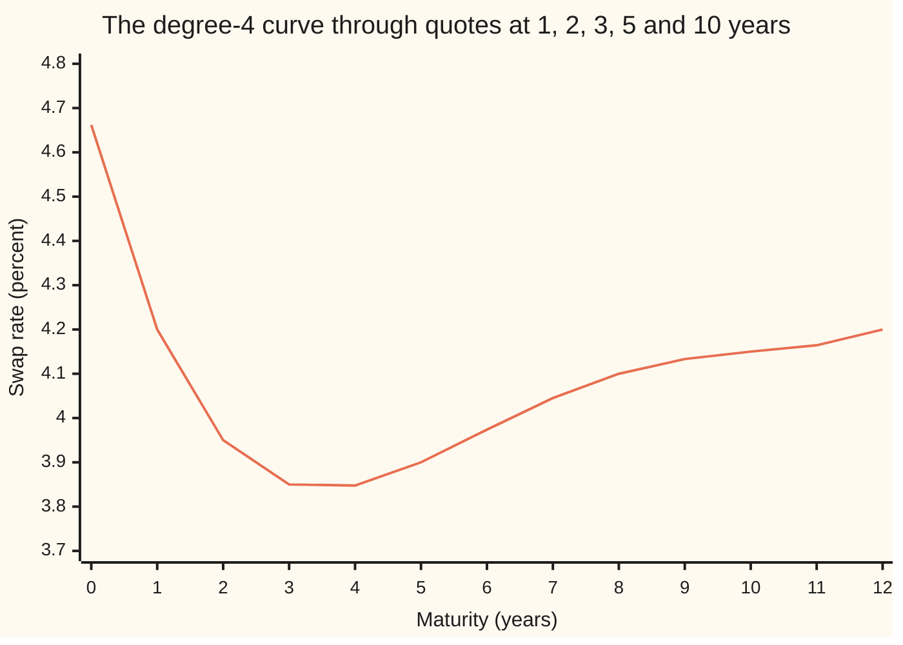

# One polynomial through n points: Lagrange, divided differences and Vandermonde

[Syllabus](../../../SYLLABUS.md) → [Numerical analysis](../README.md) → [Interpolation and Approximation](../README.md#s04) → One polynomial through n points

---

## General Overview

A rates desk sees five quoted swap rates this morning. A **swap rate** is the fixed yearly rate a bank will pay for a set number of years in exchange for a floating rate (one reset to the market every few months). The quotes, illustrative but typical in shape, are:

| Maturity | 1 year | 2 years | 3 years | 5 years | 10 years |
| --- | ---: | ---: | ---: | ---: | ---: |
| Swap rate, percent | 4.20 | 3.95 | 3.85 | 3.90 | 4.15 |

A client wants a 7-year loan at a fixed rate. Suppose the 7-year screen is stale this morning, so the desk needs a 7-year rate read from the five quotes, to within a basis point or so. A **basis point** (bp) is 0.01 percentage point.

[Linear interpolation](01-linear-interpolation-and-extrapolation.md) joins the 5-year and 10-year quotes with a straight line and ignores the other three. This card does the opposite: it passes one smooth curve through all five. With five points that curve is a polynomial of degree 4, and it reads **4.045238 percent** at 7 years.

There are three classic ways to build that curve. The Lagrange form writes it as a weighted sum of the quotes. Newton's divided differences build it one quote at a time. The Vandermonde way solves a linear system for its coefficients. All three give the same curve, because only one exists. They differ in cost, in how easily a new quote is added, and in how much rounding hurts.

**Through n + 1 points with different x-values passes exactly one polynomial of degree at most n; Lagrange, Newton and Vandermonde are three ways of writing it, and the right one depends on whether the job is adding points or reading values.**

**What kind of fact this is:** a theorem (existence and uniqueness), proved on this card in Why it works. The three forms are methods; their costs are operation counts printed by the checks. How far the curve is from the true rate is the job of [The interpolation error theorem](03-polynomial-interpolation-error.md).

### The picture: the curve through the five quotes



One line: the interpolating polynomial, read at every whole year. It passes exactly through the five quotes at 1, 2, 3, 5 and 10 years. At 7 years it reads 4.0452. Year 0 and years 11 and 12 lie outside the quotes, so those three values are extrapolation.

---

## The formula

Notation first. Number the quotes from 0. The maturities are the **nodes** $x_0, \dots, x_n$, here 1, 2, 3, 5 and 10 years, so $n = 4$. The quoted rates are $y_0, \dots, y_n$. The title's "n points" are these $n + 1$ points; the polynomial has degree at most $n$.

The **interpolating polynomial** $p$ is a polynomial of degree at most $n$ with $p(x_j) = y_j$ at every node. Here is the same $p$ three ways.

**Lagrange form.** Each quote gets a **basis polynomial** $\ell_j$ that is 1 at its own node and 0 at every other node:

$$p(x) = \sum_{j=0}^{n} y_j\,\ell_j(x), \qquad \ell_j(x) = \prod_{k \ne j} \frac{x - x_k}{x_j - x_k}$$

**Read it aloud:** the reading at $x$ is a weighted sum of the quotes, and quote $j$'s weight is a polynomial that switches it fully on at its own maturity and off at the others.

**Newton form.** The **divided differences** are built by one rule, starting from the quotes, $f[x_j] = y_j$:

$$f[x_i, \dots, x_{i+k}] = \frac{f[x_{i+1}, \dots, x_{i+k}] - f[x_i, \dots, x_{i+k-1}]}{x_{i+k} - x_i}$$

$$p(x) = f[x_0] + f[x_0, x_1](x - x_0) + f[x_0, x_1, x_2](x - x_0)(x - x_1) + \dots + f[x_0, \dots, x_n](x - x_0)\cdots(x - x_{n-1})$$

**Read it aloud:** start from the first quote, then add one correction per extra quote; each correction is zero at every earlier node, so it never spoils an earlier fit.

**Vandermonde form.** Write $p(x) = a_0 + a_1 x + \dots + a_n x^n$ and demand $p(x_j) = y_j$ at every node. That is a linear system $V a = y$ ([Solving A x = b](../../03-Algebra/05-Solving%20Systems/01-matrix-equation-ax-b.md)):

$$V = \begin{pmatrix} 1 & x_0 & x_0^2 & \cdots & x_0^n \\ \vdots & & & & \vdots \\ 1 & x_n & x_n^2 & \cdots & x_n^n \end{pmatrix}, \qquad \det V = \prod_{0 \le i < j \le n} (x_j - x_i)$$

**Read it aloud:** row $j$ of the Vandermonde matrix is the powers of maturity $j$; its determinant is the product of every gap between two maturities, so it is zero only when two maturities coincide.

| Symbol | Plain meaning | In our example | Push it up and the answer… |
| --- | --- | --- | --- |
| $x$ | the maturity where the curve is read, in years | 7 | moves along the curve; past 10 it is extrapolation |
| $x_j$ | node $j$: a quoted maturity | 1, 2, 3, 5, 10 | — |
| $y_j$ | the quoted rate at node $j$, percent | 4.20, 3.95, 3.85, 3.90, 4.15 | the reading moves by $\ell_j(x)$ times the change |
| $n$ | the degree; there are $n + 1$ nodes | 4 | more wiggle between nodes ([Runge's phenomenon](04-runge-phenomenon-and-chebyshev-nodes.md)) |
| $p(x)$ | the interpolating polynomial's reading | 4.045238 at 7 years | — |
| $\ell_j(x)$ | Lagrange basis polynomial: 1 at $x_j$, 0 at the other nodes | at 7 years: −1.666667, 6.000000, −6.428571, 3.000000, 0.095238 | — |
| $f[x_i, \dots, x_{i+k}]$ | a divided difference: the leading coefficient of the curve through those nodes | $f[x_0, x_1] = -0.25$ | — |
| $a_k$ | the coefficient of $x^k$ in the ordinary (monomial) form | $a_0 = 4.6619047619$, $a_4 = 0.0003968254$ | — |
| $V$ | the Vandermonde matrix: row $j$ holds $1, x_j, x_j^2, \dots, x_j^n$ | 5 by 5; $\det V = 120960$ | — |
| $w_j$ | barycentric weight: $1 / \prod_{k \ne j}(x_j - x_k)$ | computed once, 45 operations | — |
| $\kappa(V)$ | condition number: how much $V$ can magnify a small error in $y$ or in rounding | 248330.9 | more digits lost in $a$ |
| $\omega(x)$ | the node product $(x - x_0)\cdots(x - x_n)$ | $\omega(7) = -720$ | — |

### When it holds

- **The nodes are all different.** Two quotes at 5 years with rates 3.90 and 3.92 make a gap $x_j - x_i$ of zero. Every form then divides by zero, and no polynomial fits both quotes.
- **The degree is capped at $n$.** Allow degree 5 through five points and the curve is no longer unique. The node product $\omega(x) = (x - 1)(x - 2)(x - 3)(x - 5)(x - 10)$ is zero at every quote, so adding $0.0001\,\omega(x)$ keeps every quote but moves the 7-year reading to 3.973238.
- **The reading stays inside the nodes.** Inside 1 to 10 years the curve is a fair guess. At 30 years it reads 92.650000 percent, which is nonsense.
- **Exact arithmetic, or a well-scaled form.** All three forms agree in exact arithmetic. The monomial coefficients are fragile: at 10 years the $x^4$ coefficient is multiplied by the fourth power of 10, so rounding the coefficients to four decimals moves the 10-year reading from 4.15 to 4.182900. The same large powers make the condition number $\kappa(V)$ 248330.9.

---

## Why it works

### Step 0: build one function per quote, then add

The trick is to solve five small problems instead of one large one. For each quote, build a polynomial that is 1 at that quote's maturity and 0 at the other four. A product of factors $(x - x_k)$ vanishes at the other four nodes; dividing by the same product at $x_j$ makes it 1 at node $j$. That is $\ell_j$.

Multiply each $\ell_j$ by its quote and add. At node $j$ only the $j$-th term survives, and it gives exactly $y_j$. Each $\ell_j$ has degree $n$, so the sum has degree at most $n$. That proves a curve **exists**.

### Step 1: there is only one

Suppose two polynomials $p$ and $q$ of degree at most $n$ both pass through all $n + 1$ points. Their difference $p - q$ has degree at most $n$ and is zero at $n + 1$ different nodes.

A polynomial of degree at most $n$ that is not identically zero has at most $n$ roots ([Polynomials](../../03-Algebra/02-Polynomials/01-polynomials.md)). So $p - q$ is identically zero, and $p = q$. The curve is **unique**.

The Vandermonde road says the same thing in linear algebra. The system $V a = y$ has exactly one solution when $\det V \ne 0$. The determinant is the product of all node gaps, which is never zero for different nodes. For our five maturities both the elimination and the product of gaps give 120960.

<details>
<summary>Detailed proof: the Vandermonde determinant is the product of node gaps</summary>

Work by induction on $n$. For $n = 1$, $\det V = x_1 - x_0$.

For larger $n$, replace the last node $x_n$ by a variable $t$. The determinant becomes a polynomial in $t$ of degree at most $n$; its $t^n$ coefficient is the smaller Vandermonde determinant on $x_0, \dots, x_{n-1}$.

Put $t = x_i$ for any $i < n$: two rows are then equal, so the determinant is 0. A polynomial of degree $n$ with the $n$ roots $x_0, \dots, x_{n-1}$ is its leading coefficient times $(t - x_0)\cdots(t - x_{n-1})$.

So $\det V$ equals the smaller determinant times $\prod_{i<n}(x_n - x_i)$. The induction hypothesis turns the smaller determinant into $\prod_{0 \le i < j \le n-1}(x_j - x_i)$, and the two products together are the full product. ∎

</details>

### Step 2: Newton's form adds one quote at a time

Start with the constant 4.20, the 1-year quote. To add the 2-year quote without spoiling the first, add a multiple of $(x - 1)$: that term is zero at 1 year. Choose the multiple so the curve hits 3.95 at 2 years.

Repeat. To add the 3-year quote, add a multiple of $(x - 1)(x - 2)$, which is zero at both earlier nodes. Each new term is zero at every earlier node, so old fits survive.

The multiple chosen at each stage is the **leading coefficient** (the coefficient of the highest power) of the curve through the nodes used so far. The divided-difference rule computes exactly that number.

<details>
<summary>Detailed proof: the leading coefficient obeys the divided-difference rule</summary>

Let $r$ be the interpolant through $x_{i+1}, \dots, x_{i+k}$ and $s$ the interpolant through $x_i, \dots, x_{i+k-1}$. Both have degree at most $k - 1$. Define

$$P(x) = \frac{(x - x_i)\,r(x) - (x - x_{i+k})\,s(x)}{x_{i+k} - x_i}.$$

At $x_i$ the first product vanishes and $P(x_i) = s(x_i) = y_i$. At $x_{i+k}$ the second product vanishes and $P = r(x_{i+k}) = y_{i+k}$. At a shared inner node, $r = s = y$, and $P = y\,(x_{i+k} - x_i)/(x_{i+k} - x_i) = y$.

So $P$ has degree at most $k$ and passes through all of $x_i, \dots, x_{i+k}$; by Step 1 it is the interpolant there. Its $x^k$ coefficient is (leading coefficient of $r$ − leading coefficient of $s$) / $(x_{i+k} - x_i)$. That is the divided-difference rule. ∎

This identity, used to compute values instead of coefficients, is Neville's algorithm.

</details>

### Step 3: the barycentric form makes Lagrange cheap to read

Read directly, the Lagrange form costs 90 operations at every maturity, because each $\ell_j$ is rebuilt. A rearrangement fixes this. Each $\ell_j$ is the node product $\omega(x)$ with its own factor $(x - x_j)$ taken out, times a number $w_j$ that depends only on the nodes:

$$\ell_j(x) = \omega(x)\,\frac{w_j}{x - x_j}, \qquad w_j = \frac{1}{\prod_{k \ne j}(x_j - x_k)}$$

So $p(x) = \omega(x) \sum_j \frac{w_j}{x - x_j}\,y_j$. The same formula applied to the constant 1, whose interpolant is 1, gives $1 = \omega(x) \sum_j \frac{w_j}{x - x_j}$. Divide the first by the second, and $\omega(x)$ cancels:

$$p(x) = \frac{\sum_j \dfrac{w_j}{x - x_j}\,y_j}{\sum_j \dfrac{w_j}{x - x_j}}$$

The formula divides by $x - x_j$, so it cannot be used at a node itself; there the reading is $y_j$, returned directly.

The weights $w_j$ depend only on the nodes. They cost 45 operations once; each reading then costs 26. This is the **barycentric** form. Higham (2004) showed it is forward stable (its rounding error stays small) on well-spread nodes, which makes it the standard way to evaluate a Lagrange interpolant in floating point.

### Step 4: what each form costs, and when to use it

Every count below is for five quotes ($n = 4$), counting each +, −, × and ÷ once. The checks count them as they run, and assert each against the formulas below.

| Form | Build once | Each reading | Add a sixth quote | Use it when |
| --- | ---: | ---: | --- | --- |
| Lagrange, direct | 0 | 90 | rebuild | a single reading, or a proof |
| Barycentric | 45 | 26 | rescale the weights | the same maturities come back with new rates: the weights are kept |
| Newton | 30 | 12 | 15 more | quotes arrive one at a time, or a few readings of one curve |
| Vandermonde | 135 | 8 | 221, from scratch | many readings of one fixed curve on a few well-scaled nodes |

In general, with $n + 1$ nodes, Newton's table costs $3n(n+1)/2$ operations and each reading $3n$. Vandermonde elimination costs about $2(n+1)^3/3$ for large $n$; this code's exact count, with back substitution, is $n(n+1)(2n+1)/3 + 5n(n+1)/2 + (n+1)^2$, which is 135 at $n = 4$ and 221 at $n = 5$. Lagrange read directly costs $(4n + 2)(n + 1)$ per reading; the barycentric form costs $(2n + 1)(n + 1)$ once and $5(n + 1) + 1$ per reading.

At five quotes every form is accurate in floating point: the four float roads land within 4.4e-15 of the exact reading, and Newton is the cheapest to build, read and update. The barycentric form earns its place another way. Its weights depend only on the maturities, so when tomorrow's rates arrive at the same five maturities, nothing is rebuilt: one reading costs 26 operations, against Newton's 30 to redo its table plus 12 to read. Higham's proof also covers its rounding on well-spread nodes at any $n$.

Vandermonde has the cheapest reading, but its coefficients are the most sensitive. Its condition number $\kappa(V)$, the factor by which it can magnify a small error, is 248330.9 on maturities 1 to 10. At five quotes double precision absorbs that: the Vandermonde reading is off by only 8.9e-16. But $\kappa(V)$ grows fast with more nodes, and coefficients written down to a few decimals feel it at once (What breaks, below). Rescaling the maturities to the interval −1 to 1 first brings it down to 205.0. [Matrix norms and the condition number](../03-Numerical%20Linear%20Algebra/01-matrix-norms-and-the-condition-number.md) defines $\kappa$.

---

## Worked numbers, by hand

Newton's form is the hand method. Build the divided-difference table, then add one term per quote at 7 years.

| Step | Arithmetic | Value |
| --- | --- | --- |
| Level 1 | (3.95 − 4.20) / (2 − 1); (3.85 − 3.95) / (3 − 2); (3.90 − 3.85) / (5 − 3); (4.15 − 3.90) / (10 − 5) | −0.25, −0.10, 0.025, 0.05 |
| Level 2 | (−0.10 + 0.25) / (3 − 1); (0.025 + 0.10) / (5 − 2); (0.05 − 0.025) / (10 − 3) | 0.075, 0.0416667, 0.0035714 |
| Level 3 | (0.0416667 − 0.075) / (5 − 1); (0.0035714 − 0.0416667) / (10 − 2) | −0.0083333, −0.0047619 |
| Level 4 | (−0.0047619 + 0.0083333) / (10 − 1) | 0.0003968 |
| Term 0 | the 1-year quote | 4.200000 |
| Term 1 | −0.25 × (7 − 1) | −1.500000 |
| Term 2 | 0.075 × 6 × (7 − 2) | 2.250000 |
| Term 3 | −0.0083333 × 30 × (7 − 3) | −1.000000 |
| Term 4 | 0.0003968254 × 120 × (7 − 5) | 0.095238 |
| Sum | 4.2 − 1.5 + 2.25 − 1.0 + 0.095238 | **4.045238 percent** |

The top entry of each level is a Newton coefficient: 4.20, −0.25, 0.075, −0.0083333, 0.0003968. The degree-4 curve through the five quotes reads 4.045238 percent at 7 years. In exact fractions the reading is 1699/420.

The Lagrange weights at 7 years tell the same story another way: −1.666667, 6.000000, −6.428571, 3.000000 and 0.095238, one per quote. They add to 1. They are large and of both signs, so a 1 bp change in the 2-year quote moves the 7-year reading by 6 bp.

### A sixth quote arrives

At noon a 7-year quote prints at 4.00 percent. The curve had read 4.045238, so its true error was 4.52 bp. The straight line through the 5-year and 10-year quotes reads 4.000000, exactly the noon quote. One morning proves nothing, but more quotes and a higher degree did not buy accuracy here; [Runge's phenomenon](04-runge-phenomenon-and-chebyshev-nodes.md) and [Cubic splines](05-splines.md) show when they help and when they hurt.

Newton absorbs the new quote with one new row of the table: 15 operations. The five old coefficients are unchanged, and one new term is added, with coefficient 0.0000628307. Vandermonde has to be solved again from scratch: 221 operations.

The new curve passes through all six quotes. Its 4-year reading moves from 3.847619 to 3.849881, which matches the exact six-point answer, 3.849881.

### What breaks if you drop a piece

| Mistake | Comes out at | What went wrong |
| --- | --- | --- |
| Two quotes at 5 years, 3.90 and 3.92 | division by zero | Nodes must differ; no function takes two values at one point |
| Degree 5 through five quotes, adding $0.0001\,\omega(x)$ | 7 years reads 3.973238, not 4.045238 | Without the degree cap the curve is not unique |
| Monomial coefficients rounded to 4 decimals | 10 years reads 4.182900, not 4.15; 7 years reads 4.053600 | The $x^4$ coefficient is multiplied by the fourth power of 10, so a tiny rounding grows; the same scaling makes $\kappa(V)$ 248330.9 |
| Reading at 30 years | 92.650000 percent | Extrapolation: the $x^4$ term takes over outside the nodes |

---

## Code, from first principles, and it actually runs

The code builds the 7-year reading five ways. The known answer is the Lagrange form in exact fractions, 1699/420. Against it run four floating-point roads: Lagrange read directly, Newton's table with nested evaluation (innermost bracket first), Vandermonde by Gaussian elimination with partial pivoting (the largest entry used as pivot), and the barycentric form. Each prints its error against the exact answer and its operation count, and every count is asserted against its closed form. A separate exact elimination gives $\det V$ and $\kappa(V)$; the determinant is checked against the product of node gaps, and $\kappa(V)$ against an inverse rebuilt from the coefficients of the Lagrange basis polynomials. The Rust program writes its own fraction type.

### Python

```python
# One polynomial through five swap quotes -- the check behind the card.  Standard library
# only.  Illustrative swap rates (percent) at 1, 2, 3, 5 and 10 years.  The degree-4 curve
# is built in exact fractions (the known answer), then by Lagrange, Newton, Vandermonde and
# barycentric in floats, with errors and operation counts.  Then a 7-year quote arrives.
from fractions import Fraction as Fr
X, Y, T = [1.0, 2.0, 3.0, 5.0, 10.0], [4.20, 3.95, 3.85, 3.90, 4.15], 7.0
XQ, YQ = [Fr(int(x)) for x in X], [Fr(int(round(y * 100)), 100) for y in Y]
ops = 0                                       # + - * / done, counted as they happen
def e(v): return f"{v:.1e}".replace("e-0", "e-").replace("e+0", "e+").replace("e+", "e")   # as Rust prints it

def lagrange(xs, ys, t):                      # road 1: sum of y_j times basis l_j(t)
    global ops
    s = ys[0] * 0
    for j in range(len(xs)):
        l = ys[0] * 0 + 1
        for k in range(len(xs)):
            if k != j:
                l = l * (t - xs[k]) / (xs[j] - xs[k]); ops += 4
        s = s + ys[j] * l; ops += 2
    return s
def divided(xs, ys):                          # road 2: Newton's divided-difference table
    global ops
    tab = [list(ys)]                          # level k, entry i: f[x_i, ..., x_(i+k)]
    for k in range(1, len(xs)):
        p = tab[-1]; ops += 3 * (len(p) - 1)
        tab.append([(p[i + 1] - p[i]) / (xs[i + k] - xs[i]) for i in range(len(p) - 1)])
    return tab
def nested(xs, c, t):                         # Newton form, evaluated inside out
    global ops
    p = c[-1]
    for i in range(len(c) - 2, -1, -1):
        p = p * (t - xs[i]) + c[i]; ops += 3
    return p
def solve(A, b):                              # Gaussian elimination, partial pivoting
    global ops
    n = len(b); M = [row[:] + [bi] for row, bi in zip(A, b)]; det = 1
    for i in range(n):
        piv = max(range(i, n), key=lambda r: abs(M[r][i]))
        if piv != i:
            M[i], M[piv] = M[piv], M[i]; det = -det
        det = det * M[i][i]
        for r in range(i + 1, n):
            f = M[r][i] / M[i][i]; ops += 1
            for c in range(i, n + 1):
                M[r][c] = M[r][c] - f * M[i][c]; ops += 2
    a = [0] * n
    for i in range(n - 1, -1, -1):
        s = M[i][n]
        for k in range(i + 1, n):
            s = s - M[i][k] * a[k]; ops += 2
        a[i] = s / M[i][i]; ops += 1
    return a, det
def horner(a, t):                             # monomial form a0 + a1 t + ... + a4 t^4
    global ops
    p = a[-1]
    for c in reversed(a[:-1]):
        p = p * t + c; ops += 2
    return p
def bary_weights(xs):                         # road 4: w_j = 1 / prod (x_j - x_k)
    global ops
    w = []
    for j in range(len(xs)):
        d = 1.0
        for k in range(len(xs)):
            if k != j:
                d = d * (xs[j] - xs[k]); ops += 2
        w.append(1.0 / d); ops += 1
    return w
def bary(xs, ys, w, t):                       # barycentric second form
    global ops
    num = den = 0.0
    for j in range(len(xs)):
        q = w[j] / (t - xs[j]); num = num + q * ys[j]; den = den + q; ops += 5
    ops += 1
    return num / den
def vander(xs): return [[x ** k for k in range(len(xs))] for x in xs]   # rows 1, x, x^2, x^3, x^4
def kappa(xs):                                # infinity-norm condition number, exact
    n = len(xs); inv = [solve(vander(xs), [Fr(int(i == j)) for i in range(n)])[0] for j in range(n)]
    norm = lambda M: max(sum(abs(v) for v in row) for row in M)
    return float(norm(vander(xs)) * norm([[inv[j][i] for j in range(n)] for i in range(n)]))
def l_coeffs(xs, j):                          # x^k coefficients of l_j: column j of V^-1, a second road
    c = [Fr(1)]
    for m in (m for m in range(len(xs)) if m != j):
        c = [((c[k - 1] if k else 0) - xs[m] * (c[k] if k < len(c) else 0)) / (xs[j] - xs[m]) for k in range(len(c) + 1)]
    return c
def counted(f, *args):
    global ops
    ops = 0; v = f(*args); return v, ops

exact = lagrange(XQ, YQ, Fr(7)); ex = float(exact)
print(f"quotes (years: percent) {', '.join(f'{x:.0f}: {y:.2f}' for x, y in zip(X, Y))}")
print(f"exact 7-year reading {exact} = {ex:.6f} percent")
tab, nc = counted(divided, X, Y); c = [col[0] for col in tab]; w, nw = counted(bary_weights, X)
a, na = counted(lambda: solve(vander(X), Y)[0])
roads = [("Lagrange", *counted(lagrange, X, Y, T), 0), ("Newton", *counted(nested, X, c, T), nc),
         ("Vandermonde", *counted(horner, a, T), na), ("barycentric", *counted(bary, X, Y, w, T), nw)]
for name, v, n_eval, n_setup in roads:
    print(f"{name:12s} 7y {v:.15f}  error {e(v - ex)}  ops setup {n_setup:3d}, per reading {n_eval:3d}")
    assert abs(v - ex) < 1e-13                # four float roads meet the exact answer
for k in range(1, 5): print(f"divided differences, level {k}: {', '.join(f'{v:.7f}' for v in tab[k])}")
print(f"Newton coefficients {', '.join(f'{v:.10f}' for v in c)}")
print(f"Newton terms at 7y {', '.join(f'{c[k] * g:.6f}' for k, g in enumerate([1, 6, 30, 120, 240]))}")
print(f"Lagrange basis at 7y {', '.join(f'{lagrange(X, [float(i == j) for i in range(5)], T):.6f}' for j in range(5))}")
print(f"monomial coefficients {', '.join(f'{v:.10f}' for v in a)}")
det = solve(vander(XQ), [Fr(0)] * 5)[1]; prod = 1
for i, j in [(i, j) for i in range(5) for j in range(i + 1, 5)]: prod = prod * (XQ[j] - XQ[i])
print(f"det V by elimination {det}, by product of node gaps {prod}")
assert det == prod and det != 0              # unique: V can be inverted
k1, k2 = kappa(XQ), kappa([(2 * x - 11) / 9 for x in XQ])
print(f"kappa(V) years 1..10 {k1:.1f}; rescaled to [-1, 1] {k2:.1f}")
Vi = [[l_coeffs(XQ, j)[k] for j in range(5)] for k in range(5)]     # V^-1 rebuilt: row k, every l_j's x^k
assert abs(k1 - float(max(sum(r) for r in vander(XQ)) * max(sum(abs(v) for v in r) for r in Vi))) < 1e-9 * k1
q7 = 4.00; X6, Y6 = X + [T], Y + [q7]
print(f"7y quote arrives {q7:.2f}: curve read {ex:.6f}, true error {(ex - q7) * 100:.2f} bp; line 5y-10y read {Y[3] + (Y[4] - Y[3]) * (T - X[3]) / (X[4] - X[3]):.6f}")
tab6, nu = counted(divided, X6, Y6); c6 = [col[0] for col in tab6]
_, nfull = counted(lambda: solve(vander(X6), Y6))
print(f"new Newton term {c6[-1]:.10f}; update ops Newton {nu - nc}, Vandermonde redo {nfull}")
assert c6[:5] == c                            # old Newton coefficients survive unchanged
n = 4; elim = lambda N: (N - 1) * N * (2 * N - 1) // 3 + 5 * N * (N - 1) // 2 + N * N   # this solve, N unknowns
assert [r[2] for r in roads] == [(4 * n + 2) * (n + 1), 3 * n, 2 * n, 5 * (n + 1) + 1]  # counts against closed forms
assert [nc, nw, na, nu - nc, nfull] == [3 * n * (n + 1) // 2, (2 * n + 1) * (n + 1), elim(n + 1), 3 * (n + 1), elim(n + 2)]
r4, r4n = nested(X, c, 4.0), nested(X6, c6, 4.0)
r4x = float(lagrange(XQ + [Fr(7)], YQ + [Fr(4)], Fr(4)))
print(f"4y reading before {r4:.6f}, after {r4n:.6f}, exact after {r4x:.6f}")
assert abs(r4n - r4x) < 1e-13 and abs(nested(X6, c6, T) - q7) < 1e-13
try: divided([1.0, 2.0, 3.0, 5.0, 5.0], [4.20, 3.95, 3.85, 3.90, 3.92]); bad = "no error"
except ZeroDivisionError: bad = "division by zero"
wx = 1.0                                      # omega(x) = (x - 1)(x - 2)(x - 3)(x - 5)(x - 10)
for x in X: wx = wx * (T - x)
print(f"mistake 1, two 5y quotes 3.90 and 3.92: {bad}")
print(f"mistake 2, degree 5 adds 0.0001 x omega(x), omega(7) = {wx:.0f}: 7y reads {ex + 1e-4 * wx:.6f}")
ar = [round(v * 1e4) / 1e4 for v in a]
print(f"mistake 3, coefficients to 4 decimals: 10y reads {horner(ar, 10.0):.6f}, 7y {horner(ar, T):.6f}")
print(f"mistake 4, read at 30 years: {nested(X, c, 30.0):.6f} percent")
assert abs(horner(ar, 10.0) - 4.15) > 0.03 and nested(X, c, 30.0) > 90
print("figure, " + ", ".join(f"{nested(X, c, float(t)):.4f}" for t in range(13)))
print("ALL CHECKS PASS")
```

**Ran 2026-11-11 on macOS, Python 3.14.10, standard library only. All checks passed. Output, pasted from the run:**

```
quotes (years: percent) 1: 4.20, 2: 3.95, 3: 3.85, 5: 3.90, 10: 4.15
exact 7-year reading 1699/420 = 4.045238 percent
Lagrange     7y 4.045238095238098  error 2.7e-15  ops setup   0, per reading  90
Newton       7y 4.045238095238095  error 0.0e0  ops setup  30, per reading  12
Vandermonde  7y 4.045238095238096  error 8.9e-16  ops setup 135, per reading   8
barycentric  7y 4.045238095238100  error 4.4e-15  ops setup  45, per reading  26
divided differences, level 1: -0.2500000, -0.1000000, 0.0250000, 0.0500000
divided differences, level 2: 0.0750000, 0.0416667, 0.0035714
divided differences, level 3: -0.0083333, -0.0047619
divided differences, level 4: 0.0003968
Newton coefficients 4.2000000000, -0.2500000000, 0.0750000000, -0.0083333333, 0.0003968254
Newton terms at 7y 4.200000, -1.500000, 2.250000, -1.000000, 0.095238
Lagrange basis at 7y -1.666667, 6.000000, -6.428571, 3.000000, 0.095238
monomial coefficients 4.6619047619, -0.5908730159, 0.1412698413, -0.0126984127, 0.0003968254
det V by elimination 120960, by product of node gaps 120960
kappa(V) years 1..10 248330.9; rescaled to [-1, 1] 205.0
7y quote arrives 4.00: curve read 4.045238, true error 4.52 bp; line 5y-10y read 4.000000
new Newton term 0.0000628307; update ops Newton 15, Vandermonde redo 221
4y reading before 3.847619, after 3.849881, exact after 3.849881
mistake 1, two 5y quotes 3.90 and 3.92: division by zero
mistake 2, degree 5 adds 0.0001 x omega(x), omega(7) = -720: 7y reads 3.973238
mistake 3, coefficients to 4 decimals: 10y reads 4.182900, 7y 4.053600
mistake 4, read at 30 years: 92.650000 percent
figure, 4.6619, 4.2000, 3.9500, 3.8500, 3.8476, 3.9000, 3.9738, 4.0452, 4.1000, 4.1333, 4.1500, 4.1643, 4.2000
ALL CHECKS PASS
```

### Rust

Same numbers, same labels, built with `rustc --edition 2021 -O`.

```rust
// One polynomial through five swap quotes -- the same check as the Python, in Rust.  No
// crates.  Illustrative swap rates (percent) at 1, 2, 3, 5 and 10 years.  The degree-4 curve
// is built in exact fractions (the known answer), then by Lagrange, Newton, Vandermonde and
// barycentric in floats, with errors and operation counts.  Then a 7-year quote arrives.
use std::ops::{Add, Div, Mul, Sub};

#[derive(Clone, Copy, PartialEq, Debug)]
struct Q { n: i128, d: i128 }                  // an exact fraction n/d, d > 0, reduced
fn gcd(a: i128, b: i128) -> i128 { if b == 0 { a.abs() } else { gcd(b, a % b) } }
fn q(n: i128, d: i128) -> Q { let g = gcd(n, d).max(1) * if d < 0 { -1 } else { 1 }; Q { n: n / g, d: d / g } }
impl Add for Q { type Output = Q; fn add(self, o: Q) -> Q { q(self.n * o.d + o.n * self.d, self.d * o.d) } }
impl Sub for Q { type Output = Q; fn sub(self, o: Q) -> Q { q(self.n * o.d - o.n * self.d, self.d * o.d) } }
impl Mul for Q { type Output = Q; fn mul(self, o: Q) -> Q { q(self.n * o.n, self.d * o.d) } }
impl Div for Q { type Output = Q; fn div(self, o: Q) -> Q { q(self.n * o.d, self.d * o.n) } }
impl PartialOrd for Q { fn partial_cmp(&self, o: &Q) -> Option<std::cmp::Ordering> { (self.n * o.d).partial_cmp(&(o.n * self.d)) } }
trait Num: Copy + PartialOrd + Add<Output = Self> + Sub<Output = Self> + Mul<Output = Self> + Div<Output = Self> {
    fn from_i(i: i64) -> Self;
    fn absv(self) -> Self { if self < Self::from_i(0) { Self::from_i(0) - self } else { self } }
}
impl Num for f64 { fn from_i(i: i64) -> f64 { i as f64 } }
impl Num for Q { fn from_i(i: i64) -> Q { q(i as i128, 1) } }
fn e(v: f64) -> String { format!("{:.1e}", v) }
fn lagrange<T: Num>(xs: &[T], ys: &[T], t: T, ops: &mut u64) -> T {   // road 1
    let mut s = T::from_i(0);
    for j in 0..xs.len() {
        let mut l = T::from_i(1);
        for k in 0..xs.len() {
            if k != j { l = l * (t - xs[k]) / (xs[j] - xs[k]); *ops += 4 }
        }
        s = s + ys[j] * l; *ops += 2;
    }
    s
}
fn divided(xs: &[f64], ys: &[f64], ops: &mut u64) -> Vec<Vec<f64>> { // road 2: Newton's table
    let mut tab = vec![ys.to_vec()];                // level k, entry i: f[x_i, ..., x_(i+k)]
    for k in 1..xs.len() {
        let p = tab[k - 1].clone(); *ops += 3 * (p.len() as u64 - 1);
        tab.push((0..p.len() - 1).map(|i| (p[i + 1] - p[i]) / (xs[i + k] - xs[i])).collect());
    }
    tab
}
fn nested(xs: &[f64], c: &[f64], t: f64, ops: &mut u64) -> f64 {     // Newton form, inside out
    (0..c.len() - 1).rev().fold(c[c.len() - 1], |p, i| { *ops += 3; p * (t - xs[i]) + c[i] })
}
fn solve<T: Num>(a: &[Vec<T>], b: &[T], ops: &mut u64) -> (Vec<T>, T) { // partial pivoting
    let n = b.len();
    let mut m: Vec<Vec<T>> = a.iter().zip(b).map(|(r, &bi)| { let mut r = r.clone(); r.push(bi); r }).collect();
    let mut det = T::from_i(1);
    for i in 0..n {
        let mut piv = i;
        for r in i..n { if m[r][i].absv() > m[piv][i].absv() { piv = r } }
        if piv != i { m.swap(i, piv); det = T::from_i(0) - det }
        det = det * m[i][i];
        for r in i + 1..n {
            let f = m[r][i] / m[i][i]; *ops += 1;
            for c in i..=n { m[r][c] = m[r][c] - f * m[i][c]; *ops += 2 }
        }
    }
    let mut x = vec![T::from_i(0); n];
    for i in (0..n).rev() {
        let mut s = m[i][n];
        for k in i + 1..n { s = s - m[i][k] * x[k]; *ops += 2 }
        x[i] = s / m[i][i]; *ops += 1;
    }
    (x, det)
}
fn horner(a: &[f64], t: f64, ops: &mut u64) -> f64 {                // monomial form
    a[..a.len() - 1].iter().rev().fold(a[a.len() - 1], |p, &c| { *ops += 2; p * t + c })
}
fn bary_weights(xs: &[f64], ops: &mut u64) -> Vec<f64> {            // road 4: weights
    let mut w = Vec::new();
    for j in 0..xs.len() {
        let mut d = 1.0;
        for k in 0..xs.len() { if k != j { d = d * (xs[j] - xs[k]); *ops += 2 } }
        w.push(1.0 / d); *ops += 1;
    }
    w
}
fn bary(xs: &[f64], ys: &[f64], w: &[f64], t: f64, ops: &mut u64) -> f64 {
    let (mut num, mut den) = (0.0, 0.0);
    for j in 0..xs.len() { let qj = w[j] / (t - xs[j]); num = num + qj * ys[j]; den = den + qj; *ops += 5 }
    *ops += 1;
    num / den
}
fn vander<T: Num>(xs: &[T]) -> Vec<Vec<T>> {
    xs.iter().map(|&x| { let mut r = vec![T::from_i(1)]; for _ in 1..xs.len() { let l = r[r.len() - 1]; r.push(l * x) } r }).collect()
}
fn kappa(xs: &[Q]) -> f64 {                     // infinity-norm condition number, exact
    let n = xs.len();
    let inv: Vec<Vec<Q>> = (0..n).map(|j| solve(&vander(xs), &(0..n).map(|i| Q::from_i((i == j) as i64)).collect::<Vec<_>>(), &mut 0).0).collect();
    let norm = |m: &Vec<Vec<Q>>| m.iter().map(|r| r.iter().fold(Q::from_i(0), |s, &v| s + v.absv()))
        .fold(Q::from_i(0), |a, b| if b > a { b } else { a });
    let invt: Vec<Vec<Q>> = (0..n).map(|i| (0..n).map(|j| inv[j][i]).collect()).collect();
    let k = norm(&vander(xs)) * norm(&invt);
    k.n as f64 / k.d as f64
}
fn l_coeffs(xs: &[Q], j: usize) -> Vec<Q> {     // x^k coefficients of l_j: column j of V^-1, a second road
    let (mut c, z) = (vec![Q::from_i(1)], Q::from_i(0));
    for m in (0..xs.len()).filter(|&m| m != j) {
        c = (0..=c.len()).map(|k| ((if k > 0 { c[k - 1] } else { z }) - xs[m] * (if k < c.len() { c[k] } else { z })) / (xs[j] - xs[m])).collect();
    }
    c
}

fn main() {
    let (x, y, t) = (vec![1.0, 2.0, 3.0, 5.0, 10.0], vec![4.20, 3.95, 3.85, 3.90, 4.15], 7.0);
    let xq: Vec<Q> = x.iter().map(|&v| q(v as i128, 1)).collect();
    let yq: Vec<Q> = y.iter().map(|&v| q((v * 100.0f64).round() as i128, 100)).collect();
    let exact = lagrange(&xq, &yq, q(7, 1), &mut 0); let ex = exact.n as f64 / exact.d as f64;
    let qs: Vec<String> = x.iter().zip(&y).map(|(a, b)| format!("{:.0}: {:.2}", a, b)).collect();
    println!("quotes (years: percent) {}", qs.join(", "));
    println!("exact 7-year reading {}/{} = {:.6} percent", exact.n, exact.d, ex);
    let (mut nc, mut nw, mut na) = (0, 0, 0);
    let (tab, w) = (divided(&x, &y, &mut nc), bary_weights(&x, &mut nw));
    let c: Vec<f64> = tab.iter().map(|col| col[0]).collect();
    let a = solve(&vander(&x), &y, &mut na).0;
    let (mut o1, mut o2, mut o3, mut o4) = (0, 0, 0, 0);
    let roads = [("Lagrange", lagrange(&x, &y, t, &mut o1), o1, 0), ("Newton", nested(&x, &c, t, &mut o2), o2, nc),
                 ("Vandermonde", horner(&a, t, &mut o3), o3, na), ("barycentric", bary(&x, &y, &w, t, &mut o4), o4, nw)];
    for (name, v, n_eval, n_setup) in roads {
        println!("{:12} 7y {:.15}  error {}  ops setup {:3}, per reading {:3}", name, v, e(v - ex), n_setup, n_eval);
        assert!((v - ex).abs() < 1e-13);        // four float roads meet the exact answer
    }
    let fj = |v: Vec<f64>, d: usize| v.iter().map(|z| format!("{:.*}", d, z)).collect::<Vec<_>>().join(", ");
    for k in 1..5 { println!("divided differences, level {}: {}", k, fj(tab[k].clone(), 7)) }
    println!("Newton coefficients {}", fj(c.clone(), 10));
    println!("Newton terms at 7y {}", fj(c.iter().zip([1.0, 6.0, 30.0, 120.0, 240.0]).map(|(a, g)| a * g).collect(), 6));
    let basis = (0..5).map(|j| lagrange(&x, &(0..5).map(|i| (i == j) as i64 as f64).collect::<Vec<_>>(), t, &mut 0));
    println!("Lagrange basis at 7y {}\nmonomial coefficients {}", fj(basis.collect(), 6), fj(a.clone(), 10));
    let det = solve(&vander(&xq), &vec![Q::from_i(0); 5], &mut 0).1;
    let mut prod = Q::from_i(1);
    for i in 0..5 { for j in i + 1..5 { prod = prod * (xq[j] - xq[i]) } }
    println!("det V by elimination {}, by product of node gaps {}", det.n, prod.n);
    assert!(det == prod && det.n != 0);         // unique: V can be inverted
    let scaled: Vec<Q> = xq.iter().map(|&v| (Q::from_i(2) * v - Q::from_i(11)) / Q::from_i(9)).collect();
    let k1 = kappa(&xq); println!("kappa(V) years 1..10 {:.1}; rescaled to [-1, 1] {:.1}", k1, kappa(&scaled));
    let rows: Vec<Q> = (0..5).map(|k| (0..5).fold(Q::from_i(0), |s, j| s + l_coeffs(&xq, j)[k].absv())).collect(); // V^-1 rebuilt
    let qmax = |v: Vec<Q>| v.into_iter().fold(Q::from_i(0), |m, r| if r > m { r } else { m });
    let kb = qmax(vander(&xq).iter().map(|r| r.iter().fold(Q::from_i(0), |s, &v| s + v)).collect()) * qmax(rows);
    assert!((k1 - kb.n as f64 / kb.d as f64).abs() < 1e-9 * k1);
    let q7 = 4.00;
    let (x6, y6): (Vec<f64>, Vec<f64>) = ([x.clone(), vec![t]].concat(), [y.clone(), vec![q7]].concat());
    println!("7y quote arrives {:.2}: curve read {:.6}, true error {:.2} bp; line 5y-10y read {:.6}", q7, ex, (ex - q7) * 100.0, y[3] + (y[4] - y[3]) * (t - x[3]) / (x[4] - x[3]));
    let mut nu = 0; let c6: Vec<f64> = divided(&x6, &y6, &mut nu).iter().map(|col| col[0]).collect();
    let mut nfull = 0; solve(&vander(&x6), &y6, &mut nfull);
    println!("new Newton term {:.10}; update ops Newton {}, Vandermonde redo {}", c6[5], nu - nc, nfull);
    assert!(c6[..5] == c[..]);                   // old Newton coefficients survive unchanged
    let n = 4u64; let elim = |nn: u64| (nn - 1) * nn * (2 * nn - 1) / 3 + 5 * nn * (nn - 1) / 2 + nn * nn; // this solve, nn unknowns
    assert!([o1, o2, o3, o4] == [(4 * n + 2) * (n + 1), 3 * n, 2 * n, 5 * (n + 1) + 1]); // counts against closed forms
    assert!([nc, nw, na, nu - nc, nfull] == [3 * n * (n + 1) / 2, (2 * n + 1) * (n + 1), elim(n + 1), 3 * (n + 1), elim(n + 2)]);
    let (r4, r4n) = (nested(&x, &c, 4.0, &mut 0), nested(&x6, &c6, 4.0, &mut 0));
    let r4q = lagrange(&[xq.clone(), vec![q(7, 1)]].concat(), &[yq.clone(), vec![q(4, 1)]].concat(), q(4, 1), &mut 0);
    let r4x = r4q.n as f64 / r4q.d as f64;
    println!("4y reading before {:.6}, after {:.6}, exact after {:.6}", r4, r4n, r4x);
    assert!((r4n - r4x).abs() < 1e-13 && (nested(&x6, &c6, t, &mut 0) - q7).abs() < 1e-13);
    let dup = divided(&[1.0, 2.0, 3.0, 5.0, 5.0], &[4.20, 3.95, 3.85, 3.90, 3.92], &mut 0);
    let bad = if dup.iter().flatten().any(|v| !v.is_finite()) { "division by zero" } else { "no error" };
    let wx = x.iter().fold(1.0, |p, &xi| p * (t - xi)); // omega(x) = (x - 1)(x - 2)(x - 3)(x - 5)(x - 10)
    println!("mistake 1, two 5y quotes 3.90 and 3.92: {}\nmistake 2, degree 5 adds 0.0001 x omega(x), omega(7) = {:.0}: 7y reads {:.6}",
             bad, wx, ex + 1e-4 * wx);
    let ar: Vec<f64> = a.iter().map(|v| (v * 1e4).round() / 1e4).collect();
    let (h10, h7) = (horner(&ar, 10.0, &mut 0), horner(&ar, t, &mut 0));
    println!("mistake 3, coefficients to 4 decimals: 10y reads {:.6}, 7y {:.6}", h10, h7);
    let r30 = nested(&x, &c, 30.0, &mut 0);
    println!("mistake 4, read at 30 years: {:.6} percent", r30);
    assert!((h10 - 4.15).abs() > 0.03 && r30 > 90.0);
    let fig: Vec<String> = (0..13).map(|s| format!("{:.4}", nested(&x, &c, s as f64, &mut 0))).collect();
    println!("figure, {}", fig.join(", "));
    println!("ALL CHECKS PASS");
}
```

**Ran 2026-11-11 on macOS, rustc 1.98.1, no crates. All checks passed. Output, pasted from the run:**

```
quotes (years: percent) 1: 4.20, 2: 3.95, 3: 3.85, 5: 3.90, 10: 4.15
exact 7-year reading 1699/420 = 4.045238 percent
Lagrange     7y 4.045238095238098  error 2.7e-15  ops setup   0, per reading  90
Newton       7y 4.045238095238095  error 0.0e0  ops setup  30, per reading  12
Vandermonde  7y 4.045238095238096  error 8.9e-16  ops setup 135, per reading   8
barycentric  7y 4.045238095238100  error 4.4e-15  ops setup  45, per reading  26
divided differences, level 1: -0.2500000, -0.1000000, 0.0250000, 0.0500000
divided differences, level 2: 0.0750000, 0.0416667, 0.0035714
divided differences, level 3: -0.0083333, -0.0047619
divided differences, level 4: 0.0003968
Newton coefficients 4.2000000000, -0.2500000000, 0.0750000000, -0.0083333333, 0.0003968254
Newton terms at 7y 4.200000, -1.500000, 2.250000, -1.000000, 0.095238
Lagrange basis at 7y -1.666667, 6.000000, -6.428571, 3.000000, 0.095238
monomial coefficients 4.6619047619, -0.5908730159, 0.1412698413, -0.0126984127, 0.0003968254
det V by elimination 120960, by product of node gaps 120960
kappa(V) years 1..10 248330.9; rescaled to [-1, 1] 205.0
7y quote arrives 4.00: curve read 4.045238, true error 4.52 bp; line 5y-10y read 4.000000
new Newton term 0.0000628307; update ops Newton 15, Vandermonde redo 221
4y reading before 3.847619, after 3.849881, exact after 3.849881
mistake 1, two 5y quotes 3.90 and 3.92: division by zero
mistake 2, degree 5 adds 0.0001 x omega(x), omega(7) = -720: 7y reads 3.973238
mistake 3, coefficients to 4 decimals: 10y reads 4.182900, 7y 4.053600
mistake 4, read at 30 years: 92.650000 percent
figure, 4.6619, 4.2000, 3.9500, 3.8500, 3.8476, 3.9000, 3.9738, 4.0452, 4.1000, 4.1333, 4.1500, 4.1643, 4.2000
ALL CHECKS PASS
```

The two outputs match line for line. Every float road lands within 4.4e-15 of the exact answer: rounding, not method, sets the last digit.

### Lean

Lean proves the uniqueness theorem, the Vandermonde determinant and the divided-difference rule, for any number of different nodes.

- Through n + 1 points with different x-values passes exactly one polynomial of degree at most n.
- $\det V$ is the product of every node gap $x_j - x_i$ with $i < j$, so it is zero exactly when two nodes coincide.
- The leading coefficient of the interpolant through any different nodes obeys the divided-difference rule.
- The hand numbers hold in exact fractions: $\det V = 120960$, every level of the divided-difference table, and the Newton terms at 7 years.
- The monomial form hits all five quotes, and the monomial, Newton and Lagrange forms all read 1699/420 at 7 years.
- The Lagrange weights at 7 years are −5/3, 6, −45/7, 3 and 2/21, and they add to 1.
- The What breaks numbers hold: adding $0.0001\,\omega(x)$ reads 41719/10500 at 7 years, rounded coefficients read 4.1829 at 10 years, and 30 years reads 92.65.

The Newton and barycentric formulas, the operation counts, floating-point errors, $\kappa(V)$ and the sixth quote are left to the Python and Rust checks.

```lean
-- One polynomial through n points: exactly one polynomial of degree at most n passes through n + 1 points with different x-values, the Vandermonde determinant is the product of the node gaps, and the divided-difference rule gives the interpolant's leading coefficient.
import Mathlib.LinearAlgebra.Vandermonde
import Mathlib.LinearAlgebra.Lagrange
import Mathlib.Algebra.Polynomial.FieldDivision
import Mathlib.Data.Real.Basic
import Mathlib.Tactic.NormNum

open Polynomial Finset

theorem deg_le_iff_lt_succ (p : ℝ[X]) (n : ℕ) : p.degree ≤ n ↔ p.degree < ↑(n + 1) := by
  constructor
  · intro h
    exact lt_of_le_of_lt h (by exact_mod_cast Nat.lt_succ_self n)
  · intro h
    rw [Polynomial.degree_le_iff_coeff_zero]
    rw [Polynomial.degree_lt_iff_coeff_zero] at h
    intro m hm
    exact h m (by exact_mod_cast hm)

#print axioms deg_le_iff_lt_succ

theorem eq_C_mul_prod_of_eval_eq_zero (T : Finset ℝ) (p : ℝ[X]) (hp : p.degree ≤ #T)
    (h : ∀ t ∈ T, p.eval t = 0) : p = C (p.coeff #T) * ∏ t ∈ T, (X - C t) := by
  have hW : (∏ t ∈ T, (X - C t)).Monic := monic_prod_X_sub_C (fun t => t) T
  have hWd : (∏ t ∈ T, (X - C t)).natDegree = #T := by
    rw [natDegree_prod_of_monic _ _ (fun t _ => monic_X_sub_C t)]
    simp
  rw [← sub_eq_zero]
  refine Polynomial.eq_zero_of_degree_lt_of_eval_finset_eq_zero T ?_ ?_
  · rw [Polynomial.degree_lt_iff_coeff_zero]
    intro m hm
    rw [coeff_sub, coeff_C_mul]
    rcases hm.eq_or_lt with hm | hm
    · subst hm
      rw [← hWd, hW.coeff_natDegree, hWd]; ring
    · have e1 : (∏ t ∈ T, (X - C t)).coeff m = 0 :=
        coeff_eq_zero_of_natDegree_lt (by rw [hWd]; exact hm)
      have e2 : p.coeff m = 0 := coeff_eq_zero_of_degree_lt (lt_of_le_of_lt hp (by exact_mod_cast hm))
      rw [e1, e2]
      ring
  · intro t ht
    rw [eval_sub, eval_mul, eval_prod, prod_eq_zero ht (by simp), h t ht]
    ring

#print axioms eq_C_mul_prod_of_eval_eq_zero

/-- Through n + 1 points whose x-values (the nodes) are all different passes exactly one
polynomial of degree at most n. -/
theorem exists_unique_interpolating_polynomial (n : ℕ) (x y : Fin (n + 1) → ℝ)
    (hx : Function.Injective x) :
    ∃! p : ℝ[X], p.degree ≤ n ∧ ∀ j, p.eval (x j) = y j := by
  refine ⟨Lagrange.interpolate Finset.univ x y, ⟨?_, ?_⟩, ?_⟩
  · rw [deg_le_iff_lt_succ]
    have := Lagrange.degree_interpolate_lt (s := Finset.univ) (r := y) hx.injOn
    simpa using this
  · intro j
    exact Lagrange.eval_interpolate_at_node y hx.injOn (mem_univ j)
  · rintro q ⟨hq, hqe⟩
    have hp : (Lagrange.interpolate Finset.univ x y).degree ≤ n := by
      rw [deg_le_iff_lt_succ]
      have := Lagrange.degree_interpolate_lt (s := Finset.univ) (r := y) hx.injOn
      simpa using this
    refine Polynomial.eq_of_degree_sub_lt_of_eval_finset_eq (Finset.univ.image x) ?_ ?_
    · rw [card_image_of_injective _ hx, card_univ, Fintype.card_fin, ← deg_le_iff_lt_succ]
      exact (degree_sub_le _ _).trans (max_le hq hp)
    · intro t ht
      obtain ⟨j, -, rfl⟩ := mem_image.1 ht
      rw [hqe j, Lagrange.eval_interpolate_at_node y hx.injOn (mem_univ j)]

/-- The Vandermonde matrix, whose row j holds 1, x_j, x_j^2, ..., x_j^n, has determinant equal
to the product of every gap x_j - x_i with i < j; so it is zero exactly when two nodes coincide. -/
theorem det_vandermonde_eq_prod_node_gaps (n : ℕ) (x : Fin (n + 1) → ℝ) :
    (Matrix.vandermonde x).det = ∏ i : Fin (n + 1), ∏ j ∈ Ioi i, (x j - x i) ∧
      ((Matrix.vandermonde x).det ≠ 0 ↔ Function.Injective x) := by
  exact ⟨Matrix.det_vandermonde x, Matrix.det_vandermonde_ne_zero_iff⟩

/-- The divided-difference rule. Take different nodes: a shared set S of inner nodes and two end
nodes a ≠ b outside it. Let r be the interpolant of f through S and b, s the interpolant through
a and S (degree at most #S each), and P the interpolant through a, S and b (degree at most
#S + 1). Then P's leading coefficient is (r's leading coefficient - s's leading coefficient)
divided by (b - a). -/
theorem divided_difference_rule (f : ℝ → ℝ) (S : Finset ℝ) (a b : ℝ) (hab : a ≠ b)
    (ha : a ∉ S) (hb : b ∉ S) (r s P : ℝ[X])
    (hr : r.degree ≤ #S ∧ ∀ t ∈ insert b S, r.eval t = f t)
    (hs : s.degree ≤ #S ∧ ∀ t ∈ insert a S, s.eval t = f t)
    (hP : P.degree ≤ ↑(#S + 1) ∧ ∀ t ∈ insert a (insert b S), P.eval t = f t) :
    P.coeff (#S + 1) = (r.coeff #S - s.coeff #S) / (b - a) := by
  have hSle : ((#S : ℕ) : WithBot ℕ) ≤ ((#S + 1 : ℕ) : WithBot ℕ) := by exact_mod_cast Nat.le_succ _
  have hsc : s.coeff (#S + 1) = 0 :=
    coeff_eq_zero_of_degree_lt (lt_of_le_of_lt hs.1 (by exact_mod_cast Nat.lt_succ_self _))
  have hrc : r.coeff (#S + 1) = 0 :=
    coeff_eq_zero_of_degree_lt (lt_of_le_of_lt hr.1 (by exact_mod_cast Nat.lt_succ_self _))
  have h1 := eq_C_mul_prod_of_eval_eq_zero (insert a S) (P - s) (by
      rw [card_insert_of_notMem ha]
      exact (degree_sub_le _ _).trans (max_le hP.1 (hs.1.trans hSle)))
    (by
      intro t ht
      rw [eval_sub, sub_eq_zero, hs.2 t ht]
      apply hP.2
      rcases mem_insert.1 ht with h | h
      · rw [h]; exact mem_insert_self _ _
      · exact mem_insert_of_mem (mem_insert_of_mem h))
  have h2 := eq_C_mul_prod_of_eval_eq_zero (insert b S) (P - r) (by
      rw [card_insert_of_notMem hb]
      exact (degree_sub_le _ _).trans (max_le hP.1 (hr.1.trans hSle)))
    (by
      intro t ht
      rw [eval_sub, sub_eq_zero, hr.2 t ht]
      exact hP.2 t (mem_insert_of_mem ht))
  rw [card_insert_of_notMem ha, coeff_sub, hsc, sub_zero, prod_insert ha] at h1
  rw [card_insert_of_notMem hb, coeff_sub, hrc, sub_zero, prod_insert hb] at h2
  set M := ∏ t ∈ S, (X - C t) with hM
  set c := P.coeff (#S + 1)
  have hMm : M.Monic := monic_prod_X_sub_C (fun t => t) S
  have hMd : M.natDegree = #S := by
    rw [hM, natDegree_prod_of_monic _ _ (fun t _ => monic_X_sub_C t)]
    simp
  have key : r - s = C (c * (b - a)) * M := by
    have : r - s = (P - s) - (P - r) := by ring
    rw [this, h1, h2, C_mul, C_sub]
    ring
  have hcoef := congrArg (fun q => q.coeff #S) key
  simp only [coeff_sub, coeff_C_mul] at hcoef
  rw [← hMd, hMm.coeff_natDegree, hMd] at hcoef
  rw [hcoef]
  have : b - a ≠ 0 := sub_ne_zero.2 (Ne.symm hab)
  field_simp

/-! Worked numbers from the card: nodes 1, 2, 3, 5, 10 years, quotes 4.20, 3.95, 3.85, 3.90,
4.15 percent, written as exact fractions 21/5, 79/20, 77/20, 39/10, 83/20. -/

-- det V = product of node gaps = 120960.
example : ∏ i : Fin 5, ∏ j ∈ Ioi i, ((![1, 2, 3, 5, 10] : Fin 5 → ℤ) j - ![1, 2, 3, 5, 10] i)
    = 120960 := by decide

-- The monomial form a0 + a1 t + ... + a4 t^4 hits all five quotes and reads 1699/420 at 7 years.
example :
    let p : ℚ → ℚ := fun t => 979/210 - 1489/2520 * t + 89/630 * t^2 - 4/315 * t^3 + 1/2520 * t^4
    p 1 = 21/5 ∧ p 2 = 79/20 ∧ p 3 = 77/20 ∧ p 5 = 39/10 ∧ p 10 = 83/20 ∧ p 7 = 1699/420 := by
  norm_num

-- Divided differences: level 1, then the Newton coefficients 4.20, -0.25, 0.075, -1/120, 1/2520.
example : ((79/20 : ℚ) - 21/5) / (2 - 1) = -1/4 ∧ ((77/20 : ℚ) - 79/20) / (3 - 2) = -1/10 ∧
    ((39/10 : ℚ) - 77/20) / (5 - 3) = 1/40 ∧ ((83/20 : ℚ) - 39/10) / (10 - 5) = 1/20 := by
  norm_num
example : ((-1/10 : ℚ) - -1/4) / (3 - 1) = 3/40 ∧ ((1/40 : ℚ) - -1/10) / (5 - 2) = 1/24 ∧
    ((1/20 : ℚ) - 1/40) / (10 - 3) = 1/280 := by
  norm_num
example : ((1/24 : ℚ) - 3/40) / (5 - 1) = -1/120 ∧ ((1/280 : ℚ) - 1/24) / (10 - 2) = -1/210 ∧
    ((-1/210 : ℚ) - -1/120) / (10 - 1) = 1/2520 := by
  norm_num

-- Newton form at 7 years: 4.2 - 1.5 + 2.25 - 1.0 + 2/21 = 1699/420.
example : (21/5 : ℚ) + (-1/4) * 6 + 3/40 * (6 * 5) + (-1/120) * (6 * 5 * 4)
    + 1/2520 * (6 * 5 * 4 * 2) = 1699/420 := by
  norm_num

-- Lagrange weights at 7 years: -5/3, 6, -45/7, 3, 2/21; they add to 1, and the weighted
-- sum of the quotes is 1699/420.
example :
    let l : ℚ → ℚ → ℚ → ℚ → ℚ → ℚ := fun xj a b c d => (7 - a) * (7 - b) * (7 - c) * (7 - d) /
      ((xj - a) * (xj - b) * (xj - c) * (xj - d))
    l 1 2 3 5 10 = -5/3 ∧ l 2 1 3 5 10 = 6 ∧ l 3 1 2 5 10 = -45/7 ∧ l 5 1 2 3 10 = 3 ∧
      l 10 1 2 3 5 = 2/21 ∧ (-5/3 : ℚ) + 6 + -45/7 + 3 + 2/21 = 1 ∧
      (21/5 : ℚ) * (-5/3) + 79/20 * 6 + 77/20 * (-45/7) + 39/10 * 3 + 83/20 * (2/21) = 1699/420 := by
  norm_num

-- Without the degree cap: omega(7) = -720, so adding omega(x)/10000 moves the 7-year reading
-- to 1699/420 - 720/10000 = 41719/10500 (3.973238...).
example : ((7 : ℚ) - 1) * (7 - 2) * (7 - 3) * (7 - 5) * (7 - 10) = -720 ∧
    (1699/420 : ℚ) + 1/10000 * (-720) = 41719/10500 := by
  norm_num

-- Coefficients rounded to four decimals: the 10-year reading becomes 4.1829, not 4.15.
example : (46619/10000 : ℚ) - 5909/10000 * 10 + 1413/10000 * 10^2 - 127/10000 * 10^3
    + 4/10000 * 10^4 = 41829/10000 := by
  norm_num

-- Extrapolation: the curve reads 1853/20 = 92.65 percent at 30 years.
example : (979/210 : ℚ) - 1489/2520 * 30 + 89/630 * 30^2 - 4/315 * 30^3 + 1/2520 * 30^4
    = 1853/20 := by
  norm_num

#print axioms exists_unique_interpolating_polynomial
#print axioms det_vandermonde_eq_prod_node_gaps
#print axioms divided_difference_rule
```

**Checked 2026-11-11 on macOS, Lean 4.36.0-rc2, Mathlib v4.36.0-rc2. Every proof is complete and uses only Lean's standard axioms. Output, pasted from the run:**

```
'deg_le_iff_lt_succ' depends on axioms: [propext, Classical.choice, Quot.sound]
'eq_C_mul_prod_of_eval_eq_zero' depends on axioms: [propext, Classical.choice, Quot.sound]
'exists_unique_interpolating_polynomial' depends on axioms: [propext, Classical.choice, Quot.sound]
'det_vandermonde_eq_prod_node_gaps' depends on axioms: [propext, Classical.choice, Quot.sound]
'divided_difference_rule' depends on axioms: [propext, Classical.choice, Quot.sound]
```

> [!TIP]
> **Try changing**
> - Guess first: list the five quotes in a different order, 10 years first. Does the 7-year reading change? No. The divided-difference table changes, but the curve is the same one, so every road still reads 4.045238 and the program ends with ALL CHECKS PASS.
> - Guess first: raise the 2-year quote from 3.95 to 3.96, one basis point. How far does the 7-year reading move? Six basis points, to 4.105238, because the 2-year weight at 7 years is 6.000000. The 30-year reading swings from 92.650000 to −70.475000, and the last assert stops the program.
> - Guess first: change the 10-year node to 5.0. The exact Lagrange road divides by zero and stops before any reading prints.
> - Guess first: in the rounding line, round to 8 decimals instead of 4. The 10-year reading comes back very close to 4.15, and the mistake-3 assert stops the program, because it expects a big miss.

---

## The usual mistake

> [!warning]
> **Solving the Vandermonde system and keeping the monomial coefficients.** It looks like the natural answer: a polynomial is its coefficients. But the powers of the maturity are badly scaled, so the matrix is badly conditioned: $\kappa(V)$ is 248330.9 for maturities 1 to 10 and grows fast with more nodes. In double precision at five quotes the damage stays in the last digit, but coefficients written down to four decimals show it: the curve misses its own 10-year quote, reading 4.182900 instead of 4.15. Keep the Newton or barycentric form, or at least rescale the maturities to −1 to 1 first, where $\kappa$ is 205.0.
>
> - **Thinking the three forms give three curves.** They give one curve. Through five quotes, all four float roads read 4.045238 at 7 years.
> - **Rebuilding everything when a quote arrives.** Newton adds the 7-year quote in 15 operations and keeps its old coefficients; Vandermonde needs 221.
> - **Reading past the last quote.** At 30 years the curve says 92.650000 percent.
> - **Allowing extra degree "for flexibility".** A degree-5 curve through the same five quotes can read 3.973238 at 7 years, or anything else.

---

## Where you meet it in real life

- **Rates desks.** Reading a rate between quoted maturities. In practice desks usually prefer piecewise curves to one high-degree polynomial, for the reasons on [Runge's phenomenon](04-runge-phenomenon-and-chebyshev-nodes.md) and [Cubic splines](05-splines.md).
- **Numerical integration and differentiation.** Simpson's rule and every other Newton-Cotes rule integrates the interpolating polynomial ([Trapezoid, midpoint and Simpson](../05-Quadrature/01-newton-cotes-and-composite-rules.md)). Difference formulas for derivatives differentiate it.
- **ODE solvers.** Adams methods extrapolate a polynomial through past slopes to step forward ([Multistep methods](../06-ODE%20Solvers/04-multistep-adams-and-bdf.md)).
- **Tables and astronomy.** Before computers, mathematical tables were read between rows with Newton's differences. Interpolation itself goes back to astronomers filling gaps in tables of planetary positions (Meijering, 2002).
- **Error-correcting codes and secret sharing.** Reed-Solomon codes and Shamir's secret sharing rebuild a polynomial from enough of its values, by the same uniqueness argument over a finite field.

> **Say it back**
> Through five quotes at five different maturities passes exactly one polynomial of degree at most 4. Lagrange writes it as a weighted sum of the quotes; Newton builds it one quote at a time from divided differences; Vandermonde solves for its ordinary coefficients. All three give the same curve, which reads 4.045238 percent at 7 years. At five quotes Newton is the cheapest to build, read and update; the barycentric form keeps its weights when the rates change and has a proven rounding bound; Vandermonde coefficients are sensitive, with a condition number of 248330.9. The curve says nothing trustworthy outside the quoted maturities.

---

## What this builds on

- [Linear interpolation](01-linear-interpolation-and-extrapolation.md): the straight line through two points, which is the $n = 1$ case of everything here.
- [Polynomials](../../03-Algebra/02-Polynomials/01-polynomials.md): degree, roots, and the fact that a nonzero polynomial of degree $n$ has at most $n$ roots, which gives uniqueness.
- [Solving A x = b](../../03-Algebra/05-Solving%20Systems/01-matrix-equation-ax-b.md): when a square system has exactly one answer, which is the Vandermonde view of the same theorem.

## Where this goes next

- [The interpolation error theorem](03-polynomial-interpolation-error.md): how far the curve can be from the true function, as a high derivative times $\omega(x)$.
- [Fitting instead of passing through](07-least-squares-and-orthogonal-polynomials.md): when quotes carry noise, a lower-degree curve that misses each point a little is better than one that hits them all.

The shelf also takes this curve to [Runge's phenomenon](04-runge-phenomenon-and-chebyshev-nodes.md), [Cubic splines](05-splines.md), [Ends and shape](06-spline-end-conditions-and-shape.md), [Weierstrass and the minimax fit](08-weierstrass-and-best-approximation.md) and [Pade approximants](09-pade-and-rational-approximation.md).

Left open: the curve read 4.045238 at 7 years and the market said 4.00. How large can that gap be, before the quote arrives?

---

## Sources

Verified 2026-11-11: every link below resolves to the publisher's page.

- Berrut, J.-P., and L. N. Trefethen. "Barycentric Lagrange Interpolation." *SIAM Review* 46, no. 3 (2004): 501–517. [doi:10.1137/S0036144502417715](https://doi.org/10.1137/S0036144502417715). The barycentric form, its cost, and why it should replace the Vandermonde and plain Lagrange forms in practice.
- Higham, N. J. "The numerical stability of barycentric Lagrange interpolation." *IMA Journal of Numerical Analysis* 24, no. 4 (2004): 547–556. [doi:10.1093/imanum/24.4.547](https://doi.org/10.1093/imanum/24.4.547). The rounding-error analysis behind Step 3.
- Gautschi, W. "On inverses of Vandermonde and confluent Vandermonde matrices." *Numerische Mathematik* 4 (1962): 117–123. [doi:10.1007/BF01386302](https://doi.org/10.1007/BF01386302). Bounds on the Vandermonde inverse, the source of its large condition number.
- Meijering, E. "A chronology of interpolation: from ancient astronomy to modern signal and image processing." *Proceedings of the IEEE* 90, no. 3 (2002): 319–342. [doi:10.1109/5.993400](https://doi.org/10.1109/5.993400). The history of Newton's and Lagrange's formulas.
- Trefethen, L. N. *Approximation Theory and Approximation Practice, Extended Edition.* SIAM, 2019. [doi:10.1137/1.9781611975949](https://doi.org/10.1137/1.9781611975949). Chapter 5 derives the barycentric interpolation formula.
