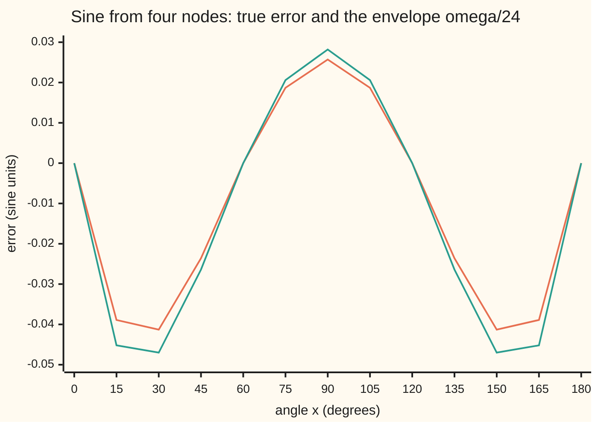
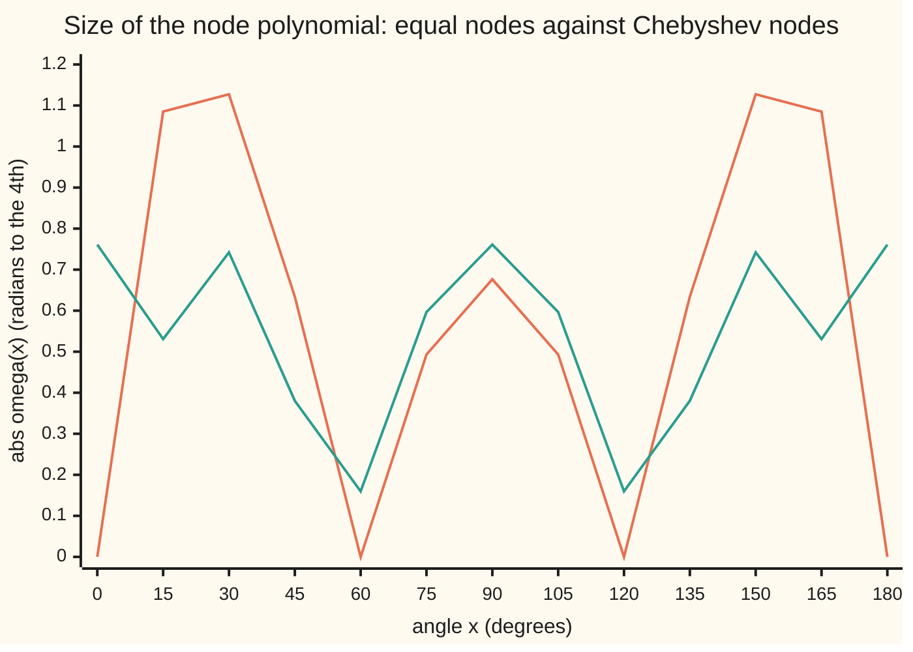

# The interpolation error theorem: one high derivative times the product of node distances

[Syllabus](../../../SYLLABUS.md) → [Numerical analysis](../README.md) → [Interpolation and Approximation](../README.md#s04) → The interpolation error theorem

---

## General Overview

A motor controller reads sine from a stored table and needs it to within 0.001. Its first, deliberately tiny table keeps four values across a half turn: sin 0° = 0, sin 60° = 0.866025, sin 120° = 0.866025 and sin 180° = 0. For every other angle it reads the one cubic curve through those four points. (The controller is illustrative; the numbers are computed by the checks below.)

How wrong can that reading be? A test checks only the angles it tries, so the answer must come from a proof.

The interpolation error theorem answers in one line. The miss at an angle x is a fourth derivative of sine, read somewhere unknown, times the product of the distances from x to the four stored angles, divided by 4! = 1 × 2 × 3 × 4 = 24. Sine's fourth derivative is sine again, so it never exceeds 1. Measured in radians (180° = π ≈ 3.14159), the largest product of distances is 1.202581. So the reading is never off by more than 0.050108. The true worst miss, found by checking 3,601 angles and then refining, is 0.043616 at 23.43° and at 156.57°. The bound is only 1.149 times the truth. Either way, four values miss the 0.001 target; Step 3 uses the same formula to size a table that meets it.

The product of distances is the one part of the formula that depends on where the stored angles sit. Move them, and the guarantee moves with it.

**The error of a polynomial through n + 1 points is the next derivative, read at some point in the span, divided by (n + 1)!, times the product of the distances from x to every node; the derivative belongs to the function, the product belongs to the node placement.**

**What kind of fact this is:** a theorem, proved on this card in Why it works. The worked bound and the true error are both computed by the checks below.

### The picture: the true error always sits inside its envelope



Orange is the true error, sine minus the cubic. Green is the envelope: the product of distances divided by 24. Both are zero at the four nodes, at 0°, 60°, 120° and 180°. Between nodes the true error always has the envelope's sign and is never larger. That is the theorem, drawn.

---

## The formula

Notation first, in words. Angles are in radians in the formulas (π radians = 180°) and in degrees in the tables.

- The **nodes** $x_0, x_1, \dots, x_n$ are the n + 1 points where the function f is known. Here n = 3.
- $p_n$ is the **interpolating polynomial**: the one polynomial of degree at most n through all the nodes.
- $e(x) = f(x) - p_n(x)$ is the **true error** at x.
- $\omega(x)$, read "omega of x", is the **node polynomial**: the product of the distances from x to every node, with their signs. It is the node product of [One polynomial through n points](02-lagrange-and-newton-interpolation.md).

$$\omega(x) = (x - x_0)(x - x_1)\cdots(x - x_n)$$

**The interpolation error theorem.** If f has n + 1 derivatives across the smallest interval holding x and all the nodes, there is a point $\xi$ (the Greek letter xi) in that interval with

$$f(x) - p_n(x) = \frac{f^{(n+1)}(\xi)}{(n+1)!}\,\omega(x)$$

**Read it aloud:** the error at x is the (n + 1)-th derivative, read at some unknown point in the span, divided by (n + 1) factorial, times the product of the distances from x to the nodes.

The point ξ is unknown, so in practice the derivative is replaced by a ceiling M on its size. That gives the **bound**:

$$|f(x) - p_n(x)| \le \frac{M}{(n+1)!}\,\max|\omega|$$

**Read it aloud:** the error is at most the derivative ceiling over (n + 1) factorial, times the largest size of the node polynomial.

| Symbol | Plain meaning | In our example | Push it up and the answer… |
| --- | --- | --- | --- |
| $f$, $x$ | the function; the point where it is read | sin, read at angles from 0 to π | — |
| $x_0, \dots, x_n$; $n$ | the nodes; the degree, one less than the node count | 0, π/3, 2π/3, π; n = 3 | more nodes: a larger factorial, more factors in ω |
| $p_n$, $a$ | the interpolating polynomial; its one coefficient here | $p_3(x) = a\,x(\pi - x)$, a = 0.394860 | — |
| $e(x)$ | the true error, f minus the polynomial | 0.025721 at 90° | — |
| $\omega(x)$ | the node polynomial: product of distances to the nodes | 0.676452 at 90°; largest size 1.202581 | larger error |
| $f^{(n+1)}$, $\xi$ | the (n + 1)-th derivative; the point where it is read | sin x; ξ = 65.86° or 114.14° for x = 90° | larger error |
| $M$ | a ceiling on the size of $f^{(n+1)}$ over the span | 1 | looser bound |
| $(n+1)!$ | the factorial 1 × 2 × … × (n + 1) | 4! = 24 | tighter bound |
| $h$, $s$ | the spacing of equal nodes; position counted in spacings, $x = x_0 + s h$ | h = π/3 | error grows like $h^{n+1}$ |
| $f[x_0, \dots, x_n, x]$ | divided difference: the next Newton coefficient | 0.038024 at 90° | larger error |
| $\Lambda$, $\ell_j$ | Lebesgue constant: the largest $\sum_j \lvert\ell_j(x)\rvert$, how much the nodes amplify errors in the data; $\ell_j$ is the Lagrange basis polynomial, 1 at node j and 0 at the others | 1.6311 | data errors amplified more |
| $g$, $t$, $u$, $I$, $k$ | proof helpers: an auxiliary function, its variable, a substitution in a fold, the smallest interval holding x and the nodes, and a step count | — | — |

### When it holds

- **f has n + 1 derivatives across the span.** A kink breaks it. For |cos x|, which has a corner at 90°, the same four nodes miss by 0.437500 at 90°. The "bound" 0.050108 is false there.
- **x lies between the nodes, or the span is widened to include x.** At 240°, outside the nodes, the miss is 0.866025. The in-span bound 0.050108 does not apply. With ω read at 240°, the right bound is 1.202581 (by coincidence the same number as max|ω| inside: both equal $(\pi/3)^4$), and it holds.
- **The nodes are distinct.** If nodes merge, the polynomial must match slopes as well as values. When all n + 1 nodes merge at one point a, ω becomes $(x - a)^{n+1}$ and the theorem becomes [Taylor's theorem](../../06-Calculus%20and%20analysis/03-What%20Derivatives%20Tell%20You/05-taylors-theorem.md).
- **The data are exact.** If each stored value is off by up to some amount, the curve can move by up to Λ times that amount. For these four nodes Λ = 1.6311. This error adds to the theorem's; the theorem does not see it.
- **Rounding stays small.** The theorem is about exact arithmetic. In doubles, the error at 90° is asserted against the exact value $1 - 9\sqrt3/16$; rounding sits near the 16th digit, far below the 0.025721 being measured. In the window table under Code it does show: at a 0.09° window the true error, 3.220e-15, already exceeds the bound, 2.848e-15.

---

## Why it works

### Step 0: the error is zero at every node, so it carries every node's factor

The polynomial passes through every node, so the error is zero at each one. A function that is zero at $x_0, \dots, x_n$ behaves as if it contains the factors $(x - x_0), \dots, (x - x_n)$. That product is ω.

So the error is ω times something. The whole proof is about finding that something. Rolle's theorem shows it is one derivative, read at one point, over a factorial.

The calculus wing already runs this argument with two nodes: the trapezoid's chord misses the curve by half the second derivative, read at some point, times the distances to the two slice ends ([Numerical integration](../../06-Calculus%20and%20analysis/04-Integrals/08-numerical-integration.md)). This card runs it for n + 1 nodes.

### Step 1: build a function with n + 2 zeros

Fix one point x that is not a node. Define a helper function of a new variable t:

$$g(t) = f(t) - p_n(t) - e(x)\,\frac{\omega(t)}{\omega(x)}$$

At each node, $f - p_n$ is zero and ω is zero, so g is zero. At t = x, the last term equals e(x), which cancels $f(x) - p_n(x)$. So g is zero at x too.

That makes n + 2 distinct zeros: the n + 1 nodes and x.

### Step 2: Rolle's theorem, n + 1 times

Rolle's theorem says a smooth function that is zero at two points has zero slope somewhere between them ([Mean value theorem](../../06-Calculus%20and%20analysis/03-What%20Derivatives%20Tell%20You/02-mean-value-theorem.md)).

- g has n + 2 zeros, so $g'$ has at least n + 1.
- Then $g''$ has at least n, and so on.
- So $g^{(n+1)}$ has at least one zero. Call it ξ.

Now differentiate g n + 1 times. The polynomial $p_n$ has degree n, so that many derivatives wipe it out. The node polynomial ω starts with $t^{n+1}$, so its (n + 1)-th derivative is the constant (n + 1)!. So

$$0 = g^{(n+1)}(\xi) = f^{(n+1)}(\xi) - e(x)\,\frac{(n+1)!}{\omega(x)}$$

Solve for e(x) and the theorem appears.

For the sine at 90°, the true error is 0.025721 and ω/24 = 0.028186. So $\sin\xi$ = 0.912576, and ξ is 65.86° or 114.14°. Both lie inside the span, as promised.

<details>
<summary>Detailed proof: the interpolation error theorem, with its hypotheses</summary>

Let I be the smallest closed interval holding x and the nodes. Assume $f^{(n)}$ is continuous on I and $f^{(n+1)}$ exists inside it.

If x is a node, both sides are zero and any ξ works. Otherwise $\omega(x) \ne 0$, so g is well defined, and it has the same smoothness as f.

g vanishes at n + 2 distinct points of I. List them in order. Between each neighbouring pair, Rolle gives a zero of $g'$: n + 1 distinct zeros, strictly inside I. Repeat on $g'$ and its zeros, then on $g''$, and so on. After k steps there are n + 2 − k distinct zeros of $g^{(k)}$. At k = n + 1 there is at least one, ξ, inside I.

Every derivative of $p_n$ beyond the n-th is zero. Expand ω: $\omega(t) = t^{n+1} + (\text{lower powers})$, so $\omega^{(n+1)}(t) = (n+1)!$ for every t. Hence $g^{(n+1)}(\xi) = f^{(n+1)}(\xi) - e(x)(n+1)!/\omega(x) = 0$, and

$$e(x) = \frac{f^{(n+1)}(\xi)}{(n+1)!}\,\omega(x).$$

ξ depends on x. The proof says nothing about where ξ is beyond lying in I, which is why the bound uses a ceiling M.

</details>

### Step 3: from the exact error to a bound

Replace $|f^{(n+1)}(\xi)|$ by its ceiling M, and |ω(x)| by its largest value. For the sine, M = 1 because every derivative of sine is a sine or cosine.

For equal nodes, write $x = x_0 + s h$, where s counts spacings. Then $\omega = h^4\,s(s-1)(s-2)(s-3)$. Its largest size is exactly 1, at $s = (3 - \sqrt5)/2$, so $\max|\omega| = h^4 = (\pi/3)^4$ = 1.202581, at 22.92° and 157.08°.

The bound is 1.202581 / 24 = 0.050108. The true worst miss is 0.043616, at 23.43°. Bound and truth are close because 24 e(x)/ω(x), the value of sin ξ, stays between 0.837746 and 0.912576 at every angle of the 3,601-point grid.

<details>
<summary>Why the largest size of s(s − 1)(s − 2)(s − 3) is exactly 1</summary>

Pair the outer and inner factors: $s(s-3) = u$ and $(s-1)(s-2) = u + 2$, with $u = s^2 - 3s$. The product is $u(u+2) = (u+1)^2 - 1$.

On [0, 3], u runs from 0 down to −9/4. The product is smallest, −1, at u = −1, where $s^2 - 3s + 1 = 0$, so $s = (3 \pm \sqrt5)/2$. Its largest value on the range is $(-9/4)(-1/4) = 9/16$ at s = 3/2. So the largest size is 1, reached in the two outer gaps, not the middle one.

</details>

**Sizing a table that meets the target.** The four-value table guarantees only 0.050108, far outside 0.001. The same formula sizes one that meets it. Store sine at equal spacing h, split the half turn into pieces of three gaps, and read each angle from the cubic through its own piece's four values. Each piece has max|ω| = $h^4$, so the bound is $h^4/24$, and $h^4/24 \le 0.001$ needs h of at most 22.6°. Three pieces of 60° fit, with values 20° apart: 10 stored values, a bound of 6.186e-04 and a true worst error of 6.092e-04. Two pieces of 90° would give a bound of 3.132e-03, over the target.

### Step 4: the same error, read as the next Newton term

Newton's form builds the polynomial one node at a time. Each new node adds its divided difference times the product of the old node factors ([One polynomial through n points](02-lagrange-and-newton-interpolation.md)).

Treat x itself as one more node. The new polynomial passes through f(x), so the term it adds is exactly the error:

$$f(x) - p_n(x) = f[x_0, \dots, x_n, x]\;\omega(x)$$

Comparing with the theorem gives $f[x_0, \dots, x_n, x] = f^{(n+1)}(\xi)/(n+1)!$: a divided difference is a derivative over a factorial, read at some point. For the sine at 90°, the divided difference is 0.038024, and 0.038024 × 0.676452 = 0.025721, the true error again.

### Step 5: node placement controls only ω

The derivative belongs to the function, and the factorial depends only on the node count. Only ω depends on where the nodes sit, so the whole effect of placement is in max|ω|. The checks try three placements of four nodes on the same half turn:

| Placement | Nodes (degrees) | max abs ω | Bound | True worst error | Bound ÷ true |
| --- | --- | ---: | ---: | ---: | ---: |
| equal | 0, 60, 120, 180 | 1.202581 | 0.050108 | 0.043616 | 1.149 |
| Chebyshev | 6.9, 55.6, 124.4, 173.1 | 0.761009 | 0.031709 | 0.029199 | 1.086 |
| bunched in the middle | 45, 75, 105, 135 | 4.439216 | 0.184967 | 0.166407 | 1.112 |

Bunching the nodes leaves the ends far from every node, and the worst error rises from 0.043616 to 0.166407. The **Chebyshev nodes** are the shadows on the axis of points spaced equally around a half circle, so they crowd toward the ends without sitting on them. Their max|ω| is $2(\pi/4)^4$ = 0.761009, the smallest any four nodes can give on this interval. Why, and how much it matters at high degree, is [Runge's phenomenon](04-runge-phenomenon-and-chebyshev-nodes.md).



Orange is equal nodes: tall humps in the two outer gaps. Green is Chebyshev nodes: no hump rises above 0.7610, and the peaks are level. Levelling the peaks is what lowers the tallest one.

---

## Worked numbers, by hand

Four equal nodes on sine: 0, π/3, 2π/3, π.

| Step | Arithmetic | Value |
| --- | --- | --- |
| stored values | sin 0, sin 60°, sin 120°, sin 180° | 0, 0.866025, 0.866025, 0 |
| shape of $p_3$ | $a\,x(\pi - x)$ fits all four points, and only one polynomial does | — |
| coefficient a | $a \cdot \tfrac{\pi}{3}\cdot\tfrac{2\pi}{3} = \tfrac{\sqrt3}{2}$, so $a = 9\sqrt3/(4\pi^2)$ | 0.394860 |
| $p_3(90°)$ | $a\,(\pi/2)^2 = 9\sqrt3/16$ | 0.974279 |
| true error at 90° | 1 − 0.974279 | 0.025721 |
| ω(90°) | $\tfrac{\pi}{2}\cdot\tfrac{\pi}{6}\cdot(-\tfrac{\pi}{6})\cdot(-\tfrac{\pi}{2}) = \pi^4/144$ | 0.676452 |
| bound at 90° | 0.676452 / 24 | 0.028186 |
| $\sin\xi$ at 90° | 24 × 0.025721 / 0.676452 | 0.912576 |
| largest size of ω | $(\pi/3)^4$ | 1.202581 |
| **bound over the half turn** | 1.202581 / 24 | **0.050108** |
| true worst error | found by bisection, at 23.43° | 0.043616 |

The stored cubic never misses sine by more than 0.050108, guaranteed with no testing. Its true worst miss is 0.043616, so the guarantee is only 1.149 times the truth.

### What breaks if you drop a piece

The right whole-interval bound is 0.050108, against a true worst error of 0.043616.

| Mistake | Comes out at | What went wrong |
| --- | --- | --- |
| Apply the bound to \|cos x\|, which has a corner at 90° | true error 0.437500 against a "bound" of 0.050108 | No fourth derivative at the corner. The theorem's hypothesis fails, and so does its promise. |
| Divide by 3! instead of 4! | 0.200430 | The factorial is one past the degree. Four times too loose. |
| Use the span length to the 4th, $\pi^4$, instead of max\|ω\| | 4.058712 | Ignores that the error is pinned to zero at every node. Useless as a guarantee. |
| Read at 240°, keep the in-span bound | true error 0.866025 against 0.050108 | Outside the nodes ω grows fast. At 240° the right bound is 1.202581, by coincidence the same number as max\|ω\| inside. |
| Read the derivative at x instead of ξ, at 10° | predicts 0.006277; true 0.030830 | sin 10° is small, but ξ sits elsewhere in the span, where sine is larger. |

---

## Code, from first principles, and it actually runs

The code interpolates sine through four nodes and measures the error on 3,601 angles. It reaches the error by **three independent roads**. Road 1 evaluates the Lagrange form on the grid. Road 2 uses the closed form $a\,x(\pi - x)$ and finds the worst point by bisection on $e'(x) = 0$, with no grid. Road 3 builds a divided-difference table with x as a fifth node. Then it tests the theorem itself: at every grid point that is not a node, 24 e(x)/ω(x) must equal some value of sine, so it must lie between 0 and 1, and its top, at 90°, must equal the hand value 24(1 − 9√3/16)/(π⁴/144). It also measures the observed order as the window shrinks, down to where rounding stops the fall, and sizes a table for the 0.001 target. Evaluating ω at one point costs n + 1 subtractions and n multiplications.

### Python

```python
# The interpolation error theorem -- the check behind the card.  Standard library only.
# Sine on [0, pi] from four nodes.  Road 1: the Lagrange form on a fine grid gives
# the true error.  Road 2: the closed form p(x) = a x (pi - x) and bisection on
# e'(x) = 0 find the worst point without a grid.  Road 3: divided differences
# give e(x) = f[x0..x3, x] * omega(x) with no Lagrange basis.  The theorem itself
# is tested at every grid point: 24 e(x) / omega(x) must be a value of sin.
import math
PI = math.pi
N = 3600                                      # grid: 3600 slices of [0, pi]

def lagrange(xs, ys, x):
    total = 0.0
    for j, xj in enumerate(xs):
        l = 1.0
        for k, xk in enumerate(xs):
            if k != j:
                l *= (x - xk) / (xj - xk)
        total += ys[j] * l
    return total
def omega(xs, x):                             # product of distances to the nodes
    w = 1.0
    for xk in xs:
        w *= x - xk
    return w
def divided(xs, ys):                          # top divided difference f[x0..xm]
    c = list(ys)
    for k in range(1, len(xs)):
        for i in range(len(xs) - 1, k - 1, -1):
            c[i] = (c[i] - c[i - 1]) / (xs[i] - xs[i - k])
    return c[-1]
def study(xs, f, lo, hi):                     # worst true error and worst |omega| on a grid
    ys = [f(x) for x in xs]
    best = (0.0, lo, 0.0, lo)
    for i in range(N + 1):
        x = lo + (hi - lo) * i / N
        e, w = abs(f(x) - lagrange(xs, ys, x)), abs(omega(xs, x))
        best = (max(best[0], e), x if e > best[0] else best[1],
                max(best[2], w), x if w > best[2] else best[3])
    return best

deg = math.degrees
eq = [k * PI / 3 for k in range(4)]
ys = [math.sin(x) for x in eq]
print("nodes, degrees", " ".join(f"{deg(x):.0f}" for x in eq))
print("values, sin   ", " ".join(f"{y:.6f}" for y in ys))
a = 9 * math.sqrt(3) / (4 * PI ** 2)          # p(x) = a x (pi - x) passes through all four
gap = max(abs(lagrange(eq, ys, PI * i / N) - a * (PI * i / N) * (PI - PI * i / N)) for i in range(N + 1))
assert gap < 1e-14, gap
print(f"closed form a = {a:.6f}; matches Lagrange at all {N + 1} grid points")

x = PI / 2                                    # the worked point, 90 degrees
p = lagrange(eq, ys, x); e = math.sin(x) - p; w = omega(eq, x)
s = 24 * e / w                                # the value sin(xi) must take
print(f"at 90: p {p:.6f}  true error {e:.6f}  omega {w:.6f}  omega/24 {w / 24:.6f}")
print(f"at 90: sin(xi) = 24 e/omega = {s:.6f}, xi = {deg(math.asin(s)):.2f} or {180 - deg(math.asin(s)):.2f} degrees")
assert abs(e - (1 - 9 * math.sqrt(3) / 16)) < 1e-14          # exact value by hand
dd = divided(eq + [x], ys + [math.sin(x)])
print(f"at 90: f[x0..x3,x] = {dd:.6f}, times omega = {dd * w:.6f}")
assert abs(dd * w - e) < 1e-12                              # road 3 against road 1

emax, xe, wmax, xw = study(eq, math.sin, 0.0, PI)
lo, hi = 0.2, 0.6                             # road 2: e'(x) = cos x - a (pi - 2x) = 0
for _ in range(60):
    mid = (lo + hi) / 2
    lo, hi = (mid, hi) if math.cos(mid) - a * (PI - 2 * mid) < 0 else (lo, mid)
eb = abs(math.sin(lo) - a * lo * (PI - lo))
print(f"worst true error {emax:.6f} (grid); {eb:.6f} at {deg(lo):.2f} and {180 - deg(lo):.2f} deg (bisection)")
assert abs(eb - emax) < 1e-7
sw = (3 - math.sqrt(5)) / 2                   # |s(s-1)(s-2)(s-3)| peaks at 1, at s = (3 - sqrt5)/2
print(f"max|omega| {wmax:.6f} (grid); (pi/3)^4 = {(PI / 3) ** 4:.6f} at {deg(sw * PI / 3):.2f} and {180 - deg(sw * PI / 3):.2f} deg")
assert abs(wmax - (PI / 3) ** 4) < 1e-6
bound = wmax / 24
print(f"bound max|omega|/4! = {bound:.6f}; true {emax:.6f}; bound/true {bound / emax:.3f}")
assert emax <= bound

lo_s, hi_s = 1.0, 0.0                         # the theorem, point by point
for i in range(N + 1):
    t = PI * i / N
    if min(abs(t - xk) for xk in eq) > 1e-9:
        r = 24 * (math.sin(t) - lagrange(eq, ys, t)) / omega(eq, t)
        lo_s, hi_s = min(lo_s, r), max(hi_s, r)
print(f"24 e/omega over the grid: min {lo_s:.6f} max {hi_s:.6f} (sin on [0, pi] spans 0 to 1)")
assert 0 <= lo_s and hi_s <= 1 and abs(hi_s - 24 * (1 - 9 * math.sqrt(3) / 16) / (PI ** 4 / 144)) < 1e-9   # top: 90 by hand

cheb = [PI / 2 * (1 - math.cos((2 * k + 1) * PI / 8)) for k in range(4)]
bunch = [PI / 4 + k * PI / 6 for k in range(4)]
print("placement   nodes(deg)            max|omega|  bound     true      ratio")
for name, xs in [("equal", eq), ("chebyshev", cheb), ("bunched", bunch)]:
    em, _, wm, _ = study(xs, math.sin, 0.0, PI)
    print(f"{name:10s}  {' '.join(f'{deg(t):5.1f}' for t in xs)}  {wm:.6f}  {wm / 24:.6f}  {em:.6f}  {wm / 24 / em:.3f}")
    assert em <= wm / 24
    if name == "chebyshev":
        assert abs(wm - 2 * (PI / 4) ** 4) < 1e-6           # the smallest possible max|omega|

print("window(deg)  true      bound     ratio  order")
errs = []
for k in range(14):                           # four equal nodes across a window centred on 90, down to rounding
    wd = PI / 2 ** k
    xs = [PI / 2 - wd / 2 + j * wd / 3 for j in range(4)]
    em, _, wm, _ = study(xs, math.sin, PI / 2 - wd / 2, PI / 2 + wd / 2)
    order = "" if not errs else f"{math.log2(errs[-1] / em):.2f}"
    print(f"{deg(wd):9.2f}  {em:.3e}  {wm / 24:.3e}  {wm / 24 / em:.3f}  {order}")
    assert em <= wm / 24 + 1e-15              # rounding, a few units of 1.1e-16, lies outside the theorem
    errs.append(em)
assert 3.95 < math.log2(errs[7] / errs[8]) < 4.05 and abs(errs[6] / ((PI / 192) ** 4 / 24) - 1) < 0.01 and errs[-1] > (PI / 24576) ** 4 / 24
hmax = (24 * 1e-3) ** 0.25; m = math.ceil(PI / (3 * hmax)); h = PI / (3 * m)   # a table for 0.001: h^4 / 24 <= 0.001
ep = max(study([(3 * i + j) * h for j in range(4)], math.sin, 3 * i * h, 3 * i * h + 3 * h)[0] for i in range(m))
print(f"target 0.001: spacing at most {deg(hmax):.1f} deg; {m} cubic pieces, {3 * m + 1} values {deg(h):.0f} deg apart; bound {h ** 4 / 24:.3e}, true {ep:.3e}")
assert ep <= h ** 4 / 24 < 1e-3 < (PI / (3 * m - 3)) ** 4 / 24       # and one piece fewer would miss the target

ac = lambda t: abs(math.cos(t))               # what breaks: a kink at 90, no 4th derivative there
ek, xk, _, _ = study(eq, ac, 0.0, PI)
print(f"break, |cos x|: true {ek:.6f} at {deg(xk):.2f} deg against the claimed bound {bound:.6f}")
assert ek > 8 * bound
print(f"break, 3! for 4!: {wmax / 6:.6f};  (b-a)^4 for omega: {PI ** 4 / 24:.6f}")
xo = 4 * PI / 3                               # 240 degrees, outside the nodes
eo = abs(math.sin(xo) - lagrange(eq, ys, xo))
print(f"break, at 240 deg: true {eo:.6f}; in-span bound {bound:.6f}; right bound {abs(omega(eq, xo)) / 24:.6f}")
assert bound < eo <= abs(omega(eq, xo)) / 24
x10 = PI / 18                                 # 10 degrees: derivative read at x, not at xi
e10 = abs(math.sin(x10) - lagrange(eq, ys, x10))
print(f"break, sin(x) for sin(xi) at 10 deg: predicts {math.sin(x10) * abs(omega(eq, x10)) / 24:.6f}; true {e10:.6f}")

leb = max(sum(abs(lagrange(eq, [1.0 if i == j else 0.0 for i in range(4)], PI * t / N)) for j in range(4))
          for t in range(N + 1))
print(f"Lebesgue constant, equal nodes: {leb:.4f}")
assert abs(leb - 1.6311) < 1e-4                              # tabulated value for 4 equal nodes

five = [k * PI / 4 for k in range(5)]         # try changing: five nodes, 5th derivative is cos
e5, _, w5, _ = study(five, math.sin, 0.0, PI)
print(f"try, five equal nodes: true {e5:.6f}; bound max|omega|/5! {w5 / 120:.6f}")
assert e5 <= w5 / 120
xs13 = [PI * k / 12 for k in range(13)]
fix = lambda v: 0.0 if abs(v) < 5e-5 else v
print("chart, x (deg)    ", " ".join(f"{deg(t):.0f}" for t in xs13))
print("chart, error      ", " ".join(f"{fix(math.sin(t) - lagrange(eq, ys, t)):.4f}" for t in xs13))
print("chart, omega/24   ", " ".join(f"{fix(omega(eq, t) / 24):.4f}" for t in xs13))
print("chart, |omega| eq ", " ".join(f"{abs(omega(eq, t)):.4f}" for t in xs13))
print("chart, |omega| ch ", " ".join(f"{abs(omega(cheb, t)):.4f}" for t in xs13))
print("ALL CHECKS PASS")
```

**Ran 2026-11-11 on macOS, Python 3.14.10, standard library only. All checks passed. Output, pasted from the run:**

```
nodes, degrees 0 60 120 180
values, sin    0.000000 0.866025 0.866025 0.000000
closed form a = 0.394860; matches Lagrange at all 3601 grid points
at 90: p 0.974279  true error 0.025721  omega 0.676452  omega/24 0.028186
at 90: sin(xi) = 24 e/omega = 0.912576, xi = 65.86 or 114.14 degrees
at 90: f[x0..x3,x] = 0.038024, times omega = 0.025721
worst true error 0.043616 (grid); 0.043616 at 23.43 and 156.57 deg (bisection)
max|omega| 1.202581 (grid); (pi/3)^4 = 1.202581 at 22.92 and 157.08 deg
bound max|omega|/4! = 0.050108; true 0.043616; bound/true 1.149
24 e/omega over the grid: min 0.837746 max 0.912576 (sin on [0, pi] spans 0 to 1)
placement   nodes(deg)            max|omega|  bound     true      ratio
equal         0.0  60.0 120.0 180.0  1.202581  0.050108  0.043616  1.149
chebyshev     6.9  55.6 124.4 173.1  0.761009  0.031709  0.029199  1.086
bunched      45.0  75.0 105.0 135.0  4.439216  0.184967  0.166407  1.112
window(deg)  true      bound     ratio  order
   180.00  4.362e-02  5.011e-02  1.149  
    90.00  3.026e-03  3.132e-03  1.035  3.85
    45.00  1.941e-04  1.957e-04  1.009  3.96
    22.50  1.221e-05  1.223e-05  1.002  3.99
    11.25  7.642e-07  7.646e-07  1.001  4.00
     5.62  4.778e-08  4.779e-08  1.000  4.00
     2.81  2.987e-09  2.987e-09  1.000  4.00
     1.41  1.867e-10  1.867e-10  1.000  4.00
     0.70  1.167e-11  1.167e-11  1.000  4.00
     0.35  7.296e-13  7.292e-13  0.999  4.00
     0.18  4.574e-14  4.557e-14  0.996  4.00
     0.09  3.220e-15  2.848e-15  0.885  3.83
     0.04  5.551e-16  1.780e-16  0.321  2.54
     0.02  4.441e-16  1.113e-17  0.025  0.32
target 0.001: spacing at most 22.6 deg; 3 cubic pieces, 10 values 20 deg apart; bound 6.186e-04, true 6.092e-04
break, |cos x|: true 0.437500 at 90.00 deg against the claimed bound 0.050108
break, 3! for 4!: 0.200430;  (b-a)^4 for omega: 4.058712
break, at 240 deg: true 0.866025; in-span bound 0.050108; right bound 1.202581
break, sin(x) for sin(xi) at 10 deg: predicts 0.006277; true 0.030830
Lebesgue constant, equal nodes: 1.6311
try, five equal nodes: true 0.001812; bound max|omega|/5! 0.009044
chart, x (deg)     0 15 30 45 60 75 90 105 120 135 150 165 180
chart, error       0.0000 -0.0389 -0.0413 -0.0236 0.0000 0.0187 0.0257 0.0187 0.0000 -0.0236 -0.0413 -0.0389 0.0000
chart, omega/24    0.0000 -0.0452 -0.0470 -0.0264 0.0000 0.0206 0.0282 0.0206 0.0000 -0.0264 -0.0470 -0.0452 0.0000
chart, |omega| eq  0.0000 1.0851 1.1274 0.6342 0.0000 0.4932 0.6765 0.4932 0.0000 0.6342 1.1274 1.0851 0.0000
chart, |omega| ch  0.7610 0.5308 0.7422 0.3805 0.1597 0.5966 0.7610 0.5966 0.1597 0.3805 0.7422 0.5308 0.7610
ALL CHECKS PASS
```

Over the grid, 24 e/ω stays between 0.837746 and 0.912576. Each is a value of sine at some ξ, exactly as the theorem says. The window table is the order check. Each halving of the window divides the error by about 2⁴ = 16, and the observed order climbs 3.85, 3.96, 3.99, 4.00 toward the theorem's 4, and holds at 4.00 down to the 0.18° window. The bound ÷ true ratio falls toward 1 because a narrow window around 90° keeps sin ξ near 1. Then rounding stops the fall. At 0.09° the true error, 3.220e-15, already exceeds the bound, 2.848e-15. At 0.04° and 0.02° it stays at 5.551e-16 and 4.441e-16, a few units in the last place of a sine near 1, while the bound keeps shrinking. The theorem describes exact arithmetic; below that floor only rounding is left.

### Rust

The same checks with the same inputs. Python's three-digit e-notation is rebuilt by hand so the two outputs match line for line.

```rust
// The interpolation error theorem -- the same check as polynomial_interpolation_error_check.py,
// in Rust, std only.  Sine on [0, pi] from four nodes: Lagrange on a grid (road 1), the
// closed form a x (pi - x) with bisection on e'(x) = 0 (road 2), divided differences (road 3),
// and the theorem tested point by point: 24 e(x) / omega(x) must be a value of sin.
// Compile: rustc --edition 2021 -O polynomial_interpolation_error_check.rs -o /tmp/pie_check
use std::f64::consts::PI;
const N: usize = 3600; // grid: 3600 slices of [0, pi]

fn lagrange(xs: &[f64], ys: &[f64], x: f64) -> f64 {
    let basis = |j: usize| (0..xs.len()).filter(|&k| k != j).map(|k| (x - xs[k]) / (xs[j] - xs[k])).product::<f64>();
    (0..xs.len()).map(|j| ys[j] * basis(j)).sum()
}

fn omega(xs: &[f64], x: f64) -> f64 { xs.iter().fold(1.0, |w, xk| w * (x - xk)) } // product of distances

fn divided(xs: &[f64], ys: &[f64]) -> f64 { // top divided difference f[x0..xm]
    let mut c = ys.to_vec();
    for k in 1..xs.len() {
        for i in (k..xs.len()).rev() {
            c[i] = (c[i] - c[i - 1]) / (xs[i] - xs[i - k]);
        }
    }
    c[xs.len() - 1]
}

fn study(xs: &[f64], f: &dyn Fn(f64) -> f64, lo: f64, hi: f64) -> (f64, f64) { // worst error, worst |omega|
    let ys: Vec<f64> = xs.iter().map(|&x| f(x)).collect();
    let (mut em, mut wm) = (0.0f64, 0.0f64);
    for i in 0..=N {
        let x = lo + (hi - lo) * i as f64 / N as f64;
        em = em.max((f(x) - lagrange(xs, &ys, x)).abs());
        wm = wm.max(omega(xs, x).abs());
    }
    (em, wm)
}

fn sci(v: f64) -> String { // Python's {:.3e}: 4.362e-02
    let s = format!("{:.3e}", v);
    let (m, e) = s.split_once('e').unwrap();
    let e: i32 = e.parse().unwrap();
    format!("{}e{}{:02}", m, if e < 0 { '-' } else { '+' }, e.abs())
}

fn join(v: &[f64], f: &dyn Fn(f64) -> String) -> String { v.iter().map(|&x| f(x)).collect::<Vec<_>>().join(" ") }

fn main() {
    let deg = |x: f64| x.to_degrees();
    let sin = |x: f64| x.sin();
    let eq: Vec<f64> = (0..4).map(|k| k as f64 * PI / 3.0).collect();
    let ys: Vec<f64> = eq.iter().map(|x| x.sin()).collect();
    println!("nodes, degrees {}", join(&eq, &|x| format!("{:.0}", deg(x))));
    println!("values, sin    {}", join(&ys, &|y| format!("{:.6}", y)));
    let a = 9.0 * 3f64.sqrt() / (4.0 * PI * PI); // p(x) = a x (pi - x) passes through all four
    let gap = (0..=N).map(|i| PI * i as f64 / N as f64).map(|x| (lagrange(&eq, &ys, x) - a * x * (PI - x)).abs()).fold(0.0, f64::max);
    assert!(gap < 1e-14, "{}", gap);
    println!("closed form a = {:.6}; matches Lagrange at all {} grid points", a, N + 1);

    let x = PI / 2.0; // the worked point, 90 degrees
    let p = lagrange(&eq, &ys, x);
    let e = x.sin() - p;
    let w = omega(&eq, x);
    let s = 24.0 * e / w;
    println!("at 90: p {:.6}  true error {:.6}  omega {:.6}  omega/24 {:.6}", p, e, w, w / 24.0);
    println!("at 90: sin(xi) = 24 e/omega = {:.6}, xi = {:.2} or {:.2} degrees", s, deg(s.asin()), 180.0 - deg(s.asin()));
    assert!((e - (1.0 - 9.0 * 3f64.sqrt() / 16.0)).abs() < 1e-14); // exact value by hand
    let mut nx = eq.clone(); nx.push(x);
    let mut ny = ys.clone(); ny.push(x.sin());
    let dd = divided(&nx, &ny);
    println!("at 90: f[x0..x3,x] = {:.6}, times omega = {:.6}", dd, dd * w);
    assert!((dd * w - e).abs() < 1e-12); // road 3 against road 1

    let (emax, wmax) = study(&eq, &sin, 0.0, PI);
    let (mut lo, mut hi) = (0.2f64, 0.6f64); // road 2: e'(x) = cos x - a (pi - 2x) = 0
    for _ in 0..60 {
        let mid = (lo + hi) / 2.0;
        if mid.cos() - a * (PI - 2.0 * mid) < 0.0 { lo = mid } else { hi = mid }
    }
    let eb = (lo.sin() - a * lo * (PI - lo)).abs();
    println!("worst true error {:.6} (grid); {:.6} at {:.2} and {:.2} deg (bisection)", emax, eb, deg(lo), 180.0 - deg(lo));
    assert!((eb - emax).abs() < 1e-7);
    let sw = (3.0 - 5f64.sqrt()) / 2.0; // |s(s-1)(s-2)(s-3)| peaks at 1, at s = (3 - sqrt5)/2
    let h4 = (PI / 3.0).powi(4);
    println!("max|omega| {:.6} (grid); (pi/3)^4 = {:.6} at {:.2} and {:.2} deg", wmax, h4, deg(sw * PI / 3.0), 180.0 - deg(sw * PI / 3.0));
    assert!((wmax - h4).abs() < 1e-6);
    let bound = wmax / 24.0;
    println!("bound max|omega|/4! = {:.6}; true {:.6}; bound/true {:.3}", bound, emax, bound / emax);
    assert!(emax <= bound);

    let (mut lo_s, mut hi_s) = (1.0f64, 0.0f64); // the theorem, point by point
    for i in 0..=N {
        let t = PI * i as f64 / N as f64;
        if eq.iter().map(|xk| (t - xk).abs()).fold(f64::MAX, f64::min) > 1e-9 {
            let r = 24.0 * (t.sin() - lagrange(&eq, &ys, t)) / omega(&eq, t);
            lo_s = lo_s.min(r);
            hi_s = hi_s.max(r);
        }
    }
    println!("24 e/omega over the grid: min {:.6} max {:.6} (sin on [0, pi] spans 0 to 1)", lo_s, hi_s);
    assert!(0.0 <= lo_s && hi_s <= 1.0 && (hi_s - 24.0 * (1.0 - 9.0 * 3f64.sqrt() / 16.0) / (PI.powi(4) / 144.0)).abs() < 1e-9); // top: 90 by hand

    let cheb: Vec<f64> = (0..4).map(|k| PI / 2.0 * (1.0 - ((2 * k + 1) as f64 * PI / 8.0).cos())).collect();
    let bunch: Vec<f64> = (0..4).map(|k| PI / 4.0 + k as f64 * PI / 6.0).collect();
    println!("placement   nodes(deg)            max|omega|  bound     true      ratio");
    for (name, xs) in [("equal", &eq), ("chebyshev", &cheb), ("bunched", &bunch)] {
        let (em, wm) = study(xs, &sin, 0.0, PI);
        println!("{:10}  {}  {:.6}  {:.6}  {:.6}  {:.3}", name, join(xs, &|t| format!("{:5.1}", deg(t))), wm, wm / 24.0, em, wm / 24.0 / em);
        assert!(em <= wm / 24.0);
        if name == "chebyshev" {
            assert!((wm - 2.0 * (PI / 4.0).powi(4)).abs() < 1e-6); // the smallest possible max|omega|
        }
    }

    println!("window(deg)  true      bound     ratio  order");
    let mut errs: Vec<f64> = Vec::new();
    for k in 0..14 { // four equal nodes across a window centred on 90, down to rounding
        let wd = PI / 2f64.powi(k);
        let xs: Vec<f64> = (0..4).map(|j| PI / 2.0 - wd / 2.0 + j as f64 * wd / 3.0).collect();
        let (em, wm) = study(&xs, &sin, PI / 2.0 - wd / 2.0, PI / 2.0 + wd / 2.0);
        let order = if errs.is_empty() { String::new() } else { format!("{:.2}", (errs[errs.len() - 1] / em).log2()) };
        println!("{:9.2}  {}  {}  {:.3}  {}", deg(wd), sci(em), sci(wm / 24.0), wm / 24.0 / em, order);
        assert!(em <= wm / 24.0 + 1e-15); // rounding, a few units of 1.1e-16, lies outside the theorem
        errs.push(em);
    }
    let last = (errs[7] / errs[8]).log2();
    assert!(3.95 < last && last < 4.05 && (errs[6] / ((PI / 192.0).powi(4) / 24.0) - 1.0).abs() < 0.01); // error / 16; bound tight
    assert!(errs[13] > (PI / 24576.0).powi(4) / 24.0); // at the narrowest window rounding exceeds the bound
    let hmax = (24.0 * 1e-3f64).powf(0.25); let m = (PI / (3.0 * hmax)).ceil() as usize; let h = PI / (3 * m) as f64; // h^4/24 <= 0.001
    let ep = (0..m).map(|i| study(&(0..4).map(|j| (3 * i + j) as f64 * h).collect::<Vec<f64>>(), &sin, (3 * i) as f64 * h, (3 * i) as f64 * h + 3.0 * h).0).fold(0.0, f64::max);
    println!("target 0.001: spacing at most {:.1} deg; {} cubic pieces, {} values {:.0} deg apart; bound {}, true {}", deg(hmax), m, 3 * m + 1, deg(h), sci(h.powi(4) / 24.0), sci(ep));
    assert!(ep <= h.powi(4) / 24.0 && h.powi(4) / 24.0 < 1e-3 && 1e-3 < (PI / (3 * m - 3) as f64).powi(4) / 24.0); // one piece fewer misses

    let ac = |t: f64| t.cos().abs(); // what breaks: a kink at 90, no 4th derivative there
    let (ek, _) = study(&eq, &ac, 0.0, PI);
    let ycos: Vec<f64> = eq.iter().map(|&t| ac(t)).collect();
    let mut xk = 0.0;
    for i in 0..=N {
        let t = PI * i as f64 / N as f64;
        if (ac(t) - lagrange(&eq, &ycos, t)).abs() == ek && xk == 0.0 { xk = t }
    }
    println!("break, |cos x|: true {:.6} at {:.2} deg against the claimed bound {:.6}", ek, deg(xk), bound);
    assert!(ek > 8.0 * bound);
    println!("break, 3! for 4!: {:.6};  (b-a)^4 for omega: {:.6}", wmax / 6.0, PI.powi(4) / 24.0);
    let xo = 4.0 * PI / 3.0; // 240 degrees, outside the nodes
    let eo = (xo.sin() - lagrange(&eq, &ys, xo)).abs();
    println!("break, at 240 deg: true {:.6}; in-span bound {:.6}; right bound {:.6}", eo, bound, omega(&eq, xo).abs() / 24.0);
    assert!(bound < eo && eo <= omega(&eq, xo).abs() / 24.0);
    let x10 = PI / 18.0; // 10 degrees: derivative read at x, not at xi
    let e10 = (x10.sin() - lagrange(&eq, &ys, x10)).abs();
    println!("break, sin(x) for sin(xi) at 10 deg: predicts {:.6}; true {:.6}", x10.sin() * omega(&eq, x10).abs() / 24.0, e10);

    let unit = |j: usize| (0..4).map(|i| if i == j { 1.0 } else { 0.0 }).collect::<Vec<f64>>();
    let lsum = |x: f64| (0..4).map(|j| lagrange(&eq, &unit(j), x).abs()).sum::<f64>();
    let leb = (0..=N).map(|t| lsum(PI * t as f64 / N as f64)).fold(0.0, f64::max);
    println!("Lebesgue constant, equal nodes: {:.4}", leb);
    assert!((leb - 1.6311).abs() < 1e-4); // tabulated value for 4 equal nodes

    let five: Vec<f64> = (0..5).map(|k| k as f64 * PI / 4.0).collect(); // try changing: five nodes
    let (e5, w5) = study(&five, &sin, 0.0, PI);
    println!("try, five equal nodes: true {:.6}; bound max|omega|/5! {:.6}", e5, w5 / 120.0);
    assert!(e5 <= w5 / 120.0);

    let xs13: Vec<f64> = (0..13).map(|k| PI * k as f64 / 12.0).collect();
    let fix = |v: f64| if v.abs() < 5e-5 { 0.0 } else { v };
    println!("chart, x (deg)     {}", join(&xs13, &|t| format!("{:.0}", deg(t))));
    println!("chart, error       {}", join(&xs13, &|t| format!("{:.4}", fix(t.sin() - lagrange(&eq, &ys, t)))));
    println!("chart, omega/24    {}", join(&xs13, &|t| format!("{:.4}", fix(omega(&eq, t) / 24.0))));
    println!("chart, |omega| eq  {}", join(&xs13, &|t| format!("{:.4}", omega(&eq, t).abs())));
    println!("chart, |omega| ch  {}", join(&xs13, &|t| format!("{:.4}", omega(&cheb, t).abs())));
    println!("ALL CHECKS PASS");
}
```

**Ran 2026-11-11 on macOS, rustc 1.98.1, no crates. All checks passed. Output, pasted from the run:**

```
nodes, degrees 0 60 120 180
values, sin    0.000000 0.866025 0.866025 0.000000
closed form a = 0.394860; matches Lagrange at all 3601 grid points
at 90: p 0.974279  true error 0.025721  omega 0.676452  omega/24 0.028186
at 90: sin(xi) = 24 e/omega = 0.912576, xi = 65.86 or 114.14 degrees
at 90: f[x0..x3,x] = 0.038024, times omega = 0.025721
worst true error 0.043616 (grid); 0.043616 at 23.43 and 156.57 deg (bisection)
max|omega| 1.202581 (grid); (pi/3)^4 = 1.202581 at 22.92 and 157.08 deg
bound max|omega|/4! = 0.050108; true 0.043616; bound/true 1.149
24 e/omega over the grid: min 0.837746 max 0.912576 (sin on [0, pi] spans 0 to 1)
placement   nodes(deg)            max|omega|  bound     true      ratio
equal         0.0  60.0 120.0 180.0  1.202581  0.050108  0.043616  1.149
chebyshev     6.9  55.6 124.4 173.1  0.761009  0.031709  0.029199  1.086
bunched      45.0  75.0 105.0 135.0  4.439216  0.184967  0.166407  1.112
window(deg)  true      bound     ratio  order
   180.00  4.362e-02  5.011e-02  1.149  
    90.00  3.026e-03  3.132e-03  1.035  3.85
    45.00  1.941e-04  1.957e-04  1.009  3.96
    22.50  1.221e-05  1.223e-05  1.002  3.99
    11.25  7.642e-07  7.646e-07  1.001  4.00
     5.62  4.778e-08  4.779e-08  1.000  4.00
     2.81  2.987e-09  2.987e-09  1.000  4.00
     1.41  1.867e-10  1.867e-10  1.000  4.00
     0.70  1.167e-11  1.167e-11  1.000  4.00
     0.35  7.296e-13  7.292e-13  0.999  4.00
     0.18  4.574e-14  4.557e-14  0.996  4.00
     0.09  3.220e-15  2.848e-15  0.885  3.83
     0.04  5.551e-16  1.780e-16  0.321  2.54
     0.02  4.441e-16  1.113e-17  0.025  0.32
target 0.001: spacing at most 22.6 deg; 3 cubic pieces, 10 values 20 deg apart; bound 6.186e-04, true 6.092e-04
break, |cos x|: true 0.437500 at 90.00 deg against the claimed bound 0.050108
break, 3! for 4!: 0.200430;  (b-a)^4 for omega: 4.058712
break, at 240 deg: true 0.866025; in-span bound 0.050108; right bound 1.202581
break, sin(x) for sin(xi) at 10 deg: predicts 0.006277; true 0.030830
Lebesgue constant, equal nodes: 1.6311
try, five equal nodes: true 0.001812; bound max|omega|/5! 0.009044
chart, x (deg)     0 15 30 45 60 75 90 105 120 135 150 165 180
chart, error       0.0000 -0.0389 -0.0413 -0.0236 0.0000 0.0187 0.0257 0.0187 0.0000 -0.0236 -0.0413 -0.0389 0.0000
chart, omega/24    0.0000 -0.0452 -0.0470 -0.0264 0.0000 0.0206 0.0282 0.0206 0.0000 -0.0264 -0.0470 -0.0452 0.0000
chart, |omega| eq  0.0000 1.0851 1.1274 0.6342 0.0000 0.4932 0.6765 0.4932 0.0000 0.6342 1.1274 1.0851 0.0000
chart, |omega| ch  0.7610 0.5308 0.7422 0.3805 0.1597 0.5966 0.7610 0.5966 0.1597 0.3805 0.7422 0.5308 0.7610
ALL CHECKS PASS
```

The two outputs are identical.

### Lean

Lean proves the theorem and its bound for every node count, function and reading point, and the equal-node peak for every spacing.

- Let $f^{(n)}$ be continuous across the span, the smallest interval holding x and the n + 1 distinct nodes, with $f^{(n+1)}$ existing inside it.
- Then some ξ in the span gives exactly $f(x) - p_n(x) = f^{(n+1)}(\xi)/(n+1)!\;\omega(x)$, and ξ lies strictly inside whenever the span has length.
- If M is a ceiling on the size of $f^{(n+1)}$ inside the span, the error at x is at most M/(n + 1)! times |ω(x)|.
- For four equal nodes with spacing h, |ω| never exceeds $h^4$ across their span, and it equals $h^4$ at $s = (3 - \sqrt5)/2$.
- The hand arithmetic holds exactly: 4! = 24, the factor of four from 3!, the pairing trick, the 9/16 in the middle gap and the 10-value table.

The sine values, true errors, placement table, Newton reading, Lebesgue constant and window table are left to the Python and Rust checks.

```lean
-- The interpolation error theorem: the error of the polynomial through n + 1 distinct nodes is the (n + 1)-th derivative at some point of the span, over (n + 1)!, times the product of the distances to the nodes.
import Mathlib.Analysis.Calculus.Taylor
import Mathlib.LinearAlgebra.Lagrange
import Mathlib.Analysis.Real.Sqrt
import Mathlib.Tactic.NormNum
import Mathlib.Analysis.Calculus.Deriv.Polynomial
import Mathlib.Topology.Algebra.Polynomial

/-! The nodes are `x 0, ..., x n`, distinct. The interpolating polynomial is Mathlib's
`Lagrange.interpolate univ x (fun i => f (x i))`, the one polynomial of degree at most `n`
through the points `(x i, f (x i))`. The node polynomial `ω(t) = (t - x 0) ⋯ (t - x n)` is
Mathlib's `Lagrange.nodal univ x`. The point where the error is read is `t`, and `[a, b]` is the
smallest closed interval holding `t` and all the nodes. "f has n + 1 derivatives across the span"
is stated as in Mathlib's Taylor theorem: the `n`-th derivative is continuous on `[a, b]` and
differentiable inside it; derivatives are taken within `[a, b]`. -/

open Polynomial Lagrange Finset Set
open scoped Nat

/-- Repeated Rolle: if `F 0` vanishes at `N + 1` increasing points of `[a, b]` and each `F k`
has derivative `F (k + 1)` inside, then `F N` vanishes between the outer points. -/
theorem rolle_chain {a b : ℝ} : ∀ (N : ℕ) (F : ℕ → ℝ → ℝ),
    (∀ k < N, ContinuousOn (F k) (Icc a b)) →
    (∀ k < N, ∀ y ∈ Ioo a b, HasDerivAt (F k) (F (k + 1) y) y) →
    ∀ z : Fin (N + 1) → ℝ, StrictMono z → (∀ i, z i ∈ Icc a b) → (∀ i, F 0 (z i) = 0) →
    ∃ ξ, z 0 ≤ ξ ∧ ξ ≤ z (Fin.last N) ∧ (0 < N → z 0 < ξ ∧ ξ < z (Fin.last N)) ∧
      F N ξ = 0 := by
  intro N
  induction N with
  | zero =>
    intro F _ _ z _ _ hz0
    exact ⟨z 0, le_rfl, le_rfl, fun h => absurd h (lt_irrefl 0), hz0 0⟩
  | succ N ih =>
    intro F hc hd z hz hzab hz0
    have hstep : ∀ i : Fin (N + 1), ∃ c ∈ Ioo (z i.castSucc) (z i.succ), F 1 c = 0 := by
      intro i
      have hlt : z i.castSucc < z i.succ := hz (Fin.castSucc_lt_succ (i := i))
      have h1 := hzab i.castSucc
      have h2 := hzab i.succ
      have hsub : Icc (z i.castSucc) (z i.succ) ⊆ Icc a b := Icc_subset_Icc h1.1 h2.2
      exact exists_hasDerivAt_eq_zero hlt ((hc 0 (Nat.succ_pos N)).mono hsub)
        ((hz0 _).trans (hz0 _).symm)
        (fun y hy => hd 0 (Nat.succ_pos N) y ⟨lt_of_le_of_lt h1.1 hy.1, lt_of_lt_of_le hy.2 h2.2⟩)
    choose w hw hw0 using hstep
    have hwmono : StrictMono w := by
      rw [Fin.strictMono_iff_lt_succ]
      intro i
      have e1 := (hw i.castSucc).2
      have e2 := (hw i.succ).1
      rw [Fin.succ_castSucc] at e1
      linarith
    have hwab : ∀ i, w i ∈ Icc a b := fun i =>
      ⟨le_of_lt (lt_of_le_of_lt (hzab _).1 (hw i).1), le_of_lt (lt_of_lt_of_le (hw i).2 (hzab _).2)⟩
    obtain ⟨ξ, h1, h2, -, h4⟩ := ih (fun k => F (k + 1))
      (fun k hk => hc (k + 1) (by omega)) (fun k hk => hd (k + 1) (by omega)) w hwmono hwab hw0
    have e0 := (hw 0).1
    have eL := (hw (Fin.last N)).2
    simp only [Fin.castSucc_zero, Fin.succ_last] at e0 eL
    refine ⟨ξ, by linarith, by linarith, fun _ => ⟨by linarith, by linarith⟩, h4⟩

#print axioms rolle_chain

/-- The `(n + 1)`-th derivative of the monic node polynomial is `(n + 1)!`. -/
theorem iterate_derivative_nodal_fin {n : ℕ} (x : Fin (n + 1) → ℝ) :
    derivative^[n + 1] (nodal univ x) = ((n + 1)! : ℝ[X]) := by
  have hdeg : (nodal univ x).natDegree = n + 1 := by
    rw [natDegree_nodal, card_univ, Fintype.card_fin]
  have hmon : (nodal univ x).Monic := nodal_monic
  have hlt : (nodal univ x - X ^ (n + 1)).degree < ((n + 1 : ℕ) : WithBot ℕ) := by
    have hne : nodal univ x ≠ 0 := hmon.ne_zero
    have h := degree_sub_lt_left (p := nodal univ x) (q := X ^ (n + 1))
      (by rw [degree_X_pow, degree_eq_natDegree hne, hdeg]) hne
      (by rw [hmon.leadingCoeff, leadingCoeff_X_pow])
    rwa [degree_eq_natDegree hne, hdeg] at h
  have hsplit : nodal univ x = X ^ (n + 1) + (nodal univ x - X ^ (n + 1)) := by ring
  rw [hsplit, iterate_map_add, iterate_derivative_eq_zero_of_degree_lt hlt, add_zero,
    iterate_derivative_X_pow_eq_natCast_mul, Nat.sub_self, pow_zero, mul_one,
    Nat.descFactorial_self]

#print axioms iterate_derivative_nodal_fin

/-- The interpolation error theorem: if `f` has `n + 1` derivatives across the smallest interval
`[a, b]` holding `t` and the `n + 1` distinct nodes, then there is a point `ξ` in that interval
(strictly inside it whenever it has length) with
`f t - p_n t = f^(n+1)(ξ) / (n + 1)! * ω(t)`. -/
theorem interpolation_error_theorem {n : ℕ} (f : ℝ → ℝ) (x : Fin (n + 1) → ℝ)
    (hx : Function.Injective x) (t a b : ℝ)
    (ha : IsLeast (insert t (range x)) a) (hb : IsGreatest (insert t (range x)) b)
    (hf : ContDiffOn ℝ n f (Icc a b))
    (hf' : DifferentiableOn ℝ (iteratedDerivWithin n f (Icc a b)) (Ioo a b)) :
    ∃ ξ ∈ Icc a b, (a < b → ξ ∈ Ioo a b) ∧
      f t - (interpolate univ x (fun i => f (x i))).eval t =
        iteratedDerivWithin (n + 1) f (Icc a b) ξ / (n + 1)! * (nodal univ x).eval t := by
  classical
  have hmemA : ∀ y ∈ insert t (range x), a ≤ y ∧ y ≤ b := fun y hy => ⟨ha.2 hy, hb.2 hy⟩
  have hxab : ∀ i, a ≤ x i ∧ x i ≤ b := fun i => hmemA _ (mem_insert_of_mem _ ⟨i, rfl⟩)
  have hinj : Set.InjOn x (univ : Finset (Fin (n + 1))) := hx.injOn
  by_cases hnode : ∃ i, x i = t
  · obtain ⟨i, rfl⟩ := hnode
    refine ⟨(a + b) / 2, ⟨by linarith [hxab i], by linarith [hxab i]⟩,
      fun h => ⟨by linarith, by linarith⟩, ?_⟩
    rw [eval_interpolate_at_node _ hinj (mem_univ i), eval_nodal_at_node (mem_univ i)]
    simp
  simp only [not_exists] at hnode
  set p := interpolate univ x (fun i => f (x i)) with hp
  set ω := nodal univ x with hω
  have hωt : ω.eval t ≠ 0 := by
    rw [hω, eval_nodal]
    exact prod_ne_zero_iff.mpr fun i _ => sub_ne_zero.mpr fun h => hnode i h.symm
  set K := (f t - p.eval t) / ω.eval t with hK
  set S : Finset ℝ := insert t (univ.image x) with hS
  have hcard : S.card = n + 2 := by
    rw [hS, card_insert_of_notMem, Finset.card_image_of_injective _ hx, card_univ, Fintype.card_fin]
    simp only [Finset.mem_image, Finset.mem_univ, true_and, not_exists]
    exact hnode
  set z := S.orderEmbOfFin hcard with hz
  have hzS : ∀ i, z i ∈ S := fun i => orderEmbOfFin_mem S hcard i
  have hzab : ∀ i, z i ∈ Icc a b := by
    intro i
    have := hzS i
    rw [hS, Finset.mem_insert, Finset.mem_image] at this
    rcases this with h | ⟨j, -, h⟩
    · rw [h]; exact hmemA t (mem_insert _ _)
    · rw [← h]; exact hxab j
  have hab : a < b := by
    have h01 : z 0 < z 1 := z.strictMono (by simp)
    linarith [(hzab 0).1, (hzab 1).2]
  have hU : UniqueDiffOn ℝ (Icc a b) := uniqueDiffOn_Icc hab
  set F : ℕ → ℝ → ℝ := fun k y => iteratedDerivWithin k f (Icc a b) y -
    (derivative^[k] p).eval y - K * (derivative^[k] ω).eval y with hF
  have hcont : ∀ k < n + 1, ContinuousOn (F k) (Icc a b) := by
    intro k hk
    have h1 := hf.continuousOn_iteratedDerivWithin (m := k) (by exact_mod_cast Nat.lt_succ_iff.mp hk) hU
    exact (h1.sub (Polynomial.continuousOn _)).sub (continuousOn_const.mul (Polynomial.continuousOn _))
  have hderiv : ∀ k < n + 1, ∀ y ∈ Ioo a b, HasDerivAt (F k) (F (k + 1) y) y := by
    intro k hk y hy
    have hnhds : Icc a b ∈ nhds y := Icc_mem_nhds hy.1 hy.2
    have hd : DifferentiableAt ℝ (iteratedDerivWithin k f (Icc a b)) y := by
      rcases Nat.lt_succ_iff_lt_or_eq.mp hk with hk | rfl
      · exact (hf.differentiableOn_iteratedDerivWithin (by exact_mod_cast hk) hU y
          (Ioo_subset_Icc_self hy)).differentiableAt hnhds
      · exact (hf' y hy).differentiableAt (Ioo_mem_nhds hy.1 hy.2)
    have h1 : HasDerivAt (iteratedDerivWithin k f (Icc a b))
        (iteratedDerivWithin (k + 1) f (Icc a b) y) y := by
      rw [iteratedDerivWithin_succ, derivWithin_of_mem_nhds hnhds]
      exact hd.hasDerivAt
    have h2 := (derivative^[k] p).hasDerivAt y
    have h3 := (derivative^[k] ω).hasDerivAt y
    simp only [hF, Function.iterate_succ_apply']
    exact (h1.sub h2).sub (h3.const_mul K)
  have hzero : ∀ i, F 0 (z i) = 0 := by
    intro i
    have := hzS i
    rw [hS, Finset.mem_insert, Finset.mem_image] at this
    simp only [hF, iteratedDerivWithin_zero, Function.iterate_zero, id]
    rcases this with h | ⟨j, -, h⟩
    · rw [h, hK]; field_simp; ring
    · rw [← h, hp, hω, eval_interpolate_at_node _ hinj (mem_univ j),
        eval_nodal_at_node (mem_univ j)]
      ring
  obtain ⟨ξ, -, -, hξ, hFξ⟩ := rolle_chain (n + 1) F hcont hderiv z z.strictMono hzab hzero
  obtain ⟨hξ1, hξ2⟩ := hξ (Nat.succ_pos n)
  have hξab : ξ ∈ Ioo a b :=
    ⟨lt_of_le_of_lt (hzab 0).1 hξ1, lt_of_lt_of_le hξ2 (hzab _).2⟩
  refine ⟨ξ, Ioo_subset_Icc_self hξab, fun _ => hξab, ?_⟩
  have hpdeg : (derivative^[n + 1] p) = 0 := by
    apply iterate_derivative_eq_zero_of_degree_lt
    have := degree_interpolate_lt (r := fun i => f (x i)) hinj
    rwa [card_univ, Fintype.card_fin] at this
  simp only [hF, hpdeg, hω, iterate_derivative_nodal_fin, eval_zero, sub_zero, eval_natCast] at hFξ
  have hfac : ((n + 1)! : ℝ) ≠ 0 := by positivity
  have hK' : K = iteratedDerivWithin (n + 1) f (Icc a b) ξ / (n + 1)! := by
    field_simp; linarith
  rw [← hK', hK]
  field_simp

/-- The bound: if the `(n + 1)`-th derivative never exceeds `M` in size across the span,
the error at `t` is at most `M / (n + 1)!` times the size of the node polynomial at `t`. -/
theorem interpolation_error_bound {n : ℕ} (f : ℝ → ℝ) (x : Fin (n + 1) → ℝ)
    (hx : Function.Injective x) (t a b M : ℝ)
    (ha : IsLeast (insert t (range x)) a) (hb : IsGreatest (insert t (range x)) b)
    (hf : ContDiffOn ℝ n f (Icc a b))
    (hf' : DifferentiableOn ℝ (iteratedDerivWithin n f (Icc a b)) (Ioo a b))
    (hM : ∀ y ∈ Ioo a b, |iteratedDerivWithin (n + 1) f (Icc a b) y| ≤ M) :
    |f t - (interpolate univ x (fun i => f (x i))).eval t| ≤
      M / (n + 1)! * |(nodal univ x).eval t| := by
  obtain ⟨ξ, -, hξI, heq⟩ := interpolation_error_theorem f x hx t a b ha hb hf hf'
  have hfac : (0 : ℝ) < (n + 1)! := by positivity
  rw [heq, abs_mul, abs_div, abs_of_pos hfac]
  by_cases hω : (nodal univ x).eval t = 0
  · simp [hω]
  · have hab : a < b := by
      have hne : x 0 ≠ t := fun h => hω (by rw [← h]; exact eval_nodal_at_node (Finset.mem_univ 0))
      have h1 : a ≤ x 0 := ha.2 (mem_insert_of_mem _ ⟨0, rfl⟩)
      have h2 : x 0 ≤ b := hb.2 (mem_insert_of_mem _ ⟨0, rfl⟩)
      have h3 : a ≤ t := ha.2 (mem_insert _ _)
      have h4 : t ≤ b := hb.2 (mem_insert _ _)
      rcases hne.lt_or_gt with h | h <;> linarith
    have := hM ξ (hξI hab)
    gcongr

/-- Four equal nodes `x₀, x₀ + h, x₀ + 2h, x₀ + 3h`: across their span the node polynomial never
exceeds `h ^ 4` in size, and it reaches `h ^ 4` at `x₀ + s h` with `s = (3 - √5) / 2`. -/
theorem equal_nodes_max_node_polynomial (x₀ h : ℝ) :
    (∀ t ∈ Icc x₀ (x₀ + 3 * h),
      |(nodal univ (fun k : Fin 4 => x₀ + ((k : ℕ) : ℝ) * h)).eval t| ≤ h ^ 4) ∧
    |(nodal univ (fun k : Fin 4 => x₀ + ((k : ℕ) : ℝ) * h)).eval (x₀ + (3 - √5) / 2 * h)| = h ^ 4 := by
  have key : ∀ t, (nodal univ (fun k : Fin 4 => x₀ + ((k : ℕ) : ℝ) * h)).eval t =
      ((t - x₀) ^ 2 - 3 * h * (t - x₀) + h ^ 2) ^ 2 - h ^ 4 := by
    intro t
    rw [eval_nodal, Fin.prod_univ_four]
    simp
    ring
  refine ⟨fun t ht => ?_, ?_⟩
  · rw [key, abs_le]
    obtain ⟨h1, h2⟩ := ht
    set u := t - x₀ with hu
    have hu0 : 0 ≤ u := by linarith
    have hu3 : u ≤ 3 * h := by linarith
    have hw1 : u ^ 2 - 3 * h * u + h ^ 2 ≤ h ^ 2 := by nlinarith
    have hw2 : -(5 / 4) * h ^ 2 ≤ u ^ 2 - 3 * h * u + h ^ 2 := by nlinarith [sq_nonneg (u - 3 / 2 * h)]
    constructor
    · nlinarith [sq_nonneg (u ^ 2 - 3 * h * u + h ^ 2)]
    · nlinarith [mul_nonneg (sub_nonneg.mpr hw1) (sub_nonneg.mpr hw2), sq_nonneg h, sq_nonneg (h ^ 2)]
  · rw [key]
    have h5 : √5 ^ 2 = 5 := Real.sq_sqrt (by norm_num)
    have hs : ((3 - √5) / 2) ^ 2 - 3 * ((3 - √5) / 2) + 1 = 0 := by linear_combination h5 / 4
    have hP : (x₀ + (3 - √5) / 2 * h - x₀) ^ 2 - 3 * h * (x₀ + (3 - √5) / 2 * h - x₀) + h ^ 2 = 0 := by
      linear_combination h ^ 2 * hs
    rw [hP]
    have : (0 : ℝ) ≤ h ^ 4 := by positivity
    rw [show (0 : ℝ) ^ 2 - h ^ 4 = -(h ^ 4) by ring, abs_neg, abs_of_nonneg this]

/-! The card's whole-number worked examples. -/

-- Four nodes, n = 3: the factorial is 4! = 1 × 2 × 3 × 4 = 24.
example : (4 : ℕ)! = 24 := by decide
-- Dividing by 3! instead of 4! makes the bound four times too loose.
example : (4 : ℕ)! / (3 : ℕ)! = 4 := by decide
-- The pairing trick: with u = s² - 3s, s(s - 3) · (s - 1)(s - 2) = u(u + 2) = (u + 1)² - 1;
-- at u = -1 the product is -1, its smallest value.
example : (-1 : ℚ) * (-1 + 2) = (-1 + 1) ^ 2 - 1 := by norm_num
-- In the middle gap, at s = 3/2, the product s(s - 1)(s - 2)(s - 3) is 9/16 in size.
example : (3 / 2 : ℚ) * (3 / 2 - 1) * (3 / 2 - 2) * (3 / 2 - 3) = 9 / 16 := by norm_num
-- Sizing the table: three cubic pieces of three gaps each store 3 · 3 + 1 = 10 values,
-- 20 degrees apart across 180 degrees.
example : 3 * 3 + 1 = 10 ∧ 180 / (3 * 3) = 20 := by decide

#print axioms interpolation_error_theorem
#print axioms interpolation_error_bound
#print axioms equal_nodes_max_node_polynomial
```

**Checked 2026-11-11 on macOS, Lean 4.36.0-rc2, Mathlib v4.36.0-rc2. Every proof is complete and uses only Lean's standard axioms. Output, pasted from the run:**

```
'rolle_chain' depends on axioms: [propext, Classical.choice, Quot.sound]
'iterate_derivative_nodal_fin' depends on axioms: [propext, Classical.choice, Quot.sound]
'interpolation_error_theorem' depends on axioms: [propext, Classical.choice, Quot.sound]
'interpolation_error_bound' depends on axioms: [propext, Classical.choice, Quot.sound]
'equal_nodes_max_node_polynomial' depends on axioms: [propext, Classical.choice, Quot.sound]
```

> [!TIP]
> **Try changing**
> - Guess first: does a fifth node help a lot or a little? The `try, five equal nodes` line runs the nodes `k * PI / 4` for k = 0 to 4. The true worst error falls from 0.043616 to **0.001812**, and the bound, now max|ω|/5! with M = 1, is 0.009044. Putting those five nodes into `eq` itself stops the program at the closed-form assert, which only knows the four-node cubic.
> - Guess first: how much do Chebyshev nodes gain over equal ones here? The `chebyshev` row of the placement table answers it: the worst error falls from 0.043616 to **0.029199**. Setting `eq` to the Chebyshev nodes stops the program at the same assert.
> - Guess first: halve the span to a 90° window centred on 90°, still four equal nodes. The error falls from 4.362e-02 to **3.026e-03**: the $h^4$ in max|ω| at work.
> - Guess first: bunch the four nodes between 45° and 135°. The ends are now far from every node, and the worst error rises to **0.166407**.

---

## The usual mistake

> [!warning]
> **Trusting the bound on data that is not smooth.** The theorem needs n + 1 derivatives everywhere in the span. One corner is enough to void it. For |cos x| through the same four nodes the true miss is 0.437500 at 90°, while the formula with M = 1 claims 0.050108. Real data has corners: a rate that jumps at a policy date, a sensor that clips at its limit.
>
> Smaller traps, each with the wrong number it gives:
> - **The wrong factorial.** With four nodes the factorial is 4! = 24, not 3! = 6. The 3! version gives 0.200430.
> - **Reading outside the nodes with the inside bound.** At 240° the miss is 0.866025, against an inside bound of 0.050108.
> - **Putting x where ξ belongs.** At 10°, sin 10° × ω/24 predicts 0.006277. The true error is 0.030830.
> - **Measuring the span instead of the distances.** Using the span length to the 4th, $\pi^4$, in place of max|ω| gives 4.058712: true, but useless.

---

## Where you meet it in real life

- **Yield curves.** A curve through eight quoted maturities reads rates between the quotes. ω is largest in the widest gaps, often the long end between quoted maturities many years apart. That is where a single polynomial is least reliable, and where [Cubic splines](05-splines.md) take over.
- **Quadrature rules.** Integrate the interpolant and its error formula, and the error terms of the trapezoid and Simpson rules appear ([Error bounds and Romberg](../05-Quadrature/02-error-bounds-and-romberg.md)). Gauss rules choose their nodes so the integrated error vanishes for more polynomials ([Gaussian quadrature](../05-Quadrature/03-gaussian-quadrature.md)).
- **Multistep ODE solvers.** Adams methods step forward by integrating a polynomial through recent slopes. Their error constants come from this formula ([Multistep methods](../06-ODE%20Solvers/04-multistep-adams-and-bdf.md)).
- **Printed tables.** Tables of sines and logarithms told users how many digits linear interpolation kept. That is the n = 1 case: error at most $M h^2/8$ for spacing h ([Linear interpolation](01-linear-interpolation-and-extrapolation.md)).

> **Say it back**
> A polynomial through n + 1 points misses the function by a derivative times a product. The derivative is the (n + 1)-th, read at some unknown point ξ in the span, over (n + 1)!. The product, ω, is the distances from x to every node, so the error is zero at the nodes. Rolle's theorem, used n + 1 times on a helper function with n + 2 zeros, proves it. The function fixes the derivative; the node placement fixes ω, and that is the only part a designer can choose.

---

## What this builds on

- [One polynomial through n points](02-lagrange-and-newton-interpolation.md): the polynomial whose error this card measures, and the divided differences that give Step 4.
- [Taylor's theorem](../../06-Calculus%20and%20analysis/03-What%20Derivatives%20Tell%20You/05-taylors-theorem.md): the same shape of remainder with all nodes merged at one point.
- [Mean value theorem](../../06-Calculus%20and%20analysis/03-What%20Derivatives%20Tell%20You/02-mean-value-theorem.md): Rolle's theorem, the engine of the proof.
- [Numerical integration](../../06-Calculus%20and%20analysis/04-Integrals/08-numerical-integration.md): the two-node case of this argument, used for the trapezoid and Simpson bounds.

## Where this goes next

- [Runge's phenomenon](04-runge-phenomenon-and-chebyshev-nodes.md): the next card. At high degree on equal nodes, the derivative can grow faster than ω shrinks, and Chebyshev nodes repair it.
- [Weierstrass and the minimax fit](08-weierstrass-and-best-approximation.md): drops the rule that the curve must pass through the data, and asks for the smallest possible worst error.

The theorem fixes the error for one set of nodes; whether adding nodes always drives it to zero is the question [Runge's phenomenon](04-runge-phenomenon-and-chebyshev-nodes.md) answers.

---

## Sources

Verified 2026-11-11: every link below resolves to the publisher's page.

- NIST Digital Library of Mathematical Functions. [§3.3, Interpolation](https://dlmf.nist.gov/3.3). Equation 3.3.5 states this theorem with the nodal polynomial and its hypotheses on the smallest interval holding x and the nodes.
- Süli, Endre, and David F. Mayers. *An Introduction to Numerical Analysis*. Cambridge University Press, 2003. [Publisher page](https://www.cambridge.org/core/books/an-introduction-to-numerical-analysis/FD8BCAD7FE68002E2179DFF68B8B7237). Chapter 6, "Polynomial interpolation", proves the error formula by Rolle's theorem.
- Trefethen, Lloyd N. *Approximation Theory and Approximation Practice*, extended edition. SIAM, 2019. [doi:10.1137/1.9781611975949](https://doi.org/10.1137/1.9781611975949). Node placement, Chebyshev points and Lebesgue constants, with experiments.
- Brutman, L. "On the Lebesgue Function for Polynomial Interpolation." *SIAM Journal on Numerical Analysis* 15, no. 4 (1978): 694–704. [doi:10.1137/0715046](https://doi.org/10.1137/0715046). Estimates of the Lebesgue function and constant, the amplification factor Λ on this card.
- Meijering, Erik. "A Chronology of Interpolation: From Ancient Astronomy to Modern Signal and Image Processing." *Proceedings of the IEEE* 90, no. 3 (2002): 319–342. [doi:10.1109/5.993400](https://doi.org/10.1109/5.993400). The history of interpolation, from astronomical tables to sampled signals.
