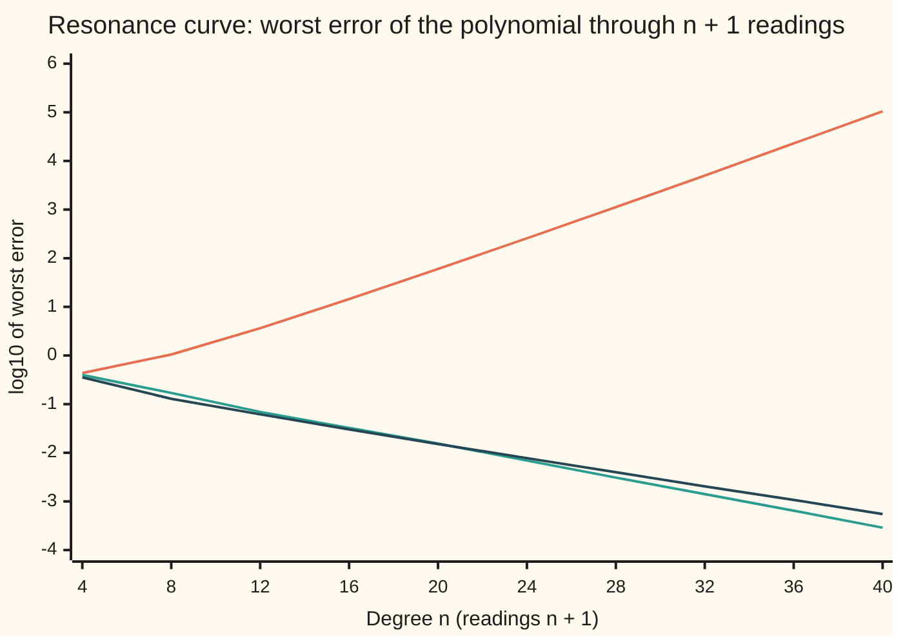
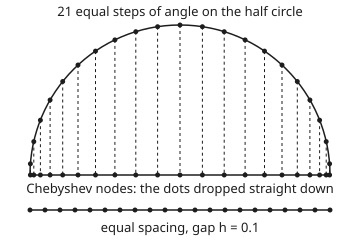

# Runge's phenomenon: equal spacing fails at high degree, and Chebyshev nodes repair it

[Syllabus](../../../SYLLABUS.md) → [Numerical analysis](../README.md) → [Interpolation and Approximation](../README.md#s04) → Runge's phenomenon

---

## General Overview

A radio is tuned to a station at 100.0 MHz. Its tuned circuit passes that frequency at full strength and less on either side. The response, as a fraction of the peak power, is 1/(1 + 25x²), where x is the detuning: how far the frequency is from 100.0 MHz, in MHz. At 0.2 MHz off, the response is one half. (Illustrative numbers for a simple resonance.)

An engineer measures the response at 21 frequencies, every 0.1 MHz from 99.0 to 101.0 MHz. To read the curve between the measurements, she draws the one polynomial of degree 20 through all 21 readings ([One polynomial through n points](02-lagrange-and-newton-interpolation.md)).

At 100.975 MHz the true response is 0.040379. The polynomial reads −59.781930: a negative power, almost 60 times the size of the peak. The middle of the curve looks fine. The two ends swing wildly between the readings. This is Runge's phenomenon, found by Carl Runge in 1901.

Now take the same 21 readings, but put them closer together near the ends of the band and further apart in the middle, at the Chebyshev nodes. The worst error anywhere in the band falls from 59.82 to 0.01533. At 100.975 MHz the polynomial reads 0.040337.

**Equally spaced points make a high-degree polynomial through them swing wildly near the ends, and moving the same number of points toward the ends, to the Chebyshev nodes, keeps the error small everywhere.**

**What kind of fact this is:** a theorem. The Chebyshev nodes' smallest-possible node product and the exact error formula for this bell are proved on this card in Why it works. The general convergence rates are stated with their sources and checked on the example by the code.

### The picture: worst error against degree



Orange: equal spacing, worst error over the whole band. It climbs from 10^−0.36 at degree 4 to 10^5.02 at degree 40. Teal: Chebyshev nodes. They fall steadily to 10^−3.54. Dark: equal spacing again, but only for |x| ≤ 0.5, the middle half of the band. There the error falls. The failure lives at the ends.

---

## The formula

The Chebyshev nodes for degree n are n + 1 points on −1 to 1:

$$x_j = \cos\frac{(2j+1)\pi}{2(n+1)}, \qquad j = 0, 1, \dots, n.$$

**Read it aloud:** split half a circle into n + 1 equal angles, take the middle of each, and drop it straight down onto the diameter.

The interpolation error theorem ([The interpolation error theorem](03-polynomial-interpolation-error.md)) says how wrong the polynomial is at any point x:

$$f(x) - p_n(x) = \frac{f^{(n+1)}(\xi)}{(n+1)!}\,\omega(x), \qquad \omega(x) = (x - x_0)(x - x_1)\cdots(x - x_n).$$

**Read it aloud:** the error is a part that depends only on the curve, times the node product ω(x), which depends only on where the readings were taken.

At the Chebyshev nodes the node product is a scaled Chebyshev polynomial $T_{n+1}$ (defined in Step 2 by $T_k(\cos\theta) = \cos k\theta$), and it is as small as any node product can be:

$$\omega(x) = \frac{T_{n+1}(x)}{2^{n}}, \qquad \max_{-1 \le x \le 1} |\omega(x)| = 2^{-n}.$$

**Read it aloud:** with Chebyshev nodes the node product never exceeds one over 2 to the n anywhere on the interval.

For the resonance curve the error has an exact form, proved below. With 21 nodes placed symmetrically about 0:

$$f(x) - p_{20}(x) = -\,\frac{x\,\omega(x)}{P\,(x^2 + 0.04)}, \qquad P = \prod_{x_k > 0} \left(x_k^2 + 0.04\right).$$

**Read it aloud:** the error is the node product, times a factor no bigger than 2.5, divided by P, which measures how far the nodes sit from 0.2i, where the bell's formula divides by zero (Step 3).

| Symbol | Plain meaning | In our example | Push it up and the answer… |
| --- | --- | --- | --- |
| $f(x)$ | the curve: response as a fraction of peak power | $1/(1 + 25x^2)$; $f(0.975) = 0.040379$ | a narrower peak (25 larger) is harder |
| $x$ | detuning from 100.0 MHz, in MHz, from −1 to 1 | 0.975, where equal spacing is worst | toward ±1, equal spacing gets worse |
| $n$ | degree of the polynomial; it passes through n + 1 readings | 20 | equal: error grows; Chebyshev: error shrinks |
| $x_j$, $j$, $h$ | the reading points (nodes) and their index; the gap between equal nodes | $h = 0.1$; Chebyshev outer nodes 0.997204, 0.974928 | — |
| $p_n(x)$ | the polynomial of degree n through every reading | $p(0.975) = -59.781930$ equal, 0.040337 Chebyshev | — |
| $\omega(x)$ | node product: x minus each node, all multiplied | worst 2.336e-4 equal, 9.537e-7 Chebyshev | bigger error in step |
| $f^{(n+1)}$, $\xi$ | the curve's (n+1)-th derivative; some unknown point in the interval | — | — |
| $T_k$, $\theta$ | Chebyshev polynomial, $T_k(\cos\theta) = \cos k\theta$; an angle | $T_{21}$ | — |
| $P$ | product over positive nodes of $x_k^2 + 0.04$ | 3.843513e-6 equal, 1.546419e-4 Chebyshev | smaller error |
| $i$, $\rho$ | $i = \sqrt{-1}$; $\rho = 0.2 + \sqrt{1.04}$, set by where $1 + 25x^2 = 0$, at $x = \pm i/5$ | $\rho = 1.219804$ | faster fall with Chebyshev nodes |
| $\Lambda_n$, $\ell_j$ | Lebesgue constant: the most a reading error can be magnified; Lagrange basis polynomial for node j | 10986.5 equal, 2.9008 Chebyshev | noise grows by this factor |
| $q$, $r$, $g$, $m$, $N$, $s$, $k$ | helpers in the two proofs: a rival node product, a difference, a candidate polynomial, the product of $s - x_k^2$ over the positive nodes, a numerator, $s = x^2$, a counting index | — | — |

### When it holds

- **You choose where to take the readings.** Chebyshev nodes are a design choice. Data that arrive on a fixed grid, such as daily prices or quoted maturities, need [Cubic splines](05-splines.md) or a least-squares fit instead.
- **The curve is smooth on and near the interval.** The kink of |x| at 0 has no derivative there. On Chebyshev nodes its worst error is 2.848e-2 at degree 20 and 1.457e-2 at degree 40: it only halves when the degree doubles.
- **The interval is −1 to 1.** On another interval from a to b, stretch the nodes: use (a + b)/2 + (b − a)/2 × x_j. Our band is already written as a detuning from −1 to 1 MHz.
- **The readings are exact, or nearly.** Small reading errors get magnified. With equal spacing at degree 20, reading errors of ±0.001 move the curve at 100.975 MHz by 10.985766. With Chebyshev nodes they move it by 0.001009.

---

## Why it works

### Step 0: the error splits into the curve's part and the nodes' part

The interpolation error theorem writes the error as a product. One factor, $f^{(n+1)}(\xi)/(n+1)!$, belongs to the curve. The other, the node product ω(x), belongs only to where the readings were taken.

The curve is given. The nodes are chosen. So the whole repair is: choose nodes that keep ω(x) small everywhere on the interval.

### Step 1: equal spacing makes the node product huge near the ends

Take the 21 equal nodes −1, −0.9, …, 1. At x = 0.05, in the middle, the other nodes sit on both sides. Many of the 21 distances are small.

At x = 0.975, near the end, almost every node sits on one side, far away. The distances to −1, −0.9, −0.8 are each nearly 2.

The check measures it:

- |ω(0.05)| = 4.293e-9 in the middle.
- |ω(0.975)| = 2.336e-4 near the end, the largest on the grid.
- The end value is 54,423 times the middle value.

So equal spacing puts a large factor exactly where the error shows up: near the ends.

### Step 2: the unit circle gives the Chebyshev polynomials

Write x = cos θ, so x is the shadow, on the horizontal axis, of a point on the unit circle at angle θ ([The unit circle](../../05-Geometry%20and%20trig/03-Trigonometry/02-radians-and-the-unit-circle.md)). Define $T_k(x) = \cos k\theta$.

This is a polynomial in x. The identity $\cos(k+1)\theta + \cos(k-1)\theta = 2\cos\theta\cos k\theta$ gives the recurrence

$$T_0 = 1, \qquad T_1 = x, \qquad T_{k+1}(x) = 2x\,T_k(x) - T_{k-1}(x).$$

Each step multiplies the top power by 2x, so $T_{n+1}$ has degree n + 1 and leading coefficient $2^{n}$.

Three facts follow at once:

1. **It never leaves −1 to 1.** It is a cosine, so $|T_{n+1}(x)| \le 1$ for every x in the interval.
2. **Its zeros are the Chebyshev nodes.** $\cos(n+1)\theta = 0$ when $(n+1)\theta = (2j+1)\pi/2$, which gives the formula above.
3. **So the node product is $T_{n+1}/2^n$.** Both are degree n + 1, both have leading coefficient 1 after dividing by $2^n$, and both vanish at the same n + 1 nodes.

Hence $|\omega(x)| \le 2^{-20} = 9.537e-7$ at degree 20. The check finds the largest |ω| on the grid to be 9.537e-7, and the recurrence matches $2^{20}\omega$ to within 1.110e-14.

The nodes crowd toward the ends because equal steps of angle near the ends of a half circle cast short shadows:

<p align="center"></p>

Drawn to scale, radius 1 = 150 units. The outermost Chebyshev gap is 0.022276; the middle gap is 0.149042. The equal gap is 0.1 everywhere.

<details>
<summary>Detailed proof: no choice of nodes gives a smaller node product</summary>

Suppose some nodes gave a node product q(x), of degree n + 1 with leading coefficient 1, with $|q(x)| < 2^{-n}$ everywhere on −1 to 1.

The scaled Chebyshev polynomial $T_{n+1}/2^n$ reaches $+2^{-n}$ and $-2^{-n}$ alternately at the n + 2 points $\cos(k\pi/(n+1))$, k = 0, …, n + 1.

Let $r = T_{n+1}/2^n - q$. The leading terms cancel, so r has degree at most n. At each of the n + 2 points, r has the sign of $T_{n+1}$, because |q| is smaller there. So r changes sign n + 1 times and has at least n + 1 zeros.

A nonzero polynomial of degree at most n has at most n zeros. So r is zero, and $q = T_{n+1}/2^n$, which reaches $2^{-n}$. That contradicts the assumption.

</details>

### Step 3: why this smooth bell is hard, and an exact error formula

The bell 1/(1 + 25x²) has every derivative on the real line. But its formula divides by zero at x = ±i/5 = ±0.2i, a complex number only 0.2 from the middle of the interval. Its derivatives grow so fast that the factor $f^{(n+1)}/(n+1)!$ does not shrink.

For this curve the error can be written exactly. With 21 nodes placed symmetrically about 0:

$$f(x) - p_{20}(x) = -\,\frac{x\,\omega(x)}{P\,(x^2 + 0.04)}.$$

<details>
<summary>Detailed proof: the exact error formula for the bell</summary>

The 21 nodes are symmetric and include 0, so $\omega(x) = x\,m(x^2)$ with $m(s) = \prod_{k=1}^{10} (s - x_k^2)$ over the ten positive nodes. Note $f(x) = \tfrac{1}{25}/(x^2 + 0.04)$.

Let $g(x) = f(x) + x\,\omega(x)/(P(x^2 + 0.04))$. Over a common denominator,

$$g(x) = \frac{P/25 + x^2 m(x^2)}{P\,(x^2 + 0.04)}.$$

Write $s = x^2$. The numerator $N(s) = P/25 + s\,m(s)$ is a polynomial of degree 11 in s. At $s = -0.04$: $m(-0.04) = \prod(-0.04 - x_k^2) = (-1)^{10} P = P$, so $N(-0.04) = P/25 - 0.04P = 0$.

So $s + 0.04$ divides N(s), and g is a polynomial of degree 10 in s, which is degree 20 in x.

At every node ω = 0, so g equals f there. The polynomial of degree 20 through 21 points is unique, so g = p₂₀. Rearranging gives the formula.

Also $\omega(i/5) = (i/5)\,m(-0.04) = iP/5$, so $P = 5\,|\omega(i/5)|$: P measures how far the nodes sit, all multiplied together, from the point where the bell breaks down.

</details>

The check confirms the formula against the polynomial itself on all 2,001 grid points, to within 1.918e-12.

Now read off the error. The factor $|x|/(x^2 + 0.04)$ is at most 2.5, at x = 0.2. So

$$|f(x) - p_{20}(x)| \le 2.5 \times \frac{\max|\omega|}{P}.$$

| Nodes | max of \|ω\| | P | Bound 2.5 max\|ω\|/P | True worst error | True ÷ bound |
| --- | --- | --- | --- | --- | --- |
| Equal | 2.336e-4 | 3.844e-6 | 1.520e2 | 5.982e1 | 0.394 |
| Chebyshev | 9.537e-7 | 1.546e-4 | 1.542e-2 | 1.533e-2 | 0.995 |

Equal spacing loses twice. Its node product is large at the ends. And many of its positive nodes sit close to 0, near the breakdown points ±0.2i, which makes P small. Chebyshev nodes win on both counts.

### Step 4: how fast Chebyshev nodes converge

For Chebyshev nodes, $P = 5|\omega(i/5)| = 5\,|T_{21}(i/5)|/2^{20}$. The cosine formula, continued to complex x, gives $|T_{21}(i/5)| = (\rho^{21} - \rho^{-21})/2$ with $\rho = 0.2 + \sqrt{1.04} = 1.219804$.

The check computes it three ways: by the recurrence, by the ρ formula, and as $2^{20}P/5$. All give 32.430765.

So the error shrinks by about 1/ρ = 0.8198 for each extra degree. The check observes 0.8200 per degree between degree 20 and degree 40.

The general theorem (Trefethen, Sources): if a curve has no breakdown inside an ellipse around −1 to 1 whose half-axes add to ρ, its Chebyshev interpolant's error falls like $\rho^{-n}$. The bell's breakdown at ±0.2i sets ρ = 1.219804. A wider bell, 1/(1 + x²), breaks down at ±i, so ρ is larger and convergence is faster.

Equal spacing has its own theorem, stated here without proof (Epperson; Trefethen, Sources). For this bell, the equally spaced polynomial converges for |x| < 0.7266 and diverges beyond it. The chart's dark line, the middle half of the band, sits safely inside.

### Step 5: rounding and reading errors

The Lebesgue constant $\Lambda_n$ is the largest, over x, of $|\ell_0(x)| + \dots + |\ell_n(x)|$, where $\ell_j$ is the Lagrange basis polynomial for node j ([One polynomial through n points](02-lagrange-and-newton-interpolation.md)). It is the most a reading error, or a rounding error, can be magnified.

- Equal spacing, degree 20: $\Lambda_{20}$ = 10986.5 on the grid. It grows roughly like $2^n$, divided by n log n.
- Chebyshev nodes, degree 20: $\Lambda_{20}$ = 2.9008, under the classical bound $(2/\pi)\log 21 + 1 = 2.9382$. It grows like log n.

So equal spacing fails twice: the method diverges on this bell, and it magnifies noise ten-thousandfold. Chebyshev nodes fix both.

**Cost.** A flop is one addition, subtraction, multiplication or division. At degree 20 the Lagrange form, as the code writes it, costs (n + 1)(4n + 2) = 1,722 flops per point. Newton's form pays 3n(n + 1)/2 = 630 flops once for the divided differences, then 3n = 60 per point. The barycentric form (Berrut and Trefethen, Sources) costs 5(n + 1) + 1 = 106 per point. Moving the nodes adds no work: only where the readings are taken changes.

---

## Worked numbers, by hand

At 100.975 MHz, x = 0.975, with equal nodes. All products run over the 21 nodes or the 10 positive nodes.

| Step | Arithmetic | Value |
| --- | --- | --- |
| true response | 1/(1 + 25 × 0.950625) = 1/24.765625 | 0.040379 |
| node product ω(0.975) | (0.975 + 1)(0.975 + 0.9) ⋯ (0.975 − 0.9)(0.975 − 1) | −2.336126e-4 |
| P | (0.01 + 0.04)(0.04 + 0.04)(0.09 + 0.04) ⋯ (1 + 0.04) | 3.843513e-6 |
| factor | 0.975 / (0.950625 + 0.04) | 0.984227 |
| error | −0.984227 × (−2.336126e-4) / 3.843513e-6 | 59.822309 |
| polynomial's reading | 0.040379 − 59.822309 | **−59.781930** |

The same steps with Chebyshev nodes give ω(0.975) = −6.492554e-9, P = 1.546419e-4 and an error of 4.1322218e-5. The polynomial reads 0.040337 against the true 0.040379.

The equal-spacing polynomial reports a negative power at nearly 60 times the peak, at a frequency where the true response is 4% of the peak. The Chebyshev polynomial is off by only 4.1e-5 there.

### What breaks if you drop a piece

| Mistake | Comes out at | What went wrong |
| --- | --- | --- |
| Equal spacing at degree 20 | worst error 5.982e1 at \|x\| = 0.975 | the node product is 54,423 times larger near the end than in the middle |
| Fix it with more equal readings: degree 40 | worst error 1.046e5 | the node product near the ends grows faster than the curve's factor shrinks |
| Chebyshev nodes on a kink, \|x\| | 2.848e-2 at degree 20, 1.457e-2 at degree 40 | no derivative at 0, so no fast rate: the error only halves per doubling |
| Equal spacing with readings off by ±0.001 | reading at 100.975 MHz moves by −10.985766 | $\Lambda_{20}$ = 10986.5 magnifies each 0.001 about ten thousand times |

---

## Code, from first principles, and it actually runs

The code builds the degree-20 polynomial on both sets of nodes and measures its error on 2,001 points, 0.001 apart. It takes three independent roads to the polynomial: the Lagrange form, Newton's divided differences, and the exact error formula. It takes three roads to $|T_{21}(i/5)|$: the recurrence, the ρ formula and the product P. The asserts check the blow-up, the repair, the $2^{-20}$ bound, the three values of $|T_{21}(i/5)|$ against each other, the bound against the true error and the observed rate against 1/ρ. Every number on this card is printed by both programs, with the same digits.

### Python

```python
# Runge's phenomenon and Chebyshev nodes -- the check behind the card.  Standard library only.
# A resonance peak f(x) = 1/(1 + 25 x^2), x = detuning in MHz from 100.0 MHz, read at 21 frequencies
# and joined by the one polynomial of degree 20 through them: once at equal spacing, once at Chebyshev nodes.
# Roads: Lagrange form; Newton divided differences; the exact error formula for this bell.
from math import cos, sin, pi, log10, log

def e(x, d=3):                                    # e-notation, printed the same way in Rust
    m, p = f"{x:.{d}e}".split("e")
    return m + "e" + str(int(p))
def f(x): return 1.0 / (1.0 + 25.0 * x * x)
def equal(n): return [-1.0 + 2.0 * j / n for j in range(n + 1)]
def cheb(n): return [cos((2 * j + 1) * pi / (2 * n + 2)) for j in range(n + 1)]
def lagrange(xs, ys, x):                          # sum of y_j times the basis l_j(x)
    s = 0.0
    for j in range(len(xs)):
        l = 1.0
        for k in range(len(xs)):
            if k != j:
                l = l * (x - xs[k]) / (xs[j] - xs[k])
        s = s + ys[j] * l
    return s
def newton(xs, ys):                               # divided differences, then nested evaluation
    c, n = list(ys), len(xs)
    for k in range(1, n):
        for j in range(n - 1, k - 1, -1):
            c[j] = (c[j] - c[j - 1]) / (xs[j] - xs[j - k])
    def p(x):
        v = c[n - 1]
        for j in range(n - 2, -1, -1):
            v = v * (x - xs[j]) + c[j]
        return v
    return p
def omega(xs, x):                                 # node polynomial: product of (x - x_j)
    w = 1.0
    for xj in xs:
        w = w * (x - xj)
    return w
def big_p(xs):                                    # P = product over positive nodes of (x_k^2 + 0.04) = 5 |omega(i/5)|
    w = 1.0
    for xj in sorted(xs):
        if xj > 1e-12:
            w = w * (xj * xj + 0.04)
    return w
def exact_err(xs, x): return -x * omega(xs, x) / (big_p(xs) * (x * x + 0.04))  # f - p, symmetric nodes, odd count
GRID = [-1.0 + i / 1000.0 for i in range(2001)]
def worst(xs, g=f, lim=1.0):                      # largest |g - p| on the grid with |x| <= lim, and where
    ys = [g(x) for x in xs]
    return max((abs(g(x) - lagrange(xs, ys, x)), abs(x)) for x in GRID if abs(x) <= lim + 1e-12)

N = 20
xe, xc = equal(N), cheb(N)
ye, yc = [f(x) for x in xe], [f(x) for x in xc]
print(f"degree {N}, {N + 1} readings; equal gap h {xe[1] - xe[0]:.6f}")
print(f"Chebyshev nodes: outer {xc[0]:.6f} {xc[1]:.6f} {xc[2]:.6f}, middle {xc[10]:.6f} {xc[9]:.6f};"
      f" gap at end {xc[0] - xc[1]:.6f}, in middle {xc[9] - xc[10]:.6f}")
we, wc = worst(xe), worst(xc)
print(f"worst error on grid: equal {e(we[0])} at |x| {we[1]:.3f} | Chebyshev {e(wc[0])} at |x| {wc[1]:.3f}")
assert we[0] > 50.0 and wc[0] < 0.02            # the blow-up, and the repair
x = 0.975
pe, pc = lagrange(xe, ye, x), lagrange(xc, yc, x)
print(f"at x {x}: f {f(x):.6f} | equal p {pe:.6f} | Chebyshev p {pc:.6f}")
dn = max(max(abs(lagrange(xs, ys, t) - newton(xs, ys)(t)) for t in GRID) for xs, ys in ((xe, ye), (xc, yc)))
dx = max(max(abs(f(t) - lagrange(xs, ys, t) - exact_err(xs, t)) for t in GRID) for xs, ys in ((xe, ye), (xc, yc)))
print("roads agree on grid: Lagrange vs Newton", e(dn), "| Lagrange vs exact error formula", e(dx))
assert dn < 1e-9 and dx < 1e-9
for name, xs, p in (("equal", xe, pe), ("Chebyshev", xc, pc)):
    w, P, r = omega(xs, x), big_p(xs), x / (x * x + 0.04)
    print(f"hand, {name}: omega(x) {e(w, 6)} P {e(big_p(xs), 6)} x/(x^2+0.04) {r:.6f}"
          f" error {e(-r * w / P, 7)} | f - p {e(f(x) - p, 7)}")
oe = max((abs(omega(xe, t)), abs(t)) for t in GRID)
oc = max(abs(omega(xc, t)) for t in GRID)
print(f"max |omega|: equal {e(oe[0])} at |x| {oe[1]:.3f}, |omega(0.05)| {e(abs(omega(xe, 0.05)))}"
      f" ratio {oe[0] / abs(omega(xe, 0.05)):.0f} | Chebyshev {e(oc)} | 2^-20 {e(2.0 ** -20)}")
assert abs(oc / 2.0 ** -20 - 1.0) < 1e-9 and oe[0] > 100.0 * oc
dt = 0.0
for t in GRID:                                   # T_21 by the recurrence T_(k+1) = 2x T_k - T_(k-1), against 2^20 omega
    a, b = 1.0, t
    for k in range(1, N + 1):
        a, b = b, 2.0 * t * b - a
    dt = max(dt, abs(b - 2.0 ** N * omega(xc, t)))
print("T_21 by recurrence vs 2^20 omega_Chebyshev, max diff", e(dt))
assert dt < 1e-12
rho = 0.2 + (1.04) ** 0.5                         # pole at i/5: rho = 1/5 + sqrt(1 + 1/25)
a, b = 1.0, 0.2                                   # T_k(i/5) = i^k t_k with t_(k+1) = 0.4 t_k + t_(k-1)
for k in range(1, N + 1):
    a, b = b, 0.4 * b + a
print(f"rho {rho:.6f}; |T_21(i/5)| {b:.6f} = (rho^21 - rho^-21)/2 {(rho ** 21 - rho ** -21) / 2:.6f}"
      f" | 2^20 P/5 {2.0 ** N * big_p(xc) / 5:.6f} | equal P {e(big_p(xe))}")
assert abs(b / (2.0 ** N * big_p(xc) / 5) - 1.0) < 1e-12
assert abs((rho ** 21 - rho ** -21) / 2 / b - 1.0) < 1e-12
for name, xs, wo in (("equal", xe, we[0]), ("Chebyshev", xc, wc[0])):
    bound = 2.5 * max(abs(omega(xs, t)) for t in GRID) / big_p(xs)  # max of |x|/(x^2+0.04) is 2.5, at x = 0.2
    print(f"bound {name}: 2.5 max|omega|/P {e(bound)}, true {e(wo)}, ratio true/bound {wo / bound:.3f}")
    assert wo <= bound
print("chart, log10 worst error, n = 4, 8, ..., 40: equal | Chebyshev | equal, |x| <= 0.5 only")
ns = list(range(4, 41, 4))
ce = [worst(equal(n))[0] for n in ns]
cc = [worst(cheb(n))[0] for n in ns]
cm = [worst(equal(n), lim=0.5)[0] for n in ns]
for row in (ce, cc, cm):
    print("  ", " ".join(f"{log10(v):.2f}" for v in row))
assert ce[-1] > 1e4 and cc[-1] < 1e-3 and cm[-1] < cm[0]
obs = (cc[-1] / cc[4]) ** (1.0 / 20.0)            # error shrink per degree, n = 20 to 40
print(f"Chebyshev shrink per degree, n 20 to 40: observed {obs:.4f}, theory 1/rho {1 / rho:.4f}")
assert abs(obs * rho - 1.0) < 0.01
def lebesgue(xs):
    m = 0.0
    for t in GRID:
        s = 0.0
        for j in range(len(xs)):
            s = s + abs(lagrange(xs, [1.0 if k == j else 0.0 for k in range(len(xs))], t))
        m = max(m, s)
    return m
le, lc = lebesgue(xe), lebesgue(xc)
print(f"Lebesgue constant on grid, n=20: equal {le:.1f} | Chebyshev {lc:.4f}, bound 2/pi log 21 + 1 {2 / pi * log(21) + 1:.4f}")
assert le > 1000.0 and lc < 2 / pi * log(21) + 1
print(f"flops per point, n={N}: Lagrange form (n+1)(4n+2) {(N + 1) * (4 * N + 2)} | Newton 3n {3 * N},"
      f" after 3n(n+1)/2 {3 * N * (N + 1) // 2} once | barycentric 5(n+1)+1 {5 * (N + 1) + 1}")
nz = [0.001 * (-1) ** j for j in range(N + 1)]    # reading errors of +-0.001, alternating
print("noise +-0.001, change in p at x 0.975: equal", f"{lagrange(xe, nz, x):.6f}", "| Chebyshev", f"{lagrange(xc, nz, x):.6f}")
print("n=40 worst: equal", e(worst(equal(40))[0]), "| Chebyshev", e(cc[-1]))
for n in (20, 40):
    print(f"break: kink |x| on Chebyshev nodes, n={n} worst {e(worst(cheb(n), g=abs)[0])}")
print("try: wide bell 1/(1 + x^2), equal nodes n=20 worst", e(worst(xe, g=lambda t: 1.0 / (1.0 + t * t))[0]))
print("figure, circle centre (180, 175) radius 150, Chebyshev dots (x, y):",  # x = 180 + 150 cos, y = 175 - 150 sin
      " ".join(f"{180 + 150 * cos((2 * j + 1) * pi / 42):.1f},{175 - 150 * sin((2 * j + 1) * pi / 42):.1f}" for j in range(21)))
print("ALL CHECKS PASS")
```

**Ran 2026-11-11 on macOS, Python 3.14.10, standard library only. All checks passed. Output, pasted from the run:**

```
degree 20, 21 readings; equal gap h 0.100000
Chebyshev nodes: outer 0.997204 0.974928 0.930874, middle 0.000000 0.149042; gap at end 0.022276, in middle 0.149042
worst error on grid: equal 5.982e1 at |x| 0.975 | Chebyshev 1.533e-2 at |x| 0.222
at x 0.975: f 0.040379 | equal p -59.781930 | Chebyshev p 0.040337
roads agree on grid: Lagrange vs Newton 6.956e-11 | Lagrange vs exact error formula 1.918e-12
hand, equal: omega(x) -2.336126e-4 P 3.843513e-6 x/(x^2+0.04) 0.984227 error 5.9822309e1 | f - p 5.9822309e1
hand, Chebyshev: omega(x) -6.492554e-9 P 1.546419e-4 x/(x^2+0.04) 0.984227 error 4.1322218e-5 | f - p 4.1322218e-5
max |omega|: equal 2.336e-4 at |x| 0.975, |omega(0.05)| 4.293e-9 ratio 54423 | Chebyshev 9.537e-7 | 2^-20 9.537e-7
T_21 by recurrence vs 2^20 omega_Chebyshev, max diff 1.110e-14
rho 1.219804; |T_21(i/5)| 32.430765 = (rho^21 - rho^-21)/2 32.430765 | 2^20 P/5 32.430765 | equal P 3.844e-6
bound equal: 2.5 max|omega|/P 1.520e2, true 5.982e1, ratio true/bound 0.394
bound Chebyshev: 2.5 max|omega|/P 1.542e-2, true 1.533e-2, ratio true/bound 0.995
chart, log10 worst error, n = 4, 8, ..., 40: equal | Chebyshev | equal, |x| <= 0.5 only
   -0.36 0.02 0.56 1.16 1.78 2.41 3.05 3.70 4.36 5.02
   -0.40 -0.77 -1.16 -1.49 -1.81 -2.16 -2.51 -2.85 -3.19 -3.54
   -0.45 -0.89 -1.21 -1.52 -1.82 -2.11 -2.40 -2.69 -2.97 -3.26
Chebyshev shrink per degree, n 20 to 40: observed 0.8200, theory 1/rho 0.8198
Lebesgue constant on grid, n=20: equal 10986.5 | Chebyshev 2.9008, bound 2/pi log 21 + 1 2.9382
flops per point, n=20: Lagrange form (n+1)(4n+2) 1722 | Newton 3n 60, after 3n(n+1)/2 630 once | barycentric 5(n+1)+1 106
noise +-0.001, change in p at x 0.975: equal -10.985766 | Chebyshev -0.001009
n=40 worst: equal 1.046e5 | Chebyshev 2.894e-4
break: kink |x| on Chebyshev nodes, n=20 worst 2.848e-2
break: kink |x| on Chebyshev nodes, n=40 worst 1.457e-2
try: wide bell 1/(1 + x^2), equal nodes n=20 worst 5.847e-6
figure, circle centre (180, 175) radius 150, Chebyshev dots (x, y): 329.6,163.8 326.2,141.6 319.6,120.2 309.9,100.0 297.3,81.5 282.0,65.0 264.5,51.1 245.1,39.9 224.2,31.7 202.4,26.7 180.0,25.0 157.6,26.7 135.8,31.7 114.9,39.9 95.5,51.1 78.0,65.0 62.7,81.5 50.1,100.0 40.4,120.2 33.8,141.6 30.4,163.8
ALL CHECKS PASS
```

### Rust

```rust
// Runge's phenomenon and Chebyshev nodes -- the check behind the card.  Rust std only, no crates.
// A resonance peak f(x) = 1/(1 + 25 x^2), x = detuning in MHz from 100.0 MHz, read at 21 frequencies
// and joined by the one polynomial of degree 20 through them: once at equal spacing, once at Chebyshev nodes.
// Roads: Lagrange form; Newton divided differences; the exact error formula for this bell.
use std::f64::consts::PI;

fn e(x: f64, d: usize) -> String { format!("{:.*e}", d, x) } // e-notation, printed the same way in Python
fn f(x: f64) -> f64 { 1.0 / (1.0 + 25.0 * x * x) }
fn equal(n: usize) -> Vec<f64> { (0..=n).map(|j| -1.0 + 2.0 * j as f64 / n as f64).collect() }
fn cheb(n: usize) -> Vec<f64> { (0..=n).map(|j| ((2 * j + 1) as f64 * PI / (2 * n + 2) as f64).cos()).collect() }
fn lagrange(xs: &[f64], ys: &[f64], x: f64) -> f64 { // sum of y_j times the basis l_j(x)
    let mut s = 0.0;
    for j in 0..xs.len() {
        let mut l = 1.0;
        for k in 0..xs.len() { if k != j { l = l * (x - xs[k]) / (xs[j] - xs[k]); } }
        s = s + ys[j] * l;
    }
    s
}
fn newton_coef(xs: &[f64], ys: &[f64]) -> Vec<f64> { // divided differences
    let (mut c, n) = (ys.to_vec(), xs.len());
    for k in 1..n { for j in (k..n).rev() { c[j] = (c[j] - c[j - 1]) / (xs[j] - xs[j - k]); } }
    c
}
fn newton(xs: &[f64], c: &[f64], x: f64) -> f64 { // nested evaluation
    let n = xs.len();
    let mut v = c[n - 1];
    for j in (0..n - 1).rev() { v = v * (x - xs[j]) + c[j]; }
    v
}
fn omega(xs: &[f64], x: f64) -> f64 { xs.iter().fold(1.0, |w, xj| w * (x - xj)) } // product of (x - x_j)
fn big_p(xs: &[f64]) -> f64 { // P = product over positive nodes of (x_k^2 + 0.04) = 5 |omega(i/5)|
    let mut s = xs.to_vec();
    s.sort_by(|a, b| a.partial_cmp(b).unwrap());
    s.iter().filter(|&&v| v > 1e-12).fold(1.0, |w, v| w * (v * v + 0.04))
}
fn exact_err(xs: &[f64], x: f64) -> f64 { -x * omega(xs, x) / (big_p(xs) * (x * x + 0.04)) } // f - p
fn grid() -> Vec<f64> { (0..2001).map(|i| -1.0 + i as f64 / 1000.0).collect() }
fn worst(xs: &[f64], g: &dyn Fn(f64) -> f64, lim: f64) -> (f64, f64) { // largest |g - p| with |x| <= lim, and where
    let ys: Vec<f64> = xs.iter().map(|&x| g(x)).collect();
    let mut best = (f64::MIN, 0.0);
    for x in grid() {
        if x.abs() > lim + 1e-12 { continue; }
        let c = ((g(x) - lagrange(xs, &ys, x)).abs(), x.abs());
        if c.0 > best.0 || (c.0 == best.0 && c.1 > best.1) { best = c; }
    }
    best
}
fn maxabs(v: impl Iterator<Item = f64>) -> f64 { v.fold(0.0, |m, a| if a.abs() > m { a.abs() } else { m }) }

fn main() {
    let n = 20;
    let (xe, xc) = (equal(n), cheb(n));
    let ye: Vec<f64> = xe.iter().map(|&x| f(x)).collect();
    let yc: Vec<f64> = xc.iter().map(|&x| f(x)).collect();
    println!("degree {}, {} readings; equal gap h {:.6}", n, n + 1, xe[1] - xe[0]);
    println!("Chebyshev nodes: outer {:.6} {:.6} {:.6}, middle {:.6} {:.6}; gap at end {:.6}, in middle {:.6}",
             xc[0], xc[1], xc[2], xc[10], xc[9], xc[0] - xc[1], xc[9] - xc[10]);
    let (we, wc) = (worst(&xe, &f, 1.0), worst(&xc, &f, 1.0));
    println!("worst error on grid: equal {} at |x| {:.3} | Chebyshev {} at |x| {:.3}", e(we.0, 3), we.1, e(wc.0, 3), wc.1);
    assert!(we.0 > 50.0 && wc.0 < 0.02); // the blow-up, and the repair
    let x = 0.975;
    let (pe, pc) = (lagrange(&xe, &ye, x), lagrange(&xc, &yc, x));
    println!("at x 0.975: f {:.6} | equal p {:.6} | Chebyshev p {:.6}", f(x), pe, pc);
    let (mut dn, mut dx) = (0.0f64, 0.0f64);
    for (xs, ys) in [(&xe, &ye), (&xc, &yc)] {
        let c = newton_coef(xs, ys);
        dn = dn.max(maxabs(grid().into_iter().map(|t| lagrange(xs, ys, t) - newton(xs, &c, t))));
        dx = dx.max(maxabs(grid().into_iter().map(|t| f(t) - lagrange(xs, ys, t) - exact_err(xs, t))));
    }
    println!("roads agree on grid: Lagrange vs Newton {} | Lagrange vs exact error formula {}", e(dn, 3), e(dx, 3));
    assert!(dn < 1e-9 && dx < 1e-9);
    for (name, xs, p) in [("equal", &xe, pe), ("Chebyshev", &xc, pc)] {
        let (w, bp, r) = (omega(xs, x), big_p(xs), x / (x * x + 0.04));
        println!("hand, {}: omega(x) {} P {} x/(x^2+0.04) {:.6} error {} | f - p {}", name, e(w, 6), e(bp, 6), r, e(-r * w / bp, 7), e(f(x) - p, 7));
    }
    let mut oe = (0.0, 0.0);
    for t in grid() { let c = (omega(&xe, t).abs(), t.abs()); if c.0 > oe.0 || (c.0 == oe.0 && c.1 > oe.1) { oe = c; } }
    let oc = maxabs(grid().into_iter().map(|t| omega(&xc, t)));
    let two20 = 1.0 / 1048576.0;
    println!("max |omega|: equal {} at |x| {:.3}, |omega(0.05)| {} ratio {:.0} | Chebyshev {} | 2^-20 {}",
             e(oe.0, 3), oe.1, e(omega(&xe, 0.05).abs(), 3), oe.0 / omega(&xe, 0.05).abs(), e(oc, 3), e(two20, 3));
    assert!((oc / two20 - 1.0).abs() < 1e-9 && oe.0 > 100.0 * oc);
    let mut dt = 0.0f64;
    for t in grid() { // T_21 by the recurrence T_(k+1) = 2x T_k - T_(k-1), against 2^20 omega
        let (mut a, mut b) = (1.0, t);
        for _ in 1..=n { let c = 2.0 * t * b - a; a = b; b = c; }
        dt = dt.max((b - omega(&xc, t) / two20).abs());
    }
    println!("T_21 by recurrence vs 2^20 omega_Chebyshev, max diff {}", e(dt, 3));
    assert!(dt < 1e-12);
    let rho = 0.2 + 1.04f64.sqrt(); // pole at i/5: rho = 1/5 + sqrt(1 + 1/25)
    let (mut a, mut b) = (1.0, 0.2); // T_k(i/5) = i^k t_k with t_(k+1) = 0.4 t_k + t_(k-1)
    for _ in 1..=n { let c = 0.4 * b + a; a = b; b = c; }
    println!("rho {:.6}; |T_21(i/5)| {:.6} = (rho^21 - rho^-21)/2 {:.6} | 2^20 P/5 {:.6} | equal P {}",
             rho, b, (rho.powi(21) - rho.powi(-21)) / 2.0, big_p(&xc) / two20 / 5.0, e(big_p(&xe), 3));
    assert!((b / (big_p(&xc) / two20 / 5.0) - 1.0).abs() < 1e-12);
    assert!(((rho.powi(21) - rho.powi(-21)) / 2.0 / b - 1.0).abs() < 1e-12);
    for (name, xs, wo) in [("equal", &xe, we.0), ("Chebyshev", &xc, wc.0)] {
        let bound = 2.5 * maxabs(grid().into_iter().map(|t| omega(xs, t))) / big_p(xs); // max |x|/(x^2+0.04) = 2.5
        println!("bound {}: 2.5 max|omega|/P {}, true {}, ratio true/bound {:.3}", name, e(bound, 3), e(wo, 3), wo / bound);
        assert!(wo <= bound);
    }
    println!("chart, log10 worst error, n = 4, 8, ..., 40: equal | Chebyshev | equal, |x| <= 0.5 only");
    let ns: Vec<usize> = (1..=10).map(|k| 4 * k).collect();
    let ce: Vec<f64> = ns.iter().map(|&m| worst(&equal(m), &f, 1.0).0).collect();
    let cc: Vec<f64> = ns.iter().map(|&m| worst(&cheb(m), &f, 1.0).0).collect();
    let cm: Vec<f64> = ns.iter().map(|&m| worst(&equal(m), &f, 0.5).0).collect();
    for row in [&ce, &cc, &cm] {
        println!("   {}", row.iter().map(|v| format!("{:.2}", v.log10())).collect::<Vec<_>>().join(" "));
    }
    assert!(ce[9] > 1e4 && cc[9] < 1e-3 && cm[9] < cm[0]);
    let obs = (cc[9] / cc[4]).powf(1.0 / 20.0); // error shrink per degree, n = 20 to 40
    println!("Chebyshev shrink per degree, n 20 to 40: observed {:.4}, theory 1/rho {:.4}", obs, 1.0 / rho);
    assert!((obs * rho - 1.0).abs() < 0.01);
    let lebesgue = |xs: &[f64]| -> f64 {
        let mut m = 0.0f64;
        for t in grid() {
            let mut s = 0.0;
            for j in 0..xs.len() {
                let unit: Vec<f64> = (0..xs.len()).map(|k| if k == j { 1.0 } else { 0.0 }).collect();
                s = s + lagrange(xs, &unit, t).abs();
            }
            m = m.max(s);
        }
        m
    };
    let (le, lc, lb) = (lebesgue(&xe), lebesgue(&xc), 2.0 / PI * 21f64.ln() + 1.0);
    println!("Lebesgue constant on grid, n=20: equal {:.1} | Chebyshev {:.4}, bound 2/pi log 21 + 1 {:.4}", le, lc, lb);
    assert!(le > 1000.0 && lc < lb);
    println!("flops per point, n={}: Lagrange form (n+1)(4n+2) {} | Newton 3n {}, after 3n(n+1)/2 {} once | barycentric 5(n+1)+1 {}",
             n, (n + 1) * (4 * n + 2), 3 * n, 3 * n * (n + 1) / 2, 5 * (n + 1) + 1);
    let nz: Vec<f64> = (0..=n).map(|j| if j % 2 == 0 { 0.001 } else { -0.001 }).collect(); // alternating reading errors
    println!("noise +-0.001, change in p at x 0.975: equal {:.6} | Chebyshev {:.6}", lagrange(&xe, &nz, x), lagrange(&xc, &nz, x));
    println!("n=40 worst: equal {} | Chebyshev {}", e(worst(&equal(40), &f, 1.0).0, 3), e(cc[9], 3));
    for m in [20, 40] {
        println!("break: kink |x| on Chebyshev nodes, n={} worst {}", m, e(worst(&cheb(m), &|t: f64| t.abs(), 1.0).0, 3));
    }
    println!("try: wide bell 1/(1 + x^2), equal nodes n=20 worst {}", e(worst(&xe, &|t: f64| 1.0 / (1.0 + t * t), 1.0).0, 3));
    let dots: Vec<String> = (0..21).map(|j| { let th = (2 * j + 1) as f64 * PI / 42.0; // x = 180 + 150 cos, y = 175 - 150 sin
        format!("{:.1},{:.1}", 180.0 + 150.0 * th.cos(), 175.0 - 150.0 * th.sin()) }).collect();
    println!("figure, circle centre (180, 175) radius 150, Chebyshev dots (x, y): {}", dots.join(" "));
    println!("ALL CHECKS PASS");
}
```

**Ran 2026-11-11 on macOS, rustc 1.98.1, no crates. All checks passed. Output, pasted from the run:**

```
degree 20, 21 readings; equal gap h 0.100000
Chebyshev nodes: outer 0.997204 0.974928 0.930874, middle 0.000000 0.149042; gap at end 0.022276, in middle 0.149042
worst error on grid: equal 5.982e1 at |x| 0.975 | Chebyshev 1.533e-2 at |x| 0.222
at x 0.975: f 0.040379 | equal p -59.781930 | Chebyshev p 0.040337
roads agree on grid: Lagrange vs Newton 6.956e-11 | Lagrange vs exact error formula 1.918e-12
hand, equal: omega(x) -2.336126e-4 P 3.843513e-6 x/(x^2+0.04) 0.984227 error 5.9822309e1 | f - p 5.9822309e1
hand, Chebyshev: omega(x) -6.492554e-9 P 1.546419e-4 x/(x^2+0.04) 0.984227 error 4.1322218e-5 | f - p 4.1322218e-5
max |omega|: equal 2.336e-4 at |x| 0.975, |omega(0.05)| 4.293e-9 ratio 54423 | Chebyshev 9.537e-7 | 2^-20 9.537e-7
T_21 by recurrence vs 2^20 omega_Chebyshev, max diff 1.110e-14
rho 1.219804; |T_21(i/5)| 32.430765 = (rho^21 - rho^-21)/2 32.430765 | 2^20 P/5 32.430765 | equal P 3.844e-6
bound equal: 2.5 max|omega|/P 1.520e2, true 5.982e1, ratio true/bound 0.394
bound Chebyshev: 2.5 max|omega|/P 1.542e-2, true 1.533e-2, ratio true/bound 0.995
chart, log10 worst error, n = 4, 8, ..., 40: equal | Chebyshev | equal, |x| <= 0.5 only
   -0.36 0.02 0.56 1.16 1.78 2.41 3.05 3.70 4.36 5.02
   -0.40 -0.77 -1.16 -1.49 -1.81 -2.16 -2.51 -2.85 -3.19 -3.54
   -0.45 -0.89 -1.21 -1.52 -1.82 -2.11 -2.40 -2.69 -2.97 -3.26
Chebyshev shrink per degree, n 20 to 40: observed 0.8200, theory 1/rho 0.8198
Lebesgue constant on grid, n=20: equal 10986.5 | Chebyshev 2.9008, bound 2/pi log 21 + 1 2.9382
flops per point, n=20: Lagrange form (n+1)(4n+2) 1722 | Newton 3n 60, after 3n(n+1)/2 630 once | barycentric 5(n+1)+1 106
noise +-0.001, change in p at x 0.975: equal -10.985766 | Chebyshev -0.001009
n=40 worst: equal 1.046e5 | Chebyshev 2.894e-4
break: kink |x| on Chebyshev nodes, n=20 worst 2.848e-2
break: kink |x| on Chebyshev nodes, n=40 worst 1.457e-2
try: wide bell 1/(1 + x^2), equal nodes n=20 worst 5.847e-6
figure, circle centre (180, 175) radius 150, Chebyshev dots (x, y): 329.6,163.8 326.2,141.6 319.6,120.2 309.9,100.0 297.3,81.5 282.0,65.0 264.5,51.1 245.1,39.9 224.2,31.7 202.4,26.7 180.0,25.0 157.6,26.7 135.8,31.7 114.9,39.9 95.5,51.1 78.0,65.0 62.7,81.5 50.1,100.0 40.4,120.2 33.8,141.6 30.4,163.8
ALL CHECKS PASS
```

### Lean

Lean proves Step 2's node-product facts for every degree n, and Step 3's exact error formula for any 21 symmetric nodes.

- With the n + 1 Chebyshev nodes, the node product ω(x) never exceeds $2^{-n}$ in size anywhere on −1 to 1.
- No nodes do better. For any n + 1 nodes at all, the node product reaches at least $2^{-n}$ in size somewhere on −1 to 1.
- At the Chebyshev nodes the node product is a scaled Chebyshev polynomial: $\omega(x) = T_{n+1}(x)/2^n$ for every real x.
- For the bell 1/(1 + 25x²), take 21 nodes: 0, and ±x_k for ten different positive x_k. Let $p_{20}$ be the polynomial of degree at most 20 through the bell at all 21 nodes. Then $f(x) - p_{20}(x) = -x\,\omega(x)/(P\,(x^2 + 0.04))$ exactly, for every real x.
- The cost counts at degree 20 hold: 1,722 flops per point for the Lagrange form and 106 for the barycentric form. Newton's form costs 630 once, then 60 per point.
- The equal gap at degree 20 is h = 2/20 = 0.1.

The 2.5 bound, the convergence rates, the Lebesgue constants and every floating-point number are left to the Python and Rust checks.

```lean
-- Runge's phenomenon: Chebyshev nodes give the smallest possible node product on −1 to 1, that product is T_(n+1)/2^n, and the degree-20 bell 1/(1 + 25x²) has an exact interpolation error formula.
import Mathlib.Analysis.SpecialFunctions.Trigonometric.Chebyshev.Basic
import Mathlib.Analysis.SpecialFunctions.Trigonometric.Chebyshev.RootsExtrema
import Mathlib.Analysis.SpecialFunctions.Trigonometric.Chebyshev.Extremal
import Mathlib.Topology.Algebra.Polynomial

open Polynomial Real

theorem helper_T (n : ℕ) (x : ℝ) :
    ∏ j : Fin (n + 1), (x - Real.cos ((2 * ((j : ℕ) : ℝ) + 1) * π / (2 * ((n : ℝ) + 1))))
      = (Chebyshev.T ℝ ((n : ℤ) + 1)).eval x / 2 ^ n := by
  have hcast : ((n : ℤ) + 1) = ((n + 1 : ℕ) : ℤ) := by push_cast; ring
  rw [hcast]
  set P := Chebyshev.T ℝ ((n + 1 : ℕ) : ℤ) with hP
  have hroots := Polynomial.Chebyshev.roots_T_real (n + 1)
  have hnd := Polynomial.Chebyshev.roots_T_real_nodup (n + 1)
  have hinj : Set.InjOn (fun k : ℕ => cos ((2 * k + 1) * π / (2 * ((n + 1 : ℕ) : ℝ))))
      (Finset.range (n + 1)) := (Finset.range (n + 1)).nodup_map_iff_injOn.mp hnd
  have hcard : Multiset.card P.roots = P.natDegree := by
    rw [hP, hroots, Chebyshev.natDegree_T, Finset.card_val, Finset.card_image_of_injOn hinj,
      Finset.card_range, Int.natAbs_natCast]
  have key := C_leadingCoeff_mul_prod_multiset_X_sub_C hcard
  have hlc : P.leadingCoeff = 2 ^ n := by
    rw [hP, Chebyshev.leadingCoeff_T, Int.natAbs_natCast, Nat.add_sub_cancel]
  rw [← key, hlc, hP, hroots, eval_mul, eval_C]
  rw [Finset.image_val_of_injOn hinj]
  rw [Multiset.map_map, eval_multiset_prod, Multiset.map_map]
  simp only [Function.comp_def, eval_sub, eval_X, eval_C]
  rw [← Finset.prod_eq_multiset_prod, Fin.prod_univ_eq_prod_range
    (fun k : ℕ => x - cos ((2 * (k : ℝ) + 1) * π / (2 * ((n : ℝ) + 1))))]
  push_cast
  field_simp
  refine Finset.prod_congr rfl fun k _ => ?_
  ring_nf

#print axioms helper_T

/-- Chebyshev nodes keep the node product small, and no nodes do better: with the n + 1
Chebyshev nodes x_j = cos((2j + 1)π / (2(n + 1))), the node product
ω(x) = (x − x_0)⋯(x − x_n) never exceeds 2^(−n) in size on −1 to 1; and for any n + 1 nodes
whatever, the node product reaches at least 2^(−n) in size somewhere on −1 to 1. -/
theorem chebyshev_nodes_minimize_node_product (n : ℕ) :
    (∀ x ∈ Set.Icc (-1 : ℝ) 1,
      |∏ j : Fin (n + 1), (x - Real.cos ((2 * ((j : ℕ) : ℝ) + 1) * π / (2 * ((n : ℝ) + 1))))|
        ≤ 1 / 2 ^ n) ∧
    (∀ y : Fin (n + 1) → ℝ, ∃ x ∈ Set.Icc (-1 : ℝ) 1, 1 / 2 ^ n ≤ |∏ j, (x - y j)|) := by
  refine ⟨fun x hx => ?_, fun y => ?_⟩
  · rw [helper_T, abs_div, abs_of_pos (by positivity : (0:ℝ) < 2 ^ n)]
    apply div_le_div_of_nonneg_right _ (by positivity)
    exact Polynomial.Chebyshev.abs_eval_T_real_le_one _ (abs_le.mpr ⟨hx.1, hx.2⟩)
  · set Q : ℝ[X] := ∏ j, (X - C (y j)) with hQ
    have hQe : ∀ x, Q.eval x = ∏ j, (x - y j) := fun x => by
      simp [hQ, eval_prod]
    have hQm : Q.Monic := monic_prod_X_sub_C y Finset.univ
    have hQd : Q.natDegree = n + 1 := by
      rw [hQ, natDegree_prod_of_monic _ _ (fun j _ => monic_X_sub_C (y j))]
      simp
    by_contra! hlt
    obtain ⟨x0, hx0, hmax⟩ := isCompact_Icc.exists_isMaxOn
      (Set.nonempty_Icc.mpr (by norm_num : (-1:ℝ) ≤ 1))
      (Q.continuous.abs.continuousOn : ContinuousOn (fun x => |Q.eval x|) (Set.Icc (-1) 1))
    set M := |Q.eval x0|
    have hM : M < 1 / 2 ^ n := by
      have := hlt x0 hx0; rwa [← hQe] at this
    have hM0 : 0 ≤ M := abs_nonneg _
    set c := (M + 1 / 2 ^ n) / 2 with hc
    have hc0 : 0 < c := by positivity
    have hMc : M < c := by rw [hc]; linarith
    have hcn : c < 1 / 2 ^ n := by rw [hc]; linarith
    have hPdeg : (C (1 / c) * Q).degree ≤ ((n + 1 : ℕ) : WithBot ℕ) := by
      rw [degree_C_mul (by positivity), degree_eq_natDegree hQm.ne_zero, hQd]
    have hPbnd : ∀ x ∈ Set.Icc (-1:ℝ) 1, |(C (1 / c) * Q).eval x| ≤ 1 := by
      intro x hx
      rw [eval_mul, eval_C, abs_mul, abs_of_pos (by positivity : (0:ℝ) < 1 / c)]
      have : |Q.eval x| ≤ M := hmax hx
      rw [one_div_mul_eq_div, div_le_one hc0]
      linarith
    have hle := Polynomial.Chebyshev.leadingCoeff_le_of_forall_abs_le_one hPdeg hPbnd
    rw [leadingCoeff_mul, leadingCoeff_C, hQm.leadingCoeff, mul_one, Nat.add_sub_cancel] at hle
    have : (2:ℝ) ^ n < 1 / c := by
      rw [lt_one_div (by positivity) hc0]; exact hcn
    linarith

/-- At the Chebyshev nodes the node product is a scaled Chebyshev polynomial:
ω(x) = T_(n+1)(x) / 2^n for every real x. -/
theorem chebyshev_node_product_eq_T (n : ℕ) (x : ℝ) :
    ∏ j : Fin (n + 1), (x - Real.cos ((2 * ((j : ℕ) : ℝ) + 1) * π / (2 * ((n : ℝ) + 1))))
      = (Chebyshev.T ℝ ((n : ℤ) + 1)).eval x / 2 ^ n := by
  rw [helper_T]

/-- The exact error formula for the bell f(x) = 1/(1 + 25x²): take 21 nodes placed
symmetrically about 0, namely 0 and ±x_k for ten distinct positive x_k, and let p be the
polynomial of degree at most 20 through f at all 21 nodes. Then
f(x) − p(x) = −x ω(x) / (P (x² + 0.04)), where ω(x) is the node product and
P = ∏ (x_k² + 0.04) over the ten positive nodes. -/
theorem runge_bell_exact_error (f : ℝ → ℝ) (hf : ∀ x, f x = 1 / (1 + 25 * x ^ 2))
    (s : Fin 10 → ℝ) (hs_pos : ∀ k, 0 < s k) (hs_inj : Function.Injective s)
    (p : ℝ[X]) (hp_deg : p.degree ≤ 20)
    (hp_zero : p.eval 0 = f 0)
    (hp_pos : ∀ k, p.eval (s k) = f (s k)) (hp_neg : ∀ k, p.eval (-s k) = f (-s k))
    (x : ℝ) :
    f x - p.eval x
      = -(x * (x * ∏ k, ((x - s k) * (x + s k))))
          / ((∏ k, (s k ^ 2 + 1 / 25)) * (x ^ 2 + 1 / 25)) := by
  set P : ℝ := ∏ k, (s k ^ 2 + 1 / 25) with hP
  have hP0 : 0 < P := Finset.prod_pos fun k _ => by positivity
  have hPc : ((P : ℝ) : ℂ) = ∏ k, (((s k : ℝ) : ℂ) ^ 2 + 1 / 25) := by
    rw [hP]; push_cast; rfl
  have hPc0 : ((P : ℝ) : ℂ) ≠ 0 := by exact_mod_cast hP0.ne'
  set pc : ℂ[X] := p.map Complex.ofRealHom with hpc
  have hpce : ∀ z : ℝ, pc.eval (z : ℂ) = ((p.eval z : ℝ) : ℂ) := fun z =>
    eval_map_apply (p := p) (f := Complex.ofRealHom) z
  set W : ℂ[X] := X * ∏ k, ((X - C ((s k : ℝ) : ℂ)) * (X + C ((s k : ℝ) : ℂ))) with hW
  have hWe : ∀ z : ℂ, W.eval z = z * ∏ k, ((z - (s k : ℂ)) * (z + (s k : ℂ))) := fun z => by
    simp [hW, eval_prod]
  set R : ℂ[X] := (1 + 25 * X ^ 2) * pc - 1 - C (25 / ((P : ℝ) : ℂ)) * X * W with hR
  have hRe : ∀ z : ℂ, R.eval z = (1 + 25 * z ^ 2) * pc.eval z - 1
      - 25 / ((P : ℝ) : ℂ) * z * (z * ∏ k, ((z - (s k : ℂ)) * (z + (s k : ℂ)))) := fun z => by
    rw [hR, ← hWe]; simp
  -- degree bound
  have hpcd : pc.natDegree ≤ 20 := by
    rw [hpc]
    exact (natDegree_map_le).trans (natDegree_le_of_degree_le hp_deg)
  have hprodd : (∏ k : Fin 10, ((X - C ((s k : ℝ) : ℂ)) * (X + C ((s k : ℝ) : ℂ)))).natDegree
      ≤ 20 := by
    refine (natDegree_prod_le _ _).trans ?_
    have : ∀ k ∈ (Finset.univ : Finset (Fin 10)),
        ((X - C ((s k : ℝ) : ℂ)) * (X + C ((s k : ℝ) : ℂ))).natDegree ≤ 2 := fun k _ => by
      refine (natDegree_mul_le).trans ?_
      have h1 := natDegree_X_sub_C_le ((s k : ℝ) : ℂ)
      have h2 : (X + C ((s k : ℝ) : ℂ)).natDegree ≤ 1 := (natDegree_X_add_C _).le
      omega
    refine (Finset.sum_le_sum this).trans ?_
    simp
  have hRd : R.natDegree ≤ 22 := by
    rw [hR]
    refine (natDegree_sub_le _ _).trans (max_le ((natDegree_sub_le _ _).trans (max_le ?_ ?_)) ?_)
    · refine (natDegree_mul_le).trans ?_
      have : (1 + 25 * X ^ 2 : ℂ[X]).natDegree ≤ 2 := by compute_degree
      omega
    · simp
    · rw [hW]
      refine (natDegree_mul_le).trans ?_
      have : (C (25 / ((P : ℝ) : ℂ)) * X : ℂ[X]).natDegree ≤ 1 := by compute_degree
      have h2 := (natDegree_mul_le (p := (X : ℂ[X]))
        (q := ∏ k : Fin 10, ((X - C ((s k : ℝ) : ℂ)) * (X + C ((s k : ℝ) : ℂ)))))
      have : (X : ℂ[X]).natDegree ≤ 1 := natDegree_X_le
      omega
  -- the 23 roots
  let g : Option (Option (Option (Fin 10 ⊕ Fin 10))) → ℂ := fun o =>
    match o with
    | none => Complex.I / 5
    | some none => -Complex.I / 5
    | some (some none) => 0
    | some (some (some (Sum.inl k))) => ((s k : ℝ) : ℂ)
    | some (some (some (Sum.inr k))) => -((s k : ℝ) : ℂ)
  have hg : Function.Injective g := by
    rintro (_|_|_|(a|a)) (_|_|_|(b|b)) h <;>
      simp [g, Complex.ext_iff] at h ⊢ <;>
      first
      | (have := hs_pos a; have := hs_pos b; linarith)
      | (have := hs_pos a; linarith)
      | (have := hs_pos b; linarith)
      | exact hs_inj h
      | norm_num at h
  have hprodI : ∀ w : ℂ, w ^ 2 = -1 / 25 →
      ∏ k, ((w - (s k : ℂ)) * (w + (s k : ℂ))) = ((P : ℝ) : ℂ) := by
    intro w hw
    rw [Finset.prod_congr rfl (fun k _ => show (w - ((s k : ℝ) : ℂ)) * (w + ((s k : ℝ) : ℂ))
      = -(((s k : ℝ) : ℂ) ^ 2 + 1 / 25) by linear_combination hw), Finset.prod_neg, hPc]
    norm_num
  have hR0 : R = 0 := by
    refine eq_zero_of_natDegree_lt_card_of_eval_eq_zero R hg (fun i => ?_) (by simp; omega)
    rcases i with _|_|_|(k|k)
    · simp only [g]; rw [hRe]
      have hz : (Complex.I / 5) ^ 2 = -1 / 25 := by rw [div_pow, Complex.I_sq]; norm_num
      rw [hprodI _ hz, show 25 / ((P : ℝ) : ℂ) * (Complex.I / 5) * (Complex.I / 5 * ((P : ℝ) : ℂ))
        = 25 * (Complex.I / 5) ^ 2 by field_simp]
      linear_combination (25 * pc.eval (Complex.I / 5) - 25) * hz
    · simp only [g]; rw [hRe]
      have hz : (-Complex.I / 5) ^ 2 = -1 / 25 := by
        rw [div_pow, neg_sq, Complex.I_sq]; norm_num
      rw [hprodI _ hz, show 25 / ((P : ℝ) : ℂ) * (-Complex.I / 5) * (-Complex.I / 5 * ((P : ℝ) : ℂ))
        = 25 * (-Complex.I / 5) ^ 2 by field_simp]
      linear_combination (25 * pc.eval (-Complex.I / 5) - 25) * hz
    · simp only [g]; rw [hRe]
      have := hpce 0
      rw [Complex.ofReal_zero, hp_zero, hf] at this
      rw [this]; norm_num
    · simp only [g]; rw [hRe]
      rw [Finset.prod_eq_zero (Finset.mem_univ k) (by simp), hpce, hp_pos, hf]
      have : (1 : ℝ) + 25 * s k ^ 2 ≠ 0 := by positivity
      have h1 : (1 + 25 * s k ^ 2) * (1 / (1 + 25 * s k ^ 2)) - 1 = (0 : ℝ) := by
        rw [mul_one_div_cancel this]; ring
      rw [mul_zero, mul_zero, sub_zero]
      exact_mod_cast h1
    · simp only [g]; rw [hRe]
      rw [Finset.prod_eq_zero (Finset.mem_univ k) (by simp), ← Complex.ofReal_neg, hpce, hp_neg, hf]
      have : (1 : ℝ) + 25 * (-s k) ^ 2 ≠ 0 := by positivity
      have h1 : (1 + 25 * (-s k) ^ 2) * (1 / (1 + 25 * (-s k) ^ 2)) - 1 = (0 : ℝ) := by
        rw [mul_one_div_cancel this]; ring
      rw [mul_zero, mul_zero, sub_zero]
      exact_mod_cast h1
  have hx := hRe (x : ℂ)
  rw [hR0, eval_zero, hpce] at hx
  have hreal : (1 + 25 * x ^ 2) * p.eval x - 1
      - 25 / P * x * (x * ∏ k, ((x - s k) * (x + s k))) = 0 := by
    exact_mod_cast hx.symm
  have h25 : (1 : ℝ) + 25 * x ^ 2 ≠ 0 := by positivity
  have hE : p.eval x = (1 + 25 / P * x * (x * ∏ k, ((x - s k) * (x + s k)))) / (1 + 25 * x ^ 2) := by
    rw [eq_div_iff h25]; linarith
  rw [hf x, hE]
  have h25' : x ^ 2 + 1 / 25 ≠ 0 := by positivity
  field_simp
  ring

-- Cost per point at degree n = 20, from the card's Cost paragraph (flops).
-- Lagrange form: (n + 1)(4n + 2) = 1,722.
example : (20 + 1) * (4 * 20 + 2) = 1722 := by norm_num
-- Newton's form: 3n(n + 1)/2 = 630 once, then 3n = 60 per point.
example : 3 * 20 * (20 + 1) / 2 = 630 := by norm_num
example : 3 * 20 = 60 := by norm_num
-- Barycentric form: 5(n + 1) + 1 = 106.
example : 5 * (20 + 1) + 1 = 106 := by norm_num
-- Equal nodes for degree 20 on −1 to 1: the gap h = 2/20 = 1/10.
example : (2 : ℚ) / 20 = 1 / 10 := by norm_num

#print axioms chebyshev_nodes_minimize_node_product
#print axioms chebyshev_node_product_eq_T
#print axioms runge_bell_exact_error
```

**Checked 2026-11-11 on macOS, Lean 4.36.0-rc2, Mathlib v4.36.0-rc2. Every proof is complete and uses only Lean's standard axioms. Output, pasted from the run:**

```
'helper_T' depends on axioms: [propext, Classical.choice, Quot.sound]
'chebyshev_nodes_minimize_node_product' depends on axioms: [propext, Classical.choice, Quot.sound]
'chebyshev_node_product_eq_T' depends on axioms: [propext, Classical.choice, Quot.sound]
'runge_bell_exact_error' depends on axioms: [propext, Classical.choice, Quot.sound]
```

> [!TIP]
> **Try changing**
> - Guess first: widen the bell to 1/(1 + x²), so it breaks down at ±i instead of ±0.2i. Does equal spacing still fail at degree 20? Change `f` to `1/(1 + x*x)`. Answer: no. The worst error is 5.847e-6, because the breakdown point is now far from the interval.
> - Guess first: double the Chebyshev degree to 40. How much smaller is the worst error? Answer: 2.894e-4, against 1.533e-2. That is about 0.82 to the power 20, as Step 4 predicts.
> - Guess first: add reading errors of ±0.001, alternating in sign. How far does the reading at 100.975 MHz move? See `nz`. Answer: −10.985766 with equal spacing and −0.001009 with Chebyshev nodes.
> - Guess first: interpolate the kink |x| at Chebyshev nodes. Answer: 2.848e-2 at degree 20 and 1.457e-2 at degree 40. Smoothness, not node choice alone, sets the speed.

---

## The usual mistake

> [!warning]
> **Adding more equally spaced readings to fix the wiggles.** It makes them worse. On this bell the worst error is 5.982e1 with 21 readings and 1.046e5 with 41. The node product near the ends grows faster than the curve's own factor can shrink. Change where the readings go, or switch to piecewise curves.
>
> - **Judging the fit by the middle.** For |x| ≤ 0.5 the equal-spacing error falls, to 10^−1.82 at degree 20. The failure is entirely near the ends, where it is 5.982e1.
> - **Blaming rounding.** The exact error formula, which uses no polynomial at all, agrees with the computed polynomial to 1.918e-12. The swing is the mathematics of the nodes, not rounding.
> - **Expecting Chebyshev nodes to rescue a kink.** On |x| the worst error is still 1.457e-2 at degree 40.
> - **Trusting noisy readings at equal spacing.** Errors of ±0.001 in the readings move the curve by 10.985766 at 100.975 MHz.

---

## Where you meet it in real life

- **Function libraries.** The routines behind sin, exp and special functions use polynomial approximations built on Chebyshev nodes, or the minimax fit they approximate ([Weierstrass and the minimax fit](08-weierstrass-and-best-approximation.md)).
- **Spectral methods.** Solvers for differential equations that need many digits place their grid points at Chebyshev nodes, for exactly the reasons on this card.
- **Integration rules.** Integrating a Chebyshev interpolant (built on the closely related Chebyshev extreme points, cos(kπ/n)) gives Clenshaw–Curtis quadrature, a close rival of [Gaussian quadrature](../05-Quadrature/03-gaussian-quadrature.md).
- **Yield curves.** The shelf's house example builds a yield curve through eight quoted maturities. Quotes come at fixed maturities, not at Chebyshev nodes, so one high-degree polynomial through them risks swings at the long end. Practitioners use [Cubic splines](05-splines.md) instead.
- **Sensor calibration.** When a calibration curve is measured at chosen points and then interpolated, putting more points near the ends of the range protects the readings there.

> **Say it back**
> The error of a polynomial through readings is the curve's own factor times the node product, which depends only on where the readings sit. Equally spaced readings make the node product huge near the ends, so a degree-20 fit to a narrow bell reads −59.78 where the truth is 0.04. Chebyshev nodes are equal steps of angle on a half circle, dropped onto the diameter, so they crowd toward the ends. They give the smallest possible node product, 2 to the minus 20, and the worst error falls to 0.01533. They also keep reading errors from being magnified, with a Lebesgue constant of 2.9 against 10,986.

---

## What this builds on

- [The interpolation error theorem](03-polynomial-interpolation-error.md): the error as the curve's derivative factor times the node product, the split this card's repair works on.
- [The unit circle](../../05-Geometry%20and%20trig/03-Trigonometry/02-radians-and-the-unit-circle.md): cosine as the horizontal shadow of a turning point, which defines $T_k(\cos\theta) = \cos k\theta$ and places the nodes.

## Where this goes next

- [Cubic splines](05-splines.md): low-degree pieces joined smoothly, the repair when the readings sit on a grid you cannot move.

This card leaves open what the very best polynomial of degree 20 would be, the one with the smallest worst error, and how close Chebyshev interpolation comes to it.

---

## Sources

Verified 2026-11-11: every link below resolves to the publisher's page.

- Epperson, James F. "On the Runge example." *The American Mathematical Monthly* 94(4), 1987, 329–341. [doi:10.1080/00029890.1987.12000642](https://doi.org/10.1080/00029890.1987.12000642). A careful account of Runge's example and of why equally spaced interpolation fails on it.
- Trefethen, Lloyd N. *Approximation Theory and Approximation Practice, Extended Edition*. SIAM, 2019. [doi:10.1137/1.9781611975949](https://doi.org/10.1137/1.9781611975949). Chebyshev interpolation, its ρ^−n rate on an ellipse, Lebesgue constants and the Runge phenomenon.
- Berrut, Jean-Paul, and Lloyd N. Trefethen. "Barycentric Lagrange interpolation." *SIAM Review* 46(3), 2004, 501–517. [doi:10.1137/S0036144502417715](https://doi.org/10.1137/S0036144502417715). How to evaluate the interpolant at Chebyshev nodes stably and in about 5n flops per point.
- NIST Digital Library of Mathematical Functions, §3.3, "Interpolation". [dlmf.nist.gov/3.3](https://dlmf.nist.gov/3.3). The Lagrange formula with its error term and the node product.
- NIST Digital Library of Mathematical Functions, §18.5, "Explicit representations". [dlmf.nist.gov/18.5](https://dlmf.nist.gov/18.5). The Chebyshev polynomial written as $T_n(\cos\theta) = \cos n\theta$.
