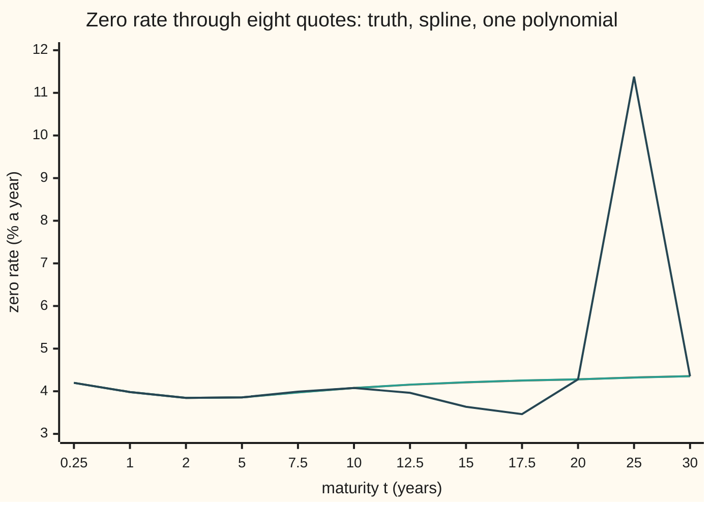
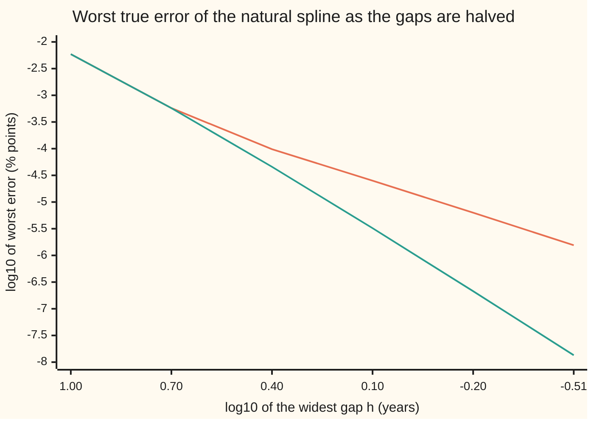

# Cubic splines: smooth cubic pieces joined so that the curvature matches

[Syllabus](../../../SYLLABUS.md) → [Numerical analysis](../README.md) → [Interpolation and Approximation](../README.md#s04) → Cubic splines

---

## General Overview

A rates desk sees eight quoted **zero rates** this morning. A zero rate is the one steady rate, compounded continuously, that grows a dollar today into the dollar due at a given date ([Compounding more often, and the number e](../../01-Foundations/04-Compound%20Growth%20and%20Discounting/04-compounding-frequency-and-e.md)). The quotes sit at 3 months, 6 months and 1, 2, 5, 10, 20 and 30 years, and read 4.1969%, 4.1110%, 3.9818%, 3.8451%, 3.8564%, 4.0764%, 4.2801% and 4.3533% a year.

A client wants the value today of $10,000,000 due in 15 years: 10,000,000 × e^(−15 × rate), with the 15-year rate written as a decimal. Nobody quoted 15 years. The desk needs a 15-year rate it can trust to within one **basis point** (bp: one hundredth of a percentage point). At 15 years even a fraction of a basis point is worth thousands of dollars on this payment.

The quotes on this card are illustrative. They were read off a smooth model curve, so the true 15-year rate is known: 4.207935%. That makes every error on the card a true error, not a guess.

Three ways to fill the gap between 10 and 20 years:

- **A straight line** between the two quotes gives 4.178271%, off by −2.966 bp.
- **One polynomial through all eight quotes** (degree 7) gives 3.636036%, off by −57.19 bp. Between 20 and 30 years it reads 11.379% at 25 years and, at its worst, 967.3 bp above the truth.
- **A cubic spline** gives 4.211993%, off by 0.406 bp. On the payment that is $3,237.31 out of $5,319,582.55.

A cubic spline puts a separate cubic (a polynomial of degree 3) in each gap. Neighbouring cubics meet at each quote with the same height, the same slope and the same **curvature** (second derivative: how fast the slope turns). The curvature at each quote is the unknown. Matching the slopes gives one equation per inside quote. Each equation links only three neighbouring curvatures, so the equations form a chain (a tridiagonal system) that one sweep solves.

**A cubic spline chooses the curvature at every data point so that neighbouring cubic pieces meet with equal slope; that choice is one small tridiagonal system, and the resulting curve is twice differentiable everywhere.**

**What kind of fact this is:** a method, with two theorems proved on this card in Why it works: the spline exists, is unique and is twice differentiable at every knot; and of all such curves through the quotes it bends least. Its error rates are theorems stated with their source and observed here.

### The picture: eight quotes, three curves



Orange: the true curve. Teal: the cubic spline, which lies on top of it at this scale. Dark: the degree-7 polynomial, which dips to 3.465% at 17.5 years and shoots to 11.379% at 25 years while still passing through every quote.

---

## The formula

Notation first, in words. The quoted maturities $t_0 < t_1 < \dots < t_n$ are the **knots**; here $n$ = 7 gaps and eight knots. The quote at $t_i$ is $y_i$. Gap $i$ runs from $t_i$ to $t_{i+1}$ and has width $h_i = t_{i+1} - t_i$. The unknowns are the **moments** $M_i = s''(t_i)$: the spline's curvature at each knot.

On gap $i$, for $t_i \le t \le t_{i+1}$, the spline is

$$s(t) = M_i\frac{(t_{i+1}-t)^3}{6h_i} + M_{i+1}\frac{(t-t_i)^3}{6h_i} + \Big(y_i - \frac{M_i h_i^2}{6}\Big)\frac{t_{i+1}-t}{h_i} + \Big(y_{i+1} - \frac{M_{i+1} h_i^2}{6}\Big)\frac{t-t_i}{h_i}.$$

The moments solve one equation for each inside knot, $i = 1, \dots, n-1$:

$$h_{i-1}M_{i-1} + 2(h_{i-1}+h_i)\,M_i + h_i M_{i+1} = 6\,(g_i - g_{i-1}), \qquad g_i = \frac{y_{i+1}-y_i}{h_i},$$

with the **natural** ends $M_0 = M_n = 0$.

**Read it aloud:** on each gap, the curve is the straight chord between the two quotes plus a cubic correction set by the curvatures at the two ends; and at each inside knot, a weighted sum of three neighbouring curvatures equals six times the change in chord slope there.

At the middle of a gap the formula shrinks to one line, which the worked numbers use:

$$s\Big(\tfrac{t_i+t_{i+1}}{2}\Big) = \frac{y_i+y_{i+1}}{2} - \frac{h_i^2}{16}\,(M_i + M_{i+1}).$$

| Symbol | Plain meaning | In our example | Push it up and the answer… |
| --- | --- | --- | --- |
| $t$, $t_i$ | maturity in years; the $i$-th quoted maturity (a knot) | $t$ = 15; $t_0$ = 0.25 … $t_7$ = 30 | — |
| $y_i$ | quoted zero rate at $t_i$, % a year | $y_5$ = 4.0764, $y_6$ = 4.2801 | the curve rises through it |
| $n$ | number of gaps, one cubic each | 7 | more pieces, smaller error |
| $h_i$, $h$ | width of gap $i$; the widest gap, when all gaps are halved together | 0.25, 0.5, 1, 3, 5, 10, 10; $h$ = 10 down to 0.3125 | wider gap, larger error: like $h^4$ inside, $h^2$ near the ends |
| $g_i$ | slope of the chord across gap $i$ | $g_5$ = 0.020366 | — |
| $s$, $s'$, $s''$, $s'''$ | the spline; its slope, curvature and third derivative | $s(15)$ = 4.211993 | — |
| $M_i$ | moment: the curvature $s''(t_i)$ | $M_5$ = −0.004586, $M_6$ = −0.000810 | positive bends up, negative bends down |
| $A$, $B$ | distance from $t$ to the right and left ends of its gap | at 15: $A$ = 5, $B$ = 5 | — |
| $p_i$ | pivot left on the diagonal by the Thomas sweep | 1.5000 … 36.4681 | larger is safer |
| $z(t)$ | the true curve the quotes were read from | $z(15)$ = 4.207935 | — |
| bp | basis point, 0.01 percentage point | spline error 0.406 bp | — |
| $f$, $e$, $c_i$ | in the Holladay proof: any rival curve through the quotes; the difference $e = f - s$ (not the number e); the constant value of $s'''$ on gap $i$ | — | — |

### When it holds

- **Well-separated knots and consistent data.** Every $h_i > 0$, so each gap holds a cubic. Knots that nearly repeat are safe only if their quotes agree: two quotes 0.05 years apart that disagree by 1 bp force a sharp bend, and the 15-year rate ends up 27.08 bp off the truth.
- **Exact data.** A spline passes through every quote, noise included. Noisy data needs a fit instead of an interpolant (a curve forced through every point): [Fitting instead of passing through](07-least-squares-and-orthogonal-polynomials.md).
- **An end condition.** The $n - 1$ equations have $n + 1$ unknowns, so two more conditions are needed. "Natural" sets the end curvatures to zero. The true curve here bends at its short end, so the error near the ends falls only like $h^2$, against $h^4$ inside. Other choices are on [Ends and shape](06-spline-end-conditions-and-shape.md).
- **A smooth truth.** The $h^4$ rate needs a curve with four continuous derivatives. On a kinked curve, the spline still interpolates but converges more slowly.

---

## Why it works

### Step 0: guess the curvatures, and two of the three joins come free

If the slope at each quote were known, each gap's cubic would be fixed on its own: two heights and two slopes fix a cubic. That is cubic Hermite interpolation. The spline does not know the slopes. It chooses them.

The trick is to make the curvatures the unknowns instead. A cubic has a straight-line second derivative. So if the curvature at each knot is $M_i$, the curvature between knots is the straight line joining $M_i$ to $M_{i+1}$. Integrate that twice and fit the two constants to the two quotes. The result already matches height and curvature at every knot. Only slope is left, and slope matching gives one linear equation per inside knot.

### Step 1: build each piece from its two curvatures

Write $A = t_{i+1} - t$ and $B = t - t_i$ for the distances to the gap's ends, so $A + B = h_i$.

- **Curvature.** Differentiate the formula twice: $s''(t) = (M_i A + M_{i+1} B)/h_i$. That is the straight line from $M_i$ at $t_i$ to $M_{i+1}$ at $t_{i+1}$.
- **Height.** At $t = t_i$, $A = h_i$ and $B = 0$. The cubic terms leave $M_i h_i^2/6$, and the next term leaves $y_i - M_i h_i^2/6$. They add to $y_i$. The right end gives $y_{i+1}$ the same way.

So, whatever the moments are, the pieces meet in height ($s$ is continuous) and in curvature ($s''$ is continuous, since both pieces read $M_i$ at $t_i$).

### Step 2: matching slopes gives one tridiagonal row per knot

Differentiate once. At the right end of gap $i-1$ and the left end of gap $i$, the slopes are

$$s'(t_i^-) = g_{i-1} + \frac{h_{i-1}}{6}(M_{i-1} + 2M_i), \qquad s'(t_i^+) = g_i - \frac{h_i}{6}(2M_i + M_{i+1}).$$

Set them equal and multiply by 6. Collecting terms gives the row in The formula. Each row holds only $M_{i-1}$, $M_i$ and $M_{i+1}$, so the system is **tridiagonal**: nonzero entries only on the main diagonal and the two beside it.

<details>
<summary>Detailed proof: the slope of each piece, and the row</summary>

On gap $i$, with $A = t_{i+1} - t$ and $B = t - t_i$, we have $dA/dt = -1$ and $dB/dt = 1$. Differentiating the formula term by term:

$$s'(t) = \frac{-M_i A^2 + M_{i+1} B^2}{2h_i} - \frac{y_i}{h_i} + \frac{M_i h_i}{6} + \frac{y_{i+1}}{h_i} - \frac{M_{i+1} h_i}{6} = \frac{M_{i+1}B^2 - M_i A^2}{2h_i} + g_i - \frac{(M_{i+1}-M_i)h_i}{6}.$$

At the left end, $A = h_i$ and $B = 0$:

$$s'(t_i^+) = -\frac{M_i h_i}{2} + g_i - \frac{(M_{i+1}-M_i)h_i}{6} = g_i - \frac{h_i}{6}(2M_i + M_{i+1}).$$

On gap $i-1$, at its right end $t_i$, $A = 0$ and $B = h_{i-1}$:

$$s'(t_i^-) = \frac{M_i h_{i-1}}{2} + g_{i-1} - \frac{(M_i - M_{i-1})h_{i-1}}{6} = g_{i-1} + \frac{h_{i-1}}{6}(M_{i-1} + 2M_i).$$

Setting $s'(t_i^-) = s'(t_i^+)$ and multiplying by 6:

$$h_{i-1}M_{i-1} + 2(h_{i-1} + h_i)M_i + h_iM_{i+1} = 6(g_i - g_{i-1}).$$

**Existence and uniqueness.** With $M_0 = M_n = 0$ there are $n-1$ rows in $n-1$ unknowns. In row $i$ the diagonal $2(h_{i-1}+h_i)$ exceeds the sum of its neighbours, $h_{i-1} + h_i$, by $h_{i-1} + h_i > 0$. A strictly diagonally dominant matrix is invertible: the Thomas sweep's pivots all stay above that margin, so it never divides by zero ([The Thomas algorithm](../03-Numerical%20Linear%20Algebra/03-tridiagonal-systems-and-the-thomas-algorithm.md) proves the pivot bound). So exactly one set of moments exists.

**Twice differentiable.** Inside a gap, $s$ is a polynomial, so it has every derivative. At a knot, Step 1 gave equal heights and equal curvatures from both sides, and the solved row gives equal slopes. So $s$, $s'$ and $s''$ are all continuous on $[t_0, t_n]$. The third derivative is $(M_{i+1} - M_i)/h_i$ on gap $i$, a different constant on each gap, so $s'''$ generally jumps.

</details>

The check measures each join. Across the six inside knots, the largest jump in $s$ is 4.4e-16, in $s'$ 1.4e-17, and in $s''$ 0.0e+00: rounding only. The largest jump in $s'''$ is 1.368489. So the curve is twice differentiable but not three times, exactly as proved.

An outside test of the curvature: a second difference straddling the 10-year knot, $(s(10.001) - 2s(10) + s(9.999))/0.001^2$, reads −0.004585. The moment says $M_5$ = −0.004586. [Second derivatives](../../06-Calculus%20and%20analysis/02-Derivatives/08-higher-derivatives-and-concavity.md) gives the meaning of the sign: negative means the curve bends down there, as a yield curve flattening out at the long end does.

### Step 3: the chain is cheap and safe to solve

The six rows here have diagonals 1.5, 3, 8, 16, 30 and 40, each twice the sum of its two neighbours. The Thomas sweep's pivots are 1.5000, 2.8333, 7.6471, 14.8231, 28.3134 and 36.4681: none comes near zero.

The cost, counting each flop (one add, subtract, multiply or divide):

| Part | Flops |
| --- | --- |
| gap widths $h_i$ | $n$ |
| chord slopes $g_i$ | $2n$ |
| diagonals and right sides | $4(n-1)$ |
| Thomas sweep on $n-1$ unknowns | $8(n-1) - 7$ |
| total | $15n - 19$ |

For seven gaps that is 86 flops. Writing all 28 raw conditions (heights, slopes, curvatures, ends) as one dense 28 by 28 system costs 15778 flops. The check solves both ways. They give the same 15-year rate, 4.211993%, with a gap of 0.0e+00 between them.

### Step 4: the natural spline bends least

A thin wooden strip, bent through pins on a drawing board, settles where its bending energy is smallest. That energy is roughly $\int s''(t)^2\,dt$. The natural spline is the exact answer to that problem: of all twice-differentiable curves through the quotes, it has the smallest $\int s''^2$.

<details>
<summary>Detailed proof: Holladay's least-bending property</summary>

Let $f$ be any curve through the same quotes with a square-integrable second derivative, and put $e = f - s$. Then $e(t_i) = 0$ at every knot, and

$$\int f''^2 = \int s''^2 + 2\int s''e'' + \int e''^2.$$

Integrate the middle term by parts on each gap:

$$\int_{t_i}^{t_{i+1}} s''e'' = \big[s''e'\big]_{t_i}^{t_{i+1}} - \int_{t_i}^{t_{i+1}} s'''e'.$$

Summed over the gaps, the bracket terms cancel at each inside knot, because $s''$ and $e'$ are continuous there. At the two ends they vanish, because $M_0 = M_n = 0$. On gap $i$, $s'''$ is a constant $c_i$, so the last integral is $c_i\,(e(t_{i+1}) - e(t_i)) = 0$. So the middle term is zero, and $\int f''^2 = \int s''^2 + \int e''^2 \ge \int s''^2$. Equality needs $e'' = 0$: then $e$ is a straight line that is zero at the knots, so $e = 0$.

</details>

The check computes the bending of three curves through the same eight quotes. The spline's is 0.056616, the true curve's 0.062486, the degree-7 polynomial's 33.60. The polynomial bends hundreds of times as much, which is the swing in the picture.

### Step 5: how wrong, and how fast it improves

At 15 years the spline is off by 0.406 bp. Its worst true error from 0.25 to 30 years is 0.58 bp. To see the rate, halve every gap five times, re-read the quotes from the true curve, and track the worst error.

| Halvings | Knots | Widest gap $h$ | Worst error, all (% points) | Worst error, 1 to 20 years | Order, all | Order, inside |
| --- | --- | --- | --- | --- | --- | --- |
| 0 | 8 | 10.0000 | 5.83e-03 | 5.83e-03 | — | — |
| 1 | 15 | 5.0000 | 5.69e-04 | 5.69e-04 | 3.36 | 3.36 |
| 2 | 29 | 2.5000 | 9.88e-05 | 4.56e-05 | 2.53 | 3.64 |
| 3 | 57 | 1.2500 | 2.49e-05 | 3.21e-06 | 1.99 | 3.83 |
| 4 | 113 | 0.6250 | 6.24e-06 | 2.12e-07 | 2.00 | 3.92 |
| 5 | 225 | 0.3125 | 1.56e-06 | 1.35e-08 | 2.00 | 3.97 |

The **observed order** is $\log_2$ of the ratio of successive errors: each halving of $h$ divides the error by $2^{\text{order}}$.

- **Inside, order 4.** Between 1 and 20 years the order climbs to 3.97, toward the theorem's 4. For a spline with the true end slopes, Hall and Meyer prove the sharp bound $\lvert f - s\rvert \le \tfrac{5}{384}h^4 \max\lvert f''''\rvert$ (Sources).
- **Near the ends, order 2.** The natural condition forces $s'' = 0$ at 0.25 years, but the true curve bends there. That wrong curvature costs an $h^2$ error near the end, and it dies away within a few knots of the end, so the inside keeps order 4.

### The picture: error against gap width



Orange: the worst error over the whole curve, which settles at order 2. Teal: the worst error from 1 to 20 years, which falls twice as steeply, at order 4. Each step right halves the widest gap.

---

## Worked numbers, by hand

The 15-year rate, which sits at the middle of the 10-to-20-year gap.

| Step | Arithmetic | Value |
| --- | --- | --- |
| gap widths | $h_i = t_{i+1} - t_i$ | 0.25, 0.5, 1, 3, 5, 10, 10 |
| chord slopes | $g_5 = (4.2801 - 4.0764)/10$, $g_6 = (4.3533 - 4.2801)/10$ | 0.020366, 0.007323 |
| last row's right side | $6 \times (0.007323 - 0.020366)$ | −0.078256 |
| last row's diagonal | $2 \times (10 + 10)$ | 40 |
| Thomas pivots | sweep down the six rows | 1.5000, 2.8333, 7.6471, 14.8231, 28.3134, 36.4681 |
| moments | sweep back | $M_5$ = −0.004586, $M_6$ = −0.000810 |
| check the last row | $10 \times (-0.004586) + 40 \times (-0.000810) + 10 \times 0$ | −0.078260, the right side to rounding |
| straight line at 15 years | $(4.0764 + 4.2801)/2$ | 4.178271 |
| bend term | $-\tfrac{10^2}{16}(M_5 + M_6) = -6.25 \times (-0.004586 - 0.000810)$ | 0.033723 |
| spline at 15 years | $4.178271 + 0.033723$, to rounding | **4.211993%** |

Each value is rounded to six decimals, so the hand sums can miss in the last digit: −0.078260 for −0.078256, and 4.211994 for 4.211993.

Both curvatures are negative, so the curve bows above its chord, and the spline lifts the straight-line rate by 0.033723 percentage points. The truth is 4.207935%, so the spline is off by 0.406 bp, and the line by −2.966 bp.

### What breaks if you drop a piece

| Mistake | Comes out at | What went wrong |
| --- | --- | --- |
| One degree-7 polynomial through all eight quotes | 3.636036% at 15 years, off −57.19 bp; worst 967.3 bp | one high-degree polynomial swings in the wide gaps |
| No curvature: all $M_i = 0$ | 4.178271% at 15 years, off −2.966 bp | that is straight lines, with a kink at every quote |
| Equal-spacing rows $M_{i-1} + 4M_i + M_{i+1}$ with $h$ = 4.2500 | 4.258996% at 15 years, off 5.11 bp | the maturities are not evenly spaced |
| A 10.05-year quote 1 bp above the 10-year | 4.478701% at 15 years, off 27.08 bp; worst 28.9 bp | knots nearly repeat with disagreeing data |

The last row breaks the "well-separated knots and consistent data" hypothesis. A 1 bp disagreement over only 0.05 years makes a steep chord. The spline must bend hard to pass through both quotes, and because every moment is tied to every other through the chain, the bend spreads 10 years away.

---

## Code, from first principles, and it actually runs

The code builds the natural spline through the eight quotes and reads the 15-year rate three ways. Road one solves the moment system by the Thomas sweep. Road two writes all 28 conditions on the raw cubic coefficients and solves them by dense elimination with row swaps. Road three compares with the true curve, then halves the gaps five times to measure the error orders. The checks also measure the jumps at each knot, the bending of three curves, and every row of the What breaks table.

### Python

```python
# Cubic splines -- the check behind the card.  Standard library only.  Zero rates
# at eight maturities, read off a smooth model curve (illustrative), so the truth is
# known.  Road one: moments by the Thomas sweep.  Road two: all 28 raw conditions by
# dense elimination.  Road three: the true curve, with the gaps halved five times.
from math import exp, log10, log2

def z(t):                                # model zero rate, percent a year
    x = t / 2.0
    l1 = (1 - exp(-x)) / x
    return 4.5 - 0.2 * l1 - 2.0 * (l1 - exp(-x))

def thomas(a, b, c, d):                  # tridiagonal solve, no row swaps
    p, r = [b[0]], [d[0]]
    for i in range(1, len(b)):
        l = a[i] / p[i - 1]
        p.append(b[i] - l * c[i - 1]); r.append(d[i] - l * r[i - 1])
    m = [0.0] * len(b)
    m[-1] = r[-1] / p[-1]
    for i in range(len(b) - 2, -1, -1): m[i] = (r[i] - c[i] * m[i + 1]) / p[i]
    return p, m

def moments(x, y):                       # natural spline: M_0 = M_n = 0
    n = len(x) - 1
    h = [x[i + 1] - x[i] for i in range(n)]
    g = [(y[i + 1] - y[i]) / h[i] for i in range(n)]
    a, c = h[:n - 1], h[1:]
    b = [2 * (h[i - 1] + h[i]) for i in range(1, n)]
    d = [6 * (g[i] - g[i - 1]) for i in range(1, n)]
    p, m = thomas(a, b, c, d)
    return h, b, d, p, [0.0] + m + [0.0]

def ev(x, y, M, t, i=None):              # s, s', s'', s''' on gap i at t
    i = sum(1 for v in x[1:-1] if v <= t) if i is None else i   # the gap holding t
    h, A, B = x[i + 1] - x[i], x[i + 1] - t, t - x[i]
    s = (M[i] * A * A * A + M[i + 1] * B * B * B) / (6 * h) + (y[i] / h - M[i] * h / 6) * A \
        + (y[i + 1] / h - M[i + 1] * h / 6) * B
    s1 = (M[i + 1] * B * B - M[i] * A * A) / (2 * h) + (y[i + 1] - y[i]) / h - (M[i + 1] - M[i]) * h / 6
    return s, s1, (M[i] * A + M[i + 1] * B) / h, (M[i + 1] - M[i]) / h

def dense(x, y):                         # 4n raw conditions, Gaussian elimination
    n = len(x) - 1; N = 4 * n; R = []
    def row(v, *e):
        r = [0.0] * N + [v]
        for k, w in e: r[k] += w
        R.append(r)
    for i in range(n):                   # piece i: y_i + b u + c u^2 + d u^3, u = t - x_i
        h, k = x[i + 1] - x[i], 4 * i
        row(y[i], (k, 1.0))
        row(y[i + 1], (k, 1.0), (k + 1, h), (k + 2, h * h), (k + 3, h * h * h))
        if i < n - 1:                    # slope and bend match at x_(i+1)
            row(0.0, (k + 1, 1.0), (k + 2, 2 * h), (k + 3, 3 * h * h), (k + 5, -1.0))
            row(0.0, (k + 2, 2.0), (k + 3, 6 * h), (k + 6, -2.0))
    row(0.0, (2, 2.0)); row(0.0, (N - 2, 2.0), (N - 1, 6 * (x[n] - x[n - 1])))
    for k in range(N):
        q = max(range(k, N), key=lambda i: abs(R[i][k]))
        R[k], R[q] = R[q], R[k]
        for i in range(k + 1, N):
            f = R[i][k] / R[k][k]
            for j in range(k, N + 1): R[i][j] -= f * R[k][j]
    c = [0.0] * N
    for i in range(N - 1, -1, -1): c[i] = (R[i][N] - sum(R[i][j] * c[j] for j in range(i + 1, N))) / R[i][i]
    return c

def poly(x, y, t):                       # the degree-7 polynomial, Newton form
    c, n = y[:], len(x)
    for k in range(1, n):
        for i in range(n - 1, k - 1, -1): c[i] = (c[i] - c[i - 1]) / (x[i] - x[i - k])
    v = c[-1]
    for i in range(n - 2, -1, -1): v = v * (t - x[i]) + c[i]
    return v

T = [0.25, 0.5, 1.0, 2.0, 5.0, 10.0, 20.0, 30.0]
Y = [z(t) for t in T]
H, B, D, P, M = moments(T, Y)
tq, zq = 15.0, z(15.0)
print("quotes, % a year:", " ".join(f"{v:.4f}" for v in Y))
print("gaps h:", " ".join(f"{v:g}" for v in H), "| slopes:", " ".join(f"{(Y[i + 1] - Y[i]) / H[i]:.6f}" for i in range(7)))
for i in range(6):
    print(f"row M{i + 1}: {H[i]:g}, {B[i]:g}, {H[i + 1]:g} | right side {D[i]:.6f}")
print("Thomas pivots:", " ".join(f"{v:.4f}" for v in P))
print("moments M_i = s''(T_i):", " ".join(f"{v:.6f}" for v in M))
sq, lin = ev(T, Y, M, tq)[0], (Y[5] + Y[6]) / 2
print(f"15y: straight line {lin:.6f}, bend term -6.25 x (M5 + M6) = {-6.25 * (M[5] + M[6]):.6f}, spline {sq:.6f}, true {zq:.6f}")
pv = lambda r: 1e7 * exp(-r / 100 * tq)
print(f"15y true error: spline {(sq - zq) * 100:.3f} bp, line {(lin - zq) * 100:.3f} bp; "
      f"$10m due in 15y: true {pv(zq):.2f}, spline off by {pv(sq) - pv(zq):.2f}")
sd = sum(w * 5**k for k, w in enumerate(dense(T, Y)[20:24]))   # piece 5 at u = 5
print(f"dense road, 28 by 28: 15y {sd:.6f}; gap to the moment road {abs(sd - sq):.1e}")
print(f"flops for 7 gaps: setup 7 + 14 + 12 + 12, Thomas {8 * 6 - 7}, total 15n - 19 = {15 * 7 - 19}; dense {(4 * 28**3 + 9 * 28**2 - 7 * 28) // 6}")
jl = [[abs(u - v) for u, v in zip(ev(T, Y, M, T[i], i - 1), ev(T, Y, M, T[i], i))] for i in range(1, 7)]
print("largest jump at the six inside knots: s {:.1e}, s' {:.1e}, s'' {:.1e}, s''' {:.6f}".format(
    *[max(j[k] for j in jl) for k in range(4)]))
dd = 1e-3
fd = (ev(T, Y, M, 10 + dd)[0] - 2 * ev(T, Y, M, 10.0)[0] + ev(T, Y, M, 10 - dd)[0]) / (dd * dd)
print(f"second difference straddling the 10y knot {fd:.6f}; moment M5 {M[5]:.6f}")
ts = [0.25, 1.0, 2.0, 5.0, 7.5, 10.0, 12.5, 15.0, 17.5, 20.0, 25.0, 30.0]
print("chart t:", " ".join(f"{t:g}" for t in ts))
for name, f in (("true  ", z), ("spline", lambda t: ev(T, Y, M, t)[0]), ("poly  ", lambda t: poly(T, Y, t))):
    print(" ", name, " ".join(f"{f(t):.3f}" for t in ts))
G = [0.25 + 29.75 * k / 5950 for k in range(5951)]
def bend(f):                             # integral of f''^2: second differences, Simpson
    w = [((f(t + dd) - 2 * f(t) + f(t - dd)) / (dd * dd))**2 for t in G]
    return 29.75 / 5950 / 3 * (w[0] + w[-1] + sum((4 if k % 2 else 2) * w[k] for k in range(1, 5950)))
bs = sum(H[i] / 3 * (M[i] * M[i] + M[i] * M[i + 1] + M[i + 1] * M[i + 1]) for i in range(7))
bz, bp = bend(z), bend(lambda t: poly(T, Y, t))
print(f"bending, integral of s'' squared: spline {bs:.6f}, true curve {bz:.6f}, polynomial {bp:.2f}")
print("refine: gaps halved L times | widest gap | max true error (% points), all; 1y to 20y | orders")
ER = []
for L in range(6):
    x = T[:]
    for _ in range(L): x = [v for i in range(len(x) - 1) for v in (x[i], (x[i] + x[i + 1]) / 2)] + [x[-1]]
    yx = [z(t) for t in x]
    Mx = moments(x, yx)[4]
    e = [abs(ev(x, yx, Mx, t)[0] - z(t)) for t in G]
    ER.append((max(e), max(e[k] for k in range(5951) if 1 <= G[k] <= 20)))
    o = "" if L == 0 else f" | {log2(ER[-2][0] / ER[-1][0]):.2f} {log2(ER[-2][1] / ER[-1][1]):.2f}"
    print(f"  L={L} knots {len(x):3d} | h {10 / 2**L:.4f} | {ER[-1][0]:.2e} {ER[-1][1]:.2e}{o}")
print("chart log10 h:", " ".join(f"{log10(10 / 2**L):.2f}" for L in range(6)))
print("  log10 error, all    ", " ".join(f"{log10(e[0]):.2f}" for e in ER))
print("  log10 error, 1y-20y ", " ".join(f"{log10(e[1]):.2f}" for e in ER))
es, pq, pw = ER[0][0], poly(T, Y, tq), max(abs(poly(T, Y, t) - z(t)) for t in G)
print(f"mistake, one degree-7 polynomial: 15y {pq:.6f}, off {(pq - zq) * 100:.2f} bp; worst {pw * 100:.1f} bp, spline's worst {es * 100:.2f} bp")
hb = 29.75 / 7                           # equal-spacing rows on uneven gaps
Mb = [0.0] + thomas([1.0] * 6, [4.0] * 6, [1.0] * 6,
                    [6 / (hb * hb) * (Y[i + 1] - 2 * Y[i] + Y[i - 1]) for i in range(1, 7)])[1] + [0.0]
sb = ev(T, Y, Mb, tq)[0]
print(f"mistake, equal-spacing rows with h = {hb:.4f}: 15y {sb:.6f}, off {(sb - zq) * 100:.2f} bp")
X2, Y2 = T[:6] + [10.05] + T[6:], Y[:6] + [Y[5] + 0.01] + Y[6:]
M2 = moments(X2, Y2)[4]
s2, w2 = ev(X2, Y2, M2, tq)[0], max(abs(ev(X2, Y2, M2, t)[0] - z(t)) for t in G)
print(f"break, a 10.05y quote 1 bp above the 10y: 15y {s2:.6f}, off {(s2 - zq) * 100:.2f} bp; worst {w2 * 100:.1f} bp")

assert abs(sd - sq) < 1e-12                           # two independent roads agree
assert max(max(j[:3]) for j in jl) < 1e-12 and max(j[3] for j in jl) > 1e-3  # C2 at the knots, not C3
assert abs(fd - M[5]) < 1e-5                          # s'' read off the curve = the moment
assert abs(sq - zq) < 0.01 and abs(lin - zq) > 5 * abs(sq - zq)  # spline beats the line at 15y
assert bs < bz < bp                                   # the spline bends least of the three
assert 3.5 < log2(ER[4][1] / ER[5][1]) < 4.5 and 1.5 < log2(ER[4][0] / ER[5][0]) < 2.5
assert pw > 100 * es and w2 > 10 * es                 # the polynomial and the near-repeat quote
print("ALL CHECKS PASS")
```

**Ran 2026-11-11 on macOS, Python 3.14.10, standard library only. All checks passed. Output, pasted from the run:**

```
quotes, % a year: 4.1969 4.1110 3.9818 3.8451 3.8564 4.0764 4.2801 4.3533
gaps h: 0.25 0.5 1 3 5 10 10 | slopes: -0.343563 -0.258504 -0.136703 0.003770 0.044007 0.020366 0.007323
row M1: 0.25, 1.5, 0.5 | right side 0.510353
row M2: 0.5, 3, 1 | right side 0.730811
row M3: 1, 8, 3 | right side 0.842838
row M4: 3, 16, 5 | right side 0.241421
row M5: 5, 30, 10 | right side -0.141847
row M6: 10, 40, 10 | right side -0.078256
Thomas pivots: 1.5000 2.8333 7.6471 14.8231 28.3134 36.4681
moments M_i = s''(T_i): 0.000000 0.284158 0.168231 0.084039 0.000764 -0.004586 -0.000810 0.000000
15y: straight line 4.178271, bend term -6.25 x (M5 + M6) = 0.033723, spline 4.211993, true 4.207935
15y true error: spline 0.406 bp, line -2.966 bp; $10m due in 15y: true 5319582.55, spline off by -3237.31
dense road, 28 by 28: 15y 4.211993; gap to the moment road 0.0e+00
flops for 7 gaps: setup 7 + 14 + 12 + 12, Thomas 41, total 15n - 19 = 86; dense 15778
largest jump at the six inside knots: s 4.4e-16, s' 1.4e-17, s'' 0.0e+00, s''' 1.368489
second difference straddling the 10y knot -0.004585; moment M5 -0.004586
chart t: 0.25 1 2 5 7.5 10 12.5 15 17.5 20 25 30
  true   4.197 3.982 3.845 3.856 3.974 4.076 4.153 4.208 4.249 4.280 4.324 4.353
  spline 4.197 3.982 3.845 3.856 3.972 4.076 4.156 4.212 4.252 4.280 4.322 4.353
  poly   4.197 3.982 3.845 3.856 3.992 4.076 3.963 3.636 3.465 4.280 11.379 4.353
bending, integral of s'' squared: spline 0.056616, true curve 0.062486, polynomial 33.60
refine: gaps halved L times | widest gap | max true error (% points), all; 1y to 20y | orders
  L=0 knots   8 | h 10.0000 | 5.83e-03 5.83e-03
  L=1 knots  15 | h 5.0000 | 5.69e-04 5.69e-04 | 3.36 3.36
  L=2 knots  29 | h 2.5000 | 9.88e-05 4.56e-05 | 2.53 3.64
  L=3 knots  57 | h 1.2500 | 2.49e-05 3.21e-06 | 1.99 3.83
  L=4 knots 113 | h 0.6250 | 6.24e-06 2.12e-07 | 2.00 3.92
  L=5 knots 225 | h 0.3125 | 1.56e-06 1.35e-08 | 2.00 3.97
chart log10 h: 1.00 0.70 0.40 0.10 -0.20 -0.51
  log10 error, all     -2.23 -3.24 -4.01 -4.60 -5.20 -5.81
  log10 error, 1y-20y  -2.23 -3.24 -4.34 -5.49 -6.67 -7.87
mistake, one degree-7 polynomial: 15y 3.636036, off -57.19 bp; worst 967.3 bp, spline's worst 0.58 bp
mistake, equal-spacing rows with h = 4.2500: 15y 4.258996, off 5.11 bp
break, a 10.05y quote 1 bp above the 10y: 15y 4.478701, off 27.08 bp; worst 28.9 bp
ALL CHECKS PASS
```

### Rust

Same rows and labels; the two outputs agree line for line.

```rust
// Cubic splines -- the same check as the Python, in Rust.  No crates.  Zero rates
// at eight maturities, read off a smooth model curve (illustrative), so the truth is
// known.  Road one: moments by the Thomas sweep.  Road two: all 28 raw conditions by
// dense elimination.  Road three: the true curve, with the gaps halved five times.
fn z(t: f64) -> f64 {                                 // model zero rate, percent a year
    let x = t / 2.0;
    let l1 = (1.0 - (-x).exp()) / x;
    4.5 - 0.2 * l1 - 2.0 * (l1 - (-x).exp())
}

fn thomas(a: &[f64], b: &[f64], c: &[f64], d: &[f64]) -> (Vec<f64>, Vec<f64>) {
    let n = b.len();                                  // tridiagonal solve, no row swaps
    let (mut p, mut r) = (vec![b[0]], vec![d[0]]);
    for i in 1..n {
        let l = a[i] / p[i - 1];
        p.push(b[i] - l * c[i - 1]); r.push(d[i] - l * r[i - 1]);
    }
    let mut m = vec![0.0; n];
    m[n - 1] = r[n - 1] / p[n - 1];
    for i in (0..n - 1).rev() { m[i] = (r[i] - c[i] * m[i + 1]) / p[i]; }
    (p, m)
}

struct Sp { h: Vec<f64>, b: Vec<f64>, d: Vec<f64>, p: Vec<f64>, m: Vec<f64> }

fn moments(x: &[f64], y: &[f64]) -> Sp {              // natural spline: M_0 = M_n = 0
    let n = x.len() - 1;
    let h: Vec<f64> = (0..n).map(|i| x[i + 1] - x[i]).collect();
    let g: Vec<f64> = (0..n).map(|i| (y[i + 1] - y[i]) / h[i]).collect();
    let b: Vec<f64> = (1..n).map(|i| 2.0 * (h[i - 1] + h[i])).collect();
    let d: Vec<f64> = (1..n).map(|i| 6.0 * (g[i] - g[i - 1])).collect();
    let (p, mi) = thomas(&h[..n - 1], &b, &h[1..], &d);
    Sp { h, b, d, p, m: [vec![0.0], mi, vec![0.0]].concat() }
}

fn gap(x: &[f64], t: f64) -> usize { x[1..x.len() - 1].iter().filter(|&&v| v <= t).count() }

fn ev(x: &[f64], y: &[f64], m: &[f64], t: f64, i: usize) -> [f64; 4] {   // s, s', s'', s''' on gap i
    let (h, a, b) = (x[i + 1] - x[i], x[i + 1] - t, t - x[i]);
    let s = (m[i] * a * a * a + m[i + 1] * b * b * b) / (6.0 * h) + (y[i] / h - m[i] * h / 6.0) * a
        + (y[i + 1] / h - m[i + 1] * h / 6.0) * b;
    let s1 = (m[i + 1] * b * b - m[i] * a * a) / (2.0 * h) + (y[i + 1] - y[i]) / h - (m[i + 1] - m[i]) * h / 6.0;
    [s, s1, (m[i] * a + m[i + 1] * b) / h, (m[i + 1] - m[i]) / h]
}
fn sv(x: &[f64], y: &[f64], m: &[f64], t: f64) -> f64 { ev(x, y, m, t, gap(x, t))[0] }

fn dense(x: &[f64], y: &[f64]) -> Vec<f64> {          // 4n raw conditions, Gaussian elimination
    let (n, nn) = (x.len() - 1, 4 * x.len() - 4);
    let mut r: Vec<Vec<f64>> = Vec::new();
    let mut row = |v: f64, e: &[(usize, f64)]| { let mut q = vec![0.0; nn + 1]; q[nn] = v; for &(k, w) in e { q[k] += w; } r.push(q); };
    for i in 0..n {                                   // piece i: y_i + b u + c u^2 + d u^3, u = t - x_i
        let (h, k) = (x[i + 1] - x[i], 4 * i);
        row(y[i], &[(k, 1.0)]);
        row(y[i + 1], &[(k, 1.0), (k + 1, h), (k + 2, h * h), (k + 3, h * h * h)]);
        if i < n - 1 {                                // slope and bend match at x_(i+1)
            row(0.0, &[(k + 1, 1.0), (k + 2, 2.0 * h), (k + 3, 3.0 * h * h), (k + 5, -1.0)]);
            row(0.0, &[(k + 2, 2.0), (k + 3, 6.0 * h), (k + 6, -2.0)]);
        }
    }
    row(0.0, &[(2, 2.0)]); row(0.0, &[(nn - 2, 2.0), (nn - 1, 6.0 * (x[n] - x[n - 1]))]);
    for k in 0..nn {
        let mut q = k;
        for i in k + 1..nn { if r[i][k].abs() > r[q][k].abs() { q = i; } }
        r.swap(k, q);
        for i in k + 1..nn {
            let f = r[i][k] / r[k][k];
            for j in k..=nn { let t = f * r[k][j]; r[i][j] -= t; }
        }
    }
    let mut c = vec![0.0; nn];
    for i in (0..nn).rev() {
        let s: f64 = (i + 1..nn).map(|j| r[i][j] * c[j]).sum();
        c[i] = (r[i][nn] - s) / r[i][i];
    }
    c
}

fn poly(x: &[f64], y: &[f64], t: f64) -> f64 {       // the degree-7 polynomial, Newton form
    let (mut c, n) = (y.to_vec(), x.len());
    for k in 1..n { for i in (k..n).rev() { c[i] = (c[i] - c[i - 1]) / (x[i] - x[i - k]); } }
    let mut v = c[n - 1];
    for i in (0..n - 1).rev() { v = v * (t - x[i]) + c[i]; }
    v
}

fn sci(v: f64, d: usize) -> String {                  // Python-style e-notation: 1.5e-03
    let s = format!("{:.*e}", d, v);
    let (m, e) = s.split_once('e').unwrap();
    let e: i32 = e.parse().unwrap();
    format!("{}e{}{:02}", m, if e < 0 { '-' } else { '+' }, e.abs())
}
fn join(v: &[f64], d: usize) -> String { v.iter().map(|t| format!("{:.*}", d, t)).collect::<Vec<_>>().join(" ") }

fn main() {
    let t = [0.25, 0.5, 1.0, 2.0, 5.0, 10.0, 20.0, 30.0];
    let y: Vec<f64> = t.iter().map(|&v| z(v)).collect();
    let Sp { h, b, d, p, m } = moments(&t, &y);
    let (tq, zq) = (15.0, z(15.0));
    println!("quotes, % a year: {}", join(&y, 4));
    println!("gaps h: {} | slopes: {}", h.iter().map(|v| format!("{}", v)).collect::<Vec<_>>().join(" "), join(&(0..7).map(|i| (y[i + 1] - y[i]) / h[i]).collect::<Vec<_>>(), 6));
    for i in 0..6 { println!("row M{}: {}, {}, {} | right side {:.6}", i + 1, h[i], b[i], h[i + 1], d[i]); }
    println!("Thomas pivots: {}", join(&p, 4));
    println!("moments M_i = s''(T_i): {}", join(&m, 6));
    let (sq, lin) = (sv(&t, &y, &m, tq), (y[5] + y[6]) / 2.0);
    println!("15y: straight line {:.6}, bend term -6.25 x (M5 + M6) = {:.6}, spline {:.6}, true {:.6}", lin, -6.25 * (m[5] + m[6]), sq, zq);
    let pv = |r: f64| 1e7 * (-r / 100.0 * tq).exp();
    println!("15y true error: spline {:.3} bp, line {:.3} bp; $10m due in 15y: true {:.2}, spline off by {:.2}",
             (sq - zq) * 100.0, (lin - zq) * 100.0, pv(zq), pv(sq) - pv(zq));
    let sd = dense(&t, &y)[20..24].iter().enumerate().fold(0.0, |s, (k, w)| s + w * 5f64.powi(k as i32));   // piece 5 at u = 5
    println!("dense road, 28 by 28: 15y {:.6}; gap to the moment road {}", sd, sci((sd - sq).abs(), 1));
    println!("flops for 7 gaps: setup 7 + 14 + 12 + 12, Thomas {}, total 15n - 19 = {}; dense {}", 8 * 6 - 7, 15 * 7 - 19, (4 * 28 * 28 * 28 + 9 * 28 * 28 - 7 * 28) / 6);
    let jl: Vec<Vec<f64>> = (1..7).map(|i| { let (l, r) = (ev(&t, &y, &m, t[i], i - 1), ev(&t, &y, &m, t[i], i)); (0..4).map(|k| (l[k] - r[k]).abs()).collect() }).collect();
    let jm: Vec<f64> = (0..4).map(|k| jl.iter().fold(0.0, |a: f64, j| a.max(j[k]))).collect();
    println!("largest jump at the six inside knots: s {}, s' {}, s'' {}, s''' {:.6}", sci(jm[0], 1), sci(jm[1], 1), sci(jm[2], 1), jm[3]);
    let dd = 1e-3;
    let fd = (sv(&t, &y, &m, 10.0 + dd) - 2.0 * sv(&t, &y, &m, 10.0) + sv(&t, &y, &m, 10.0 - dd)) / (dd * dd);
    println!("second difference straddling the 10y knot {:.6}; moment M5 {:.6}", fd, m[5]);
    let ts = [0.25, 1.0, 2.0, 5.0, 7.5, 10.0, 12.5, 15.0, 17.5, 20.0, 25.0, 30.0];
    println!("chart t: {}", ts.iter().map(|v| format!("{}", v)).collect::<Vec<_>>().join(" "));
    println!("  true   {}", join(&ts.iter().map(|&v| z(v)).collect::<Vec<_>>(), 3));
    println!("  spline {}", join(&ts.iter().map(|&v| sv(&t, &y, &m, v)).collect::<Vec<_>>(), 3));
    println!("  poly   {}", join(&ts.iter().map(|&v| poly(&t, &y, v)).collect::<Vec<_>>(), 3));
    let g: Vec<f64> = (0..5951).map(|k| 0.25 + 29.75 * k as f64 / 5950.0).collect();
    let bend = |f: &dyn Fn(f64) -> f64| -> f64 {      // integral of f''^2: second differences, Simpson
        let w: Vec<f64> = g.iter().map(|&v| ((f(v + dd) - 2.0 * f(v) + f(v - dd)) / (dd * dd)).powi(2)).collect();
        29.75 / 5950.0 / 3.0 * (w[0] + w[5950] + (1..5950).fold(0.0, |s, k| s + (if k % 2 == 1 { 4.0 } else { 2.0 }) * w[k]))
    };
    let bs = (0..7).fold(0.0, |s, i| s + h[i] / 3.0 * (m[i] * m[i] + m[i] * m[i + 1] + m[i + 1] * m[i + 1]));
    let (bz, bp) = (bend(&z), bend(&|v| poly(&t, &y, v)));
    println!("bending, integral of s'' squared: spline {:.6}, true curve {:.6}, polynomial {:.2}", bs, bz, bp);
    println!("refine: gaps halved L times | widest gap | max true error (% points), all; 1y to 20y | orders");
    let mut er: Vec<(f64, f64)> = Vec::new();
    for l in 0..6 {
        let mut x = t.to_vec();
        for _ in 0..l { x = (0..x.len() - 1).flat_map(|i| [x[i], (x[i] + x[i + 1]) / 2.0]).chain([x[x.len() - 1]]).collect(); }
        let yx: Vec<f64> = x.iter().map(|&v| z(v)).collect();
        let mx = moments(&x, &yx).m;
        let e: Vec<f64> = g.iter().map(|&v| (sv(&x, &yx, &mx, v) - z(v)).abs()).collect();
        let inner = (0..5951).filter(|&k| 1.0 <= g[k] && g[k] <= 20.0).fold(0.0, |a: f64, k| a.max(e[k]));
        er.push((e.iter().fold(0.0, |a: f64, &v| a.max(v)), inner));
        let (n, k) = (er.len(), x.len());
        let o = if l == 0 { String::new() } else { format!(" | {:.2} {:.2}", (er[n - 2].0 / er[n - 1].0).log2(), (er[n - 2].1 / er[n - 1].1).log2()) };
        println!("  L={} knots {:3} | h {:.4} | {} {}{}", l, k, 10.0 / 2f64.powi(l), sci(er[n - 1].0, 2), sci(er[n - 1].1, 2), o);
    }
    println!("chart log10 h: {}", join(&(0..6).map(|l| (10.0 / 2f64.powi(l)).log10()).collect::<Vec<_>>(), 2));
    println!("  log10 error, all     {}", join(&er.iter().map(|e| e.0.log10()).collect::<Vec<_>>(), 2));
    println!("  log10 error, 1y-20y  {}", join(&er.iter().map(|e| e.1.log10()).collect::<Vec<_>>(), 2));
    let (es, pq) = (er[0].0, poly(&t, &y, tq));
    let pw = g.iter().fold(0.0, |a: f64, &v| a.max((poly(&t, &y, v) - z(v)).abs()));
    println!("mistake, one degree-7 polynomial: 15y {:.6}, off {:.2} bp; worst {:.1} bp, spline's worst {:.2} bp", pq, (pq - zq) * 100.0, pw * 100.0, es * 100.0);
    let hb = 29.75 / 7.0;                             // equal-spacing rows on uneven gaps
    let rhs: Vec<f64> = (1..7).map(|i| 6.0 / (hb * hb) * (y[i + 1] - 2.0 * y[i] + y[i - 1])).collect();
    let mb = [vec![0.0], thomas(&[1.0; 6], &[4.0; 6], &[1.0; 6], &rhs).1, vec![0.0]].concat();
    let sb = sv(&t, &y, &mb, tq);
    println!("mistake, equal-spacing rows with h = {:.4}: 15y {:.6}, off {:.2} bp", hb, sb, (sb - zq) * 100.0);
    let (x2, y2) = ([&t[..6], &[10.05], &t[6..]].concat(), [&y[..6], &[y[5] + 0.01], &y[6..]].concat());
    let m2 = moments(&x2, &y2).m;
    let (s2, w2) = (sv(&x2, &y2, &m2, tq), g.iter().fold(0.0, |a: f64, &v| a.max((sv(&x2, &y2, &m2, v) - z(v)).abs())));
    println!("break, a 10.05y quote 1 bp above the 10y: 15y {:.6}, off {:.2} bp; worst {:.1} bp", s2, (s2 - zq) * 100.0, w2 * 100.0);

    assert!((sd - sq).abs() < 1e-12);                                   // two independent roads agree
    assert!(jm[0].max(jm[1]).max(jm[2]) < 1e-12 && jm[3] > 1e-3);                            // C2 at the knots, not C3
    assert!((fd - m[5]).abs() < 1e-5);                                   // s'' read off the curve = the moment
    assert!((sq - zq).abs() < 0.01 && (lin - zq).abs() > 5.0 * (sq - zq).abs());   // spline beats the line at 15y
    assert!(bs < bz && bz < bp);                                         // the spline bends least of the three
    assert!((er[4].1 / er[5].1).log2() > 3.5 && (er[4].1 / er[5].1).log2() < 4.5 && (er[4].0 / er[5].0).log2() > 1.5 && (er[4].0 / er[5].0).log2() < 2.5);
    assert!(pw > 100.0 * es && w2 > 10.0 * es);                          // the polynomial and the near-repeat quote
    println!("ALL CHECKS PASS");
}
```

**Ran 2026-11-11 on macOS, rustc 1.98.1, no crates. All checks passed. Output, pasted from the run:**

```
quotes, % a year: 4.1969 4.1110 3.9818 3.8451 3.8564 4.0764 4.2801 4.3533
gaps h: 0.25 0.5 1 3 5 10 10 | slopes: -0.343563 -0.258504 -0.136703 0.003770 0.044007 0.020366 0.007323
row M1: 0.25, 1.5, 0.5 | right side 0.510353
row M2: 0.5, 3, 1 | right side 0.730811
row M3: 1, 8, 3 | right side 0.842838
row M4: 3, 16, 5 | right side 0.241421
row M5: 5, 30, 10 | right side -0.141847
row M6: 10, 40, 10 | right side -0.078256
Thomas pivots: 1.5000 2.8333 7.6471 14.8231 28.3134 36.4681
moments M_i = s''(T_i): 0.000000 0.284158 0.168231 0.084039 0.000764 -0.004586 -0.000810 0.000000
15y: straight line 4.178271, bend term -6.25 x (M5 + M6) = 0.033723, spline 4.211993, true 4.207935
15y true error: spline 0.406 bp, line -2.966 bp; $10m due in 15y: true 5319582.55, spline off by -3237.31
dense road, 28 by 28: 15y 4.211993; gap to the moment road 0.0e+00
flops for 7 gaps: setup 7 + 14 + 12 + 12, Thomas 41, total 15n - 19 = 86; dense 15778
largest jump at the six inside knots: s 4.4e-16, s' 1.4e-17, s'' 0.0e+00, s''' 1.368489
second difference straddling the 10y knot -0.004585; moment M5 -0.004586
chart t: 0.25 1 2 5 7.5 10 12.5 15 17.5 20 25 30
  true   4.197 3.982 3.845 3.856 3.974 4.076 4.153 4.208 4.249 4.280 4.324 4.353
  spline 4.197 3.982 3.845 3.856 3.972 4.076 4.156 4.212 4.252 4.280 4.322 4.353
  poly   4.197 3.982 3.845 3.856 3.992 4.076 3.963 3.636 3.465 4.280 11.379 4.353
bending, integral of s'' squared: spline 0.056616, true curve 0.062486, polynomial 33.60
refine: gaps halved L times | widest gap | max true error (% points), all; 1y to 20y | orders
  L=0 knots   8 | h 10.0000 | 5.83e-03 5.83e-03
  L=1 knots  15 | h 5.0000 | 5.69e-04 5.69e-04 | 3.36 3.36
  L=2 knots  29 | h 2.5000 | 9.88e-05 4.56e-05 | 2.53 3.64
  L=3 knots  57 | h 1.2500 | 2.49e-05 3.21e-06 | 1.99 3.83
  L=4 knots 113 | h 0.6250 | 6.24e-06 2.12e-07 | 2.00 3.92
  L=5 knots 225 | h 0.3125 | 1.56e-06 1.35e-08 | 2.00 3.97
chart log10 h: 1.00 0.70 0.40 0.10 -0.20 -0.51
  log10 error, all     -2.23 -3.24 -4.01 -4.60 -5.20 -5.81
  log10 error, 1y-20y  -2.23 -3.24 -4.34 -5.49 -6.67 -7.87
mistake, one degree-7 polynomial: 15y 3.636036, off -57.19 bp; worst 967.3 bp, spline's worst 0.58 bp
mistake, equal-spacing rows with h = 4.2500: 15y 4.258996, off 5.11 bp
break, a 10.05y quote 1 bp above the 10y: 15y 4.478701, off 27.08 bp; worst 28.9 bp
ALL CHECKS PASS
```

### Lean

Lean proves that the natural spline exists, is unique, solves the moment rows and bends least, for any quotes and any positive gap widths.

- Through any quotes there is a natural cubic spline: one cubic per gap, through every quote, with $s$, $s'$ and $s''$ continuous and $M_0 = M_n = 0$.
- Two natural cubic splines through the same quotes are the same curve.
- The moments of a natural spline solve the tridiagonal rows in The formula, with $M_0 = M_n = 0$.
- Of all curves through the quotes whose second derivative is continuous, the natural spline has the smallest $\int s''^2$: Holladay's least-bending property.
- The card's whole-number arithmetic checks out: diagonals 8, 16, 30 and 40, and row $M_6$'s diagonal beating its neighbours by 20.
- So does the cost: $15n - 19 = 86$ flops for 7 gaps, and 28 unknowns on the dense road.

The yield-curve numbers, Thomas pivots, $s'''$ jumps, error orders and What breaks rows are left to the Python and Rust checks.

```lean
-- Cubic splines: the natural cubic spline through any data at strictly increasing knots exists, is unique and twice continuously differentiable, its knot curvatures solve the tridiagonal moment system, and it bends least.
import Mathlib.Analysis.Calculus.IteratedDeriv.Defs
import Mathlib.MeasureTheory.Integral.IntervalIntegral.Basic
import Mathlib.MeasureTheory.Integral.IntervalIntegral.FundThmCalculus
import Mathlib.Analysis.Calculus.IteratedDeriv.Lemmas
import Mathlib.Analysis.Calculus.ContDiff.Deriv
import Mathlib.Analysis.Calculus.TangentCone.Real
import Mathlib.Analysis.Calculus.Deriv.Pow
import Mathlib.Analysis.Calculus.Deriv.Mul
import Mathlib.Tactic.LinearCombination
import Mathlib.Tactic.FieldSimp
import Mathlib.Tactic.IntervalCases

open Set

/-- A natural cubic spline through the quotes `y 0, …, y n` at the knots `t 0, …, t n`:
it passes through every quote, it is one cubic on each gap `[t i, t (i+1)]`, it is twice
continuously differentiable on `[t 0, t n]` (neighbouring cubics meet with equal height,
slope and curvature), and its curvature is zero at both ends (the natural end condition). -/
def IsNaturalCubicSpline (n : ℕ) (t y : ℕ → ℝ) (s : ℝ → ℝ) : Prop :=
  (∀ i ≤ n, s (t i) = y i) ∧
  (∀ i < n, ∃ a b c d : ℝ, ∀ x ∈ Icc (t i) (t (i + 1)),
      s x = a + b * x + c * x ^ 2 + d * x ^ 3) ∧
  ContDiffOn ℝ 2 s (Icc (t 0) (t n)) ∧
  iteratedDerivWithin 2 s (Icc (t 0) (t n)) (t 0) = 0 ∧
  iteratedDerivWithin 2 s (Icc (t 0) (t n)) (t n) = 0

lemma spl_le {n : ℕ} {t : ℕ → ℝ} (ht : ∀ i < n, t i < t (i + 1)) {i j : ℕ} (hij : i ≤ j)
    (hj : j ≤ n) : t i ≤ t j := by
  induction j, hij using Nat.le_induction with
  | base => exact le_rfl
  | succ m hm ih => exact (ih (by omega)).trans (ht m (by omega)).le
#print axioms spl_le

lemma spl_lt {n : ℕ} {t : ℕ → ℝ} (ht : ∀ i < n, t i < t (i + 1)) {i j : ℕ} (hij : i < j)
    (hj : j ≤ n) : t i < t j :=
  (ht i (by omega)).trans_le (spl_le ht (by omega : i + 1 ≤ j) hj)
#print axioms spl_lt

lemma spl_hasDerivAt_of_mem {a b : ℝ} {g : ℝ → ℝ} (hg : ContDiffOn ℝ 1 g (Icc a b)) {x : ℝ}
    (hx : x ∈ Ioo a b) : HasDerivAt g (derivWithin g (Icc a b) x) x := by
  have hN : Icc a b ∈ nhds x := Icc_mem_nhds hx.1 hx.2
  rw [derivWithin_of_mem_nhds hN]
  exact ((hg.differentiableOn one_ne_zero x (Ioo_subset_Icc_self hx)).differentiableAt hN).hasDerivAt
#print axioms spl_hasDerivAt_of_mem

lemma spl_cubic_hasDerivAt (a b c d x : ℝ) :
    HasDerivAt (fun x => a + b * x + c * x ^ 2 + d * x ^ 3) (b + 2 * c * x + 3 * d * x ^ 2) x := by
  have h := ((((hasDerivAt_id x).const_mul b).const_add a).add
    ((hasDerivAt_pow 2 x).const_mul c)).add ((hasDerivAt_pow 3 x).const_mul d)
  convert h using 1
  · funext y; simp only [Pi.add_apply, id]
  · norm_num; ring
#print axioms spl_cubic_hasDerivAt

lemma spl_quad_hasDerivAt (b c d x : ℝ) :
    HasDerivAt (fun x => b + 2 * c * x + 3 * d * x ^ 2) (2 * c + 6 * d * x) x := by
  have h := (((hasDerivAt_id x).const_mul (2 * c)).const_add b).add
    ((hasDerivAt_pow 2 x).const_mul (3 * d))
  convert h using 1
  · funext y; simp only [Pi.add_apply, id]
  · norm_num; ring
#print axioms spl_quad_hasDerivAt

lemma spl_piece {n : ℕ} {t : ℕ → ℝ} (ht : ∀ i < n, t i < t (i + 1)) {s : ℝ → ℝ}
    (hs : ContDiffOn ℝ 2 s (Icc (t 0) (t n))) {i : ℕ} (hi : i < n) {a b c d : ℝ}
    (hp : ∀ x ∈ Icc (t i) (t (i + 1)), s x = a + b * x + c * x ^ 2 + d * x ^ 3) :
    ∀ x ∈ Icc (t i) (t (i + 1)), derivWithin s (Icc (t 0) (t n)) x = b + 2 * c * x + 3 * d * x ^ 2 ∧
      iteratedDerivWithin 2 s (Icc (t 0) (t n)) x = 2 * c + 6 * d * x := by
  have h0i : t 0 ≤ t i := spl_le ht (Nat.zero_le _) hi.le
  have hin : t (i + 1) ≤ t n := spl_le ht hi le_rfl
  have hii : t i < t (i + 1) := ht i hi
  have hU : UniqueDiffOn ℝ (Icc (t 0) (t n)) := uniqueDiffOn_Icc (h0i.trans_lt (hii.trans_le hin))
  have hsub : Ioo (t i) (t (i + 1)) ⊆ Icc (t i) (t (i + 1)) := Ioo_subset_Icc_self
  have hcl : Icc (t i) (t (i + 1)) ⊆ closure (Ioo (t i) (t (i + 1))) := by
    rw [closure_Ioo hii.ne]
  have hJI : Icc (t i) (t (i + 1)) ⊆ Icc (t 0) (t n) := Icc_subset_Icc h0i hin
  have hN : ∀ x ∈ Ioo (t i) (t (i + 1)), Icc (t 0) (t n) ∈ nhds x := fun x hx =>
    Icc_mem_nhds (h0i.trans_lt hx.1) (hx.2.trans_le hin)
  have hD1 : ∀ x ∈ Ioo (t i) (t (i + 1)),
      derivWithin s (Icc (t 0) (t n)) x = b + 2 * c * x + 3 * d * x ^ 2 := by
    intro x hx
    rw [derivWithin_of_mem_nhds (hN x hx)]
    have hev : s =ᶠ[nhds x] (fun x => a + b * x + c * x ^ 2 + d * x ^ 3) := by
      filter_upwards [Ioo_mem_nhds hx.1 hx.2] with z hz using hp z (hsub hz)
    rw [hev.deriv_eq]
    exact (spl_cubic_hasDerivAt a b c d x).deriv
  have hD2 : ∀ x ∈ Ioo (t i) (t (i + 1)),
      iteratedDerivWithin 2 s (Icc (t 0) (t n)) x = 2 * c + 6 * d * x := by
    intro x hx
    rw [iteratedDerivWithin_succ, iteratedDerivWithin_one, derivWithin_of_mem_nhds (hN x hx)]
    have hev : derivWithin s (Icc (t 0) (t n)) =ᶠ[nhds x]
        (fun x => b + 2 * c * x + 3 * d * x ^ 2) := by
      filter_upwards [Ioo_mem_nhds hx.1 hx.2] with z hz using hD1 z hz
    rw [hev.deriv_eq]
    exact (spl_quad_hasDerivAt b c d x).deriv
  have e1 := Set.EqOn.of_subset_closure hD1 ((hs.continuousOn_derivWithin hU (by norm_num)).mono hJI)
    (by fun_prop) hsub hcl
  have e2 := Set.EqOn.of_subset_closure hD2
    ((hs.continuousOn_iteratedDerivWithin (by norm_num) hU).mono hJI) (by fun_prop) hsub hcl
  exact fun x hx => ⟨e1 hx, e2 hx⟩
#print axioms spl_piece

lemma spl_alg (a b c d a' b' c' d' u k v : ℝ) (h1 : u < k) (h2 : k < v)
    (hd : b + 2 * c * k + 3 * d * k ^ 2 = b' + 2 * c' * k + 3 * d' * k ^ 2)
    (hval : a + b * k + c * k ^ 2 + d * k ^ 3 = a' + b' * k + c' * k ^ 2 + d' * k ^ 3)
    (hM : 2 * c + 6 * d * k = 2 * c' + 6 * d' * k) :
    (k - u) * (2 * c + 6 * d * u) + 2 * ((k - u) + (v - k)) * (2 * c + 6 * d * k)
        + (v - k) * (2 * c' + 6 * d' * v)
      = 6 * (((a' + b' * v + c' * v ^ 2 + d' * v ^ 3) - (a + b * k + c * k ^ 2 + d * k ^ 3)) / (v - k)
          - ((a + b * k + c * k ^ 2 + d * k ^ 3) - (a + b * u + c * u ^ 2 + d * u ^ 3)) / (k - u)) := by
  have hc' : c' = c + 3 * d * k - 3 * d' * k := by linear_combination -hM / 2
  subst hc'
  have hb' : b' = b + 2 * c * k + 3 * d * k ^ 2 - 2 * (c + 3 * d * k - 3 * d' * k) * k
      - 3 * d' * k ^ 2 := by linear_combination -hd
  subst hb'
  have ha' : a' = a + b * k + c * k ^ 2 + d * k ^ 3 - ((b + 2 * c * k + 3 * d * k ^ 2 -
      2 * (c + 3 * d * k - 3 * d' * k) * k - 3 * d' * k ^ 2) * k
      + (c + 3 * d * k - 3 * d' * k) * k ^ 2 + d' * k ^ 3) := by linear_combination -hval
  subst ha'
  have hku : k - u ≠ 0 := by linarith
  have hvk : v - k ≠ 0 := by linarith
  field_simp
  ring
#print axioms spl_alg

lemma spl_moments (n : ℕ) (t y : ℕ → ℝ) (s : ℝ → ℝ)
    (ht : ∀ i < n, t i < t (i + 1)) (hs : IsNaturalCubicSpline n t y s) :
    let M : ℕ → ℝ := fun i => iteratedDerivWithin 2 s (Icc (t 0) (t n)) (t i)
    M 0 = 0 ∧ M n = 0 ∧
    ∀ i, i + 2 ≤ n →
      (t (i + 1) - t i) * M i + 2 * ((t (i + 1) - t i) + (t (i + 2) - t (i + 1))) * M (i + 1)
          + (t (i + 2) - t (i + 1)) * M (i + 2)
        = 6 * ((y (i + 2) - y (i + 1)) / (t (i + 2) - t (i + 1))
                - (y (i + 1) - y i) / (t (i + 1) - t i)) := by
  intro M
  refine ⟨hs.2.2.2.1, hs.2.2.2.2, ?_⟩
  intro i hi
  obtain ⟨a, b, c, d, hP⟩ := hs.2.1 i (by omega)
  obtain ⟨a', b', c', d', hQ⟩ := hs.2.1 (i + 1) (by omega)
  have hQ' : ∀ x ∈ Icc (t (i + 1)) (t (i + 2)), s x = a' + b' * x + c' * x ^ 2 + d' * x ^ 3 := hQ
  have hC := hs.2.2.1
  have h0 : t i < t (i + 1) := ht i (by omega)
  have h1 : t (i + 1) < t (i + 2) := ht (i + 1) (by omega)
  have m0 : t i ∈ Icc (t i) (t (i + 1)) := ⟨le_rfl, h0.le⟩
  have m1 : t (i + 1) ∈ Icc (t i) (t (i + 1)) := ⟨h0.le, le_rfl⟩
  have m1' : t (i + 1) ∈ Icc (t (i + 1)) (t (i + 2)) := ⟨le_rfl, h1.le⟩
  have m2 : t (i + 2) ∈ Icc (t (i + 1)) (t (i + 2)) := ⟨h1.le, le_rfl⟩
  have P0 := spl_piece ht hC (by omega) hP _ m0
  have P1 := spl_piece ht hC (by omega) hP _ m1
  have Q1 := spl_piece ht hC (i := i + 1) (by omega) hQ' _ m1'
  have Q2 := spl_piece ht hC (i := i + 1) (by omega) hQ' _ m2
  have y0 : y i = a + b * t i + c * t i ^ 2 + d * t i ^ 3 := by
    rw [← hs.1 i (by omega)]; exact hP _ m0
  have y1 : y (i + 1) = a + b * t (i + 1) + c * t (i + 1) ^ 2 + d * t (i + 1) ^ 3 := by
    rw [← hs.1 (i + 1) (by omega)]; exact hP _ m1
  have y1' : y (i + 1) = a' + b' * t (i + 1) + c' * t (i + 1) ^ 2 + d' * t (i + 1) ^ 3 := by
    rw [← hs.1 (i + 1) (by omega)]; exact hQ' _ m1'
  have y2 : y (i + 2) = a' + b' * t (i + 2) + c' * t (i + 2) ^ 2 + d' * t (i + 2) ^ 3 := by
    rw [← hs.1 (i + 2) (by omega)]; exact hQ' _ m2
  simp only [M]
  rw [P0.2, P1.2, Q2.2, y0, y1, y2]
  exact spl_alg a b c d a' b' c' d' _ _ _ h0 h1 (P1.1.symm.trans Q1.1) (y1.symm.trans y1')
    (P1.2.symm.trans Q1.2)
#print axioms spl_moments

lemma spl_tri {n : ℕ} {t D : ℕ → ℝ} (ht : ∀ i < n, t i < t (i + 1)) (h0 : D 0 = 0) (hn : D n = 0)
    (hrow : ∀ i, i + 2 ≤ n → (t (i + 1) - t i) * D i
      + 2 * ((t (i + 1) - t i) + (t (i + 2) - t (i + 1))) * D (i + 1)
      + (t (i + 2) - t (i + 1)) * D (i + 2) = 0) :
    ∀ k ≤ n, D k = 0 := by
  obtain ⟨k, hk, hmax⟩ := Finset.exists_max_image (Finset.range (n + 1)) (fun k => |D k|)
    ⟨0, by simp⟩
  have hk0 : |D k| = 0 := by
    rw [Finset.mem_range] at hk
    rcases Nat.eq_zero_or_pos k with rfl | hkpos
    · simp [h0]
    rcases eq_or_ne k n with rfl | hkn
    · simp [hn]
    obtain ⟨i, rfl⟩ : ∃ i, k = i + 1 := ⟨k - 1, by omega⟩
    have hp : 0 < t (i + 1) - t i := by linarith [ht i (by omega)]
    have hq : 0 < t (i + 2) - t (i + 1) := by linarith [ht (i + 1) (by omega)]
    set p := t (i + 1) - t i
    set q := t (i + 2) - t (i + 1)
    have hr := hrow i (by omega)
    have e : 2 * (p + q) * D (i + 1) = -(p * D i + q * D (i + 2)) := by linarith
    have hA : |2 * (p + q) * D (i + 1)| = 2 * (p + q) * |D (i + 1)| := by
      rw [abs_mul, abs_of_pos (by positivity)]
    have hB : |p * D i + q * D (i + 2)| ≤ p * |D i| + q * |D (i + 2)| := by
      refine (abs_add_le _ _).trans ?_
      rw [abs_mul, abs_mul, abs_of_pos hp, abs_of_pos hq]
    have hi1 := hmax i (Finset.mem_range.2 (by omega))
    have hi2 := hmax (i + 2) (Finset.mem_range.2 (by omega))
    rw [e, abs_neg] at hA
    have h3 : (p + q) * |D (i + 1)| ≤ 0 := by
      nlinarith [mul_le_mul_of_nonneg_left hi1 hp.le, mul_le_mul_of_nonneg_left hi2 hq.le]
    have h4 : 0 ≤ |D (i + 1)| := abs_nonneg _
    nlinarith
  intro j hj
  have := hmax j (Finset.mem_range.2 (by omega))
  rw [hk0] at this
  exact abs_nonpos_iff.1 this
#print axioms spl_tri

lemma spl_cover {n : ℕ} {t : ℕ → ℝ} (hn : 0 < n) {x : ℝ} (hx : x ∈ Icc (t 0) (t n)) :
    ∃ i < n, x ∈ Icc (t i) (t (i + 1)) := by
  induction n with
  | zero => omega
  | succ m ih =>
    rcases Nat.eq_zero_or_pos m with rfl | hm
    · exact ⟨0, by omega, hx⟩
    by_cases hxm : x ≤ t m
    · obtain ⟨i, hi, h⟩ := ih hm ⟨hx.1, hxm⟩
      exact ⟨i, by omega, h⟩
    · exact ⟨m, by omega, (not_le.1 hxm).le, hx.2⟩
#print axioms spl_cover

lemma spl_cubic_zero {u v x A B C D : ℝ} (huv : u < v) (h1 : A + B * u + C * u ^ 2 + D * u ^ 3 = 0)
    (h2 : A + B * v + C * v ^ 2 + D * v ^ 3 = 0) (h3 : 2 * C + 6 * D * u = 0)
    (h4 : 2 * C + 6 * D * v = 0) : A + B * x + C * x ^ 2 + D * x ^ 3 = 0 := by
  have hvu : v - u ≠ 0 := by linarith
  have hD : D = 0 := by
    have : D * (v - u) = 0 := by linarith
    rcases mul_eq_zero.1 this with h | h
    · exact h
    · exact absurd h hvu
  subst hD
  have hC : C = 0 := by linarith
  subst hC
  have hB : B = 0 := by
    have : B * (v - u) = 0 := by linarith
    rcases mul_eq_zero.1 this with h | h
    · exact h
    · exact absurd h hvu
  subst hB
  have hA : A = 0 := by linarith
  subst hA
  ring
#print axioms spl_cubic_zero

lemma spl_unique {n : ℕ} {t y : ℕ → ℝ} {s₁ s₂ : ℝ → ℝ} (ht : ∀ i < n, t i < t (i + 1))
    (h1 : IsNaturalCubicSpline n t y s₁) (h2 : IsNaturalCubicSpline n t y s₂) :
    EqOn s₁ s₂ (Icc (t 0) (t n)) := by
  rcases Nat.eq_zero_or_pos n with rfl | hn
  · intro x hx
    have : x = t 0 := le_antisymm hx.2 hx.1
    subst this
    rw [h1.1 0 le_rfl, h2.1 0 le_rfl]
  have T1 := spl_moments n t y s₁ ht h1
  have T2 := spl_moments n t y s₂ ht h2
  dsimp only at T1 T2
  have hD := spl_tri (D := fun k => iteratedDerivWithin 2 s₁ (Icc (t 0) (t n)) (t k)
      - iteratedDerivWithin 2 s₂ (Icc (t 0) (t n)) (t k)) ht
    (by simp [T1.1, T2.1]) (by simp [T1.2.1, T2.2.1])
    (fun i hi => by linear_combination T1.2.2 i hi - T2.2.2 i hi)
  intro x hx
  obtain ⟨i, hi, hxi⟩ := spl_cover hn hx
  obtain ⟨a, b, c, d, hP⟩ := h1.2.1 i hi
  obtain ⟨a', b', c', d', hQ⟩ := h2.2.1 i hi
  have h0 : t i < t (i + 1) := ht i hi
  have m0 : t i ∈ Icc (t i) (t (i + 1)) := ⟨le_rfl, h0.le⟩
  have m1 : t (i + 1) ∈ Icc (t i) (t (i + 1)) := ⟨h0.le, le_rfl⟩
  have P0 := spl_piece ht h1.2.2.1 hi hP _ m0
  have P1 := spl_piece ht h1.2.2.1 hi hP _ m1
  have Q0 := spl_piece ht h2.2.2.1 hi hQ _ m0
  have Q1 := spl_piece ht h2.2.2.1 hi hQ _ m1
  have D0 := hD i hi.le
  have D1 := hD (i + 1) hi
  rw [P0.2, Q0.2] at D0
  rw [P1.2, Q1.2] at D1
  have v0 := (hP _ m0).symm.trans ((h1.1 i hi.le).trans ((h2.1 i hi.le).symm.trans (hQ _ m0)))
  have v1 := (hP _ m1).symm.trans ((h1.1 (i + 1) hi).trans ((h2.1 (i + 1) hi).symm.trans (hQ _ m1)))
  rw [hP x hxi, hQ x hxi]
  have := spl_cubic_zero (x := x) (A := a - a') (B := b - b') (C := c - c') (D := d - d') h0
    (by linear_combination v0) (by linear_combination v1) (by linear_combination D0)
    (by linear_combination D1)
  linear_combination this
#print axioms spl_unique

lemma spl_orth {n : ℕ} {t y : ℕ → ℝ} {s f : ℝ → ℝ} (ht : ∀ i < n, t i < t (i + 1)) (hn : 0 < n)
    (hs : IsNaturalCubicSpline n t y s) (hf : ContDiffOn ℝ 2 f (Icc (t 0) (t n)))
    (hfy : ∀ i ≤ n, f (t i) = y i) :
    ∫ x in t 0..t n, iteratedDerivWithin 2 s (Icc (t 0) (t n)) x *
      (iteratedDerivWithin 2 f (Icc (t 0) (t n)) x - iteratedDerivWithin 2 s (Icc (t 0) (t n)) x)
      = 0 := by
  set I := Icc (t 0) (t n) with hIdef
  have hC : ContDiffOn ℝ 2 s I := hs.2.2.1
  have hU : UniqueDiffOn ℝ I := uniqueDiffOn_Icc (spl_lt ht hn le_rfl)
  have cS := hC.continuousOn_iteratedDerivWithin (m := 2) (by norm_num) hU
  have cF := hf.continuousOn_iteratedDerivWithin (m := 2) (by norm_num) hU
  have cs1 := hC.continuousOn_derivWithin hU (by norm_num)
  have cf1 := hf.continuousOn_derivWithin hU (by norm_num)
  have cs0 := hC.continuousOn
  have cf0 := hf.continuousOn
  have hd1 : ∀ g : ℝ → ℝ, ContDiffOn ℝ 2 g I → ∀ x ∈ Ioo (t 0) (t n),
      HasDerivAt g (derivWithin g I x) x := fun g hg x hx =>
    spl_hasDerivAt_of_mem (hg.of_le (by norm_num)) hx
  have hd2 : ∀ g : ℝ → ℝ, ContDiffOn ℝ 2 g I → ∀ x ∈ Ioo (t 0) (t n),
      HasDerivAt (derivWithin g I) (iteratedDerivWithin 2 g I x) x := by
    intro g hg x hx
    rw [iteratedDerivWithin_succ, iteratedDerivWithin_one]
    exact spl_hasDerivAt_of_mem (hg.derivWithin hU (by norm_num)) hx
  have hsubI : ∀ i < n, Icc (t i) (t (i + 1)) ⊆ I := fun i hi =>
    Icc_subset_Icc (spl_le ht (Nat.zero_le _) hi.le) (spl_le ht hi le_rfl)
  have hsubO : ∀ i < n, Ioo (t i) (t (i + 1)) ⊆ Ioo (t 0) (t n) := fun i hi =>
    Ioo_subset_Ioo (spl_le ht (Nat.zero_le _) hi.le) (spl_le ht hi le_rfl)
  have hInt : ∀ g : ℝ → ℝ, ContinuousOn g I → ∀ i < n,
      IntervalIntegrable g MeasureTheory.volume (t i) (t (i + 1)) := by
    intro g hg i hi
    apply ContinuousOn.intervalIntegrable
    rw [uIcc_of_le (ht i hi).le]
    exact hg.mono (hsubI i hi)
  have hpiece : ∀ i < n,
      ∫ x in t i..t (i + 1), iteratedDerivWithin 2 s I x *
        (iteratedDerivWithin 2 f I x - iteratedDerivWithin 2 s I x)
      = iteratedDerivWithin 2 s I (t (i + 1)) *
          (derivWithin f I (t (i + 1)) - derivWithin s I (t (i + 1)))
        - iteratedDerivWithin 2 s I (t i) * (derivWithin f I (t i) - derivWithin s I (t i)) := by
    intro i hi
    obtain ⟨a, b, c, d, hP⟩ := hs.2.1 i hi
    have hP2 : ∀ x ∈ Icc (t i) (t (i + 1)), derivWithin s I x = b + 2 * c * x + 3 * d * x ^ 2 ∧
        iteratedDerivWithin 2 s I x = 2 * c + 6 * d * x := spl_piece ht hC hi hP
    have h0 : t i < t (i + 1) := ht i hi
    have hcongr : ∫ x in t i..t (i + 1), iteratedDerivWithin 2 s I x *
        (iteratedDerivWithin 2 f I x - iteratedDerivWithin 2 s I x)
        = ∫ x in t i..t (i + 1), (2 * c + 6 * d * x) *
        (iteratedDerivWithin 2 f I x - iteratedDerivWithin 2 s I x) := by
      apply intervalIntegral.integral_congr
      intro x hx
      rw [uIcc_of_le h0.le] at hx
      simp only [(hP2 x hx).2]
    have FTC1 := intervalIntegral.integral_eq_sub_of_hasDerivAt_of_le h0.le
      (f := fun x => (2 * c + 6 * d * x) * (derivWithin f I x - derivWithin s I x))
      (f' := fun x => 6 * d * (derivWithin f I x - derivWithin s I x) +
        (2 * c + 6 * d * x) * (iteratedDerivWithin 2 f I x - iteratedDerivWithin 2 s I x))
      (by
        apply ContinuousOn.mul (by fun_prop)
        exact (cf1.sub cs1).mono (hsubI i hi))
      (by
        intro x hx
        have hx' := hsubO i hi hx
        have := ((spl_quad_hasDerivAt (2 * c) (3 * d) 0 x).mul
          ((hd2 f hf x hx').sub (hd2 s hC x hx')))
        convert this using 1
        · funext z; simp only [Pi.mul_apply, Pi.sub_apply]; ring
        · simp only [Pi.sub_apply]; ring)
      (by
        apply ContinuousOn.intervalIntegrable
        rw [uIcc_of_le h0.le]
        apply ContinuousOn.add
        · exact (continuousOn_const.mul (cf1.sub cs1)).mono (hsubI i hi)
        · exact ContinuousOn.mul (by fun_prop) ((cF.sub cS).mono (hsubI i hi)))
    have FTC2 := intervalIntegral.integral_eq_sub_of_hasDerivAt_of_le h0.le
      (f := fun x => f x - s x)
      (f' := fun x => derivWithin f I x - derivWithin s I x)
      ((cf0.sub cs0).mono (hsubI i hi))
      (fun x hx => (hd1 f hf x (hsubO i hi hx)).sub (hd1 s hC x (hsubO i hi hx)))
      (hInt _ (cf1.sub cs1) i hi)
    rw [intervalIntegral.integral_add, intervalIntegral.integral_const_mul] at FTC1
    · rw [FTC2, hfy i hi.le, hfy (i + 1) hi, hs.1 i hi.le, hs.1 (i + 1) hi] at FTC1
      rw [hcongr, (hP2 _ ⟨le_rfl, h0.le⟩).2, (hP2 _ ⟨h0.le, le_rfl⟩).2]
      linarith
    · exact (hInt _ (continuousOn_const.mul (cf1.sub cs1)) i hi)
    · apply ContinuousOn.intervalIntegrable
      rw [uIcc_of_le h0.le]
      exact ContinuousOn.mul (by fun_prop) ((cF.sub cS).mono (hsubI i hi))
  rw [← intervalIntegral.sum_integral_adjacent_intervals (a := t) (f := fun x =>
    iteratedDerivWithin 2 s I x * (iteratedDerivWithin 2 f I x - iteratedDerivWithin 2 s I x))
    (fun i hi => hInt _ (cS.mul (cF.sub cS)) i hi)]
  rw [Finset.sum_congr rfl (fun i hi => hpiece i (Finset.mem_range.1 hi))]
  rw [Finset.sum_range_sub (fun k => iteratedDerivWithin 2 s I (t k) *
    (derivWithin f I (t k) - derivWithin s I (t k)))]
  have e0 : iteratedDerivWithin 2 s I (t 0) = 0 := hs.2.2.2.1
  have e1 : iteratedDerivWithin 2 s I (t n) = 0 := hs.2.2.2.2
  simp only [e0, e1]
  ring
#print axioms spl_orth

noncomputable def splTp (x : ℝ) : ℝ := (max x 0) ^ 3

lemma spl_pp_hasDerivAt (k : ℕ) (x : ℝ) :
    HasDerivAt (fun y : ℝ => (max y 0) ^ (k + 2)) (((k : ℝ) + 2) * (max x 0) ^ (k + 1)) x := by
  rcases lt_trichotomy x 0 with hx | rfl | hx
  · have hev : (fun y : ℝ => (max y 0) ^ (k + 2)) =ᶠ[nhds x] fun _ => 0 := by
      filter_upwards [Iio_mem_nhds hx] with y hy
      simp [max_eq_right (Set.mem_Iio.1 hy).le]
    rw [max_eq_right hx.le]
    simpa using (hasDerivAt_const x (0 : ℝ)).congr_of_eventuallyEq hev
  · have h1 : HasDerivWithinAt (fun y : ℝ => (max y 0) ^ (k + 2)) 0 (Iic 0) 0 :=
      (hasDerivWithinAt_const (0 : ℝ) (Iic 0) (0 : ℝ)).congr
        (fun y hy => by simp [max_eq_right (show y ≤ 0 from hy)]) (by simp)
    have h2 : HasDerivWithinAt (fun y : ℝ => (max y 0) ^ (k + 2)) 0 (Ici 0) 0 := by
      have := ((hasDerivAt_pow (k + 2) (0 : ℝ)).hasDerivWithinAt (s := Ici 0)).congr
        (f₁ := fun y : ℝ => (max y 0) ^ (k + 2))
        (fun y hy => by simp [max_eq_left (show (0:ℝ) ≤ y from hy)]) (by simp)
      convert this using 1
      simp
    have := h1.union h2
    rw [Iic_union_Ici, hasDerivWithinAt_univ] at this
    simpa using this
  · have hev : (fun y : ℝ => (max y 0) ^ (k + 2)) =ᶠ[nhds x] fun y => y ^ (k + 2) := by
      filter_upwards [Ioi_mem_nhds hx] with y hy
      simp [max_eq_left (show (0:ℝ) ≤ y from le_of_lt hy)]
    rw [max_eq_left hx.le]
    have := (hasDerivAt_pow (k + 2) x).congr_of_eventuallyEq hev
    convert this using 1
    push_cast
    ring_nf
#print axioms spl_pp_hasDerivAt

lemma splTp_contDiff : ContDiff ℝ 2 splTp := by
  have hd1 : ∀ x, HasDerivAt splTp (3 * (max x 0) ^ 2) x := by
    intro x
    have := spl_pp_hasDerivAt 1 x
    norm_num at this
    exact this
  have hd2 : ∀ x, HasDerivAt (fun y : ℝ => 3 * (max y 0) ^ 2) (6 * max x 0) x := by
    intro x
    have := (spl_pp_hasDerivAt 0 x).const_mul 3
    norm_num at this
    convert this using 1
    ring
  have e1 : deriv splTp = fun y => 3 * (max y 0) ^ 2 := funext fun x => (hd1 x).deriv
  have e2 : deriv (fun y : ℝ => 3 * (max y 0) ^ 2) = fun y => 6 * max y 0 :=
    funext fun x => (hd2 x).deriv
  show ContDiff ℝ (1 + 1) splTp
  rw [contDiff_succ_iff_deriv]
  refine ⟨fun x => (hd1 x).differentiableAt, by simp, ?_⟩
  rw [e1, contDiff_one_iff_deriv, e2]
  exact ⟨fun x => (hd2 x).differentiableAt, by fun_prop⟩
#print axioms splTp_contDiff

lemma splTp_of_nonpos {x : ℝ} (hx : x ≤ 0) : splTp x = 0 := by
  simp [splTp, max_eq_right hx]
#print axioms splTp_of_nonpos

lemma splTp_of_nonneg {x : ℝ} (hx : 0 ≤ x) : splTp x = x ^ 3 := by
  simp [splTp, max_eq_left hx]
#print axioms splTp_of_nonneg

noncomputable def splF (t z : ℕ → ℝ) (p0 : ℝ → ℝ) : ℕ → ℝ → ℝ
  | 0 => p0
  | j + 1 => fun x => splF t z p0 j x +
      (z (j + 2) - splF t z p0 j (t (j + 2))) / (t (j + 2) - t (j + 1)) ^ 3 * splTp (x - t (j + 1))

lemma splF_contDiff (t z : ℕ → ℝ) {p0 : ℝ → ℝ} (hp : ContDiff ℝ 2 p0) (j : ℕ) :
    ContDiff ℝ 2 (splF t z p0 j) := by
  induction j with
  | zero => exact hp
  | succ j ih =>
    exact ih.add (contDiff_const.mul (splTp_contDiff.comp (contDiff_id.sub contDiff_const)))
#print axioms splF_contDiff

lemma splF_left {n : ℕ} {t : ℕ → ℝ} (ht : ∀ i < n, t i < t (i + 1)) (z : ℕ → ℝ) (p0 : ℝ → ℝ) :
    ∀ j, j + 1 ≤ n → ∀ x ≤ t 1, splF t z p0 j x = p0 x := by
  intro j
  induction j with
  | zero => intro _ x _; rfl
  | succ j ih =>
    intro hj x hx
    simp only [splF]
    rw [ih (by omega) x hx, splTp_of_nonpos (by linarith [spl_le ht (by omega : 1 ≤ j + 1) (by omega : j + 1 ≤ n)])]
    ring
#print axioms splF_left

lemma splF_interp {n : ℕ} {t : ℕ → ℝ} (ht : ∀ i < n, t i < t (i + 1)) (z : ℕ → ℝ) (p0 : ℝ → ℝ)
    (h0 : p0 (t 0) = z 0) (h1 : p0 (t 1) = z 1) :
    ∀ j, j + 1 ≤ n → ∀ k ≤ j + 1, splF t z p0 j (t k) = z k := by
  intro j
  induction j with
  | zero =>
    intro _ k hk
    interval_cases k
    · exact h0
    · exact h1
  | succ j ih =>
    intro hj k hk
    simp only [splF]
    rcases Nat.lt_or_ge k (j + 2) with hk' | hk'
    · rw [ih (by omega) k (by omega),
        splTp_of_nonpos (by linarith [spl_le ht (by omega : k ≤ j + 1) (by omega : j + 1 ≤ n)])]
      ring
    · obtain rfl : k = j + 2 := by omega
      have hpos : 0 < t (j + 2) - t (j + 1) := by linarith [ht (j + 1) (by omega)]
      rw [splTp_of_nonneg hpos.le]
      field_simp
      ring
#print axioms splF_interp

lemma splF_piece {n : ℕ} {t : ℕ → ℝ} (ht : ∀ i < n, t i < t (i + 1)) (z : ℕ → ℝ) (p0 : ℝ → ℝ)
    {a0 b0 c0 d0 : ℝ} (hp : ∀ x, p0 x = a0 + b0 * x + c0 * x ^ 2 + d0 * x ^ 3) :
    ∀ j, j + 1 ≤ n → ∀ i < n, ∃ a b c d : ℝ, ∀ x ∈ Icc (t i) (t (i + 1)),
      splF t z p0 j x = a + b * x + c * x ^ 2 + d * x ^ 3 := by
  intro j
  induction j with
  | zero => intro _ i _; exact ⟨a0, b0, c0, d0, fun x _ => hp x⟩
  | succ j ih =>
    intro hj i hi
    obtain ⟨a, b, c, d, h⟩ := ih (by omega) i hi
    set C := (z (j + 2) - splF t z p0 j (t (j + 2))) / (t (j + 2) - t (j + 1)) ^ 3
    set T := t (j + 1)
    rcases Nat.lt_or_ge i (j + 1) with hij | hij
    · refine ⟨a, b, c, d, fun x hx => ?_⟩
      simp only [splF]
      rw [h x hx, splTp_of_nonpos (by linarith [hx.2, spl_le ht (by omega : i + 1 ≤ j + 1) (by omega : j + 1 ≤ n)])]
      ring
    · refine ⟨a - C * T ^ 3, b + 3 * C * T ^ 2, c - 3 * C * T, d + C, fun x hx => ?_⟩
      simp only [splF]
      rw [h x hx, splTp_of_nonneg (by linarith [hx.1, spl_le ht hij hi.le])]
      ring
#print axioms splF_piece

/-- Main claim. If every gap width `h i = t (i+1) - t i` is positive, then for any quotes
there is a natural cubic spline through them, it is twice continuously differentiable on
`[t 0, t n]`, and any other natural cubic spline through the same quotes equals it on
`[t 0, t n]`. -/
theorem natural_cubic_spline_exists_unique (n : ℕ) (t y : ℕ → ℝ)
    (ht : ∀ i < n, t i < t (i + 1)) :
    ∃ s : ℝ → ℝ, IsNaturalCubicSpline n t y s ∧
      ContDiffOn ℝ 2 s (Icc (t 0) (t n)) ∧
      ∀ s' : ℝ → ℝ, IsNaturalCubicSpline n t y s' → EqOn s' s (Icc (t 0) (t n)) := by
  suffices h : ∃ s : ℝ → ℝ, IsNaturalCubicSpline n t y s by
    obtain ⟨s, hs⟩ := h
    exact ⟨s, hs, hs.2.2.1, fun s' hs' => spl_unique ht hs' hs⟩
  rcases Nat.eq_zero_or_pos n with rfl | hn
  · refine ⟨fun _ => y 0, ?_, ?_, contDiffOn_const, ?_, ?_⟩
    · intro i hi
      obtain rfl : i = 0 := by omega
      rfl
    · intro i hi
      omega
    · simp [iteratedDerivWithin_const]
    · simp [iteratedDerivWithin_const]
  obtain ⟨m, rfl⟩ : ∃ m, n = m + 1 := ⟨n - 1, by omega⟩
  have h01 : t 0 < t 1 := ht 0 (by omega)
  have h1n : t 1 ≤ t (m + 1) := spl_le ht (by omega) le_rfl
  have hpos : 0 < t 1 - t 0 := by linarith
  obtain ⟨g, hg⟩ : ∃ g : ℝ, g = (y 1 - y 0) / (t 1 - t 0) := ⟨_, rfl⟩
  -- the two starting cubics
  obtain ⟨pv, hpv⟩ : ∃ pv : ℝ → ℝ, ∀ x, pv x = (y 0 - g * t 0) + g * x + 0 * x ^ 2 + 0 * x ^ 3 :=
    ⟨_, fun x => rfl⟩
  obtain ⟨pu, hpu⟩ : ∃ pu : ℝ → ℝ, ∀ x, pu x = (t 0 ^ 3 - t 0 * (t 1 - t 0) ^ 2)
      + ((t 1 - t 0) ^ 2 - 3 * t 0 ^ 2) * x + (3 * t 0) * x ^ 2 + (-1) * x ^ 3 :=
    ⟨_, fun x => rfl⟩
  have pv0 : pv (t 0) = y 0 := by rw [hpv]; ring
  have pv1 : pv (t 1) = y 1 := by
    rw [hpv, hg]; field_simp; ring
  have pu0 : pu (t 0) = (fun _ => (0 : ℝ)) 0 := by rw [hpu]; ring
  have pu1 : pu (t 1) = (fun _ => (0 : ℝ)) 1 := by rw [hpu]; ring
  have cpv : ContDiff ℝ 2 pv := by rw [funext hpv]; fun_prop
  have cpu : ContDiff ℝ 2 pu := by rw [funext hpu]; fun_prop
  have cv := splF_contDiff t y cpv m
  have cu := splF_contDiff t (fun _ => 0) cpu m
  have iv := splF_interp ht y pv pv0 pv1 m le_rfl
  have iu := splF_interp ht (fun _ => 0) pu pu0 pu1 m le_rfl
  have lv := splF_left ht y pv m le_rfl
  have lu := splF_left ht (fun _ => 0) pu m le_rfl
  have kv := splF_piece ht y pv hpv m le_rfl
  have ku := splF_piece ht (fun _ => 0) pu hpu m le_rfl
  generalize splF t y pv m = v at cv iv lv kv
  generalize splF t (fun _ => 0) pu m = u at cu iu lu ku
  have m0 : t 0 ∈ Icc (t 0) (t (0 + 1)) := ⟨le_rfl, h01.le⟩
  have hu0 : iteratedDerivWithin 2 u (Icc (t 0) (t (m + 1))) (t 0) = 0 := by
    rw [(spl_piece ht cu.contDiffOn (i := 0) (by omega)
      (fun x hx => (lu x hx.2).trans (hpu x)) (t 0) m0).2]
    ring
  obtain ⟨B, hB⟩ : ∃ B, iteratedDerivWithin 2 u (Icc (t 0) (t (m + 1))) (t (m + 1)) = B :=
    ⟨_, rfl⟩
  obtain ⟨A, hA⟩ : ∃ A, iteratedDerivWithin 2 v (Icc (t 0) (t (m + 1))) (t (m + 1)) = A :=
    ⟨_, rfl⟩
  have hBne : B ≠ 0 := by
    intro hB0
    have hU1 : IsNaturalCubicSpline (m + 1) t (fun _ => 0) u :=
      ⟨iu, ku, cu.contDiffOn, hu0, hB.trans hB0⟩
    have hZ : IsNaturalCubicSpline (m + 1) t (fun _ => 0) (fun _ => 0) :=
      ⟨fun _ _ => rfl, fun _ _ => ⟨0, 0, 0, 0, fun _ _ => by ring⟩, contDiffOn_const,
        by simp, by simp⟩
    have hmid : (t 0 + t 1) / 2 ∈ Icc (t 0) (t (m + 1)) := ⟨by linarith, by linarith⟩
    have h0 : u ((t 0 + t 1) / 2) = 0 := spl_unique ht hU1 hZ hmid
    rw [lu _ (by linarith), hpu] at h0
    nlinarith [pow_pos hpos 3]
  refine ⟨fun x => v x + (-A / B) * u x, fun k hk => ?_, fun i hi => ?_,
    (cv.add (contDiff_const.mul cu)).contDiffOn, ?_, ?_⟩
  · simp only
    rw [iv k hk, iu k hk]
    ring
  · obtain ⟨a, b, c, d, h1⟩ := kv i hi
    obtain ⟨a', b', c', d', h2⟩ := ku i hi
    refine ⟨a + (-A / B) * a', b + (-A / B) * b', c + (-A / B) * c', d + (-A / B) * d',
      fun x hx => ?_⟩
    simp only
    rw [h1 x hx, h2 x hx]
    ring
  · rw [(spl_piece ht (cv.add (contDiff_const.mul cu)).contDiffOn (i := 0) (by omega)
      (a := (y 0 - g * t 0) + (-A / B) * (t 0 ^ 3 - t 0 * (t 1 - t 0) ^ 2))
      (b := g + (-A / B) * ((t 1 - t 0) ^ 2 - 3 * t 0 ^ 2)) (c := 0 + (-A / B) * (3 * t 0))
      (d := 0 + (-A / B) * (-1))
      (fun x hx => by
        show v x + (-A / B) * u x = _
        rw [lv x hx.2, lu x hx.2, hpv, hpu]
        ring) (t 0) m0).2]
    ring
  · obtain ⟨a, b, c, d, h1⟩ := kv m (by omega)
    obtain ⟨a', b', c', d', h2⟩ := ku m (by omega)
    have mm : t (m + 1) ∈ Icc (t m) (t (m + 1)) := ⟨(ht m (by omega)).le, le_rfl⟩
    have eA := (spl_piece ht cv.contDiffOn (by omega) h1 _ mm).2
    have eB := (spl_piece ht cu.contDiffOn (by omega) h2 _ mm).2
    rw [(spl_piece ht (cv.add (contDiff_const.mul cu)).contDiffOn (i := m) (by omega)
      (a := a + (-A / B) * a') (b := b + (-A / B) * b') (c := c + (-A / B) * c')
      (d := d + (-A / B) * d')
      (fun x hx => by
        show v x + (-A / B) * u x = _
        rw [h1 x hx, h2 x hx]
        ring) _ mm).2]
    have : 2 * (c + (-A / B) * c') + 6 * (d + (-A / B) * d') * t (m + 1) = A + (-A / B) * B := by
      rw [← hA, ← hB, eA, eB]; ring
    rw [this]
    field_simp
    ring

/-- The moments `M i = s''(t i)` of a natural cubic spline solve the tridiagonal system:
`M 0 = M n = 0`, and at each inside knot `k = i + 1`,
`h_(k-1) M_(k-1) + 2 (h_(k-1) + h_k) M_k + h_k M_(k+1) = 6 (g_k - g_(k-1))`,
where `h_j = t (j+1) - t j` is the gap width and `g_j = (y (j+1) - y j) / h_j` the chord slope. -/
theorem natural_spline_moments_solve_tridiagonal (n : ℕ) (t y : ℕ → ℝ) (s : ℝ → ℝ)
    (ht : ∀ i < n, t i < t (i + 1)) (hs : IsNaturalCubicSpline n t y s) :
    let M : ℕ → ℝ := fun i => iteratedDerivWithin 2 s (Icc (t 0) (t n)) (t i)
    M 0 = 0 ∧ M n = 0 ∧
    ∀ i, i + 2 ≤ n →
      (t (i + 1) - t i) * M i + 2 * ((t (i + 1) - t i) + (t (i + 2) - t (i + 1))) * M (i + 1)
          + (t (i + 2) - t (i + 1)) * M (i + 2)
        = 6 * ((y (i + 2) - y (i + 1)) / (t (i + 2) - t (i + 1))
                - (y (i + 1) - y i) / (t (i + 1) - t i)) := by
  exact spl_moments n t y s ht hs

/-- Holladay's least-bending property. Of all twice continuously differentiable curves
through the same quotes, the natural cubic spline has the smallest bending energy
`∫ s''(x)^2 dx` over `[t 0, t n]`. -/
theorem natural_spline_bends_least (n : ℕ) (t y : ℕ → ℝ) (s f : ℝ → ℝ)
    (ht : ∀ i < n, t i < t (i + 1)) (hs : IsNaturalCubicSpline n t y s)
    (hf : ContDiffOn ℝ 2 f (Icc (t 0) (t n))) (hfy : ∀ i ≤ n, f (t i) = y i) :
    ∫ x in t 0..t n, (iteratedDerivWithin 2 s (Icc (t 0) (t n)) x) ^ 2
      ≤ ∫ x in t 0..t n, (iteratedDerivWithin 2 f (Icc (t 0) (t n)) x) ^ 2 := by
  rcases Nat.eq_zero_or_pos n with rfl | hn
  · simp
  have horth := spl_orth ht hn hs hf hfy
  set I := Icc (t 0) (t n) with hIdef
  have hlt : t 0 < t n := spl_lt ht hn le_rfl
  have hU : UniqueDiffOn ℝ I := uniqueDiffOn_Icc hlt
  have hC : ContDiffOn ℝ 2 s I := hs.2.2.1
  have cS := hC.continuousOn_iteratedDerivWithin (m := 2) (by norm_num) hU
  have cF := hf.continuousOn_iteratedDerivWithin (m := 2) (by norm_num) hU
  have hInt : ∀ g : ℝ → ℝ, ContinuousOn g I → IntervalIntegrable g MeasureTheory.volume (t 0) (t n) := by
    intro g hg
    apply ContinuousOn.intervalIntegrable
    rw [uIcc_of_le hlt.le]
    exact hg
  have key : (∫ x in t 0..t n, (iteratedDerivWithin 2 f I x) ^ 2)
      = (∫ x in t 0..t n, (iteratedDerivWithin 2 s I x) ^ 2)
        + ((∫ x in t 0..t n, (iteratedDerivWithin 2 f I x - iteratedDerivWithin 2 s I x) ^ 2)
        + 2 * ∫ x in t 0..t n, iteratedDerivWithin 2 s I x *
          (iteratedDerivWithin 2 f I x - iteratedDerivWithin 2 s I x)) := by
    have e : (∫ x in t 0..t n, (iteratedDerivWithin 2 f I x) ^ 2)
        = ∫ x in t 0..t n, ((iteratedDerivWithin 2 s I x) ^ 2
          + ((iteratedDerivWithin 2 f I x - iteratedDerivWithin 2 s I x) ^ 2
          + 2 * (iteratedDerivWithin 2 s I x *
            (iteratedDerivWithin 2 f I x - iteratedDerivWithin 2 s I x)))) := by
      apply intervalIntegral.integral_congr
      intro x _
      ring
    rw [e, intervalIntegral.integral_add, intervalIntegral.integral_add,
      intervalIntegral.integral_const_mul]
    · exact hInt _ ((cF.sub cS).pow 2)
    · exact hInt _ (continuousOn_const.mul (cS.mul (cF.sub cS)))
    · exact hInt _ (cS.pow 2)
    · exact (hInt _ ((cF.sub cS).pow 2)).add (hInt _ (continuousOn_const.mul (cS.mul (cF.sub cS))))
  rw [key, horth]
  have : 0 ≤ (∫ x in t 0..t n, (iteratedDerivWithin 2 f I x - iteratedDerivWithin 2 s I x) ^ 2) :=
    intervalIntegral.integral_nonneg hlt.le (fun u _ => sq_nonneg _)
  linarith

-- The card's whole-number arithmetic.
-- Diagonals 2 (h_(i-1) + h_i) of the rows for M3 … M6 (gaps 1, 3, 5, 10, 10).
example : (2 * (1 + 3), 2 * (3 + 5), 2 * (5 + 10), 2 * (10 + 10)) = (8, 16, 30, 40) := by decide
-- Row M6 is 10, 40, 10: the diagonal beats its neighbours by 20.
example : 40 - (10 + 10) = 20 := by decide
-- Flops for 7 gaps: n + 2n + 4(n-1) + (8(n-1) - 7) = 15n - 19 = 86.
example : 7 + 2 * 7 + 4 * (7 - 1) + (8 * (7 - 1) - 7) = 15 * 7 - 19 ∧ 15 * 7 - 19 = 86 := by decide
-- The dense road: 4 coefficients per gap, 28 unknowns for 7 gaps.
example : 4 * 7 = 28 := by decide

#print axioms natural_cubic_spline_exists_unique
#print axioms natural_spline_moments_solve_tridiagonal
#print axioms natural_spline_bends_least
```

**Checked 2026-11-11 on macOS, Lean 4.36.0-rc2, Mathlib v4.36.0-rc2. Every proof is complete and uses only Lean's standard axioms. Output, pasted from the run:**

```
'spl_le' depends on axioms: [propext, Classical.choice, Quot.sound]
'spl_lt' depends on axioms: [propext, Classical.choice, Quot.sound]
'spl_hasDerivAt_of_mem' depends on axioms: [propext, Classical.choice, Quot.sound]
'spl_cubic_hasDerivAt' depends on axioms: [propext, Classical.choice, Quot.sound]
'spl_quad_hasDerivAt' depends on axioms: [propext, Classical.choice, Quot.sound]
'spl_piece' depends on axioms: [propext, Classical.choice, Quot.sound]
'spl_alg' depends on axioms: [propext, Classical.choice, Quot.sound]
'spl_moments' depends on axioms: [propext, Classical.choice, Quot.sound]
'spl_tri' depends on axioms: [propext, Classical.choice, Quot.sound]
'spl_cover' depends on axioms: [propext, Classical.choice, Quot.sound]
'spl_cubic_zero' depends on axioms: [propext, Classical.choice, Quot.sound]
'spl_unique' depends on axioms: [propext, Classical.choice, Quot.sound]
'spl_orth' depends on axioms: [propext, Classical.choice, Quot.sound]
'spl_pp_hasDerivAt' depends on axioms: [propext, Classical.choice, Quot.sound]
'splTp_contDiff' depends on axioms: [propext, Classical.choice, Quot.sound]
'splTp_of_nonpos' depends on axioms: [propext, Classical.choice, Quot.sound]
'splTp_of_nonneg' depends on axioms: [propext, Classical.choice, Quot.sound]
'splF_contDiff' depends on axioms: [propext, Classical.choice, Quot.sound]
'splF_left' depends on axioms: [propext, Classical.choice, Quot.sound]
'splF_interp' depends on axioms: [propext, Classical.choice, Quot.sound]
'splF_piece' depends on axioms: [propext, Classical.choice, Quot.sound]
'natural_cubic_spline_exists_unique' depends on axioms: [propext, Classical.choice, Quot.sound]
'natural_spline_moments_solve_tridiagonal' depends on axioms: [propext, Classical.choice, Quot.sound]
'natural_spline_bends_least' depends on axioms: [propext, Classical.choice, Quot.sound]
```

> [!TIP]
> **Try changing**
> - **Guess first:** move the near-repeat quote from `10.05` to `10.5`. Does the damage shrink by 10 times? About that: the 15-year rate is now off by −2.58 bp, the worst error is 2.8 bp, and the assert that expects a large break fails.
> - **Guess first:** run `range(8)` halvings instead of `range(6)`. Does the inside order stay near 4? Yes: 3.99 and 3.99, with the inside error down to 5.34e-11. The whole-curve order stays at 2.00.
> - **Guess first:** add `Y[4] += 0.01` after the quotes are read, a 1 bp bump to the 5-year quote only. Does the 15-year rate move? Yes, from 4.211993 to 4.207374, though 5 years is two knots away.
> - **Guess first:** change the diagonal `2 * (h[i - 1] + h[i])` to `3 * (h[i - 1] + h[i])`. The rows no longer say "slopes match": the largest slope jump grows to 3.9e-02, and the first assert fails, because the dense road still matches slopes and now disagrees.

---

## The usual mistake

> [!warning]
> **Treating a spline as local.** A straight line between two quotes depends on those two quotes only. A spline does not: every moment is tied to every other through the chain, so each quote moves the whole curve. A 1 bp disagreement between quotes at 10 and 10.05 years leaves the 15-year rate 27.08 bp off the truth. Before interpolating, clean or merge quotes that nearly repeat. When a quote is bumped to measure risk, expect the response to spread across the curve.
>
> - **Using the equal-spacing rows on uneven data.** $M_{i-1} + 4M_i + M_{i+1}$ holds only when every gap is the same. With the average gap, 4.2500, the 15-year rate is off by 5.11 bp.
> - **Reaching for one polynomial instead.** Through the same eight quotes it is off by −57.19 bp at 15 years and by 967.3 bp at worst.
> - **Reading "twice differentiable" as "smooth in every way".** The third derivative jumps by up to 1.368489 at a knot. Anything built on $s'''$ inherits that jump.
> - **Trusting the natural ends.** Zero curvature at the ends is an assumption, not a fact about the curve. Here it makes the error near the ends fall only like $h^2$.

---

## Where you meet it in real life

- **Rates desks.** Splines fill curves between quoted maturities. Because a forward rate is a derivative of the curve, a spline through zero rates can make the forwards ripple. The chain is the cause: move one quote and the moments answer with bends of alternating sign along it, and the slope $s'$ swings with them. A tension spline adds a pull that straightens each piece toward its chord; turned up high, it damps the swings until the curve is nearly the straight-line one. [Ends and shape](06-spline-end-conditions-and-shape.md) traces the same chain pushing a slope the wrong way, and gives a local slope rule that cannot dip. [Between the pillars](../../12-Financial%20mathematics/02-Curves/05-curve-interpolation-and-shape.md) shows the ripples and the schemes desks use instead.
- **Ship and car design.** The name comes from the draftsman's spline: a thin strip bent through pins to draw a hull. Step 4 shows that the natural cubic spline is that strip's shape, for small bending.
- **Machine tool and robot paths.** A path with continuous curvature has continuous acceleration, so the motors see no sudden jolt at each waypoint.
- **Tables of measured data.** Engineering tables, calibration curves and lookup tables in software are read between their entries with splines.

> **Say it back**
> A cubic spline puts one cubic in each gap between data points. Making the curvatures at the knots the unknowns means height and curvature match for free. Matching slopes then gives one equation per inside knot, a diagonally dominant tridiagonal system that the Thomas sweep solves in $15n - 19$ flops. The result is twice differentiable everywhere, and of all such curves through the data it bends least. Its error falls like $h^4$ inside and like $h^2$ near natural ends, and because the system is a chain, every data point moves the whole curve.

---

## What this builds on

- [Runge's phenomenon](04-runge-phenomenon-and-chebyshev-nodes.md): one high-degree polynomial through many points swings at the edges; the spline avoids it by keeping the degree at 3 in every gap.
- [The Thomas algorithm](../03-Numerical%20Linear%20Algebra/03-tridiagonal-systems-and-the-thomas-algorithm.md): the sweep that solves the moment system, and the proof that a dominant diagonal keeps its pivots away from zero.
- [Between the pillars](../../12-Financial%20mathematics/02-Curves/05-curve-interpolation-and-shape.md): the finance use of filling a curve between quotes, where the spline is first named and its forward-rate ripples are shown.
- [Second derivatives](../../06-Calculus%20and%20analysis/02-Derivatives/08-higher-derivatives-and-concavity.md): what curvature means, and how its sign says which way a curve bends.

## Where this goes next

- [Ends and shape](06-spline-end-conditions-and-shape.md): the next card. It chooses the two end conditions (natural, clamped, not-a-knot) and says what each assumes, and it keeps a curve from wiggling where it must not.
- [Fitting instead of passing through](07-least-squares-and-orthogonal-polynomials.md): when the data are noisy, a curve that passes near the points beats one that passes through them.

The question this card leaves open: the natural ends cost two orders of accuracy near the short end, so what should the end conditions be, and how can a curve stay smooth without overshooting between quotes?

---

## Sources

Verified 2026-11-11: every link below resolves to the publisher's page.

- Schoenberg, I. J. "Contributions to the problem of approximation of equidistant data by analytic functions. Part A." *Quarterly of Applied Mathematics* 4 (1946): 45–99. [DOI](https://doi.org/10.1090/qam/15914). The paper that named and defined splines.
- Holladay, John C. "A smoothest curve approximation." *Mathematics of Computation* 11 (1957): 233–243. [DOI](https://doi.org/10.1090/S0025-5718-1957-0093894-6). The least-bending property proved in Step 4.
- Hall, Charles A., and W. Weston Meyer. "Optimal error bounds for cubic spline interpolation." *Journal of Approximation Theory* 16 (1976): 105–122. [DOI](https://doi.org/10.1016/0021-9045(76)90040-X). The sharp $\tfrac{5}{384}h^4$ error bound quoted in Step 5.
- de Boor, Carl. *A Practical Guide to Splines*. Springer, 1978. [Publisher page](https://doi.org/10.1007/978-1-4612-6333-3). The moment system, end conditions, and the error of natural ends.
- Nelson, Charles R., and Andrew F. Siegel. "Parsimonious modeling of yield curves." *The Journal of Business* 60 (1987): 473–489. [DOI](https://doi.org/10.1086/296409). The smooth model curve the illustrative quotes were read from.
