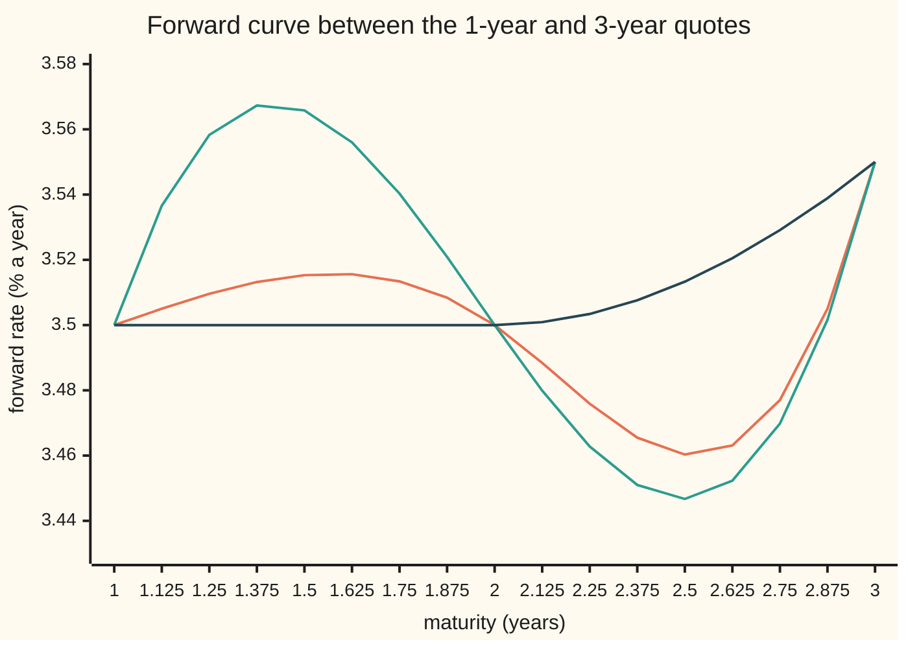
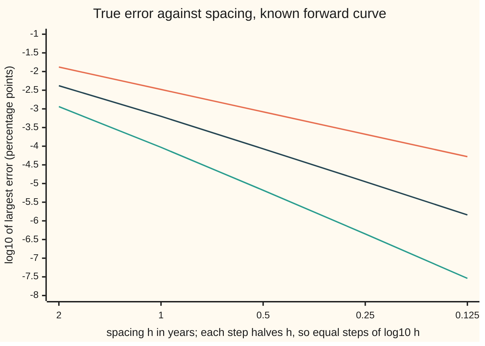

# Ends and shape: natural, clamped and not-a-knot, and keeping a fitted curve monotone

[Syllabus](../../../SYLLABUS.md) → [Numerical analysis](../README.md) → [Interpolation and Approximation](../README.md#s04) → Ends and shape

---

## General Overview

A rates desk reads eight forward rates off quoted contracts, at 1, 2, 3, 4, 5, 7, 10 and 15 years. A **forward rate** is the interest rate agreed today for borrowing over a short stretch of time in the future. The quotes (illustrative) are 3.50, 3.50, 3.55, 4.25, 4.50, 4.55, 4.60 and 4.60 percent a year. The market expects rates to hold for two years, then rise in the fourth year.

The desk needs a forward rate at every date, not just eight. It joins the dots with a cubic spline: one cubic polynomial per gap, joined so that the slope and the curvature match at every quote ([Cubic splines](05-splines.md)).

The spline obeys every quote, and it still says something no quote said. Between the 2-year quote (3.50%) and the 3-year quote (3.55%) it falls to 3.4601%: 3.99 basis points below the lower of its two neighbours. A **basis point** (bp) is one hundredth of a percentage point. A contract fixing at 2.35 years would be priced at 3.4673%, on a rate cut nobody priced.

Two separate choices decide how a spline behaves.

- **The ends.** A spline through eight points has two more unknowns than equations. An **end condition** supplies the two missing equations, and each one is an assumption about the curve beyond the data.
- **The shape.** A spline is smooth, but it is not obliged to rise where the data rise. A **monotone scheme** gives up a little smoothness and promises that the curve never falls where the quotes never fall.

On these quotes the monotone scheme never goes below 3.50% on the 2-to-3-year gap, and reads 3.5067% at 2.35 years.

**A cubic curve through data is fixed by its slope at each data point; a spline picks those slopes so the curvature is continuous, which leaves two slopes to an end assumption and lets the curve overshoot, while a monotone scheme picks each slope locally, inside a range that provably forbids a dip.**

**What kind of fact this is:** a set of methods. Each end condition is an assumption, not a fact about the market. The rule that keeps a cubic monotone is a theorem, proved on this card in Why it works. The accuracy of each end condition is a theorem, stated with its source and shown by the checks.

### The picture: the first two years, three ways



Orange: the natural spline. Teal: the not-a-knot spline. Dark: the monotone scheme. All three pass through 3.50 at 1 and 2 years and 3.55 at 3 years. Both splines rise above 3.50 between two equal quotes, then dip below 3.50 before the climb. The monotone curve stays flat, then rises.

---

## The formula

A spline can be written through its second derivatives or through its slopes. This card uses slopes, because every scheme here is the same kind of curve with different slopes.

Notation, in words. The quoted maturities are the **knots** $t_0 < t_1 < \dots < t_n$, here $n = 7$ gaps from 1 to 15 years. The quote at $t_i$ is $y_i$. Gap $i$ runs from $t_i$ to $t_{i+1}$; its length is $h_i$, and its **gap slope** is $\Delta_i = (y_{i+1} - y_i)/h_i$: how fast the quotes rise across it. The fitted curve is $S(t)$, and its slope at knot $i$ is $s_i$. [Cubic splines](05-splines.md) wrote the curve as $s(t)$ and the chord slope as $g_i$; here the small $s_i$ are slopes, so the curve is a capital $S$ and the chord slope is $\Delta_i$.

On gap $i$, with $p = (t - t_i)/h_i$ the fraction of the gap already passed:

$$S(t) = y_i\,(1 - 3p^2 + 2p^3) + h_i s_i\,(p - 2p^2 + p^3) + y_{i+1}\,(3p^2 - 2p^3) + h_i s_{i+1}\,(p^3 - p^2)$$

**Read it aloud:** on each gap, the curve is the one cubic that starts at the left quote with slope $s_i$ and ends at the right quote with slope $s_{i+1}$.

This is the **Hermite cubic**: four facts (two values, two slopes) fix four coefficients. Every scheme on this card is a Hermite cubic on each gap. The schemes differ only in how they choose the slopes $s_i$.

**The spline's slopes.** At each inner knot, the curvature $S''$ from the left gap must equal the curvature from the right gap. That gives, for $i = 1, \dots, n-1$:

$$h_i\,s_{i-1} + 2(h_{i-1} + h_i)\,s_i + h_{i-1}\,s_{i+1} = 3\,(h_i\,\Delta_{i-1} + h_{i-1}\,\Delta_i)$$

**Read it aloud:** each slope is tied to its two neighbours so that the bending matches across every knot.

That is $n - 1$ equations for $n + 1$ slopes. The end condition adds two more.

| End condition | Equation at the left end (the right end mirrors it) | What it assumes |
| --- | --- | --- |
| Natural | $2s_0 + s_1 = 3\Delta_0$, which says $S''(t_0) = 0$ | the curve stops bending at the last quote |
| Clamped | $s_0$ = a slope supplied from outside | the slope at each end is known |
| Not-a-knot | $S'''$, the third derivative, is the same on the first two gaps | nothing beyond smoothness: one cubic covers the first two gaps |

**The monotone scheme's slopes.** Each slope comes from its two neighbouring gap slopes alone:

$$s_i = \frac{3\,(h_{i-1} + h_i)}{\dfrac{2h_i + h_{i-1}}{\Delta_{i-1}} + \dfrac{h_i + 2h_{i-1}}{\Delta_i}} \quad\text{when } \Delta_{i-1}\Delta_i > 0, \qquad s_i = 0 \text{ otherwise}$$

**Read it aloud:** where the quotes keep rising (or keep falling) through a knot, the slope there is a weighted harmonic mean of the two gap slopes; where they stop or turn, the slope is zero.

The **harmonic mean** of two numbers is the reciprocal of the average of their reciprocals; it sits close to the smaller number. This rule is Fritsch and Butland's; many numerical libraries ship it under the name PCHIP (piecewise cubic Hermite interpolating polynomial). The guarantee comes from two ratios for each gap: $\alpha_i = s_i/\Delta_i$ and $\beta_i = s_{i+1}/\Delta_i$.

$$\Delta_i > 0,\quad 0 \le \alpha_i \le 3,\quad 0 \le \beta_i \le 3 \quad\Longrightarrow\quad S \text{ never falls on gap } i$$

**Read it aloud:** if the quotes rise across a gap, and each end slope is between zero and three times the gap slope, then the cubic on that gap rises too.

| Symbol | Plain meaning | In our example | Push it up and the answer… |
| --- | --- | --- | --- |
| $t$, $t_i$ | maturity in years; the quoted maturities (knots) | 1, 2, 3, 4, 5, 7, 10, 15 | — |
| $n$ | the number of gaps | 7 | more equations; the same method |
| $y_i$ | the quoted forward rate at $t_i$, % a year | 3.50 at 2 years, 3.55 at 3 years | the curve passes higher |
| $h_i$ | gap length $t_{i+1} - t_i$, years; on equal gaps, the spacing $h$ | 1 year from 2 to 3 | wider gaps: larger errors, like $h^1$ to $h^4$ |
| $\Delta_i$ | gap slope: rise of the quotes per year across gap $i$ | 0.0500 points a year, 2 to 3 years | steeper climb |
| $s_i$ | the curve's slope at knot $i$, points a year | spline $-0.0818$, monotone $0.0000$ at 2 years | the curve leaves the knot more steeply |
| $p$ | fraction of the gap already passed, 0 to 1 | 0.35 at 2.35 years | moves the point across the gap |
| $S(t)$ | the fitted forward rate at $t$; $S'$, $S''$, $S'''$ its first three derivatives | 3.4673 (spline), 3.5067 (monotone) at 2.35 years | — |
| $\alpha_i$, $\beta_i$ | left and right end slope, each divided by the gap slope | spline −1.6351 and 8.7228; monotone 0.0000 and 1.8667 | outside 0 to 3, a dip or a hump is possible |
| $f$ | a known smooth curve used to measure errors | $4.60 - 1.10\,e^{-(t-1)/4}$ | — |
| $a$, $b$ | the two weights inside the harmonic mean, each between 1/3 and 2/3 | equal at 3 years, where both gaps are 1 year | more weight on that side's gap slope |
| $g(p)$, $p^*$, $Q$ | in the proof: the slope divided by $\Delta_i$, where it is lowest, and the test that its lowest value is not negative | — | — |

### When it holds

- **The knots are sorted and distinct.** A repeated maturity makes some $h_i$ zero, and every formula above divides by it.
- **Natural ends assume the curve stops bending at the ends.** If the true curve bends there, the error near the ends falls only like $h^2$ instead of $h^4$: order 2.00 in the checks.
- **Clamped ends assume the end slopes are right.** A guessed slope enters the error at first order: clamping the test curve flat gives order 1.00.
- **Not-a-knot needs at least four quotes.** It merges the first two gaps and the last two into single cubics, so with fewer than three gaps there is nothing left to fit.
- **The monotone guarantee needs monotone data on the gap.** Where the quotes turn, the scheme sets the slope to zero, so the curve has a flat top or bottom exactly at a quote, and its accuracy drops near that knot.

---

## Why it works

### Step 0: a cubic on a gap is fixed by two values and two slopes

A cubic has four coefficients. The quotes at both ends fix two of them, and the slopes at both ends fix the other two. So once the slopes are chosen, the whole curve is fixed.

So every question on this card is a question about slopes: a dip comes from a slope with the wrong sign, an end condition chooses two slopes, and a monotone scheme keeps each slope in a safe range.

### Step 1: the spline leaves two slopes free, and the end condition is a guess about them

The spline card sets up the curvature-matching system and proves its solution has two continuous derivatives ([Cubic splines](05-splines.md)). In slope form it is the equation in The formula. There are $n - 1$ inner knots and $n + 1$ slopes, so two slopes are free. No data fill them: the data stop at the ends. So any choice is an assumption about the curve outside the data.

- **Natural.** Set the curvature to zero at both ends. A thin flexible strip of wood bent through pins, the drafting spline the method is named after, does exactly this: nothing holds its ends, so it leaves them straight. Among all curves through the data with two continuous derivatives, the natural spline has the least total squared curvature, which is why it looks calm ([Cubic splines](05-splines.md) proves it in Step 4; de Boor, below).
- **Clamped.** Supply the end slopes. If they are the true slopes, nothing has been guessed. Here the desk clamps both ends flat, at slope 0, saying the curve is level before one year and after fifteen years.
- **Not-a-knot.** Demand that the third derivative not jump at $t_1$ or $t_{n-1}$. A cubic's third derivative is constant, so the first two gaps become one cubic: $t_1$ is still a data point, but no longer a joint. That is the name. It assumes only that the curve is smooth near the ends.

On the eight quotes the three end conditions give different end slopes:

| End condition | Slope at 1 year | Slope at 15 years | Lowest on 2 to 3 years | Highest above the 4.60 top quote |
| --- | --- | --- | --- | --- |
| Natural | +0.0409 | −0.0069 | 3.4601%, −3.99 bp | +1.32 bp |
| Clamped (flat) | +0.0000 | +0.0000 | 3.4618%, −3.82 bp | +0.91 bp |
| Not-a-knot | +0.3590 | −0.0347 | 3.4467%, −5.33 bp | +3.45 bp |
| Monotone | +0.0000 | +0.0000 | 3.5000%, +0.00 bp | +0.00 bp |

The end condition changes the dip, from −3.82 bp to −5.33 bp. It does not remove it. The dip is not an end effect.

### Step 2: what each guess costs, measured

To measure accuracy, the checks use a curve whose every value is known, $f(t) = 4.60 - 1.10\,e^{-(t-1)/4}$, a forward curve rising from 3.50 toward 4.60. They sample it on equal gaps of width $h$ from 1 to 15 years, fit each scheme, and record the largest true error at nine evenly spaced points inside each gap.

| Gaps $n$ | $h$ (years) | Natural | Clamped, true slopes | Not-a-knot | Monotone | Clamped flat | Clamped bound |
| --- | --- | --- | --- | --- | --- | --- | --- |
| 7 | 2.0000 | 1.308e-02 | 1.603e-04 | 1.156e-03 | 4.181e-03 | 9.320e-02 | 8.952e-04 |
| 14 | 1.0000 | 3.342e-03 | 1.066e-05 | 9.324e-05 | 6.243e-04 | 4.666e-02 | 5.595e-05 |
| 28 | 0.5000 | 8.404e-04 | 6.839e-07 | 6.626e-06 | 8.555e-05 | 2.334e-02 | 3.497e-06 |
| 56 | 0.2500 | 2.104e-04 | 4.325e-08 | 4.417e-07 | 1.121e-05 | 1.167e-02 | 2.186e-07 |
| 112 | 0.1250 | 5.262e-05 | 2.718e-09 | 2.852e-08 | 1.434e-06 | 5.834e-03 | 1.366e-08 |

Errors are in percentage points, all true errors. The **observed order** from 56 to 112 gaps is $\log_2$ of the ratio of the two errors: natural 2.00, clamped 3.99, not-a-knot 3.95, monotone 2.97, clamped flat 1.00.

- **Clamped with true slopes** is the best case. Hall and Meyer proved the sharp bound: the error is at most $\tfrac{5}{384}\,h^4$ times the largest size of $f''''$ ([Hall and Meyer](https://doi.org/10.1016/0021-9045(76)90040-X)). The last column is that bound, and at 112 gaps it is 5.03 times the true error.
- **Not-a-knot** keeps order 4 without being told any slope, which is why many libraries use it by default. Its error is still larger than the clamped spline's at every size here.
- **Natural** drops to order 2. The test curve bends at both ends, the natural spline insists it does not, and that $h^2$ error near the ends dominates.
- **Clamped flat** drops to order 1. A wrong end slope is a first-order error, worse than any other choice in the table.
- **Monotone** runs at order 3 on these equal gaps: its slopes come from neighbouring gap slopes, not from a global solve, and are less accurate.

The rule from [The interpolation error theorem](03-polynomial-interpolation-error.md) carries over: each power of $h$ is paid for by smoothness, and a wrong assumption at an end breaks the bargain.

An exact claim is also run in floating point. Clamped (with true slopes) and not-a-knot splines reproduce any cubic exactly. On a cubic through the eight maturities the checks find largest errors of 8.9e-16 and 1.8e-15, rounding only. The natural spline misses by 3.4e-02, because a cubic's curvature at the ends is not zero.



Orange: natural ends, slope 2. Teal: not-a-knot, slope 4. Dark: the monotone scheme, slope 3.

### Step 3: why the spline dips, and why no end condition stops it

Look at the inner equation at the 2-year knot. The gaps on both sides are one year long, so it reads

$$s_0 + 4s_1 + s_2 = 3(\Delta_0 + \Delta_1).$$

The right-hand side is small: the quotes rise only 0.0500 points across the two gaps together. But the 3-year slope $s_2$ is large, because the next gap climbs 0.7000 points a year and the curvature must match there too. The equation then forces $s_1$ negative: the curve leaves the 2-year quote heading down.

A curve that starts down and must end up at 3.55 crosses below 3.50 on the way. In the ratios of The formula: on the 2-to-3-year gap the natural spline has $\alpha = -1.6351$ and $\beta = 8.7228$. Both are outside 0 to 3.

This is a global effect. Every slope is tied to every other through the chain of equations. The end condition only changes the far end of that chain. The same chain spreads any change: raise the 4-year quote by 1 bp and the natural spline moves by +0.0422 bp at 1.5 years and −0.1128 bp at 12.5 years, far from the quote that moved.

### Step 4: the slope range that forbids a dip

The theorem: on a gap with $\Delta_i > 0$, if $0 \le \alpha_i \le 3$ and $0 \le \beta_i \le 3$, the Hermite cubic never falls.

The idea of the proof. Divide the curve's slope by $\Delta_i$; what is left is a quadratic in $p$ whose values at the two ends are $\alpha_i$ and $\beta_i$, both at least zero. If the quadratic bends down, it stays above its lower end. If it bends up, its lowest point is a simple expression in $\alpha$ and $\beta$, and on the square $0 \le \alpha, \beta \le 3$ that expression is never negative. The fold has the algebra.

<details>
<summary>Detailed proof: the square of safe slopes</summary>

Differentiate the Hermite cubic and divide by $\Delta_i$. With $\alpha = \alpha_i$ and $\beta = \beta_i$:

$$\frac{S'(t)}{\Delta_i} = g(p) = (3\alpha + 3\beta - 6)\,p^2 + (6 - 4\alpha - 2\beta)\,p + \alpha.$$

Check the ends: $g(0) = \alpha$ and $g(1) = \beta$. Both are at least zero by assumption.

**Case 1: $\alpha + \beta \le 2$.** The $p^2$ coefficient is zero or negative, so $g$ is a straight line or bends down. Such a function is never below the smaller of its end values on $[0, 1]$. So $g \ge 0$.

**Case 2: $\alpha + \beta > 2$.** Now $g$ bends up, with its lowest point at

$$p^* = \frac{2\alpha + \beta - 3}{3(\alpha + \beta - 2)}.$$

If $p^*$ is outside $(0, 1)$, the lowest value on $[0, 1]$ is at an end, and both ends are at least zero. So suppose $0 < p^* < 1$. That happens exactly when $2\alpha + \beta > 3$ and $\alpha + 2\beta > 3$. The lowest value is

$$g(p^*) = \alpha - \frac{(2\alpha + \beta - 3)^2}{3(\alpha + \beta - 2)},$$

and multiplying out shows $g(p^*) \ge 0$ exactly when

$$Q(\alpha, \beta) = 6\alpha + 6\beta - 9 - \alpha^2 - \alpha\beta - \beta^2 \ge 0.$$

The points with $\alpha \le 3$, $\beta \le 3$, $2\alpha + \beta \ge 3$ and $\alpha + 2\beta \ge 3$ form a four-sided region with corners $(1, 1)$, $(3, 0)$, $(3, 3)$ and $(0, 3)$. The function $Q$ bends down in every direction, because $\alpha^2 + \alpha\beta + \beta^2$ is positive for every nonzero $(\alpha, \beta)$. A function that bends down in every direction takes its smallest value on such a region at a corner. At each of the four corners $Q = 0$. So $Q \ge 0$ on the whole region, and $g(p) \ge 0$ for every $p$ in the gap. ∎

The square is not the whole safe region. Fritsch and Carlson give the exact region: it follows the ellipse $Q = 0$ and reaches past the square where one ratio is large and the other small ([Fritsch and Carlson](https://doi.org/10.1137/0717021)). The square is the simplest piece to aim at.

</details>

The checks confirm the theorem from the other side: they find the 2-to-3-year gap's lowest point by solving $S' = 0$ exactly, and again by sampling 4,001 points. Both roads give 3.4601% for the natural spline and 3.5000% for the monotone scheme. A scan of 14,001 points from 1 to 15 years also asserts that the monotone curve never falls anywhere.

### Step 5: the harmonic mean always lands in the square

Write the slope rule as $s_i = 1 / (a/\Delta_{i-1} + b/\Delta_i)$ with $a = \frac{2h_i + h_{i-1}}{3(h_{i-1} + h_i)}$ and $b = 1 - a$. Both weights lie between 1/3 and 2/3, whatever the gap lengths.

When both gap slopes are positive, dropping the $b$ term makes the denominator smaller, so $s_i < \Delta_{i-1}/a \le 3\Delta_{i-1}$. In the same way, $s_i < 3\Delta_i$. So every slope is between zero and three times each neighbouring gap slope: $\alpha$ and $\beta$ are in the square on every gap. Where the quotes are flat or turn, $s_i = 0$, which is also in the square.

The end slopes use a one-sided three-point estimate, set to zero if its sign disagrees with the end gap, and cut to $3\Delta$ if the next gap turns. That keeps the two end gaps in the square too.

Two more facts follow from the formula.

- **It is local.** $s_i$ depends on two gap slopes only. Raise the 4-year quote by 1 bp and the monotone curve moves by +0.0000 bp at 1.5 years and at 12.5 years, exactly zero, against +0.0422 and −0.1128 bp for the natural spline.
- **It costs smoothness.** The curvature is no longer matched at the knots. At 4 years the monotone curve's $S''$ jumps by +2.4660 points a year per year squared; the spline's jumps by 3.0e-15, rounding only. The slope is still continuous.

Cost, in flops (one addition, subtraction, multiplication or division) at $n = 7$. The spline's slope equations form a tridiagonal system (each row touches only its neighbours). Building the natural spline's rows takes $9n - 4$ = 59 flops, and [The Thomas algorithm](../03-Numerical%20Linear%20Algebra/03-tridiagonal-systems-and-the-thomas-algorithm.md) solves for the 8 slopes in $8n + 1$ = 57 more: 116 in all. Not-a-knot adds one entry in the first and last rows, removed by one extra elimination step. The monotone scheme needs no system: $3n$ = 21 flops for the gap lengths and slopes, then at most 10 per knot, $13n + 10$ = 101 in all. Both grow in proportion to $n$; the monotone scheme gains reach, not speed.

---

## Worked numbers, by hand

The gap from 2 to 3 years, natural spline against the monotone scheme. Rates in percent a year; slopes in percentage points a year.

| Step | Arithmetic | Value |
| --- | --- | --- |
| Gap slopes either side of 2 years | (3.50 − 3.50)/1 and (3.55 − 3.50)/1 | 0.0000 and 0.0500 |
| Gap slope after 3 years | (4.25 − 3.55)/1 | 0.7000 |
| Spline slopes at 1 and 3 years, from the solve | the system in The formula, natural ends | +0.0409 and +0.4361 |
| Spline slope at 2 years | (3 × 0.0500 − 0.0409 − 0.4361)/4 | −0.0818 |
| Spline ratios on the gap | −0.0818/0.0500 and 0.4361/0.0500 | α = −1.6351, β = 8.7228 |
| Spline at 2.35 years | Hermite cubic at p = 0.35 | 3.4673% |
| Spline's lowest point on the gap | solve S′ = 0 | 3.4601%, −3.99 bp |
| Monotone slope at 2 years | gap slopes 0.0000 and 0.0500: product not positive | 0.0000 |
| Monotone slope at 3 years | 3 × (1 + 1) / (3/0.0500 + 3/0.7000) | 0.0933 |
| Monotone ratios on the gap | 0.0000/0.0500 and 0.0933/0.0500 | α = 0.0000, β = 1.8667, inside the square |
| Monotone at 2.35 years | Hermite cubic at p = 0.35 | 3.5067% |
| Monotone lowest point on the gap | the theorem, confirmed by the solve | **3.5000%, no dip** |

The monotone curve never prices a forward below the quotes around it; the spline prices a cut of 3.99 bp that no contract implied.

### What breaks if you drop a piece

| Mistake | Comes out at | What went wrong |
| --- | --- | --- |
| Natural ends on a curve that bends at its ends | error 5.262e-05 at 112 gaps, order 2.00 | $S'' = 0$ is false at the ends; the end error is order $h^2$ |
| Clamped flat ends, slope 0, when the true slope is not 0 | error 5.834e-03 at 112 gaps, order 1.00 | a wrong slope is a first-order error |
| Monotone shape, but plain average slopes with no limit | slope 0.3750 at 3 years, β = 7.50, lowest 3.4804%, −1.96 bp | β above 3 leaves the square; the cubic dips |
| A spline where the curve must not dip | lowest 3.4601%, −3.99 bp | spline slopes are set globally; α = −1.6351 |

---

## Code, from first principles, and it actually runs

The programs fit the eight quotes four ways: natural, clamped flat and not-a-knot splines, and the monotone scheme. All four are evaluated through one Hermite cubic routine. They take three independent roads. Road 1 solves the spline for its slopes. Road 2 solves it again for its second derivatives, a different linear system, and converts them to slopes; the two agree to 1.1e-16. The 2-to-3-year gap's lowest point is found by solving $S' = 0$ and again on a fine grid, and a scan from 1 to 15 years asserts that the monotone curve never falls. Last, a known smooth curve and a known cubic give true errors, observed orders and the Hall-Meyer bound. The elimination, the slope rules and the root solve are written out.

### Python

```python
# Spline end conditions and a monotone scheme -- the check behind the card.  Standard library only.
# Every scheme is a Hermite cubic on each gap; the schemes differ only in the slopes s_i at the knots.
import math

T = [1.0, 2.0, 3.0, 4.0, 5.0, 7.0, 10.0, 15.0]        # maturities, years
Y = [3.50, 3.50, 3.55, 4.25, 4.50, 4.55, 4.60, 4.60]  # forward rates, % a year (illustrative)

def solve(A, b):  # Gaussian elimination with partial pivoting
    n = len(b); A = [r[:] for r in A]; b = b[:]
    for k in range(n):
        p = max(range(k, n), key=lambda i: abs(A[i][k]))  # first row with the largest pivot
        A[k], A[p] = A[p], A[k]; b[k], b[p] = b[p], b[k]
        for i in range(k + 1, n):
            m = A[i][k] / A[k][k]
            for j in range(k, n): A[i][j] -= m * A[k][j]
            b[i] -= m * b[k]
    x = [0.0] * n
    for i in range(n - 1, -1, -1):
        acc = b[i]
        for j in range(i + 1, n): acc -= A[i][j] * x[j]
        x[i] = acc / A[i][i]
    return x

def gaps(t, y):
    h = [t[i + 1] - t[i] for i in range(len(t) - 1)]
    return h, [(y[i + 1] - y[i]) / h[i] for i in range(len(h))], len(h)

def road1(t, y, end, a=0.0, b=0.0):  # unknowns: the slopes; interior rows: S'' continuous
    h, d, n = gaps(t, y); A = [[0.0] * (n + 1) for _ in range(n + 1)]; r = [0.0] * (n + 1)
    for i in range(1, n):
        A[i][i - 1], A[i][i], A[i][i + 1] = h[i], 2 * (h[i - 1] + h[i]), h[i - 1]
        r[i] = 3 * (h[i] * d[i - 1] + h[i - 1] * d[i])
    for (e, f, g, k, j) in ((0, 1, 2, 0, 1), (n, n - 1, n - 2, n - 1, n - 2)):
        if end == "natural": A[e][e], A[e][f], r[e] = 2.0, 1.0, 3 * d[k]
        elif end == "clamped": A[e][e], r[e] = 1.0, (a if e == 0 else b)
        else:  # not-a-knot: S''' equal on the two end gaps
            q, u = 1 / (h[k] * h[k]), 1 / (h[j] * h[j])
            A[e][e], A[e][f], A[e][g], r[e] = q, q - u, -u, 2 * d[k] * q - 2 * d[j] * u
    return solve(A, r)

def road2(t, y, end, a=0.0, b=0.0):  # unknowns: second derivatives M; interior rows: S' continuous
    h, d, n = gaps(t, y); A = [[0.0] * (n + 1) for _ in range(n + 1)]; r = [0.0] * (n + 1)
    for i in range(1, n):
        A[i][i - 1], A[i][i], A[i][i + 1], r[i] = h[i - 1], 2 * (h[i - 1] + h[i]), h[i], 6 * (d[i] - d[i - 1])
    if end == "natural": A[0][0] = A[n][n] = 1.0
    elif end == "clamped":
        A[0][0], A[0][1], r[0] = 2 * h[0], h[0], 6 * (d[0] - a)
        A[n][n - 1], A[n][n], r[n] = h[n - 1], 2 * h[n - 1], 6 * (b - d[n - 1])
    else:
        A[0][0], A[0][1], A[0][2] = h[1], -(h[0] + h[1]), h[0]
        A[n][n - 2], A[n][n - 1], A[n][n] = h[n - 1], -(h[n - 2] + h[n - 1]), h[n - 2]
    M = solve(A, r)
    return [d[i] - h[i] * (2 * M[i] + M[i + 1]) / 6 for i in range(n)] + [d[n - 1] + h[n - 1] * (M[n - 1] + 2 * M[n]) / 6]

def monotone(t, y, limit=True):  # weighted harmonic mean; limit=False gives plain averages
    h, d, n = gaps(t, y); s = [0.0] * (n + 1)
    for i in range(1, n):
        if not limit: s[i] = (d[i - 1] + d[i]) / 2
        elif d[i - 1] * d[i] > 0:
            w1, w2 = 2 * h[i] + h[i - 1], h[i] + 2 * h[i - 1]
            s[i] = (w1 + w2) / (w1 / d[i - 1] + w2 / d[i])
    for (e, k, j) in ((0, 0, 1), (n, n - 1, n - 2)):
        v = ((2 * h[k] + h[j]) * d[k] - h[k] * d[j]) / (h[k] + h[j])
        if v * d[k] <= 0: v = 0.0
        elif d[k] * d[j] <= 0 and abs(v) > abs(3 * d[k]): v = 3 * d[k]
        s[e] = v if limit else d[k]
    return s

def S(t, y, s, x, der=0):  # the Hermite cubic, or its second derivative
    i = 0
    while i < len(t) - 2 and x > t[i + 1]: i += 1
    h = t[i + 1] - t[i]; p = (x - t[i]) / h; p2 = p * p; p3 = p2 * p
    if der == 0: return y[i] * (2*p3 - 3*p2 + 1) + h * s[i] * (p3 - 2*p2 + p) + y[i+1] * (3*p2 - 2*p3) + h * s[i+1] * (p3 - p2)
    return (y[i] * (12*p - 6) + h * s[i] * (6*p - 4) + y[i+1] * (6 - 12*p) + h * s[i+1] * (6*p - 2)) / (h * h)

def low_by_roots(t, y, s, i):  # S' is a quadratic in p: test its roots inside the gap and the two ends
    h = t[i + 1] - t[i]; dl = (y[i + 1] - y[i]) / h
    qa, qb, qc = 3 * s[i] + 3 * s[i + 1] - 6 * dl, 6 * dl - 4 * s[i] - 2 * s[i + 1], s[i]
    ps = [-qc / qb] if qa == 0 and qb != 0 else []
    if qa != 0 and qb * qb - 4 * qa * qc >= 0:
        r = math.sqrt(qb * qb - 4 * qa * qc); ps = [(-qb - r) / (2 * qa), (-qb + r) / (2 * qa)]
    return min([y[i], y[i + 1]] + [S(t, y, s, t[i] + h * p) for p in ps if 0 < p < 1])

ends, d1 = ("natural", "clamped", "not-a-knot"), Y[2] - Y[1]
SL = {e: road1(T, Y, e) for e in ends}; SL["monotone"] = monotone(T, Y)
print("quotes:", " ".join("%gy %.2f" % (a, b) for a, b in zip(T, Y)), "| gap slopes:", " ".join("%.4f" % v for v in gaps(T, Y)[1]))
for k, s in SL.items(): print("%-10s slopes" % k, " ".join("%+.4f" % v for v in s))
gap = max(max(abs(u - v) for u, v in zip(SL[e], road2(T, Y, e))) for e in ends)
print("road 2 (second derivatives) against road 1 (slopes), largest slope difference: %.1e" % gap); assert gap < 1e-12
for k, s in SL.items():
    g, r = min(S(T, Y, s, 2 + k2 / 4000) for k2 in range(4001)), low_by_roots(T, Y, s, 1)
    print("%-10s lowest on 2y-3y: %.4f%% by roots, %.4f%% on a grid, %+.2f bp against 3.50" % (k, r, g, (r - Y[1]) * 100))
    assert abs(g - r) < 1e-6 and (r < Y[1] - 0.03 if k != "monotone" else r >= Y[1] - 1e-12)
for k in ("natural", "monotone"):
    s = SL[k]; print("%-10s 2y-3y: delta %.4f, s(2y) %+.4f, s(3y) %+.4f, alpha %+.4f, beta %+.4f, S(2.35) %.4f"
                     % (k, d1, s[1], s[2], s[1] / d1, s[2] / d1, S(T, Y, s, 2.35)))
V = {k: [S(T, Y, s, 1 + j / 1000) for j in range(14001)] for k, s in SL.items()}; over = {k: max(v) - Y[-1] for k, v in V.items()}
print("highest point above the 4.60 top quote, bp:", " ".join("%s %+.2f" % (k, v * 100) for k, v in over.items()))
assert over["monotone"] <= 1e-12 and over["not-a-knot"] > 0.01 and min(b - a for a, b in zip(V["monotone"], V["monotone"][1:])) > -1e-12
for k in ("natural", "not-a-knot", "monotone"):
    print("chart, %s:" % k, ", ".join("%.4f" % S(T, Y, SL[k], 1 + 0.125 * j) for j in range(17)))
bump = Y[:3] + [Y[3] + 0.01] + Y[4:]
for k, fn in (("natural", lambda y: road1(T, y, "natural")), ("monotone", lambda y: monotone(T, y))):
    ch = [(S(T, bump, fn(bump), x) - S(T, Y, fn(Y), x)) * 100 for x in (1.5, 12.5)]
    print("%-10s 4y quote +1 bp moves 1.5y by %+.4f bp, 12.5y by %+.4f bp" % (k, ch[0], ch[1]))
    assert (ch[0] == 0.0 and ch[1] == 0.0) if k == "monotone" else min(abs(ch[0]), abs(ch[1])) > 1e-3
jm, jn = [S(T[3:], Y[3:], SL[k][3:], 4.0, 2) - S(T[:4], Y[:4], SL[k][:4], 4.0, 2) for k in ("monotone", "natural")]
print("jump in S'' at 4y, %% a year per year squared: monotone %+.4f, natural spline %.1e" % (jm, abs(jn))); assert abs(jm) > 0.1 and abs(jn) < 1e-12
print("flops at n = 7: natural spline rows 9n - 4 = %d, Thomas sweep 8n + 1 = %d, total %d; monotone at most 13n + 10 = %d" % (9 * 7 - 4, 8 * 7 + 1, 17 * 7 - 3, 13 * 7 + 10))
# Errors against a known smooth forward curve f(t) = 4.60 - 1.10 exp(-(t - 1)/4), 1y to 15y
f = lambda x: 4.60 - 1.10 * math.exp(-(x - 1) / 4); fp = lambda x: 0.275 * math.exp(-(x - 1) / 4)
cub = lambda x: 3.0 + 0.3 * x - 0.03 * x * x + 0.001 * x * x * x; cubp = lambda x: 0.3 - 0.06 * x + 0.003 * x * x
def err(t, g, s):
    pts = [t[i] + (t[i + 1] - t[i]) * k / 10 for i in range(len(t) - 1) for k in range(1, 10)]
    return max(abs(S(t, [g(v) for v in t], s, x) - g(x)) for x in pts)
def schemes(t, g, gp):
    y = [g(v) for v in t]
    return {"natural": road1(t, y, "natural"), "clamped": road1(t, y, "clamped", gp(t[0]), gp(t[-1])),
            "not-a-knot": road1(t, y, "not-a-knot"), "monotone": monotone(t, y), "flat ends": road1(t, y, "clamped")}
E = {}; print("n    h       natural    clamped    not-a-knot monotone   flat ends  clamped bound")
for n in (7, 14, 28, 56, 112):
    t = [1 + 14 * i / n for i in range(n + 1)]; E[n] = {k: err(t, f, s) for k, s in schemes(t, f, fp).items()}
    bound = 5 / 384 * (14 / n) ** 4 * 1.10 / 256
    print("%-4d %-7.4f" % (n, 14 / n), " ".join("%.3e " % v for v in E[n].values()), "%.3e" % bound)
    assert E[n]["clamped"] <= bound
print("bound / true error, clamped, n = 112: %.2f" % (bound / E[112]["clamped"]))
order = {k: math.log2(E[56][k] / E[112][k]) for k in E[112]}
print("observed order, n 56 to 112:", " ".join("%s %.2f" % kv for kv in order.items()))
for k in ("natural", "not-a-knot", "monotone"):
    print("chart, log10 error, %s:" % k, ", ".join("%.2f" % math.log10(E[n][k]) for n in E))
assert abs(order["natural"] - 2) < 0.2 and abs(order["clamped"] - 4) < 0.2 and abs(order["not-a-knot"] - 4) < 0.2
assert abs(order["monotone"] - 3) < 0.3 and abs(order["flat ends"] - 1) < 0.2
cs = schemes(T, cub, cubp); ce = {k: err(T, cub, cs[k]) for k in ends}
print("a cubic through the 8 maturities, largest error:", " ".join("%s %.1e" % kv for kv in ce.items()))
assert ce["clamped"] < 1e-12 and ce["not-a-knot"] < 1e-12 and ce["natural"] > 1e-3
avg = monotone(T, Y, limit=False); la = low_by_roots(T, Y, avg, 1)
print("plain average slopes: s(3y) %+.4f, beta %.2f, lowest on 2y-3y %.4f%%, %+.2f bp" % (avg[2], avg[2] / d1, la, (la - Y[1]) * 100))
assert la < Y[1] - 0.001
assert abs(SL["monotone"][4] - 0.05) < 1e-12  # by hand at 5y, gaps 1 and 2: 9/(5/0.25 + 4/0.025)
print("ALL CHECKS PASS")
```

**Ran 2026-11-11 on macOS, Python 3.14.10, standard library only. All checks passed. Output, pasted from the run:**

```
quotes: 1y 3.50 2y 3.50 3y 3.55 4y 4.25 5y 4.50 7y 4.55 10y 4.60 15y 4.60 | gap slopes: 0.0000 0.0500 0.7000 0.2500 0.0250 0.0167 0.0000
natural    slopes +0.0409 -0.0818 +0.4361 +0.5872 +0.0651 +0.0102 +0.0137 -0.0069
clamped    slopes +0.0000 -0.0708 +0.4332 +0.5880 +0.0647 +0.0106 +0.0123 +0.0000
not-a-knot slopes +0.3590 -0.1670 +0.4590 +0.5809 +0.0675 +0.0084 +0.0195 -0.0347
monotone   slopes +0.0000 +0.0000 +0.0933 +0.3684 +0.0500 +0.0203 +0.0000 +0.0000
road 2 (second derivatives) against road 1 (slopes), largest slope difference: 1.1e-16
natural    lowest on 2y-3y: 3.4601% by roots, 3.4601% on a grid, -3.99 bp against 3.50
clamped    lowest on 2y-3y: 3.4618% by roots, 3.4618% on a grid, -3.82 bp against 3.50
not-a-knot lowest on 2y-3y: 3.4467% by roots, 3.4467% on a grid, -5.33 bp against 3.50
monotone   lowest on 2y-3y: 3.5000% by roots, 3.5000% on a grid, +0.00 bp against 3.50
natural    2y-3y: delta 0.0500, s(2y) -0.0818, s(3y) +0.4361, alpha -1.6351, beta +8.7228, S(2.35) 3.4673
monotone   2y-3y: delta 0.0500, s(2y) +0.0000, s(3y) +0.0933, alpha +0.0000, beta +1.8667, S(2.35) 3.5067
highest point above the 4.60 top quote, bp: natural +1.32 clamped +0.91 not-a-knot +3.45 monotone +0.00
chart, natural: 3.5000, 3.5050, 3.5096, 3.5132, 3.5153, 3.5156, 3.5134, 3.5084, 3.5000, 3.4884, 3.4759, 3.4655, 3.4603, 3.4631, 3.4770, 3.5050, 3.5500
chart, not-a-knot: 3.5000, 3.5366, 3.5583, 3.5673, 3.5658, 3.5560, 3.5403, 3.5209, 3.5000, 3.4799, 3.4628, 3.4510, 3.4467, 3.4523, 3.4698, 3.5016, 3.5500
chart, monotone: 3.5000, 3.5000, 3.5000, 3.5000, 3.5000, 3.5000, 3.5000, 3.5000, 3.5000, 3.5009, 3.5034, 3.5076, 3.5133, 3.5205, 3.5291, 3.5389, 3.5500
natural    4y quote +1 bp moves 1.5y by +0.0422 bp, 12.5y by -0.1128 bp
monotone   4y quote +1 bp moves 1.5y by +0.0000 bp, 12.5y by +0.0000 bp
jump in S'' at 4y, % a year per year squared: monotone +2.4660, natural spline 3.0e-15
flops at n = 7: natural spline rows 9n - 4 = 59, Thomas sweep 8n + 1 = 57, total 116; monotone at most 13n + 10 = 101
n    h       natural    clamped    not-a-knot monotone   flat ends  clamped bound
7    2.0000  1.308e-02  1.603e-04  1.156e-03  4.181e-03  9.320e-02  8.952e-04
14   1.0000  3.342e-03  1.066e-05  9.324e-05  6.243e-04  4.666e-02  5.595e-05
28   0.5000  8.404e-04  6.839e-07  6.626e-06  8.555e-05  2.334e-02  3.497e-06
56   0.2500  2.104e-04  4.325e-08  4.417e-07  1.121e-05  1.167e-02  2.186e-07
112  0.1250  5.262e-05  2.718e-09  2.852e-08  1.434e-06  5.834e-03  1.366e-08
bound / true error, clamped, n = 112: 5.03
observed order, n 56 to 112: natural 2.00 clamped 3.99 not-a-knot 3.95 monotone 2.97 flat ends 1.00
chart, log10 error, natural: -1.88, -2.48, -3.08, -3.68, -4.28
chart, log10 error, not-a-knot: -2.94, -4.03, -5.18, -6.35, -7.54
chart, log10 error, monotone: -2.38, -3.20, -4.07, -4.95, -5.84
a cubic through the 8 maturities, largest error: natural 3.4e-02 clamped 8.9e-16 not-a-knot 1.8e-15
plain average slopes: s(3y) +0.3750, beta 7.50, lowest on 2y-3y 3.4804%, -1.96 bp
ALL CHECKS PASS
```

### Rust

```rust
// Spline end conditions and a monotone scheme -- the check behind the card.  std only.
// Every scheme is a Hermite cubic on each gap; the schemes differ only in the slopes s_i at the knots.
const T: [f64; 8] = [1.0, 2.0, 3.0, 4.0, 5.0, 7.0, 10.0, 15.0]; // maturities, years
const Y: [f64; 8] = [3.50, 3.50, 3.55, 4.25, 4.50, 4.55, 4.60, 4.60]; // forward rates, % a year (illustrative)

fn e(x: f64, p: usize) -> String { // Python's %.<p>e
    let s = format!("{:.*e}", p, x); let (m, ex) = s.split_once('e').unwrap(); let k: i32 = ex.parse().unwrap();
    format!("{}e{}{:02}", m, if k < 0 { '-' } else { '+' }, k.abs())
}
fn join(v: &[f64], f: &dyn Fn(f64) -> String, sep: &str) -> String { v.iter().map(|&x| f(x)).collect::<Vec<_>>().join(sep) }
fn solve(mut a: Vec<Vec<f64>>, mut b: Vec<f64>) -> Vec<f64> { // Gaussian elimination with partial pivoting
    let n = b.len();
    for k in 0..n {
        let mut p = k; for i in k + 1..n { if a[i][k].abs() > a[p][k].abs() { p = i; } } // first largest pivot
        a.swap(k, p); b.swap(k, p);
        for i in k + 1..n { let m = a[i][k] / a[k][k]; for j in k..n { a[i][j] -= m * a[k][j]; } b[i] -= m * b[k]; }
    }
    let mut x = vec![0.0; n];
    for i in (0..n).rev() { let mut acc = b[i]; for j in i + 1..n { acc -= a[i][j] * x[j]; } x[i] = acc / a[i][i]; }
    x
}
fn gaps(t: &[f64], y: &[f64]) -> (Vec<f64>, Vec<f64>, usize) {
    let h: Vec<f64> = (0..t.len() - 1).map(|i| t[i + 1] - t[i]).collect();
    let d = (0..h.len()).map(|i| (y[i + 1] - y[i]) / h[i]).collect();
    let n = h.len(); (h, d, n)
}
fn road1(t: &[f64], y: &[f64], end: &str, a0: f64, b0: f64) -> Vec<f64> { // unknowns: the slopes
    let (h, d, n) = gaps(t, y);
    let (mut a, mut r) = (vec![vec![0.0; n + 1]; n + 1], vec![0.0; n + 1]);
    for i in 1..n {
        a[i][i - 1] = h[i]; a[i][i] = 2.0 * (h[i - 1] + h[i]); a[i][i + 1] = h[i - 1];
        r[i] = 3.0 * (h[i] * d[i - 1] + h[i - 1] * d[i]);
    }
    for (e, f, g, k, j) in [(0, 1, 2, 0, 1), (n, n - 1, n - 2, n - 1, n - 2)] {
        if end == "natural" { a[e][e] = 2.0; a[e][f] = 1.0; r[e] = 3.0 * d[k]; }
        else if end == "clamped" { a[e][e] = 1.0; r[e] = if e == 0 { a0 } else { b0 }; }
        else { // not-a-knot: S''' equal on the two end gaps
            let (q, u) = (1.0 / (h[k] * h[k]), 1.0 / (h[j] * h[j]));
            a[e][e] = q; a[e][f] = q - u; a[e][g] = -u; r[e] = 2.0 * d[k] * q - 2.0 * d[j] * u;
        }
    }
    solve(a, r)
}
fn road2(t: &[f64], y: &[f64], end: &str) -> Vec<f64> { // unknowns: second derivatives M
    let (h, d, n) = gaps(t, y);
    let (mut a, mut r) = (vec![vec![0.0; n + 1]; n + 1], vec![0.0; n + 1]);
    for i in 1..n {
        a[i][i - 1] = h[i - 1]; a[i][i] = 2.0 * (h[i - 1] + h[i]); a[i][i + 1] = h[i]; r[i] = 6.0 * (d[i] - d[i - 1]);
    }
    if end == "natural" { a[0][0] = 1.0; a[n][n] = 1.0; }
    else if end == "clamped" {
        a[0][0] = 2.0 * h[0]; a[0][1] = h[0]; r[0] = 6.0 * (d[0] - 0.0);
        a[n][n - 1] = h[n - 1]; a[n][n] = 2.0 * h[n - 1]; r[n] = 6.0 * (0.0 - d[n - 1]);
    } else {
        a[0][0] = h[1]; a[0][1] = -(h[0] + h[1]); a[0][2] = h[0];
        a[n][n - 2] = h[n - 1]; a[n][n - 1] = -(h[n - 2] + h[n - 1]); a[n][n] = h[n - 2];
    }
    let m = solve(a, r);
    let mut s: Vec<f64> = (0..n).map(|i| d[i] - h[i] * (2.0 * m[i] + m[i + 1]) / 6.0).collect();
    s.push(d[n - 1] + h[n - 1] * (m[n - 1] + 2.0 * m[n]) / 6.0); s
}
fn monotone(t: &[f64], y: &[f64], limit: bool) -> Vec<f64> { // weighted harmonic mean, or plain averages
    let (h, d, n) = gaps(t, y);
    let mut s = vec![0.0; n + 1];
    for i in 1..n {
        if !limit { s[i] = (d[i - 1] + d[i]) / 2.0; }
        else if d[i - 1] * d[i] > 0.0 {
            let (w1, w2) = (2.0 * h[i] + h[i - 1], h[i] + 2.0 * h[i - 1]);
            s[i] = (w1 + w2) / (w1 / d[i - 1] + w2 / d[i]);
        }
    }
    for (e, k, j) in [(0, 0, 1), (n, n - 1, n - 2)] {
        let mut v = ((2.0 * h[k] + h[j]) * d[k] - h[k] * d[j]) / (h[k] + h[j]);
        if v * d[k] <= 0.0 { v = 0.0; } else if d[k] * d[j] <= 0.0 && v.abs() > (3.0 * d[k]).abs() { v = 3.0 * d[k]; }
        s[e] = if limit { v } else { d[k] };
    }
    s
}
fn sv(t: &[f64], y: &[f64], s: &[f64], x: f64, der: u8) -> f64 { // the Hermite cubic, or its second derivative
    let mut i = 0;
    while i < t.len() - 2 && x > t[i + 1] { i += 1; }
    let h = t[i + 1] - t[i]; let p = (x - t[i]) / h; let p2 = p * p; let p3 = p2 * p;
    if der == 0 { return y[i] * (2.0*p3 - 3.0*p2 + 1.0) + h * s[i] * (p3 - 2.0*p2 + p) + y[i+1] * (3.0*p2 - 2.0*p3) + h * s[i+1] * (p3 - p2); }
    (y[i] * (12.0*p - 6.0) + h * s[i] * (6.0*p - 4.0) + y[i+1] * (6.0 - 12.0*p) + h * s[i+1] * (6.0*p - 2.0)) / (h * h)
}
fn low_by_roots(t: &[f64], y: &[f64], s: &[f64], i: usize) -> f64 { // roots of the quadratic S'
    let h = t[i + 1] - t[i]; let dl = (y[i + 1] - y[i]) / h;
    let (qa, qb, qc) = (3.0 * s[i] + 3.0 * s[i + 1] - 6.0 * dl, 6.0 * dl - 4.0 * s[i] - 2.0 * s[i + 1], s[i]);
    let mut ps = if qa == 0.0 && qb != 0.0 { vec![-qc / qb] } else { vec![] };
    if qa != 0.0 && qb * qb - 4.0 * qa * qc >= 0.0 {
        let r = (qb * qb - 4.0 * qa * qc).sqrt(); ps = vec![(-qb - r) / (2.0 * qa), (-qb + r) / (2.0 * qa)];
    }
    let mut lo = y[i].min(y[i + 1]);
    for p in ps { if 0.0 < p && p < 1.0 { lo = lo.min(sv(t, y, s, t[i] + h * p, 0)); } }
    lo
}
fn f(x: f64) -> f64 { 4.60 - 1.10 * (-(x - 1.0) / 4.0).exp() }
fn fp(x: f64) -> f64 { 0.275 * (-(x - 1.0) / 4.0).exp() }
fn cub(x: f64) -> f64 { 3.0 + 0.3 * x - 0.03 * x * x + 0.001 * x * x * x }
fn cubp(x: f64) -> f64 { 0.3 - 0.06 * x + 0.003 * x * x }
fn err(t: &[f64], g: fn(f64) -> f64, s: &[f64]) -> f64 {
    let y: Vec<f64> = t.iter().map(|&v| g(v)).collect(); let mut m: f64 = 0.0;
    for i in 0..t.len() - 1 { for k in 1..10 { let x = t[i] + (t[i + 1] - t[i]) * k as f64 / 10.0; m = m.max((sv(t, &y, s, x, 0) - g(x)).abs()); } }
    m
}
fn schemes(t: &[f64], g: fn(f64) -> f64, gp: fn(f64) -> f64) -> Vec<(&'static str, Vec<f64>)> {
    let y: Vec<f64> = t.iter().map(|&v| g(v)).collect(); let l = t.len() - 1;
    vec![("natural", road1(t, &y, "natural", 0.0, 0.0)), ("clamped", road1(t, &y, "clamped", gp(t[0]), gp(t[l]))),
         ("not-a-knot", road1(t, &y, "not-a-knot", 0.0, 0.0)), ("monotone", monotone(t, &y, true)), ("flat ends", road1(t, &y, "clamped", 0.0, 0.0))]
}

fn main() {
    let ends = ["natural", "clamped", "not-a-knot"]; let d1 = Y[2] - Y[1];
    let mut sl: Vec<(&str, Vec<f64>)> = ends.iter().map(|&k| (k, road1(&T, &Y, k, 0.0, 0.0))).collect();
    sl.push(("monotone", monotone(&T, &Y, true)));
    println!("quotes: {} | gap slopes: {}", (0..8).map(|i| format!("{}y {:.2}", T[i], Y[i])).collect::<Vec<_>>().join(" "), join(&gaps(&T, &Y).1, &|v| format!("{:.4}", v), " "));
    for (k, s) in &sl { println!("{:<10} slopes {}", k, join(s, &|v| format!("{:+.4}", v), " ")); }
    let mut gap: f64 = 0.0;
    for (i, k) in ends.iter().enumerate() { for (u, v) in sl[i].1.iter().zip(road2(&T, &Y, k)) { gap = gap.max((u - v).abs()); } }
    println!("road 2 (second derivatives) against road 1 (slopes), largest slope difference: {}", e(gap, 1)); assert!(gap < 1e-12);
    for (k, s) in &sl {
        let g = (0..4001).map(|k2| sv(&T, &Y, s, 2.0 + k2 as f64 / 4000.0, 0)).fold(f64::INFINITY, f64::min);
        let r = low_by_roots(&T, &Y, s, 1);
        println!("{:<10} lowest on 2y-3y: {:.4}% by roots, {:.4}% on a grid, {:+.2} bp against 3.50", k, r, g, (r - Y[1]) * 100.0);
        assert!((g - r).abs() < 1e-6 && if *k != "monotone" { r < Y[1] - 0.03 } else { r >= Y[1] - 1e-12 });
    }
    for i in [0, 3] { let (k, s) = (&sl[i].0, &sl[i].1);
        println!("{:<10} 2y-3y: delta {:.4}, s(2y) {:+.4}, s(3y) {:+.4}, alpha {:+.4}, beta {:+.4}, S(2.35) {:.4}", k, d1, s[1], s[2], s[1] / d1, s[2] / d1, sv(&T, &Y, s, 2.35, 0)); }
    let v: Vec<Vec<f64>> = sl.iter().map(|(_, s)| (0..14001).map(|j| sv(&T, &Y, s, 1.0 + j as f64 / 1000.0, 0)).collect()).collect();
    let over: Vec<f64> = v.iter().map(|w| w.iter().fold(f64::NEG_INFINITY, |a, &b| a.max(b)) - Y[7]).collect();
    println!("highest point above the 4.60 top quote, bp: {}", (0..4).map(|i| format!("{} {:+.2}", sl[i].0, over[i] * 100.0)).collect::<Vec<_>>().join(" "));
    assert!(over[3] <= 1e-12 && over[2] > 0.01 && v[3].windows(2).fold(f64::INFINITY, |m, w| m.min(w[1] - w[0])) > -1e-12);
    for i in [0, 2, 3] { println!("chart, {}: {}", sl[i].0, (0..17).map(|j| format!("{:.4}", sv(&T, &Y, &sl[i].1, 1.0 + 0.125 * j as f64, 0))).collect::<Vec<_>>().join(", ")); }
    let mut bump = Y; bump[3] += 0.01;
    for k in ["natural", "monotone"] {
        let fit = |y: &[f64]| if k == "natural" { road1(&T, y, "natural", 0.0, 0.0) } else { monotone(&T, y, true) };
        let ch: Vec<f64> = [1.5, 12.5].iter().map(|&x| (sv(&T, &bump, &fit(&bump), x, 0) - sv(&T, &Y, &fit(&Y), x, 0)) * 100.0).collect();
        println!("{:<10} 4y quote +1 bp moves 1.5y by {:+.4} bp, 12.5y by {:+.4} bp", k, ch[0], ch[1]);
        assert!(if k == "monotone" { ch[0] == 0.0 && ch[1] == 0.0 } else { ch[0].abs().min(ch[1].abs()) > 1e-3 });
    }
    let jump = |s: &[f64]| sv(&T[3..], &Y[3..], &s[3..], 4.0, 2) - sv(&T[..4], &Y[..4], &s[..4], 4.0, 2);
    let (jm, jn) = (jump(&sl[3].1), jump(&sl[0].1));
    println!("jump in S'' at 4y, % a year per year squared: monotone {:+.4}, natural spline {}", jm, e(jn.abs(), 1)); assert!(jm.abs() > 0.1 && jn.abs() < 1e-12);
    println!("flops at n = 7: natural spline rows 9n - 4 = {}, Thomas sweep 8n + 1 = {}, total {}; monotone at most 13n + 10 = {}", 9 * 7 - 4, 8 * 7 + 1, 17 * 7 - 3, 13 * 7 + 10);
    // Errors against a known smooth forward curve f(t) = 4.60 - 1.10 exp(-(t - 1)/4), 1y to 15y
    println!("n    h       natural    clamped    not-a-knot monotone   flat ends  clamped bound");
    let ns = [7usize, 14, 28, 56, 112]; let mut tab: Vec<Vec<f64>> = vec![]; let mut bound = 0.0;
    for &n in &ns {
        let t: Vec<f64> = (0..=n).map(|i| 1.0 + 14.0 * i as f64 / n as f64).collect();
        let row: Vec<f64> = schemes(&t, f, fp).iter().map(|(_, s)| err(&t, f, s)).collect();
        bound = 5.0 / 384.0 * (14.0 / n as f64).powf(4.0) * 1.10 / 256.0;
        println!("{:<4} {:<7.4} {} {}", n, 14.0 / n as f64, join(&row, &|v| e(v, 3) + " ", " "), e(bound, 3));
        assert!(row[1] <= bound); tab.push(row);
    }
    println!("bound / true error, clamped, n = 112: {:.2}", bound / tab[4][1]);
    let names = ["natural", "clamped", "not-a-knot", "monotone", "flat ends"];
    let order: Vec<f64> = (0..5).map(|k| (tab[3][k] / tab[4][k]).log2()).collect();
    println!("observed order, n 56 to 112: {}", (0..5).map(|k| format!("{} {:.2}", names[k], order[k])).collect::<Vec<_>>().join(" "));
    for k in [0, 2, 3] { println!("chart, log10 error, {}: {}", names[k], (0..5).map(|r| format!("{:.2}", tab[r][k].log10())).collect::<Vec<_>>().join(", ")); }
    assert!((order[0] - 2.0).abs() < 0.2 && (order[1] - 4.0).abs() < 0.2 && (order[2] - 4.0).abs() < 0.2);
    assert!((order[3] - 3.0).abs() < 0.3 && (order[4] - 1.0).abs() < 0.2);
    let cs = schemes(&T, cub, cubp); let ce: Vec<f64> = (0..3).map(|k| err(&T, cub, &cs[k].1)).collect();
    println!("a cubic through the 8 maturities, largest error: {}", (0..3).map(|k| format!("{} {}", names[k], e(ce[k], 1))).collect::<Vec<_>>().join(" "));
    assert!(ce[1] < 1e-12 && ce[2] < 1e-12 && ce[0] > 1e-3);
    let avg = monotone(&T, &Y, false); let la = low_by_roots(&T, &Y, &avg, 1);
    println!("plain average slopes: s(3y) {:+.4}, beta {:.2}, lowest on 2y-3y {:.4}%, {:+.2} bp", avg[2], avg[2] / d1, la, (la - Y[1]) * 100.0);
    assert!(la < Y[1] - 0.001);
    assert!((sl[3].1[4] - 0.05).abs() < 1e-12); // by hand at 5y, gaps 1 and 2: 9/(5/0.25 + 4/0.025)
    println!("ALL CHECKS PASS");
}
```

**Ran 2026-11-11 on macOS, rustc 1.98.1, no crates. All checks passed. Output, pasted from the run:**

```
quotes: 1y 3.50 2y 3.50 3y 3.55 4y 4.25 5y 4.50 7y 4.55 10y 4.60 15y 4.60 | gap slopes: 0.0000 0.0500 0.7000 0.2500 0.0250 0.0167 0.0000
natural    slopes +0.0409 -0.0818 +0.4361 +0.5872 +0.0651 +0.0102 +0.0137 -0.0069
clamped    slopes +0.0000 -0.0708 +0.4332 +0.5880 +0.0647 +0.0106 +0.0123 +0.0000
not-a-knot slopes +0.3590 -0.1670 +0.4590 +0.5809 +0.0675 +0.0084 +0.0195 -0.0347
monotone   slopes +0.0000 +0.0000 +0.0933 +0.3684 +0.0500 +0.0203 +0.0000 +0.0000
road 2 (second derivatives) against road 1 (slopes), largest slope difference: 1.1e-16
natural    lowest on 2y-3y: 3.4601% by roots, 3.4601% on a grid, -3.99 bp against 3.50
clamped    lowest on 2y-3y: 3.4618% by roots, 3.4618% on a grid, -3.82 bp against 3.50
not-a-knot lowest on 2y-3y: 3.4467% by roots, 3.4467% on a grid, -5.33 bp against 3.50
monotone   lowest on 2y-3y: 3.5000% by roots, 3.5000% on a grid, +0.00 bp against 3.50
natural    2y-3y: delta 0.0500, s(2y) -0.0818, s(3y) +0.4361, alpha -1.6351, beta +8.7228, S(2.35) 3.4673
monotone   2y-3y: delta 0.0500, s(2y) +0.0000, s(3y) +0.0933, alpha +0.0000, beta +1.8667, S(2.35) 3.5067
highest point above the 4.60 top quote, bp: natural +1.32 clamped +0.91 not-a-knot +3.45 monotone +0.00
chart, natural: 3.5000, 3.5050, 3.5096, 3.5132, 3.5153, 3.5156, 3.5134, 3.5084, 3.5000, 3.4884, 3.4759, 3.4655, 3.4603, 3.4631, 3.4770, 3.5050, 3.5500
chart, not-a-knot: 3.5000, 3.5366, 3.5583, 3.5673, 3.5658, 3.5560, 3.5403, 3.5209, 3.5000, 3.4799, 3.4628, 3.4510, 3.4467, 3.4523, 3.4698, 3.5016, 3.5500
chart, monotone: 3.5000, 3.5000, 3.5000, 3.5000, 3.5000, 3.5000, 3.5000, 3.5000, 3.5000, 3.5009, 3.5034, 3.5076, 3.5133, 3.5205, 3.5291, 3.5389, 3.5500
natural    4y quote +1 bp moves 1.5y by +0.0422 bp, 12.5y by -0.1128 bp
monotone   4y quote +1 bp moves 1.5y by +0.0000 bp, 12.5y by +0.0000 bp
jump in S'' at 4y, % a year per year squared: monotone +2.4660, natural spline 3.0e-15
flops at n = 7: natural spline rows 9n - 4 = 59, Thomas sweep 8n + 1 = 57, total 116; monotone at most 13n + 10 = 101
n    h       natural    clamped    not-a-knot monotone   flat ends  clamped bound
7    2.0000  1.308e-02  1.603e-04  1.156e-03  4.181e-03  9.320e-02  8.952e-04
14   1.0000  3.342e-03  1.066e-05  9.324e-05  6.243e-04  4.666e-02  5.595e-05
28   0.5000  8.404e-04  6.839e-07  6.626e-06  8.555e-05  2.334e-02  3.497e-06
56   0.2500  2.104e-04  4.325e-08  4.417e-07  1.121e-05  1.167e-02  2.186e-07
112  0.1250  5.262e-05  2.718e-09  2.852e-08  1.434e-06  5.834e-03  1.366e-08
bound / true error, clamped, n = 112: 5.03
observed order, n 56 to 112: natural 2.00 clamped 3.99 not-a-knot 3.95 monotone 2.97 flat ends 1.00
chart, log10 error, natural: -1.88, -2.48, -3.08, -3.68, -4.28
chart, log10 error, not-a-knot: -2.94, -4.03, -5.18, -6.35, -7.54
chart, log10 error, monotone: -2.38, -3.20, -4.07, -4.95, -5.84
a cubic through the 8 maturities, largest error: natural 3.4e-02 clamped 8.9e-16 not-a-knot 1.8e-15
plain average slopes: s(3y) +0.3750, beta 7.50, lowest on 2y-3y 3.4804%, -1.96 bp
ALL CHECKS PASS
```

### Lean

Lean proves the monotone guarantee and the harmonic-mean slope rule for every gap and all quotes, and checks the card's hand numbers exactly.

- The Hermite cubic starts at the left quote with slope $s_i$ and ends at the right quote with slope $s_{i+1}$.
- If the quotes rise across a gap, and $\alpha$ and $\beta$ lie between 0 and 3, the Hermite cubic never falls on that gap.
- Take a knot where the quotes keep rising, or keep falling, through it. For any gap lengths, the harmonic-mean slope there divided by either neighbouring gap slope is strictly between 0 and 3.
- The monotone slopes are exactly 0 at 2 years, 7/75 (0.0933) at 3 years and 0.05 at 5 years.
- On the 2-to-3-year gap, $\beta$ = 28/15 (1.8667), inside the square.
- The monotone curve reads 3.5067% at 2.35 years, to four decimals.
- Plain averaging gives a 3-year slope of 0.3750 and $\beta$ = 7.50, outside the square.

The end conditions, the spline's dip, the end-slope rule, the error orders and every rounding check are left to the Python and Rust checks.

```lean
-- Ends and shape: a Hermite cubic on a rising gap never falls when both end slopes lie between zero and three times the gap slope, and the weighted harmonic-mean slope rule always lands in that range.
import Mathlib.Analysis.Calculus.Deriv.MeanValue
import Mathlib.Analysis.Calculus.Deriv.Pow
import Mathlib.Analysis.Calculus.Deriv.Mul
import Mathlib.Analysis.Calculus.Deriv.Add
import Mathlib.Tactic

open Set

namespace SplineShape

/-- The Hermite cubic on the gap from knot `a` to knot `b`: with `h = b - a` and
`p = (t - a)/h` the fraction of the gap already passed,
`S(t) = y₀(1 - 3p² + 2p³) + h s₀(p - 2p² + p³) + y₁(3p² - 2p³) + h s₁(p³ - p²)`.
It starts at the quote `y₀` with slope `s₀` and ends at the quote `y₁` with slope `s₁`. -/
noncomputable def hermite (a b y₀ y₁ s₀ s₁ t : ℝ) : ℝ :=
  y₀ * (1 - 3 * ((t - a) / (b - a)) ^ 2 + 2 * ((t - a) / (b - a)) ^ 3)
    + (b - a) * s₀ * ((t - a) / (b - a) - 2 * ((t - a) / (b - a)) ^ 2 + ((t - a) / (b - a)) ^ 3)
    + y₁ * (3 * ((t - a) / (b - a)) ^ 2 - 2 * ((t - a) / (b - a)) ^ 3)
    + (b - a) * s₁ * (((t - a) / (b - a)) ^ 3 - ((t - a) / (b - a)) ^ 2)

/-- Fritsch and Butland's slope at an inner knot, from the gap lengths `h₀ = h_{i-1}`,
`h₁ = h_i` and the gap slopes `Δ₀ = Δ_{i-1}`, `Δ₁ = Δ_i` on either side: the weighted harmonic
mean `3(h₀ + h₁) / ((2h₁ + h₀)/Δ₀ + (h₁ + 2h₀)/Δ₁)` when `Δ₀Δ₁ > 0`, and `0` otherwise. -/
noncomputable def fbSlope (h₀ h₁ Δ₀ Δ₁ : ℝ) : ℝ :=
  if 0 < Δ₀ * Δ₁ then 3 * (h₀ + h₁) / ((2 * h₁ + h₀) / Δ₀ + (h₁ + 2 * h₀) / Δ₁) else 0

/-- Helper: the slope of the Hermite cubic at every point. -/
theorem hermite_hasDerivAt (a b y₀ y₁ s₀ s₁ t : ℝ) (hab : a < b) :
    HasDerivAt (hermite a b y₀ y₁ s₀ s₁)
      (6 * ((y₁ - y₀) / (b - a)) * ((t - a) / (b - a) - ((t - a) / (b - a)) ^ 2)
        + s₀ * (1 - 4 * ((t - a) / (b - a)) + 3 * ((t - a) / (b - a)) ^ 2)
        + s₁ * (3 * ((t - a) / (b - a)) ^ 2 - 2 * ((t - a) / (b - a)))) t := by
  have hne : b - a ≠ 0 := sub_ne_zero.mpr hab.ne'
  have hp : HasDerivAt (fun t => (t - a) / (b - a)) (1 / (b - a)) t := by
    simpa using ((hasDerivAt_id t).sub_const a).div_const (b - a)
  have P2 := hp.fun_pow 2
  have P3 := hp.fun_pow 3
  have A := (((hasDerivAt_const t (1:ℝ)).sub (P2.const_mul 3)).add (P3.const_mul 2)).const_mul y₀
  have B := ((hp.sub (P2.const_mul 2)).add P3).const_mul ((b - a) * s₀)
  have C := ((P2.const_mul 3).sub (P3.const_mul 2)).const_mul y₁
  have E := (P3.sub P2).const_mul ((b - a) * s₁)
  have H := ((A.add B).add C).add E
  convert H using 1
  · ext y
    simp only [hermite, Pi.add_apply, Pi.sub_apply]
  · norm_num
    field_simp
    ring

#print axioms hermite_hasDerivAt

/-- The square of safe slopes. On a gap from `a` to `b` with the knots in order, if the quotes
rise across the gap (gap slope `Δ = (y₁ - y₀)/(b - a) > 0`) and each end slope divided by the
gap slope, `α = s₀/Δ` and `β = s₁/Δ`, lies between 0 and 3, then the Hermite cubic never falls
anywhere on the gap. -/
theorem hermite_never_falls_in_slope_square (a b y₀ y₁ s₀ s₁ : ℝ) (hab : a < b)
    (hΔ : 0 < (y₁ - y₀) / (b - a))
    (hα₀ : 0 ≤ s₀ / ((y₁ - y₀) / (b - a))) (hα₃ : s₀ / ((y₁ - y₀) / (b - a)) ≤ 3)
    (hβ₀ : 0 ≤ s₁ / ((y₁ - y₀) / (b - a))) (hβ₃ : s₁ / ((y₁ - y₀) / (b - a)) ≤ 3) :
    MonotoneOn (hermite a b y₀ y₁ s₀ s₁) (Icc a b) := by
  have hne : b - a ≠ 0 := sub_ne_zero.mpr hab.ne'
  have hba : 0 < b - a := sub_pos.mpr hab
  set Δ := (y₁ - y₀) / (b - a) with hΔdef
  set α := s₀ / Δ with hαdef
  set β := s₁ / Δ with hβdef
  have hs₀ : s₀ = α * Δ := by rw [hαdef]; field_simp
  have hs₁ : s₁ = β * Δ := by rw [hβdef]; field_simp
  apply monotoneOn_of_deriv_nonneg (convex_Icc a b)
  · intro t _
    exact (hermite_hasDerivAt a b y₀ y₁ s₀ s₁ t hab).continuousAt.continuousWithinAt
  · intro t _
    exact (hermite_hasDerivAt a b y₀ y₁ s₀ s₁ t hab).differentiableAt.differentiableWithinAt
  · intro t ht
    rw [interior_Icc] at ht
    rw [(hermite_hasDerivAt a b y₀ y₁ s₀ s₁ t hab).deriv]
    set p := (t - a) / (b - a) with hpdef
    have hp0 : 0 ≤ p := div_nonneg (by linarith [ht.1]) hba.le
    have hp1 : p ≤ 1 := by rw [div_le_one hba]; linarith [ht.2]
    rw [hs₀, hs₁]
    have u0 : 0 ≤ α / 3 := by linarith
    have u1 : 0 ≤ 1 - α / 3 := by linarith
    have v0 : 0 ≤ β / 3 := by linarith
    have v1 : 0 ≤ 1 - β / 3 := by linarith
    have key : 0 ≤ 6 * (p - p ^ 2) + α * (1 - 4 * p + 3 * p ^ 2) + β * (3 * p ^ 2 - 2 * p) := by
      have e : 6 * (p - p ^ 2) + α * (1 - 4 * p + 3 * p ^ 2) + β * (3 * p ^ 2 - 2 * p)
          = (1 - α / 3) * (1 - β / 3) * (6 * (p * (1 - p)))
            + α / 3 * (1 - β / 3) * (3 * (1 - p) ^ 2)
            + (1 - α / 3) * (β / 3) * (3 * p ^ 2)
            + α / 3 * (β / 3) * (3 * (2 * p - 1) ^ 2) := by ring
      rw [e]
      have q : 0 ≤ p * (1 - p) := mul_nonneg hp0 (by linarith)
      positivity
    have : 6 * Δ * (p - p ^ 2) + α * Δ * (1 - 4 * p + 3 * p ^ 2) + β * Δ * (3 * p ^ 2 - 2 * p)
        = Δ * (6 * (p - p ^ 2) + α * (1 - 4 * p + 3 * p ^ 2) + β * (3 * p ^ 2 - 2 * p)) := by ring
    rw [this]
    exact mul_nonneg hΔ.le key

/-- The harmonic-mean slope always lands in the square. With positive gap lengths on both sides
of a knot and gap slopes of the same sign (`Δ₀Δ₁ > 0`, the quotes keep rising or keep falling
through the knot), the slope `s` divided by either neighbouring gap slope lies strictly between
0 and 3. -/
theorem harmonic_mean_slope_in_square (h₀ h₁ Δ₀ Δ₁ : ℝ) (hh₀ : 0 < h₀) (hh₁ : 0 < h₁)
    (hΔ : 0 < Δ₀ * Δ₁) :
    0 < fbSlope h₀ h₁ Δ₀ Δ₁ / Δ₀ ∧ fbSlope h₀ h₁ Δ₀ Δ₁ / Δ₀ < 3 ∧
      0 < fbSlope h₀ h₁ Δ₀ Δ₁ / Δ₁ ∧ fbSlope h₀ h₁ Δ₀ Δ₁ / Δ₁ < 3 := by
  have h0 : Δ₀ ≠ 0 := by rintro rfl; simp at hΔ
  have h1 : Δ₁ ≠ 0 := by rintro rfl; simp at hΔ
  have hq0 : 0 < Δ₀ ^ 2 := by positivity
  have hq1 : 0 < Δ₁ ^ 2 := by positivity
  have hD : 0 < (2 * h₁ + h₀) * Δ₁ ^ 2 + (h₁ + 2 * h₀) * (Δ₀ * Δ₁) := by positivity
  have hD' : 0 < (h₁ + 2 * h₀) * Δ₀ ^ 2 + (2 * h₁ + h₀) * (Δ₀ * Δ₁) := by positivity
  have hden : (2 * h₁ + h₀) * Δ₁ + (h₁ + 2 * h₀) * Δ₀ ≠ 0 := by
    intro hz
    have : ((2 * h₁ + h₀) * Δ₁ + (h₁ + 2 * h₀) * Δ₀) * Δ₁
        = (2 * h₁ + h₀) * Δ₁ ^ 2 + (h₁ + 2 * h₀) * (Δ₀ * Δ₁) := by ring
    rw [hz, zero_mul] at this
    linarith
  have hs : fbSlope h₀ h₁ Δ₀ Δ₁
      = 3 * (h₀ + h₁) * (Δ₀ * Δ₁) / ((2 * h₁ + h₀) * Δ₁ + (h₁ + 2 * h₀) * Δ₀) := by
    simp only [fbSlope, hΔ, ↓reduceIte]
    rw [div_add_div _ _ h0 h1]
    field_simp
  have e0 : fbSlope h₀ h₁ Δ₀ Δ₁ / Δ₀
      = 3 * (h₀ + h₁) * Δ₁ ^ 2 / ((2 * h₁ + h₀) * Δ₁ ^ 2 + (h₁ + 2 * h₀) * (Δ₀ * Δ₁)) := by
    rw [hs, div_div, div_eq_div_iff (mul_ne_zero hden h0) hD.ne']
    ring
  have e1 : fbSlope h₀ h₁ Δ₀ Δ₁ / Δ₁
      = 3 * (h₀ + h₁) * Δ₀ ^ 2 / ((h₁ + 2 * h₀) * Δ₀ ^ 2 + (2 * h₁ + h₀) * (Δ₀ * Δ₁)) := by
    rw [hs, div_div, div_eq_div_iff (mul_ne_zero hden h1) hD'.ne']
    ring
  rw [e0, e1]
  refine ⟨by positivity, ?_, by positivity, ?_⟩
  · rw [div_lt_iff₀ hD]; nlinarith
  · rw [div_lt_iff₀ hD']; nlinarith

/-- Step 0: a cubic on a gap is fixed by two values and two slopes. For distinct knots
`a < b`, the Hermite cubic passes through `y₀` at `a` and `y₁` at `b`, and its slope is `s₀`
at `a` and `s₁` at `b`. -/
theorem hermite_matches_values_and_slopes (a b y₀ y₁ s₀ s₁ : ℝ) (hab : a < b) :
    hermite a b y₀ y₁ s₀ s₁ a = y₀ ∧ hermite a b y₀ y₁ s₀ s₁ b = y₁ ∧
      HasDerivAt (hermite a b y₀ y₁ s₀ s₁) s₀ a ∧
      HasDerivAt (hermite a b y₀ y₁ s₀ s₁) s₁ b := by
  have hne : b - a ≠ 0 := sub_ne_zero.mpr hab.ne'
  refine ⟨?_, ?_, ?_, ?_⟩
  · simp [hermite]
  · simp only [hermite, div_self hne]; ring
  · convert hermite_hasDerivAt a b y₀ y₁ s₀ s₁ a hab using 1
    simp
  · convert hermite_hasDerivAt a b y₀ y₁ s₀ s₁ b hab using 1
    simp only [div_self hne]; ring

-- The card's worked numbers, as exact fractions: rates in percent a year, slopes in
-- percentage points a year, gaps in years.

-- Monotone slope at 2 years: gap slopes 0 and 1/20, product not positive, so the slope is 0.
example : fbSlope 1 1 0 (1 / 20) = 0 := by norm_num [fbSlope]

-- Monotone slope at 3 years: 3 × (1 + 1) / (3/0.05 + 3/0.7) = 7/75 (0.0933).
example : fbSlope 1 1 (1 / 20) (7 / 10) = 7 / 75 := by norm_num [fbSlope]

-- Its ratio on the 2-to-3-year gap: β = (7/75)/(1/20) = 28/15 (1.8667), inside the square.
example : (7 / 75 : ℝ) / (1 / 20) = 28 / 15 ∧ (28 / 15 : ℝ) ≤ 3 := by norm_num

-- Monotone slope at 5 years, gaps 1 and 2: 9/(5/0.25 + 4/0.025) = 1/20 (0.05).
example : fbSlope 1 2 (1 / 4) (1 / 40) = 1 / 20 := by norm_num [fbSlope]

-- Monotone curve at 2.35 years: between 3.50665 and 3.50675, so it reads 3.5067%.
example : (350665 / 100000 : ℝ) ≤ hermite 2 3 (7 / 2) (71 / 20) 0 (7 / 75) (47 / 20) ∧
    hermite 2 3 (7 / 2) (71 / 20) 0 (7 / 75) (47 / 20) < 350675 / 100000 := by
  norm_num [hermite]

-- Plain average slopes at 3 years: (0.05 + 0.7)/2 = 3/8 (0.3750), so β = 15/2 (7.50), outside the square.
example : ((1 / 20 + 7 / 10) / 2 : ℝ) = 3 / 8 ∧ (3 / 8 : ℝ) / (1 / 20) = 15 / 2 ∧ (3 : ℝ) < 15 / 2 := by
  norm_num

#print axioms hermite_never_falls_in_slope_square
#print axioms harmonic_mean_slope_in_square
#print axioms hermite_matches_values_and_slopes

end SplineShape
```

**Checked 2026-11-11 on macOS, Lean 4.36.0-rc2, Mathlib v4.36.0-rc2. Every proof is complete and uses only Lean's standard axioms. Output, pasted from the run:**

```
'SplineShape.hermite_hasDerivAt' depends on axioms: [propext, Classical.choice, Quot.sound]
'SplineShape.hermite_never_falls_in_slope_square' depends on axioms: [propext, Classical.choice, Quot.sound]
'SplineShape.harmonic_mean_slope_in_square' depends on axioms: [propext, Classical.choice, Quot.sound]
'SplineShape.hermite_matches_values_and_slopes' depends on axioms: [propext, Classical.choice, Quot.sound]
```

> [!TIP]
> **Try changing**
> - Guess first: if the 4-year quote rises gently, does the spline still dip? Set the 4-year entry of `Y` to `3.60`. The natural spline's lowest point on the 2-to-3-year gap becomes 3.5000%, no dip there, and the dip assert stops the program. The shape is still not safe: the slope at 3 years turns negative, −0.0760, so β = −1.52. The curve rises above 3.55 before falling back to it, then dips below 3.55 on the 3-to-4-year gap.
> - Guess first: what does a steeper climb do? Set the 4-year entry of `Y` to `5.25`. The natural spline dips to 3.3266%, −17.34 bp, and not-a-knot to −21.34 bp. The monotone scheme still reads 3.5000%. The top-quote assert then stops the program, because the quotes now peak at 4 years, above 4.60.
> - Guess first: squeeze the climb into a shorter gap by moving the 4-year maturity in `T` to `3.5`. The natural spline dips −14.24 bp, and a 1 bp bump at 3.5 years now moves the 1.5-year point by +0.0834 bp. The monotone scheme does not dip and does not move. The curvature-jump test, written for a knot at 4 years, then stops the program.

---

## The usual mistake

> [!warning]
> **Trusting a spline to respect the shape of the data.** Interpolation promises the quoted values at the knots and nothing between them. Here the spline falls 3.99 bp below the lower of its two neighbouring quotes, and a contract priced off that stretch carries a rate cut the market never quoted. Where a curve must not dip, the guarantee has to be built in, as the slope square does.
>
> - **Picking the most accurate end condition and assuming it is the safest.** Not-a-knot has order 3.95 on smooth data, and the largest dip here: −5.33 bp, plus +3.45 bp above the top quote.
> - **Clamping the ends flat because the curve looks flat.** On the test curve the error falls only at order 1.00 and stays at 5.834e-03 with 112 gaps, against 2.718e-09 with the true slopes.
> - **Taking any local slope rule as monotone.** Averaging the two gap slopes gives β = 7.50 on the 2-to-3-year gap and a dip of −1.96 bp. The limit to the square is the whole point.
> - **Differentiating a monotone curve twice.** Its curvature jumps at each knot: by 2.4660 at 4 years. A quantity built from $S''$ will step there.

---

## Where you meet it in real life

- **Curve building on a rates desk.** Forward curves, discount curves and spread curves are filled between quotes every morning. The finance wing's version builds the forward curve with Hagan and West's monotone convex scheme and shows a cubic spline making forwards ripple ([Between the pillars](../../12-Financial%20mathematics/02-Curves/05-curve-interpolation-and-shape.md)).
- **Probability tables.** A cumulative probability must never fall. A spline through a table of cumulative probabilities can dip, which would mean a negative probability between table entries; a monotone scheme cannot.
- **Calibration curves.** A sensor's reading against the true value is inverted to turn readings into values. A curve that dips has two inputs for one reading and cannot be inverted.
- **Charts and animation.** Plotting tools offer a monotone curve option so that a smoothed line does not swing above a peak or below a trough in the data; animation keyframes use the same rule to stop overshoot.
- **Engineering drawing.** The natural end condition is the old drafting spline, a strip of wood bent through pins with its ends left free.

> **Say it back**
> A cubic on a gap is fixed by the two quotes and the two end slopes, so every scheme here is a rule for slopes. A spline chooses its slopes so the curvature matches at every knot, which leaves two slopes free; natural, clamped and not-a-knot are three guesses about them, worth order 2, order 4 if the slopes are right, and order 4. The spline's slopes are set globally, so a steep climb in one gap can push a neighbouring slope the wrong way and make the curve dip below its quotes. A monotone scheme picks each slope from its two neighbouring gaps, between zero and three times each gap slope, and on that square a rising cubic provably never falls. It pays with a jump in curvature at the knots and order 3 instead of 4.

---

## What this builds on

- [Cubic splines](05-splines.md): the curvature-matching equations, their tridiagonal solve, and the proof that the result has two continuous derivatives; this card takes the system as given and spends itself on the two equations it lacks.
- [Between the pillars](../../12-Financial%20mathematics/02-Curves/05-curve-interpolation-and-shape.md): the first use, where the shape between quotes is worth money and a cubic spline makes forwards ripple; this card is the general theory behind that warning.

Also used: [Linear interpolation](01-linear-interpolation-and-extrapolation.md), the simplest monotone scheme, which never dips but has corners at every knot, and [Runge's phenomenon](04-runge-phenomenon-and-chebyshev-nodes.md), the same overshoot at its worst, in one high-degree polynomial.

## Where this goes next

- [Fitting instead of passing through](07-least-squares-and-orthogonal-polynomials.md): when quotes carry noise, forcing the curve through every one of them is the wrong goal, and a fitted curve trades exactness for calm.

This card trusted every quote exactly and asked only what to do between them and beyond them; the question it leaves open is how much smoothness to buy when the quotes themselves are uncertain, which is the job of a smoothing spline.

---

## Sources

Verified 2026-11-11: every link below resolves to the publisher's page.

- Fritsch, F. N., and R. E. Carlson. "Monotone Piecewise Cubic Interpolation." *SIAM Journal on Numerical Analysis* 17, no. 2 (1980): 238–246. [doi:10.1137/0717021](https://doi.org/10.1137/0717021). The conditions on α and β that keep a Hermite cubic monotone, including the square used here.
- Fritsch, F. N., and J. Butland. "A Method for Constructing Local Monotone Piecewise Cubic Interpolants." *SIAM Journal on Scientific and Statistical Computing* 5, no. 2 (1984): 300–304. [doi:10.1137/0905021](https://doi.org/10.1137/0905021). The weighted harmonic-mean slope rule.
- Hall, C. A., and W. W. Meyer. "Optimal Error Bounds for Cubic Spline Interpolation." *Journal of Approximation Theory* 16, no. 2 (1976): 105–122. [doi:10.1016/0021-9045(76)90040-X](https://doi.org/10.1016/0021-9045(76)90040-X). The 5/384 bound for the clamped spline.
- de Boor, Carl. *A Practical Guide to Splines*. Springer, 1978. [doi:10.1007/978-1-4612-6333-3](https://doi.org/10.1007/978-1-4612-6333-3). The not-a-knot condition, the accuracy of each end condition, and the least-curvature property of the natural spline.
- Hagan, Patrick S., and Graeme West. "Interpolation Methods for Curve Construction." *Applied Mathematical Finance* 13, no. 2 (2006): 89–129. [doi:10.1080/13504860500396032](https://doi.org/10.1080/13504860500396032). Why splined forward curves ripple, and a monotone alternative built for yield curves.
