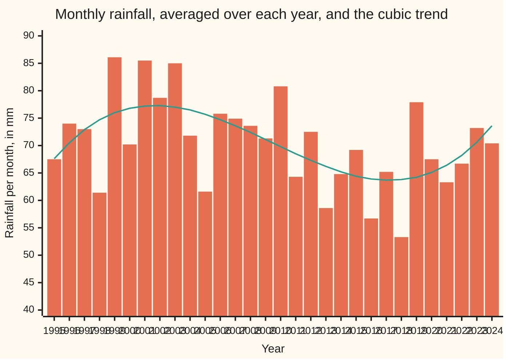

# Fitting instead of passing through: least squares in an orthogonal basis

[Syllabus](../../../SYLLABUS.md) → [Numerical analysis](../README.md) → [Interpolation and Approximation](../README.md#s04) → Fitting instead of passing through

---

## General Overview

A rain gauge has logged one total per month for 30 years, January 1995 to December 2024: 360 numbers in millimetres. They jump around. The monthly mean is 70.4997 mm, the driest month logged 0.0 mm and the wettest 151.0 mm. (The record is illustrative, made by a seeded generator written out in the code.)

The question is not "what fell in March 2009?". It is "how has a typical month changed over the 30 years?". A curve through all 360 points would answer the first question and wreck the second: it would chase every storm. So we **fit** instead of passing through. We choose a smooth curve with few adjustable numbers, here a cubic (a polynomial of degree 3, four numbers), and pick the one whose misses, squared and added, are smallest. That is least squares.

The fitted cubic says a typical month ran 66.11 mm in January 1995, rose to a wet spell around 2002, dipped in the late 2010s and ended at 75.11 mm in December 2024: a change of 9.00 mm. The noise in the record gives that change a standard error (the typical size of the error that noise alone causes) of 9.44 mm, so the record cannot tell a real rise from luck.

The arithmetic has its own trap, separate from the noise. Write the cubic in powers of the calendar year (1995, 1995², 1995³) and solve the textbook equations (the normal equations), and the computed trend is off by up to 10.2 mm. Nothing warns you. Write the same cubic in **Legendre polynomials** (a standard family of polynomials on −1 to 1, one of each degree) on a rescaled time axis, and the error is about 1e-13 mm. At a cubic the rescaling alone does that (plain powers: 1.85e-13 mm); the Legendre basis is what keeps degree 15 at 6.25e-13 mm, where powers reach 1.26e-05 mm.

**Least squares picks the curve whose squared misses add up to the least; build that curve from polynomials that are perpendicular on the data points, and each coefficient becomes one division, the system is perfectly conditioned, and adding a degree never disturbs the coefficients already found.**

**What kind of fact this is:** a theorem, proved on this card in Why it works: in an orthogonal basis each least-squares coefficient is one ratio, and a three-term recurrence builds that basis for any set of points. Two formulas about these 360 points are proved here too. The rainfall numbers are illustrative.

### The picture: 30 yearly averages and the fitted cubic



Each bar is one year's 12 monthly totals, averaged. The line is the fitted cubic, averaged over the same 12 months. The cubic was fitted to all 360 months; the bars only help the eye.

---

## The formula

Notation first. The months are numbered j = 1 to m, with m = 360. Each month's centre is mapped onto the interval −1 to 1, so x_j = (2j − 361)/360: January 1995 sits just inside −1 and December 2024 just inside +1. The rainfall in month j is y_j. Two polynomials p and q are **orthogonal on the points** when $\sum_j p(x_j)\,q(x_j) = 0$, and $\lVert p\rVert^2 = \sum_j p(x_j)^2$ is the squared size of p on the points.

Least squares chooses the coefficients $c_0, \dots, c_n$ of a degree-n curve to make the squared misses smallest:

$$\min_{c_0,\dots,c_n}\ \sum_{j=1}^{m}\Big(y_j-\sum_{k=0}^{n}c_k\,p_k(x_j)\Big)^2 .$$

If the basis polynomials $p_0, \dots, p_n$ are orthogonal on the points, the answer is one division per coefficient, and each added term lowers the squared misses by a known amount:

$$c_k=\frac{\sum_j y_j\,p_k(x_j)}{\lVert p_k\rVert^2}, \qquad S_{k-1}-S_k=c_k^2\,\lVert p_k\rVert^2 .$$

Such a basis exists for any distinct points, and three terms build it:

$$p_{k+1}(x)=(x-\alpha_k)\,p_k(x)-\beta_k\,p_{k-1}(x),\qquad \alpha_k=\frac{\sum_j x_j\,p_k(x_j)^2}{\lVert p_k\rVert^2},\qquad \beta_k=\frac{\lVert p_k\rVert^2}{\lVert p_{k-1}\rVert^2},$$

starting from $p_{-1} = 0$ and $p_0 = 1$.

**Read it aloud:** with perpendicular building blocks, each coefficient is the data's overlap with its block divided by the block's own size, each new block removes its own share of the squared misses, and each block is made from the previous two.

| Symbol | Plain meaning | In our example | Push it up and the answer… |
| --- | --- | --- | --- |
| $m$ | number of data points | 360 months | the noise in each coefficient shrinks |
| $j$, $x_j$, $y_j$ | month number; its centre on −1 to 1; rainfall that month | mean $y$ = 70.4997 mm | — |
| $n$ | degree of the fitted polynomial | 3, a cubic | fewer squared misses, more risk of chasing noise |
| $p_k$, $\lVert p_k\rVert^2$ | the k-th basis polynomial, degree k; its squared size on the points | from the recurrence | — |
| $c_k$ | coefficient of $p_k$ in the fit | one division each | — |
| $P_k$; $q_k$, $t$ | Legendre polynomial of degree k, with $P_k(1) = 1$; Step 3's whole-number versions, in $t$ = 360 x | $P_3 = (5x^3 - 3x)/2$ | — |
| $d_k$ | coefficient of $P_k$ in the same fit, in mm | $d_3$ = 9.759009189951 | a stronger S-shaped bend |
| $\alpha_k$, $\beta_k$ | the recurrence's shift and its pull-back to the previous polynomial | $\alpha_k$ = 0 in exact arithmetic: the points are symmetric about 0 | — |
| $S_n$ | sum of squared misses of the degree-n fit, in mm² | $S_3$ = 292,714.786 | falls as $n$ rises, never rises |
| $\kappa$; $u$ | condition number of the basis: largest stretch over smallest, columns scaled to length 1; unit roundoff, $2^{-53}$ | 1.0000413 for Legendre, 1.42e+08 for calendar years; $u$ = 1.11e-16 | digits lost grow with κ |
| $A$; $\Delta_k$ | design matrix: one row per month, one column per basis polynomial; change in $p_k$ from the first month to the last | 360 rows, 4 columns | — |
| $\sigma$, $\hat\sigma$ | spread of one month's miss, true and estimated, in mm | $\hat\sigma$ = 28.67 mm | every standard error grows with it |

The design matrix A, κ and $u$ come from [Least squares two ways](../03-Numerical%20Linear%20Algebra/06-least-squares-normal-equations-versus-qr.md): a matrix A with one row per month and one column per basis polynomial. The Legendre polynomials and their orthogonality on −1 to 1, for the integral, are from [Legendre's equation](../../08-Differential%20equations%20and%20dynamics/07-Series%20Solutions%20and%20Boundary%20Problems/04-legendre-polynomials.md).

### When it holds

- **At least n + 1 distinct x-values.** With fewer, some $\lVert p_k\rVert^2$ is 0, the division is by zero, and no single curve is best.
- **Orthogonal means orthogonal on these points.** Legendre polynomials are orthogonal for the integral from −1 to 1, not for a sum over 360 points. Here the overlaps are tiny, −0.001388889 and −0.003240716; ignoring them moves the trend by 1.40e-03 mm. On uneven or gappy data they are not tiny, and the recurrence is needed.
- **The x-values are mapped onto −1 to 1 first.** Powers of the raw calendar year are nearly parallel columns: κ = 1.42e+08, and the normal equations put the trend off by 10.2 mm.
- **Standard errors assume independent misses of equal spread.** The monthly misses here include the seasonal cycle, so the 9.44 mm standard error is an estimate, not a guarantee.
- **The degree is chosen, not found.** The method fits whatever degree it is given. Choosing the degree is a question about noise; see [Overfitting](../../09-Probability%20and%20statistics/09-Regression/08-cross-validation-and-overfitting.md).

---

## Why it works

### Step 0: perpendicular columns turn one tangled system into separate one-line problems

Least squares projects the data onto the space of curves the basis can make ([Least squares](../../03-Algebra/06-Dot%20Products%20and%20Best%20Fits/04-least-squares.md)). The projection is found by the normal equations $A^TA\,c = A^Ty$. Entry (i, k) of $A^TA$ is the overlap $\sum_j p_i(x_j)\,p_k(x_j)$ of two columns.

If the columns are perpendicular, every overlap off the diagonal is 0. The system splits into n + 1 separate equations, one per coefficient. No elimination, no error passed from one coefficient to the next, and a condition number of exactly 1 once the columns are scaled. The rest of the card is about getting such a basis cheaply, and about what it costs not to.

### Step 1: in an orthogonal basis each coefficient is one division, and the misses fall by a known amount

With a diagonal $A^TA$, row k of the normal equations reads $\lVert p_k\rVert^2\,c_k = \sum_j y_j\,p_k(x_j)$. Divide, and that is the formula for $c_k$.

Two useful facts follow.

1. **Earlier coefficients never move.** Raising the degree adds a new column perpendicular to the old ones, so the old equations are unchanged. A fit can therefore grow one degree at a time; the code's `degree` lines come from one degree-6 run.
2. **Each term removes its own share of the misses.** By Pythagoras, $S_n = \lVert y\rVert^2 - \sum_{k\le n} c_k^2\lVert p_k\rVert^2$, so adding degree k lowers $S$ by $c_k^2\lVert p_k\rVert^2$. On the rainfall the cubic term drops $S$ from 297,612.224 to 292,714.786 mm², by 4,897.439, the same number the formula gives.

### Step 2: plain powers are nearly parallel, and calendar years are far worse

On −1 to 1, the columns $x^k$ and $x^{k+2}$ have the same shape: both are flat near 0 and steep near the ends. So they point in nearly the same direction, and κ grows fast with the degree:

| Degree | κ, powers of x | κ, Legendre | κ² u, powers | Trend error, powers | Trend error, Legendre |
| ---: | ---: | ---: | ---: | ---: | ---: |
| 3 | 4.791 | 1.000041 | 2.55e-15 | 3.13e-13 mm | 3.84e-13 mm |
| 6 | 55.48 | 1.000514 | 3.42e-13 | 2.07e-12 mm | 3.27e-13 mm |
| 9 | 680.6 | 1.002204 | 5.14e-11 | 7.21e-11 mm | 3.69e-13 mm |
| 12 | 8,879 | 1.006242 | 8.75e-09 | 9.15e-08 mm | 4.55e-13 mm |
| 15 | 117,100 | 1.014131 | 1.52e-06 | 1.26e-05 mm | 6.25e-13 mm |

Both fits use the normal equations solved by Cholesky (writing $A^TA$ as a lower-triangular matrix times its transpose, then two triangular solves; [Cholesky](../03-Numerical%20Linear%20Algebra/04-cholesky-decomposition.md)), and the errors are measured against the recurrence fit, which is itself within 3.13e-13 mm of the exact cubic. The powers lose digits in step with κ² u, as [Least squares two ways](../03-Numerical%20Linear%20Algebra/06-least-squares-normal-equations-versus-qr.md) predicts. The Legendre fit does not lose any.

Calendar years are the extreme case. Across 1995 to 2024 the columns 1, year, year² and year³ barely change shape, because the year barely changes in relative terms. κ is 1.42e+08, κ² u is 2.25, above 1, and the normal equations return a cubic that misses the true least-squares cubic by up to 10.2 mm in some month. Cholesky does not stop; it just returns the wrong curve.

The trouble is the route, not the trend. The trend is the same curve in every basis and is well determined: the Jacobi rotations of Step 3 make the same calendar-year columns perpendicular without forming $A^TA$, and projecting onto them gives the trend to 3.23e-08 mm. Forming $A^TA$ squares κ, so the normal equations are an unstable route here, though Cholesky solves the system it is handed stably. A good basis fixes both: with κ about 1, even the normal equations are safe.

### Step 3: Legendre polynomials are almost orthogonal on evenly spread points

The Legendre polynomials satisfy $\int_{-1}^{1} P_i P_k\,dx = 0$ for i ≠ k ([Legendre's equation](../../08-Differential%20equations%20and%20dynamics/07-Series%20Solutions%20and%20Boundary%20Problems/04-legendre-polynomials.md)). A sum over 360 evenly spread month centres is the midpoint rule for that integral, times m/2. So the sums are nearly zero, but not quite.

For these points the defects can be written exactly. Let t = 2j − 361 = 360 x, an odd whole number from −359 to 359. The whole-number polynomials

$$q_0 = 1,\quad q_1 = t,\quad q_2 = 3t^2-(m^2-1),\quad q_3 = 5t^3-(3m^2-7)\,t$$

are exactly orthogonal on the points: the code adds up all six cross products in whole-number arithmetic and gets 0 each time. Comparing with the Legendre polynomials,

$$\frac{q_2}{2m^2} = P_2 + \frac{1}{2m^2},\qquad \frac{q_3}{2m^3} = P_3 + \frac{7x}{2m^2}.$$

So the Legendre polynomials are the exact orthogonal polynomials for these points, up to corrections that shrink like $1/m^2$ as m → ∞. The overlaps are $\sum_j P_0P_2 = -1/(2m)$ = −0.001388889 and $\sum_j P_1P_3 = -7(m^2-1)/(6m^3)$ = −0.003240716, as the code finds by direct summation.

Those overlaps set κ. Scaled to length 1, the P1 and P3 columns meet at a cosine of about $-7\sqrt{21}/(6m^2)$, and a 2 × 2 block with off-diagonal cosine c has κ = $\sqrt{(1+c)/(1-c)}$ ≈ 1 + |c|. So

$$\kappa \approx 1 + \frac{7\sqrt{21}}{6m^2} = 1.0000413,$$

which matches the value the code measures, 1.0000413, to all printed digits. The code measures κ by one-sided Jacobi: it rotates pairs of columns until all are perpendicular, then divides the longest length by the shortest.

<details>
<summary>Detailed proof: the whole-number polynomials are orthogonal on the 360 points</summary>

The points t are symmetric about 0, so any odd polynomial sums to 0. That settles every pair of opposite parity: $q_0q_1$, $q_0q_3$, $q_1q_2$, $q_2q_3$.

Two pairs remain. Write $T_2 = \sum t^2$ and $T_4 = \sum t^4$ over the m odd numbers from $-(m-1)$ to $m-1$. Standard sums of odd powers give $T_2 = m(m^2-1)/3$ and $T_4 = m(m^2-1)(3m^2-7)/15$.

- $\sum q_0q_2 = 3T_2 - m(m^2-1) = m(m^2-1) - m(m^2-1) = 0$.
- $\sum q_1q_3 = 5T_4 - (3m^2-7)T_2 = \tfrac{m(m^2-1)(3m^2-7)}{3} - \tfrac{m(m^2-1)(3m^2-7)}{3} = 0$.

For the Legendre comparison, substitute t = m x: $q_2 = 3m^2x^2 - m^2 + 1 = 2m^2P_2 + 1$ and $q_3 = 5m^3x^3 - 3m^3x + 7mx = 2m^3P_3 + 7mx$. Divide. $\blacksquare$

</details>

### Step 4: the three-term recurrence builds an exact orthogonal basis for any points

Legendre polynomials are only nearly right, and only for evenly spread points. A record with missing months needs a basis orthogonal on *its* points. The three-term recurrence builds one without solving any system.

The idea: multiply the latest polynomial $p_k$ by x to raise the degree by one, then subtract its overlaps with the earlier polynomials. Only two overlaps are not already zero, with $p_k$ and $p_{k-1}$. So two subtractions suffice, and they are exactly $\alpha_k p_k$ and $\beta_k p_{k-1}$.

On the rainfall, the recurrence's cubic matches the exact cubic to 3.13e-13 mm, and its columns have κ = 1.0000000.

<details>
<summary>Detailed proof: why only the last two polynomials matter</summary>

Take $p_0, \dots, p_k$, orthogonal on the points, each with leading coefficient 1 and degree equal to its index. Write $\langle f, g\rangle = \sum_j f(x_j)g(x_j)$.

$x\,p_k$ has degree k + 1 and leading coefficient 1, so $x\,p_k = p_{k+1} + \sum_{i\le k} a_i\,p_i$ for some numbers $a_i$, where $p_{k+1}$ is defined by this equation and is orthogonal to every $p_i$ with $i \le k$ once the $a_i$ are right. Taking the overlap with $p_i$ gives $a_i = \langle x\,p_k, p_i\rangle / \lVert p_i\rVert^2$.

Move the x across: $\langle x\,p_k, p_i\rangle = \langle p_k, x\,p_i\rangle$, because both are $\sum_j x_j\,p_k(x_j)\,p_i(x_j)$. Now $x\,p_i$ has degree $i + 1$. If $i < k - 1$ that degree is below k, so $x\,p_i$ is a combination of $p_0, \dots, p_{k-1}$, all orthogonal to $p_k$. The overlap is 0.

Only $i = k$ and $i = k-1$ survive. For $i = k$: $a_k = \langle x\,p_k, p_k\rangle/\lVert p_k\rVert^2 = \alpha_k$. For $i = k-1$: $x\,p_{k-1} = p_k + (\text{lower degree})$, so $\langle p_k, x\,p_{k-1}\rangle = \lVert p_k\rVert^2$ and $a_{k-1} = \lVert p_k\rVert^2/\lVert p_{k-1}\rVert^2 = \beta_k$.

So $p_{k+1} = (x - \alpha_k)\,p_k - \beta_k\,p_{k-1}$. The construction needs $\lVert p_k\rVert^2 > 0$, which holds while k is below the number of distinct points. $\blacksquare$

</details>

In floating point the recurrence can lose orthogonality at high degree on badly spread points, as classical Gram–Schmidt does. Gautschi (1982) compares ways of generating these polynomials and how stable each is.

### Step 5: the noise, not the rounding, sets the answer's real error

In an orthogonal basis the noise is as easy to handle as the fit. Each $c_k$ is a fixed weighted sum of the y's. If each month's miss has spread σ and the misses are independent, $c_k$ has standard error $\sigma/\lVert p_k\rVert$, and different coefficients are uncorrelated, because their weights are perpendicular.

The trend's change from the first month to the last uses only the odd terms: the even ones take the same value at both ends, by symmetry. So its standard error is $\hat\sigma\sqrt{\Delta_1^2/\lVert p_1\rVert^2 + \Delta_3^2/\lVert p_3\rVert^2}$, where $\Delta_k = p_k(x_m) - p_k(x_1)$ and $\hat\sigma^2 = S_3/(m-4)$.

- $\hat\sigma$ = 28.67 mm, the spread of one month's miss;
- the change, 9.00 mm, carries a standard error of 9.44 mm;
- the cubic term is 2.44 standard errors from zero.

The rounding error of a good basis is about 1e-13 mm; the noise gives 9.44 mm. Orthogonal polynomials do not remove noise; they stop the arithmetic from adding to it.

### Step 6: the cost

Counted as flops (one floating-point add or multiply) for m = 360 points ([Counting the work](../01-Floating%20Point%20and%20Error/08-operation-counts-and-cost.md)). The normal-equations column is the textbook leading-order count; the recurrence column counts the code's own operations, less the printout's sum of squared misses:

| Coefficients | Normal equations, textbook count $m(n+1)^2 + (n+1)^3/3$ | Recurrence, code's count $13\,m\,(n+1)$ |
| ---: | ---: | ---: |
| 4 | 5,781 | 18,720 |
| 16 | 93,525 | 74,880 |

The recurrence grows with n and the normal equations with n², so it costs more at a cubic and less for larger fits. At these sizes the cost hardly matters: the reason to choose an orthogonal basis is the digits.

---

## Worked numbers, by hand

The rainfall record, 360 months, a cubic, in the order the code runs. Every row uses a basis with κ about 1, where even the normal equations are safe; the calendar-year failure under What breaks is those equations squaring a large κ.

| Step | Arithmetic | Value |
| --- | --- | --- |
| mean month | sum of the 360 totals ÷ 360 | 70.4997 mm |
| Legendre coefficients | exact whole-number ratios, then $d_0 = c_0 + c_2$, … | $d_0$ = 70.49972264537, $d_1$ = −5.108620774322, $d_2$ = 0.1096803931646, $d_3$ = 9.759009189951 mm |
| same, by Cholesky on Legendre columns | normal equations, κ = 1.0000413 | the same 13 digits |
| trend, January 1995 | $\sum_k d_k P_k(x_1)$, at $x_1$ = −359/360 | 66.11 mm |
| trend, December 2024 | $\sum_k d_k P_k(x_{360})$, at $x_{360}$ = 359/360 | 75.11 mm |
| change over 30 years | 75.11 − 66.11 | 9.00 mm |
| spread of one miss | $\sqrt{S_3/(360 - 4)}$ | 28.67 mm |
| standard error of the change | Step 5 | 9.44 mm |
| answer | | **+9.00 mm a month, standard error 9.44 mm; rounding error about 1e-13 mm** |

So the cubic trend rose by 9 mm a month over the 30 years, but a record this noisy could show a rise that size by chance. The arithmetic is not the weak link: it is trustworthy to 13 digits.

### What breaks if you drop a piece

| Mistake | Comes out at | What went wrong |
| --- | --- | --- |
| Normal equations on powers of the calendar year | trend off by up to 10.2 mm (1.02e+01), against 1.14e-13 mm for Legendre | κ = 1.42e+08, squared by forming $A^TA$: κ² u = 2.25; rotations without $A^TA$ give 3.23e-08 mm |
| Powers of x at degree 15 instead of Legendre | trend error 1.26e-05 mm, against 6.25e-13 mm | κ = 117,100: x¹³ and x¹⁵ are nearly the same column |
| Legendre treated as exactly orthogonal: $d_k$ = overlap ÷ size | trend off by 1.40e-03 mm | the overlaps −0.001388889 and −0.003240716 were dropped |

The third row is harmless here, because 360 even points make the overlaps small. It is the warning for uneven data: there the recurrence of Step 4 is the fix.

---

## Code, from first principles, and it actually runs

The code makes the 360 monthly totals from a seeded SplitMix64 generator (a short pseudo-random number generator written out in full), stored as whole tenths of a millimetre, and fits the cubic by three independent roads. Road one is exact: the whole-number polynomials of Step 3, summed in integers, give each coefficient as one ratio of whole numbers, rounded once. Road two builds Legendre columns by Bonnet's recurrence, $(k+1)P_{k+1} = (2k+1)\,x\,P_k - k\,P_{k-1}$, and solves the normal equations by Cholesky. Road three is the three-term recurrence on the points. A separate one-sided Jacobi routine (Step 3) measures κ of each basis without forming $A^TA$, and a formula from Step 3 predicts κ for Legendre. The same rotations also fit the calendar-year columns without $A^TA$ (Step 2). The code then repeats the normal equations in four other bases and sweeps the degree up to 21.

### Python

```python
# Fitting instead of passing through: a cubic trend through 30 years of monthly rainfall
# (illustrative data from a seeded generator), fitted in several bases. Standard library only.
# Roads: exact whole numbers in the discrete orthogonal basis; Legendre columns with Cholesky;
# the three-term recurrence; kappa by one-sided Jacobi and from a formula; a fit by those rotations.
from math import sqrt, log10
M, U, MASK = 360, 2.0 ** -53, (1 << 64) - 1   # months, Jan 1995 to Dec 2024; unit roundoff
SEASON = [22, 4, 4, -10, -10, -15, -20, -10, -5, 14, 22, 4]   # mm above the year's average

def splitmix(s):                     # SplitMix64: uniform numbers in [0, 1) from seed s
    while True:
        s = (s + 0x9E3779B97F4A7C15) & MASK
        z = ((s ^ (s >> 30)) * 0xBF58476D1CE4E5B9) & MASK
        z = ((z ^ (z >> 27)) * 0x94D049BB133111EB) & MASK
        yield ((z ^ (z >> 31)) >> 11) * 2.0 ** -53
def dot(p, q):                       # plain loop: same rounding in Python and Rust
    t = 0.0
    for a, b in zip(p, q): t += a * b
    return t
gen, TENTHS = splitmix(2024), []     # rainfall in tenths of a mm, whole numbers
X = [(2 * j - M - 1) / M for j in range(1, M + 1)]   # month centres mapped onto -1 .. 1
for j in range(M):
    e = 0.0
    for _ in range(12): e += next(gen)                # noise: 12 uniforms minus 6, sd 1
    v = 70.0 - 9.0 * X[j] + 12.0 * X[j] * X[j] * X[j] + SEASON[j % 12] + 25.0 * (e - 6.0)
    TENTHS.append(int(v * 10.0 + 0.5) if v > 0 else 0)
Y = [v / 10 for v in TENTHS]

def exact():                         # road 1: whole numbers; t = 2j - 361 = 360 x
    t = [2 * j - M - 1 for j in range(1, M + 1)]
    q = [[1] * M, t, [3 * v * v - (M * M - 1) for v in t], [5 * v ** 3 - (3 * M * M - 7) * v for v in t]]
    g = [[sum(a * b for a, b in zip(q[i], q[k])) for k in range(4)] for i in range(4)]
    c = [float(sum(a * b for a, b in zip(q[k], TENTHS))) / float(10 * g[k][k]) for k in range(4)]
    fit = [c[0] + c[1] * q[1][j] + c[2] * q[2][j] + c[3] * q[3][j] for j in range(M)]
    d = [c[0] + c[2], M * c[1] + 7 * M * c[3], 2 * M * M * c[2], 2 * M ** 3 * c[3]]  # in P_k
    return g, d, fit
def powers(xs, n):                   # columns 1, x, x^2, .. x^n
    cols = [[1.0] * M]
    for k in range(n): cols.append([a * x for a, x in zip(cols[-1], xs)])
    return cols
def legendre(n):                     # columns P_0 .. P_n by Bonnet's recurrence
    cols = [[1.0] * M, X[:]]
    for k in range(1, n):
        cols.append([((2 * k + 1) * x * a - k * b) / (k + 1) for x, a, b in zip(X, cols[k], cols[k - 1])])
    return cols[:n + 1]
def cholesky_fit(cols):              # road 2: normal equations G c = A^T y by Cholesky
    n = len(cols); r = [[0.0] * n for _ in range(n)]
    for j in range(n):
        d = dot(cols[j], cols[j])
        for k in range(j): d -= r[k][j] * r[k][j]
        if d <= 0: return None, None                  # rounding made G look singular
        r[j][j] = sqrt(d)
        for i in range(j + 1, n):
            e = dot(cols[j], cols[i])
            for k in range(j): e -= r[k][j] * r[k][i]
            r[j][i] = e / r[j][j]
    z, c = [0.0] * n, [0.0] * n
    for i in range(n):
        e = dot(cols[i], Y)
        for k in range(i): e -= r[k][i] * z[k]
        z[i] = e / r[i][i]
    for i in reversed(range(n)):
        e = z[i]
        for k in range(i + 1, n): e -= r[i][k] * c[k]
        c[i] = e / r[i][i]
    return c, [dot([col[j] for col in cols], c) for j in range(M)]
def recurrence(n):                   # road 3: p_(k+1) = (x - alpha) p_k - beta p_(k-1)
    old, p, nold, f, out = [0.0] * M, [1.0] * M, 1.0, [0.0] * M, []
    for k in range(n + 1):
        nk = dot(p, p); c = dot(Y, p) / nk
        f = [a + c * b for a, b in zip(f, p)]
        out.append((c, nk, p[M - 1] - p[0], dot([a - b for a, b in zip(Y, f)], [a - b for a, b in zip(Y, f)]), p))
        al, be = dot([x * v for x, v in zip(X, p)], p) / nk, nk / nold
        old, p, nold = p, [(x - al) * v - be * w for x, v, w in zip(X, p, old)], nk
    return f, out
def sing(cols):                      # one-sided Jacobi: rotate columns until perpendicular
    v = [col[:] for col in cols]
    for sweep in range(60):
        worst = 0.0
        for p in range(len(v)):
            for q in range(p + 1, len(v)):
                al, be, ga = dot(v[p], v[p]), dot(v[q], v[q]), dot(v[p], v[q])
                if ga == 0.0: continue
                worst = max(worst, abs(ga) / sqrt(al * be))
                ze = (be - al) / (2.0 * ga)
                t = (1.0 if ze >= 0 else -1.0) / (abs(ze) + sqrt(1.0 + ze * ze))
                cs = 1.0 / sqrt(1.0 + t * t); sn = cs * t
                for i in range(M):
                    x1, x2 = v[p][i], v[q][i]
                    v[p][i], v[q][i] = cs * x1 - sn * x2, sn * x1 + cs * x2
        if worst < 1e-15: break
    s = sorted(sqrt(dot(w, w)) for w in v)
    return s[-1] / s[0], v
def kappa(cols): return sing([[v / sqrt(dot(col, col)) for v in col] for col in cols])[0]
def rotated_fit(cols):               # no A^T A: rotate the columns perpendicular, then project Y
    v = sing(cols)[1]; c = [dot(Y, w) / dot(w, w) for w in v]; return [dot([w[j] for w in v], c) for j in range(M)]
def worst(f, ref): return max(abs(a - b) for a, b in zip(f, ref))

g, dx, fx = exact(); L = legendre(3); dl, fl = cholesky_fit(L)
f3, rec = recurrence(3)[0], recurrence(6)[1]   # degrees 0..3 of rec are the cubic's terms
print(f"data: {M} months, mean {dot(Y, [1.0] * M) / M:.4f} mm, smallest {min(Y):.1f}, largest {max(Y):.1f}")
print("trend = d0 + d1 P1 + d2 P2 + d3 P3, in mm")
for name, d in (("exact", dx), ("Legendre", dl)): print(f"{name:<9}" + "".join(f" d{k} {d[k]:.12e}" for k in range(4)))
sig = sqrt(rec[3][3] / (M - 4))
se = sig * sqrt(rec[1][2] ** 2 / rec[1][1] + rec[3][2] ** 2 / rec[3][1])
print(f"trend Jan 1995 {fx[0]:.2f} mm, Dec 2024 {fx[-1]:.2f} mm, change {fx[-1] - fx[0]:.2f} mm")
print(f"noise sd estimate {sig:.2f} mm; change standard error {se:.2f} mm; cubic term {rec[3][0] * sqrt(rec[3][1]) / sig:.2f} standard errors")
yr = [1995 + (j - 0.5) / 12 for j in range(1, M + 1)]
bases = (("calendar years", powers(yr, 3)), ("months 1..360", powers([j + 1.0 for j in range(M)], 3)),
         ("powers of x", powers(X, 3)), ("Legendre", legendre(3)), ("recurrence", [r[4] for r in rec[:4]]))
for name, cols in bases:
    c, f = cholesky_fit(cols)
    err = "Cholesky stops: G not positive" if f is None else f"{worst(f, fx):.2e} mm"
    print(f"degree 3, {name:<14} kappa {kappa(cols):.7e}  k^2 u {kappa(cols) * kappa(cols) * U:.2e}  trend error {err}")
print(f"calendar years by Jacobi rotations, no A^T A: trend error {worst(rotated_fit(bases[0][1]), fx):.2e} mm")
print(f"recurrence trend error {worst(f3, fx):.2e} mm; kappa formula 1 + 7 sqrt(21)/(6 m^2) = {1 + 7 * sqrt(21) / (6 * M * M):.7e}")
print(f"sum of P0 P2 {dot(L[0], L[2]):.9f}, -1/(2m) {-1 / (2 * M):.9f}; sum of P1 P3 {dot(L[1], L[3]):.9f}, -7(m^2 - 1)/(6 m^3) {-7 * (M * M - 1) / (6 * M ** 3):.9f}")
sh = [dot(Y, col) / dot(col, col) for col in L]; fs = [dot([col[j] for col in L], sh) for j in range(M)]   # P_k as if orthogonal
print(f"shortcut ignoring the small overlaps: trend error {worst(fs, fx):.2e} mm")
print("degree, kappa powers, kappa Legendre, log10 of each, k^2 u powers, error powers, error Legendre (mm, vs recurrence)")
sweep = {}
for n in (3, 6, 9, 12, 15, 18, 21):
    ref = recurrence(n)[0]; kp, kl = kappa(powers(X, n)), kappa(legendre(n))
    ep, el = worst(cholesky_fit(powers(X, n))[1], ref), worst(cholesky_fit(legendre(n))[1], ref)
    sweep[n] = (kp, kl, ep, el)
    print(f"sweep {n:>2} {kp:.3e} {kl:.6f} {log10(kp):5.2f} {log10(kl):5.2f} {kp * kp * U:.2e} {ep:.2e} {el:.2e}")
for k in range(1, 7):
    drop = rec[k - 1][3] - rec[k][3]
    print(f"degree {k}: rss {rec[k][3]:.3f}, drop {drop:.3f}, c^2 |p|^2 {rec[k][0] ** 2 * rec[k][1]:.3f}, z {rec[k][0] * sqrt(rec[k][1]) / sig:.2f}")
print("flops m=360: normal eqns 4 coefs %d, 16 coefs %d; recurrence 4 coefs %d, 16 coefs %d" % (360 * 16 + 21, 360 * 256 + 1365, 13 * 360 * 4, 13 * 360 * 16))
print("annual mean " + " ".join(f"{dot(Y[12 * i:12 * i + 12], [1.0] * 12) / 12:.1f}" for i in range(30)))
print("annual trend " + " ".join(f"{dot(fx[12 * i:12 * i + 12], [1.0] * 12) / 12:.1f}" for i in range(30)))

assert all(g[i][k] == 0 for i in range(4) for k in range(i))        # exactly orthogonal
assert max(abs(a - b) for a, b in zip(dl, dx)) < 1e-11               # Legendre basis = exact
assert worst(f3, fx) < 1e-11 and worst(fl, fx) < 1e-11               # recurrence = exact
assert worst(cholesky_fit(bases[0][1])[1], fx) > 1.0 and worst(rotated_fit(bases[0][1]), fx) < 1e-5  # A^T A breaks it
assert abs(kappa(L) - (1 + 7 * sqrt(21) / (6 * M * M))) < 1e-8       # kappa from the formula
assert all(abs(rec[k - 1][3] - rec[k][3] - rec[k][0] ** 2 * rec[k][1]) < 1e-6 for k in range(1, 7))
assert sweep[15][2] > 1e4 * sweep[15][3] and sweep[15][1] < 1.02    # powers lose, Legendre holds
print("ALL CHECKS PASS")
```

**Ran 2026-11-11 on macOS, Python 3.14.10, standard library only. All checks passed. Output, pasted from the run:**

```
data: 360 months, mean 70.4997 mm, smallest 0.0, largest 151.0
trend = d0 + d1 P1 + d2 P2 + d3 P3, in mm
exact     d0 7.049972264537e+01 d1 -5.108620774322e+00 d2 1.096803931646e-01 d3 9.759009189951e+00
Legendre  d0 7.049972264537e+01 d1 -5.108620774322e+00 d2 1.096803931646e-01 d3 9.759009189951e+00
trend Jan 1995 66.11 mm, Dec 2024 75.11 mm, change 9.00 mm
noise sd estimate 28.67 mm; change standard error 9.44 mm; cubic term 2.44 standard errors
degree 3, calendar years kappa 1.4235753e+08  k^2 u 2.25e+00  trend error 1.02e+01 mm
degree 3, months 1..360  kappa 8.6680711e+01  k^2 u 8.34e-13  trend error 2.16e-12 mm
degree 3, powers of x    kappa 4.7914290e+00  k^2 u 2.55e-15  trend error 1.85e-13 mm
degree 3, Legendre       kappa 1.0000413e+00  k^2 u 1.11e-16  trend error 1.14e-13 mm
degree 3, recurrence     kappa 1.0000000e+00  k^2 u 1.11e-16  trend error 1.56e-13 mm
calendar years by Jacobi rotations, no A^T A: trend error 3.23e-08 mm
recurrence trend error 3.13e-13 mm; kappa formula 1 + 7 sqrt(21)/(6 m^2) = 1.0000413e+00
sum of P0 P2 -0.001388889, -1/(2m) -0.001388889; sum of P1 P3 -0.003240716, -7(m^2 - 1)/(6 m^3) -0.003240716
shortcut ignoring the small overlaps: trend error 1.40e-03 mm
degree, kappa powers, kappa Legendre, log10 of each, k^2 u powers, error powers, error Legendre (mm, vs recurrence)
sweep  3 4.791e+00 1.000041  0.68  0.00 2.55e-15 3.13e-13 3.84e-13
sweep  6 5.548e+01 1.000514  1.74  0.00 3.42e-13 2.07e-12 3.27e-13
sweep  9 6.806e+02 1.002204  2.83  0.00 5.14e-11 7.21e-11 3.69e-13
sweep 12 8.879e+03 1.006242  3.95  0.00 8.75e-09 9.15e-08 4.55e-13
sweep 15 1.171e+05 1.014131  5.07  0.01 1.52e-06 1.26e-05 6.25e-13
sweep 18 1.574e+06 1.027798  6.20  0.01 2.75e-04 3.05e-04 6.54e-13
sweep 21 2.127e+07 1.049705  7.33  0.02 5.02e-02 2.31e-01 7.53e-13
degree 1: rss 297613.090, drop 3132.060, c^2 |p|^2 3132.060, z -1.95
degree 2: rss 297612.224, drop 0.866, c^2 |p|^2 0.866, z 0.03
degree 3: rss 292714.786, drop 4897.439, c^2 |p|^2 4897.439, z 2.44
degree 4: rss 292659.192, drop 55.594, c^2 |p|^2 55.594, z 0.26
degree 5: rss 292619.252, drop 39.940, c^2 |p|^2 39.940, z -0.22
degree 6: rss 292541.259, drop 77.993, c^2 |p|^2 77.993, z 0.31
flops m=360: normal eqns 4 coefs 5781, 16 coefs 93525; recurrence 4 coefs 18720, 16 coefs 74880
annual mean 67.5 74.0 73.0 61.4 86.1 70.2 85.5 78.7 85.0 71.8 61.6 75.8 74.9 73.6 71.3 80.8 64.3 72.5 58.6 64.8 69.2 56.7 65.2 53.3 77.9 67.5 63.3 66.7 73.2 70.4
annual trend 67.6 70.5 72.9 74.7 76.0 76.8 77.2 77.3 77.0 76.5 75.7 74.7 73.6 72.4 71.1 69.8 68.5 67.3 66.2 65.2 64.4 63.9 63.7 63.8 64.2 65.1 66.4 68.2 70.6 73.6
ALL CHECKS PASS
```

### Rust

The same computation, operation for operation, so the output is identical. Rust writes exponents as `e-8`, so a small helper prints them the way Python does. Whole-number sums use `i128`.

```rust
// Fitting instead of passing through: a cubic trend through 30 years of monthly rainfall
// (illustrative data from a seeded generator), fitted in several bases. Standard library only.
// Roads: exact whole numbers in the discrete orthogonal basis; Legendre columns with Cholesky;
// the three-term recurrence; kappa by one-sided Jacobi and from a formula; a fit by those rotations.
const M: usize = 360; const U: f64 = 1.0 / 9007199254740992.0; // months, Jan 1995 to Dec 2024; unit roundoff
const SEASON: [f64; 12] = [22.0, 4.0, 4.0, -10.0, -10.0, -15.0, -20.0, -10.0, -5.0, 14.0, 22.0, 4.0];
type Cols = Vec<Vec<f64>>;
struct Term { c: f64, nk: f64, dp: f64, rss: f64, p: Vec<f64> }

fn fe(x: f64, p: usize) -> String { // Python-style e-notation: 1.23e-08
    let s = format!("{:.*e}", p, x);
    let (m, e) = s.split_once('e').unwrap(); let n: i32 = e.parse().unwrap();
    format!("{}e{}{:02}", m, if n < 0 { '-' } else { '+' }, n.abs())
}
fn splitmix(s: &mut u64) -> f64 { // SplitMix64: uniform numbers in [0, 1)
    *s = s.wrapping_add(0x9E3779B97F4A7C15);
    let mut z = (*s ^ (*s >> 30)).wrapping_mul(0xBF58476D1CE4E5B9);
    z = (z ^ (z >> 27)).wrapping_mul(0x94D049BB133111EB);
    ((z ^ (z >> 31)) >> 11) as f64 / 9007199254740992.0
}
fn dot(p: &[f64], q: &[f64]) -> f64 { // plain loop: same rounding in Python and Rust
    let mut t = 0.0; for (a, b) in p.iter().zip(q) { t += a * b; } t
}
fn exact(tenths: &[i128]) -> ([[i128; 4]; 4], Vec<f64>, Vec<f64>) { // road 1: whole numbers
    let m = M as i128;
    let t: Vec<i128> = (1..=m).map(|j| 2 * j - m - 1).collect(); // t = 2j - 361 = 360 x
    let q: Vec<Vec<i128>> = vec![vec![1; M], t.clone(), t.iter().map(|v| 3 * v * v - (m * m - 1)).collect(),
        t.iter().map(|v| 5 * v * v * v - (3 * m * m - 7) * v).collect()];
    let mut g = [[0i128; 4]; 4]; for i in 0..4 { for k in 0..4 { g[i][k] = q[i].iter().zip(&q[k]).map(|(a, b)| a * b).sum(); } }
    let c: Vec<f64> = (0..4).map(|k| q[k].iter().zip(tenths).map(|(a, b)| a * b).sum::<i128>() as f64
        / (10 * g[k][k]) as f64).collect();
    let fit = (0..M).map(|j| c[0] + c[1] * q[1][j] as f64 + c[2] * q[2][j] as f64 + c[3] * q[3][j] as f64).collect();
    let d = vec![c[0] + c[2], (m as f64) * c[1] + (7 * m) as f64 * c[3], (2 * m * m) as f64 * c[2], (2 * m * m * m) as f64 * c[3]];
    (g, d, fit)
}
fn powers(xs: &[f64], n: usize) -> Cols { // columns 1, x, x^2, .. x^n
    let mut cols = vec![vec![1.0; M]];
    for k in 0..n { let next = cols[k].iter().zip(xs).map(|(a, x)| a * x).collect(); cols.push(next); } cols
}
fn legendre(xs: &[f64], n: usize) -> Cols { // columns P_0 .. P_n by Bonnet's recurrence
    let mut cols = vec![vec![1.0; M], xs.to_vec()];
    for k in 1..n {
        let (kf, a, b) = (k as f64, &cols[k], &cols[k - 1]); let next = (0..M).map(|j| ((2.0 * kf + 1.0) * xs[j] * a[j] - kf * b[j]) / (kf + 1.0)).collect();
        cols.push(next);
    }
    cols.truncate(n + 1); cols
}
fn cholesky_fit(cols: &Cols, y: &[f64]) -> Option<(Vec<f64>, Vec<f64>)> { // road 2: normal equations
    let n = cols.len(); let mut r = vec![vec![0.0; n]; n];
    for j in 0..n {
        let mut d = dot(&cols[j], &cols[j]); for k in 0..j { d -= r[k][j] * r[k][j]; }
        if d <= 0.0 { return None; } // rounding made G look singular
        r[j][j] = d.sqrt();
        for i in j + 1..n {
            let mut e = dot(&cols[j], &cols[i]); for k in 0..j { e -= r[k][j] * r[k][i]; } r[j][i] = e / r[j][j];
        }
    }
    let (mut z, mut c) = (vec![0.0; n], vec![0.0; n]);
    for i in 0..n {
        let mut e = dot(&cols[i], y); for k in 0..i { e -= r[k][i] * z[k]; } z[i] = e / r[i][i];
    }
    for i in (0..n).rev() {
        let mut e = z[i]; for k in i + 1..n { e -= r[i][k] * c[k]; } c[i] = e / r[i][i];
    }
    let f = (0..M).map(|j| dot(&cols.iter().map(|col| col[j]).collect::<Vec<f64>>(), &c)).collect();
    Some((c, f))
}
fn recurrence(xs: &[f64], y: &[f64], n: usize) -> (Vec<f64>, Vec<Term>) { // road 3: three terms
    let (mut old, mut p, mut nold, mut f, mut out) = (vec![0.0; M], vec![1.0; M], 1.0, vec![0.0; M], Vec::new());
    for _ in 0..=n {
        let (nk, xp): (f64, Vec<f64>) = (dot(&p, &p), xs.iter().zip(&p).map(|(x, v)| x * v).collect());
        let c = dot(y, &p) / nk; f = f.iter().zip(&p).map(|(a, b)| a + c * b).collect();
        let res: Vec<f64> = y.iter().zip(&f).map(|(a, b)| a - b).collect();
        out.push(Term { c, nk, dp: p[M - 1] - p[0], rss: dot(&res, &res), p: p.clone() });
        let (al, be) = (dot(&xp, &p) / nk, nk / nold);
        let next = (0..M).map(|j| (xs[j] - al) * p[j] - be * old[j]).collect(); old = p; p = next; nold = nk;
    }
    (f, out)
}
fn sing(cols: &Cols) -> (f64, Cols) { // one-sided Jacobi: rotate columns until perpendicular
    let mut v = cols.clone();
    for _sweep in 0..60 {
        let mut worst: f64 = 0.0;
        for p in 0..v.len() {
            for q in p + 1..v.len() {
                let (al, be, ga) = (dot(&v[p], &v[p]), dot(&v[q], &v[q]), dot(&v[p], &v[q]));
                if ga == 0.0 { continue; }
                worst = worst.max(ga.abs() / (al * be).sqrt());
                let ze = (be - al) / (2.0 * ga);
                let t = (if ze >= 0.0 { 1.0 } else { -1.0 }) / (ze.abs() + (1.0 + ze * ze).sqrt());
                let cs = 1.0 / (1.0 + t * t).sqrt(); let sn = cs * t;
                for i in 0..M { let (x1, x2) = (v[p][i], v[q][i]); v[p][i] = cs * x1 - sn * x2; v[q][i] = sn * x1 + cs * x2; }
            }
        }
        if worst < 1e-15 { break; }
    }
    let mut s: Vec<f64> = v.iter().map(|w| dot(w, w).sqrt()).collect(); s.sort_by(f64::total_cmp); (s[s.len() - 1] / s[0], v)
}
fn kappa(cols: &Cols) -> f64 { // kappa with each column scaled to length 1
    sing(&cols.iter().map(|col| { let n = dot(col, col).sqrt(); col.iter().map(|v| v / n).collect() }).collect()).0 }
fn rotated_fit(cols: &Cols, y: &[f64]) -> Vec<f64> { // no A^T A: rotate the columns perpendicular, then project y
    let v = sing(cols).1; let c: Vec<f64> = v.iter().map(|w| dot(y, w) / dot(w, w)).collect(); (0..M).map(|j| dot(&v.iter().map(|w| w[j]).collect::<Vec<f64>>(), &c)).collect() }
fn worst(f: &[f64], r: &[f64]) -> f64 { f.iter().zip(r).map(|(a, b)| (a - b).abs()).fold(0.0, f64::max) }
fn mean(v: &[f64]) -> f64 { dot(v, &vec![1.0; v.len()]) / v.len() as f64 }

fn main() {
    let mf = M as f64;
    let x: Vec<f64> = (1..=M as i64).map(|j| (2 * j - M as i64 - 1) as f64 / mf).collect(); // month centres on -1 .. 1
    let (mut s, mut tenths) = (2024u64, Vec::new()); // rainfall in tenths of a mm
    for j in 0..M {
        let mut e = 0.0; for _ in 0..12 { e += splitmix(&mut s); } // noise: 12 uniforms minus 6, sd 1
        let v = 70.0 - 9.0 * x[j] + 12.0 * x[j] * x[j] * x[j] + SEASON[j % 12] + 25.0 * (e - 6.0);
        tenths.push(if v > 0.0 { (v * 10.0 + 0.5) as i128 } else { 0 });
    }
    let y: Vec<f64> = tenths.iter().map(|v| *v as f64 / 10.0).collect();
    let (g, dx, fx) = exact(&tenths);
    let (dl, fl) = cholesky_fit(&legendre(&x, 3), &y).unwrap();
    let (f3, rec) = (recurrence(&x, &y, 3).0, recurrence(&x, &y, 6).1);
    println!("data: {} months, mean {:.4} mm, smallest {:.1}, largest {:.1}", M, mean(&y),
        y.iter().cloned().fold(f64::MAX, f64::min), y.iter().cloned().fold(0.0, f64::max));
    println!("trend = d0 + d1 P1 + d2 P2 + d3 P3, in mm");
    for (name, d) in [("exact", &dx), ("Legendre", &dl)] { println!("{:<9}{}", name, (0..4).map(|k| format!(" d{} {}", k, fe(d[k], 12))).collect::<String>()); }
    let sig = (rec[3].rss / (mf - 4.0)).sqrt();
    let se = sig * (rec[1].dp * rec[1].dp / rec[1].nk + rec[3].dp * rec[3].dp / rec[3].nk).sqrt();
    println!("trend Jan 1995 {:.2} mm, Dec 2024 {:.2} mm, change {:.2} mm", fx[0], fx[M - 1], fx[M - 1] - fx[0]);
    println!("noise sd estimate {:.2} mm; change standard error {:.2} mm; cubic term {:.2} standard errors",
        sig, se, rec[3].c * rec[3].nk.sqrt() / sig);
    let yr: Vec<f64> = (1..=M).map(|j| 1995.0 + (j as f64 - 0.5) / 12.0).collect();
    let months: Vec<f64> = (0..M).map(|j| j as f64 + 1.0).collect();
    let bases: Vec<(&str, Cols)> = vec![("calendar years", powers(&yr, 3)), ("months 1..360", powers(&months, 3)),
        ("powers of x", powers(&x, 3)), ("Legendre", legendre(&x, 3)), ("recurrence", rec[..4].iter().map(|r| r.p.clone()).collect())];
    for (name, cols) in &bases {
        let err = match cholesky_fit(cols, &y) { None => "Cholesky stops: G not positive".to_string(),
            Some((_, f)) => format!("{} mm", fe(worst(&f, &fx), 2)) };
        let k = kappa(cols); println!("degree 3, {:<14} kappa {}  k^2 u {}  trend error {}", name, fe(k, 7), fe(k * k * U, 2), err);
    }
    println!("calendar years by Jacobi rotations, no A^T A: trend error {} mm", fe(worst(&rotated_fit(&bases[0].1, &y), &fx), 2));
    let kf = 1.0 + 7.0 * 21f64.sqrt() / (6.0 * mf * mf);
    println!("recurrence trend error {} mm; kappa formula 1 + 7 sqrt(21)/(6 m^2) = {}", fe(worst(&f3, &fx), 2), fe(kf, 7));
    let l = legendre(&x, 3);
    println!("sum of P0 P2 {:.9}, -1/(2m) {:.9}; sum of P1 P3 {:.9}, -7(m^2 - 1)/(6 m^3) {:.9}", dot(&l[0], &l[2]),
        -1.0 / (2.0 * mf), dot(&l[1], &l[3]), -7.0 * (mf * mf - 1.0) / (6.0 * mf * mf * mf));
    let sh: Vec<f64> = l.iter().map(|col| dot(&y, col) / dot(col, col)).collect(); let fs: Vec<f64> = (0..M).map(|j| dot(&l.iter().map(|col| col[j]).collect::<Vec<f64>>(), &sh)).collect();
    println!("shortcut ignoring the small overlaps: trend error {} mm", fe(worst(&fs, &fx), 2));
    println!("degree, kappa powers, kappa Legendre, log10 of each, k^2 u powers, error powers, error Legendre (mm, vs recurrence)");
    let mut sweep = Vec::new();
    for n in [3usize, 6, 9, 12, 15, 18, 21] {
        let rf = recurrence(&x, &y, n).0; let (kp, kl) = (kappa(&powers(&x, n)), kappa(&legendre(&x, n)));
        let (ep, el) = (worst(&cholesky_fit(&powers(&x, n), &y).unwrap().1, &rf), worst(&cholesky_fit(&legendre(&x, n), &y).unwrap().1, &rf));
        println!("sweep {:>2} {} {:.6} {:5.2} {:5.2} {} {} {}", n, fe(kp, 3), kl, kp.log10(), kl.log10(), fe(kp * kp * U, 2), fe(ep, 2), fe(el, 2));
        sweep.push((kp, kl, ep, el));
    }
    for k in 1..7 {
        println!("degree {}: rss {:.3}, drop {:.3}, c^2 |p|^2 {:.3}, z {:.2}", k, rec[k].rss, rec[k - 1].rss - rec[k].rss,
            rec[k].c * rec[k].c * rec[k].nk, rec[k].c * rec[k].nk.sqrt() / sig);
    }
    println!("flops m=360: normal eqns 4 coefs {}, 16 coefs {}; recurrence 4 coefs {}, 16 coefs {}", 360 * 16 + 21, 360 * 256 + 1365, 13 * 360 * 4, 13 * 360 * 16);
    let am: Vec<String> = (0..30).map(|i| format!("{:.1}", mean(&y[12 * i..12 * i + 12]))).collect();
    let at: Vec<String> = (0..30).map(|i| format!("{:.1}", mean(&fx[12 * i..12 * i + 12]))).collect();
    println!("annual mean {}", am.join(" ")); println!("annual trend {}", at.join(" "));

    assert!((0..4).all(|i| (0..i).all(|k| g[i][k] == 0))); // exactly orthogonal
    assert!((0..4).map(|k| (dl[k] - dx[k]).abs()).fold(0.0, f64::max) < 1e-11); // Legendre basis = exact
    assert!(worst(&f3, &fx) < 1e-11 && worst(&fl, &fx) < 1e-11); // recurrence = exact
    assert!(worst(&cholesky_fit(&bases[0].1, &y).unwrap().1, &fx) > 1.0 && worst(&rotated_fit(&bases[0].1, &y), &fx) < 1e-5); // A^T A breaks it
    assert!((kappa(&l) - kf).abs() < 1e-8); // kappa from the formula
    assert!((1..7).all(|k| (rec[k - 1].rss - rec[k].rss - rec[k].c * rec[k].c * rec[k].nk).abs() < 1e-6));
    assert!(sweep[4].2 > 1e4 * sweep[4].3 && sweep[4].1 < 1.02); // powers lose, Legendre holds
    println!("ALL CHECKS PASS");
}
```

**Ran 2026-11-11 on macOS, rustc 1.98.1, no crates. All checks passed. Output, pasted from the run:**

```
data: 360 months, mean 70.4997 mm, smallest 0.0, largest 151.0
trend = d0 + d1 P1 + d2 P2 + d3 P3, in mm
exact     d0 7.049972264537e+01 d1 -5.108620774322e+00 d2 1.096803931646e-01 d3 9.759009189951e+00
Legendre  d0 7.049972264537e+01 d1 -5.108620774322e+00 d2 1.096803931646e-01 d3 9.759009189951e+00
trend Jan 1995 66.11 mm, Dec 2024 75.11 mm, change 9.00 mm
noise sd estimate 28.67 mm; change standard error 9.44 mm; cubic term 2.44 standard errors
degree 3, calendar years kappa 1.4235753e+08  k^2 u 2.25e+00  trend error 1.02e+01 mm
degree 3, months 1..360  kappa 8.6680711e+01  k^2 u 8.34e-13  trend error 2.16e-12 mm
degree 3, powers of x    kappa 4.7914290e+00  k^2 u 2.55e-15  trend error 1.85e-13 mm
degree 3, Legendre       kappa 1.0000413e+00  k^2 u 1.11e-16  trend error 1.14e-13 mm
degree 3, recurrence     kappa 1.0000000e+00  k^2 u 1.11e-16  trend error 1.56e-13 mm
calendar years by Jacobi rotations, no A^T A: trend error 3.23e-08 mm
recurrence trend error 3.13e-13 mm; kappa formula 1 + 7 sqrt(21)/(6 m^2) = 1.0000413e+00
sum of P0 P2 -0.001388889, -1/(2m) -0.001388889; sum of P1 P3 -0.003240716, -7(m^2 - 1)/(6 m^3) -0.003240716
shortcut ignoring the small overlaps: trend error 1.40e-03 mm
degree, kappa powers, kappa Legendre, log10 of each, k^2 u powers, error powers, error Legendre (mm, vs recurrence)
sweep  3 4.791e+00 1.000041  0.68  0.00 2.55e-15 3.13e-13 3.84e-13
sweep  6 5.548e+01 1.000514  1.74  0.00 3.42e-13 2.07e-12 3.27e-13
sweep  9 6.806e+02 1.002204  2.83  0.00 5.14e-11 7.21e-11 3.69e-13
sweep 12 8.879e+03 1.006242  3.95  0.00 8.75e-09 9.15e-08 4.55e-13
sweep 15 1.171e+05 1.014131  5.07  0.01 1.52e-06 1.26e-05 6.25e-13
sweep 18 1.574e+06 1.027798  6.20  0.01 2.75e-04 3.05e-04 6.54e-13
sweep 21 2.127e+07 1.049705  7.33  0.02 5.02e-02 2.31e-01 7.53e-13
degree 1: rss 297613.090, drop 3132.060, c^2 |p|^2 3132.060, z -1.95
degree 2: rss 297612.224, drop 0.866, c^2 |p|^2 0.866, z 0.03
degree 3: rss 292714.786, drop 4897.439, c^2 |p|^2 4897.439, z 2.44
degree 4: rss 292659.192, drop 55.594, c^2 |p|^2 55.594, z 0.26
degree 5: rss 292619.252, drop 39.940, c^2 |p|^2 39.940, z -0.22
degree 6: rss 292541.259, drop 77.993, c^2 |p|^2 77.993, z 0.31
flops m=360: normal eqns 4 coefs 5781, 16 coefs 93525; recurrence 4 coefs 18720, 16 coefs 74880
annual mean 67.5 74.0 73.0 61.4 86.1 70.2 85.5 78.7 85.0 71.8 61.6 75.8 74.9 73.6 71.3 80.8 64.3 72.5 58.6 64.8 69.2 56.7 65.2 53.3 77.9 67.5 63.3 66.7 73.2 70.4
annual trend 67.6 70.5 72.9 74.7 76.0 76.8 77.2 77.3 77.0 76.5 75.7 74.7 73.6 72.4 71.1 69.8 68.5 67.3 66.2 65.2 64.4 63.9 63.7 63.8 64.2 65.1 66.4 68.2 70.6 73.6
ALL CHECKS PASS
```

The two outputs are identical, line for line.

### Lean

Lean proves Steps 1 and 4 for any data points, and checks the exact numbers of Steps 3 and 6 on the 360 months.

- Take $p_0, \dots, p_n$ orthogonal on the points, with $p_k$ of degree k, and at least n + 1 distinct x-values. Then the one-division coefficients $c_k$ give the smallest sum of squared misses, and no other coefficients do as well.
- For $p_0, \dots, p_n$ orthogonal on the points, adding term k lowers the squared misses by exactly $c_k^2\lVert p_k\rVert^2$, for k from 1 to n.
- The three-term recurrence, started from $p_0 = 1$, gives each $p_k$ degree k and leading coefficient 1.
- With at least n + 1 distinct x-values, the recurrence's $p_0, \dots, p_n$ are orthogonal on the points.
- On the 360 months, the whole-number polynomials $q_0$ to $q_3$ are exactly orthogonal: all six cross products sum to 0.
- The sums $T_2$ and $T_4$ in Step 3's proof match their formulas at m = 360.
- At m = 360 the Legendre overlaps are exactly $\sum_j P_0P_2 = -1/(2m)$ and $\sum_j P_1P_3 = -7(m^2-1)/(6m^3)$.
- Step 6's flop counts are right: 5,781 and 93,525 for the normal equations, 18,720 and 74,880 for the recurrence.

The rainfall fit, κ, the rounding errors, the standard errors and the runs up to degree 21 are left to the Python and Rust checks.

```lean
-- Fitting instead of passing through: in a basis of polynomials orthogonal on the data points, each least-squares coefficient is one division, each added term lowers the squared misses by its own share, and a three-term recurrence builds such a basis for any distinct points.
import Mathlib.Algebra.Polynomial.Monic
import Mathlib.Algebra.Polynomial.Eval.Defs
import Mathlib.Algebra.BigOperators.Intervals
import Mathlib.Basic.Real.Basic
import Mathlib.Data.Int.Interval
import Mathlib.Data.Rat.Defs
import Mathlib.Tactic.NormNum
import Mathlib.Algebra.Polynomial.Roots
import Mathlib.Tactic.LinearCombination

open Polynomial


/-- The overlap of two polynomials on the points `x 0, …, x (m - 1)`: `∑ⱼ f(xⱼ) g(xⱼ)`.
Two polynomials are orthogonal on the points when their overlap is 0, and `overlap x p p`
is the squared size `‖p‖²` of `p` on the points. -/
noncomputable def overlap {m : ℕ} (x : Fin m → ℝ) (f g : ℝ[X]) : ℝ :=
  ∑ j, f.eval (x j) * g.eval (x j)

/-- The sum of squared misses `∑ⱼ (yⱼ − ∑ₖ cₖ pₖ(xⱼ))²` of the curve with coefficients
`c 0, …, c n` in the basis `p 0, …, p n`, against the data `y` at the points `x`. -/
noncomputable def misses {m n : ℕ} (x y : Fin m → ℝ) (p : ℕ → ℝ[X]) (c : Fin (n + 1) → ℝ) : ℝ :=
  ∑ j, (y j - ∑ k : Fin (n + 1), c k * (p k).eval (x j)) ^ 2

/-- The card's coefficient formula: the data's overlap with `p` divided by `p`'s squared size,
`(∑ⱼ yⱼ p(xⱼ)) / ‖p‖²`. -/
noncomputable def orthoCoeff {m : ℕ} (x y : Fin m → ℝ) (p : ℝ[X]) : ℝ :=
  (∑ j, y j * p.eval (x j)) / overlap x p p

lemma overlap_comm' {m : ℕ} (x : Fin m → ℝ) (f g : ℝ[X]) : overlap x f g = overlap x g f := by
  unfold overlap; exact Finset.sum_congr rfl fun j _ => mul_comm _ _

lemma overlap_sub_right' {m : ℕ} (x : Fin m → ℝ) (f g h : ℝ[X]) :
    overlap x f (g - h) = overlap x f g - overlap x f h := by
  unfold overlap; rw [← Finset.sum_sub_distrib]
  exact Finset.sum_congr rfl fun j _ => by rw [eval_sub]; ring

lemma overlap_add_left' {m : ℕ} (x : Fin m → ℝ) (f g h : ℝ[X]) :
    overlap x (f + g) h = overlap x f h + overlap x g h := by
  unfold overlap; rw [← Finset.sum_add_distrib]
  exact Finset.sum_congr rfl fun j _ => by rw [eval_add]; ring

lemma overlap_C_mul_left' {m : ℕ} (x : Fin m → ℝ) (a : ℝ) (f g : ℝ[X]) :
    overlap x (C a * f) g = a * overlap x f g := by
  unfold overlap; rw [Finset.mul_sum]
  exact Finset.sum_congr rfl fun j _ => by rw [eval_mul, eval_C]; ring

lemma overlap_C_mul_right' {m : ℕ} (x : Fin m → ℝ) (a : ℝ) (f g : ℝ[X]) :
    overlap x f (C a * g) = a * overlap x f g := by
  rw [overlap_comm', overlap_C_mul_left', overlap_comm']

lemma overlap_X_sub_C_mul_right' {m : ℕ} (x : Fin m → ℝ) (a : ℝ) (f g : ℝ[X]) :
    overlap x f ((X - C a) * g) = overlap x (X * f) g - a * overlap x f g := by
  unfold overlap; rw [Finset.mul_sum, ← Finset.sum_sub_distrib]
  exact Finset.sum_congr rfl fun j _ => by
    simp only [eval_mul, eval_sub, eval_X, eval_C]; ring

lemma overlap_self_nonneg' {m : ℕ} (x : Fin m → ℝ) (f : ℝ[X]) : 0 ≤ overlap x f f :=
  Finset.sum_nonneg fun _ _ => mul_self_nonneg _

lemma overlap_self_pos' {m : ℕ} (x : Fin m → ℝ) (f : ℝ[X]) (hf : f ≠ 0)
    (hd : f.natDegree < (Finset.univ.image x).card) : 0 < overlap x f f := by
  rcases (overlap_self_nonneg' x f).lt_or_eq with h | h
  · exact h
  · exfalso; apply hf
    apply eq_zero_of_natDegree_lt_card_of_eval_eq_zero' f _ _ hd
    intro r hr
    obtain ⟨j, -, rfl⟩ := Finset.mem_image.mp hr
    have := (Finset.sum_eq_zero_iff_of_nonneg
      (fun j _ => mul_self_nonneg (f.eval (x j)))).mp h.symm j (Finset.mem_univ _)
    exact mul_self_eq_zero.mp this

/-- With orthogonal `p k`, any coefficients `c'` miss by the misses of `c` plus
`∑ₖ (c'ₖ − cₖ)² ‖pₖ‖²`, when `c` satisfies `cₖ ‖pₖ‖² = ∑ⱼ yⱼ pₖ(xⱼ)`. -/
lemma misses_eq_add' {m n : ℕ} (x y : Fin m → ℝ) (p : ℕ → ℝ[X])
    (horth : ∀ i ≤ n, ∀ k ≤ n, i ≠ k → overlap x (p i) (p k) = 0)
    (c c' : Fin (n + 1) → ℝ)
    (hc : ∀ k : Fin (n + 1), c k * overlap x (p k) (p k) = ∑ j, y j * (p k).eval (x j)) :
    misses x y p c' = misses x y p c + ∑ k, (c' k - c k) ^ 2 * overlap x (p k) (p k) := by
  have swap : ∀ (f : Fin m → ℝ) (e : Fin (n + 1) → ℝ),
      ∑ j, f j * ∑ i : Fin (n + 1), e i * (p i).eval (x j) =
        ∑ i : Fin (n + 1), e i * ∑ j, f j * (p i).eval (x j) := by
    intro f e; simp_rw [Finset.mul_sum]; rw [Finset.sum_comm]
    exact Finset.sum_congr rfl fun i _ => Finset.sum_congr rfl fun j _ => by ring
  have cross : ∀ (e : Fin (n + 1) → ℝ) (i : Fin (n + 1)),
      ∑ j, (∑ k : Fin (n + 1), e k * (p k).eval (x j)) * (p i).eval (x j) =
        e i * overlap x (p i) (p i) := by
    intro e i
    have := swap (fun j => (p i).eval (x j)) e
    rw [show (∑ j, (∑ k : Fin (n + 1), e k * (p k).eval (x j)) * (p i).eval (x j)) =
      ∑ j, (p i).eval (x j) * ∑ k : Fin (n + 1), e k * (p k).eval (x j) from
        Finset.sum_congr rfl fun j _ => mul_comm _ _, this]
    rw [Finset.sum_eq_single i]
    · rfl
    · intro k _ hk
      have h0 : overlap x (p i) (p k) = 0 :=
        horth i i.is_le k k.is_le (fun h => hk (Fin.ext h).symm)
      unfold overlap at h0; rw [h0, mul_zero]
    · simp
  set e : Fin (n + 1) → ℝ := fun k => c k - c' k with he
  have hsplit : ∀ j, y j - ∑ k : Fin (n + 1), c' k * (p k).eval (x j) =
      (y j - ∑ k : Fin (n + 1), c k * (p k).eval (x j)) +
        ∑ k : Fin (n + 1), e k * (p k).eval (x j) := by
    intro j; simp only [he, sub_mul, Finset.sum_sub_distrib]; ring
  have hrs : ∑ j, (y j - ∑ k : Fin (n + 1), c k * (p k).eval (x j)) *
      ∑ k : Fin (n + 1), e k * (p k).eval (x j) = 0 := by
    rw [swap]
    refine Finset.sum_eq_zero fun i _ => ?_
    have : ∑ j, (y j - ∑ k : Fin (n + 1), c k * (p k).eval (x j)) * (p i).eval (x j) = 0 := by
      simp only [sub_mul, Finset.sum_sub_distrib]
      rw [cross, hc]; ring
    rw [this, mul_zero]
  have hss : ∑ j, (∑ k : Fin (n + 1), e k * (p k).eval (x j)) ^ 2 =
      ∑ k, (c' k - c k) ^ 2 * overlap x (p k) (p k) := by
    simp_rw [sq]
    rw [swap]
    refine Finset.sum_congr rfl fun i _ => ?_
    rw [cross, he]; ring
  unfold misses
  simp_rw [hsplit, add_sq, Finset.sum_add_distrib]
  rw [← hss]; simp_rw [mul_assoc, ← Finset.mul_sum, hrs]; ring


/-- Least squares in an orthogonal basis. Let `p 0, …, p n` be polynomials, `p k` of degree `k`,
orthogonal on the points `x j`, and let the points take at least `n + 1` distinct values. Then
the coefficients `c k = (∑ⱼ yⱼ pₖ(xⱼ)) / ‖pₖ‖²`, one division each, give the smallest possible
sum of squared misses, and no other choice of coefficients does as well. -/
theorem least_squares_coeff_eq_overlap_div_norm_sq {m n : ℕ} (x y : Fin m → ℝ) (p : ℕ → ℝ[X])
    (hdeg : ∀ k ≤ n, (p k).degree = k)
    (horth : ∀ i ≤ n, ∀ k ≤ n, i ≠ k → overlap x (p i) (p k) = 0)
    (hdist : n + 1 ≤ (Finset.univ.image x).card) :
    ∀ c' : Fin (n + 1) → ℝ,
      misses x y p (fun k : Fin (n + 1) => orthoCoeff x y (p k)) ≤ misses x y p c' ∧
      (misses x y p c' ≤ misses x y p (fun k : Fin (n + 1) => orthoCoeff x y (p k)) →
        c' = fun k : Fin (n + 1) => orthoCoeff x y (p k)) := by
  intro c'
  have hN : ∀ k : Fin (n + 1), 0 < overlap x (p k) (p k) := fun k => by
    have hk := hdeg k k.is_le
    apply overlap_self_pos'
    · intro h; rw [h, degree_zero] at hk; exact WithBot.bot_ne_coe hk
    · rw [natDegree_eq_of_degree_eq_some hk]; have := k.is_le; omega
  have hc : ∀ k : Fin (n + 1), orthoCoeff x y (p k) * overlap x (p k) (p k) =
      ∑ j, y j * (p k).eval (x j) := fun k => div_mul_cancel₀ _ (hN k).ne'
  have key := misses_eq_add' x y p horth _ c' hc
  have hnn : ∀ k ∈ Finset.univ, 0 ≤ (c' k - orthoCoeff x y (p k)) ^ 2 * overlap x (p k) (p k) :=
    fun k _ => mul_nonneg (sq_nonneg _) (hN k).le
  refine ⟨?_, fun hle => ?_⟩
  · rw [key]; exact le_add_of_nonneg_right (Finset.sum_nonneg hnn)
  · rw [key] at hle
    have h0 : ∑ k, (c' k - orthoCoeff x y (p k)) ^ 2 * overlap x (p k) (p k) = 0 := by
      have := Finset.sum_nonneg hnn
      linarith
    funext k
    have h1 := (Finset.sum_eq_zero_iff_of_nonneg hnn).mp h0 k (Finset.mem_univ _)
    have h2 := (mul_eq_zero.mp h1).resolve_right (hN k).ne'
    have h3 := pow_eq_zero_iff (n := 2) (by norm_num) |>.mp h2
    linarith

/-- Each added term removes its own share of the misses. With `p 0, …, p n` orthogonal on the
points and `S k` the squared misses of the fit through degree `k` with the one-division
coefficients `c i`, raising the degree from `k` to `k + 1 ≤ n` lowers the squared misses by exactly
`c (k + 1)² ‖p (k + 1)‖²`: `S k − S (k + 1) = c (k + 1)² ‖p (k + 1)‖²`. -/
theorem misses_sub_misses_succ {m n : ℕ} (x y : Fin m → ℝ) (p : ℕ → ℝ[X])
    (horth : ∀ i ≤ n, ∀ k ≤ n, i ≠ k → overlap x (p i) (p k) = 0) (k : ℕ) (hk : k + 1 ≤ n) :
    misses x y p (fun i : Fin (k + 1) => orthoCoeff x y (p i)) -
        misses x y p (fun i : Fin (k + 2) => orthoCoeff x y (p i)) =
      orthoCoeff x y (p (k + 1)) ^ 2 * overlap x (p (k + 1)) (p (k + 1)) := by
  have hsum : ∀ j, ∑ i : Fin (k + 2), orthoCoeff x y (p i) * (p i).eval (x j) =
      ∑ i : Fin (k + 1), orthoCoeff x y (p i) * (p i).eval (x j) +
        orthoCoeff x y (p (k + 1)) * (p (k + 1)).eval (x j) := fun j => by
    rw [Fin.sum_univ_castSucc]; simp only [Fin.val_castSucc, Fin.val_last]
  have hSQ : ∑ j, (∑ i : Fin (k + 1), orthoCoeff x y (p i) * (p i).eval (x j)) *
      (p (k + 1)).eval (x j) = 0 := by
    simp_rw [Finset.sum_mul]; rw [Finset.sum_comm]
    refine Finset.sum_eq_zero fun i _ => ?_
    have h := horth i (by have := i.is_le; omega) (k + 1) hk (by have := i.is_le; omega)
    unfold overlap at h
    simp_rw [mul_assoc]; rw [← Finset.mul_sum, h, mul_zero]
  unfold misses
  simp_rw [hsum]
  have expand : ∀ (a s b q : ℝ), (a - (s + b * q)) ^ 2 =
      (a - s) ^ 2 - 2 * b * (a * q) + 2 * b * (s * q) + b ^ 2 * (q * q) := fun _ _ _ _ => by ring
  simp_rw [expand]
  simp only [Finset.sum_add_distrib, Finset.sum_sub_distrib, ← Finset.mul_sum]
  rw [hSQ]
  change _ - (_ - _ * (∑ j, y j * (p (k + 1)).eval (x j)) + _ + _ * overlap x (p (k + 1)) (p (k + 1))) = _
  unfold orthoCoeff
  by_cases hN : overlap x (p (k + 1)) (p (k + 1)) = 0
  · rw [hN]; simp
  · have h := div_mul_cancel₀ (∑ j, y j * (p (k + 1)).eval (x j)) hN
    linear_combination
      (-2 * ((∑ j, y j * (p (k + 1)).eval (x j)) / overlap x (p (k + 1)) (p (k + 1)))) * h

/-- The three-term recurrence builds an orthogonal basis for any points. Start from `p 0 = 1`
(and `p (-1) = 0`) and set `p (k + 1) = (x − αₖ) pₖ − βₖ pₖ₋₁` with
`αₖ = ∑ⱼ xⱼ pₖ(xⱼ)² / ‖pₖ‖²` and `βₖ = ‖pₖ‖² / ‖pₖ₋₁‖²`. Then every `p k` has degree `k` and
leading coefficient 1, and when the points take at least `n + 1` distinct values,
`p 0, …, p n` are orthogonal on the points. -/
theorem three_term_recurrence_orthogonal {m n : ℕ} (x : Fin m → ℝ) (p : ℕ → ℝ[X])
    (hdist : n + 1 ≤ (Finset.univ.image x).card)
    (h0 : p 0 = 1)
    (h1 : p 1 = (X - C (overlap x (X * p 0) (p 0) / overlap x (p 0) (p 0))) * p 0)
    (hrec : ∀ k, p (k + 2) =
      (X - C (overlap x (X * p (k + 1)) (p (k + 1)) / overlap x (p (k + 1)) (p (k + 1)))) * p (k + 1)
        - C (overlap x (p (k + 1)) (p (k + 1)) / overlap x (p k) (p k)) * p k) :
    (∀ k, (p k).Monic ∧ (p k).natDegree = k) ∧
      ∀ i k, i < k → k ≤ n → overlap x (p i) (p k) = 0 := by
  have hmon : ∀ k, ((p k).Monic ∧ (p k).natDegree = k) ∧
      ((p (k + 1)).Monic ∧ (p (k + 1)).natDegree = k + 1) := by
    intro k
    induction k with
    | zero =>
      refine ⟨⟨by rw [h0]; exact monic_one, by rw [h0, natDegree_one]⟩, ?_⟩
      rw [h1, h0, mul_one]
      exact ⟨monic_X_sub_C _, natDegree_X_sub_C _⟩
    | succ k ih =>
      obtain ⟨⟨_, hd0⟩, hm1, hd1⟩ := ih
      refine ⟨⟨hm1, hd1⟩, ?_⟩
      rw [hrec k]
      generalize overlap x (X * p (k + 1)) (p (k + 1)) / overlap x (p (k + 1)) (p (k + 1)) = α
      generalize overlap x (p (k + 1)) (p (k + 1)) / overlap x (p k) (p k) = β
      have hqm : ((X - C α) * p (k + 1)).Monic := (monic_X_sub_C _).mul hm1
      have hqd : ((X - C α) * p (k + 1)).natDegree = k + 1 + 1 := by
        rw [(monic_X_sub_C _).natDegree_mul hm1, natDegree_X_sub_C, hd1]; ring
      have hlt : (C β * p k).natDegree < ((X - C α) * p (k + 1)).natDegree :=
        lt_of_le_of_lt (natDegree_C_mul_le _ _) (by omega)
      refine ⟨hqm.sub_of_left (degree_lt_degree hlt), ?_⟩
      rw [natDegree_sub_eq_left_of_natDegree_lt hlt, hqd]
  have hNpos : ∀ k ≤ n, overlap x (p k) (p k) ≠ 0 := fun k hk =>
    (overlap_self_pos' x (p k) (hmon k).1.1.ne_zero (by rw [(hmon k).1.2]; omega)).ne'
  have hX0 : X * p 0 = p 1 + C (overlap x (X * p 0) (p 0) / overlap x (p 0) (p 0)) * p 0 := by
    rw [h1]; ring
  have hXs : ∀ i, X * p (i + 1) = p (i + 2) +
      C (overlap x (X * p (i + 1)) (p (i + 1)) / overlap x (p (i + 1)) (p (i + 1))) * p (i + 1) +
      C (overlap x (p (i + 1)) (p (i + 1)) / overlap x (p i) (p i)) * p i := by
    intro i; rw [hrec i]; ring
  have hXo : ∀ i K, (∀ i' < K, overlap x (p i') (p K) = 0) → i < K →
      overlap x (X * p i) (p K) = overlap x (p (i + 1)) (p K) := by
    intro i K hK hi
    cases i with
    | zero => rw [hX0, overlap_add_left', overlap_C_mul_left', hK 0 hi, mul_zero, add_zero]
    | succ i =>
      show overlap x (X * p (i + 1)) (p K) = overlap x (p (i + 2)) (p K)
      rw [hXs i, overlap_add_left', overlap_add_left', overlap_C_mul_left', overlap_C_mul_left',
        hK (i + 1) hi, hK i (by omega)]
      ring
  have main : ∀ k, k ≤ n → ∀ i < k, overlap x (p i) (p k) = 0 := by
    intro k
    induction k using Nat.strong_induction_on with
    | _ k ih =>
    intro hk i hi
    rcases k with _ | _ | k
    · omega
    · obtain rfl : i = 0 := by omega
      rw [h1, overlap_X_sub_C_mul_right', div_mul_cancel₀ _ (hNpos 0 (by omega)), sub_self]
    · rw [hrec k, overlap_sub_right', overlap_X_sub_C_mul_right', overlap_C_mul_right']
      have IH1 := ih (k + 1) (by omega) (by omega)
      have IH0 := ih k (by omega) (by omega)
      rcases (show i < k ∨ i = k ∨ i = k + 1 by omega) with h | h | h
      · rw [hXo i (k + 1) IH1 (by omega), IH1 (i + 1) (by omega), IH1 i (by omega), IH0 i h]
        ring
      · rw [h, hXo k (k + 1) IH1 (by omega), IH1 k (by omega),
          div_mul_cancel₀ _ (hNpos k (by omega))]
        ring
      · rw [h, overlap_comm' x (p (k + 1)) (p k), IH1 k (by omega),
          div_mul_cancel₀ _ (hNpos (k + 1) (by omega))]
        ring
  exact ⟨fun k => (hmon k).1, fun i k hik hkn => main k hkn i hik⟩

/-! The card's whole-number checks on its 360 months: `t = 2j − 361 = 360 x`, `j = 1, …, 360`. -/

-- The whole-number polynomials q₀ = 1, q₁ = t, q₂ = 3t² − (m² − 1), q₃ = 5t³ − (3m² − 7)t
-- are exactly orthogonal on the 360 points: all six cross products sum to 0.
example : ∑ j ∈ Finset.Icc (1 : ℤ) 360, (2 * j - 361) = 0 := by decide +kernel
example : ∑ j ∈ Finset.Icc (1 : ℤ) 360, (3 * (2 * j - 361) ^ 2 - (360 ^ 2 - 1)) = 0 := by
  decide +kernel
example : ∑ j ∈ Finset.Icc (1 : ℤ) 360,
    (5 * (2 * j - 361) ^ 3 - (3 * 360 ^ 2 - 7) * (2 * j - 361)) = 0 := by decide +kernel
example : ∑ j ∈ Finset.Icc (1 : ℤ) 360,
    (2 * j - 361) * (3 * (2 * j - 361) ^ 2 - (360 ^ 2 - 1)) = 0 := by decide +kernel
example : ∑ j ∈ Finset.Icc (1 : ℤ) 360,
    (2 * j - 361) * (5 * (2 * j - 361) ^ 3 - (3 * 360 ^ 2 - 7) * (2 * j - 361)) = 0 := by
  decide +kernel
example : ∑ j ∈ Finset.Icc (1 : ℤ) 360,
    (3 * (2 * j - 361) ^ 2 - (360 ^ 2 - 1)) *
      (5 * (2 * j - 361) ^ 3 - (3 * 360 ^ 2 - 7) * (2 * j - 361)) = 0 := by decide +kernel

-- The sums of odd powers used in the proof: T₂ = m(m² − 1)/3 and T₄ = m(m² − 1)(3m² − 7)/15.
example : ∑ j ∈ Finset.Icc (1 : ℤ) 360, (2 * j - 361) ^ 2 = 360 * (360 ^ 2 - 1) / 3 := by
  decide +kernel
example : ∑ j ∈ Finset.Icc (1 : ℤ) 360, (2 * j - 361) ^ 4 =
    360 * (360 ^ 2 - 1) * (3 * 360 ^ 2 - 7) / 15 := by decide +kernel

-- The Legendre overlaps on the points, exactly: ∑ P₀P₂ = −1/(2m) and ∑ P₁P₃ = −7(m² − 1)/(6m³).
example : ∑ j ∈ Finset.Icc (1 : ℤ) 360,
    (3 * (((2 * j - 361 : ℤ) : ℚ) / 360) ^ 2 - 1) / 2 = -1 / (2 * 360) := by decide +kernel
example : ∑ j ∈ Finset.Icc (1 : ℤ) 360,
    (((2 * j - 361 : ℤ) : ℚ) / 360) *
      ((5 * (((2 * j - 361 : ℤ) : ℚ) / 360) ^ 3 - 3 * (((2 * j - 361 : ℤ) : ℚ) / 360)) / 2) =
    -7 * (360 ^ 2 - 1) / (6 * 360 ^ 3) := by decide +kernel

-- The flop counts of Step 6 at m = 360: normal equations m(n + 1)² + (n + 1)³/3 (whole-number
-- division, as the code counts) and the recurrence 13 m (n + 1), for 4 and 16 coefficients.
example : 360 * 4 ^ 2 + 4 ^ 3 / 3 = 5781 := by norm_num
example : 360 * 16 ^ 2 + 16 ^ 3 / 3 = 93525 := by norm_num
example : 13 * 360 * 4 = 18720 := by norm_num
example : 13 * 360 * 16 = 74880 := by norm_num

#print axioms overlap_comm'
#print axioms overlap_sub_right'
#print axioms overlap_add_left'
#print axioms overlap_C_mul_left'
#print axioms overlap_C_mul_right'
#print axioms overlap_X_sub_C_mul_right'
#print axioms overlap_self_nonneg'
#print axioms overlap_self_pos'
#print axioms misses_eq_add'
#print axioms least_squares_coeff_eq_overlap_div_norm_sq
#print axioms misses_sub_misses_succ
#print axioms three_term_recurrence_orthogonal
```

**Checked 2026-11-11 on macOS, Lean 4.36.0-rc2, Mathlib v4.36.0-rc2. Every proof is complete and uses only Lean's standard axioms. Output, pasted from the run:**

```
'overlap_comm'' depends on axioms: [propext, Classical.choice, Quot.sound]
'overlap_sub_right'' depends on axioms: [propext, Classical.choice, Quot.sound]
'overlap_add_left'' depends on axioms: [propext, Classical.choice, Quot.sound]
'overlap_C_mul_left'' depends on axioms: [propext, Classical.choice, Quot.sound]
'overlap_C_mul_right'' depends on axioms: [propext, Classical.choice, Quot.sound]
'overlap_X_sub_C_mul_right'' depends on axioms: [propext, Classical.choice, Quot.sound]
'overlap_self_nonneg'' depends on axioms: [propext, Classical.choice, Quot.sound]
'overlap_self_pos'' depends on axioms: [propext, Classical.choice, Quot.sound]
'misses_eq_add'' depends on axioms: [propext, Classical.choice, Quot.sound]
'least_squares_coeff_eq_overlap_div_norm_sq' depends on axioms: [propext, Classical.choice, Quot.sound]
'misses_sub_misses_succ' depends on axioms: [propext, Classical.choice, Quot.sound]
'three_term_recurrence_orthogonal' depends on axioms: [propext, Classical.choice, Quot.sound]
```

> [!TIP]
> **Try changing**
> The asserts are pinned to this record; the printed lines give the answers.
> - **Guess first:** count time as months 1 to 360 instead of calendar years. Is that safe? Mostly: κ falls to 86.68 and the trend error to 2.16e-12 mm, worse than Legendre's 1.14e-13 but harmless.
> - **Guess first:** fit degree 4 instead of 3. Do $c_0$ to $c_3$ change? No: the new column is perpendicular to the old ones (Step 1). Degree 4 lowers $S$ by only 55.594 mm², a term 0.26 standard errors from zero.
> - **Guess first:** raise the degree past 15, to 18 and 21 (the last two `sweep` lines). How fast do the powers lose the trend? At 18, κ² u is 2.75e-04 and the error 3.05e-04 mm; at 21, 5.02e-02 and 2.31e-01 mm. Legendre stays at 6.54e-13 and 7.53e-13 mm.
> - **Guess first:** drop the overlaps and divide, as if Legendre were exactly orthogonal on the points. The trend moves by 1.40e-03 mm.

---

## The usual mistake

> [!warning]
> **Fitting against the calendar year in plain powers.** It looks natural to write trend = a + b × year + c × year² + d × year³. The columns 1, year, year² and year³ are almost parallel across 1995 to 2024, κ = 1.42e+08, and the normal equations return a trend that is off by up to 10.2 mm in some month, with no error message. Map time onto −1 to 1, which alone fixes a cubic, and use Legendre polynomials or the recurrence so higher degrees stay safe.
>
> - **Thinking Legendre is orthogonal on any data.** It is orthogonal for the integral on −1 to 1. On these 360 even points the overlaps are −0.001388889 and −0.003240716, and ignoring them moves the trend by 1.40e-03 mm; on gappy data the overlaps are larger. The recurrence is orthogonal on whatever points it is given.
> - **Raising the degree because the misses keep falling.** $S$ falls at every degree, by 55.594, 39.940 and 77.993 mm² at degrees 4, 5 and 6, terms only 0.26, −0.22 and 0.31 standard errors from zero. That is noise being fitted. Choose the degree by held-out data ([Overfitting](../../09-Probability%20and%20statistics/09-Regression/08-cross-validation-and-overfitting.md)).
> - **Interpolating instead of fitting.** A degree-359 polynomial through all 360 months drives $S$ to 0 mm² and has no meaning; it is the setting of [Runge's phenomenon](04-runge-phenomenon-and-chebyshev-nodes.md).

---

## Where you meet it in real life

- **Climate and hydrology records.** Trend lines through decades of rainfall, river flow or temperature are low-degree least-squares fits against time. Rescaling time onto −1 to 1 before fitting is a standard guard against the calendar-year trap.
- **Polynomial-fitting routines in numerical libraries.** Careful routines map the x-values onto a standard interval before fitting, and many offer a Legendre or Chebyshev basis. The conversion back to powers of the raw x is where digits are lost.
- **Calibration curves.** A sensor's reading against a reference is fitted by a low-degree polynomial. An orthogonal basis lets the technician add a degree and see at once whether the new term is bigger than its standard error.
- **Building quadrature rules.** The recurrence that makes polynomials orthogonal on data points also makes them orthogonal for an integral, and its numbers $\alpha_k$, $\beta_k$ give the nodes and weights of Gaussian quadrature.

> **Say it back**
> Least squares chooses the curve with the smallest sum of squared misses instead of passing through every point. Written in powers of the calendar year, a cubic's columns are nearly parallel, κ is 1.42e+08, and the normal equations return a trend off by 10.2 mm. Written in Legendre polynomials on −1 to 1, the columns are almost perpendicular, κ is 1.0000413, and each coefficient is nearly one division. The three-term recurrence makes the basis exactly perpendicular on any points, so earlier coefficients never move and each term's share of the misses is read off directly. On the rainfall record the trend rose 9.00 mm with a standard error of 9.44 mm: the noise, not the arithmetic, limits the answer.

---

## What this builds on

- [One polynomial through n points](02-lagrange-and-newton-interpolation.md): the curve that passes through every point. This card gives up passing through, to stop chasing noise.
- [Least squares two ways](../03-Numerical%20Linear%20Algebra/06-least-squares-normal-equations-versus-qr.md): κ of the design matrix, and the normal equations losing κ² u. Here the basis is chosen so that κ is about 1 and the cheap normal equations are safe.
- [Least squares](../../03-Algebra/06-Dot%20Products%20and%20Best%20Fits/04-least-squares.md): the best fit as a projection, with the misses perpendicular to the columns.
- [Overfitting](../../09-Probability%20and%20statistics/09-Regression/08-cross-validation-and-overfitting.md): how to choose the degree from the data, which this card takes as given.
- [Legendre's equation](../../08-Differential%20equations%20and%20dynamics/07-Series%20Solutions%20and%20Boundary%20Problems/04-legendre-polynomials.md): the Legendre polynomials and their orthogonality on −1 to 1, used here as the fitting basis.

## Where this goes next

- [Weierstrass and the minimax fit](08-weierstrass-and-best-approximation.md), the next card: least squares makes the *sum* of squared misses smallest; the minimax fit makes the *worst* single miss smallest.
- [Gaussian quadrature](../05-Quadrature/03-gaussian-quadrature.md): the zeros of an orthogonal polynomial are the sample points of the most accurate integration rules, and recurrence numbers like $\alpha_k$ and $\beta_k$ give them.
- Orthogonal polynomials (planned): the families that other weights produce, Chebyshev, Hermite and Laguerre, and their common theory.

This card leaves open which degree to fit when the noise is unknown, and how to fit a trend that a single polynomial cannot follow at all.

---

## Sources

Verified 2026-11-11: every link below resolves to the publisher's page.

- Forsythe, George E. "Generation and Use of Orthogonal Polynomials for Data-Fitting with a Digital Computer." *Journal of the Society for Industrial and Applied Mathematics* 5, no. 2 (1957): 74–88. [doi:10.1137/0105007](https://doi.org/10.1137/0105007). The three-term recurrence on the data points, used to fit a polynomial without solving a system.
- Gram, J. P. "Ueber die Entwickelung reeller Functionen in Reihen mittelst der Methode der kleinsten Quadrate." *Journal für die reine und angewandte Mathematik* 94 (1883): 41–73. [doi:10.1515/crll.1883.94.41](https://doi.org/10.1515/crll.1883.94.41). Least-squares fitting by series of orthogonal functions, including polynomials orthogonal on equally spaced points.
- Gautschi, Walter. "On Generating Orthogonal Polynomials." *SIAM Journal on Scientific and Statistical Computing* 3, no. 3 (1982): 289–317. [doi:10.1137/0903018](https://doi.org/10.1137/0903018). When the recurrence of Step 4 is stable in floating point, and when it is not.
- Gautschi, Walter. *Orthogonal Polynomials: Computation and Approximation*. Oxford University Press, 2004. [doi:10.1093/oso/9780198506720.001.0001](https://doi.org/10.1093/oso/9780198506720.001.0001). The recurrence, discrete orthogonal polynomials and least-squares approximation in one place.
