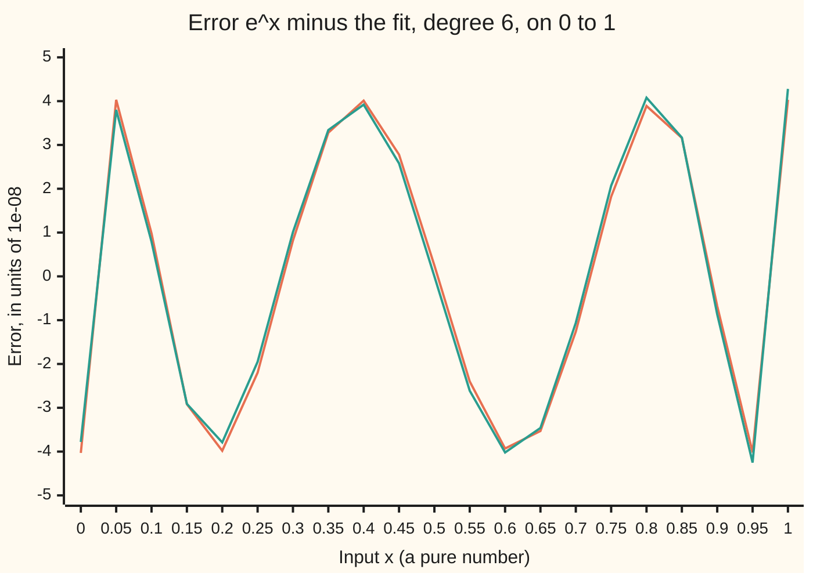
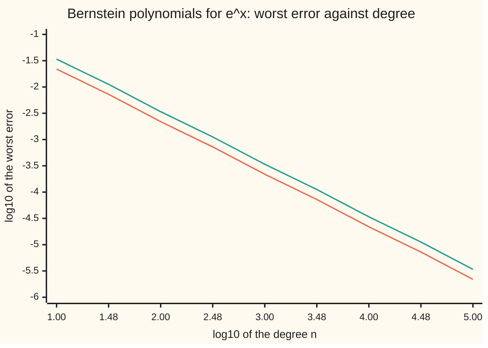

# Weierstrass and the minimax fit: as close as you like, and the smallest worst error

[Syllabus](../../../SYLLABUS.md) → [Numerical analysis](../README.md) → [Interpolation and Approximation](../README.md#s04) → Weierstrass and the minimax fit

---

## General Overview

A calculator chip must return e^x for any x from 0 to 1. The spec, which is illustrative, says the answer may be off by at most a millionth, 1e-06. The chip can only add and multiply. So it must use a polynomial: a sum of constant multiples of 1, x, x^2, and so on.

Two questions decide the design.

1. **Does a good enough polynomial always exist?** Yes. Weierstrass proved in 1885 that every continuous function on a closed interval can be matched by a polynomial to any tolerance at all.
2. **Which polynomial of a given degree is best?** Here "best" means the smallest worst error over the whole interval. That polynomial is the **minimax** polynomial: it minimises the maximum error.

The numbers show why the second question matters. The Taylor polynomial from [Power series](../../06-Calculus%20and%20analysis/06-Series/04-power-series.md) needs degree 9: its worst error is 3.0289e-07. The Bernstein polynomials that prove Weierstrass need degree about 218,986. The minimax polynomial needs only degree 6, with worst error 4.028484e-08. The best degree-5 polynomial misses by a hair: 1.129570e-06. So no degree-5 polynomial of any kind meets the spec. That is a proof, not a failed search.

**Every continuous function on a closed interval is within any tolerance of some polynomial, and for each degree n the polynomial with the smallest worst error is the one whose error swings between +E and −E, equally high, at n + 2 points in turn.**

**What kind of fact this is:** two theorems. Weierstrass's theorem is proved in full on this card in Why it works, by Bernstein polynomials. The equioscillation theorem is proved there in the direction a chip designer uses: equal alternating peaks mean best. The converse (best means equal alternating peaks) is given with its key steps and a named source, and uniqueness follows from it. The Remez algorithm that computes the minimax polynomial is a method, and the checks measure its convergence.

### The picture: two degree-6 fits, and the error each one leaves



Orange: the minimax polynomial. Its eight peaks all reach 4.028484e-08, alternately above and below zero. Teal: the polynomial through seven Chebyshev nodes, from [Runge's phenomenon](04-runge-phenomenon-and-chebyshev-nodes.md). Its peaks range from 3.780047e-08 to 4.283030e-08. The chart samples every 0.05, so a few peaks fall between points and look lower than they are.

---

## The formula

Some notation first. The **uniform norm** of a function g on an interval is its largest size there, written $\lVert g\rVert_\infty$. For an error curve it is the worst error. This card introduces it for the wing.

**Weierstrass's theorem.** Let f be continuous on a closed interval [a, b]. For every tolerance ε > 0 there is a polynomial p with

$$\lVert f - p\rVert_\infty = \max_{a \le x \le b} \lvert f(x) - p(x)\rvert < ε.$$

**Read it aloud:** however small a worst error is asked for, some polynomial stays inside it everywhere on the interval.

Here ε is a tolerance, as in wing 06; the machine epsilon keeps its subscript, ε_mach.

**The proof's polynomials.** On [0, 1] the **Bernstein polynomial** of degree n samples f at n + 1 equally spaced points and blends them:

$$B_n f(x) = \sum_{k=0}^{n} f\!\left(\frac{k}{n}\right) \binom{n}{k} x^k (1-x)^{n-k}, \qquad \lVert B_n f - f\rVert_\infty \le \frac{\lVert f''\rVert_\infty}{8n}.$$

**Read it aloud:** average the samples of f, weighting sample k by the chance of k heads in n coin flips with heads-chance x; if f has a second derivative, the worst error is at most its largest size over 8n.

The binomial coefficient $\binom{n}{k}$ counts the ways to choose k of n flips. The bound needs f'' to exist; the theorem itself does not.

**The best polynomial.** Among polynomials of degree at most n, the smallest worst error is

$$E_n(f) = \min_{\deg p \le n} \lVert f - p\rVert_\infty ,$$

and a polynomial $p^{*}$ that attains it is a **minimax** (best uniform) polynomial.

**The equioscillation theorem (Chebyshev).** $p^{*}$ is the minimax polynomial of degree at most n if and only if there are n + 2 points $x_0 < x_1 < \cdots < x_{n+1}$ in the interval where

$$f(x_i) - p^{*}(x_i) = σ\,(-1)^i\,\lVert f - p^{*}\rVert_\infty, \qquad σ = +1 \text{ or } -1.$$

**Read it aloud:** the best polynomial's error reaches its full height n + 2 times, with the sign flipping each time.

**The lower bound (de la Vallée Poussin).** If some polynomial p of degree at most n has an error that alternates in sign at n + 2 points, each of size at least m, then $E_n(f) \ge m$.

**Read it aloud:** any error that swings n + 2 times proves no polynomial can do better than its smallest swing.

| Symbol | Plain meaning | In our example | Push it up and the answer… |
| --- | --- | --- | --- |
| $f$, $f'$, $f''$, $f^{(7)}$ | the function to approximate, continuous on the interval; its first, second and seventh derivatives | $e^x$, and every derivative is $e^x$ too | — |
| $x$, $[a, b]$, $t$, $ξ$ | the input and its interval; $t = 2x - 1$, the same point moved to [−1, 1]; $ξ$ (also $ξ_k$), an unknown point that Taylor's theorem supplies | x from 0 to 1 | — |
| $n$ | the degree: the highest power allowed | 6 for the chip | worst error falls |
| $p$, $q$, $r$, $p^{*}$ | any polynomials of degree at most n; the minimax one | chip coefficients below | — |
| $\lVert g\rVert_\infty$ | the uniform norm: largest $\lvert g(x)\rvert$ on the interval, for any function g | $\lVert f''\rVert_\infty = e$ on [0, 1] | — |
| $E_n(f)$, $E$ | smallest worst error at degree n; E for short | $E_5$ = 1.129570e-06, $E_6$ = 4.028484e-08 | — |
| $ε$, $δ$, $M$ | a tolerance on outputs; a nearness distance on inputs; a cap on $\lvert f\rvert$ (the last two in the proof) | ε = 1e-06 | a looser ε needs a lower degree |
| $B_n f$, $k$, $\binom{n}{k}$, $w_k$ | Bernstein polynomial; sample number; ways to pick k of n; the weight of sample k | n = 218,986 for a millionth | error falls like 1/n |
| $x_0, \dots, x_{n+1}$, $x_i$ | the alternation points: where the error peaks with flipping sign | x = 0, 0.0503, …, 1 | — |
| $σ$ | the sign of the error at the first alternation point | −1 here | — |
| $m$, $L$ | the smallest peak of an alternating error, a lower bound on $E_n$; L, the Remez level, is one such bound | m = 3.780047e-08; L = 4.028484e-08 | — |
| $T_n$ | the Chebyshev polynomial of degree n, from the Runge card | $T_7$ for the a-priori bound | — |

### When it holds

- **A closed, bounded interval.** On [0, ∞) no polynomial stays near e^x, since e^x outgrows every polynomial. The degree-6 chip fit, used at x = 2, is off by 5.5679e-03.
- **A continuous function.** A step from 0 to 1 at x = 0.5 forces every polynomial to miss by at least 1/2 near the step. Bernstein's worst errors, approached just left of the step, are 0.6230, 0.5398, 0.5126 and 0.5040 for n = 10, 100, 1000 and 10000: they fall toward 1/2 but never below it. (At x = 0.5 itself the errors are 0.3770 to 0.4960.)
- **Worst error, not average error.** The minimax polynomial controls the largest error. [Fitting instead of passing through](07-least-squares-and-orthogonal-polynomials.md) controls the average squared error and gives a different polynomial.
- **n + 2 peaks of equal height.** The Chebyshev interpolant also alternates 8 times, but its peaks differ by a ratio of 1.1331. Unequal peaks do not make it best; they only box in the best error.

---

## Why it works

### Step 0: the two ideas, in words

Weierstrass: replace f(x) by an average of f's values at nearby points. If the average leans more and more heavily on points close to x, it approaches f(x). Bernstein's weights do exactly that, and each weight is a polynomial in x.

Minimax: suppose the error's tallest peaks do not alternate enough. Then a small polynomial can be subtracted that pushes all of them down at once, so the fit was not best. When the peaks are equal and alternate n + 2 times, any better polynomial would need its difference from $p^{*}$ to change sign n + 1 times. A nonzero polynomial of degree n cannot do that, because it would have n + 1 roots.

### Step 1: Bernstein's polynomial is an average over coin flips

Flip a coin n times, with chance x of heads each time. The chance of exactly k heads is $\binom{n}{k} x^k (1-x)^{n-k}$, the weight of sample k. So $B_n f(x)$ is the expected value of f at the fraction of heads, k/n.

Three facts about these weights carry the whole proof. They are the first three moments of the fraction of heads: the weighted averages of 1, of k/n and of (k/n)^2.

1. The weights add up to 1.
2. The average fraction of heads is x.
3. The average squared fraction of heads is $x^2 + x(1-x)/n$.

The third fact says the fraction of heads spreads around x with variance (average squared distance from x) x(1 − x)/n, which shrinks as n grows. That is the law of large numbers in one line. The checks test it at n = 10 and x = 0.3: $B_{10}$ applied to x^2 gives 0.111000000000, and the formula gives 0.111000000000.

### Step 2: the error bound for a smooth function

Expand f around x with Taylor's theorem and a remainder: $f(k/n) = f(x) + f'(x)(k/n - x) + \tfrac12 f''(ξ_k)(k/n - x)^2$ for some point $ξ_k$ between.

Average both sides with the Bernstein weights.

- The constant term gives f(x), by fact 1.
- The slope term gives zero, by fact 2.
- The last term is at most $\tfrac12 \lVert f''\rVert_\infty$ times the variance, x(1 − x)/n, by fact 3.

Since x(1 − x) is at most 1/4, the error is at most $\lVert f''\rVert_\infty/(8n)$. For e^x on [0, 1], $\lVert f''\rVert_\infty = e$, so the bound is e/(8n). At n = 1000 it is 3.397852e-04; the true worst error is 2.189814e-04. The bound is 1.552 times the true error.

<details>
<summary>Detailed proof: Weierstrass for any continuous function</summary>

Let f be continuous on [0, 1]; another closed interval [a, b] maps onto [0, 1] by x ↦ a + (b − a)x, which keeps polynomials polynomials. A continuous function on a closed interval is bounded, say $\lvert f\rvert \le M$, and uniformly continuous: one nearness distance δ works at every x at once ([Uniform convergence](../../06-Calculus%20and%20analysis/06-Series/07-uniform-convergence.md) uses the same tolerance game).

Fix a tolerance ε > 0. Uniform continuity gives δ > 0 with $\lvert f(y) - f(x)\rvert < ε/2$ whenever $\lvert y - x\rvert < δ$. Write $w_k(x) = \binom{n}{k} x^k (1-x)^{n-k}$. By fact 1,

$$B_n f(x) - f(x) = \sum_k \bigl(f(k/n) - f(x)\bigr)\, w_k(x).$$

Split the sum.

- **Near terms**, $\lvert k/n - x\rvert < δ$: each bracket is under ε/2 in size and the weights add to at most 1, so these contribute under ε/2.
- **Far terms**, $\lvert k/n - x\rvert \ge δ$: each bracket is at most 2M. Their total weight is at most $\sum_k w_k (k/n - x)^2/δ^2 = x(1-x)/(nδ^2) \le 1/(4nδ^2)$, by facts 1 to 3. This is Chebyshev's inequality. So they contribute at most $2M/(4nδ^2) = M/(2nδ^2)$.

Choose $n > M/(εδ^2)$. Then the far terms contribute under ε/2, and $\lvert B_n f(x) - f(x)\rvert < ε$ for every x at once, because δ and n do not depend on x. $\blacksquare$

The three facts themselves: fact 1 is the binomial theorem applied to $(x + (1 - x))^n$. Facts 2 and 3 follow from $k\binom{n}{k} = n\binom{n-1}{k-1}$, used once and twice. It gives $\sum_k k\,w_k = nx$ and $\sum_k k(k-1)\,w_k = n(n-1)x^2$; divide by n and n² and fact 3 drops out.

</details>

### Step 3: why Bernstein is far too slow for a chip

The bound e/(8n) is not loose by much. Voronovskaya proved in 1932 that n times the error tends to $x(1-x)f''(x)/2$; it is stated here, and DeVore and Lorentz (Sources) prove it. For e^x that product is largest where $1 - x - x^2 = 0$, at x = 0.618034, the golden ratio's reciprocal. The limit there is $(\sqrt5 - 2)e^{0.618034}/2 = 0.218986$.

| n | worst at x | worst error | n × error | bound e/(8n) | bound / true |
| ---: | ---: | ---: | ---: | ---: | ---: |
| 10 | 0.6104 | 2.185247e-02 | 0.218525 | 3.397852e-02 | 1.555 |
| 100 | 0.6173 | 2.189424e-03 | 0.218942 | 3.397852e-03 | 1.552 |
| 1000 | 0.6180 | 2.189814e-04 | 0.218981 | 3.397852e-04 | 1.552 |
| 10000 | 0.6180 | 2.189853e-05 | 0.218985 | 3.397852e-05 | 1.552 |
| 100000 | 0.6180 | 2.189857e-06 | 0.218986 | 3.397852e-06 | 1.552 |

The n × error column settles at 0.218986: the observed order is 1, as the theorem says, so ten times the degree buys one digit. A millionth needs n = 218,986 by the limit, an estimate. The checks confirm it: the worst error at n = 218,986 is 9.999987e-07. The bound alone guarantees a millionth only from n = 339,786.



Orange: the true worst error. Teal: the bound e/(8n). Both fall with slope −1: one digit per tenfold degree. The chip's minimax polynomial reaches 4.028484e-08 at degree 6.

Bernstein's polynomials prove that a polynomial exists. They are a poor way to find a good one, because they use only equally spaced samples and average them, never cancel errors on purpose.

### Step 4: a best polynomial exists

The worst error $\lVert f - p\rVert_\infty$ changes continuously with p's n + 1 coefficients. Coefficients that are very large make it large too. So only a closed, bounded set of coefficients needs searching, and a continuous function on such a set reaches its minimum. That minimum is $E_n(f)$, and some $p^{*}$ attains it. This is the compactness argument in Powell, chapter 1 (Sources).

### Step 5: equal alternating peaks mean best, and best is unique

Suppose $f - p^{*}$ reaches $\pm E$, alternately, at n + 2 points, where $E = \lVert f - p^{*}\rVert_\infty$. Suppose some q of degree at most n did better: $\lVert f - q\rVert_\infty < E$. Then

$$q - p^{*} = (f - p^{*}) - (f - q).$$

At each $x_i$ the first term is ±E and the second is smaller than E in size. So $q - p^{*}$ has the sign of $f - p^{*}$ there, and that sign flips n + 1 times. A polynomial that changes sign n + 1 times has n + 1 roots. But $q - p^{*}$ has degree at most n and is not zero. That is impossible, so no q does better.

The same argument, with "at least m" in place of "exactly E", proves de la Vallée Poussin's lower bound.

<details>
<summary>Detailed proof: uniqueness, and the converse (key steps)</summary>

**Uniqueness.** Let p and q both attain $E = E_n(f)$. Their average r = (p + q)/2 is no worse, by the triangle inequality, so it is also best. Granting the converse below, r has n + 2 alternation points. At each, $\tfrac12(f - p) + \tfrac12(f - q) = \pm E$ while each half is at most E/2 in size, so both $f - p$ and $f - q$ equal ±E there. Hence p and q agree at n + 2 points, and their difference, of degree at most n, is zero. $\blacksquare$

**Converse: best implies n + 2 alternation points.** Key steps, after Powell, chapter 7, and Trefethen, chapter 10 (Sources).

1. Group the points where $\lvert f - p^{*}\rvert = E$ into runs of one sign. Suppose there are at most n + 1 runs.
2. Between neighbouring runs pick a point where the error is below full height. There are at most n such points.
3. The polynomial with its roots exactly at those points has degree at most n. With its sign chosen, it has the same sign as $f - p^{*}$ on every run.
4. Add a small enough multiple of it to $p^{*}$. The error drops on every run and, by continuity on a closed interval, stays below E elsewhere. So $p^{*}$ was not best.

</details>

### Step 6: the Remez algorithm finds the equal-ripple polynomial

The theorem says what to aim for: n + 2 equal alternating peaks. Remez (1934) aims for it directly. The code works on t = 2x − 1, which moves [0, 1] to [−1, 1].

1. Pick n + 2 reference points. Start from the Chebyshev extreme points, $t_i = -\cos(iπ/(n+1))$.
2. Solve n + 2 linear equations, $p(t_i) + (-1)^i L = f(t_i)$, for the n + 1 coefficients and a **level** L. The new p has error exactly ±L, alternating, at the reference points.
3. Find the true peaks of the new error: one per run of one sign, located on a grid of 2001 points, then refined by golden-section search.
4. Move the reference points to those peaks, and repeat until the tallest peak equals the level.

Each round brackets the answer. By de la Vallée Poussin, $\lvert L\rvert \le E_n(f)$; the tallest peak is an upper bound, since it is the worst error of a real polynomial.

| Round | Level (lower bound) | Tallest peak (upper bound) | Gap |
| ---: | ---: | ---: | ---: |
| 1 | 4.024558e-08 | 4.032162e-08 | 7.6e-11 |
| 2 | 4.028484e-08 | 4.028485e-08 | 9.5e-15 |
| 3 | 4.028484e-08 | 4.028484e-08 | 7.2e-16 |
| 4 | 4.028484e-08 | 4.028484e-08 | 4.3e-16 |

The gap fell from 7.6e-11 to 9.5e-15 in one round. That fits the known result that Remez converges quadratically near the answer (Powell, Sources). Round 3 cuts it again, to 7.2e-16, but round 4 only to 4.3e-16: the fall has reached the rounding floor, and the run stops once a round no longer cuts the gap fourfold. Each error value is a difference of two numbers between 1 and 3, each rounded in its last bit, so the peaks cannot agree much more closely than this. Only the step from round 1 to round 2 lies above the floor, so these runs cannot measure the order itself.

### Step 7: a free box from Chebyshev interpolation

No exchange is needed for a near-best answer. Interpolate e^x at the 7 Chebyshev nodes, the roots of $T_7$, as on [Runge's phenomenon](04-runge-phenomenon-and-chebyshev-nodes.md). Its error alternates at 8 points with peaks from 3.780047e-08 to 4.283030e-08. By de la Vallée Poussin, $E_6 \ge 3.780047e-08$. Being a real polynomial, it shows $E_6 \le 4.283030e-08$. Remez's 4.028484e-08 lies inside this box.

[The interpolation error theorem](03-polynomial-interpolation-error.md) also gives a bound before any computing. The error is $f^{(7)}(ξ)/7!$ times the product of (x − node) over the nodes. At Chebyshev nodes on [0, 1] that product is at most $2/4^7$. With $f^{(7)} = e^x \le e$:

$$E_6 \le \frac{e}{7!}\cdot\frac{2}{4^{7}} = 6.583760\text{e-08}.$$

That a-priori bound is 1.634 times the true best error, and already under a millionth: degree 6 was guaranteed to work before Remez ran.

---

## Worked numbers, by hand

Target: e^x on [0, 1], worst error at most 1e-06.

| Step | Arithmetic | Value |
| --- | --- | --- |
| Taylor, degree 8, at x = 1 | e − (1 + 1 + 1/2 + … + 1/8!) | 3.0586e-06: fails |
| Taylor, degree 9, at x = 1 | add 1/9! | 3.0289e-07: passes |
| a-priori bound, degree 6 | e × 2 ÷ (4^7 × 7!) | 6.583760e-08: degree 6 is enough |
| Chebyshev interpolant, degree 6 | peaks from smallest to largest | 3.780047e-08 to 4.283030e-08 |
| Remez, degree 5 | level after convergence | 1.129570e-06: degree 5 cannot pass |
| Remez, degree 6 | level after 4 rounds | 4.028484e-08 |
| Bernstein, bound | n ≥ e ÷ (8 × 1e-06) | n = 339,786 guaranteed |
| answer | degree 6 minimax, 6 multiplies and 6 adds by Horner's rule (nested multiply-add) | **worst error 4.028484e-08, at degree 6** |

The chip stores the seven doubles the code computes. To 10 decimals they are:

$$p^{*}(x) \approx 1.0000000403 + 0.9999961205\,x + 0.5000609306\,x^2 + 0.1663090696\,x^3 + 0.0426585099\,x^4 + 0.0069441257\,x^5 + 0.0023129916\,x^6 .$$

They are close to Taylor's 1, 1, 1/2, 1/6, 1/24, 1/120, 1/720, but not equal. The minimax polynomial gives up exactness at x = 0, where its error is a full negative peak, to spread the error evenly. Checked on 4001 points in this form, with the full doubles, the worst error is 4.028484e-08: the rewrite from t to x lost nothing that shows.

### What breaks if you drop a piece

| Mistake | Comes out at | What went wrong |
| --- | --- | --- |
| Taylor at degree 6, from the power series | 2.2627e-04 at x = 1 | all its accuracy sits near x = 0 |
| Bernstein at degree 1000 | 2.189814e-04 | error falls only like 1/n |
| Stopping at degree 5 | 1.129570e-06 at best | the best possible degree-5 error is over the spec |
| Using the fit outside [0, 1], at x = 2 | 5.5679e-03 | the guarantee holds only on the closed interval it was built for |
| Approximating a step instead of a continuous function | worst error 0.5040 at n = 10000, still above 1/2 | a jump forces a worst error of at least 1/2 on every polynomial |
| Calling the Chebyshev interpolant best | 4.283030e-08, against 4.028484e-08 | its peaks are unequal, ratio 1.1331 |

---

## Code, from first principles, and it actually runs

The code builds the chip's polynomial and checks it five ways. Road 1 is Remez, with its own Gaussian elimination and golden-section peak search. Road 2 is the Chebyshev interpolant, whose unequal peaks box in the best error by de la Vallée Poussin. Road 3 is the a-priori bound from the interpolation error theorem. Road 4 rewrites the answer as coefficients of x and re-measures it on 4001 points. Road 5 is Bernstein's polynomial, checked against its bound, Voronovskaya's limit and the moment identity. It also prints Taylor's errors, the step function and the fit used outside its interval.

### Python

```python
# Weierstrass and the minimax fit -- the check behind the card.  Standard library only.
# Target (illustrative spec): exp on [0, 1] with absolute error at most a millionth, 1e-06.
# Roads: Remez (levelled error, then max error), Chebyshev interpolation boxed in by the
# de la Vallee Poussin bound, the Chebyshev a-priori bound, Taylor, and Bernstein polynomials.
import math
TOL, E1 = 1e-06, math.exp(1.0)

def solve(A, b):                       # Gaussian elimination with partial pivoting
    n = len(b); M = [A[i][:] + [b[i]] for i in range(n)]
    for c in range(n):
        p = c
        for r in range(c + 1, n):
            if abs(M[r][c]) > abs(M[p][c]): p = r
        M[c], M[p] = M[p], M[c]
        for r in range(c + 1, n):
            m = M[r][c] / M[c][c]
            for k in range(c, n + 1): M[r][k] -= m * M[c][k]
    x = [0.0] * n
    for r in range(n - 1, -1, -1):
        s = M[r][n]
        for k in range(r + 1, n): s -= M[r][k] * x[k]
        x[r] = s / M[r][r]
    return x

def pows(t, n): return [math.prod([t] * k) for k in range(n + 1)]
def horner(c, t):
    s = 0.0
    for a in reversed(c): s = s * t + a
    return s

def golden(g, a, b):                   # maximise g on [a, b]
    r = (math.sqrt(5.0) - 1.0) / 2.0
    for _ in range(90):
        c, d = b - r * (b - a), a + r * (b - a)
        if g(c) > g(d): b = d
        else: a = c
    m = (a + b) / 2.0
    return m, g(m)

def extrema(e, N=2000):                # one peak of |e| per run of one sign on [-1, 1]
    ts = [-1.0 + 2.0 * j / N for j in range(N + 1)]; es = [e(t) for t in ts]; runs = []
    for j in range(N + 1):
        if runs and (es[j] > 0) == (es[runs[-1]] > 0):
            if abs(es[j]) > abs(es[runs[-1]]): runs[-1] = j
        else: runs.append(j)
    out = []
    for j in runs:
        if j == 0 or j == N: out.append((ts[j], es[j])); continue
        s = 1.0 if es[j] > 0 else -1.0
        t, v = golden(lambda u: s * e(u), ts[j - 1], ts[j + 1]); out.append((t, s * v))
    return out

def fmap(a, b): return lambda t: math.exp(a + (b - a) * (t + 1.0) / 2.0)

def remez(n, a=0.0, b=1.0, show=False):
    f = fmap(a, b); ref = [-math.cos(i * math.pi / (n + 1)) for i in range(n + 2)]; gap = math.inf
    for it in range(1, 16):
        A = [pows(t, n) + [(-1.0) ** i] for i, t in enumerate(ref)]
        sol = solve(A, [f(t) for t in ref]); c, lev = sol[:n + 1], abs(sol[n + 1])
        ext = extrema(lambda t: f(t) - horner(c, t)); top = max(abs(v) for _, v in ext)
        assert len(ext) == n + 2, "error must have n + 2 alternating peaks"
        if show: print(f"remez degree {n}, round {it}: level {lev:.6e}, max error {top:.6e}, gap {top - lev:.1e}")
        if top - lev <= 1e-6 * top + 4e-15 and top - lev > gap / 4: return c, lev, top, ext  # gap stopped falling
        gap, ref = top - lev, [t for t, _ in ext]

def cheb_interp(n):
    f = fmap(0.0, 1.0); nodes = [math.cos((2 * i + 1) * math.pi / (2 * n + 2)) for i in range(n + 1)]
    c = solve([pows(t, n) for t in nodes], [f(t) for t in nodes])
    ext = extrema(lambda t: f(t) - horner(c, t))
    return c, min(abs(v) for _, v in ext), max(abs(v) for _, v in ext), len(ext)

def bern(f, n, x):                     # B_n f(x), weights grown outward from the middle
    if x <= 0.0 or x >= 1.0: return f(x)
    r, m = x / (1.0 - x), int(n * x); s, tot = 1.0, f(m / n)
    w, k = 1.0, m
    while k < n and w > 1e-18: w *= (n - k) / (k + 1) * r; k += 1; s += w; tot += w * f(k / n)
    w, k = 1.0, m
    while k > 0 and w > 1e-18: w *= k / (n - k + 1) / r; k -= 1; s += w; tot += w * f(k / n)
    return tot / s

def bern_err(n):                       # largest |B_n exp - exp| on [0, 1]
    g = lambda x: abs(bern(math.exp, n, x) - math.exp(x))
    j = max(range(201), key=lambda i: (g(i / 200), -i))
    return golden(g, max(j - 1, 0) / 200, min(j + 1, 200) / 200)

print(f"target: exp on [0, 1], absolute error at most {TOL:.0e}")
tay = [E1 - sum(1.0 / math.factorial(k) for k in range(d + 1)) for d in (6, 8, 9)]
print("taylor at 0, error at x = 1: degree 6 %.4e, degree 8 %.4e, degree 9 %.4e" % tuple(tay))
c6, E6, top6, ext6 = remez(6, show=True)
c5, E5, top5, _ = remez(5)
print(f"minimax error: degree 5 {E5:.6e}, degree 6 {E6:.6e}")
print("degree 6 peaks at x: " + " ".join(f"{(t + 1) / 2:.4f}" for t, _ in ext6))
print("signs: " + " ".join("+" if v > 0 else "-" for _, v in ext6))
ci, lo, hi, npk = cheb_interp(6)
U6 = E1 * 2.0 / 4.0 ** 7 / math.factorial(7)
print(f"chebyshev interpolant, degree 6: {npk} peaks, smallest {lo:.6e}, largest {hi:.6e}, ratio {hi / lo:.4f}")
print(f"so the best error lies in [{lo:.6e}, {hi:.6e}]; a-priori bound e*2/(4^7*7!) = {U6:.6e}, bound/true {U6 / E6:.3f}")
cx = [0.0] * 7; pw = [1.0]             # rewrite p(t) with t = 2x - 1 as coefficients of x
for ck in c6:
    for j, v in enumerate(pw): cx[j] += ck * v
    nw = [0.0] * (len(pw) + 1)
    for j, v in enumerate(pw): nw[j] -= v; nw[j + 1] += 2.0 * v
    pw = nw
print("chip coefficients, x^0..x^6: " + " ".join(f"{v:.10f}" for v in cx))
xmax = max(abs(math.exp(i / 4000) - horner(cx, i / 4000)) for i in range(4001))
print(f"chip form, max error on 4001 points {xmax:.6e}; cost 6 multiplies + 6 adds")
p2 = math.exp(2.0) - horner(cx, 2.0)
print(f"outside the interval: at x = 2 the error is {p2:.4e}")
C = (math.sqrt(5.0) - 2.0) * math.exp((math.sqrt(5.0) - 1.0) / 2.0) / 2.0
print("bernstein n, at x, max error, n*error, bound e/(8n), bound/true")
bt = {}
for n in (10, 30, 100, 300, 1000, 3000, 10000, 30000, 100000):
    bt[n] = bern_err(n)
    if n in (10, 100, 1000, 10000, 100000):
        x, v = bt[n]; print(f"  {n:>6} {x:.4f} {v:.6e} {n * v:.6f} {E1 / 8 / n:.6e} {E1 / 8 / n / v:.3f}")
print(f"limit of n*error: (sqrt5 - 2) e^0.618034 / 2 = {C:.6f}, at x = {(math.sqrt(5.0) - 1.0) / 2.0:.6f}")
nest, nbd = math.ceil(C / TOL), math.ceil(E1 / 8 / TOL)
x_est, v_est = bern_err(nest)
print(f"degree for a millionth: estimate {nest}, guaranteed {nbd}; largest error at {nest}: {v_est:.6e} at x = {x_est:.4f}")
b2 = bern(lambda x: x * x, 10, 0.3)
print(f"identity: B_10(x^2) at 0.3 = {b2:.12f}, x^2 + x(1-x)/n = {0.09 + 0.3 * 0.7 / 10:.12f}")
step = lambda x: 1.0 if x >= 0.5 else 0.0
print("step function, worst error (just left of 0.5), then error at 0.5: " + " ".join(f"n={n} {bern(step, n, 0.5):.4f} {1.0 - bern(step, n, 0.5):.4f}" for n in (10, 100, 1000, 10000)))
for d in (7, 8):
    print(f"try: degree {d} minimax error {remez(d)[1]:.4e}")
print(f"try: on [0, 2], degree 6 {remez(6, 0.0, 2.0)[1]:.4e}, degree 8 {remez(8, 0.0, 2.0)[1]:.4e}")
xs = [i / 20 for i in range(21)]
print("chart, minimax error x 1e8: " + " ".join(f"{1e8 * (math.exp(x) - horner(c6, 2 * x - 1)):.2f}" for x in xs))
print("chart, chebyshev error x 1e8: " + " ".join(f"{1e8 * (math.exp(x) - horner(ci, 2 * x - 1)):.2f}" for x in xs))
print("chart, log10 n: " + " ".join(f"{math.log10(n):.2f}" for n in bt))
print("chart, log10 bernstein error: " + " ".join(f"{math.log10(bt[n][1]):.2f}" for n in bt))
print("chart, log10 bound e/(8n): " + " ".join(f"{math.log10(E1 / 8 / n):.2f}" for n in bt))

assert lo <= E6 <= hi and E6 <= U6, "Remez must land inside the Chebyshev box and under the a-priori bound"
assert abs(top6 - E6) <= 1e-6 * top6 and abs(xmax - E6) < 1e-12, "levelled error = true max error, both forms"
assert E5 > TOL > E6 and tay[1] > TOL > tay[2], "degree 6 is the least minimax degree, 9 the least Taylor degree"
assert abs(b2 - (0.09 + 0.3 * 0.7 / 10)) < 1e-15, "Bernstein's second-moment identity"
assert all(bt[n][1] <= E1 / 8 / n for n in bt) and abs(100000 * bt[100000][1] - C) < 1e-3, "bound and Voronovskaya"
assert v_est < TOL < E1 / 8 / nest, "the estimated degree reaches a millionth; the bound alone cannot promise it"
print("ALL CHECKS PASS")
```

**Ran 2026-11-11 on macOS, Python 3.14.10, standard library only. All checks passed. Output, pasted from the run:**

```
target: exp on [0, 1], absolute error at most 1e-06
taylor at 0, error at x = 1: degree 6 2.2627e-04, degree 8 3.0586e-06, degree 9 3.0289e-07
remez degree 6, round 1: level 4.024558e-08, max error 4.032162e-08, gap 7.6e-11
remez degree 6, round 2: level 4.028484e-08, max error 4.028485e-08, gap 9.5e-15
remez degree 6, round 3: level 4.028484e-08, max error 4.028484e-08, gap 7.2e-16
remez degree 6, round 4: level 4.028484e-08, max error 4.028484e-08, gap 4.3e-16
minimax error: degree 5 1.129570e-06, degree 6 4.028484e-08
degree 6 peaks at x: 0.0000 0.0503 0.1910 0.3930 0.6155 0.8145 0.9513 1.0000
signs: - + - + - + - +
chebyshev interpolant, degree 6: 8 peaks, smallest 3.780047e-08, largest 4.283030e-08, ratio 1.1331
so the best error lies in [3.780047e-08, 4.283030e-08]; a-priori bound e*2/(4^7*7!) = 6.583760e-08, bound/true 1.634
chip coefficients, x^0..x^6: 1.0000000403 0.9999961205 0.5000609306 0.1663090696 0.0426585099 0.0069441257 0.0023129916
chip form, max error on 4001 points 4.028484e-08; cost 6 multiplies + 6 adds
outside the interval: at x = 2 the error is 5.5679e-03
bernstein n, at x, max error, n*error, bound e/(8n), bound/true
      10 0.6104 2.185247e-02 0.218525 3.397852e-02 1.555
     100 0.6173 2.189424e-03 0.218942 3.397852e-03 1.552
    1000 0.6180 2.189814e-04 0.218981 3.397852e-04 1.552
   10000 0.6180 2.189853e-05 0.218985 3.397852e-05 1.552
  100000 0.6180 2.189857e-06 0.218986 3.397852e-06 1.552
limit of n*error: (sqrt5 - 2) e^0.618034 / 2 = 0.218986, at x = 0.618034
degree for a millionth: estimate 218986, guaranteed 339786; largest error at 218986: 9.999987e-07 at x = 0.6180
identity: B_10(x^2) at 0.3 = 0.111000000000, x^2 + x(1-x)/n = 0.111000000000
step function, worst error (just left of 0.5), then error at 0.5: n=10 0.6230 0.3770 n=100 0.5398 0.4602 n=1000 0.5126 0.4874 n=10000 0.5040 0.4960
try: degree 7 minimax error 1.2576e-09
try: degree 8 minimax error 3.4903e-11
try: on [0, 2], degree 6 8.7281e-06, degree 8 3.0076e-08
chart, minimax error x 1e8: -4.03 4.03 0.98 -2.92 -3.98 -2.20 0.82 3.28 4.01 2.78 0.25 -2.40 -3.93 -3.53 -1.26 1.82 3.89 3.16 -0.68 -4.02 4.03
chart, chebyshev error x 1e8: -3.78 3.80 0.79 -2.91 -3.79 -1.95 1.01 3.34 3.92 2.58 0.00 -2.61 -4.02 -3.46 -1.06 2.07 4.08 3.17 -0.87 -4.25 4.28
chart, log10 n: 1.00 1.48 2.00 2.48 3.00 3.48 4.00 4.48 5.00
chart, log10 bernstein error: -1.66 -2.14 -2.66 -3.14 -3.66 -4.14 -4.66 -5.14 -5.66
chart, log10 bound e/(8n): -1.47 -1.95 -2.47 -2.95 -3.47 -3.95 -4.47 -4.95 -5.47
ALL CHECKS PASS
```

### Rust

```rust
// Weierstrass and the minimax fit -- the check behind the card.  std only, no crates.
// Target (illustrative spec): exp on [0, 1] with absolute error at most a millionth, 1e-06.
// Roads: Remez (levelled error, then max error), Chebyshev interpolation boxed in by the
// de la Vallee Poussin bound, the Chebyshev a-priori bound, Taylor, and Bernstein polynomials.
use std::f64::consts::PI;
const TOL: f64 = 1e-06;

fn sci(v: f64, p: usize) -> String { // Python-style e-notation: 4.028484e-08
    let s = format!("{:.*e}", p, v);
    let (m, e) = s.split_once('e').unwrap();
    let (sg, d) = if let Some(d) = e.strip_prefix('-') { ('-', d) } else { ('+', e) };
    format!("{}e{}{:0>2}", m, sg, d)
}
fn solve(a: &[Vec<f64>], b: &[f64]) -> Vec<f64> { // Gaussian elimination with partial pivoting
    let n = b.len();
    let mut m: Vec<Vec<f64>> = (0..n).map(|i| { let mut r = a[i].clone(); r.push(b[i]); r }).collect();
    for c in 0..n {
        let mut p = c;
        for r in c + 1..n { if m[r][c].abs() > m[p][c].abs() { p = r; } }
        m.swap(c, p);
        for r in c + 1..n {
            let f = m[r][c] / m[c][c];
            for k in c..=n { m[r][k] -= f * m[c][k]; }
        }
    }
    let mut x = vec![0.0; n];
    for r in (0..n).rev() {
        let mut s = m[r][n];
        for k in r + 1..n { s -= m[r][k] * x[k]; }
        x[r] = s / m[r][r];
    }
    x
}
fn pows(t: f64, n: usize) -> Vec<f64> { (0..=n).map(|k| (0..k).fold(1.0, |a, _| a * t)).collect() }
fn horner(c: &[f64], t: f64) -> f64 { c.iter().rev().fold(0.0, |s, &a| s * t + a) }
fn golden(g: &dyn Fn(f64) -> f64, mut a: f64, mut b: f64) -> (f64, f64) { // maximise g on [a, b]
    let r = (5.0f64.sqrt() - 1.0) / 2.0;
    for _ in 0..90 {
        let (c, d) = (b - r * (b - a), a + r * (b - a));
        if g(c) > g(d) { b = d; } else { a = c; }
    }
    let m = (a + b) / 2.0;
    (m, g(m))
}
fn extrema(e: &dyn Fn(f64) -> f64) -> Vec<(f64, f64)> { // one peak of |e| per run of one sign
    let nn = 2000usize;
    let ts: Vec<f64> = (0..=nn).map(|j| -1.0 + 2.0 * j as f64 / nn as f64).collect();
    let es: Vec<f64> = ts.iter().map(|&t| e(t)).collect();
    let mut runs: Vec<usize> = vec![];
    for j in 0..=nn {
        if let Some(&l) = runs.last() {
            if (es[j] > 0.0) == (es[l] > 0.0) { if es[j].abs() > es[l].abs() { *runs.last_mut().unwrap() = j; } continue; }
        }
        runs.push(j);
    }
    runs.iter().map(|&j| {
        if j == 0 || j == nn { return (ts[j], es[j]); }
        let s = if es[j] > 0.0 { 1.0 } else { -1.0 };
        let (t, v) = golden(&|u| s * e(u), ts[j - 1], ts[j + 1]);
        (t, s * v)
    }).collect()
}
fn fmap(a: f64, b: f64) -> impl Fn(f64) -> f64 { move |t| (a + (b - a) * (t + 1.0) / 2.0).exp() }
fn remez(n: usize, a: f64, b: f64, show: bool) -> (Vec<f64>, f64, f64, Vec<(f64, f64)>) {
    let (f, mut gap) = (fmap(a, b), f64::INFINITY);
    let mut rf: Vec<f64> = (0..n + 2).map(|i| -(i as f64 * PI / (n + 1) as f64).cos()).collect();
    for it in 1..16 {
        let am: Vec<Vec<f64>> = rf.iter().enumerate().map(|(i, &t)| { let mut r = pows(t, n); r.push(if i % 2 == 0 { 1.0 } else { -1.0 }); r }).collect();
        let sol = solve(&am, &rf.iter().map(|&t| f(t)).collect::<Vec<_>>());
        let (c, lev) = (sol[..n + 1].to_vec(), sol[n + 1].abs());
        let ext = extrema(&|t| f(t) - horner(&c, t));
        let top = ext.iter().fold(0.0f64, |m, &(_, v)| m.max(v.abs()));
        assert!(ext.len() == n + 2, "error must have n + 2 alternating peaks");
        if show { println!("remez degree {}, round {}: level {}, max error {}, gap {}", n, it, sci(lev, 6), sci(top, 6), sci(top - lev, 1)); }
        if top - lev <= 1e-6 * top + 4e-15 && top - lev > gap / 4.0 { return (c, lev, top, ext); } // gap stopped falling
        gap = top - lev; rf = ext.iter().map(|&(t, _)| t).collect();
    }
    panic!("Remez did not settle");
}
fn bern(f: &dyn Fn(f64) -> f64, n: usize, x: f64) -> f64 { // B_n f(x), weights grown from the middle
    if x <= 0.0 || x >= 1.0 { return f(x); }
    let (r, m) = (x / (1.0 - x), (n as f64 * x) as usize);
    let (mut s, mut tot) = (1.0, f(m as f64 / n as f64));
    let (mut w, mut k) = (1.0, m);
    while k < n && w > 1e-18 { w *= (n - k) as f64 / (k + 1) as f64 * r; k += 1; s += w; tot += w * f(k as f64 / n as f64); }
    let (mut w, mut k) = (1.0, m);
    while k > 0 && w > 1e-18 { w *= k as f64 / (n - k + 1) as f64 / r; k -= 1; s += w; tot += w * f(k as f64 / n as f64); }
    tot / s
}
fn bern_err(n: usize) -> (f64, f64) { // largest |B_n exp - exp| on [0, 1]
    let g = |x: f64| (bern(&|y: f64| y.exp(), n, x) - x.exp()).abs();
    let mut j: usize = 0;
    for i in 1..=200 { if g(i as f64 / 200.0) > g(j as f64 / 200.0) { j = i; } }
    golden(&g, j.saturating_sub(1) as f64 / 200.0, (j + 1).min(200) as f64 / 200.0)
}
fn fact(k: usize) -> f64 { (1..=k).fold(1.0, |a, i| a * i as f64) }
fn join<T>(v: impl Iterator<Item = T>, f: impl Fn(T) -> String) -> String { v.map(f).collect::<Vec<_>>().join(" ") }

fn main() {
    let e1 = 1.0f64.exp();
    println!("target: exp on [0, 1], absolute error at most {}", sci(TOL, 0));
    let tay: Vec<f64> = [6usize, 8, 9].iter().map(|&d| e1 - (0..=d).map(|k| 1.0 / fact(k)).sum::<f64>()).collect();
    println!("taylor at 0, error at x = 1: degree 6 {}, degree 8 {}, degree 9 {}", sci(tay[0], 4), sci(tay[1], 4), sci(tay[2], 4));
    let (c6, e6, top6, ext6) = remez(6, 0.0, 1.0, true);
    let e5 = remez(5, 0.0, 1.0, false).1;
    println!("minimax error: degree 5 {}, degree 6 {}", sci(e5, 6), sci(e6, 6));
    println!("degree 6 peaks at x: {}", join(ext6.iter(), |&(t, _)| format!("{:.4}", (t + 1.0) / 2.0)));
    println!("signs: {}", join(ext6.iter(), |&(_, v)| (if v > 0.0 { "+" } else { "-" }).to_string()));
    let f01 = fmap(0.0, 1.0);
    let nodes: Vec<f64> = (0..7).map(|i| ((2 * i + 1) as f64 * PI / 14.0).cos()).collect();
    let ci = solve(&nodes.iter().map(|&t| pows(t, 6)).collect::<Vec<_>>(), &nodes.iter().map(|&t| f01(t)).collect::<Vec<_>>());
    let ext = extrema(&|t| f01(t) - horner(&ci, t));
    let lo = ext.iter().fold(f64::INFINITY, |m, &(_, v)| m.min(v.abs()));
    let hi = ext.iter().fold(0.0f64, |m, &(_, v)| m.max(v.abs()));
    let u6 = e1 * 2.0 / 4.0f64.powi(7) / fact(7);
    println!("chebyshev interpolant, degree 6: {} peaks, smallest {}, largest {}, ratio {:.4}", ext.len(), sci(lo, 6), sci(hi, 6), hi / lo);
    println!("so the best error lies in [{}, {}]; a-priori bound e*2/(4^7*7!) = {}, bound/true {:.3}", sci(lo, 6), sci(hi, 6), sci(u6, 6), u6 / e6);
    let mut cx = vec![0.0; 7];
    let mut pw = vec![1.0]; // rewrite p(t) with t = 2x - 1 as coefficients of x
    for &ck in &c6 {
        for (j, &v) in pw.iter().enumerate() { cx[j] += ck * v; }
        let mut nw = vec![0.0; pw.len() + 1];
        for (j, &v) in pw.iter().enumerate() { nw[j] -= v; nw[j + 1] += 2.0 * v; }
        pw = nw;
    }
    println!("chip coefficients, x^0..x^6: {}", join(cx.iter(), |v| format!("{:.10}", v)));
    let xmax = (0..=4000).fold(0.0f64, |m, i| m.max(((i as f64 / 4000.0).exp() - horner(&cx, i as f64 / 4000.0)).abs()));
    println!("chip form, max error on 4001 points {}; cost 6 multiplies + 6 adds", sci(xmax, 6));
    println!("outside the interval: at x = 2 the error is {}", sci(2.0f64.exp() - horner(&cx, 2.0), 4));
    let cc = (5.0f64.sqrt() - 2.0) * ((5.0f64.sqrt() - 1.0) / 2.0).exp() / 2.0;
    println!("bernstein n, at x, max error, n*error, bound e/(8n), bound/true");
    let ns = [10usize, 30, 100, 300, 1000, 3000, 10000, 30000, 100000];
    let bt: Vec<(f64, f64)> = ns.iter().map(|&n| bern_err(n)).collect();
    for (i, &n) in ns.iter().enumerate() {
        if i % 2 == 1 { continue; }
        let (x, v) = bt[i];
        println!("  {:>6} {:.4} {} {:.6} {} {:.3}", n, x, sci(v, 6), n as f64 * v, sci(e1 / 8.0 / n as f64, 6), e1 / 8.0 / n as f64 / v);
    }
    println!("limit of n*error: (sqrt5 - 2) e^0.618034 / 2 = {:.6}, at x = {:.6}", cc, (5.0f64.sqrt() - 1.0) / 2.0);
    let (nest, nbd) = ((cc / TOL).ceil() as usize, (e1 / 8.0 / TOL).ceil() as usize);
    let (x_est, v_est) = bern_err(nest);
    println!("degree for a millionth: estimate {}, guaranteed {}; largest error at {}: {} at x = {:.4}", nest, nbd, nest, sci(v_est, 6), x_est);
    let b2 = bern(&|x: f64| x * x, 10, 0.3);
    println!("identity: B_10(x^2) at 0.3 = {:.12}, x^2 + x(1-x)/n = {:.12}", b2, 0.09 + 0.3 * 0.7 / 10.0);
    let step = |x: f64| if x >= 0.5 { 1.0 } else { 0.0 };
    println!("step function, worst error (just left of 0.5), then error at 0.5: {}", join([10usize, 100, 1000, 10000].iter(), |&n| format!("n={} {:.4} {:.4}", n, bern(&step, n, 0.5), 1.0 - bern(&step, n, 0.5))));
    for d in [7usize, 8] { println!("try: degree {} minimax error {}", d, sci(remez(d, 0.0, 1.0, false).1, 4)); }
    println!("try: on [0, 2], degree 6 {}, degree 8 {}", sci(remez(6, 0.0, 2.0, false).1, 4), sci(remez(8, 0.0, 2.0, false).1, 4));
    let xs: Vec<f64> = (0..21).map(|i| i as f64 / 20.0).collect();
    println!("chart, minimax error x 1e8: {}", join(xs.iter(), |&x| format!("{:.2}", 1e8 * (x.exp() - horner(&c6, 2.0 * x - 1.0)))));
    println!("chart, chebyshev error x 1e8: {}", join(xs.iter(), |&x| format!("{:.2}", 1e8 * (x.exp() - horner(&ci, 2.0 * x - 1.0)))));
    println!("chart, log10 n: {}", join(ns.iter(), |&n| format!("{:.2}", (n as f64).log10())));
    println!("chart, log10 bernstein error: {}", join(bt.iter(), |&(_, v)| format!("{:.2}", v.log10())));
    println!("chart, log10 bound e/(8n): {}", join(ns.iter(), |&n| format!("{:.2}", (e1 / 8.0 / n as f64).log10())));

    assert!(lo <= e6 && e6 <= hi && e6 <= u6, "Remez must land inside the Chebyshev box and under the a-priori bound");
    assert!((top6 - e6).abs() <= 1e-6 * top6 && (xmax - e6).abs() < 1e-12, "levelled error = true max error, both forms");
    assert!(e5 > TOL && TOL > e6 && tay[1] > TOL && TOL > tay[2], "degree 6 is the least minimax degree, 9 the least Taylor degree");
    assert!((b2 - (0.09 + 0.3 * 0.7 / 10.0)).abs() < 1e-15, "Bernstein's second-moment identity");
    assert!(ns.iter().zip(&bt).all(|(&n, &(_, v))| v <= e1 / 8.0 / n as f64) && (100000.0 * bt[8].1 - cc).abs() < 1e-3, "bound and Voronovskaya");
    assert!(v_est < TOL && TOL < e1 / 8.0 / nest as f64, "the estimated degree reaches a millionth; the bound alone cannot promise it");
    println!("ALL CHECKS PASS");
}
```

**Ran 2026-11-11 on macOS, rustc 1.98.1, no crates. All checks passed. Output, pasted from the run:**

```
target: exp on [0, 1], absolute error at most 1e-06
taylor at 0, error at x = 1: degree 6 2.2627e-04, degree 8 3.0586e-06, degree 9 3.0289e-07
remez degree 6, round 1: level 4.024558e-08, max error 4.032162e-08, gap 7.6e-11
remez degree 6, round 2: level 4.028484e-08, max error 4.028485e-08, gap 9.5e-15
remez degree 6, round 3: level 4.028484e-08, max error 4.028484e-08, gap 7.2e-16
remez degree 6, round 4: level 4.028484e-08, max error 4.028484e-08, gap 4.3e-16
minimax error: degree 5 1.129570e-06, degree 6 4.028484e-08
degree 6 peaks at x: 0.0000 0.0503 0.1910 0.3930 0.6155 0.8145 0.9513 1.0000
signs: - + - + - + - +
chebyshev interpolant, degree 6: 8 peaks, smallest 3.780047e-08, largest 4.283030e-08, ratio 1.1331
so the best error lies in [3.780047e-08, 4.283030e-08]; a-priori bound e*2/(4^7*7!) = 6.583760e-08, bound/true 1.634
chip coefficients, x^0..x^6: 1.0000000403 0.9999961205 0.5000609306 0.1663090696 0.0426585099 0.0069441257 0.0023129916
chip form, max error on 4001 points 4.028484e-08; cost 6 multiplies + 6 adds
outside the interval: at x = 2 the error is 5.5679e-03
bernstein n, at x, max error, n*error, bound e/(8n), bound/true
      10 0.6104 2.185247e-02 0.218525 3.397852e-02 1.555
     100 0.6173 2.189424e-03 0.218942 3.397852e-03 1.552
    1000 0.6180 2.189814e-04 0.218981 3.397852e-04 1.552
   10000 0.6180 2.189853e-05 0.218985 3.397852e-05 1.552
  100000 0.6180 2.189857e-06 0.218986 3.397852e-06 1.552
limit of n*error: (sqrt5 - 2) e^0.618034 / 2 = 0.218986, at x = 0.618034
degree for a millionth: estimate 218986, guaranteed 339786; largest error at 218986: 9.999987e-07 at x = 0.6180
identity: B_10(x^2) at 0.3 = 0.111000000000, x^2 + x(1-x)/n = 0.111000000000
step function, worst error (just left of 0.5), then error at 0.5: n=10 0.6230 0.3770 n=100 0.5398 0.4602 n=1000 0.5126 0.4874 n=10000 0.5040 0.4960
try: degree 7 minimax error 1.2576e-09
try: degree 8 minimax error 3.4903e-11
try: on [0, 2], degree 6 8.7281e-06, degree 8 3.0076e-08
chart, minimax error x 1e8: -4.03 4.03 0.98 -2.92 -3.98 -2.20 0.82 3.28 4.01 2.78 0.25 -2.40 -3.93 -3.53 -1.26 1.82 3.89 3.16 -0.68 -4.02 4.03
chart, chebyshev error x 1e8: -3.78 3.80 0.79 -2.91 -3.79 -1.95 1.01 3.34 3.92 2.58 0.00 -2.61 -4.02 -3.46 -1.06 2.07 4.08 3.17 -0.87 -4.25 4.28
chart, log10 n: 1.00 1.48 2.00 2.48 3.00 3.48 4.00 4.48 5.00
chart, log10 bernstein error: -1.66 -2.14 -2.66 -3.14 -3.66 -4.14 -4.66 -5.14 -5.66
chart, log10 bound e/(8n): -1.47 -1.95 -2.47 -2.95 -3.47 -3.95 -4.47 -4.95 -5.47
ALL CHECKS PASS
```

### Lean

Lean proves Weierstrass's theorem and Step 5 for any continuous f, any closed interval [a, b] and any degree n.

- Weierstrass: for every tolerance ε > 0, some polynomial p has $\lvert f(x) - p(x)\rvert < ε$ at every x in [a, b].
- A polynomial of degree at most n cannot flip sign n + 1 times in a row across n + 2 increasing points; Step 5 uses this.
- Equal peaks mean best: let p have degree at most n, with error $\pm\lVert f - p\rVert_\infty$ alternately at n + 2 points. Then no polynomial of degree at most n has a smaller worst error.
- De la Vallée Poussin: if p has degree at most n and its error alternates in sign at n + 2 points, each of size at least m, then $E_n(f) \ge m$.
- Fact 3 at n = 10 and x = 0.3: $B_{10}$ applied to x^2 gives exactly 0.111, the value of $x^2 + x(1-x)/n$.

Bernstein's bound, the Remez runs and every decimal are left to the Python and Rust checks; Lean omits the converse and uniqueness.

```lean
-- Weierstrass and the minimax fit: every continuous function on a closed interval is uniformly within any tolerance of a polynomial, and a polynomial whose error reaches its full height n + 2 times with alternating signs has the smallest worst error among polynomials of degree at most n.
import Mathlib.Topology.ContinuousMap.Weierstrass
import Mathlib.RingTheory.Polynomial.Bernstein
import Mathlib.Order.Interval.Set.Basic

open Polynomial Set

/-- A nonzero-at-the-nodes polynomial of degree at most n cannot change sign between
n + 2 consecutive increasing points: it would have n + 1 distinct roots. -/
lemma alt_sign_poly_absurd (n : ℕ) (r : ℝ[X]) (hr : r.natDegree ≤ n)
    (x : Fin (n + 2) → ℝ) (hx : StrictMono x)
    (hneg : ∀ i : Fin (n + 1), r.eval (x i.castSucc) * r.eval (x i.succ) < 0) : False := by
  have hroot : ∀ i : Fin (n + 1), ∃ z, x i.castSucc ≤ z ∧ z < x i.succ ∧ r.eval z = 0 := by
    intro i
    have hlt : x i.castSucc < x i.succ := hx (Fin.castSucc_lt_succ (i := i))
    have hcont : ContinuousOn (fun t => r.eval t) (Icc (x i.castSucc) (x i.succ)) :=
      r.continuous.continuousOn
    have hmem : (0 : ℝ) ∈ (fun t => r.eval t) '' Icc (x i.castSucc) (x i.succ) := by
      rcases mul_neg_iff.mp (hneg i) with ⟨h1, h2⟩ | ⟨h1, h2⟩
      · exact intermediate_value_Icc' hlt.le hcont ⟨h2.le, h1.le⟩
      · exact intermediate_value_Icc hlt.le hcont ⟨h1.le, h2.le⟩
    obtain ⟨z, ⟨hz1, hz2⟩, hz⟩ := hmem
    refine ⟨z, hz1, lt_of_le_of_ne hz2 ?_, hz⟩
    rintro rfl
    have := hneg i
    simp only at hz
    rw [hz, mul_zero] at this
    exact lt_irrefl _ this
  choose z hz1 hz2 hz3 using hroot
  have hmono : StrictMono z := by
    intro i j hij
    have hle : i.succ ≤ j.castSucc := by
      rw [Fin.le_iff_val_le_val]
      simp only [Fin.val_succ, Fin.val_castSucc]
      exact hij
    exact lt_of_lt_of_le (hz2 i) (le_trans (hx.monotone hle) (hz1 j))
  have h0 : r = 0 :=
    Polynomial.eq_zero_of_natDegree_lt_card_of_eval_eq_zero r hmono.injective hz3
      (by simp only [Fintype.card_fin]; omega)
  have := hneg 0
  rw [h0] at this
  simp at this

/-- Core of de la Vallée Poussin's bound, stated as a helper so both theorems can use it. -/
lemma dlvp_core (a b : ℝ) (f : ℝ → ℝ) (hf : ContinuousOn f (Icc a b))
    (n : ℕ) (p : ℝ[X]) (hp : p.natDegree ≤ n)
    (x : Fin (n + 2) → ℝ) (hx : StrictMono x) (hxI : ∀ i, x i ∈ Icc a b)
    (σ : ℝ) (hσ : σ = 1 ∨ σ = -1) (m : ℝ)
    (halt : ∀ i : Fin (n + 2), m ≤ σ * (-1) ^ (i : ℕ) * (f (x i) - p.eval (x i))) :
    ∀ q : ℝ[X], q.natDegree ≤ n → m ≤ ⨆ y : Icc a b, |f y - q.eval (y : ℝ)| := by
  intro q hq
  have hbdd : BddAbove (range fun y : Icc a b => |f y - q.eval (y : ℝ)|) := by
    have hc : ContinuousOn (fun y => |f y - q.eval y|) (Icc a b) :=
      (hf.sub q.continuous.continuousOn).abs
    obtain ⟨M, hM⟩ := isCompact_Icc.bddAbove_image hc
    refine ⟨M, ?_⟩
    rintro _ ⟨y, rfl⟩
    exact hM ⟨y, y.2, rfl⟩
  by_contra hlt
  push Not at hlt
  have hsmall : ∀ i, |f (x i) - q.eval (x i)| < m := fun i =>
    lt_of_le_of_lt (le_ciSup hbdd (⟨x i, hxI i⟩ : Icc a b)) hlt
  apply alt_sign_poly_absurd n (q - p) ((natDegree_sub_le q p).trans (max_le hq hp)) x hx
  intro i
  have h1 := halt i.castSucc
  have h2 := halt i.succ
  have s1 := abs_lt.mp (hsmall i.castSucc)
  have s2 := abs_lt.mp (hsmall i.succ)
  simp only [Fin.val_castSucc, Fin.val_succ, pow_succ] at h1 h2
  simp only [eval_sub]
  rcases hσ with rfl | rfl <;> rcases neg_one_pow_eq_or ℝ (i : ℕ) with h | h <;>
    rw [h] at h1 h2 <;> norm_num at h1 h2
  · exact mul_neg_of_pos_of_neg (by linarith) (by linarith)
  · exact mul_neg_of_neg_of_pos (by linarith) (by linarith)
  · exact mul_neg_of_neg_of_pos (by linarith) (by linarith)
  · exact mul_neg_of_pos_of_neg (by linarith) (by linarith)

/-- Weierstrass's theorem: if f is continuous on the closed interval [a, b], then for every
tolerance ε > 0 there is a polynomial p whose error |f(x) - p(x)| is below ε at every x
in [a, b]. -/
theorem weierstrass_approximation (a b : ℝ) (f : ℝ → ℝ) (hf : ContinuousOn f (Icc a b))
    (ε : ℝ) (hε : 0 < ε) :
    ∃ p : ℝ[X], ∀ x ∈ Icc a b, |f x - p.eval x| < ε := by
  obtain ⟨p, hp⟩ := exists_polynomial_near_of_continuousOn a b f hf ε hε
  exact ⟨p, fun x hx => by rw [abs_sub_comm]; exact hp x hx⟩

/-- Equioscillation means best (Chebyshev): let f be continuous on [a, b] and p a polynomial
of degree at most n. If its error f - p reaches its worst size E = max |f - p| on [a, b] at
n + 2 points x₀ < x₁ < ... < x_{n+1} of [a, b], with signs σ(-1)^i alternating, then no
polynomial q of degree at most n has a smaller worst error on [a, b]. -/
theorem equioscillation_implies_minimax (a b : ℝ) (f : ℝ → ℝ) (hf : ContinuousOn f (Icc a b))
    (n : ℕ) (p : ℝ[X]) (hp : p.natDegree ≤ n)
    (x : Fin (n + 2) → ℝ) (hx : StrictMono x) (hxI : ∀ i, x i ∈ Icc a b)
    (σ : ℝ) (hσ : σ = 1 ∨ σ = -1)
    (heq : ∀ i : Fin (n + 2),
      f (x i) - p.eval (x i) = σ * (-1) ^ (i : ℕ) * ⨆ y : Icc a b, |f y - p.eval (y : ℝ)|) :
    ∀ q : ℝ[X], q.natDegree ≤ n →
      (⨆ y : Icc a b, |f y - p.eval (y : ℝ)|) ≤ ⨆ y : Icc a b, |f y - q.eval (y : ℝ)| := by
  refine dlvp_core a b f hf n p hp x hx hxI σ hσ _ ?_
  intro i
  rw [heq i]
  have hs : σ * σ = 1 := by rcases hσ with rfl | rfl <;> norm_num
  have ht : ((-1 : ℝ) ^ (i : ℕ)) * (-1) ^ (i : ℕ) = 1 := by
    rw [← pow_add, ← two_mul, pow_mul]; norm_num
  apply le_of_eq
  linear_combination (-(⨆ y : Icc a b, |f y - p.eval (y : ℝ)|)) * ((-1 : ℝ) ^ (i : ℕ) * (-1) ^ (i : ℕ)) * hs - (⨆ y : Icc a b, |f y - p.eval (y : ℝ)|) * ht

/-- De la Vallée Poussin's lower bound: let f be continuous on [a, b] and p a polynomial of
degree at most n. If the error f - p alternates in sign at n + 2 points x₀ < ... < x_{n+1}
of [a, b], each time with size at least m, then every polynomial q of degree at most n has
worst error at least m on [a, b], so E_n(f) ≥ m. -/
theorem de_la_vallee_poussin_lower_bound (a b : ℝ) (f : ℝ → ℝ) (hf : ContinuousOn f (Icc a b))
    (n : ℕ) (p : ℝ[X]) (hp : p.natDegree ≤ n)
    (x : Fin (n + 2) → ℝ) (hx : StrictMono x) (hxI : ∀ i, x i ∈ Icc a b)
    (σ : ℝ) (hσ : σ = 1 ∨ σ = -1) (m : ℝ)
    (halt : ∀ i : Fin (n + 2), m ≤ σ * (-1) ^ (i : ℕ) * (f (x i) - p.eval (x i))) :
    ∀ q : ℝ[X], q.natDegree ≤ n → m ≤ ⨆ y : Icc a b, |f y - q.eval (y : ℝ)| := by
  exact dlvp_core a b f hf n p hp x hx hxI σ hσ m halt

/-- The card's check of the third moment fact: B₁₀ applied to x² at x = 0.3 is
x² + x(1 - x)/n = 0.09 + 0.021 = 0.111. -/
example :
    ∑ k ∈ Finset.range 11, ((k : ℚ) / 10) ^ 2 * (bernsteinPolynomial ℚ 10 k).eval (3 / 10)
      = 111 / 1000 := by
  simp [Finset.sum_range_succ, bernsteinPolynomial, Nat.choose]
  norm_num

/-- The same value from the formula x² + x(1 - x)/n with x = 3/10, n = 10. -/
example : ((3 : ℚ) / 10) ^ 2 + (3 / 10) * (1 - 3 / 10) / 10 = 111 / 1000 := by norm_num

#print axioms alt_sign_poly_absurd
#print axioms dlvp_core
#print axioms weierstrass_approximation
#print axioms equioscillation_implies_minimax
#print axioms de_la_vallee_poussin_lower_bound
```

**Checked 2026-11-11 on macOS, Lean 4.36.0-rc2, Mathlib v4.36.0-rc2. Every proof is complete and uses only Lean's standard axioms. Output, pasted from the run:**

```
'alt_sign_poly_absurd' depends on axioms: [propext, Classical.choice, Quot.sound]
'dlvp_core' depends on axioms: [propext, Classical.choice, Quot.sound]
'weierstrass_approximation' depends on axioms: [propext, Classical.choice, Quot.sound]
'equioscillation_implies_minimax' depends on axioms: [propext, Classical.choice, Quot.sound]
'de_la_vallee_poussin_lower_bound' depends on axioms: [propext, Classical.choice, Quot.sound]
```

> [!TIP]
> **Try changing**
> - Guess first: tighten the spec to a billionth, `TOL = 1e-09`. Degree 7 reaches 1.2576e-09, just short; degree 8 reaches 3.4903e-11. The assert on degree 6 now fails.
> - Guess first: stretch the interval to [0, 2], with `remez(6, 0.0, 2.0)`. Degree 6 now leaves 8.7281e-06, over the spec; degree 8 gives 3.0076e-08. A wider interval costs degree.
> - Guess first: multiply a Bernstein degree by ten, from 1000 to 10000. The worst error drops from 2.189814e-04 to 2.189853e-05: one digit, for ten times the work.
> - Guess first: feed Bernstein the step function. Does more degree help? Its worst error falls from 0.6230 at n = 10 to 0.5040 at n = 10000, but never below 1/2: without continuity, the theorem's promise of any tolerance is gone.

---

## The usual mistake

> [!warning]
> **Taking the Taylor polynomial as the best polynomial of its degree.** Taylor's polynomial is built to be perfect at one point, x = 0, and its error grows toward x = 1. At degree 6 its worst error is 2.2627e-04; the minimax polynomial of the same degree and the same cost leaves 4.028484e-08. Taylor needs degree 9 to meet the chip's spec.
>
> - **Reading Weierstrass as a recipe.** The theorem promises a polynomial, not a small one. Its proof's polynomials need degree 218,986 for a millionth.
> - **Judging a fit by its error at the nodes.** The Chebyshev interpolant is exact at x = 0.5 (error 0.00 there), yet its worst error is 4.283030e-08.
> - **Trusting the fit outside its interval.** At x = 2 the chip polynomial is off by 5.5679e-03. Real libraries first shrink the input into the interval (range reduction), then evaluate.
> - **Stopping Remez when the level stops changing, without checking the peaks.** After round 1 the level is 4.024558e-08 while the tallest peak is 4.032162e-08. Only the two together bracket the best error.

---

## Where you meet it in real life

- **Math libraries and calculator chips.** Library routines for exp, sin and log shrink the input to a small interval, then evaluate a minimax polynomial or ratio of low degree, found by Remez. Muller's book (Sources) describes the practice.
- **Computer graphics and fonts.** Bézier curves in drawing programs and font outlines are Bernstein polynomials, with control points in place of the samples f(k/n). The coin-flip weights keep the curve inside the convex hull of its control points: the smallest convex region that holds them.
- **Digital filters.** The Parks–McClellan method designs "equiripple" filters by a Remez exchange: the same equal-height alternation, applied to a frequency response.
- **Numerical software.** Tools such as Chebfun compute Chebyshev interpolants and best polynomial fits on demand; Trefethen's book (Sources) is written around it.
- **Curves between quotes.** The shelf's yield curve through eight quoted maturities is an interpolation problem; once a smooth curve is in hand, the uniform norm states its worst pricing error in one number.

> **Say it back**
> Weierstrass's theorem says any continuous function on a closed interval is within any tolerance of some polynomial. Bernstein's proof averages samples of the function with coin-flip weights; for e^x the error falls like 0.218986/n, so a millionth needs degree 218,986. The best polynomial of a given degree is the one whose error peaks n + 2 times with equal height and flipping sign, and it is unique. The Remez algorithm finds it by chasing those peaks; for the chip, degree 6 gives 4.028484e-08, while degree 5 cannot beat 1.129570e-06. Any alternating error also gives a lower bound, so the best error can be boxed in from both sides.

---

## What this builds on

- [The interpolation error theorem](03-polynomial-interpolation-error.md): the error formula $f^{(n+1)}(ξ)/(n+1)!$ times the node product, which gives the a-priori bound 6.583760e-08 before any computing.
- [Uniform convergence](../../06-Calculus%20and%20analysis/06-Series/07-uniform-convergence.md): the worst gap over an interval, which is the uniform norm here; Weierstrass says polynomials can converge uniformly to any continuous function.
- [Power series](../../06-Calculus%20and%20analysis/06-Series/04-power-series.md): the Taylor polynomial the chip could use instead, and why it is accurate only near its centre.

## Where this goes next

- [Pade approximants](09-pade-and-rational-approximation.md): ratios of polynomials matched at one point, which cope with poles; the equal-ripple best rational fit is left open there.
- [Linear interpolation](01-linear-interpolation-and-extrapolation.md): the uniform norm becomes the norm of the space of continuous functions, and Weierstrass's theorem says polynomials are dense in it.

Also on this shelf: [Runge's phenomenon](04-runge-phenomenon-and-chebyshev-nodes.md) supplies the Chebyshev nodes and $T_n$, and [Fitting instead of passing through](07-least-squares-and-orthogonal-polynomials.md) minimises the average squared error instead of the worst one.

Left open: e^x on [0, 1] needs degree 6 for a millionth, but how fast does the best error fall as the degree grows, and what property of a function decides that rate?

---

## Sources

Verified 2026-11-11: every link below resolves to the publisher's page.

- Pinkus, Allan. "Weierstrass and Approximation Theory." *Journal of Approximation Theory* 107, no. 1 (2000): 1–66. [doi:10.1006/jath.2000.3508](https://doi.org/10.1006/jath.2000.3508). Weierstrass's 1885 theorem and the proofs that followed, including Bernstein's 1912 probabilistic proof.
- Powell, M. J. D. *Approximation Theory and Methods*. Cambridge University Press, 1981. [doi:10.1017/CBO9781139171502](https://doi.org/10.1017/CBO9781139171502). Existence of the best fit, the equioscillation theorem with both directions, and the exchange algorithm.
- Trefethen, Lloyd N. *Approximation Theory and Approximation Practice*, extended ed. SIAM, 2019. [doi:10.1137/1.9781611975949](https://doi.org/10.1137/1.9781611975949). Chebyshev interpolation as a near-best fit, equioscillation and the Remez algorithm, with worked examples.
- DeVore, Ronald A., and George G. Lorentz. *Constructive Approximation*. Springer, 1993. [doi:10.1007/978-3-662-02888-9](https://doi.org/10.1007/978-3-662-02888-9). Chapter 10 on Bernstein polynomials, including Voronovskaya's limit used in Step 3.
- Muller, Jean-Michel. *Elementary Functions: Algorithms and Implementation*, 3rd ed. Birkhäuser, 2016. [doi:10.1007/978-1-4899-7983-4](https://doi.org/10.1007/978-1-4899-7983-4). How libraries and chips evaluate exp and its relatives: range reduction followed by minimax polynomials.
