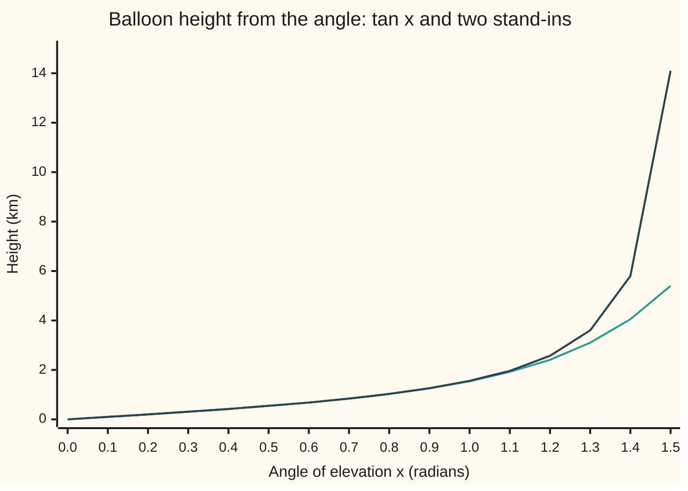
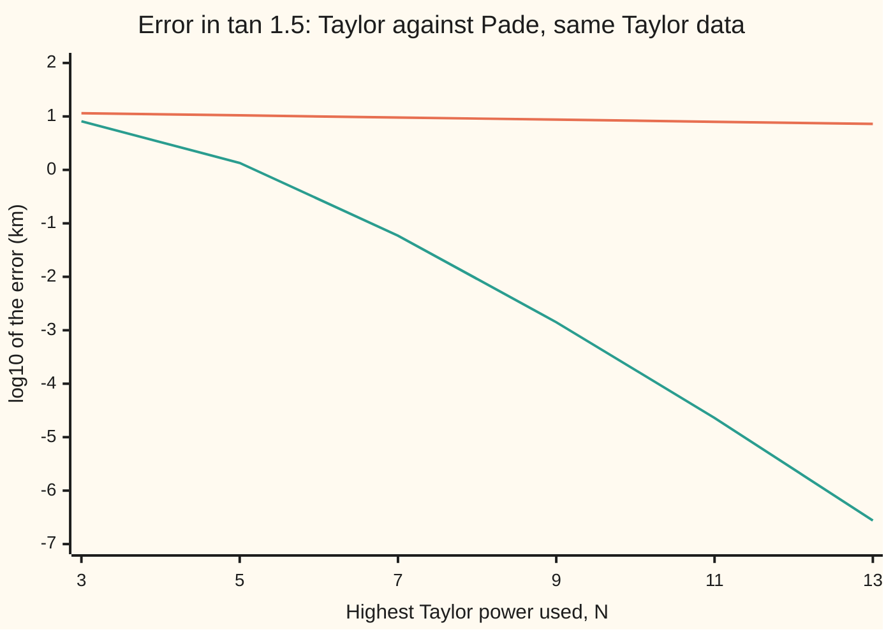

# Pade approximants: a ratio of polynomials copes with a pole that a polynomial cannot

[Syllabus](../../../SYLLABUS.md) → [Numerical analysis](../README.md) → [Interpolation and Approximation](../README.md#s04) → Pade approximants

---

## General Overview

A weather balloon rises straight up from a field. A surveyor stands 1 km away with a theodolite (a telescope on a stand that reads angles). The balloon's height is 1 km times the tangent of the angle of elevation. The setting is illustrative; the numbers are exact for it.

At 1.5 radians (85.94 degrees) the height is 14.1014199472 km. As the line of sight turns vertical, at π/2 = 1.5707963268 radians, the tangent runs off to infinity. That point is a **pole**: a place where a function blows up because something divides by zero. Here tan x = sin x / cos x, and cos x is zero there.

Suppose the surveyor's device can only add, multiply and divide, and stores just a few coefficients of the Taylor series of tan at 0: x + x³/3 + 2x⁵/15 + 17x⁷/315 + 62x⁹/2835 + …. Five terms at 1.5 give 5.400335 km, short by 8.701 km. The series does add up at 1.5, but each term is only about 0.9119 times the one before. It takes 100 terms, up to the power 199, to reach the accuracy of the next paragraph. At 2 radians, past the vertical, the series does not add up at all.

The fix keeps the same five coefficients and rearranges them into one polynomial divided by another:

$$\tan x \approx \frac{945x - 105x^3 + x^5}{945 - 420x^2 + 15x^4}$$

At 1.5 this gives 14.100000 km, off by 1.420e-03 km, under 1.5 m. Its bottom line is zero at 1.5708079, close to the true pole. At 2 radians it gives −2.185859 against the true −2.185040. This ratio is the **Padé approximant** of tan, named after Henri Padé, who set out the theory in his 1892 thesis.

**A Padé approximant is a ratio of two polynomials whose series matches the function's as far as its free coefficients allow; because its denominator can be zero, it carries a pole and tracks a function past where every polynomial gives up.**

**What kind of fact this is:** a method, derived on this card in Why it works. Its convergence is a theorem of Robert de Montessus de Ballore (1902): proved on this card for the tangent in a fold, and stated in general with a source.

### The picture: five Taylor coefficients, two ways



Orange: the true height, tan x. Teal: the Taylor polynomial of degree 9, built from the five coefficients. Dark: the Padé ratio built from the same five. The dark line lies on the orange one to two decimals at every point, so the orange is hidden under it. The teal line leaves them at about 1 radian and reaches only 5.40 km at 1.5.

---

## The formula

Notation first, in words. The function f has Taylor coefficients $c_0, c_1, c_2, \dots$ at 0, so $f(x) = c_0 + c_1x + c_2x^2 + \cdots$. A **Padé approximant** $[m/n]$ is a top polynomial P of degree m over a bottom polynomial Q of degree n, with Q's constant term fixed at 1. It is chosen so that

$$Q(x)\,f(x) - P(x) = O\!\left(x^{m+n+1}\right) \quad\text{as } x \to 0, \qquad P(x) = \sum_{k=0}^{m} p_kx^k, \quad Q(x) = 1 + \sum_{j=1}^{n} q_jx^j$$

**Read it aloud:** the bottom polynomial times the function, minus the top polynomial, has no terms below the power m plus n plus 1.

Here $O(x^{k})$ means "terms of power k and higher" (from the [Taylor series](../../06-Calculus%20and%20analysis/06-Series/05-taylor-series.md) card). Dividing by Q, which is 1 at 0, gives the same statement for P/Q: its series matches f's through the power $N = m + n$.

The recipe has two lines. Take $q_0 = 1$ and $c_i = 0$ for negative i. First the bottom, from n equations; then the top:

$$\sum_{j=0}^{n} q_j\,c_{k-j} = 0 \quad (k = m+1, \dots, m+n), \qquad p_k = \sum_{j=0}^{\min(k,n)} q_j\,c_{k-j} \quad (k = 0, \dots, m)$$

**Read it aloud:** the bottom's coefficients make the powers just above m vanish in Q times f; the top is then the low part of Q times f.

| Symbol | Plain meaning | In our example | Push it up and the answer… |
| --- | --- | --- | --- |
| $f$, $x$ | the function; its input | tan; the angle, 1.5 radians | nearer π/2, harder for both stand-ins |
| $c_k$ | Taylor coefficient of $x^k$ at 0 (k counts powers) | 1, 1/3, 2/15, 17/315, 62/2835 for k = 1, 3, 5, 7, 9; zero for even k | — |
| $m$, $n$ | degrees of the top and the bottom | 5 and 4 | more of either, closer match |
| $N$ | $m + n$, the highest Taylor power used | 9 | error at 1.5 falls from 8.101e+00 at N = 3 to 2.740e-07 at N = 13 |
| $P$, $p_k$ | the top polynomial and its coefficients | $(945x - 105x^3 + x^5)/945$ | — |
| $Q$, $q_j$ | the bottom polynomial, $q_0 = 1$ (j counts powers) | $1 - 4x^2/9 + x^4/63$ | — |
| $[m/n]$ | the approximant P/Q | $[5/4]$: 14.100000 at 1.5 | — |
| $O(x^k)$ | terms of power k and higher, as x → 0 | $Q\tan x - P$ starts with 1.018e-07 $x^{11}$ | — |
| $x^*$ | a pole of the approximant: a root of Q | 1.5708079, against π/2 = 1.5707963 | — |
| $\rho$ | distance from 0 to the nearest pole that Q does not capture | $3\pi/2$ for $[m/2]$ | larger ρ, faster convergence |
| $g$ | tan with its poles at ±π/2 multiplied out | $(1 - (2x/\pi)^2)\tan x$ | — |
| $\delta$ | in the proof: how far $q_2$ is from $-(2/\pi)^2$ | shrinks like $3^{-m}$ | larger δ, the pole and the values drift |

### When it holds

- **The trouble is a pole.** A pole is a zero in a denominator, and Q can supply one. A function with no pole gets one anyway if Q is allowed one: $[0/3]$ of $e^x$ has a pole at 1.596072 and gives 16.000000 at 1.5, where $e^{1.5}$ = 4.481689.
- **The bottom degree n covers the poles that matter.** With n = 0 the ratio is the Taylor polynomial again: 5.400335 at 1.5. For tan, n = 2 captures the pair ±π/2.
- **The equations for Q can be solved.** Their matrix is constant along each diagonal (a **Toeplitz** matrix; list the unknowns in reverse order and it becomes the **Hankel** matrix of the literature, constant along each anti-diagonal). For $[5/4]$ of tan, oddness splits it into two 2-by-2 systems, each with determinant $c_5^2 - c_3c_7 = 84/4725 - 85/4725 = -1/4725$, a near-cancellation. At high degree such systems grow ill-conditioned (their condition number κ grows large), and rounded coefficients can then plant false poles.
- **The point lies inside the disc where the theorem works.** De Montessus's theorem covers |x| < ρ, away from the captured poles. For $[m/2]$ of tan that is |x| < 3π/2 = 4.7124.

---

## Why it works

### Step 0: a polynomial cannot blow up, a ratio can

Every polynomial is finite at every x. Near a pole, a function climbs without limit, so a polynomial needs ever more terms to keep up. The pole at π/2 also caps the Taylor series. It converges only for |x| < π/2. That distance is the **radius of convergence**: how far from the centre the series adds up. At 1.5 its terms shrink by only 0.9119 each.

A ratio can place a zero in its denominator exactly where the function blows up. What is left over is smooth, and smooth things are what polynomials approximate well. The rest of this section turns that idea into equations.

### Step 1: matching a ratio is a linear problem

Asking that P/Q match f through $x^N$ looks nonlinear, because the unknowns q sit in a denominator. Multiply through by Q. The demand becomes $Qf - P = O(x^{N+1})$, and every unknown now appears to the first power.

Count them. P has m + 1 coefficients. Q has n, since $q_0 = 1$. The powers $x^0$ to $x^{m+n}$ of $Qf - P$ give m + n + 1 equations. The counts agree.

### Step 2: solve for the bottom first

P has no powers above m. So in the powers $x^{m+1}$ to $x^{m+n}$, the equation $Qf - P = 0$ involves Q alone. That is n equations in the n unknowns $q_1, \dots, q_n$: the left half of the recipe. Once Q is known, the powers $x^0$ to $x^m$ give each $p_k$ directly: the right half.

For tan, with $[5/4]$, the code solves these equations by Gaussian elimination. Times 945, the top comes out as 945, −105, 1 and the bottom as 945, −420, 15. These are the coefficients of the closed form that Johann Lambert's continued fraction for tan gives, an independent road. The defining property also checks out, though only partly as a test: the terms $x^0$ to $x^5$ of $Q\tan x - P$ vanish by construction, because the top is defined as that part. The terms $x^6$ to $x^9$, the solved equations, are at most 8.674e-19, which is rounding. The first true mismatch is 1.018e-07 at $x^{11}$.

### Step 3: the bottom finds the pole

For the row $[m/2]$ of tan, with m odd, the equations for Q are short. Because tan is odd, $q_1 = 0$. The other equation reads $q_2c_m + c_{m+2} = 0$. So Q is $1 - x^2c_{m+2}/c_m$, with its root at

$$x^* = \sqrt{c_m / c_{m+2}}$$

**Read it aloud:** the approximant's pole is the square root of one Taylor coefficient over the next.

This is the ratio test for the radius of convergence, read off by the algebra. For m = 3 it gives $\sqrt{(1/3)/(2/15)} = \sqrt{2.5}$ = 1.5811388. As the degree grows the roots close in on π/2. The code's main table climbs a staircase, $[1/2]$, $[3/2]$, $[3/4]$, $[5/4]$, $[5/6]$, $[7/6]$, and its poles are 1.7320508, 1.5811388, 1.5712334, 1.5708079, 1.5707965, 1.5707963. Only the first two lie on the row $[m/2]$; the rest have a degree-4 or degree-6 bottom and do not come from the formula above.

The pole also carries the right strength. Near π/2, the [Laurent series](../../07-Complex%20analysis/05-Laurent%20Series%2C%20Singularities%20and%20Residues/01-laurent-series.md) of tan starts $-1/(x - \pi/2)$, so its **residue** (the coefficient of that term) is −1. The residue of $[5/4]$ at its pole, $P(x^*)/Q'(x^*)$, is −1.000077410.

### Step 4: what is left is smooth, so it converges farther

Multiply tan by $1 - (2x/\pi)^2$, which is zero at ±π/2. The result g has no pole there. Its nearest poles are now ±3π/2, so its Taylor series converges three times as far, with ρ = 3π/2. At 1.5 its terms shrink by about $(1.5/(3\pi/2))^2$ = 0.1013 per step of two powers, against 0.9119 for tan itself.

The Padé top P is, by Step 2, the low part of Q times f. Q is close to $1 - (2x/\pi)^2$, so P is close to the Taylor polynomial of g, which converges fast. Dividing by Q puts the pole back.

**De Montessus's theorem** makes this general. Suppose f is analytic at 0 and **meromorphic** in the disc |x| < ρ: smooth there apart from exactly n poles, counted with multiplicity. Then, as m → ∞ with n fixed:

- the n roots of Q tend to f's n poles;
- $[m/n]$ tends to f at every x in the disc away from the poles, with error falling roughly like $(|x|/\rho)^m$.

For tan's row $[m/2]$ the errors at 1.5 are 8.101e+00, 1.351e+00, 1.364e-01, 1.347e-02 and 1.350e-03 for m = 1, 3, 5, 7, 9. Their ratios are 0.1668, 0.1009, 0.0988 and 0.1002, against the theorem's 0.1013.

<details>
<summary>Detailed proof: the row [m/2] of tan converges, for |x| below π/2</summary>

**The coefficients.** The partial fractions of tan are $\tan x = \sum_{k\ge 0} 2x/\bigl((k+\tfrac12)^2\pi^2 - x^2\bigr)$. Expanding each term as a geometric series gives, for odd j,

$$c_j = 2\left(\frac{2}{\pi}\right)^{j+1}\Bigl(1 + 3^{-(j+1)} + 5^{-(j+1)} + \cdots\Bigr).$$

**The pole.** By Step 3, $q_2 = -c_{m+2}/c_m$. The bracket is $1 + O(3^{-m})$ for both coefficients, so $q_2 = -(2/\pi)^2(1 + O(3^{-m}))$. The root $x^*$ tends to π/2, with an error of size $3^{-m}$.

**The rest.** Write $Q = 1 - (2x/\pi)^2 + \delta x^2$ with $\delta = O(3^{-m})$. Then $Qf = g + \delta x^2\tan x$. By Step 2, P is the part of $Qf$ up to $x^m$, and the powers $x^{m+1}$ and $x^{m+2}$ of $Qf$ are zero. So

$$f - \frac{P}{Q} = \frac{1}{Q}\Bigl(\text{tail of } g \text{ beyond } x^{m+2} \;+\; \delta\cdot\text{tail of } x^2\tan x \text{ beyond } x^{m+2}\Bigr).$$

g has radius 3π/2, so its tail at x is of size $(2|x|/(3\pi))^{m}$. The tail of $x^2\tan x$ is of size $(2|x|/\pi)^{m}$, and multiplied by $\delta = O(3^{-m})$ it is again of size $(2|x|/(3\pi))^m$. For a fixed x with |x| below π/2, Q(x) tends to $1 - (2x/\pi)^2$, which is not zero. Both pieces fall like $(|x|/\rho)^m$ with ρ = 3π/2. $\blacksquare$

For π/2 < |x| < 3π/2 the same two pieces work, with each tail written as a function minus its truncation. The general statement, for any n poles, is proved in Baker and Graves-Morris (Sources). This card states it and proves the case above.

</details>

### Step 5: what it costs, and a free error estimate

Cost is counted in flops (one addition or multiplication of two doubles). In Horner form in $x^2$, $[5/4]$ costs about 10 flops: one square, four for the top, four for the bottom, one division. The Taylor series needs 100 terms, about 200 flops, to do as well at 1.5.

The step between two neighbouring approximants estimates the error of the poorer one. $[5/4] - [3/4]$ = 0.057447, while the true error of $[3/4]$ is 0.058867: a ratio of 0.9759. This is an estimate, not a bound.

### The picture: errors at 1.5, with the same coefficients



Orange: the Taylor polynomial of degree N. Teal: the Padé approximant from the same coefficients, $[1/2]$, $[3/2]$, $[3/4]$, $[5/4]$, $[5/6]$, $[7/6]$. The Taylor error barely moves, from 1.148e+01 to 7.235e+00; the Padé error falls from 8.101e+00 to 2.740e-07, and faster at each step.

---

## Worked numbers, by hand

Build $[5/4]$ of tan from $c_1, c_3, c_5, c_7, c_9$ = 1, 1/3, 2/15, 17/315, 62/2835, then read the balloon's height at 1.5 radians.

| Step | Arithmetic | Value |
| --- | --- | --- |
| odd function | the equations for powers 6 and 8 force $q_1 = q_3 = 0$ | 0 |
| power 7 | $q_2c_5 + q_4c_3 = -c_7$ | two equations in $q_2$, $q_4$ |
| power 9 | $q_2c_7 + q_4c_5 = -c_9$ | |
| determinant | $c_5^2 - c_3c_7 = 84/4725 - 85/4725$ | −1/4725 = −0.000211640212 |
| $q_2$ | $(c_3c_9 - c_5c_7) \div \text{det} = (4/42525) \div (-1/4725)$ | −4/9 = −0.444444444 |
| $q_4$ | $(c_7^2 - c_5c_9) \div \text{det}$ | 1/63 = 0.015873016 |
| $p_1$, $p_3$, $p_5$ | $c_1$; $c_3 + q_2c_1$; $c_5 + q_2c_3 + q_4c_1$ | 1; −1/9 = −0.111111111; 1/945 = 0.001058201 |
| times 945 | top and bottom | $(945x - 105x^3 + x^5)/(945 - 420x^2 + 15x^4)$ |
| top at 1.5 | 1417.5 − 354.375 + 7.59375 | 1070.71875 |
| bottom at 1.5 | 945 − 945 + 75.9375 | 75.9375 |
| ratio | 1070.71875 ÷ 75.9375 | **14.100000 km** |

The balloon is 14.100000 km up by the Padé ratio, against 14.1014199472 km true: 1.420e-03 km low, from five numbers. The term c₃c₉ − c₅c₇ = 4/42525 is 0.000094062316 in the code.

### What breaks if you drop a piece

| Mistake | Comes out at | What went wrong |
| --- | --- | --- |
| No denominator: the Taylor polynomial, $[9/0]$ | 5.400335, off 8.701e+00 | a polynomial has no pole to spend |
| Sign slip: $+c_k$ on the right of the Q equations | 3.199535 | Q no longer cancels the powers 6 to 9; this Q does not change sign between 1 and 2 |
| Taylor series past the pole, x = 2, degree 99 | 8.084e+10, where tan 2 = −2.185040 | outside the radius π/2 the terms grow; $[5/4]$ gives −2.185859 |
| A denominator where there is no pole: $[0/3]$ of $e^x$ | 16.000000 at 1.5, where $e^{1.5}$ = 4.481689 | Q has a root at 1.596072 that $e^x$ does not have: a false pole |

---

## Code, from first principles, and it actually runs

The code builds tan's Taylor coefficients from the rule tan′ = 1 + tan², with no tables. It then reaches the approximant three independent ways. The first is the recipe's linear equations, solved by elimination. The second is Lambert's closed form. The third is the defining property $Q\tan x - P = O(x^{11})$, checked on the series; its terms below $x^6$ hold by construction, so the test lies in $x^6$ to $x^{11}$. The reference values, tan as sin over cos and π/2, come from the math library and are labelled so. Asserts check the coefficients, the closed form, the pole moving in on π/2, the residue, the ratio 0.1013 from de Montessus's theorem, and each failure.

### Python

```python
# Pade approximants -- the check behind the card.  Only math is imported.
# Example: tan x near a right angle (pi/2 = 1.5708 rad), built from its Taylor series at 0.
# Road 1: Pade [m/n] solved from the Taylor coefficients by linear equations.
# Road 2: Lambert's closed forms, [5/4] = (945x - 105x^3 + x^5)/(945 - 420x^2 + 15x^4).
# Road 3: the defining property, Q*tan - P has no terms below x^(m+n+1).
# Reference values: tan = sin/cos and pi/2 from the math library, labelled as such.
import math

def add(xs):                                    # plain left-to-right sum, as in the Rust
    s = 0.0
    for v in xs: s += v
    return s

def tan_series(N):                              # tan' = 1 + tan^2, matched power by power
    c = [0.0] * (N + 1)
    for n in range(N):
        c[n + 1] = ((1.0 if n == 0 else 0.0) + add(c[i] * c[n - i] for i in range(n + 1))) / (n + 1)
    return c

def solve(A, b):                                # Gaussian elimination, partial pivoting
    n = len(b); M = [row[:] + [b[i]] for i, row in enumerate(A)]
    for k in range(n):
        p = max(range(k, n), key=lambda i: abs(M[i][k])); M[k], M[p] = M[p], M[k]
        for i in range(k + 1, n):
            f = M[i][k] / M[k][k]
            for j in range(k, n + 1): M[i][j] -= f * M[k][j]
    x = [0.0] * n
    for k in range(n - 1, -1, -1):
        x[k] = (M[k][n] - add(M[k][j] * x[j] for j in range(k + 1, n))) / M[k][k]
    return x

def pade(c, m, n, sign=1.0):                    # returns P (degree m) and Q (degree n, Q(0) = 1)
    A = [[c[k - j] if k >= j else 0.0 for j in range(1, n + 1)] for k in range(m + 1, m + n + 1)]
    q = [1.0] + solve(A, [-sign * c[k] for k in range(m + 1, m + n + 1)])
    p = [add(q[j] * c[k - j] for j in range(min(k, n) + 1)) for k in range(m + 1)]
    return p, q

def ev(a, x):                                   # Horner
    s = 0.0
    for v in reversed(a): s = s * x + v
    return s

def rat(pq, x): return ev(pq[0], x) / ev(pq[1], x)

def root(f, lo, hi):                            # bisection on a sign change
    assert f(lo) * f(hi) < 0
    for _ in range(80):
        mid = 0.5 * (lo + hi)
        if f(lo) * f(mid) <= 0: hi = mid
        else: lo = mid
    return 0.5 * (lo + hi)

def sci(v): return f"{v:.3e}"
X, H = 1.5, math.pi / 2
T = math.sin(X) / math.cos(X)                   # library reference
c = tan_series(260)
print("tan coefficients c1..c9: " + ", ".join(f"{c[k]:.12f}" for k in (1, 3, 5, 7, 9)))
exact = {1: 1 / 1, 3: 1 / 3, 5: 2 / 15, 7: 17 / 315, 9: 62 / 2835}
assert max(abs(c[k] - v) for k, v in exact.items()) < 1e-15
print(f"x = {X} rad ({math.degrees(X):.2f} degrees); reference tan x = {T:.10f}; pole pi/2 = {H:.10f}")
print("  N  Taylor deg N   Pade [m/n]   value       |Taylor err|  |Pade err|   pole")
rows = []
for N in (3, 5, 7, 9, 11, 13):
    n = 2 * ((N + 1) // 4); m = N - n
    pq = pade(c, m, n); ts = ev(c[:N + 1], X); pv = rat(pq, X)
    pole = root(lambda x: ev(pq[1], x), 1.0, 2.0)
    rows.append((N, ts, pv, pole, pq))
    print(f"{N:3d}  {ts:11.6f}   [{m}/{n}]       {pv:10.6f}  {sci(abs(ts - T)):>11}  {sci(abs(pv - T)):>10}  {pole:.7f}")
assert all(abs(r[2] - T) < abs(r[1] - T) for r in rows) and abs(rows[3][1] - T) > 5000 * abs(rows[3][2] - T)
assert all(abs(b[3] - H) < abs(a[3] - H) for a, b in zip(rows, rows[1:]))  # poles close in on pi/2
p54, q54 = rows[3][4]
print("[5/4] times 945, x^1 x^3 x^5 on top: " + ", ".join(f"{945 * p54[k]:.9f}" for k in (1, 3, 5))
      + "; x^0 x^2 x^4 below: " + ", ".join(f"{945 * q54[k]:.9f}" for k in (0, 2, 4)))
lam = lambda x: (945 * x - 105 * x ** 3 + x ** 5) / (945 - 420 * x ** 2 + 15 * x ** 4)
assert max(abs(945 * a - b) for a, b in zip(p54 + q54, [0, 945, 0, -105, 0, 1, 945, 0, -420, 0, 15])) < 1e-9
assert abs(lam(X) - rows[3][2]) < 1e-11
r = [add(q54[j] * c[k - j] for j in range(min(k, 4) + 1)) - (p54[k] if k <= 5 else 0.0) for k in range(12)]
print(f"Q*tan - P, terms x^0..x^9: max size {sci(max(abs(v) for v in r[:10]))}; x^11 term {sci(r[11])}")
assert max(abs(v) for v in r[:10]) < 1e-15 and abs(r[11]) > 1e-8
det = c[5] * c[5] - c[3] * c[7]
print(f"determinant c5^2 - c3 c7 = {det:.12f} (exact -1/4725 = {-1 / 4725:.12f})")
assert abs(det + 1 / 4725) < 1e-15
print(f"hand: q2 {q54[2]:.9f}, q4 {q54[4]:.9f}, p3 {p54[3]:.9f}, p5 {p54[5]:.9f}; c3 c9 - c5 c7 = {c[3] * c[9] - c[5] * c[7]:.12f}")
tt, bb = [945 * X, -105 * X ** 3, X ** 5], [945.0, -420 * X ** 2, 15 * X ** 4]
print("hand at 1.5: top " + " + ".join(f"{v:.5f}" for v in tt) + f" = {add(tt):.5f}; bottom "
      + " + ".join(f"{v:.4f}" for v in bb) + f" = {add(bb):.4f}; ratio {add(tt) / add(bb):.6f}")
res = ev(p54, rows[3][3]) / ev([k * v for k, v in enumerate(q54)][1:], rows[3][3])
print(f"[5/4] residue at its pole: {res:.9f} (tan's residue at pi/2 is -1)")
assert abs(res + 1) < 1e-4
e54 = abs(rows[3][2] - T); K = 1
while K < 130 and abs(ev(c[:2 * K], X) - T) >= e54: K += 1
print(f"Taylor terms to beat [5/4] at x = 1.5: {K} (degree {2 * K - 1}); flops about {2 * K} vs 10; term ratio (x/(pi/2))^2 = {(X / H) ** 2:.4f}")
assert 80 < K < 130
est, tru = rows[3][2] - rows[2][2], T - rows[2][2]
print(f"estimate of [3/4]'s error, [5/4] - [3/4]: {est:.6f}; true {tru:.6f}; ratio {est / tru:.4f}")
print("row [m/2], m = 1, 3, 5, 7, 9; error at 1.5 and ratio per step (theory (1.5/(3pi/2))^2 = "
      f"{(X / (3 * H)) ** 2:.4f}; 3pi/2 = {3 * H:.4f}):")
er = [abs(rat(pade(c, m, 2), X) - T) for m in (1, 3, 5, 7, 9)]
print("  " + ", ".join(sci(v) for v in er) + "; ratios " + ", ".join(f"{b / a:.4f}" for a, b in zip(er, er[1:])))
assert abs(er[4] / er[3] - (X / (3 * H)) ** 2) < 0.02
T2 = math.sin(2.0) / math.cos(2.0)
t5, t50 = ev(c[:10], 2.0), ev(c[:100], 2.0)
print(f"past the pole, x = 2: tan {T2:.6f}; [5/4] {lam(2.0):.6f}; Taylor deg 9 {t5:.6f}; deg 99 {sci(t50)}")
assert abs(rat(rows[3][4], 2.0) - T2) < 1e-3 and t50 > 1e6
bad = rat(pade(c, 5, 4, -1.0), X)
print(f"mistake, sign slip in the denominator equations: [5/4] at 1.5 = {bad:.6f}")
assert abs(bad - T) > 5
e = [1.0 / math.factorial(k) for k in range(8)]
s03 = pade(e, 0, 3); sp = root(lambda x: ev(s03[1], x), 1.0, 2.0)
print(f"spurious pole: [0/3] of e^x at 1.5 = {rat(s03, X):.6f} vs e^1.5 = {math.exp(X):.6f}; pole at {sp:.6f}")
assert abs(rat(s03, X) - 16.0) < 1e-12 and abs(ev(s03[1], sp)) < 1e-12
d = [(-1.0) ** k / math.factorial(k) for k in range(5)]
for m in (1, 2):
    p, q = pade(d, m, m)
    print(f"delay e^-x [{m}/{m}]: P = " + ", ".join(f"{v:.6f}" for v in p) + "; Q = " + ", ".join(f"{v:.6f}" for v in q))
assert abs(pade(d, 2, 2)[1][2] - 1 / 12) < 1e-15
for x in (1.57, 3.0):                           # Try changing: nearer the pole, and far past it
    print(f"try: x = {x:.2f}, tan {math.sin(x) / math.cos(x):.6f}; [5/4] {rat(rows[3][4], x):.6f}; [7/6] {rat(rows[5][4], x):.6f}; Taylor deg 13 {ev(c[:14], x):.6f}")
xs = [0.1 * k for k in range(16)]
print("chart, x: " + ", ".join(f"{x:.1f}" for x in xs))
print("chart, tan: " + ", ".join(f"{math.sin(x) / math.cos(x):.2f}" for x in xs))
print("chart, Taylor deg 9: " + ", ".join(f"{ev(c[:10], x):.2f}" for x in xs))
print("chart, Pade [5/4]: " + ", ".join(f"{rat(rows[3][4], x):.2f}" for x in xs))
print("chart, log10 err Taylor: " + ", ".join(f"{math.log10(abs(r[1] - T)):.2f}" for r in rows))
print("chart, log10 err Pade: " + ", ".join(f"{math.log10(abs(r[2] - T)):.2f}" for r in rows))
print("ALL CHECKS PASS")
```

**Ran 2026-11-11 on macOS, Python 3.14.10, standard library only. All checks passed. Output, pasted from the run:**

```
tan coefficients c1..c9: 1.000000000000, 0.333333333333, 0.133333333333, 0.053968253968, 0.021869488536
x = 1.5 rad (85.94 degrees); reference tan x = 14.1014199472; pole pi/2 = 1.5707963268
  N  Taylor deg N   Pade [m/n]   value       |Taylor err|  |Pade err|   pole
  3     2.625000   [1/2]         6.000000    1.148e+01   8.101e+00  1.7320508
  5     3.637500   [3/2]        12.750000    1.046e+01   1.351e+00  1.5811388
  7     4.559598   [3/4]        14.042553    9.542e+00   5.887e-02  1.5712334
  9     5.400335   [5/4]        14.100000    8.701e+00   1.420e-03  1.5708079
 11     6.166983   [5/6]        14.101397    7.934e+00   2.315e-05  1.5707965
 13     6.866081   [7/6]        14.101420    7.235e+00   2.740e-07  1.5707963
[5/4] times 945, x^1 x^3 x^5 on top: 945.000000000, -105.000000000, 1.000000000; x^0 x^2 x^4 below: 945.000000000, -420.000000000, 15.000000000
Q*tan - P, terms x^0..x^9: max size 8.674e-19; x^11 term 1.018e-07
determinant c5^2 - c3 c7 = -0.000211640212 (exact -1/4725 = -0.000211640212)
hand: q2 -0.444444444, q4 0.015873016, p3 -0.111111111, p5 0.001058201; c3 c9 - c5 c7 = 0.000094062316
hand at 1.5: top 1417.50000 + -354.37500 + 7.59375 = 1070.71875; bottom 945.0000 + -945.0000 + 75.9375 = 75.9375; ratio 14.100000
[5/4] residue at its pole: -1.000077410 (tan's residue at pi/2 is -1)
Taylor terms to beat [5/4] at x = 1.5: 100 (degree 199); flops about 200 vs 10; term ratio (x/(pi/2))^2 = 0.9119
estimate of [3/4]'s error, [5/4] - [3/4]: 0.057447; true 0.058867; ratio 0.9759
row [m/2], m = 1, 3, 5, 7, 9; error at 1.5 and ratio per step (theory (1.5/(3pi/2))^2 = 0.1013; 3pi/2 = 4.7124):
  8.101e+00, 1.351e+00, 1.364e-01, 1.347e-02, 1.350e-03; ratios 0.1668, 0.1009, 0.0988, 0.1002
past the pole, x = 2: tan -2.185040; [5/4] -2.185859; Taylor deg 9 27.038448; deg 99 8.084e+10
mistake, sign slip in the denominator equations: [5/4] at 1.5 = 3.199535
spurious pole: [0/3] of e^x at 1.5 = 16.000000 vs e^1.5 = 4.481689; pole at 1.596072
delay e^-x [1/1]: P = 1.000000, -0.500000; Q = 1.000000, 0.500000
delay e^-x [2/2]: P = 1.000000, -0.500000, 0.083333; Q = 1.000000, 0.500000, 0.083333
try: x = 1.57, tan 1255.765592; [5/4] 1237.898299; [7/6] 1255.761369; Taylor deg 13 9.199240
try: x = 3.00, tan -0.142547; [5/4] -0.150000; [7/6] -0.142575; Taylor deg 13 7889.993646
chart, x: 0.0, 0.1, 0.2, 0.3, 0.4, 0.5, 0.6, 0.7, 0.8, 0.9, 1.0, 1.1, 1.2, 1.3, 1.4, 1.5
chart, tan: 0.00, 0.10, 0.20, 0.31, 0.42, 0.55, 0.68, 0.84, 1.03, 1.26, 1.56, 1.96, 2.57, 3.60, 5.80, 14.10
chart, Taylor deg 9: 0.00, 0.10, 0.20, 0.31, 0.42, 0.55, 0.68, 0.84, 1.03, 1.26, 1.54, 1.92, 2.41, 3.10, 4.05, 5.40
chart, Pade [5/4]: 0.00, 0.10, 0.20, 0.31, 0.42, 0.55, 0.68, 0.84, 1.03, 1.26, 1.56, 1.96, 2.57, 3.60, 5.80, 14.10
chart, log10 err Taylor: 1.06, 1.02, 0.98, 0.94, 0.90, 0.86
chart, log10 err Pade: 0.91, 0.13, -1.23, -2.85, -4.64, -6.56
ALL CHECKS PASS
```

### Rust

```rust
// Pade approximants -- the check behind the card.  Standard library only.
// Example: tan x near a right angle (pi/2 = 1.5708 rad), built from its Taylor series at 0.
// Road 1: Pade [m/n] solved from the Taylor coefficients by linear equations.
// Road 2: Lambert's closed forms, [5/4] = (945x - 105x^3 + x^5)/(945 - 420x^2 + 15x^4).
// Road 3: the defining property, Q*tan - P has no terms below x^(m+n+1).
// Reference values: tan = sin/cos and pi/2 from the standard library, labelled as such.
use std::f64::consts::PI;

fn tan_series(n_max: usize) -> Vec<f64> { // tan' = 1 + tan^2, matched power by power
    let mut c = vec![0.0; n_max + 1];
    for n in 0..n_max {
        let mut s = if n == 0 { 1.0 } else { 0.0 };
        let mut acc = 0.0;
        for i in 0..=n { acc += c[i] * c[n - i]; }
        s += acc;
        c[n + 1] = s / (n as f64 + 1.0);
    }
    c
}

fn solve(a: &Vec<Vec<f64>>, b: &Vec<f64>) -> Vec<f64> { // Gaussian elimination, partial pivoting
    let n = b.len();
    let mut m: Vec<Vec<f64>> = (0..n).map(|i| { let mut r = a[i].clone(); r.push(b[i]); r }).collect();
    for k in 0..n {
        let mut p = k;
        for i in k..n { if m[i][k].abs() > m[p][k].abs() { p = i; } }
        m.swap(k, p);
        for i in k + 1..n {
            let f = m[i][k] / m[k][k];
            for j in k..=n { let t = f * m[k][j]; m[i][j] -= t; }
        }
    }
    let mut x = vec![0.0; n];
    for k in (0..n).rev() {
        let mut s = 0.0;
        for j in k + 1..n { s += m[k][j] * x[j]; }
        x[k] = (m[k][n] - s) / m[k][k];
    }
    x
}

fn pade(c: &[f64], m: usize, n: usize, sign: f64) -> (Vec<f64>, Vec<f64>) { // P degree m, Q degree n, Q(0) = 1
    let a: Vec<Vec<f64>> = (m + 1..=m + n)
        .map(|k| (1..=n).map(|j| if k >= j { c[k - j] } else { 0.0 }).collect()).collect();
    let b: Vec<f64> = (m + 1..=m + n).map(|k| -sign * c[k]).collect();
    let mut q = vec![1.0];
    q.extend(solve(&a, &b));
    let p: Vec<f64> = (0..=m).map(|k| { let mut s = 0.0; for j in 0..=k.min(n) { s += q[j] * c[k - j]; } s }).collect();
    (p, q)
}

fn ev(a: &[f64], x: f64) -> f64 { let mut s = 0.0; for v in a.iter().rev() { s = s * x + v; } s }
fn rat(pq: &(Vec<f64>, Vec<f64>), x: f64) -> f64 { ev(&pq.0, x) / ev(&pq.1, x) }

fn root(f: &dyn Fn(f64) -> f64, mut lo: f64, mut hi: f64) -> f64 { // bisection on a sign change
    assert!(f(lo) * f(hi) < 0.0);
    for _ in 0..80 {
        let mid = 0.5 * (lo + hi);
        if f(lo) * f(mid) <= 0.0 { hi = mid; } else { lo = mid; }
    }
    0.5 * (lo + hi)
}

fn sci(v: f64) -> String { // Python's {:.3e}: two-digit exponent with a sign
    let s = format!("{:.3e}", v);
    let (mant, ex) = s.split_once('e').unwrap();
    let e: i32 = ex.parse().unwrap();
    format!("{}e{}{:02}", mant, if e < 0 { '-' } else { '+' }, e.abs())
}
fn fact(k: usize) -> f64 { (1..=k).fold(1.0, |a, i| a * i as f64) }
fn join(v: &[f64], d: usize) -> String { v.iter().map(|x| format!("{:.*}", d, x)).collect::<Vec<_>>().join(", ") }
fn maxabs(v: &[f64]) -> f64 { v.iter().fold(0.0, |a: f64, x| a.max(x.abs())) }

fn main() {
    let (x0, h) = (1.5f64, PI / 2.0);
    let t = x0.sin() / x0.cos(); // library reference
    let c = tan_series(260);
    println!("tan coefficients c1..c9: {}", join(&[c[1], c[3], c[5], c[7], c[9]], 12));
    let exact = [(1, 1.0 / 1.0), (3, 1.0 / 3.0), (5, 2.0 / 15.0), (7, 17.0 / 315.0), (9, 62.0 / 2835.0)];
    assert!(exact.iter().all(|&(k, v): &(usize, f64)| (c[k] - v).abs() < 1e-15));
    println!("x = {} rad ({:.2} degrees); reference tan x = {:.10}; pole pi/2 = {:.10}", x0, x0.to_degrees(), t, h);
    println!("  N  Taylor deg N   Pade [m/n]   value       |Taylor err|  |Pade err|   pole");
    let mut rows: Vec<(usize, f64, f64, f64, (Vec<f64>, Vec<f64>))> = Vec::new();
    for nn in [3usize, 5, 7, 9, 11, 13] {
        let n = 2 * ((nn + 1) / 4); let m = nn - n;
        let pq = pade(&c, m, n, 1.0); let ts = ev(&c[..nn + 1], x0); let pv = rat(&pq, x0);
        let qq = pq.1.clone();
        let pole = root(&|x| ev(&qq, x), 1.0, 2.0);
        println!("{:3}  {:11.6}   [{}/{}]       {:10.6}  {:>11}  {:>10}  {:.7}", nn, ts, m, n, pv,
                 sci((ts - t).abs()), sci((pv - t).abs()), pole);
        rows.push((nn, ts, pv, pole, pq));
    }
    assert!(rows.iter().all(|r| (r.2 - t).abs() < (r.1 - t).abs()) && (rows[3].1 - t).abs() > 5000.0 * (rows[3].2 - t).abs());
    assert!(rows.windows(2).all(|w| (w[1].3 - h).abs() < (w[0].3 - h).abs()));
    let (p54, q54) = rows[3].4.clone();
    println!("[5/4] times 945, x^1 x^3 x^5 on top: {}; x^0 x^2 x^4 below: {}",
             join(&[945.0 * p54[1], 945.0 * p54[3], 945.0 * p54[5]], 9), join(&[945.0 * q54[0], 945.0 * q54[2], 945.0 * q54[4]], 9));
    let lam = |x: f64| (945.0 * x - 105.0 * x.powi(3) + x.powi(5)) / (945.0 - 420.0 * x.powi(2) + 15.0 * x.powi(4));
    let want = [0.0, 945.0, 0.0, -105.0, 0.0, 1.0, 945.0, 0.0, -420.0, 0.0, 15.0];
    let got: Vec<f64> = p54.iter().chain(q54.iter()).map(|v| 945.0 * v).collect();
    assert!(got.iter().zip(want.iter()).all(|(a, b)| (a - b).abs() < 1e-9));
    assert!((lam(x0) - rows[3].2).abs() < 1e-11);
    let r: Vec<f64> = (0..12).map(|k| {
        let mut s = 0.0; for j in 0..=k.min(4) { s += q54[j] * c[k - j]; }
        s - if k <= 5 { p54[k] } else { 0.0 } }).collect();
    println!("Q*tan - P, terms x^0..x^9: max size {}; x^11 term {}", sci(maxabs(&r[..10])), sci(r[11]));
    assert!(maxabs(&r[..10]) < 1e-15 && r[11].abs() > 1e-8);
    let det = c[5] * c[5] - c[3] * c[7];
    println!("determinant c5^2 - c3 c7 = {:.12} (exact -1/4725 = {:.12})", det, -1.0 / 4725.0);
    assert!((det + 1.0 / 4725.0).abs() < 1e-15);
    println!("hand: q2 {:.9}, q4 {:.9}, p3 {:.9}, p5 {:.9}; c3 c9 - c5 c7 = {:.12}", q54[2], q54[4], p54[3], p54[5], c[3] * c[9] - c[5] * c[7]);
    let (tt, bb) = ([945.0 * x0, -105.0 * x0.powi(3), x0.powi(5)], [945.0, -420.0 * x0.powi(2), 15.0 * x0.powi(4)]);
    let (st, sb) = (tt[0] + tt[1] + tt[2], bb[0] + bb[1] + bb[2]);
    println!("hand at 1.5: top {} = {:.5}; bottom {} = {:.4}; ratio {:.6}", tt.iter().map(|v| format!("{:.5}", v)).collect::<Vec<_>>().join(" + "),
             st, bb.iter().map(|v| format!("{:.4}", v)).collect::<Vec<_>>().join(" + "), sb, st / sb);
    let dq: Vec<f64> = q54.iter().enumerate().skip(1).map(|(k, v)| k as f64 * v).collect();
    let res = ev(&p54, rows[3].3) / ev(&dq, rows[3].3);
    println!("[5/4] residue at its pole: {:.9} (tan's residue at pi/2 is -1)", res);
    assert!((res + 1.0).abs() < 1e-4);
    let e54 = (rows[3].2 - t).abs(); let mut k = 1;
    while k < 130 && (ev(&c[..2 * k], x0) - t).abs() >= e54 { k += 1; }
    println!("Taylor terms to beat [5/4] at x = 1.5: {} (degree {}); flops about {} vs 10; term ratio (x/(pi/2))^2 = {:.4}", k, 2 * k - 1, 2 * k, (x0 / h).powi(2));
    assert!(k > 80 && k < 130);
    let (est, tru) = (rows[3].2 - rows[2].2, t - rows[2].2);
    println!("estimate of [3/4]'s error, [5/4] - [3/4]: {:.6}; true {:.6}; ratio {:.4}", est, tru, est / tru);
    let th = (x0 / (3.0 * h)).powi(2);
    println!("row [m/2], m = 1, 3, 5, 7, 9; error at 1.5 and ratio per step (theory (1.5/(3pi/2))^2 = {:.4}; 3pi/2 = {:.4}):", th, 3.0 * h);
    let er: Vec<f64> = [1usize, 3, 5, 7, 9].iter().map(|&m| (rat(&pade(&c, m, 2, 1.0), x0) - t).abs()).collect();
    let ratios: Vec<f64> = er.windows(2).map(|w| w[1] / w[0]).collect();
    println!("  {}; ratios {}", er.iter().map(|v| sci(*v)).collect::<Vec<_>>().join(", "), join(&ratios, 4));
    assert!((er[4] / er[3] - th).abs() < 0.02);
    let t2 = 2f64.sin() / 2f64.cos();
    let (t5, t50) = (ev(&c[..10], 2.0), ev(&c[..100], 2.0));
    println!("past the pole, x = 2: tan {:.6}; [5/4] {:.6}; Taylor deg 9 {:.6}; deg 99 {}", t2, lam(2.0), t5, sci(t50));
    assert!((rat(&rows[3].4, 2.0) - t2).abs() < 1e-3 && t50 > 1e6);
    let bad = rat(&pade(&c, 5, 4, -1.0), x0);
    println!("mistake, sign slip in the denominator equations: [5/4] at 1.5 = {:.6}", bad);
    assert!((bad - t).abs() > 5.0);
    let e: Vec<f64> = (0..8).map(|k| 1.0 / fact(k)).collect();
    let s03 = pade(&e, 0, 3, 1.0); let q03 = s03.1.clone();
    let sp = root(&|x| ev(&q03, x), 1.0, 2.0);
    println!("spurious pole: [0/3] of e^x at 1.5 = {:.6} vs e^1.5 = {:.6}; pole at {:.6}", rat(&s03, x0), x0.exp(), sp);
    assert!((rat(&s03, x0) - 16.0).abs() < 1e-12 && ev(&q03, sp).abs() < 1e-12);
    let d: Vec<f64> = (0..5).map(|k| (-1f64).powi(k as i32) / fact(k)).collect();
    for m in [1usize, 2] {
        let (p, q) = pade(&d, m, m, 1.0);
        println!("delay e^-x [{}/{}]: P = {}; Q = {}", m, m, join(&p, 6), join(&q, 6));
    }
    assert!((pade(&d, 2, 2, 1.0).1[2] - 1.0 / 12.0).abs() < 1e-15);
    for x in [1.57f64, 3.0] { // Try changing: nearer the pole, and far past it
        println!("try: x = {:.2}, tan {:.6}; [5/4] {:.6}; [7/6] {:.6}; Taylor deg 13 {:.6}", x, x.sin() / x.cos(), rat(&rows[3].4, x), rat(&rows[5].4, x), ev(&c[..14], x));
    }
    let xs: Vec<f64> = (0..16).map(|k| 0.1 * k as f64).collect();
    println!("chart, x: {}", join(&xs, 1));
    println!("chart, tan: {}", join(&xs.iter().map(|x| x.sin() / x.cos()).collect::<Vec<_>>(), 2));
    println!("chart, Taylor deg 9: {}", join(&xs.iter().map(|&x| ev(&c[..10], x)).collect::<Vec<_>>(), 2));
    println!("chart, Pade [5/4]: {}", join(&xs.iter().map(|&x| rat(&rows[3].4, x)).collect::<Vec<_>>(), 2));
    println!("chart, log10 err Taylor: {}", join(&rows.iter().map(|r| (r.1 - t).abs().log10()).collect::<Vec<_>>(), 2));
    println!("chart, log10 err Pade: {}", join(&rows.iter().map(|r| (r.2 - t).abs().log10()).collect::<Vec<_>>(), 2));
    println!("ALL CHECKS PASS");
}
```

**Ran 2026-11-11 on macOS, rustc 1.98.1, no crates. All checks passed. Output, pasted from the run:**

```
tan coefficients c1..c9: 1.000000000000, 0.333333333333, 0.133333333333, 0.053968253968, 0.021869488536
x = 1.5 rad (85.94 degrees); reference tan x = 14.1014199472; pole pi/2 = 1.5707963268
  N  Taylor deg N   Pade [m/n]   value       |Taylor err|  |Pade err|   pole
  3     2.625000   [1/2]         6.000000    1.148e+01   8.101e+00  1.7320508
  5     3.637500   [3/2]        12.750000    1.046e+01   1.351e+00  1.5811388
  7     4.559598   [3/4]        14.042553    9.542e+00   5.887e-02  1.5712334
  9     5.400335   [5/4]        14.100000    8.701e+00   1.420e-03  1.5708079
 11     6.166983   [5/6]        14.101397    7.934e+00   2.315e-05  1.5707965
 13     6.866081   [7/6]        14.101420    7.235e+00   2.740e-07  1.5707963
[5/4] times 945, x^1 x^3 x^5 on top: 945.000000000, -105.000000000, 1.000000000; x^0 x^2 x^4 below: 945.000000000, -420.000000000, 15.000000000
Q*tan - P, terms x^0..x^9: max size 8.674e-19; x^11 term 1.018e-07
determinant c5^2 - c3 c7 = -0.000211640212 (exact -1/4725 = -0.000211640212)
hand: q2 -0.444444444, q4 0.015873016, p3 -0.111111111, p5 0.001058201; c3 c9 - c5 c7 = 0.000094062316
hand at 1.5: top 1417.50000 + -354.37500 + 7.59375 = 1070.71875; bottom 945.0000 + -945.0000 + 75.9375 = 75.9375; ratio 14.100000
[5/4] residue at its pole: -1.000077410 (tan's residue at pi/2 is -1)
Taylor terms to beat [5/4] at x = 1.5: 100 (degree 199); flops about 200 vs 10; term ratio (x/(pi/2))^2 = 0.9119
estimate of [3/4]'s error, [5/4] - [3/4]: 0.057447; true 0.058867; ratio 0.9759
row [m/2], m = 1, 3, 5, 7, 9; error at 1.5 and ratio per step (theory (1.5/(3pi/2))^2 = 0.1013; 3pi/2 = 4.7124):
  8.101e+00, 1.351e+00, 1.364e-01, 1.347e-02, 1.350e-03; ratios 0.1668, 0.1009, 0.0988, 0.1002
past the pole, x = 2: tan -2.185040; [5/4] -2.185859; Taylor deg 9 27.038448; deg 99 8.084e+10
mistake, sign slip in the denominator equations: [5/4] at 1.5 = 3.199535
spurious pole: [0/3] of e^x at 1.5 = 16.000000 vs e^1.5 = 4.481689; pole at 1.596072
delay e^-x [1/1]: P = 1.000000, -0.500000; Q = 1.000000, 0.500000
delay e^-x [2/2]: P = 1.000000, -0.500000, 0.083333; Q = 1.000000, 0.500000, 0.083333
try: x = 1.57, tan 1255.765592; [5/4] 1237.898299; [7/6] 1255.761369; Taylor deg 13 9.199240
try: x = 3.00, tan -0.142547; [5/4] -0.150000; [7/6] -0.142575; Taylor deg 13 7889.993646
chart, x: 0.0, 0.1, 0.2, 0.3, 0.4, 0.5, 0.6, 0.7, 0.8, 0.9, 1.0, 1.1, 1.2, 1.3, 1.4, 1.5
chart, tan: 0.00, 0.10, 0.20, 0.31, 0.42, 0.55, 0.68, 0.84, 1.03, 1.26, 1.56, 1.96, 2.57, 3.60, 5.80, 14.10
chart, Taylor deg 9: 0.00, 0.10, 0.20, 0.31, 0.42, 0.55, 0.68, 0.84, 1.03, 1.26, 1.54, 1.92, 2.41, 3.10, 4.05, 5.40
chart, Pade [5/4]: 0.00, 0.10, 0.20, 0.31, 0.42, 0.55, 0.68, 0.84, 1.03, 1.26, 1.56, 1.96, 2.57, 3.60, 5.80, 14.10
chart, log10 err Taylor: 1.06, 1.02, 0.98, 0.94, 0.90, 0.86
chart, log10 err Pade: 0.91, 0.13, -1.23, -2.85, -4.64, -6.56
ALL CHECKS PASS
```

### Lean

Lean proves the Padé recipe for any Taylor series and any degrees m and n, and the card's $[5/4]$ of tan in exact fractions.

- If $q_0 = 1$, the numbers $q_1, \dots, q_n$ solve the bottom equations, and P is built by the recipe, then $Qf - P$ has no terms below $x^{m+n+1}$. So the series of P/Q matches f's through $x^{m+n}$.
- Tan's Taylor coefficients $c_1, c_3, c_5, c_7, c_9$ are 1, 1/3, 2/15, 17/315 and 62/2835, and the even ones through $c_{10}$ are zero.
- With $Q = 1 - 4x^2/9 + x^4/63$ and $P = x - x^3/9 + x^5/945$, $Q\tan x - P$ has no terms below $x^{11}$. Its $x^{11}$ term is exactly 1/9823275, the 1.018e-07 the code prints.
- The hand table's fractions check out: the determinant −1/4725, $q_2 = -4/9$, $q_4 = 1/63$, $p_3 = -1/9$, $p_5 = 1/945$ and the ratio 14.1 at 1.5. So does Step 3's $c_3/c_5 = 5/2$.

The computed decimals, the poles, the residue, de Montessus's rate and every row of What breaks are left to the Python and Rust checks.

```lean
-- Pade approximants: the Pade recipe gives a ratio P/Q whose series matches f through x^(m+n), and for tan its [5/4] ratio misses tan's series first at x^11.
import Mathlib.RingTheory.PowerSeries.Inverse
import Mathlib.RingTheory.PowerSeries.WellKnown
import Mathlib.Tactic.NormNum
import Mathlib.Tactic.IntervalCases

open PowerSeries

lemma tanAux_mul_cos : sin ℚ * (cos ℚ)⁻¹ * cos ℚ = sin ℚ := by
  rw [mul_assoc, PowerSeries.inv_mul_cancel, mul_one]
  simp [cos]

lemma tanAux_rec (n : ℕ) : coeff n (sin ℚ * (cos ℚ)⁻¹) = coeff n (sin ℚ) -
    ∑ i ∈ Finset.range n, coeff i (sin ℚ * (cos ℚ)⁻¹) * coeff (n - i) (cos ℚ) := by
  have h := congrArg (coeff n) tanAux_mul_cos
  rw [coeff_mul, Finset.Nat.sum_antidiagonal_eq_sum_range_succ_mk, Finset.sum_range_succ] at h
  have h0 : coeff 0 (cos ℚ) = 1 := by simp [cos]
  simp only [Nat.sub_self, h0, mul_one] at h
  rw [← h]; ring

lemma sin_coeffs : coeff 0 (sin ℚ) = 0 ∧ coeff 1 (sin ℚ) = 1 ∧ coeff 2 (sin ℚ) = 0 ∧
    coeff 3 (sin ℚ) = -1/6 ∧ coeff 4 (sin ℚ) = 0 ∧ coeff 5 (sin ℚ) = 1/120 ∧
    coeff 6 (sin ℚ) = 0 ∧ coeff 7 (sin ℚ) = -1/5040 ∧ coeff 8 (sin ℚ) = 0 ∧
    coeff 9 (sin ℚ) = 1/362880 ∧ coeff 10 (sin ℚ) = 0 ∧ coeff 11 (sin ℚ) = -1/39916800 := by
  refine ⟨?_, ?_, ?_, ?_, ?_, ?_, ?_, ?_, ?_, ?_, ?_, ?_⟩ <;> simp only [sin, coeff_mk] <;> norm_num [Nat.even_iff, Nat.factorial]

lemma cos_coeffs : coeff 0 (cos ℚ) = 1 ∧ coeff 1 (cos ℚ) = 0 ∧ coeff 2 (cos ℚ) = -1/2 ∧
    coeff 3 (cos ℚ) = 0 ∧ coeff 4 (cos ℚ) = 1/24 ∧ coeff 5 (cos ℚ) = 0 ∧
    coeff 6 (cos ℚ) = -1/720 ∧ coeff 7 (cos ℚ) = 0 ∧ coeff 8 (cos ℚ) = 1/40320 ∧
    coeff 9 (cos ℚ) = 0 ∧ coeff 10 (cos ℚ) = -1/3628800 ∧ coeff 11 (cos ℚ) = 0 := by
  refine ⟨?_, ?_, ?_, ?_, ?_, ?_, ?_, ?_, ?_, ?_, ?_, ?_⟩ <;> simp only [cos, coeff_mk] <;> norm_num [Nat.even_iff, Nat.factorial]

lemma tanAux_coeffs :
    coeff 0 (sin ℚ * (cos ℚ)⁻¹) = 0 ∧ coeff 1 (sin ℚ * (cos ℚ)⁻¹) = 1 ∧
    coeff 2 (sin ℚ * (cos ℚ)⁻¹) = 0 ∧ coeff 3 (sin ℚ * (cos ℚ)⁻¹) = 1 / 3 ∧
    coeff 4 (sin ℚ * (cos ℚ)⁻¹) = 0 ∧ coeff 5 (sin ℚ * (cos ℚ)⁻¹) = 2 / 15 ∧
    coeff 6 (sin ℚ * (cos ℚ)⁻¹) = 0 ∧ coeff 7 (sin ℚ * (cos ℚ)⁻¹) = 17 / 315 ∧
    coeff 8 (sin ℚ * (cos ℚ)⁻¹) = 0 ∧ coeff 9 (sin ℚ * (cos ℚ)⁻¹) = 62 / 2835 ∧
    coeff 10 (sin ℚ * (cos ℚ)⁻¹) = 0 ∧ coeff 11 (sin ℚ * (cos ℚ)⁻¹) = 1382 / 155925 := by
  obtain ⟨s0, s1, s2, s3, s4, s5, s6, s7, s8, s9, s10, s11⟩ := sin_coeffs
  obtain ⟨k0, k1, k2, k3, k4, k5, k6, k7, k8, k9, k10, k11⟩ := cos_coeffs
  have t0 : coeff 0 (sin ℚ * (cos ℚ)⁻¹) = 0 := by
    rw [tanAux_rec]; simp [s0]
  have t1 : coeff 1 (sin ℚ * (cos ℚ)⁻¹) = 1 := by
    rw [tanAux_rec]; simp [s1, t0]
  have t2 : coeff 2 (sin ℚ * (cos ℚ)⁻¹) = 0 := by
    rw [tanAux_rec]; simp [Finset.sum_range_succ, s2, t0, t1, k1]
  have t3 : coeff 3 (sin ℚ * (cos ℚ)⁻¹) = 1 / 3 := by
    rw [tanAux_rec]; simp [Finset.sum_range_succ, s3, t0, t1, t2, k2]; norm_num
  have t4 : coeff 4 (sin ℚ * (cos ℚ)⁻¹) = 0 := by
    rw [tanAux_rec]; simp [Finset.sum_range_succ, s4, t0, t1, t2, t3, k1, k3]
  have t5 : coeff 5 (sin ℚ * (cos ℚ)⁻¹) = 2 / 15 := by
    rw [tanAux_rec]; simp [Finset.sum_range_succ, s5, t0, t1, t2, t3, t4, k2, k4]; norm_num
  have t6 : coeff 6 (sin ℚ * (cos ℚ)⁻¹) = 0 := by
    rw [tanAux_rec]; simp [Finset.sum_range_succ, s6, t0, t1, t2, t3, t4, t5, k1, k3, k5]
  have t7 : coeff 7 (sin ℚ * (cos ℚ)⁻¹) = 17 / 315 := by
    rw [tanAux_rec]; simp [Finset.sum_range_succ, s7, t0, t1, t2, t3, t4, t5, t6, k2, k4, k6]
    norm_num
  have t8 : coeff 8 (sin ℚ * (cos ℚ)⁻¹) = 0 := by
    rw [tanAux_rec]
    simp [Finset.sum_range_succ, s8, t0, t1, t2, t3, t4, t5, t6, t7, k1, k3, k5, k7]
  have t9 : coeff 9 (sin ℚ * (cos ℚ)⁻¹) = 62 / 2835 := by
    rw [tanAux_rec]
    simp [Finset.sum_range_succ, s9, t0, t1, t2, t3, t4, t5, t6, t7, t8, k2, k4, k6, k8]
    norm_num
  have t10 : coeff 10 (sin ℚ * (cos ℚ)⁻¹) = 0 := by
    rw [tanAux_rec]
    simp [Finset.sum_range_succ, s10, t0, t1, t2, t3, t4, t5, t6, t7, t8, t9, k1, k3, k5, k7, k9]
  have t11 : coeff 11 (sin ℚ * (cos ℚ)⁻¹) = 1382 / 155925 := by
    rw [tanAux_rec]
    simp [Finset.sum_range_succ, s11, t0, t1, t2, t3, t4, t5, t6, t7, t8, t9, t10,
      k2, k4, k6, k8, k10]
    norm_num
  exact ⟨t0, t1, t2, t3, t4, t5, t6, t7, t8, t9, t10, t11⟩

/-- The Pade recipe. Let f have Taylor coefficients c_k = coeff k f, and fix degrees m (top)
and n (bottom). Take q_0 = 1 and suppose q_1, ..., q_n solve the bottom equations
sum_(j = 0..min(k, n)) q_j c_(k-j) = 0 for k = m+1, ..., m+n.
Build Q = sum_(j <= n) q_j x^j and the top P = sum_(k <= m) p_k x^k with
p_k = sum_(j = 0..min(k, n)) q_j c_(k-j).
Then Q f - P has no terms below x^(m+n+1), and the series of P/Q matches f's through x^(m+n). -/
theorem pade_recipe_matches_series {K : Type*} [Field K] (f : K⟦X⟧) (m n : ℕ) (q : ℕ → K)
    (hq0 : q 0 = 1)
    (hQ : ∀ k, m + 1 ≤ k → k ≤ m + n →
      ∑ j ∈ Finset.range (min k n + 1), q j * coeff (k - j) f = 0) :
    let Q : K⟦X⟧ := ∑ j ∈ Finset.range (n + 1), C (q j) * X ^ j
    let P : K⟦X⟧ := ∑ k ∈ Finset.range (m + 1),
      C (∑ j ∈ Finset.range (min k n + 1), q j * coeff (k - j) f) * X ^ k
    (∀ k ≤ m + n, coeff k (Q * f - P) = 0) ∧ (∀ k ≤ m + n, coeff k (f - P * Q⁻¹) = 0) := by
  intro Q P
  have hQf : ∀ k, coeff k (Q * f) = ∑ j ∈ Finset.range (min k n + 1), q j * coeff (k - j) f := by
    intro k
    have hs : (Finset.range (n + 1)).filter (fun j => j ≤ k) = Finset.range (min k n + 1) := by
      ext j; simp only [Finset.mem_filter, Finset.mem_range]; omega
    simp only [Q, Finset.sum_mul, map_sum, mul_assoc, coeff_C_mul, coeff_X_pow_mul']
    rw [← hs, Finset.sum_filter]
    refine Finset.sum_congr rfl fun j _ => ?_
    split_ifs <;> simp
  have hP : ∀ k, coeff k P =
      if k ≤ m then ∑ j ∈ Finset.range (min k n + 1), q j * coeff (k - j) f else 0 := by
    intro k
    simp only [P]
    rw [map_sum]
    simp only [coeff_C_mul_X_pow]
    rw [Finset.sum_ite_eq]
    simp only [Finset.mem_range]
    split_ifs <;> first | rfl | omega
  have h1 : ∀ k ≤ m + n, coeff k (Q * f - P) = 0 := by
    intro k hk
    rw [map_sub, hQf, hP]
    split_ifs with h
    · exact sub_self _
    · rw [sub_zero]; exact hQ k (by omega) hk
  refine ⟨h1, ?_⟩
  have hQ0 : constantCoeff Q ≠ 0 := by
    rw [← coeff_zero_eq_constantCoeff_apply]
    simp only [Q, map_sum, coeff_C_mul_X_pow]
    rw [Finset.sum_ite_eq]
    simp [hq0]
  have hdvd : (X : K⟦X⟧) ^ (m + n + 1) ∣ Q * f - P :=
    X_pow_dvd_iff.mpr fun k hk => h1 k (by omega)
  have heq : f - P * Q⁻¹ = Q⁻¹ * (Q * f - P) := by
    rw [mul_sub, ← mul_assoc, PowerSeries.inv_mul_cancel _ hQ0, one_mul, mul_comm Q⁻¹ P]
  intro k hk
  rw [heq]
  exact X_pow_dvd_iff.mp (Dvd.dvd.mul_left hdvd _) k (by omega)

/-- The Taylor coefficients of tan = sin/cos at 0 that the card's [5/4] approximant uses:
c_1, c_3, c_5, c_7, c_9 = 1, 1/3, 2/15, 17/315, 62/2835, and every even coefficient is zero. -/
theorem tan_taylor_coefficients :
    let tanSeries : ℚ⟦X⟧ := sin ℚ * (cos ℚ)⁻¹
    coeff 1 tanSeries = 1 ∧ coeff 3 tanSeries = 1 / 3 ∧ coeff 5 tanSeries = 2 / 15 ∧
      coeff 7 tanSeries = 17 / 315 ∧ coeff 9 tanSeries = 62 / 2835 ∧
      ∀ k ≤ 10, Even k → coeff k tanSeries = 0 := by
  intro tanSeries
  obtain ⟨t0, t1, t2, t3, t4, t5, t6, t7, t8, t9, t10, t11⟩ := tanAux_coeffs
  refine ⟨t1, t3, t5, t7, t9, ?_⟩
  intro k hk he
  interval_cases k <;> first | assumption | (exfalso; revert he; decide)

/-- The [5/4] Pade approximant of tan: with Q = 1 - 4x^2/9 + x^4/63 and
P = x - x^3/9 + x^5/945 (times 945: (945x - 105x^3 + x^5)/(945 - 420x^2 + 15x^4)),
Q tan x - P has no terms below x^11, and its x^11 term is 1/9823275 (about 1.018e-07). -/
theorem pade_five_four_of_tan :
    let tanSeries : ℚ⟦X⟧ := sin ℚ * (cos ℚ)⁻¹
    let Q : ℚ⟦X⟧ := 1 - C (4 / 9) * X ^ 2 + C (1 / 63) * X ^ 4
    let P : ℚ⟦X⟧ := X - C (1 / 9) * X ^ 3 + C (1 / 945) * X ^ 5
    (∀ k ≤ 10, coeff k (Q * tanSeries - P) = 0) ∧
      coeff 11 (Q * tanSeries - P) = 1 / 9823275 := by
  intro tanSeries Q P
  obtain ⟨t0, t1, t2, t3, t4, t5, t6, t7, t8, t9, t10, t11⟩ := tanAux_coeffs
  have hc : ∀ k, coeff k (Q * tanSeries - P) =
      coeff k tanSeries - 4 / 9 * (if 2 ≤ k then coeff (k - 2) tanSeries else 0)
        + 1 / 63 * (if 4 ≤ k then coeff (k - 4) tanSeries else 0)
        - ((if k = 1 then 1 else 0) - (if k = 3 then 1 / 9 else 0)
          + (if k = 5 then 1 / 945 else 0)) := by
    intro k
    simp only [Q, P, sub_mul, add_mul, one_mul, mul_assoc, map_sub, map_add, coeff_C_mul,
      coeff_X_pow_mul', coeff_X]
    split_ifs <;> simp_all
  refine ⟨?_, ?_⟩
  · intro k hk
    rw [hc]
    interval_cases k <;> simp [tanSeries, t0, t1, t2, t3, t4, t5, t6, t7, t8, t9, t10] <;> norm_num
  · rw [hc]; simp [tanSeries, t7, t9, t11]; norm_num

-- Worked numbers, by hand: build [5/4] of tan from c_1, c_3, c_5, c_7, c_9.
-- determinant c_5^2 - c_3 c_7 = 84/4725 - 85/4725 = -1/4725
example : (2 / 15 : ℚ) ^ 2 = 84 / 4725 ∧ (1 / 3 : ℚ) * (17 / 315) = 85 / 4725 := by norm_num
example : (2 / 15 : ℚ) ^ 2 - (1 / 3) * (17 / 315) = -1 / 4725 := by norm_num
-- c_3 c_9 - c_5 c_7 = 4/42525
example : (1 / 3 : ℚ) * (62 / 2835) - (2 / 15) * (17 / 315) = 4 / 42525 := by norm_num
-- q_2 = (c_3 c_9 - c_5 c_7) / det = -4/9
example : (4 / 42525 : ℚ) / (-1 / 4725) = -4 / 9 := by norm_num
-- q_4 = (c_7^2 - c_5 c_9) / det = 1/63
example : ((17 / 315 : ℚ) ^ 2 - (2 / 15) * (62 / 2835)) / (-1 / 4725) = 1 / 63 := by norm_num
-- p_3 = c_3 + q_2 c_1 = -1/9 and p_5 = c_5 + q_2 c_3 + q_4 c_1 = 1/945
example : (1 / 3 : ℚ) + (-4 / 9) * 1 = -1 / 9 := by norm_num
example : (2 / 15 : ℚ) + (-4 / 9) * (1 / 3) + (1 / 63) * 1 = 1 / 945 := by norm_num
-- times 945: top 945, -105, 1 and bottom 945, -420, 15
example : (945 : ℚ) * (-1 / 9) = -105 ∧ (945 : ℚ) * (1 / 945) = 1 ∧
    (945 : ℚ) * (-4 / 9) = -420 ∧ (945 : ℚ) * (1 / 63) = 15 := by norm_num
-- top at x = 3/2: 1417.5 - 354.375 + 7.59375 = 1070.71875
example : (945 : ℚ) * (3 / 2) = 2835 / 2 ∧ (105 : ℚ) * (3 / 2) ^ 3 = 2835 / 8 ∧
    ((3 : ℚ) / 2) ^ 5 = 243 / 32 := by norm_num
example : (945 : ℚ) * (3 / 2) - 105 * (3 / 2) ^ 3 + (3 / 2) ^ 5 = 34263 / 32 := by norm_num
-- bottom at x = 3/2: 945 - 945 + 75.9375 = 75.9375
example : (945 : ℚ) - 420 * (3 / 2) ^ 2 + 15 * (3 / 2) ^ 4 = 1215 / 16 := by norm_num
-- ratio: the balloon height 14.1 km
example : ((945 : ℚ) * (3 / 2) - 105 * (3 / 2) ^ 3 + (3 / 2) ^ 5) /
    (945 - 420 * (3 / 2) ^ 2 + 15 * (3 / 2) ^ 4) = 141 / 10 := by norm_num
-- Step 3: the [3/2] pole is sqrt(c_3 / c_5), and c_3 / c_5 = 5/2
example : (1 / 3 : ℚ) / (2 / 15) = 5 / 2 := by norm_num

#print axioms tanAux_mul_cos
#print axioms tanAux_rec
#print axioms sin_coeffs
#print axioms cos_coeffs
#print axioms tanAux_coeffs
#print axioms pade_recipe_matches_series
#print axioms tan_taylor_coefficients
#print axioms pade_five_four_of_tan
```

**Checked 2026-11-11 on macOS, Lean 4.36.0-rc2, Mathlib v4.36.0-rc2. Every proof is complete and uses only Lean's standard axioms. Output, pasted from the run:**

```
'tanAux_mul_cos' depends on axioms: [propext, Classical.choice, Quot.sound]
'tanAux_rec' depends on axioms: [propext, Classical.choice, Quot.sound]
'sin_coeffs' depends on axioms: [propext, Classical.choice, Quot.sound]
'cos_coeffs' depends on axioms: [propext, Classical.choice, Quot.sound]
'tanAux_coeffs' depends on axioms: [propext, Classical.choice, Quot.sound]
'pade_recipe_matches_series' depends on axioms: [propext, Classical.choice, Quot.sound]
'tan_taylor_coefficients' depends on axioms: [propext, Classical.choice, Quot.sound]
'pade_five_four_of_tan' depends on axioms: [propext, Classical.choice, Quot.sound]
```

> [!TIP]
> **Try changing**
> - **Guess first:** read the height at x = 1.57 instead of 1.5, a hair short of π/2, where tan is 1255.765592 (the first `try:` line). How close do the ratios get? $[5/4]$ gives 1237.898299 and $[7/6]$ gives 1255.761369; the Taylor polynomial of degree 13 gives 9.199240.
> - **Guess first:** in `pade`, delete the minus in `-sign * c[k]`. The bottom polynomial has no root between 1 and 2 any more, and the bisection assert stops the run: no pole, no tracking.
> - **Guess first:** go far past the pole, to x = 3, where tan is −0.142547 (the second `try:` line). Does the ratio still track? $[5/4]$ gives −0.150000 and $[7/6]$ gives −0.142575, while the Taylor polynomial of degree 13 gives 7889.993646. The point lies inside de Montessus's disc, |x| < 4.7124.
> - **Guess first:** in the row test, change `pade(c, m, 2)` to `pade(c, m, 4)`. Now the poles at ±3π/2 are captured too, the next ones sit at ±5π/2, and the errors fall faster than 0.1013 per step. The assert pinned to 0.1013 fails.

---

## The usual mistake

> [!warning]
> **Trusting every pole of the approximant.** Q will produce roots whether or not the function has poles there. $[0/3]$ of $e^x$ has a pole at 1.596072, and at 1.5 it gives 16.000000 against 4.481689. A real pole settles as the degree grows: tan's run 1.7320508, 1.5811388, 1.5712334, 1.5708079, 1.5707965, 1.5707963. A false one wanders, or sits next to a zero of P and nearly cancels.
>
> - **More Taylor terms instead.** Near a pole the terms shrink slowly. At 1.5 the series needs 100 terms, about 200 flops, to match $[5/4]$'s 10 flops.
> - **A sign slip in the Q equations.** Writing $+c_k$ on the right gives 3.199535 at 1.5, worse than the Taylor polynomial's 5.400335.
> - **Using the Taylor series past the pole.** At x = 2 its degree-99 sum is 8.084e+10; the true value is −2.185040 and $[5/4]$ gives −2.185859.
> - **Reading the step between approximants as a bound.** $[5/4] - [3/4]$ = 0.057447 estimates the error 0.058867 of $[3/4]$, a ratio of 0.9759. It is an estimate; nothing stops it from being too small.

---

## Where you meet it in real life

- **Control engineering.** A time delay multiplies a transfer function by $e^{-x}$ (x is the Laplace variable times the delay). That factor is not a ratio of polynomials, so the usual pole-and-zero stability tests cannot take it as it is. Its $[1/1]$ approximant is $(1 - x/2)/(1 + x/2)$ and its $[2/2]$ has 1/12 = 0.083333 on $x^2$ top and bottom; the code rebuilds both, as used on [Time delays](../../13-Engineering%20mathematics/03-Feedback%20Control/10-smith-predictor-and-time-delays.md).
- **Stiff differential equations.** On a decaying test equation, the trapezoid rule multiplies by the $[1/1]$ approximant of the exponential at each step. Higher approximants $[k/k]$ of the exponential are the step factors of other implicit methods, with the same safe behaviour on fast-decaying parts.
- **The matrix exponential in software.** The widely used scaling-and-squaring method computes the exponential of a matrix from a high-degree Padé approximant of a scaled-down copy, then squares the result back up (Higham 2005, in Sources).
- **Physics series that diverge.** Perturbation series in statistical physics and quantum theory often have small radii. Padé approximants of them locate the nearby singularities and sum the series past them.
- **Function libraries.** Routines for functions with poles, such as tan, often evaluate a ratio of two short polynomials on a reduced range. There the coefficients are fitted for the smallest worst error, the rational version of [Weierstrass and the minimax fit](08-weierstrass-and-best-approximation.md), rather than matched at one point.

> **Say it back**
> A Padé approximant is a top polynomial over a bottom polynomial whose series matches the function's for as many terms as it has free coefficients.
> Multiplying through by the bottom makes the matching linear: solve n equations for the bottom, then read off the top.
> Because the bottom can be zero, the ratio carries a pole, and the leftover it approximates is smooth, so it converges far beyond the Taylor radius.
> For the balloon at 1.5 radians, five coefficients give 14.100000 km against 14.1014199472 km, where the Taylor polynomial gives 5.400335.
> Check every pole: a real one settles as the degree grows, a false one does not.

---

## What this builds on

- [Weierstrass and the minimax fit](08-weierstrass-and-best-approximation.md): the best polynomial over a whole interval; this card trades that for a ratio matched at one point.
- [Taylor series](../../06-Calculus%20and%20analysis/06-Series/05-taylor-series.md): the coefficients that every approximant here is built from, and the radius of convergence they cannot pass.
- [Laurent series](../../07-Complex%20analysis/05-Laurent%20Series%2C%20Singularities%20and%20Residues/01-laurent-series.md): poles and residues, the behaviour near π/2 that the approximant's denominator reproduces.
- [Time delays](../../13-Engineering%20mathematics/03-Feedback%20Control/10-smith-predictor-and-time-delays.md): the first use of a Padé ratio in this library, for a delay's exponential; this card builds the general method.

## Where this goes next

- [Stiffness](../06-ODE%20Solvers/05-stiffness-a-stability-and-the-dahlquist-barriers.md): the step factors of implicit methods are ratios of polynomials, and the trapezoid rule's is the $[1/1]$ approximant of the exponential.
- [Gaussian quadrature](../05-Quadrature/03-gaussian-quadrature.md): sample points at the zeros of an orthogonal polynomial, so n samples integrate every polynomial up to degree 2n − 1. A link not drawn there: the nodes and weights of a Gauss rule are the poles and residues of a Padé approximant, through continued fractions.

The Padé ratio matches the function at one point; the open question is how to choose a ratio that is as good as possible over a whole interval at once.

---

## Sources

Verified 2026-11-11: every link below resolves to the publisher's page.

- Padé, H. "Sur la représentation approchée d'une fonction par des fractions rationnelles." *Annales scientifiques de l'École normale supérieure* 9 (1892): S3–S93. [doi:10.24033/asens.378](https://doi.org/10.24033/asens.378). The thesis that set out the table of approximants $[m/n]$.
- de Montessus de Ballore, R. "Sur les fractions continues algébriques." *Bulletin de la Société mathématique de France* 30 (1902): 28–36. [doi:10.24033/bsmf.653](https://doi.org/10.24033/bsmf.653). The convergence theorem for a row of the table near n poles.
- Baker, G. A., Jr., and P. Graves-Morris. *Padé Approximants*, 2nd ed. Cambridge University Press, 1996. [doi:10.1017/CBO9780511530074](https://doi.org/10.1017/CBO9780511530074). The standard reference: construction, the Hankel equations, convergence theory and false poles.
- Higham, N. J. "The scaling and squaring method for the matrix exponential revisited." *SIAM Journal on Matrix Analysis and Applications* 26 (2005): 1179–1193. [doi:10.1137/04061101X](https://doi.org/10.1137/04061101X). Padé approximants of the exponential in production software.
