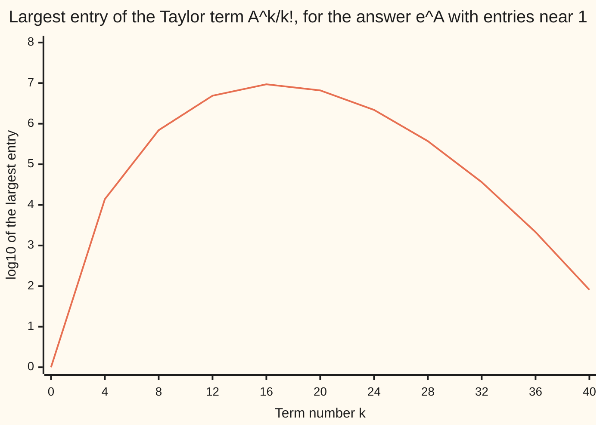
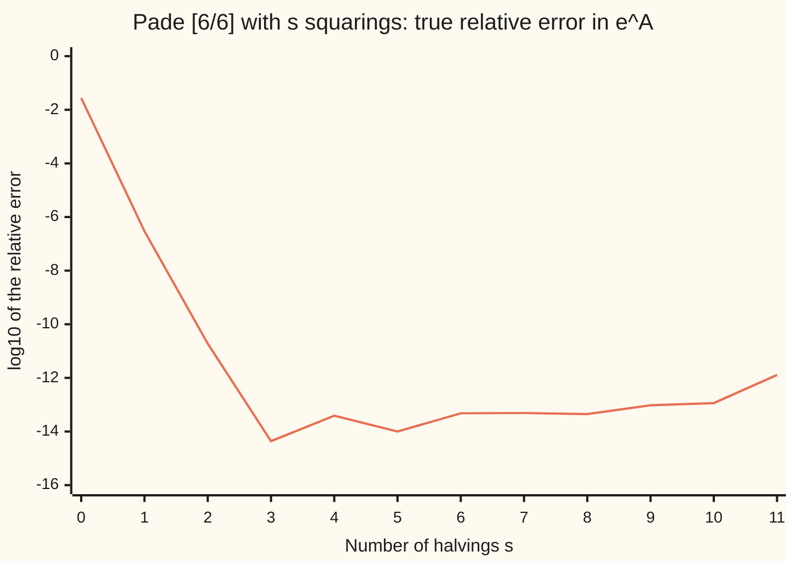

# Computing e^A: scale down, use Pade, square back up, and why eigenvectors are a trap

[Syllabus](../../../SYLLABUS.md) → [Numerical analysis](../README.md) → [Interpolation and Approximation](../README.md#s04) → Computing e^A

---

## General Overview

A system of two linked quantities obeys x′ = Ax: the rate of change of the state x is a matrix A times the state. Here A = `[[-49, 24], [-64, 31]]`, a standard test matrix with one slow and one fast decay and no physical meaning of its own. The state is a mix of two patterns. One fades at rate 1 per second, the other at rate 17 per second. Those rates are the eigenvalues −1 and −17. In 1978 Moler and Van Loan used this matrix to show how computing the matrix exponential goes wrong.

The matrix exponential $`e^{A}`$ carries any starting state forward one second ([The matrix exponential](../../08-Differential%20equations%20and%20dynamics/04-Systems%20and%20the%20Matrix%20Exponential/04-the-matrix-exponential.md)). To seven decimals it is `[[-0.7357588, 0.5518191], [-1.4715176, 1.1036382]]`. The number wanted is all four entries to the full 16 digits a double (a 64-bit floating-point number) can hold.

The textbook definition fails at that. The Taylor series $`I + A + A^2/2! + \cdots`$, where I is the identity matrix (the matrix that changes nothing), climbs through terms with entries as big as 9.303e+06 before it settles on entries near 1. Each term is rounded, so about 8 of the 16 digits are lost: the relative error is 4.931e-09. The eigenvector formula from wing 08 works for this A, but on a matrix whose two eigenvalues nearly meet it loses 8 digits.

The method that works shrinks A first. It divides A by $`2^5 = 32`$, where a short rational stand-in (a Padé approximant, one polynomial divided by another) is accurate to within about one rounding. Then it squares the result five times, because $`(e^{A/32})^{32} = e^{A}`$. The relative error is 1.006e-14, the level a backward-stable method can promise for this A, for 9 matrix products and one solve.

**Scaling and squaring computes $`e^{A}`$ as the $`2^s`$-th power of a Padé approximant at $`A/2^s`$; the shrink makes the Padé step accurate, and the squarings keep its small relative backward error unchanged, while eigenvector formulas lose accuracy in proportion to how nearly parallel the eigenvectors are.**

**What kind of fact this is:** an algorithm with an error analysis. That squaring preserves the relative backward error is proved on this card in Why it works. The Padé error constant is checked in the code. The guaranteed bound for the classical choice of s is stated with its source, not proved.

### The picture: the Taylor terms climb before they fall



Orange: the size of each term, as a power of 10. The terms reach about $`10^7`$ near k = 16 and must cancel down to about 1. Every digit above the answer's size is spent on cancellation (subtracting nearly equal numbers, which keeps their rounding errors and loses their size).

---

## The formula

Notation first. $`\lVert M\rVert_1`$ is the largest column total of the entries' sizes ([Matrix norms and the condition number](../03-Numerical%20Linear%20Algebra/01-matrix-norms-and-the-condition-number.md)). The unit roundoff $`u = 2^{-53}`$ = 1.11e-16 is the most one rounding can cost, relative ([Machine epsilon and cancellation](../01-Floating%20Point%20and%20Error/03-rounding-cancellation-and-machine-epsilon.md)).

```math
e^{A} = \big(r(X)\big)^{2^s}, \qquad X = 2^{-s}A, \qquad r(x) = \frac{p(x)}{p(-x)}, \qquad p(x) = \sum_{k=0}^{6} c_k x^k, \qquad c_k = \frac{(12-k)!\,6!}{12!\,k!\,(6-k)!}
```

**Read it aloud:** divide A by 2 to the s, apply the degree-6 Padé ratio of the exponential, then square the result s times.

The coefficients are $`c_0, \dots, c_6`$ = 1, 1/2, 5/44, 1/66, 1/792, 1/15840, 1/665280. The rule for s is the second formula:

```math
s = \text{the smallest whole number with } \; c\,\frac{\lVert X^{13}\rVert_1}{\lVert X\rVert_1} \le u, \qquad c = \frac{(6!)^2}{12!\,13!} = 1.738\times10^{-13}
```

**Read it aloud:** shrink until the leading term of the Padé error, measured relative to X, is below one rounding.

| Symbol | Plain meaning | In our example | Push it up and the answer… |
| --- | --- | --- | --- |
| $`A`$, $`x`$, $`\lambda`$ | the matrix; the state it acts on (in p(x), r(x) and $`e^x`$, a plain number); its eigenvalues (the rates of its patterns) | `[[-49, 24], [-64, 31]]`; −1 and −17 | bigger A needs a larger s |
| $`e^{A}`$, $`e^{tA}`$, $`t`$ | the matrix exponential; the same at time t | `[[-0.7357588, 0.5518191], [-1.4715176, 1.1036382]]` | — |
| $`I`$ | the identity matrix, which changes nothing | `[[1, 0], [0, 1]]` | — |
| $`s`$, $`X`$ | the number of halvings; the shrunk matrix $`2^{-s}A`$ | 5; $`\lVert X\rVert_1`$ = 3.5312 | more squarings, more rounding |
| $`p`$, $`r`$, $`c_k`$, $`E`$, $`O`$ | the Padé top polynomial; the ratio $`p(x)/p(-x)`$; its coefficients; the even and odd parts of $`p(X)`$ | $`c_2`$ = 5/44 | — |
| $`c`$ | the Padé error constant: $`e^x - r(x) \approx c\,x^{13}`$ | 1.738e-13 | — |
| $`\lVert\cdot\rVert_1`$, $`u`$ | largest column total; the unit roundoff | $`\lVert A\rVert_1`$ = 113; u = 1.11e-16 | — |
| $`\Delta X`$, $`\Delta A`$, $`h`$ | backward errors: $`r(X) = e^{X+\Delta X}`$, result $`= e^{A+\Delta A}`$; the series $`h`$ with $`\Delta X = h(X)`$ | relative size 9.249e-17 at s = 5 | — |
| $`V`$, $`\Lambda`$, $`\kappa(V)`$ | eigenvectors as columns; eigenvalues on a diagonal; $`\lVert V\rVert_1\lVert V^{-1}\rVert_1`$ | κ(V) = 15.0 | eigenvector route loses about κ(V)u |
| $`B`$, $`\delta`$ | a nearly defective test matrix; the gap between its eigenvalues | `[[-1, 1], [0, -1 + δ]]`, δ = 2^-30 | smaller δ, larger κ(V) |
| $`M`$, $`Q`$, $`T`$, $`t_{ij}`$, $`f[\lambda_1, \lambda_2]`$ | the matrix being factored, here $`e^{A}`$; Schur form $`M = QTQ^{\mathsf T}`$, where $`Q^{\mathsf T}`$ is Q's transpose (rows and columns swapped), with entries $`t_{ij}`$ of T; divided difference | diagonal of T: 0.3678794412, 4.140e-08 | — |
| $`k`$, $`Y`$, $`R`$, $`R_T`$ | square roots taken for the log; the last root minus I; computed square root of M, and of T, with entries $`r_{ij}`$ | k = 6 | — |

### When it holds

- **The squarings are exact in exact arithmetic.** $`X`$ commutes with itself, so $`(e^{X})^{2^s} = e^{2^sX} = e^{A}`$ with nothing lost. The rule that the exponential of a sum is the product of the exponentials fails for matrices that do not commute, so the shrink must be a plain division of A.
- **X is small.** The Padé ratio is accurate only near 0. With no shrink, s = 0, the relative error is 2.734e-02.
- **Not too many squarings.** Each squaring doubles the rounding error already present and adds its own. Shrinking to s = 11, six more than needed, gives 1.296e-12, 129 times the error at s = 5.
- **The rule for s is a leading-term estimate, not a bound.** The guaranteed classical rule, $`\lVert X\rVert_1 \le 1/2`$, asks for s = 8 here and costs three extra squarings.
- **No backward-stable method can promise better than about $`\lVert A\rVert u`$ = 1.255e-14.** Changing A by a relative u can change $`e^{A}`$ by about that much, relative. The method's 1.006e-14 is at that level. A single run can do better by luck, as s = 3 does in Step 4.

---

## Why it works

### Step 0: a small matrix is easy, and squaring undoes the shrink

Near 0, the exponential is well matched by a short formula. Far from 0 it is not: the Taylor terms grow before they shrink. Scaling and squaring moves the work to a small matrix, then rebuilds the answer exactly by squaring.

The key fact about errors is this. The Padé step returns the exact exponential of a slightly wrong matrix, $`e^{X+\Delta X}`$. Squaring s times returns the exact exponential of $`A + 2^s\Delta X`$. The relative size of the wrong part, $`\lVert\Delta X\rVert/\lVert X\rVert`$, does not change. So the shrink buys accuracy, and the squarings do not spend it. Their own roundings are another matter (Step 3).

### Step 1: the Taylor series fails by cancellation, not by truncation

The series converges for every A. In exact arithmetic, enough terms give every digit. In floating point, each term is rounded with relative error up to u. The term $`A^{16}/16!`$ has an entry of 9.303e+06, so its rounding alone can be 9.303e+06 × u = 1.033e-09.

The answer's entries are near 1, so those errors are not small beside it. The run shows a relative error of 4.931e-09. The source is the fast pattern, rate −17: the scalar $`17^{17}/17!`$ = 2.326e+06 is already that large.

Truncation is not the problem. The run keeps 150 terms, and the terms fall below u by term 75. The digits were lost on the way up.

### Step 2: the Padé ratio of the exponential

The [Pade approximants](09-pade-and-rational-approximation.md) card builds a top polynomial over a bottom one whose series matches the function as far as possible. For $`e^x`$ with degree 6 top and bottom, the bottom is the top with x replaced by −x. That mirrors $`e^{-x} = 1/e^{x}`$.

The defining property: $`p(-x)e^{x} - p(x)`$ has no terms below $`x^{13}`$. The code checks it. The terms through $`x^{12}`$ are at most 1.388e-17, rounding level. The $`x^{13}`$ term is 1.738e-13, equal to $`c = (6!)^2/(12!\,13!)`$. So for small x,

```math
e^{x} - r(x) \approx c\,x^{13}, \qquad c = 1.738\times10^{-13}
```

**Read it aloud:** the Padé ratio misses the exponential by c times x to the thirteenth.

Thirteen powers of accuracy cost only four matrix products. Split p into even and odd parts, $`p(X) = E + O`$ and $`p(-X) = E - O`$. $`E`$ needs $`X^2, X^4, X^6`$ (three products) and $`O`$ needs one more. Then one linear solve gives $`r(X) = (E - O)^{-1}(E + O)`$. A Taylor polynomial with the same thirteen powers, degree 12, needs eleven products when evaluated term by term.

### Step 3: squaring keeps the relative backward error

The backward error ΔX is the change to the input that the computed result answers exactly ([Forward and backward error](../01-Floating%20Point%20and%20Error/06-forward-and-backward-error.md)). For the Padé step, ΔX is a power series in X that starts with $`-c\,X^{13}`$, so it commutes with X.

<details>
<summary>Detailed proof: the squarings carry the backward error through unchanged</summary>

Write $`h(x) = \log\big(e^{-x}r(x)\big)`$. For small x, $`e^{-x}r(x) = 1 - c\,x^{13} + \cdots`$, so h is a power series starting $`-c\,x^{13}`$. Set $`\Delta X = h(X)`$.

Then $`r(X) = e^{X}e^{h(X)}`$. Both factors are power series in X, so they commute, and the product rule for commuting exponents gives

$`\displaystyle r(X) = e^{X + \Delta X}.`$

Squaring a matrix exponential doubles its exponent: $`e^{M}e^{M} = e^{2M}`$, since M commutes with itself. After s squarings,

$`\displaystyle r(X)^{2^s} = e^{2^s(X + \Delta X)} = e^{A + \Delta A}, \qquad \Delta A = 2^s\Delta X.`$

Dividing, $`\lVert\Delta A\rVert/\lVert A\rVert = \lVert 2^s\Delta X\rVert/\lVert 2^sX\rVert = \lVert\Delta X\rVert/\lVert X\rVert`$. The relative backward error at A equals the one at X.

This ignores the roundings inside the products, and they are not small. Each squaring doubles the relative error already present and adds one new rounding, so a rounding made early is doubled by every later squaring. In backward-error terms, a rounding of relative size u made when squaring $`e^{2^jX}`$, for some j from 0 to s − 1, is a change of about u in $`2^jX`$, a relative change of about $`u/\lVert 2^jX\rVert`$, which the later squarings carry through unchanged. Shrinking m steps too far therefore costs about $`2^m`$: six extra squarings turn 1.006e-14 into 1.296e-12, 129 times worse, against $`2^6`$ = 64.

</details>

### Step 4: choose s from the leading term

The leading term gives $`\lVert\Delta X\rVert/\lVert X\rVert \approx c\,\lVert X^{13}\rVert/\lVert X\rVert`$. The code tries s = 3, 4, 5, 6:

| s | $`\lVert X\rVert_1`$ | $`\lVert X^{13}\rVert_1^{1/13}`$ | leading backward error |
| --- | --- | --- | --- |
| 3 | 14.1250 | 2.4681 | 1.552e-09 |
| 4 | 7.0625 | 1.2341 | 3.788e-13 |
| 5 | 3.5312 | 0.6170 | 9.249e-17 |
| 6 | 1.7656 | 0.3085 | 2.258e-20 |

At s = 5 the estimate first drops below u = 1.11e-16, so s = 5.

The degree is the other dial. A higher degree stays accurate on a larger X, so it needs fewer squarings, but each Padé step costs more products. Higham (2005) weighed the two and chose degree 13 for general use. This card keeps degree 6 so that every coefficient can be shown.

Note the gap between the second and third columns. $`\lVert X\rVert`$ is 3.5312, yet $`\lVert X^{13}\rVert^{1/13}`$ is only 0.6170. A **non-normal** matrix (one whose eigenvectors are not perpendicular) can have powers much smaller than its norm suggests. Using powers instead of the norm is the refinement of Al-Mohy and Higham (2009).

The eigenvalues hide something else: growth in time. $`\lVert e^{tA}\rVert_1`$ rises to 4.6853 at t = 0.187 before it decays, though both eigenvalues are negative. This rise is called the **hump**. At t = 1 the norm is 2.2073.

The squarings pass over the hump. With s = 5 they form $`e^{A/8}`$ and $`e^{A/4}`$, with norms 4.4590 and 4.5730, larger than the answer's 2.2073. A product's roundings scale with the size of its factors, not of the result, so these middle powers add more rounding to the answer than their count suggests (Moler and Van Loan 2003).

The classical guaranteed rule of Moler and Van Loan asks for $`\lVert X\rVert \le 1/2`$. Then the backward error is at most 3.395e-16 times $`\lVert X\rVert`$. Here that means s = 8.



Orange: the true relative error against the exact $`e^{A}`$. It falls fast while truncation dominates, then creeps up as each extra squaring doubles the rounding error already there.

At s = 3 the true error is lower than the estimate warns. Here the truncation error falls on the fast pattern: the backward error on the −17 rate is 2.505e-08. That pattern is crushed to $`e^{-17}`$ in the answer, so it shows as only 1.037e-15. A rule cannot count on that luck.

### Step 5: why eigenvectors are a trap

If A has a full set of eigenvectors, $`A = V\Lambda V^{-1}`$ and $`e^{A} = Ve^{\Lambda}V^{-1}`$, with $`e^{\Lambda}`$ the exponentials of the eigenvalues on a diagonal. Solving with V can magnify roundings by up to $`\kappa(V) = \lVert V\rVert\lVert V^{-1}\rVert`$ ([Conditioning and stability](../01-Floating%20Point%20and%20Error/05-conditioning-and-stability.md)).

For our A, κ(V) = 15.0 and the route is fine. Now take $`B = `$ `[[-1, 1], [0, -1 + δ]]` with δ = 2^-30. Its eigenvalues differ by only 2^-30. Its two eigenvectors, (1, 0) and (1, δ), are almost parallel, so κ(V) = 2.147e+09. The eigenvector route has relative error 1.220e-08, 0.051 times the warning level κ(V)u = 2.384e-07. Scaling and squaring, with s = 2, gives 2.263e-16. At δ = 0 there is no V at all: B is **defective** (short of eigenvectors).

The same failure appears as interpolation. For two distinct eigenvalues, $`e^{A}`$ is the straight line through $`(\lambda_1, e^{\lambda_1})`$ and $`(\lambda_2, e^{\lambda_2})`$, evaluated at the matrix A ([One polynomial through n points](02-lagrange-and-newton-interpolation.md)):

```math
e^{A} = \frac{e^{\lambda_1}(A - \lambda_2 I) - e^{\lambda_2}(A - \lambda_1 I)}{\lambda_1 - \lambda_2}
```

**Read it aloud:** the exponential is the Lagrange line through the exponentials of the two eigenvalues, with A put in for x.

For our A this is exact up to the library's exp, and the code uses it as the reference. For B the slope of that line, $`(e^{\lambda_2} - e^{\lambda_1})/\delta`$, is a difference of nearly equal numbers divided by a tiny gap: cancellation again.

### Step 6: Schur–Parlett in outline

A safer basis is a perpendicular one. [Schur's triangle](../../03-Algebra/07-Eigenvalues%20and%20Symmetric%20Matrices/07-schur-triangularisation.md) writes $`M = QTQ^{\mathsf T}`$ with Q a rotation and T upper triangular, eigenvalues on its diagonal. A rotation keeps lengths, so its condition number measured in lengths (the 2-norm) is 1: it magnifies nothing. The [Eigenvalues by iteration](../03-Numerical%20Linear%20Algebra/07-eigenvalues-power-iteration-and-the-qr-algorithm.md) card computes T by the QR algorithm.

Any function f of a 2 by 2 triangular T is triangular too, with $`f(t_{11})`$ and $`f(t_{22})`$ on the diagonal and corner $`t_{12}\,f[\lambda_1, \lambda_2]`$. Here $`f[\lambda_1, \lambda_2] = (f(\lambda_2) - f(\lambda_1))/(\lambda_2 - \lambda_1)`$ is the divided difference. Parlett's method extends this corner rule to any size. Close eigenvalues still make the divided difference cancel, so the Schur–Parlett algorithm of Davies and Higham groups them into blocks and handles each block another way.

### Step 7: the square root, by Schur

For $`M = e^{A}`$, the Schur form has diagonal 0.3678794412 and 4.140e-08, which are $`e^{-1}`$ and $`e^{-17}`$, and corner 2.0233367. The square root of a triangular T is triangular, $`R_T`$ with $`R_T^2 = T`$. Its diagonal is the square roots of T's diagonal. The corner follows from one equation, $`r_{11}r_{12} + r_{12}r_{22} = t_{12}`$:

```math
r_{12} = \frac{t_{12}}{r_{11} + r_{22}}
```

**Read it aloud:** the corner is T's corner divided by the sum of the two diagonal square roots.

This is the method of Björck and Hammarling. Then $`R = QR_TQ^{\mathsf T}`$. The result is `[[-1.2124509, 0.9094908], [-2.4253088, 1.8191850]]`. It should equal $`e^{A/2}`$, and it does to a relative 1.850e-13. Its residual $`R^2 - M`$ is 4.527e-16, relative.

The residual is at rounding level, so the method is stable. The larger forward error is conditioning. M's small eigenvalue, 4.140e-08, is known only to about $`u\lVert M\rVert`$ in absolute terms. Divided by 4.140e-08, that is a large relative uncertainty, and the square root carries half of it.

### Step 8: the logarithm, by inverse scaling and squaring

The logarithm runs the exponential's method backwards. Take square roots of T until its diagonal lies within 0.25 of 1; here that takes k = 6 roots. Write Y for the last root minus I. Near I, the series $`\log(I + Y) = Y - Y^2/2 + Y^3/3 - \cdots`$ converges fast. Multiply the result by $`2^k = 64`$, since $`\log M = 2^k \log M^{1/2^k}`$.

The result is `[[-49.000000003, 24.000000001], [-64.000000004, 31.000000002]]`, relative error 5.867e-11 against A. Parlett's corner rule, $`t_{12}\,f[\lambda_1, \lambda_2]`$ with f = log, gives the same 5.867e-11.

Two methods agreeing on the same error point to conditioning, not to either method. The tiny eigenvalue $`e^{-17}`$ has an absolute uncertainty near $`u\lVert e^{A}\rVert`$. Its log moves by that divided by $`e^{-17}`$. Relative to $`\lVert A\rVert`$ the prediction is 5.238e-11; the 5.867e-11 observed is 1.12 times it.

---

## Worked numbers, by hand

| Step | Arithmetic | Value |
| --- | --- | --- |
| eigenvalues | trace −49 + 31 = −18; determinant (−49)(31) − (24)(−64) = 17; roots of $`\lambda^2 + 18\lambda + 17`$ | −1 and −17 |
| top-left of $`e^{A}`$ | Lagrange line: $`(e^{-1}(-49 + 17) - e^{-17}(-49 + 1))/16 = -2e^{-1} + 3e^{-17}`$ | −0.7357588 |
| size of A | column totals 49 + 64 = 113 and 24 + 31 = 55 | $`\lVert A\rVert_1`$ = 113 |
| s = 4 | leading backward error of $`X = A/16`$ | 3.788e-13, above u |
| s = 5 | leading backward error of $`X = A/32`$ | 9.249e-17, below u = 1.11e-16 |
| Padé coefficient $`c_2`$ | $`10!\,6!/(12!\,2!\,4!) = 720/6336`$ | 5/44 |
| cost | 4 products, 1 solve, 5 squarings | 9 products and 1 solve |
| result | $`r(A/32)^{32}`$ | **`[[-0.7357588, 0.5518191], [-1.4715176, 1.1036382]]`** |
| true error | against the Lagrange line | 1.006e-14, relative |

The method returns $`e^{A}`$ with relative error 1.006e-14, which is 0.80 times $`\lVert A\rVert u`$ = 1.255e-14: as accurate as a backward-stable method can promise.

The cost scales with size. For an n by n matrix a product costs about $`2n^3`$ flops (floating-point operations) and the solve about $`8n^3/3`$. At n = 100 the method costs 2.067e+07 flops. The Taylor series needs 75 products before a term drops below u, so 1.500e+08 flops, and it is still wrong.

### What breaks if you drop a piece

| Mistake | Comes out at | What went wrong |
| --- | --- | --- |
| Taylor series in doubles, no shrink | relative error 4.931e-09 | terms up to 9.303e+06 cancel down to entries near 1 |
| Padé [6/6] with no scaling, s = 0 | relative error 2.734e-02 | X = A is far from 0, where the ratio is poor |
| Eigenvectors on B, gap 2^-30 | relative error 1.220e-08 | κ(V) = 2.147e+09 magnifies roundings |
| Over-scaling, s = 11 | relative error 1.296e-12 | each of six extra squarings doubles the rounding error already there |

The code prints all four.

---

## Code, from first principles, and it actually runs

The code computes $`e^{A}`$ four ways. The reference is the Lagrange line through the eigenvalues, using the library's scalar exp. The eigenvector formula is a second closed form. The Taylor series in doubles is the failing road. Scaling and squaring with Padé [6/6] is the method, checked against the reference and against $`\lVert A\rVert u`$. The Padé coefficients are checked by the defining property. The square root is checked against $`e^{A/2}`$ and by its residual; the logarithm against A itself. The near-defective B has an exact answer from the series of $`(e^{\delta} - 1)/\delta`$, which has no cancellation.

### Python

```python
# Computing e^A -- the check behind the card.  Only math is imported.
# Moler and Van Loan's A = [[-49, 24], [-64, 31]], eigenvalues -1 and -17.
# Roads to e^A: (1) interpolating e^x at the eigenvalues, (2) eigenvectors V e^D V^-1,
# (3) the Taylor series in floating point, (4) scaling and squaring with Pade [6/6].
# Then the square root and the logarithm of e^A through its Schur form.
# math.exp and math.log are the library's, used for scalars only.
import math
U, A, I = 2.0 ** -53, [[-49.0, 24.0], [-64.0, 31.0]], [[1.0, 0.0], [0.0, 1.0]]
def mul(X, Y): return [[X[i][0] * Y[0][j] + X[i][1] * Y[1][j] for j in range(2)] for i in range(2)]
def lin(a, X, b, Y): return [[a * X[i][j] + b * Y[i][j] for j in range(2)] for i in range(2)]
def inv(X):
    d = X[0][0] * X[1][1] - X[0][1] * X[1][0]
    return [[X[1][1] / d, -X[0][1] / d], [-X[1][0] / d, X[0][0] / d]]
def tr(X): return [[X[0][0], X[1][0]], [X[0][1], X[1][1]]]
def n1(X): return max(abs(X[0][j]) + abs(X[1][j]) for j in range(2))   # largest column total
def rel(X, Y): return n1(lin(1, X, -1, Y)) / n1(Y)
def sci(v): return f"{v:.3e}"
def fm(X, d=7): return "[[" + "], [".join(", ".join(f"{v:.{d}f}" for v in r) for r in X) + "]]"
def interp(X, l1, l2):          # e^X = (e^l1 (X - l2 I) - e^l2 (X - l1 I)) / (l1 - l2)
    return lin(math.exp(l1) / (l1 - l2), lin(1, X, -l2, I), -math.exp(l2) / (l1 - l2), lin(1, X, -l1, I))
def eigvec(X, l1, l2):          # V e^D V^-1 with eigenvectors (x12, l - x11)
    V = [[X[0][1], X[0][1]], [l1 - X[0][0], l2 - X[0][0]]]
    return mul(mul(V, [[math.exp(l1), 0.0], [0.0, math.exp(l2)]]), inv(V)), n1(V) * n1(inv(V))
def taylor(X, terms=150):
    S, T, big = I, I, []
    for k in range(1, terms):
        T = lin(1.0 / k, mul(T, X), 0, I)
        S, big = lin(1, S, 1, T), big + [max(abs(v) for r in T for v in r)]
    return S, big
FAC = [math.factorial(k) * 1.0 for k in range(27)]
C = [FAC[12 - k] * FAC[6] / (FAC[12] * FAC[k] * FAC[6 - k]) for k in range(7)]   # Pade [6/6] of e^x
CERR = FAC[6] ** 2 / (FAC[12] * FAC[13])                                       # e^x - r(x) ~ CERR x^13
def pade6(X):                   # N = E + O, D = E - O: even and odd parts, four products
    X2 = mul(X, X); X4 = mul(X2, X2); X6 = mul(X4, X2)
    E = lin(1, lin(C[0], I, C[2], X2), 1, lin(C[4], X4, C[6], X6))
    O = mul(X, lin(1, lin(C[1], I, C[3], X2), C[5], X4))
    return mul(inv(lin(1, E, -1, O)), lin(1, E, 1, O))
def expm(X, s):
    R = pade6(lin(2.0 ** -s, X, 0, I))
    for _ in range(s): R = mul(R, R)
    return R
def pw(X, k):
    P = I
    for _ in range(k): P = mul(P, X)
    return P
def choose_s(X):                # smallest s with leading backward error CERR ||X^13|| / ||X|| <= u
    s = 0
    while CERR * n1(pw(lin(2.0 ** -s, X, 0, I), 13)) / n1(lin(2.0 ** -s, X, 0, I)) > U: s += 1
    return s
REF = interp(A, -1.0, -17.0)
EV, kV = eigvec(A, -1.0, -17.0)
print(f"A = [[-49, 24], [-64, 31]]; trace {A[0][0] + A[1][1]:.1f}, det {A[0][0] * A[1][1] - A[0][1] * A[1][0]:.1f} -> eigenvalues -1, -17")
print("interpolation e^A =", fm(REF))
print(f"eigenvectors  e^A = {fm(EV)}; kappa(V) = {kV:.1f}; rel diff {sci(rel(EV, REF))}")
assert abs(REF[0][0] + 2 * math.exp(-1) - 3 * math.exp(-17)) < 1e-15 and rel(EV, REF) < 1e-14
TS, big = taylor(A)
kmax = max(range(len(big)), key=lambda k: big[k]) + 1
print(f"Taylor in doubles: {fm(TS)}; rel error {sci(rel(TS, REF))}")
print(f"largest term entry {sci(big[kmax - 1])} at k = {kmax}; 17^17/17! = {sci(17.0 ** 17 / FAC[17])}; times u {sci(big[kmax - 1] * U)}")
assert 1e-10 < rel(TS, REF) < 1e-7
fr = [(math.factorial(12 - k) * 720, math.factorial(12) * math.factorial(k) * math.factorial(6 - k)) for k in range(7)]
print("Pade [6/6] c_k:", ", ".join(f"{p // math.gcd(p, q)}/{q // math.gcd(p, q)}" for p, q in fr))
ec = [1.0 / FAC[k] for k in range(14)]
res = []
for k in range(14):             # coefficient of x^k in Q(x) e^x - P(x), Q(x) = P(-x)
    acc = 0.0
    for j in range(min(k, 6) + 1): acc += C[j] * (-1) ** j * ec[k - j]
    res.append(acc - (C[k] if k <= 6 else 0))
print(f"Q e^x - P, terms x^0..x^12: max size {sci(max(abs(v) for v in res[:13]))}; x^13 term {sci(res[13])}; (6!)^2/(12! 13!) = {sci(CERR)}")
assert max(abs(v) for v in res[:13]) < 1e-15 and abs(abs(res[13]) / CERR - 1) < 1e-9
print("s, ||X||, ||X^13||^(1/13), leading backward error:")
for s in range(3, 7):
    X = lin(2.0 ** -s, A, 0, I)
    print(f"  {s}, {n1(X):.4f}, {n1(pw(X, 13)) ** (1 / 13):.4f}, {sci(CERR * n1(pw(X, 13)) / n1(X))}")
s = choose_s(A)
mvl = 0
while n1(A) * 2.0 ** -mvl > 0.5: mvl += 1
eps66 = 2.0 ** (3 - 12) * FAC[6] ** 2 / (FAC[12] * FAC[13])
E = expm(A, s)
print(f"chosen s = {s}; guaranteed rule ||X|| <= 1/2 gives s = {mvl}, bound {sci(eps66)} ||X||")
print(f"scaling and squaring e^A = {fm(E)}")
print(f"rel error {sci(rel(E, REF))}; ||A|| u = {sci(n1(A) * U)}; ratio {rel(E, REF) / (n1(A) * U):.2f}")
assert s == 5 and mvl == 8 and rel(E, REF) < 1e2 * n1(A) * U
b17 = CERR * 8 * (17 / 8) ** 13
print(f"s = 3: backward error on the -17 mode {sci(b17)}; seen in e^A as e^-17 x that = {sci(math.exp(-17) * b17)}")
sweep = [rel(expm(A, k), REF) for k in range(12)]
print("chart, s: " + ", ".join(str(k) for k in range(12)))
print("chart, log10 rel error: " + ", ".join(f"{math.log10(v):.2f}" for v in sweep))
assert sweep[0] > 1e-3 and sweep[11] > 10 * sweep[5]
print("chart, log10 largest Taylor term, k = 0..40 by 4: " + ", ".join(f"{math.log10(([1.0] + big)[k]):.2f}" for k in range(0, 41, 4)))
hump = max((n1(interp(lin(t / 1000, A, 0, I), -t / 1000, -17 * t / 1000)), t / 1000) for t in range(1, 1001))
mid = [n1(interp(lin(t, A, 0, I), -t, -17 * t)) for t in (0.125, 0.25)]   # e^(A/8), e^(A/4): squarings for s = 5
print(f"hump: ||e^(tA)|| peaks at {hump[0]:.4f} at t = {hump[1]:.3f}; at t = 1/8, 1/4: {mid[0]:.4f}, {mid[1]:.4f}; at t = 1: {n1(REF):.4f}")
assert hump[0] > 4 and abs(hump[1] - 0.15) < 0.1 and min(mid) > n1(REF)
d = 2.0 ** -30                  # nearly defective: B = [[-1, 1], [0, -1 + d]]
B = [[-1.0, 1.0], [0.0, -1.0 + d]]
phi = 1 + d / 2 + d * d / 6     # (e^d - 1)/d by its series: no cancellation
BX = [[math.exp(-1), math.exp(-1) * phi], [0.0, math.exp(-1 + d)]]
BV, kB = eigvec(B, -1.0, -1.0 + d)
bt = [rel(BV, BX), rel(expm(B, choose_s(B)), BX), rel(taylor(B, 40)[0], BX)]
print(f"near-defective B, gap 2^-30: kappa(V) = {sci(kB)}; kappa(V) u = {sci(kB * U)}")
print(f"  rel error: eigenvectors {sci(bt[0])}, scaling and squaring (s = {choose_s(B)}) {sci(bt[1])}, Taylor {sci(bt[2])}; eigenvectors / (kappa(V) u) = {bt[0] / (kB * U):.3f}")
assert bt[0] > 1e5 * bt[1] and bt[1] < 1e-15 and bt[2] < 1e-15
def schur(M):                   # real 2 by 2, real eigenvalues: M = Q T Q^T
    t, dt = M[0][0] + M[1][1], M[0][0] * M[1][1] - M[0][1] * M[1][0]
    l1 = t / 2 + math.copysign(math.sqrt((M[0][0] - M[1][1]) ** 2 / 4 + M[0][1] * M[1][0]), t)
    a, b = (M[0][1], l1 - M[0][0]), (l1 - M[1][1], M[1][0])
    q = a if abs(a[0]) + abs(a[1]) >= abs(b[0]) + abs(b[1]) else b
    r = math.sqrt(q[0] ** 2 + q[1] ** 2)
    Q = [[q[0] / r, -q[1] / r], [q[1] / r, q[0] / r]]
    return Q, mul(tr(Q), mul(M, Q))
def tsqrt(T):
    r1, r2 = math.sqrt(T[0][0]), math.sqrt(T[1][1])
    return [[r1, T[0][1] / (r1 + r2)], [0.0, r2]]
Q, T = schur(REF)
print(f"Schur form of e^A: diagonal {T[0][0]:.10f}, {sci(T[1][1])}; corner {T[0][1]:.7f}; below {sci(abs(T[1][0]))}")
R = mul(Q, mul(tsqrt(T), tr(Q)))
H = interp(lin(0.5, A, 0, I), -0.5, -8.5)
print(f"square root = {fm(R)}; vs e^(A/2): rel error {sci(rel(R, H))}; residual R^2 - M: {sci(rel(mul(R, R), REF))}")
assert rel(R, H) < 1e-10 and rel(mul(R, R), REF) < 1e-14
W, k = [[T[0][0], T[0][1]], [0.0, T[1][1]]], 0
while max(abs(W[0][0] - 1), abs(W[1][1] - 1)) > 0.25: W, k = tsqrt(W), k + 1
X, P, L = lin(1, W, -1, I), I, [[0.0, 0.0], [0.0, 0.0]]
for j in range(1, 40): P = mul(P, X); L = lin(1, L, (-1) ** (j + 1) / j, P)   # log(I + X)
LG = mul(Q, mul(lin(2.0 ** k, L, 0, I), tr(Q)))
dd = T[0][1] * (math.log(T[1][1]) - math.log(T[0][0])) / (T[1][1] - T[0][0])
LP = mul(Q, mul([[math.log(T[0][0]), dd], [0.0, math.log(T[1][1])]], tr(Q)))
print(f"log by {k} square roots + series: {fm(LG, 9)}; rel error vs A {sci(rel(LG, A))}")
print(f"log by Parlett's divided difference: rel error vs A {sci(rel(LP, A))}; u ||e^A|| / (e^-17 ||A||) = {sci(U * n1(REF) / (math.exp(-17) * n1(A)))}; ratio {rel(LP, A) / (U * n1(REF) / (math.exp(-17) * n1(A))):.2f}")
assert rel(LG, A) < 1e-9 and rel(LP, LG) < 1e-12
print("mistake, Pade [6/6] with no scaling (s = 0): rel error", sci(sweep[0]))
print(f"mistake, over-scaling s = 11: rel error {sci(sweep[11])}, {sweep[11] / sweep[5]:.0f} times s = 5; 2^6 = {2 ** 6}")
kt = next(k for k in range(kmax, len(big)) if big[k - 1] < U)
print(f"flops at n = 100: [6/6] with s = 5: {sci(9 * 2e6 + 8e6 / 3)}; Taylor, {kt} terms until a term < u: {sci(kt * 2e6)}")
for g in (2.0 ** -20, 2.0 ** -40):
    Bg = [[-1.0, 1.0], [0.0, -1.0 + g]]
    Bx = [[math.exp(-1), math.exp(-1) * (1 + g / 2 + g * g / 6)], [0.0, math.exp(-1 + g)]]
    print(f"try: gap {sci(g)}: eigenvectors {sci(rel(eigvec(Bg, -1.0, -1.0 + g)[0], Bx))}; scaling and squaring {sci(rel(expm(Bg, choose_s(Bg)), Bx))}")
print("ALL CHECKS PASS")
```

**Ran 2026-11-24 on macOS, Python 3.14.10, standard library only. All checks passed. Output, pasted from the run:**

```
A = [[-49, 24], [-64, 31]]; trace -18.0, det 17.0 -> eigenvalues -1, -17
interpolation e^A = [[-0.7357588, 0.5518191], [-1.4715176, 1.1036382]]
eigenvectors  e^A = [[-0.7357588, 0.5518191], [-1.4715176, 1.1036382]]; kappa(V) = 15.0; rel diff 0.000e+00
Taylor in doubles: [[-0.7357588, 0.5518191], [-1.4715176, 1.1036382]]; rel error 4.931e-09
largest term entry 9.303e+06 at k = 16; 17^17/17! = 2.326e+06; times u 1.033e-09
Pade [6/6] c_k: 1/1, 1/2, 5/44, 1/66, 1/792, 1/15840, 1/665280
Q e^x - P, terms x^0..x^12: max size 1.388e-17; x^13 term 1.738e-13; (6!)^2/(12! 13!) = 1.738e-13
s, ||X||, ||X^13||^(1/13), leading backward error:
  3, 14.1250, 2.4681, 1.552e-09
  4, 7.0625, 1.2341, 3.788e-13
  5, 3.5312, 0.6170, 9.249e-17
  6, 1.7656, 0.3085, 2.258e-20
chosen s = 5; guaranteed rule ||X|| <= 1/2 gives s = 8, bound 3.395e-16 ||X||
scaling and squaring e^A = [[-0.7357588, 0.5518191], [-1.4715176, 1.1036382]]
rel error 1.006e-14; ||A|| u = 1.255e-14; ratio 0.80
s = 3: backward error on the -17 mode 2.505e-08; seen in e^A as e^-17 x that = 1.037e-15
chart, s: 0, 1, 2, 3, 4, 5, 6, 7, 8, 9, 10, 11
chart, log10 rel error: -1.56, -6.53, -10.72, -14.36, -13.41, -14.00, -13.32, -13.31, -13.35, -13.02, -12.94, -11.89
chart, log10 largest Taylor term, k = 0..40 by 4: 0.00, 4.14, 5.84, 6.69, 6.97, 6.82, 6.34, 5.57, 4.56, 3.33, 1.91
hump: ||e^(tA)|| peaks at 4.6853 at t = 0.187; at t = 1/8, 1/4: 4.4590, 4.5730; at t = 1: 2.2073
near-defective B, gap 2^-30: kappa(V) = 2.147e+09; kappa(V) u = 2.384e-07
  rel error: eigenvectors 1.220e-08, scaling and squaring (s = 2) 2.263e-16, Taylor 2.263e-16; eigenvectors / (kappa(V) u) = 0.051
Schur form of e^A: diagonal 0.3678794412, 4.140e-08; corner 2.0233367; below 2.776e-17
square root = [[-1.2124509, 0.9094908], [-2.4253088, 1.8191850]]; vs e^(A/2): rel error 1.850e-13; residual R^2 - M: 4.527e-16
log by 6 square roots + series: [[-49.000000003, 24.000000001], [-64.000000004, 31.000000002]]; rel error vs A 5.867e-11
log by Parlett's divided difference: rel error vs A 5.867e-11; u ||e^A|| / (e^-17 ||A||) = 5.238e-11; ratio 1.12
mistake, Pade [6/6] with no scaling (s = 0): rel error 2.734e-02
mistake, over-scaling s = 11: rel error 1.296e-12, 129 times s = 5; 2^6 = 64
flops at n = 100: [6/6] with s = 5: 2.067e+07; Taylor, 75 terms until a term < u: 1.500e+08
try: gap 9.537e-07: eigenvectors 3.780e-11; scaling and squaring 3.772e-16
try: gap 9.095e-13: eigenvectors 2.794e-05; scaling and squaring 4.527e-16
ALL CHECKS PASS
```

### Rust

```rust
// Computing e^A -- the check behind the card.  std only, no crates.
// Moler and Van Loan's A = [[-49, 24], [-64, 31]], eigenvalues -1 and -17.
// Roads to e^A: (1) interpolating e^x at the eigenvalues, (2) eigenvectors V e^D V^-1,
// (3) the Taylor series in floating point, (4) scaling and squaring with Pade [6/6].
// Then the square root and the logarithm of e^A through its Schur form.
// f64::exp and f64::ln are the library's, used for scalars only.
type M = [[f64; 2]; 2];
const I: M = [[1.0, 0.0], [0.0, 1.0]];
const U: f64 = 1.0 / 9007199254740992.0; // 2^-53
fn mul(x: &M, y: &M) -> M {
    let f = |i: usize, j: usize| x[i][0] * y[0][j] + x[i][1] * y[1][j];
    [[f(0, 0), f(0, 1)], [f(1, 0), f(1, 1)]]
}
fn lin(a: f64, x: &M, b: f64, y: &M) -> M {
    let f = |i: usize, j: usize| a * x[i][j] + b * y[i][j];
    [[f(0, 0), f(0, 1)], [f(1, 0), f(1, 1)]]
}
fn inv(x: &M) -> M {
    let d = x[0][0] * x[1][1] - x[0][1] * x[1][0];
    [[x[1][1] / d, -x[0][1] / d], [-x[1][0] / d, x[0][0] / d]]
}
fn tr(x: &M) -> M { [[x[0][0], x[1][0]], [x[0][1], x[1][1]]] }
fn n1(x: &M) -> f64 { (0..2).map(|j| x[0][j].abs() + x[1][j].abs()).fold(f64::MIN, f64::max) } // largest column total
fn rel(x: &M, y: &M) -> f64 { n1(&lin(1.0, x, -1.0, y)) / n1(y) }
fn sci(v: f64) -> String { // Python's {:.3e}: signed two-digit exponent
    let s = format!("{:.3e}", v);
    let (m, e) = s.split_once('e').unwrap();
    let e: i32 = e.parse().unwrap();
    format!("{}e{}{:02}", m, if e < 0 { '-' } else { '+' }, e.abs())
}
fn fm(x: &M, d: usize) -> String {
    let r: Vec<String> = x.iter().map(|r| format!("{:.*}, {:.*}", d, r[0], d, r[1])).collect();
    format!("[[{}]]", r.join("], ["))
}
fn interp(x: &M, l1: f64, l2: f64) -> M { // e^X = (e^l1 (X - l2 I) - e^l2 (X - l1 I)) / (l1 - l2)
    lin(l1.exp() / (l1 - l2), &lin(1.0, x, -l2, &I), -l2.exp() / (l1 - l2), &lin(1.0, x, -l1, &I))
}
fn eigvec(x: &M, l1: f64, l2: f64) -> (M, f64) { // V e^D V^-1 with eigenvectors (x12, l - x11)
    let v = [[x[0][1], x[0][1]], [l1 - x[0][0], l2 - x[0][0]]];
    (mul(&mul(&v, &[[l1.exp(), 0.0], [0.0, l2.exp()]]), &inv(&v)), n1(&v) * n1(&inv(&v)))
}
fn taylor(x: &M, terms: usize) -> (M, Vec<f64>) {
    let (mut s, mut t, mut big) = (I, I, vec![]);
    for k in 1..terms {
        t = lin(1.0 / k as f64, &mul(&t, x), 0.0, &I);
        s = lin(1.0, &s, 1.0, &t);
        big.push(t.iter().flatten().fold(0.0, |m: f64, v| m.max(v.abs())));
    }
    (s, big)
}
fn fac(k: u64) -> f64 { (1..=k).fold(1.0, |p, i| p * i as f64) }
fn ifac(k: u64) -> u64 { (1..=k).product() }
fn gcd(a: u64, b: u64) -> u64 { if b == 0 { a } else { gcd(b, a % b) } }
fn coef() -> [f64; 7] { let mut c = [0.0; 7]; for k in 0..7 { c[k] = fac(12 - k as u64) * fac(6) / (fac(12) * fac(k as u64) * fac(6 - k as u64)); } c }
fn cerr() -> f64 { fac(6) * fac(6) / (fac(12) * fac(13)) } // e^x - r(x) ~ CERR x^13
fn pade6(x: &M) -> M { // N = E + O, D = E - O: even and odd parts, four products
    let c = coef();
    let x2 = mul(x, x); let x4 = mul(&x2, &x2); let x6 = mul(&x4, &x2);
    let e = lin(1.0, &lin(c[0], &I, c[2], &x2), 1.0, &lin(c[4], &x4, c[6], &x6));
    let o = mul(x, &lin(1.0, &lin(c[1], &I, c[3], &x2), c[5], &x4));
    mul(&inv(&lin(1.0, &e, -1.0, &o)), &lin(1.0, &e, 1.0, &o))
}
fn sc(x: &M, s: i32) -> M { lin(2f64.powi(-s), x, 0.0, &I) }
fn expm(x: &M, s: i32) -> M { let mut r = pade6(&sc(x, s)); for _ in 0..s { r = mul(&r, &r); } r }
fn pw(x: &M, k: usize) -> M { let mut p = I; for _ in 0..k { p = mul(&p, x); } p }
fn choose_s(x: &M) -> i32 { // smallest s with leading backward error CERR ||X^13|| / ||X|| <= u
    let mut s = 0;
    while cerr() * n1(&pw(&sc(x, s), 13)) / n1(&sc(x, s)) > U { s += 1; }
    s
}
fn schur(m: &M) -> (M, M) { // real 2 by 2, real eigenvalues: M = Q T Q^T
    let t = m[0][0] + m[1][1];
    let l1 = t / 2.0 + (((m[0][0] - m[1][1]).powf(2.0) / 4.0 + m[0][1] * m[1][0]).sqrt()).copysign(t);
    let (a, b) = ((m[0][1], l1 - m[0][0]), (l1 - m[1][1], m[1][0]));
    let q = if a.0.abs() + a.1.abs() >= b.0.abs() + b.1.abs() { a } else { b };
    let r = (q.0.powf(2.0) + q.1.powf(2.0)).sqrt();
    let qm = [[q.0 / r, -q.1 / r], [q.1 / r, q.0 / r]];
    (qm, mul(&tr(&qm), &mul(m, &qm)))
}
fn tsqrt(t: &M) -> M { let (r1, r2) = (t[0][0].sqrt(), t[1][1].sqrt()); [[r1, t[0][1] / (r1 + r2)], [0.0, r2]] }
fn main() {
    let a: M = [[-49.0, 24.0], [-64.0, 31.0]];
    let refm = interp(&a, -1.0, -17.0);
    let (ev, kv) = eigvec(&a, -1.0, -17.0);
    println!("A = [[-49, 24], [-64, 31]]; trace {:.1}, det {:.1} -> eigenvalues -1, -17", a[0][0] + a[1][1], a[0][0] * a[1][1] - a[0][1] * a[1][0]);
    println!("interpolation e^A = {}", fm(&refm, 7));
    println!("eigenvectors  e^A = {}; kappa(V) = {:.1}; rel diff {}", fm(&ev, 7), kv, sci(rel(&ev, &refm)));
    assert!((refm[0][0] + 2.0 * (-1f64).exp() - 3.0 * (-17f64).exp()).abs() < 1e-15 && rel(&ev, &refm) < 1e-14);
    let (ts, big) = taylor(&a, 150);
    let mut kmax = 1;
    for k in 0..big.len() { if big[k] > big[kmax - 1] { kmax = k + 1; } }
    println!("Taylor in doubles: {}; rel error {}", fm(&ts, 7), sci(rel(&ts, &refm)));
    println!("largest term entry {} at k = {}; 17^17/17! = {}; times u {}", sci(big[kmax - 1]), kmax, sci(17f64.powf(17.0) / fac(17)), sci(big[kmax - 1] * U));
    assert!(1e-10 < rel(&ts, &refm) && rel(&ts, &refm) < 1e-7);
    let fr: Vec<String> = (0..7u64).map(|k| { let (p, q) = (ifac(12 - k) * 720, ifac(12) * ifac(k) * ifac(6 - k)); format!("{}/{}", p / gcd(p, q), q / gcd(p, q)) }).collect();
    println!("Pade [6/6] c_k: {}", fr.join(", "));
    let c = coef();
    let ec: Vec<f64> = (0..14).map(|k| 1.0 / fac(k)).collect();
    let mut res = vec![];
    for k in 0..14usize { // coefficient of x^k in Q(x) e^x - P(x), Q(x) = P(-x)
        let mut acc = 0.0;
        for j in 0..=k.min(6) { acc += c[j] * (-1f64).powi(j as i32) * ec[k - j]; }
        res.push(acc - if k <= 6 { c[k] } else { 0.0 });
    }
    let r12 = res[..13].iter().fold(0.0, |m: f64, v| m.max(v.abs()));
    println!("Q e^x - P, terms x^0..x^12: max size {}; x^13 term {}; (6!)^2/(12! 13!) = {}", sci(r12), sci(res[13]), sci(cerr()));
    assert!(r12 < 1e-15 && (res[13].abs() / cerr() - 1.0).abs() < 1e-9);
    println!("s, ||X||, ||X^13||^(1/13), leading backward error:");
    for s in 3..7 {
        let x = sc(&a, s);
        println!("  {}, {:.4}, {:.4}, {}", s, n1(&x), n1(&pw(&x, 13)).powf(1.0 / 13.0), sci(cerr() * n1(&pw(&x, 13)) / n1(&x)));
    }
    let s = choose_s(&a);
    let mut mvl = 0;
    while n1(&a) * 2f64.powi(-mvl) > 0.5 { mvl += 1; }
    let eps66 = 2f64.powi(3 - 12) * fac(6) * fac(6) / (fac(12) * fac(13));
    let e = expm(&a, s);
    println!("chosen s = {}; guaranteed rule ||X|| <= 1/2 gives s = {}, bound {} ||X||", s, mvl, sci(eps66));
    println!("scaling and squaring e^A = {}", fm(&e, 7));
    println!("rel error {}; ||A|| u = {}; ratio {:.2}", sci(rel(&e, &refm)), sci(n1(&a) * U), rel(&e, &refm) / (n1(&a) * U));
    assert!(s == 5 && mvl == 8 && rel(&e, &refm) < 1e2 * n1(&a) * U);
    let b17 = cerr() * 8.0 * (17.0f64 / 8.0).powf(13.0);
    println!("s = 3: backward error on the -17 mode {}; seen in e^A as e^-17 x that = {}", sci(b17), sci((-17f64).exp() * b17));
    let sweep: Vec<f64> = (0..12).map(|k| rel(&expm(&a, k), &refm)).collect();
    println!("chart, s: {}", (0..12).map(|k| k.to_string()).collect::<Vec<_>>().join(", "));
    println!("chart, log10 rel error: {}", sweep.iter().map(|v| format!("{:.2}", v.log10())).collect::<Vec<_>>().join(", "));
    assert!(sweep[0] > 1e-3 && sweep[11] > 10.0 * sweep[5]);
    let big0: Vec<f64> = std::iter::once(1.0).chain(big.iter().cloned()).collect();
    println!("chart, log10 largest Taylor term, k = 0..40 by 4: {}", (0..41).step_by(4).map(|k| format!("{:.2}", big0[k].log10())).collect::<Vec<_>>().join(", "));
    let hump = (1..1001).map(|t| t as f64 / 1000.0).map(|tt| (n1(&interp(&lin(tt, &a, 0.0, &I), -tt, -17.0 * tt)), tt))
        .fold((0.0, 0.0), |h, v| if v.0 > h.0 { v } else { h });
    let mid: Vec<f64> = [0.125, 0.25].iter().map(|&t| n1(&interp(&lin(t, &a, 0.0, &I), -t, -17.0 * t))).collect(); // e^(A/8), e^(A/4): squarings for s = 5
    println!("hump: ||e^(tA)|| peaks at {:.4} at t = {:.3}; at t = 1/8, 1/4: {:.4}, {:.4}; at t = 1: {:.4}", hump.0, hump.1, mid[0], mid[1], n1(&refm));
    assert!(hump.0 > 4.0 && (hump.1 - 0.15f64).abs() < 0.1 && mid[0].min(mid[1]) > n1(&refm));
    let d = 2f64.powi(-30); // nearly defective: B = [[-1, 1], [0, -1 + d]]
    let b: M = [[-1.0, 1.0], [0.0, -1.0 + d]];
    let phi = 1.0 + d / 2.0 + d * d / 6.0; // (e^d - 1)/d by its series: no cancellation
    let bx: M = [[(-1f64).exp(), (-1f64).exp() * phi], [0.0, (-1.0 + d).exp()]];
    let (bv, kb) = eigvec(&b, -1.0, -1.0 + d);
    let bt = [rel(&bv, &bx), rel(&expm(&b, choose_s(&b)), &bx), rel(&taylor(&b, 40).0, &bx)];
    println!("near-defective B, gap 2^-30: kappa(V) = {}; kappa(V) u = {}", sci(kb), sci(kb * U));
    println!("  rel error: eigenvectors {}, scaling and squaring (s = {}) {}, Taylor {}; eigenvectors / (kappa(V) u) = {:.3}", sci(bt[0]), choose_s(&b), sci(bt[1]), sci(bt[2]), bt[0] / (kb * U));
    assert!(bt[0] > 1e5 * bt[1] && bt[1] < 1e-15 && bt[2] < 1e-15);
    let (q, t) = schur(&refm);
    println!("Schur form of e^A: diagonal {:.10}, {}; corner {:.7}; below {}", t[0][0], sci(t[1][1]), t[0][1], sci(t[1][0].abs()));
    let r = mul(&q, &mul(&tsqrt(&t), &tr(&q)));
    let h = interp(&lin(0.5, &a, 0.0, &I), -0.5, -8.5);
    println!("square root = {}; vs e^(A/2): rel error {}; residual R^2 - M: {}", fm(&r, 7), sci(rel(&r, &h)), sci(rel(&mul(&r, &r), &refm)));
    assert!(rel(&r, &h) < 1e-10 && rel(&mul(&r, &r), &refm) < 1e-14);
    let (mut w, mut k) = ([[t[0][0], t[0][1]], [0.0, t[1][1]]], 0);
    while (w[0][0] - 1.0).abs().max((w[1][1] - 1.0).abs()) > 0.25 { w = tsqrt(&w); k += 1; }
    let (x, mut p, mut l) = (lin(1.0, &w, -1.0, &I), I, [[0.0; 2]; 2]);
    for j in 1..40 { p = mul(&p, &x); l = lin(1.0, &l, (-1f64).powi(j + 1) / j as f64, &p); } // log(I + X)
    let lg = mul(&q, &mul(&lin(2f64.powi(k), &l, 0.0, &I), &tr(&q)));
    let dd = t[0][1] * (t[1][1].ln() - t[0][0].ln()) / (t[1][1] - t[0][0]);
    let lp = mul(&q, &mul(&[[t[0][0].ln(), dd], [0.0, t[1][1].ln()]], &tr(&q)));
    println!("log by {} square roots + series: {}; rel error vs A {}", k, fm(&lg, 9), sci(rel(&lg, &a)));
    println!("log by Parlett's divided difference: rel error vs A {}; u ||e^A|| / (e^-17 ||A||) = {}; ratio {:.2}", sci(rel(&lp, &a)), sci(U * n1(&refm) / ((-17f64).exp() * n1(&a))), rel(&lp, &a) / (U * n1(&refm) / ((-17f64).exp() * n1(&a))));
    assert!(rel(&lg, &a) < 1e-9 && rel(&lp, &lg) < 1e-12);
    println!("mistake, Pade [6/6] with no scaling (s = 0): rel error {}", sci(sweep[0]));
    println!("mistake, over-scaling s = 11: rel error {}, {:.0} times s = 5; 2^6 = {}", sci(sweep[11]), sweep[11] / sweep[5], 2i32.pow(6));
    let kt = (kmax..big.len()).find(|&k| big[k - 1] < U).unwrap();
    println!("flops at n = 100: [6/6] with s = 5: {}; Taylor, {} terms until a term < u: {}", sci(9.0 * 2e6 + 8e6 / 3.0), kt, sci(kt as f64 * 2e6));
    for g in [2f64.powi(-20), 2f64.powi(-40)] {
        let bg: M = [[-1.0, 1.0], [0.0, -1.0 + g]];
        let bgx: M = [[(-1f64).exp(), (-1f64).exp() * (1.0 + g / 2.0 + g * g / 6.0)], [0.0, (-1.0 + g).exp()]];
        println!("try: gap {}: eigenvectors {}; scaling and squaring {}", sci(g), sci(rel(&eigvec(&bg, -1.0, -1.0 + g).0, &bgx)), sci(rel(&expm(&bg, choose_s(&bg)), &bgx)));
    }
    println!("ALL CHECKS PASS");
}
```

**Ran 2026-11-24 on macOS, rustc 1.98.1, no crates. All checks passed. Output, pasted from the run:**

```
A = [[-49, 24], [-64, 31]]; trace -18.0, det 17.0 -> eigenvalues -1, -17
interpolation e^A = [[-0.7357588, 0.5518191], [-1.4715176, 1.1036382]]
eigenvectors  e^A = [[-0.7357588, 0.5518191], [-1.4715176, 1.1036382]]; kappa(V) = 15.0; rel diff 0.000e+00
Taylor in doubles: [[-0.7357588, 0.5518191], [-1.4715176, 1.1036382]]; rel error 4.931e-09
largest term entry 9.303e+06 at k = 16; 17^17/17! = 2.326e+06; times u 1.033e-09
Pade [6/6] c_k: 1/1, 1/2, 5/44, 1/66, 1/792, 1/15840, 1/665280
Q e^x - P, terms x^0..x^12: max size 1.388e-17; x^13 term 1.738e-13; (6!)^2/(12! 13!) = 1.738e-13
s, ||X||, ||X^13||^(1/13), leading backward error:
  3, 14.1250, 2.4681, 1.552e-09
  4, 7.0625, 1.2341, 3.788e-13
  5, 3.5312, 0.6170, 9.249e-17
  6, 1.7656, 0.3085, 2.258e-20
chosen s = 5; guaranteed rule ||X|| <= 1/2 gives s = 8, bound 3.395e-16 ||X||
scaling and squaring e^A = [[-0.7357588, 0.5518191], [-1.4715176, 1.1036382]]
rel error 1.006e-14; ||A|| u = 1.255e-14; ratio 0.80
s = 3: backward error on the -17 mode 2.505e-08; seen in e^A as e^-17 x that = 1.037e-15
chart, s: 0, 1, 2, 3, 4, 5, 6, 7, 8, 9, 10, 11
chart, log10 rel error: -1.56, -6.53, -10.72, -14.36, -13.41, -14.00, -13.32, -13.31, -13.35, -13.02, -12.94, -11.89
chart, log10 largest Taylor term, k = 0..40 by 4: 0.00, 4.14, 5.84, 6.69, 6.97, 6.82, 6.34, 5.57, 4.56, 3.33, 1.91
hump: ||e^(tA)|| peaks at 4.6853 at t = 0.187; at t = 1/8, 1/4: 4.4590, 4.5730; at t = 1: 2.2073
near-defective B, gap 2^-30: kappa(V) = 2.147e+09; kappa(V) u = 2.384e-07
  rel error: eigenvectors 1.220e-08, scaling and squaring (s = 2) 2.263e-16, Taylor 2.263e-16; eigenvectors / (kappa(V) u) = 0.051
Schur form of e^A: diagonal 0.3678794412, 4.140e-08; corner 2.0233367; below 2.776e-17
square root = [[-1.2124509, 0.9094908], [-2.4253088, 1.8191850]]; vs e^(A/2): rel error 1.850e-13; residual R^2 - M: 4.527e-16
log by 6 square roots + series: [[-49.000000003, 24.000000001], [-64.000000004, 31.000000002]]; rel error vs A 5.867e-11
log by Parlett's divided difference: rel error vs A 5.867e-11; u ||e^A|| / (e^-17 ||A||) = 5.238e-11; ratio 1.12
mistake, Pade [6/6] with no scaling (s = 0): rel error 2.734e-02
mistake, over-scaling s = 11: rel error 1.296e-12, 129 times s = 5; 2^6 = 64
flops at n = 100: [6/6] with s = 5: 2.067e+07; Taylor, 75 terms until a term < u: 1.500e+08
try: gap 9.537e-07: eigenvectors 3.780e-11; scaling and squaring 3.772e-16
try: gap 9.095e-13: eigenvectors 2.794e-05; scaling and squaring 4.527e-16
ALL CHECKS PASS
```

### Lean

Lean proves the squaring step for any square matrix, the Padé error constant, and the Lagrange line for real 2 by 2 matrices.

- Take any square matrix A, any whole number s and any matrix $`\Delta X`$, with $`X = 2^{-s}A`$. Then squaring $`e^{X + \Delta X}`$ s times gives exactly $`e^{A + 2^s\Delta X}`$.
- Under the same condition, the relative backward error is unchanged. In symbols, $`\lVert 2^s\Delta X\rVert_1 / \lVert A\rVert_1 = \lVert\Delta X\rVert_1 / \lVert X\rVert_1`$.
- Take p, the Padé top polynomial with coefficients $`c_0, \dots, c_6`$. Then, in exact fractions, $`p(-x)e^{x} - p(x)`$ has no terms below $`x^{13}`$. Its $`x^{13}`$ term is exactly c.
- Suppose a real 2 by 2 matrix A has distinct real eigenvalues $`\lambda_1`$ and $`\lambda_2`$ (Lean states this through the trace and determinant). Then $`e^{A}`$ equals the Lagrange line through $`(\lambda_1, e^{\lambda_1})`$ and $`(\lambda_2, e^{\lambda_2})`$, evaluated at A.
- For our A, Lean also checks the worked numbers: trace −18, determinant 17, eigenvalues −1 and −17, and $`\lVert A\rVert_1`$ = 113.
- It checks the Padé coefficients $`c_0, \dots, c_6`$ and the top-left entry of $`e^{A}`$, $`-2e^{-1} + 3e^{-17}`$.

The floating-point errors, the choice of s, the eigenvector trap, the square root and the logarithm are left to the Python and Rust checks.

```lean
-- Computing e^A: squaring s times turns the exponential of A/2^s plus a backward error into the exponential of A plus 2^s times that error, so the relative backward error is unchanged; the degree-6 Pade ratio misses e^x first at x^13 with constant (6!)^2/(12! 13!); and a 2 by 2 matrix with distinct eigenvalues has e^A on the Lagrange line through its eigenvalues.
import Mathlib.Analysis.Normed.Algebra.MatrixExponential
import Mathlib.Analysis.Matrix.Normed
import Mathlib.Analysis.SpecialFunctions.Exp
import Mathlib.Analysis.SpecialFunctions.Exponential
import Mathlib.RingTheory.PowerSeries.Exp
import Mathlib.LinearAlgebra.Matrix.Trace
import Mathlib.LinearAlgebra.Matrix.Determinant.Basic
import Mathlib.LinearAlgebra.Matrix.Notation
import Mathlib.Data.Nat.Factorial.Basic

open scoped Matrix Matrix.Norms.Operator Nat

theorem iterate_sq_exp {n : Type*} [Fintype n] [DecidableEq n] (Y : Matrix n n ℝ) (s : ℕ) :
    (fun M : Matrix n n ℝ => M * M)^[s] (NormedSpace.exp Y) =
      NormedSpace.exp ((2 : ℝ) ^ s • Y) := by
  induction s with
  | zero => simp
  | succ k ih =>
    rw [Function.iterate_succ_apply', ih, ← Matrix.exp_add_of_commute _ _ (Commute.refl _),
      ← add_smul, pow_succ]
    congr 2; ring

#print axioms iterate_sq_exp

/-- Scaling and squaring keeps the relative backward error.
Let `X = A / 2^s`. If the Padé step returns the exact exponential of a slightly wrong
matrix, `R = e^(X + ΔX)`, then squaring `R` `s` times returns the exact exponential
`e^(A + ΔA)` with `ΔA = 2^s ΔX`, and the relative size of the wrong part is the same at `A`
as at `X`: `‖ΔA‖₁ / ‖A‖₁ = ‖ΔX‖₁ / ‖X‖₁`. Here `‖M‖₁`, the largest column total of the
entries' sizes, is written `‖Mᵀ‖` in Mathlib's L∞ operator norm (largest row total). -/
theorem squaring_keeps_relative_backward_error {n : Type*} [Fintype n] [DecidableEq n]
    (A ΔX R : Matrix n n ℝ) (s : ℕ)
    (hR : R = NormedSpace.exp (((2 : ℝ) ^ s)⁻¹ • A + ΔX)) :
    (fun M : Matrix n n ℝ => M * M)^[s] R = NormedSpace.exp (A + (2 : ℝ) ^ s • ΔX) ∧
      ‖((2 : ℝ) ^ s • ΔX)ᵀ‖ / ‖Aᵀ‖ = ‖ΔXᵀ‖ / ‖(((2 : ℝ) ^ s)⁻¹ • A)ᵀ‖ := by
  have hc : (2 : ℝ) ^ s ≠ 0 := pow_ne_zero _ two_ne_zero
  refine ⟨?_, ?_⟩
  · rw [hR, iterate_sq_exp, smul_add, smul_smul, mul_inv_cancel₀ hc, one_smul]
  · rw [Matrix.transpose_smul, Matrix.transpose_smul, norm_smul, norm_smul, norm_inv,
      Real.norm_eq_abs, abs_of_pos (by positivity : (0 : ℝ) < 2 ^ s)]
    rcases eq_or_ne ‖Aᵀ‖ 0 with h | h
    · simp [h]
    · field_simp

/-- The degree-6 Padé coefficients of the exponential,
`c_k = (12 - k)! 6! / (12! k! (6 - k)!)` for `k = 0, …, 6`, and `0` beyond. -/
def padeCoeff (k : ℕ) : ℚ :=
  if k ≤ 6 then ((12 - k)! * 6! : ℚ) / (12! * k ! * (6 - k)!) else 0

/-- The Padé [6/6] ratio `r(x) = p(x) / p(-x)` matches `e^x` through `x^12`, and its first
miss is `c x^13` with `c = (6!)^2 / (12! 13!)`: the power series `p(-x) e^x - p(x)` has no
terms below `x^13`, and its `x^13` term is exactly `c`. -/
theorem pade_six_six_error_starts_at_x13 :
    let p : PowerSeries ℚ := PowerSeries.mk padeCoeff
    let q : PowerSeries ℚ := PowerSeries.mk fun k => (-1) ^ k * padeCoeff k
    (∀ k < 13, PowerSeries.coeff k (q * PowerSeries.exp ℚ - p) = 0) ∧
      PowerSeries.coeff 13 (q * PowerSeries.exp ℚ - p) = (6! ^ 2 : ℚ) / (12! * 13!) := by
  intro p q
  have key : ∀ k, PowerSeries.coeff k (q * PowerSeries.exp ℚ - p) =
      (∑ i ∈ Finset.range (k + 1), (-1) ^ i * padeCoeff i * (1 / ((k - i)! : ℚ))) - padeCoeff k := by
    intro k
    simp only [map_sub, PowerSeries.coeff_mul, q, p, PowerSeries.coeff_mk, PowerSeries.coeff_exp,
      Algebra.algebraMap_self, RingHom.id_apply]
    rw [Finset.Nat.sum_antidiagonal_eq_sum_range_succ_mk]
  refine ⟨?_, ?_⟩
  · intro k hk
    rw [key]
    interval_cases k <;> simp [Finset.sum_range_succ, padeCoeff, Nat.factorial] <;> norm_num
  · rw [key]
    simp [Finset.sum_range_succ, padeCoeff, Nat.factorial]
    norm_num

/-- For a 2 by 2 matrix with two distinct eigenvalues `λ₁ ≠ λ₂` (so its trace is `λ₁ + λ₂`
and its determinant `λ₁ λ₂`), `e^A` is the straight line through `(λ₁, e^λ₁)` and
`(λ₂, e^λ₂)` evaluated at `A`:
`e^A = (e^λ₁ (A - λ₂ I) - e^λ₂ (A - λ₁ I)) / (λ₁ - λ₂)`. -/
theorem exp_two_by_two_eq_lagrange_line (A : Matrix (Fin 2) (Fin 2) ℝ) (l₁ l₂ : ℝ)
    (hne : l₁ ≠ l₂) (htr : A.trace = l₁ + l₂) (hdet : A.det = l₁ * l₂) :
    NormedSpace.exp A =
      (l₁ - l₂)⁻¹ • (Real.exp l₁ • (A - l₂ • (1 : Matrix (Fin 2) (Fin 2) ℝ)) -
        Real.exp l₂ • (A - l₁ • (1 : Matrix (Fin 2) (Fin 2) ℝ))) := by
  set d := l₁ - l₂ with hd
  have hd0 : d ≠ 0 := sub_ne_zero.mpr hne
  have hsq : A * A = (l₁ + l₂) • A - (l₁ * l₂) • (1 : Matrix (Fin 2) (Fin 2) ℝ) := by
    rw [← htr, ← hdet]
    ext i j
    fin_cases i <;> fin_cases j <;>
      simp [Matrix.mul_apply, Fin.sum_univ_two, Matrix.trace_fin_two, Matrix.det_fin_two] <;> ring
  set P₁ := d⁻¹ • (A - l₂ • (1 : Matrix (Fin 2) (Fin 2) ℝ)) with hP₁
  set P₂ := -(d⁻¹ • (A - l₁ • (1 : Matrix (Fin 2) (Fin 2) ℝ))) with hP₂
  have h1 : A * P₁ = l₁ • P₁ := by
    rw [hP₁, Matrix.mul_smul, mul_sub, hsq, Matrix.mul_smul, mul_one]
    module
  have h2 : A * P₂ = l₂ • P₂ := by
    rw [hP₂, mul_neg, Matrix.mul_smul, mul_sub, hsq, Matrix.mul_smul, mul_one]
    module
  clear_value P₁ P₂
  have hpow : ∀ k : ℕ, A ^ k = l₁ ^ k • P₁ + l₂ ^ k • P₂ := by
    intro k
    induction k with
    | zero =>
      simp only [pow_zero, one_smul, hP₁, hP₂, ← sub_eq_add_neg, ← smul_sub]
      have : (A - l₂ • (1 : Matrix (Fin 2) (Fin 2) ℝ)) - (A - l₁ • 1) = d • 1 := by
        rw [hd]; module
      rw [this, smul_smul, inv_mul_cancel₀ hd0, one_smul]
    | succ k ih =>
      rw [pow_succ', ih, mul_add, Matrix.mul_smul, Matrix.mul_smul, h1, h2, smul_smul, smul_smul,
        pow_succ, pow_succ]
  have hs : ∀ x : ℝ, Summable (fun n : ℕ => ((n !)⁻¹ : ℝ) * x ^ n) := by
    intro x
    simpa [div_eq_inv_mul] using Real.summable_pow_div_factorial x
  have hR : ∀ x : ℝ, Real.exp x = ∑' n : ℕ, ((n !)⁻¹ : ℝ) * x ^ n := by
    intro x
    rw [Real.exp_eq_exp_ℝ, congrFun (NormedSpace.exp_eq_tsum ℝ) x]
    simp [smul_eq_mul]
  rw [congrFun (NormedSpace.exp_eq_tsum ℝ) A]
  simp only [hpow, smul_add, smul_smul]
  rw [Summable.tsum_add ((hs l₁).smul_const P₁) ((hs l₂).smul_const P₂),
    (hs l₁).tsum_smul_const, (hs l₂).tsum_smul_const, ← hR, ← hR, hP₁, hP₂]
  module

/-! Worked numbers for Moler and Van Loan's `A = [[-49, 24], [-64, 31]]`. -/

-- trace −49 + 31 = −18 and determinant (−49)(31) − (24)(−64) = 17
example : Matrix.trace !![(-49 : ℤ), 24; -64, 31] = -18 ∧
    Matrix.det !![(-49 : ℤ), 24; -64, 31] = 17 := by
  constructor
  · simp [Matrix.trace_fin_two]
  · simp [Matrix.det_fin_two]

-- the eigenvalues are −1 and −17: (A + I)(A + 17 I) = 0
example : (!![(-49 : ℤ), 24; -64, 31] + 1) * (!![(-49 : ℤ), 24; -64, 31] + 17) = 0 := by
  ext i j
  fin_cases i <;> fin_cases j <;> simp [Matrix.mul_apply, Fin.sum_univ_two, Matrix.ofNat_apply]

-- size of A: column totals 49 + 64 = 113 and 24 + 31 = 55, so ‖A‖₁ = 113
example : ‖(!![(-49 : ℝ), 24; -64, 31])ᵀ‖ = 113 := by
  rw [Matrix.linfty_opNorm_def]
  have h : (Finset.univ : Finset (Fin 2)) = {0, 1} := by decide
  rw [h, Finset.sup_insert, Finset.sup_singleton]
  simp
  norm_num

-- the Padé coefficients c_0, …, c_6 = 1, 1/2, 5/44, 1/66, 1/792, 1/15840, 1/665280
example : padeCoeff 0 = 1 ∧ padeCoeff 1 = 1 / 2 ∧ padeCoeff 2 = 5 / 44 ∧
    padeCoeff 3 = 1 / 66 ∧ padeCoeff 4 = 1 / 792 ∧ padeCoeff 5 = 1 / 15840 ∧
    padeCoeff 6 = 1 / 665280 := by
  simp [padeCoeff, Nat.factorial]
  norm_num

-- top-left of e^A from the Lagrange line: −2 e^(−1) + 3 e^(−17)
example : NormedSpace.exp !![(-49 : ℝ), 24; -64, 31] 0 0 =
    -2 * Real.exp (-1) + 3 * Real.exp (-17) := by
  rw [exp_two_by_two_eq_lagrange_line _ (-1) (-17) (by norm_num)
    (by simp [Matrix.trace_fin_two]; norm_num) (by simp [Matrix.det_fin_two]; norm_num)]
  simp
  ring

#print axioms squaring_keeps_relative_backward_error
#print axioms pade_six_six_error_starts_at_x13
#print axioms exp_two_by_two_eq_lagrange_line
```

**Checked 2026-11-24 on macOS, Lean 4.36.0-rc2, Mathlib v4.36.0-rc2. Every proof is complete and uses only Lean's standard axioms. Output, pasted from the run:**

```
'iterate_sq_exp' depends on axioms: [propext, Classical.choice, Quot.sound]
'squaring_keeps_relative_backward_error' depends on axioms: [propext, Classical.choice, Quot.sound]
'pade_six_six_error_starts_at_x13' depends on axioms: [propext, Classical.choice, Quot.sound]
'exp_two_by_two_eq_lagrange_line' depends on axioms: [propext, Classical.choice, Quot.sound]
```

> [!TIP]
> **Try changing**
> - **Guess first:** shrink the gap in B from 2^-30 to 2^-40. How many digits does the eigenvector route keep? The second `try:` line gives a relative error of 2.794e-05; scaling and squaring stays at 4.527e-16. At gap 2^-20 the eigenvector error is 3.780e-11.
> - **Guess first:** in `expm`, square one time fewer (`range(s - 1)`). The answer is now $`e^{A/2}`$, and the assert against the reference stops the run.
> - **Guess first:** set `U` to $`2^{-24}`$, the unit roundoff of single precision. Does `choose_s` pick a smaller or a larger s? Smaller: the estimate passes sooner, and the `s == 5` assert fails.
> - **Guess first:** in `taylor`, keep only 20 terms. Is the error now truncation or cancellation? Truncation: the terms are still near $`10^{6.8}`$ at k = 20, and the Taylor assert fails.

---

## The usual mistake

> [!warning]
> **Diagonalising to compute $`e^{A}`$.** $`Ve^{\Lambda}V^{-1}`$ is exact in exact arithmetic, and it is the formula on the wing-08 cards. In floating point it loses about κ(V) times u. On B, with eigenvalues 2^-30 apart, that is 1.220e-08 against 2.263e-16 for scaling and squaring. At a repeated eigenvalue with one eigenvector there is no V at all.
>
> - **Summing the Taylor series because it converges.** It converges, but its terms reach 9.303e+06, and the result is off by 4.931e-09.
> - **Skipping the shrink.** Padé [6/6] applied to A itself is off by 2.734e-02.
> - **Shrinking far too much to be safe.** s = 11 gives 1.296e-12, 129 times worse than s = 5: each extra squaring doubles the rounding error already there.
> - **Taking a small residual as a small error.** The square root has residual 4.527e-16 but forward error 1.850e-13; the log is off by 5.867e-11. Both are the conditioning of a matrix with an eigenvalue of 4.140e-08.

---

## Where you meet it in real life

- **Digital control.** A controller that samples a plant every T seconds needs $`e^{AT}`$ to step the plant model forward exactly between samples ([State space](../../13-Engineering%20mathematics/04-State%20Space%20and%20Optimal%20Control/01-state-space-models-and-the-matrix-exponential.md), [Discretising a design](../../13-Engineering%20mathematics/02-Linear%20Systems%20and%20Transforms/09-zero-order-hold-and-tustin-discretisation.md)).
- **Continuous-time Markov chains.** The probabilities of moving between states over a time t are $`e^{Qt}`$, where Q holds the transition rates ([Continuous-time chains](../../11-Stochastic%20processes%20and%20calculus/04-Poisson%20and%20Jump%20Processes/05-continuous-time-markov-chains-and-queues.md)). Going back, from an observed one-year transition matrix to its rates, is a matrix logarithm, as in credit-rating models.
- **Scientific libraries.** The standard expm routines use scaling and squaring with a Padé approximant, usually of degree 13, with s chosen from powers of A as in Step 4 (Higham 2005; Al-Mohy and Higham 2009).
- **Rotations and mechanics.** A rotation in three dimensions is the exponential of a skew-symmetric matrix (one equal to minus its transpose). Simulators of robots and spacecraft compute it, and the logarithm turns a rotation back into an axis and an angle.

> **Say it back**
> The Taylor series for $`e^{A}`$ loses digits in floating point, because its terms grow huge before they cancel.
> Scaling and squaring divides A by $`2^s`$, applies the degree-6 Padé ratio, and squares s times.
> The squarings keep the relative backward error of the Padé step, so the result is about as accurate as a backward-stable method can promise: 1.006e-14 here.
> Eigenvector formulas lose accuracy in proportion to κ(V), which explodes as two eigenvalues meet.
> Square roots and logarithms work in the Schur form, where the basis is perpendicular and magnifies nothing.

---

## What this builds on

- [Pade approximants](09-pade-and-rational-approximation.md): the ratio of polynomials and its matching rule; this card uses the degree-6 ratio of the exponential.
- [Eigenvalues by iteration](../03-Numerical%20Linear%20Algebra/07-eigenvalues-power-iteration-and-the-qr-algorithm.md): the QR algorithm, which produces the Schur form that Steps 6 to 8 work in.
- [Conditioning and stability](../01-Floating%20Point%20and%20Error/05-conditioning-and-stability.md): the condition number κ, which explains the eigenvector trap and the error of the logarithm.
- [The matrix exponential](../../08-Differential%20equations%20and%20dynamics/04-Systems%20and%20the%20Matrix%20Exponential/04-the-matrix-exponential.md): the definition by power series and the product rule for commuting exponents.
- [Schur's triangle](../../03-Algebra/07-Eigenvalues%20and%20Symmetric%20Matrices/07-schur-triangularisation.md): every square matrix is triangular in a perpendicular basis.
- [One polynomial through n points](02-lagrange-and-newton-interpolation.md): Lagrange lines and divided differences, which give $`e^{A}`$ for a 2 by 2 matrix and the corner of Parlett's rule.
- [Forward and backward error](../01-Floating%20Point%20and%20Error/06-forward-and-backward-error.md): the backward error that the squarings carry through unchanged.

## Where this goes next

- [Stiffness](../06-ODE%20Solvers/05-stiffness-a-stability-and-the-dahlquist-barriers.md): implicit step factors are Padé ratios of the exponential, the scalar version of Step 2.
- [Evolution as an equation](../../18-Functional%20analysis/05-Unbounded%20Operators%20and%20Semigroups/03-the-abstract-cauchy-problem-and-the-operator-exponential.md): the exponential of an operator on an infinite-dimensional space, where no finite series of products exists.
- [Lie algebra](../../23-Differential%20geometry%20and%20Lie%20groups/06-Lie%20Groups/02-lie-algebras-and-the-exponential-map.md): the exponential map from rotation rates to rotations, and its logarithm back.

For a large sparse A, forming $`e^{A}`$ is too expensive; the open question is how to compute $`e^{A}`$ times one vector with only products of A and vectors.

---

## Sources

Verified 2026-11-24: every link below resolves to the publisher's page.

- Moler, C., and C. Van Loan. "Nineteen dubious ways to compute the exponential of a matrix, twenty-five years later." *SIAM Review* 45 (2003): 3–49. [doi:10.1137/S00361445024180](https://doi.org/10.1137/S00361445024180). The example matrix, the Taylor and eigenvector failures, and the classical scaling-and-squaring rule.
- Higham, N. J. "The scaling and squaring method for the matrix exponential revisited." *SIAM Journal on Matrix Analysis and Applications* 26 (2005): 1179–1193. [doi:10.1137/04061101X](https://doi.org/10.1137/04061101X). Backward error analysis of the Padé step and the choice of degree and s.
- Al-Mohy, A. H., and N. J. Higham. "A new scaling and squaring algorithm for the matrix exponential." *SIAM Journal on Matrix Analysis and Applications* 31 (2009): 970–989. [doi:10.1137/09074721X](https://doi.org/10.1137/09074721X). Choosing s from powers of A, which avoids over-scaling non-normal matrices.
- Higham, N. J. *Functions of Matrices: Theory and Computation*. SIAM, 2008. [doi:10.1137/1.9780898717778](https://doi.org/10.1137/1.9780898717778). Conditioning of matrix functions, the Schur–Parlett method, square roots, and inverse scaling and squaring for the logarithm.
- Björck, Å., and S. Hammarling. "A Schur method for the square root of a matrix." *Linear Algebra and its Applications* 52–53 (1983): 127–140. [doi:10.1016/0024-3795(83)80010-X](https://doi.org/10.1016/0024-3795(83)80010-X). The triangular square-root recurrence of Step 7.
