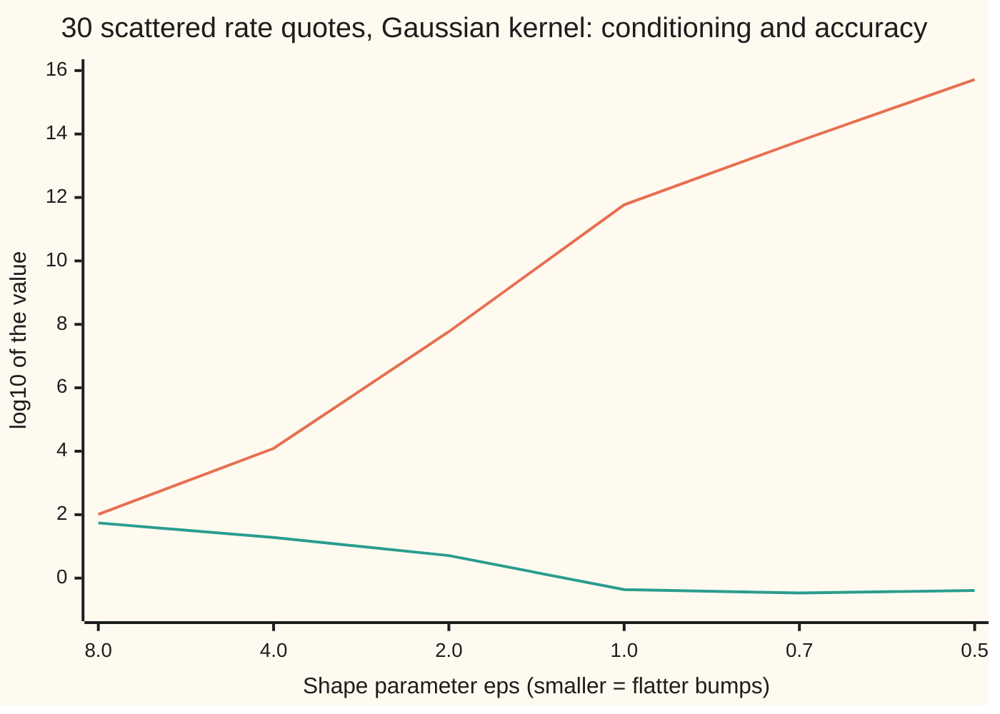

# Radial basis functions: interpolate scattered points in any dimension with one kernel

[Syllabus](../../../SYLLABUS.md) → [Numerical analysis](../README.md) → [Interpolation and Approximation](../README.md#s04) → Radial basis functions

---

## General Overview

A rates desk keeps a year of quotes. Over 250 trading days it recorded 30 rates, each at its own maturity on its own day, never on a grid. Each quote is a point of a plane: maturity (0.25 to 30 years) across, trading day (0 to 250) up.

The desk needs the 15-year rate on day 125, to within one **basis point** (bp: one hundredth of a percentage point). Nobody quoted that point. The quotes are illustrative: they were read off a smooth model surface, so the true rate is known, 4.344413%. Every error on this card is a true error.

[Cubic splines](05-splines.md) fill gaps along one line. Here the points are scattered over a plane, with no rows or columns. A polynomial in two variables can fail outright on scattered points (Step 0 shows how). The fix is to give each quote its own bump:

- Put a bell-shaped bump on every quote. Its height depends only on the **distance** from that quote, so the same recipe works in 1, 2 or 20 dimensions.
- Choose the 30 bump heights so that the sum of all bumps passes through all 30 quotes. That is one 30-by-30 linear system.
- For the Gaussian bump this system always has exactly one solution, because its matrix is **positive definite** (defined in The formula). [Cholesky](../03-Numerical%20Linear%20Algebra/04-cholesky-decomposition.md) solves it in about 9000 flops (a flop is one arithmetic operation on two numbers).

With bumps of a well-chosen width (ε = 1 below), the sum reads the 15-year rate on day 125 off by 0.0191 bp. The width is a dial, the **shape parameter**. Flatten the bumps and the accuracy improves, but the system's **condition number** (how much it can magnify rounding errors) climbs from 1.030e+02 to 6.083e+13. Flatten further and Cholesky breaks down.

**A radial basis function interpolant is a sum of identical bumps, one centred on each data point, whose heights solve one symmetric linear system; a positive definite kernel makes that system solvable for any distinct points in any dimension, and the kernel's width trades accuracy against conditioning.**

**What kind of fact this is:** a method resting on theorems. The Gaussian kernel's positive definiteness, the fact that the cubic kernel in one dimension gives the natural cubic spline, and Rippa's leave-one-out formula are proved on this card in Why it works. The thin-plate and multiquadric results and the uncertainty principle are stated with named sources and checked on the example.

### The picture: flatter bumps, smaller error, worse conditioning



Orange: log10 of the condition number κ. It climbs steadily, past 12 between ε = 1.0 and ε = 0.7. Teal: log10 of the worst true error in basis points over 81 checkpoints inside the quoted region. It falls from 1.74 to −0.47, then turns up at ε = 0.5. That turn belongs to the approximation, not to rounding (Step 5). At ε = 0.3 there is no point: rounding makes Cholesky stop.

---

## The formula

Notation first, in words. The data are n points $`x_1, \dots, x_n`$, called **nodes** (here the quotes), with values $`y_1, \dots, y_n`$. A **radial** function depends on a point only through its distance from a centre. The kernel φ turns a distance r into a bump height. The interpolant is

```math
s(x) = \sum_{j=1}^{n} c_j\, \varphi\bigl(\lVert x - x_j \rVert\bigr), \qquad \sum_{j=1}^{n} c_j\, \varphi\bigl(\lVert x_i - x_j \rVert\bigr) = y_i \quad (i = 1, \dots, n)
```

**Read it aloud:** the interpolant is a weighted sum of one bump per node; the weights are chosen so that at every node the sum equals that node's value.

In matrix form the second half is $`Ac = y`$, with $`A_{ij} = \varphi(\lVert x_i - x_j \rVert)`$. The matrix A is symmetric, because the distance from $`x_i`$ to $`x_j`$ equals the distance back. The two kernels this card uses are

```math
\varphi(r) = e^{-(\varepsilon r)^2} \ \ \text{(Gaussian)}, \qquad \varphi(r) = r^2 \log r \ \ \text{(thin-plate spline, with } \varphi(0) = 0\text{)}
```

**Read it aloud:** the Gaussian bump is e to the minus epsilon r, squared; the thin-plate bump is r squared times the natural log of r.

A symmetric matrix is **positive definite** when $`c^{\mathsf T}\!Ac > 0`$ for every nonzero vector c of weights. Such a matrix is invertible and has a Cholesky factor. The thin-plate kernel is not positive definite, so it carries a linear **tail** $`p(x) = \beta_0 + \beta_1x^{(1)} + \beta_2x^{(2)}`$ and three side conditions:

```math
\begin{pmatrix} \Phi & P \\ P^{\mathsf T} & 0 \end{pmatrix} \begin{pmatrix} c \\ \beta \end{pmatrix} = \begin{pmatrix} y \\ 0 \end{pmatrix}, \qquad \text{row } i \text{ of } P = \bigl(1,\ x_i^{(1)},\ x_i^{(2)}\bigr)
```

**Read it aloud:** the thin-plate weights and the tail together match the data, and the weights add to zero against every linear function of the nodes.

On the surface, a point is $`x = (x^{(1)}, x^{(2)})`$ with $`x^{(1)}`$ = maturity ÷ 30 years and $`x^{(2)}`$ = trading day ÷ 250, so both run from 0 to 1. This scaling is a modelling choice, and it changes the answer: the relative scale of the two axes decides which quotes count as near each other. For the Gaussian, the card interpolates each quote's gap from the average quote $`\bar y`$ = 4.224054% and adds $`\bar y`$ back; far from every node the bumps fade and the surface returns to the average, not to zero.

| Symbol | Plain meaning | In our example | Push it up and the answer… |
| --- | --- | --- | --- |
| $`x`$, $`x^{(1)}, x^{(2)}`$ | a point; its two scaled coordinates | (0.5, 0.5): 15 years, day 125 | — |
| $`x_j`$, $`y_j`$ | node j and its value | hand: 0, 1, 2 with 1, 2, 0; surface: 30 quotes | more nodes: smaller error, larger κ |
| $`n`$ | number of nodes | 3 by hand; 30 on the surface | cost grows like $`n^3`$ |
| $`r`$ | distance between two points, $`\lVert x - x_j \rVert`$ | 1 between neighbouring hand nodes | — |
| $`\varphi`$ | the kernel: bump height at distance r | $`e^{-(\varepsilon r)^2}`$; or $`r^2\log r`$ | — |
| $`\varepsilon`$ | shape parameter: large is narrow, small is flat (not a tolerance here) | 1 by hand; 8 down to 0.3 on the surface | narrower bumps: smaller κ; larger error above ε = 0.7 |
| $`c_j`$, $`e_k`$ | weight (height) of bump j; leave-one-out error at node k | hand c: 0.193993381, 2.232010747, −0.824663979; surface $`e_1`$ at ε = 2: −0.013751 bp | — |
| $`A`$, $`\Phi`$, $`L`$, $`v`$ | kernel matrix of all node pairs; Φ for thin plate; L the lower-triangular Cholesky factor, $`A = LL^{\mathsf T}`$; v the in-between vector of the forward sweep | hand A has 1 on the diagonal, $`e^{-1}`$, $`e^{-4}`$ off it | — |
| $`\bar y`$ | average quote, the Gaussian's baseline | 4.224054% | — |
| $`p`$, $`\beta`$, $`P`$ | thin-plate linear tail, its coefficients, and the matrix of the tail's values at the nodes | $`\beta_0 + \beta_1x^{(1)} + \beta_2x^{(2)}`$ | — |
| $`\kappa`$, $`\lambda_{\min}`$, $`\lambda_{\max}`$ | condition number $`\lambda_{\max}/\lambda_{\min}`$; smallest and largest eigenvalue of A | ε = 2: 5.880e+07, 2.249e-07, 13.224759070 | larger κ, more digits lost |
| $`s(x)`$ | the interpolant | hand: s(0.5) = 1.802454971 | — |

### When it holds

- **The nodes are distinct.** Two nodes at one point give two equal rows. Node 1 quoted twice makes Cholesky stop at row 3 with pivot 0.000e+00.
- **The kernel is positive definite, or carries its tail.** The Gaussian needs nothing more. The thin-plate matrix has 27 positive and 3 negative eigenvalues; Cholesky stops at its row 1. With the linear tail the system is solvable, provided the nodes do not all lie on one straight line.
- **The shape parameter leaves room for rounding.** At ε = 0.5 the computed smallest eigenvalue, 5.328e-15, is at rounding level, so κ = 5.210e+15 is good to an order of magnitude at most. At ε = 0.3 Cholesky stops at row 27 with pivot −6.661e-16.
- **The function is smooth and the target lies among the nodes.** The errors here are measured inside the quoted region. Outside it the Gaussian surface drifts back to the average quote.

---

## Why it works

### Step 0: one bump per node makes the basis fit the points

In one dimension, n distinct nodes always fix one polynomial of degree n − 1 ([One polynomial through n points](02-lagrange-and-newton-interpolation.md)). In two dimensions a fixed list of functions can fail. Take the six quadratic terms 1, x, y, x², xy, y² and six nodes on the circle $`x^2 + y^2 = 1`$. The quadratic $`x^2 + y^2 - 1`$ is zero at all six, so the 6-by-6 system has a nonzero solution with zero data: its matrix is singular. The Mairhuber–Curtis theorem says that in two or more dimensions every fixed basis has some set of distinct nodes where this happens (Wendland, in Sources).

The way out is a basis that moves with the data. Each bump is centred on a node. The matrix then depends on the nodes in a way that keeps it invertible, as Step 1 proves. Because only distances enter, nothing in the recipe depends on the dimension.

### Step 1: the Gaussian matrix is positive definite

Positive definite means $`c^{\mathsf T}\!Ac > 0`$ for every nonzero c. The Gaussian kernel passes this test for any distinct nodes in any dimension. The proof splits the bump into a product and expands one factor as a power series; each term is a sum of squares. The fold has the details.

For the hand example A has eigenvalues 0.488817131, 0.981684361 and 1.529498508, all positive. Their product, 0.733951475, equals the determinant.

<details>
<summary>Detailed proof: the Gaussian kernel matrix is positive definite for distinct nodes</summary>

Take ε = 1 (rescale the points otherwise) and write $`w_j = e^{-\lVert x_j \rVert^2}`$, which is positive. Expanding the square in the exponent,

$`\displaystyle e^{-\lVert x_i - x_j \rVert^2} = w_i\, w_j\, e^{2\, x_i \cdot x_j} = w_i\, w_j \sum_{k \ge 0} \frac{2^k}{k!} \bigl(x_i \cdot x_j\bigr)^k .`$

Here k counts the terms of the exponential series. Expand $`(x_i \cdot x_j)^k`$ by the multinomial theorem. It is a sum over monomials m of degree k (products of k coordinates, such as $`x^{(1)}x^{(2)}`$), each with a positive coefficient $`a_m`$, of $`m(x_i)\, m(x_j)`$. So

$`\displaystyle c^{\mathsf T}\! A c = \sum_{k \ge 0} \frac{2^k}{k!} \sum_{m} a_m \Bigl(\sum_j c_j\, w_j\, m(x_j)\Bigr)^2 \ \ge\ 0 .`$

Suppose it equals 0. Then every bracket is 0, so $`\sum_j c_j w_j\, q(x_j) = 0`$ for every polynomial q. Fix a node $`x_i`$. Let t be a variable point, with coordinates $`t^{(\ell)}`$. For each other node $`x_j`$ pick a coordinate ℓ where $`x_j`$ differs from $`x_i`$, and take the linear factor $`t^{(\ell)} - x_j^{(\ell)}`$: it is zero at $`x_j`$ and not at $`x_i`$. The product q of these factors is a polynomial that is zero at every other node and nonzero at $`x_i`$. That gives $`c_i w_i\, q(x_i) = 0`$, so $`c_i = 0`$. Every weight is zero, so A is positive definite. $`\blacksquare`$

The same proof cannot work for the thin-plate kernel: $`r^2\log r`$ has no expansion into positive multiples of squares like the Gaussian's. Its matrix is not positive definite at all, since the zero diagonal gives $`c^{\mathsf T}\Phi c = 0`$ for c = (1, 0, …, 0). The inverse multiquadric $`1/\sqrt{1 + (\varepsilon r)^2}`$ is also positive definite, by a different proof (Wendland, in Sources); on the 30 quotes at ε = 2 its smallest eigenvalue is 1.153e-05.

</details>

### Step 2: solve by Cholesky, and count the cost

A positive definite A has a factor L, lower triangular, with $`A = LL^{\mathsf T}`$ ([Cholesky](../03-Numerical%20Linear%20Algebra/04-cholesky-decomposition.md)). A forward sweep $`Lv = y`$ and a back sweep $`L^{\mathsf T}c = v`$ give the weights; v is only an in-between vector.

The cost at n = 30 is about $`n^3/3`$ = 9000 flops for the factor, then about $`2n^2`$ for the sweeps. Each reading of the surface costs n kernel values. Building A costs $`n^2`$ kernel values, half of them repeats by symmetry.

At ε = 2 the code checks the factor against the eigenvalues: they add to the trace, 30.000000000, and their logarithms add to −152.649741, twice the sum of the logs of L's diagonal.

### Step 3: thin-plate splines need a tail

The thin-plate bump $`r^2\log r`$ is zero at r = 0, so Φ has a zero diagonal and its trace is 0.0. Its eigenvalues add to that trace, so some are negative: 27 are positive and 3 negative. Cholesky stops at row 1 with pivot 0.0.

The kernel is **conditionally positive definite** of order 2 (positive once the weights cancel every polynomial of degree below 2, that is every linear function): $`c^{\mathsf T}\Phi c > 0`$ for every nonzero c whose weights add to zero against 1, $`x^{(1)}`$ and $`x^{(2)}`$. The side conditions $`P^{\mathsf T}c = 0`$ force exactly that. On the example the side sums come out at 1.110e-16 and 4.996e-16, rounding level, and $`c^{\mathsf T}\Phi c`$ = 0.878746939. The theorem is stated, not proved here (Micchelli; Wendland; both in Sources). The bordered system is symmetric but not positive definite, so the code solves it by elimination with row swaps: about $`2(33)^3/3`$ = 23958 flops.

The thin-plate surface has no shape parameter to tune. It reads the target at 4.351877%, off by 0.7464 bp, with a worst error of 7.3151 bp on the checkpoints.

The **multiquadric** $`\sqrt{1 + (\varepsilon r)^2}`$, the first radial basis function in use (Hardy, 1971), needs no tail, like the Gaussian, yet is not positive definite, like the thin plate. Its matrix on the 30 quotes at ε = 2 has 1 positive and 29 negative eigenvalues. It is never singular for distinct nodes (Micchelli's theorem), but it is not positive definite, so Cholesky cannot solve it.

### Step 4: in one dimension, the cubic kernel is the natural spline

Take $`\varphi(r) = r^3`$ on a line, with a linear tail $`\beta_0 + \beta_1x`$ and side conditions $`\sum c_j = 0`$ and $`\sum c_j x_j = 0`$. Each $`\lvert x - x_j \rvert^3`$ is a cubic on each side of $`x_j`$ with a continuous second derivative, $`6\lvert x - x_j \rvert`$. So s is a cubic between nodes and twice differentiable everywhere.

Right of the last node, $`s(x) = \sum c_j (x - x_j)^3 + \beta_0 + \beta_1 x`$. Expand the cubes. The $`x^3`$ term carries $`\sum c_j = 0`$ and the $`x^2`$ term carries $`\sum c_j x_j = 0`$, so s is a straight line there and its curvature at the last node is 0. The same holds left of the first node. Those are the natural end conditions. The natural spline through the data is unique ([Cubic splines](05-splines.md)), so s is that spline. $`\blacksquare`$

On the shelf's yield curve through eight quotes the code builds both. The cubic kernel and the spline's tridiagonal moment system each give 4.211993% at 15 years, against the true 4.207935%: the value [Cubic splines](05-splines.md) prints.

### Step 5: the shape parameter and the uncertainty principle

As ε shrinks, every Gaussian bump spreads over the whole region. Two effects follow.

- **Accuracy improves.** Wide bumps sum to a very smooth surface, and for a smooth function this pays. The worst true error falls from 54.9769 bp at ε = 8 to 0.3393 bp at ε = 0.7.
- **Conditioning collapses.** Flat bumps look alike, so the columns of A become nearly dependent and $`\lambda_{\min}`$ falls toward zero. κ rises from 1.030e+02 to 6.083e+13 over the same range.

Accuracy does not improve forever. At ε = 0.5 the worst error is back up to 0.4089 bp. That turn is not rounding. Elimination with row swaps, a second solver that rounds differently, reads 0.4416 bp at ε = 0.5. The two solvers disagree by a few hundredths of a basis point, a rough measure of rounding's share, and both sit above the 0.3393 bp at ε = 0.7. The turn belongs to the approximation itself: on this surface, bumps flatter than about ε = 0.7 stop paying.

The rounding shows up in the **node residual**, how far s misses the quotes it was built to hit. It is 0 in exact arithmetic. In the run it grows from 0.000e+00 bp at ε = 8 to 8.630e-05 bp at ε = 0.5, roughly in step with κ. The weights grow too, to a largest |c| of 1.136e+09 at ε = 0.5. They cancel almost completely, leaving only a small gap from the average quote.

This is a conditioning problem, not an instability of the solver: Cholesky is backward stable, and the trouble is the near-dependent basis. Schaback's **uncertainty principle** makes it a theorem. For a fixed kernel, the error bound and the lower bound on $`\lambda_{\min}`$ both shrink as the nodes crowd together, and they are tied so that one cannot be small while the other stays large (Schaback 1995, stated here, not proved). The code shows it a second way: doubling the quotes to 60 at ε = 2 cuts the worst error from 5.1862 bp to 1.0185 bp and lifts κ from 5.880e+07 to 1.202e+13.

**Choosing ε from the quotes alone.** The worst errors above use the true surface, which a desk never has. Leave-one-out cross-validation uses only the quotes: leave out quote k, fit the other 29, and record the miss $`e_k`$, quote k minus that fit's value there. Rippa's formula gets all 30 misses from the one fit already made:

```math
e_k = \frac{c_k}{(A^{-1})_{kk}}
```

**Read it aloud:** the miss at node k is the weight of bump k divided by the k-th diagonal entry of the inverse of A.

The diagonal of $`A^{-1}`$ costs n more forward sweeps with the same Cholesky factor, since $`(A^{-1})_{kk}`$ is the squared length of column k of $`L^{-1}`$. At ε = 2 the formula gives −0.013751 bp for quote 1, and refitting without quote 1 gives the same. The last column of the table is the largest $`\lvert e_k\rvert`$. It is smallest at ε = 0.5, so leave-one-out picks ε = 0.5. Its worst true error is 0.4089 bp, against the best on the list, 0.3393 bp at ε = 0.7, and it was found without the true surface.

<details>
<summary>Detailed proof: Rippa's formula</summary>

Let $`s^{(k)}`$ be the interpolant built without node k. It is also a sum of bumps on all n nodes, with weight 0 on node k. It matches the data at every node except node k, where it reads $`y_k - e_k`$. Write $`u_k`$ for the vector with 1 in place k and 0 elsewhere. The interpolant through given values is unique, so the weights of $`s^{(k)}`$ are

$`\displaystyle c' = A^{-1}(y - e_k u_k) = c - e_k A^{-1}u_k .`$

Its k-th weight is 0, so $`c_k - e_k (A^{-1})_{kk} = 0`$, which is the formula. $`\blacksquare`$

</details>

### Step 6: the same matrix in statistics and machine learning

The Gaussian matrix A is the covariance matrix of a Gaussian process with that kernel ([Gaussian processes](../../11-Stochastic%20processes%20and%20calculus/05-Brownian%20Motion/09-gaussian-processes-and-karhunen-loeve.md)). The interpolant s is that process's best guess given the quotes, with no noise. Geostatisticians call it **kriging**. The same kernel, under the name "radial kernel", bends the boundary in [Support vector machines](../../14-Applied%20and%20computational/06-Machine%20Learning%20Mathematics/09-kernels-and-support-vector-machines.md). Positive definiteness is what each of these needs.

---

## Worked numbers, by hand

Nodes 0, 1 and 2 with values 1, 2 and 0, Gaussian kernel with ε = 1. Neighbours are distance 1 apart and the ends distance 2, so the kernel values are $`e^{-1}`$ and $`e^{-4}`$.

| Step | Arithmetic | Value |
| --- | --- | --- |
| kernel values | $`e^{-1}`$; $`e^{-4}`$ | 0.367879441; 0.018315639 |
| matrix | `[[1, e^-1, e^-4], [e^-1, 1, e^-1], [e^-4, e^-1, 1]]` | symmetric |
| $`L_{11}`$, $`L_{21}`$, $`L_{31}`$ | $`\sqrt{1}`$; $`e^{-1} \div 1`$; $`e^{-4} \div 1`$ | 1.000000000; 0.367879441; 0.018315639 |
| $`L_{22}`$ | $`\sqrt{1 - 0.367879441^2}`$ | 0.929873495 |
| $`L_{32}`$ | $`(0.367879441 - 0.018315639 \times 0.367879441) \div 0.929873495`$ | 0.388377017 |
| $`L_{33}`$ | $`\sqrt{1 - 0.018315639^2 - 0.388377017^2}`$ | 0.921318528 |
| forward sweep | $`v_1 = 1`$; $`v_2 = (2 - 0.367879441) \div 0.929873495`$; $`v_3 = (0 - 0.018315639 - 0.388377017 \times 1.755207098) \div 0.921318528`$ | 1.000000000; 1.755207098; −0.759778203 |
| back sweep | $`c_3 = -0.759778203 \div 0.921318528`$, then $`c_2`$, then $`c_1`$ | −0.824663979; 2.232010747; 0.193993381 |
| determinant | $`(L_{11}L_{22}L_{33})^2`$ | 0.733951475 |
| read between nodes | $`s(0.5) = c_1e^{-0.25} + c_2e^{-0.25} + c_3e^{-2.25}`$ | **1.802454971** |

Halfway between the first two nodes the interpolant reads **1.802454971**, and at 1.5 it reads 1.116489517. Cramer's rule gives the same weights to within 4.441e-16, and s misses the three nodes by at most 1.110e-16.

### What breaks if you drop a piece

| Mistake | Comes out at | What went wrong |
| --- | --- | --- |
| Node 1 quoted twice | Cholesky stops at row 3, pivot 0.000e+00 | two equal rows: the matrix is singular |
| Kernel too flat, ε = 0.3 | Cholesky stops at row 27, pivot −6.661e-16; Jacobi's smallest eigenvalue −3.644e-16 | positive definite in exact arithmetic, indefinite after rounding |
| Kernel too narrow, ε = 8 | target off by −9.9249 bp; worst 54.9769 bp | bumps too thin to reach between quotes; the surface sags to the average |
| Thin plate without its tail | target 4.308748%, off by −3.5664 bp; worst 47.4974 bp | the system solves, but without the linear part the surface bends wrongly between quotes |

---

## Code, from first principles, and it actually runs

The code builds each kernel matrix, factors it by Cholesky and reads the interpolant. Three more roads check it: Cramer's rule for the hand weights; Jacobi rotations for the eigenvalues, checked by trace, determinant and power iteration; in one dimension, a natural spline from its own tridiagonal system; and a brute-force refit without quote 1 for Rippa's leave-one-out formula. The thin-plate and cubic systems use elimination with row swaps, which also re-solves the Gaussian system at ε = 0.5 to measure rounding's share. Quote positions come from SplitMix64 with seed 20261124, written out in both languages.

### Python

```python
# Radial basis functions -- the check behind the card.  Only math is imported.
# Hand example: nodes 0, 1, 2 with values 1, 2, 0 and the Gaussian exp(-r^2).
# Surface: 30 rate quotes at scattered (maturity, date) points on an illustrative model.
# Roads: Cholesky; Cramer's rule and elimination; Jacobi eigenvalues checked by trace and
# determinant; in 1-D the cubic kernel |r|^3 with a linear tail is the natural cubic spline.
import math

def add(xs):                                    # plain left-to-right sum, as in the Rust
    s = 0.0
    for v in xs: s += v
    return s
def sci(v): return f"{v:.3e}"
def cube(r): return abs(r) * abs(r) * abs(r)
def cholesky(A):                                # A = L L^T; stops at a pivot <= 0
    n = len(A); L = [[0.0] * n for _ in range(n)]
    for j in range(n):
        p = A[j][j] - add(L[j][k] * L[j][k] for k in range(j))
        if p <= 0.0: return None, j, p
        L[j][j] = math.sqrt(p)
        for i in range(j + 1, n): L[i][j] = (A[i][j] - add(L[i][k] * L[j][k] for k in range(j))) / L[j][j]
    return L, n, 0.0
def chol_solve(L, b):                           # forward sweep L y = b, back sweep L^T c = y
    n = len(b); y = [0.0] * n; c = [0.0] * n
    for i in range(n): y[i] = (b[i] - add(L[i][k] * y[k] for k in range(i))) / L[i][i]
    for i in range(n - 1, -1, -1): c[i] = (y[i] - add(L[k][i] * c[k] for k in range(i + 1, n))) / L[i][i]
    return y, c
def gauss(A, b):                                # elimination with partial pivoting
    n = len(b); M = [A[i][:] + [b[i]] for i in range(n)]; x = [0.0] * n
    for k in range(n):
        p = max(range(k, n), key=lambda i: abs(M[i][k])); M[k], M[p] = M[p], M[k]
        for i in range(k + 1, n):
            f = M[i][k] / M[k][k]
            for j in range(k, n + 1): M[i][j] -= f * M[k][j]
    for i in range(n - 1, -1, -1): x[i] = (M[i][n] - add(M[i][j] * x[j] for j in range(i + 1, n))) / M[i][i]
    return x
def jacobi(A):                                  # all eigenvalues of a symmetric matrix, by rotations
    A = [r[:] for r in A]; n = len(A)
    for sweep in range(60):
        if add(A[i][j] * A[i][j] for i in range(n) for j in range(n) if i != j) < 1e-40: break
        for p in range(n):
            for q in range(p + 1, n):
                if A[p][q] == 0.0: continue
                th = (A[q][q] - A[p][p]) / (2.0 * A[p][q])
                t = (1.0 if th >= 0 else -1.0) / (abs(th) + math.sqrt(th * th + 1.0)); c = 1.0 / math.sqrt(t * t + 1.0); s = t * c
                for k in range(n): A[k][p], A[k][q] = c * A[k][p] - s * A[k][q], s * A[k][p] + c * A[k][q]
                for k in range(n): A[p][k], A[q][k] = c * A[p][k] - s * A[q][k], s * A[p][k] + c * A[q][k]
    return sorted(A[i][i] for i in range(n))
def det3(m): return m[0][0] * (m[1][1] * m[2][2] - m[1][2] * m[2][1]) - m[0][1] * (m[1][0] * m[2][2] - m[1][2] * m[2][0]) + m[0][2] * (m[1][0] * m[2][1] - m[1][1] * m[2][0])

# --- the hand example -------------------------------------------------------
xs, ys = [0.0, 1.0, 2.0], [1.0, 2.0, 0.0]
A = [[math.exp(-(a - b) * (a - b)) for b in xs] for a in xs]; L, _, _ = cholesky(A); y, c = chol_solve(L, ys)
print(f"hand: e^-1 = {A[0][1]:.9f}, e^-4 = {A[0][2]:.9f}")
for i in range(3): print(f"hand: L row {i + 1}: " + ", ".join(f"{L[i][k]:.9f}" for k in range(i + 1)))
print("hand: forward sweep v = " + ", ".join(f"{v:.9f}" for v in y) + "; coefficients c = " + ", ".join(f"{v:.9f}" for v in c))
D = det3(A); cr = [det3([[ys[i] if k == j else A[i][k] for k in range(3)] for i in range(3)]) / D for j in range(3)]
print(f"hand: determinant {D:.9f} = (L11 L22 L33)^2 = {L[0][0] * L[1][1] * L[2][2] * L[0][0] * L[1][1] * L[2][2]:.9f}; Cramer max gap {sci(max(abs(a - b) for a, b in zip(c, cr)))}")
assert max(abs(a - b) for a, b in zip(c, cr)) < 1e-14 and abs(D - L[0][0] * L[1][1] * L[2][2] * L[0][0] * L[1][1] * L[2][2]) < 1e-14
s = lambda x: add(cj * math.exp(-(x - xj) * (x - xj)) for cj, xj in zip(c, xs))
print(f"hand: s(0.5) = {s(0.5):.9f}; s(1.5) = {s(1.5):.9f}; worst miss at the nodes {sci(max(abs(s(x) - v) for x, v in zip(xs, ys)))}")
ev3 = jacobi(A); print("hand: eigenvalues " + ", ".join(f"{v:.9f}" for v in ev3) + f"; product {ev3[0] * ev3[1] * ev3[2]:.9f}")
assert max(abs(s(x) - v) for x, v in zip(xs, ys)) < 1e-14 and ev3[0] > 0 and abs(ev3[0] * ev3[1] * ev3[2] - D) < 1e-14
_, j, p = cholesky([[math.exp(-(a - b) * (a - b)) for b in (0.0, 1.0, 1.0)] for a in (0.0, 1.0, 1.0)]); print(f"break: node 1 quoted twice -> Cholesky stops at row {j + 1}, pivot {p:.3e}")
assert j == 2 and abs(p) < 1e-15
# --- the surface: 30 scattered quotes -----------------------------------------
st = [20261124]
def u01():                                      # SplitMix64, seed 20261124, then a uniform in [0, 1)
    st[0] = (st[0] + 0x9E3779B97F4A7C15) % 2 ** 64; z = st[0]
    z = ((z ^ (z >> 30)) * 0xBF58476D1CE4E5B9) % 2 ** 64; z = ((z ^ (z >> 27)) * 0x94D049BB133111EB) % 2 ** 64
    return ((z ^ (z >> 31)) >> 11) / 2.0 ** 53
def R(t, d): return 3.6 + 0.9 * (1 - math.exp(-t / 7)) - 0.3 * d / 250 + 0.2 * math.sin(math.pi * d / 250) * t / 30
def quotes(k): TD = [(0.25 + 29.75 * u01(), 250 * u01()) for _ in range(k)]; return TD, [(t / 30, d / 250) for t, d in TD], [R(t, d) for t, d in TD]
d2 = lambda a, b: (a[0] - b[0]) * (a[0] - b[0]) + (a[1] - b[1]) * (a[1] - b[1])
T0, true0 = (0.5, 0.5), R(15, 125); G = [(i / 10, j / 10) for i in range(1, 10) for j in range(1, 10)]
def gauss_rbf(X, Y, eps):                       # interpolate the gap from the average quote
    ybar = add(Y) / len(Y); K = [[math.exp(-eps * eps * d2(a, b)) for b in X] for a in X]; L, j, p = cholesky(K)
    if L is None: return None, K, j, p, None
    cg = chol_solve(L, [v - ybar for v in Y])[1]
    f = lambda q: ybar + add(cj * math.exp(-eps * eps * d2(q, x)) for cj, x in zip(cg, X))
    loo = [ck / add(t * t for t in chol_solve(L, [float(i == k) for i in range(len(X))])[0]) for k, ck in enumerate(cg)]   # Rippa: c_k / (A^-1)_kk
    return f, K, L, max(abs(v) for v in cg), loo
worst = lambda f: max(abs(f(q) - R(30 * q[0], 250 * q[1])) for q in G) * 100
TD, X, Y = quotes(30); n = len(X)
print("surface: first 3 quotes (maturity yrs, day, rate %): " + "; ".join(f"{t:.2f}, {d:.1f}, {r:.4f}" for (t, d), r in list(zip(TD, Y))[:3]))
print(f"surface: average quote {add(Y) / n:.6f}%; target 15y on day 125, true {true0:.6f}%")
print("   eps    kappa       lam_min    node resid bp  worst err bp  err at target bp  largest |c|  LOO worst bp")
tab = {}
for eps in (8.0, 4.0, 2.0, 1.0, 0.7, 0.5, 0.3):                  # 0.3 is the break
    f, K, L, big, loo = gauss_rbf(X, Y, eps); ev = jacobi(K)
    if f is None: print(f"break: eps {eps:.1f}, Cholesky stops at row {L + 1}, pivot {sci(big)}; Jacobi lam_min {sci(ev[0])}"); break
    tab[eps] = (ev[-1] / ev[0], max(abs(f(x) - v) for x, v in zip(X, Y)) * 100, worst(f), (f(T0) - true0) * 100, ev, K, L, max(abs(e) for e in loo) * 100, loo)
    print(f"{eps:6.1f}  {sci(tab[eps][0])}  {sci(ev[0])}   {sci(tab[eps][1])}      {tab[eps][2]:9.4f}     {tab[eps][3]:9.4f}       {sci(big)}     {tab[eps][7]:7.4f}")
ev, K, L = tab[2.0][4:7]; v = [1.0] * n
for _ in range(200): w = [add(K[i][k] * v[k] for k in range(n)) for i in range(n)]; lam = math.sqrt(add(t * t for t in w)); v = [t / lam for t in w]
ld = add(math.log(t) for t in ev); lc = 2 * add(math.log(L[i][i]) for i in range(n))
print(f"eps 2 check: trace {add(ev):.9f} (n = 30); log det by eigenvalues {ld:.6f}, by Cholesky {lc:.6f}; lam_max by power {lam:.9f}, by Jacobi {ev[-1]:.9f}")
assert abs(add(ev) - n) < 1e-9 and abs(ld - lc) < 1e-6 and abs(lam - ev[-1]) < 1e-9 and all(tab[e][4][0] > 0 for e in (8.0, 4.0, 2.0, 1.0))
assert tab[1.0][0] > 1e11 and tab[0.7][0] > 1e12 and tab[0.7][2] < tab[2.0][2] / 10 and tab[0.5][1] > 1e6 * tab[2.0][1] and 0.3 not in tab
z2, K2 = [v - add(Y) / n for v in Y], tab[2.0][5]                 # eps 2: leave quote 1 out and refit by brute force
e1 = z2[0] - add(cj * K2[0][k + 1] for k, cj in enumerate(gauss([r[1:] for r in K2[1:]], z2[1:])))
pk, bst = min(tab, key=lambda e: tab[e][7]), min(tab, key=lambda e: tab[e][2])
print(f"leave-one-out, eps 2, quote 1: Rippa {tab[2.0][8][0] * 100:.6f} bp, refit {e1 * 100:.6f} bp; LOO picks eps {pk:.1f}, worst err {tab[pk][2]:.4f} bp; best {tab[bst][2]:.4f} bp at eps {bst:.1f}")
c5 = gauss(tab[0.5][5], z2); w5 = worst(lambda q: add(Y) / n + add(cj * math.exp(-0.25 * d2(q, x)) for cj, x in zip(c5, X)))
print(f"eps 0.5 by elimination with row swaps: worst err {w5:.4f} bp (Cholesky {tab[0.5][2]:.4f} bp; eps 0.7 {tab[0.7][2]:.4f} bp)")
assert abs(tab[2.0][8][0] - e1) < 1e-12 and tab[pk][2] < 1.5 * tab[bst][2] and w5 > tab[0.7][2] and abs(w5 - tab[0.5][2]) < tab[0.5][2] - tab[0.7][2]
# --- thin-plate spline: r^2 log r with the tail b0 + b1 x1 + b2 x2 ----------
tp = lambda r2: 0.0 if r2 == 0 else 0.5 * r2 * math.log(r2); Phi = [[tp(d2(a, b)) for b in X] for a in X]
S = [Phi[i] + [1.0, X[i][0], X[i][1]] for i in range(n)] + [[1.0] * n + [0, 0, 0], [x[0] for x in X] + [0, 0, 0], [x[1] for x in X] + [0, 0, 0]]
sol = gauss(S, Y + [0.0, 0.0, 0.0]); ct, tl = sol[:n], sol[n:]
g = lambda p: tl[0] + tl[1] * p[0] + tl[2] * p[1] + add(cj * tp(d2(p, x)) for cj, x in zip(ct, X))
evp = jacobi(Phi); q = add(ct[i] * add(Phi[i][k] * ct[k] for k in range(n)) for i in range(n)); wt = worst(g)
print(f"thin plate: trace of r^2 log r matrix {add(Phi[i][i] for i in range(n)):.1f}; eigenvalues {sum(1 for t in evp if t > 0)} positive, {sum(1 for t in evp if t < 0)} negative")
print(f"thin plate: side sums of c {sci(abs(add(ct)))}, {sci(abs(add(cj * x[0] for cj, x in zip(ct, X))))}; c^T Phi c = {q:.9f} > 0")
print(f"thin plate: target {g(T0):.6f}%, error {(g(T0) - true0) * 100:.4f} bp; worst on grid {wt:.4f} bp; node resid {sci(max(abs(g(x) - v) for x, v in zip(X, Y)) * 100)} bp")
assert evp[0] < 0 < evp[-1] and q > 0 and wt < 10 and abs(g(T0) - true0) * 100 < 1
_, j, p = cholesky(Phi); nt = gauss(Phi, Y); hn = lambda p: add(cj * tp(d2(p, x)) for cj, x in zip(nt, X))
print(f"break: Cholesky on the thin-plate matrix stops at row {j + 1}, pivot {p:.1f}")
print(f"break: thin plate with no tail, target {hn(T0):.6f}%, error {(hn(T0) - true0) * 100:.4f} bp; worst on grid {worst(hn):.4f} bp")
mq = jacobi([[math.sqrt(1 + 4 * d2(a, b)) for b in X] for a in X]); im = jacobi([[1 / math.sqrt(1 + 4 * d2(a, b)) for b in X] for a in X])
print(f"multiquadric eps 2: {sum(1 for t in mq if t > 0)} positive, {sum(1 for t in mq if t < 0)} negative eigenvalues; inverse multiquadric smallest {sci(im[0])}")
assert j == 0 and worst(hn) > 3 * wt and sum(1 for t in mq if t > 0) == 1 and im[0] > 0
TD2, X2, Y2 = quotes(30); f60, K60, *_ = gauss_rbf(X + X2, Y + Y2, 2.0); e60 = jacobi(K60)   # try: 60 quotes
print(f"try: 60 quotes, eps 2: kappa {sci(e60[-1] / e60[0])}, worst err {worst(f60):.4f} bp (30 quotes: {sci(tab[2.0][0])}, {tab[2.0][2]:.4f} bp)")
assert e60[-1] / e60[0] > 10 * tab[2.0][0] and worst(f60) < tab[2.0][2]
# --- 1-D: the cubic kernel |r|^3 + linear tail is the natural cubic spline ----
def z(t): x = t / 2.0; l1 = (1 - math.exp(-x)) / x; return 4.5 - 0.2 * l1 - 2.0 * (l1 - math.exp(-x))
tq = [0.25, 0.5, 1.0, 2.0, 5.0, 10.0, 20.0, 30.0]; zq = [z(t) for t in tq]; m = len(tq)
C = [[cube(a - b) for b in tq] + [1.0, a] for a in tq] + [[1.0] * m + [0, 0], tq + [0, 0]]
cc = gauss(C, zq + [0.0, 0.0]); r15 = cc[m] + cc[m + 1] * 15 + add(cj * cube(15 - t) for cj, t in zip(cc, tq))
h = [tq[i + 1] - tq[i] for i in range(m - 1)]                   # natural spline: moments M, with M = 0 at both ends
T = [[2 * (h[i] + h[i + 1]) if k == i else (h[max(i, k)] if abs(i - k) == 1 else 0.0) for k in range(m - 2)] for i in range(m - 2)]
M = [0.0] + gauss(T, [6 * ((zq[i + 2] - zq[i + 1]) / h[i + 1] - (zq[i + 1] - zq[i]) / h[i]) for i in range(m - 2)]) + [0.0]
A5, B5 = tq[6] - 15, 15 - tq[5]; sp = (M[5] * cube(A5) + M[6] * cube(B5)) / (6 * h[5]) + (zq[5] / h[5] - M[5] * h[5] / 6) * A5 + (zq[6] / h[5] - M[6] * h[5] / 6) * B5
print(f"1-D yield curve, 15y: cubic kernel {r15:.6f}%, natural spline {sp:.6f}%, true {z(15):.6f}%")
assert abs(r15 - sp) < 1e-9 and abs(sp - 4.211993) < 1e-6
print(f"cost, n = 30: Cholesky about n^3/3 = {n ** 3 // 3} flops; thin-plate system n + 3 = 33, about 2(33)^3/3 = {2 * 33 ** 3 // 3} flops")
print("chart, eps: " + ", ".join(f"{e:.1f}" for e in tab))
print("chart, log10 kappa: " + ", ".join(f"{math.log10(tab[e][0]):.2f}" for e in tab))
print("chart, log10 worst err bp: " + ", ".join(f"{math.log10(tab[e][2]):.2f}" for e in tab))
print("ALL CHECKS PASS")
```

**Ran 2026-11-24 on macOS, Python 3.14.10, standard library only. All checks passed. Output, pasted from the run:**

```
hand: e^-1 = 0.367879441, e^-4 = 0.018315639
hand: L row 1: 1.000000000
hand: L row 2: 0.367879441, 0.929873495
hand: L row 3: 0.018315639, 0.388377017, 0.921318528
hand: forward sweep v = 1.000000000, 1.755207098, -0.759778203; coefficients c = 0.193993381, 2.232010747, -0.824663979
hand: determinant 0.733951475 = (L11 L22 L33)^2 = 0.733951475; Cramer max gap 4.441e-16
hand: s(0.5) = 1.802454971; s(1.5) = 1.116489517; worst miss at the nodes 1.110e-16
hand: eigenvalues 0.488817131, 0.981684361, 1.529498508; product 0.733951475
break: node 1 quoted twice -> Cholesky stops at row 3, pivot 0.000e+00
surface: first 3 quotes (maturity yrs, day, rate %): 15.19, 55.8, 4.3955; 26.05, 79.9, 4.5289; 12.04, 175.9, 4.1920
surface: average quote 4.224054%; target 15y on day 125, true 4.344413%
   eps    kappa       lam_min    node resid bp  worst err bp  err at target bp  largest |c|  LOO worst bp
   8.0  1.030e+02  2.552e-02   0.000e+00        54.9769       -9.9249       7.652e-01     68.1575
   4.0  1.230e+04  4.739e-04   8.882e-14        19.2369       -0.8106       2.038e+00     33.0797
   2.0  5.880e+07  2.249e-07   2.247e-11         5.1862       -0.0602       5.409e+02      2.6186
   1.0  5.938e+11  3.816e-11   2.214e-08         0.4385        0.0191       5.218e+05      1.0433
   0.7  6.083e+13  4.257e-13   1.476e-06         0.3393        0.0141       2.418e+07      0.6394
   0.5  5.210e+15  5.328e-15   8.630e-05         0.4089        0.0108       1.136e+09      0.4638
break: eps 0.3, Cholesky stops at row 27, pivot -6.661e-16; Jacobi lam_min -3.644e-16
eps 2 check: trace 30.000000000 (n = 30); log det by eigenvalues -152.649741, by Cholesky -152.649741; lam_max by power 13.224759070, by Jacobi 13.224759070
leave-one-out, eps 2, quote 1: Rippa -0.013751 bp, refit -0.013751 bp; LOO picks eps 0.5, worst err 0.4089 bp; best 0.3393 bp at eps 0.7
eps 0.5 by elimination with row swaps: worst err 0.4416 bp (Cholesky 0.4089 bp; eps 0.7 0.3393 bp)
thin plate: trace of r^2 log r matrix 0.0; eigenvalues 27 positive, 3 negative
thin plate: side sums of c 1.110e-16, 4.996e-16; c^T Phi c = 0.878746939 > 0
thin plate: target 4.351877%, error 0.7464 bp; worst on grid 7.3151 bp; node resid 5.329e-13 bp
break: Cholesky on the thin-plate matrix stops at row 1, pivot 0.0
break: thin plate with no tail, target 4.308748%, error -3.5664 bp; worst on grid 47.4974 bp
multiquadric eps 2: 1 positive, 29 negative eigenvalues; inverse multiquadric smallest 1.153e-05
try: 60 quotes, eps 2: kappa 1.202e+13, worst err 1.0185 bp (30 quotes: 5.880e+07, 5.1862 bp)
1-D yield curve, 15y: cubic kernel 4.211993%, natural spline 4.211993%, true 4.207935%
cost, n = 30: Cholesky about n^3/3 = 9000 flops; thin-plate system n + 3 = 33, about 2(33)^3/3 = 23958 flops
chart, eps: 8.0, 4.0, 2.0, 1.0, 0.7, 0.5
chart, log10 kappa: 2.01, 4.09, 7.77, 11.77, 13.78, 15.72
chart, log10 worst err bp: 1.74, 1.28, 0.71, -0.36, -0.47, -0.39
ALL CHECKS PASS
```

### Rust

```rust
// Radial basis functions -- the check behind the card.  Standard library only.
// Hand example: nodes 0, 1, 2 with values 1, 2, 0 and the Gaussian exp(-r^2).
// Surface: 30 rate quotes at scattered (maturity, date) points on an illustrative model.
// Roads: Cholesky; Cramer's rule and elimination; Jacobi eigenvalues checked by trace and
// determinant; in 1-D the cubic kernel |r|^3 with a linear tail is the natural cubic spline.
type Mat = Vec<Vec<f64>>; type P2 = (f64, f64);
fn add<I: IntoIterator<Item = f64>>(xs: I) -> f64 { let mut s = 0.0; for v in xs { s += v; } s }
fn sci(v: f64) -> String { // Python's {:.3e}: mantissa, sign, two-digit exponent
    let s = format!("{:.3e}", v); let (m, e) = s.split_once('e').unwrap(); let e: i32 = e.parse().unwrap();
    format!("{}e{}{:02}", m, if e < 0 { '-' } else { '+' }, e.abs())
}
fn cube(r: f64) -> f64 { r.abs() * r.abs() * r.abs() } fn maxf<I: IntoIterator<Item = f64>>(xs: I) -> f64 { xs.into_iter().fold(f64::NEG_INFINITY, f64::max) }
fn cholesky(a: &Mat) -> Result<Mat, (usize, f64)> { // A = L L^T; stops at a pivot <= 0
    let n = a.len(); let mut l = vec![vec![0.0; n]; n]; for j in 0..n {
        let p = a[j][j] - add((0..j).map(|k| l[j][k] * l[j][k]));
        if p <= 0.0 { return Err((j, p)); }
        l[j][j] = p.sqrt();
        for i in j + 1..n { l[i][j] = (a[i][j] - add((0..j).map(|k| l[i][k] * l[j][k]))) / l[j][j]; }
    } Ok(l) }
fn chol_solve(l: &Mat, b: &[f64]) -> (Vec<f64>, Vec<f64>) { // forward sweep, then back sweep
    let n = b.len(); let mut y = vec![0.0; n]; let mut c = vec![0.0; n];
    for i in 0..n { y[i] = (b[i] - add((0..i).map(|k| l[i][k] * y[k]))) / l[i][i]; }
    for i in (0..n).rev() { c[i] = (y[i] - add((i + 1..n).map(|k| l[k][i] * c[k]))) / l[i][i]; }
    (y, c)
}
fn gauss(a: &Mat, b: &[f64]) -> Vec<f64> { // elimination with partial pivoting
    let n = b.len(); let mut m: Mat = (0..n).map(|i| { let mut r = a[i].clone(); r.push(b[i]); r }).collect(); let mut x = vec![0.0; n];
    for k in 0..n {
        let mut p = k; for i in k + 1..n { if m[i][k].abs() > m[p][k].abs() { p = i; } } m.swap(k, p);
        for i in k + 1..n { let f = m[i][k] / m[k][k]; for j in k..n + 1 { m[i][j] -= f * m[k][j]; } }
    }
    for i in (0..n).rev() { x[i] = (m[i][n] - add((i + 1..n).map(|j| m[i][j] * x[j]))) / m[i][i]; } x }
fn jacobi(a0: &Mat) -> Vec<f64> { // all eigenvalues of a symmetric matrix, by rotations
    let mut a = a0.clone(); let n = a.len(); for _sweep in 0..60 {
        if add((0..n).flat_map(|i| (0..n).map(move |j| (i, j))).filter(|&(i, j)| i != j).map(|(i, j)| a[i][j] * a[i][j])) < 1e-40 { break; }
        for p in 0..n { for q in p + 1..n {
            if a[p][q] == 0.0 { continue; }
            let th = (a[q][q] - a[p][p]) / (2.0 * a[p][q]);
            let t = (if th >= 0.0 { 1.0 } else { -1.0 }) / (th.abs() + (th * th + 1.0).sqrt()); let c = 1.0 / (t * t + 1.0).sqrt(); let s = t * c;
            for k in 0..n { let (x, y) = (a[k][p], a[k][q]); a[k][p] = c * x - s * y; a[k][q] = s * x + c * y; }
            for k in 0..n { let (x, y) = (a[p][k], a[q][k]); a[p][k] = c * x - s * y; a[q][k] = s * x + c * y; }
        } }
    }
    let mut d: Vec<f64> = (0..n).map(|i| a[i][i]).collect(); d.sort_by(|x, y| x.partial_cmp(y).unwrap()); d
}
fn det3(m: &Mat) -> f64 { m[0][0] * (m[1][1] * m[2][2] - m[1][2] * m[2][1]) - m[0][1] * (m[1][0] * m[2][2] - m[1][2] * m[2][0]) + m[0][2] * (m[1][0] * m[2][1] - m[1][1] * m[2][0]) } fn join(v: &[f64], d: usize) -> String { v.iter().map(|x| format!("{:.*}", d, x)).collect::<Vec<_>>().join(", ") }
struct Rng(u64); impl Rng { fn u01(&mut self) -> f64 { // SplitMix64, seed 20261124, then a uniform in [0, 1)
    self.0 = self.0.wrapping_add(0x9E3779B97F4A7C15); let mut z = self.0;
    z = (z ^ (z >> 30)).wrapping_mul(0xBF58476D1CE4E5B9); z = (z ^ (z >> 27)).wrapping_mul(0x94D049BB133111EB);
    ((z ^ (z >> 31)) >> 11) as f64 / 9007199254740992.0 } }
fn rr(t: f64, d: f64) -> f64 { 3.6 + 0.9 * (1.0 - (-t / 7.0).exp()) - 0.3 * d / 250.0 + 0.2 * (std::f64::consts::PI * d / 250.0).sin() * t / 30.0 }
fn quotes(g: &mut Rng, k: usize) -> (Vec<P2>, Vec<P2>, Vec<f64>) {
    let td: Vec<P2> = (0..k).map(|_| { let t = 0.25 + 29.75 * g.u01(); let d = 250.0 * g.u01(); (t, d) }).collect();
    (td.clone(), td.iter().map(|&(t, d)| (t / 30.0, d / 250.0)).collect(), td.iter().map(|&(t, d)| rr(t, d)).collect())
}
fn d2(a: P2, b: P2) -> f64 { (a.0 - b.0) * (a.0 - b.0) + (a.1 - b.1) * (a.1 - b.1) } fn grid() -> Vec<P2> { (1..10).flat_map(|i| (1..10).map(move |j| (i as f64 / 10.0, j as f64 / 10.0))).collect() }
fn worst(f: &dyn Fn(P2) -> f64) -> f64 { maxf(grid().into_iter().map(|q| (f(q) - rr(30.0 * q.0, 250.0 * q.1)).abs())) * 100.0 }
struct Fit { x: Vec<P2>, c: Vec<f64>, ybar: f64, eps: f64 } impl Fit { fn at(&self, q: P2) -> f64 { self.ybar + add(self.c.iter().zip(&self.x).map(|(cj, &x)| cj * (-self.eps * self.eps * d2(q, x)).exp())) } }
fn gauss_rbf(x: &[P2], y: &[f64], eps: f64) -> (Result<(Fit, Mat, f64, Vec<f64>), (usize, f64)>, Mat) { // interpolate the gap from the average quote
    let ybar = add(y.iter().copied()) / y.len() as f64;
    let k: Mat = x.iter().map(|&a| x.iter().map(|&b| (-eps * eps * d2(a, b)).exp()).collect()).collect();
    match cholesky(&k) {
        Err(e) => (Err(e), k),
        Ok(l) => { let cg = chol_solve(&l, &y.iter().map(|v| v - ybar).collect::<Vec<_>>()).1; let big = maxf(cg.iter().map(|v| v.abs()));
                   let loo: Vec<f64> = (0..x.len()).map(|k| cg[k] / add(chol_solve(&l, &(0..x.len()).map(|i| if i == k { 1.0 } else { 0.0 }).collect::<Vec<_>>()).0.iter().map(|t| t * t))).collect(); // Rippa: c_k / (A^-1)_kk
                   (Ok((Fit { x: x.to_vec(), c: cg, ybar, eps }, l, big, loo)), k) }
    }
}
fn tp(r2: f64) -> f64 { if r2 == 0.0 { 0.0 } else { 0.5 * r2 * r2.ln() } } fn z(t: f64) -> f64 { let x = t / 2.0; let l1 = (1.0 - (-x).exp()) / x; 4.5 - 0.2 * l1 - 2.0 * (l1 - (-x).exp()) }
fn main() {
    // --- the hand example ---
    let xs: [f64; 3] = [0.0, 1.0, 2.0]; let ys = [1.0, 2.0, 0.0];
    let a: Mat = xs.iter().map(|&p| xs.iter().map(|&q| (-(p - q) * (p - q)).exp()).collect()).collect();
    let l = cholesky(&a).unwrap(); let (y, c) = chol_solve(&l, &ys);
    println!("hand: e^-1 = {:.9}, e^-4 = {:.9}", a[0][1], a[0][2]);
    for i in 0..3 { println!("hand: L row {}: {}", i + 1, join(&l[i][..i + 1], 9)); }
    println!("hand: forward sweep v = {}; coefficients c = {}", join(&y, 9), join(&c, 9));
    let dd = det3(&a); let ll = l[0][0] * l[1][1] * l[2][2] * l[0][0] * l[1][1] * l[2][2];
    let cr: Vec<f64> = (0..3).map(|j| det3(&(0..3).map(|i| (0..3).map(|k| if k == j { ys[i] } else { a[i][k] }).collect()).collect()) / dd).collect();
    let gap = maxf(c.iter().zip(&cr).map(|(p, q)| (p - q).abs()));
    println!("hand: determinant {:.9} = (L11 L22 L33)^2 = {:.9}; Cramer max gap {}", dd, ll, sci(gap));
    assert!(gap < 1e-14 && (dd - ll).abs() < 1e-14);
    let s = |x: f64| add(c.iter().zip(&xs).map(|(cj, xj)| cj * (-(x - xj) * (x - xj)).exp()));
    let miss = maxf(xs.iter().zip(&ys).map(|(&x, v)| (s(x) - v).abs()));
    println!("hand: s(0.5) = {:.9}; s(1.5) = {:.9}; worst miss at the nodes {}", s(0.5), s(1.5), sci(miss));
    let ev3 = jacobi(&a);
    println!("hand: eigenvalues {}; product {:.9}", join(&ev3, 9), ev3[0] * ev3[1] * ev3[2]);
    assert!(miss < 1e-14 && ev3[0] > 0.0 && (ev3[0] * ev3[1] * ev3[2] - dd).abs() < 1e-14);
    let dup: [f64; 3] = [0.0, 1.0, 1.0];
    let (j, p) = cholesky(&dup.iter().map(|&p| dup.iter().map(|&q| (-(p - q) * (p - q)).exp()).collect()).collect()).unwrap_err();
    println!("break: node 1 quoted twice -> Cholesky stops at row {}, pivot {}", j + 1, sci(p));
    assert!(j == 2 && p.abs() < 1e-15);
    // --- the surface: 30 scattered quotes ---
    let mut g = Rng(20261124);
    let (td, x, yv) = quotes(&mut g, 30); let n = x.len();
    let (t0, true0) = ((0.5, 0.5), rr(15.0, 125.0));
    println!("surface: first 3 quotes (maturity yrs, day, rate %): {}", (0..3).map(|i| format!("{:.2}, {:.1}, {:.4}", td[i].0, td[i].1, yv[i])).collect::<Vec<_>>().join("; "));
    println!("surface: average quote {:.6}%; target 15y on day 125, true {:.6}%", add(yv.iter().copied()) / n as f64, true0);
    println!("   eps    kappa       lam_min    node resid bp  worst err bp  err at target bp  largest |c|  LOO worst bp");
    let mut tab: Vec<(f64, f64, f64, f64, f64, Vec<f64>, Mat, Mat, f64, Vec<f64>)> = vec![]; // eps, kappa, resid, worst, target err, ev, K, L, LOO worst, LOO errors
    for eps in [8.0, 4.0, 2.0, 1.0, 0.7, 0.5, 0.3] { // 0.3 is the break
        let (r, k) = gauss_rbf(&x, &yv, eps); let ev = jacobi(&k);
        match r {
            Err((j, p)) => { println!("break: eps {:.1}, Cholesky stops at row {}, pivot {}; Jacobi lam_min {}", eps, j + 1, sci(p), sci(ev[0])); break; }
            Ok((f, l, big, loo)) => {
                let res = maxf(x.iter().zip(&yv).map(|(&q, v)| (f.at(q) - v).abs())) * 100.0;
                let w = worst(&|q| f.at(q)); let te = (f.at(t0) - true0) * 100.0; let kap = ev[ev.len() - 1] / ev[0]; let lm = maxf(loo.iter().map(|e| e.abs())) * 100.0;
                println!("{:6.1}  {}  {}   {}      {:9.4}     {:9.4}       {}     {:7.4}", eps, sci(kap), sci(ev[0]), sci(res), w, te, sci(big), lm);
                tab.push((eps, kap, res, w, te, ev, k, l, lm, loo));
            }
        }
    }
    let row = |e: f64| tab.iter().find(|t| t.0 == e).unwrap();
    let (ev, k, l) = (&row(2.0).5, &row(2.0).6, &row(2.0).7); let mut v = vec![1.0; n]; let mut lam = 1.0;
    for _ in 0..200 { let w: Vec<f64> = (0..n).map(|i| add((0..n).map(|j| k[i][j] * v[j]))).collect(); lam = add(w.iter().map(|t| t * t)).sqrt(); v = w.iter().map(|t| t / lam).collect(); }
    let ld = add(ev.iter().map(|t| t.ln())); let lc = 2.0 * add((0..n).map(|i| l[i][i].ln()));
    println!("eps 2 check: trace {:.9} (n = 30); log det by eigenvalues {:.6}, by Cholesky {:.6}; lam_max by power {:.9}, by Jacobi {:.9}", add(ev.iter().copied()), ld, lc, lam, ev[n - 1]);
    assert!((add(ev.iter().copied()) - n as f64).abs() < 1e-9 && (ld - lc).abs() < 1e-6 && (lam - ev[n - 1]).abs() < 1e-9 && [8.0, 4.0, 2.0, 1.0].iter().all(|&e| row(e).5[0] > 0.0));
    assert!(row(1.0).1 > 1e11 && row(0.7).1 > 1e12 && row(0.7).3 < row(2.0).3 / 10.0 && row(0.5).2 > 1e6 * row(2.0).2 && tab.iter().all(|t| t.0 != 0.3));
    let z2: Vec<f64> = yv.iter().map(|v| v - add(yv.iter().copied()) / n as f64).collect(); let k2 = &row(2.0).6; // eps 2: leave quote 1 out and refit by brute force
    let e1 = z2[0] - add(gauss(&k2[1..].iter().map(|r| r[1..].to_vec()).collect(), &z2[1..]).iter().enumerate().map(|(j, cj)| cj * k2[0][j + 1]));
    let pk = tab.iter().fold(&tab[0], |b, t| if t.8 < b.8 { t } else { b }); let bst = tab.iter().fold(&tab[0], |b, t| if t.3 < b.3 { t } else { b });
    println!("leave-one-out, eps 2, quote 1: Rippa {:.6} bp, refit {:.6} bp; LOO picks eps {:.1}, worst err {:.4} bp; best {:.4} bp at eps {:.1}", row(2.0).9[0] * 100.0, e1 * 100.0, pk.0, pk.3, bst.3, bst.0);
    let f5 = Fit { x: x.clone(), c: gauss(&row(0.5).6, &z2), ybar: add(yv.iter().copied()) / n as f64, eps: 0.5 }; let w5 = worst(&|q| f5.at(q));
    println!("eps 0.5 by elimination with row swaps: worst err {:.4} bp (Cholesky {:.4} bp; eps 0.7 {:.4} bp)", w5, row(0.5).3, row(0.7).3);
    assert!((row(2.0).9[0] - e1).abs() < 1e-12 && pk.3 < 1.5 * bst.3 && w5 > row(0.7).3 && (w5 - row(0.5).3).abs() < row(0.5).3 - row(0.7).3);
    // --- thin-plate spline: r^2 log r with the tail b0 + b1 x1 + b2 x2 ---
    let phi: Mat = x.iter().map(|&a| x.iter().map(|&b| tp(d2(a, b))).collect()).collect();
    let mut sm: Mat = (0..n).map(|i| { let mut r = phi[i].clone(); r.extend([1.0, x[i].0, x[i].1]); r }).collect();
    for col in 0..3 { let mut r: Vec<f64> = x.iter().map(|q| [1.0, q.0, q.1][col]).collect(); r.extend([0.0; 3]); sm.push(r); }
    let mut rhs = yv.clone(); rhs.extend([0.0; 3]); let sol = gauss(&sm, &rhs); let (ct, tl) = (&sol[..n], &sol[n..]);
    let gt = |q: P2| tl[0] + tl[1] * q.0 + tl[2] * q.1 + add(ct.iter().zip(&x).map(|(cj, &p)| cj * tp(d2(q, p))));
    let evp = jacobi(&phi); let qf = add((0..n).map(|i| ct[i] * add((0..n).map(|j| phi[i][j] * ct[j])))); let wt = worst(&gt);
    let pos = |e: &[f64]| e.iter().filter(|&&t| t > 0.0).count(); let neg = |e: &[f64]| e.iter().filter(|&&t| t < 0.0).count();
    println!("thin plate: trace of r^2 log r matrix {:.1}; eigenvalues {} positive, {} negative", add((0..n).map(|i| phi[i][i])), pos(&evp), neg(&evp));
    println!("thin plate: side sums of c {}, {}; c^T Phi c = {:.9} > 0", sci(add(ct.iter().copied()).abs()), sci(add(ct.iter().zip(&x).map(|(cj, p)| cj * p.0)).abs()), qf);
    let tres = maxf(x.iter().zip(&yv).map(|(&q, v)| (gt(q) - v).abs())) * 100.0;
    println!("thin plate: target {:.6}%, error {:.4} bp; worst on grid {:.4} bp; node resid {} bp", gt(t0), (gt(t0) - true0) * 100.0, wt, sci(tres));
    assert!(evp[0] < 0.0 && 0.0 < evp[n - 1] && qf > 0.0 && wt < 10.0 && (gt(t0) - true0).abs() * 100.0 < 1.0);
    let (j, p) = cholesky(&phi).unwrap_err(); let nt = gauss(&phi, &yv);
    let hn = |q: P2| add(nt.iter().zip(&x).map(|(cj, &p)| cj * tp(d2(q, p)))); let wn = worst(&hn);
    println!("break: Cholesky on the thin-plate matrix stops at row {}, pivot {:.1}", j + 1, p);
    println!("break: thin plate with no tail, target {:.6}%, error {:.4} bp; worst on grid {:.4} bp", hn(t0), (hn(t0) - true0) * 100.0, wn);
    let mq = jacobi(&x.iter().map(|&a| x.iter().map(|&b| (1.0 + 4.0 * d2(a, b)).sqrt()).collect()).collect());
    let im = jacobi(&x.iter().map(|&a| x.iter().map(|&b| 1.0 / (1.0 + 4.0 * d2(a, b)).sqrt()).collect()).collect());
    println!("multiquadric eps 2: {} positive, {} negative eigenvalues; inverse multiquadric smallest {}", pos(&mq), neg(&mq), sci(im[0]));
    assert!(j == 0 && wn > 3.0 * wt && pos(&mq) == 1 && im[0] > 0.0);
    let (_, x2, y2) = quotes(&mut g, 30); let x60 = [x.clone(), x2].concat(); let y60 = [yv.clone(), y2].concat(); // try: 60 quotes
    let (r60, k60) = gauss_rbf(&x60, &y60, 2.0); let f60 = r60.ok().unwrap().0; let e60 = jacobi(&k60); let w60 = worst(&|q| f60.at(q));
    println!("try: 60 quotes, eps 2: kappa {}, worst err {:.4} bp (30 quotes: {}, {:.4} bp)", sci(e60[59] / e60[0]), w60, sci(row(2.0).1), row(2.0).3);
    assert!(e60[59] / e60[0] > 10.0 * row(2.0).1 && w60 < row(2.0).3);
    // --- 1-D: the cubic kernel |r|^3 + linear tail is the natural cubic spline ---
    let tq = [0.25, 0.5, 1.0, 2.0, 5.0, 10.0, 20.0, 30.0]; let zq: Vec<f64> = tq.iter().map(|&t| z(t)).collect(); let m = tq.len();
    let mut cm: Mat = tq.iter().map(|&a| { let mut r: Vec<f64> = tq.iter().map(|&b| cube(a - b)).collect(); r.extend([1.0, a]); r }).collect();
    let mut r1 = vec![1.0; m]; r1.extend([0.0, 0.0]); let mut r2 = tq.to_vec(); r2.extend([0.0, 0.0]); cm.push(r1); cm.push(r2); let mut rz = zq.clone(); rz.extend([0.0, 0.0]);
    let cc = gauss(&cm, &rz);
    let r15 = cc[m] + cc[m + 1] * 15.0 + add(cc.iter().zip(&tq).map(|(cj, &t)| cj * cube(15.0 - t)));
    let h: Vec<f64> = (0..m - 1).map(|i| tq[i + 1] - tq[i]).collect(); // natural spline: moments M, with M = 0 at both ends
    let tm: Mat = (0..m - 2).map(|i| (0..m - 2).map(|k| if k == i { 2.0 * (h[i] + h[i + 1]) } else if i.abs_diff(k) == 1 { h[i.max(k)] } else { 0.0 }).collect()).collect();
    let mut mm = vec![0.0]; mm.extend(gauss(&tm, &(0..m - 2).map(|i| 6.0 * ((zq[i + 2] - zq[i + 1]) / h[i + 1] - (zq[i + 1] - zq[i]) / h[i])).collect::<Vec<_>>())); mm.push(0.0);
    let (a5, b5) = (tq[6] - 15.0, 15.0 - tq[5]);
    let sp = (mm[5] * cube(a5) + mm[6] * cube(b5)) / (6.0 * h[5]) + (zq[5] / h[5] - mm[5] * h[5] / 6.0) * a5 + (zq[6] / h[5] - mm[6] * h[5] / 6.0) * b5;
    println!("1-D yield curve, 15y: cubic kernel {:.6}%, natural spline {:.6}%, true {:.6}%", r15, sp, z(15.0));
    assert!((r15 - sp).abs() < 1e-9 && (sp - 4.211993).abs() < 1e-6);
    println!("cost, n = 30: Cholesky about n^3/3 = {} flops; thin-plate system n + 3 = 33, about 2(33)^3/3 = {} flops", n * n * n / 3, 2 * 33 * 33 * 33 / 3);
    println!("chart, eps: {}", join(&tab.iter().map(|t| t.0).collect::<Vec<_>>(), 1));
    println!("chart, log10 kappa: {}", join(&tab.iter().map(|t| t.1.log10()).collect::<Vec<_>>(), 2));
    println!("chart, log10 worst err bp: {}", join(&tab.iter().map(|t| t.3.log10()).collect::<Vec<_>>(), 2));
    println!("ALL CHECKS PASS");
}
```

**Ran 2026-11-24 on macOS, rustc 1.98.1, no crates. All checks passed. Output, pasted from the run:**

```
hand: e^-1 = 0.367879441, e^-4 = 0.018315639
hand: L row 1: 1.000000000
hand: L row 2: 0.367879441, 0.929873495
hand: L row 3: 0.018315639, 0.388377017, 0.921318528
hand: forward sweep v = 1.000000000, 1.755207098, -0.759778203; coefficients c = 0.193993381, 2.232010747, -0.824663979
hand: determinant 0.733951475 = (L11 L22 L33)^2 = 0.733951475; Cramer max gap 4.441e-16
hand: s(0.5) = 1.802454971; s(1.5) = 1.116489517; worst miss at the nodes 1.110e-16
hand: eigenvalues 0.488817131, 0.981684361, 1.529498508; product 0.733951475
break: node 1 quoted twice -> Cholesky stops at row 3, pivot 0.000e+00
surface: first 3 quotes (maturity yrs, day, rate %): 15.19, 55.8, 4.3955; 26.05, 79.9, 4.5289; 12.04, 175.9, 4.1920
surface: average quote 4.224054%; target 15y on day 125, true 4.344413%
   eps    kappa       lam_min    node resid bp  worst err bp  err at target bp  largest |c|  LOO worst bp
   8.0  1.030e+02  2.552e-02   0.000e+00        54.9769       -9.9249       7.652e-01     68.1575
   4.0  1.230e+04  4.739e-04   8.882e-14        19.2369       -0.8106       2.038e+00     33.0797
   2.0  5.880e+07  2.249e-07   2.247e-11         5.1862       -0.0602       5.409e+02      2.6186
   1.0  5.938e+11  3.816e-11   2.214e-08         0.4385        0.0191       5.218e+05      1.0433
   0.7  6.083e+13  4.257e-13   1.476e-06         0.3393        0.0141       2.418e+07      0.6394
   0.5  5.210e+15  5.328e-15   8.630e-05         0.4089        0.0108       1.136e+09      0.4638
break: eps 0.3, Cholesky stops at row 27, pivot -6.661e-16; Jacobi lam_min -3.644e-16
eps 2 check: trace 30.000000000 (n = 30); log det by eigenvalues -152.649741, by Cholesky -152.649741; lam_max by power 13.224759070, by Jacobi 13.224759070
leave-one-out, eps 2, quote 1: Rippa -0.013751 bp, refit -0.013751 bp; LOO picks eps 0.5, worst err 0.4089 bp; best 0.3393 bp at eps 0.7
eps 0.5 by elimination with row swaps: worst err 0.4416 bp (Cholesky 0.4089 bp; eps 0.7 0.3393 bp)
thin plate: trace of r^2 log r matrix 0.0; eigenvalues 27 positive, 3 negative
thin plate: side sums of c 1.110e-16, 4.996e-16; c^T Phi c = 0.878746939 > 0
thin plate: target 4.351877%, error 0.7464 bp; worst on grid 7.3151 bp; node resid 5.329e-13 bp
break: Cholesky on the thin-plate matrix stops at row 1, pivot 0.0
break: thin plate with no tail, target 4.308748%, error -3.5664 bp; worst on grid 47.4974 bp
multiquadric eps 2: 1 positive, 29 negative eigenvalues; inverse multiquadric smallest 1.153e-05
try: 60 quotes, eps 2: kappa 1.202e+13, worst err 1.0185 bp (30 quotes: 5.880e+07, 5.1862 bp)
1-D yield curve, 15y: cubic kernel 4.211993%, natural spline 4.211993%, true 4.207935%
cost, n = 30: Cholesky about n^3/3 = 9000 flops; thin-plate system n + 3 = 33, about 2(33)^3/3 = 23958 flops
chart, eps: 8.0, 4.0, 2.0, 1.0, 0.7, 0.5
chart, log10 kappa: 2.01, 4.09, 7.77, 11.77, 13.78, 15.72
chart, log10 worst err bp: 1.74, 1.28, 0.71, -0.36, -0.47, -0.39
ALL CHECKS PASS
```

### Lean

Lean proves the Gaussian matrix positive definite, the system uniquely solvable, and Rippa's formula, for any distinct nodes in any dimension.

- Take distinct nodes in any dimension and a shape parameter $`\varepsilon > 0`$. Then the Gaussian matrix A is positive definite: $`c^{\mathsf T}\!Ac > 0`$ for every nonzero c.
- Take the same nodes and ε, and any values y. Then exactly one set of weights c solves $`Ac = y`$, so s passes through every node's value.
- Suppose A is positive definite, $`Ac = y`$, and a fit puts weight 0 on node k but matches the data elsewhere. Then that fit misses node k by $`e_k = c_k / (A^{-1})_{kk}`$, Rippa's formula.

Every computed number, the thin-plate and spline results, and the uncertainty principle are left to the Python and Rust checks.

```lean
-- Radial basis functions: the Gaussian kernel matrix on distinct nodes in any dimension is positive definite, so the interpolation system has exactly one solution, and Rippa's leave-one-out formula holds.
import Mathlib.LinearAlgebra.Matrix.PosDef
import Mathlib.LinearAlgebra.Matrix.NonsingularInverse
import Mathlib.Analysis.InnerProductSpace.PiL2
import Mathlib.Analysis.SpecialFunctions.Exp
import Mathlib.Analysis.SpecialFunctions.Exponential

open Matrix

lemma rbf_hasSum_exp (a : ℝ) :
    HasSum (fun k : ℕ => a ^ k / (k.factorial : ℝ)) (Real.exp a) := by
  rw [Real.exp_eq_exp_ℝ]; exact NormedSpace.expSeries_div_hasSum_exp a

#print axioms rbf_hasSum_exp

lemma rbf_inner_pow {d : ℕ} (x y : EuclideanSpace ℝ (Fin d)) (k : ℕ) :
    (inner ℝ x y) ^ k = ∑ α : Fin k → Fin d, (∏ m, x (α m)) * (∏ m, y (α m)) := by
  have h : inner ℝ x y = ∑ l, x l * y l := by simp [PiLp.inner_apply, mul_comm]
  rw [h, ← Fin.prod_const, Finset.prod_univ_sum]
  simp [Finset.prod_mul_distrib]

#print axioms rbf_inner_pow

lemma rbf_quad_pow {n d : ℕ} (x : Fin n → EuclideanSpace ℝ (Fin d)) (c : Fin n → ℝ) (k : ℕ) :
    ∑ i, ∑ j, c i * c j * (inner ℝ (x i) (x j)) ^ k
      = ∑ α : Fin k → Fin d, (∑ i, c i * ∏ m, x i (α m)) ^ 2 := by
  simp_rw [rbf_inner_pow, sq, Finset.sum_mul_sum, Finset.mul_sum]
  rw [Finset.sum_comm (s := (Finset.univ : Finset (Fin k → Fin d)))]
  refine Finset.sum_congr rfl fun i _ => ?_
  rw [Finset.sum_comm]
  refine Finset.sum_congr rfl fun j _ => ?_
  refine Finset.sum_congr rfl fun α _ => ?_
  ring

#print axioms rbf_quad_pow

lemma rbf_char {n d : ℕ} (x : Fin n → EuclideanSpace ℝ (Fin d)) (hx : Function.Injective x)
    (c : Fin n → ℝ) (h : ∀ v, ∑ i, c i * Real.exp (inner ℝ (x i) v) = 0) : c = 0 := by
  let χ : Fin n → (Multiplicative (EuclideanSpace ℝ (Fin d)) →* ℝ) := fun i =>
    { toFun := fun v => Real.exp (inner ℝ (x i) (Multiplicative.toAdd v))
      map_one' := by simp
      map_mul' := by intro a b; simp [inner_add_right, Real.exp_add] }
  have hinj : Function.Injective χ := by
    intro i j hij
    have := DFunLike.congr_fun hij (Multiplicative.ofAdd (x i - x j))
    simp only [χ, MonoidHom.coe_mk, OneHom.coe_mk, toAdd_ofAdd, Real.exp_eq_exp] at this
    apply hx
    have h2 : inner ℝ (x i - x j) (x i - x j) = 0 := by
      rw [inner_sub_left, this, sub_self]
    exact sub_eq_zero.mp (inner_self_eq_zero.mp h2)
  have hli := (linearIndependent_monoidHom (Multiplicative (EuclideanSpace ℝ (Fin d))) ℝ).comp χ hinj
  funext i
  refine Fintype.linearIndependent_iff.mp hli c ?_ i
  funext v
  simpa [Finset.sum_apply, χ] using h (Multiplicative.toAdd v)

#print axioms rbf_char

lemma rbf_exp_gram_pos {n d : ℕ} (x : Fin n → EuclideanSpace ℝ (Fin d))
    (hx : Function.Injective x) {s : ℝ} (hs : 0 < s) (c : Fin n → ℝ) (hc : c ≠ 0) :
    0 < ∑ i, ∑ j, c i * c j * Real.exp (s * inner ℝ (x i) (x j)) := by
  set T : ℕ → ℝ := fun k =>
    s ^ k / (k.factorial : ℝ) * ∑ α : Fin k → Fin d, (∑ i, c i * ∏ m, x i (α m)) ^ 2 with hT
  have hS : HasSum T (∑ i, ∑ j, c i * c j * Real.exp (s * inner ℝ (x i) (x j))) := by
    have := hasSum_sum (fun i (_ : i ∈ Finset.univ) => hasSum_sum (fun j (_ : j ∈ Finset.univ) =>
      (rbf_hasSum_exp (s * inner ℝ (x i) (x j))).mul_left (c i * c j)))
    convert this using 1
    funext k
    rw [hT]
    dsimp only
    rw [← rbf_quad_pow, Finset.mul_sum]
    refine Finset.sum_congr rfl fun i _ => ?_
    rw [Finset.mul_sum]
    refine Finset.sum_congr rfl fun j _ => ?_
    rw [mul_pow]; ring
  have hnn : ∀ k, 0 ≤ T k := fun k => by rw [hT]; positivity
  have hex : ∃ k, 0 < T k := by
    by_contra hne
    push Not at hne
    have hzero : ∀ k (α : Fin k → Fin d), ∑ i, c i * ∏ m, x i (α m) = 0 := by
      intro k α
      have hk : T k = 0 := le_antisymm (hne k) (hnn k)
      rw [hT] at hk
      dsimp only at hk
      have hpos : 0 < s ^ k / (k.factorial : ℝ) := by positivity
      have hsum := (mul_eq_zero.mp hk).resolve_left hpos.ne'
      have := (Finset.sum_eq_zero_iff_of_nonneg (fun α _ => sq_nonneg
        (∑ i, c i * ∏ m, x i (α m)))).mp hsum α (Finset.mem_univ _)
      exact pow_eq_zero_iff (n := 2) (by norm_num) |>.mp this
    have hpow : ∀ v k, ∑ i, c i * (inner ℝ (x i) v) ^ k = 0 := by
      intro v k
      simp_rw [rbf_inner_pow, Finset.mul_sum]
      rw [Finset.sum_comm]
      refine Finset.sum_eq_zero fun α _ => ?_
      have := hzero k α
      calc ∑ i, c i * ((∏ m, x i (α m)) * ∏ m, v (α m))
          = (∑ i, c i * ∏ m, x i (α m)) * ∏ m, v (α m) := by
            rw [Finset.sum_mul]; refine Finset.sum_congr rfl fun i _ => by ring
        _ = 0 := by rw [this, zero_mul]
    have hexp : ∀ v, ∑ i, c i * Real.exp (inner ℝ (x i) v) = 0 := by
      intro v
      have h1 := hasSum_sum (fun i (_ : i ∈ Finset.univ) =>
        (rbf_hasSum_exp (inner ℝ (x i) v)).mul_left (c i))
      have h2 : (fun k : ℕ => ∑ i, c i * ((inner ℝ (x i) v) ^ k / (k.factorial : ℝ)))
          = fun _ => 0 := by
        funext k
        have := hpow v k
        calc ∑ i, c i * ((inner ℝ (x i) v) ^ k / (k.factorial : ℝ))
            = (∑ i, c i * (inner ℝ (x i) v) ^ k) / (k.factorial : ℝ) := by
              rw [Finset.sum_div]; refine Finset.sum_congr rfl fun i _ => by ring
          _ = 0 := by rw [this, zero_div]
      rw [h2] at h1
      exact h1.unique hasSum_zero
    exact hc (rbf_char x hx c hexp)
  obtain ⟨k, hk⟩ := hex
  rw [← hS.tsum_eq]
  exact hS.summable.tsum_pos hnn k hk

#print axioms rbf_exp_gram_pos

/-- The Gaussian kernel matrix is positive definite: for any distinct nodes `x 1, ..., x n`
in any dimension `d` and any shape parameter `ε > 0`, the matrix with entries
`A i j = exp (-(ε ‖x i - x j‖)^2)` satisfies `cᵀ A c > 0` for every nonzero weight vector `c`. -/
theorem gaussian_kernel_matrix_posDef {n d : ℕ} (x : Fin n → EuclideanSpace ℝ (Fin d))
    (hx : Function.Injective x) {ε : ℝ} (hε : 0 < ε) :
    (Matrix.of fun i j => Real.exp (-((ε * ‖x i - x j‖) ^ 2))).PosDef := by
  rw [posDef_iff_dotProduct_mulVec]
  refine ⟨?_, ?_⟩
  · ext i j
    simp [norm_sub_rev]
  · intro c hc
    have hentry : ∀ i j, Real.exp (-((ε * ‖x i - x j‖) ^ 2))
        = Real.exp (-(ε ^ 2 * ‖x i‖ ^ 2)) * Real.exp (-(ε ^ 2 * ‖x j‖ ^ 2))
          * Real.exp ((2 * ε ^ 2) * inner ℝ (x i) (x j)) := by
      intro i j
      rw [← Real.exp_add, ← Real.exp_add]
      congr 1
      rw [mul_pow, norm_sub_sq_real]; ring
    set c' : Fin n → ℝ := fun i => c i * Real.exp (-(ε ^ 2 * ‖x i‖ ^ 2)) with hc'
    have hc'0 : c' ≠ 0 := by
      intro h0
      apply hc
      funext i
      have := congr_fun h0 i
      simp only [hc', Pi.zero_apply] at this
      simpa [(Real.exp_pos _).ne'] using this
    have key := rbf_exp_gram_pos x hx (s := 2 * ε ^ 2) (by positivity) c' hc'0
    convert key using 1
    simp only [star_trivial, dotProduct, mulVec, Matrix.of_apply, Finset.mul_sum, hentry, hc']
    refine Finset.sum_congr rfl fun i _ => Finset.sum_congr rfl fun j _ => by ring

/-- The Gaussian interpolation system is solvable: for distinct nodes in any dimension, any
shape parameter `ε > 0` and any data values `y`, there is exactly one weight vector `c` with
`∑ j, c j * exp (-(ε ‖x i - x j‖)^2) = y i` at every node `x i`. -/
theorem gaussian_interpolant_exists_unique {n d : ℕ} (x : Fin n → EuclideanSpace ℝ (Fin d))
    (hx : Function.Injective x) {ε : ℝ} (hε : 0 < ε) (y : Fin n → ℝ) :
    ∃! c : Fin n → ℝ, ∀ i, ∑ j, c j * Real.exp (-((ε * ‖x i - x j‖) ^ 2)) = y i := by
  set A : Matrix (Fin n) (Fin n) ℝ := Matrix.of fun i j => Real.exp (-((ε * ‖x i - x j‖) ^ 2))
    with hA
  have hpd : A.PosDef := gaussian_kernel_matrix_posDef x hx hε
  have hdet : IsUnit A.det := (Matrix.isUnit_iff_isUnit_det A).mp hpd.isUnit
  have hiff : ∀ c : Fin n → ℝ,
      (∀ i, ∑ j, c j * Real.exp (-((ε * ‖x i - x j‖) ^ 2)) = y i) ↔ A *ᵥ c = y := by
    intro c
    rw [funext_iff]
    refine forall_congr' fun i => ?_
    simp only [hA, mulVec, dotProduct, Matrix.of_apply, mul_comm]
  refine ⟨A⁻¹ *ᵥ y, (hiff _).2 ?_, fun c hc => ?_⟩
  · rw [mulVec_mulVec, mul_nonsing_inv A hdet, one_mulVec]
  · have h := (hiff c).1 hc
    rw [← h, mulVec_mulVec, nonsing_inv_mul A hdet, one_mulVec]

/-- Rippa's leave-one-out formula: let `A` be positive definite and `c` the weights with
`A c = y`. Let `c'` be the weights of the fit that leaves out node `k`: weight `0` on node `k`
and matching the data at every other node. Then that fit's miss at node `k`,
`e_k = y k - (A c') k`, equals `c k / (A⁻¹) k k`. -/
theorem rippa_leave_one_out {n : ℕ} (A : Matrix (Fin n) (Fin n) ℝ) (hA : A.PosDef)
    (y c c' : Fin n → ℝ) (k : Fin n) (hc : A *ᵥ c = y)
    (hc'k : c' k = 0) (hc' : ∀ i, i ≠ k → (A *ᵥ c') i = y i) :
    y k - (A *ᵥ c') k = c k / A⁻¹ k k := by
  set e := y k - (A *ᵥ c') k with he
  have hdet : IsUnit A.det := (Matrix.isUnit_iff_isUnit_det A).mp hA.isUnit
  have hAc' : A *ᵥ c' = y - Pi.single k e := by
    funext i
    by_cases hik : i = k
    · subst hik; simp [he]
    · simp [hik, hc' i hik]
  have hc'eq : c' = A⁻¹ *ᵥ y - A⁻¹ *ᵥ Pi.single k e := by
    rw [← mulVec_sub, ← hAc', mulVec_mulVec, nonsing_inv_mul A hdet, one_mulVec]
  have hcy : A⁻¹ *ᵥ y = c := by
    rw [← hc, mulVec_mulVec, nonsing_inv_mul A hdet, one_mulVec]
  have hk := congr_fun hc'eq k
  rw [hcy, hc'k, Pi.sub_apply, mulVec_single] at hk
  have hpos : 0 < A⁻¹ k k := hA.inv.diag_pos
  simp at hk
  rw [eq_div_iff hpos.ne']
  linarith

#print axioms gaussian_kernel_matrix_posDef
#print axioms gaussian_interpolant_exists_unique
#print axioms rippa_leave_one_out
```

**Checked 2026-11-24 on macOS, Lean 4.36.0-rc2, Mathlib v4.36.0-rc2. Every proof is complete and uses only Lean's standard axioms. Output, pasted from the run:**

```
'rbf_hasSum_exp' depends on axioms: [propext, Classical.choice, Quot.sound]
'rbf_inner_pow' depends on axioms: [propext, Classical.choice, Quot.sound]
'rbf_quad_pow' depends on axioms: [propext, Classical.choice, Quot.sound]
'rbf_char' depends on axioms: [propext, Classical.choice, Quot.sound]
'rbf_exp_gram_pos' depends on axioms: [propext, Classical.choice, Quot.sound]
'gaussian_kernel_matrix_posDef' depends on axioms: [propext, Classical.choice, Quot.sound]
'gaussian_interpolant_exists_unique' depends on axioms: [propext, Classical.choice, Quot.sound]
'rippa_leave_one_out' depends on axioms: [propext, Classical.choice, Quot.sound]
```

> [!TIP]
> **Try changing**
> - **Guess first:** double the quotes from 30 to 60 at ε = 2. Does κ get better or worse? Worse: it rises from 5.880e+07 to 1.202e+13, while the worst error falls from 5.1862 bp to 1.0185 bp (the `try:` line). More nodes, closer together, means more alike columns.
> - **Guess first:** add 0.2 to the list of ε values after 0.3. Nothing prints for it: the loop already stopped at 0.3, where Cholesky meets a negative pivot at row 27.
> - **Guess first:** in `gauss_rbf`, use `[v for v in Y]` instead of `[v - ybar for v in Y]` and drop `ybar +` from `f`. At ε = 8 and ε = 4 the narrow bumps now sag to zero between quotes, not to 4.224054%, and those two rows' errors grow many times over. The flat rows barely move. The run still stops, at the leave-one-out assert: Rippa's formula now describes a fit of the raw quotes, while the brute-force refit still fits the gaps from the average.
> - **Guess first:** in `tp`, change `0.5 * r2 * math.log(r2)` to `0.5 * r2 * r2 * math.log(r2)`, the kernel $`r^4\log r`$. Does $`c^{\mathsf T}\Phi c`$ stay positive? No. It is $`-r^4\log r`$ that is conditionally positive definite, of order 3, so $`r^4\log r`$ needs a quadratic tail, and even with one its $`c^{\mathsf T}\Phi c`$ is negative. With the linear tail it comes out negative too, and the thin-plate assert fails.

---

## The usual mistake

> [!warning]
> **Flattening the kernel because the error keeps falling.** It does fall, from 54.9769 bp at ε = 8 to 0.3393 bp at ε = 0.7. Then it turns up, to 0.4089 bp at ε = 0.5, and the turn is the approximation itself, not rounding (Step 5). Rounding shows elsewhere: κ = 5.210e+15, the node residual has grown to 8.630e-05 bp, and at ε = 0.3 Cholesky stops. Choose ε by leave-one-out cross-validation (Step 5), not by pushing it as small as it goes.
>
> - **Treating every radial kernel as positive definite.** The thin-plate matrix has 27 positive and 3 negative eigenvalues and the multiquadric's has 1 and 29. Cholesky stops on the thin-plate one at row 1.
> - **Dropping the tail.** Thin plate without it reads the target off by −3.5664 bp, worst 47.4974 bp, against 0.7464 bp and 7.3151 bp with it.
> - **Reading a small node residual as accuracy.** At ε = 8 the residual is 0.000e+00 bp, yet the worst error is 54.9769 bp. The residual measures the solve, not the surface between nodes.
> - **Trusting a computed κ above about 1e15.** At ε = 0.5, $`\lambda_{\min}`$ = 5.328e-15 is at rounding level, and at ε = 0.3 it even comes out negative, −3.644e-16.

---

## Where you meet it in real life

- **Maps of the ground.** Multiquadrics were introduced in a 1971 paper to draw contour maps from scattered survey heights (Hardy, in Sources).
- **Geostatistics.** Kriging estimates ore grades, rainfall or soil pollution between boreholes and gauges. It is the Gaussian-process reading of the same kernel system, with an error estimate added.
- **Rates and volatility surfaces.** Quotes on a desk arrive at scattered maturities, strikes and dates, as in the example here. A radial basis fit reads between them without needing a grid.
- **Shapes from scans.** Thin-plate splines rebuild surfaces from scattered 3-D points and warp one image onto another. The bending of a thin metal plate pinned at points gives the kernel its name.
- **Machine learning.** Radial basis function networks and kernel methods use the same Gaussian kernel matrix, often with thousands of nodes and a small term added to its diagonal.

> **Say it back**
> A radial basis function interpolant puts one bump, depending only on distance, on each data point and solves one symmetric system for the bump heights.
> Because the bumps move with the data, the system is solvable for scattered points in any dimension, where fixed polynomials can fail.
> The Gaussian kernel makes the matrix positive definite, so Cholesky solves it; thin-plate splines need a linear tail and a bordered system.
> On the 30 quotes, flatter Gaussian bumps cut the worst error to 0.3393 bp while κ climbs past 1e12; flatter still, the error turns back up, and at ε = 0.3 rounding stops Cholesky.
> Accuracy and conditioning trade against each other, by the shape parameter or by adding nodes: that is the uncertainty principle.

---

## What this builds on

- [One polynomial through n points](02-lagrange-and-newton-interpolation.md): interpolation by a fixed basis in one dimension; this card trades the fixed basis for one that moves with the nodes.
- [Cubic splines](05-splines.md): the natural spline and the eight-quote yield curve; in one dimension the cubic kernel rebuilds it exactly.
- [Cholesky](../03-Numerical%20Linear%20Algebra/04-cholesky-decomposition.md): the factor $`A = LL^{\mathsf T}`$, its cost and its pass-or-fail test for positive definiteness, used here on every Gaussian matrix.
- [Runge's phenomenon](04-runge-phenomenon-and-chebyshev-nodes.md): how high-degree polynomials misbehave at equal spacing; radial bumps avoid a single global polynomial.
- [Support vector machines](../../14-Applied%20and%20computational/06-Machine%20Learning%20Mathematics/09-kernels-and-support-vector-machines.md): the radial kernel as a similarity score, and the kernel trick that rests on positive definiteness.
- [Gaussian processes](../../11-Stochastic%20processes%20and%20calculus/05-Brownian%20Motion/09-gaussian-processes-and-karhunen-loeve.md): covariance kernels and why a valid kernel never gives a negative variance; the interpolant is a Gaussian process's best guess, and adding a noise term to the diagonal of A turns it into regression.

## Where this goes next

- [Reproducing kernels](../../18-Functional%20analysis/02-Hilbert%20Spaces/08-reproducing-kernel-hilbert-spaces.md): the space a positive definite kernel builds, and the representer theorem: the best fit to data is always a sum of bumps at the data points.
- [Bochner's theorem](../../20-Harmonic%20analysis/06-Maximal%20Functions%20and%20Beyond/05-bochner-and-positive-definite-functions.md): a function is positive definite exactly when its spectrum is never negative, the general route to the positive definiteness that Step 1 proves for the Gaussian alone.

Leave-one-out picks a good ε here from the quotes alone; the open question is how to compute with very flat bumps, on surfaces where they do pay, without the conditioning wall that the plain kernel basis runs into.

---

## Sources

Verified 2026-11-24: every link below resolves to the publisher's page.

- Hardy, R. L. "Multiquadric equations of topography and other irregular surfaces." *Journal of Geophysical Research* 76 (1971): 1905–1915. [doi:10.1029/JB076i008p01905](https://doi.org/10.1029/JB076i008p01905). The first radial basis method, multiquadrics for maps from scattered heights.
- Micchelli, C. A. "Interpolation of scattered data: distance matrices and conditionally positive definite functions." *Constructive Approximation* 2 (1986): 11–22. [doi:10.1007/BF01893414](https://doi.org/10.1007/BF01893414). Why the multiquadric and thin-plate systems are solvable: conditional positive definiteness.
- Schaback, R. "Error estimates and condition numbers for radial basis function interpolation." *Advances in Computational Mathematics* 3 (1995): 251–264. [doi:10.1007/BF02432002](https://doi.org/10.1007/BF02432002). The uncertainty principle: error bounds and the smallest eigenvalue cannot both be good.
- Wendland, H. *Scattered Data Approximation*. Cambridge University Press, 2004. [doi:10.1017/CBO9780511617539](https://doi.org/10.1017/CBO9780511617539). The theory in full: the Mairhuber–Curtis theorem, positive definite and conditionally positive definite kernels, and error estimates.
- Fasshauer, G. E. *Meshfree Approximation Methods with MATLAB*. World Scientific, 2007. [doi:10.1142/6437](https://doi.org/10.1142/6437). Practice: kernels, the shape parameter and its trade-off between accuracy and conditioning, with worked computations.
