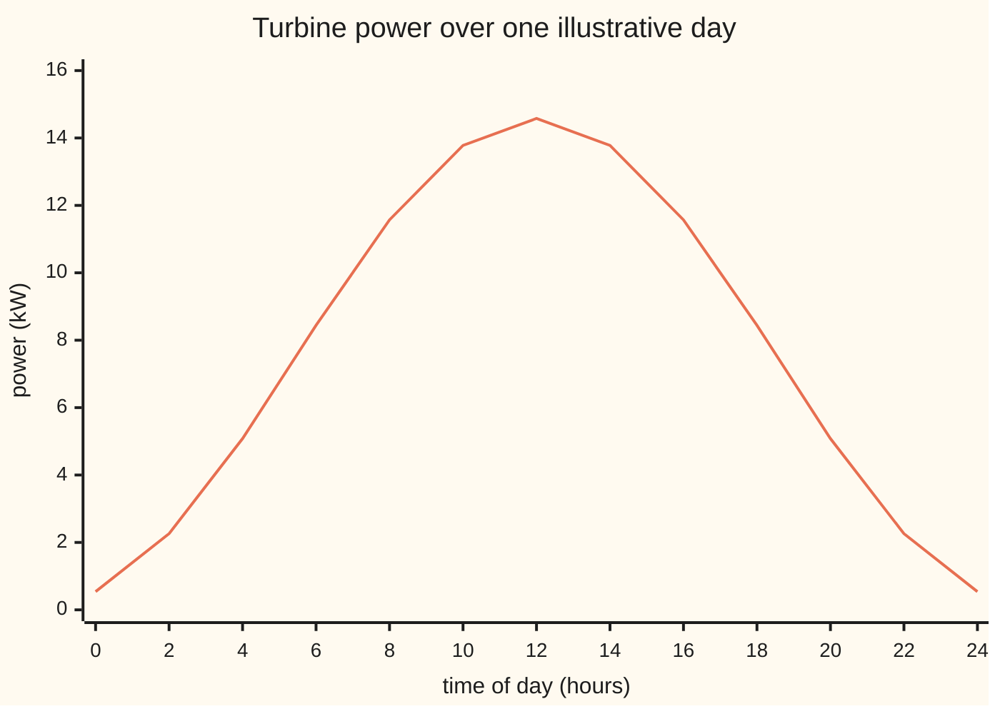
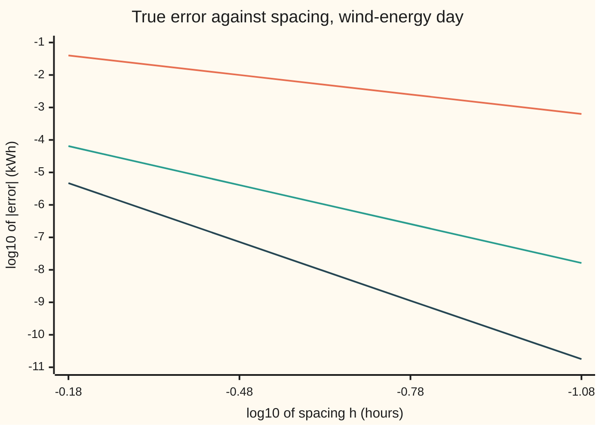

# Trapezoid, midpoint and Simpson: fit a simple shape on each small piece

[Syllabus](../../../SYLLABUS.md) → [Numerical analysis](../README.md) → [Quadrature](../README.md#s05) → Trapezoid, midpoint and Simpson

---

## General Overview

A small wind turbine logs its power output every ten minutes, from midnight to midnight. That is 145 readings, in kilowatts (kW). The owner wants the day's energy in kilowatt-hours (kWh), to well under one kWh. Energy is the area under the power curve, so the job is to turn 145 heights into one area.

In this illustrative day, the wind rises from 3 m/s at midnight to 9 m/s at noon and falls back. The turbine's power is 0.02 kW times the wind speed cubed: 0.54 kW at midnight, 14.58 kW at noon. Because the curve is a known formula here, the true energy is known too: 195.140571429 kWh. Every rule below is judged against that number.

The idea: cut the day into small pieces. On each piece, replace the curve by a simple shape through the readings there, such as a straight line or a parabola. Add the shapes' exact areas.

- **Straight lines** between neighbouring readings give the **trapezoid rule**: 195.138071 kWh, off by 0.0025.
- **Parabolas** through each three readings give **Simpson's rule**: 195.140571 kWh, off by 2.568e-07.
- **Quartics** (degree 4 polynomials) through each five readings give **Boole's rule**: off by 1.134e-09.

A higher-degree shape on each piece is far more accurate. A single high-degree shape across the whole day is not: from eight pieces per shape on, most such rules subtract some readings, and errors in the readings get magnified.

**A Newton-Cotes rule replaces the curve on a short piece by the polynomial through equally spaced readings and integrates that polynomial exactly; a composite rule repeats it piece by piece, and its error falls like the spacing to the power one more than the highest degree it integrates exactly.**

**What kind of fact this is:** a method. Its weights, its degree of exactness and its order of convergence are theorems, proved on this card in Why it works. The failure of high-degree rules is a theorem of Pólya, stated with its source and shown by the checks.

### The picture: the day's power curve



One line: the power P at every second hour, in kW. The energy is the area under it. The worked numbers below use exactly these 13 heights.

---

## The formula

The calculus wing already gives the three everyday rules with their error bounds ([Numerical integration](../../06-Calculus%20and%20analysis/04-Integrals/08-numerical-integration.md)). This card builds the whole family they belong to.

Three words first. A **node** is a point where the curve is read: here, a reading time. A **weight** is the number each reading is multiplied by. A **panel** is one piece of the interval, covering m slices of width h, with m + 1 equally spaced nodes.

One panel, read at the nodes $x_0, \dots, x_m$:

$$\int_{x_0}^{x_m} P(t)\,dt \;\approx\; mh\sum_{j=0}^{m} w_j\,P(x_j), \qquad w_j = \frac{1}{m}\int_0^m \ell_j(s)\,ds, \qquad \ell_j(s) = \prod_{k \ne j}\frac{s-k}{j-k}$$

**Read it aloud:** the panel's area is its width times a weighted average of its readings, and each weight is the average height, over the panel, of the polynomial that is 1 at that node and 0 at the others.

The **degree of exactness** $d$ is the highest degree such that the rule gets the area of every polynomial of that degree or less exactly right.

The **composite rule** $Q_n$ cuts $[a, b]$ into $n$ slices, so $n/m$ panels, and adds the panel areas. Its error obeys

$$|E - Q_n| \;\le\; (1 + W_m)\,(b-a)\,B\,\frac{(mh)^{d+1}}{(d+1)!}, \qquad W_m = \sum_{j=0}^{m} |w_j|$$

**Read it aloud:** the error is at most a constant times the panel width to the power one more than the rule's degree of exactness, and the constant grows with the total size of the weights. Here $B$ is a ceiling on the size of the $(d+1)$th derivative of $P$ on $[a, b]$.

| Rule | Points per panel | Weights $w_j$ (per unit width) | Degree $d$ | Error falls like |
| --- | --- | --- | --- | --- |
| Midpoint (open) | 1, at the centre | 1 | 1 | $h^2$ |
| Trapezoid, $m = 1$ | 2 | 1/2, 1/2 | 1 | $h^2$ |
| Simpson, $m = 2$ | 3 | 1/6, 2/3, 1/6 | 3 | $h^4$ |
| Three-eighths, $m = 3$ | 4 | 1/8, 3/8, 3/8, 1/8 | 3 | $h^4$ |
| Boole, $m = 4$ | 5 | 7/90, 16/45, 2/15, 16/45, 7/90 | 5 | $h^6$ |

A **closed** rule uses both ends of the panel as nodes. An **open** rule uses only interior points: the midpoint rule is the one-point open rule.

| Symbol | Plain meaning | In our example | Push it up and the answer… |
| --- | --- | --- | --- |
| $t$, $x$ | time of day, in hours; $x$ is the variable of the bell test in Step 4 | 0 to 24 | — |
| $P(t) = c\,v(t)^3$ | turbine power in kW; $v$ is the wind speed in m/s, $c$ a turbine constant | $c = 0.02$; 0.54 kW at midnight, 14.58 kW at noon | more energy |
| $a$, $b$ | the ends of the interval | 0 h and 24 h | raise $b$: more energy; raise $a$: less; the error bound grows with $b - a$ |
| $h$, $n$ | the spacing of the readings, and the number of slices, $n = (b-a)/h$ | 1/6 hour (10 minutes), 144 | larger $h$: error grows like $h^{d+1}$ |
| $x_j$, $j$, $k$ | the nodes in a panel, and the counters that number them | readings 10 minutes apart | — |
| $m$ | slices per panel | 1, 2, 3, 4 for trapezoid, Simpson, three-eighths, Boole | higher degree, until the weights turn negative |
| $w_j$ | the weights, per unit of panel width; they add to 1 | 1/6, 2/3, 1/6 for Simpson | — |
| $\ell_j(s)$, $s$ | the Lagrange basis polynomial: 1 at node $j$, 0 at the other nodes; $s$ counts slices from the panel's start | $\ell_0(s) = 1 - s$ for the trapezoid | — |
| $d$ | the degree of exactness | 1, 3, 3, 5 | the error falls faster as $h$ shrinks |
| $E$, $Q_n$ | the true energy, and a rule's computed energy | 195.140571429 kWh; Simpson gives 195.140571 | — |
| $W_m$ | the total size of the weights | 1 while all weights are positive; 7.5317 at $m = 12$ | reading errors and the bound grow |
| $B$ | a ceiling on the size of the $(d+1)$th derivative of $P$ on $[a, b]$ | used in the proof | a larger bound |

### When it holds

- **The curve is smooth.** The bound needs the $(d+1)$th derivative to exist and stay bounded. A kink, such as a turbine hitting its maximum output, breaks this and the error stops falling at the promised rate. [Adaptive quadrature and awkward integrals](05-adaptive-and-improper-quadrature.md) handles that case.
- **The slices fit the panels.** The number of slices must be a multiple of m. With 143 slices, Simpson's weights give an error of 0.0380 kWh in size, against 2.568e-07 on 144 slices.
- **The readings are equally spaced.** The weights assume nodes at equal steps. A late or missing reading needs its own weights.
- **The weights are positive.** Then $W_m = 1$, and an error in the readings passes into the answer without growth. From $m = 8$ on (except $m = 9$), some weights are negative and reading errors are magnified by $W_m$.
- **Rounding stays below the method's error.** Here, rounding sets a floor near 1e-13 kWh.

---

## Why it works

### Step 0: replace the curve by a polynomial, then integrate the polynomial

Through m + 1 readings passes exactly one polynomial of degree m or less: the interpolating polynomial. Its area is exact and easy to find.

That polynomial is a sum of the readings, each times its own basis polynomial: $\sum_j P(x_j)\,\ell_j(s)$. Integrate it term by term and each reading comes out multiplied by the area of its basis polynomial. That area is the weight. The weights depend only on where the nodes sit, not on the curve, so they are computed once and reused on every panel.

### Step 1: the weights, rule by rule

- **Trapezoid, m = 1.** The basis polynomials are $\ell_0(s) = 1 - s$ and $\ell_1(s) = s$ on $[0, 1]$. Each has average height 1/2. So the panel area is $h\,(P_0 + P_1)/2$: the trapezoid.
- **Midpoint.** One node at the centre. The only basis polynomial is the constant 1, so the weight is 1: width times the centre height.
- **Simpson, m = 2.** The calculus card finds 1/6, 2/3, 1/6 by making the rule exact for 1, t and t squared ([Numerical integration](../../06-Calculus%20and%20analysis/04-Integrals/08-numerical-integration.md)). Integrating the three basis parabolas gives the same numbers.
- **Three-eighths, m = 3.** By symmetry the two end weights match, and so do the two inner ones. On a panel of width 1 with nodes 0, 1/3, 2/3, 1, exactness for 1 gives 2 × end + 2 × inner = 1. Exactness for $s^2$ gives end × (0 + 1) + inner × (1/9 + 4/9) = 1/3. So inner = 3/8 and end = 1/8.
- **Boole, m = 4.** The same integrals give 7/90, 16/45, 2/15, 16/45, 7/90.

The checks integrate every basis polynomial in exact fractions and reproduce the rules table. They add two open rules: points 1/3, 2/3 with weights 1/2, 1/2, and Milne's points 1/4, 1/2, 3/4 with weights 2/3, −1/3, 2/3.

### Step 2: the degree of exactness, and a free extra degree

A polynomial of degree m or less is its own interpolating polynomial. So every rule built on m + 1 nodes integrates it exactly, and $d \ge m$.

When m is even, the rule gets one more degree free. Put the origin at the panel's centre. The power $(s - \text{centre})^{m+1}$ is then an odd power: its area over the panel is zero. The nodes sit in mirror pairs with equal weights, so the readings also cancel in pairs, and the rule gives zero too. Any polynomial of degree m + 1 is a multiple of that odd power plus lower terms, so the rule is exact on all of them.

That is why Simpson (m = 2) has degree 3, not 2, and Boole (m = 4) has degree 5. The three-eighths rule (m = 3, odd) gains nothing, so it has degree 3 like Simpson while using one more point per panel. The midpoint rule gains in the same way: one node, degree 1.

The checks test each rule on powers of s in exact fractions, stopping at the first miss: degrees 1, 1, 3, 3, 5 for the five main rules, 1 and 3 for the two open rules, 7 for the seven-point rule (m = 6).

That seven-point rule gives a second road to the day's energy. The power curve is a polynomial of degree 6 (wind speed is degree 2, cubed). Seven readings, four hours apart, with degree 7 > 6, must give the exact area. In fractions they give 170748/875 kWh, exactly the closed form. In floating point they give 195.140571429, off by 0.0e+00.

### Step 3: composite rules, and why the order is d + 1

One panel of width mh errs by roughly a constant times $(mh)^{d+2}$. There are $(b-a)/(mh)$ panels. Multiply, and the total error is a constant times $(mh)^{d+1}$. So halving the spacing divides the error by $2^{d+1}$: by 4 for trapezoid and midpoint, 16 for Simpson and three-eighths, 64 for Boole.

<details>
<summary>Detailed proof: the composite error bound</summary>

Take one panel of width $mh$. Expand $P$ by Taylor's theorem to degree $d$ about the panel's start. The leftover, $P$ minus that Taylor polynomial, is at most $B\,(mh)^{d+1}/(d+1)!$ in size anywhere on the panel.

The rule is exact on the Taylor polynomial, because its degree is $d$. So the panel error is the rule's error on the leftover alone.

The true area of the leftover is at most $mh$ times its largest size. The rule's value on it is $mh \sum_j w_j$ times leftover values, at most $mh\,W_m$ times its largest size. So the panel error is at most $(1 + W_m)\,mh\,B\,(mh)^{d+1}/(d+1)!$.

There are $(b-a)/(mh)$ panels. Adding their bounds gives $(1 + W_m)(b-a)\,B\,(mh)^{d+1}/(d+1)!$. ∎

The constant is crude. [Error bounds and Romberg](02-error-bounds-and-romberg.md) gives the sharp ones, such as Simpson's 1/180. The point here is the power of $mh$, and the factor $1 + W_m$.

</details>

The checks run all five rules at spacings of 40, 20, 10 and 5 minutes and measure the true error. The observed orders, from 10 to 5 minutes, are 2.00, 2.00, 4.00, 4.00 and 6.00: exactly d + 1.

| Rule | Error at 40 min (kWh) | at 20 min | at 10 min | at 5 min | Observed order |
| --- | --- | --- | --- | --- | --- |
| Midpoint | 1.999e-02 | 4.999e-03 | 1.250e-03 | 3.125e-04 | 2.00 |
| Trapezoid | −3.998e-02 | −9.999e-03 | −2.500e-03 | −6.250e-04 | 2.00 |
| Simpson | −6.439e-05 | −4.093e-06 | −2.568e-07 | −1.607e-08 | 4.00 |
| Three-eighths | −1.416e-04 | −9.157e-06 | −5.771e-07 | −3.614e-08 | 4.00 |
| Boole | −4.645e-06 | −7.258e-08 | −1.134e-09 | −1.774e-11 | 6.00 |

The midpoint error is −0.5000 times the trapezoid error: half the size, opposite sign. Three-eighths spends four points per panel against Simpson's three. At the same spacing both use every reading and reach the same order, and three-eighths errs more: −5.771e-07 against −2.568e-07 at 10 minutes.

Rounding already touches Boole's last entry. The same rule in exact fractions errs by −1.772e-11 at 5 minutes, so the fourth digit of −1.774e-11 is rounding. One more halving still helps, to −2.558e-13 at 2.5 minutes. After that the error stops falling: −8.527e-14 and 2.274e-13 at 1.25 and 0.625 minutes. That is the rounding floor: a few units in the last place (the gap between neighbouring doubles) of a number near 195.



Top line: trapezoid, slope 2. Middle: Simpson, slope 4. Bottom: Boole, slope 6. The spacings are 40, 20, 10 and 5 minutes.

### Step 4: why one high-degree rule on equal spacing goes wrong

If degree buys accuracy, why not one rule of degree 144 through all the readings? Because the weights go bad. The checks compute the closed rules up to m = 12 in exact fractions.

| m (slices per panel) | 1 | 2 | 4 | 6 | 7 | 8 | 9 | 10 | 11 | 12 |
| --- | --- | --- | --- | --- | --- | --- | --- | --- | --- | --- |
| Smallest weight | 0.5000 | 0.1667 | 0.0778 | 0.0321 | 0.0435 | −0.1601 | 0.0121 | −0.4352 | −0.1102 | −1.3922 |
| $W_m$ | 1.0000 | 1.0000 | 1.0000 | 1.0000 | 1.0000 | 1.4512 | 1.0000 | 3.0648 | 1.5894 | 7.5317 |

From m = 8 on, every rule but m = 9 has a negative weight, and $W_m$ grows, unevenly: 1.4512, 3.0648, 1.5894, 7.5317. Two things follow.

1. **Reading errors are magnified.** Readings logged to 0.1 kW can each be off by 0.05 kW. Over 24 hours, a rule with positive weights moves by at most 0.05 × 24 = 1.20 kWh. One 13-point rule (m = 12) moves by up to 9.04 kWh.
2. **The error bound loses its grip.** The factor $1 + W_m$ grows, and the interpolating polynomial itself can swing wildly between equally spaced nodes.

The standard test is the bell $1/(1 + 25x^2)$ on $[-1, 1]$, whose area is 0.5493603068. Compare one rule built on a degree-m polynomial with composite Simpson on the same m + 1 points.

| m | One rule, error | Composite Simpson, error |
| --- | --- | --- |
| 2 | 8.10e-01 | 8.10e-01 |
| 4 | 7.46e-02 | 1.93e-02 |
| 6 | 2.25e-01 | 9.47e-02 |
| 8 | 2.49e-01 | 2.59e-02 |
| 10 | 3.85e-01 | 2.05e-02 |
| 12 | 6.12e-01 | 9.00e-03 |

More points make the single rule worse. The same points, used piece by piece, make composite Simpson better.

Pólya proved in 1933 that a sequence of rules converges for every continuous function exactly when it converges on every polynomial and its weight totals $W$ stay bounded. Newton-Cotes rules pass the first test and fail the second, so there are continuous functions, even infinitely smooth ones, on which they do not converge as m grows. This card states the theorem and shows the failure; the proof is in Pólya's paper. The cure is the one this card uses: keep m small and add panels.

---

## Worked numbers, by hand

Simpson's rule on the 13 readings two hours apart from the chart: h = 2 hours, n = 12 slices, 6 panels. Each panel is 4 hours wide, so the weights 1/6, 2/3, 1/6 become 2/3, 8/3, 2/3 hours. Across shared panel ends this is the familiar 1, 4, 2, 4, …, 4, 1 pattern times h/3 = 2/3.

| Step | Arithmetic | Value |
| --- | --- | --- |
| end readings | 0.54 + 0.54 | 1.0800 kW |
| odd readings, weight 4 | 2.26 + 8.44 + 13.78 + 13.78 + 8.44 + 2.26 | 48.9613 kW |
| even inner readings, weight 2 | 5.08 + 11.57 + 14.58 + 11.57 + 5.08 | 47.8896 kW |
| Simpson | 2/3 × (1.0800 + 4 × 48.9613 + 2 × 47.8896) | 195.1363 kWh |
| its true error | 195.1363 − 195.140571 | −0.0043 kWh |
| trapezoid, same readings | 2 × (1.0800/2 + 48.9613 + 47.8896) | 194.7819 kWh, error −0.3587 |
| Simpson, all 145 readings | the check | **195.140571 kWh** |

The day yields about 195.14 kWh. Thirteen readings and a parabola per four hours already land within 0.0043 kWh. The trapezoid on the same readings is off by 0.3587 kWh.

The sums in the table use the unrounded readings, so they differ slightly from sums of the two-decimal figures.

### What breaks if you drop a piece

| Mistake | Comes out at | What went wrong |
| --- | --- | --- |
| One reading lost, Simpson's weights forced onto 143 slices | 195.0048 kWh against a true 195.0428, error −0.0380 | the last slice has no partner; Simpson on 142 slices plus one trapezoid slice gives 195.0430, error 1.24e-04 |
| Spacing written as 10 (minutes), not 1/6 (hour) | 11708.28 "kWh" | kW times minutes is not kWh: 60 times too big |
| Every reading times h, ends not halved | 195.2281 kWh, error 0.0875 | the two end readings get double their trapezoid weight |
| One rule through 13 equally spaced points, on the bell | error 6.12e-01; composite Simpson 9.00e-03 | weights down to −1.3922, $W_{12}$ = 7.5317 |

---

## Code, from first principles, and it actually runs

The script builds every weight by integrating the Lagrange basis polynomials in exact fractions. It then reaches the day's energy by three independent roads: a closed form from the moments of s(1 − s), the seven-point rule in exact fractions, and five composite rules at four spacings with their observed orders. It also prints the weight table, the bell test and every mistake above. Python's built-in `sum` compensates rounding on floats, so the float sums are written as plain loops, as in Rust; that keeps the two outputs identical.

### Python

```python
# Newton-Cotes and composite rules -- the check behind the card.  Standard library only.
# A day's wind energy (illustrative): wind v(t) = 3 + t(24 - t)/24 m/s at t hours,
# turbine power P = c v^3 kW with c = 0.02, readings every 10 minutes, energy in kWh.
# Road 1: the exact energy from moments of s(1 - s).  Road 2: the 7-point Newton-Cotes
# rule in exact fractions, exact by its degree.  Road 3: five composite rules at four
# spacings, with observed orders.  Every weight is the integral of a Lagrange basis.
from fractions import Fraction as Fr
import math

def v(t): return 3 + t * (24 - t) / 24
def P(t): return v(t) * v(t) * v(t) / 50                  # kW; works on floats and fractions

def weights(nodes, length):                                 # integral of each Lagrange basis over
    ws = []                                                 # [0, length], per unit of width
    for j in nodes:
        poly, den = [Fr(1)], Fr(1)                          # coefficients, constant term first
        for k in nodes:
            if k != j:
                poly = [Fr(0)] + poly                       # multiply by (t - k)
                for r in range(len(poly) - 1):
                    poly[r] -= k * poly[r + 1]
                den *= j - k
        ws.append(sum(c * Fr(length) ** (r + 1) / (r + 1) for r, c in enumerate(poly)) / den / length)
    return ws
def closed(m): return [Fr(j, m) for j in range(m + 1)], weights(range(m + 1), m)
def opened(p): return [Fr(j, p + 1) for j in range(1, p + 1)], weights(range(1, p + 1), p + 1)
def total(terms):                                           # plain left-to-right sum, as in Rust
    s = 0.0                                                 # (Python's sum() compensates floats)
    for t in terms:
        s += t
    return s
def apply(rule, f, a, b, panels):                           # the rule on each panel, added up
    xs, ws = rule
    H = (b - a) / panels
    return total(float(w) * H * f(a + (p + float(x)) * H) for p in range(panels) for x, w in zip(xs, ws))
def fr(q): return f"{q.numerator}/{q.denominator}" if q.denominator > 1 else f"{q.numerator}"

# Road 1: t = 24s, v = 3 + 24u with u = s(1 - s), and the integral of u^j over [0, 1] is j!^2/(2j+1)!
E = Fr(24, 50) * sum(math.comb(3, j) * 3 ** (3 - j) * 24 ** j * Fr(math.factorial(j) ** 2, math.factorial(2 * j + 1)) for j in range(4))
Ef = float(E)
print(f"exact energy, road 1: {fr(E)} kWh = {Ef:.9f} kWh; P at 0 h {P(0.0):.4f} kW, at 12 h {P(12.0):.4f} kW")
print(f"chart, P in kW at t = 0, 2, ..., 24 h: {', '.join(f'{P(2.0 * i):.2f}' for i in range(13))}")
rules = {"midpoint": opened(1), "trapezoid": closed(1), "Simpson": closed(2), "three-eighths": closed(3),
         "Boole": closed(4), "open 2-point": opened(2), "Milne": opened(3), "7-point": closed(6)}
degree = {}
for name, (xs, ws) in rules.items():
    p = 0
    while sum(w * x ** p for x, w in zip(xs, ws)) == Fr(1, p + 1):    # exact fractions, so == is the test
        p += 1
    degree[name] = p - 1
    print(f"{name:>13}: nodes {', '.join(fr(x) for x in xs)}; weights {', '.join(fr(w) for w in ws)}; degree {p - 1}")
assert [degree[k] for k in rules] == [1, 1, 3, 3, 5, 1, 3, 7]          # odd degree from symmetry, every time
assert rules["Simpson"][1] == [Fr(1, 6), Fr(2, 3), Fr(1, 6)] and rules["Boole"][1] == [Fr(7, 90), Fr(16, 45), Fr(2, 15), Fr(16, 45), Fr(7, 90)]

xs7, ws7 = rules["7-point"]                                 # Road 2: one panel, readings every 4 hours
E7 = sum(w * 24 * P(24 * x) for x, w in zip(xs7, ws7))
E7f = apply(rules["7-point"], P, 0.0, 24.0, 1)
print(f"road 2, 7-point rule on 7 readings, fractions: {fr(E7)} kWh; in floats {E7f:.9f}, off by {abs(E7f - Ef):.1e}")
assert E7 == E and abs(E7f - Ef) < 1e-12                    # degree 7 >= 6: exact, up to rounding

print("road 3: errors in kWh (true error) at spacing 40, 20, 10, 5 minutes; observed order")
errs = {}
for name in ("midpoint", "trapezoid", "Simpson", "three-eighths", "Boole"):
    m = len(rules[name][0]) - 1 if name != "midpoint" else 1
    errs[name] = [apply(rules[name], P, 0.0, 24.0, n // m) - Ef for n in (36, 72, 144, 288)]
    orders = [math.log2(abs(errs[name][i] / errs[name][i + 1])) for i in range(3)]
    print(f"{name:>13}: {', '.join(f'{e:.3e}' for e in errs[name])}; order {', '.join(f'{o:.2f}' for o in orders)}")
    assert abs(orders[-1] - (degree[name] + 1)) < 0.05      # order = degree of exactness + 1
Bx = float(sum(w * Fr(1, 3) * P(Fr(p, 3) + x / 3) for p in range(72) for x, w in zip(*rules["Boole"])) - E)
print(f"Boole at 5 minutes in exact fractions: error {Bx:.3e}; in floats {errs['Boole'][3]:.3e}")
assert abs(Bx - errs["Boole"][3]) < 1e-13 and abs(Bx) > 1e-11   # rounding moves only the 4th digit
floor = [apply(rules["Boole"], P, 0.0, 24.0, n // 4) - Ef for n in (576, 1152, 2304)]
print(f"rounding floor: Boole at 2.5, 1.25, 0.625 minutes: {', '.join(f'{e:.3e}' for e in floor)}")
h2 = [P(2.0 * i) for i in range(13)]                       # by hand: 13 readings, 2 hours apart
ends, odd, even = h2[0] + h2[12], total(h2[1:12:2]), total(h2[2:11:2])
S12, T12 = 2 / 3 * (ends + 4 * odd + 2 * even), 2 * (ends / 2 + odd + even)
print(f"by hand, 2-hour readings: ends {ends:.4f}, odd sum {odd:.4f}, even inner sum {even:.4f}; Simpson {S12:.4f}, error {S12 - Ef:.4f}; trapezoid {T12:.4f}, error {T12 - Ef:.4f}")
assert abs(S12 - apply(rules["Simpson"], P, 0.0, 24.0, 6)) < 1e-12 and abs(S12 - Ef) < abs(T12 - Ef) / 50
T10, S10, B10 = (apply(rules[k], P, 0.0, 24.0, 144 // m) for k, m in (("trapezoid", 1), ("Simpson", 2), ("Boole", 4)))
print(f"10-minute readings, 145 of them: trapezoid {T10:.6f}, Simpson {S10:.6f}, Boole {B10:.9f} kWh")
assert abs(errs["midpoint"][2] / errs["trapezoid"][2] + 0.5) < 0.01   # midpoint error: half, opposite sign
print(f"midpoint over trapezoid error at 10 minutes: {errs['midpoint'][2] / errs['trapezoid'][2]:.4f}")
for name in ("trapezoid", "Simpson", "Boole"):
    print(f"chart, {name} log10 |error| at log10 h = -0.18, -0.48, -0.78, -1.08: {', '.join(f'{math.log10(abs(e)):.2f}' for e in errs[name])}")

print("closed rules: m slices per panel, sum of |weights| per unit width, smallest weight")
grow = []
for m in range(1, 13):
    ws = closed(m)[1]
    grow.append(sum(abs(w) for w in ws))
    if m in (1, 2, 4, 6, 7, 8, 9, 10, 11, 12):
        print(f"m = {m:2}: sum |w| {float(grow[-1]):.4f}, smallest {float(min(ws)):.4f}")
assert all(g == 1 for g in grow[:7]) and grow[7] > 1 and all(grow[i] < grow[i + 2] for i in range(7, 10))
print(f"noise: readings off by up to 0.05 kW move the answer at most 0.05 x 24 x sum |w|: composite {0.05 * 24:.2f} kWh, one 13-point rule {0.05 * 24 * float(grow[11]):.2f} kWh")

def runge(x): return 1 / (1 + 25 * x * x)
R = 0.4 * math.atan(5.0)
print(f"bell 1/(1 + 25x^2) on [-1, 1], exact {R:.10f}; m + 1 equally spaced points")
bad = []
for m in (2, 4, 6, 8, 10, 12):
    one, comp = apply(closed(m), runge, -1.0, 1.0, 1), apply(closed(2), runge, -1.0, 1.0, m // 2)
    bad.append((abs(one - R), abs(comp - R)))
    print(f"m = {m:2}: one degree-{m} rule error {abs(one - R):.2e}; composite Simpson on the same points {abs(comp - R):.2e}")
assert bad[-1][0] > bad[2][0] and bad[-1][1] < bad[2][1] < bad[0][1]   # the one rule worsens, the composite improves

T143 = 143 / 6                                              # one reading lost: 143 slices to 23:50
E143 = sum(w * Fr(143, 6) * P(Fr(143, 6) * x) for x, w in zip(xs7, ws7))   # exact by the 7-point rule
h = 1 / 6
s143 = h / 3 * (P(0.0) + P(T143) + total((4 if i % 2 else 2) * P(i * h) for i in range(1, 143)))
s142 = apply(rules["Simpson"], P, 0.0, 142 / 6, 71) + apply(rules["trapezoid"], P, 142 / 6, T143, 1)
plain = total(P(i * h) for i in range(145)) * h
print(f"mistake, Simpson weights on 143 slices: {s143:.4f} kWh against {float(E143):.4f}, error {s143 - float(E143):.4f}")
print(f"repair: Simpson on 142 slices plus one trapezoid slice: {s142:.4f} kWh, error {s142 - float(E143):.2e}")
print(f"mistake, h in minutes (10, not 1/6 hour): {apply(rules['trapezoid'], lambda t: P(t / 60), 0.0, 1440.0, 144):.2f} 'kWh'")
print(f"mistake, every reading times h, no halved ends: {plain:.4f} kWh, error {plain - Ef:.4f}")
assert abs(s143 - float(E143)) > 100 * abs(s142 - float(E143)) and abs(plain - T10 - h * P(0.0)) < 1e-9
assert abs(s143 - (s142 - h / 6 * (P(142 * h) + P(T143)))) < 1e-12   # last slice weighted h/3, h/3, not h/2, h/2
print("ALL CHECKS PASS")
```

**Ran 2026-11-11 on macOS, Python 3.14.10, standard library only. All checks passed. Output, pasted from the run:**

```
exact energy, road 1: 170748/875 kWh = 195.140571429 kWh; P at 0 h 0.5400 kW, at 12 h 14.5800 kW
chart, P in kW at t = 0, 2, ..., 24 h: 0.54, 2.26, 5.08, 8.44, 11.57, 13.78, 14.58, 13.78, 11.57, 8.44, 5.08, 2.26, 0.54
     midpoint: nodes 1/2; weights 1; degree 1
    trapezoid: nodes 0, 1; weights 1/2, 1/2; degree 1
      Simpson: nodes 0, 1/2, 1; weights 1/6, 2/3, 1/6; degree 3
three-eighths: nodes 0, 1/3, 2/3, 1; weights 1/8, 3/8, 3/8, 1/8; degree 3
        Boole: nodes 0, 1/4, 1/2, 3/4, 1; weights 7/90, 16/45, 2/15, 16/45, 7/90; degree 5
 open 2-point: nodes 1/3, 2/3; weights 1/2, 1/2; degree 1
        Milne: nodes 1/4, 1/2, 3/4; weights 2/3, -1/3, 2/3; degree 3
      7-point: nodes 0, 1/6, 1/3, 1/2, 2/3, 5/6, 1; weights 41/840, 9/35, 9/280, 34/105, 9/280, 9/35, 41/840; degree 7
road 2, 7-point rule on 7 readings, fractions: 170748/875 kWh; in floats 195.140571429, off by 0.0e+00
road 3: errors in kWh (true error) at spacing 40, 20, 10, 5 minutes; observed order
     midpoint: 1.999e-02, 4.999e-03, 1.250e-03, 3.125e-04; order 2.00, 2.00, 2.00
    trapezoid: -3.998e-02, -9.999e-03, -2.500e-03, -6.250e-04; order 2.00, 2.00, 2.00
      Simpson: -6.439e-05, -4.093e-06, -2.568e-07, -1.607e-08; order 3.98, 3.99, 4.00
three-eighths: -1.416e-04, -9.157e-06, -5.771e-07, -3.614e-08; order 3.95, 3.99, 4.00
        Boole: -4.645e-06, -7.258e-08, -1.134e-09, -1.774e-11; order 6.00, 6.00, 6.00
Boole at 5 minutes in exact fractions: error -1.772e-11; in floats -1.774e-11
rounding floor: Boole at 2.5, 1.25, 0.625 minutes: -2.558e-13, -8.527e-14, 2.274e-13
by hand, 2-hour readings: ends 1.0800, odd sum 48.9613, even inner sum 47.8896; Simpson 195.1363, error -0.0043; trapezoid 194.7819, error -0.3587
10-minute readings, 145 of them: trapezoid 195.138071, Simpson 195.140571, Boole 195.140571427 kWh
midpoint over trapezoid error at 10 minutes: -0.5000
chart, trapezoid log10 |error| at log10 h = -0.18, -0.48, -0.78, -1.08: -1.40, -2.00, -2.60, -3.20
chart, Simpson log10 |error| at log10 h = -0.18, -0.48, -0.78, -1.08: -4.19, -5.39, -6.59, -7.79
chart, Boole log10 |error| at log10 h = -0.18, -0.48, -0.78, -1.08: -5.33, -7.14, -8.95, -10.75
closed rules: m slices per panel, sum of |weights| per unit width, smallest weight
m =  1: sum |w| 1.0000, smallest 0.5000
m =  2: sum |w| 1.0000, smallest 0.1667
m =  4: sum |w| 1.0000, smallest 0.0778
m =  6: sum |w| 1.0000, smallest 0.0321
m =  7: sum |w| 1.0000, smallest 0.0435
m =  8: sum |w| 1.4512, smallest -0.1601
m =  9: sum |w| 1.0000, smallest 0.0121
m = 10: sum |w| 3.0648, smallest -0.4352
m = 11: sum |w| 1.5894, smallest -0.1102
m = 12: sum |w| 7.5317, smallest -1.3922
noise: readings off by up to 0.05 kW move the answer at most 0.05 x 24 x sum |w|: composite 1.20 kWh, one 13-point rule 9.04 kWh
bell 1/(1 + 25x^2) on [-1, 1], exact 0.5493603068; m + 1 equally spaced points
m =  2: one degree-2 rule error 8.10e-01; composite Simpson on the same points 8.10e-01
m =  4: one degree-4 rule error 7.46e-02; composite Simpson on the same points 1.93e-02
m =  6: one degree-6 rule error 2.25e-01; composite Simpson on the same points 9.47e-02
m =  8: one degree-8 rule error 2.49e-01; composite Simpson on the same points 2.59e-02
m = 10: one degree-10 rule error 3.85e-01; composite Simpson on the same points 2.05e-02
m = 12: one degree-12 rule error 6.12e-01; composite Simpson on the same points 9.00e-03
mistake, Simpson weights on 143 slices: 195.0048 kWh against 195.0428, error -0.0380
repair: Simpson on 142 slices plus one trapezoid slice: 195.0430 kWh, error 1.24e-04
mistake, h in minutes (10, not 1/6 hour): 11708.28 'kWh'
mistake, every reading times h, no halved ends: 195.2281 kWh, error 0.0875
ALL CHECKS PASS
```

### Rust

Built with `rustc --edition 2021 -O`. Exact fractions use a small struct of two 128-bit integers, with checked multiplication and addition, so an overflow stops the run instead of wrapping.

```rust
// Newton-Cotes and composite rules -- the same check as the Python, in Rust.  No crates.
// A day's wind energy (illustrative): wind v(t) = 3 + t(24 - t)/24 m/s at t hours,
// turbine power P = c v^3 kW with c = 0.02, readings every 10 minutes, energy in kWh.
// Road 1: the exact energy from moments of s(1 - s).  Road 2: the 7-point Newton-Cotes
// rule in exact fractions, exact by its degree.  Road 3: five composite rules at four
// spacings, with observed orders.  Every weight is the integral of a Lagrange basis.
#[derive(Clone, Copy, PartialEq, Debug)]
struct Q { n: i128, d: i128 }                           // a fraction in lowest terms, d > 0
fn gcd(a: i128, b: i128) -> i128 { if b == 0 { a.abs() } else { gcd(b, a % b) } }
fn q(n: i128, d: i128) -> Q { let g = gcd(n, d) * d.signum(); Q { n: n / g, d: d / g } }
fn add(a: Q, b: Q) -> Q { q(a.n.checked_mul(b.d).unwrap().checked_add(b.n.checked_mul(a.d).unwrap()).unwrap(), a.d.checked_mul(b.d).unwrap()) }
fn mul(a: Q, b: Q) -> Q { let (g, h) = (gcd(a.n, b.d).max(1), gcd(b.n, a.d).max(1)); q((a.n / g).checked_mul(b.n / h).unwrap(), (a.d / h).checked_mul(b.d / g).unwrap()) }
fn div(a: Q, b: Q) -> Q { mul(a, q(b.d, b.n)) }
fn qi(n: i128) -> Q { Q { n, d: 1 } }
fn fl(a: Q) -> f64 { a.n as f64 / a.d as f64 }
fn fr(a: Q) -> String { if a.d > 1 { format!("{}/{}", a.n, a.d) } else { format!("{}", a.n) } }
fn sci(x: f64, d: usize) -> String {                    // 1.2e-5 written 1.2e-05, as Python does
    let s = format!("{:.*e}", d, x);
    let (m, e) = s.split_once('e').unwrap();
    let e: i32 = e.parse().unwrap();
    format!("{}e{}{:02}", m, if e < 0 { '-' } else { '+' }, e.abs())
}
fn v(t: f64) -> f64 { 3.0 + t * (24.0 - t) / 24.0 }
fn p(t: f64) -> f64 { v(t) * v(t) * v(t) / 50.0 }      // kW
fn pq(t: Q) -> Q { let v = add(qi(3), div(mul(t, add(qi(24), q(-t.n, t.d))), qi(24))); div(mul(mul(v, v), v), qi(50)) }
type Rule = (Vec<Q>, Vec<Q>);
fn weights(nodes: &[i128], length: i128) -> Vec<Q> {   // integral of each Lagrange basis over [0, length], per unit width
    nodes.iter().map(|&j| {
        let (mut poly, mut den) = (vec![qi(1)], qi(1));  // coefficients, constant term first
        for &k in nodes.iter().filter(|&&k| k != j) {
            poly.insert(0, qi(0));                       // multiply by (t - k)
            for r in 0..poly.len() - 1 { poly[r] = add(poly[r], mul(qi(-k), poly[r + 1])); }
            den = mul(den, qi(j - k));
        }
        let mut s = qi(0);
        for (r, &c) in poly.iter().enumerate() { s = add(s, mul(c, q(length.pow(r as u32 + 1), r as i128 + 1))); }
        div(div(s, den), qi(length))
    }).collect()
}
fn closed(m: i128) -> Rule { let n: Vec<i128> = (0..=m).collect(); (n.iter().map(|&j| q(j, m)).collect(), weights(&n, m)) }
fn opened(k: i128) -> Rule { let n: Vec<i128> = (1..=k).collect(); (n.iter().map(|&j| q(j, k + 1)).collect(), weights(&n, k + 1)) }
fn apply(rule: &Rule, f: &dyn Fn(f64) -> f64, a: f64, b: f64, panels: usize) -> f64 {
    let hh = (b - a) / panels as f64;
    let mut s = 0.0;
    for pn in 0..panels { for (x, w) in rule.0.iter().zip(&rule.1) { s += fl(*w) * hh * f(a + (pn as f64 + fl(*x)) * hh); } }
    s
}
fn qpow(x: Q, k: usize) -> Q { (0..k).fold(qi(1), |acc, _| mul(acc, x)) }
fn fact(n: i128) -> i128 { (1..=n).product() }
fn join(xs: &[String]) -> String { xs.join(", ") }
fn main() {
    let mut e = qi(0);                                    // road 1: t = 24s, v = 3 + 24u, u = s(1 - s)
    for j in 0..4i128 {
        let c = [1, 3, 3, 1][j as usize] * 3i128.pow(3 - j as u32) * 24i128.pow(j as u32);
        e = add(e, q(c * fact(j) * fact(j), fact(2 * j + 1)));
    }
    let e = mul(q(24, 50), e);
    let ef = fl(e);
    println!("exact energy, road 1: {} kWh = {:.9} kWh; P at 0 h {:.4} kW, at 12 h {:.4} kW", fr(e), ef, p(0.0), p(12.0));
    println!("chart, P in kW at t = 0, 2, ..., 24 h: {}", join(&(0..13).map(|i| format!("{:.2}", p(2.0 * i as f64))).collect::<Vec<_>>()));
    let names = ["midpoint", "trapezoid", "Simpson", "three-eighths", "Boole", "open 2-point", "Milne", "7-point"];
    let rules: Vec<Rule> = vec![opened(1), closed(1), closed(2), closed(3), closed(4), opened(2), opened(3), closed(6)];
    let mut degree = vec![];
    for (name, (xs, ws)) in names.iter().zip(&rules) {
        let mut k = 0;
        while xs.iter().zip(ws).fold(qi(0), |s, (x, w)| add(s, mul(*w, qpow(*x, k)))) == q(1, k as i128 + 1) { k += 1; }
        degree.push(k - 1);
        println!("{:>13}: nodes {}; weights {}; degree {}", name, join(&xs.iter().map(|x| fr(*x)).collect::<Vec<_>>()),
                 join(&ws.iter().map(|w| fr(*w)).collect::<Vec<_>>()), k - 1);
    }
    assert!(degree == vec![1, 1, 3, 3, 5, 1, 3, 7]);      // odd degree from symmetry, every time
    assert!(rules[2].1 == vec![q(1, 6), q(2, 3), q(1, 6)] && rules[4].1 == vec![q(7, 90), q(16, 45), q(2, 15), q(16, 45), q(7, 90)]);
    let r7 = &rules[7];                                  // road 2: one panel, readings every 4 hours
    let e7 = r7.0.iter().zip(&r7.1).fold(qi(0), |s, (x, w)| add(s, mul(mul(*w, qi(24)), pq(mul(qi(24), *x)))));
    let e7f = apply(r7, &p, 0.0, 24.0, 1);
    println!("road 2, 7-point rule on 7 readings, fractions: {} kWh; in floats {:.9}, off by {}", fr(e7), e7f, sci((e7f - ef).abs(), 1));
    assert!(e7 == e && (e7f - ef).abs() < 1e-12);         // degree 7 >= 6: exact, up to rounding
    println!("road 3: errors in kWh (true error) at spacing 40, 20, 10, 5 minutes; observed order");
    let mut errs = vec![];
    for i in 0..5 {
        let m = if i == 0 { 1 } else { rules[i].0.len() - 1 };
        let er: Vec<f64> = [36, 72, 144, 288].iter().map(|n| apply(&rules[i], &p, 0.0, 24.0, n / m) - ef).collect();
        let orders: Vec<f64> = (0..3).map(|k| (er[k] / er[k + 1]).abs().log2()).collect();
        println!("{:>13}: {}; order {}", names[i], join(&er.iter().map(|x| sci(*x, 3)).collect::<Vec<_>>()),
                 join(&orders.iter().map(|o| format!("{:.2}", o)).collect::<Vec<_>>()));
        assert!((orders[2] - (degree[i] + 1) as f64).abs() < 0.05);   // order = degree of exactness + 1
        errs.push(er);
    }
    let bx = (0..72).fold(qi(0), |s, pn| rules[4].0.iter().zip(&rules[4].1).fold(s, |s, (x, w)| add(s, mul(mul(*w, q(1, 3)), pq(mul(add(qi(pn), *x), q(1, 3)))))));
    let bx = fl(add(bx, q(-e.n, e.d)));
    println!("Boole at 5 minutes in exact fractions: error {}; in floats {}", sci(bx, 3), sci(errs[4][3], 3));
    assert!((bx - errs[4][3]).abs() < 1e-13 && bx.abs() > 1e-11);   // rounding moves only the 4th digit
    let floor: Vec<String> = [576, 1152, 2304].iter().map(|n| sci(apply(&rules[4], &p, 0.0, 24.0, n / 4) - ef, 3)).collect();
    println!("rounding floor: Boole at 2.5, 1.25, 0.625 minutes: {}", join(&floor));
    let h2: Vec<f64> = (0..13).map(|i| p(2.0 * i as f64)).collect();   // by hand: 13 readings, 2 hours apart
    let (ends, odd, even) = (h2[0] + h2[12], (1..12).step_by(2).fold(0.0, |s, i| s + h2[i]), (2..11).step_by(2).fold(0.0, |s, i| s + h2[i]));
    let (s12, t12) = (2.0 / 3.0 * (ends + 4.0 * odd + 2.0 * even), 2.0 * (ends / 2.0 + odd + even));
    println!("by hand, 2-hour readings: ends {:.4}, odd sum {:.4}, even inner sum {:.4}; Simpson {:.4}, error {:.4}; trapezoid {:.4}, error {:.4}", ends, odd, even, s12, s12 - ef, t12, t12 - ef);
    assert!((s12 - apply(&rules[2], &p, 0.0, 24.0, 6)).abs() < 1e-12 && (s12 - ef).abs() < (t12 - ef).abs() / 50.0);
    let (t10, s10, b10) = (apply(&rules[1], &p, 0.0, 24.0, 144), apply(&rules[2], &p, 0.0, 24.0, 72), apply(&rules[4], &p, 0.0, 24.0, 36));
    println!("10-minute readings, 145 of them: trapezoid {:.6}, Simpson {:.6}, Boole {:.9} kWh", t10, s10, b10);
    assert!((errs[0][2] / errs[1][2] + 0.5).abs() < 0.01);   // midpoint error: half, opposite sign
    println!("midpoint over trapezoid error at 10 minutes: {:.4}", errs[0][2] / errs[1][2]);
    for i in [1, 2, 4] {
        println!("chart, {} log10 |error| at log10 h = -0.18, -0.48, -0.78, -1.08: {}", names[i],
                 join(&errs[i].iter().map(|x| format!("{:.2}", x.abs().log10())).collect::<Vec<_>>()));
    }
    println!("closed rules: m slices per panel, sum of |weights| per unit width, smallest weight");
    let mut grow = vec![];
    for m in 1..=12i128 {
        let ws = closed(m).1;
        grow.push(ws.iter().fold(qi(0), |s, w| add(s, q(w.n.abs(), w.d))));
        let small = ws.iter().map(|w| fl(*w)).fold(f64::INFINITY, f64::min);
        if [1, 2, 4, 6, 7, 8, 9, 10, 11, 12].contains(&m) { println!("m = {:2}: sum |w| {:.4}, smallest {:.4}", m, fl(grow[m as usize - 1]), small); }
    }
    assert!(grow[..7].iter().all(|g| *g == qi(1)) && fl(grow[7]) > 1.0 && (7..10).all(|i| fl(grow[i]) < fl(grow[i + 2])));
    println!("noise: readings off by up to 0.05 kW move the answer at most 0.05 x 24 x sum |w|: composite {:.2} kWh, one 13-point rule {:.2} kWh",
             0.05 * 24.0, 0.05 * 24.0 * fl(grow[11]));
    let runge = |x: f64| 1.0 / (1.0 + 25.0 * x * x);
    let rr = 0.4 * 5f64.atan();
    println!("bell 1/(1 + 25x^2) on [-1, 1], exact {:.10}; m + 1 equally spaced points", rr);
    let mut bad = vec![];
    for m in [2, 4, 6, 8, 10, 12] {
        let (one, comp) = (apply(&closed(m), &runge, -1.0, 1.0, 1), apply(&closed(2), &runge, -1.0, 1.0, m as usize / 2));
        bad.push(((one - rr).abs(), (comp - rr).abs()));
        println!("m = {:2}: one degree-{} rule error {}; composite Simpson on the same points {}", m, m, sci((one - rr).abs(), 2), sci((comp - rr).abs(), 2));
    }
    assert!(bad[5].0 > bad[2].0 && bad[5].1 < bad[2].1 && bad[2].1 < bad[0].1);   // the one rule worsens, the composite improves
    let t143 = 143.0 / 6.0;                               // one reading lost: 143 slices to 23:50
    let e143 = fl(r7.0.iter().zip(&r7.1).fold(qi(0), |s, (x, w)| add(s, mul(mul(*w, q(143, 6)), pq(mul(q(143, 6), *x))))));
    let h = 1.0 / 6.0;
    let s143 = h / 3.0 * (p(0.0) + p(t143) + (1..143).fold(0.0, |s, i| s + if i % 2 == 1 { 4.0 } else { 2.0 } * p(i as f64 * h)));
    let s142 = apply(&rules[2], &p, 0.0, 142.0 / 6.0, 71) + apply(&rules[1], &p, 142.0 / 6.0, t143, 1);
    let plain = (0..145).fold(0.0, |s, i| s + p(i as f64 * h)) * h;
    println!("mistake, Simpson weights on 143 slices: {:.4} kWh against {:.4}, error {:.4}", s143, e143, s143 - e143);
    println!("repair: Simpson on 142 slices plus one trapezoid slice: {:.4} kWh, error {}", s142, sci(s142 - e143, 2));
    println!("mistake, h in minutes (10, not 1/6 hour): {:.2} 'kWh'", apply(&rules[1], &|t: f64| p(t / 60.0), 0.0, 1440.0, 144));
    println!("mistake, every reading times h, no halved ends: {:.4} kWh, error {:.4}", plain, plain - ef);
    assert!((s143 - e143).abs() > 100.0 * (s142 - e143).abs() && (plain - t10 - h * p(0.0)).abs() < 1e-9);
    assert!((s143 - (s142 - h / 6.0 * (p(142.0 * h) + p(t143)))).abs() < 1e-12);   // last slice weighted h/3, h/3, not h/2, h/2
    println!("ALL CHECKS PASS");
}
```

**Ran 2026-11-11 on macOS, rustc 1.98.1, no crates. All checks passed. Output, pasted from the run:**

```
exact energy, road 1: 170748/875 kWh = 195.140571429 kWh; P at 0 h 0.5400 kW, at 12 h 14.5800 kW
chart, P in kW at t = 0, 2, ..., 24 h: 0.54, 2.26, 5.08, 8.44, 11.57, 13.78, 14.58, 13.78, 11.57, 8.44, 5.08, 2.26, 0.54
     midpoint: nodes 1/2; weights 1; degree 1
    trapezoid: nodes 0, 1; weights 1/2, 1/2; degree 1
      Simpson: nodes 0, 1/2, 1; weights 1/6, 2/3, 1/6; degree 3
three-eighths: nodes 0, 1/3, 2/3, 1; weights 1/8, 3/8, 3/8, 1/8; degree 3
        Boole: nodes 0, 1/4, 1/2, 3/4, 1; weights 7/90, 16/45, 2/15, 16/45, 7/90; degree 5
 open 2-point: nodes 1/3, 2/3; weights 1/2, 1/2; degree 1
        Milne: nodes 1/4, 1/2, 3/4; weights 2/3, -1/3, 2/3; degree 3
      7-point: nodes 0, 1/6, 1/3, 1/2, 2/3, 5/6, 1; weights 41/840, 9/35, 9/280, 34/105, 9/280, 9/35, 41/840; degree 7
road 2, 7-point rule on 7 readings, fractions: 170748/875 kWh; in floats 195.140571429, off by 0.0e+00
road 3: errors in kWh (true error) at spacing 40, 20, 10, 5 minutes; observed order
     midpoint: 1.999e-02, 4.999e-03, 1.250e-03, 3.125e-04; order 2.00, 2.00, 2.00
    trapezoid: -3.998e-02, -9.999e-03, -2.500e-03, -6.250e-04; order 2.00, 2.00, 2.00
      Simpson: -6.439e-05, -4.093e-06, -2.568e-07, -1.607e-08; order 3.98, 3.99, 4.00
three-eighths: -1.416e-04, -9.157e-06, -5.771e-07, -3.614e-08; order 3.95, 3.99, 4.00
        Boole: -4.645e-06, -7.258e-08, -1.134e-09, -1.774e-11; order 6.00, 6.00, 6.00
Boole at 5 minutes in exact fractions: error -1.772e-11; in floats -1.774e-11
rounding floor: Boole at 2.5, 1.25, 0.625 minutes: -2.558e-13, -8.527e-14, 2.274e-13
by hand, 2-hour readings: ends 1.0800, odd sum 48.9613, even inner sum 47.8896; Simpson 195.1363, error -0.0043; trapezoid 194.7819, error -0.3587
10-minute readings, 145 of them: trapezoid 195.138071, Simpson 195.140571, Boole 195.140571427 kWh
midpoint over trapezoid error at 10 minutes: -0.5000
chart, trapezoid log10 |error| at log10 h = -0.18, -0.48, -0.78, -1.08: -1.40, -2.00, -2.60, -3.20
chart, Simpson log10 |error| at log10 h = -0.18, -0.48, -0.78, -1.08: -4.19, -5.39, -6.59, -7.79
chart, Boole log10 |error| at log10 h = -0.18, -0.48, -0.78, -1.08: -5.33, -7.14, -8.95, -10.75
closed rules: m slices per panel, sum of |weights| per unit width, smallest weight
m =  1: sum |w| 1.0000, smallest 0.5000
m =  2: sum |w| 1.0000, smallest 0.1667
m =  4: sum |w| 1.0000, smallest 0.0778
m =  6: sum |w| 1.0000, smallest 0.0321
m =  7: sum |w| 1.0000, smallest 0.0435
m =  8: sum |w| 1.4512, smallest -0.1601
m =  9: sum |w| 1.0000, smallest 0.0121
m = 10: sum |w| 3.0648, smallest -0.4352
m = 11: sum |w| 1.5894, smallest -0.1102
m = 12: sum |w| 7.5317, smallest -1.3922
noise: readings off by up to 0.05 kW move the answer at most 0.05 x 24 x sum |w|: composite 1.20 kWh, one 13-point rule 9.04 kWh
bell 1/(1 + 25x^2) on [-1, 1], exact 0.5493603068; m + 1 equally spaced points
m =  2: one degree-2 rule error 8.10e-01; composite Simpson on the same points 8.10e-01
m =  4: one degree-4 rule error 7.46e-02; composite Simpson on the same points 1.93e-02
m =  6: one degree-6 rule error 2.25e-01; composite Simpson on the same points 9.47e-02
m =  8: one degree-8 rule error 2.49e-01; composite Simpson on the same points 2.59e-02
m = 10: one degree-10 rule error 3.85e-01; composite Simpson on the same points 2.05e-02
m = 12: one degree-12 rule error 6.12e-01; composite Simpson on the same points 9.00e-03
mistake, Simpson weights on 143 slices: 195.0048 kWh against 195.0428, error -0.0380
repair: Simpson on 142 slices plus one trapezoid slice: 195.0430 kWh, error 1.24e-04
mistake, h in minutes (10, not 1/6 hour): 11708.28 'kWh'
mistake, every reading times h, no halved ends: 195.2281 kWh, error 0.0875
ALL CHECKS PASS
```

The two outputs match line for line.

### Lean

Lean proves the composite error bound for any rule, the degree of exactness of every closed rule, and the day's exact energy.

- For any one-panel rule with its nodes inside the panel and degree of exactness $d$, the composite error is at most $(1 + W_m)\,(b-a)\,B\,(mh)^{d+1}/(d+1)!$.
- That bound needs a continuous $(d+1)$th derivative of size at most $B$ on $[a, b]$, and a slice count that is a multiple of $m$.
- The closed rule on $m + 1$ equally spaced nodes, with weights $w_j = \frac{1}{m}\int_0^m \ell_j(s)\,ds$, is exact for every polynomial of degree $m$ or less.
- When $m$ is even, that rule is also exact for every polynomial of degree $m + 1$.
- The day's true energy is exactly 170748/875 kWh, about 195.140571429 kWh.
- In exact fractions, Simpson, three-eighths and Boole are exact on powers of $s$ up to degrees 3, 3 and 5, and miss the next power.
- Milne's open rule is exact up to degree 3.
- The seven-point rule on readings four hours apart gives exactly 170748/875 kWh.
- At $m = 8$ the weights are exact up to degree 9, some are negative, and $W_8$ = 41142/28350, about 1.4512.

Floating-point results, observed orders, the rounding floor, weights beyond $m = 8$, the bell test and the mistakes are left to the Python and Rust checks.

```lean
-- Trapezoid, midpoint and Simpson: a composite Newton-Cotes rule exact up to degree d errs by at most a constant times the panel width to the power d + 1, and the closed rule on m + 1 equally spaced points is exact up to degree m, or m + 1 when m is even.
import Mathlib.Analysis.Calculus.Taylor
import Mathlib.Analysis.SpecialFunctions.Integrals.Basic
import Mathlib.LinearAlgebra.Lagrange
import Mathlib.Tactic.NormNum
import Mathlib.Analysis.Calculus.Deriv.Polynomial
import Mathlib.Topology.Algebra.Polynomial

open Polynomial

/-! A one-panel rule is given per unit width: nodes `x j` in `[0, 1]` and weights `w j`.
On a panel `[c, c + H]` it reads `H * ∑ j, w j * f (c + x j * H)`.
The composite rule `Q_n` cuts `[a, b]` into `n` slices of width `h = (b - a) / n`,
groups them into `n / m` panels of width `m h`, applies the rule on each panel and adds. -/

/-- The composite rule `Q_n`: `n / m` panels of width `m h`, `h = (b - a) / n`,
the one-panel rule (nodes `x j`, weights `w j`, per unit width) on each, added up. -/
noncomputable def compositeRule {k : ℕ} (x w : Fin k → ℝ) (m n : ℕ) (f : ℝ → ℝ) (a b : ℝ) : ℝ :=
  ∑ p ∈ Finset.range (n / m), ∑ j, ((m : ℝ) * ((b - a) / n)) * w j *
    f (a + ((p : ℝ) + x j) * ((m : ℝ) * ((b - a) / n)))

/-- The closed Newton-Cotes weight `w_j = (1/m) ∫₀^m ℓ_j(s) ds`, per unit width,
where `ℓ_j` is Mathlib's Lagrange basis polynomial on the nodes `0, 1, ..., m`. -/
noncomputable def newtonCotesWeight (m : ℕ) (j : Fin (m + 1)) : ℝ :=
  (1 / (m : ℝ)) * ∫ s in (0 : ℝ)..m,
    (Lagrange.basis Finset.univ (fun i : Fin (m + 1) => (i : ℝ)) j).eval s

/-- Taylor's theorem on a sub-panel `[c, t]` of `[a, b]`, with the Taylor polynomial taken
within `[a, b]` and the Lagrange remainder bounded by `B (t - c)^(d+1) / (d+1)!`. -/
lemma taylor_panel_bound {f : ℝ → ℝ} {a b B c t : ℝ} {d : ℕ}
    (hf : ContDiffOn ℝ (d + 1) f (Set.Icc a b))
    (hB : ∀ y ∈ Set.Icc a b, |iteratedDerivWithin (d + 1) f (Set.Icc a b) y| ≤ B)
    (hac : a ≤ c) (hct : c ≤ t) (htb : t ≤ b) :
    |f t - taylorWithinEval f d (Set.Icc a b) c t| ≤
      B * (t - c) ^ (d + 1) / (d + 1).factorial := by
  rcases hct.eq_or_lt with rfl | hlt
  · simp [taylorWithinEval_self]
  have hab : a < b := by linarith
  have hsub : Set.uIcc c t ⊆ Set.Icc a b := by
    rw [Set.uIcc_of_le hct]; exact Set.Icc_subset_Icc hac htb
  obtain ⟨x', hx', heq⟩ := taylor_mean_remainder_lagrange_iteratedDeriv hlt.ne (hf.mono hsub)
  rw [Set.uIoo_of_le hct] at hx'
  obtain ⟨hx1, hx2⟩ := hx'
  have htaylor : taylorWithinEval f d (Set.uIcc c t) c t =
      taylorWithinEval f d (Set.Icc a b) c t := by
    simp only [taylor_within_apply]
    refine Finset.sum_congr rfl (fun k hk => ?_)
    have hk' : k < d + 1 := Finset.mem_range.mp hk
    congr 1
    simp only [iteratedDerivWithin]
    rw [iteratedFDerivWithin_subset hsub (uniqueDiffOn_uIcc hlt.ne) (uniqueDiffOn_Icc hab)
      (hf.of_le (by exact_mod_cast hk'.le)) Set.left_mem_uIcc]
  have hx'Icc : x' ∈ Set.Icc a b := ⟨by linarith, by linarith⟩
  have hderiv : iteratedDeriv (d + 1) f x' = iteratedDerivWithin (d + 1) f (Set.Icc a b) x' :=
    (iteratedDerivWithin_eq_iteratedDeriv (uniqueDiffOn_Icc hab)
      ((hf.contDiffAt (Icc_mem_nhds (by linarith) (by linarith))).of_le
        (by exact_mod_cast le_refl _)) hx'Icc).symm
  rw [← htaylor, heq, hderiv, abs_div, abs_mul, abs_of_nonneg (pow_nonneg (sub_nonneg.mpr hct) (d + 1)),
    abs_of_pos (by positivity : (0 : ℝ) < ((d + 1).factorial : ℝ))]
  gcongr
  exact hB x' hx'Icc

#print axioms taylor_panel_bound

/-- A one-panel rule exact up to degree `d` on `[0, 1]` is exact up to degree `d` on any panel
`[c, c + H]`, after scaling. -/
lemma panel_rule_exact {k : ℕ} (x w : Fin k → ℝ) (d : ℕ)
    (hexact : ∀ q : ℝ[X], q.natDegree ≤ d →
      ∑ j, w j * q.eval (x j) = ∫ s in (0 : ℝ)..1, q.eval s)
    (P : ℝ[X]) (hP : P.natDegree ≤ d) (c H : ℝ) :
    H * ∑ j, w j * P.eval (c + x j * H) = ∫ t in c..c + H, P.eval t := by
  by_cases hH : H = 0
  · simp [hH]
  have hq : (P.comp (C H * X + C c)).natDegree ≤ d := by
    refine natDegree_comp_le.trans ?_
    calc P.natDegree * (C H * X + C c).natDegree ≤ P.natDegree * 1 := by
          gcongr; exact natDegree_linear_le
      _ ≤ d := by rw [mul_one]; exact hP
  have h := hexact _ hq
  simp only [eval_comp, eval_add, eval_mul, eval_C, eval_X] at h
  rw [intervalIntegral.integral_comp_mul_add (fun t => P.eval t) hH] at h
  simp only [mul_zero, zero_add, mul_one, smul_eq_mul] at h
  have h2 : ∑ j, w j * P.eval (c + x j * H) = ∑ j, w j * P.eval (H * x j + c) := by
    refine Finset.sum_congr rfl (fun j _ => ?_)
    rw [show c + x j * H = H * x j + c by ring]
  rw [h2, h, add_comm H c]
  field_simp

#print axioms panel_rule_exact

/-- The degree-`d` Taylor polynomial of `f` at `c`, within `[a, b]`, as a polynomial. -/
noncomputable def taylorPoly (f : ℝ → ℝ) (d : ℕ) (s : Set ℝ) (c : ℝ) : ℝ[X] :=
  ∑ i ∈ Finset.range (d + 1), C (iteratedDerivWithin i f s c / (i.factorial : ℝ)) * (X - C c) ^ i

/-- Evaluating `taylorPoly` gives Mathlib's `taylorWithinEval`. -/
lemma taylorPoly_eval (f : ℝ → ℝ) (d : ℕ) (s : Set ℝ) (c t : ℝ) :
    (taylorPoly f d s c).eval t = taylorWithinEval f d s c t := by
  simp only [taylorPoly, taylor_within_apply, eval_finsetSum, eval_mul, eval_C, eval_pow, eval_sub,
    eval_X, smul_eq_mul]
  refine Finset.sum_congr rfl (fun i _ => ?_)
  ring

#print axioms taylorPoly_eval

/-- `taylorPoly f d s c` has degree at most `d`. -/
lemma taylorPoly_natDegree (f : ℝ → ℝ) (d : ℕ) (s : Set ℝ) (c : ℝ) :
    (taylorPoly f d s c).natDegree ≤ d := by
  refine natDegree_sum_le_of_forall_le _ _ (fun i hi => ?_)
  refine (natDegree_C_mul_le _ _).trans ?_
  rw [natDegree_pow, natDegree_X_sub_C, mul_one]
  exact Nat.lt_succ_iff.mp (Finset.mem_range.mp hi)

#print axioms taylorPoly_natDegree

/-- The error of the rule on one panel `[c, c + H] ⊆ [a, b]` is at most
`(1 + W) H B H^(d+1) / (d+1)!`. -/
lemma panel_error_bound {k : ℕ} (x w : Fin k → ℝ) (d : ℕ) (f : ℝ → ℝ) (a b B c H : ℝ)
    (hx : ∀ j, x j ∈ Set.Icc (0 : ℝ) 1)
    (hexact : ∀ q : ℝ[X], q.natDegree ≤ d →
      ∑ j, w j * q.eval (x j) = ∫ s in (0 : ℝ)..1, q.eval s)
    (hf : ContDiffOn ℝ (d + 1) f (Set.Icc a b))
    (hB : ∀ y ∈ Set.Icc a b, |iteratedDerivWithin (d + 1) f (Set.Icc a b) y| ≤ B)
    (hB0 : 0 ≤ B) (hac : a ≤ c) (hH : 0 ≤ H) (hcb : c + H ≤ b) :
    |(∫ t in c..c + H, f t) - H * ∑ j, w j * f (c + x j * H)| ≤
      (1 + ∑ j, |w j|) * H * (B * H ^ (d + 1) / (d + 1).factorial) := by
  set M := B * H ^ (d + 1) / (d + 1).factorial
  set P := taylorPoly f d (Set.Icc a b) c
  set g : ℝ → ℝ := fun t => f t - P.eval t
  have hg : ∀ t ∈ Set.Icc c (c + H), |g t| ≤ M := by
    intro t ht
    simp only [g, P, taylorPoly_eval]
    refine (taylor_panel_bound hf hB hac ht.1 (by linarith [ht.2])).trans ?_
    simp only [M]
    gcongr
    · linarith [ht.1]
    · linarith [ht.2]
  have hex := panel_rule_exact x w d hexact P (taylorPoly_natDegree _ _ _ _) c H
  have hsub : Set.uIcc c (c + H) ⊆ Set.Icc a b := by
    rw [Set.uIcc_of_le (by linarith)]; exact Set.Icc_subset_Icc hac hcb
  have hfint : IntervalIntegrable f MeasureTheory.volume c (c + H) :=
    (hf.continuousOn.mono hsub).intervalIntegrable
  have hPint : IntervalIntegrable (fun t => P.eval t) MeasureTheory.volume c (c + H) :=
    (Polynomial.continuous P).intervalIntegrable _ _
  have hsplit : (∫ t in c..c + H, f t) - H * ∑ j, w j * f (c + x j * H) =
      (∫ t in c..c + H, g t) - H * ∑ j, w j * g (c + x j * H) := by
    simp only [g]
    rw [intervalIntegral.integral_sub hfint hPint, ← hex]
    simp only [mul_sub, Finset.sum_sub_distrib]
    ring
  rw [hsplit]
  have h1 : |∫ t in c..c + H, g t| ≤ M * H := by
    have := intervalIntegral.norm_integral_le_of_norm_le_const (a := c) (b := c + H) (C := M)
      (f := g) (fun t ht => by
        rw [Set.uIoc_of_le (by linarith)] at ht
        exact hg t ⟨ht.1.le, ht.2⟩)
    simpa [Real.norm_eq_abs, abs_of_nonneg hH] using this
  have h2 : |H * ∑ j, w j * g (c + x j * H)| ≤ H * ((∑ j, |w j|) * M) := by
    rw [abs_mul, abs_of_nonneg hH]
    gcongr
    refine (Finset.abs_sum_le_sum_abs _ _).trans ?_
    rw [Finset.sum_mul]
    refine Finset.sum_le_sum (fun j _ => ?_)
    rw [abs_mul]
    gcongr
    apply hg
    obtain ⟨h0, h1⟩ := hx j
    constructor
    · nlinarith
    · nlinarith
  calc |(∫ t in c..c + H, g t) - H * ∑ j, w j * g (c + x j * H)|
      ≤ |∫ t in c..c + H, g t| + |H * ∑ j, w j * g (c + x j * H)| := abs_sub _ _
    _ ≤ M * H + H * ((∑ j, |w j|) * M) := add_le_add h1 h2
    _ = (1 + ∑ j, |w j|) * H * M := by ring

#print axioms panel_error_bound

/-- The node polynomial `∏ (t - i)` on the nodes `0, 1, ..., m` has zero integral over `[0, m]`
when `m` is even, since it is odd about `m / 2`. -/
lemma nodal_integral_eq_zero_of_even (m : ℕ) (hm : Even m) :
    ∫ t in (0 : ℝ)..m,
      (Lagrange.nodal Finset.univ (fun i : Fin (m + 1) => (i : ℝ))).eval t = 0 := by
  set N := Lagrange.nodal Finset.univ (fun i : Fin (m + 1) => (i : ℝ))
  have hsym : ∀ t : ℝ, N.eval ((m : ℝ) - t) = - N.eval t := by
    intro t
    simp only [N, Lagrange.eval_nodal]
    have h1 : ∀ i : Fin (m + 1), (m : ℝ) - t - (i : ℝ) = (-1) * (t - ((Fin.rev i : ℕ) : ℝ)) := by
      intro i
      have hi := i.isLt
      rw [Fin.val_rev]
      rw [Nat.cast_sub (by omega)]
      push_cast
      ring
    rw [Finset.prod_congr rfl (fun i _ => h1 i), Finset.prod_mul_distrib, Finset.prod_const,
      Finset.card_univ, Fintype.card_fin,
      Fintype.prod_equiv Fin.revPerm (fun i => t - ((Fin.rev i : ℕ) : ℝ)) (fun i => t - (i : ℝ))
        (fun i => rfl)]
    rw [pow_succ, hm.neg_one_pow]
    ring
  have h2 : ∫ t in (0 : ℝ)..m, N.eval t = ∫ t in (0 : ℝ)..m, N.eval ((m : ℝ) - t) := by
    rw [intervalIntegral.integral_comp_sub_left (fun t => N.eval t) (m : ℝ)]
    simp
  simp only [hsym, intervalIntegral.integral_neg] at h2
  linarith

#print axioms nodal_integral_eq_zero_of_even

/-- The composite error bound. Take a one-panel rule with nodes in the panel whose degree of
exactness is at least `d`: it gets the area of every polynomial of degree `d` or less exactly
right. Let `f` be `d + 1` times continuously differentiable on `[a, b]`, with its `(d+1)`th
derivative at most `B` in size there. Cut `[a, b]` into `n` slices of width `h = (b - a) / n`,
`n` a multiple of `m`, and apply the rule on each of the `n / m` panels of width `m h`.
Then the error is at most `(1 + W) (b - a) B (m h)^(d+1) / (d+1)!`, where `W = ∑ |w_j|`. -/
theorem composite_newton_cotes_error_bound {k : ℕ} (x w : Fin k → ℝ) (d m n : ℕ)
    (f : ℝ → ℝ) (a b B : ℝ)
    (hab : a ≤ b) (hm : 0 < m) (hn : 0 < n) (hmn : m ∣ n)
    (hx : ∀ j, x j ∈ Set.Icc (0 : ℝ) 1)
    (hexact : ∀ q : ℝ[X], q.natDegree ≤ d →
      ∑ j, w j * q.eval (x j) = ∫ s in (0 : ℝ)..1, q.eval s)
    (hf : ContDiffOn ℝ (d + 1) f (Set.Icc a b))
    (hB : ∀ y ∈ Set.Icc a b, |iteratedDerivWithin (d + 1) f (Set.Icc a b) y| ≤ B) :
    let h : ℝ := (b - a) / n
    |(∫ t in a..b, f t) - compositeRule x w m n f a b| ≤
      (1 + ∑ j, |w j|) * (b - a) * B * ((m : ℝ) * h) ^ (d + 1) / (d + 1).factorial := by
  intro h
  set H : ℝ := (m : ℝ) * h with hHdef
  set N : ℕ := n / m with hNdef
  have hB0 : 0 ≤ B := (abs_nonneg _).trans (hB a ⟨le_rfl, hab⟩)
  have hn0 : (n : ℝ) ≠ 0 := by positivity
  have hm0 : (m : ℝ) ≠ 0 := by positivity
  have hH0 : 0 ≤ H := by
    simp only [H, h]; have : (0 : ℝ) ≤ b - a := by linarith
    positivity
  have hNH : (N : ℝ) * H = b - a := by
    simp only [N, H, h]
    rw [Nat.cast_div hmn hm0]
    field_simp
  set M := B * H ^ (d + 1) / (d + 1).factorial
  set W := ∑ j, |w j|
  set cp : ℕ → ℝ := fun p => a + (p : ℝ) * H with hcp
  have hrule : compositeRule x w m n f a b =
      ∑ p ∈ Finset.range N, H * ∑ j, w j * f (cp p + x j * H) := by
    simp only [compositeRule]
    refine Finset.sum_congr rfl (fun p _ => ?_)
    rw [Finset.mul_sum]
    refine Finset.sum_congr rfl (fun j _ => ?_)
    simp only [cp]
    rw [show a + ((p : ℝ) + x j) * H = a + (p : ℝ) * H + x j * H by ring]
    ring
  have hint : (∫ t in a..b, f t) = ∑ p ∈ Finset.range N, ∫ t in cp p..cp p + H, f t := by
    have hcs : ∀ p : ℕ, cp (p + 1) = cp p + H := by
      intro p; simp only [cp]; push_cast; ring
    have := intervalIntegral.sum_integral_adjacent_intervals (f := f) (μ := MeasureTheory.volume)
      (a := cp) (n := N) (fun p hp => by
        rw [hcs]
        refine (hf.continuousOn.mono ?_).intervalIntegrable
        rw [Set.uIcc_of_le (by linarith)]
        refine Set.Icc_subset_Icc ?_ ?_
        · simp only [cp]; have : (0 : ℝ) ≤ p * H := by positivity
          linarith
        · simp only [cp]
          have : ((p : ℝ) + 1) * H ≤ N * H := by
            gcongr; exact_mod_cast hp
          nlinarith)
    simp only [hcs] at this
    rw [this]
    simp only [cp]
    congr 1
    · simp
    · rw [hNH]; ring
  rw [hrule, hint, ← Finset.sum_sub_distrib]
  refine (Finset.abs_sum_le_sum_abs _ _).trans ?_
  calc ∑ p ∈ Finset.range N, |(∫ t in cp p..cp p + H, f t) - H * ∑ j, w j * f (cp p + x j * H)|
      ≤ ∑ p ∈ Finset.range N, (1 + W) * H * M := by
        refine Finset.sum_le_sum (fun p hp => ?_)
        refine panel_error_bound x w d f a b B (cp p) H hx hexact hf hB hB0 ?_ hH0 ?_
        · simp only [cp]; have : (0 : ℝ) ≤ p * H := by positivity
          linarith
        · simp only [cp]
          have : ((p : ℝ) + 1) * H ≤ N * H := by
            gcongr; exact_mod_cast (Finset.mem_range.mp hp)
          nlinarith
    _ = (1 + W) * (b - a) * B * H ^ (d + 1) / (d + 1).factorial := by
        rw [Finset.sum_const, Finset.card_range, nsmul_eq_mul, ← hNH]
        simp only [M]
        ring

/-- The degree of exactness of the closed Newton-Cotes rule on `m + 1` equally spaced nodes
`0, 1/m, ..., 1` (per unit width), `m ≥ 1`: it integrates every polynomial of degree `m` or
less exactly, and when `m` is even, every polynomial of degree `m + 1` too. -/
theorem newton_cotes_degree_of_exactness (m : ℕ) (hm : 0 < m) (q : ℝ[X])
    (hq : q.natDegree ≤ m ∨ (Even m ∧ q.natDegree ≤ m + 1)) :
    ∑ j : Fin (m + 1), newtonCotesWeight m j * q.eval ((j : ℝ) / m) =
      ∫ s in (0 : ℝ)..1, q.eval s := by
  set v : Fin (m + 1) → ℝ := fun i => (i : ℝ) with hv
  have hvinj : Set.InjOn v (Finset.univ : Finset (Fin (m + 1))) := by
    intro i _ j _ hij
    simp only [v, Nat.cast_inj] at hij
    exact Fin.ext hij
  have hm0 : (m : ℝ) ≠ 0 := by positivity
  set N := Lagrange.nodal (Finset.univ : Finset (Fin (m + 1))) v with hN
  have hNmonic : N.Monic := Lagrange.nodal_monic
  have hNdeg : N.natDegree = m + 1 := by
    rw [hN, Lagrange.natDegree_nodal, Finset.card_univ, Fintype.card_fin]
  set r : ℝ[X] := q.comp (C (1 / (m : ℝ)) * X) with hr
  have hreval : ∀ t, r.eval t = q.eval (t / m) := by
    intro t; simp [r, eval_comp]; ring_nf
  have hrdeg : r.natDegree ≤ q.natDegree := by
    refine (natDegree_comp_le).trans ?_
    have : (C (1 / (m : ℝ)) * X).natDegree ≤ 1 := (natDegree_C_mul_le _ _).trans natDegree_X_le
    calc q.natDegree * (C (1 / (m : ℝ)) * X).natDegree ≤ q.natDegree * 1 := by gcongr
      _ = q.natDegree := mul_one _
  set R := r %ₘ N
  set Q := r /ₘ N
  have hsplit : r = R + N * Q := (modByMonic_add_div r N).symm
  have hRdeg : R.degree < (Finset.univ : Finset (Fin (m + 1))).card := by
    rw [Finset.card_univ, Fintype.card_fin]
    have := degree_modByMonic_lt r hNmonic
    rwa [degree_eq_natDegree hNmonic.ne_zero, hNdeg] at this
  have hRnode : ∀ i, R.eval (v i) = r.eval (v i) := by
    intro i
    have := congrArg (eval (v i)) hsplit
    rw [eval_add, eval_mul, Lagrange.eval_nodal_at_node (Finset.mem_univ i), zero_mul,
      add_zero] at this
    exact this.symm
  have hRinterp := Lagrange.eq_interpolate hvinj hRdeg
  have hReval : ∀ t, R.eval t = ∑ i, r.eval (v i) * (Lagrange.basis Finset.univ v i).eval t := by
    intro t
    conv_lhs => rw [hRinterp]
    simp [Lagrange.interpolate_apply, eval_finsetSum, hRnode]
  have hNQ : ∫ t in (0 : ℝ)..m, (N * Q).eval t = 0 := by
    rcases hq with hq | ⟨hev, hq⟩
    · have : Q = 0 := by
        rw [divByMonic_eq_zero_iff hNmonic, degree_eq_natDegree hNmonic.ne_zero, hNdeg]
        refine lt_of_le_of_lt (degree_le_natDegree) ?_
        exact_mod_cast (show r.natDegree < m + 1 by omega)
      simp [this]
    · have hQ0 : Q.natDegree = 0 := by
        rw [natDegree_divByMonic r hNmonic, hNdeg]; omega
      rw [eq_C_of_natDegree_eq_zero hQ0]
      simp only [eval_mul, eval_C]
      rw [intervalIntegral.integral_mul_const]
      have := nodal_integral_eq_zero_of_even m hev
      simp only [N, v] at this ⊢
      rw [this, zero_mul]
  have hint : ∀ p : ℝ[X], IntervalIntegrable (fun t => p.eval t) MeasureTheory.volume (0 : ℝ) m :=
    fun p => (Polynomial.continuous p).intervalIntegrable _ _
  -- integral of r over [0, m]
  have hrint : ∫ t in (0 : ℝ)..m, r.eval t = m * ∫ s in (0 : ℝ)..1, q.eval s := by
    simp only [hreval]
    rw [intervalIntegral.integral_comp_div (fun s => q.eval s) hm0]
    simp [hm0]
  have hRint : ∫ t in (0 : ℝ)..m, R.eval t =
      ∑ i, r.eval (v i) * ∫ t in (0 : ℝ)..m, (Lagrange.basis Finset.univ v i).eval t := by
    simp only [hReval]
    rw [intervalIntegral.integral_finsetSum (fun i _ => (hint _).const_mul _)]
    simp [intervalIntegral.integral_const_mul]
  have hrR : ∫ t in (0 : ℝ)..m, r.eval t = ∫ t in (0 : ℝ)..m, R.eval t := by
    conv_lhs => rw [hsplit]
    simp only [eval_add]
    rw [intervalIntegral.integral_add (hint R) (hint (N * Q)), hNQ, add_zero]
  have key : (m : ℝ) * ∑ j : Fin (m + 1), newtonCotesWeight m j * q.eval ((j : ℝ) / m) =
      m * ∫ s in (0 : ℝ)..1, q.eval s := by
    rw [← hrint, hrR, hRint, Finset.mul_sum]
    refine Finset.sum_congr rfl (fun i _ => ?_)
    rw [newtonCotesWeight, hreval]
    simp only [v]
    field_simp
  exact mul_left_cancel₀ hm0 key

/-- The wind day's true energy: the power `P(t) = (3 + t (24 - t) / 24)^3 / 50` kW,
integrated over 24 hours, is exactly `170748/875` kWh (about 195.140571429). -/
theorem wind_day_energy_exact :
    ∫ t in (0 : ℝ)..24, (3 + t * (24 - t) / 24) ^ 3 / 50 = (170748 : ℝ) / 875 := by
  let P : ℝ[X] := C (27/50) * X + C (27/100) * X ^ 2 + C (21/400) * X ^ 3 + C (1/800) * X ^ 4
    - C (7/16000) * X ^ 5 + C (1/57600) * X ^ 6 - C (1/4838400) * X ^ 7
  have hd : ∀ t ∈ Set.uIcc (0:ℝ) 24, HasDerivAt (fun t => P.eval t)
      ((3 + t * (24 - t) / 24) ^ 3 / 50) t := by
    intro t _
    have := Polynomial.hasDerivAt P t
    convert this using 1
    simp only [P, derivative_add, derivative_sub, derivative_C_mul_X, derivative_C_mul_X_pow,
      eval_add, eval_sub, eval_mul, eval_C, eval_pow, eval_X]
    push_cast
    ring
  rw [intervalIntegral.integral_eq_sub_of_hasDerivAt hd
    (by apply Continuous.intervalIntegrable; fun_prop)]
  simp only [P, eval_add, eval_sub, eval_mul, eval_C, eval_pow, eval_X]
  norm_num

/-! The card's rules, checked in exact fractions: each rule's moments `∑ w_j x_j^i` equal
`1 / (i + 1)` up to its degree, and miss at the next power. -/

-- Simpson (m = 2): nodes 0, 1/2, 1, weights 1/6, 2/3, 1/6; exact for s^0 to s^3, not s^4.
example : ∀ i ∈ Finset.range 4,
    ∑ j : Fin 3, ![(1 : ℚ) / 6, 2 / 3, 1 / 6] j * (![(0 : ℚ), 1 / 2, 1] j) ^ i = 1 / (i + 1) := by
  intro i hi
  simp only [Finset.mem_range] at hi
  interval_cases i <;> simp [Fin.sum_univ_succ] <;> norm_num

example : ∑ j : Fin 3, ![(1 : ℚ) / 6, 2 / 3, 1 / 6] j * (![(0 : ℚ), 1 / 2, 1] j) ^ 4 ≠ 1 / 5 := by
  simp [Fin.sum_univ_succ]; norm_num

-- Three-eighths (m = 3): weights 1/8, 3/8, 3/8, 1/8; exact for s^0 to s^3, not s^4.
example : ∀ i ∈ Finset.range 4,
    ∑ j : Fin 4, ![(1 : ℚ) / 8, 3 / 8, 3 / 8, 1 / 8] j * (![(0 : ℚ), 1 / 3, 2 / 3, 1] j) ^ i
      = 1 / (i + 1) := by
  intro i hi
  simp only [Finset.mem_range] at hi
  interval_cases i <;> simp [Fin.sum_univ_succ] <;> norm_num

example : ∑ j : Fin 4, ![(1 : ℚ) / 8, 3 / 8, 3 / 8, 1 / 8] j * (![(0 : ℚ), 1 / 3, 2 / 3, 1] j) ^ 4
    ≠ 1 / 5 := by
  simp [Fin.sum_univ_succ]; norm_num

-- Boole (m = 4): weights 7/90, 16/45, 2/15, 16/45, 7/90; exact for s^0 to s^5, not s^6.
example : ∀ i ∈ Finset.range 6,
    ∑ j : Fin 5, ![(7 : ℚ) / 90, 16 / 45, 2 / 15, 16 / 45, 7 / 90] j *
      (![(0 : ℚ), 1 / 4, 1 / 2, 3 / 4, 1] j) ^ i = 1 / (i + 1) := by
  intro i hi
  simp only [Finset.mem_range] at hi
  interval_cases i <;> simp [Fin.sum_univ_succ] <;> norm_num

example : ∑ j : Fin 5, ![(7 : ℚ) / 90, 16 / 45, 2 / 15, 16 / 45, 7 / 90] j *
    (![(0 : ℚ), 1 / 4, 1 / 2, 3 / 4, 1] j) ^ 6 ≠ 1 / 7 := by
  simp [Fin.sum_univ_succ]; norm_num

-- Milne's open rule: nodes 1/4, 1/2, 3/4, weights 2/3, -1/3, 2/3; exact for s^0 to s^3.
example : ∀ i ∈ Finset.range 4,
    ∑ j : Fin 3, ![(2 : ℚ) / 3, -1 / 3, 2 / 3] j * (![(1 : ℚ) / 4, 1 / 2, 3 / 4] j) ^ i
      = 1 / (i + 1) := by
  intro i hi
  simp only [Finset.mem_range] at hi
  interval_cases i <;> simp [Fin.sum_univ_succ] <;> norm_num

-- Road 2: the 7-point rule (m = 6, weights 41/840, 9/35, 9/280, 34/105, 9/280, 9/35, 41/840)
-- on readings four hours apart gives exactly 170748/875 kWh.
example : ∑ j : Fin 7, ![(41 : ℚ) / 840, 9 / 35, 9 / 280, 34 / 105, 9 / 280, 9 / 35, 41 / 840] j *
    24 * ((3 + (4 * (j : ℚ)) * (24 - 4 * (j : ℚ)) / 24) ^ 3 / 50) = 170748 / 875 := by
  simp [Fin.sum_univ_succ]; norm_num

-- m = 8: weights (989, 5888, -928, 10496, -4540, 10496, -928, 5888, 989) / 28350.
-- They are exact for s^0 to s^9, one is negative, and W_8 = ∑ |w_j| = 41142/28350 (about 1.4512).
example : ∀ i ∈ Finset.range 10,
    ∑ j : Fin 9, ![(989 : ℚ), 5888, -928, 10496, -4540, 10496, -928, 5888, 989] j / 28350 *
      ((j : ℚ) / 8) ^ i = 1 / (i + 1) := by
  intro i hi
  simp only [Finset.mem_range] at hi
  interval_cases i <;> simp [Fin.sum_univ_succ] <;> norm_num

example : ∑ j : Fin 9,
    |![(989 : ℚ), 5888, -928, 10496, -4540, 10496, -928, 5888, 989] j / 28350| = 41142 / 28350 := by
  simp [Fin.sum_univ_succ]; norm_num [abs_of_neg]

#print axioms composite_newton_cotes_error_bound
#print axioms newton_cotes_degree_of_exactness
#print axioms wind_day_energy_exact
```

**Checked 2026-11-11 on macOS, Lean 4.36.0-rc2, Mathlib v4.36.0-rc2. Every proof is complete and uses only Lean's standard axioms. Output, pasted from the run:**

```
'taylor_panel_bound' depends on axioms: [propext, Classical.choice, Quot.sound]
'panel_rule_exact' depends on axioms: [propext, Classical.choice, Quot.sound]
'taylorPoly_eval' depends on axioms: [propext, Classical.choice, Quot.sound]
'taylorPoly_natDegree' depends on axioms: [propext, Classical.choice, Quot.sound]
'panel_error_bound' depends on axioms: [propext, Classical.choice, Quot.sound]
'nodal_integral_eq_zero_of_even' depends on axioms: [propext, Classical.choice, Quot.sound]
'composite_newton_cotes_error_bound' depends on axioms: [propext, Classical.choice, Quot.sound]
'newton_cotes_degree_of_exactness' depends on axioms: [propext, Classical.choice, Quot.sound]
'wind_day_energy_exact' depends on axioms: [propext, Classical.choice, Quot.sound]
```

> [!TIP]
> **Try changing**
> - **Guess first:** in `weights`, flip `-=` to `+=`, which builds the polynomials on the wrong nodes. The degree list no longer reads 1, 1, 3, 3, 5, 1, 3, 7, and the first assert fails.
> - **Guess first:** change the wind's base from 3 to 4 m/s, in `v` and in the line `3 ** (3 - j)`. Simpson's observed order jumps to about 6 and the order assert fails. At 4 m/s the third derivative of the power happens to be zero at both ends, so the leading $h^4$ error term cancels: an observed order can beat the theorem on a lucky curve.
> - **Guess first:** replace `closed(6)` in road 2 by `closed(4)`, Boole's rule. Its degree, 5, is below the curve's 6. The degree assert fails first; with it commented out, the road-2 assert fails, because the answer is no longer exact.

---

## The usual mistake

> [!warning]
> **Raising the degree instead of adding panels.** A higher-degree rule is exact on more polynomials, so one big rule through many readings looks better. It is not: from m = 8 the weights turn negative, and through 13 points on the bell the single rule errs by 6.12e-01 where composite Simpson errs by 9.00e-03. Keep the panel small and add panels.
>
> - **Forcing Simpson onto an odd count.** With 143 slices the error is −0.0380 kWh; finish with one trapezoid slice instead.
> - **Mixing units.** A spacing in minutes gives 11708.28 "kWh", 60 times the truth.
> - **Forgetting to halve the ends.** Full weight on every reading gives 195.2281 kWh, error 0.0875.
> - **Expecting the midpoint rule to use the readings.** Its nodes sit between the ends. With ten-minute readings it can only run on twenty-minute slices, using 72 of the 145 readings, and errs by 4.999e-03 against the trapezoid's −2.500e-03 on all of them.

---

## Where you meet it in real life

- **Wind and solar output.** Data loggers record averages every few minutes; the day's or month's energy is the trapezoid or Simpson sum of them.
- **Medicine.** A drug's total exposure is the area under its blood-concentration curve, sampled at a handful of times and summed by the trapezoid rule.
- **Ship design.** Naval architects find a hull's area and volume from equally spaced measurements with Simpson's rule and the three-eighths rule.
- **Differential-equation solvers.** Multistep methods step forward by integrating a polynomial through earlier values; Milne's method uses the open rule with weights 2/3, −1/3, 2/3.

> **Say it back**
> A Newton-Cotes rule replaces the curve on a short panel by the polynomial through equally spaced readings and integrates it exactly, so each reading gets a fixed weight. A rule on m + 1 points is exact up to degree m, and one degree more when m is even. Repeated across many panels, its error falls like the spacing to the power d + 1. For the wind day, Simpson on ten-minute readings gives 195.140571 kWh, off by 2.568e-07. Past eight slices per panel the weights turn negative, so accuracy comes from more panels, not higher degree.

---

## What this builds on

- [The integral](../../06-Calculus%20and%20analysis/04-Integrals/01-riemann-integral.md): energy as the limit of slice sums, the quantity every rule here estimates.
- [Numerical integration](../../06-Calculus%20and%20analysis/04-Integrals/08-numerical-integration.md): the midpoint, trapezoid and Simpson rules with proved error bounds; this card places them in the Newton-Cotes family.

## Where this goes next

- [Error bounds and Romberg](02-error-bounds-and-romberg.md): the sharp error constants, the h squared law, and cancelling it by extrapolation.
- [Gaussian quadrature](03-gaussian-quadrature.md): free the nodes too, and reach degree 2m + 1 with m + 1 points and positive weights.
- [Adaptive quadrature and awkward integrals](05-adaptive-and-improper-quadrature.md): smaller panels only where the curve misbehaves.

Equal spacing fixes where the readings sit; if the nodes could be placed anywhere, how high could the degree go with every weight still positive?

---

## Sources

Verified 2026-11-11: every link below resolves to the publisher's page.

- Pólya, G. "Über die Konvergenz von Quadraturverfahren." *Mathematische Zeitschrift* 37 (1933): 264–286. [doi:10.1007/BF01474574](https://doi.org/10.1007/BF01474574). The convergence theorem in Step 4, and the failure of Newton-Cotes rules as the degree grows.
- Brass, Helmut, and Knut Petras. *Quadrature Theory: The Theory of Numerical Integration on a Compact Interval*. American Mathematical Society, 2011. [doi:10.1090/surv/178](https://doi.org/10.1090/surv/178). Newton-Cotes weights, their signs and growth, and degree of exactness.
- Stoer, Josef, and Roland Bulirsch. *Introduction to Numerical Analysis*, 3rd ed. Springer, 2002. [doi:10.1007/978-0-387-21738-3](https://doi.org/10.1007/978-0-387-21738-3). Newton-Cotes formulas as integrals of the interpolating polynomial, with the table of closed rules.
- Süli, Endre, and David Mayers. *An Introduction to Numerical Analysis*. Cambridge University Press, 2003. [Publisher page](https://www.cambridge.org/core/books/an-introduction-to-numerical-analysis/FD8BCAD7FE68002E2179DFF68B8B7237). Composite rules and the extra degree from symmetry.
