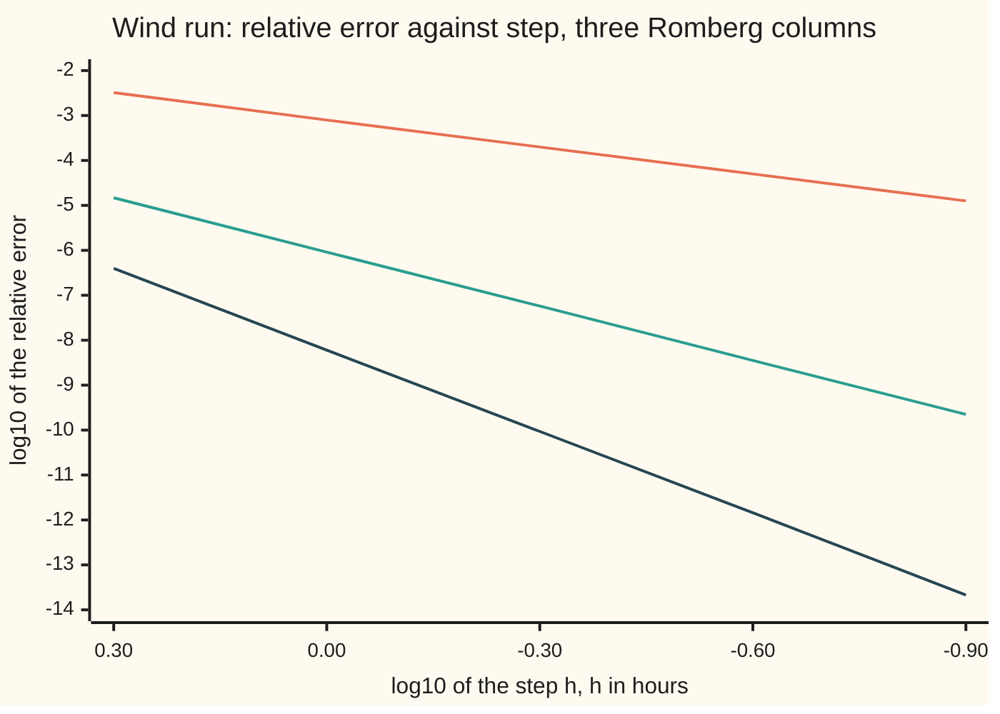

# Error bounds and Romberg: the h squared law, and cancelling it by extrapolation

[Syllabus](../../../SYLLABUS.md) → [Numerical analysis](../README.md) → [Quadrature](../README.md#s05) → Error bounds and Romberg

---

## General Overview

A weather station logs wind speed every 10 minutes, 145 readings from midnight to midnight. The number wanted is the **wind run**: how many kilometres of air blew past the mast that day. It is the area under the speed curve, speed in km/h against time in hours. On this card the day follows its own illustrative model, 8 km/h at midnight rising to 24 km/h at noon, so the exact answer is known: 436.461993 km.

The trapezoid rule (join neighbouring readings by straight lines and add the areas) on the hourly readings gives 436.112827 km. That is 0.3492 km short, an error of 8.0e-04 of the total: about one part in a thousand.

Now take a second trapezoid sum on every second hourly reading, and combine the two. One line of arithmetic gives 436.462392 km, off by 4.00e-04 km, or 9.2e-07 of the total: about one part in a million. No new readings, only 25 of the 145, and almost a thousand times less error. By the h² law, the plain trapezoid would need about 709 slices to do as well (an estimate); using all 145 readings it is still off by 9.70e-03 km, 2.2e-05 of the total.

The trick works because the trapezoid's error is not random. It is a fixed number times h² (the step squared), plus a smaller fixed number times h⁴, and so on, with no odd powers. Halve the step and the h² part falls by exactly four. Two sums then pin down that part, and it can be subtracted. Repeat on the next power, and the result is **Romberg integration**.

**The trapezoid rule's error is a series in even powers of the step whose coefficients depend only on the curve's slopes at the two ends, so sums at halved steps can be combined to cancel the h², then the h⁴, then the h⁶ term, and the difference between two sums estimates the error for free.**

**What kind of fact this is:** a theorem (the Euler–Maclaurin expansion), proved on this card in Why it works; Romberg's table is a method built on it, and its error estimate is an estimate, not a bound.

### The picture: each column of the table falls faster



Orange is the plain trapezoid (column 0), green one extrapolation (column 1), dark two (column 2), at n = 12, 24, 48, 96 and 192 slices of the model curve. Each halving of h moves one step right. The slopes are 2, 4 and 6: each halving divides the errors by 4, 16 and 64.

---

## The formula

Notation first, in words. The interval from a to b is cut into n equal slices of width h = (b − a)/n. $T_n$ is the trapezoid sum with n slices, and $I$ is the true integral. $f^{(k)}$ is the k-th derivative of f. $D_k = f^{(k)}(b) - f^{(k)}(a)$ is how much that derivative changes from one end to the other. The code writes $T_n$ as `T(n)`.

The trapezoid and Simpson error bounds are proved on [Numerical integration](../../06-Calculus%20and%20analysis/04-Integrals/08-numerical-integration.md): with $K_2$ and $K_4$ ceilings on the size of $f''$ and $f^{(4)}$,

$$|T_n - I| \le \frac{K_2\,(b-a)\,h^2}{12}, \qquad |S_n - I| \le \frac{K_4\,(b-a)\,h^4}{180}$$

where $S_n$ is Simpson's rule on n slices ([Trapezoid, midpoint and Simpson](01-newton-cotes-and-composite-rules.md)). This card adds the exact shape of the trapezoid error, the **Euler–Maclaurin expansion**:

$$T_n - I = \frac{h^2}{12}\,D_1 - \frac{h^4}{720}\,D_3 + \frac{h^6}{30240}\,D_5 - \cdots$$

**Read it aloud:** the trapezoid's error is h squared over 12 times the change in slope from end to end, minus h to the fourth over 720 times the change in the third derivative, and so on, with only even powers of h.

The general term is $\frac{B_{2k}}{(2k)!}h^{2k}D_{2k-1}$, where the **Bernoulli numbers** $B_2 = 1/6$, $B_4 = -1/30$, $B_6 = 1/42$ are fixed constants defined in the proof. The series is asymptotic: cut it after any term and the leftover is of the size of the next power of h, as h → 0.

**Romberg's table.** Column 0 holds the trapezoid sums at n, 2n, 4n, … slices. Each later column cancels the next even power:

$$R_{n,0} = T_n, \qquad R_{n,j} = R_{n,j-1} + \frac{R_{n,j-1} - R_{n/2,\,j-1}}{4^j - 1}$$

**Read it aloud:** an entry is the entry to its left, plus the change from the coarser row, divided by four to the power j, minus one.

Column j has error of size $h^{2j+2}$, so each halving of h cuts it by $4^{j+1}$. Column 1 is Simpson's rule. The first correction is also the **free error estimate**:

$$T_n - I \approx \frac{T_{n/2} - T_n}{3}$$

**Read it aloud:** the error in the finer sum is about a third of the gap between the two sums.

| Symbol | Plain meaning | In our example | Push it up and the answer… |
| --- | --- | --- | --- |
| $f$, $t$ | wind speed at hour t, in km/h | $8 + 16\sin(\pi t/24)$: 8 at 0 and 24, 24 at 12 | more wind run |
| $a$, $b$ | start and end of the day, in hours | 0 and 24 | longer interval, larger error |
| $n$, $h$ | slice count; step $(b-a)/n$ in hours | n = 24, h = 1 | larger n, smaller error |
| $I$ | the true wind run, in km | 436.461993 | — |
| $T_n$ | trapezoid sum with n slices | $T_{24}$ = 436.112827 | — |
| $S_n$ | Simpson's rule with n slices | $S_{24}$ = 436.462392 | — |
| $R_{n,j}$ | Romberg entry: column j, finest row n slices | $R_{24,1}$ = 436.462392 | higher j, faster fall |
| $f^{(k)}$, $D_k$ | k-th derivative; its change from a to b | $D_1$ makes the one-term error −0.3490658504 km at h = 1 | larger error term |
| $B_{2k}$ | Bernoulli numbers, fixed constants | 1/6, −1/30, 1/42 | — |
| $K_2$, $K_4$ | ceilings on the size of $f''$, $f^{(4)}$ | reached at noon | looser bound |
| $m$, $m_i$, $E$, $c$, $c_k$ | slice centre (of slice i); one slice's error; the unknown coefficients of $h^2$ and $h^{2k}$ | $c = D_1/12$ = −0.3490658504 km per hour squared | larger error |
| $p$, $g$, $J_k$, $i$, $x$ | proof helpers: terms kept, one slice rescaled to [0, 1], its integrals by parts, slice number, position in the slice | — | — |

### When it holds

- **The curve has enough smooth derivatives.** Column j needs $2j + 2$ of them across the whole interval. A speed rising from calm like √t has an infinite slope at the start; there every column falls by only 2.83 per halving, the rate of $h^{1.5}$, and extrapolation buys almost nothing.
- **The steps are exactly halved.** The factor $4^j$ assumes a ratio of 2. Steps of 1.5 h and 1 h need the factor 2.25 instead; using 4 there leaves the answer 0.2036 km short, against 2.25e-04 km with the right factor.
- **The ends do not match.** Every term of the expansion lives in the end differences $D_k$. If the curve and all its derivatives repeat from end to end, as a daily cycle does, every term is zero, and there is nothing for Romberg to cancel. The error is still not zero: the series is asymptotic, so a leftover remains, but it falls faster than any power of h. The smooth periodic day $30/(2 + \cos(\pi t/12))$ km/h has an exact run of $720/\sqrt3$ = 415.692194 km; 6, 12 and 24 slices miss it by +3.08e-01, +1.14e-04 and +1.56e-11 km. A pure cosine is the special case: the trapezoid is exact on any sum of sines and cosines with fewer than n cycles over the interval (Trefethen and Weideman, in Sources). So six slices of $16 - 8\cos(\pi t/12)$, one cycle a day, give 384.000000000000 km, the exact value.
- **h is small enough for the first term to lead.** At the coarsest steps, the first ratio in each column reads 4.06, 16.40 and 65.78, not 4, 16 and 64. The estimate is trustworthy once the ratios settle.
- **Errors above rounding.** A double carries about 16 digits. Down the diagonal the relative error reaches −1.8e-14 at n = 48 and then sits at the rounding floor, between −1.0e-15 and +1.3e-15.

---

## Why it works

### Step 0: a slice read backwards gives the same answer

The trapezoid treats a slice the same whether it is read left to right or right to left. So its error on one slice, written as a function of the width h, must change sign when h does: it is an **odd** function, with only odd powers h³, h⁵, …. Adding up n = (b − a)/h slices removes one power of h. What is left has only even powers: h², h⁴, ….

That is the whole reason Romberg works. A known power with an unknown coefficient can be removed by comparing two step sizes.

### Step 1: one slice's error has only odd powers

Take a slice of width h centred at m. Its error is

$$E(h) = \frac{h}{2}\Bigl[f(m - \tfrac h2) + f(m + \tfrac h2)\Bigr] - \int_{m-h/2}^{m+h/2} f(x)\,dx.$$

Replace h by −h. The first term changes sign. The integral runs backwards, which also changes its sign. So $E(-h) = -E(h)$.

Expand both terms with [Taylor's theorem](../../06-Calculus%20and%20analysis/03-What%20Derivatives%20Tell%20You/05-taylors-theorem.md) about m. The odd derivatives cancel between the two heights, and

$$E(h) = \frac{h^3}{12}f''(m) + \frac{h^5}{480}f^{(4)}(m) + \cdots$$

The fractions come from $\tfrac18 - \tfrac1{24} = \tfrac1{12}$ and $\tfrac1{384} - \tfrac1{1920} = \tfrac1{480}$: the average of the two heights against the exact area.

### Step 2: adding slices gives even powers, and only the ends matter

Sum E over all n slices. The h³ terms give $\tfrac{h^2}{12}\cdot h\sum f''(m_i)$. The sum $h\sum f''(m_i)$ is the midpoint rule applied to f″, which is close to $\int_a^b f'' = f'(b) - f'(a) = D_1$. So the leading error is $\tfrac{h^2}{12}D_1$.

The midpoint rule is symmetric too, so its own error has only even powers: $h\sum f''(m_i) = D_1 - \tfrac{h^2}{24}D_3 + \cdots$. Collect the h⁴ terms: $-\tfrac1{288} + \tfrac1{480} = -\tfrac1{720}$. That is the second coefficient of the expansion.

Every interior point has dropped out. Only the derivatives at the two ends survive, because each integral of a derivative telescopes to its end values.

For the wind, the slope at midnight is rising and at the next midnight falling by the same amount, so $D_1$ is negative and the trapezoid runs low. At n = 24 the one-term prediction is −0.3490658504 km, three terms give −0.3491655769 km, and the measured error is −0.3491655769 km: agreement to all ten decimals printed.

### Step 3: the bounds are the first term with a ceiling

Stop the expansion after its first term, with the leftover written exactly, and the result is the trapezoid bound: $|T_n - I| \le K_2(b-a)h^2/12$. For the wind at h = 1 hour, the bound is 0.5483 km against a true error of 0.3492 km, ratio 1.57. Simpson's bound is 6.26e-04 km against a true error of 4.00e-04 km, ratio 1.57. The bound guarantees; the expansion predicts.

### Step 4: cancel the h² term

Write the two hourly sums with the expansion. Call the first coefficient c, so $T_{24} - I \approx c\cdot 1^2$ and $T_{12} - I \approx c\cdot 2^2 = 4c$. Four times the first minus the second removes c:

$$R_{24,1} = \frac{4T_{24} - T_{12}}{3} = T_{24} + \frac{T_{24} - T_{12}}{3}$$

This is **Richardson extrapolation**: use the known power to remove the unknown coefficient. What remains starts at h⁴.

Spread over the readings, $4T_{n} - T_{n/2}$ gives weights h × (1, 4, 2, 4, …, 4, 1), and dividing by 3 is exactly Simpson's rule. The code confirms it: $R_{24,1}$ = 436.462392147 and Simpson on the same 25 readings = 436.462392147. Simpson's rule is the trapezoid rule with its h² error cancelled.

### Step 5: repeat on each even power

Column 1 has error $c_4h^4 + c_6h^6 + \cdots$. Halving h divides its leading term by 16, so $(16R_{n,1} - R_{n/2,1})/15$ removes it. Column 2 removes h⁶ with 64 and 63, and so on: $4^j$ and $4^j - 1$ in column j. Each column needs two more derivatives than the last. The table on the log:

| n | h, hours | column 0 (trapezoid) | column 1 | column 2 |
| ---: | ---: | --- | --- | --- |
| 3 | 8.0 | 413.702503 (−2.28e+01) | | |
| 6 | 4.0 | 430.851252 (−5.61e+00) | 436.567501 (+1.06e-01) | |
| 12 | 2.0 | 435.064132 (−1.40e+00) | 436.468425 (+6.43e-03) | 436.461820 (−1.73e-04) |
| 24 | 1.0 | 436.112827 (−3.49e-01) | 436.462392 (+4.00e-04) | 436.461990 (−2.63e-06) |
| 48 | 0.5 | 436.374720 (−8.73e-02) | 436.462018 (+2.49e-05) | 436.461993 (−4.08e-08) |

Errors in km are in brackets. The error ratios per halving, read down each column, settle at 4.00, 16.02 and 64.44, against the theory's 4, 16 and 64. Further columns reach +2.81e-10 and −7.84e-12 km at n = 48, still using only the readings of the finest row.

<details>
<summary>Detailed proof: the Euler–Maclaurin expansion with its remainder</summary>

**Bernoulli polynomials.** Define $B_0(x) = 1$ and, for k ≥ 1, $B_k$ by $B_k' = kB_{k-1}$ with $\int_0^1 B_k = 0$. So $B_1 = x - \tfrac12$ and $B_2 = x^2 - x + \tfrac16$. For k ≥ 2, $B_k(1) - B_k(0) = \int_0^1 kB_{k-1} = 0$; call the common value the Bernoulli number $B_k$.

**Odd ones vanish.** $(-1)^kB_k(1 - x)$ obeys the same two rules as $B_k(x)$, so the two are equal. At x = 0 this gives $B_k(0) = (-1)^kB_k(1)$. For odd k ≥ 3, $B_k(0) = B_k(1)$ as well, so both are 0. This is Step 0's symmetry in algebra.

**One unit slice.** Let g be smooth on [0, 1] and $J_k = \int_0^1 \frac{B_k(x)}{k!}g^{(k)}(x)\,dx$. Integration by parts, using $(B_{k+1}/(k+1)!)' = B_k/k!$, gives $J_0 = \tfrac12(g(0) + g(1)) - J_1$ and, for k ≥ 1, $J_k = \frac{B_{k+1}}{(k+1)!}\bigl(g^{(k)}(1) - g^{(k)}(0)\bigr) - J_{k+1}$. The odd Bernoulli numbers are 0, so after 2p steps

$$\int_0^1 g = \tfrac12\bigl(g(0) + g(1)\bigr) - \sum_{k=1}^{p}\frac{B_{2k}}{(2k)!}\bigl(g^{(2k-1)}(1) - g^{(2k-1)}(0)\bigr) + J_{2p}.$$

**All slices.** On slice i put $g(x) = f(a + ih + hx)$, so $g^{(k)} = h^kf^{(k)}$, and multiply by h. Summing over the slices, the interior end values cancel in pairs (they telescope), leaving

$$I = T_n - \sum_{k=1}^{p}\frac{B_{2k}}{(2k)!}h^{2k}D_{2k-1} + h^{2p}\sum_i h\int_0^1\frac{B_{2p}(x)}{(2p)!}f^{(2p)}(a + ih + hx)\,dx.$$

The last term is at most $h^{2p}(b-a)K_{2p}\max|B_{2p}|/(2p)!$, where $K_{2p}$ bounds $|f^{(2p)}|$. Run the expansion one term further and the leftover is of size $h^{2p+2}$. With p = 1, the $D_1$ term and the remainder merge into $h^2\sum_i h\int_0^1 \frac{x^2 - x}{2}f''(a + ih + hx)\,dx$. Since $x^2 - x$ never changes sign on [0, 1] and its integral is −1/6, this is at most $K_2(b-a)h^2/12$ in size: the trapezoid bound of Step 3.

**Romberg's columns.** Suppose column j − 1 has error $\sum_{k\ge j} c_kh^{2k}$ with fixed $c_k$. Then $R_{n,j-1} - I$ and $R_{n/2,j-1} - I$ carry $c_jh^{2j}$ and $4^jc_jh^{2j}$. The combination $(4^jR_{n,j-1} - R_{n/2,j-1})/(4^j - 1)$ keeps I, removes the $h^{2j}$ term, and leaves fixed coefficients on the higher powers. By induction, column j has error of size $h^{2j+2}$. $\blacksquare$

</details>

### Step 6: the error estimate comes free

The same two sums that cancel the h² term also measure it. If $T_{24} - I = c$ and $T_{12} - I = 4c$, then $T_{12} - T_{24} = 3c$. So

$$T_{24} - I \approx \frac{T_{12} - T_{24}}{3} = -0.349565 \text{ km}$$

The true error is −0.349166 km: estimate over truth, 1.00114. It is an **estimate**, not a bound: it is right only when the h² term leads.

The same idea one column on: $R_{24,1} - R_{24,2}$ = +4.022e-04 km estimates the error of $R_{24,1}$, whose true error is +3.996e-04 km, ratio 1.00657. A Romberg program stops when two neighbouring diagonal entries agree to the tolerance wanted.

### Step 7: what it costs, and where rounding stops it

Cost is counted in readings, since each costs one function value. $R_{24,1}$ uses 25 readings; the plain trapezoid needs about 709 slices to match it. Every coarser sum is a subset of the finer one, so a full table costs only the readings of its finest row.

Going down the diagonal on the model curve, the relative error falls −5.2e-02, +2.4e-04, −4.0e-07, +1.7e-10, −1.8e-14 at n = 3 to 48. After that it sits at +0.0e+00, +1.3e-15 and −1.0e-15 for n = 96, 192 and 384: rounding, not method.

---

## Worked numbers, by hand

From the code's Romberg table: the trapezoid sums on every 12th and every 6th reading.

| Step | Arithmetic | Value |
| --- | --- | --- |
| trapezoid, h = 2 hours | $T_{12}$, every 12th reading | 435.064132 km |
| trapezoid, h = 1 hour | $T_{24}$, every 6th reading, 25 in all | 436.112827 km |
| gap between them | 436.112827 − 435.064132 | 1.048695 km |
| error estimate for $T_{24}$ | −1.048695 / 3 | −0.349565 km |
| extrapolate | 436.112827 + 0.349565 | **436.462392 km** |
| true error | 436.462392 − 436.461993 | +4.00e-04 km, 9.2e-07 relative |

The hourly readings, combined with every second one of themselves, give the day's wind run to within 4.00e-04 km of 436.461993 km.

### What breaks if you drop a piece

| Mistake | Comes out at | What went wrong |
| --- | --- | --- |
| Error treated as size h, not h²: $2T_{24} - T_{12}$ | 437.161522, off +0.6995 km | the wrong power; worse than the hourly sum it started from |
| Factor 4 on steps of 1.5 h and 1 h | 436.258406, off −0.2036 km | the factor is $(1.5)^2 = 2.25$; with it, 436.462217, off +2.25e-04 |
| Second column divided by 3, not 15 | 436.460381, off −1.61e-03 | the h² factor reused on the h⁴ term |
| Romberg on √t over [0, 1] | column 2 off −4.92e-05 at n = 128, ratio 2.83 | no smooth derivatives at 0: the expansion does not exist |

---

## Code, from first principles, and it actually runs

The code builds the 145 readings from the model, then reaches the wind run three independent ways: the closed form from the antiderivative; Romberg's table on subsets of the log; and the Euler–Maclaurin series, which predicts each trapezoid error from the derivatives at the two ends only. Asserts check the observed orders against 4, 16 and 64, the series against the measured errors, both bounds, the Simpson identity, the free estimate, the rounding floor, the √t failure and the two periodic days. W is π/24, the model's angle per hour. Sums run left to right in both languages, because Python's built-in `sum` compensates for rounding and would change the last digits.

### Python

```python
# Error bounds and Romberg -- the check behind the card.  Only math is imported.
# Wind model (illustrative): v(t) = 8 + 16 sin(pi t / 24) km/h over a 24-hour day,
# logged every 10 minutes (145 readings).  Wind run I = area under v, in km.
# Road 1: the closed form.  Road 2: Romberg's table.  Road 3: the Euler-Maclaurin
# series predicting each trapezoid error from the slopes at the two ends alone.
import math
W = math.pi / 24
def v(t): return 8 + 16 * math.sin(W * t)
I = 8 * 24 + 16 * 2 / W                                  # antiderivative 8t - (16/W) cos(Wt)
log = [v(10 * k / 60) for k in range(145)]               # the station's 145 readings
def add(xs):                                             # left to right; Python's sum() compensates
    s = 0.0
    for x in xs: s += x
    return s
def trap_log(n):                                         # n slices, every (144/n)-th reading
    s = 144 // n
    return 24 / n * ((log[0] + log[144]) / 2 + add(log[s * i] for i in range(1, n)))
def trap(g, a, b, n):                                    # same rule on any curve
    h = (b - a) / n
    return h * ((g(a) + g(b)) / 2 + add(g(a + i * h) for i in range(1, n)))
def romberg(T):                                          # T[k] has twice the slices of T[k-1]
    R = [[t] for t in T]
    for k in range(1, len(T)):
        for j in range(1, k + 1):
            R[k].append(R[k][j - 1] + (R[k][j - 1] - R[k - 1][j - 1]) / (4 ** j - 1))
    return R
e = lambda x, ref=I: f"{x - ref:+.2e}"
print(f"readings in the log: {len(log)}; v(0) = {log[0]:.6f}, v(12) = {log[72]:.6f}, v(24) = {log[144]:.6f} km/h")
print(f"exact wind run I = 192 + 768/pi = {I:.6f} km")
ns = [3, 6, 12, 24, 48]
T = [trap_log(n) for n in ns]
R = romberg(T)
print("Romberg table on the log (stride: use every stride-th reading); entry (error in km):")
for k, n in enumerate(ns):
    print(f"  n = {n:2d}, h = {24 / n:3.1f} h, stride {144 // n:2d}: " + "; ".join(f"{x:.6f} ({e(x)})" for x in R[k]))
for j in range(3):
    rat = [(R[k - 1][j] - I) / (R[k][j] - I) for k in range(j + 1, 5)]
    print(f"column {j}: error ratio per halving " + ", ".join(f"{r:.2f}" for r in rat) + f"; theory {4 ** (j + 1)}")
    assert abs(rat[-1] - 4 ** (j + 1)) < 0.02 * 4 ** (j + 1)              # h^2, h^4, h^6 observed
t24, r24, t144 = T[3], R[3][1], trap_log(144)
print(f"headline: T(24) = {t24:.6f}, off {t24 - I:+.4f} km, relative {(t24 - I) / I:+.1e}")
print(f"headline: R(24,1) from 25 readings = {r24:.6f}, off {r24 - I:+.2e} km, relative {(r24 - I) / I:+.1e}")
print(f"plain T(144), all 145 readings = {t144:.6f}, off {t144 - I:+.2e} km, relative {(t144 - I) / I:+.1e}")
nneed = 24 * math.sqrt(abs((t24 - I) / (r24 - I)))
print(f"plain trapezoid slices needed to match R(24,1): about {nneed:.0f}")
assert abs((t24 - I) / I) < 1e-3 and abs((r24 - I) / I) < 1e-6 < abs((t144 - I) / I)
# Road 3: Euler-Maclaurin, T - I = h^2/12 D1 - h^4/720 D3 + h^6/30240 D5, Dk = f^(k)(24) - f^(k)(0)
D = {k: 16 * W ** k * (math.sin(W * 24 + k * math.pi / 2) - math.sin(k * math.pi / 2)) for k in (1, 3, 5)}
for n, t in zip(ns[2:], T[2:]):
    h = 24 / n
    p = [h ** 2 / 12 * D[1], -h ** 4 / 720 * D[3], h ** 6 / 30240 * D[5]]
    print(f"Euler-Maclaurin n = {n}: one term {p[0]:+.10f}, three terms {add(p):+.10f}, measured {t - I:+.10f}")
    assert abs(add(p) - (t - I)) < 1e-9 * I                               # road 3 against road 1
K2, K4 = 16 * W ** 2, 16 * W ** 4                                        # largest |v''|, |v''''|, at noon
bt, bs = K2 * 24 / 12, K4 * 24 / 180                                   # h = 1 hour
simp = 1 / 3 * (log[0] + log[144] + add((4 if i % 2 else 2) * log[6 * i] for i in range(1, 24)))
print(f"bounds at h = 1 h: trapezoid {bt:.4f} vs true {abs(t24 - I):.4f}, ratio {bt / abs(t24 - I):.2f}")
print(f"bounds at h = 1 h: Simpson {bs:.2e} vs true {abs(r24 - I):.2e}, ratio {bs / abs(r24 - I):.2f}")
print(f"R(24,1) {r24:.9f} vs Simpson on the same 25 readings {simp:.9f}")
assert abs(t24 - I) <= bt and abs(r24 - I) <= bs and abs(simp - r24) < 1e-12 * I
est, est1 = (T[2] - t24) / 3, r24 - R[3][2]                            # T(h) - I and R(24,1) - I, guessed
print(f"free estimate of T(24)'s error, (T(12) - T(24))/3: {est:+.6f} vs true {t24 - I:+.6f}, ratio {est / (t24 - I):.5f}")
print(f"free estimate of R(24,1)'s error, R(24,1) - R(24,2): {est1:+.3e} vs true {r24 - I:+.3e}, ratio {est1 / (r24 - I):.5f}")
assert abs(est / (t24 - I) - 1) < 2e-3 and abs(est1 / (r24 - I) - 1) < 1e-2
print("diagonal R(n,k) on the model curve, down to rounding (relative error):")
TT = [trap(v, 0, 24, 3 * 2 ** k) for k in range(8)]
RR = romberg(TT)
print("  " + ", ".join(f"n = {3 * 2 ** k}: {(RR[k][k] - I) / I:+.1e}" for k in range(8)))
assert abs(RR[7][7] - I) < 1e-13 * I
# What breaks: a speed rising from calm like sqrt(t) after a front at hour 0, over 1 hour
sq = romberg([trap(math.sqrt, 0, 1, 2 ** k) for k in range(1, 8)])
for j in range(3):
    rat = (sq[5][j] - 2 / 3) / (sq[6][j] - 2 / 3)
    print(f"sqrt(t) on [0, 1], column {j}: error at n = 128 {sq[6][j] - 2 / 3:+.2e}, ratio per halving {rat:.2f}")
    assert abs(rat - 2 ** 1.5) < 0.05                                   # stuck near h^1.5
per = trap(lambda t: 16 - 8 * math.cos(2 * W * t), 0, 24, 6)
print(f"periodic day 16 - 8 cos(pi t / 12): T(6) = {per:.12f} vs exact {16 * 24:.12f}")
assert abs(per - 384) < 1e-12 * 384
sm = [trap(lambda t: 30 / (2 + math.cos(2 * W * t)), 0, 24, n) - 720 / math.sqrt(3) for n in (6, 12, 24)]
print(f"smooth periodic day 30/(2 + cos(pi t / 12)), exact 720/sqrt3 = {720 / math.sqrt(3):.6f}: T(6), T(12), T(24) off " + ", ".join(f"{x:+.2e}" for x in sm))
assert abs(sm[0]) > 1e-2 and abs(sm[1]) < abs(sm[0]) / 2 ** 10 and abs(sm[2]) < abs(sm[1]) / 2 ** 20   # not exact; faster than any fixed power
wrong = [2 * t24 - T[2], (2.25 * t24 - trap_log(16)) / 1.25, (4 * t24 - trap_log(16)) / 3,
         R[3][1] + (R[3][1] - R[2][1]) / 3, t24 - T[2]]
print(f"mistake, error taken as h not h^2, 2T(24) - T(12): {wrong[0]:.6f}, off {wrong[0] - I:+.4f}")
print(f"right, steps 1.5 h and 1 h, (2.25T(24) - T(16))/1.25: {wrong[1]:.6f}, off {wrong[1] - I:+.2e}")
print(f"mistake, factor 4 on steps 1.5 h and 1 h: {wrong[2]:.6f}, off {wrong[2] - I:+.4f}")
print(f"mistake, second column with 3 not 15: {wrong[3]:.6f}, off {wrong[3] - I:+.2e}")
print(f"mistake, T(24) - T(12) taken as the error: {wrong[4]:+.6f}, true {t24 - I:+.6f}")
print("chart, model curve, n = 12, 24, 48, 96, 192; log10 h: " + ", ".join(f"{math.log10(24 / (3 * 2 ** k)):.2f}" for k in range(2, 7)))
for j in range(3):
    print(f"chart, column {j} log10 |relative error|: " + ", ".join(f"{math.log10(abs((RR[k][j] - I) / I)):.2f}" for k in range(2, 7)))
print("ALL CHECKS PASS")
```

**Ran 2026-11-11 on macOS, Python 3.14.10, standard library only. All checks passed. Output, pasted from the run:**

```
readings in the log: 145; v(0) = 8.000000, v(12) = 24.000000, v(24) = 8.000000 km/h
exact wind run I = 192 + 768/pi = 436.461993 km
Romberg table on the log (stride: use every stride-th reading); entry (error in km):
  n =  3, h = 8.0 h, stride 48: 413.702503 (-2.28e+01)
  n =  6, h = 4.0 h, stride 24: 430.851252 (-5.61e+00); 436.567501 (+1.06e-01)
  n = 12, h = 2.0 h, stride 12: 435.064132 (-1.40e+00); 436.468425 (+6.43e-03); 436.461820 (-1.73e-04)
  n = 24, h = 1.0 h, stride  6: 436.112827 (-3.49e-01); 436.462392 (+4.00e-04); 436.461990 (-2.63e-06); 436.461993 (+7.41e-08)
  n = 48, h = 0.5 h, stride  3: 436.374720 (-8.73e-02); 436.462018 (+2.49e-05); 436.461993 (-4.08e-08); 436.461993 (+2.81e-10); 436.461993 (-7.84e-12)
column 0: error ratio per halving 4.06, 4.01, 4.00, 4.00; theory 4
column 1: error ratio per halving 16.40, 16.10, 16.02; theory 16
column 2: error ratio per halving 65.78, 64.44; theory 64
headline: T(24) = 436.112827, off -0.3492 km, relative -8.0e-04
headline: R(24,1) from 25 readings = 436.462392, off +4.00e-04 km, relative +9.2e-07
plain T(144), all 145 readings = 436.452296, off -9.70e-03 km, relative -2.2e-05
plain trapezoid slices needed to match R(24,1): about 709
Euler-Maclaurin n = 12: one term -1.3962634016, three terms -1.3978609775, measured -1.3978609819
Euler-Maclaurin n = 24: one term -0.3490658504, three terms -0.3491655769, measured -0.3491655769
Euler-Maclaurin n = 48: one term -0.0872664626, three terms -0.0872726936, measured -0.0872726936
bounds at h = 1 h: trapezoid 0.5483 vs true 0.3492, ratio 1.57
bounds at h = 1 h: Simpson 6.26e-04 vs true 4.00e-04, ratio 1.57
R(24,1) 436.462392147 vs Simpson on the same 25 readings 436.462392147
free estimate of T(24)'s error, (T(12) - T(24))/3: -0.349565 vs true -0.349166, ratio 1.00114
free estimate of R(24,1)'s error, R(24,1) - R(24,2): +4.022e-04 vs true +3.996e-04, ratio 1.00657
diagonal R(n,k) on the model curve, down to rounding (relative error):
  n = 3: -5.2e-02, n = 6: +2.4e-04, n = 12: -4.0e-07, n = 24: +1.7e-10, n = 48: -1.8e-14, n = 96: +0.0e+00, n = 192: +1.3e-15, n = 384: -1.0e-15
sqrt(t) on [0, 1], column 0: error at n = 128 -1.41e-04, ratio per halving 2.81
sqrt(t) on [0, 1], column 1: error at n = 128 -5.61e-05, ratio per halving 2.83
sqrt(t) on [0, 1], column 2: error at n = 128 -4.92e-05, ratio per halving 2.83
periodic day 16 - 8 cos(pi t / 12): T(6) = 384.000000000000 vs exact 384.000000000000
smooth periodic day 30/(2 + cos(pi t / 12)), exact 720/sqrt3 = 415.692194: T(6), T(12), T(24) off +3.08e-01, +1.14e-04, +1.56e-11
mistake, error taken as h not h^2, 2T(24) - T(12): 437.161522, off +0.6995
right, steps 1.5 h and 1 h, (2.25T(24) - T(16))/1.25: 436.462217, off +2.25e-04
mistake, factor 4 on steps 1.5 h and 1 h: 436.258406, off -0.2036
mistake, second column with 3 not 15: 436.460381, off -1.61e-03
mistake, T(24) - T(12) taken as the error: +1.048695, true -0.349166
chart, model curve, n = 12, 24, 48, 96, 192; log10 h: 0.30, 0.00, -0.30, -0.60, -0.90
chart, column 0 log10 |relative error|: -2.49, -3.10, -3.70, -4.30, -4.90
chart, column 1 log10 |relative error|: -4.83, -6.04, -7.24, -8.45, -9.65
chart, column 2 log10 |relative error|: -6.40, -8.22, -10.03, -11.84, -13.67
ALL CHECKS PASS
```

### Rust

Built with `rustc --edition 2021 -O`.

```rust
// Error bounds and Romberg -- the same check as the Python, in Rust.  No crates.
// Wind model (illustrative): v(t) = 8 + 16 sin(pi t / 24) km/h over a 24-hour day,
// logged every 10 minutes (145 readings).  Wind run I = area under v, in km.
// Road 1: the closed form.  Road 2: Romberg's table.  Road 3: the Euler-Maclaurin
// series predicting each trapezoid error from the slopes at the two ends alone.
const PI: f64 = std::f64::consts::PI;
const W: f64 = PI / 24.0;
fn v(t: f64) -> f64 { 8.0 + 16.0 * (W * t).sin() }
fn trap(g: &dyn Fn(f64) -> f64, a: f64, b: f64, n: usize) -> f64 { // same rule on any curve
    let h = (b - a) / n as f64;
    h * ((g(a) + g(b)) / 2.0 + (1..n).map(|i| g(a + i as f64 * h)).sum::<f64>())
}
fn romberg(t: &[f64]) -> Vec<Vec<f64>> {                 // t[k] has twice the slices of t[k-1]
    let mut r: Vec<Vec<f64>> = t.iter().map(|&x| vec![x]).collect();
    for k in 1..t.len() {
        for j in 1..=k {
            let x = r[k][j - 1] + (r[k][j - 1] - r[k - 1][j - 1]) / (4f64.powi(j as i32) - 1.0);
            r[k].push(x);
        }
    }
    r
}
fn sci(x: f64, d: usize, plus: bool) -> String {         // Python's e-notation: +8.00e-04
    let s = format!("{:.*e}", d, x.abs());
    let (m, ex) = s.split_once('e').unwrap();
    let ex: i32 = ex.parse().unwrap();
    let sign = if x < 0.0 || (x == 0.0 && x.is_sign_negative()) { "-" } else if plus { "+" } else { "" };
    format!("{}{}e{}{:02}", sign, m, if ex < 0 { '-' } else { '+' }, ex.abs())
}
fn join(xs: impl Iterator<Item = String>, sep: &str) -> String { xs.collect::<Vec<_>>().join(sep) }
fn main() {
    let i_ex = 8.0 * 24.0 + 16.0 * 2.0 / W;               // antiderivative 8t - (16/W) cos(Wt)
    let log: Vec<f64> = (0..145).map(|k| v(10.0 * k as f64 / 60.0)).collect();
    let trap_log = |n: usize| {                           // n slices, every (144/n)-th reading
        let s = 144 / n;
        24.0 / n as f64 * ((log[0] + log[144]) / 2.0 + (1..n).map(|i| log[s * i]).sum::<f64>())
    };
    let e = |x: f64| sci(x - i_ex, 2, true);
    println!("readings in the log: {}; v(0) = {:.6}, v(12) = {:.6}, v(24) = {:.6} km/h", log.len(), log[0], log[72], log[144]);
    println!("exact wind run I = 192 + 768/pi = {:.6} km", i_ex);
    let ns = [3usize, 6, 12, 24, 48];
    let t: Vec<f64> = ns.iter().map(|&n| trap_log(n)).collect();
    let r = romberg(&t);
    println!("Romberg table on the log (stride: use every stride-th reading); entry (error in km):");
    for (k, &n) in ns.iter().enumerate() {
        println!("  n = {:2}, h = {:3.1} h, stride {:2}: {}", n, 24.0 / n as f64, 144 / n, join(r[k].iter().map(|&x| format!("{:.6} ({})", x, e(x))), "; "));
    }
    for j in 0..3 {
        let rat: Vec<f64> = (j + 1..5).map(|k| (r[k - 1][j] - i_ex) / (r[k][j] - i_ex)).collect();
        let th = 4f64.powi(j as i32 + 1);
        println!("column {}: error ratio per halving {}; theory {}", j, join(rat.iter().map(|x| format!("{:.2}", x)), ", "), th);
        assert!((rat[rat.len() - 1] - th).abs() < 0.02 * th);                // h^2, h^4, h^6 observed
    }
    let (t24, r24, t144) = (t[3], r[3][1], trap_log(144));
    println!("headline: T(24) = {:.6}, off {:+.4} km, relative {}", t24, t24 - i_ex, sci((t24 - i_ex) / i_ex, 1, true));
    println!("headline: R(24,1) from 25 readings = {:.6}, off {} km, relative {}", r24, e(r24), sci((r24 - i_ex) / i_ex, 1, true));
    println!("plain T(144), all 145 readings = {:.6}, off {} km, relative {}", t144, e(t144), sci((t144 - i_ex) / i_ex, 1, true));
    let nneed = 24.0 * ((t24 - i_ex) / (r24 - i_ex)).abs().sqrt();
    println!("plain trapezoid slices needed to match R(24,1): about {:.0}", nneed);
    assert!(((t24 - i_ex) / i_ex).abs() < 1e-3 && ((r24 - i_ex) / i_ex).abs() < 1e-6 && 1e-6 < ((t144 - i_ex) / i_ex).abs());
    // Road 3: Euler-Maclaurin, T - I = h^2/12 D1 - h^4/720 D3 + h^6/30240 D5, Dk = f^(k)(24) - f^(k)(0)
    let dk = |k: i32| 16.0 * W.powi(k) * ((W * 24.0 + k as f64 * PI / 2.0).sin() - (k as f64 * PI / 2.0).sin());
    for (&n, &tv) in ns[2..].iter().zip(t[2..].iter()) {
        let h = 24.0 / n as f64;
        let p = [h.powi(2) / 12.0 * dk(1), -h.powi(4) / 720.0 * dk(3), h.powi(6) / 30240.0 * dk(5)];
        let s3 = p[0] + p[1] + p[2];
        println!("Euler-Maclaurin n = {}: one term {:+.10}, three terms {:+.10}, measured {:+.10}", n, p[0], s3, tv - i_ex);
        assert!((s3 - (tv - i_ex)).abs() < 1e-9 * i_ex);                     // road 3 against road 1
    }
    let (k2, k4) = (16.0 * W.powi(2), 16.0 * W.powi(4));                  // largest |v''|, |v''''|, at noon
    let (bt, bs) = (k2 * 24.0 / 12.0, k4 * 24.0 / 180.0);                 // h = 1 hour
    let simp = 1.0 / 3.0 * (log[0] + log[144] + (1..24).map(|i| if i % 2 == 1 { 4.0 } else { 2.0 } * log[6 * i]).sum::<f64>());
    println!("bounds at h = 1 h: trapezoid {:.4} vs true {:.4}, ratio {:.2}", bt, (t24 - i_ex).abs(), bt / (t24 - i_ex).abs());
    println!("bounds at h = 1 h: Simpson {} vs true {}, ratio {:.2}", sci(bs, 2, false), sci((r24 - i_ex).abs(), 2, false), bs / (r24 - i_ex).abs());
    println!("R(24,1) {:.9} vs Simpson on the same 25 readings {:.9}", r24, simp);
    assert!((t24 - i_ex).abs() <= bt && (r24 - i_ex).abs() <= bs && (simp - r24).abs() < 1e-12 * i_ex);
    let (est, est1) = ((t[2] - t24) / 3.0, r24 - r[3][2]);               // T(h) - I and R(24,1) - I, guessed
    println!("free estimate of T(24)'s error, (T(12) - T(24))/3: {:+.6} vs true {:+.6}, ratio {:.5}", est, t24 - i_ex, est / (t24 - i_ex));
    println!("free estimate of R(24,1)'s error, R(24,1) - R(24,2): {} vs true {}, ratio {:.5}", sci(est1, 3, true), sci(r24 - i_ex, 3, true), est1 / (r24 - i_ex));
    assert!((est / (t24 - i_ex) - 1.0).abs() < 2e-3 && (est1 / (r24 - i_ex) - 1.0).abs() < 1e-2);
    println!("diagonal R(n,k) on the model curve, down to rounding (relative error):");
    let tt: Vec<f64> = (0..8).map(|k| trap(&v, 0.0, 24.0, 3 << k)).collect();
    let rr = romberg(&tt);
    println!("  {}", join((0..8).map(|k| format!("n = {}: {}", 3 << k, sci((rr[k][k] - i_ex) / i_ex, 1, true))), ", "));
    assert!((rr[7][7] - i_ex).abs() < 1e-13 * i_ex);
    // What breaks: a speed rising from calm like sqrt(t) after a front at hour 0, over 1 hour
    let sq = romberg(&(1..8).map(|k| trap(&|x: f64| x.sqrt(), 0.0, 1.0, 1 << k)).collect::<Vec<_>>());
    for j in 0..3 {
        let rat = (sq[5][j] - 2.0 / 3.0) / (sq[6][j] - 2.0 / 3.0);
        println!("sqrt(t) on [0, 1], column {}: error at n = 128 {}, ratio per halving {:.2}", j, sci(sq[6][j] - 2.0 / 3.0, 2, true), rat);
        assert!((rat - 2f64.powf(1.5)).abs() < 0.05);                       // stuck near h^1.5
    }
    let per = trap(&|x: f64| 16.0 - 8.0 * (2.0 * W * x).cos(), 0.0, 24.0, 6);
    println!("periodic day 16 - 8 cos(pi t / 12): T(6) = {:.12} vs exact {:.12}", per, 16.0 * 24.0);
    assert!((per - 384.0).abs() < 1e-12 * 384.0);
    let sm: Vec<f64> = [6usize, 12, 24].iter().map(|&n| trap(&|x: f64| 30.0 / (2.0 + (2.0 * W * x).cos()), 0.0, 24.0, n) - 720.0 / 3f64.sqrt()).collect();
    println!("smooth periodic day 30/(2 + cos(pi t / 12)), exact 720/sqrt3 = {:.6}: T(6), T(12), T(24) off {}", 720.0 / 3f64.sqrt(), join(sm.iter().map(|&x| sci(x, 2, true)), ", "));
    assert!(sm[0].abs() > 1e-2 && sm[1].abs() < sm[0].abs() / 1024.0 && sm[2].abs() < sm[1].abs() / 1048576.0);   // not exact; faster than any fixed power
    let wrong = [2.0 * t24 - t[2], (2.25 * t24 - trap_log(16)) / 1.25, (4.0 * t24 - trap_log(16)) / 3.0,
                 r[3][1] + (r[3][1] - r[2][1]) / 3.0, t24 - t[2]];
    println!("mistake, error taken as h not h^2, 2T(24) - T(12): {:.6}, off {:+.4}", wrong[0], wrong[0] - i_ex);
    println!("right, steps 1.5 h and 1 h, (2.25T(24) - T(16))/1.25: {:.6}, off {}", wrong[1], e(wrong[1]));
    println!("mistake, factor 4 on steps 1.5 h and 1 h: {:.6}, off {:+.4}", wrong[2], wrong[2] - i_ex);
    println!("mistake, second column with 3 not 15: {:.6}, off {}", wrong[3], e(wrong[3]));
    println!("mistake, T(24) - T(12) taken as the error: {:+.6}, true {:+.6}", wrong[4], t24 - i_ex);
    println!("chart, model curve, n = 12, 24, 48, 96, 192; log10 h: {}", join((2..7).map(|k| format!("{:.2}", (24.0 / (3 << k) as f64).log10())), ", "));
    for j in 0..3 {
        println!("chart, column {} log10 |relative error|: {}", j, join((2..7).map(|k| format!("{:.2}", ((rr[k][j] - i_ex) / i_ex).abs().log10())), ", "));
    }
    println!("ALL CHECKS PASS");
}
```

**Ran 2026-11-11 on macOS, rustc 1.98.1, no crates. All checks passed. Output, pasted from the run:**

```
readings in the log: 145; v(0) = 8.000000, v(12) = 24.000000, v(24) = 8.000000 km/h
exact wind run I = 192 + 768/pi = 436.461993 km
Romberg table on the log (stride: use every stride-th reading); entry (error in km):
  n =  3, h = 8.0 h, stride 48: 413.702503 (-2.28e+01)
  n =  6, h = 4.0 h, stride 24: 430.851252 (-5.61e+00); 436.567501 (+1.06e-01)
  n = 12, h = 2.0 h, stride 12: 435.064132 (-1.40e+00); 436.468425 (+6.43e-03); 436.461820 (-1.73e-04)
  n = 24, h = 1.0 h, stride  6: 436.112827 (-3.49e-01); 436.462392 (+4.00e-04); 436.461990 (-2.63e-06); 436.461993 (+7.41e-08)
  n = 48, h = 0.5 h, stride  3: 436.374720 (-8.73e-02); 436.462018 (+2.49e-05); 436.461993 (-4.08e-08); 436.461993 (+2.81e-10); 436.461993 (-7.84e-12)
column 0: error ratio per halving 4.06, 4.01, 4.00, 4.00; theory 4
column 1: error ratio per halving 16.40, 16.10, 16.02; theory 16
column 2: error ratio per halving 65.78, 64.44; theory 64
headline: T(24) = 436.112827, off -0.3492 km, relative -8.0e-04
headline: R(24,1) from 25 readings = 436.462392, off +4.00e-04 km, relative +9.2e-07
plain T(144), all 145 readings = 436.452296, off -9.70e-03 km, relative -2.2e-05
plain trapezoid slices needed to match R(24,1): about 709
Euler-Maclaurin n = 12: one term -1.3962634016, three terms -1.3978609775, measured -1.3978609819
Euler-Maclaurin n = 24: one term -0.3490658504, three terms -0.3491655769, measured -0.3491655769
Euler-Maclaurin n = 48: one term -0.0872664626, three terms -0.0872726936, measured -0.0872726936
bounds at h = 1 h: trapezoid 0.5483 vs true 0.3492, ratio 1.57
bounds at h = 1 h: Simpson 6.26e-04 vs true 4.00e-04, ratio 1.57
R(24,1) 436.462392147 vs Simpson on the same 25 readings 436.462392147
free estimate of T(24)'s error, (T(12) - T(24))/3: -0.349565 vs true -0.349166, ratio 1.00114
free estimate of R(24,1)'s error, R(24,1) - R(24,2): +4.022e-04 vs true +3.996e-04, ratio 1.00657
diagonal R(n,k) on the model curve, down to rounding (relative error):
  n = 3: -5.2e-02, n = 6: +2.4e-04, n = 12: -4.0e-07, n = 24: +1.7e-10, n = 48: -1.8e-14, n = 96: +0.0e+00, n = 192: +1.3e-15, n = 384: -1.0e-15
sqrt(t) on [0, 1], column 0: error at n = 128 -1.41e-04, ratio per halving 2.81
sqrt(t) on [0, 1], column 1: error at n = 128 -5.61e-05, ratio per halving 2.83
sqrt(t) on [0, 1], column 2: error at n = 128 -4.92e-05, ratio per halving 2.83
periodic day 16 - 8 cos(pi t / 12): T(6) = 384.000000000000 vs exact 384.000000000000
smooth periodic day 30/(2 + cos(pi t / 12)), exact 720/sqrt3 = 415.692194: T(6), T(12), T(24) off +3.08e-01, +1.14e-04, +1.56e-11
mistake, error taken as h not h^2, 2T(24) - T(12): 437.161522, off +0.6995
right, steps 1.5 h and 1 h, (2.25T(24) - T(16))/1.25: 436.462217, off +2.25e-04
mistake, factor 4 on steps 1.5 h and 1 h: 436.258406, off -0.2036
mistake, second column with 3 not 15: 436.460381, off -1.61e-03
mistake, T(24) - T(12) taken as the error: +1.048695, true -0.349166
chart, model curve, n = 12, 24, 48, 96, 192; log10 h: 0.30, 0.00, -0.30, -0.60, -0.90
chart, column 0 log10 |relative error|: -2.49, -3.10, -3.70, -4.30, -4.90
chart, column 1 log10 |relative error|: -4.83, -6.04, -7.24, -8.45, -9.65
chart, column 2 log10 |relative error|: -6.40, -8.22, -10.03, -11.84, -13.67
ALL CHECKS PASS
```

The two outputs match line for line.

### Lean

Lean proves the expansion with its leftover, column 1 as Simpson's rule, and each column's step, for every smooth enough curve and every n.

- If f has 2p continuous derivatives on [a, b], then $I$ is $T_n$ minus the terms $\frac{B_{2k}}{(2k)!}h^{2k}D_{2k-1}$ for k = 1 to p, plus a leftover. The leftover is at most $h^{2p}(b-a)K_{2p}\max|B_{2p}|/(2p)!$, where $K_{2p}$ bounds $|f^{(2p)}|$.
- Only even powers of h appear in the expansion, and only the derivatives at the two ends.
- For any curve and any even n, $(4T_n - T_{n/2})/3$ is exactly Simpson's rule $S_n$ on the same readings.
- Suppose column j − 1 has error $c_jh^{2j} + \cdots + c_qh^{2q}$ with fixed $c_k$, plus a leftover of size $h^{2q+2}$ as h → 0. Then column j keeps I and loses its $h^{2j}$ term. The higher powers keep fixed coefficients, and the leftover stays of size $h^{2q+2}$.
- The hand arithmetic holds exactly: the coefficients, the slice fractions, the weights $4^j$ and $4^j - 1$, the factor 2.25, Simpson's weights and the reading counts.

The wind numbers, bound ratios, column ratios, free estimate, rounding floor and failure cases are left to the Python and Rust checks.

```lean
-- Error bounds and Romberg: the trapezoid sum's error is the Euler–Maclaurin series h^2/12 D₁ - h^4/720 D₃ + ... in even powers of the step with an explicitly bounded remainder, four times the halved-step sum minus the other, over 3, is Simpson's rule, and each Romberg column removes the next even power of h.
import Mathlib.NumberTheory.ZetaValues
import Mathlib.Analysis.Calculus.IteratedDeriv.Defs
import Mathlib.Analysis.Calculus.ContDiff.Defs
import Mathlib.Analysis.Asymptotics.Defs
import Mathlib.MeasureTheory.Integral.IntervalIntegral.Basic
import Mathlib.Algebra.BigOperators.Intervals
import Mathlib.Tactic.NormNum

/-! `f` is the curve on `[a, b]`, cut into `n` equal slices of width `h = (b - a)/n`.
"`f` has `2p` continuous derivatives across the whole interval" is Mathlib's
`ContDiffOn ℝ (2 * p) f (Icc a b)`, and the k-th derivative `f^(k)` is taken within the interval
with `iteratedDerivWithin k f (Icc a b)` (one-sided at the two ends). The Bernoulli numbers
`B_k` are Mathlib's `bernoulli k`, and the Bernoulli polynomials `B_k(x)` are Mathlib's
`bernoulliFun k x`; both use the card's normalisation `B₁(x) = x - 1/2`, `B₂ = 1/6`. -/

open Set Filter Asymptotics Topology

/-- The trapezoid sum `T_n` with `n` slices of width `h = (b - a)/n` at the points
`x_i = a + i h`: `h · (f(x_0)/2 + f(x_1) + ... + f(x_{n-1}) + f(x_n)/2)`. -/
noncomputable def trapezoidSum (f : ℝ → ℝ) (a b : ℝ) (n : ℕ) : ℝ :=
  (b - a) / n * (f a / 2 + ∑ i ∈ Finset.Ico 1 n, f (a + (i : ℝ) * ((b - a) / n)) + f b / 2)

/-- Simpson's sum `S_n` with `n` (even) slices of width `h = (b - a)/n`:
`(h/3) · (f(x_0) + 4 f(x_1) + 2 f(x_2) + ... + 4 f(x_{n-1}) + f(x_n))`. -/
noncomputable def simpsonSum (f : ℝ → ℝ) (a b : ℝ) (n : ℕ) : ℝ :=
  (b - a) / n / 3 * (f a + ∑ i ∈ Finset.Ico 1 n,
    (if i % 2 = 1 then (4 : ℝ) else 2) * f (a + (i : ℝ) * ((b - a) / n)) + f b)

/-- One Romberg step at column `j`: from the column `j - 1` value `R` at step `h` and at the
doubled step `2h` (the coarser row), `R(h) + (R(h) - R(2h)) / (4^j - 1)`. -/
noncomputable def rombergStep (j : ℕ) (R : ℝ → ℝ) (h : ℝ) : ℝ :=
  R h + (R h - R (2 * h)) / (4 ^ j - 1)

lemma em_hasDerivAt_iteratedDerivWithin (f : ℝ → ℝ) (a b : ℝ) (p j : ℕ) (hab : a < b)
    (hf : ContDiffOn ℝ (2 * p) f (Icc a b)) (hj : j < 2 * p) (x : ℝ) (hx : x ∈ Ioo a b) :
    HasDerivAt (iteratedDerivWithin j f (Icc a b)) (iteratedDerivWithin (j + 1) f (Icc a b) x) x := by
  have hd : DifferentiableOn ℝ (iteratedDerivWithin j f (Icc a b)) (Icc a b) :=
    hf.differentiableOn_iteratedDerivWithin (by exact_mod_cast hj) (uniqueDiffOn_Icc hab)
  have hx' : Icc a b ∈ 𝓝 x := Icc_mem_nhds hx.1 hx.2
  have hda := (hd x (Ioo_subset_Icc_self hx)).differentiableAt hx'
  rw [iteratedDerivWithin_succ, derivWithin_of_mem_nhds hx']
  exact hda.hasDerivAt

lemma em_hasDerivAt_scaledBernoulli (k : ℕ) (c h x : ℝ) (hh : h ≠ 0) :
    HasDerivAt (fun y => h ^ (k + 1) / ((k + 1).factorial : ℝ) * bernoulliFun (k + 1) ((y - c) / h))
      (h ^ k / (k.factorial : ℝ) * bernoulliFun k ((x - c) / h)) x := by
  have h1 := (hasDerivAt_bernoulliFun (k + 1) ((x - c) / h)).comp x
    (((hasDerivAt_id x).sub_const c).div_const h)
  have h2 := h1.const_mul (h ^ (k + 1) / ((k + 1).factorial : ℝ))
  have e : (fun y => h ^ (k + 1) / ((k + 1).factorial : ℝ) * bernoulliFun (k + 1) ((y - c) / h))
      = (fun y => h ^ (k + 1) / ((k + 1).factorial : ℝ) *
          (bernoulliFun (k + 1) ∘ fun x => (id x - c) / h) y) := rfl
  rw [e]
  refine h2.congr_deriv ?_
  simp only [Nat.add_sub_cancel, Nat.factorial_succ]
  push_cast
  field_simp
  ring

lemma em_slice (f : ℝ → ℝ) (a b c h : ℝ) (p : ℕ) (hab : a < b) (hh : 0 < h) (hac : a ≤ c)
    (hcb : c + h ≤ b) (hp : 1 ≤ p) (hf : ContDiffOn ℝ (2 * p) f (Icc a b)) :
    ∫ x in c..c + h, f x =
      h * (f c + f (c + h)) / 2 -
      ∑ i ∈ Finset.range p, (bernoulli (2 * i + 2) : ℝ) / ((2 * i + 2).factorial : ℝ) *
          h ^ (2 * i + 2) *
          (iteratedDerivWithin (2 * i + 1) f (Icc a b) (c + h) -
            iteratedDerivWithin (2 * i + 1) f (Icc a b) c) +
      ∫ x in c..c + h, h ^ (2 * p) / ((2 * p).factorial : ℝ) * bernoulliFun (2 * p) ((x - c) / h) *
          iteratedDerivWithin (2 * p) f (Icc a b) x := by
  have hsub : Icc c (c + h) ⊆ Icc a b := Icc_subset_Icc hac hcb
  have hU := uniqueDiffOn_Icc hab
  have hcont : ∀ j ≤ 2 * p, ContinuousOn (iteratedDerivWithin j f (Icc a b)) (Icc c (c + h)) :=
    fun j hj => (hf.continuousOn_iteratedDerivWithin (by exact_mod_cast hj) hU).mono hsub
  have hφc : ∀ k : ℕ, Continuous fun x : ℝ =>
      h ^ k / (k.factorial : ℝ) * bernoulliFun k ((x - c) / h) := fun k =>
    continuous_const.mul ((continuous_bernoulliFun k).comp
      ((continuous_id.sub continuous_const).div_const h))
  have hIoo : ∀ x ∈ Ioo c (c + h), x ∈ Ioo a b := fun x hx =>
    ⟨lt_of_le_of_lt hac hx.1, lt_of_lt_of_le hx.2 hcb⟩
  -- the antiderivative
  set G : ℝ → ℝ := fun x => ∑ i ∈ Finset.range p,
    (h ^ (2 * i + 1) / ((2 * i + 1).factorial : ℝ) * bernoulliFun (2 * i + 1) ((x - c) / h) *
        iteratedDerivWithin (2 * i) f (Icc a b) x -
      h ^ (2 * i + 1 + 1) / ((2 * i + 1 + 1).factorial : ℝ) *
        bernoulliFun (2 * i + 1 + 1) ((x - c) / h) *
        iteratedDerivWithin (2 * i + 1) f (Icc a b) x) with hG
  set R : ℝ → ℝ := fun x => h ^ (2 * p) / ((2 * p).factorial : ℝ) *
    bernoulliFun (2 * p) ((x - c) / h) * iteratedDerivWithin (2 * p) f (Icc a b) x with hR
  have hRc : ContinuousOn R (Icc c (c + h)) := ((hφc (2 * p)).continuousOn).mul (hcont _ le_rfl)
  have hfc : ContinuousOn f (Icc c (c + h)) := by
    have := hcont 0 (Nat.zero_le _)
    simpa [iteratedDerivWithin_zero] using this
  have hGc : ContinuousOn G (Icc c (c + h)) := by
    refine continuousOn_finsetSum _ fun i hi => ?_
    have hi' := Finset.mem_range.mp hi
    exact (((hφc _).continuousOn).mul (hcont _ (by omega))).sub
      (((hφc _).continuousOn).mul (hcont _ (by omega)))
  have hGd : ∀ x ∈ Ioo c (c + h), HasDerivAt G (f x - R x) x := by
    intro x hx
    have hxab := hIoo x hx
    have hsum := HasDerivAt.fun_sum (u := Finset.range p) (x := x) (fun i hi =>
      ((em_hasDerivAt_scaledBernoulli (2 * i) c h x hh.ne').mul
        (em_hasDerivAt_iteratedDerivWithin f a b p (2 * i) hab hf
          (by have := Finset.mem_range.mp hi; omega) x hxab)).sub
      ((em_hasDerivAt_scaledBernoulli (2 * i + 1) c h x hh.ne').mul
        (em_hasDerivAt_iteratedDerivWithin f a b p (2 * i + 1) hab hf
          (by have := Finset.mem_range.mp hi; omega) x hxab)))
    refine hsum.congr_deriv ?_
    set u : ℕ → ℝ := fun i => h ^ (2 * i) / ((2 * i).factorial : ℝ) *
      bernoulliFun (2 * i) ((x - c) / h) * iteratedDerivWithin (2 * i) f (Icc a b) x with hu
    have hterm : ∀ i ∈ Finset.range p,
        (h ^ (2 * i) / ((2 * i).factorial : ℝ) * bernoulliFun (2 * i) ((x - c) / h) *
            iteratedDerivWithin (2 * i) f (Icc a b) x +
          h ^ (2 * i + 1) / ((2 * i + 1).factorial : ℝ) *
            bernoulliFun (2 * i + 1) ((x - c) / h) *
            iteratedDerivWithin (2 * i + 1) f (Icc a b) x -
          (h ^ (2 * i + 1) / ((2 * i + 1).factorial : ℝ) *
              bernoulliFun (2 * i + 1) ((x - c) / h) *
              iteratedDerivWithin (2 * i + 1) f (Icc a b) x +
            h ^ (2 * i + 1 + 1) / ((2 * i + 1 + 1).factorial : ℝ) *
              bernoulliFun (2 * i + 1 + 1) ((x - c) / h) *
              iteratedDerivWithin (2 * i + 1 + 1) f (Icc a b) x)) = u i - u (i + 1) := by
      intro i _
      simp only [hu, show 2 * (i + 1) = 2 * i + 1 + 1 by ring]
      ring
    rw [Finset.sum_congr rfl hterm, Finset.sum_range_sub']
    simp [hu, hR, bernoulliFun_zero, iteratedDerivWithin_zero]
  have hint : IntervalIntegrable (fun x => f x - R x) MeasureTheory.volume c (c + h) := by
    apply ContinuousOn.intervalIntegrable
    rw [uIcc_of_le (by linarith)]
    exact hfc.sub hRc
  have hFTC := intervalIntegral.integral_eq_sub_of_hasDerivAt_of_le (by linarith) hGc hGd hint
  have hfi : IntervalIntegrable f MeasureTheory.volume c (c + h) := by
    apply ContinuousOn.intervalIntegrable; rw [uIcc_of_le (by linarith)]; exact hfc
  have hRi : IntervalIntegrable R MeasureTheory.volume c (c + h) := by
    apply ContinuousOn.intervalIntegrable; rw [uIcc_of_le (by linarith)]; exact hRc
  rw [intervalIntegral.integral_sub hfi hRi] at hFTC
  have hend : G (c + h) - G c = h * (f c + f (c + h)) / 2 -
      ∑ i ∈ Finset.range p, (bernoulli (2 * i + 2) : ℝ) / ((2 * i + 2).factorial : ℝ) *
          h ^ (2 * i + 2) *
          (iteratedDerivWithin (2 * i + 1) f (Icc a b) (c + h) -
            iteratedDerivWithin (2 * i + 1) f (Icc a b) c) := by
    have e1 : (c + h - c) / h = 1 := by field_simp; ring
    have e0 : (c - c) / h = 0 := by simp
    simp only [hG, e1, e0]
    rw [← Finset.sum_sub_distrib]
    have htrap : h * (f c + f (c + h)) / 2 =
        ∑ i ∈ Finset.range p, (if i = 0 then h * (f c + f (c + h)) / 2 else 0) := by
      rw [Finset.sum_ite_eq']; simp; omega
    rw [htrap, ← Finset.sum_sub_distrib]
    refine Finset.sum_congr rfl fun i _ => ?_
    simp only [show 2 * i + 1 + 1 = 2 * i + 2 by ring]
    rw [bernoulliFun_endpoints_eq_of_ne_one (by omega : 2 * i + 2 ≠ 1), bernoulliFun_eval_zero]
    rcases Nat.eq_zero_or_pos i with rfl | hi
    · simp [bernoulliFun_one, iteratedDerivWithin_zero]
      ring
    · have hodd : (bernoulli (2 * i + 1) : ℝ) = 0 := by
        rw [bernoulli_eq_zero_of_odd ⟨i, rfl⟩ (by omega)]; simp
      rw [bernoulliFun_endpoints_eq_of_ne_one (by omega : 2 * i + 1 ≠ 1), bernoulliFun_eval_zero,
        hodd]
      simp only [hi.ne', ↓reduceIte]
      ring
  have : (∫ x in c..c + h, R x) = ∫ x in c..c + h, h ^ (2 * p) / ((2 * p).factorial : ℝ) *
      bernoulliFun (2 * p) ((x - c) / h) * iteratedDerivWithin (2 * p) f (Icc a b) x := rfl
  rw [← this, ← hend]
  linarith

lemma em_sum_range_shift_Icc (g : ℕ → ℝ) (p : ℕ) :
    ∑ i ∈ Finset.range p, g (i + 1) = ∑ k ∈ Finset.Icc 1 p, g k := by
  induction p with
  | zero => simp
  | succ p ih => rw [Finset.sum_range_succ, ih, Finset.sum_Icc_succ_top (by omega)]

lemma weighted_sum_range (g : ℕ → ℝ) (m : ℕ) :
    ∑ i ∈ Finset.range (2 * m), (if i % 2 = 1 then (4 : ℝ) else 2) * g i =
      4 * ∑ i ∈ Finset.range (2 * m), g i - 2 * ∑ j ∈ Finset.range m, g (2 * j) := by
  induction m with
  | zero => simp
  | succ m ih =>
    rw [show 2 * (m + 1) = 2 * m + 1 + 1 by ring, Finset.sum_range_succ, Finset.sum_range_succ,
      Finset.sum_range_succ g, Finset.sum_range_succ g, Finset.sum_range_succ, ih]
    have h1 : (2 * m + 1) % 2 = 1 := by omega
    have h2 : (2 * m) % 2 = 0 := by omega
    simp only [h1, h2]
    norm_num
    ring

lemma sum_Icc_drop_first (F : ℕ → ℝ) (j q : ℕ) (hF : F j = 0) :
    ∑ k ∈ Finset.Icc j q, F k = ∑ k ∈ Finset.Icc (j + 1) q, F k := by
  symm
  refine Finset.sum_subset (fun k hk => ?_) (fun k hk hk' => ?_)
  · simp only [Finset.mem_Icc] at hk ⊢; omega
  · simp only [Finset.mem_Icc] at hk hk'
    have : k = j := by omega
    rw [this, hF]

/-- **The Euler–Maclaurin expansion of the trapezoid error, with its remainder.** Cut `[a, b]`
(with `a < b`) into `n ≥ 1` equal slices of width `h = (b - a)/n`, and keep `p ≥ 1` terms. If
`f` has `2p` continuous derivatives across the whole interval, write `D_k = f^(k)(b) - f^(k)(a)`
for how much the k-th derivative changes from end to end. Then the true integral `I` is
`T_n - (B₂/2!) h² D₁ - (B₄/4!) h⁴ D₃ - ... - (B_{2p}/(2p)!) h^{2p} D_{2p-1}`, plus a leftover
of size at most `h^{2p} (b - a) K M / (2p)!`, where `K` is a ceiling on `|f^(2p)|` across
`[a, b]` and `M` a ceiling on `|B_{2p}(x)|` for `x` in `[0, 1]`. Only even powers of `h`
appear, and only the derivatives at the two ends. With `p = 1` this is
`T_n - I = h²/12 · D₁ + (leftover)`. -/
theorem trapezoid_euler_maclaurin_expansion (f : ℝ → ℝ) (a b K M : ℝ) (n p : ℕ)
    (hab : a < b) (hn : 0 < n) (hp : 1 ≤ p)
    (hf : ContDiffOn ℝ (2 * p) f (Icc a b))
    (hK : ∀ x ∈ Icc a b, |iteratedDerivWithin (2 * p) f (Icc a b) x| ≤ K)
    (hM : ∀ x ∈ Icc (0 : ℝ) 1, |bernoulliFun (2 * p) x| ≤ M) :
    |(∫ x in a..b, f x) -
        (trapezoidSum f a b n -
          ∑ k ∈ Finset.Icc 1 p, (bernoulli (2 * k) : ℝ) / ((2 * k).factorial : ℝ) *
            ((b - a) / n) ^ (2 * k) *
            (iteratedDerivWithin (2 * k - 1) f (Icc a b) b -
              iteratedDerivWithin (2 * k - 1) f (Icc a b) a))|
      ≤ ((b - a) / n) ^ (2 * p) * (b - a) * K * M / ((2 * p).factorial : ℝ) := by
  have hnR : (0 : ℝ) < n := by exact_mod_cast hn
  unfold trapezoidSum
  set h := (b - a) / n with hh_def
  have hh : 0 < h := div_pos (by linarith) hnR
  have hnh : (n : ℝ) * h = b - a := by rw [hh_def]; field_simp
  set x : ℕ → ℝ := fun i => a + (i : ℝ) * h with hx
  have hx0 : x 0 = a := by simp [hx]
  have hxn : x n = b := by simp only [hx]; linarith
  have hxs : ∀ k, x (k + 1) = x k + h := by intro k; simp only [hx]; push_cast; ring
  have hxa : ∀ k, a ≤ x k := fun k => by
    simp only [hx]; nlinarith [(Nat.cast_nonneg k : (0 : ℝ) ≤ k)]
  have hxb : ∀ k < n, x k + h ≤ b := fun k hk => by
    rw [← hxs, ← hxn]; simp only [hx]
    have : ((k + 1 : ℕ) : ℝ) ≤ n := by exact_mod_cast hk
    nlinarith
  have hfc : ContinuousOn f (Icc a b) := hf.continuousOn
  have hint : ∀ k < n, IntervalIntegrable f MeasureTheory.volume (x k) (x (k + 1)) := by
    intro k hk
    apply ContinuousOn.intervalIntegrable
    rw [uIcc_of_le (by rw [hxs]; linarith)]
    exact hfc.mono (Icc_subset_Icc (hxa k) (hxs k ▸ hxb k hk))
  have hI := intervalIntegral.sum_integral_adjacent_intervals hint
  rw [hx0, hxn] at hI
  rw [← hI]
  have hsl : ∀ k ∈ Finset.range n, ∫ y in x k..x (k + 1), f y =
      h * (f (x k) + f (x k + h)) / 2 -
      ∑ i ∈ Finset.range p, (bernoulli (2 * i + 2) : ℝ) / ((2 * i + 2).factorial : ℝ) *
          h ^ (2 * i + 2) *
          (iteratedDerivWithin (2 * i + 1) f (Icc a b) (x k + h) -
            iteratedDerivWithin (2 * i + 1) f (Icc a b) (x k)) +
      ∫ y in x k..x k + h, h ^ (2 * p) / ((2 * p).factorial : ℝ) *
          bernoulliFun (2 * p) ((y - x k) / h) * iteratedDerivWithin (2 * p) f (Icc a b) y := by
    intro k hk
    rw [hxs]
    exact em_slice f a b (x k) h p hab hh (hxa k) (hxb k (Finset.mem_range.mp hk)) hp hf
  rw [Finset.sum_congr rfl hsl, Finset.sum_add_distrib, Finset.sum_sub_distrib]
  have hT : ∑ k ∈ Finset.range n, h * (f (x k) + f (x k + h)) / 2 =
      h * (f a / 2 + ∑ i ∈ Finset.Ico 1 n, f (a + (i : ℝ) * h) + f b / 2) := by
    have e1 : ∑ k ∈ Finset.range n, f (x k) = f a + ∑ i ∈ Finset.Ico 1 n, f (a + (i : ℝ) * h) := by
      rw [Finset.range_eq_Ico, Finset.sum_eq_sum_Ico_succ_bot hn (fun k => f (x k)), hx0]
    have e2 : ∑ k ∈ Finset.range n, f (x k + h) =
        ∑ k ∈ Finset.range n, f (x k) + f b - f a := by
      have s1 := Finset.sum_range_succ' (fun k => f (x k)) n
      have s2 := Finset.sum_range_succ (fun k => f (x k)) n
      simp only [hxs] at s1
      rw [hx0] at s1; rw [hxn] at s2
      linarith
    rw [← Finset.sum_div, ← Finset.mul_sum, Finset.sum_add_distrib, e2, e1]
    ring
  have hD : ∑ k ∈ Finset.range n, ∑ i ∈ Finset.range p,
      (bernoulli (2 * i + 2) : ℝ) / ((2 * i + 2).factorial : ℝ) * h ^ (2 * i + 2) *
          (iteratedDerivWithin (2 * i + 1) f (Icc a b) (x k + h) -
            iteratedDerivWithin (2 * i + 1) f (Icc a b) (x k)) =
      ∑ k ∈ Finset.Icc 1 p, (bernoulli (2 * k) : ℝ) / ((2 * k).factorial : ℝ) * h ^ (2 * k) *
            (iteratedDerivWithin (2 * k - 1) f (Icc a b) b -
              iteratedDerivWithin (2 * k - 1) f (Icc a b) a) := by
    rw [Finset.sum_comm, ← em_sum_range_shift_Icc]
    refine Finset.sum_congr rfl fun i _ => ?_
    rw [← Finset.mul_sum]
    have := Finset.sum_range_sub (fun k => iteratedDerivWithin (2 * i + 1) f (Icc a b) (x k)) n
    simp only [hxs, hxn, hx0] at this
    rw [this, show 2 * (i + 1) = 2 * i + 2 by ring, show 2 * i + 2 - 1 = 2 * i + 1 by omega]
  rw [hT, hD]
  have hC : ∀ k ∈ Finset.range n, |∫ y in x k..x k + h, h ^ (2 * p) / ((2 * p).factorial : ℝ) *
      bernoulliFun (2 * p) ((y - x k) / h) * iteratedDerivWithin (2 * p) f (Icc a b) y|
      ≤ h ^ (2 * p) / ((2 * p).factorial : ℝ) * M * K * h := by
    intro k hk
    have hkn := Finset.mem_range.mp hk
    have := intervalIntegral.norm_integral_le_of_norm_le_const (a := x k) (b := x k + h)
      (C := h ^ (2 * p) / ((2 * p).factorial : ℝ) * M * K)
      (f := fun y => h ^ (2 * p) / ((2 * p).factorial : ℝ) *
        bernoulliFun (2 * p) ((y - x k) / h) * iteratedDerivWithin (2 * p) f (Icc a b) y) ?_
    · rw [Real.norm_eq_abs] at this
      rw [add_sub_cancel_left, abs_of_pos hh] at this
      exact this
    · intro y hy
      rw [uIoc_of_le (by linarith)] at hy
      have hyab : y ∈ Icc a b := ⟨by linarith [hxa k, hy.1], by linarith [hxb k hkn, hy.2]⟩
      have hy01 : (y - x k) / h ∈ Icc (0 : ℝ) 1 :=
        ⟨div_nonneg (by linarith [hy.1]) hh.le, (div_le_one hh).mpr (by linarith [hy.2])⟩
      have hcpos : 0 < h ^ (2 * p) / ((2 * p).factorial : ℝ) := by positivity
      rw [Real.norm_eq_abs, abs_mul, abs_mul, abs_of_pos hcpos, mul_assoc, mul_assoc]
      exact mul_le_mul_of_nonneg_left
        (mul_le_mul (hM _ hy01) (hK _ hyab) (abs_nonneg _)
          ((abs_nonneg _).trans (hM _ hy01))) hcpos.le
  have hsum := (Finset.abs_sum_le_sum_abs _ _).trans (Finset.sum_le_sum hC)
  rw [Finset.sum_const, Finset.card_range, nsmul_eq_mul] at hsum
  calc _ = |∑ k ∈ Finset.range n, ∫ y in x k..x k + h, h ^ (2 * p) / ((2 * p).factorial : ℝ) *
          bernoulliFun (2 * p) ((y - x k) / h) * iteratedDerivWithin (2 * p) f (Icc a b) y| := by
        congr 1; ring
    _ ≤ _ := hsum
    _ = _ := by rw [← hnh]; ring

/-- **Romberg's first column is Simpson's rule.** For any curve and any `m ≥ 1`, four times the
trapezoid sum on `2m` slices minus the trapezoid sum on `m` slices (every second point), all over
3, equals Simpson's rule on the same `2m` slices: `(4 T_{2m} - T_m)/3 = S_{2m}`. Simpson's rule is
the trapezoid rule with its `h²` error cancelled. -/
theorem romberg_first_column_eq_simpson (f : ℝ → ℝ) (a b : ℝ) (m : ℕ) (hm : 0 < m) :
    (4 * trapezoidSum f a b (2 * m) - trapezoidSum f a b m) / 3 = simpsonSum f a b (2 * m) := by
  set g : ℕ → ℝ := fun i => f (a + (i : ℝ) * ((b - a) / ((2 * m : ℕ) : ℝ))) with hg
  have hmR : (m : ℝ) ≠ 0 := by exact_mod_cast hm.ne'
  have hT2 : ∑ i ∈ Finset.Ico 1 (2 * m), f (a + (i : ℝ) * ((b - a) / ((2 * m : ℕ) : ℝ)))
      = ∑ i ∈ Finset.range (2 * m), g i - g 0 := by
    rw [Finset.range_eq_Ico, Finset.sum_eq_sum_Ico_succ_bot (show 0 < 2 * m by omega) g]; ring
  have hT1 : ∑ i ∈ Finset.Ico 1 m, f (a + (i : ℝ) * ((b - a) / (m : ℝ)))
      = ∑ j ∈ Finset.range m, g (2 * j) - g 0 := by
    rw [Finset.range_eq_Ico, Finset.sum_eq_sum_Ico_succ_bot hm (fun j => g (2 * j))]
    simp only [mul_zero, zero_add, add_sub_cancel_left]
    refine Finset.sum_congr rfl fun i _ => ?_
    simp only [hg]; congr 1; push_cast; field_simp
  have hS : ∑ i ∈ Finset.Ico 1 (2 * m), (if i % 2 = 1 then (4 : ℝ) else 2) *
      f (a + (i : ℝ) * ((b - a) / ((2 * m : ℕ) : ℝ)))
      = ∑ i ∈ Finset.range (2 * m), (if i % 2 = 1 then (4 : ℝ) else 2) * g i - 2 * g 0 := by
    rw [Finset.range_eq_Ico, Finset.sum_eq_sum_Ico_succ_bot (show 0 < 2 * m by omega)
      (fun i => (if i % 2 = 1 then (4 : ℝ) else 2) * g i)]
    simp [hg]
  unfold trapezoidSum simpsonSum
  rw [hT2, hT1, hS, weighted_sum_range]
  push_cast
  field_simp
  ring

/-- **Each Romberg column removes the next even power.** Let `j ≥ 1`. Suppose the column
`j - 1` value `R(h)` at step `h` is the true value `I` plus `c_j h^{2j} + c_{j+1} h^{2j+2} + ...
+ c_q h^{2q}` with fixed coefficients `c_k`, up to an error of size `h^{2q+2}` as `h → 0`. Then
the Romberg combination `R(h) + (R(h) - R(2h))/(4^j - 1)` is `I` plus fixed coefficients
`c_k (4^j - 4^k)/(4^j - 1)` on `h^{2j+2}, ..., h^{2q}` only, up to an error of size `h^{2q+2}`:
it keeps `I` and the `h^{2j}` term is gone. -/
theorem romberg_column_removes_next_even_power (R : ℝ → ℝ) (I : ℝ) (c : ℕ → ℝ) (j q : ℕ)
    (hj : 1 ≤ j)
    (hR : (fun h => R h - I - ∑ k ∈ Finset.Icc j q, c k * h ^ (2 * k))
      =O[𝓝 0] (fun h => h ^ (2 * q + 2))) :
    (fun h => rombergStep j R h - I -
        ∑ k ∈ Finset.Icc (j + 1) q, c k * ((4 : ℝ) ^ j - 4 ^ k) / (4 ^ j - 1) * h ^ (2 * k))
      =O[𝓝 0] (fun h => h ^ (2 * q + 2)) := by
  set E := fun h : ℝ => R h - I - ∑ k ∈ Finset.Icc j q, c k * h ^ (2 * k) with hE
  have hd : (4 : ℝ) ^ j - 1 ≠ 0 := by
    have : (4 : ℝ) ≤ 4 ^ j := by
      calc (4 : ℝ) = 4 ^ 1 := by norm_num
        _ ≤ 4 ^ j := pow_le_pow_right₀ (by norm_num) hj
    linarith
  have h2 : Tendsto (fun h : ℝ => 2 * h) (𝓝 0) (𝓝 0) := by
    have := (tendsto_id (x := 𝓝 (0 : ℝ))).const_mul (2 : ℝ)
    simpa using this
  have hE2 : (fun h => E (2 * h)) =O[𝓝 0] (fun h : ℝ => h ^ (2 * q + 2)) := by
    have := hR.comp_tendsto h2
    refine this.trans ?_
    have : (fun h : ℝ => (2 * h) ^ (2 * q + 2)) = fun h => 2 ^ (2 * q + 2) * h ^ (2 * q + 2) := by
      funext h; rw [mul_pow]
    simp only [Function.comp_def]
    rw [this]
    exact (isBigO_refl _ _).const_mul_left _
  have hsum : ∀ h : ℝ, ∑ k ∈ Finset.Icc (j + 1) q, c k * ((4 : ℝ) ^ j - 4 ^ k) / (4 ^ j - 1) * h ^ (2 * k)
      = ∑ k ∈ Finset.Icc j q, c k * h ^ (2 * k) +
        (∑ k ∈ Finset.Icc j q, c k * h ^ (2 * k) - ∑ k ∈ Finset.Icc j q, c k * (2 * h) ^ (2 * k))
          / (4 ^ j - 1) := by
    intro h
    rw [← sum_Icc_drop_first _ j q (by simp), ← Finset.sum_sub_distrib, Finset.sum_div,
      ← Finset.sum_add_distrib]
    refine Finset.sum_congr rfl fun k _ => ?_
    rw [mul_pow, pow_mul (2 : ℝ)]
    field_simp
    ring
  have hfun : (fun h => rombergStep j R h - I -
        ∑ k ∈ Finset.Icc (j + 1) q, c k * ((4 : ℝ) ^ j - 4 ^ k) / (4 ^ j - 1) * h ^ (2 * k))
      = fun h => E h + (4 ^ j - 1)⁻¹ * (E h - E (2 * h)) := by
    funext h
    rw [hsum h]
    simp only [hE, rombergStep]
    field_simp
    ring
  rw [hfun]
  exact hR.add ((hR.sub hE2).const_mul_left _)

/-! The card's exact arithmetic. -/

-- The coefficients of the expansion: B₂/2! = (1/6)/2 = 1/12, B₄/4! = (-1/30)/24 = -1/720,
-- and B₆/6! = (1/42)/720 = 1/30240.
example : (1 : ℚ) / 6 / 2 = 1 / 12 ∧ (-1 : ℚ) / 30 / 24 = -1 / 720 ∧
    (1 : ℚ) / 42 / 720 = 1 / 30240 := by norm_num
-- Step 1: one slice's error, from the two heights against the exact area:
-- 1/8 - 1/24 = 1/12 on h³ f'' and 1/384 - 1/1920 = 1/480 on h⁵ f''''.
example : (1 : ℚ) / 8 - 1 / 24 = 1 / 12 ∧ (1 : ℚ) / 384 - 1 / 1920 = 1 / 480 := by norm_num
-- Step 2: collecting the h⁴ terms, -1/288 + 1/480 = -1/720, the second coefficient.
example : -(1 : ℚ) / 288 + 1 / 480 = -1 / 720 := by norm_num
-- The weights 4^j and 4^j - 1 in columns 1, 2, 3: 4 and 3, 16 and 15, 64 and 63.
example : (4 ^ 1, 4 ^ 1 - 1, 4 ^ 2, 4 ^ 2 - 1, 4 ^ 3, 4 ^ 3 - 1) = (4, 3, 16, 15, 64, 63) := by
  decide
-- Steps of 1.5 h and 1 h need the factor (3/2)² = 9/4, not 4.
example : ((3 : ℚ) / 2) ^ 2 = 9 / 4 := by norm_num
-- Simpson's weights on the 25 hourly readings (n = 24): 1 + 12 fours + 11 twos + 1 = 72 = 3 · 24,
-- so the weights h × (1, 4, 2, ..., 4, 1) / 3 add up to the 24 hours.
example : 1 + 12 * 4 + 11 * 2 + 1 = 3 * 24 := by decide
-- The log: 145 readings every 10 minutes cover 144 slices; the hourly sum uses every 6th
-- reading, 25 in all, and the 2-hour sum every 12th.
example : 144 / 24 = 6 ∧ 144 / 6 + 1 = 25 ∧ 144 / 12 = 12 := by decide
-- The detailed proof's p = 1 case: ∫₀¹ (x² - x)/2 dx = -1/12, so its size is the 1/12 of the
-- trapezoid bound (1/3 - 1/2 = -1/6, halved).
example : ((1 : ℚ) / 3 - 1 / 2) / 2 = -1 / 12 := by norm_num

#print axioms em_hasDerivAt_iteratedDerivWithin
#print axioms em_hasDerivAt_scaledBernoulli
#print axioms em_slice
#print axioms em_sum_range_shift_Icc
#print axioms weighted_sum_range
#print axioms sum_Icc_drop_first
#print axioms trapezoid_euler_maclaurin_expansion
#print axioms romberg_first_column_eq_simpson
#print axioms romberg_column_removes_next_even_power
```

**Checked 2026-11-11 on macOS, Lean 4.36.0-rc2, Mathlib v4.36.0-rc2. Every proof is complete and uses only Lean's standard axioms. Output, pasted from the run:**

```
'em_hasDerivAt_iteratedDerivWithin' depends on axioms: [propext, Classical.choice, Quot.sound]
'em_hasDerivAt_scaledBernoulli' depends on axioms: [propext, Classical.choice, Quot.sound]
'em_slice' depends on axioms: [propext, Classical.choice, Quot.sound]
'em_sum_range_shift_Icc' depends on axioms: [propext, Classical.choice, Quot.sound]
'weighted_sum_range' depends on axioms: [propext, Classical.choice, Quot.sound]
'sum_Icc_drop_first' depends on axioms: [propext, Classical.choice, Quot.sound]
'trapezoid_euler_maclaurin_expansion' depends on axioms: [propext, Classical.choice, Quot.sound]
'romberg_first_column_eq_simpson' depends on axioms: [propext, Classical.choice, Quot.sound]
'romberg_column_removes_next_even_power' depends on axioms: [propext, Classical.choice, Quot.sound]
```

> [!TIP]
> **Try changing**
> - **Guess first:** in `romberg`, change `4 ** j - 1` to `2 ** j - 1`, as if the error were in powers of h. Column 1 stops falling by 16 and the order assert fails.
> - **Guess first:** in the Euler–Maclaurin line, change `/ 12` to `/ 6`. The prediction misses the measured error by a factor near 2 and the road-3 assert fails.
> - **Guess first:** in `trap_log`, count the two end readings in full by deleting `/ 2`. The error no longer shrinks like h², only like h, and the column-0 order assert fails.
> - **Guess first:** replace `math.sqrt` in the failure test by `lambda x: x * math.sqrt(x)`, a smoother start. The ratios rise but stay far below 64, and the assert pinned to 2.83 fails.

---

## The usual mistake

> [!warning]
> **Extrapolating without checking the ratios.** Romberg assumes the error is a series in h², h⁴, …. The ratios of successive differences tell whether that is true. For the wind they settle at 4.00, 16.02 and 64.44. For a speed rising like √t they stay at 2.83 in every column, and the extra columns only rearrange the same error.
>
> - **The gap is not the error.** $T_{24} - T_{12}$ = +1.048695 km, while the true error of $T_{24}$ is −0.349166 km. Divide by 3 and mind the sign.
> - **Factor 4 on steps that were not halved.** Steps of 1.5 h and 1 h with the factor 4 give 436.258406, off −0.2036 km.
> - **The same factor in every column.** Dividing column 2 by 3 instead of 15 gives 436.460381, off −1.61e-03 km, worse than column 1's +4.00e-04 km.
> - **Extrapolating past rounding.** Beyond n = 48 the diagonal's relative error sits at about 1e-15, the rounding floor. More rows cost readings and add nothing.

---

## Where you meet it in real life

- **Weather and energy logs.** Wind run, rainfall totals, and kilowatt-hours from power readings are all areas under logged rates. A sum at the logging step and one at double the step give the error estimate at no cost.
- **Simpson's rule everywhere.** Every Simpson's-rule result is column 1 of a Romberg table. That explains why its error falls by 16 per halving.
- **Derivatives by differencing.** The same cancellation sharpens a numerical slope: [Richardson extrapolation](../08-Derivatives%20by%20Machine/03-richardson-extrapolation.md).
- **Solving differential equations.** The Bulirsch–Stoer method extrapolates a stepper whose error also runs in powers of h², a direct descendant of this table.
- **Periodic integrals.** Fourier coefficients and integrals around closed loops have matching ends, so the plain trapezoid is already extremely accurate there (Trefethen and Weideman, in Sources).

> **Say it back**
> The trapezoid rule's error is a fixed coefficient times h², plus one times h⁴, and so on, each coefficient set only by the derivatives at the two ends, plus a leftover smaller than the last term kept.
> Halving h divides the h² part by exactly 4, so $(4T_n - T_{n/2})/3$ removes it, and that combination is Simpson's rule.
> Repeating with 16, 64, … removes h⁴, h⁶, …: that is Romberg's table.
> A third of the gap between two sums estimates the error for free.
> For the wind, 25 hourly readings give 436.462392 km, one part in a million from the truth, where the plain rule was one part in a thousand.

---

## What this builds on

- [Trapezoid, midpoint and Simpson](01-newton-cotes-and-composite-rules.md): the rules whose errors this card expands.
- [Taylor's theorem](../../06-Calculus%20and%20analysis/03-What%20Derivatives%20Tell%20You/05-taylors-theorem.md): the expansion of one slice's error in Step 1.
- [Numerical integration](../../06-Calculus%20and%20analysis/04-Integrals/08-numerical-integration.md): the proved trapezoid and Simpson bounds, used here in one line.

## Where this goes next

- [Gaussian quadrature](03-gaussian-quadrature.md): choose the sample points as well as the weights, for far fewer readings when the curve can be sampled anywhere.
- [Adaptive quadrature and awkward integrals](05-adaptive-and-improper-quadrature.md): use the free error estimate slice by slice, and handle ends like √t that defeat this card.
- [Richardson extrapolation](../08-Derivatives%20by%20Machine/03-richardson-extrapolation.md): the cancellation as a general tool, for derivatives and any method with a known error power.

Romberg needs equal, halved steps and a smooth curve; when the curve can be sampled at any point, the open question is which points give the most accuracy per reading.

---

## Sources

Verified 2026-11-11: every link below resolves to the publisher's page.

- Richardson, L. F., and J. A. Gaunt. "The deferred approach to the limit." *Philosophical Transactions of the Royal Society A* 226 (1927): 299–361. [doi:10.1098/rsta.1927.0008](https://doi.org/10.1098/rsta.1927.0008). Extrapolation in known powers of the step, the idea behind each Romberg column.
- Bauer, F. L., H. Rutishauser, and E. Stiefel. "New aspects in numerical quadrature." *Proceedings of Symposia in Applied Mathematics* 15 (1963): 199–218. [doi:10.1090/psapm/015/0174177](https://doi.org/10.1090/psapm/015/0174177). The error analysis of Romberg's table, column by column.
- NIST Digital Library of Mathematical Functions. [§2.10, Sums and Sequences](https://dlmf.nist.gov/2.10). The Euler–Maclaurin formula with Bernoulli numbers and its remainder.
- Trefethen, L. N., and J. A. C. Weideman. "The exponentially convergent trapezoidal rule." *SIAM Review* 56 (2014): 385–458. [doi:10.1137/130932132](https://doi.org/10.1137/130932132). Why the plain trapezoid is so accurate on periodic integrands, where the expansion's terms all vanish.
