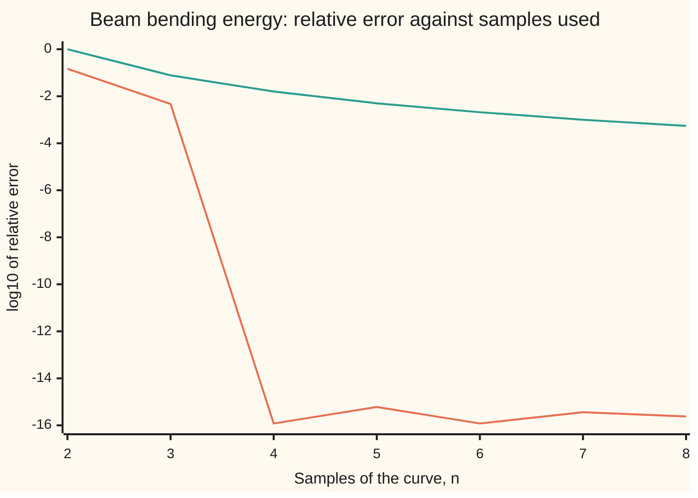

# Gaussian quadrature: choose the sample points as well as their weights

[Syllabus](../../../SYLLABUS.md) → [Numerical analysis](../README.md) → [Quadrature](../README.md#s05) → Gaussian quadrature

---

## General Overview

A steel beam 6 m long rests on a support at each end. It carries a load that rises evenly from nothing at the left end to 12 kN per metre at the right end, like soil pressing harder lower down a wall. Its bending stiffness EI, how hard it resists bending, is 20,000 kN m² (illustrative: a mid-sized steel I-beam).

The bent beam stores energy, like a compressed spring. Engineers use this bending energy to find how far a beam sags, and finite-element programs (programs that split a structure into many small pieces) compute integrals like it for every piece of a structure. It is the area under a curve along the span, and here it can be found exactly: 59.245714285714 joules, to 12 decimals.

The question is how few samples of the curve give every digit a double-precision number holds. Four equally spaced samples with trapezoid weights miss by 0.9346 J. Five with Simpson's weights miss by 1.125 J. Simpson needs 1,515 samples to reach a relative error of 1e-12. The Gauss rule uses four samples and lands within 7.105e-15 J, the size of rounding in the last digit.

The trick is freedom. The rules on [Trapezoid, midpoint and Simpson](01-newton-cotes-and-composite-rules.md) fix the sample points evenly and choose only the weights. A Gauss rule chooses the points too. With n points and n weights it has 2n numbers to set, enough to integrate every polynomial up to degree 2n − 1 with no error at all. The right points are the zeros of the Legendre polynomial of degree n, a fixed polynomial from [Legendre's equation](../../08-Differential%20equations%20and%20dynamics/07-Series%20Solutions%20and%20Boundary%20Problems/04-legendre-polynomials.md), recalled in Why it works. The beam's curve is a polynomial of degree 6, and four points cover degree 7.

**An n-point Gauss rule places its samples at the zeros of the Legendre polynomial of degree n, and that one choice makes it exact for every polynomial of degree up to 2n − 1, the most any n samples can achieve.**

**What kind of fact this is:** a theorem, proved on this card in Why it works; the formula for the weights is stated with its source and checked three ways by the code.

### The picture: error against the number of samples



Orange: the Gauss rule. It drops from −2.33 at three samples to −15.92 at four, then stays on the rounding floor. Teal: the trapezoid rule on the same number of evenly spaced samples, creeping from 0.00 to −3.26.

---

## The formula

A Gauss rule replaces the area under a curve f(t) from −1 to 1 by a weighted sum of n samples:

$$\int_{-1}^{1} f(t)\,dt \;\approx\; \sum_{j=1}^{n} w_j\, f(t_j), \qquad P_n(t_j) = 0, \qquad w_j = \frac{2}{(1 - t_j^2)\,P_n'(t_j)^2}.$$

**Read it aloud:** the area is about the sum of n weights times n samples, where the sample points are the n zeros of the Legendre polynomial of degree n and each weight comes from that polynomial's slope at its zero.

The beam runs from 0 to 6 m, not from −1 to 1, so stretch the rule. Put x = (a + b)/2 + t (b − a)/2, which sends t = −1 to a and t = 1 to b:

$$\int_{a}^{b} f(x)\,dx \;\approx\; \frac{b - a}{2} \sum_{j=1}^{n} w_j\, f\!\left(\frac{a + b}{2} + \frac{b - a}{2}\,t_j\right).$$

**Read it aloud:** sample at the stretched points, add up the weighted samples, and multiply by the half-width.

When f is not a polynomial of low degree, the error on −1 to 1 is

$$\int_{-1}^{1} f(t)\,dt - \sum_{j=1}^{n} w_j f(t_j) \;=\; \frac{2^{2n+1}\,(n!)^4}{(2n+1)\,\bigl((2n)!\bigr)^3}\; f^{(2n)}(\xi).$$

**Read it aloud:** the error is a fixed number, which shrinks very fast as n grows, times the curve's 2n-th derivative somewhere in the interval.

| Symbol | Plain meaning | In our example | Push it up and the answer… |
| --- | --- | --- | --- |
| $n$, $k$ | number of sample points; a counting index for powers and polynomials | 4 | exact for higher degree: 2n − 1 |
| $t_j$ | sample points (nodes) on −1 to 1 | ±0.339981, ±0.861136 | — |
| $w_j$ | weights, one per node, all positive, total 2 | 0.652145, 0.347855 | — |
| $P_n$, $P_n'$ | Legendre polynomial of degree n; its slope | $P_4$ | one more zero, so one more node |
| $f(t)$ | the curve to be integrated, on −1 to 1 | 3 × energy per metre at x = 3 + 3t | — |
| $a$, $b$, $x$ | ends of the real interval; position along it | 0 m, 6 m; nodes at 0.416591 m to 5.583409 m | — |
| $f^{(2n)}$, $\xi$, $\eta$ | the 2n-th derivative of f; points between −1 and 1 where it is read | zero for n = 4 | larger error |
| $p$, $q$, $r$; $g$, $K$, $s$ | a test polynomial; quotient and remainder after dividing it by $P_n$; in the remainder proof, a helper function, its constant and its variable | degree up to 7, 3, 3 | — |
| $\ell_j$, $H$ | Lagrange basis polynomial for node j; the polynomial matching f and its slope at every node | degree 3; degree 7 | — |
| $L$, $w_0$ | span; load at the right end | 6 m; 12 kN/m | U grows as $L^5$ and $w_0^2$ |
| $M(x)$, $EI$ | bending moment, the turning effect of the load at x; bending stiffness | $w_0 x (L^2 - x^2)/(6L)$ kN m; 20,000 kN m² (illustrative) | EI up: U falls |
| $U$, $U_n$ | bending energy, exact; the n-point Gauss value | 59.245714285714 J; $U_4$ equal to rounding level | — |

The bending energy is $U = \int_0^L M(x)^2 / (2EI)\,dx$, the integral every rule on this card is aimed at.

### When it holds

- **Exact for polynomials of degree at most 2n − 1.** The beam's curve has degree 6. Three points cover only degree 5, and they miss by 2.777e-1 J.
- **The curve is smooth: it has 2n derivatives.** The square root of x on 0 to 1 has an infinite slope at 0. The error falls only like a power of n: 3.001e-6 at 32 points, observed order 2.94 against the theory's 3, since an end that behaves like a square root makes the error fall like $n^{-3}$ (Sidi, Sources).
- **You choose where to sample.** A day of wind readings every ten minutes, the shelf's house example, comes on a fixed grid. Gauss cannot move those points, so use the trapezoid or Simpson rule.
- **A finite interval with weight 1.** A bell-curve weight or an infinite range needs other polynomials: [Weighted Gauss rules](04-gauss-hermite-and-weighted-rules.md).
- **"Exact" means in exact arithmetic.** In doubles each sample carries rounding. The weights are positive and add to 2, so that rounding is not magnified: the beam's error is 7.105e-15 J.

---

## Why it works

### Step 0: count the free numbers

A rule with n fixed points has n weights to set, so it can match the exact integrals of 1, t, …, t^(n−1): exact to degree n − 1, sometimes one more by symmetry. Simpson's 3 points reach degree 3.

Let the points move as well and there are 2n numbers to set: enough, in principle, for exactness on 1, t, …, t^(2n−1). The rest of this section shows the conditions can be met, and where the points must go.

### Step 1: the two-point rule, exact for cubics

Ask for two points t₁, t₂ and two weights w₁, w₂ that integrate 1, t, t² and t³ on −1 to 1 exactly. The exact integrals are 2, 0, 2/3 and 0:

$$w_1 + w_2 = 2, \quad w_1 t_1 + w_2 t_2 = 0, \quad w_1 t_1^2 + w_2 t_2^2 = \tfrac{2}{3}, \quad w_1 t_1^3 + w_2 t_2^3 = 0.$$

The interval is symmetric about 0, so try t₂ = −t₁ and w₁ = w₂. The second and fourth equations then hold at once. The first gives w₁ = w₂ = 1. The third gives 2t₁² = 2/3, so t₁ = −1/√3 = −0.577350269190 and t₂ = 0.577350269190.

On t⁴ the rule gives 2/9 = 0.222222222222 against the true 2/5 = 0.4. So degree 3 is its limit: 2n − 1 with n = 2.

Those two points are the zeros of $P_2(t) = (3t^2 - 1)/2$. That is not luck, and Step 2 says why.

### Step 2: zeros of an orthogonal polynomial give exactness to degree 2n − 1

The Legendre polynomials $P_0 = 1$, $P_1 = t$, $P_2$, … come from [Legendre's equation](../../08-Differential%20equations%20and%20dynamics/07-Series%20Solutions%20and%20Boundary%20Problems/04-legendre-polynomials.md). There they are shown to be orthogonal: two different ones, multiplied and integrated from −1 to 1, give zero. Any polynomial of degree below n is a mix of $P_0, \dots, P_{n-1}$, so $P_n$ is orthogonal to all of them.

Put the n nodes at the n zeros of $P_n$. Choose each weight $w_j$ as the integral of the Lagrange basis polynomial $\ell_j$: the polynomial of degree n − 1 that is 1 at node j and 0 at the other nodes (Lagrange interpolation, on the interpolation shelf). Then the rule is exact for every polynomial of degree up to n − 1, because such a polynomial equals the sum of its node values times the $\ell_j$.

Now take any polynomial p of degree up to 2n − 1. Divide it by $P_n$, as in long division:

$$p(t) = q(t)\,P_n(t) + r(t), \qquad q \text{ and } r \text{ of degree at most } n - 1.$$

Compare the two sides term by term.

1. **The exact integral of q P_n is 0**, because q has degree below n and $P_n$ is orthogonal to it.
2. **The rule's sum for q P_n is 0**, because every node is a zero of $P_n$.
3. **The rule is exact on r**, because r has degree at most n − 1.

So the rule and the integral agree on p. The code tests every power of t for n = 1 to 6 and finds the highest exact degree to be 1, 3, 5, 7, 9, 11: 2n − 1 each time.

<details>
<summary>Detailed proof: P_n has n different zeros, all strictly between −1 and 1</summary>

Suppose $P_n$ changes sign at only k points $s_1, \dots, s_k$ inside (−1, 1), with k < n. Then $P_n(t)\,(t - s_1)\cdots(t - s_k)$ never changes sign on the interval and is not identically zero, so its integral is not zero.

But $(t - s_1)\cdots(t - s_k)$ has degree k < n, so orthogonality makes that integral zero. The contradiction shows $P_n$ changes sign at least n times inside (−1, 1). A polynomial of degree n has at most n zeros, so these are all of them, each simple. Every node of a Gauss rule therefore lies strictly inside the interval: the rule never samples an endpoint.

</details>

### Step 3: no n points can do better, and every weight is positive

**Degree 2n is out of reach.** Take $p(t) = (t - t_1)^2 \cdots (t - t_n)^2$, of degree 2n. It is zero at every node, so any rule on those nodes gives 0. Its true integral is positive. So no n-point rule, wherever its points, is exact for every polynomial of degree 2n.

**Every weight is positive.** Square the Lagrange basis polynomial $\ell_j$. The square has degree 2n − 2, so the rule integrates it exactly. At the nodes it is 1 at node j and 0 elsewhere, so the rule's sum is $w_j$. Hence $w_j$ equals the integral of $\ell_j^2$, which is positive. Taking p = 1 shows the weights add to 2.

Positive weights matter in floating point: rounding in the samples cannot be magnified by cancellation between large weights of opposite sign, as happens for evenly spaced rules with many points.

### Step 4: finding the nodes and weights

The code builds $P_n(t)$ by Bonnet's rule from the Legendre card, $(k + 1)P_{k+1} = (2k + 1)\,t\,P_k - k\,P_{k-1}$. It finds each zero by bisection, halving a bracket until the two ends are neighbouring doubles. Each weight then comes from the formula above, $w_j = 2/((1 - t_j^2) P_n'(t_j)^2)$, a classical result stated by Hale and Townsend (Sources).

For n = 4 there is a closed form, which the code uses as a second road:

$$t = \pm\sqrt{\frac{3 \mp 2\sqrt{6/5}}{7}}, \qquad w = \frac{18 \pm \sqrt{30}}{36}.$$

The inner nodes ±0.339981043584856 carry weight 0.652145154862546; the outer nodes ±0.861136311594053 carry 0.347854845137454. A third road solves the n moment equations, $\sum_j w_j t_j^k = \int_{-1}^1 t^k\,dt$ for k = 0 to n − 1, by elimination. All three agree within 2.220e-16.

For large n, libraries use the Golub–Welsch method instead: the nodes are the eigenvalues of a small symmetric matrix built from the numbers in Bonnet's rule. Newer codes use Newton's method on $P_n$ and handle very large n quickly (Sources).

### Step 5: the error for a curve that is not a low-degree polynomial

The error formula comes from interpolating f by a polynomial H of degree 2n − 1 that matches both f and its slope at every node. The rule is exact on H and sees only node values, where f and H agree. So the rule's error is the integral of f − H.

<details>
<summary>Detailed proof: the error constant</summary>

The remainder for this kind of interpolation, which matches values and slopes (Hermite interpolation), is

$$f(t) - H(t) = \frac{f^{(2n)}(\eta(t))}{(2n)!}\,(t - t_1)^2 \cdots (t - t_n)^2$$

for some $\eta(t)$ between −1 and 1. The proof is Rolle's theorem (a smooth function that is zero at two points has zero slope somewhere between them), used 2n times. Fix a t that is not a node, and choose the number K so that $g(s) = f(s) - H(s) - K\,(s - t_1)^2 \cdots (s - t_n)^2$ is zero at s = t. Then g is zero at t and at the n nodes, so g′ is zero at n points strictly between them. g′ is also zero at each node, where f and H share a slope and the squared product has a double zero: 2n zeros of g′ in all. Applying Rolle's theorem 2n − 1 more times leaves a point η where $g^{(2n)}$ is zero. H has degree 2n − 1, so its 2n-th derivative is 0, while the squared product's is (2n)!. So $K = f^{(2n)}(\eta)/(2n)!$, which is the remainder at t.

The squared product never goes negative, so the mean value theorem for integrals pulls the derivative out at a single point ξ:

$$\int_{-1}^{1} (f - H)\,dt = \frac{f^{(2n)}(\xi)}{(2n)!} \int_{-1}^{1} (t - t_1)^2 \cdots (t - t_n)^2\,dt.$$

The product $(t - t_1)\cdots(t - t_n)$ is $P_n$ divided by its leading coefficient, $(2n)!/(2^n (n!)^2)$; Bonnet's rule multiplies that coefficient by (2k + 1)/(k + 1) at each step, which gives this product. The integral of $P_n^2$ is $2/(2n + 1)$, from the Legendre card. Put together:

$$\frac{1}{(2n)!} \cdot \frac{2}{2n + 1} \cdot \left(\frac{2^n (n!)^2}{(2n)!}\right)^2 = \frac{2^{2n+1} (n!)^4}{(2n + 1)\bigl((2n)!\bigr)^3}.$$

</details>

The beam gives a sharp test with n = 3. Its curve f on −1 to 1 has degree 6, so its sixth derivative is a constant and ξ does not matter. The formula predicts an error of 2.777e-1 J. The true error is 2.777e-1 J. Their ratio is 1.000000.

The constant in front shrinks faster than any power of n, but that alone does not bound the error, because the 2n-th derivative can grow too. For a curve that is analytic on and around the interval (equal to its Taylor series near every point), such as e^x, the error falls by at least a steady factor with each extra point (Trefethen, Sources). That is why Gauss rules gain digits so fast on smooth integrands.

---

## Worked numbers, by hand

The span runs from a = 0 to b = 6 m, so the stretch is x = 3 + 3t and the half-width is 3. The energy per metre is $M(x)^2/(2EI)$, in joules per metre.

| Step | Arithmetic | Value |
| --- | --- | --- |
| exact U | $1000\,w_0^2 L^5 / (945\,EI)$, from integrating the degree-6 polynomial term by term; the 1000 turns kJ into J | 59.245714285714 J |
| node 1 | x = 3 + 3 × (−0.861136) | 0.416591 m, energy 0.618764 J/m |
| node 2 | x = 3 + 3 × (−0.339981) | 1.980057 m, energy 11.207393 J/m |
| node 3 | x = 3 + 3 × 0.339981 | 4.019943 m, energy 17.669455 J/m |
| node 4 | x = 3 + 3 × 0.861136 | 5.583409 m, energy 2.016457 J/m |
| weighted sum | 0.347855 × 0.618764 + 0.652145 × 11.207393 + 0.652145 × 17.669455 + 0.347855 × 2.016457 | 19.748571 J/m (from full-precision inputs) |
| times half-width | 3 × 19.748571 | **59.245714 J** |

The rows show six digits, but the sum uses the code's full-precision values, so redoing it from the rounded figures moves the sixth digit. Four samples of the curve give the beam's bending energy to every digit shown. In the code's full double precision the error is 7.105e-15 J, at the rounding level, and it stays there for five and six points.

### What breaks if you drop a piece

| Mistake | Comes out at | What went wrong |
| --- | --- | --- |
| Leave out the half-width (b − a)/2 = 3 | 19.748571 J | The weights add to 2, the length of −1 to 1, not to the beam's 6 m |
| Use 3 Gauss points | 58.968000 J, error 2.777e-1 | Three points are exact only to degree 5; the curve has degree 6 |
| Use 4 equally spaced points (Simpson's 3/8 rule) | error −6.354e0 J | Fixed points: 4 samples buy degree 3, not 7 |
| Apply Gauss to the square root of x on 0 to 1 | error 3.001e-6 at 32 points | Infinite slope at 0: no 2n-th derivative, so the error falls only like a power of n |

---

## Code, from first principles, and it actually runs

Three independent roads lead to the nodes and weights: bisection on Legendre polynomials with the weight formula, the closed form for four points, and the moment equations solved by elimination. Two roads lead to the energy: the exact integral, term by term, and Gauss rules of 1 to 6 points, with trapezoid and Simpson for comparison. The asserts check the degree of exactness 2n − 1 for n = 1 to 6 and the error formula at n = 3. Sums run left to right and powers are plain multiplies, so Python and Rust print the same digits.

### Python

```python
# Gaussian quadrature -- the check behind the card.  Standard library only.
# A 6 m simply supported beam carries a load rising from 0 to 12 kN/m; EI = 20,000 kN m^2.
# Bending energy U = integral over the span of M(x)^2 / (2 EI), with M(x) = w0 x (L^2 - x^2) / (6 L).
# Roads: exact integration term by term; Gauss nodes found by bisection on the Legendre
# polynomial with the weight formula; the closed-form 4-point rule; weights from moment equations.
from math import sqrt, log10
from functools import reduce

L, W0, EI = 6.0, 12.0, 20000.0                    # m, kN/m, kN m^2
def e(x, d=3):                                    # e-notation, printed the same way in Rust
    m, p = f"{x:.{d}e}".split("e")
    return m + "e" + str(int(p))
def pw(x, k): return 1.0 if k == 0 else x * pw(x, k - 1)  # x^k by plain multiplies
def total(v): return reduce(lambda a, b: a + b, v, 0.0)  # left-to-right sum, as in Rust
def legendre(n, x):                               # Bonnet's rule; returns P_n(x), P_(n-1)(x)
    p0, p1 = 1.0, x
    for k in range(1, n):
        p0, p1 = p1, ((2 * k + 1) * x * p1 - k * p0) / (k + 1)
    return p1, p0
def gauss(n):                                     # zeros of P_n by bisection; w = 2 / ((1 - x^2) P_n'(x)^2)
    xs, ws, grid = [], [], 2001
    for i in range(grid):
        a, b = -1.0 + 2.0 * i / grid, -1.0 + 2.0 * (i + 1) / grid
        fa = legendre(n, a)[0]
        if fa * legendre(n, b)[0] > 0.0:
            continue
        while True:
            m = 0.5 * (a + b)
            if m == a or m == b:
                break
            fm = legendre(n, m)[0]
            if fa * fm <= 0.0:
                b = m
            else:
                a, fa = m, fm
        p, q = legendre(n, a)
        dp = n * (a * p - q) / (a * a - 1.0)
        xs.append(a)
        ws.append(2.0 / ((1.0 - a * a) * dp * dp))
    return xs, ws
def rule(f, a, b, xs, ws):                        # stretch [-1, 1] onto [a, b]: x = mid + half t, dx = half dt
    mid, half = 0.5 * (a + b), 0.5 * (b - a)
    return half * total(w * f(mid + half * t) for t, w in zip(xs, ws))
def moment_weights(xs):                           # solve sum_j w_j x_j^k = integral of t^k, k = 0..n-1
    n = len(xs)
    A = [[pw(x, k) for x in xs] + [2.0 / (k + 1) if k % 2 == 0 else 0.0] for k in range(n)]
    for c in range(n):
        piv = max(range(c, n), key=lambda r: abs(A[r][c]))
        A[c], A[piv] = A[piv], A[c]
        for r in range(c + 1, n):
            f = A[r][c] / A[c][c]
            A[r] = [A[r][j] - f * A[c][j] for j in range(n + 1)]
    w = [0.0] * n
    for r in range(n - 1, -1, -1):
        w[r] = (A[r][n] - total(A[r][j] * w[j] for j in range(r + 1, n))) / A[r][r]
    return w
def M(x): return W0 * x * (L * L - x * x) / (6.0 * L)       # bending moment, kN m
def energy(x): return 1000.0 * M(x) * M(x) / (2.0 * EI)        # J per m of span
c = W0 / (6.0 * L)                                            # M^2 = c^2 (L^4 x^2 - 2 L^2 x^4 + x^6)
U = 1000.0 * c * c * (pw(L, 7) / 3 - 2 * pw(L, 7) / 5 + pw(L, 7) / 7) / (2.0 * EI)
print(f"L {L:.0f} m, w0 {W0:.0f} kN/m, EI {EI:.0f} kN m^2; exact U (J): term by term {U:.12f}", "| 1000 w0^2 L^5/(945 EI)", f"{1000.0 * W0 * W0 * pw(L, 5) / (945.0 * EI):.12f}")
x2, w2 = gauss(2)
print("2-point nodes", f"{x2[0]:.12f} {x2[1]:.12f}", "weights", f"{w2[0]:.12f} {w2[1]:.12f}")
assert abs(x2[1] - 1.0 / sqrt(3.0)) < 1e-15 and abs(w2[0] - 1.0) < 1e-14
for k in range(5):
    print(f"2-point on t^{k}: rule {rule(lambda t: pw(t, k), -1.0, 1.0, x2, w2):.12f}"
          f" exact {2.0 / (k + 1) if k % 2 == 0 else 0.0:.12f}")

x4, w4 = gauss(4)
s = 2.0 * sqrt(6.0 / 5.0)                         # closed form: x^2 = (3 -+ 2 sqrt(6/5)) / 7, w = (18 +- sqrt 30) / 36
cx = [-sqrt((3 + s) / 7), -sqrt((3 - s) / 7), sqrt((3 - s) / 7), sqrt((3 + s) / 7)]
cw = [(18 - sqrt(30.0)) / 36, (18 + sqrt(30.0)) / 36, (18 + sqrt(30.0)) / 36, (18 - sqrt(30.0)) / 36]
mw = moment_weights(x4)
for j in range(4):
    print(f"4-point t {x4[j]:+.15f} w {w4[j]:.15f} | x {3 + 3 * x4[j]:.6f} m, energy {energy(3 + 3 * x4[j]):.6f} J/m")
dx = max(abs(a - b) for a, b in zip(x4, cx))
dw = max(abs(a - b) for a, b in zip(w4, cw))
dm = max(abs(a - b) for a, b in zip(w4, mw))
print("vs closed form: nodes", e(dx), "weights", e(dw), "| weights by moments", e(dm))
assert dx < 1e-15 and dw < 1e-14 and dm < 1e-13

degs = []
for n in range(1, 7):                             # highest degree k with every t^0..t^k exact
    xs, ws = gauss(n)
    k = 0
    while abs(rule(lambda t: pw(t, k), -1.0, 1.0, xs, ws) - (2.0 / (k + 1) if k % 2 == 0 else 0.0)) < 1e-13:
        k += 1
    degs.append(k - 1)
print("degree of exactness, n = 1..6:", degs)
assert degs == [2 * n - 1 for n in range(1, 7)]

print("beam, n points: U_n (J), true error")
errs = []
for n in range(1, 7):
    xs, ws = gauss(n)
    Un = rule(energy, 0.0, L, xs, ws)
    errs.append(U - Un)
    print(f"  n={n} {Un:.12f} {e(U - Un)}")
assert abs(errs[3]) < 4e-15 * U and abs(errs[2]) > 1e-4
# n = 3 error from the theorem: K_3 f^(6), K_3 = 2^7 (3!)^4 / (7 (6!)^3); f^(6) = 720 x leading coefficient in t
K3 = 128.0 * 1296.0 / (7.0 * 720.0 * 720.0 * 720.0)
lead = 1000.0 * c * c * pw(L / 2, 7) / (2.0 * EI)  # t^6 coefficient of (L/2) energy(L/2 (1 + t))
pred = K3 * 720.0 * lead
print("n=3 error: theorem", e(pred), "true", e(errs[2]), "ratio", f"{errs[2] / pred:.6f}")
assert abs(errs[2] / pred - 1.0) < 1e-9

def trap(f, a, b, m):
    h = (b - a) / m
    return h * (0.5 * f(a) + 0.5 * f(b) + total(f(a + i * h) for i in range(1, m)))
def simpson(f, a, b, m):
    h = (b - a) / m
    return h / 3 * (f(a) + f(b) + total((4 if i % 2 else 2) * f(a + i * h) for i in range(1, m)))
print("4-point trapezoid", e(U - trap(energy, 0.0, L, 3)), "| 5-point Simpson", e(U - simpson(energy, 0.0, L, 4)))
m = next(m for m in range(2, 4000, 2) if abs(U - simpson(energy, 0.0, L, m)) <= 1e-12 * U)   # fewest even slice count
print("Simpson to relative error 1e-12:", m + 1, "points, error", e(U - simpson(energy, 0.0, L, m)))
assert abs(U - simpson(energy, 0.0, L, 2 * m)) < abs(U - simpson(energy, 0.0, L, m)) / 8   # h^4: twice the slices, near 16 times less error

print("chart, log10 relative error by points used, n = 2..8: Gauss | trapezoid")
print("  ", " ".join(f"{log10(abs(U - rule(energy, 0.0, L, *gauss(n))) / U):.2f}" for n in range(2, 9)))
print("  ", " ".join(f"{log10(abs(U - trap(energy, 0.0, L, n - 1)) / U):.2f}" for n in range(2, 9)))

print("break: no half-width factor", f"{total(w * energy(3.0 + 3.0 * t) for t, w in zip(x4, w4)):.6f}")
eq = [-1.0, -1.0 / 3, 1.0 / 3, 1.0]               # four equally spaced points, Simpson's 3/8 weights
print("break: 4 equal points, 3/8 rule", e(U - rule(energy, 0.0, L, eq, [0.25, 0.75, 0.75, 0.25])))
prev = None
for n in (2, 4, 8, 16, 32):                       # sqrt(x) on [0, 1]: infinite slope at 0
    err = abs(2.0 / 3.0 - rule(sqrt, 0.0, 1.0, *gauss(n)))
    print(f"break: sqrt(x), n={n} error {e(err)}" + (f" order {log10(prev / err) / log10(2.0):.2f}, theory 3" if prev else ""))
    prev = err
assert prev > 1e-6                                # the crawl: still wrong in the sixth digit at 32 points
x3, w3 = gauss(3)
Uu = 1000.0 * W0 * W0 * pw(L, 5) / (240.0 * EI)     # try: uniform 12 kN/m, M = w0 x (L - x) / 2, M^2 of degree 4
uni = lambda x: 1000.0 * pw(W0 * x * (L - x) / 2, 2) / (2.0 * EI)
print(f"try: uniform load U {Uu:.6f}, error n=2", e(Uu - rule(uni, 0.0, L, x2, w2)), "n=3", e(Uu - rule(uni, 0.0, L, x3, w3)))
print("try: sqrt(x) as 2 s^2 on s in [0, 1], n=2 error", e(2.0 / 3.0 - rule(lambda s: 2.0 * s * s, 0.0, 1.0, x2, w2)))
L = 12.0                                          # try: double the span; energy() reads L afresh
print(f"try: span 12 m, U {32.0 * U:.6f}, n=4 error", e(32.0 * U - rule(energy, 0.0, L, x4, w4)))
print("ALL CHECKS PASS")
```

**Ran 2026-11-11 on macOS, Python 3.14.10, standard library only. All checks passed. Output, pasted from the run:**

```
L 6 m, w0 12 kN/m, EI 20000 kN m^2; exact U (J): term by term 59.245714285714 | 1000 w0^2 L^5/(945 EI) 59.245714285714
2-point nodes -0.577350269190 0.577350269190 weights 1.000000000000 1.000000000000
2-point on t^0: rule 2.000000000000 exact 2.000000000000
2-point on t^1: rule 0.000000000000 exact 0.000000000000
2-point on t^2: rule 0.666666666667 exact 0.666666666667
2-point on t^3: rule 0.000000000000 exact 0.000000000000
2-point on t^4: rule 0.222222222222 exact 0.400000000000
4-point t -0.861136311594053 w 0.347854845137454 | x 0.416591 m, energy 0.618764 J/m
4-point t -0.339981043584856 w 0.652145154862546 | x 1.980057 m, energy 11.207393 J/m
4-point t +0.339981043584856 w 0.652145154862546 | x 4.019943 m, energy 17.669455 J/m
4-point t +0.861136311594053 w 0.347854845137454 | x 5.583409 m, energy 2.016457 J/m
vs closed form: nodes 1.110e-16 weights 2.220e-16 | weights by moments 5.551e-17
degree of exactness, n = 1..6: [1, 3, 5, 7, 9, 11]
beam, n points: U_n (J), true error
  n=1 109.350000000000 -5.010e1
  n=2 50.400000000000 8.846e0
  n=3 58.968000000000 2.777e-1
  n=4 59.245714285714 7.105e-15
  n=5 59.245714285714 3.553e-14
  n=6 59.245714285714 -7.105e-15
n=3 error: theorem 2.777e-1 true 2.777e-1 ratio 1.000000
4-point trapezoid 9.346e-1 | 5-point Simpson -1.125e0
Simpson to relative error 1e-12: 1515 points, error -5.920e-11
chart, log10 relative error by points used, n = 2..8: Gauss | trapezoid
   -0.83 -2.33 -15.92 -15.22 -15.92 -15.44 -15.62
   0.00 -1.11 -1.80 -2.30 -2.68 -3.00 -3.26
break: no half-width factor 19.748571
break: 4 equal points, 3/8 rule -6.354e0
break: sqrt(x), n=2 error 7.221e-3
break: sqrt(x), n=4 error 1.161e-3 order 2.64, theory 3
break: sqrt(x), n=8 error 1.689e-4 order 2.78, theory 3
break: sqrt(x), n=16 error 2.296e-5 order 2.88, theory 3
break: sqrt(x), n=32 error 3.001e-6 order 2.94, theory 3
try: uniform load U 233.280000, error n=2 3.888e1 n=3 -2.842e-14
try: sqrt(x) as 2 s^2 on s in [0, 1], n=2 error -1.110e-16
try: span 12 m, U 1895.862857, n=4 error 2.274e-13
ALL CHECKS PASS
```

### Rust

```rust
// Gaussian quadrature -- the check behind the card.  Rust std only, no crates.
// A 6 m simply supported beam carries a load rising from 0 to 12 kN/m; EI = 20,000 kN m^2.
// Bending energy U = integral over the span of M(x)^2 / (2 EI), with M(x) = w0 x (L^2 - x^2) / (6 L).
// Roads: exact integration term by term; Gauss nodes found by bisection on the Legendre
// polynomial with the weight formula; the closed-form 4-point rule; weights from moment equations.

const W0: f64 = 12.0; // kN/m
const EI: f64 = 20000.0; // kN m^2

fn e(x: f64) -> String { format!("{:.3e}", x) } // e-notation, printed the same way in Python
fn pw(x: f64, k: u32) -> f64 { if k == 0 { 1.0 } else { x * pw(x, k - 1) } } // x^k by plain multiplies
fn total<I: Iterator<Item = f64>>(v: I) -> f64 { v.fold(0.0, |a, b| a + b) } // left-to-right sum

fn legendre(n: usize, x: f64) -> (f64, f64) { // Bonnet's rule; returns P_n(x), P_(n-1)(x)
    let (mut p0, mut p1) = (1.0, x);
    for k in 1..n {
        let kf = k as f64;
        let p2 = ((2.0 * kf + 1.0) * x * p1 - kf * p0) / (kf + 1.0);
        p0 = p1;
        p1 = p2;
    }
    (p1, p0)
}

fn gauss(n: usize) -> (Vec<f64>, Vec<f64>) { // zeros of P_n by bisection; w = 2 / ((1 - x^2) P_n'(x)^2)
    let (mut xs, mut ws, grid) = (vec![], vec![], 2001);
    for i in 0..grid {
        let mut a = -1.0 + 2.0 * i as f64 / grid as f64;
        let mut b = -1.0 + 2.0 * (i + 1) as f64 / grid as f64;
        let mut fa = legendre(n, a).0;
        if fa * legendre(n, b).0 > 0.0 { continue; }
        loop {
            let m = 0.5 * (a + b);
            if m == a || m == b { break; }
            let fm = legendre(n, m).0;
            if fa * fm <= 0.0 { b = m; } else { a = m; fa = fm; }
        }
        let (p, q) = legendre(n, a);
        let dp = n as f64 * (a * p - q) / (a * a - 1.0);
        xs.push(a);
        ws.push(2.0 / ((1.0 - a * a) * dp * dp));
    }
    (xs, ws)
}

fn rule(f: &dyn Fn(f64) -> f64, a: f64, b: f64, xs: &[f64], ws: &[f64]) -> f64 {
    let (mid, half) = (0.5 * (a + b), 0.5 * (b - a)); // x = mid + half t, dx = half dt
    half * total(xs.iter().zip(ws).map(|(t, w)| w * f(mid + half * t)))
}

fn moment_weights(xs: &[f64]) -> Vec<f64> { // solve sum_j w_j x_j^k = integral of t^k, k = 0..n-1
    let n = xs.len();
    let mut a: Vec<Vec<f64>> = (0..n).map(|k| {
        let mut row: Vec<f64> = xs.iter().map(|&x| pw(x, k as u32)).collect();
        row.push(if k % 2 == 0 { 2.0 / (k as f64 + 1.0) } else { 0.0 });
        row
    }).collect();
    for c in 0..n {
        let mut piv = c;
        for r in c..n { if a[r][c].abs() > a[piv][c].abs() { piv = r; } }
        a.swap(c, piv);
        for r in c + 1..n {
            let f = a[r][c] / a[c][c];
            for j in 0..=n { a[r][j] = a[r][j] - f * a[c][j]; }
        }
    }
    let mut w = vec![0.0; n];
    for r in (0..n).rev() {
        w[r] = (a[r][n] - total((r + 1..n).map(|j| a[r][j] * w[j]))) / a[r][r];
    }
    w
}

fn mono(k: u32) -> f64 { if k % 2 == 0 { 2.0 / (k as f64 + 1.0) } else { 0.0 } } // integral of t^k on [-1, 1]

fn trap(f: &dyn Fn(f64) -> f64, a: f64, b: f64, m: usize) -> f64 {
    let h = (b - a) / m as f64;
    h * (0.5 * f(a) + 0.5 * f(b) + total((1..m).map(|i| f(a + i as f64 * h))))
}

fn simpson(f: &dyn Fn(f64) -> f64, a: f64, b: f64, m: usize) -> f64 {
    let h = (b - a) / m as f64;
    h / 3.0 * (f(a) + f(b) + total((1..m).map(|i| (if i % 2 == 1 { 4.0 } else { 2.0 }) * f(a + i as f64 * h))))
}

fn main() {
    let l = 6.0; // m
    let energy = move |l: f64| move |x: f64| { // J per m of span
        let m = W0 * x * (l * l - x * x) / (6.0 * l); // bending moment, kN m
        1000.0 * m * m / (2.0 * EI)
    };
    let en = energy(l);
    let c = W0 / (6.0 * l); // M^2 = c^2 (L^4 x^2 - 2 L^2 x^4 + x^6)
    let u = 1000.0 * c * c * (pw(l, 7) / 3.0 - 2.0 * pw(l, 7) / 5.0 + pw(l, 7) / 7.0) / (2.0 * EI);
    println!("L {:.0} m, w0 {:.0} kN/m, EI {:.0} kN m^2; exact U (J): term by term {:.12} | 1000 w0^2 L^5/(945 EI) {:.12}", l, W0, EI, u, 1000.0 * W0 * W0 * pw(l, 5) / (945.0 * EI));
    let (x2, w2) = gauss(2);
    println!("2-point nodes {:.12} {:.12} weights {:.12} {:.12}", x2[0], x2[1], w2[0], w2[1]);
    assert!((x2[1] - 1.0 / 3.0f64.sqrt()).abs() < 1e-15 && (w2[0] - 1.0).abs() < 1e-14);
    for k in 0..5u32 {
        println!("2-point on t^{}: rule {:.12} exact {:.12}", k, rule(&|t| pw(t, k), -1.0, 1.0, &x2, &w2), mono(k));
    }
    let (x4, w4) = gauss(4);
    let s = 2.0 * (6.0f64 / 5.0).sqrt(); // closed form: x^2 = (3 -+ 2 sqrt(6/5)) / 7, w = (18 +- sqrt 30) / 36
    let cx = [-((3.0 + s) / 7.0).sqrt(), -((3.0 - s) / 7.0).sqrt(), ((3.0 - s) / 7.0).sqrt(), ((3.0 + s) / 7.0).sqrt()];
    let r30 = 30.0f64.sqrt();
    let cw = [(18.0 - r30) / 36.0, (18.0 + r30) / 36.0, (18.0 + r30) / 36.0, (18.0 - r30) / 36.0];
    let mw = moment_weights(&x4);
    for j in 0..4 { println!("4-point t {:+.15} w {:.15} | x {:.6} m, energy {:.6} J/m", x4[j], w4[j], 3.0 + 3.0 * x4[j], en(3.0 + 3.0 * x4[j])); }
    let maxd = |p: &[f64], q: &[f64]| p.iter().zip(q).map(|(a, b)| (a - b).abs()).fold(0.0, f64::max);
    let (dx, dw, dm) = (maxd(&x4, &cx), maxd(&w4, &cw), maxd(&w4, &mw));
    println!("vs closed form: nodes {} weights {} | weights by moments {}", e(dx), e(dw), e(dm));
    assert!(dx < 1e-15 && dw < 1e-14 && dm < 1e-13);
    let mut degs = vec![];
    for n in 1..7 { // highest degree k with every t^0..t^k exact
        let (xs, ws) = gauss(n);
        let mut k = 0u32;
        while (rule(&|t| pw(t, k), -1.0, 1.0, &xs, &ws) - mono(k)).abs() < 1e-13 { k += 1; }
        degs.push(k as i32 - 1);
    }
    println!("degree of exactness, n = 1..6: {:?}", degs);
    assert!(degs == (1..7).map(|n| 2 * n - 1).collect::<Vec<i32>>());
    println!("beam, n points: U_n (J), true error");
    let mut errs = vec![];
    for n in 1..7 {
        let (xs, ws) = gauss(n);
        let un = rule(&en, 0.0, l, &xs, &ws);
        errs.push(u - un);
        println!("  n={} {:.12} {}", n, un, e(u - un));
    }
    assert!(errs[3].abs() < 4e-15 * u && errs[2].abs() > 1e-4);
    // n = 3 error from the theorem: K_3 f^(6), K_3 = 2^7 (3!)^4 / (7 (6!)^3); f^(6) = 720 x leading coefficient in t
    let k3 = 128.0 * 1296.0 / (7.0 * 720.0 * 720.0 * 720.0);
    let lead = 1000.0 * c * c * pw(l / 2.0, 7) / (2.0 * EI); // t^6 coefficient of (L/2) energy(L/2 (1 + t))
    let pred = k3 * 720.0 * lead;
    println!("n=3 error: theorem {} true {} ratio {:.6}", e(pred), e(errs[2]), errs[2] / pred);
    assert!((errs[2] / pred - 1.0).abs() < 1e-9);
    println!("4-point trapezoid {} | 5-point Simpson {}", e(u - trap(&en, 0.0, l, 3)), e(u - simpson(&en, 0.0, l, 4)));
    let m = (1..2000).map(|k| 2 * k).find(|&m| (u - simpson(&en, 0.0, l, m)).abs() <= 1e-12 * u).unwrap(); // fewest even slice count
    println!("Simpson to relative error 1e-12: {} points, error {}", m + 1, e(u - simpson(&en, 0.0, l, m)));
    assert!((u - simpson(&en, 0.0, l, 2 * m)).abs() < (u - simpson(&en, 0.0, l, m)).abs() / 8.0); // h^4: twice the slices, near 16 times less error
    println!("chart, log10 relative error by points used, n = 2..8: Gauss | trapezoid");
    let g: Vec<String> = (2..9).map(|n| { let (xs, ws) = gauss(n); format!("{:.2}", ((u - rule(&en, 0.0, l, &xs, &ws)).abs() / u).log10()) }).collect();
    let t: Vec<String> = (2..9).map(|n| format!("{:.2}", ((u - trap(&en, 0.0, l, n - 1)).abs() / u).log10())).collect();
    println!("   {}", g.join(" "));
    println!("   {}", t.join(" "));
    println!("break: no half-width factor {:.6}", total(x4.iter().zip(&w4).map(|(t, w)| w * en(3.0 + 3.0 * t))));
    let eq = [-1.0, -1.0 / 3.0, 1.0 / 3.0, 1.0]; // four equally spaced points, Simpson's 3/8 weights
    println!("break: 4 equal points, 3/8 rule {}", e(u - rule(&en, 0.0, l, &eq, &[0.25, 0.75, 0.75, 0.25])));
    let mut prev = 0.0;
    for n in [2, 4, 8, 16, 32] { // sqrt(x) on [0, 1]: infinite slope at 0
        let (xs, ws) = gauss(n);
        let err = (2.0 / 3.0 - rule(&|x: f64| x.sqrt(), 0.0, 1.0, &xs, &ws)).abs();
        let ord = if prev > 0.0 { format!(" order {:.2}, theory 3", (prev / err).log10() / 2.0f64.log10()) } else { String::new() };
        println!("break: sqrt(x), n={} error {}{}", n, e(err), ord);
        prev = err;
    }
    assert!(prev > 1e-6); // the crawl: still wrong in the sixth digit at 32 points
    let (x3, w3) = gauss(3);
    let uu = 1000.0 * W0 * W0 * pw(l, 5) / (240.0 * EI); // try: uniform 12 kN/m, M = w0 x (L - x) / 2, M^2 of degree 4
    let uni = |x: f64| 1000.0 * pw(W0 * x * (l - x) / 2.0, 2) / (2.0 * EI);
    println!("try: uniform load U {:.6}, error n=2 {} n=3 {}", uu, e(uu - rule(&uni, 0.0, l, &x2, &w2)), e(uu - rule(&uni, 0.0, l, &x3, &w3)));
    println!("try: sqrt(x) as 2 s^2 on s in [0, 1], n=2 error {}", e(2.0 / 3.0 - rule(&|s: f64| 2.0 * s * s, 0.0, 1.0, &x2, &w2)));
    let en12 = energy(12.0); // try: double the span
    println!("try: span 12 m, U {:.6}, n=4 error {}", 32.0 * u, e(32.0 * u - rule(&en12, 0.0, 12.0, &x4, &w4)));
    println!("ALL CHECKS PASS");
}
```

**Ran 2026-11-11 on macOS, rustc 1.98.1, no crates. All checks passed. Output, pasted from the run:**

```
L 6 m, w0 12 kN/m, EI 20000 kN m^2; exact U (J): term by term 59.245714285714 | 1000 w0^2 L^5/(945 EI) 59.245714285714
2-point nodes -0.577350269190 0.577350269190 weights 1.000000000000 1.000000000000
2-point on t^0: rule 2.000000000000 exact 2.000000000000
2-point on t^1: rule 0.000000000000 exact 0.000000000000
2-point on t^2: rule 0.666666666667 exact 0.666666666667
2-point on t^3: rule 0.000000000000 exact 0.000000000000
2-point on t^4: rule 0.222222222222 exact 0.400000000000
4-point t -0.861136311594053 w 0.347854845137454 | x 0.416591 m, energy 0.618764 J/m
4-point t -0.339981043584856 w 0.652145154862546 | x 1.980057 m, energy 11.207393 J/m
4-point t +0.339981043584856 w 0.652145154862546 | x 4.019943 m, energy 17.669455 J/m
4-point t +0.861136311594053 w 0.347854845137454 | x 5.583409 m, energy 2.016457 J/m
vs closed form: nodes 1.110e-16 weights 2.220e-16 | weights by moments 5.551e-17
degree of exactness, n = 1..6: [1, 3, 5, 7, 9, 11]
beam, n points: U_n (J), true error
  n=1 109.350000000000 -5.010e1
  n=2 50.400000000000 8.846e0
  n=3 58.968000000000 2.777e-1
  n=4 59.245714285714 7.105e-15
  n=5 59.245714285714 3.553e-14
  n=6 59.245714285714 -7.105e-15
n=3 error: theorem 2.777e-1 true 2.777e-1 ratio 1.000000
4-point trapezoid 9.346e-1 | 5-point Simpson -1.125e0
Simpson to relative error 1e-12: 1515 points, error -5.920e-11
chart, log10 relative error by points used, n = 2..8: Gauss | trapezoid
   -0.83 -2.33 -15.92 -15.22 -15.92 -15.44 -15.62
   0.00 -1.11 -1.80 -2.30 -2.68 -3.00 -3.26
break: no half-width factor 19.748571
break: 4 equal points, 3/8 rule -6.354e0
break: sqrt(x), n=2 error 7.221e-3
break: sqrt(x), n=4 error 1.161e-3 order 2.64, theory 3
break: sqrt(x), n=8 error 1.689e-4 order 2.78, theory 3
break: sqrt(x), n=16 error 2.296e-5 order 2.88, theory 3
break: sqrt(x), n=32 error 3.001e-6 order 2.94, theory 3
try: uniform load U 233.280000, error n=2 3.888e1 n=3 -2.842e-14
try: sqrt(x) as 2 s^2 on s in [0, 1], n=2 error -1.110e-16
try: span 12 m, U 1895.862857, n=4 error 2.274e-13
ALL CHECKS PASS
```

### Lean

Lean proves the card's three theorems about Gauss rules on −1 to 1, for every number of points n.

- The Legendre polynomial of degree n has n different zeros, all strictly between −1 and 1, and no other zeros.
- Put the n nodes at those zeros, and give node j the weight $w_j$, the integral of its Lagrange basis polynomial $\ell_j$. Then the rule is exact for every polynomial of degree up to 2n − 1.
- No n-point rule, wherever its points and whatever its weights, is exact for every polynomial of degree 2n.
- The hand numbers hold exactly: $P_2 = (3t^2 - 1)/2$, its zeros ±1/√3, and the two-point rule on 1, t, t², t³ and t⁴.
- So do the list 1, 3, 5, 7, 9, 11, the error constant at n = 2 and n = 3, and the beam's exact U and three-point miss.

The weight formula, the error formula, positive weights and every floating-point run are left to the proofs above and the Python and Rust checks.

```lean
-- Gaussian quadrature: an n-point rule with its nodes at the n zeros of the Legendre polynomial of degree n, which are distinct and lie strictly inside -1 to 1, integrates every polynomial of degree up to 2n - 1 exactly on -1 to 1, and no n-point rule is exact for every polynomial of degree 2n.
import Mathlib.RingTheory.Polynomial.ShiftedLegendre
import Mathlib.LinearAlgebra.Lagrange
import Mathlib.Analysis.SpecialFunctions.Integrals.Basic
import Mathlib.Analysis.Calculus.LocalExtr.Polynomial

open Polynomial intervalIntegral

/-- The Legendre polynomial `P_n` on `-1` to `1`, built from Mathlib's shifted Legendre
polynomial on `0` to `1`: `P_n(t) = (-1)^n * shiftedLegendre n ((1 + t) / 2)`. The sign makes
`P_n(1) = 1`, as on the Legendre card; for example `P_2 = (3t^2 - 1)/2`. -/
noncomputable def legendreP (n : ℕ) : ℝ[X] :=
  (-1) ^ n * ((shiftedLegendre n).map (Int.castRingHom ℝ)).comp (C (1 / 2) * (X + 1))

lemma gq_rodrigues (n : ℕ) :
    (n.factorial : ℝ[X]) * (shiftedLegendre n).map (Int.castRingHom ℝ) =
      derivative^[n] (X ^ n * (1 - X : ℝ[X]) ^ n) := by
  have := congrArg (Polynomial.map (Int.castRingHom ℝ)) (factorial_mul_shiftedLegendre_eq n)
  rw [Polynomial.map_mul, Polynomial.map_natCast, ← iterate_derivative_map] at this
  simpa using this

#print axioms gq_rodrigues

lemma gq_legendreP_eval (n : ℕ) (x : ℝ) :
    (legendreP n).eval x =
      (-1) ^ n * ((shiftedLegendre n).map (Int.castRingHom ℝ)).eval ((x + 1) / 2) := by
  simp only [legendreP, eval_mul, eval_pow, eval_neg, eval_one, eval_comp, eval_C, eval_add, eval_X]
  congr 2; ring

#print axioms gq_legendreP_eval

lemma gq_shifted_degree (n : ℕ) :
    ((shiftedLegendre n).map (Int.castRingHom ℝ)).natDegree = n := by
  rw [natDegree_map_eq_of_injective (RingHom.injective_int _), natDegree_shiftedLegendre]

#print axioms gq_shifted_degree

lemma gq_shifted_ne_zero (n : ℕ) : (shiftedLegendre n).map (Int.castRingHom ℝ) ≠ 0 := by
  intro h
  have := degree_map_eq_of_injective (RingHom.injective_int (Int.castRingHom ℝ)) (shiftedLegendre n)
  rw [h, degree_shiftedLegendre] at this
  simp at this

#print axioms gq_shifted_ne_zero

lemma gq_legendreP_degree (n : ℕ) : (legendreP n).degree = n := by
  have h1 : (C (1 / 2 : ℝ) * (X + 1)).degree = 1 := by
    rw [degree_C_mul (by norm_num)]; compute_degree!
  have h2 : (((shiftedLegendre n).map (Int.castRingHom ℝ)).comp (C (1 / 2) * (X + 1))).degree = n := by
    rw [degree_comp (by rw [h1]; norm_num), h1, mul_one,
      degree_eq_natDegree (gq_shifted_ne_zero n), gq_shifted_degree]
  rw [legendreP, degree_mul, h2, degree_pow, degree_neg, degree_one]
  simp

#print axioms gq_legendreP_degree

lemma gq_parts (m : ℕ) : ∀ r h : ℝ[X], ∃ F : ℝ[X],
    derivative F = r * derivative^[m] h - (-1) ^ m * derivative^[m] r * h ∧
    ∀ a : ℝ, (∀ j < m, (derivative^[j] h).eval a = 0) → F.eval a = 0 := by
  induction m with
  | zero => intro r h; exact ⟨0, by simp, fun _ _ => by simp⟩
  | succ m ih =>
    intro r h
    obtain ⟨F, hF, hFa⟩ := ih (derivative r) h
    refine ⟨r * derivative^[m] h - F, ?_, fun a hj => ?_⟩
    · rw [derivative_sub, derivative_mul, hF, Function.iterate_succ_apply derivative m r,
        Function.iterate_succ_apply' derivative m h]
      ring
    · rw [eval_sub, eval_mul, hj m (Nat.lt_succ_self m), hFa a (fun j hj' => hj j (by omega))]
      ring

#print axioms gq_parts

lemma gq_rodrigues_ne_zero (n : ℕ) : (X ^ n * (1 - X : ℝ[X]) ^ n) ≠ 0 := by
  intro h
  have := congrArg (eval 2) h
  norm_num at this

#print axioms gq_rodrigues_ne_zero

lemma gq_vanish (n j : ℕ) (hj : j < n) :
    (derivative^[j] (X ^ n * (1 - X : ℝ[X]) ^ n)).eval 0 = 0 ∧
      (derivative^[j] (X ^ n * (1 - X : ℝ[X]) ^ n)).eval 1 = 0 := by
  have h0 := gq_rodrigues_ne_zero n
  constructor
  · have : n ≤ (X ^ n * (1 - X : ℝ[X]) ^ n).rootMultiplicity 0 := by
      rw [le_rootMultiplicity_iff h0]
      simp
    exact isRoot_iterate_derivative_of_lt_rootMultiplicity (by omega)
  · have : n ≤ (X ^ n * (1 - X : ℝ[X]) ^ n).rootMultiplicity 1 := by
      rw [le_rootMultiplicity_iff h0]
      exact Dvd.dvd.mul_left (pow_dvd_pow_of_dvd ⟨-1, by simp⟩ n) _
    exact isRoot_iterate_derivative_of_lt_rootMultiplicity (by omega)

#print axioms gq_vanish

lemma gq_shifted_orth (n : ℕ) (r : ℝ[X]) (hr : r.degree < n) :
    ∫ y in (0 : ℝ)..1, (r * (shiftedLegendre n).map (Int.castRingHom ℝ)).eval y = 0 := by
  obtain ⟨F, hF, hFa⟩ := gq_parts n r (X ^ n * (1 - X : ℝ[X]) ^ n)
  rw [iterate_derivative_eq_zero_of_degree_lt hr, mul_zero, zero_mul, sub_zero,
    ← gq_rodrigues] at hF
  have hint : ∫ y in (0 : ℝ)..1, (derivative F).eval y = F.eval 1 - F.eval 0 :=
    integral_eq_sub_of_hasDerivAt (fun x _ => F.hasDerivAt x)
      ((Polynomial.continuous _).intervalIntegrable _ _)
  have hfac : (n.factorial : ℝ) ≠ 0 := by positivity
  rw [hF, hFa 0 (fun j hj => (gq_vanish n j hj).1), hFa 1 (fun j hj => (gq_vanish n j hj).2)] at hint
  have : ∫ y in (0 : ℝ)..1, (r * (shiftedLegendre n).map (Int.castRingHom ℝ)).eval y =
      (n.factorial : ℝ)⁻¹ * ∫ y in (0 : ℝ)..1,
        (r * ((n.factorial : ℝ[X]) * (shiftedLegendre n).map (Int.castRingHom ℝ))).eval y := by
    rw [← integral_const_mul]
    congr 1; ext y
    simp only [eval_mul, eval_natCast]
    field_simp
  rw [this, hint]; simp

#print axioms gq_shifted_orth

lemma gq_legendreP_orth (n : ℕ) (q : ℝ[X]) (hq : q.degree < n) :
    ∫ x in (-1 : ℝ)..1, (q * legendreP n).eval x = 0 := by
  set S := (shiftedLegendre n).map (Int.castRingHom ℝ)
  set r := q.comp (C 2 * X - 1)
  have hr : r.degree < n := by
    refine lt_of_le_of_lt ?_ hq
    rcases eq_or_ne q 0 with h | h
    · simp [r, h]
    · have : (C (2 : ℝ) * X - 1).degree = 1 := by compute_degree!
      rw [degree_comp (by rw [this]; norm_num), this, mul_one]
  have key : ∀ x : ℝ, (q * legendreP n).eval x =
      (fun y => (-1) ^ n * (r * S).eval y) ((1 / 2) * x + 1 / 2) := by
    intro x
    simp only [eval_mul, gq_legendreP_eval, r, eval_comp, eval_sub, eval_C, eval_X, eval_one, S]
    have : 2 * (1 / 2 * x + 1 / 2) - 1 = x := by ring
    rw [this, show (x + 1) / 2 = 1 / 2 * x + 1 / 2 by ring]
    ring
  have hc := intervalIntegral.integral_comp_mul_add (a := -1) (b := 1)
    (fun y => (-1) ^ n * (r * S).eval y) (by norm_num : (1 / 2 : ℝ) ≠ 0) (1 / 2)
  rw [show (fun x => eval x (q * legendreP n)) = _ from funext key, hc]
  have h0 := gq_shifted_orth n r hr
  simp only [eval_mul] at h0
  norm_num
  exact h0

#print axioms gq_legendreP_orth

lemma gq_iter_ne_zero (n k : ℕ) (hk : k ≤ n) :
    derivative^[k] (X ^ n * (1 - X : ℝ[X]) ^ n) ≠ 0 := by
  intro h
  have h2 : derivative^[n] (X ^ n * (1 - X : ℝ[X]) ^ n) = 0 := by
    rw [← Nat.sub_add_cancel hk, Function.iterate_add_apply, Nat.sub_add_cancel hk, h,
      iterate_derivative_zero]
  rw [← gq_rodrigues] at h2
  rcases mul_eq_zero.1 h2 with h3 | h3
  · exact (Nat.factorial_ne_zero n) (by exact_mod_cast h3)
  · exact gq_shifted_ne_zero n h3

#print axioms gq_iter_ne_zero

lemma gq_rolle (n : ℕ) : ∀ k ≤ n, k ≤ ((derivative^[k] (X ^ n * (1 - X : ℝ[X]) ^ n)).roots.toFinset.filter
    (fun z => z ∈ Set.Ioo (0 : ℝ) 1)).card := by
  intro k
  induction k with
  | zero => intro _; exact Nat.zero_le _
  | succ k ih =>
    intro hk
    set f := derivative^[k] (X ^ n * (1 - X : ℝ[X]) ^ n) with hf
    set T := (f.roots.toFinset.filter (fun z => z ∈ Set.Ioo (0 : ℝ) 1)) with hT
    have hIH := ih (by omega)
    have hf0 := gq_iter_ne_zero n k (by omega)
    have hf1 := gq_iter_ne_zero n (k + 1) hk
    have hv := gq_vanish n k (by omega)
    have h0T : (0 : ℝ) ∉ T := by simp [T]
    have h1T : (1 : ℝ) ∉ T := by simp [T]
    have hcard : (insert 0 (insert 1 T)).card = T.card + 2 := by
      rw [Finset.card_insert_of_notMem, Finset.card_insert_of_notMem h1T]
      simp [h0T]
    have hmem : ∀ x ∈ insert 0 (insert 1 T), f.eval x = 0 ∧ x ∈ Set.Icc (0 : ℝ) 1 := by
      intro x hx
      simp only [Finset.mem_insert] at hx
      rcases hx with rfl | rfl | hx
      · exact ⟨hv.1, by norm_num⟩
      · exact ⟨hv.2, by norm_num⟩
      · simp only [T, Finset.mem_filter, Multiset.mem_toFinset] at hx
        exact ⟨(mem_roots hf0).1 hx.1, Set.Ioo_subset_Icc_self hx.2⟩
    have := Finset.card_le_of_interleaved (s := insert 0 (insert 1 T))
      (t := ((derivative^[k + 1] (X ^ n * (1 - X : ℝ[X]) ^ n)).roots.toFinset.filter
        (fun z => z ∈ Set.Ioo (0 : ℝ) 1))) (by
      intro x hx y hy hxy _
      obtain ⟨hxr, hxI⟩ := hmem x hx
      obtain ⟨hyr, hyI⟩ := hmem y hy
      obtain ⟨z, hz, hz'⟩ := exists_deriv_eq_zero hxy f.continuousOn (hxr.trans hyr.symm)
      refine ⟨z, ?_, hz.1, hz.2⟩
      rw [Polynomial.deriv] at hz'
      rw [Function.iterate_succ_apply'] at hf1
      simp only [Finset.mem_filter, Multiset.mem_toFinset, Function.iterate_succ_apply']
      exact ⟨(mem_roots hf1).2 hz', lt_of_le_of_lt hxI.1 hz.1, lt_of_lt_of_le hz.2 hyI.2⟩)
    omega

#print axioms gq_rolle

lemma gq_legendreP_two : legendreP 2 = C (3 / 2) * X ^ 2 - C (1 / 2) := by
  refine Polynomial.funext fun x => ?_
  simp [legendreP, shiftedLegendre, Finset.sum_range_succ, Nat.choose]
  ring

#print axioms gq_legendreP_two

/-- The Gauss rule is exact to degree `2n - 1`: put the `n` nodes `t_1, ..., t_n` at the `n`
different zeros of the Legendre polynomial `P_n`, and give node `j` the weight `w_j`, the integral
from `-1` to `1` of its Lagrange basis polynomial `ℓ_j`. Then for every polynomial `p` of degree
at most `2n - 1`, the weighted sum `∑ w_j p(t_j)` equals the integral of `p` from `-1` to `1`. -/
theorem gauss_rule_exact_up_to_degree_two_n_sub_one (n : ℕ) (t : Fin n → ℝ)
    (ht : Function.Injective t) (hroot : ∀ j, (legendreP n).eval (t j) = 0)
    (p : ℝ[X]) (hp : p.degree < ↑(2 * n)) :
    ∫ x in (-1 : ℝ)..1, p.eval x =
      ∑ j, (∫ x in (-1 : ℝ)..1, (Lagrange.basis Finset.univ t j).eval x) * p.eval (t j) := by
  set L := legendreP n with hLdef
  have hLdeg : L.degree = n := gq_legendreP_degree n
  have hL0 : L ≠ 0 := by
    intro h; rw [h, degree_zero] at hLdeg; exact WithBot.bot_ne_coe hLdeg
  have hdm := EuclideanDomain.div_add_mod p L
  set q := p / L
  set r := p % L
  have hr : r.degree < n := hLdeg ▸ degree_mod_lt p hL0
  have hq : q.degree < n := by
    rcases eq_or_ne q 0 with h | h
    · rw [h, degree_zero]; exact WithBot.bot_lt_coe _
    have h1 : (L * q).degree = n + q.degree := by rw [degree_mul, hLdeg]
    have h2 : (L * q).degree < ↑(2 * n) := by
      rw [show L * q = p - r by rw [← hdm]; ring]
      exact lt_of_le_of_lt (degree_sub_le _ _) (max_lt hp (lt_of_lt_of_le hr (by
        norm_cast; omega)))
    rw [degree_eq_natDegree h] at h1 ⊢
    rw [h1] at h2
    norm_cast at h2 ⊢
    omega
  have hint : ∫ x in (-1 : ℝ)..1, p.eval x = ∫ x in (-1 : ℝ)..1, r.eval x := by
    rw [← hdm]
    simp only [eval_add]
    rw [integral_add ((Polynomial.continuous _).intervalIntegrable _ _)
      ((Polynomial.continuous _).intervalIntegrable _ _)]
    rw [show (fun x => eval x (L * q)) = fun x => eval x (q * L) by ext; rw [mul_comm],
      gq_legendreP_orth n q hq, zero_add]
  have hsum : ∀ j, p.eval (t j) = r.eval (t j) := by
    intro j
    rw [← hdm, eval_add, eval_mul, hroot j, zero_mul, zero_add]
  have hinterp := Lagrange.eq_interpolate (s := Finset.univ) (v := t) (f := r)
    (ht.injOn) (by simpa using hr)
  rw [hint, hinterp, Lagrange.interpolate_apply]
  simp only [eval_finsetSum, eval_mul, eval_C]
  rw [intervalIntegral.integral_finsetSum (fun j _ => by
    exact ((Polynomial.continuous _).intervalIntegrable _ _).const_mul _)]
  refine Finset.sum_congr rfl fun j _ => ?_
  rw [integral_const_mul, hsum j, mul_comm]

/-- Degree `2n` is out of reach: for any `n` sample points and any `n` weights, wherever the
points are, some polynomial of degree `2n` is integrated wrongly on `-1` to `1`. -/
theorem no_n_point_rule_exact_for_degree_two_n (n : ℕ) (t w : Fin n → ℝ) :
    ∃ p : ℝ[X], p.degree = ↑(2 * n) ∧
      ∫ x in (-1 : ℝ)..1, p.eval x ≠ ∑ j, w j * p.eval (t j) := by
  refine ⟨(∏ j, (X - C (t j))) ^ 2, ?_, ?_⟩
  · rw [degree_pow, degree_prod]
    simp [mul_comm]
  · have hsum : ∑ j, w j * ((∏ j, (X - C (t j))) ^ 2).eval (t j) = 0 := by
      refine Finset.sum_eq_zero fun j _ => ?_
      rw [eval_pow, eval_prod, Finset.prod_eq_zero (Finset.mem_univ j) (by simp)]
      simp
    rw [hsum]
    obtain ⟨c, hc, hct⟩ := (Set.Icc_infinite (by norm_num : (-1 : ℝ) < 1)).exists_notMem_finset
      (Finset.univ.image t)
    have hpos : 0 < ((∏ j, (X - C (t j))) ^ 2).eval c := by
      rw [eval_pow, eval_prod]
      refine pow_two_pos_of_ne_zero ?_
      rw [Finset.prod_ne_zero_iff]
      intro j _ h
      apply hct
      simp only [eval_sub, eval_X, eval_C, sub_eq_zero] at h
      exact Finset.mem_image.2 ⟨j, Finset.mem_univ _, h.symm⟩
    have := intervalIntegral.integral_lt_integral_of_continuousOn_of_le_of_exists_lt
      (f := fun _ => (0 : ℝ)) (g := fun x => ((∏ j, (X - C (t j))) ^ 2).eval x)
      (by norm_num : (-1 : ℝ) < 1) continuousOn_const (Polynomial.continuousOn _)
      (fun x _ => by simp only [eval_pow]; positivity) ⟨c, hc, hpos⟩
    simp only [integral_zero, eval_pow] at this
    simp only [eval_pow]
    exact this.ne'

/-- The Legendre polynomial `P_n` has `n` different zeros, all strictly between `-1` and `1`,
and these are all of its zeros: so the Gauss nodes exist and never sit at an endpoint. -/
theorem legendreP_has_n_distinct_zeros_inside (n : ℕ) :
    ∃ t : Fin n → ℝ, StrictMono t ∧ (∀ j, t j ∈ Set.Ioo (-1 : ℝ) 1 ∧ (legendreP n).eval (t j) = 0) ∧
      ∀ x : ℝ, (legendreP n).eval x = 0 → x ∈ Set.range t := by
  set S := (shiftedLegendre n).map (Int.castRingHom ℝ) with hSdef
  have hS0 : S ≠ 0 := gq_shifted_ne_zero n
  have hR := gq_rolle n n le_rfl
  rw [← gq_rodrigues, ← C_eq_natCast, roots_C_mul _ (by positivity)] at hR
  set U := S.roots.toFinset with hUdef
  have hUcard : U.card ≤ n :=
    (Multiset.toFinset_card_le _).trans ((card_roots' S).trans (gq_shifted_degree n).le)
  have heq : U.filter (fun z => z ∈ Set.Ioo (0 : ℝ) 1) = U :=
    Finset.eq_of_subset_of_card_le (Finset.filter_subset _ _) (by omega)
  have hU : U.card = n := le_antisymm hUcard (heq ▸ hR)
  have hUmem : ∀ z ∈ U, S.eval z = 0 ∧ z ∈ Set.Ioo (0 : ℝ) 1 := by
    intro z hz
    have hz' := hz
    rw [← heq, Finset.mem_filter] at hz'
    exact ⟨(mem_roots hS0).1 (Multiset.mem_toFinset.1 hz), hz'.2⟩
  refine ⟨fun j => 2 * U.orderEmbOfFin hU j - 1, ?_, ?_, ?_⟩
  · intro i j hij
    have := (U.orderEmbOfFin hU).strictMono hij
    simp only
    linarith
  · intro j
    obtain ⟨h1, h2⟩ := hUmem _ (U.orderEmbOfFin_mem hU j)
    refine ⟨⟨by linarith [h2.1], by linarith [h2.2]⟩, ?_⟩
    rw [gq_legendreP_eval, ← hSdef]
    rw [show (2 * U.orderEmbOfFin hU j - 1 + 1) / 2 = U.orderEmbOfFin hU j by ring, h1, mul_zero]
  · intro x hx
    rw [gq_legendreP_eval, ← hSdef] at hx
    have h1 : S.eval ((x + 1) / 2) = 0 :=
      (mul_eq_zero.1 hx).resolve_left (pow_ne_zero _ (by norm_num))
    have hmem : (x + 1) / 2 ∈ (U : Set ℝ) :=
      Finset.mem_coe.2 (Multiset.mem_toFinset.2 ((mem_roots hS0).2 h1))
    rw [← Finset.range_orderEmbOfFin U hU] at hmem
    obtain ⟨j, hj⟩ := hmem
    exact ⟨j, by simp only; rw [hj]; ring⟩

-- The card's P_2 = (3t^2 - 1)/2, and its zeros ±1/√3 are the two-point nodes.
example : legendreP 2 = C (3 / 2) * X ^ 2 - C (1 / 2) := by
  exact gq_legendreP_two

example : (legendreP 2).eval (1 / Real.sqrt 3) = 0 ∧ (legendreP 2).eval (-(1 / Real.sqrt 3)) = 0 := by
  have h3 : Real.sqrt 3 ^ 2 = 3 := Real.sq_sqrt (by norm_num)
  have h3' : Real.sqrt 3 ≠ 0 := by positivity
  rw [gq_legendreP_two]
  simp only [eval_sub, eval_mul, eval_C, eval_pow, eval_X, neg_sq, div_pow, h3]
  norm_num

-- The two-point rule (nodes ±1/√3, weights 1) on t^0 .. t^4: exact integrals 2, 0, 2/3, 0, 2/5.
example : ∀ k ∈ Finset.range 4,
    (-(1 / Real.sqrt 3)) ^ k + (1 / Real.sqrt 3) ^ k = ∫ x in (-1 : ℝ)..1, x ^ k := by
  have h3 : Real.sqrt 3 ^ 2 = 3 := Real.sq_sqrt (by norm_num)
  intro k hk
  rw [integral_pow]
  simp only [Finset.mem_range] at hk
  interval_cases k
  all_goals norm_num [div_pow, h3]
  ring

example : (-(1 / Real.sqrt 3)) ^ 4 + (1 / Real.sqrt 3) ^ 4 = (2 / 9 : ℝ) ∧
    ∫ x in (-1 : ℝ)..1, x ^ 4 = (2 / 5 : ℝ) := by
  have h3 : Real.sqrt 3 ^ 4 = 9 := by
    rw [show (4 : ℕ) = 2 * 2 by rfl, pow_mul, Real.sq_sqrt (by norm_num)]; norm_num
  refine ⟨?_, ?_⟩
  · rw [neg_pow, div_pow, h3]; norm_num
  · rw [integral_pow]; norm_num

-- Degree of exactness 2n - 1 for n = 1 .. 6, as the code prints.
example : (List.range 6).map (fun k => 2 * (k + 1) - 1) = [1, 3, 5, 7, 9, 11] := by
  decide

-- The error constant 2^(2n+1) (n!)^4 / ((2n+1) ((2n)!)^3) is 1/135 for n = 2 and 1/15750 for n = 3.
example : ((2 : ℚ) ^ 5 * (Nat.factorial 2 : ℚ) ^ 4 / (5 * (Nat.factorial 4 : ℚ) ^ 3) = 1 / 135) ∧
    ((2 : ℚ) ^ 7 * (Nat.factorial 3 : ℚ) ^ 4 / (7 * (Nat.factorial 6 : ℚ) ^ 3) = 1 / 15750) := by
  norm_num [Nat.factorial]

-- The beam: exact U = 1000 w0^2 L^5 / (945 EI) = 10368/175 J (59.245714...) with w0 = 12, L = 6,
-- EI = 20000, and the 3-point value 58.968 J misses it by 243/875 J (2.777e-1).
example : (1000 * 12 ^ 2 * 6 ^ 5 / (945 * 20000) : ℚ) = 10368 / 175 ∧
    (10368 / 175 - 58968 / 1000 : ℚ) = 243 / 875 := by
  norm_num

#print axioms gauss_rule_exact_up_to_degree_two_n_sub_one
#print axioms no_n_point_rule_exact_for_degree_two_n
#print axioms legendreP_has_n_distinct_zeros_inside
```

**Checked 2026-11-11 on macOS, Lean 4.36.0-rc2, Mathlib v4.36.0-rc2. Every proof is complete and uses only Lean's standard axioms. Output, pasted from the run:**

```
'gq_rodrigues' depends on axioms: [propext, Classical.choice, Quot.sound]
'gq_legendreP_eval' depends on axioms: [propext, Classical.choice, Quot.sound]
'gq_shifted_degree' depends on axioms: [propext, Classical.choice, Quot.sound]
'gq_shifted_ne_zero' depends on axioms: [propext, Classical.choice, Quot.sound]
'gq_legendreP_degree' depends on axioms: [propext, Classical.choice, Quot.sound]
'gq_parts' depends on axioms: [propext, Classical.choice, Quot.sound]
'gq_rodrigues_ne_zero' depends on axioms: [propext, Classical.choice, Quot.sound]
'gq_vanish' depends on axioms: [propext, Classical.choice, Quot.sound]
'gq_shifted_orth' depends on axioms: [propext, Classical.choice, Quot.sound]
'gq_legendreP_orth' depends on axioms: [propext, Classical.choice, Quot.sound]
'gq_iter_ne_zero' depends on axioms: [propext, Classical.choice, Quot.sound]
'gq_rolle' depends on axioms: [propext, Classical.choice, Quot.sound]
'gq_legendreP_two' depends on axioms: [propext, Classical.choice, Quot.sound]
'gauss_rule_exact_up_to_degree_two_n_sub_one' depends on axioms: [propext, Classical.choice, Quot.sound]
'no_n_point_rule_exact_for_degree_two_n' depends on axioms: [propext, Classical.choice, Quot.sound]
'legendreP_has_n_distinct_zeros_inside' depends on axioms: [propext, Classical.choice, Quot.sound]
```

> [!TIP]
> **Try changing**
> - Guess first: a uniform load of 12 kN/m makes M(x) a quadratic, so the curve has degree 4. How many Gauss points are exact? Set the load to uniform. Answer: three. U is 233.280000 J; two points miss by 3.888e1 J, three by −2.842e-14 J.
> - Guess first: can a change of variable rescue the square root of x? Set x = s², with s a new variable, so the integral becomes 2s² on 0 to 1. Answer: yes. Two points now give an error of −1.110e-16, against 3.001e-6 with 32 points before.
> - Guess first: double the span to 12 m. Do you need more points? Answer: no. The curve still has degree 6. U grows 32-fold to 1895.862857 J, and four points miss by 2.274e-13 J, still at the rounding level.

---

## The usual mistake

> [!warning]
> **Expecting more Gauss points to fix any curve.** The fast fall needs a smooth curve. The square root of x on 0 to 1 has an infinite slope at 0. Gauss errors there are 7.221e-3, 1.161e-3, 1.689e-4, 2.296e-5 and 3.001e-6 at 2, 4, 8, 16 and 32 points: less than one decade for each doubling, not the drop from −2.33 to −15.92 that one extra point gave the beam. Remove the bad spot first, by a change of variable or by splitting the interval.
>
> - **Dropping the half-width.** The textbook nodes and weights are for −1 to 1. On the 6 m beam, forgetting the factor 3 gives 19.748571 J instead of 59.245714 J.
> - **Using one point too few.** Degree 6 needs 2n − 1 ≥ 6, so n = 4. Three points give 58.968000 J, wrong by 2.777e-1 J.
> - **Spending points on even spacing.** Four equally spaced samples with Simpson's 3/8 weights, which make them exact to degree 3, miss by 6.354 J. The same four samples, moved to Gauss nodes, are exact.
> - **Reading "exact" as "error zero" in a computer.** The four-point error is 7.105e-15 J, not 0: rounding in each sample remains.

---

## Where you meet it in real life

- **Finite-element programs.** Structural and crash codes integrate each element's stiffness at a few Gauss points, and report stresses there. The degree count on this card decides how many points an element needs. In two and three dimensions they use a product grid of Gauss points: [Many dimensions](06-multidimensional-and-monte-carlo-quadrature.md).
- **Numerical libraries.** General integrators pair a Gauss rule with extra points to estimate their own error, and split the interval where the estimate is large: [Adaptive quadrature and awkward integrals](05-adaptive-and-improper-quadrature.md).
- **Weather and climate models.** Spectral models, which store each field as a sum of smooth waves, place their rows of latitude at Gauss–Legendre nodes, the "Gaussian grid", so that integrals over the sphere of their Legendre-based fields come out exact.
- **Finance and statistics.** Expected values under a bell curve use the weighted version, Gauss–Hermite, with a handful of points: [Weighted Gauss rules](04-gauss-hermite-and-weighted-rules.md).

> **Say it back**
> A quadrature rule adds up weighted samples of a curve. Fixed, evenly spaced points leave only the weights free, so n points are exact only to degree about n. A Gauss rule also moves the points, to the zeros of the Legendre polynomial of degree n, and then it is exact to degree 2n − 1, the most n points can reach. The proof divides by that polynomial and uses its orthogonality. On the 6 m beam, four Gauss points give the bending energy to rounding level, while Simpson needs 1,515 samples for a relative error of 1e-12; on a curve with an infinite slope, Gauss crawls.

---

## What this builds on

- [Error bounds and Romberg](02-error-bounds-and-romberg.md): the error laws of the evenly spaced rules, which this card beats by moving the points instead of extrapolating.
- [Fitting instead of passing through](../04-Interpolation%20and%20Approximation/07-least-squares-and-orthogonal-polynomials.md): fitting with a basis of orthogonal polynomials; this card uses that basis's zeros as sample points.
- [Taylor series](../../06-Calculus%20and%20analysis/06-Series/05-taylor-series.md): smooth functions are close to polynomials, which is why a rule exact for polynomials is accurate on smooth curves.
- [Legendre's equation](../../08-Differential%20equations%20and%20dynamics/07-Series%20Solutions%20and%20Boundary%20Problems/04-legendre-polynomials.md): the polynomials $P_n$, Bonnet's rule and their orthogonality on −1 to 1, the facts the proof rests on.

## Where this goes next

- [Weighted Gauss rules](04-gauss-hermite-and-weighted-rules.md): the same theorem with a weight inside the integral, giving Hermite nodes for a bell curve and Laguerre nodes for a decaying tail.
- [Adaptive quadrature and awkward integrals](05-adaptive-and-improper-quadrature.md): spending points where the curve misbehaves, which cures the square-root crawl.
- [Error bounds and Romberg](02-error-bounds-and-romberg.md): every family of orthogonal polynomials has a three-term rule like Bonnet's, and that rule gives the Golub–Welsch matrix whose eigenvalues are the nodes.

A Gauss rule gives a number but no estimate of its own error, and its nodes for n points share none with its nodes for n + 1; this card leaves open how to check a Gauss answer without knowing the curve's derivatives.

---

## Sources

Verified 2026-11-11: every link below resolves to the publisher's page.

- NIST Digital Library of Mathematical Functions, §3.5, "Quadrature". [dlmf.nist.gov/3.5](https://dlmf.nist.gov/3.5). Gauss quadrature, exactness to degree 2n − 1, the error term, and tables of Gauss–Legendre nodes and weights.
- Golub, Gene H., and John H. Welsch. "Calculation of Gauss quadrature rules." *Mathematics of Computation* 23(106), 1969, 221–230. [doi:10.1090/S0025-5718-69-99647-1](https://doi.org/10.1090/S0025-5718-69-99647-1). Nodes as eigenvalues of a symmetric tridiagonal matrix.
- Hale, Nicholas, and Alex Townsend. "Fast and accurate computation of Gauss–Legendre and Gauss–Jacobi quadrature nodes and weights." *SIAM Journal on Scientific Computing* 35(2), 2013, A652–A674. [doi:10.1137/120889873](https://doi.org/10.1137/120889873). Newton's method on the polynomial for very large n, and the weight formula $w_j = 2/((1 - t_j^2) P_n'(t_j)^2)$ of Step 4.
- Trefethen, Lloyd N. "Is Gauss quadrature better than Clenshaw–Curtis?" *SIAM Review* 50(1), 2008, 67–87. [doi:10.1137/060659831](https://doi.org/10.1137/060659831). How fast Gauss rules converge on smooth and on rough integrands.
- Sidi, Avram. "Asymptotic expansions of Gauss–Legendre quadrature rules for integrals with endpoint singularities." *Mathematics of Computation* 78(265), 2009, 241–253. [doi:10.1090/S0025-5718-08-02135-2](https://doi.org/10.1090/S0025-5718-08-02135-2). The error rate for an integrand that behaves like a power of the distance to an end: $n^{-3}$ for the square root.
