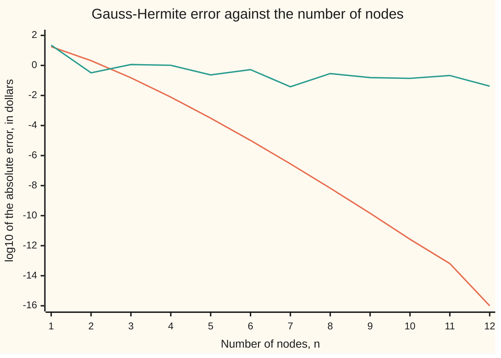

# Weighted Gauss rules: Hermite for a bell curve, Laguerre for a decaying tail

[Syllabus](../../../SYLLABUS.md) → [Numerical analysis](../README.md) → [Quadrature](../README.md#s05) → Weighted Gauss rules

---

## General Overview

A biotech share trades at $50. Its volatility (the yearly spread of its log-returns) is 60 percent, and its drift (its average growth rate) is 8 percent a year. An employee is promised one share, delivered in two years. What is that promise worth on average, in dollars, before discounting? All four inputs are illustrative.

The standard model makes the log of the future price a normal variable: a bell curve. The expected value is then an integral of the price against that bell. For this model the integral has a closed form, $58.6755435496. That is why the example was chosen: the error of every method below can be measured exactly.

Simpson's rule, with 2,000 steps across the bell, lands within 1.49e-13 dollars. A **Gauss–Hermite rule** with **seven** nodes (sample points) lands at $58.6755432679, off by 2.82e-7 dollars, three hundred-thousandths of a cent. It asks for the share price at seven chosen draws of the bell, multiplies each by a fixed probability, and adds. To be that close, Simpson on the same range needs 38 steps: 39 share prices against seven.

The trick is to stop asking the rule to integrate the bell. The bell is the same in every such problem, so it goes into the rule's weights once. The nodes then only have to handle the smooth price curve, and seven of them get it within a millionth of a dollar.

**A weighted Gauss rule builds a fixed weight, such as a bell curve or a decaying exponential, into its nodes and weights, so n samples of the smooth remainder integrate it exactly whenever that remainder is a polynomial of degree up to 2n − 1, and almost exactly when it is close to one.**

**What kind of fact this is:** a theorem. Exactness to degree 2n − 1 is proved on this card in Why it works. The error formula is stated with its key step and a named source. The lognormal share is a model, and its numbers are illustrative.

### The picture: seven nodes against twelve, smooth payoff against kinked



The falling line is the share: a smooth payoff. Each extra node removes about one and a half more digits, until rounding stops the fall near n = 11. At n = 12 the error happens to be exactly zero, plotted as −16. The flat, jumpy line is a call option on the same share, strike $50: a payoff with a kink. Twelve nodes still leave it 4 cents off. The rule is only as good as the smoothness of what it samples.

---

## The formula

Reminders. A quadrature rule replaces an integral by a weighted sum of samples. Its **nodes** are the sample points, its **weights** the multipliers, and its **degree of exactness** the highest polynomial degree it integrates with no error ([Trapezoid, midpoint and Simpson](01-newton-cotes-and-composite-rules.md)). [Gaussian quadrature](03-gaussian-quadrature.md) shows that n well-placed nodes reach degree 2n − 1 on an interval with no weight.

This card introduces the **physicists' Hermite polynomials** $H_n$. A second convention, the probabilists' $He_n$, is not used here. They are built by a recurrence, a rule that makes each one from the two before it:

$$H_0 = 1,\qquad H_1 = 2x,\qquad H_{k+1}(x) = 2x\,H_k(x) - 2k\,H_{k-1}(x)$$

The Gauss–Hermite rule with n nodes is:

$$\int_{-\infty}^{\infty} e^{-x^2}\,g(x)\,dx \;\approx\; \sum_{i=1}^{n} w_i\, g(x_i), \qquad H_n(x_i) = 0, \qquad w_i = \frac{2^{\,n-1}\, n!\,\sqrt{\pi}}{n^2\, H_{n-1}(x_i)^2}$$

**Read it aloud:** to average a smooth function g against the bell e to the minus x squared, sample g at the n roots of the nth Hermite polynomial, weight each sample by the formula, and add.

A normal expectation is the same integral after one change of variable, $z = \sqrt{2}\,x$:

$$E[f(Z)] \;\approx\; \sum_{i=1}^{n} p_i\, f\!\left(\sqrt{2}\,x_i\right), \qquad p_i = \frac{w_i}{\sqrt{\pi}}$$

**Read it aloud:** the expected value of a payoff of a standard normal draw is a probability-weighted sum of the payoff at seven, or n, special draws.

For the share, $f(z) = S_T = S_0\, e^{(\mu - \sigma^2/2)T + \sigma\sqrt{T}\,z}$, the price when the normal draw is z. The rule's error, exact minus rule, for a g with 2n smooth derivatives, is

$$E_n = \frac{n!\,\sqrt{\pi}}{2^n\,(2n)!}\; g^{(2n)}(\xi)$$

for some point $\xi$ the theorem does not name.

| Symbol | Plain meaning | In our example | Push it up and the answer… |
| --- | --- | --- | --- |
| $Z$, $z$ | a standard normal draw, and one value of it | the share's luck over two years | larger z: a higher price |
| $f$, $g$ | the payoff as a function of the draw; the smooth part left once the weight is taken out | $f = S_T$; $g(x) = f(\sqrt{2}x)/\sqrt{\pi}$ | — |
| $n$, $i$, $k$ | the number of nodes; a node's index; a step of a recurrence | n = 7 | larger n: the error falls fast, for a smooth g |
| $x_i$ | the nodes: roots of $H_n$ | ±2.6519613568, ±1.6735516288, ±0.8162878829, 0 | — |
| $w_i$, $p_i$ | the weights for $e^{-x^2}$, and the same divided by $\sqrt{\pi}$: probabilities summing to 1 | $p_4$ = 0.4571428571 at the centre | — |
| $H_n$, $He_n$ | physicists' Hermite polynomial, used here; probabilists' version, not used | $H_7$ | — |
| $L_n$, $T_n$ | Laguerre polynomial (weight $e^{-x}$); Chebyshev polynomial (weight $1/\sqrt{1-x^2}$), not the years T | $L_7$ for the warranty | — |
| $E_n$, $\xi$ | the rule's error, exact minus rule, and the unnamed point in its formula | 2.82e-7 dollars | — |
| $a$ | the slope of the log-price in x: $\sigma\sqrt{T}\sqrt{2}$ | 1.2 | the error grows like $a^{2n}$ |
| $S_0$, $S_T$, $K$ | the share price today, in two years, and an option's strike | $50, random, $50 | larger $S_0$: every price scales up |
| $\mu$, $\sigma$, $T$, $t$ | drift, volatility and years; a warranty item's failure time in years | 8%, 60%, 2; mean 1 | larger $\sigma\sqrt{T}$: the price curve bends harder and the error grows |
| $I_0(1)$ | a modified Bessel number, the sum of $1/(4^k (k!)^2)$ | Chebyshev test: π I0(1) = 3.977463260506 | — |

### When it holds

- **The weight in the integral is the weight in the rule.** Feed a normal expectation to the bare $e^{-x^2}$ rule without the $\sqrt{2}$ and it averages over a narrower bell: $49.009934, not $58.68.
- **The weight is used once.** Multiply the samples by $e^{-x_i^2}$ as well and the bell is counted twice: $34.635645.
- **The remaining function is smooth.** The error formula needs 2n derivatives. The call's kink at the strike has none past the first, and seven nodes miss by 3.8 cents, with no steady fall.
- **The remaining function does not grow too fast.** The share price grows like $e^{1.2x}$. Stretch the horizon to 8 years and seven nodes miss by 4.24e-3 dollars.
- **The nodes and weights are accurate.** They come from a root finder here; a wrong recurrence breaks the Hermite probabilities' sum or moments, or the Laguerre moments, and the check fails.

---

## Why it works

### Step 0: put the awkward part in the weight

The bell $e^{-x^2}$ is not a polynomial, and it runs off to infinity both ways. A rule with no weight, such as Simpson's, has to resolve its shape step by step. But the bell is fixed. Every normal expectation carries the same one. So split the integrand into the fixed weight times a smooth remainder g. Choose n nodes and n weights, 2n free numbers in all, to integrate weight times polynomial exactly. Then the rule only has to resolve g.

### Step 1: the nodes are the roots of the polynomial the weight makes

Two functions are **orthogonal** under the weight when the integral of weight × one × the other is zero. Run Gram–Schmidt (make each new function orthogonal to all earlier ones by subtracting its projections) on 1, x, x², … with that integral and out come the Hermite polynomials: $H_n$ is orthogonal to every polynomial of lower degree. The three-term recurrence above is a shortcut for the same thing.

The theorem from [Gaussian quadrature](03-gaussian-quadrature.md) carries over with the weight inside the integral. Its proof is short enough to give in full.

<details>
<summary>Detailed proof: n roots of H_n integrate every polynomial of degree up to 2n − 1 exactly</summary>

Here p, q and r name polynomials, not the probabilities $p_i$. Let p be any polynomial of degree at most 2n − 1. Divide it by $H_n$: $p = q\,H_n + r$, where q and r both have degree at most n − 1.

The exact integral: $\int e^{-x^2} q\,H_n\,dx = 0$, because $H_n$ is orthogonal to every polynomial of lower degree, q included. So the exact integral of p equals the exact integral of r.

The rule: at every node $H_n(x_i) = 0$, so the rule sees $p(x_i) = r(x_i)$. The rule's sum for p equals its sum for r.

Choose the weights so the rule is exact on all polynomials of degree at most n − 1. That is n linear conditions on n weights, and they have a solution because the n nodes are distinct. Then the rule is exact on r, so it is exact on p.

The weights are positive: apply the rule to the square of the degree n − 1 polynomial that vanishes at every node but $x_j$. That square has degree 2n − 2, so the rule is exact, and its sum is $w_j$ times a positive number while the integral is positive. Positive weights summing to $\sqrt{\pi}$ make the $p_i$ a real probability distribution.

The closed form for $w_i$ follows from the Christoffel–Darboux identity (a closed form for sums of products of orthogonal polynomials) applied to the Hermite recurrence; that algebra is not reproduced here. The code tests the result three ways: the probabilities sum to 1, the degree-12 moment comes out exact, and degree 14 falls short by exactly 7!.

</details>

The rule cannot reach degree 2n. The polynomial $H_n^2$ has degree 2n, its integral is positive, and the rule sees zero at every node.

### Step 2: from the bell e^(−x²) to the normal

The standard normal density is $e^{-z^2/2}/\sqrt{2\pi}$. Put $z = \sqrt{2}\,x$. Then $dz = \sqrt{2}\,dx$, and the density times $dz$ becomes $e^{-x^2}\,dx/\sqrt{\pi}$.

So the normal expectation is the Hermite integral divided by $\sqrt{\pi}$, with the payoff evaluated at $\sqrt{2}\,x_i$. Dividing every weight by $\sqrt{\pi}$ gives seven probabilities that sum to 1.000000000000000. The rule is a discrete random variable with seven values. It matches the normal's moments (averages of powers) up to the 13th. The check prints $E[Z^{12}]$ from the rule: 10395.000000, the true value.

### Step 3: where the error comes from

Expand g in its Taylor series. Every term up to $x^{13}$ is integrated exactly. The first term the rule gets wrong is the $x^{14}$ term.

The rule's shortfall on $x^{2n}$ is easy to find. Write $x^{2n} = (H_n/2^n)^2 + $ lower degree, since $H_n$ starts $2^n x^n$. The rule is exact on the lower-degree part and sees zero for the square. The square's true integral is $\sqrt{\pi}\,n!/2^n$. In normal form, with n = 7, the rule gives $E[Z^{14}]$ as 130095.000000 against the true 135135: short by 5040.000000, which is 7!.

For the share, $g$ is a multiple of $e^{a x}$ with slope $a = \sigma\sqrt{T}\sqrt{2} = 1.2$. Its $x^{2n}$ term is $a^{2n}/(2n)!$ times the multiple. Multiply by the shortfall and the first missed term estimates the rule minus the exact value (the rule falls short, so it is negative):

$$\text{rule} - \text{exact} \approx -\,S_0\,e^{(\mu-\sigma^2/2)T}\;\frac{a^{2n}\,n!}{(2n)!\,2^n}$$

At n = 7 it gives −2.37e-7 against the true −2.82e-7: a ratio of 0.843. The ratio stays near 0.84 from n = 2 to n = 10, because the later missed terms add a near-fixed share. This is the error formula $E_n$ of the previous section with $g^{(2n)}$ taken at the centre, and the sign flipped because $E_n$ is exact minus rule. The formula itself, with the constant $\sqrt{\pi}\,n!/2^n$ found above, is equations 3.5.19 and 3.5.28 of the DLMF section in the Sources.

The factor $a^{2n}/(2n)!$ shrinks faster than any power of n. So the error does not fall like $n^{-p}$ for some order p. It falls faster with every node, as long as g equals its Taylor series everywhere, as $e^{ax}$ does, and does not grow too fast. That is the falling line in the picture.

### Step 4: other weights, same recipe

Change the weight and the interval, and the same steps give a new family of rules. The three in use most:

| Weight | Interval | Polynomials | Nodes | Typical integral |
| --- | --- | --- | --- | --- |
| $e^{-x^2}$ | the whole line | Hermite $H_n$ | roots of $H_n$ | a normal expectation |
| $e^{-x}$ | zero to infinity | Laguerre $L_n$ | roots of $L_n$ | an exponential lifetime, a discounted stream |
| $1/\sqrt{1-x^2}$ | −1 to 1 | Chebyshev $T_n$ | $\cos\!\big((2i-1)\pi/(2n)\big)$ | an integrand with square-root end behaviour |

For **Gauss–Laguerre**, the recurrence is $(k+1)L_{k+1} = (2k+1-x)L_k - k\,L_{k-1}$ with $L_0 = 1$, $L_1 = 1 - x$. The weights are $w_i = x_i / (n^2\,L_{n-1}(x_i)^2)$.

The decaying-tail example is a warranty. It refunds the fraction $1/(1+t)$ of the price when the item fails at year t. Lifetimes are exponential with a mean of one year ([Exponential](../../09-Probability%20and%20statistics/04-Continuous%20Distributions/03-exponential-distribution.md)), so the density is $e^{-t}$ and the weight is already there. Both are illustrative. Simpson's rule on [0, 40] with 40,000 steps gives an expected refund of 0.596347362323 of the price.

| Laguerre nodes | Rule | Error against Simpson |
| --- | --- | --- |
| 3 | 0.588235294118 | −8.11e-3 |
| 7 | 0.596080108767 | −2.67e-4 |
| 14 | 0.596343529264 | −3.83e-6 |

This converges more slowly than the share. The refund $1/(1+t)$ has a pole (a point where it blows up) at t = −1, just outside the interval. A nearby pole limits how well polynomials can follow g, and so limits every Gauss rule.

For **Gauss–Chebyshev**, the nodes and weights need no root finder: the weights are all $\pi/n$. Seven nodes on $\int_{-1}^{1} e^x/\sqrt{1-x^2}\,dx$ give 3.977463260506. The exact value is $\pi\,I_0(1)$, where $I_0(1) = \sum_k 1/(4^k (k!)^2)$ is a modified Bessel number, and the rule's error is −4.00e-15.

### Step 5: computing the nodes, and the cost

The code finds the roots of $H_n$ by scanning for sign changes in steps of 0.001, then bisecting each bracket 60 times. That is simple and fine for a few dozen nodes. The standard method reads the nodes off as eigenvalues of a small tridiagonal matrix built from the recurrence (Golub and Welsch, below).

The nodes are computed once and stored. After that, each expectation costs n payoff evaluations: 7 here. Simpson on [−10, 10] stays within the 7-node error only from 38 steps on, so at equal accuracy the count is 39 payoffs against 7. Its 2,000-step run is there as a second road to the exact value, not as a cost comparison.

---

## Worked numbers, by hand

Share at $50, drift 8%, volatility 60%, two years. The log-price centre is $(\mu - \sigma^2/2)T$ and its spread $\sigma\sqrt{T}$.

| Step | Arithmetic | Value |
| --- | --- | --- |
| centre of the log-price | $(0.08 - 0.18) \times 2$ | −0.200000 |
| spread of the log-price | $0.60 \times \sqrt{2}$ | 0.8485281374 |
| node 1: price × probability | $50\,e^{-0.2 + 0.8485 \times (-3.750440)} = 1.698371$, × 0.0005482689 | 0.000931 |
| node 2 | 5.494574 × 0.0307571240 | 0.168997 |
| node 3 | 15.370922 × 0.2401231786 | 3.690915 |
| node 4, the centre | 40.936538 × 0.4571428571 | 18.713846 |
| node 5 | 109.024046 × 0.2401231786 | 26.179201 |
| node 6 | 304.991821 × 0.0307571240 | 9.380671 |
| node 7 | 986.710451 × 0.0005482689 | 0.540983 |
| **sum: the expected price** | add the seven products | **$58.6755432679** |
| closed form | $50\,e^{0.08 \times 2}$ | $58.6755435496 |
| true error | rule − closed form | −2.82e-7 |

Seven prices and seven fixed probabilities give the promised share's average value to within three hundred-thousandths of a cent. Nodes 5 and 6 carry most of the value: the price curve is steep on the right, so the right tail matters more than the bell's height suggests.

### What breaks if you drop a piece

| Mistake | Comes out at | What went wrong |
| --- | --- | --- |
| Sample at $x_i$, not $\sqrt{2}\,x_i$ | $49.009934 | The bell $e^{-x^2}$ is narrower than the normal; the share's spread shrank by $\sqrt{2}$ |
| Use $w_i$, not $w_i/\sqrt{\pi}$ | $103.999693 | The weights sum to $\sqrt{\pi}$, not 1 |
| Multiply by $e^{-x_i^2}$ as well | $34.635645 | The bell is already in the weights; it was counted twice |
| A kinked payoff: the call at strike $50 | $22.529426, against $22.4918038951 | No smooth g; 2n derivatives do not exist, and the error does not settle |

The code prints all four. The call's exact value is the [Black–Scholes call](../../12-Financial%20mathematics/08-The%20Black-Scholes%20call%20and%20put/01-black-scholes-call.md) formula with the drift in place of the bank rate and no discounting. Simpson's rule started at the kink gives $22.4918038952, a second road to it.

---

## Code, from first principles, and it actually runs

The scripts build Hermite and Laguerre rules from their recurrences, with no table of nodes. They take three independent roads to each answer. Road one is a closed form: the lognormal mean, the call formula from a written-out erf series, and the Bessel series for the Chebyshev test. Road two is the weighted Gauss rule at n = 1 to 12, with the first-missed-term estimate beside each error. Road three is Simpson's rule on a fine grid, which uses no weights at all. The asserts check the probabilities' sum, the exact degree-12 moment, the 7! shortfall at degree 14, the 7-node answer, the estimate, the kink, the Laguerre moments and the Chebyshev test.

### Python

```python
# Weighted Gauss rules -- the check behind the card.  Python standard library only.
# Nodes are roots of the three-term recurrences, found by a scan and bisection;
# weights come from the closed weight formulas.  Nothing imported knows a node.
# Road 1: closed forms.  Road 2: the weighted Gauss rule at many sizes, with the
# first-missed-term estimate.  Road 3: Simpson's rule on a fine grid, no weights.
from math import exp, sqrt, pi, log, log10, cos
def sci(x, d=2):                                # 1.23e-5, the same digits in Rust
    m, e = f"{x:.{d}e}".split("e")
    return f"{m}e{int(e)}"
def herm(n, x):                                 # physicists' H_n(x) and H_(n-1)(x)
    a, b = 0.0, 1.0
    for k in range(n):
        a, b = b, 2.0 * x * b - 2.0 * k * a
    return b, a
def lag(n, x):                                  # Laguerre L_n(x) and L_(n-1)(x)
    a, b = 0.0, 1.0
    for k in range(n):
        a, b = b, ((2 * k + 1 - x) * b - k * a) / (k + 1)
    return b, a
def roots(p, n, lo, count):                     # scan in steps of 0.001, then bisect
    out, x0, f0 = [], lo, p(n, lo)[0]
    for i in range(1, count + 1):
        x1 = lo + i * 0.001
        f1 = p(n, x1)[0]
        if (f0 < 0) != (f1 < 0):
            a, b = x0, x1
            for _ in range(60):
                m = 0.5 * (a + b)
                if (p(n, m)[0] < 0) == (f0 < 0): a = m
                else: b = m
            out.append(0.5 * (a + b))
        x0, f0 = x1, f1
    return out
def fact(n):
    f = 1.0
    for k in range(2, n + 1): f *= k
    return f
def pw(x, k):                                   # x to the power k, by plain multiplying
    r = 1.0
    for _ in range(k): r *= x
    return r
def dot(ws, vs):                                # plain left-to-right sum of w times v
    s = 0.0
    for w, v in zip(ws, vs): s += w * v
    return s
def hermite(n):                                 # nodes x_i, probabilities p_i = w_i / sqrt(pi)
    xs = roots(herm, n, -7.000123, 14000)
    return xs, [pw(2.0, n - 1) * fact(n) / (n * n * pw(herm(n - 1, x)[0], 2)) for x in xs]
def laguerre(n):                                # nodes x_i, weights w_i for the weight e^(-x)
    xs = roots(lag, n, 0.000123, 60000)
    return xs, [x / (n * n * pw(lag(n - 1, x)[0], 2)) for x in xs]
def simpson(f, a, b, n):
    h = (b - a) / n
    s = f(a) + f(b)
    for i in range(1, n): s += (4 if i % 2 else 2) * f(a + i * h)
    return s * h / 3.0
def ncdf(d):                                    # normal area left of d, from the erf series
    x, t, s = d / sqrt(2.0), d / sqrt(2.0), 0.0
    for k in range(40):
        s += t / (2 * k + 1)
        t *= -x * x / (k + 1)
    return 0.5 + s / sqrt(pi)
S0, MU, SIG, T, K = 50.0, 0.08, 0.60, 2.0, 50.0  # share $50, drift 8%, volatility 60%, 2 years
M, V = (MU - 0.5 * SIG * SIG) * T, SIG * sqrt(T) # centre and spread of log(S_T / S0)
def share(z): return S0 * exp(M + V * z)        # the share's price when the normal draw is z
def call(z): return max(share(z) - K, 0.0)      # the option's payoff: kinked at the strike
def phi(z): return exp(-0.5 * z * z) / sqrt(2.0 * pi)
def gh(f, n, r2=sqrt(2.0), twice=False):        # E[f(Z)] by n Gauss-Hermite nodes
    xs, ps = hermite(n)
    return dot(ps, [(exp(-x * x) if twice else 1.0) * f(r2 * x) for x in xs])
exact = S0 * exp(MU * T)
d2 = (log(S0 / K) + M) / V
c_exact = exact * ncdf(d2 + V) - K * ncdf(d2)
xs, ps = hermite(7)
print(f"log-price centre m = {M:.6f}, spread v = {V:.10f}, slope a = v sqrt2 = {V * sqrt(2.0):.10f}")
print("i  node x_i       z = sqrt2 x_i  probability p_i  share at node  p_i x share")
for i in range(7):
    s = share(sqrt(2.0) * xs[i])
    print(f"{i + 1}  {xs[i]:+.10f}  {sqrt(2.0) * xs[i]:+.6f}      {ps[i]:.10f}  {s:12.6f}  {ps[i] * s:11.6f}")
psum = dot(ps, [1.0] * 7)
z12 = dot(ps, [pw(sqrt(2.0) * x, 12) for x in xs])
z14 = dot(ps, [pw(sqrt(2.0) * x, 14) for x in xs])
print(f"sum of probabilities {psum:.15f}; E[Z^12] rule {z12:.6f} (true 10395); E[Z^14] rule {z14:.6f} (true 135135, short {135135.0 - z14:.6f})")
g7 = gh(share, 7)
simp = simpson(lambda z: phi(z) * share(z), -10.0, 10.0, 2000)
print(f"expected share price: closed form {exact:.10f}; 7 nodes {g7:.10f} err {sci(g7 - exact)}")
print(f"Simpson, 2000 steps on [-10, 10]: {simp:.10f} err {sci(simp - exact)}")
se = {n: simpson(lambda z: phi(z) * share(z), -10.0, 10.0, n) - exact for n in range(2, 101, 2)}
ns = max(n for n in se if abs(se[n]) > abs(g7 - exact)) + 2   # from here on Simpson stays within the 7-node error
print(f"Simpson on [-10, 10] stays within the 7-node error from {ns} steps, {ns + 1} payoffs: err {sci(se[ns])}")
print(" n  rule E[S_T]      true err   estimate   ratio  log10|err|  call err  log10|err|")
ratio, cerr = {}, {}
for n in range(1, 13):
    g = gh(share, n)
    est = -S0 * exp(M) * pw(V * sqrt(2.0), 2 * n) * fact(n) / (fact(2 * n) * pw(2.0, n))
    ratio[n], cerr[n] = (est / (g - exact) if g != exact else 0.0), gh(call, n) - c_exact
    print(f"{n:2d}  {g:15.10f}  {sci(g - exact):>9}  {sci(est):>9}  {ratio[n]:6.3f}  {log10(max(abs(g - exact), 1e-16)):6.2f}"
          f"  {sci(cerr[n]):>9}  {log10(abs(cerr[n])):6.2f}")
zk = (log(K / S0) - M) / V                      # where the payoff kinks: the share hits the strike
c_simp = simpson(lambda z: phi(z) * call(z), zk, 10.0, 2000)
print(f"call, strike 50: closed form {c_exact:.10f}; Simpson from the kink {c_simp:.10f}; 7 nodes {c_exact + cerr[7]:.6f}")
no_r2, no_pi, twice = gh(share, 7, 1.0), g7 * sqrt(pi), gh(share, 7, sqrt(2.0), True)
print(f"wrong: no sqrt2 {no_r2:.6f}; no 1/sqrt(pi) {no_pi:.6f}; weight counted twice {twice:.6f}")
def refund(x): return 1.0 / (1.0 + x)           # warranty refund fraction for a failure at year x
w_simp = simpson(lambda x: exp(-x) * refund(x), 0.0, 40.0, 40000)
print(f"warranty, Simpson on [0, 40], 40000 steps: {w_simp:.12f}")
lag_err = {}
for n in (3, 7, 14):
    lx, lw = laguerre(n)
    q = dot(lw, [refund(x) for x in lx])
    lag_err[n] = q - w_simp
    lm = max(abs(dot(lw, [pw(x, k) for x in lx]) / fact(k) - 1.0) for k in range(2 * n))   # exact: k! up to degree 2n - 1
    print(f"Laguerre {n:2d} nodes: {q:.12f} err {sci(q - w_simp)}; weights sum {dot(lw, [1.0] * n):.12f}; moments k! to degree {2 * n - 1} within {sci(lm)}")
    assert lm < 1e-10, "Laguerre moments match k!"
i0, t = 0.0, 1.0
for k in range(30):
    i0 += t
    t /= 4.0 * (k + 1) * (k + 1)
ch = dot([pi / 7] * 7, [exp(cos((2 * i - 1) * pi / 14)) for i in range(1, 8)])
print(f"Chebyshev 7 nodes on e^x/sqrt(1-x^2): {ch:.12f}; pi I0(1) series {pi * i0:.12f}; err {sci(ch - pi * i0)}")
for lab, sg, tt in (("volatility 30%", 0.30, 2.0), ("8 years", 0.60, 8.0)):
    m2, v2 = (MU - 0.5 * sg * sg) * tt, sg * sqrt(tt)
    gg = gh(lambda z: S0 * exp(m2 + v2 * z), 7)
    print(f"try {lab}: exact {S0 * exp(MU * tt):.10f}; 7 nodes {gg:.10f} err {sci(gg - S0 * exp(MU * tt))}")
assert abs(psum - 1.0) < 1e-13, "probabilities must sum to 1"
assert abs(z12 - 10395.0) < 1e-8, "exact for the degree-12 moment"
assert abs(z14 - (135135.0 - 5040.0)) < 1e-7, "short by exactly 7! at degree 14"
assert abs(g7 - exact) < 1e-6, "7 nodes meet the closed form to a millionth of a dollar"
assert abs(simp - exact) < 1e-9, "Simpson meets the closed form"
assert all(0.8 < ratio[n] < 0.86 for n in range(2, 11)), "the first missed term explains most of the error"
assert abs(c_simp - c_exact) < 1e-8, "kinked payoff: Simpson from the kink meets the closed form"
assert 0.01 < abs(cerr[7]) < 0.1, "kinked payoff: 7 Gauss nodes are off by cents, not dollars"
assert abs(lag_err[7]) < 1e-3 and abs(lag_err[14]) < abs(lag_err[7]), "Laguerre closes in on Simpson"
assert abs(ch - pi * i0) < 1e-9, "Chebyshev against the I0 series"
print("ALL CHECKS PASS")
```

**Ran 2026-11-11 on macOS, Python 3.14.10, standard library only. All checks passed. Output, pasted from the run:**

```
log-price centre m = -0.200000, spread v = 0.8485281374, slope a = v sqrt2 = 1.2000000000
i  node x_i       z = sqrt2 x_i  probability p_i  share at node  p_i x share
1  -2.6519613568  -3.750440      0.0005482689      1.698371     0.000931
2  -1.6735516288  -2.366759      0.0307571240      5.494574     0.168997
3  -0.8162878829  -1.154405      0.2401231786     15.370922     3.690915
4  +0.0000000000  +0.000000      0.4571428571     40.936538    18.713846
5  +0.8162878829  +1.154405      0.2401231786    109.024046    26.179201
6  +1.6735516288  +2.366759      0.0307571240    304.991821     9.380671
7  +2.6519613568  +3.750440      0.0005482689    986.710451     0.540983
sum of probabilities 1.000000000000000; E[Z^12] rule 10395.000000 (true 10395); E[Z^14] rule 130095.000000 (true 135135, short 5040.000000)
expected share price: closed form 58.6755435496; 7 nodes 58.6755432679 err -2.82e-7
Simpson, 2000 steps on [-10, 10]: 58.6755435496 err -1.49e-13
Simpson on [-10, 10] stays within the 7-node error from 38 steps, 39 payoffs: err 2.48e-7
 n  rule E[S_T]      true err   estimate   ratio  log10|err|  call err  log10|err|
 1    40.9365376539    -1.77e1    -1.47e1   0.831    1.25    -2.25e1    1.35
 2    56.5794169664    -2.10e0    -1.77e0   0.844    0.32    3.26e-1   -0.49
 3    58.5249189851   -1.51e-1   -1.27e-1   0.845   -0.82    -1.16e0    0.06
 4    58.6677938883   -7.75e-3   -6.55e-3   0.845   -2.11     1.01e0    0.01
 5    58.6752332867   -3.10e-4   -2.62e-4   0.844   -3.51   -2.35e-1   -0.63
 6    58.6755333862   -1.02e-5   -8.57e-6   0.843   -4.99    5.30e-1   -0.28
 7    58.6755432679   -2.82e-7   -2.37e-7   0.843   -6.55    3.76e-2   -1.42
 8    58.6755435428   -6.77e-9   -5.70e-9   0.842   -8.17    2.86e-1   -0.54
 9    58.6755435494  -1.43e-10  -1.21e-10   0.842   -9.84    1.56e-1   -0.81
10    58.6755435496  -2.70e-12  -2.29e-12   0.847  -11.57    1.39e-1   -0.86
11    58.6755435496  -6.39e-14  -3.92e-14   0.613  -13.19    2.12e-1   -0.67
12    58.6755435496     0.00e0  -6.13e-16   0.000  -16.00    4.21e-2   -1.38
call, strike 50: closed form 22.4918038951; Simpson from the kink 22.4918038952; 7 nodes 22.529426
wrong: no sqrt2 49.009934; no 1/sqrt(pi) 103.999693; weight counted twice 34.635645
warranty, Simpson on [0, 40], 40000 steps: 0.596347362323
Laguerre  3 nodes: 0.588235294118 err -8.11e-3; weights sum 1.000000000000; moments k! to degree 5 within 4.44e-16
Laguerre  7 nodes: 0.596080108767 err -2.67e-4; weights sum 1.000000000000; moments k! to degree 13 within 3.22e-15
Laguerre 14 nodes: 0.596343529264 err -3.83e-6; weights sum 1.000000000000; moments k! to degree 27 within 1.78e-15
Chebyshev 7 nodes on e^x/sqrt(1-x^2): 3.977463260506; pi I0(1) series 3.977463260506; err -4.00e-15
try volatility 30%: exact 58.6755435496; 7 nodes 58.6755435496 err -1.98e-11
try 8 years: exact 94.8240439652; 7 nodes 94.8198074644 err -4.24e-3
ALL CHECKS PASS
```

### Rust

```rust
// Weighted Gauss rules -- the same check as gauss_hermite_and_weighted_rules_check.py.
// Standard library only, no crates.  Nodes are roots of the three-term recurrences,
// found by a scan and bisection; weights come from the closed weight formulas.
// Road 1: closed forms.  Road 2: the weighted Gauss rule at many sizes, with the
// first-missed-term estimate.  Road 3: Simpson's rule on a fine grid, no weights.
use std::f64::consts::PI;
const S0: f64 = 50.0; const MU: f64 = 0.08; const SIG: f64 = 0.60; const T: f64 = 2.0; const K: f64 = 50.0;

fn sci(x: f64) -> String { format!("{:.2e}", x) }               // 1.23e-5, the same digits as Python
fn herm(n: usize, x: f64) -> (f64, f64) {                        // physicists' H_n(x) and H_(n-1)(x)
    let (mut a, mut b) = (0.0, 1.0);
    for k in 0..n { let c = 2.0 * x * b - 2.0 * k as f64 * a; a = b; b = c; }
    (b, a)
}
fn lag(n: usize, x: f64) -> (f64, f64) {                         // Laguerre L_n(x) and L_(n-1)(x)
    let (mut a, mut b) = (0.0, 1.0);
    for k in 0..n { let c = ((2 * k + 1) as f64 - x) * b - k as f64 * a; a = b; b = c / (k + 1) as f64; }
    (b, a)
}
fn roots(p: fn(usize, f64) -> (f64, f64), n: usize, lo: f64, count: usize) -> Vec<f64> {
    let (mut out, mut x0, mut f0) = (Vec::new(), lo, p(n, lo).0);  // scan in steps of 0.001, then bisect
    for i in 1..=count {
        let x1 = lo + i as f64 * 0.001;
        let f1 = p(n, x1).0;
        if (f0 < 0.0) != (f1 < 0.0) {
            let (mut a, mut b) = (x0, x1);
            for _ in 0..60 {
                let m = 0.5 * (a + b);
                if (p(n, m).0 < 0.0) == (f0 < 0.0) { a = m; } else { b = m; }
            }
            out.push(0.5 * (a + b));
        }
        x0 = x1; f0 = f1;
    }
    out
}
fn fact(n: usize) -> f64 { let mut f = 1.0; for k in 2..=n { f *= k as f64; } f }
fn pw(x: f64, k: usize) -> f64 { let mut r = 1.0; for _ in 0..k { r *= x; } r }
fn dot(ws: &[f64], vs: &[f64]) -> f64 { let mut s = 0.0; for (w, v) in ws.iter().zip(vs) { s += w * v; } s }
fn hermite(n: usize) -> (Vec<f64>, Vec<f64>) {                  // nodes x_i, probabilities p_i = w_i / sqrt(pi)
    let xs = roots(herm, n, -7.000123, 14000);
    let ps = xs.iter().map(|&x| pw(2.0, n - 1) * fact(n) / ((n * n) as f64 * pw(herm(n - 1, x).0, 2))).collect();
    (xs, ps)
}
fn laguerre(n: usize) -> (Vec<f64>, Vec<f64>) {                 // nodes x_i, weights w_i for the weight e^(-x)
    let xs = roots(lag, n, 0.000123, 60000);
    let ws = xs.iter().map(|&x| x / ((n * n) as f64 * pw(lag(n - 1, x).0, 2))).collect();
    (xs, ws)
}
fn simpson(f: &dyn Fn(f64) -> f64, a: f64, b: f64, n: usize) -> f64 {
    let h = (b - a) / n as f64;
    let mut s = f(a) + f(b);
    for i in 1..n { s += if i % 2 == 1 { 4.0 } else { 2.0 } * f(a + i as f64 * h); }
    s * h / 3.0
}
fn ncdf(d: f64) -> f64 {                                         // normal area left of d, from the erf series
    let (x, mut t, mut s) = (d / 2f64.sqrt(), d / 2f64.sqrt(), 0.0);
    for k in 0..40 { s += t / (2 * k + 1) as f64; t *= -x * x / (k + 1) as f64; }
    0.5 + s / PI.sqrt()
}
fn mv() -> (f64, f64) { ((MU - 0.5 * SIG * SIG) * T, SIG * T.sqrt()) }   // centre and spread of log(S_T / S0)
fn share(z: f64) -> f64 { let (m, v) = mv(); S0 * (m + v * z).exp() }     // the share's price at draw z
fn call(z: f64) -> f64 { (share(z) - K).max(0.0) }              // the option's payoff: kinked at the strike
fn phi(z: f64) -> f64 { (-0.5 * z * z).exp() / (2.0 * PI).sqrt() }
fn gh(f: &dyn Fn(f64) -> f64, n: usize, r2: f64, twice: bool) -> f64 {   // E[f(Z)] by n Gauss-Hermite nodes
    let (xs, ps) = hermite(n);
    let vs: Vec<f64> = xs.iter().map(|&x| (if twice { (-x * x).exp() } else { 1.0 }) * f(r2 * x)).collect();
    dot(&ps, &vs)
}

fn main() {
    let (m, v) = mv();
    let r2 = 2f64.sqrt();
    let exact = S0 * (MU * T).exp();
    let d2 = ((S0 / K).ln() + m) / v;
    let c_exact = exact * ncdf(d2 + v) - K * ncdf(d2);
    let (xs, ps) = hermite(7);
    println!("log-price centre m = {:.6}, spread v = {:.10}, slope a = v sqrt2 = {:.10}", m, v, v * r2);
    println!("i  node x_i       z = sqrt2 x_i  probability p_i  share at node  p_i x share");
    for i in 0..7 {
        let s = share(r2 * xs[i]);
        println!("{}  {:+.10}  {:+.6}      {:.10}  {:12.6}  {:11.6}", i + 1, xs[i], r2 * xs[i], ps[i], s, ps[i] * s);
    }
    let psum = dot(&ps, &[1.0; 7]);
    let z12 = dot(&ps, &xs.iter().map(|&x| pw(r2 * x, 12)).collect::<Vec<_>>());
    let z14 = dot(&ps, &xs.iter().map(|&x| pw(r2 * x, 14)).collect::<Vec<_>>());
    println!("sum of probabilities {:.15}; E[Z^12] rule {:.6} (true 10395); E[Z^14] rule {:.6} (true 135135, short {:.6})", psum, z12, z14, 135135.0 - z14);
    let g7 = gh(&share, 7, r2, false);
    let simp = simpson(&|z| phi(z) * share(z), -10.0, 10.0, 2000);
    println!("expected share price: closed form {:.10}; 7 nodes {:.10} err {}", exact, g7, sci(g7 - exact));
    println!("Simpson, 2000 steps on [-10, 10]: {:.10} err {}", simp, sci(simp - exact));
    let se: Vec<f64> = (0..=100).map(|n| if n >= 2 && n % 2 == 0 { simpson(&|z| phi(z) * share(z), -10.0, 10.0, n) - exact } else { 0.0 }).collect();
    let ns = (2..=100).step_by(2).filter(|&n| se[n].abs() > (g7 - exact).abs()).max().unwrap() + 2; // from here on Simpson stays within the 7-node error
    println!("Simpson on [-10, 10] stays within the 7-node error from {} steps, {} payoffs: err {}", ns, ns + 1, sci(se[ns]));
    println!(" n  rule E[S_T]      true err   estimate   ratio  log10|err|  call err  log10|err|");
    let (mut ratio, mut cerr) = (vec![0.0; 13], vec![0.0; 13]);
    for n in 1..13 {
        let g = gh(&share, n, r2, false);
        let est = -S0 * m.exp() * pw(v * r2, 2 * n) * fact(n) / (fact(2 * n) * pw(2.0, n));
        ratio[n] = if g != exact { est / (g - exact) } else { 0.0 };
        cerr[n] = gh(&call, n, r2, false) - c_exact;
        println!("{:2}  {:15.10}  {:>9}  {:>9}  {:6.3}  {:6.2}  {:>9}  {:6.2}", n, g, sci(g - exact), sci(est), ratio[n],
                 (g - exact).abs().max(1e-16).log10(), sci(cerr[n]), cerr[n].abs().log10());
    }
    let zk = ((K / S0).ln() - m) / v;                              // where the payoff kinks
    let c_simp = simpson(&|z| phi(z) * call(z), zk, 10.0, 2000);
    println!("call, strike 50: closed form {:.10}; Simpson from the kink {:.10}; 7 nodes {:.6}", c_exact, c_simp, c_exact + cerr[7]);
    let (no_r2, no_pi, twice) = (gh(&share, 7, 1.0, false), g7 * PI.sqrt(), gh(&share, 7, r2, true));
    println!("wrong: no sqrt2 {:.6}; no 1/sqrt(pi) {:.6}; weight counted twice {:.6}", no_r2, no_pi, twice);
    let refund = |x: f64| 1.0 / (1.0 + x);                         // warranty refund fraction for a failure at year x
    let w_simp = simpson(&|x: f64| (-x).exp() * refund(x), 0.0, 40.0, 40000);
    println!("warranty, Simpson on [0, 40], 40000 steps: {:.12}", w_simp);
    let mut lag_err = vec![0.0; 15];
    for n in [3usize, 7, 14] {
        let (lx, lw) = laguerre(n);
        let q = dot(&lw, &lx.iter().map(|&x| refund(x)).collect::<Vec<_>>());
        lag_err[n] = q - w_simp;
        let lm = (0..2 * n).map(|k| (dot(&lw, &lx.iter().map(|&x| pw(x, k)).collect::<Vec<_>>()) / fact(k) - 1.0).abs()).fold(0.0, f64::max); // exact: k! up to degree 2n - 1
        println!("Laguerre {:2} nodes: {:.12} err {}; weights sum {:.12}; moments k! to degree {} within {}", n, q, sci(q - w_simp), dot(&lw, &vec![1.0; n]), 2 * n - 1, sci(lm));
        assert!(lm < 1e-10, "Laguerre moments match k!");
    }
    let (mut i0, mut t) = (0.0, 1.0);
    for k in 0..30 { i0 += t; t /= 4.0 * (k + 1) as f64 * (k + 1) as f64; }
    let cv: Vec<f64> = (1..8).map(|i| (((2 * i - 1) as f64 * PI / 14.0).cos()).exp()).collect();
    let ch = dot(&[PI / 7.0; 7], &cv);
    println!("Chebyshev 7 nodes on e^x/sqrt(1-x^2): {:.12}; pi I0(1) series {:.12}; err {}", ch, PI * i0, sci(ch - PI * i0));
    for (lab, sg, tt) in [("volatility 30%", 0.30, 2.0), ("8 years", 0.60, 8.0)] {
        let (m2, v2): (f64, f64) = ((MU - 0.5 * sg * sg) * tt, sg * f64::sqrt(tt));
        let gg = gh(&|z| S0 * (m2 + v2 * z).exp(), 7, r2, false);
        println!("try {}: exact {:.10}; 7 nodes {:.10} err {}", lab, S0 * (MU * tt).exp(), gg, sci(gg - S0 * (MU * tt).exp()));
    }
    assert!((psum - 1.0).abs() < 1e-13, "probabilities must sum to 1");
    assert!((z12 - 10395.0).abs() < 1e-8, "exact for the degree-12 moment");
    assert!((z14 - (135135.0 - 5040.0)).abs() < 1e-7, "short by exactly 7! at degree 14");
    assert!((g7 - exact).abs() < 1e-6, "7 nodes meet the closed form to a millionth of a dollar");
    assert!((simp - exact).abs() < 1e-9, "Simpson meets the closed form");
    assert!((2..11).all(|n| 0.8 < ratio[n] && ratio[n] < 0.86), "the first missed term explains most of the error");
    assert!((c_simp - c_exact).abs() < 1e-8, "kinked payoff: Simpson from the kink meets the closed form");
    assert!(0.01 < cerr[7].abs() && cerr[7].abs() < 0.1, "kinked payoff: 7 Gauss nodes are off by cents, not dollars");
    assert!(lag_err[7].abs() < 1e-3 && lag_err[14].abs() < lag_err[7].abs(), "Laguerre closes in on Simpson");
    assert!((ch - PI * i0).abs() < 1e-9, "Chebyshev against the I0 series");
    println!("ALL CHECKS PASS");
}
```

**Ran 2026-11-11 on macOS, rustc 1.98.1, no crates. All checks passed. Output, pasted from the run:**

```
log-price centre m = -0.200000, spread v = 0.8485281374, slope a = v sqrt2 = 1.2000000000
i  node x_i       z = sqrt2 x_i  probability p_i  share at node  p_i x share
1  -2.6519613568  -3.750440      0.0005482689      1.698371     0.000931
2  -1.6735516288  -2.366759      0.0307571240      5.494574     0.168997
3  -0.8162878829  -1.154405      0.2401231786     15.370922     3.690915
4  +0.0000000000  +0.000000      0.4571428571     40.936538    18.713846
5  +0.8162878829  +1.154405      0.2401231786    109.024046    26.179201
6  +1.6735516288  +2.366759      0.0307571240    304.991821     9.380671
7  +2.6519613568  +3.750440      0.0005482689    986.710451     0.540983
sum of probabilities 1.000000000000000; E[Z^12] rule 10395.000000 (true 10395); E[Z^14] rule 130095.000000 (true 135135, short 5040.000000)
expected share price: closed form 58.6755435496; 7 nodes 58.6755432679 err -2.82e-7
Simpson, 2000 steps on [-10, 10]: 58.6755435496 err -1.49e-13
Simpson on [-10, 10] stays within the 7-node error from 38 steps, 39 payoffs: err 2.48e-7
 n  rule E[S_T]      true err   estimate   ratio  log10|err|  call err  log10|err|
 1    40.9365376539    -1.77e1    -1.47e1   0.831    1.25    -2.25e1    1.35
 2    56.5794169664    -2.10e0    -1.77e0   0.844    0.32    3.26e-1   -0.49
 3    58.5249189851   -1.51e-1   -1.27e-1   0.845   -0.82    -1.16e0    0.06
 4    58.6677938883   -7.75e-3   -6.55e-3   0.845   -2.11     1.01e0    0.01
 5    58.6752332867   -3.10e-4   -2.62e-4   0.844   -3.51   -2.35e-1   -0.63
 6    58.6755333862   -1.02e-5   -8.57e-6   0.843   -4.99    5.30e-1   -0.28
 7    58.6755432679   -2.82e-7   -2.37e-7   0.843   -6.55    3.76e-2   -1.42
 8    58.6755435428   -6.77e-9   -5.70e-9   0.842   -8.17    2.86e-1   -0.54
 9    58.6755435494  -1.43e-10  -1.21e-10   0.842   -9.84    1.56e-1   -0.81
10    58.6755435496  -2.70e-12  -2.29e-12   0.847  -11.57    1.39e-1   -0.86
11    58.6755435496  -6.39e-14  -3.92e-14   0.613  -13.19    2.12e-1   -0.67
12    58.6755435496     0.00e0  -6.13e-16   0.000  -16.00    4.21e-2   -1.38
call, strike 50: closed form 22.4918038951; Simpson from the kink 22.4918038952; 7 nodes 22.529426
wrong: no sqrt2 49.009934; no 1/sqrt(pi) 103.999693; weight counted twice 34.635645
warranty, Simpson on [0, 40], 40000 steps: 0.596347362323
Laguerre  3 nodes: 0.588235294118 err -8.11e-3; weights sum 1.000000000000; moments k! to degree 5 within 4.44e-16
Laguerre  7 nodes: 0.596080108767 err -2.67e-4; weights sum 1.000000000000; moments k! to degree 13 within 3.22e-15
Laguerre 14 nodes: 0.596343529264 err -3.83e-6; weights sum 1.000000000000; moments k! to degree 27 within 1.78e-15
Chebyshev 7 nodes on e^x/sqrt(1-x^2): 3.977463260506; pi I0(1) series 3.977463260506; err -4.00e-15
try volatility 30%: exact 58.6755435496; 7 nodes 58.6755435496 err -1.98e-11
try 8 years: exact 94.8240439652; 7 nodes 94.8198074644 err -4.24e-3
ALL CHECKS PASS
```

The two outputs are identical line for line: each sum is added left to right in both languages.

### Lean

Lean proves the Detailed proof's theorem, the failure at degree 2n and Step 3's shortfall, for every number of nodes n.

- Take n distinct nodes, each a root of $H_n$, with n at least 1. Some positive weights then make the rule exact for every polynomial of degree up to 2n − 1.
- Whatever the weights, a rule on the roots of $H_n$ sees zero for $H_n^2$, yet its true integral against the bell is positive.
- A rule on those roots that is exact to degree 2n − 1 falls short on $x^{2n}$ by exactly $\sqrt{\pi}\,n!/2^n$.
- The arithmetic behind the moment checks: 1 × 3 × … × 11 = 10395, 1 × 3 × … × 13 = 135135, 7! = 5040 and 135135 − 5040 = 130095.
- $H_6(0) = -120$, so the weight formula's centre probability at n = 7, $2^6\,7!/(7^2 H_6(0)^2)$, is 16/35, which the card rounds to 0.4571428571.

The weight formula, the n real roots of $H_n$, the Laguerre and Chebyshev rules and every dollar figure are left to Python and Rust.

```lean
-- Weighted Gauss rules: n nodes at the roots of the physicists' Hermite polynomial H_n, with positive weights, integrate e^(-x^2) times every polynomial of degree up to 2n - 1 exactly, fail on H_n^2, and fall short on x^(2n) by exactly sqrt(pi) n!/2^n.
import Mathlib.Analysis.SpecialFunctions.Gaussian.GaussianIntegral
import Mathlib.Algebra.Polynomial.Eval.Defs
import Mathlib.Algebra.Polynomial.Degree.Defs
import Mathlib.Data.Nat.Factorial.DoubleFactorial
import Mathlib.LinearAlgebra.Lagrange
import Mathlib.Analysis.Calculus.Deriv.Polynomial
import Mathlib.MeasureTheory.Integral.IntegralEqImproper

open Polynomial MeasureTheory Real

/-- The physicists' Hermite polynomials, built by the card's recurrence:
`H_0 = 1`, `H_1 = 2x`, `H_(k+1) = 2x H_k - 2k H_(k-1)`.
(Mathlib's `Polynomial.hermite` is the probabilists' `He_n`, which the card does not use.) -/
noncomputable def physHermite : ℕ → ℝ[X]
  | 0 => 1
  | 1 => C 2 * X
  | (k + 2) => C 2 * X * physHermite (k + 1) - C (2 * ((k : ℝ) + 1)) * physHermite k

lemma gh_integrable (q : ℝ[X]) : Integrable (fun t : ℝ => exp (-t ^ 2) * q.eval t) := by
  have hmon : ∀ k : ℕ, Integrable (fun t : ℝ => exp (-t ^ 2) * t ^ k) := by
    intro k
    have hk : (-1 : ℝ) < (k : ℝ) := by have := k.cast_nonneg (α := ℝ); linarith
    have := integrable_rpow_mul_exp_neg_mul_sq (b := 1) one_pos hk
    simpa [Real.rpow_natCast, mul_comm] using this
  induction q using Polynomial.induction_on' with
  | add p q hp hq =>
    refine (hp.add hq).congr (Filter.Eventually.of_forall fun t => ?_)
    simp only [Pi.add_apply, eval_add, mul_add]
  | monomial n a =>
    have := (hmon n).const_mul a
    refine this.congr (Filter.Eventually.of_forall fun t => ?_)
    simp only [eval_monomial]; ring

lemma gh_int_add (p q : ℝ[X]) :
    ∫ t : ℝ, exp (-t ^ 2) * (p + q).eval t =
      (∫ t : ℝ, exp (-t ^ 2) * p.eval t) + ∫ t : ℝ, exp (-t ^ 2) * q.eval t := by
  simp only [eval_add, mul_add]
  exact integral_add (gh_integrable p) (gh_integrable q)

lemma gh_int_sub (p q : ℝ[X]) :
    ∫ t : ℝ, exp (-t ^ 2) * (p - q).eval t =
      (∫ t : ℝ, exp (-t ^ 2) * p.eval t) - ∫ t : ℝ, exp (-t ^ 2) * q.eval t := by
  simp only [eval_sub, mul_sub]
  exact integral_sub (gh_integrable p) (gh_integrable q)

lemma gh_int_C_mul (c : ℝ) (p : ℝ[X]) :
    ∫ t : ℝ, exp (-t ^ 2) * (C c * p).eval t = c * ∫ t : ℝ, exp (-t ^ 2) * p.eval t := by
  rw [← integral_const_mul]
  congr 1; funext t; simp only [eval_mul, eval_C]; ring

lemma gh_int_sum {ι : Type*} (s : Finset ι) (f : ι → ℝ[X]) :
    ∫ t : ℝ, exp (-t ^ 2) * (∑ i ∈ s, f i).eval t =
      ∑ i ∈ s, ∫ t : ℝ, exp (-t ^ 2) * (f i).eval t := by
  simp only [eval_finsetSum, Finset.mul_sum]
  exact integral_finsetSum s (fun i _ => gh_integrable (f i))

lemma gh_gauss : ∫ t : ℝ, exp (-t ^ 2) = √π := by
  simpa using integral_gaussian 1

lemma gh_deriv (n : ℕ) :
    derivative (physHermite (n + 1)) = C (2 * ((n : ℝ) + 1)) * physHermite n := by
  induction n using Nat.strong_induction_on with
  | _ n ih =>
    rcases n with _ | _ | k
    · simp [physHermite]
    · simp [physHermite]; ring
    · have h1 := ih (k + 1) (by omega)
      have h0 := ih k (by omega)
      rw [show physHermite (k + 2 + 1) = C 2 * X * physHermite (k + 2)
          - C (2 * (((k + 1 : ℕ) : ℝ) + 1)) * physHermite (k + 1) from rfl]
      rw [derivative_sub, derivative_mul, derivative_mul, derivative_C_mul, h1]
      rw [show physHermite (k + 2) = C 2 * X * physHermite (k + 1)
          - C (2 * ((k : ℝ) + 1)) * physHermite k from rfl]
      simp only [derivative_C, derivative_X, h0]
      simp only [map_mul, map_add, map_natCast, map_ofNat, map_one, Nat.cast_add, Nat.cast_one]
      ring

lemma gh_succ (n : ℕ) :
    physHermite (n + 1) = C 2 * X * physHermite n - derivative (physHermite n) := by
  rcases n with _ | k
  · simp [physHermite]
  · rw [gh_deriv k]; rfl

lemma gh_hasDerivAt (n : ℕ) (t : ℝ) :
    HasDerivAt (fun t : ℝ => exp (-t ^ 2) * (physHermite n).eval t)
      (-(exp (-t ^ 2) * (physHermite (n + 1)).eval t)) t := by
  have h1 := ((hasDerivAt_pow 2 t).neg.exp).mul (Polynomial.hasDerivAt (physHermite n) t)
  convert h1 using 1
  rw [gh_succ]
  simp only [eval_sub, eval_mul, eval_C, eval_X, Pi.neg_apply]
  push_cast; ring

lemma gh_step (n : ℕ) (p : ℝ[X]) :
    ∫ t : ℝ, exp (-t ^ 2) * (physHermite (n + 1) * p).eval t =
      ∫ t : ℝ, exp (-t ^ 2) * (physHermite n * derivative p).eval t := by
  have key := integral_mul_deriv_eq_deriv_mul_of_integrable
    (u := fun t : ℝ => exp (-t ^ 2) * (physHermite n).eval t)
    (u' := fun t : ℝ => -(exp (-t ^ 2) * (physHermite (n + 1)).eval t))
    (v := fun t => p.eval t) (v' := fun t => (derivative p).eval t)
    (fun t _ => gh_hasDerivAt n t) (fun t _ => Polynomial.hasDerivAt p t)
    ((gh_integrable (physHermite n * derivative p)).congr
      (Filter.Eventually.of_forall fun t => by simp only [eval_mul, Pi.mul_apply]; ring))
    ((gh_integrable (physHermite (n + 1) * p)).neg.congr
      (Filter.Eventually.of_forall fun t => by simp only [eval_mul, Pi.mul_apply, Pi.neg_apply]; ring))
    ((gh_integrable (physHermite n * p)).congr
      (Filter.Eventually.of_forall fun t => by simp only [eval_mul, Pi.mul_apply]; ring))
  have e1 : (∫ t : ℝ, exp (-t ^ 2) * (physHermite n * derivative p).eval t) =
      ∫ t : ℝ, exp (-t ^ 2) * (physHermite n).eval t * (derivative p).eval t := by
    congr 1; funext t; simp only [eval_mul]; ring
  have e2 : (∫ t : ℝ, exp (-t ^ 2) * (physHermite (n + 1) * p).eval t) =
      - ∫ t : ℝ, -(exp (-t ^ 2) * (physHermite (n + 1)).eval t) * p.eval t := by
    rw [← integral_neg]; congr 1; funext t; simp only [eval_mul]; ring
  rw [e1, e2, key]

lemma gh_rodrigues (n : ℕ) (p : ℝ[X]) :
    ∫ t : ℝ, exp (-t ^ 2) * (physHermite n * p).eval t =
      ∫ t : ℝ, exp (-t ^ 2) * (derivative^[n] p).eval t := by
  induction n generalizing p with
  | zero => simp [physHermite]
  | succ n ih => rw [gh_step, ih, Function.iterate_succ_apply]

lemma gh_iter (n : ℕ) :
    derivative^[n] (physHermite n) = C ((2 : ℝ) ^ n * n.factorial) := by
  induction n with
  | zero => simp [physHermite]
  | succ n ih =>
    rw [Function.iterate_succ_apply, gh_deriv, iterate_derivative_C_mul, ih, ← C_mul]
    congr 1; push_cast [Nat.factorial_succ, pow_succ]; ring

lemma gh_orth (n : ℕ) (q : ℝ[X]) (hq : q.natDegree < n) :
    ∫ t : ℝ, exp (-t ^ 2) * (physHermite n * q).eval t = 0 := by
  rw [gh_rodrigues, iterate_derivative_eq_zero hq]; simp

lemma gh_norm (n : ℕ) :
    ∫ t : ℝ, exp (-t ^ 2) * (physHermite n * physHermite n).eval t =
      √π * 2 ^ n * n.factorial := by
  rw [gh_rodrigues, gh_iter]
  simp only [eval_C]
  rw [integral_mul_const, gh_gauss]; ring

lemma gh_natDegree_le (n : ℕ) : (physHermite n).natDegree ≤ n := by
  induction n using Nat.strong_induction_on with
  | _ n ih =>
    rcases n with _ | _ | k
    · simp [physHermite]
    · simp only [physHermite]
      exact (natDegree_C_mul_le _ _).trans natDegree_X_le
    · show (C (2 : ℝ) * X * physHermite (k + 1) - C (2 * ((k : ℝ) + 1)) * physHermite k).natDegree ≤ k + 2
      refine (natDegree_sub_le _ _).trans (max_le ?_ ?_)
      · refine natDegree_mul_le.trans ?_
        have h1 : (C (2 : ℝ) * X).natDegree ≤ 1 := (natDegree_C_mul_le _ _).trans natDegree_X_le
        have h2 := ih (k + 1) (by omega)
        omega
      · exact (natDegree_C_mul_le _ _).trans ((ih k (by omega)).trans (by omega))

lemma gh_coeff (n : ℕ) : (physHermite n).coeff n = 2 ^ n := by
  have h := congrArg (fun p => coeff p 0) (gh_iter n)
  simp only [coeff_iterate_derivative, zero_add, Nat.descFactorial_self, coeff_C_zero,
    nsmul_eq_mul] at h
  have hf : (n.factorial : ℝ) ≠ 0 := by positivity
  have : (n.factorial : ℝ) * ((physHermite n).coeff n - (2 : ℝ) ^ n) = 0 := by rw [mul_sub, h]; ring
  rcases mul_eq_zero.mp this with h' | h'
  · exact absurd h' hf
  · linarith

lemma gh_natDegree (n : ℕ) : (physHermite n).natDegree = n :=
  le_antisymm (gh_natDegree_le n)
    (le_natDegree_of_ne_zero (by rw [gh_coeff]; positivity))

lemma gh_leadingCoeff (n : ℕ) : (physHermite n).leadingCoeff = 2 ^ n := by
  rw [leadingCoeff, gh_natDegree, gh_coeff]

lemma gh_pos (p : ℝ[X]) (hp : p ≠ 0) :
    0 < ∫ t : ℝ, exp (-t ^ 2) * (p * p).eval t := by
  have hnn : 0 ≤ fun t : ℝ => exp (-t ^ 2) * (p * p).eval t := fun t => by
    simp only [eval_mul]; exact mul_nonneg (exp_pos _).le (mul_self_nonneg _)
  rw [integral_pos_iff_support_of_nonneg hnn (gh_integrable _)]
  have hsub : (Function.support fun t : ℝ => exp (-t ^ 2) * (p * p).eval t)ᶜ ⊆
      (p.roots.toFinset : Set ℝ) := by
    intro t ht
    simp only [Set.mem_compl_iff, Function.mem_support, not_not, eval_mul, mul_eq_zero,
      (exp_pos _).ne', false_or, or_self] at ht
    simp [Polynomial.mem_roots hp, ht]
  have h0 := measure_mono_null hsub (Finset.measure_zero _ volume)
  rw [pos_iff_ne_zero]
  intro hS
  have := measure_union_null hS h0
  rw [Set.union_compl_self, Real.volume_univ] at this
  exact ENNReal.top_ne_zero this

#print axioms gh_integrable
#print axioms gh_int_add
#print axioms gh_int_sub
#print axioms gh_int_C_mul
#print axioms gh_int_sum
#print axioms gh_gauss
#print axioms gh_deriv
#print axioms gh_succ
#print axioms gh_hasDerivAt
#print axioms gh_step
#print axioms gh_rodrigues
#print axioms gh_iter
#print axioms gh_orth
#print axioms gh_norm
#print axioms gh_natDegree_le
#print axioms gh_coeff
#print axioms gh_natDegree
#print axioms gh_leadingCoeff
#print axioms gh_pos

/-- Gauss–Hermite exactness. Take n ≥ 1 distinct nodes `x i`, each a root of the physicists'
Hermite polynomial `H_n`. Then there are positive weights `w i` such that the rule
`∑ w i * g (x i)` gives `∫ e^(-t^2) g(t) dt` over the whole line with no error for every
polynomial `g` of degree at most `2n - 1`. -/
theorem gauss_hermite_exact_to_degree_two_n_sub_one (n : ℕ) (hn : 0 < n) (x : Fin n → ℝ)
    (hx : Function.Injective x) (hroot : ∀ i, (physHermite n).eval (x i) = 0) :
    ∃ w : Fin n → ℝ, (∀ i, 0 < w i) ∧
      ∀ g : ℝ[X], g.natDegree ≤ 2 * n - 1 →
        ∫ t : ℝ, exp (-t ^ 2) * g.eval t = ∑ i, w i * g.eval (x i) := by
  have hinj : Set.InjOn x (Finset.univ : Finset (Fin n)) := fun a _ b _ h => hx h
  have hcard : (Finset.univ : Finset (Fin n)).card = n := by rw [Finset.card_univ, Fintype.card_fin]
  have h2n : ((2 : ℝ) ^ n)⁻¹ ≠ 0 := by positivity
  have hM : (C ((2 : ℝ) ^ n)⁻¹ * physHermite n).Monic := by
    rw [Monic, leadingCoeff_mul, leadingCoeff_C, gh_leadingCoeff]
    exact inv_mul_cancel₀ (by positivity)
  have hMdeg : (C ((2 : ℝ) ^ n)⁻¹ * physHermite n).natDegree = n := by
    rw [natDegree_C_mul h2n, gh_natDegree]
  have hex : ∀ g : ℝ[X], g.natDegree ≤ 2 * n - 1 →
      ∫ t : ℝ, exp (-t ^ 2) * g.eval t =
        ∑ i, (∫ t : ℝ, exp (-t ^ 2) * (Lagrange.basis Finset.univ x i).eval t) * g.eval (x i) := by
    intro g hg
    set Mo := C ((2 : ℝ) ^ n)⁻¹ * physHermite n with hMo
    have hdecomp := modByMonic_add_div g Mo
    have hqdeg : (g /ₘ Mo).natDegree < n := by
      rw [natDegree_divByMonic g hM, hMdeg]; omega
    have hrdeg : (g %ₘ Mo).degree < (Finset.univ : Finset (Fin n)).card := by
      have := degree_modByMonic_lt g hM
      rwa [degree_eq_natDegree hM.ne_zero, hMdeg, ← hcard] at this
    have hinterp := Lagrange.eq_interpolate hinj hrdeg
    rw [Lagrange.interpolate_apply] at hinterp
    have horth : ∫ t : ℝ, exp (-t ^ 2) * (Mo * (g /ₘ Mo)).eval t = 0 := by
      rw [hMo, mul_assoc, gh_int_C_mul, gh_orth n _ hqdeg, mul_zero]
    have hval : ∀ i, g.eval (x i) = (g %ₘ Mo).eval (x i) := by
      intro i
      conv_lhs => rw [← hdecomp]
      simp [hMo, hroot i]
    conv_lhs => rw [← hdecomp]
    rw [gh_int_add, horth, add_zero, hinterp, gh_int_sum]
    refine Finset.sum_congr rfl fun i _ => ?_
    rw [gh_int_C_mul, hval i, mul_comm]
  refine ⟨fun i => ∫ t : ℝ, exp (-t ^ 2) * (Lagrange.basis Finset.univ x i).eval t, ?_, hex⟩
  intro i
  have hi : i ∈ (Finset.univ : Finset (Fin n)) := Finset.mem_univ i
  have hdeg : (Lagrange.basis Finset.univ x i * Lagrange.basis Finset.univ x i).natDegree
      ≤ 2 * n - 1 := by
    refine natDegree_mul_le.trans ?_
    rw [Lagrange.natDegree_basis hinj hi, hcard]; omega
  have h := hex _ hdeg
  rw [Finset.sum_eq_single i] at h
  · rw [eval_mul, Lagrange.eval_basis_self hinj hi, mul_one, mul_one] at h
    show 0 < ∫ t : ℝ, exp (-t ^ 2) * (Lagrange.basis Finset.univ x i).eval t
    rw [← h]
    exact gh_pos _ (Lagrange.basis_ne_zero hinj hi)
  · intro j _ hji
    rw [eval_mul, Lagrange.eval_basis_of_ne hji.symm (Finset.mem_univ j)]; ring
  · intro h'; exact absurd hi h'

/-- The rule cannot reach degree 2n: whatever the weights, at the roots of `H_n` the rule sees
zero for `H_n^2`, a polynomial of degree 2n, while `∫ e^(-t^2) H_n(t)^2 dt` is positive. -/
theorem gauss_hermite_not_exact_on_hermite_sq (n : ℕ) (x : Fin n → ℝ)
    (hroot : ∀ i, (physHermite n).eval (x i) = 0) (w : Fin n → ℝ) :
    ∑ i, w i * ((physHermite n) ^ 2).eval (x i) <
      ∫ t : ℝ, exp (-t ^ 2) * ((physHermite n) ^ 2).eval t := by
  have hsum : ∑ i, w i * ((physHermite n) ^ 2).eval (x i) = 0 :=
    Finset.sum_eq_zero fun i _ => by simp [eval_pow, hroot i]
  rw [hsum, sq, gh_norm]
  have := Real.sqrt_pos.2 pi_pos
  positivity

/-- The shortfall on `x^(2n)`: an n-node rule at roots of `H_n` that is exact to
degree `2n - 1` falls short on `t^(2n)` by exactly `sqrt(pi) n! / 2^n`
(in normal form, `E[Z^(2n)]` falls short by `n!`, so by 7! = 5040 at n = 7). -/
theorem gauss_hermite_shortfall_on_two_n (n : ℕ) (x : Fin n → ℝ)
    (hroot : ∀ i, (physHermite n).eval (x i) = 0) (w : Fin n → ℝ)
    (hexact : ∀ g : ℝ[X], g.natDegree ≤ 2 * n - 1 →
      ∫ t : ℝ, exp (-t ^ 2) * g.eval t = ∑ i, w i * g.eval (x i)) :
    (∫ t : ℝ, exp (-t ^ 2) * t ^ (2 * n)) - ∑ i, w i * x i ^ (2 * n) =
      √π * (n.factorial : ℝ) / 2 ^ n := by
  rcases Nat.eq_zero_or_pos n with rfl | hn
  · exfalso
    have h := hexact 1 (by simp)
    simp only [eval_one, mul_one, Finset.univ_eq_empty, Finset.sum_empty] at h
    rw [gh_gauss] at h
    exact (Real.sqrt_pos.2 pi_pos).ne' h
  have hH0 : physHermite n ≠ 0 := fun h => by
    have := gh_leadingCoeff n
    rw [h, leadingCoeff_zero] at this
    exact (pow_ne_zero n two_ne_zero) this.symm
  have hc : ((4 : ℝ) ^ n)⁻¹ ≠ 0 := by positivity
  have h4 : (4 : ℝ) ^ n = 2 ^ n * 2 ^ n := by rw [← mul_pow]; norm_num
  have hq_nd : (C ((4 : ℝ) ^ n)⁻¹ * (physHermite n * physHermite n)).natDegree = 2 * n := by
    rw [natDegree_C_mul hc, natDegree_mul hH0 hH0, gh_natDegree]; ring
  have hq0 : C ((4 : ℝ) ^ n)⁻¹ * (physHermite n * physHermite n) ≠ 0 :=
    mul_ne_zero (C_ne_zero.2 hc) (mul_ne_zero hH0 hH0)
  have hq_lc : (C ((4 : ℝ) ^ n)⁻¹ * (physHermite n * physHermite n)).leadingCoeff = 1 := by
    rw [leadingCoeff_mul, leadingCoeff_mul, leadingCoeff_C, gh_leadingCoeff, ← h4]
    exact inv_mul_cancel₀ (by positivity)
  have hdeg : ((X : ℝ[X]) ^ (2 * n) - C ((4 : ℝ) ^ n)⁻¹ * (physHermite n * physHermite n)).degree
      < ((2 * n : ℕ) : WithBot ℕ) := by
    have := degree_sub_lt_left (p := (X : ℝ[X]) ^ (2 * n))
      (q := C ((4 : ℝ) ^ n)⁻¹ * (physHermite n * physHermite n))
      (by rw [degree_X_pow, degree_eq_natDegree hq0, hq_nd])
      (pow_ne_zero _ X_ne_zero) (by rw [leadingCoeff_X_pow, hq_lc])
    rwa [degree_X_pow] at this
  have hr : ((X : ℝ[X]) ^ (2 * n) -
      C ((4 : ℝ) ^ n)⁻¹ * (physHermite n * physHermite n)).natDegree ≤ 2 * n - 1 := by
    by_cases h : ((X : ℝ[X]) ^ (2 * n) -
        C ((4 : ℝ) ^ n)⁻¹ * (physHermite n * physHermite n)) = 0
    · rw [h, natDegree_zero]; exact Nat.zero_le _
    · have := (natDegree_lt_iff_degree_lt h).2 hdeg; omega
  have h := hexact _ hr
  rw [gh_int_sub, gh_int_C_mul, gh_norm] at h
  simp only [eval_pow, eval_X] at h
  have hs : ∑ i, w i * ((X : ℝ[X]) ^ (2 * n) -
      C ((4 : ℝ) ^ n)⁻¹ * (physHermite n * physHermite n)).eval (x i) =
        ∑ i, w i * x i ^ (2 * n) :=
    Finset.sum_congr rfl fun i _ => by simp [hroot i]
  rw [hs] at h
  rw [← h, h4]
  field_simp
  ring

-- The card's whole-number checks at n = 7, in normal form (E[Z^(2k)] = (2k - 1)!!).
-- The rule's E[Z^12] is the true value 11!! = 10395.
example : Nat.doubleFactorial 11 = 10395 := by decide
-- The true E[Z^14] is 13!! = 135135; the rule gives 130095, short by 7! = 5040.
example : Nat.doubleFactorial 13 = 135135 := by decide
example : Nat.factorial 7 = 5040 := by decide
example : Nat.doubleFactorial 13 - Nat.factorial 7 = 130095 := by decide
-- The centre probability p_4 = w_4 / sqrt(pi) = 2^6 7! / (7^2 H_6(0)^2), with H_6(0) = -120,
-- is 16/35 = 0.4571428571...
example : (physHermite 6).eval 0 = -120 := by
  simp [physHermite]; norm_num
example : ((2 : ℚ) ^ 6 * 5040) / (7 ^ 2 * (-120) ^ 2) = 16 / 35 := by norm_num

#print axioms gauss_hermite_exact_to_degree_two_n_sub_one
#print axioms gauss_hermite_not_exact_on_hermite_sq
#print axioms gauss_hermite_shortfall_on_two_n
```

**Checked 2026-11-11 on macOS, Lean 4.36.0-rc2, Mathlib v4.36.0-rc2. Every proof is complete and uses only Lean's standard axioms. Output, pasted from the run:**

```
'gh_integrable' depends on axioms: [propext, Classical.choice, Quot.sound]
'gh_int_add' depends on axioms: [propext, Classical.choice, Quot.sound]
'gh_int_sub' depends on axioms: [propext, Classical.choice, Quot.sound]
'gh_int_C_mul' depends on axioms: [propext, Classical.choice, Quot.sound]
'gh_int_sum' depends on axioms: [propext, Classical.choice, Quot.sound]
'gh_gauss' depends on axioms: [propext, Classical.choice, Quot.sound]
'gh_deriv' depends on axioms: [propext, Classical.choice, Quot.sound]
'gh_succ' depends on axioms: [propext, Classical.choice, Quot.sound]
'gh_hasDerivAt' depends on axioms: [propext, Classical.choice, Quot.sound]
'gh_step' depends on axioms: [propext, Classical.choice, Quot.sound]
'gh_rodrigues' depends on axioms: [propext, Classical.choice, Quot.sound]
'gh_iter' depends on axioms: [propext, Classical.choice, Quot.sound]
'gh_orth' depends on axioms: [propext, Classical.choice, Quot.sound]
'gh_norm' depends on axioms: [propext, Classical.choice, Quot.sound]
'gh_natDegree_le' depends on axioms: [propext, Classical.choice, Quot.sound]
'gh_coeff' depends on axioms: [propext, Classical.choice, Quot.sound]
'gh_natDegree' depends on axioms: [propext, Classical.choice, Quot.sound]
'gh_leadingCoeff' depends on axioms: [propext, Classical.choice, Quot.sound]
'gh_pos' depends on axioms: [propext, Classical.choice, Quot.sound]
'gauss_hermite_exact_to_degree_two_n_sub_one' depends on axioms: [propext, Classical.choice, Quot.sound]
'gauss_hermite_not_exact_on_hermite_sq' depends on axioms: [propext, Classical.choice, Quot.sound]
'gauss_hermite_shortfall_on_two_n' depends on axioms: [propext, Classical.choice, Quot.sound]
```

> [!TIP]
> **Try changing**
> - Guess first: halve the volatility to 30 percent. Does the 7-node error fall a little or a lot? Set `SIG` to `0.30`: the error drops from −2.82e-7 to −1.98e-11, because the slope a halves and the error goes as $a^{14}$.
> - Guess first: stretch the horizon from 2 to 8 years. Set `T` to `8.0`: the expected price is $94.8240439652, seven nodes give $94.8198074644, and they now miss by −4.24e-3. The price curve bends harder, so it needs more nodes.
> - Guess first: how far off are three nodes? Run `gh(share, 3)`: $58.5249189851, off by −1.51e-1. One node gives $40.9365376539, the median price, not the mean.
> - Guess first: does doubling the Laguerre nodes from 7 to 14 square the error? Run `laguerre(14)`: the error goes from −2.67e-4 to −3.83e-6. It gains less than two digits, held back by the pole at t = −1.

---

## The usual mistake

> [!warning]
> **Using the e^(−x²) rule on a normal expectation as if the weights were already probabilities at the right places.** Tables and libraries list Hermite nodes for the weight $e^{-x^2}$. A normal expectation needs the payoff at $\sqrt{2}\,x_i$ and the weights divided by $\sqrt{\pi}$. Drop the $\sqrt{2}$ and the share's expected price comes out at $49.009934; drop the $\sqrt{\pi}$ and it is $103.999693. Both look like prices.
>
> Smaller traps:
> - **Counting the weight twice.** The integrand already holds the bell; the rule must sample only the remainder. Sampling the whole integrand gives $34.635645.
> - **Trusting Gauss–Hermite on a kink.** A call payoff has a corner at the strike. Seven nodes give $22.529426 against $22.4918038951, and twelve are still 4 cents off. Split the integral at the kink and use a rule on each smooth piece.
> - **Reading one node as the average.** The one-node rule samples the centre and returns $40.9365376539: the median price, not the mean $58.68.
> - **Mixing the two Hermite conventions.** The probabilists' $He_n$ has roots $\sqrt{2}$ times larger and is meant for the weight $e^{-z^2/2}$. Use one convention for both nodes and weights.

---

## Where you meet it in real life

- **Credit-risk models.** [The one-factor Gaussian copula](../../12-Financial%20mathematics/45-Portfolio%20Credit%20-%20Correlation%2C%20Copulas%2C%20Indices%20and%20Tranches/02-one-factor-gaussian-copula.md) averages default chances over one normal economy factor. A handful of Hermite nodes does that average for every loan pool, and prices every tranche (a slice of the pool's losses).
- **Statistics with random effects.** A model where each hospital or school has its own normal offset needs a normal integral per group in its likelihood. Adaptive Gauss–Hermite, which re-centres the nodes on each group, is a standard way to compute it.
- **Uncertainty in engineering models.** When an input such as a load or a material constant is taken as normal, the output's mean and spread are computed by running the model at Hermite nodes instead of thousands of random draws.
- **Lifetimes and discounting.** Expected values over an exponential lifetime, and present values of a stream discounted to infinity, carry the weight $e^{-t}$: Gauss–Laguerre's home.

> **Say it back**
> Many integrals carry a fixed weight: a bell curve, a decaying exponential, a square-root end. A weighted Gauss rule puts that weight into its nodes and weights once, so its n samples only have to follow the smooth remainder. The nodes are the roots of the polynomials the weight makes orthogonal, and the rule is exact for remainders of degree up to 2n − 1. For a normal expectation, sample at $\sqrt{2}$ times the Hermite nodes and divide the weights by $\sqrt{\pi}$: seven nodes give the share's expected price to 2.82e-7 dollars. A kink or a nearby pole in the remainder slows it down, and the code shows both.

---

## What this builds on

- [Gaussian quadrature](03-gaussian-quadrature.md): n nodes at the roots of an orthogonal polynomial reach degree 2n − 1. This card puts a weight inside the same theorem.
- [Normal](../../09-Probability%20and%20statistics/04-Continuous%20Distributions/04-normal-distribution.md): the bell curve, its density and standardising. The change of variable $z = \sqrt{2}\,x$ turns its density into $e^{-x^2}/\sqrt{\pi}$.
- [The Gaussian integral](../../06-Calculus%20and%20analysis/08-Multiple%20Integrals/04-gaussian-integral.md): the area under $e^{-x^2}$ is $\sqrt{\pi}$. That is why the Hermite weights sum to $\sqrt{\pi}$ and the probabilities to 1.

## Where this goes next

- [Adaptive quadrature and awkward integrals](05-adaptive-and-improper-quadrature.md): the next card. It handles the kink and the endpoint singularity this card's rules cannot, by spending samples where the function misbehaves.
- [Many dimensions](06-multidimensional-and-monte-carlo-quadrature.md): a product of seven-node Hermite rules in d normal variables needs 7 to the power d samples, and random points take over.
- [Quasi-Monte Carlo and sparse grids](07-quasi-monte-carlo-and-sparse-grids.md): sparse grids built from these one-dimensional rules keep most of their accuracy without the full product.

This card leaves open how to keep Gauss accuracy when the integrand has a kink, or when there are dozens of normal factors instead of one.

---

## Sources

Verified 2026-11-11: every link below resolves to the publisher's page.

- Golub, Gene H., and John H. Welsch. "Calculation of Gauss Quadrature Rules." *Mathematics of Computation* 23, no. 106 (1969): 221–230. [doi:10.1090/S0025-5718-69-99647-1](https://doi.org/10.1090/S0025-5718-69-99647-1). Nodes as eigenvalues of the tridiagonal matrix built from the three-term recurrence; the standard way to compute any weighted Gauss rule.
- NIST Digital Library of Mathematical Functions, §3.5 Quadrature. [Publisher page](https://dlmf.nist.gov/3.5). The Gauss–Hermite, Gauss–Laguerre and Gauss–Chebyshev formulas, their weights and the error constants used on this card.
- Townsend, Alex, Thomas Trogdon, and Sheehan Olver. "Fast Computation of Gauss Quadrature Nodes and Weights on the Whole Real Line." *IMA Journal of Numerical Analysis* (published online 2015). [doi:10.1093/imanum/drv002](https://doi.org/10.1093/imanum/drv002). Hermite rules with very many nodes, in a number of operations proportional to n.
- Liu, Qing, and Donald A. Pierce. "A Note on Gauss–Hermite Quadrature." *Biometrika* 81, no. 3 (1994): 624–629. [doi:10.1093/biomet/81.3.624](https://doi.org/10.1093/biomet/81.3.624). Adaptive Gauss–Hermite: re-centring and re-scaling the nodes on the integrand's peak, as used for random-effects models.
