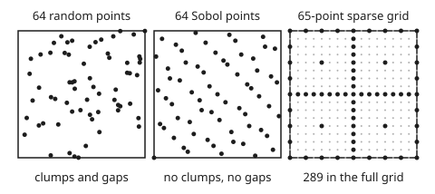
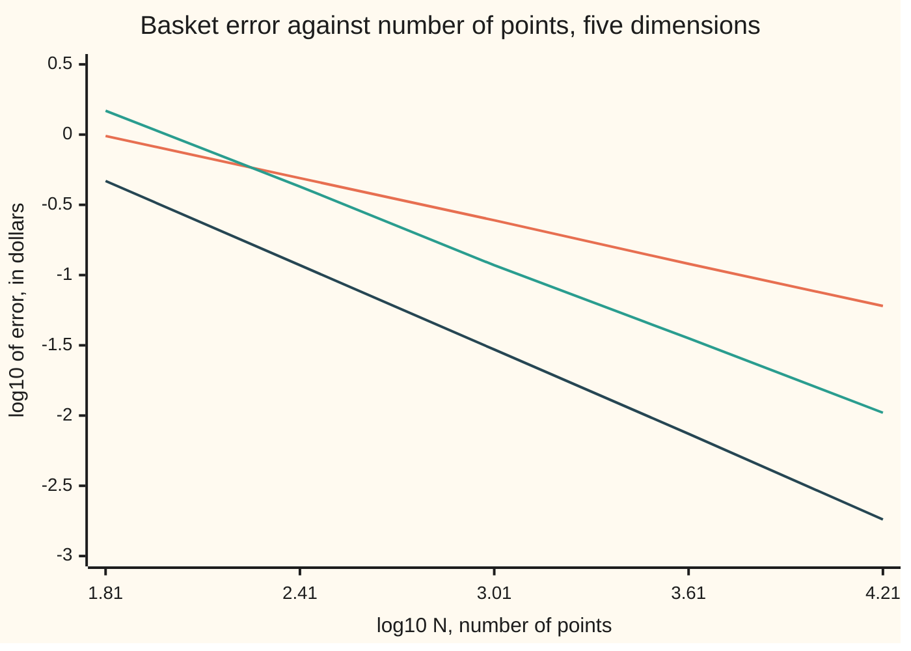

# Quasi-Monte Carlo and sparse grids: spread the points evenly on purpose

[Syllabus](../../../SYLLABUS.md) → [Numerical analysis](../README.md) → [Quadrature](../README.md#s05) → Quasi-Monte Carlo and sparse grids

---

## General Overview

[Many dimensions](06-multidimensional-and-monte-carlo-quadrature.md) priced a basket call on five assets, wanted to the cent. Each asset grows by a factor between 0.8 and 1.2, every value equally likely (an illustrative model), and the call pays the basket's gain above $100, nothing on a loss. Its exact value is $2.081597. There, a grid of 100,000 points missed it by −0.007997. Random points, 1,024 of them, miss by a standard error (the typical size of the error) of 0.093751.

Place the same number of points by Sobol's rule (a recipe that fills the cube evenly, built in Why it works) instead of by chance, and the error is −0.001489. That is 63.0 times smaller than the random standard error, and smaller than the grid's miss with 1,024 points instead of 100,000. Halton's rule, another even recipe, gives −0.039059.

The call has a kink where the basket breaks even. A **sparse grid**, which keeps the parts of a full grid that matter most for a smooth function, fails on it: its 801 points miss by −1.144097. So the card also works a smooth basket, on which every method here, the sparse grid included, can be tested.

The smooth basket holds five assets, each at $100 today. In one year each asset's log return (the natural log of its price ratio) lands anywhere between −30% and +30%, every value equally likely. These numbers are illustrative. The basket's value is the geometric average of the five prices: multiply them and take the fifth root. The number wanted is its mean value in a year, to the cent. That mean is an integral over the five-dimensional cube with a closed form, $100.300414, so every error on this card is a true error, not an estimate.

Random points miss it by a standard error of 0.243051 with 1,024 draws: about 24 cents. Sobol's 1,024 points give an error of −0.029315, 8.3 times smaller; random points would need 70,390 draws to match it. The sparse grid does better still: with 801 points its error is +0.002339. A full grid of the same fineness, 17 points per side, needs 1,419,857 points for +0.002351.

**Points placed evenly on purpose, by a low-discrepancy sequence (one built to leave no clumps and no gaps) or a sparse grid, integrate a smooth function in a few dimensions far faster than random points: an error near one over N, or better, instead of one over root N.**

**What kind of fact this is:** two methods with theorems behind them. The one-dimensional error bound and the van der Corput discrepancy bound are proved on this card in Why it works. The many-dimensional bound (Koksma-Hlawka) and the (log N)^d / N rate are stated with a named source. The errors are measured.

### The picture: three ways to place 64 points

<p align="center"></p>

Left: random points leave clumps and gaps by chance. Middle: Sobol points fill the square evenly, one in every strip of width 1/64 across or down. Right: the sparse grid keeps 65 of the full grid's 289 points.

---

## The formula

The quasi-Monte Carlo estimate is a plain average over chosen points. The Koksma-Hlawka inequality bounds its error:

$$Q_N = \frac{1}{N}\sum_{i=0}^{N-1} f(u_i), \qquad \lvert Q_N - I \rvert \;\le\; V(f)\, D^*_N, \qquad D^*_N \;\le\; c_d\,\frac{(\log N)^d}{N}$$

**Read it aloud:** average the function over N fixed points; the error is at most how much the function wiggles times how unevenly the points sit, and for a good sequence the unevenness falls almost like one over N.

The points come from mirroring digits: write the index i in base p, then reflect its digits across the point.

$$i = \sum_{r \ge 0} a_r\, p^{r} \quad\Longrightarrow\quad \phi_p(i) = \sum_{r \ge 0} a_r\, p^{-r-1}$$

**Read it aloud:** the point for index i is i's digits read backwards after the point.

The sparse grid adds products of one-dimensional rules, with whole-number weights that cancel the overlap:

$$A(k, d) \;=\; \sum_{k+1 \,\le\, \lvert \ell \rvert \,\le\, k+d} (-1)^{\,k+d-\lvert\ell\rvert} \binom{d-1}{k+d-\lvert\ell\rvert}\; U^{\ell_1} \otimes \cdots \otimes U^{\ell_d}$$

**Read it aloud:** take every grid built from one-dimensional rules whose levels add up to between k + 1 and k + d, give each a plus or minus count, and add them.

| Symbol | Plain meaning | In our example | Push it up and the answer… |
| --- | --- | --- | --- |
| $f$, $I$, $\sigma$ | the integrand (the smooth basket's value at one point of the cube; the call and $g$ are two more test integrands), its true mean, and the spread of one random draw | smooth basket: $I$ = 100.300414, $\sigma$ = 7.777630; call: $I$ = 2.081597 | — |
| $N$ | the number of points | 1,024 | every error falls; Sobol's by 4 per quadrupling |
| $d$ | the dimension: coordinates per point | 5, one per asset | the bound's $(\log N)^d$ grows, and random points stop losing |
| $u_i$ | point $i$: one number between 0 and 1 for each asset | Sobol point 2 is (0.25, 0.75, …) | — |
| $Q_N$ | the estimate: the average over the points | off by −0.029315 | — |
| $D^*_N$, $K(t)$ | the star discrepancy: the worst gap, over boxes with a corner at 0, between the share of points inside and the box's volume; $K(t)$ counts the points below $t$ in one dimension | 0.002453 for 1,000 van der Corput points | the error bound grows |
| $V(f)$ | the variation of $f$ (in the sense of Hardy and Krause): how much it wiggles, in each coordinate and each group of coordinates | finite here; infinite for a payoff with a jump | the error bound grows |
| $c_d$, $\log$ | a constant fixed by the sequence and $d$; the natural log | — | — |
| $p$, $\phi_p(i)$ | a prime base, and the radical inverse: $i$'s base-$p$ digits mirrored | $\phi_2(6)$ = 0.375 | — |
| $a_r$ | digit $r$ of $i$ in base $p$, counting from 0 at the right | 6 is 110 in base 2 | — |
| $\ell = (\ell_1, \dots, \ell_d)$, $\lvert\ell\rvert$, $\Delta^\ell$ | a level for each coordinate, their sum, and what level $\ell$ adds to level $\ell - 1$ | levels 1 to 5 | finer grids |
| $U^{\ell}$, $h$, $\otimes$, $A(k, d)$, $k$ | the one-dimensional rule at level $\ell$ (the midpoint at level 1, then trapezoid rules with 3, 5, 9 and 17 points) and its spacing; $\otimes$ joins one-dimensional rules into a product grid; the sparse grid in $d$ dimensions, and its level | $k$ = 4 gives 801 points | error falls by about 4 per level |

### When it holds

- **The function has bounded variation.** A payoff with a jump across a slanted line has infinite $V(f)$, and in five dimensions so does the call's kink, so the bound says nothing. Sobol points still did well on both here, unpromised.
- **A sparse grid needs bounded mixed derivatives.** The terms it drops are small only for a smooth function. On the same jump it returns −0.214844 for a probability, and on the call's kink it misses by −1.144097.
- **The variance comes from coordinates acting one at a time, or d is small.** The smooth basket's five coordinates matter equally, yet 0.9976 of its variance comes from single coordinates. On $g$, a product of ten factors, only 0.1989 does, and plain Halton points lose: an error 6.944 times the random standard error.
- **No error bar comes free.** The points are fixed, so $\sigma/\sqrt{N}$ does not describe them: it claims 0.243051 where Sobol's true error is 0.029315. Random shifts give an honest bar (Step 4).
- **N is a power of two, for Sobol.** At N = 1,024 each coordinate has exactly one point in each strip of width 1/1,024. Stop elsewhere and that cover is gone.

---

## Why it works

### Step 0: an average's error is how unevenly the points sit

[Quasi-Monte Carlo](../../12-Financial%20mathematics/06-Numerical%20Methods%20for%20Pricing/03-quasi-monte-carlo-and-brownian-bridge.md) already builds Sobol points, defines discrepancy and shows the Brownian bridge at work. This card adds the rate, the constructions and the sparse grid.

An average of $f$ over points misses the integral only where the points over- or under-represent part of the cube. Random points do this by chance: clumps and gaps of size about $1/\sqrt{N}$. Points built to have no clumps and no gaps remove that chance.

### Step 1: in one dimension, the error is discrepancy times variation

In one dimension the bound has a short proof. Count the points below $t$, divide by $N$, and subtract $t$: that gap is the **local discrepancy**. The error of the average is exactly its integral against the slope of $f$. So the error is at most the worst gap times the total rise and fall of $f$.

<details>
<summary>Detailed proof: the one-dimensional Koksma inequality</summary>

Let $f$ have a continuous slope $f'$ on $[0, 1]$. For any point $u$, $f(u) = f(1) - \int_0^1 \mathbf{1}[t > u]\, f'(t)\, dt$, where $\mathbf{1}[t > u]$ is 1 when $t > u$ and 0 otherwise.

Average this over the $N$ points. Let $K(t)$ count the points below $t$. Then $\frac{1}{N}\sum_i f(u_i) = f(1) - \int_0^1 \frac{K(t)}{N} f'(t)\, dt$.

Do the same with $u$ spread evenly over $[0, 1]$ instead of over the points. The share below $t$ is then $t$, so $\int_0^1 f = f(1) - \int_0^1 t\, f'(t)\, dt$.

Subtract: $Q_N - I = -\int_0^1 \left(\frac{K(t)}{N} - t\right) f'(t)\, dt$. The bracket is the local discrepancy, at most $D^*_N$ in size everywhere. So $\lvert Q_N - I \rvert \le D^*_N \int_0^1 \lvert f'(t) \rvert\, dt = D^*_N\, V(f)$.

</details>

In $d$ dimensions the same integration by parts runs in every coordinate and every group of coordinates. That is Hlawka's theorem: $\lvert Q_N - I\rvert \le V(f) D^*_N$, with $V$ the Hardy-Krause variation. It is stated here, not proved; Niederreiter's book sets it out in chapter 2.

### Step 2: van der Corput mirrors binary digits

The van der Corput sequence is $\phi_2(i)$: write $i$ in binary and mirror it after the point. Six is 110, mirrored 0.011, which is 0.375. The first eight points are 0, 0.5, 0.25, 0.75, 0.125, 0.625, 0.375, 0.875.

Each new point lands in the middle of one of the largest gaps left so far. The first $2^m$ points are exactly the grid $0, 1/2^m, 2/2^m, \dots$, so their discrepancy is $1/2^m$. Any other count $N$ splits, by its binary digits, into such grids, each slid a little. Each grid adds at most 1 to the miscount, so $D^*_N \le (\text{number of 1s in } N\text{'s binary digits}) / N \le (\log_2 N + 1)/N$.

<details>
<summary>Detailed proof: van der Corput's discrepancy is at most the 1-bits of N over N</summary>

Write $N = 2^{m_1} + 2^{m_2} + \cdots$ with $m_1 > m_2 > \cdots$. Indices $0$ to $2^{m_1} - 1$ use only the low $m_1$ binary digits, so their mirrors are exactly the multiples of $2^{-m_1}$.

The next block is $i = 2^{m_1} + j$ with $0 \le j < 2^{m_2}$. Its mirror is $\phi_2(j) + 2^{-m_1 - 1}$: the grid of multiples of $2^{-m_2}$, slid up by $2^{-m_1-1}$, which is less than one spacing. Every later block is likewise a full grid slid by less than its spacing.

Take one block of $2^m$ points with spacing $h = 2^{-m}$, slid by $\delta$ with $0 \le \delta < h$. The number of its points below $t$ is $\lceil (t - \delta)/h \rceil$ (or 0), and $2^m t = t/h$. These differ by less than 1.

Add the blocks. The total miscount $\lvert K(t) - N t \rvert$ is less than one per block, at most the number of 1-bits in $N$. Divide by $N$ for the discrepancy.

</details>

The code tests the bound for every $N$ from 1 to 1,024: the worst ratio of discrepancy to bound is 1.000, so the bound is never broken and is sometimes met. At $N$ = 1,000 (six 1-bits) the discrepancy is 0.002453 against a bound of 0.006000, a ratio of 0.409. One thousand random points have 0.034412.

### Step 3: Halton uses a different prime per coordinate; Sobol mixes base 2

In two or more dimensions, mirroring base 2 in every coordinate would put every point on the diagonal. Halton's fix is a different prime per coordinate: base 2, 3, 5, 7, 11 for five assets. In base 3 the sequence runs 0, 0.3333, 0.6667, 0.1111. Distinct primes keep the coordinates from moving in step.

Sobol's fix keeps base 2 in every coordinate but mixes each coordinate's binary digits by its own fixed table of direction numbers, combined with XOR (adding binary digits with no carry). This card uses the published direction numbers of Joe and Kuo for coordinates 2 to 5. The code checks the result: at $N$ = 1,024 each of the five coordinates puts exactly one point in each strip of width 1/1,024.

For both sequences $D^*_N \le c_d (\log N)^d / N$, proved in Niederreiter's book (chapter 3 for Halton, chapter 4 for Sobol-type sequences) and stated here.

### Step 4: when the rate actually beats random points

Set the bound's shape $(\log N)^d/N$ against random sampling's $1/\sqrt{N}$. The bound wins only after $N$ is enormous:

| Dimension $d$ | 2 | 3 | 5 | 10 | 20 |
| --- | ---: | ---: | ---: | ---: | ---: |
| $\log_{10} N$ where $(\log N)^d/N$ drops below $1/\sqrt{N}$ | 3.7 | 7.4 | 15.5 | 39.1 | 93.3 |

In five dimensions the bound favours even points only beyond about $10^{15.5}$ points. Yet at 1,024 Sobol points the smooth basket's error was 8.3 times smaller than random. The bound is a worst case. Split the basket's variance into the parts that come from single coordinates, from pairs, and from larger groups: 0.9976 of it comes from single coordinates. So the basket has a low **effective dimension** in the superposition sense: its variance comes from coordinates acting one at a time, even though all five matter equally. (The other sense, used with the Brownian bridge, counts how many leading coordinates carry the variance.)

Five budgets show the rate. Sobol's observed order per quadrupling is 1.00 each time: one over $N$. Halton's is 0.90, 0.93, 0.86 and 0.88: near one over $N$, slowed by the logs. Random points fall at 0.5.



Orange line: the random standard error, slope one half. Teal line: Halton's true error. Dark line: Sobol's true error, slope 1. Both axes are base-10 logs, so a straight line is a power law and its slope is the order.

The rescue fails when the variance comes from products of many coordinates, as in $g(u) = \prod_j \lvert 4u_j - 2 \rvert$, mean 1. Its coordinates also matter equally, but its share of variance from single coordinates falls fast as $d$ grows. At $N$ = 1,024, Halton's error against the random standard error $\sqrt{((4/3)^d - 1)/N}$:

| $d$ | Halton error | Random standard error | Ratio | Share from single coordinates |
| ---: | ---: | ---: | ---: | ---: |
| 1 | +0.000000 | 0.018042 | 0.000 | 1.0000 |
| 2 | +0.000436 | 0.027560 | 0.016 | 0.8571 |
| 5 | +0.009952 | 0.056024 | 0.178 | 0.5186 |
| 10 | +0.888341 | 0.127926 | 6.944 | 0.1989 |
| 20 | +1025.270143 | 0.554048 | 1850.507 | 0.0212 |

Up to five dimensions the even points win. At ten they lose by a factor of 6.944. At twenty, coordinates in the large bases 67 and 71 rise almost in step: their first points are $i/67$ beside $i/71$. The answer is useless.

**An honest error bar.** Fixed points have no spread to measure. Draw one random shift, a random point of the cube, add it to every Sobol point coordinate by coordinate, and wrap round the edges by keeping only the part after the decimal point. Each shifted point is then uniform on the cube, so the average is an unbiased random estimate, and the points stay one to a strip. Repeat with fresh shifts, and the scatter of the answers is an error bar. Ten shifts of the 1,024 points give a mean error of +0.001733 with a standard error of 0.003096, against 0.243051 for 1,024 random points. This is randomised quasi-Monte Carlo.

### Step 5: a sparse grid keeps the cheap, useful parts of a full grid

A sparse grid is a full grid with most of its points removed. Its building blocks are nested one-dimensional rules ([Trapezoid, midpoint and Simpson](01-newton-cotes-and-composite-rules.md)): the midpoint at level 1, then trapezoid rules with 3, 5, 9 and 17 points at levels 2 to 5.

Write $\Delta^\ell = U^\ell - U^{\ell-1}$: what level $\ell$ adds to level $\ell - 1$. For a smooth function this shrinks by about 4 per level, the $h^2$ law of the trapezoid rule ([Error bounds and Romberg](02-error-bounds-and-romberg.md)). A full grid of 17 points per side is the sum of every product $\Delta^{\ell_1} \otimes \cdots \otimes \Delta^{\ell_5}$ with each $\ell_j \le 5$.

Each product term is about $4^{-\lvert\ell\rvert}$ in size and costs about $2^{\lvert\ell\rvert}$ points, so terms with a large level sum are tiny and expensive. The sparse grid keeps only $\lvert\ell\rvert \le k + d$. Collected, those terms give the combination formula above; the code runs it and merges the weights of repeated points.

The cost then grows like $2^k k^{d-1}$ instead of $2^{kd}$:

| Level $k$ | 0 | 1 | 2 | 3 | 4 | 5 |
| --- | ---: | ---: | ---: | ---: | ---: | ---: |
| Sparse grid points, 5 dimensions | 1 | 11 | 61 | 241 | 801 | 2,433 |
| Full grid of the same fineness | 1 | 243 | 3,125 | 59,049 | 1,419,857 | 39,135,393 |

The code counts the points twice, by building the grid and by counting each level's new points; the two agree. The 801-point error, +0.002339, matches the full grid's +0.002351.

The price is negative weights: 230 of the 801. On a smooth function the plus and minus terms cancel cleanly. On a jump or a kink they do not.

<details>
<summary>Why the plus-and-minus counts appear, in two dimensions</summary>

In two dimensions, $\Delta^{\ell_1} \otimes \Delta^{\ell_2}$ expands into four plain grids. Sum over all $\ell_1 + \ell_2 \le k + 2$ and most of them cancel along each diagonal. What survives is every grid with $\ell_1 + \ell_2 = k + 2$, counted $+1$, minus every grid with $\ell_1 + \ell_2 = k + 1$, counted $-1$. That matches the formula: for $d$ = 2 the binomial counts are both 1.

The same cancelling in $d$ dimensions gives the binomial counts in general. Gerstner and Griebel set out the general case and the error bound of order $N^{-2} (\log N)^{3(d-1)}$ for the trapezoid rule; it is stated here, not proved.

</details>

---

## Worked numbers, by hand

The smooth basket at $N$ = 1,024, every figure from the run.

| Step | Arithmetic | Value |
| --- | --- | --- |
| true mean | the closed form, five independent factors | 100.300414 |
| spread of one draw, σ | the closed form | 7.777630 |
| random standard error | 7.777630 ÷ √1,024 = 7.777630 ÷ 32 | 0.243051 |
| Sobol's true error | average over 1,024 Sobol points, minus the true mean | −0.029315 |
| how much better | 0.243051 ÷ 0.029315 | 8.3 times |
| random points to match | 7.777630² ÷ 0.029315² | 70,390 |
| van der Corput point 6 | 6 = 110 in binary, mirrored 0.011 | 0.375 |
| sparse grid, level 1 | the centre, plus 2 points on each of 5 axes | 11 points |
| sparse grid, level 4 | the count formula | 801 points |
| sparse grid's true error | 801 points, weights merged | **+0.002339** |

The sparse grid prices the basket to about a quarter of a cent with 801 points; Sobol's 1,024 points get within three cents.

### What breaks if you drop a piece

| Mistake | Comes out at | What went wrong |
| --- | --- | --- |
| Plain Halton in 20 dimensions on $g$ | error +1025.270143, against a random standard error of 0.554048 | the bound's $(\log N)^{20}$ is astronomical, and the large primes move in step |
| Sparse grid on a digital payoff: $1 if the basket ends above $102 | −0.214844, a negative probability; the true value is 0.402089 | a jump has no bounded mixed derivatives, and 230 negative weights stop cancelling; Sobol gets 0.401367 |
| Quoting σ/√N as Sobol's error bar | 0.243051, against a true error of 0.029315 | fixed points have no sampling spread; the bar is eight times too wide |
| A full grid for the sparse grid's accuracy | 1,419,857 points for +0.002351 | it pays for product terms of size $4^{-\lvert\ell\rvert}$ that add nothing |

The code prints all four. The digital's true value comes from the closed form for a sum of uniform draws (the Irwin-Hall distribution).

---

## Code, from first principles, and it actually runs

The code builds every point set itself: SplitMix64 for random points, the radical inverse for van der Corput and Halton, direction numbers and XOR for Sobol, and the combination formula for the sparse grid. It first prices the basket call from [Many dimensions](06-multidimensional-and-monte-carlo-quadrature.md), labelled card 06 in the output, by its closed form, Sobol, Halton, that card's 10-per-axis grid and the sparse grid. It then takes seven roads to the smooth basket's mean: the closed form, random points, Halton, Sobol, Sobol with random shifts, the sparse grid, and the full 17-per-side grid as a product of one-dimensional sums. The sparse point count is found by building and by formula, and van der Corput's exact discrepancy is set against the proved bound.

### Python

```python
# Quasi-Monte Carlo and sparse grids -- the check behind the card.  Standard
# library only; every point set is built here.  First card 06's basket call, then a
# smooth basket: five assets at $100, each one-year log return spread evenly over
# -30% to +30% (illustrative), wanted the mean of their geometric average.  Roads:
# closed forms; random; van der Corput and Halton; Sobol, plain and shifted; a sparse grid.
import math
C, D5 = 0.06, 5                            # each log return is C * 5 * (2u - 1)
M1, M2 = math.sinh(C) / C, math.sinh(2 * C) / (2 * C)   # mean and mean square of one factor
EXACT = 100 * M1 ** D5                     # closed form: five independent factors
SIGMA = 100 * math.sqrt(M2 ** D5 - M1 ** 10)
def basket(u): return 100 * math.exp(C * sum(2 * x - 1 for x in u))
M64 = (1 << 64) - 1
def splitmix(seed):                        # SplitMix64, written out: random road
    while True:
        seed = (seed + 0x9E3779B97F4A7C15) & M64
        z = ((seed ^ (seed >> 30)) * 0xBF58476D1CE4E5B9) & M64
        z = ((z ^ (z >> 27)) * 0x94D049BB133111EB) & M64
        yield ((z ^ (z >> 31)) >> 11) * 2.0 ** -53
def radical_inverse(i, p):                 # mirror the base-p digits of i
    x, f = 0.0, 1.0 / p
    while i: x, i, f = x + (i % p) * f, i // p, f / p
    return x
PRIMES = [2, 3, 5, 7, 11, 13, 17, 19, 23, 29, 31, 37, 41, 43, 47, 53, 59, 61, 67, 71]
def halton(i, d): return [radical_inverse(i, p) for p in PRIMES[:d]]
BITS, POLY = 30, [(1, 0, [1]), (2, 1, [1, 3]), (3, 1, [1, 3, 1]), (3, 2, [1, 1, 1])]
V = [[1 << (BITS - k) for k in range(1, BITS + 1)]]   # dimension 1: halves
for s, a, m in POLY:                       # dimensions 2-5: Joe-Kuo's numbers
    for k in range(s, BITS):
        new = m[k - s] ^ (m[k - s] << s)
        for t in range(1, s): new ^= (m[k - t] << t) if (a >> (s - 1 - t)) & 1 else 0
        m.append(new)
    V.append([m[k] << (BITS - 1 - k) for k in range(BITS)])
def sobol(i):                              # XOR the direction numbers i's bits pick
    out = []
    for v in V:
        x, k, j = 0, 0, i
        while j: x, k, j = (x ^ v[k]) if j & 1 else x, k + 1, j >> 1
        out.append(x / 2.0 ** BITS)
    return out
def mean(f, pts): return sum(f(u) for u in pts) / len(pts)
def rule(l):                               # midpoint, then nested trapezoid: 1, 3, 5, 9, 17 points
    if l == 1: return [(0.5, 1.0)]
    n = 2 ** (l - 1)
    return [(j / n, (0.5 if j in (0, n) else 1.0) / n) for j in range(n + 1)]
def levels(total, d):                      # every list of d levels >= 1 summing to total
    if d == 1: yield [total]; return
    for a in range(1, total - d + 2):
        for rest in levels(total - a, d - 1):
            yield [a] + rest
def smolyak(k, d):                         # combination form; weights merged per point
    pts = {}
    for s in range(max(d, k + 1), k + d + 1):
        coef = (-1) ** (k + d - s) * math.comb(d - 1, k + d - s)
        for lv in levels(s, d):
            grid = [((), coef)]
            for l in lv:
                grid = [(x + (p,), w * q) for x, w in grid for p, q in rule(l)]
            for x, w in grid: pts[x] = pts.get(x, 0.0) + w
    return sorted(pts.items())
def new_points(l): return 1 if l == 1 else 2 if l == 2 else 2 ** (l - 2)
def count_by_formula(k, d):                # second road to the sparse-grid size
    return sum(math.prod(new_points(l) for l in lv) for s in range(d, k + d + 1) for lv in levels(s, d))
def sgrid(k, f, d=D5): return sum(w * f(x) for x, w in smolyak(k, d))
N, rnd = 1024, splitmix(2026)              # rnd: the random road
sob, hal = [sobol(i) for i in range(N)], [halton(i, D5) for i in range(N)]   # the two even point sets
CALL = 8 * sum((-1) ** j * math.comb(D5, j) * max(2.5 - j, 0) ** 6 for j in range(6)) / 720   # card 06
def call(u): return 100 * max(0.8 + 0.4 * sum(u) / D5 - 1, 0.0)   # card 06's $100 basket call
grid10 = [[(i // 10 ** a % 10 + 0.5) / 10 for a in range(D5)] for i in range(10 ** D5)]   # card 06's grid, 10 per axis
ec = [mean(call, pts) - CALL for pts in (sob, hal, grid10)] + [sgrid(4, call) - CALL]   # Sobol, Halton, grid, sparse
se_c = math.sqrt(64 * 5 / 24 - CALL ** 2) / math.sqrt(N)        # card 06's sigma over root N
print(f"card 06's call: exact {CALL:.6f}, random SE {se_c:.6f}; Sobol {ec[0]:+.6f}, {se_c / abs(ec[0]):.1f} times smaller;"
      f" Halton {ec[1]:+.6f}; 100000-point grid {ec[2]:+.6f}; 801-point sparse grid {ec[3]:+.6f}")
print(f"basket exact mean {EXACT:.9f}; spread of one draw sigma {SIGMA:.6f}; variance share from single"
      f" coordinates {D5 * M1 ** 8 * (M2 - M1 * M1) * 1e4 / SIGMA ** 2:.4f}")
err_r = mean(basket, [[next(rnd) for _ in range(D5)] for _ in range(N)]) - EXACT
err_h = mean(basket, hal) - EXACT
err_s = mean(basket, sob) - EXACT
err_g = sgrid(4, basket) - EXACT
h17 = sum((0.5 if j in (0, 16) else 1.0) / 16 * math.exp(C * (2 * j / 16 - 1)) for j in range(17))
err_f = 100 * h17 ** D5 - EXACT            # full 17^5 grid, as a product of 1-D sums
se = SIGMA / math.sqrt(N)
print(f"N = {N}, error of each road:  random standard error {se:.6f}, this run {err_r:+.6f}")
print(f"  Halton {err_h:+.6f}   Sobol {err_s:+.6f}   Sobol beats the standard error {se / abs(err_s):.1f} times")
print(f"  random points needed to match Sobol: {SIGMA ** 2 / err_s ** 2:.0f}")
print(f"  sparse grid level 4, {len(smolyak(4, D5))} points"
      f" ({sum(w < 0 for _, w in smolyak(4, D5))} of weight below 0) {err_g:+.6f};"
      f" full 17-per-side grid, {17 ** D5} points {err_f:+.6f}")
print("N       random SE   Halton      Sobol       log10 N  log10 |error|: SE, Halton, Sobol")
rows = [(n, SIGMA / math.sqrt(n), mean(basket, [halton(i, D5) for i in range(n)]) - EXACT,
         mean(basket, [sobol(i) for i in range(n)]) - EXACT) for n in (64, 256, 1024, 4096, 16384)]
for n, *row in rows:
    print(f"{n:<8d}{row[0]:<12.6f}{row[1]:<+12.6f}{row[2]:<+12.6f}{math.log10(n):<9.2f}"
          + "  ".join(f"{math.log10(abs(v)):.2f}" for v in row))
order = [math.log(abs(rows[i][j] / rows[i + 1][j])) / math.log(4) for j in (2, 3) for i in range(4)]
print("observed order per quadrupling, Halton:", " ".join(f"{v:.2f}" for v in order[:4]),
      "| Sobol:", " ".join(f"{v:.2f}" for v in order[4:]))
def dstar(x): return max(max((i + 1) / len(x) - v, v - i / len(x)) for i, v in enumerate(sorted(x)))  # exact, 1-D
print("van der Corput, first 8:", " ".join(f"{radical_inverse(i, 2):g}" for i in range(8)),
      "| Halton base 3:", " ".join(f"{radical_inverse(i, 3):.4f}" for i in range(4)))
vdc, ones, rnd1 = dstar([radical_inverse(i, 2) for i in range(1000)]), bin(1000).count("1"), splitmix(7)
d_r = dstar([next(rnd1) for _ in range(1000)])
print(f"N = 1000: van der Corput D* {vdc:.6f}, bound {ones}/N = {ones / 1000:.6f},"
      f" ratio {vdc * 1000 / ones:.3f}; random D* {d_r:.6f}")
worst = max(dstar([radical_inverse(i, 2) for i in range(n)]) * n / bin(n).count("1") for n in range(1, 1025))
print(f"worst D* / bound over N = 1 to 1024: {worst:.3f}")
def upper_root(d, L):                      # fixed point of L = 2d ln L, upper root; L is ln N
    for _ in range(200): L = 2 * d * math.log(L)
    return L
print("bound shape (ln N)^d / N falls below 1 / sqrt(N) only after log10 N ="
      + "".join(f"  d {d}: {upper_root(d, 4.0 * d * d) / math.log(10):.1f}" for d in (2, 3, 5, 10, 20)))
print("g = product of |4u - 2|, mean 1, N = 1024: d, Halton error, random SE, ratio, single-coordinate share")
for d in (1, 2, 5, 10, 20):
    g = mean(lambda u: math.prod(abs(4 * x - 2) for x in u), [halton(i, d) for i in range(N)])
    gse = math.sqrt(((4 / 3) ** d - 1) / N)
    print(f"  {d:<3d}{g - 1:<+15.6f}{gse:<10.6f}{abs(g - 1) / gse:<10.3f}{d / 3 / ((4 / 3) ** d - 1):.4f}")
print("sparse grid level: points in 5 dims (enumerated, by formula), full grid")
for k in range(6):
    print(f"  {k}  {len(smolyak(k, D5)):>5d}{count_by_formula(k, D5):>6d}{(2 ** k + 1 if k else 1) ** D5:>10d}")
fig = splitmix(11)
print(f"figure, random 0: ({next(fig):.4f},{next(fig):.4f}); Sobol 0-3:", " ".join(f"({a:g},{b:g})"
      for a, b in [sobol(i)[:2] for i in range(4)]), f"| sparse 2-D level 4: {len(smolyak(4, 2))} of 289")
T = 2.5 + math.log(1.02) / (2 * C)          # digital: pays 1 if the average > $102
irwin = 1 - sum((-1) ** j * math.comb(D5, j) * max(T - j, 0) ** D5 for j in range(6)) / 120
digital = lambda u: 1.0 if sum(u) > T else 0.0
dig, dig_s = sgrid(4, digital), mean(digital, sob)
print(f"mistakes: digital exact {irwin:.6f}, sparse grid 801 points {dig:.6f}, Sobol {dig_s:.6f}")
sh = splitmix(99)                          # random shifts: move every Sobol point one random step, wrap round
rq = [mean(basket, [[(x + y) % 1 for x, y in zip(p, dl)] for p in sob]) - EXACT
      for dl in [[next(sh) for _ in range(D5)] for _ in range(10)]]
m_rq = sum(rq) / 10; s_rq = math.sqrt(sum((v - m_rq) ** 2 for v in rq) / 90)   # mean, and its standard error
print(f"Sobol, 10 random shifts: mean error {m_rq:+.6f}, standard error {s_rq:.6f}")
assert all(sorted(int(sobol(i)[j] * N) for i in range(N)) == list(range(N)) for j in range(D5))
assert abs(err_s) < se / 4 and abs(err_r) < 3 * se and abs(err_g) < abs(err_s) / 4 and abs(ec[0]) < min(se_c / 10, abs(ec[2]))
assert abs(m_rq) < 4 * s_rq and s_rq < se / 4                    # shifted Sobol: an honest bar, still narrow
assert all(0.9 < v < 1.1 for v in order[4:])                     # near one over N
assert abs(err_g - err_f) < 0.05 * abs(err_f)                    # 801 points match 1.4 million
assert all(len(smolyak(k, D5)) == count_by_formula(k, D5) for k in range(6))
assert worst <= 1.0 and vdc < d_r / 5                            # D* <= popcount(N) / N
assert abs(dig - irwin) > 0.5 and abs(dig_s - irwin) < 0.01 and abs(ec[3]) > 0.5   # jump, kink: sparse grid fails
print("ALL CHECKS PASS")
```

**Ran 2026-11-11 on macOS, Python 3.14.10, standard library only. All checks passed. Output, pasted from the run:**

```
card 06's call: exact 2.081597, random SE 0.093751; Sobol -0.001489, 63.0 times smaller; Halton -0.039059; 100000-point grid -0.007997; 801-point sparse grid -1.144097
basket exact mean 100.300414350; spread of one draw sigma 7.777630; variance share from single coordinates 0.9976
N = 1024, error of each road:  random standard error 0.243051, this run +0.014493
  Halton -0.116970   Sobol -0.029315   Sobol beats the standard error 8.3 times
  random points needed to match Sobol: 70390
  sparse grid level 4, 801 points (230 of weight below 0) +0.002339; full 17-per-side grid, 1419857 points +0.002351
N       random SE   Halton      Sobol       log10 N  log10 |error|: SE, Halton, Sobol
64      0.972204    -1.472107   -0.468069   1.81     -0.01  0.17  -0.33
256     0.486102    -0.422550   -0.117223   2.41     -0.31  -0.37  -0.93
1024    0.243051    -0.116970   -0.029315   3.01     -0.61  -0.93  -1.53
4096    0.121525    -0.035719   -0.007345   3.61     -0.92  -1.45  -2.13
16384   0.060763    -0.010559   -0.001831   4.21     -1.22  -1.98  -2.74
observed order per quadrupling, Halton: 0.90 0.93 0.86 0.88 | Sobol: 1.00 1.00 1.00 1.00
van der Corput, first 8: 0 0.5 0.25 0.75 0.125 0.625 0.375 0.875 | Halton base 3: 0.0000 0.3333 0.6667 0.1111
N = 1000: van der Corput D* 0.002453, bound 6/N = 0.006000, ratio 0.409; random D* 0.034412
worst D* / bound over N = 1 to 1024: 1.000
bound shape (ln N)^d / N falls below 1 / sqrt(N) only after log10 N =  d 2: 3.7  d 3: 7.4  d 5: 15.5  d 10: 39.1  d 20: 93.3
g = product of |4u - 2|, mean 1, N = 1024: d, Halton error, random SE, ratio, single-coordinate share
  1  +0.000000      0.018042  0.000     1.0000
  2  +0.000436      0.027560  0.016     0.8571
  5  +0.009952      0.056024  0.178     0.5186
  10 +0.888341      0.127926  6.944     0.1989
  20 +1025.270143   0.554048  1850.507  0.0212
sparse grid level: points in 5 dims (enumerated, by formula), full grid
  0      1     1         1
  1     11    11       243
  2     61    61      3125
  3    241   241     59049
  4    801   801   1419857
  5   2433  2433  39135393
figure, random 0: (0.3162,0.2624); Sobol 0-3: (0,0) (0.5,0.5) (0.25,0.75) (0.75,0.25) | sparse 2-D level 4: 65 of 289
mistakes: digital exact 0.402089, sparse grid 801 points -0.214844, Sobol 0.401367
Sobol, 10 random shifts: mean error +0.001733, standard error 0.003096
ALL CHECKS PASS
```

### Rust

Same numbers, same labels, built with `rustc --edition 2021 -O`.

```rust
// Quasi-Monte Carlo and sparse grids -- the same check as the Python, in Rust.
// No crates; every point set is built here.  First card 06's basket call, then a
// smooth basket: five assets at $100, each one-year log return spread evenly over
// -30% to +30% (illustrative), wanted the mean of their geometric average.  Roads:
// closed forms; random; van der Corput and Halton; Sobol, plain and shifted; a sparse grid.
use std::collections::BTreeMap;
const C: f64 = 0.06;
const D5: usize = 5; const N: usize = 1024; const BITS: usize = 30;
const PRIMES: [u64; 20] = [2, 3, 5, 7, 11, 13, 17, 19, 23, 29, 31, 37, 41, 43, 47, 53, 59, 61, 67, 71];
fn basket(u: &[f64]) -> f64 { 100.0 * (C * u.iter().fold(0.0, |s, x| s + (2.0 * x - 1.0))).exp() }
struct SplitMix(u64);                       // SplitMix64, written out: random road
impl SplitMix {
    fn next(&mut self) -> f64 {
        self.0 = self.0.wrapping_add(0x9E3779B97F4A7C15);
        let mut z = (self.0 ^ (self.0 >> 30)).wrapping_mul(0xBF58476D1CE4E5B9);
        z = (z ^ (z >> 27)).wrapping_mul(0x94D049BB133111EB);
        ((z ^ (z >> 31)) >> 11) as f64 * 2f64.powi(-53)
    }
}
fn radical_inverse(mut i: u64, p: u64) -> f64 {   // mirror the base-p digits of i
    let (mut x, mut f) = (0.0, 1.0 / p as f64);
    while i > 0 { x += (i % p) as f64 * f; i /= p; f /= p as f64; }
    x
}
fn halton(i: usize, d: usize) -> Vec<f64> { PRIMES[..d].iter().map(|&p| radical_inverse(i as u64, p)).collect() }
fn directions() -> Vec<Vec<u64>> {
    let poly: [(usize, u64, Vec<u64>); 4] = [(1, 0, vec![1]), (2, 1, vec![1, 3]), (3, 1, vec![1, 3, 1]), (3, 2, vec![1, 1, 1])];
    let mut v = vec![(1..=BITS).map(|k| 1u64 << (BITS - k)).collect::<Vec<u64>>()];   // halves
    for (s, a, m0) in poly.iter() {         // dimensions 2-5: Joe-Kuo's numbers
        let (s, mut m) = (*s, m0.clone());
        for k in s..BITS {
            let mut new = m[k - s] ^ (m[k - s] << s);
            for t in 1..s { if (a >> (s - 1 - t)) & 1 == 1 { new ^= m[k - t] << t; } }
            m.push(new);
        }
        v.push((0..BITS).map(|k| m[k] << (BITS - 1 - k)).collect());
    }
    v
}
fn sobol(v: &[Vec<u64>], i: usize) -> Vec<f64> {  // XOR the direction numbers i's bits pick
    v.iter().map(|dir| {
        let (mut x, mut k, mut j) = (0u64, 0, i);
        while j > 0 { if j & 1 == 1 { x ^= dir[k]; } k += 1; j >>= 1; }
        x as f64 / 2f64.powi(BITS as i32)
    }).collect()
}
fn mean(f: &dyn Fn(&[f64]) -> f64, pts: &[Vec<f64>]) -> f64 { pts.iter().fold(0.0, |s, u| s + f(u)) / pts.len() as f64 }
fn rule(l: usize) -> Vec<(f64, f64)> {      // midpoint, then nested trapezoid: 1, 3, 5, 9, 17 points
    if l == 1 { return vec![(0.5, 1.0)]; }
    let n = 1usize << (l - 1);
    (0..=n).map(|j| (j as f64 / n as f64, (if j == 0 || j == n { 0.5 } else { 1.0 }) / n as f64)).collect()
}
fn levels(total: usize, d: usize) -> Vec<Vec<usize>> {  // d levels >= 1 summing to total
    if d == 1 { return vec![vec![total]]; }
    (1..(total + 2 - d)).flat_map(|a| levels(total - a, d - 1).into_iter().map(move |rest| [vec![a], rest].concat())).collect()
}
fn comb(n: usize, k: usize) -> f64 { (0..k).fold(1.0, |c, i| c * (n - i) as f64 / (i + 1) as f64) }
fn smolyak(k: usize, d: usize) -> Vec<(Vec<f64>, f64)> {  // combination form; weights merged
    let mut pts: BTreeMap<Vec<u64>, f64> = BTreeMap::new();
    for s in (d.max(k + 1))..=(k + d) {
        let coef = (if (k + d - s) % 2 == 0 { 1.0 } else { -1.0 }) * comb(d - 1, k + d - s);
        for lv in levels(s, d) {
            let mut grid: Vec<(Vec<f64>, f64)> = vec![(vec![], coef)];
            for &l in &lv {
                let r = rule(l);
                grid = grid.iter().flat_map(|(x, w)| r.iter().map(move |&(p, q)| {
                    let mut y = x.clone(); y.push(p); (y, w * q) })).collect();
            }
            for (x, w) in grid { *pts.entry(x.iter().map(|v| v.to_bits()).collect()).or_insert(0.0) += w; }
        }
    }
    pts.into_iter().map(|(x, w)| (x.iter().map(|&b| f64::from_bits(b)).collect(), w)).collect()
}
fn new_points(l: usize) -> usize { if l == 1 { 1 } else if l == 2 { 2 } else { 1 << (l - 2) } }
fn count_by_formula(k: usize, d: usize) -> usize {   // second road to the sparse-grid size
    (d..=k + d).flat_map(|s| levels(s, d)).map(|lv| lv.iter().map(|&l| new_points(l)).product::<usize>()).sum()
}
fn sgrid(k: usize, f: &dyn Fn(&[f64]) -> f64) -> f64 { smolyak(k, D5).iter().fold(0.0, |s, (x, w)| s + w * f(x)) }
fn dstar(pts: &[f64]) -> f64 {              // exact star discrepancy of a 1-D set
    let (mut x, n) = (pts.to_vec(), pts.len() as f64); x.sort_by(|a, b| a.partial_cmp(b).unwrap());
    x.iter().enumerate().fold(0.0, |m: f64, (i, &v)| m.max(((i + 1) as f64 / n - v).max(v - i as f64 / n)))
}
fn main() {
    let exact = 100.0 * (C.sinh() / C).powi(D5 as i32);   // closed form: five independent factors
    let sigma = 100.0 * (((2.0 * C).sinh() / (2.0 * C)).powi(D5 as i32) - (C.sinh() / C).powi(10)).sqrt();
    let v = directions();
    let (sob, hal): (Vec<Vec<f64>>, Vec<Vec<f64>>) = ((0..N).map(|i| sobol(&v, i)).collect(), (0..N).map(|i| halton(i, D5)).collect());
    let call_x = 8.0 * (0..6).fold(0.0, |s, j| s + (if j % 2 == 0 { 1.0 } else { -1.0 }) * comb(D5, j) * (2.5 - j as f64).max(0.0).powi(6)) / 720.0; // card 06
    let call = |u: &[f64]| 100.0 * (0.8 + 0.4 * u.iter().fold(0.0, |s, x| s + x) / D5 as f64 - 1.0).max(0.0); // card 06's $100 basket call
    let grid10: Vec<Vec<f64>> = (0..100000usize).map(|i| (0..D5 as u32).map(|a| (((i / 10usize.pow(a)) % 10) as f64 + 0.5) / 10.0).collect()).collect();
    let ec = [mean(&call, &sob) - call_x, mean(&call, &hal) - call_x, mean(&call, &grid10) - call_x, sgrid(4, &call) - call_x]; // card 06's grid, 10 per axis
    let se_c = (64.0 * 5.0 / 24.0 - call_x * call_x).sqrt() / (N as f64).sqrt(); // card 06's sigma over root N
    println!("card 06's call: exact {:.6}, random SE {:.6}; Sobol {:+.6}, {:.1} times smaller; Halton {:+.6}; 100000-point grid {:+.6}; 801-point sparse grid {:+.6}",
             call_x, se_c, ec[0], se_c / ec[0].abs(), ec[1], ec[2], ec[3]);
    println!("basket exact mean {:.9}; spread of one draw sigma {:.6}; variance share from single coordinates {:.4}", exact, sigma,
             D5 as f64 * (C.sinh() / C).powi(8) * ((2.0 * C).sinh() / (2.0 * C) - (C.sinh() / C).powi(2)) * 1e4 / (sigma * sigma));
    let mut rnd = SplitMix(2026);                // the random road
    let err_r = mean(&basket, &(0..N).map(|_| (0..D5).map(|_| rnd.next()).collect()).collect::<Vec<Vec<f64>>>()) - exact;
    let (err_h, err_s) = (mean(&basket, &hal) - exact, mean(&basket, &sob) - exact);
    let err_g = sgrid(4, &basket) - exact;
    let h17 = (0..17).fold(0.0, |s, j| s + (if j == 0 || j == 16 { 0.5 } else { 1.0 }) / 16.0 * (C * (2.0 * j as f64 / 16.0 - 1.0)).exp());
    let err_f = 100.0 * h17.powi(D5 as i32) - exact;    // full 17^5 grid, as a product of 1-D sums
    let se = sigma / (N as f64).sqrt();
    println!("N = {}, error of each road:  random standard error {:.6}, this run {:+.6}", N, se, err_r);
    println!("  Halton {:+.6}   Sobol {:+.6}   Sobol beats the standard error {:.1} times", err_h, err_s, se / err_s.abs());
    println!("  random points needed to match Sobol: {:.0}", sigma * sigma / (err_s * err_s));
    println!("  sparse grid level 4, {} points ({} of weight below 0) {:+.6}; full 17-per-side grid, {} points {:+.6}",
             smolyak(4, D5).len(), smolyak(4, D5).iter().filter(|(_, w)| *w < 0.0).count(), err_g, 17usize.pow(D5 as u32), err_f);
    println!("N       random SE   Halton      Sobol       log10 N  log10 |error|: SE, Halton, Sobol");
    let mut rows: Vec<[f64; 4]> = Vec::new();
    for n in [64usize, 256, 1024, 4096, 16384] {
        let row = [n as f64, sigma / (n as f64).sqrt(),
                   mean(&basket, &(0..n).map(|i| halton(i, D5)).collect::<Vec<_>>()) - exact,
                   mean(&basket, &(0..n).map(|i| sobol(&v, i)).collect::<Vec<_>>()) - exact];
        println!("{:<8}{:<12.6}{:<+12.6}{:<+12.6}{:<9.2}{}", n, row[1], row[2], row[3], (n as f64).log10(),
                 row[1..].iter().map(|x| format!("{:.2}", x.abs().log10())).collect::<Vec<_>>().join("  "));
        rows.push(row);
    }
    let order: Vec<f64> = [2, 3].iter().flat_map(|&j| { let r = &rows; (0..4).map(move |i| (r[i][j] / r[i + 1][j]).abs().ln() / 4f64.ln()) }).collect();
    let f2 = |s: &[f64]| s.iter().map(|x| format!("{:.2}", x)).collect::<Vec<_>>().join(" ");
    println!("observed order per quadrupling, Halton: {} | Sobol: {}", f2(&order[..4]), f2(&order[4..]));
    let first8: Vec<String> = (0..8).map(|i| format!("{}", radical_inverse(i, 2))).collect();
    let base3: Vec<String> = (0..4).map(|i| format!("{:.4}", radical_inverse(i, 3))).collect();
    println!("van der Corput, first 8: {} | Halton base 3: {}", first8.join(" "), base3.join(" "));
    let vdc = dstar(&(0..1000).map(|i| radical_inverse(i, 2)).collect::<Vec<_>>());
    let (mut rnd1, ones) = (SplitMix(7), 1000u32.count_ones());
    let d_r = dstar(&(0..1000).map(|_| rnd1.next()).collect::<Vec<_>>());
    println!("N = 1000: van der Corput D* {:.6}, bound {}/N = {:.6}, ratio {:.3}; random D* {:.6}",
             vdc, ones, ones as f64 / 1000.0, vdc * 1000.0 / ones as f64, d_r);
    let worst = (1..=1024u64).map(|n| dstar(&(0..n).map(|i| radical_inverse(i, 2)).collect::<Vec<_>>()) * n as f64 / n.count_ones() as f64).fold(0.0, f64::max);
    println!("worst D* / bound over N = 1 to 1024: {:.3}", worst);
    let roots: Vec<String> = [2.0f64, 3.0, 5.0, 10.0, 20.0].iter().map(|&d| {
        let mut l = 4.0 * d * d;            // fixed point of L = 2d ln L, upper root; L is ln N
        for _ in 0..200 { l = 2.0 * d * l.ln(); }
        format!("  d {}: {:.1}", d, l / 10f64.ln()) }).collect();
    println!("bound shape (ln N)^d / N falls below 1 / sqrt(N) only after log10 N ={}", roots.concat());
    println!("g = product of |4u - 2|, mean 1, N = 1024: d, Halton error, random SE, ratio, single-coordinate share");
    for d in [1usize, 2, 5, 10, 20] {
        let gf = |u: &[f64]| u.iter().fold(1.0, |p, x| p * (4.0 * x - 2.0).abs());
        let g = mean(&gf, &(0..N).map(|i| halton(i, d)).collect::<Vec<_>>());
        let gse = (((4.0f64 / 3.0).powi(d as i32) - 1.0) / N as f64).sqrt();
        println!("  {:<3}{:<+15.6}{:<10.6}{:<10.3}{:.4}", d, g - 1.0, gse, (g - 1.0).abs() / gse, d as f64 / 3.0 / ((4.0f64 / 3.0).powi(d as i32) - 1.0));
    }
    println!("sparse grid level: points in 5 dims (enumerated, by formula), full grid");
    for k in 0..6 {
        println!("  {}  {:>5}{:>6}{:>10}", k, smolyak(k, D5).len(), count_by_formula(k, D5), (if k > 0 { (1usize << k) + 1 } else { 1 }).pow(D5 as u32));
    }
    let (fx, fy) = { let mut fig = SplitMix(11); (fig.next(), fig.next()) };
    let s4: Vec<String> = (0..4).map(|i| { let p = sobol(&v, i); format!("({},{})", p[0], p[1]) }).collect();
    println!("figure, random 0: ({:.4},{:.4}); Sobol 0-3: {} | sparse 2-D level 4: {} of 289", fx, fy, s4.join(" "), smolyak(4, 2).len());
    let t = 2.5 + 1.02f64.ln() / (2.0 * C);  // digital: pays 1 if the average > $102
    let irwin = 1.0 - (0..6).fold(0.0, |s, j| s + (if j % 2 == 0 { 1.0 } else { -1.0 }) * comb(D5, j) * (t - j as f64).max(0.0).powi(5)) / 120.0;
    let digital = |u: &[f64]| if u.iter().fold(0.0, |s, x| s + x) > t { 1.0 } else { 0.0 };
    let (dig, dig_s) = (sgrid(4, &digital), mean(&digital, &sob));
    println!("mistakes: digital exact {:.6}, sparse grid 801 points {:.6}, Sobol {:.6}", irwin, dig, dig_s);
    let mut sh = SplitMix(99);                  // random shifts: move every Sobol point one random step, wrap round
    let rq: Vec<f64> = (0..10).map(|_| { let dl: Vec<f64> = (0..D5).map(|_| sh.next()).collect();
        mean(&basket, &sob.iter().map(|p| p.iter().zip(&dl).map(|(x, y)| (x + y) % 1.0).collect()).collect::<Vec<Vec<f64>>>()) - exact }).collect();
    let m_rq = rq.iter().fold(0.0, |s, x| s + x) / 10.0; let s_rq = (rq.iter().fold(0.0, |s, x| s + (x - m_rq) * (x - m_rq)) / 90.0).sqrt();
    println!("Sobol, 10 random shifts: mean error {:+.6}, standard error {:.6}", m_rq, s_rq);
    assert!((0..D5).all(|j| { let mut c: Vec<usize> = sob.iter().map(|p| (p[j] * N as f64) as usize).collect(); c.sort(); c == (0..N).collect::<Vec<_>>() }));
    assert!(err_s.abs() < se / 4.0 && err_r.abs() < 3.0 * se && err_g.abs() < err_s.abs() / 4.0 && ec[0].abs() < (se_c / 10.0).min(ec[2].abs()));
    assert!(m_rq.abs() < 4.0 * s_rq && s_rq < se / 4.0);                   // shifted Sobol: an honest bar, still narrow
    assert!(order[4..].iter().all(|&o| o > 0.9 && o < 1.1));             // near one over N
    assert!((err_g - err_f).abs() < 0.05 * err_f.abs());                   // 801 points match 1.4 million
    assert!((0..6).all(|k| smolyak(k, D5).len() == count_by_formula(k, D5)));
    assert!(worst <= 1.0 && vdc < d_r / 5.0);                              // D* <= popcount(N) / N
    assert!((dig - irwin).abs() > 0.5 && (dig_s - irwin).abs() < 0.01 && ec[3].abs() > 0.5); // jump, kink: sparse grid fails
    println!("ALL CHECKS PASS");
}
```

**Ran 2026-11-11 on macOS, rustc 1.98.1, no crates. All checks passed. Output, pasted from the run:**

```
card 06's call: exact 2.081597, random SE 0.093751; Sobol -0.001489, 63.0 times smaller; Halton -0.039059; 100000-point grid -0.007997; 801-point sparse grid -1.144097
basket exact mean 100.300414350; spread of one draw sigma 7.777630; variance share from single coordinates 0.9976
N = 1024, error of each road:  random standard error 0.243051, this run +0.014493
  Halton -0.116970   Sobol -0.029315   Sobol beats the standard error 8.3 times
  random points needed to match Sobol: 70390
  sparse grid level 4, 801 points (230 of weight below 0) +0.002339; full 17-per-side grid, 1419857 points +0.002351
N       random SE   Halton      Sobol       log10 N  log10 |error|: SE, Halton, Sobol
64      0.972204    -1.472107   -0.468069   1.81     -0.01  0.17  -0.33
256     0.486102    -0.422550   -0.117223   2.41     -0.31  -0.37  -0.93
1024    0.243051    -0.116970   -0.029315   3.01     -0.61  -0.93  -1.53
4096    0.121525    -0.035719   -0.007345   3.61     -0.92  -1.45  -2.13
16384   0.060763    -0.010559   -0.001831   4.21     -1.22  -1.98  -2.74
observed order per quadrupling, Halton: 0.90 0.93 0.86 0.88 | Sobol: 1.00 1.00 1.00 1.00
van der Corput, first 8: 0 0.5 0.25 0.75 0.125 0.625 0.375 0.875 | Halton base 3: 0.0000 0.3333 0.6667 0.1111
N = 1000: van der Corput D* 0.002453, bound 6/N = 0.006000, ratio 0.409; random D* 0.034412
worst D* / bound over N = 1 to 1024: 1.000
bound shape (ln N)^d / N falls below 1 / sqrt(N) only after log10 N =  d 2: 3.7  d 3: 7.4  d 5: 15.5  d 10: 39.1  d 20: 93.3
g = product of |4u - 2|, mean 1, N = 1024: d, Halton error, random SE, ratio, single-coordinate share
  1  +0.000000      0.018042  0.000     1.0000
  2  +0.000436      0.027560  0.016     0.8571
  5  +0.009952      0.056024  0.178     0.5186
  10 +0.888341      0.127926  6.944     0.1989
  20 +1025.270143   0.554048  1850.507  0.0212
sparse grid level: points in 5 dims (enumerated, by formula), full grid
  0      1     1         1
  1     11    11       243
  2     61    61      3125
  3    241   241     59049
  4    801   801   1419857
  5   2433  2433  39135393
figure, random 0: (0.3162,0.2624); Sobol 0-3: (0,0) (0.5,0.5) (0.25,0.75) (0.75,0.25) | sparse 2-D level 4: 65 of 289
mistakes: digital exact 0.402089, sparse grid 801 points -0.214844, Sobol 0.401367
Sobol, 10 random shifts: mean error +0.001733, standard error 0.003096
ALL CHECKS PASS
```

The two outputs match line for line.

### Lean

Lean proves Step 1's bound and Step 2's van der Corput facts for every $N$, and checks the card's exact counts.

- In one dimension, take any $N$ points in $[0, 1)$ and any $f$ of bounded variation on $[0, 1]$. If the local discrepancy is at most $D$ for every $t$, then $\lvert Q_N - I \rvert \le D\, V(f)$. No continuous slope is needed, unlike in the Detailed proof.
- For the first $N$ van der Corput points, the local discrepancy at every $t$ is at most the number of 1-bits in $N$, over $N$. That is at most $(\log_2 N + 1)/N$.
- The first $2^m$ van der Corput points are exactly the grid $0, 1/2^m, 2/2^m, \dots, (2^m - 1)/2^m$.
- $\phi_2(6) = 3/8$, the first eight van der Corput points are as Step 2 lists them, and base 3 starts 0, 1/3, 2/3, 1/9.
- 1,000 has six 1-bits in binary, so at $N$ = 1,000 the bound is 6/N.
- Adding each level's new points gives 1, 11, 61, 241, 801 and 2,433 sparse grid points in 5 dimensions, at levels 0 to 5.
- The 2-dimensional level-4 sparse grid has 65 points, against the full grid's 289.
- The full grids of the same fineness have 1, 243, 3,125, 59,049, 1,419,857 and 39,135,393 points.

Every computed error, the measured discrepancies, Sobol's strips and the built sparse grid with its weights are left to the Python and Rust checks.

```lean
-- Quasi-Monte Carlo and sparse grids: the one-dimensional Koksma inequality, the van der Corput discrepancy bound, and the card's whole-number point counts.
import Mathlib.Analysis.BoundedVariation
import Mathlib.MeasureTheory.Integral.IntervalIntegral.Basic
import Mathlib.Data.Nat.Digits.Lemmas
import Mathlib.Data.Nat.Log

open MeasureTheory

/-- The radical inverse `φ_p(i)`: write `i` in base `p` with digits `a_0, a_1, …`
(counting from the right) and mirror them after the point, `φ_p(i) = ∑ a_r p^(-r-1)`.
With `p = 2` this is the van der Corput sequence; one prime per coordinate gives Halton. -/
def radicalInverse (p i : ℕ) : ℚ :=
  ((Nat.digits p i).zipIdx.map fun ar => (ar.1 : ℚ) / (p : ℚ) ^ (ar.2 + 1)).sum

theorem qmc_zipIdx_sum_succ (l : List ℕ) (i : ℕ) :
    ((l.zipIdx (i + 1)).map fun ar => (ar.1 : ℚ) / (2 : ℚ) ^ (ar.2 + 1)).sum
      = ((l.zipIdx i).map fun ar => (ar.1 : ℚ) / (2 : ℚ) ^ (ar.2 + 1)).sum / 2 := by
  induction l generalizing i with
  | nil => simp
  | cons a l ih =>
    simp only [List.zipIdx_cons, List.map_cons, List.sum_cons]
    rw [ih (i + 1)]
    rw [pow_succ (2:ℚ) (i + 1)]
    field_simp

#print axioms qmc_zipIdx_sum_succ

theorem qmc_radicalInverse_two_rec (n : ℕ) :
    radicalInverse 2 n = (((n % 2 : ℕ) : ℚ) + radicalInverse 2 (n / 2)) / 2 := by
  rcases Nat.eq_zero_or_pos n with rfl | hn
  · simp [radicalInverse]
  · unfold radicalInverse
    rw [Nat.digits_def' (by norm_num) hn]
    simp only [List.zipIdx_cons, List.map_cons, List.sum_cons, Nat.cast_ofNat, zero_add]
    rw [qmc_zipIdx_sum_succ]
    ring

#print axioms qmc_radicalInverse_two_rec

theorem qmc_radicalInverse_two_mem (n : ℕ) : 0 ≤ radicalInverse 2 n ∧ radicalInverse 2 n < 1 := by
  induction n using Nat.strong_induction_on with
  | _ n ih =>
    rcases Nat.eq_zero_or_pos n with rfl | hn
    · simp [radicalInverse]
    · obtain ⟨h0, h1⟩ := ih (n / 2) (Nat.div_lt_self hn (by norm_num))
      rw [qmc_radicalInverse_two_rec]
      have : ((n % 2 : ℕ) : ℚ) ≤ 1 := by exact_mod_cast Nat.le_of_lt_succ (Nat.mod_lt n (by norm_num))
      have : (0:ℚ) ≤ ((n % 2 : ℕ) : ℚ) := by positivity
      constructor <;> linarith

#print axioms qmc_radicalInverse_two_mem

theorem qmc_grid_sub (m : ℕ) : ∀ i : ℕ, i < 2 ^ m → ∃ j : ℕ, j < 2 ^ m ∧ radicalInverse 2 i = (j : ℚ) / 2 ^ m := by
  induction m with
  | zero =>
    intro i hi
    refine ⟨0, by simp, ?_⟩
    have : i = 0 := by simp at hi; omega
    subst this; simp [radicalInverse]
  | succ m ih =>
    intro i hi
    obtain ⟨j, hj, hr⟩ := ih (i / 2) (by rw [pow_succ] at hi; omega)
    refine ⟨i % 2 * 2 ^ m + j, ?_, ?_⟩
    · have : i % 2 ≤ 1 := Nat.le_of_lt_succ (Nat.mod_lt i (by norm_num))
      rw [pow_succ]; nlinarith
    · rw [qmc_radicalInverse_two_rec, hr]
      push_cast
      rw [pow_succ]
      field_simp

#print axioms qmc_grid_sub

theorem qmc_grid_sup (m : ℕ) : ∀ j : ℕ, j < 2 ^ m → ∃ i : ℕ, i < 2 ^ m ∧ radicalInverse 2 i = (j : ℚ) / 2 ^ m := by
  induction m with
  | zero =>
    intro j hj
    refine ⟨0, by simp, ?_⟩
    have : j = 0 := by simp at hj; omega
    subst this; simp [radicalInverse]
  | succ m ih =>
    intro j hj
    obtain ⟨i, hi, hr⟩ := ih (j % 2 ^ m) (Nat.mod_lt _ (by positivity))
    have hb : j / 2 ^ m < 2 := by
      rw [Nat.div_lt_iff_lt_mul (by positivity)]; rw [pow_succ] at hj; linarith
    refine ⟨2 * i + j / 2 ^ m, ?_, ?_⟩
    · rw [pow_succ]
      generalize 2 ^ m = P at hi hb ⊢
      omega
    · rw [qmc_radicalInverse_two_rec]
      have e1 : (2 * i + j / 2 ^ m) % 2 = j / 2 ^ m := by
        generalize j / 2 ^ m = b at hb ⊢; omega
      have e2 : (2 * i + j / 2 ^ m) / 2 = i := by
        generalize j / 2 ^ m = b at hb ⊢; omega
      rw [e1, e2, hr]
      have hj' : (j : ℚ) = ((j / 2 ^ m : ℕ) : ℚ) * 2 ^ m + ((j % 2 ^ m : ℕ) : ℚ) := by
        exact_mod_cast (Nat.div_add_mod' j (2 ^ m)).symm
      rw [hj', pow_succ]
      field_simp

#print axioms qmc_grid_sup

theorem qmc_grid_eq (m : ℕ) :
    (Finset.range (2 ^ m)).image (radicalInverse 2) =
      (Finset.range (2 ^ m)).image (fun j : ℕ => (j : ℚ) / 2 ^ m) := by
  ext x
  simp only [Finset.mem_image, Finset.mem_range]
  constructor
  · rintro ⟨i, hi, rfl⟩
    obtain ⟨j, hj, h⟩ := qmc_grid_sub m i hi
    exact ⟨j, hj, h.symm⟩
  · rintro ⟨j, hj, rfl⟩
    exact qmc_grid_sup m j hj

#print axioms qmc_grid_eq

theorem qmc_shift (m : ℕ) : ∀ q i : ℕ, i < 2 ^ m →
    radicalInverse 2 (2 ^ m * q + i) = radicalInverse 2 i + radicalInverse 2 q / 2 ^ m := by
  induction m with
  | zero =>
    intro q i hi
    have : i = 0 := by simp at hi; omega
    subst this; simp [radicalInverse]
  | succ m ih =>
    intro q i hi
    have hi2 : i / 2 < 2 ^ m := by rw [pow_succ] at hi; omega
    rw [qmc_radicalInverse_two_rec, qmc_radicalInverse_two_rec i]
    have e0 : 2 ^ (m + 1) * q + i = 2 * (2 ^ m * q) + i := by ring
    have e1 : (2 ^ (m + 1) * q + i) % 2 = i % 2 := by
      rw [e0]; generalize 2 ^ m * q = R; omega
    have e2 : (2 ^ (m + 1) * q + i) / 2 = 2 ^ m * q + i / 2 := by
      rw [e0]; generalize 2 ^ m * q = R; omega
    rw [e1, e2, ih q (i / 2) hi2, pow_succ]
    field_simp
    ring

#print axioms qmc_shift

theorem qmc_sum_transfer (m : ℕ) (g : ℚ → ℝ) :
    ∑ i ∈ Finset.range (2 ^ m), g (radicalInverse 2 i)
      = ∑ j ∈ Finset.range (2 ^ m), g ((j : ℚ) / 2 ^ m) := by
  have hgrid : Set.InjOn (fun j : ℕ => (j : ℚ) / 2 ^ m) (Finset.range (2 ^ m) : Set ℕ) := by
    intro a _ b _ h
    have h2 : (2 : ℚ) ^ m ≠ 0 := by positivity
    simp only at h
    rw [div_left_inj' h2] at h
    exact_mod_cast h
  have hcard : ((Finset.range (2 ^ m)).image (radicalInverse 2)).card
      = (Finset.range (2 ^ m)).card := by
    rw [qmc_grid_eq, Finset.card_image_of_injOn hgrid]
  have hinj := Finset.card_image_iff.mp hcard
  rw [← Finset.sum_image (f := g) hinj, qmc_grid_eq,
    Finset.sum_image hgrid]

#print axioms qmc_sum_transfer

theorem qmc_block (m : ℕ) (c : ℚ) (hc0 : 0 ≤ c) (hc1 : 2 ^ m * c < 1) (t : ℝ)
    (ht : t ∈ Set.Icc (0 : ℝ) 1) :
    |(∑ j ∈ Finset.range (2 ^ m),
        if ((((j : ℚ) / 2 ^ m + c : ℚ)) : ℝ) < t then (1 : ℝ) else 0) - 2 ^ m * t| ≤ 1 := by
  obtain ⟨t0, t1⟩ := ht
  have hP : (0 : ℝ) < 2 ^ m := by positivity
  have hfilter : (Finset.range (2 ^ m)).filter
      (fun j : ℕ => ((((j : ℚ) / 2 ^ m + c : ℚ)) : ℝ) < t)
        = Finset.range (min (2 ^ m) ⌈(2 : ℝ) ^ m * (t - c)⌉₊) := by
    ext j
    simp only [Finset.mem_filter, Finset.mem_range, lt_min_iff, Nat.lt_ceil]
    have : ((((j : ℚ) / 2 ^ m + c : ℚ)) : ℝ) < t ↔ (j : ℝ) < (2 : ℝ) ^ m * (t - c) := by
      push_cast
      rw [← lt_sub_iff_add_lt, div_lt_iff₀ hP, mul_comm]
    rw [this]
  rw [← Finset.natCast_card_filter, hfilter, Finset.card_range]
  have hc1' : (2 : ℝ) ^ m * (c : ℝ) < 1 := by exact_mod_cast hc1
  have hc0' : (0 : ℝ) ≤ c := by exact_mod_cast hc0
  push_cast
  set x : ℝ := (2 : ℝ) ^ m * (t - c) with hx
  rw [abs_le]
  constructor
  · have h1 : (2 : ℝ) ^ m * t - 1 ≤ min ((2 : ℝ) ^ m) (⌈x⌉₊ : ℝ) := by
      apply le_min
      · nlinarith
      · have := Nat.le_ceil x
        rw [hx] at this; nlinarith
    linarith
  · have h1 : min ((2 : ℝ) ^ m) (⌈x⌉₊ : ℝ) ≤ ⌈x⌉₊ := min_le_right _ _
    have h3 : (0 : ℝ) ≤ 2 ^ m * t := by positivity
    rcases le_or_gt x 0 with hx0 | hx0
    · have : ⌈x⌉₊ = 0 := Nat.ceil_eq_zero.mpr hx0
      rw [this, Nat.cast_zero] at h1 ⊢
      linarith
    · have h2 := Nat.ceil_lt_add_one hx0.le
      have : x ≤ 2 ^ m * t := by rw [hx]; nlinarith
      linarith

#print axioms qmc_block

theorem qmc_count_double (n : ℕ) : (Nat.digits 2 (2 * n)).count 1 = (Nat.digits 2 n).count 1 := by
  rcases Nat.eq_zero_or_pos n with rfl | hn
  · simp
  · rw [Nat.digits_def' (by norm_num) (by omega)]
    have e1 : 2 * n % 2 = 0 := by omega
    have e2 : 2 * n / 2 = n := by omega
    rw [e1, e2]; simp

#print axioms qmc_count_double

theorem qmc_count_double_add_one (n : ℕ) :
    (Nat.digits 2 (2 * n + 1)).count 1 = (Nat.digits 2 n).count 1 + 1 := by
  rw [Nat.digits_def' (by norm_num) (by omega)]
  have e1 : (2 * n + 1) % 2 = 1 := by omega
  have e2 : (2 * n + 1) / 2 = n := by omega
  rw [e1, e2]; simp

#print axioms qmc_count_double_add_one

theorem qmc_count_pow_mul (m k : ℕ) : (Nat.digits 2 (2 ^ m * k)).count 1 = (Nat.digits 2 k).count 1 := by
  induction m with
  | zero => simp
  | succ m ih => rw [pow_succ, mul_comm (2 ^ m) 2, mul_assoc, qmc_count_double, ih]

#print axioms qmc_count_pow_mul

theorem qmc_main (t : ℝ) (ht : t ∈ Set.Icc (0 : ℝ) 1) (N : ℕ) :
    |(∑ i ∈ Finset.range N, if ((radicalInverse 2 i : ℚ) : ℝ) < t then (1 : ℝ) else 0) - N * t|
      ≤ ((Nat.digits 2 N).count 1 : ℝ) := by
  induction N using Nat.strong_induction_on with
  | _ N ih =>
    rcases Nat.eq_zero_or_pos N with rfl | hN
    · simp
    obtain ⟨m, k, hk, hNk⟩ := Nat.exists_eq_pow_mul_and_not_dvd hN.ne' 2 (by norm_num)
    obtain ⟨q, rfl⟩ : ∃ q, k = 2 * q + 1 := ⟨k / 2, by omega⟩
    set A := 2 ^ m * (2 * q) with hA
    have hNA : N = A + 2 ^ m := by rw [hNk, hA]; ring
    have hAlt : A < N := by rw [hNA]; have := Nat.one_le_two_pow (n := m); omega
    have hcN : (Nat.digits 2 N).count 1 = (Nat.digits 2 q).count 1 + 1 := by
      rw [hNk, qmc_count_pow_mul, qmc_count_double_add_one]
    have hcA : (Nat.digits 2 A).count 1 = (Nat.digits 2 q).count 1 := by
      rw [hA, qmc_count_pow_mul, qmc_count_double]
    have hIH := ih A hAlt
    rw [hNA, Finset.sum_range_add]
    have hblock : ∑ x ∈ Finset.range (2 ^ m),
        (if ((radicalInverse 2 (A + x) : ℚ) : ℝ) < t then (1 : ℝ) else 0)
        = ∑ j ∈ Finset.range (2 ^ m),
          if ((((j : ℚ) / 2 ^ m + radicalInverse 2 (2 * q) / 2 ^ m : ℚ)) : ℝ) < t
            then (1 : ℝ) else 0 := by
      rw [← qmc_sum_transfer m
        (fun y : ℚ => if (((y + radicalInverse 2 (2 * q) / 2 ^ m : ℚ)) : ℝ) < t
            then (1 : ℝ) else 0)]
      apply Finset.sum_congr rfl
      intro i hi
      rw [Finset.mem_range] at hi
      rw [hA, qmc_shift m (2 * q) i hi]
    have hB := qmc_block m (radicalInverse 2 (2 * q) / 2 ^ m)
      (by have := (qmc_radicalInverse_two_mem (2 * q)).1; positivity)
      (by have := (qmc_radicalInverse_two_mem (2 * q)).2
          rw [mul_div_cancel₀ _ (by positivity)]; exact this) t ht
    rw [hblock]
    rw [← hNA, hcN]
    rw [hcA] at hIH
    have e : ((A + 2 ^ m : ℕ) : ℝ) = (A : ℝ) + 2 ^ m := by push_cast; ring
    rw [hNA, e, Nat.cast_add, Nat.cast_one]
    calc _ = |((∑ i ∈ Finset.range A, if ((radicalInverse 2 i : ℚ) : ℝ) < t then (1 : ℝ) else 0)
              - A * t) + ((∑ j ∈ Finset.range (2 ^ m),
          if ((((j : ℚ) / 2 ^ m + radicalInverse 2 (2 * q) / 2 ^ m : ℚ)) : ℝ) < t
            then (1 : ℝ) else 0) - 2 ^ m * t)| := by congr 1; ring
      _ ≤ _ := abs_add_le _ _
      _ ≤ _ := add_le_add hIH hB

#print axioms qmc_main

theorem qmc_closed_count (N : ℕ) (u : Fin N → ℝ) (hu : ∀ i, u i ∈ Set.Ico (0 : ℝ) 1)
    (D : ℝ) (hD : ∀ t ∈ Set.Icc (0 : ℝ) 1,
      |(∑ i, if u i < t then (1 : ℝ) else 0) / N - t| ≤ D)
    (a : ℝ) (ha : a ∈ Set.Icc (0 : ℝ) 1) :
    |(∑ i, if u i ≤ a then (1 : ℝ) else 0) / N - a| ≤ D := by
  obtain ⟨ha0, ha1⟩ := ha
  rcases eq_or_lt_of_le ha1 with rfl | ha1
  · have : (∑ i, if u i ≤ (1 : ℝ) then (1 : ℝ) else 0) = ∑ i, if u i < (1 : ℝ) then (1 : ℝ) else 0 := by
      apply Finset.sum_congr rfl
      intro i _
      simp [(hu i).2, (hu i).2.le]
    rw [this]
    exact hD 1 ⟨zero_le_one, le_rfl⟩
  · have hev : ∀ᶠ s in nhdsWithin a (Set.Ioi a),
        (∑ i, if u i < s then (1 : ℝ) else 0) = ∑ i, if u i ≤ a then (1 : ℝ) else 0 := by
      have : ∀ i, ∀ᶠ s in nhdsWithin a (Set.Ioi a),
          (if u i < s then (1 : ℝ) else 0) = if u i ≤ a then (1 : ℝ) else 0 := by
        intro i
        by_cases h : u i ≤ a
        · filter_upwards [self_mem_nhdsWithin] with s hs
          have : u i < s := lt_of_le_of_lt h hs
          simp [h, this]
        · replace h := not_le.mp h
          filter_upwards [Ioo_mem_nhdsGT h] with s hs
          have h1 : ¬ u i < s := not_lt.mpr hs.2.le
          have h2 : ¬ u i ≤ a := not_le.mpr h
          simp [h1, h2]
      filter_upwards [Filter.eventually_all.mpr this] with s hs
      exact Finset.sum_congr rfl (fun i _ => hs i)
    have hcont : Filter.Tendsto
        (fun s => |(∑ i, if u i ≤ a then (1 : ℝ) else 0) / N - s|)
        (nhdsWithin a (Set.Ioi a))
        (nhds (|(∑ i, if u i ≤ a then (1 : ℝ) else 0) / N - a|)) :=
      ((continuous_const.sub continuous_id).abs.tendsto a).mono_left nhdsWithin_le_nhds
    have hlim : Filter.Tendsto
        (fun s => |(∑ i, if u i < s then (1 : ℝ) else 0) / N - s|)
        (nhdsWithin a (Set.Ioi a))
        (nhds (|(∑ i, if u i ≤ a then (1 : ℝ) else 0) / N - a|)) :=
      hcont.congr' (hev.mono fun s hs => by simp only [hs])
    apply le_of_tendsto hlim
    filter_upwards [Ioo_mem_nhdsGT ha1] with s hs
    exact hD s ⟨by linarith [hs.1], hs.2.le⟩

#print axioms qmc_closed_count

theorem qmc_step (N : ℕ) (hN : 0 < N) (u : Fin N → ℝ) (hu : ∀ i, u i ∈ Set.Ico (0 : ℝ) 1)
    (D : ℝ) (hD : ∀ t ∈ Set.Icc (0 : ℝ) 1,
      |(∑ i, if u i < t then (1 : ℝ) else 0) / N - t| ≤ D)
    (a : ℝ) (ha : a ∈ Set.Icc (0 : ℝ) 1) (g : ℝ → ℝ)
    (hg1 : ∀ x ∈ Set.Ioc a 1, g x = 1) (hg0 : ∀ x ∈ Set.Ico 0 a, g x = 0)
    (hga : g a = 0 ∨ g a = 1) :
    IntervalIntegrable g volume 0 1 ∧ |(∑ i, g (u i)) / N - ∫ x in (0 : ℝ)..1, g x| ≤ D := by
  obtain ⟨ha0, ha1⟩ := ha
  have hI1 : IntervalIntegrable g volume a 1 := by
    refine (intervalIntegrable_const (c := (1 : ℝ))).congr_uIoo ?_
    intro x hx
    rw [Set.uIoo_of_le ha1] at hx
    exact (hg1 x ⟨hx.1, hx.2.le⟩).symm
  have hI0 : IntervalIntegrable g volume 0 a := by
    refine (intervalIntegrable_const (c := (0 : ℝ))).congr_uIoo ?_
    intro x hx
    rw [Set.uIoo_of_le ha0] at hx
    exact (hg0 x ⟨hx.1.le, hx.2⟩).symm
  have hint : ∫ x in (0 : ℝ)..1, g x = 1 - a := by
    rw [← intervalIntegral.integral_add_adjacent_intervals hI0 hI1]
    have e0 : ∫ x in (0 : ℝ)..a, g x = ∫ x in (0 : ℝ)..a, (0 : ℝ) := by
      apply intervalIntegral.integral_congr_uIoo
      intro x hx
      rw [Set.uIoo_of_le ha0] at hx
      exact hg0 x ⟨hx.1.le, hx.2⟩
    have e1 : ∫ x in a..1, g x = ∫ x in a..1, (1 : ℝ) := by
      apply intervalIntegral.integral_congr_uIoo
      intro x hx
      rw [Set.uIoo_of_le ha1] at hx
      exact hg1 x ⟨hx.1, hx.2.le⟩
    rw [e0, e1]
    simp
  refine ⟨hI0.trans hI1, ?_⟩
  rw [hint]
  have hNpos : (0 : ℝ) < N := by exact_mod_cast hN
  have key : ∀ S : ℝ, (∑ i, g (u i)) = N - S → |S / N - a| ≤ D →
      |(∑ i, g (u i)) / N - (1 - a)| ≤ D := by
    intro S hS hSD
    rw [hS]
    have : ((N : ℝ) - S) / N - (1 - a) = -(S / N - a) := by field_simp; ring
    rw [this, abs_neg]
    exact hSD
  rcases hga with hga | hga
  · apply key (∑ i, if u i ≤ a then (1 : ℝ) else 0)
    · have : ∀ i, g (u i) = 1 - if u i ≤ a then (1 : ℝ) else 0 := by
        intro i
        by_cases h : u i ≤ a
        · rw [if_pos h]
          rcases eq_or_lt_of_le h with h' | h'
          · rw [h', hga]; ring
          · rw [hg0 _ ⟨(hu i).1, h'⟩]; ring
        · rw [if_neg h, hg1 _ ⟨not_le.mp h, (hu i).2.le⟩]; ring
      simp only [this, Finset.sum_sub_distrib, Finset.sum_const, Finset.card_univ,
        Fintype.card_fin, nsmul_eq_mul, mul_one]
    · exact qmc_closed_count N u hu D hD a ⟨ha0, ha1⟩
  · apply key (∑ i, if u i < a then (1 : ℝ) else 0)
    · have : ∀ i, g (u i) = 1 - if u i < a then (1 : ℝ) else 0 := by
        intro i
        by_cases h : u i < a
        · rw [if_pos h, hg0 _ ⟨(hu i).1, h⟩]; ring
        · rw [if_neg h]
          rcases eq_or_lt_of_le (not_lt.mp h) with h' | h'
          · rw [← h', hga]; ring
          · rw [hg1 _ ⟨h', (hu i).2.le⟩]; ring
      simp only [this, Finset.sum_sub_distrib, Finset.sum_const, Finset.card_univ,
        Fintype.card_fin, nsmul_eq_mul, mul_one]
    · exact hD a ⟨ha0, ha1⟩

#print axioms qmc_step

theorem qmc_level (N : ℕ) (hN : 0 < N) (u : Fin N → ℝ) (hu : ∀ i, u i ∈ Set.Ico (0 : ℝ) 1)
    (D : ℝ) (hD : ∀ t ∈ Set.Icc (0 : ℝ) 1,
      |(∑ i, if u i < t then (1 : ℝ) else 0) / N - t| ≤ D)
    (φ : ℝ → ℝ) (hφ : MonotoneOn φ (Set.Icc 0 1)) (c : ℝ) :
    IntervalIntegrable (fun x => if x ∈ Set.Icc (0 : ℝ) 1 ∧ c ≤ φ x then (1 : ℝ) else 0) volume 0 1 ∧
      |(∑ i, (fun x => if x ∈ Set.Icc (0 : ℝ) 1 ∧ c ≤ φ x then (1 : ℝ) else 0) (u i)) / N
        - ∫ x in (0 : ℝ)..1, (fun x => if x ∈ Set.Icc (0 : ℝ) 1 ∧ c ≤ φ x then (1 : ℝ) else 0) x|
        ≤ D := by
  set S : Set ℝ := {x | x ∈ Set.Icc (0 : ℝ) 1 ∧ c ≤ φ x} with hS
  have hga : ∀ y, (fun x => if x ∈ Set.Icc (0 : ℝ) 1 ∧ c ≤ φ x then (1 : ℝ) else 0) y = 0 ∨
      (fun x => if x ∈ Set.Icc (0 : ℝ) 1 ∧ c ≤ φ x then (1 : ℝ) else 0) y = 1 := by
    intro y; simp only; split_ifs <;> simp
  by_cases hne : S.Nonempty
  · have hbdd : BddBelow S := ⟨0, fun x hx => hx.1.1⟩
    set a := sInf S with ha
    have ha0 : 0 ≤ a := le_csInf hne (fun x hx => hx.1.1)
    have ha1 : a ≤ 1 := by
      obtain ⟨x, hx⟩ := hne
      exact (csInf_le hbdd hx).trans hx.1.2
    apply qmc_step N hN u hu D hD a ⟨ha0, ha1⟩ _ _ _ (hga a)
    · intro x hx
      obtain ⟨y, hyS, hyx⟩ := exists_lt_of_csInf_lt hne hx.1
      have hxI : x ∈ Set.Icc (0 : ℝ) 1 := ⟨ha0.trans hx.1.le, hx.2⟩
      have : c ≤ φ x := hyS.2.trans (hφ hyS.1 hxI hyx.le)
      exact if_pos ⟨hxI, this⟩
    · intro x hx
      rw [if_neg]
      intro hxS
      have := csInf_le hbdd hxS
      linarith [hx.2]
  · apply qmc_step N hN u hu D hD 1 ⟨zero_le_one, le_rfl⟩ _ _ _ (hga 1)
    · intro x hx
      exact absurd (hx.1.trans_le hx.2) (lt_irrefl _)
    · intro x hx
      rw [if_neg]
      intro hxS
      exact hne ⟨x, hxS⟩

#print axioms qmc_level

theorem qmc_floor_count (M : ℕ) (y : ℝ) (hy0 : 0 ≤ y) (hyM : y ≤ M) :
    (∑ k ∈ Finset.range M, if (k : ℝ) + 1 ≤ y then (1 : ℝ) else 0) = ⌊y⌋₊ := by
  rw [← Finset.natCast_card_filter]
  congr 1
  have hfl : ⌊y⌋₊ ≤ M := Nat.floor_le_of_le hyM
  have : (Finset.range M).filter (fun k : ℕ => (k : ℝ) + 1 ≤ y) = Finset.range ⌊y⌋₊ := by
    ext k
    simp only [Finset.mem_filter, Finset.mem_range]
    have hk : (k : ℝ) + 1 ≤ y ↔ k < ⌊y⌋₊ := by
      rw [Nat.lt_iff_add_one_le, Nat.le_floor_iff hy0]
      push_cast
      rfl
    rw [hk]
    omega
  rw [this, Finset.card_range]

#print axioms qmc_floor_count

theorem qmc_monotone (N : ℕ) (hN : 0 < N) (u : Fin N → ℝ) (hu : ∀ i, u i ∈ Set.Ico (0 : ℝ) 1)
    (D : ℝ) (hD : ∀ t ∈ Set.Icc (0 : ℝ) 1,
      |(∑ i, if u i < t then (1 : ℝ) else 0) / N - t| ≤ D)
    (f : ℝ → ℝ) (hf : MonotoneOn f (Set.Icc 0 1)) :
    |(∑ i, f (u i)) / N - ∫ x in (0 : ℝ)..1, f x| ≤ D * (f 1 - f 0) := by
  have h0 : (0 : ℝ) ∈ Set.Icc (0 : ℝ) 1 := ⟨le_rfl, zero_le_one⟩
  have h1 : (1 : ℝ) ∈ Set.Icc (0 : ℝ) 1 := ⟨zero_le_one, le_rfl⟩
  have hΔ : f 0 ≤ f 1 := hf h0 h1 zero_le_one
  have hD0 : 0 ≤ D := (abs_nonneg _).trans (hD 0 h0)
  have hNpos : (0 : ℝ) < N := by exact_mod_cast hN
  have hfi : IntervalIntegrable f volume 0 1 :=
    MonotoneOn.intervalIntegrable (by rwa [Set.uIcc_of_le zero_le_one])
  have hbound : ∀ x ∈ Set.Icc (0 : ℝ) 1, f 0 ≤ f x ∧ f x ≤ f 1 := fun x hx =>
    ⟨hf h0 hx hx.1, hf hx h1 hx.2⟩
  rcases eq_or_lt_of_le hΔ with hΔ | hΔ
  · have hc : ∀ x ∈ Set.Icc (0 : ℝ) 1, f x = f 0 := fun x hx =>
      le_antisymm ((hbound x hx).2.trans hΔ.ge) (hbound x hx).1
    have hs : (∑ i, f (u i)) = N * f 0 := by
      rw [Finset.sum_congr rfl (fun i _ => hc _ (Set.Ico_subset_Icc_self (hu i)))]
      simp
    have hi : ∫ x in (0 : ℝ)..1, f x = f 0 := by
      rw [intervalIntegral.integral_congr (g := fun _ => f 0)
        (fun x hx => hc x (by rwa [Set.uIcc_of_le zero_le_one] at hx))]
      simp
    rw [hs, hi, ← hΔ]
    field_simp
    simp
  · set Δ := f 1 - f 0 with hΔdef
    have hΔpos : 0 < Δ := by rw [hΔdef]; linarith
    apply le_of_forall_pos_lt_add
    intro ε hε
    obtain ⟨M, hM⟩ := exists_nat_gt (2 * Δ / ε)
    have hMpos : (0 : ℝ) < M := lt_trans (div_pos (by linarith) hε) hM
    have hMε : 2 * Δ / M < ε := by
      rw [div_lt_iff₀ hMpos]
      rw [div_lt_iff₀ hε] at hM
      linarith
    have hcM : 0 ≤ Δ / M := div_nonneg hΔpos.le hMpos.le
    suffices hsuff : |(∑ i, f (u i)) / N - ∫ x in (0 : ℝ)..1, f x| ≤ D * Δ + 2 * Δ / M by
      linarith
    set φ : ℝ → ℝ := fun x => M * (f x - f 0) / Δ with hφdef
    have hφ : MonotoneOn φ (Set.Icc 0 1) := fun x hx y hy hxy =>
      div_le_div_of_nonneg_right
        (mul_le_mul_of_nonneg_left (sub_le_sub_right (hf hx hy hxy) _) hMpos.le) hΔpos.le
    set ind : ℕ → ℝ → ℝ := fun k x =>
      if x ∈ Set.Icc (0 : ℝ) 1 ∧ ((k : ℝ) + 1) ≤ φ x then 1 else 0 with hinddef
    have hlev : ∀ k : ℕ, IntervalIntegrable (ind k) volume 0 1 ∧
        |(∑ i, ind k (u i)) / N - ∫ x in (0 : ℝ)..1, ind k x| ≤ D :=
      fun k => qmc_level N hN u hu D hD φ hφ ((k : ℝ) + 1)
    set step : ℝ → ℝ := fun x => f 0 + Δ / M * ∑ k ∈ Finset.range M, ind k x with hstepdef
    have hstep_close : ∀ x ∈ Set.Icc (0 : ℝ) 1, |f x - step x| ≤ Δ / M := by
      intro x hx
      have hy0 : 0 ≤ φ x :=
        div_nonneg (mul_nonneg hMpos.le (sub_nonneg.mpr (hbound x hx).1)) hΔpos.le
      have hyM : φ x ≤ M := by
        rw [hφdef, div_le_iff₀ hΔpos]
        have := (hbound x hx).2
        nlinarith
      have hsum : ∑ k ∈ Finset.range M, ind k x = ⌊φ x⌋₊ := by
        rw [← qmc_floor_count M (φ x) hy0 hyM]
        apply Finset.sum_congr rfl
        intro k _
        rw [hinddef]
        by_cases h : (k : ℝ) + 1 ≤ φ x <;> simp [h, hx]
      have hfx : f x = f 0 + Δ / M * φ x := by
        rw [hφdef]; field_simp; ring
      rw [hstepdef]
      simp only
      rw [hsum, hfx]
      have h1 := Nat.floor_le hy0
      have h2 := Nat.lt_floor_add_one (φ x)
      rw [show f 0 + Δ / M * φ x - (f 0 + Δ / M * ⌊φ x⌋₊) = Δ / M * (φ x - ⌊φ x⌋₊) by ring]
      rw [abs_of_nonneg (mul_nonneg hcM (by linarith))]
      have : φ x - ⌊φ x⌋₊ ≤ 1 := by linarith
      calc Δ / M * (φ x - ⌊φ x⌋₊) ≤ Δ / M * 1 := mul_le_mul_of_nonneg_left this hcM
        _ = Δ / M := mul_one _
    have hsum_int : IntervalIntegrable (fun x => ∑ k ∈ Finset.range M, ind k x) volume 0 1 := by
      have := IntervalIntegrable.sum (Finset.range M) (fun k _ => (hlev k).1)
      convert this using 1
      ext x
      simp [Finset.sum_apply]
    have hstep_int : IntervalIntegrable step volume 0 1 :=
      intervalIntegrable_const.add (hsum_int.const_mul _)
    have hEstep : (∑ i, step (u i)) / N - ∫ x in (0 : ℝ)..1, step x
        = Δ / M * ∑ k ∈ Finset.range M,
            ((∑ i, ind k (u i)) / N - ∫ x in (0 : ℝ)..1, ind k x) := by
      have hint : ∫ x in (0 : ℝ)..1, step x
          = f 0 + Δ / M * ∑ k ∈ Finset.range M, ∫ x in (0 : ℝ)..1, ind k x := by
        rw [hstepdef]
        rw [intervalIntegral.integral_add intervalIntegrable_const (hsum_int.const_mul _),
          intervalIntegral.integral_const_mul,
          intervalIntegral.integral_finsetSum (fun k _ => (hlev k).1)]
        simp
      rw [hint, Finset.sum_sub_distrib, ← Finset.sum_div]
      rw [hstepdef]
      simp only
      rw [Finset.sum_add_distrib, ← Finset.mul_sum, Finset.sum_comm (s := Finset.univ)]
      simp only [Finset.sum_const, Finset.card_univ, Fintype.card_fin, nsmul_eq_mul]
      field_simp
      ring
    have hEstep_le : |(∑ i, step (u i)) / N - ∫ x in (0 : ℝ)..1, step x| ≤ D * Δ := by
      rw [hEstep, abs_mul, abs_of_nonneg hcM]
      calc Δ / M * |∑ k ∈ Finset.range M, ((∑ i, ind k (u i)) / N - ∫ x in (0 : ℝ)..1, ind k x)|
          ≤ Δ / M * ∑ k ∈ Finset.range M,
              |(∑ i, ind k (u i)) / N - ∫ x in (0 : ℝ)..1, ind k x| :=
            mul_le_mul_of_nonneg_left (Finset.abs_sum_le_sum_abs _ _) hcM
        _ ≤ Δ / M * ∑ k ∈ Finset.range M, D :=
            mul_le_mul_of_nonneg_left (Finset.sum_le_sum fun k _ => (hlev k).2) hcM
        _ = D * Δ := by
            simp only [Finset.sum_const, Finset.card_range, nsmul_eq_mul]
            field_simp
    have havg : |(∑ i, f (u i)) / N - (∑ i, step (u i)) / N| ≤ Δ / M := by
      rw [← sub_div, ← Finset.sum_sub_distrib, abs_div, abs_of_pos hNpos, div_le_iff₀ hNpos]
      calc |∑ i, (f (u i) - step (u i))| ≤ ∑ i, |f (u i) - step (u i)| :=
            Finset.abs_sum_le_sum_abs _ _
        _ ≤ ∑ _i : Fin N, Δ / M :=
            Finset.sum_le_sum fun i _ => hstep_close _ (Set.Ico_subset_Icc_self (hu i))
        _ = Δ / M * N := by simp; ring
    have hintd : |(∫ x in (0 : ℝ)..1, step x) - ∫ x in (0 : ℝ)..1, f x| ≤ Δ / M := by
      rw [abs_sub_comm, ← intervalIntegral.integral_sub hfi hstep_int]
      have := intervalIntegral.norm_integral_le_of_norm_le_const (a := 0) (b := 1) (C := Δ / M)
        (f := fun x => f x - step x) (fun x hx => by
          rw [Real.norm_eq_abs]
          rw [Set.uIoc_of_le zero_le_one] at hx
          exact hstep_close x (Set.Ioc_subset_Icc_self hx))
      simpa using this
    calc |(∑ i, f (u i)) / N - ∫ x in (0 : ℝ)..1, f x|
        = |((∑ i, f (u i)) / N - (∑ i, step (u i)) / N)
            + ((∑ i, step (u i)) / N - ∫ x in (0 : ℝ)..1, step x)
            + ((∫ x in (0 : ℝ)..1, step x) - ∫ x in (0 : ℝ)..1, f x)| := by ring_nf
      _ ≤ _ := abs_add_three _ _ _
      _ ≤ Δ / M + D * Δ + Δ / M := add_le_add (add_le_add havg hEstep_le) hintd
      _ = D * Δ + 2 * Δ / M := by ring

#print axioms qmc_monotone

/-- **Koksma's inequality in one dimension.** Let `f` have bounded variation on `[0, 1]`,
and let `u_0, …, u_(N-1)` be `N` points in `[0, 1)`. If the local discrepancy
`K(t)/N - t` (with `K(t)` the number of points below `t`) is at most `D` in size for every
`t` in `[0, 1]`, then the average of `f` over the points misses `∫₀¹ f` by at most
`D` times the variation of `f`: `|Q_N - I| ≤ D*_N V(f)`. -/
theorem koksma_inequality (f : ℝ → ℝ) (hf : BoundedVariationOn f (Set.Icc 0 1))
    (N : ℕ) (hN : 0 < N) (u : Fin N → ℝ) (hu : ∀ i, u i ∈ Set.Ico (0 : ℝ) 1)
    (D : ℝ) (hD : ∀ t ∈ Set.Icc (0 : ℝ) 1,
      |((Finset.univ.filter (fun i => u i < t)).card : ℝ) / N - t| ≤ D) :
    |(∑ i, f (u i)) / N - ∫ x in (0 : ℝ)..1, f x|
      ≤ D * (eVariationOn f (Set.Icc 0 1)).toReal := by
  obtain ⟨p, q, hp, hq, hfpq, hvar⟩ := hf.locallyBoundedVariationOn.exists_monotoneOn_sub_monotoneOn'
  have h0 : (0 : ℝ) ∈ Set.Icc (0 : ℝ) 1 := ⟨le_rfl, zero_le_one⟩
  have h1 : (1 : ℝ) ∈ Set.Icc (0 : ℝ) 1 := ⟨zero_le_one, le_rfl⟩
  have hV := hvar 0 h0 1 h1
  rw [variationOnFromTo.eq_of_le _ _ zero_le_one, Set.inter_self] at hV
  rw [← hV]
  have hD' : ∀ t ∈ Set.Icc (0 : ℝ) 1, |(∑ i, if u i < t then (1 : ℝ) else 0) / N - t| ≤ D := by
    intro t ht
    have := hD t ht
    rwa [Finset.natCast_card_filter] at this
  have Ep := qmc_monotone N hN u hu D hD' p hp
  have Eq := qmc_monotone N hN u hu D hD' q hq
  have hpi : IntervalIntegrable p volume 0 1 :=
    MonotoneOn.intervalIntegrable (by rwa [Set.uIcc_of_le zero_le_one])
  have hqi : IntervalIntegrable q volume 0 1 :=
    MonotoneOn.intervalIntegrable (by rwa [Set.uIcc_of_le zero_le_one])
  have hsplit : (∑ i, f (u i)) / N - ∫ x in (0 : ℝ)..1, f x
      = ((∑ i, p (u i)) / N - ∫ x in (0 : ℝ)..1, p x)
        - ((∑ i, q (u i)) / N - ∫ x in (0 : ℝ)..1, q x) := by
    rw [hfpq]
    simp only [Pi.sub_apply]
    rw [Finset.sum_sub_distrib, intervalIntegral.integral_sub hpi hqi]
    ring
  rw [hsplit]
  calc _ ≤ |(∑ i, p (u i)) / N - ∫ x in (0 : ℝ)..1, p x|
        + |(∑ i, q (u i)) / N - ∫ x in (0 : ℝ)..1, q x| := abs_sub _ _
    _ ≤ D * (p 1 - p 0) + D * (q 1 - q 0) := add_le_add Ep Eq
    _ = D * (p 1 - p 0 + (q 1 - q 0)) := by ring

/-- **Van der Corput's discrepancy bound.** For the first `N` van der Corput points
`φ_2(0), …, φ_2(N - 1)`, the local discrepancy at every `t` in `[0, 1]` is at most the number
of 1s in `N`'s binary digits, divided by `N`; and that is at most `(log₂ N + 1)/N`. -/
theorem van_der_corput_discrepancy_le_ones_div (N : ℕ) (hN : 0 < N) (t : ℝ)
    (ht : t ∈ Set.Icc (0 : ℝ) 1) :
    |(((Finset.range N).filter (fun i => ((radicalInverse 2 i : ℚ) : ℝ) < t)).card : ℝ) / N - t|
        ≤ ((Nat.digits 2 N).count 1 : ℝ) / N ∧
      ((Nat.digits 2 N).count 1 : ℝ) / N ≤ ((Nat.log 2 N : ℝ) + 1) / N := by
  have hNpos : (0 : ℝ) < N := by exact_mod_cast hN
  constructor
  · rw [Finset.natCast_card_filter]
    have h := qmc_main t ht N
    have : (∑ i ∈ Finset.range N, if ((radicalInverse 2 i : ℚ) : ℝ) < t then (1 : ℝ) else 0) / N - t
        = ((∑ i ∈ Finset.range N, if ((radicalInverse 2 i : ℚ) : ℝ) < t then (1 : ℝ) else 0)
            - N * t) / N := by field_simp
    rw [this, abs_div, abs_of_pos hNpos]
    exact div_le_div_of_nonneg_right h hNpos.le
  · apply div_le_div_of_nonneg_right _ hNpos.le
    have h1 := List.count_le_length (a := 1) (l := Nat.digits 2 N)
    rw [Nat.length_digits 2 N (by norm_num) hN.ne'] at h1
    exact_mod_cast h1

/-- The first `2^m` van der Corput points are exactly the grid `0, 1/2^m, 2/2^m, …, (2^m - 1)/2^m`. -/
theorem van_der_corput_first_pow_two_is_grid (m : ℕ) :
    (Finset.range (2 ^ m)).image (radicalInverse 2) =
      (Finset.range (2 ^ m)).image (fun j : ℕ => (j : ℚ) / 2 ^ m) := by
  exact qmc_grid_eq m

/-- New points a one-dimensional rule at level `l` adds to level `l - 1`:
the midpoint (1), then the two ends (2), then `2^(l-2)` midpoints. -/
def newPoints (l : ℕ) : ℕ := if l = 1 then 1 else if l = 2 then 2 else 2 ^ (l - 2)

/-- The card's count formula for a sparse grid in `d` dimensions at level `k`:
the sum, over level vectors `ℓ` with every `ℓ_j ≥ 1` and `|ℓ| ≤ k + d`, of `∏ newPoints ℓ_j`. -/
def sparseCount : ℕ → ℕ → ℕ
  | 0, _ => 1
  | d + 1, k => ((List.range (k + 1)).map fun j => newPoints (j + 1) * sparseCount d (k - j)).sum

-- van der Corput point 6: 6 = 110 in binary, mirrored 0.011 = 3/8
example : radicalInverse 2 6 = 3 / 8 := by
  norm_num [radicalInverse, List.range_succ]

-- the first eight van der Corput points
example : (List.range 8).map (radicalInverse 2) = [0, 1/2, 1/4, 3/4, 1/8, 5/8, 3/8, 7/8] := by
  norm_num [radicalInverse, List.range_succ]

-- Halton's base-3 coordinate: 0, 1/3, 2/3, 1/9
example : (List.range 4).map (radicalInverse 3) = [0, 1/3, 2/3, 1/9] := by
  norm_num [radicalInverse, List.range_succ]

-- N = 1000 has six 1s in binary, so the bound is 6/N
example : (Nat.digits 2 1000).count 1 = 6 := by
  norm_num

-- sparse grid sizes in 5 dimensions at levels 0 to 5, and the 2-D level-4 grid's 65 points
example : (List.range 6).map (sparseCount 5) = [1, 11, 61, 241, 801, 2433] := by
  decide

example : sparseCount 2 4 = 65 ∧ 17 ^ 2 = 289 := by
  decide

-- full grids of the same fineness: (2^k + 1)^5 points
example : (List.range 6).map (fun k => if k = 0 then 1 else (2 ^ k + 1) ^ 5)
    = [1, 243, 3125, 59049, 1419857, 39135393] := by
  decide

#print axioms koksma_inequality
#print axioms van_der_corput_discrepancy_le_ones_div
#print axioms van_der_corput_first_pow_two_is_grid
```

**Checked 2026-11-11 on macOS, Lean 4.36.0-rc2, Mathlib v4.36.0-rc2. Every proof is complete and uses only Lean's standard axioms. Output, pasted from the run:**

```
'qmc_zipIdx_sum_succ' depends on axioms: [propext, Classical.choice, Quot.sound]
'qmc_radicalInverse_two_rec' depends on axioms: [propext, Classical.choice, Quot.sound]
'qmc_radicalInverse_two_mem' depends on axioms: [propext, Classical.choice, Quot.sound]
'qmc_grid_sub' depends on axioms: [propext, Classical.choice, Quot.sound]
'qmc_grid_sup' depends on axioms: [propext, Classical.choice, Quot.sound]
'qmc_grid_eq' depends on axioms: [propext, Classical.choice, Quot.sound]
'qmc_shift' depends on axioms: [propext, Classical.choice, Quot.sound]
'qmc_sum_transfer' depends on axioms: [propext, Classical.choice, Quot.sound]
'qmc_block' depends on axioms: [propext, Classical.choice, Quot.sound]
'qmc_count_double' depends on axioms: [propext, Classical.choice, Quot.sound]
'qmc_count_double_add_one' depends on axioms: [propext, Classical.choice, Quot.sound]
'qmc_count_pow_mul' depends on axioms: [propext, Classical.choice, Quot.sound]
'qmc_main' depends on axioms: [propext, Classical.choice, Quot.sound]
'qmc_closed_count' depends on axioms: [propext, Classical.choice, Quot.sound]
'qmc_step' depends on axioms: [propext, Classical.choice, Quot.sound]
'qmc_level' depends on axioms: [propext, Classical.choice, Quot.sound]
'qmc_floor_count' depends on axioms: [propext, Classical.choice, Quot.sound]
'qmc_monotone' depends on axioms: [propext, Classical.choice, Quot.sound]
'koksma_inequality' depends on axioms: [propext, Classical.choice, Quot.sound]
'van_der_corput_discrepancy_le_ones_div' depends on axioms: [propext, Classical.choice, Quot.sound]
'van_der_corput_first_pow_two_is_grid' depends on axioms: [propext, Classical.choice, Quot.sound]
```

> [!TIP]
> **Try changing**
> - **Guess first:** does a different random seed keep the random road within three standard errors? Change `splitmix(2026)` to `splitmix(1)`. This run's error becomes −0.514727, inside the three standard errors the check allows, and every check still passes.
> - **Guess first:** does a wilder basket hurt Sobol more than random points? Set `C` to `0.12` (log returns from −60% to +60%). Both errors double, Sobol still wins by 8.3 times, and the sparse grid's error grows four times, to +0.009304.
> - **Guess first:** what does one more sparse level buy? Change `sgrid(4, basket)` to `sgrid(5, basket)` (2,433 points). The error falls to +0.000581, about a quarter. The check that pins it to the full grid then stops the run.
> - **Guess first:** do the primes matter for Halton? Use the five largest primes: change `PRIMES[:d]` to `PRIMES[-d:]`. The basket's Halton error grows from −0.116970 to −0.757162, worse than the random standard error.

---

## The usual mistake

> [!warning]
> **Reading the (log N)^d / N rate as a promise that even points beat random ones.** It is a worst case, and in five dimensions it favours even points only beyond about $10^{15.5}$ points. Even points win on the basket at 1,024 because almost all its variance comes from coordinates acting one at a time. Where it comes from products of many coordinates, as for $g$ in 10 dimensions, plain Halton loses by a factor of 6.944.
>
> - **Quoting σ/√N as the error bar.** It claims 0.243051; Sobol's true error is 0.029315. For an honest bar, repeat with randomly shifted points and use the spread of the answers: ten shifts give a standard error of 0.003096.
> - **A sparse grid on a jump or a kink.** On the $102 digital it returns −0.214844, a negative probability; the true value is 0.402089. On the call it misses by −1.144097.
> - **Halton with large primes.** In 20 dimensions on $g$ its error is +1025.270143, against a random standard error of 0.554048.
> - **Building the full grid.** 1,419,857 points buy +0.002351; the sparse grid gets +0.002339 from 801.

---

## Where you meet it in real life

- **Pricing baskets and path-dependent options.** Banks price with Sobol points in hundreds of dimensions, after a Brownian bridge or a similar reordering puts most of the variation in the first coordinates ([Quasi-Monte Carlo](../../12-Financial%20mathematics/06-Numerical%20Methods%20for%20Pricing/03-quasi-monte-carlo-and-brownian-bridge.md)).
- **Uncertainty in engineering models.** With a handful of uncertain inputs, expensive runs and a smooth output, a sparse grid gives the mean and spread from a few hundred runs.
- **Computer graphics.** Renderers average light over each pixel with low-discrepancy points, which leave less noise than random rays.
- **Sampling designs.** Stratified and Latin hypercube sampling (one point per strip in every coordinate, placed at random) sit between random and quasi-random points ([Variance reduction](../../09-Probability%20and%20statistics/11-Simulation/05-variance-reduction.md)).

> **Say it back**
> Random points leave clumps and gaps, so their error falls only like one over root N. Low-discrepancy points, such as van der Corput, Halton and Sobol, fill the cube evenly by mirroring digits, and their error is at most variation times discrepancy, which is near one over N. The bound's (log N)^d makes the promise weak in many dimensions; what makes the method win is variance that comes from coordinates acting one at a time, or a few together. A sparse grid keeps only the cheap, useful products of one-dimensional rules: 801 points do the work of 1,419,857 on a smooth function. Neither gives a free error bar, though random shifts restore one for Sobol points, and a sparse grid fails on a jump or a kink.

---

## What this builds on

- [Many dimensions](06-multidimensional-and-monte-carlo-quadrature.md): the basket call priced again here, the cost of a product grid in d dimensions, and the one-over-root-N rate of random points, which this card beats.
- [Quasi-Monte Carlo](../../12-Financial%20mathematics/06-Numerical%20Methods%20for%20Pricing/03-quasi-monte-carlo-and-brownian-bridge.md): Sobol points, discrepancy, the Koksma-Hlawka bound and effective dimension, first met pricing an option.
- [Trapezoid, midpoint and Simpson](01-newton-cotes-and-composite-rules.md) and [Error bounds and Romberg](02-error-bounds-and-romberg.md): the one-dimensional rule the sparse grid is built from, and its $h^2$ law.
- [Monte Carlo](../../09-Probability%20and%20statistics/11-Simulation/04-monte-carlo-estimates-and-error.md): the standard error σ/√N of a random average.

## Where this goes next

- [Gaussian quadrature](03-gaussian-quadrature.md): a more accurate one-dimensional rule; a sparse grid built from it, or from Clenshaw-Curtis rules, converges faster on smooth functions.
- [Adaptive quadrature and awkward integrals](05-adaptive-and-improper-quadrature.md): spending points where the function misbehaves, the idea behind adaptive sparse grids.
- [Weighted Gauss rules](04-gauss-hermite-and-weighted-rules.md): rules for a bell-curve weight, the usual building block when the coordinates are normal draws rather than uniform ones.

Left open: in hundreds of dimensions, how can a method find on its own the few coordinates that carry the variation, and spend its points there?

---

## Sources

Verified 2026-11-11: every link below resolves to the publisher's page.

- Niederreiter, H. *Random Number Generation and Quasi-Monte Carlo Methods*. SIAM, 1992. [doi:10.1137/1.9781611970081](https://doi.org/10.1137/1.9781611970081). The Koksma-Hlawka inequality, the van der Corput and Halton discrepancy bounds, and the (log N)^d / N rate.
- Halton, J. H. "On the efficiency of certain quasi-random sequences of points in evaluating multi-dimensional integrals." *Numerische Mathematik* 2 (1960): 84–90. [doi:10.1007/BF01386213](https://doi.org/10.1007/BF01386213). One prime base per coordinate.
- Joe, S., and F. Y. Kuo. "Constructing Sobol sequences with better two-dimensional projections." *SIAM Journal on Scientific Computing* 30, no. 5 (2008): 2635–2654. [doi:10.1137/070709359](https://doi.org/10.1137/070709359). The direction numbers the code uses.
- Gerstner, T., and M. Griebel. "Numerical integration using sparse grids." *Numerical Algorithms* 18 (1998): 209–232. [doi:10.1023/A:1019129717644](https://doi.org/10.1023/A:1019129717644). Smolyak's combination formula, point counts and error bounds for sparse-grid quadrature.
- Caflisch, R. E. "Monte Carlo and quasi-Monte Carlo methods." *Acta Numerica* 7 (1998): 1–49. [doi:10.1017/S0962492900002804](https://doi.org/10.1017/S0962492900002804). When quasi-Monte Carlo beats random points, and effective dimension.
