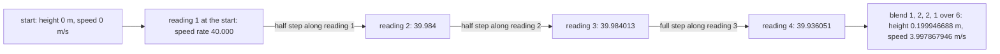
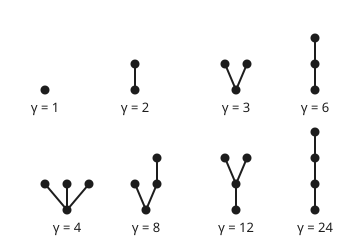

# Runge-Kutta: several slope samples per step, laid out in a tableau

[Syllabus](../../../SYLLABUS.md) → [Numerical analysis](../README.md) → [ODE Solvers](../README.md#s06) → Runge-Kutta

---

## General Overview

A model rocket sits on the pad. The motor fires. After gravity, its push gives 40 m/s² of upward acceleration, and air drag takes away 0.004 m/s² for each (m/s)² of speed. Its top speed under the motor would be 100 m/s, where push and drag balance. The figures are illustrative, with the rocket's mass treated as constant.

A flight program steps time forward 0.1 s at a time. After the first step it needs the rocket's height and speed. The true answers, from a closed form, are 0.199946689 m and 3.997868031 m/s.

Euler's method reads the rates once, at the start of the step ([Euler's method](../../08-Differential%20equations%20and%20dynamics/05-Numerical%20Evolution/01-eulers-method.md)). At the start the speed is 0, so Euler says the height is still 0.000000000 m. The rocket has not left the pad.

A **Runge-Kutta method** reads the rates several times inside the step, at trial points built from the earlier readings. It then moves along a weighted blend of those readings. The classical four-reading method, RK4, lands at 0.199946688 m: off by 1.42e-9 m.

Every such method is a short list of numbers: where each reading is taken, how earlier readings build each trial point, and how the readings are weighted. Written as a small table, that list is a **Butcher tableau**. This card reads tableaux, derives which tableaux work, and shows why higher accuracy needs disproportionately more readings.

**A Runge-Kutta method is fixed by its tableau; it has order p exactly when its numbers satisfy one equation for each rooted tree with up to p nodes; s stages can give order s up to order 4, but order five already needs six stages.**

**What kind of fact this is:** the tableau is a definition (a notation). The order conditions are a theorem, proved through order 3 in the folded Detailed proof, with the tree rule for every order stated from Butcher (1963). "Order at most the number of stages" is proved on this card. "Order five needs six stages" is a theorem stated with its source (Butcher, 1965) and an outline of its proof, not proved in full here.

### The picture: one RK4 step, reading by reading



Each arrow is one row of the tableau: it says which earlier readings build the next trial point, and how much of each.

---

## The formula

Reminder: the law is $y' = f(t, y)$, read "the rate of the state y at time t is f". Here the state is $y = (H, v)$, height and speed, and the law is $H' = v$, $v' = 40 - 0.004v^2$. A step of size $h$ takes the computed state $y_n$ at time $t_n$ to $y_{n+1}$.

A method with $s$ **stages** (slope readings per step) works like this, for $i = 1$ to $s$:

$$Y_i = y_n + h\sum_{j<i} a_{ij}\,k_j, \qquad k_i = f\!\left(t_n + c_i h,\ Y_i\right), \qquad y_{n+1} = y_n + h\sum_{i=1}^{s} b_i\,k_i.$$

**Read it aloud:** build trial point i from the start plus h times a blend of the earlier slopes, read the slope there, and after the last reading step along the b-weighted blend of all the slopes.

The **Butcher tableau** stores those numbers: $c_i$ down the left, the blends $a_{ij}$ in a lower triangle, the weights $b_i$ along the bottom. For RK4:

$$\begin{array}{c|cccc} 0 & & & & \\ \tfrac12 & \tfrac12 & & & \\ \tfrac12 & 0 & \tfrac12 & & \\ 1 & 0 & 0 & 1 & \\ \hline & \tfrac16 & \tfrac13 & \tfrac13 & \tfrac16 \end{array}$$

**Read it aloud:** row two says "trial point two is the start plus half a step along slope one"; row four says "trial point four is a full step along slope three"; the bottom row says "blend the four slopes one-sixth, a third, a third, one-sixth".

The method has **order** $p$ when one step from an exact start errs by a constant times $h^{p+1}$. That happens exactly when, for every rooted tree with at most $p$ nodes,

$$\sum_{i=1}^{s} b_i\,\Phi_i(\text{tree}) = \frac{1}{\gamma(\text{tree})}.$$

**Read it aloud:** for each tree, the weighted sum of the stages' tree values must equal one over the tree's density.

| Symbol | Plain meaning | In our example | Push it up and the answer… |
| --- | --- | --- | --- |
| $H$, $v$ | height (m) and speed (m/s) of the rocket | 0 and 0 on the pad | — |
| $y$, $y_n$, $t_n$ | the state $(H, v)$; the computed state after n steps, at time $t_n$ | $y_0 = (0, 0)$ at $t_0 = 0$ s | — |
| $f$ | the rate law: the slope of the state | $(v,\ 40 - 0.004v^2)$ | — |
| $h$ | step size, in seconds | 0.1 s | one step's error grows as $h^{p+1}$ |
| $s$ | number of stages: slope readings per step | 4 for RK4, 3 for Kutta's third-order method | cost grows; order can grow, but not past $s$ |
| $k_i$, $Y_i$ | slope read at stage i, and the trial point where it is read | RK4 speed slopes 40, 39.984, 39.984013, 39.936051 | — |
| $c_i$ | where in the step stage i reads, as a fraction of h | RK4: 0, ½, ½, 1 | — |
| $a_{ij}$, $A$ | how much of slope j builds trial point i; the lower-triangle table of them | RK4: $a_{21} = a_{32} = \tfrac12$, $a_{43} = 1$ | — |
| $b_i$ | weight of slope i in the final move | RK4: ⅙, ⅓, ⅓, ⅙ | — |
| $p$ | order: one step errs by about $h^{p+1}$, a whole run by about $h^p$ | 4 for RK4 | each halving of h cuts the run's error about $2^p$-fold |
| tree, $\gamma$ | a rooted tree (dots joined by lines, one dot marked as the root); its density: node count times the densities of the subtrees above the root | 8 trees up to 4 nodes; $\gamma$ from 1 to 24 | — |
| $\Phi_i$ | stage i's value on a tree: 1 for a single dot, otherwise the product over the root's subtrees of $\sum_j a_{ij}\Phi_j(\text{subtree})$ | for the two-dot tree, $\Phi_i = c_i$ | — |

### When it holds

- **The law is smooth.** Order p needs p continuous derivatives of f. A motor that cuts out mid-step puts a kink in the speed. That one step then errs in proportion to h, not $h^{p+1}$. The run's error is then of size h, with a constant that depends on where in the step the cut falls, so observed orders scatter ([From local error to global error](02-convergence-of-one-step-methods.md)).
- **Each $c_i$ equals its row sum, $\sum_j a_{ij}$.** Then the reading time matches the trial point. Break it and a law that depends on time goes wrong (What breaks, row 3).
- **The step is small.** Order describes the limit $h \to 0$. Over the burn, RK4's observed order is 4.03 at the coarse pair of steps and 4.01 at the finer pair, nearing 4 as h shrinks. Shrinking h further helps only until rounding takes over, as [From local error to global error](02-convergence-of-one-step-methods.md) shows.
- **The table is strictly lower-triangular.** Then each trial point uses only slopes already read: an **explicit** method. Entries on or above the diagonal make an implicit method, which must solve equations at every step ([Stiffness](05-stiffness-a-stability-and-the-dahlquist-barriers.md)).
- **The step is inside the stability region.** Order says nothing about large steps. A fast-decaying part can make any explicit tableau blow up, which is also on [Stiffness](05-stiffness-a-stability-and-the-dahlquist-barriers.md).

---

## Why it works

### Step 0: match the true step's Taylor series, term by term

The true move over one step is a power series in h: $y' h + y'' h^2/2 + \dots$ ([Taylor's theorem](../../06-Calculus%20and%20analysis/03-What%20Derivatives%20Tell%20You/05-taylors-theorem.md)). The method's move is another power series in h, whose coefficients are built from the tableau. Order p means the two series agree through $h^p$. Each extra power brings new kinds of terms, and each kind becomes one equation on the tableau.

### Step 1: read the methods already met as tableaux

Euler, midpoint and Heun are tableaux with one or two stages. Their two-stage family, $b_1 + b_2 = 1$ and $b_2 c_2 = \tfrac12$, is derived on [Midpoint and Heun](../../08-Differential%20equations%20and%20dynamics/05-Numerical%20Evolution/03-midpoint-and-heun-methods.md); here it is only written as tableaux.

$$\text{Euler: }\begin{array}{c|c} 0 & \\ \hline & 1 \end{array} \qquad \text{midpoint: }\begin{array}{c|cc} 0 & & \\ \tfrac12 & \tfrac12 & \\ \hline & 0 & 1 \end{array} \qquad \text{Heun: }\begin{array}{c|cc} 0 & & \\ 1 & 1 & \\ \hline & \tfrac12 & \tfrac12 \end{array}$$

RK4's stages, its step and its eight order equations are on [Runge-Kutta four](../../08-Differential%20equations%20and%20dynamics/05-Numerical%20Evolution/04-runge-kutta-four.md). This card explains where those eight equations come from and why there are eight.

### Step 2: each term of the true series is a tree

Take a law that does not depend on time, $y' = f(y)$. Differentiate it with the chain rule. Each derivative of f that appears takes other copies of f as its inputs:

- $y' = f$: one f. Draw one dot.
- $y'' = f'f$: f's derivative, fed by one f. Draw a dot with one dot above it.
- $y''' = f''(f, f) + f'f'f$: the second derivative fed by two f's, and a chain of three. Two trees with three dots.

Draw each f as a dot, and join each dot by a line to the dots that feed it. Every term becomes a **rooted tree**, the root being the outermost f. The terms in the n-th derivative are exactly the trees with n dots. The checks build every tree and count them: 1, 1, 2, 4, 9 and 20 trees with 1 to 6 dots.

### The picture: the eight trees behind fourth order

<p align="center"></p>

Schematic. Each tree is drawn with its root at the bottom and labelled with its density γ. Top row, trees 1 to 4: the conditions for order 3. Bottom row, trees 5 to 8: the four extra conditions for order 4.

### Step 3: the method's series has the same trees, with tableau weights

Expand each stage slope $k_i$ in powers of h in the same way. The same trees appear. In the true series a tree's coefficient is $1/\gamma(\text{tree})$; in the method's series it is $\sum_i b_i \Phi_i(\text{tree})$. Setting them equal tree by tree gives the order conditions. The eight trees with up to four dots give:

| Tree | Shape | Condition | Plain reading |
| --- | --- | --- | --- |
| 1 | one dot | $\sum b_i = 1$ | a constant slope moves the state by exactly h times it |
| 2 | chain of 2 | $\sum b_i c_i = \tfrac12$ | the weights integrate a straight line exactly |
| 3 | root with 2 above | $\sum b_i c_i^2 = \tfrac13$ | the weights integrate $t^2$ exactly |
| 4 | chain of 3 | $\sum b_i a_{ij} c_j = \tfrac16$ | trial points feed each other correctly |
| 5 | root with 3 above | $\sum b_i c_i^3 = \tfrac14$ | the weights integrate $t^3$ exactly |
| 6 | root with 1 and a chain of 2 above | $\sum b_i c_i a_{ij} c_j = \tfrac18$ | a mixed case |
| 7 | chain topped by 2 | $\sum b_i a_{ij} c_j^2 = \tfrac1{12}$ | a mixed case |
| 8 | chain of 4 | $\sum b_i a_{ij} a_{jk} c_k = \tfrac1{24}$ | three levels of feeding |

The bushy trees, a root with dots directly above it, say only that the weights $b_i$ at the times $c_i$ form a good integration rule. The tall trees are new: they test how trial points are built from earlier slopes. A law that depends on time alone never sees them, which is why the tall trees are easy to forget.

<details>
<summary>Detailed proof: the four conditions for order 3</summary>

Take a system $y' = f(y)$, and write f, f′, f″ for f and its derivatives at $y_n$: f′ is a matrix (how each rate responds to each component), and f″ takes two vectors. A law with time in it becomes this form by adding time as an extra component with rate 1; that extra component is what forces $c_i = \sum_j a_{ij}$.

**The true step.** By the chain rule, $y'' = f'f$ and $y''' = f''(f, f) + f'f'f$. Taylor's theorem gives

$$y(t_n + h) = y_n + hf + \tfrac{h^2}{2} f'f + \tfrac{h^3}{6}\left(f''(f, f) + f'f'f\right) + O(h^4).$$

**The stages, to first order.** Every $k_j = f + O(h)$, so $Y_i - y_n = h c_i f + O(h^2)$ with $c_i = \sum_j a_{ij}$. Then $k_j = f + h c_j f'f + O(h^2)$.

**The stages, to second order.** Put that back in: $Y_i - y_n = h c_i f + h^2 \left(\sum_j a_{ij} c_j\right) f'f + O(h^3)$. Expand $f(Y_i)$ to second order:

$$k_i = f + h c_i f'f + h^2\left(\textstyle\sum_j a_{ij}c_j\right) f'f'f + \tfrac{h^2}{2} c_i^2 f''(f, f) + O(h^3).$$

**The step.** Multiply by $h b_i$ and add:

$$y_{n+1} = y_n + h\left(\textstyle\sum b_i\right) f + h^2 \left(\textstyle\sum b_i c_i\right) f'f + h^3\left[\left(\textstyle\sum b_i a_{ij} c_j\right) f'f'f + \tfrac12\left(\textstyle\sum b_i c_i^2\right) f''(f, f)\right] + O(h^4).$$

**Match.** Each power of h is matched on its own. At $h$ and $h^2$ there is one term each. At $h^3$ the two terms are independent: $f(y) = y$ at $y = 1$ has $f'f'f = 1$ but $f''(f, f) = 0$, and $f(y) = 1 + y^2$ at $y = 0$ has $f''(f, f) = 2$ but $f'f'f = 0$. So the series agree through $h^3$ exactly when $\sum b_i = 1$, $\sum b_i c_i = \tfrac12$, $\sum b_i a_{ij} c_j = \tfrac16$ and $\sum b_i c_i^2 = \tfrac13$: trees 1 to 4. One step then errs by $O(h^4)$; how that becomes a run's $O(h^3)$ is on [From local error to global error](02-convergence-of-one-step-methods.md).

For systems, the same bookkeeping at every order gives one independent term per tree, with true coefficient $1/\gamma$ and method coefficient $\sum b_i \Phi_i$. That general theorem, with its proof by induction on the trees, is Butcher (1963); the proof is not repeated here.

</details>

### Step 4: derive a three-stage method of order 3

Three stages have six free numbers once each $c_i$ is its row sum: $c_2$, $c_3$, $a_{32}$, $b_1$, $b_2$, $b_3$. Order 3 imposes four conditions, trees 1 to 4:

$$b_1 + b_2 + b_3 = 1, \quad b_2c_2 + b_3c_3 = \tfrac12, \quad b_2c_2^2 + b_3c_3^2 = \tfrac13, \quad b_3\,a_{32}\,c_2 = \tfrac16.$$

Pick $c_2$ and $c_3$. The middle two equations are linear in $b_2$ and $b_3$:

$$b_2 = \frac{2 - 3c_3}{6c_2(c_2 - c_3)}, \qquad b_3 = \frac{2 - 3c_2}{6c_3(c_3 - c_2)}, \qquad a_{32} = \frac{1}{6\,b_3\,c_2}.$$

This needs $c_2 \ne 0$, $c_3 \ne 0$, $c_2 \ne c_3$, and $c_2 \ne \tfrac23$, where $b_3$ would be 0.

**Kutta's choice**, $c_2 = \tfrac12$ and $c_3 = 1$, by hand: $b_2/2 + b_3 = \tfrac12$ and $b_2/4 + b_3 = \tfrac13$. Subtract: $b_2/4 = \tfrac16$, so $b_2 = \tfrac23$, $b_3 = \tfrac16$ and $b_1 = \tfrac16$. Then $a_{32} = 1/(6 \cdot \tfrac16 \cdot \tfrac12) = 2$, and $a_{31} = c_3 - a_{32} = -1$:

$$\begin{array}{c|ccc} 0 & & & \\ \tfrac12 & \tfrac12 & & \\ 1 & -1 & 2 & \\ \hline & \tfrac16 & \tfrac23 & \tfrac16 \end{array}$$

The weights are Simpson's rule. **Heun's third-order choice**, $c_2 = \tfrac13$ and $c_3 = \tfrac23$, gives $b = (\tfrac14, 0, \tfrac34)$, $a_{31} = 0$ and $a_{32} = \tfrac23$. The checks solve both in floating point.

Then the checks test all 37 tree conditions up to six dots on every tableau and report the order: Euler 1, midpoint 2, Heun 2, Kutta's 3, Heun's third-order 3, RK4 4.

### Step 5: s stages never reach order s + 1

The tall tree with $s + 1$ dots, a single chain, has condition $b^{\mathsf T} A^{s-1} c = 1/(s+1)!$. Here A is the table of $a_{ij}$, c and b are the columns of $c_i$ and $b_i$, and $b^{\mathsf T}$ (b transposed) times a column means $\sum_i b_i \times$ its entry i. In an explicit method, trial point 1 uses no slopes and $c_1 = 0$, trial point 2 uses only slope 1, and so on. Each power of A pushes one more stage to zero, so the vector $A^{s-1}c$ has entries $a_{s,s-1} \cdots a_{21} c_1 = 0$ and zeros elsewhere. The left side is 0, the right side is not, so the order is at most s.

Three stages therefore cannot reach order 4: chain 8 needs $\sum b_i a_{ij} a_{jk} c_k = \tfrac1{24}$, and three stages give exactly 0.

### Step 6: why order five needs six stages

Through order 4, s stages give order s. Counting seems to explain where that stops:

| Stages s | Free numbers, s(s+1)/2 | Conditions for order s |
| --- | --- | --- |
| 4 | 10 | 8 |
| 5 | 15 | 17 |
| 6 | 21 | 37 |

With five stages, 15 free numbers face 17 conditions. But conditions can depend on each other, so the count only hints. One order later it misleads: Butcher's seven-stage method meets all 37 conditions for order 6 with 28 free numbers, as the checks confirm.

The real reason is structural. Butcher (1965) proved that no explicit five-stage method has order 5. In outline, the order-5 conditions, combined, leave five stages only two ways out. Either $c_2 = 0$: stage 2 repeats stage 1, so the method really has four stages, and Step 5 caps those at order 4. Or $c_4 = c_5 = 1$: the last two stages both read at the end of the step. Then the condition $\sum b_i (1 - c_i)\, a_{ij} a_{jk} c_k = \tfrac1{24} - \tfrac1{30} = \tfrac1{120}$, which follows from two tree conditions, has a left side of exactly 0: the factor $1 - c_i$ removes stages 4 and 5, and the chain $a_{ij} a_{jk} c_k$ is 0 at stages 1 to 3. RK4 shows the gap: it misses all 9 five-dot conditions, the largest by 1.25e-2.

---

## Worked numbers, by hand

One RK4 step of 0.1 s from the pad, using the tableau row by row. Each line gives the height slope and then the speed slope.

| Step | Arithmetic | Value |
| --- | --- | --- |
| reading 1 at the start | $v = 0$; 40 − 0.004 × 0² | 0, 40 |
| trial point 2: half step on reading 1 | $v$ = 0 + 0.05 × 40 = 2; 40 − 0.004 × 2² | 2, 39.984 |
| trial point 3: half step on reading 2 | $v$ = 0.05 × 39.984 = 1.9992; 40 − 0.004 × 1.9992² | 1.9992, 39.984012797 |
| trial point 4: full step on reading 3 | $v$ = 0.1 × 39.984012797 = 3.998401280; 40 − 0.004 × 3.998401280² | 3.998401280, 39.936051149 |
| blend 1, 2, 2, 1 over 6 | (0 + 2×2 + 2×1.9992 + 3.998401280)/6; (40 + 2×39.984 + 2×39.984012797 + 39.936051149)/6 | 1.999466880, 39.978679457 |
| the step | 0.1 × each blended slope | **0.199946688 m, 3.997867946 m/s** |
| exact | 250 ln cosh(0.04); 100 tanh(0.04) | 0.199946689 m, 3.997868031 m/s |

After one step the RK4 height is 1.42e-9 m below the truth and the speed 8.54e-8 m/s below: true errors, against the closed form. Each extra stage, placed by the tree conditions, cuts the one-step height error:

| Method | Stages | Order | Height after 0.1 s | Height error |
| --- | --- | --- | --- | --- |
| Euler | 1 | 1 | 0.000000000 m | 2.00e-1 |
| Midpoint | 2 | 2 | 0.200000000 m | −5.33e-5 |
| Heun | 2 | 2 | 0.200000000 m | −5.33e-5 |
| Kutta's third order | 3 | 3 | 0.199946667 m | 2.27e-8 |
| RK4 | 4 | 4 | 0.199946688 m | 1.42e-9 |

Over the whole 2-second burn, where the exact speed reaches 66.403677 m/s, halving the step shows each order:

| Method | Speed error, h = 0.2 s | h = 0.1 s | h = 0.05 s | Observed order |
| --- | --- | --- | --- | --- |
| Euler | −1.33e0 | −6.57e-1 | −3.27e-1 | 1.01 |
| Heun | 7.73e-2 | 1.87e-2 | 4.58e-3 | 2.03 |
| Kutta's third order | −1.72e-3 | −2.15e-4 | −2.69e-5 | 3.00 |
| RK4 | 4.66e-5 | 2.86e-6 | 1.77e-7 | 4.01 |

The observed orders come from the two finest steps and agree with the orders the trees predict. Cost counts slope readings, not steps: see The usual mistake.

### What breaks if you drop a piece

| Mistake | Comes out at | What went wrong |
| --- | --- | --- |
| Kutta's tableau with $a_{31} = 0$, $a_{32} = 1$ | order 2.00; burn speed error 4.07e-3 at h = 0.1 s, against 2.15e-4 | Simpson's weights kept, so trees 1 to 3 hold; tree 4 gives $\tfrac1{12}$, not $\tfrac16$ |
| Kutta's tableau with equal weights ⅓ | order 2 by the trees, 2.10 observed; one-step height error 5.34e-5 | $\sum b_i c_i = \tfrac12$ by luck, but $\sum b_i c_i^2 = \tfrac5{12}$, not $\tfrac13$ |
| Kutta's tableau with $c_3$ = ½, not its row sum 1 | $y' = 3t^2$ gives 0.973750000, not 1 | Reading time and trial point disagree; the rocket, whose law ignores time, cannot see it |
---

## Code, from first principles, and it actually runs

The script stores each method as a tableau and runs one general stepper on all of them. It takes three roads to each method's order. Road one is the closed form of the rocket's climb. Road two builds every rooted tree up to six dots, computes each tableau's tree values, and reads off the order from the first condition that fails. Road three halves the step and measures the order from the errors. Asserts also check the tree counts, the three-stage formulas against Kutta's fractions, and Butcher's seven-stage method against its published order 6.

### Python

```python
# Runge-Kutta and Butcher tableaux -- the check behind the card.  Python standard
# library only; math.tanh, math.cosh and math.log feed the closed form, nothing else.
# Rocket while the motor burns (illustrative): H' = v, v' = 40 - 0.004 v^2, from rest.
import math
def sci(x, d=2):                                  # e-notation spelled the way Rust spells it
    m, e = f"{x:.{d}e}".split("e"); return f"{m}e{int(e)}"
def rocket(t, s): return [s[1], 40 - 0.004 * s[1] * s[1]]
def exact(t): return [250 * math.log(math.cosh(0.4 * t)), 100 * math.tanh(0.4 * t)]
def step(tab, f, t, s, h):                        # one explicit step, read off a tableau (c, A, b)
    c, A, b = tab; ks = []
    for i in range(len(b)):
        Y = [s[m] + h * sum(A[i][j] * ks[j][m] for j in range(i)) for m in range(len(s))]
        ks.append(f(t + c[i] * h, Y))
    return [s[m] + h * sum(b[i] * ks[i][m] for i in range(len(b))) for m in range(len(s))], ks
def run(tab, f, s, h, n):
    for i in range(n): s = step(tab, f, i * h, s, h)[0]
    return s
def three_stage(c2, c3):                          # Step 4: solve the four order-3 conditions
    b2 = (2 - 3 * c3) / (6 * c2 * (c2 - c3)) + 0.0; b3 = (2 - 3 * c2) / (6 * c3 * (c3 - c2))
    a32 = 1 / (6 * b3 * c2)
    return ([0, c2, c3], [[], [c2], [c3 - a32, a32]], [1 - b2 - b3, b2, b3])
TAB = {"Euler": ([0], [[]], [1]), "midpoint": ([0, 0.5], [[], [0.5]], [0, 1]),
       "Heun": ([0, 1], [[], [1]], [0.5, 0.5]), "Kutta3": three_stage(0.5, 1),
       "Heun3": three_stage(1 / 3, 2 / 3),
       "RK4": ([0, 0.5, 0.5, 1], [[], [0.5], [0, 0.5], [0, 0, 1]], [1 / 6, 1 / 3, 1 / 3, 1 / 6]),
       "equal-b": ([0, 0.5, 1], [[], [0.5], [-1, 2]], [1 / 3, 1 / 3, 1 / 3]),
       "a32=1": ([0, 0.5, 1], [[], [0.5], [0, 1]], [1 / 6, 2 / 3, 1 / 6])}
h = 0.1
s1, ks = step(TAB["RK4"], rocket, 0, [0, 0], h)
print(f"rocket: H' = v, v' = 40 - 0.004 v^2, terminal speed {math.sqrt(40 / 0.004):.0f} m/s; one step h = 0.1 s from rest")
for i, k in enumerate(ks):
    print(f"RK4 stage {i + 1}: c = {TAB['RK4'][0][i]:.1f}, height slope {k[0]:.9f}, speed slope {k[1]:.9f}")
wsl = [sum(w * k[m] for w, k in zip([1, 2, 2, 1], ks)) / 6 for m in (0, 1)]
print(f"RK4 weighted slopes (1, 2, 2, 1)/6: height {wsl[0]:.9f}, speed {wsl[1]:.9f}")
ex = exact(h)
print(f"exact after 0.1 s: height {ex[0]:.9f} m, speed {ex[1]:.9f} m/s")
one = {}
for name in ("Euler", "midpoint", "Heun", "Kutta3", "Heun3", "RK4", "equal-b", "a32=1"):
    s = step(TAB[name], rocket, 0, [0, 0], h)[0]; one[name] = [ex[0] - s[0], ex[1] - s[1]]
    print(f"{name:<9}height {s[0]:.9f} error {sci(one[name][0])}, speed {s[1]:.9f} error {sci(one[name][1])}")
assert abs(s1[0] - ex[0]) < 1e-8 and abs(s1[1] - ex[1]) < 1e-6 and abs(one["Euler"][0]) > 0.19
K3 = TAB["Kutta3"]; H3 = TAB["Heun3"]
for tb in (K3, H3):                               # c2 and c3 read off the tableau itself
    print(f"three-stage, c2 = {tb[0][1]:.4f}, c3 = {tb[0][2]:.4f}: b =", " ".join(f"{x:.6f}" for x in tb[2]),
          f"a31 = {tb[1][2][0]:.6f} a32 = {tb[1][2][1]:.6f}")
assert max(abs(p - q) for p, q in zip(K3[2] + K3[1][2], [1 / 6, 2 / 3, 1 / 6, -1, 2])) < 1e-15
# rooted trees: a tree is a multiset of child trees; trees[i] = (nodes, children indices)
trees = [(1, [])]
def forests(m, start, pool):                      # multisets of trees from pool, total m nodes
    if m == 0: yield []; return
    for i in range(start, len(pool)):
        if pool[i][0] <= m:
            for rest in forests(m - pool[i][0], i, pool): yield [i] + rest
for n in range(2, 7):
    pool = list(trees); trees += [(n, f) for f in forests(n - 1, 0, pool)]
def name(i): return "[" + "".join(name(j) for j in trees[i][1]) + "]"
def gamma(i): return trees[i][0] * math.prod(gamma(j) for j in trees[i][1])
counts = [sum(1 for t in trees if t[0] == n) for n in range(1, 7)]
print("rooted trees with 1..6 nodes:", " ".join(map(str, counts)), "; conditions for order 1..6:",
      " ".join(str(sum(counts[:p])) for p in range(1, 7)))
assert counts == [1, 1, 2, 4, 9, 20]
for i in range(8): print(f"tree {i + 1}: {name(i):<10} nodes {trees[i][0]}, gamma {gamma(i)}")
def misses(tab):                                  # b . Phi(tree) - 1/gamma(tree), every tree
    c, A, b = tab; s = len(b); Phi = []
    for t in trees:
        Phi.append([math.prod(sum(A[i][j] * Phi[k][j] for j in range(i)) for k in t[1]) for i in range(s)])
    return [sum(b[i] * P[i] for i in range(s)) - 1 / gamma(k) for k, P in enumerate(Phi)]
def order(tab):
    bad = [trees[k][0] for k, m in enumerate(misses(tab)) if abs(m) > 1e-12]
    return min(bad) - 1 if bad else 6
orders = {nm: order(TAB[nm]) for nm in TAB}
print("order from the trees:", ", ".join(f"{nm} {p}" for nm, p in orders.items()))
assert [orders[nm] for nm in TAB] == [1, 2, 2, 3, 3, 4, 2, 2]
m5 = misses(TAB["RK4"])[8:17]
print(f"RK4 on the 9 five-node trees: {sum(abs(m) > 1e-12 for m in m5)} missed, largest miss {sci(max(m5, key=abs))}")
print("stages s = 1..6, free numbers s(s+1)/2:", " ".join(str(s * (s + 1) // 2) for s in range(1, 7)))
g = {name(i): gamma(i) for i in range(len(trees))}; ga, gb = g["[[[[]]]]"], g["[[][[[]]]]"]
print(f"five-stage barrier: sum b_i (1 - c_i) a_ij a_jk c_k must be 1/{ga} - 1/{gb} = 1/{ga * gb // (gb - ga)}")
assert ga * gb == 120 * (gb - ga)
B7 = ([0, 1 / 3, 2 / 3, 1 / 3, 1 / 2, 1 / 2, 1], [[], [1 / 3], [0, 2 / 3], [1 / 12, 1 / 3, -1 / 12],   # Butcher's
      [-1 / 16, 9 / 8, -3 / 16, -3 / 8], [0, 9 / 8, -3 / 8, -3 / 4, 1 / 2],                       # 7 stages
      [9 / 44, -9 / 11, 63 / 44, 18 / 11, 0, -16 / 11]], [11 / 120, 0, 27 / 40, 27 / 40, -4 / 15, -4 / 15, 11 / 120])
print(f"Butcher's seven stages: order {order(B7)} from the trees, {sum(counts)} conditions met with {7 * 8 // 2} free numbers")
assert order(B7) == 6
print("exact at t = 2 s: height {:.6f} m, speed {:.6f} m/s".format(*exact(2)))
print("burn to t = 2 s, speed error (true error) at h = 0.2, 0.1, 0.05 s; slope readings at h = 0.05; observed order")
ex2 = exact(2)[1]
for nm in ("Euler", "Heun", "Kutta3", "RK4", "equal-b", "a32=1"):
    e = [ex2 - run(TAB[nm], rocket, [0, 0], hh, round(2 / hh))[1] for hh in (0.2, 0.1, 0.05)]
    obs = [math.log2(abs(e[i] / e[i + 1])) for i in range(2)]
    print(f"{nm:<8}{sci(e[0])} {sci(e[1])} {sci(e[2])}  readings {40 * len(TAB[nm][2])}  order {obs[0]:.2f} {obs[1]:.2f}")
    assert abs(obs[1] - orders[nm]) < 0.15        # the run agrees with the tree count
clock = lambda t, s: [3 * t * t]                  # y' = 3t^2, y(1) = 1: depends on t only
wrongc = ([0, 0.5, 0.5], K3[1], K3[2])           # Kutta3 with c3 copied wrong
for nm, tab in (("Kutta3", K3), ("Kutta3, c3 = 1/2", wrongc)):
    print(f"y' = 3t^2 to t = 1, h = 0.1, {nm}: y(1) = {run(tab, clock, [0], 0.1, 10)[0]:.9f}")
assert abs(run(K3, clock, [0], 0.1, 10)[0] - 1) < 1e-14 and abs(run(wrongc, clock, [0], 0.1, 10)[0] - 1) > 0.01
print(f"same Kutta3 rows on the rocket, h = 0.1: heights agree to {sci(abs(run(K3, rocket, [0, 0], 0.1, 20)[0] - run(wrongc, rocket, [0, 0], 0.1, 20)[0]))}")
def draw(i, x, y, out):                           # figure: leaves 22 apart, levels 26 up
    if not trees[i][1]: out.append((x, y)); return x + 22, x
    k = len(out); out.append(None); xs = []
    for j in trees[i][1]: x, cx = draw(j, x, y - 26, out); xs.append(cx)
    out[k] = ((xs[0] + xs[-1]) / 2, y); return x, out[k][0]
for i in range(8):
    pts = []; draw(i, 45 + 90 * (i % 4), 90 + 120 * (i // 4), pts)
    print(f"figure, tree {i + 1}:", " ".join(f"{px:.0f},{py:.0f}" for px, py in pts))
print("ALL CHECKS PASS")
```

**Ran 2026-11-11 on macOS, Python 3.14.10, standard library only. All checks passed. Output, pasted from the run:**

```
rocket: H' = v, v' = 40 - 0.004 v^2, terminal speed 100 m/s; one step h = 0.1 s from rest
RK4 stage 1: c = 0.0, height slope 0.000000000, speed slope 40.000000000
RK4 stage 2: c = 0.5, height slope 2.000000000, speed slope 39.984000000
RK4 stage 3: c = 0.5, height slope 1.999200000, speed slope 39.984012797
RK4 stage 4: c = 1.0, height slope 3.998401280, speed slope 39.936051149
RK4 weighted slopes (1, 2, 2, 1)/6: height 1.999466880, speed 39.978679457
exact after 0.1 s: height 0.199946689 m, speed 3.997868031 m/s
Euler    height 0.000000000 error 2.00e-1, speed 4.000000000 error -2.13e-3
midpoint height 0.200000000 error -5.33e-5, speed 3.998400000 error -5.32e-4
Heun     height 0.200000000 error -5.33e-5, speed 3.996800000 error 1.07e-3
Kutta3   height 0.199946667 error 2.27e-8, speed 3.997868373 error -3.42e-7
Heun3    height 0.199964444 error -1.78e-5, speed 3.997867425 error 6.06e-7
RK4      height 0.199946688 error 1.42e-9, speed 3.997867946 error 8.54e-8
equal-b  height 0.199893333 error 5.34e-5, speed 3.997336745 error 5.31e-4
a32=1    height 0.199973333 error -2.66e-5, speed 3.997867520 error 5.11e-7
three-stage, c2 = 0.5000, c3 = 1.0000: b = 0.166667 0.666667 0.166667 a31 = -1.000000 a32 = 2.000000
three-stage, c2 = 0.3333, c3 = 0.6667: b = 0.250000 0.000000 0.750000 a31 = 0.000000 a32 = 0.666667
rooted trees with 1..6 nodes: 1 1 2 4 9 20 ; conditions for order 1..6: 1 2 4 8 17 37
tree 1: []         nodes 1, gamma 1
tree 2: [[]]       nodes 2, gamma 2
tree 3: [[][]]     nodes 3, gamma 3
tree 4: [[[]]]     nodes 3, gamma 6
tree 5: [[][][]]   nodes 4, gamma 4
tree 6: [[][[]]]   nodes 4, gamma 8
tree 7: [[[][]]]   nodes 4, gamma 12
tree 8: [[[[]]]]   nodes 4, gamma 24
order from the trees: Euler 1, midpoint 2, Heun 2, Kutta3 3, Heun3 3, RK4 4, equal-b 2, a32=1 2
RK4 on the 9 five-node trees: 9 missed, largest miss 1.25e-2
stages s = 1..6, free numbers s(s+1)/2: 1 3 6 10 15 21
five-stage barrier: sum b_i (1 - c_i) a_ij a_jk c_k must be 1/24 - 1/30 = 1/120
Butcher's seven stages: order 6 from the trees, 37 conditions met with 28 free numbers
exact at t = 2 s: height 72.688390 m, speed 66.403677 m/s
burn to t = 2 s, speed error (true error) at h = 0.2, 0.1, 0.05 s; slope readings at h = 0.05; observed order
Euler   -1.33e0 -6.57e-1 -3.27e-1  readings 40  order 1.01 1.01
Heun    7.73e-2 1.87e-2 4.58e-3  readings 80  order 2.05 2.03
Kutta3  -1.72e-3 -2.15e-4 -2.69e-5  readings 120  order 3.00 3.00
RK4     4.66e-5 2.86e-6 1.77e-7  readings 160  order 4.03 4.01
equal-b -1.64e-2 -3.64e-3 -8.50e-4  readings 120  order 2.17 2.10
a32=1   1.63e-2 4.07e-3 1.02e-3  readings 120  order 2.00 2.00
y' = 3t^2 to t = 1, h = 0.1, Kutta3: y(1) = 1.000000000
y' = 3t^2 to t = 1, h = 0.1, Kutta3, c3 = 1/2: y(1) = 0.973750000
same Kutta3 rows on the rocket, h = 0.1: heights agree to 0.00e0
figure, tree 1: 45,90
figure, tree 2: 135,90 135,64
figure, tree 3: 236,90 225,64 247,64
figure, tree 4: 315,90 315,64 315,38
figure, tree 5: 67,210 45,184 67,184 89,184
figure, tree 6: 146,210 135,184 157,184 157,158
figure, tree 7: 236,210 236,184 225,158 247,158
figure, tree 8: 315,210 315,184 315,158 315,132
ALL CHECKS PASS
```

### Rust

Same numbers, same labels, built with `rustc --edition 2021 -O`.

```rust
// Runge-Kutta and Butcher tableaux -- the same check as the Python, in Rust.  No crates;
// tanh, cosh and ln feed the closed form, nothing else.
// Rocket while the motor burns (illustrative): H' = v, v' = 40 - 0.004 v^2, from rest.
type Tab = (Vec<f64>, Vec<Vec<f64>>, Vec<f64>);   // (c, A, b): one explicit Runge-Kutta method
type F = dyn Fn(f64, &[f64]) -> Vec<f64>;
fn sci(x: f64) -> String { format!("{:.2e}", x) }
fn rocket(_t: f64, s: &[f64]) -> Vec<f64> { vec![s[1], 40.0 - 0.004 * s[1] * s[1]] }
fn exact(t: f64) -> [f64; 2] { [250.0 * (0.4 * t).cosh().ln(), 100.0 * (0.4 * t).tanh()] }
fn step(tab: &Tab, f: &F, t: f64, s: &[f64], h: f64) -> (Vec<f64>, Vec<Vec<f64>>) {
    let (c, a, b) = tab; let mut ks: Vec<Vec<f64>> = vec![];
    for i in 0..b.len() {                       // one explicit step, read off a tableau (c, A, b)
        let y: Vec<f64> = (0..s.len()).map(|m| s[m] + h * (0..i).fold(0.0, |p, j| p + a[i][j] * ks[j][m])).collect();
        ks.push(f(t + c[i] * h, &y));
    }
    ((0..s.len()).map(|m| s[m] + h * (0..b.len()).fold(0.0, |p, i| p + b[i] * ks[i][m])).collect(), ks)
}
fn run(tab: &Tab, f: &F, s0: &[f64], h: f64, n: usize) -> Vec<f64> {
    let mut s = s0.to_vec();
    for i in 0..n { s = step(tab, f, i as f64 * h, &s, h).0; }
    s
}
fn three_stage(c2: f64, c3: f64) -> Tab {        // Step 4: solve the four order-3 conditions
    let b2 = (2.0 - 3.0 * c3) / (6.0 * c2 * (c2 - c3)) + 0.0; let b3 = (2.0 - 3.0 * c2) / (6.0 * c3 * (c3 - c2));
    let a32 = 1.0 / (6.0 * b3 * c2);
    (vec![0.0, c2, c3], vec![vec![], vec![c2], vec![c3 - a32, a32]], vec![1.0 - b2 - b3, b2, b3])
}
fn t(c: &[f64], a: &[&[f64]], b: &[f64]) -> Tab { (c.to_vec(), a.iter().map(|r| r.to_vec()).collect(), b.to_vec()) }
fn forests(m: usize, start: usize, pool: &[(usize, Vec<usize>)]) -> Vec<Vec<usize>> {
    if m == 0 { return vec![vec![]]; }               // multisets of trees from pool, total m nodes
    let mut out = vec![];
    for i in start..pool.len() {
        if pool[i].0 <= m { for mut rest in forests(m - pool[i].0, i, pool) { rest.insert(0, i); out.push(rest); } }
    }
    out
}
fn main() {
    let tabs: Vec<(&str, Tab)> = vec![
        ("Euler", t(&[0.0], &[&[]], &[1.0])), ("midpoint", t(&[0.0, 0.5], &[&[], &[0.5]], &[0.0, 1.0])),
        ("Heun", t(&[0.0, 1.0], &[&[], &[1.0]], &[0.5, 0.5])), ("Kutta3", three_stage(0.5, 1.0)),
        ("Heun3", three_stage(1.0 / 3.0, 2.0 / 3.0)),
        ("RK4", t(&[0.0, 0.5, 0.5, 1.0], &[&[], &[0.5], &[0.0, 0.5], &[0.0, 0.0, 1.0]], &[1.0 / 6.0, 1.0 / 3.0, 1.0 / 3.0, 1.0 / 6.0])),
        ("equal-b", t(&[0.0, 0.5, 1.0], &[&[], &[0.5], &[-1.0, 2.0]], &[1.0 / 3.0, 1.0 / 3.0, 1.0 / 3.0])),
        ("a32=1", t(&[0.0, 0.5, 1.0], &[&[], &[0.5], &[0.0, 1.0]], &[1.0 / 6.0, 2.0 / 3.0, 1.0 / 6.0]))];
    let get = |nm: &str| tabs.iter().find(|p| p.0 == nm).unwrap().1.clone();
    let h = 0.1; let rk4 = get("RK4");
    let (s1, ks) = step(&rk4, &rocket, 0.0, &[0.0, 0.0], h);
    println!("rocket: H' = v, v' = 40 - 0.004 v^2, terminal speed {:.0} m/s; one step h = 0.1 s from rest", (40.0f64 / 0.004).sqrt());
    for (i, k) in ks.iter().enumerate() {
        println!("RK4 stage {}: c = {:.1}, height slope {:.9}, speed slope {:.9}", i + 1, rk4.0[i], k[0], k[1]);
    }
    let wsl: Vec<f64> = (0..2).map(|m| ks.iter().zip([1.0, 2.0, 2.0, 1.0]).fold(0.0, |p, (k, w)| p + w * k[m]) / 6.0).collect();
    println!("RK4 weighted slopes (1, 2, 2, 1)/6: height {:.9}, speed {:.9}", wsl[0], wsl[1]);
    let ex = exact(h);
    println!("exact after 0.1 s: height {:.9} m, speed {:.9} m/s", ex[0], ex[1]);
    let mut euler_h = 0.0;
    for (nm, tab) in &tabs {
        let s = step(tab, &rocket, 0.0, &[0.0, 0.0], h).0; let e = [ex[0] - s[0], ex[1] - s[1]];
        if *nm == "Euler" { euler_h = e[0]; }
        println!("{:<9}height {:.9} error {}, speed {:.9} error {}", nm, s[0], sci(e[0]), s[1], sci(e[1]));
    }
    assert!((s1[0] - ex[0]).abs() < 1e-8 && (s1[1] - ex[1]).abs() < 1e-6 && euler_h.abs() > 0.19);
    let (k3, h3) = (get("Kutta3"), get("Heun3"));
    for tb in [&k3, &h3] {                          // c2 and c3 read off the tableau itself
        println!("three-stage, c2 = {:.4}, c3 = {:.4}: b = {:.6} {:.6} {:.6} a31 = {:.6} a32 = {:.6}",
            tb.0[1], tb.0[2], tb.2[0], tb.2[1], tb.2[2], tb.1[2][0], tb.1[2][1]);
    }
    let got = [k3.2[0], k3.2[1], k3.2[2], k3.1[2][0], k3.1[2][1]];
    assert!(got.iter().zip([1.0 / 6.0, 2.0 / 3.0, 1.0 / 6.0, -1.0, 2.0]).all(|(p, q)| (p - q).abs() < 1e-15));
    // rooted trees: a tree is a multiset of child trees; trees[i] = (nodes, children indices)
    let mut trees: Vec<(usize, Vec<usize>)> = vec![(1, vec![])];
    for n in 2..7 { let pool = trees.clone(); for f in forests(n - 1, 0, &pool) { trees.push((n, f)); } }
    fn name(tr: &[(usize, Vec<usize>)], i: usize) -> String { format!("[{}]", tr[i].1.iter().map(|&j| name(tr, j)).collect::<String>()) }
    fn gamma(tr: &[(usize, Vec<usize>)], i: usize) -> usize { tr[i].0 * tr[i].1.iter().map(|&j| gamma(tr, j)).product::<usize>() }
    let counts: Vec<usize> = (1..7).map(|n| trees.iter().filter(|t| t.0 == n).count()).collect();
    let cum: Vec<String> = (1..7).map(|p| counts[..p].iter().sum::<usize>().to_string()).collect();
    println!("rooted trees with 1..6 nodes: {} ; conditions for order 1..6: {}",
        counts.iter().map(|c| c.to_string()).collect::<Vec<_>>().join(" "), cum.join(" "));
    assert!(counts == vec![1, 1, 2, 4, 9, 20]);
    for i in 0..8 { println!("tree {}: {:<10} nodes {}, gamma {}", i + 1, name(&trees, i), trees[i].0, gamma(&trees, i)); }
    let misses = |tab: &Tab| -> Vec<f64> {          // b . Phi(tree) - 1/gamma(tree), every tree
        let (_, a, b) = tab; let s = b.len(); let mut phi: Vec<Vec<f64>> = vec![];
        for tr in &trees {
            let row: Vec<f64> = (0..s).map(|i| tr.1.iter().fold(1.0, |p, &k| p * (0..i).fold(0.0, |q, j| q + a[i][j] * phi[k][j]))).collect();
            phi.push(row);
        }
        phi.iter().enumerate().map(|(k, p)| (0..s).fold(0.0, |q, i| q + b[i] * p[i]) - 1.0 / gamma(&trees, k) as f64).collect()
    };
    let order = |tab: &Tab| -> usize {
        misses(tab).iter().enumerate().filter(|(_, m)| m.abs() > 1e-12).map(|(k, _)| trees[k].0 - 1).min().unwrap_or(6)
    };
    let orders: Vec<usize> = tabs.iter().map(|(_, tb)| order(tb)).collect();
    println!("order from the trees: {}", tabs.iter().zip(&orders).map(|((nm, _), p)| format!("{} {}", nm, p)).collect::<Vec<_>>().join(", "));
    assert!(orders == vec![1, 2, 2, 3, 3, 4, 2, 2]);
    let m5 = misses(&rk4)[8..17].to_vec();
    let big = m5.iter().fold(0.0f64, |p, &m| if m.abs() > p.abs() { m } else { p });
    println!("RK4 on the 9 five-node trees: {} missed, largest miss {}", m5.iter().filter(|m| m.abs() > 1e-12).count(), sci(big));
    println!("stages s = 1..6, free numbers s(s+1)/2: {}", (1..7).map(|s| (s * (s + 1) / 2).to_string()).collect::<Vec<_>>().join(" "));
    let gm = |s: &str| gamma(&trees, (0..trees.len()).find(|&i| name(&trees, i) == s).unwrap());
    let (ga, gb) = (gm("[[[[]]]]"), gm("[[][[[]]]]"));
    println!("five-stage barrier: sum b_i (1 - c_i) a_ij a_jk c_k must be 1/{} - 1/{} = 1/{}", ga, gb, ga * gb / (gb - ga));
    assert!(ga * gb == 120 * (gb - ga));
    let b7 = t(&[0.0, 1.0 / 3.0, 2.0 / 3.0, 1.0 / 3.0, 0.5, 0.5, 1.0], &[&[], &[1.0 / 3.0], &[0.0, 2.0 / 3.0],   // Butcher's
        &[1.0 / 12.0, 1.0 / 3.0, -1.0 / 12.0], &[-1.0 / 16.0, 9.0 / 8.0, -3.0 / 16.0, -3.0 / 8.0],                // 7 stages
        &[0.0, 9.0 / 8.0, -3.0 / 8.0, -3.0 / 4.0, 0.5], &[9.0 / 44.0, -9.0 / 11.0, 63.0 / 44.0, 18.0 / 11.0, 0.0, -16.0 / 11.0]],
        &[11.0 / 120.0, 0.0, 27.0 / 40.0, 27.0 / 40.0, -4.0 / 15.0, -4.0 / 15.0, 11.0 / 120.0]);
    println!("Butcher's seven stages: order {} from the trees, {} conditions met with {} free numbers", order(&b7), counts.iter().sum::<usize>(), 7 * 8 / 2);
    assert!(order(&b7) == 6);
    println!("exact at t = 2 s: height {:.6} m, speed {:.6} m/s", exact(2.0)[0], exact(2.0)[1]);
    println!("burn to t = 2 s, speed error (true error) at h = 0.2, 0.1, 0.05 s; slope readings at h = 0.05; observed order");
    let ex2 = exact(2.0)[1];
    for nm in ["Euler", "Heun", "Kutta3", "RK4", "equal-b", "a32=1"] {
        let tb = get(nm); let p = orders[tabs.iter().position(|q| q.0 == nm).unwrap()];
        let e: Vec<f64> = [0.2, 0.1, 0.05].iter().map(|&hh: &f64| ex2 - run(&tb, &rocket, &[0.0, 0.0], hh, (2.0 / hh).round() as usize)[1]).collect();
        let obs: Vec<f64> = (0..2).map(|i| (e[i] / e[i + 1]).abs().log2()).collect();
        println!("{:<8}{} {} {}  readings {}  order {:.2} {:.2}", nm, sci(e[0]), sci(e[1]), sci(e[2]), 40 * tb.2.len(), obs[0], obs[1]);
        assert!((obs[1] - p as f64).abs() < 0.15);    // the run agrees with the tree count
    }
    let clock = |t: f64, _s: &[f64]| vec![3.0 * t * t];   // y' = 3t^2, y(1) = 1: depends on t only
    let wrongc: Tab = (vec![0.0, 0.5, 0.5], k3.1.clone(), k3.2.clone());   // Kutta3 with c3 copied wrong
    for (nm, tb) in [("Kutta3", &k3), ("Kutta3, c3 = 1/2", &wrongc)] {
        println!("y' = 3t^2 to t = 1, h = 0.1, {}: y(1) = {:.9}", nm, run(tb, &clock, &[0.0], 0.1, 10)[0]);
    }
    assert!((run(&k3, &clock, &[0.0], 0.1, 10)[0] - 1.0).abs() < 1e-14 && (run(&wrongc, &clock, &[0.0], 0.1, 10)[0] - 1.0).abs() > 0.01);
    let gap = (run(&k3, &rocket, &[0.0, 0.0], 0.1, 20)[0] - run(&wrongc, &rocket, &[0.0, 0.0], 0.1, 20)[0]).abs();
    println!("same Kutta3 rows on the rocket, h = 0.1: heights agree to {}", sci(gap));
    fn draw(tr: &[(usize, Vec<usize>)], i: usize, mut x: f64, y: f64, out: &mut Vec<(f64, f64)>) -> (f64, f64) {
        if tr[i].1.is_empty() { out.push((x, y)); return (x + 22.0, x); }   // figure: leaves 22 apart, levels 26 up
        let k = out.len(); out.push((0.0, 0.0)); let mut xs = vec![];
        for &j in &tr[i].1 { let (nx, cx) = draw(tr, j, x, y - 26.0, out); x = nx; xs.push(cx); }
        out[k] = ((xs[0] + xs[xs.len() - 1]) / 2.0, y); (x, out[k].0)
    }
    for i in 0..8 {
        let mut pts = vec![]; draw(&trees, i, 45.0 + 90.0 * (i % 4) as f64, 90.0 + 120.0 * (i / 4) as f64, &mut pts);
        println!("figure, tree {}: {}", i + 1, pts.iter().map(|(px, py)| format!("{:.0},{:.0}", px, py)).collect::<Vec<_>>().join(" "));
    }
    println!("ALL CHECKS PASS");
}
```

**Ran 2026-11-11 on macOS, rustc 1.98.1, no crates. All checks passed. Output, pasted from the run:**

```
rocket: H' = v, v' = 40 - 0.004 v^2, terminal speed 100 m/s; one step h = 0.1 s from rest
RK4 stage 1: c = 0.0, height slope 0.000000000, speed slope 40.000000000
RK4 stage 2: c = 0.5, height slope 2.000000000, speed slope 39.984000000
RK4 stage 3: c = 0.5, height slope 1.999200000, speed slope 39.984012797
RK4 stage 4: c = 1.0, height slope 3.998401280, speed slope 39.936051149
RK4 weighted slopes (1, 2, 2, 1)/6: height 1.999466880, speed 39.978679457
exact after 0.1 s: height 0.199946689 m, speed 3.997868031 m/s
Euler    height 0.000000000 error 2.00e-1, speed 4.000000000 error -2.13e-3
midpoint height 0.200000000 error -5.33e-5, speed 3.998400000 error -5.32e-4
Heun     height 0.200000000 error -5.33e-5, speed 3.996800000 error 1.07e-3
Kutta3   height 0.199946667 error 2.27e-8, speed 3.997868373 error -3.42e-7
Heun3    height 0.199964444 error -1.78e-5, speed 3.997867425 error 6.06e-7
RK4      height 0.199946688 error 1.42e-9, speed 3.997867946 error 8.54e-8
equal-b  height 0.199893333 error 5.34e-5, speed 3.997336745 error 5.31e-4
a32=1    height 0.199973333 error -2.66e-5, speed 3.997867520 error 5.11e-7
three-stage, c2 = 0.5000, c3 = 1.0000: b = 0.166667 0.666667 0.166667 a31 = -1.000000 a32 = 2.000000
three-stage, c2 = 0.3333, c3 = 0.6667: b = 0.250000 0.000000 0.750000 a31 = 0.000000 a32 = 0.666667
rooted trees with 1..6 nodes: 1 1 2 4 9 20 ; conditions for order 1..6: 1 2 4 8 17 37
tree 1: []         nodes 1, gamma 1
tree 2: [[]]       nodes 2, gamma 2
tree 3: [[][]]     nodes 3, gamma 3
tree 4: [[[]]]     nodes 3, gamma 6
tree 5: [[][][]]   nodes 4, gamma 4
tree 6: [[][[]]]   nodes 4, gamma 8
tree 7: [[[][]]]   nodes 4, gamma 12
tree 8: [[[[]]]]   nodes 4, gamma 24
order from the trees: Euler 1, midpoint 2, Heun 2, Kutta3 3, Heun3 3, RK4 4, equal-b 2, a32=1 2
RK4 on the 9 five-node trees: 9 missed, largest miss 1.25e-2
stages s = 1..6, free numbers s(s+1)/2: 1 3 6 10 15 21
five-stage barrier: sum b_i (1 - c_i) a_ij a_jk c_k must be 1/24 - 1/30 = 1/120
Butcher's seven stages: order 6 from the trees, 37 conditions met with 28 free numbers
exact at t = 2 s: height 72.688390 m, speed 66.403677 m/s
burn to t = 2 s, speed error (true error) at h = 0.2, 0.1, 0.05 s; slope readings at h = 0.05; observed order
Euler   -1.33e0 -6.57e-1 -3.27e-1  readings 40  order 1.01 1.01
Heun    7.73e-2 1.87e-2 4.58e-3  readings 80  order 2.05 2.03
Kutta3  -1.72e-3 -2.15e-4 -2.69e-5  readings 120  order 3.00 3.00
RK4     4.66e-5 2.86e-6 1.77e-7  readings 160  order 4.03 4.01
equal-b -1.64e-2 -3.64e-3 -8.50e-4  readings 120  order 2.17 2.10
a32=1   1.63e-2 4.07e-3 1.02e-3  readings 120  order 2.00 2.00
y' = 3t^2 to t = 1, h = 0.1, Kutta3: y(1) = 1.000000000
y' = 3t^2 to t = 1, h = 0.1, Kutta3, c3 = 1/2: y(1) = 0.973750000
same Kutta3 rows on the rocket, h = 0.1: heights agree to 0.00e0
figure, tree 1: 45,90
figure, tree 2: 135,90 135,64
figure, tree 3: 236,90 225,64 247,64
figure, tree 4: 315,90 315,64 315,38
figure, tree 5: 67,210 45,184 67,184 89,184
figure, tree 6: 146,210 135,184 157,184 157,158
figure, tree 7: 236,210 236,184 225,158 247,158
figure, tree 8: 315,210 315,184 315,158 315,132
ALL CHECKS PASS
```

The two outputs match line for line. The `figure,` lines are the dot positions in the trees picture.

### Lean

Lean proves Step 5 for every explicit tableau, Step 4's three-stage family for every allowed $c_2$ and $c_3$, and the card's tableaux exactly.

- Take any explicit tableau with s stages, each $c_i$ its row sum. Its chain tree with $s + 1$ dots fails: $b^{\mathsf T} A^{s-1} c$ never equals $1/(s+1)!$.
- In an explicit table A, entry $(i, j)$ of $A^k$ is 0 unless stage i comes at least k stages after stage j.
- Pick $c_2 \ne 0$ and $c_3 \ne 0$ with $c_2 \ne c_3$ and $c_2 \ne \tfrac23$. Step 4's $b_2$, $b_3$ and $a_{32}$, with $b_1 = 1 - b_2 - b_3$, then meet all four order-3 conditions.
- Kutta's choice gives $b_2 = \tfrac23$, $b_3 = \tfrac16$, $a_{32} = 2$ and $a_{31} = -1$.
- Heun's third-order choice gives $b_2 = 0$, $b_3 = \tfrac34$ and $a_{32} = \tfrac23$.
- RK4's tableau meets all eight tree conditions in Step 3's table.
- Kutta's tableau meets trees 1 to 4, and its chain of 4 dots gives exactly 0, not $\tfrac1{24}$.
- Kutta's tableau with $a_{31} = 0$, $a_{32} = 1$ gives tree 4 the value $\tfrac1{12}$, not $\tfrac16$.
- Equal weights ⅓ give $\sum b_i c_i = \tfrac12$ but $\sum b_i c_i^2 = \tfrac5{12}$, not $\tfrac13$.
- Step 6's numbers: $\tfrac1{24} - \tfrac1{30} = \tfrac1{120}$, and $s(s+1)/2$ is 1, 3, 6, 10, 15 and 21 for s = 1 to 6.

The tree count, each tableau's order, the rocket steps with their errors, and the $c_3 = \tfrac12$ mistake are left to the Python and Rust checks.

```lean
-- Runge-Kutta: an explicit tableau with s stages always fails the order condition of the chain tree with s + 1 nodes, so its order is at most s, and the card's tableaux meet exactly the tree conditions it says.
import Mathlib.Data.Matrix.Mul
import Mathlib.LinearAlgebra.Matrix.Notation
import Mathlib.Basic.Real.Basic
import Mathlib.Algebra.Order.Field.Basic
import Mathlib.Data.Nat.Factorial.Basic
import Mathlib.Tactic.NormNum
import Mathlib.Tactic.FieldSimp
import Mathlib.Tactic.Ring
import Mathlib.Algebra.BigOperators.Fin
import Mathlib.Tactic.Linarith
import Mathlib.Tactic.Positivity

/-! A Butcher tableau with `s` stages is a matrix `A : Matrix (Fin s) (Fin s) ℝ` of blends
`a_ij`, a column `c` of reading times and a row `b` of weights. Stages are numbered
`0, …, s - 1` here (the card numbers them from 1).
The order condition of a rooted tree reads `b ⬝ᵥ Φ(tree) = 1 / γ(tree)`. For the chain of
`n` nodes, `Φ = A ^ (n - 2) *ᵥ c` and `γ = n!`; for the chain with `s + 1` nodes the
condition is `b ⬝ᵥ (A ^ (s - 1) *ᵥ c) = 1 / (s + 1)!`. -/

open Matrix

/-- Powers of a strictly lower-triangular matrix: an entry `(A ^ k) i j` can be nonzero
only when `j + k ≤ i`. -/
theorem strictLower_pow_entry_eq_zero (s : ℕ) (A : Matrix (Fin s) (Fin s) ℝ)
    (hA : ∀ i j, i ≤ j → A i j = 0) (k : ℕ) :
    ∀ i j : Fin s, (A ^ k) i j ≠ 0 → (j : ℕ) + k ≤ i := by
  induction k with
  | zero =>
    intro i j h
    rw [pow_zero] at h
    by_cases hij : i = j
    · subst hij; simp
    · exact absurd (Matrix.one_apply_ne hij) h
  | succ k ih =>
    intro i j h
    rw [pow_succ, Matrix.mul_apply] at h
    obtain ⟨l, -, hl⟩ := Finset.exists_ne_zero_of_sum_ne_zero h
    have h1 : (A ^ k) i l ≠ 0 := left_ne_zero_of_mul hl
    have h2 : A l j ≠ 0 := right_ne_zero_of_mul hl
    have hlj : j < l := by
      by_contra hc
      exact h2 (hA l j (not_lt.mp hc))
    have := ih i l h1
    have hlj' : (j : ℕ) < l := hlj
    omega

#print axioms strictLower_pow_entry_eq_zero

/-- Step 5 of the card: `s` stages never reach order `s + 1`. If the tableau is explicit
(strictly lower-triangular: `a_ij = 0` whenever `j` is not an earlier stage than `i`) and
each `c_i` is its row sum `∑_j a_ij`, then the chain tree with `s + 1` nodes fails its
order condition: `b^T A^(s-1) c` is `0`, never `1 / (s + 1)!`. -/
theorem explicit_tableau_misses_chain_condition (s : ℕ) (A : Matrix (Fin s) (Fin s) ℝ)
    (b c : Fin s → ℝ) (hA : ∀ i j, i ≤ j → A i j = 0) (hc : ∀ i, c i = ∑ j, A i j) :
    b ⬝ᵥ (A ^ (s - 1) *ᵥ c) ≠ 1 / ((s + 1).factorial : ℝ) := by
  have hpos : (0 : ℝ) < 1 / ((s + 1).factorial : ℝ) := by
    have : (0 : ℝ) < ((s + 1).factorial : ℝ) := by exact_mod_cast Nat.factorial_pos _
    positivity
  have hzero : b ⬝ᵥ (A ^ (s - 1) *ᵥ c) = 0 := by
    rcases Nat.eq_zero_or_pos s with hs | hs
    · subst hs
      simp [dotProduct]
    · have hcv : c = A *ᵥ (fun _ => (1 : ℝ)) := by
        funext i
        rw [hc i]
        simp [mulVec, dotProduct]
      have hAs : A ^ s = 0 := by
        ext i j
        by_contra h
        have := strictLower_pow_entry_eq_zero s A hA s i j h
        have hi := i.isLt
        omega
      rw [hcv, mulVec_mulVec, pow_sub_one_mul (Nat.pos_iff_ne_zero.mp hs), hAs]
      simp
  rw [hzero]
  exact ne_of_lt hpos

/-- Step 4 of the card: the three-stage methods of order 3. Pick reading times `c2`, `c3`
with `c2 ≠ 0`, `c3 ≠ 0`, `c2 ≠ c3` and `c2 ≠ 2/3`. Then
`b2 = (2 - 3 c3) / (6 c2 (c2 - c3))`, `b3 = (2 - 3 c2) / (6 c3 (c3 - c2))`,
`b1 = 1 - b2 - b3` and `a32 = 1 / (6 b3 c2)` satisfy the four order-3 conditions
(trees 1 to 4): `∑ b_i = 1`, `∑ b_i c_i = 1/2`, `∑ b_i c_i^2 = 1/3`, `b3 a32 c2 = 1/6`. -/
theorem three_stage_order_three_family (c2 c3 : ℝ) (h2 : c2 ≠ 0) (h3 : c3 ≠ 0)
    (h23 : c2 ≠ c3) (h2' : c2 ≠ 2 / 3) :
    let b2 := (2 - 3 * c3) / (6 * c2 * (c2 - c3))
    let b3 := (2 - 3 * c2) / (6 * c3 * (c3 - c2))
    let b1 := 1 - b2 - b3
    let a32 := 1 / (6 * b3 * c2)
    b1 + b2 + b3 = 1 ∧ b2 * c2 + b3 * c3 = 1 / 2 ∧
      b2 * c2 ^ 2 + b3 * c3 ^ 2 = 1 / 3 ∧ b3 * a32 * c2 = 1 / 6 := by
  intro b2 b3 b1 a32
  have hd : c2 - c3 ≠ 0 := sub_ne_zero.mpr h23
  have hd' : c3 - c2 ≠ 0 := sub_ne_zero.mpr (Ne.symm h23)
  have hn : 2 - 3 * c2 ≠ 0 := by
    intro h
    apply h2'
    linarith
  have hb3 : b3 ≠ 0 := by
    simp only [b3]
    exact div_ne_zero hn (by positivity)
  refine ⟨by simp only [b1]; ring, ?_, ?_, ?_⟩
  · simp only [b2, b3]
    field_simp
    ring
  · simp only [b2, b3]
    field_simp
    ring
  · simp only [a32]
    field_simp

/-! Worked examples from the card, in exact fractions. -/

-- Kutta's choice c2 = 1/2, c3 = 1 gives b = (1/6, 2/3, 1/6), a32 = 2, a31 = c3 - a32 = -1.
example : (2 - 3 * (1 : ℝ)) / (6 * (1 / 2) * (1 / 2 - 1)) = 2 / 3 ∧
    (2 - 3 * (1 / 2 : ℝ)) / (6 * 1 * (1 - 1 / 2)) = 1 / 6 ∧
    1 / (6 * (1 / 6 : ℝ) * (1 / 2)) = 2 ∧ (1 : ℝ) - 2 = -1 := by norm_num

-- Heun's third-order choice c2 = 1/3, c3 = 2/3 gives b = (1/4, 0, 3/4), a32 = 2/3, a31 = 0.
example : (2 - 3 * (2 / 3 : ℝ)) / (6 * (1 / 3) * (1 / 3 - 2 / 3)) = 0 ∧
    (2 - 3 * (1 / 3 : ℝ)) / (6 * (2 / 3) * (2 / 3 - 1 / 3)) = 3 / 4 ∧
    1 / (6 * (3 / 4 : ℝ) * (1 / 3)) = 2 / 3 := by norm_num

-- RK4's tableau meets all eight order-4 tree conditions (Step 3's table).
example :
    let A : Matrix (Fin 4) (Fin 4) ℝ := !![0, 0, 0, 0; 1/2, 0, 0, 0; 0, 1/2, 0, 0; 0, 0, 1, 0]
    let c : Fin 4 → ℝ := ![0, 1/2, 1/2, 1]
    let b : Fin 4 → ℝ := ![1/6, 1/3, 1/3, 1/6]
    (∑ i, b i = 1) ∧ b ⬝ᵥ c = 1/2 ∧ (∑ i, b i * c i ^ 2) = 1/3 ∧ b ⬝ᵥ (A *ᵥ c) = 1/6 ∧
    (∑ i, b i * c i ^ 3) = 1/4 ∧ (∑ i, b i * c i * (A *ᵥ c) i) = 1/8 ∧
    b ⬝ᵥ (A *ᵥ fun i => c i ^ 2) = 1/12 ∧ b ⬝ᵥ (A *ᵥ (A *ᵥ c)) = 1/24 := by
  intro A c b
  simp only [A, c, b, dotProduct, mulVec, Fin.sum_univ_four]
  norm_num

-- Kutta's tableau meets trees 1 to 4, and three stages give the chain of 4 exactly 0, not 1/24.
example :
    let A : Matrix (Fin 3) (Fin 3) ℝ := !![0, 0, 0; 1/2, 0, 0; -1, 2, 0]
    let c : Fin 3 → ℝ := ![0, 1/2, 1]
    let b : Fin 3 → ℝ := ![1/6, 2/3, 1/6]
    (∑ i, b i = 1) ∧ b ⬝ᵥ c = 1/2 ∧ (∑ i, b i * c i ^ 2) = 1/3 ∧ b ⬝ᵥ (A *ᵥ c) = 1/6 ∧
    b ⬝ᵥ (A *ᵥ (A *ᵥ c)) = 0 := by
  intro A c b
  simp only [A, c, b, dotProduct, mulVec, Fin.sum_univ_three]
  norm_num

-- What breaks: Kutta's weights with a31 = 0, a32 = 1 give tree 4 the value 1/12, not 1/6.
example :
    let A : Matrix (Fin 3) (Fin 3) ℝ := !![0, 0, 0; 1/2, 0, 0; 0, 1, 0]
    let c : Fin 3 → ℝ := ![0, 1/2, 1]
    let b : Fin 3 → ℝ := ![1/6, 2/3, 1/6]
    b ⬝ᵥ (A *ᵥ c) = 1/12 := by
  intro A c b
  simp only [A, c, b, dotProduct, mulVec, Fin.sum_univ_three]
  norm_num

-- What breaks: equal weights 1/3 pass ∑ b_i c_i = 1/2 but give ∑ b_i c_i^2 = 5/12, not 1/3.
example :
    let c : Fin 3 → ℝ := ![0, 1/2, 1]
    let b : Fin 3 → ℝ := ![1/3, 1/3, 1/3]
    b ⬝ᵥ c = 1/2 ∧ (∑ i, b i * c i ^ 2) = 5/12 := by
  intro c b
  simp only [c, b, dotProduct, Fin.sum_univ_three]
  norm_num

-- Step 6: the five-stage barrier's right side, 1/24 - 1/30 = 1/120.
example : (1 : ℚ) / 24 - 1 / 30 = 1 / 120 := by norm_num

-- Step 6's count: s(s+1)/2 free numbers for s = 1..6.
example : (List.range 6).map (fun k => (k + 1) * (k + 2) / 2) = [1, 3, 6, 10, 15, 21] := by decide

#print axioms explicit_tableau_misses_chain_condition
#print axioms three_stage_order_three_family
```

**Checked 2026-11-11 on macOS, Lean 4.36.0-rc2, Mathlib v4.36.0-rc2. Every proof is complete and uses only Lean's standard axioms. Output, pasted from the run:**

```
'strictLower_pow_entry_eq_zero' depends on axioms: [propext, Classical.choice, Quot.sound]
'explicit_tableau_misses_chain_condition' depends on axioms: [propext, Classical.choice, Quot.sound]
'three_stage_order_three_family' depends on axioms: [propext, Classical.choice, Quot.sound]
```

> [!TIP]
> **Try changing**
>
> - **Guess first:** does any choice of $c_2$ and $c_3$ give order 3? Change `three_stage(0.5, 1)` to `three_stage(0.5, 0.75)`. The coefficient assert stops the run, because b is no longer Kutta's. Delete that assert: the line now ends c3 = 0.7500: b = 0.222222 0.333333 0.444444, and the trees still report order 3.
> - **Guess first:** what order do RK4's trial points give with the weights of the 3/8 rule? Change RK4's b to `[1 / 8, 3 / 8, 3 / 8, 1 / 8]`. The one-step assert stops the run. Delete it, and the trees report RK4 2, since tree 3 fails; the order assert then stops the run.
> - **Guess first:** how much larger is RK4's one-step speed error if the step doubles? Set `h = 0.2`. It grows about 32-fold, that is $2^5$, the sign of a one-step error in $h^5$, and the one-step assert stops the run.

---

## The usual mistake

> [!warning]
> **Treating the weights as an integration rule and stopping there.** Kutta's weights ⅙, ⅔, ⅙ at times 0, ½, 1 are Simpson's rule, exact for any cubic in t. Keep them and the times, but build trial point 3 as a full step along slope 2 only ($a_{31} = 0$, $a_{32} = 1$). The bushy trees still hold. The tall tree 4 gives $\tfrac1{12}$ instead of $\tfrac16$, and the method falls to order 2: over the burn its speed error at h = 0.1 s is 4.07e-3 m/s, against 2.15e-4 for Kutta's method.
>
> - **Testing only on a law without time in it.** The rocket's law ignores t, so a wrong $c$ column is invisible: Kutta's method with $c_3$ = ½ gives rocket heights that agree to 0.00e0. On $y' = 3t^2$ the same mistake gives 0.973750000 instead of 1.
> - **Expecting a lucky first condition to mean more.** Equal weights pass $\sum b_i c_i = \tfrac12$ but not $\sum b_i c_i^2 = \tfrac13$; the observed order is 2.10.
> - **Expecting one more stage to buy one more order.** That holds through four stages; order 5 needs 6. Counting conditions against free numbers does not explain it: seven stages reach order 6 with 28 free numbers for 37 conditions (Step 6).
> - **Counting steps instead of slope readings.** An RK4 step costs four readings. Compare at equal cost: at 40 readings, Euler misses by 3.27e-1 m/s, RK4 by 4.66e-5. Methods that reuse earlier steps' readings instead are [Multistep methods](04-multistep-adams-and-bdf.md).

---

## Where you meet it in real life

- **General-purpose ODE solvers.** Scientific libraries store each method as tableau arrays and run one stepper over them. The usual default is a pair of tableaux sharing stages, which also estimates its own error: [Embedded pairs](03-embedded-pairs-and-adaptive-steps.md).
- **Designing new methods.** New methods, for example ones that use little memory for large fluid simulations, are found by solving the tree conditions with extra goals added.
- **Trajectories.** Rocket, satellite and projectile tracks are stepped with Runge-Kutta methods; over very long runs, energy-keeping steps take over: [Symplectic steps](06-symplectic-integrators.md).

> **Say it back**
> A Runge-Kutta method reads the slope several times per step, at trial points built from earlier readings, and moves along a weighted blend. Its tableau lists where it reads, how trial points are built, and how readings are weighted. Matching the true Taylor series gives one condition per rooted tree, with the right side one over the tree's density. Three stages can reach order 3, four can reach order 4, but order 5 needs 6 stages: the order-5 conditions demand more of the trial points than five stages can give.

---

## What this builds on

- [Runge-Kutta four](../../08-Differential%20equations%20and%20dynamics/05-Numerical%20Evolution/04-runge-kutta-four.md): the four-stage method, its step and its eight order equations, which this card derives from trees.
- [Euler's method](../../08-Differential%20equations%20and%20dynamics/05-Numerical%20Evolution/01-eulers-method.md): the one-stage method, the tableau with a single 1.
- [Taylor's theorem](../../06-Calculus%20and%20analysis/03-What%20Derivatives%20Tell%20You/05-taylors-theorem.md): the expansion in powers of h that both the true step and the method's step are matched through.
- [Midpoint and Heun](../../08-Differential%20equations%20and%20dynamics/05-Numerical%20Evolution/03-midpoint-and-heun-methods.md): the two-stage family and its two conditions, here written as tableaux.

## Where this goes next

- [From local error to global error](02-convergence-of-one-step-methods.md): why an error of $h^{p+1}$ per step becomes $h^p$ over a whole run, for any tableau.
- [Two-point boundary problems](07-boundary-value-problems-shooting-and-collocation.md): Runge-Kutta steps inside shooting, and collocation, which is an implicit Runge-Kutta method on a grid.

This card fixes the step size in advance. The open question is how a method can tell, from its own readings, how large its error is and how large the next step may be.

---

## Sources

Verified 2026-11-11: every link below resolves to the publisher's page, and each DOI's title and first author were confirmed at Crossref.

- Butcher, J. C. "Coefficients for the study of Runge-Kutta integration processes." *Journal of the Australian Mathematical Society* 3 (1963), 185–201. [doi:10.1017/S1446788700027932](https://doi.org/10.1017/S1446788700027932). The rooted trees, the density γ and the order conditions for every order.
- Butcher, J. C. "On the attainable order of Runge-Kutta methods." *Mathematics of Computation* 19 (1965), 408–417. [doi:10.1090/S0025-5718-1965-0179943-X](https://doi.org/10.1090/S0025-5718-1965-0179943-X). The proof that order five needs six stages.
- Runge, C. "Ueber die numerische Auflösung von Differentialgleichungen." *Mathematische Annalen* 46 (1895), 167–178. [doi:10.1007/BF01446807](https://doi.org/10.1007/BF01446807). Several slope readings per step, the idea behind the family.
- Hairer, E., S. P. Nørsett and G. Wanner. *Solving Ordinary Differential Equations I: Nonstiff Problems*, 2nd rev. ed. Springer, 1993. [doi:10.1007/978-3-540-78862-1](https://doi.org/10.1007/978-3-540-78862-1). Tableaux, the tree theorem with proof, and the third-order families.
- Butcher, J. C. *Numerical Methods for Ordinary Differential Equations*, 3rd ed. Wiley, 2016. [doi:10.1002/9781119121534](https://doi.org/10.1002/9781119121534). The tableau notation and the order barriers.
