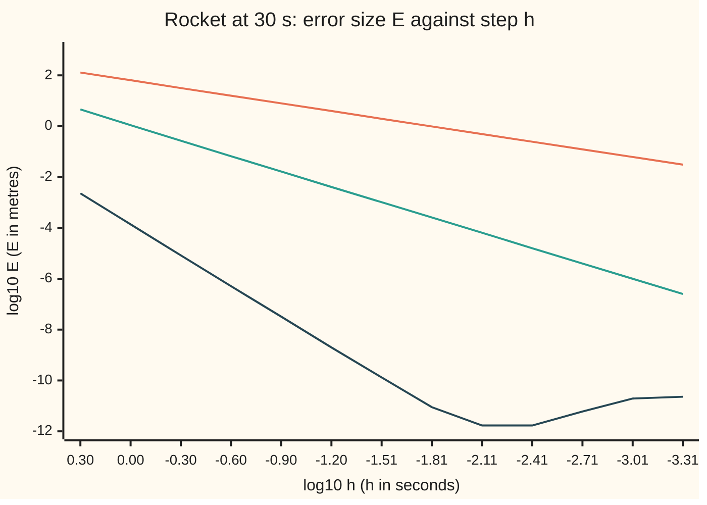

# From local error to global error: why order p per step gives order p overall

[Syllabus](../../../SYLLABUS.md) → [Numerical analysis](../README.md) → [ODE Solvers](../README.md#s06) → From local error to global error

---

## General Overview

A model rocket's motor burns out 40 m above the pad, climbing at 180 m/s. From then on it coasts. Gravity pulls it back at 9.8 m/s², and air drag takes away 0.05 of its speed per second. (Drag in proportion to speed is an illustrative choice. It gives the flight a closed form, so every error below is a true error. The other cards on this shelf fly rockets with their own illustrative numbers.)

The exact flight puts the rocket 2.0612 m above the ground at 30 s, falling at 112.1031 m/s. A simulator does not know that. It steps height and speed forward with Runge-Kutta four (RK4), the four-slope step of [Runge-Kutta](01-runge-kutta-and-butcher-tableaux.md).

With 2 s steps, the computed height at 30 s is off by 2.280e-3 m. With 1 s steps, it is off by 1.367e-4 m: 16.68 times less. Halve again and the error falls by 16.34, then by 16.17. The factor settles at 16, which is 2 to the power 4.

A single RK4 step improves faster: halve the step and its error falls by 31.87, close to 2 to the power 5. But half the step means twice as many steps. This card proves the exponent drops by only one, for every one-step method that does not blow small differences up.

**A one-step method that misses by at most a constant times h^(p+1) on each step (h the step, p the method's order), and that stretches the gap between two nearby states by at most a factor 1 + hΛ per step (Λ a fixed rate), ends a run of length T off by at most a constant times h^p times (e^(ΛT) − 1)/Λ: order p per step gives order p overall.**

**What kind of fact this is:** a theorem, proved on this card in Why it works. Its bound is a guaranteed ceiling, not an estimate: on the rocket it sits 10.13 times above the true error.

### The picture: error against step for three methods



Orange: Euler's method, slope 1. Green: Heun's two-slope method, slope 2. Dark: RK4, slope 4, until rounding stops it near 1.7e-12 m at a step of 1/128 s. Each slope is the method's order, read off a log-log plot.

---

## The formula

Notation first, in words. The **state** $x = (y, v)$ is the rocket's height $y$ and speed $v$. The **rate law** $x' = f(t, x)$ says how fast the state changes: here $y' = v$ and $v' = -g - kv$. The step is $h$, the $n$-th step ends at time $t_n = nh$, and the run ends at $T = Nh$.

A **one-step method** computes the next state from the current one alone:

$$x_{n+1} = x_n + h\,\Phi(t_n, x_n, h).$$

Here $x_n$ is the computed state after $n$ steps and $x(t_n)$ is the exact one. The **increment function** $\Phi$ is the average slope the method uses for the step. For Euler it is $f$ itself; for RK4 it is the weighted mix of four slopes. (This $\Phi$ is not the tree value $\Phi_i$ of [Runge-Kutta](01-runge-kutta-and-butcher-tableaux.md).)

The **local truncation error** $\tau_n$ is how far the exact solution fails to obey the method, per unit of time:

$$\tau_n = \frac{x(t_{n+1}) - x(t_n)}{h} - \Phi\big(t_n, x(t_n), h\big).$$

So $h\tau_n$ is what one step misses when it starts from the exact state: the "local error" of [Order of a method](../../08-Differential%20equations%20and%20dynamics/05-Numerical%20Evolution/02-local-and-global-error-and-order.md).

**The theorem.** Suppose $\lVert\Phi(t, a, h) - \Phi(t, b, h)\rVert \le \Lambda\,\lVert a - b\rVert$ for all states $a$, $b$, and $\lVert\tau_n\rVert \le C h^p$ at every step, and the run starts from the exact value, $e_0 = 0$. Then the **global error** $e_n = x(t_n) - x_n$ obeys

$$\lVert e_n\rVert \;\le\; C\,h^{p}\;\frac{e^{\Lambda t_n} - 1}{\Lambda}\quad\text{for every } n \le N.$$

**Read it aloud:** if each step misses by at most C h to the p, per unit time, and the method never stretches a gap by more than Λ per unit time, then the error at any time is at most C h to the p times the growth factor (e to the Λt, minus 1) over Λ.

The size $\lVert\cdot\rVert$ needs one choice, because height and speed have different units. This card measures an error in metres: the larger of the height error and the speed error times $1/k = 20$ s. That is the most extra height a speed error can ever add, since drag fades it over about 20 s.

| Symbol | Plain meaning | In our example | Push it up and the answer… |
| --- | --- | --- | --- |
| $x = (y, v)$ | the state: height and speed | 40 m and 180 m/s at burnout | — |
| $f$ | the rate law, $x' = f(t, x)$ | $(v,\ -g - kv)$ | — |
| $g$, $k$ | gravity; drag rate | 9.8 m/s²; 0.05 per s | $k$ up: the bound gets looser |
| $h$, $t_n$, $N$, $T$ | step; time after $n$ steps; number of steps; end time | 1 s; $n$ s; 30; 30 s | $h$ up: error grows like $h^p$ |
| $x_n$, $x(t_n)$ | computed state; exact state | 2.0612 m, −112.1031 m/s exact at 30 s | — |
| $\Phi$ | increment function: the method's average slope for a step | RK4's four weighted slopes | — |
| $\tau_n$ | local truncation error: the exact solution's miss per unit time | 1.942e-5 m/s on the first 1 s step | the bound grows in proportion |
| $e_n$, $E$ | global error after $n$ steps; its size at $T$ | $E$ = 1.367e-4 m at $h$ = 1 s | — |
| $\lVert\cdot\rVert$ | size of an error, in metres | larger of height error and 20 s × speed error | — |
| $L$, $\Lambda$ | Lipschitz constants of $f$ and of $\Phi$: the most they stretch a gap, per unit time | 0.05 per s; 0.051271 per s | the bound grows like $e^{\Lambda T}$ |
| $p$, $C$ | order; the constant in $\lVert\tau_n\rVert \le C h^p$ | 4; about 1.942e-5 m/s per s⁴ | $p$ up: error falls faster as $h$ shrinks |
| $a_n$, $B$ | shorthand in the proof: $\lVert e_n\rVert$; $Ch^p$ | $a_{30}$ = 1.367e-4 m; $B$ = 1.942e-5 m/s at $h$ = 1 s | $B$ up: the bound grows in proportion |

A **Lipschitz constant** (from [The Picard-Lindelof theorem](../../08-Differential%20equations%20and%20dynamics/02-Existence%2C%20Uniqueness%20and%20Sensitivity/02-lipschitz-and-the-picard-lindelof-theorem.md)) is a number $L$ with $\lVert f(t, a) - f(t, b)\rVert \le L\lVert a - b\rVert$: the rate law never pulls two states apart faster than $L$ times their gap.

### When it holds

- **The rate law is Lipschitz.** Without it, $\Phi$ has no $\Lambda$ and a carried error can grow without limit. With a huge $L$, as in a stiff problem, the bound holds but is useless ([Stiffness](05-stiffness-a-stability-and-the-dahlquist-barriers.md)).
- **The solution is smooth across every step.** $\lVert\tau_n\rVert \le Ch^p$ comes from Taylor's theorem, which needs $p + 1$ derivatives. A motor burning out partway through a step breaks it: RK4's observed orders become 0.19, 3.81 and −1.80.
- **The method is consistent with order p.** The method's weights must meet the order conditions of [Runge-Kutta](01-runge-kutta-and-butcher-tableaux.md). Two swapped RK4 weights leave order 1. Weights that do not add to 1 give no convergence at all.
- **Exact arithmetic.** Each step also rounds. Below a step of about 1/128 s, the rounding errors outweigh $Ch^p$ and the total error rises again.

---

## Why it works

### Step 0: errors made, errors carried

The global error at 30 s is a sum. Each step makes a fresh local error, and each earlier error is carried forward by the later steps. The fresh errors are about $h^{p+1}$ each, and there are $T/h$ of them, so they add to about $h^p$. Carrying can only multiply an error by $1 + h\Lambda$ per step, which compounds to at most $e^{\Lambda T}$ over the run. That factor does not depend on $h$, so the power $h^p$ survives.

### Step 1: the exact solution almost obeys the method

Rearrange the definition of $\tau_n$:

$$x(t_{n+1}) = x(t_n) + h\,\Phi\big(t_n, x(t_n), h\big) + h\,\tau_n.$$

The exact solution takes a method step, plus a small extra $h\tau_n$. For RK4 the four slopes are weighted so that Taylor's series matches through $h^4$ ([Runge-Kutta](01-runge-kutta-and-butcher-tableaux.md)). So $h\tau_n$ is of size $h^5$, and $\tau_n$ of size $h^4$.

The rocket confirms it. The first step from burnout misses by 1.942e-5 m with $h$ = 1 s and by 6.094e-7 m with $h$ = 0.5 s. The ratio is 31.87, close to $2^5 = 32$.

### Step 2: subtract, and the error obeys its own step rule

Subtract the method's step, $x_{n+1} = x_n + h\Phi(t_n, x_n, h)$, from the exact one:

$$e_{n+1} = e_n + h\Big[\Phi\big(t_n, x(t_n), h\big) - \Phi(t_n, x_n, h)\Big] + h\,\tau_n.$$

The bracket compares the method's slope at two states $e_n$ apart, so its size is at most $\Lambda\lVert e_n\rVert$. Take sizes:

$$\lVert e_{n+1}\rVert \le (1 + h\Lambda)\,\lVert e_n\rVert + h\,\lVert\tau_n\rVert.$$

This is the whole mechanism: carry the old error with growth $1 + h\Lambda$, then add the new one.

The check runs the mechanism with equality. For the rocket the rate law is linear, so the bracket is exactly the method's step applied to $e_n$ with gravity removed. Starting from $e_0 = 0$ and adding each $h\tau_n$, the carried sum reaches 1.366698e-4 m at 30 s. Running RK4 and taking the size of exact minus run gives 1.366698e-4 m. Two different computations, one number.

### Step 3: the discrete Gronwall step

Write $a_n = \lVert e_n\rVert$ and $B = Ch^p$. Step 2 says $a_{n+1} \le (1 + h\Lambda)a_n + hB$, with $a_0 = 0$. Unroll it: the error made at step $j$ is carried by $n - 1 - j$ later steps, so

$$a_n \le hB\sum_{j=0}^{n-1}(1 + h\Lambda)^j = B\,\frac{(1 + h\Lambda)^n - 1}{\Lambda} \le B\,\frac{e^{\Lambda t_n} - 1}{\Lambda}.$$

The last step uses $1 + z \le e^z$, so $(1 + h\Lambda)^n \le e^{\Lambda nh}$. This is the step-by-step twin of [Gronwall's inequality](../../08-Differential%20equations%20and%20dynamics/02-Existence%2C%20Uniqueness%20and%20Sensitivity/04-gronwall-and-continuous-dependence.md), which bounds a gap growing at rate $L$ by $e^{Lt}$.

<details>
<summary>Detailed proof: the discrete Gronwall lemma by induction</summary>

Claim: if $a_0 = 0$ and $a_{m+1} \le (1 + h\Lambda)a_m + hB$ for every $m$, with $h, \Lambda, B > 0$, then $a_n \le B\big((1 + h\Lambda)^n - 1\big)/\Lambda$.

For $n = 0$ both sides are 0. Suppose it holds for $n$. Then

$$a_{n+1} \le (1 + h\Lambda)\,\frac{B\big((1 + h\Lambda)^n - 1\big)}{\Lambda} + hB = \frac{B\big((1 + h\Lambda)^{n+1} - 1 - h\Lambda\big) + h\Lambda B}{\Lambda} = \frac{B\big((1 + h\Lambda)^{n+1} - 1\big)}{\Lambda}.$$

So it holds for $n + 1$. Finally $1 + h\Lambda \le e^{h\Lambda}$, because $e^z = 1 + z + z^2/2 + \dots$ with every term non-negative for $z \ge 0$.

</details>

### Step 4: the method inherits a Lipschitz constant from the rate law

$\Lambda$ comes from $L$. Euler's $\Phi$ is $f$, so $\Lambda = L$. Each RK4 slope is $f$ read at a point nudged by earlier slopes, so each can stretch a gap a little more than $f$ does. Chaining the four readings gives

$$\Lambda = L\left(1 + \frac{hL}{2} + \frac{(hL)^2}{6} + \frac{(hL)^3}{24}\right).$$

For the rocket, two states that differ by $\Delta v$ in speed have rates that differ by $\Delta v$ in height and $k\Delta v$ in speed. In the metre size both are $\lvert\Delta v\rvert$, which is at most $k$ times the states' gap. So $L = k$ = 0.05 per s, and with $h$ = 1 s, $\Lambda$ = 0.051271 per s.

<details>
<summary>Detailed proof: RK4's increment is Lipschitz with this Λ</summary>

Take two states $a$, $b$ with gap $d = \lVert a - b\rVert$, and let $k_1, \dots, k_4$ and $k_1', \dots, k_4'$ be RK4's slopes from each. Each slope is $f$ at a nudged point, and $f$ stretches gaps by at most $L$:

- $\lVert k_1 - k_1'\rVert \le Ld$.
- $k_2$ reads $f$ at $a + \tfrac{h}{2}k_1$, so $\lVert k_2 - k_2'\rVert \le L\big(d + \tfrac{h}{2}Ld\big) = Ld\,(1 + \tfrac{hL}{2})$.
- $k_3$ reads $f$ at $a + \tfrac{h}{2}k_2$, so $\lVert k_3 - k_3'\rVert \le Ld\,\big(1 + \tfrac{hL}{2} + \tfrac{(hL)^2}{4}\big)$.
- $k_4$ reads $f$ at $a + hk_3$, so $\lVert k_4 - k_4'\rVert \le Ld\,\big(1 + hL + \tfrac{(hL)^2}{2} + \tfrac{(hL)^3}{4}\big)$.

$\Phi = (k_1 + 2k_2 + 2k_3 + k_4)/6$. Add the bounds with these weights:

$$\frac{Ld}{6}\Big(6 + 3hL + (hL)^2 + \tfrac{(hL)^3}{4}\Big) = Ld\left(1 + \frac{hL}{2} + \frac{(hL)^2}{6} + \frac{(hL)^3}{24}\right).$$

The same chaining works for any explicit Runge-Kutta method, with the tableau's entries in place of RK4's.

</details>

### Step 5: put it together

Steps 1 to 4 give, at the end of the run,

$$E = \lVert e_N\rVert \le C h^p\,\frac{e^{\Lambda T} - 1}{\Lambda}.$$

$\Lambda$ shrinks as $h$ shrinks, so the factor after $h^p$ stays below its value at the largest step. The error is at most a fixed number times $h^p$: order $p$ overall. One power is lost from the local miss $h^{p+1}$, because $T/h$ steps each make one.

With 1 s steps the check takes the largest $\lVert\tau_n\rVert$ met in the run, 1.942e-5 m/s, as $Ch^p$. The bound is 1.385e-3 m; the true error is 1.367e-4 m; the ratio is 10.13. At 2 s steps the ratio is 9.88, and at 0.5 s it is 10.27. The bound has the right order and a loose constant.

[Order of a method](../../08-Differential%20equations%20and%20dynamics/05-Numerical%20Evolution/02-local-and-global-error-and-order.md) already proves the Euler case, with bound $(M/2L)(e^{LT} - 1)h$. The theorem here is the same argument for any $\Phi$.

### Step 6: why the bound is pessimistic when errors decay

The bound assumes the worst at every step. Followed along the flight with 1 s steps:

| Time | True error $E$ | Bound | Bound / true |
| --- | --- | --- | --- |
| 6 s | 9.075e-5 m | 1.364e-4 m | 1.50 |
| 12 s | 1.345e-4 m | 3.220e-4 m | 2.39 |
| 18 s | 1.494e-4 m | 5.745e-4 m | 3.84 |
| 24 s | 1.476e-4 m | 9.178e-4 m | 6.22 |
| 30 s | 1.367e-4 m | 1.385e-3 m | 10.13 |

The true error stops growing after about 18 s; the bound keeps climbing. Two assumptions cause the gap:

1. **Growth instead of decay.** The bound lets every carried error grow by up to $e^{\Lambda T}$ = 4.66 over the run. Drag does the opposite: it shrinks a speed error by $e^{-kT}$ = 0.223 over 30 s.
2. **The worst step, every time.** The bound charges every step the largest $\lVert\tau_n\rVert$, 1.942e-5 m/s. The last step's is only 4.556e-6 m/s, because the drag term fades.

A Lipschitz constant can only say "at most this much stretching". It cannot see shrinking. Stronger drag makes this worse: with $k$ = 0.1 per s, the ratio is 129.35.

The choice of size matters too. Counting a speed error of 1 m/s as 1 m, instead of 20 m, makes $L$ = 1 per s, so $\Lambda$ = 1.708333 per s. The bound becomes 2.057e17 m, 1.505e21 times the true error: still true, but useless.

### Step 7: rounding, run in floating point

The proof assumed exact arithmetic. In floating point each step also rounds the state, which acts like an extra $\tau_n$ of size (rounding)/$h$. So the total behaves like $Ch^p$ plus a rounding term that grows with the number of steps.

On the chart, RK4 falls with slope 4 down to 1.7e-12 m at $h$ = 1/128 s. Below that the step count wins: at $h$ = 1/2048 s the error is back up to 2.3e-11 m. Smaller steps past the floor buy nothing.

---

## Worked numbers, by hand

RK4 on the rocket: $y_0$ = 40 m, $v_0$ = 180 m/s, $g$ = 9.8 m/s², $k$ = 0.05 per s, $T$ = 30 s, $L = k$.

| Step | Arithmetic | Value |
| --- | --- | --- |
| first step's miss, $h$ = 1 s and 0.5 s | exact minus RK4, in metres | 1.942e-5 m; 6.094e-7 m |
| local ratio | $1.942\text{e-}5 \div 6.094\text{e-}7$ | 31.87, near $2^5$ |
| $\Lambda$ at $h$ = 1 s, with $hL$ = 0.05 | $0.05\,\big(1 + hL/2 + (hL)^2/6 + (hL)^3/24\big)$ | 0.051271 per s |
| bound at 30 s | $1.942\text{e-}5 \times (e^{0.051271 \times 30} - 1) / 0.051271$ | 1.385e-3 m |
| true error, $h$ = 2 s | size of exact minus run | 2.280e-3 m |
| true error, $h$ = 1 s | size of exact minus run | 1.367e-4 m |
| ratio per halving | $2.280\text{e-}3 \div 1.367\text{e-}4$ | 16.68 |
| observed order | $\log_2 16.68$ | **4.06** |

Halving the rocket's step divides its height error at 30 s by about 16, not 32: order 4 overall from order 5 per step.

### What breaks if you drop a piece

| Mistake | Comes out at | What went wrong |
| --- | --- | --- |
| A separate flight from the pad, with a 1.7 s burn at 110 m/s² inside the run; steps of 1, 0.5, 0.25, 0.125 s | errors 222.2, 194.4, 13.9, 48.6 m; orders 0.19, 3.81, −1.80 | the rate jumps inside a step, so $\tau_n$ there is not of size $h^4$ |
| RK4 weights 2 and 4 swapped: 1/6, 1/6, 1/3, 1/3 | errors 10.52, 5.25, 2.62 m; orders 1.00, 1.00 | the weights still add to 1, but the higher order conditions fail, so $p$ = 1 |
| RK4 weights adding to 7/6 | errors 607.48, 608.16, 608.50 m | $\tau_n$ does not shrink with $h$, so there is no convergence |
| The 32-fold local gain used as the global one | guesses 4.271e-6 m at $h$ = 0.5 s; actual 8.366e-6 m | twice as many steps each add their miss |

The fix for the burn is to end a step exactly at burnout and restart from there. Then every step sees a smooth rate law.

---

## Code, from first principles, and it actually runs

The code writes one explicit Runge-Kutta step from a tableau and runs Euler, Heun and RK4 on the rocket, by three roads. Road one runs the method and subtracts the closed-form flight. Road two carries each step's local error forward with the method's own step and adds them up. Road three is the theorem's bound, which must sit above both. Asserts check that roads one and two agree to the rounding floor, that the bound holds and sits about 10 times above the true error, that $\Lambda$ bounds the measured stretch of RK4's increment, that the observed orders are 1, 2 and 4, that one step has order 5, and that rounding stops the fall.

### Python

```python
# From local error to global error -- the check behind the card.  Standard library only.
# A model rocket coasts from burnout: height y, speed v, y' = v, v' = -g - k v.
# Road one: run a one-step method and subtract the closed-form flight.
# Road two: carry each step's local error to the end, step by step, and add.
# Road three: the theorem's bound, which must sit above both.
from math import exp, log2, log10

G, K, T, Y0, V0 = 9.8, 0.05, 30.0, 40.0, 180.0      # m/s^2, 1/s, s, m, m/s

def sci(x, d=3):                                     # 2.280e-3, the same in Rust
    m, e = f"{x:.{d}e}".split("e")
    return f"{m}e{int(e)}"
def exact(t, y0=Y0, v0=V0, a=0.0, k=K):              # closed form, thrust a
    vi = (a - G) / k; A = v0 - vi; q = exp(-k * t)
    return (y0 + vi * t + A * (1 - q) / k, vi + A * q)
def rocket(k, a=0.0, tb=0.0):                        # rate law; thrust a until tb
    return lambda t, x: (x[1], (a if t < tb else 0.0) - G - k * x[1])
EULER = ([], [1.0], [0.0])
HEUN = ([[1.0]], [0.5, 0.5], [0.0, 1.0])
RK4 = ([[0.5], [0.0, 0.5], [0.0, 0.0, 1.0]], [1/6, 1/3, 1/3, 1/6], [0.0, 0.5, 0.5, 1.0])
def step(tab, f, t, x, h):                           # one explicit Runge-Kutta step
    A, b, c = tab; ks = []
    for i in range(len(b)):
        z = x
        for j in range(i): z = (z[0] + h * A[i-1][j] * ks[j][0], z[1] + h * A[i-1][j] * ks[j][1])
        ks.append(f(t + c[i] * h, z))
    s0 = s1 = 0.0                                    # a plain loop: sum() compensates
    for i in range(len(b)): s0 += b[i] * ks[i][0]; s1 += b[i] * ks[i][1]
    return (x[0] + h * s0, x[1] + h * s1)
def run(tab, f, h, x, t_end):
    for n in range(round(t_end / h)): x = step(tab, f, n * h, x, h)
    return x
def size(d, k=K): return max(abs(d[0]), abs(d[1]) / k)   # metres: height, or speed x 1/k
def err(x, xe): return (xe[0] - x[0], xe[1] - x[1])
def E(tab, h, k=K, t_end=T): return size(err(run(tab, rocket(k), h, (Y0, V0), t_end), exact(t_end, k=k)), k)
def lam(L, h): return L * (1 + h * L / 2 + (h * L) ** 2 / 6 + (h * L) ** 3 / 24)  # RK4's increment
def theorem(h, k=K, t_end=T):                        # true error, carried sum, bound
    f, fh = rocket(k), (lambda t, x: (x[1], -k * x[1]))  # fh: the rate law minus gravity
    e, taus = (0.0, 0.0), []
    for n in range(round(t_end / h)):
        x0, x1 = exact(n * h, k=k), exact((n + 1) * h, k=k)
        loc = err(step(RK4, f, n * h, x0, h), x1)    # h times tau_n
        taus.append(size(loc, k) / h)
        r = step(RK4, fh, 0.0, e, h); e = (r[0] + loc[0], r[1] + loc[1])
    return E(RK4, h, k, t_end), size(e, k), max(taus) * (exp(lam(k, h) * t_end) - 1) / lam(k, h), taus

print(f"rocket from burnout: y0 = 40 m, v0 = 180 m/s, g = 9.8 m/s^2, k = 0.05 /s, T = 30 s")
xT = exact(T)
print(f"exact at 30 s: height {xT[0]:.4f} m, speed {xT[1]:.4f} m/s")
HS = [2.0 / 2 ** j for j in range(13)]               # 2 s down to 1/2048 s
errs = {}
for name, tab in (("Euler", EULER), ("Heun", HEUN), ("RK4", RK4)):
    errs[name] = [E(tab, h) for h in HS]
for h in HS[:4]:
    d = err(run(RK4, rocket(K), h, (Y0, V0), T), xT)
    print(f"RK4 h = {h}: height error {sci(d[0])} m, speed error {sci(d[1])} m/s, E = {sci(size(d))} m")
er = errs["RK4"]
print("RK4 error ratio per halving: " + ", ".join(f"{er[i] / er[i+1]:.2f}" for i in range(3)))
for name in errs:
    e = errs[name]
    print(f"observed order, {name}: " + ", ".join(f"{log2(e[i] / e[i+1]):.2f}" for i in range(3)))
loc = [size(err(step(RK4, rocket(K), 0.0, (Y0, V0), h), exact(h))) for h in (1.0, 0.5)]
print(f"one RK4 step from burnout: local error h = 1: {sci(loc[0])} m, h = 0.5: {sci(loc[1])} m, ratio {loc[0] / loc[1]:.2f}")
true1, carried, bound1, taus = theorem(1.0)
print(f"h = 1: size of exact minus run {sci(true1, 6)} m; local errors carried and added {sci(carried, 6)} m")
print(f"theorem, h = 1: L = 0.05 /s, Lambda = {lam(K, 1.0):.6f} /s, largest tau = {sci(max(taus))} m/s, "
      f"last tau = {sci(taus[-1])} m/s")
print(f"theorem, h = 1: bound {sci(bound1)} m, true {sci(true1)} m, bound / true {bound1 / true1:.2f}")
print(f"over 30 s the bound lets errors grow by e^(Lambda T) = {exp(lam(K, 1.0) * T):.2f}; "
      f"drag shrinks a speed error by e^(-kT) = {exp(-K * T):.3f}")
print("along the flight, h = 1: t, true E, bound, bound / true")
for tt in (6.0, 12.0, 18.0, 24.0, 30.0):
    tr, _, b, _ = theorem(1.0, K, tt)
    print(f"  {tt:4.0f} s  {sci(tr)} m  {sci(b)} m  {b / tr:.2f}")
LP = lam(1.0, 1.0)                                   # L = 1 /s if speed counts as metres
plain = max(taus) * (exp(LP * T) - 1) / LP          # height part is the larger: same tau
print(f"plain sizes (L = 1 /s, Lambda = {LP:.6f} /s): bound {sci(plain)} m, bound / true {sci(plain / true1)}")
for h in (2.0, 0.5):
    tr, _, b, _ = theorem(h)
    print(f"theorem, h = {h}: bound {sci(b)} m, true {sci(tr)} m, bound / true {b / tr:.2f}")
print("chart x, log10 h: " + ", ".join(f"{log10(h):.2f}" for h in HS))
for name in errs: print(f"chart, log10 E, {name}: " + ", ".join(f"{log10(e):.2f}" for e in errs[name]))
lo = min(range(len(HS)), key=lambda i: er[i])
print(f"rounding floor, RK4: smallest E {sci(er[lo], 1)} m at h = 1/{round(1 / HS[lo])} s; "
      f"at h = 1/2048 s, E = {sci(er[-1], 1)} m")
AT, TB = 110.0, 1.7                                  # mistake 1: thrust inside the run
yb, vb = exact(TB, 0.0, 0.0, AT)
xe = exact(T - TB, yb, vb)
th = [size(err(run(RK4, rocket(K, AT, TB), h, (0.0, 0.0), T), xe)) for h in (1.0, 0.5, 0.25, 0.125)]
print(f"mistake 1, 1.7 s burn at 110 m/s^2 inside the run, h = 1, 0.5, 0.25, 0.125: E = " + ", ".join(f"{e:.1f}" for e in th)
      + " m; orders " + ", ".join(f"{log2(th[i] / th[i+1]):.2f}" for i in range(3)))
BAD = (RK4[0], [1/6, 1/6, 1/3, 1/3], RK4[2])         # weights still add to 1
INC = (RK4[0], [1/6, 1/3, 1/3, 1/3], RK4[2])         # weights add to 7/6
bad = [E(BAD, h) for h in (1.0, 0.5, 0.25)]
print("mistake 2, weights 1/6, 1/6, 1/3, 1/3, h = 1, 0.5, 0.25: E = " + ", ".join(f"{x:.2f}" for x in bad) + " m; orders "
      + ", ".join(f"{log2(bad[i] / bad[i+1]):.2f}" for i in range(2)))
print("mistake 3, weights adding to 7/6, h = 1, 0.5, 0.25: E = " + ", ".join(f"{E(INC, h):.2f}" for h in (1.0, 0.5, 0.25)) + " m")
print(f"mistake 4, the 32-fold local gain read as the global one: guess E(0.5) = {sci(er[1] / 32)} m, "
      f"actual {sci(er[2])} m")
tr, _, b, _ = theorem(1.0, 0.1)
print(f"try, drag k = 0.1 /s, h = 1: bound / true {b / tr:.2f}")
tr, _, b, _ = theorem(1.0, K, 10.0)
print(f"try, stop at T = 10 s, h = 1: bound / true {b / tr:.2f}")

for h in (2.0, 1.0, 0.5):                                     # road two equals road one,
    tr, cr, b, _ = theorem(h)                                 # to the 1e-12 m rounding floor
    assert abs(cr - tr) < 1e-10 and tr < b                    # and the bound sits above
fh = lambda t, x: (x[1], -K * x[1])                           # linear law: a gap obeys the law minus gravity
stretch = max(size(((s[0] - d[0]) / 1.0, (s[1] - d[1]) / 1.0)) for d in ((1.0, 0.0), (0.0, K))
              for s in [step(RK4, fh, 0.0, d, 1.0)])        # 1 m gaps, in height and in speed (k m/s)
assert stretch <= lam(K, 1.0) < 1.1 * stretch                 # Lambda bounds the measured stretch, closely
assert 9 < bound1 / true1 < 11                                # the bound sits about 10 times above
assert 0.95 < log2(bad[1] / bad[2]) < 1.05                    # two swapped weights: order 1
assert all(3.9 < log2(er[i] / er[i+1]) < 4.2 for i in range(4))  # RK4: order 4 overall
assert 0.95 < log2(errs["Euler"][1] / errs["Euler"][2]) < 1.05
assert 1.9 < log2(errs["Heun"][1] / errs["Heun"][2]) < 2.1
assert 31 < loc[0] / loc[1] < 33                              # one step: order 5 locally
assert er[-1] > er[lo] and 1e-13 < er[lo] < 1e-10             # rounding stops the fall
assert abs(xT[0] - run(RK4, rocket(K), 1 / 64, (Y0, V0), T)[0]) < 1e-9   # closed form vs fine run
print("ALL CHECKS PASS")
```

**Ran 2026-11-11 on macOS, Python 3.14.10, standard library only. All checks passed. Output, pasted from the run:**

```
rocket from burnout: y0 = 40 m, v0 = 180 m/s, g = 9.8 m/s^2, k = 0.05 /s, T = 30 s
exact at 30 s: height 2.0612 m, speed -112.1031 m/s
RK4 h = 2.0: height error 2.280e-3 m, speed error -1.140e-4 m/s, E = 2.280e-3 m
RK4 h = 1.0: height error 1.367e-4 m, speed error -6.833e-6 m/s, E = 1.367e-4 m
RK4 h = 0.5: height error 8.366e-6 m, speed error -4.183e-7 m/s, E = 8.366e-6 m
RK4 h = 0.25: height error 5.174e-7 m, speed error -2.587e-8 m/s, E = 5.174e-7 m
RK4 error ratio per halving: 16.68, 16.34, 16.17
observed order, Euler: 1.02, 1.01, 1.01
observed order, Heun: 2.06, 2.03, 2.01
observed order, RK4: 4.06, 4.03, 4.02
one RK4 step from burnout: local error h = 1: 1.942e-5 m, h = 0.5: 6.094e-7 m, ratio 31.87
h = 1: size of exact minus run 1.366698e-4 m; local errors carried and added 1.366698e-4 m
theorem, h = 1: L = 0.05 /s, Lambda = 0.051271 /s, largest tau = 1.942e-5 m/s, last tau = 4.556e-6 m/s
theorem, h = 1: bound 1.385e-3 m, true 1.367e-4 m, bound / true 10.13
over 30 s the bound lets errors grow by e^(Lambda T) = 4.66; drag shrinks a speed error by e^(-kT) = 0.223
along the flight, h = 1: t, true E, bound, bound / true
     6 s  9.075e-5 m  1.364e-4 m  1.50
    12 s  1.345e-4 m  3.220e-4 m  2.39
    18 s  1.494e-4 m  5.745e-4 m  3.84
    24 s  1.476e-4 m  9.178e-4 m  6.22
    30 s  1.367e-4 m  1.385e-3 m  10.13
plain sizes (L = 1 /s, Lambda = 1.708333 /s): bound 2.057e17 m, bound / true 1.505e21
theorem, h = 2.0: bound 2.252e-2 m, true 2.280e-3 m, bound / true 9.88
theorem, h = 0.5: bound 8.588e-5 m, true 8.366e-6 m, bound / true 10.27
chart x, log10 h: 0.30, 0.00, -0.30, -0.60, -0.90, -1.20, -1.51, -1.81, -2.11, -2.41, -2.71, -3.01, -3.31
chart, log10 E, Euler: 2.11, 1.81, 1.50, 1.20, 0.90, 0.60, 0.29, -0.01, -0.31, -0.61, -0.91, -1.21, -1.51
chart, log10 E, Heun: 0.66, 0.04, -0.57, -1.18, -1.78, -2.39, -2.99, -3.59, -4.19, -4.80, -5.40, -6.00, -6.60
chart, log10 E, RK4: -2.64, -3.86, -5.08, -6.29, -7.49, -8.70, -9.88, -11.05, -11.77, -11.77, -11.22, -10.71, -10.64
rounding floor, RK4: smallest E 1.7e-12 m at h = 1/128 s; at h = 1/2048 s, E = 2.3e-11 m
mistake 1, 1.7 s burn at 110 m/s^2 inside the run, h = 1, 0.5, 0.25, 0.125: E = 222.2, 194.4, 13.9, 48.6 m; orders 0.19, 3.81, -1.80
mistake 2, weights 1/6, 1/6, 1/3, 1/3, h = 1, 0.5, 0.25: E = 10.52, 5.25, 2.62 m; orders 1.00, 1.00
mistake 3, weights adding to 7/6, h = 1, 0.5, 0.25: E = 607.48, 608.16, 608.50 m
mistake 4, the 32-fold local gain read as the global one: guess E(0.5) = 4.271e-6 m, actual 8.366e-6 m
try, drag k = 0.1 /s, h = 1: bound / true 129.35
try, stop at T = 10 s, h = 1: bound / true 2.05
ALL CHECKS PASS
```

### Rust

Same rows and labels; the two outputs agree line for line.

```rust
// From local error to global error -- the same check as the Python, in Rust.  No crates.
// A model rocket coasts from burnout: height y, speed v, y' = v, v' = -g - k v.
// Road one: run a one-step method and subtract the closed-form flight.
// Road two: carry each step's local error to the end, step by step, and add.
// Road three: the theorem's bound, which must sit above both.
const G: f64 = 9.8; const K: f64 = 0.05; const T: f64 = 30.0;    // m/s^2, 1/s, s
const Y0: f64 = 40.0; const V0: f64 = 180.0;                      // m, m/s
type X = (f64, f64);
struct Tab { a: Vec<Vec<f64>>, b: Vec<f64>, c: Vec<f64> }

fn sci(x: f64, d: usize) -> String { format!("{:.*e}", d, x) }    // 2.280e-3, as in Python
fn exact(t: f64, y0: f64, v0: f64, a: f64, k: f64) -> X {        // closed form, thrust a
    let vi = (a - G) / k; let am = v0 - vi; let q = (-k * t).exp();
    (y0 + vi * t + am * (1.0 - q) / k, vi + am * q)
}
fn ex(t: f64, k: f64) -> X { exact(t, Y0, V0, 0.0, k) }
fn rocket(k: f64, a: f64, tb: f64) -> impl Fn(f64, X) -> X {     // thrust a until tb
    move |t, x| (x.1, (if t < tb { a } else { 0.0 }) - G - k * x.1)
}
fn step(tab: &Tab, f: &dyn Fn(f64, X) -> X, t: f64, x: X, h: f64) -> X {
    let mut ks: Vec<X> = vec![];
    for i in 0..tab.b.len() {
        let mut z = x;
        for j in 0..i { z = (z.0 + h * tab.a[i - 1][j] * ks[j].0, z.1 + h * tab.a[i - 1][j] * ks[j].1) }
        ks.push(f(t + tab.c[i] * h, z));
    }
    let (mut s0, mut s1) = (0.0, 0.0);
    for i in 0..tab.b.len() { s0 += tab.b[i] * ks[i].0; s1 += tab.b[i] * ks[i].1 }
    (x.0 + h * s0, x.1 + h * s1)
}
fn run(tab: &Tab, f: &dyn Fn(f64, X) -> X, h: f64, mut x: X, t_end: f64) -> X {
    for n in 0..(t_end / h).round() as i64 { x = step(tab, f, n as f64 * h, x, h) }
    x
}
fn size(d: X, k: f64) -> f64 { d.0.abs().max(d.1.abs() / k) }   // metres: height, or speed x 1/k
fn err(x: X, xe: X) -> X { (xe.0 - x.0, xe.1 - x.1) }
fn e_of(tab: &Tab, h: f64, k: f64, t_end: f64) -> f64 {
    size(err(run(tab, &rocket(k, 0.0, 0.0), h, (Y0, V0), t_end), ex(t_end, k)), k)
}
fn lam(l: f64, h: f64) -> f64 { l * (1.0 + h * l / 2.0 + (h * l).powi(2) / 6.0 + (h * l).powi(3) / 24.0) }
fn theorem(rk: &Tab, h: f64, k: f64, t_end: f64) -> (f64, f64, f64, Vec<f64>) {
    let f = rocket(k, 0.0, 0.0);
    let fh = move |_t: f64, x: X| (x.1, -k * x.1);                // the rate law minus gravity
    let (mut e, mut taus): (X, Vec<f64>) = ((0.0, 0.0), vec![]);
    for n in 0..(t_end / h).round() as i64 {
        let (x0, x1) = (ex(n as f64 * h, k), ex((n + 1) as f64 * h, k));
        let loc = err(step(rk, &f, n as f64 * h, x0, h), x1);       // h times tau_n
        taus.push(size(loc, k) / h);
        let r = step(rk, &fh, 0.0, e, h); e = (r.0 + loc.0, r.1 + loc.1);
    }
    let big = taus.iter().cloned().fold(0.0, f64::max);
    (e_of(rk, h, k, t_end), size(e, k), big * ((lam(k, h) * t_end).exp() - 1.0) / lam(k, h), taus)
}
fn join(v: &[f64], d: usize) -> String { v.iter().map(|x| format!("{:.*}", d, x)).collect::<Vec<_>>().join(", ") }
fn orders(e: &[f64]) -> Vec<f64> { (0..e.len() - 1).map(|i| (e[i] / e[i + 1]).log2()).collect() }

fn main() {
    let euler = Tab { a: vec![], b: vec![1.0], c: vec![0.0] };
    let heun = Tab { a: vec![vec![1.0]], b: vec![0.5, 0.5], c: vec![0.0, 1.0] };
    let rka = vec![vec![0.5], vec![0.0, 0.5], vec![0.0, 0.0, 1.0]];
    let rkc = vec![0.0, 0.5, 0.5, 1.0];
    let rk4 = Tab { a: rka.clone(), b: vec![1.0 / 6.0, 1.0 / 3.0, 1.0 / 3.0, 1.0 / 6.0], c: rkc.clone() };
    let f = rocket(K, 0.0, 0.0);
    println!("rocket from burnout: y0 = 40 m, v0 = 180 m/s, g = 9.8 m/s^2, k = 0.05 /s, T = 30 s");
    let xt = ex(T, K);
    println!("exact at 30 s: height {:.4} m, speed {:.4} m/s", xt.0, xt.1);
    let hs: Vec<f64> = (0..13).map(|j| 2.0 / 2f64.powi(j)).collect();   // 2 s down to 1/2048 s
    let names = ["Euler", "Heun", "RK4"];
    let errs: Vec<Vec<f64>> = [&euler, &heun, &rk4].iter().map(|t| hs.iter().map(|&h| e_of(t, h, K, T)).collect()).collect();
    for &h in &hs[..4] {
        let d = err(run(&rk4, &f, h, (Y0, V0), T), xt);
        println!("RK4 h = {:?}: height error {} m, speed error {} m/s, E = {} m", h, sci(d.0, 3), sci(d.1, 3), sci(size(d, K), 3));
    }
    let er = &errs[2];
    let ratios: Vec<f64> = (0..3).map(|i| er[i] / er[i + 1]).collect();
    println!("RK4 error ratio per halving: {}", join(&ratios, 2));
    for (n, e) in names.iter().zip(&errs) { println!("observed order, {}: {}", n, join(&orders(&e[..4]), 2)) }
    let loc: Vec<f64> = [1.0, 0.5].iter().map(|&h| size(err(step(&rk4, &f, 0.0, (Y0, V0), h), ex(h, K)), K)).collect();
    println!("one RK4 step from burnout: local error h = 1: {} m, h = 0.5: {} m, ratio {:.2}", sci(loc[0], 3), sci(loc[1], 3), loc[0] / loc[1]);
    let (true1, carried, bound1, taus) = theorem(&rk4, 1.0, K, T);
    let big = taus.iter().cloned().fold(0.0, f64::max);
    println!("h = 1: size of exact minus run {} m; local errors carried and added {} m", sci(true1, 6), sci(carried, 6));
    println!("theorem, h = 1: L = 0.05 /s, Lambda = {:.6} /s, largest tau = {} m/s, last tau = {} m/s",
             lam(K, 1.0), sci(big, 3), sci(taus[taus.len() - 1], 3));
    println!("theorem, h = 1: bound {} m, true {} m, bound / true {:.2}", sci(bound1, 3), sci(true1, 3), bound1 / true1);
    println!("over 30 s the bound lets errors grow by e^(Lambda T) = {:.2}; drag shrinks a speed error by e^(-kT) = {:.3}",
             (lam(K, 1.0) * T).exp(), (-K * T).exp());
    println!("along the flight, h = 1: t, true E, bound, bound / true");
    for tt in [6.0, 12.0, 18.0, 24.0, 30.0] {
        let (tr, _, b, _) = theorem(&rk4, 1.0, K, tt);
        println!("  {:4.0} s  {} m  {} m  {:.2}", tt, sci(tr, 3), sci(b, 3), b / tr);
    }
    let lp = lam(1.0, 1.0);                                        // L = 1 /s if speed counts as metres
    let plain = big * ((lp * T).exp() - 1.0) / lp;                 // height part is the larger: same tau
    println!("plain sizes (L = 1 /s, Lambda = {:.6} /s): bound {} m, bound / true {}", lp, sci(plain, 3), sci(plain / true1, 3));
    for h in [2.0, 0.5] {
        let (tr, _, b, _) = theorem(&rk4, h, K, T);
        println!("theorem, h = {:?}: bound {} m, true {} m, bound / true {:.2}", h, sci(b, 3), sci(tr, 3), b / tr);
    }
    println!("chart x, log10 h: {}", join(&hs.iter().map(|h| h.log10()).collect::<Vec<_>>(), 2));
    for (n, e) in names.iter().zip(&errs) { println!("chart, log10 E, {}: {}", n, join(&e.iter().map(|x| x.log10()).collect::<Vec<_>>(), 2)) }
    let mut lo = 0;
    for i in 0..hs.len() { if er[i] < er[lo] { lo = i } }
    println!("rounding floor, RK4: smallest E {} m at h = 1/{} s; at h = 1/2048 s, E = {} m",
             sci(er[lo], 1), (1.0 / hs[lo]).round(), sci(er[er.len() - 1], 1));
    let (at, tb) = (110.0, 1.7);                                     // mistake 1: thrust inside the run
    let (yb, vb) = exact(tb, 0.0, 0.0, at, K);
    let xe = exact(T - tb, yb, vb, 0.0, K);
    let th: Vec<f64> = [1.0, 0.5, 0.25, 0.125].iter().map(|&h| size(err(run(&rk4, &rocket(K, at, tb), h, (0.0, 0.0), T), xe), K)).collect();
    println!("mistake 1, 1.7 s burn at 110 m/s^2 inside the run, h = 1, 0.5, 0.25, 0.125: E = {} m; orders {}", join(&th, 1), join(&orders(&th), 2));
    let bad = Tab { a: rka.clone(), b: vec![1.0 / 6.0, 1.0 / 6.0, 1.0 / 3.0, 1.0 / 3.0], c: rkc.clone() };  // add to 1
    let inc = Tab { a: rka.clone(), b: vec![1.0 / 6.0, 1.0 / 3.0, 1.0 / 3.0, 1.0 / 3.0], c: rkc.clone() };  // add to 7/6
    let hb = [1.0, 0.5, 0.25];
    let eb: Vec<f64> = hb.iter().map(|&h| e_of(&bad, h, K, T)).collect();
    println!("mistake 2, weights 1/6, 1/6, 1/3, 1/3, h = 1, 0.5, 0.25: E = {} m; orders {}", join(&eb, 2), join(&orders(&eb), 2));
    println!("mistake 3, weights adding to 7/6, h = 1, 0.5, 0.25: E = {} m", join(&hb.iter().map(|&h| e_of(&inc, h, K, T)).collect::<Vec<_>>(), 2));
    println!("mistake 4, the 32-fold local gain read as the global one: guess E(0.5) = {} m, actual {} m", sci(er[1] / 32.0, 3), sci(er[2], 3));
    let (tr, _, b, _) = theorem(&rk4, 1.0, 0.1, T);
    println!("try, drag k = 0.1 /s, h = 1: bound / true {:.2}", b / tr);
    let (tr, _, b, _) = theorem(&rk4, 1.0, K, 10.0);
    println!("try, stop at T = 10 s, h = 1: bound / true {:.2}", b / tr);

    for h in [2.0, 1.0, 0.5] {                                       // road two equals road one,
        let (tr, cr, b, _) = theorem(&rk4, h, K, T);                 // to the 1e-12 m rounding floor
        assert!((cr - tr).abs() < 1e-10 && tr < b);                  // and the bound sits above
    }
    let fh = |_t: f64, x: X| (x.1, -K * x.1);                         // linear law: a gap obeys the law minus gravity
    let stretch = [(1.0, 0.0), (0.0, K)].iter().map(|&d| { let s = step(&rk4, &fh, 0.0, d, 1.0);
        size(((s.0 - d.0) / 1.0, (s.1 - d.1) / 1.0), K) }).fold(0.0, f64::max);   // 1 m gaps, in height and in speed
    assert!(stretch <= lam(K, 1.0) && lam(K, 1.0) < 1.1 * stretch);  // Lambda bounds the measured stretch, closely
    assert!(9.0 < bound1 / true1 && bound1 / true1 < 11.0);           // the bound sits about 10 times above
    let ob = orders(&eb);
    assert!(0.95 < ob[1] && ob[1] < 1.05);                           // two swapped weights: order 1
    assert!(orders(er)[..4].iter().all(|&p| 3.9 < p && p < 4.2));   // RK4: order 4 overall
    let (oe, oh) = (orders(&errs[0]), orders(&errs[1]));
    assert!(0.95 < oe[1] && oe[1] < 1.05 && 1.9 < oh[1] && oh[1] < 2.1);
    assert!(31.0 < loc[0] / loc[1] && loc[0] / loc[1] < 33.0);       // one step: order 5 locally
    assert!(er[er.len() - 1] > er[lo] && 1e-13 < er[lo] && er[lo] < 1e-10);  // rounding stops the fall
    assert!((xt.0 - run(&rk4, &f, 1.0 / 64.0, (Y0, V0), T).0).abs() < 1e-9); // closed form vs fine run
    println!("ALL CHECKS PASS");
}
```

**Ran 2026-11-11 on macOS, rustc 1.98.1, no crates. All checks passed. Output, pasted from the run:**

```
rocket from burnout: y0 = 40 m, v0 = 180 m/s, g = 9.8 m/s^2, k = 0.05 /s, T = 30 s
exact at 30 s: height 2.0612 m, speed -112.1031 m/s
RK4 h = 2.0: height error 2.280e-3 m, speed error -1.140e-4 m/s, E = 2.280e-3 m
RK4 h = 1.0: height error 1.367e-4 m, speed error -6.833e-6 m/s, E = 1.367e-4 m
RK4 h = 0.5: height error 8.366e-6 m, speed error -4.183e-7 m/s, E = 8.366e-6 m
RK4 h = 0.25: height error 5.174e-7 m, speed error -2.587e-8 m/s, E = 5.174e-7 m
RK4 error ratio per halving: 16.68, 16.34, 16.17
observed order, Euler: 1.02, 1.01, 1.01
observed order, Heun: 2.06, 2.03, 2.01
observed order, RK4: 4.06, 4.03, 4.02
one RK4 step from burnout: local error h = 1: 1.942e-5 m, h = 0.5: 6.094e-7 m, ratio 31.87
h = 1: size of exact minus run 1.366698e-4 m; local errors carried and added 1.366698e-4 m
theorem, h = 1: L = 0.05 /s, Lambda = 0.051271 /s, largest tau = 1.942e-5 m/s, last tau = 4.556e-6 m/s
theorem, h = 1: bound 1.385e-3 m, true 1.367e-4 m, bound / true 10.13
over 30 s the bound lets errors grow by e^(Lambda T) = 4.66; drag shrinks a speed error by e^(-kT) = 0.223
along the flight, h = 1: t, true E, bound, bound / true
     6 s  9.075e-5 m  1.364e-4 m  1.50
    12 s  1.345e-4 m  3.220e-4 m  2.39
    18 s  1.494e-4 m  5.745e-4 m  3.84
    24 s  1.476e-4 m  9.178e-4 m  6.22
    30 s  1.367e-4 m  1.385e-3 m  10.13
plain sizes (L = 1 /s, Lambda = 1.708333 /s): bound 2.057e17 m, bound / true 1.505e21
theorem, h = 2.0: bound 2.252e-2 m, true 2.280e-3 m, bound / true 9.88
theorem, h = 0.5: bound 8.588e-5 m, true 8.366e-6 m, bound / true 10.27
chart x, log10 h: 0.30, 0.00, -0.30, -0.60, -0.90, -1.20, -1.51, -1.81, -2.11, -2.41, -2.71, -3.01, -3.31
chart, log10 E, Euler: 2.11, 1.81, 1.50, 1.20, 0.90, 0.60, 0.29, -0.01, -0.31, -0.61, -0.91, -1.21, -1.51
chart, log10 E, Heun: 0.66, 0.04, -0.57, -1.18, -1.78, -2.39, -2.99, -3.59, -4.19, -4.80, -5.40, -6.00, -6.60
chart, log10 E, RK4: -2.64, -3.86, -5.08, -6.29, -7.49, -8.70, -9.88, -11.05, -11.77, -11.77, -11.22, -10.71, -10.64
rounding floor, RK4: smallest E 1.7e-12 m at h = 1/128 s; at h = 1/2048 s, E = 2.3e-11 m
mistake 1, 1.7 s burn at 110 m/s^2 inside the run, h = 1, 0.5, 0.25, 0.125: E = 222.2, 194.4, 13.9, 48.6 m; orders 0.19, 3.81, -1.80
mistake 2, weights 1/6, 1/6, 1/3, 1/3, h = 1, 0.5, 0.25: E = 10.52, 5.25, 2.62 m; orders 1.00, 1.00
mistake 3, weights adding to 7/6, h = 1, 0.5, 0.25: E = 607.48, 608.16, 608.50 m
mistake 4, the 32-fold local gain read as the global one: guess E(0.5) = 4.271e-6 m, actual 8.366e-6 m
try, drag k = 0.1 /s, h = 1: bound / true 129.35
try, stop at T = 10 s, h = 1: bound / true 2.05
ALL CHECKS PASS
```

### Lean

Lean proves the theorem for every one-step method, the discrete Gronwall lemma and RK4's $\Lambda$, for every step $h > 0$.

- Suppose the increment function $\Phi$ stretches gaps by at most $\Lambda > 0$, and $\lVert\tau_n\rVert \le Ch^p$ at every step of the run. Then a run started from the exact value has $\lVert e_n\rVert \le Ch^p(e^{\Lambda t_n} - 1)/\Lambda$ for every $n \le N$.
- If $a_0 = 0$ and $a_{m+1} \le (1 + h\Lambda)a_m + hB$ for every $m$, with $h, \Lambda, B > 0$, then $a_n \le B\big((1 + h\Lambda)^n - 1\big)/\Lambda$.
- That bound is at most $B(e^{\Lambda nh} - 1)/\Lambda$, because $(1 + h\Lambda)^n \le e^{\Lambda nh}$.
- If the rate law $f$ has Lipschitz constant $L$, RK4's increment stretches gaps by at most $\Lambda = L\big(1 + hL/2 + (hL)^2/6 + (hL)^3/24\big)$.
- The four slope bounds of the RK4 proof, weighted 1, 2, 2, 1 over 6, add up to that factor.
- The halving factors are right: $2^4 = 16$ for the global error and $2^5 = 32$ for one step.
- RK4's weights add to 1, and the faulty weights 1/6, 1/3, 1/3, 1/3 add to 7/6.

The rocket's numbers, RK4's observed order 4, the bound's ratio to the true error and rounding are left to the Python and Rust checks.

```lean
-- From local error to global error: a one-step method whose increment is Lipschitz and whose local truncation error is at most C h^p ends every run off by at most C h^p (e^(Λ t_n) - 1) / Λ.
import Mathlib.Analysis.Complex.Exponential
import Mathlib.Analysis.Normed.Module.Basic

open Real

/-- The power `(1 + hΛ)^n` sits below `e^(Λ n h)`, so the discrete bound sits below the exponential one. -/
theorem one_step_pow_bound_le_exp (h Λ B : ℝ) (hh : 0 ≤ h) (hΛ : 0 < Λ) (hB : 0 ≤ B)
    (n : ℕ) : B * ((1 + h * Λ) ^ n - 1) / Λ ≤ B * (exp (Λ * (n * h)) - 1) / Λ := by
  have h1 : 0 ≤ 1 + h * Λ := by positivity
  have h2 : 1 + h * Λ ≤ exp (h * Λ) := by linarith [Real.add_one_le_exp (h * Λ)]
  have h3 : (1 + h * Λ) ^ n ≤ exp (Λ * (n * h)) := by
    have : exp (Λ * (n * h)) = exp (h * Λ) ^ n := by
      rw [← Real.exp_nat_mul]; ring_nf
    rw [this]
    exact pow_le_pow_left₀ h1 h2 n
  apply div_le_div_of_nonneg_right _ hΛ.le
  apply mul_le_mul_of_nonneg_left _ hB
  linarith

/-- A discrete Gronwall bound along a run of `N` steps, with `B ≥ 0`. -/
theorem one_step_gronwall_upto (a : ℕ → ℝ) (h Λ B : ℝ) (N : ℕ) (hh : 0 ≤ h) (hΛ : 0 < Λ)
    (h0 : a 0 ≤ 0) (hrec : ∀ m < N, a (m + 1) ≤ (1 + h * Λ) * a m + h * B) :
    ∀ n ≤ N, a n ≤ B * ((1 + h * Λ) ^ n - 1) / Λ := by
  intro n
  induction n with
  | zero => intro _; simpa using h0
  | succ m ih =>
    intro hm
    have ihm := ih (by omega)
    have hpos : 0 ≤ 1 + h * Λ := by positivity
    calc a (m + 1) ≤ (1 + h * Λ) * a m + h * B := hrec m (by omega)
      _ ≤ (1 + h * Λ) * (B * ((1 + h * Λ) ^ m - 1) / Λ) + h * B := by gcongr
      _ = B * ((1 + h * Λ) ^ (m + 1) - 1) / Λ := by
        field_simp
        ring

/-- One RK stage: the gap after a stage is at most `L (gap + c D)`. -/
theorem one_step_rk_stage {E : Type*} [NormedAddCommGroup E] [NormedSpace ℝ E]
    (f : ℝ → E → E) (L c D : ℝ) (hL : 0 ≤ L) (hc : 0 ≤ c)
    (hf : ∀ t a b, ‖f t a - f t b‖ ≤ L * ‖a - b‖) (s : ℝ) (u v ku kv : E)
    (hk : ‖ku - kv‖ ≤ D) :
    ‖f s (u + c • ku) - f s (v + c • kv)‖ ≤ L * (‖u - v‖ + c * D) := by
  calc ‖f s (u + c • ku) - f s (v + c • kv)‖ ≤ L * ‖(u + c • ku) - (v + c • kv)‖ := hf _ _ _
    _ ≤ L * (‖u - v‖ + c * D) := by
      apply mul_le_mul_of_nonneg_left _ hL
      have : (u + c • ku) - (v + c • kv) = (u - v) + c • (ku - kv) := by
        rw [smul_sub]; abel
      rw [this]
      calc ‖(u - v) + c • (ku - kv)‖ ≤ ‖u - v‖ + ‖c • (ku - kv)‖ := norm_add_le _ _
        _ = ‖u - v‖ + c * ‖ku - kv‖ := by rw [norm_smul, Real.norm_of_nonneg hc]
        _ ≤ ‖u - v‖ + c * D := by gcongr

/-- The global error bound. A one-step method steps `xs (n+1) = xs n + h • Φ (t_n) (xs n) h`
with `t_n = n h`, starting from the exact value `xs 0 = x 0`. Suppose its increment function
`Φ` stretches the gap between two states by at most `Λ` in size, and the local truncation error
`τ_n = (x (t_(n+1)) - x (t_n)) / h - Φ (t_n) (x (t_n)) h` of the exact solution `x` has size at
most `C h^p` at every step of the run. Then after `n ≤ N` steps the global error
`e_n = x (t_n) - xs n` has size at most `C h^p (e^(Λ t_n) - 1) / Λ`: order `p` per step gives
order `p` overall. -/
theorem global_error_le_of_local_truncation_error
    {E : Type*} [NormedAddCommGroup E] [NormedSpace ℝ E]
    (Φ : ℝ → E → ℝ → E) (x : ℝ → E) (xs : ℕ → E)
    (h Λ C : ℝ) (p N : ℕ) (hh : 0 < h) (hΛ : 0 < Λ)
    (hLip : ∀ t a b, ‖Φ t a h - Φ t b h‖ ≤ Λ * ‖a - b‖)
    (hstep : ∀ n, xs (n + 1) = xs n + h • Φ (n * h) (xs n) h)
    (hstart : xs 0 = x 0)
    (htau : ∀ n < N,
      ‖h⁻¹ • (x ((n + 1) * h) - x (n * h)) - Φ (n * h) (x (n * h)) h‖ ≤ C * h ^ p) :
    ∀ n ≤ N, ‖x (n * h) - xs n‖ ≤ C * h ^ p * (exp (Λ * (n * h)) - 1) / Λ := by
  intro n hn
  have hB : 0 ≤ C * h ^ p ∨ n = 0 := by
    rcases Nat.eq_zero_or_pos n with h0 | hpos
    · exact Or.inr h0
    · left
      have := htau 0 (by omega)
      exact le_trans (norm_nonneg _) this
  have key : ∀ m < N, ‖x (((m + 1 : ℕ) : ℝ) * h) - xs (m + 1)‖ ≤
      (1 + h * Λ) * ‖x ((m : ℝ) * h) - xs m‖ + h * (C * h ^ p) := by
    intro m hm
    have hτ := htau m hm
    have hd : x (((m + 1 : ℕ) : ℝ) * h) - xs (m + 1) =
        (x ((m : ℝ) * h) - xs m) + h • (Φ (m * h) (x (m * h)) h - Φ (m * h) (xs m) h)
          + h • (h⁻¹ • (x ((m + 1) * h) - x (m * h)) - Φ (m * h) (x (m * h)) h) := by
      rw [hstep m, smul_sub, smul_sub, smul_smul, mul_inv_cancel₀ hh.ne', one_smul]
      push_cast
      abel
    rw [hd]
    calc _ ≤ ‖(x ((m : ℝ) * h) - xs m) + h • (Φ (m * h) (x (m * h)) h - Φ (m * h) (xs m) h)‖
          + ‖h • (h⁻¹ • (x ((m + 1) * h) - x (m * h)) - Φ (m * h) (x (m * h)) h)‖ :=
          norm_add_le _ _
      _ ≤ (‖x ((m : ℝ) * h) - xs m‖ + ‖h • (Φ (m * h) (x (m * h)) h - Φ (m * h) (xs m) h)‖)
          + ‖h • (h⁻¹ • (x ((m + 1) * h) - x (m * h)) - Φ (m * h) (x (m * h)) h)‖ := by
          gcongr; exact norm_add_le _ _
      _ = (‖x ((m : ℝ) * h) - xs m‖ + h * ‖Φ (m * h) (x (m * h)) h - Φ (m * h) (xs m) h‖)
          + h * ‖h⁻¹ • (x ((m + 1) * h) - x (m * h)) - Φ (m * h) (x (m * h)) h‖ := by
          rw [norm_smul, norm_smul, Real.norm_of_nonneg hh.le]
      _ ≤ (‖x ((m : ℝ) * h) - xs m‖ + h * (Λ * ‖x (m * h) - xs m‖)) + h * (C * h ^ p) := by
          gcongr
          exact hLip _ _ _
      _ = (1 + h * Λ) * ‖x ((m : ℝ) * h) - xs m‖ + h * (C * h ^ p) := by ring
  have h0 : ‖x (((0 : ℕ) : ℝ) * h) - xs 0‖ ≤ 0 := by simp [hstart]
  have hg := one_step_gronwall_upto (fun m => ‖x ((m : ℝ) * h) - xs m‖) h Λ (C * h ^ p) N
    hh.le hΛ h0 key n hn
  rcases hB with hB | hn0
  · exact le_trans hg (one_step_pow_bound_le_exp h Λ _ hh.le hΛ hB n)
  · subst hn0; simp [hstart]

/-- The discrete Gronwall lemma. If `a_0 = 0` and `a_(m+1) ≤ (1 + hΛ) a_m + hB` for every `m`,
with `h`, `Λ`, `B` positive, then `a_n ≤ B ((1 + hΛ)^n - 1) / Λ` for every `n`, and this is at
most `B (e^(Λ n h) - 1) / Λ`. -/
theorem discrete_gronwall
    (a : ℕ → ℝ) (h Λ B : ℝ) (hh : 0 < h) (hΛ : 0 < Λ) (hB : 0 < B)
    (h0 : a 0 = 0) (hrec : ∀ m, a (m + 1) ≤ (1 + h * Λ) * a m + h * B) :
    ∀ n, a n ≤ B * ((1 + h * Λ) ^ n - 1) / Λ ∧
      B * ((1 + h * Λ) ^ n - 1) / Λ ≤ B * (exp (Λ * (n * h)) - 1) / Λ := by
  intro n
  refine ⟨one_step_gronwall_upto a h Λ B (n + 1) hh.le hΛ h0.le (fun m _ => hrec m) n
    (by omega), one_step_pow_bound_le_exp h Λ B hh.le hΛ hB.le n⟩

/-- RK4's increment inherits a Lipschitz constant from the rate law. If the rate law `f`
stretches gaps by at most `L`, then RK4's increment
`Φ = (k₁ + 2 k₂ + 2 k₃ + k₄) / 6` stretches them by at most
`Λ = L (1 + hL/2 + (hL)^2/6 + (hL)^3/24)`. -/
theorem rk4_increment_lipschitz
    {E : Type*} [NormedAddCommGroup E] [NormedSpace ℝ E]
    (f : ℝ → E → E) (L h : ℝ) (hh : 0 < h)
    (hf : ∀ t a b, ‖f t a - f t b‖ ≤ L * ‖a - b‖) :
    let Φ : ℝ → E → E := fun t y =>
      let k₁ := f t y
      let k₂ := f (t + h / 2) (y + (h / 2) • k₁)
      let k₃ := f (t + h / 2) (y + (h / 2) • k₂)
      let k₄ := f (t + h) (y + h • k₃)
      (1 / 6 : ℝ) • (k₁ + (2 : ℝ) • k₂ + (2 : ℝ) • k₃ + k₄)
    ∀ t a b, ‖Φ t a - Φ t b‖ ≤
      L * (1 + h * L / 2 + (h * L) ^ 2 / 6 + (h * L) ^ 3 / 24) * ‖a - b‖ := by
  intro Φ t a b
  by_cases hab : a = b
  · subst hab; simp
  have hL : 0 ≤ L := by
    have h1 := hf t a b
    have h2 : 0 < ‖a - b‖ := norm_pos_iff.mpr (sub_ne_zero.mpr hab)
    by_contra hneg0
    have hneg : L < 0 := not_le.mp hneg0
    have : L * ‖a - b‖ < 0 := mul_neg_of_neg_of_pos hneg h2
    linarith [norm_nonneg (f t a - f t b)]
  set d := ‖a - b‖ with hd
  have e1 : ‖f t a - f t b‖ ≤ L * d := hf t a b
  have e2 := one_step_rk_stage f L (h / 2) (L * d) hL (by positivity) hf (t + h / 2) a b
    (f t a) (f t b) e1
  have e3 := one_step_rk_stage f L (h / 2) (L * (d + h / 2 * (L * d))) hL (by positivity) hf
    (t + h / 2) a b _ _ e2
  have e4 := one_step_rk_stage f L h (L * (d + h / 2 * (L * (d + h / 2 * (L * d))))) hL
    hh.le hf (t + h) a b _ _ e3
  rw [← hd] at e2 e3 e4
  simp only [Φ]
  rw [← smul_sub]
  have hsplit : ∀ (A1 A2 A3 A4 B1 B2 B3 B4 : E),
      (A1 + (2 : ℝ) • A2 + (2 : ℝ) • A3 + A4) - (B1 + (2 : ℝ) • B2 + (2 : ℝ) • B3 + B4)
        = (A1 - B1) + (2 : ℝ) • (A2 - B2) + (2 : ℝ) • (A3 - B3) + (A4 - B4) := by
    intros; simp only [smul_sub]; abel
  rw [hsplit, norm_smul, Real.norm_of_nonneg (by norm_num)]
  set D1 := f t a - f t b
  set D2 := f (t + h / 2) (a + (h / 2) • f t a) - f (t + h / 2) (b + (h / 2) • f t b)
  set D3 := f (t + h / 2) (a + (h / 2) • f (t + h / 2) (a + (h / 2) • f t a)) -
    f (t + h / 2) (b + (h / 2) • f (t + h / 2) (b + (h / 2) • f t b))
  have hn : ‖D1 + (2 : ℝ) • D2 + (2 : ℝ) • D3 + (f (t + h) (a + h • f (t + h / 2)
      (a + (h / 2) • f (t + h / 2) (a + (h / 2) • f t a))) - f (t + h) (b + h • f (t + h / 2)
      (b + (h / 2) • f (t + h / 2) (b + (h / 2) • f t b))))‖ ≤
      ‖D1‖ + 2 * ‖D2‖ + 2 * ‖D3‖ + ‖f (t + h) (a + h • f (t + h / 2)
      (a + (h / 2) • f (t + h / 2) (a + (h / 2) • f t a))) - f (t + h) (b + h • f (t + h / 2)
      (b + (h / 2) • f (t + h / 2) (b + (h / 2) • f t b)))‖ := by
    have g : ∀ (X Y Z W : E), ‖X + (2 : ℝ) • Y + (2 : ℝ) • Z + W‖ ≤
        ‖X‖ + 2 * ‖Y‖ + 2 * ‖Z‖ + ‖W‖ := by
      intro X Y Z W
      have hY : ‖(2 : ℝ) • Y‖ = 2 * ‖Y‖ := by rw [norm_smul]; norm_num
      have hZ : ‖(2 : ℝ) • Z‖ = 2 * ‖Z‖ := by rw [norm_smul]; norm_num
      have a1 := norm_add_le (X + (2 : ℝ) • Y + (2 : ℝ) • Z) W
      have a2 := norm_add_le (X + (2 : ℝ) • Y) ((2 : ℝ) • Z)
      have a3 := norm_add_le X ((2 : ℝ) • Y)
      linarith
    exact g _ _ _ _
  calc _ ≤ 1 / 6 * (L * d + 2 * (L * (d + h / 2 * (L * d)))
        + 2 * (L * (d + h / 2 * (L * (d + h / 2 * (L * d)))))
        + L * (d + h * (L * (d + h / 2 * (L * (d + h / 2 * (L * d))))))) := by
        gcongr
        refine hn.trans ?_
        gcongr
    _ = L * (1 + h * L / 2 + (h * L) ^ 2 / 6 + (h * L) ^ 3 / 24) * d := by ring

-- Halving the step: the global error falls by 2^4 = 16, one step's error by 2^5 = 32.
example : (2 : ℕ) ^ 4 = 16 := by norm_num
example : (2 : ℕ) ^ 5 = 32 := by norm_num
-- RK4's weights add to 1; the faulty weights of mistake 3 add to 7/6.
example : (1 / 6 + 1 / 3 + 1 / 3 + 1 / 6 : ℚ) = 1 := by norm_num
example : (1 / 6 + 1 / 3 + 1 / 3 + 1 / 3 : ℚ) = 7 / 6 := by norm_num
-- The weighted slope bounds of the RK4 proof add up to the card's Λ / L.
example (z : ℚ) : (1 + 2 * (1 + z / 2) + 2 * (1 + z / 2 + z ^ 2 / 4)
    + (1 + z + z ^ 2 / 2 + z ^ 3 / 4)) / 6 = 1 + z / 2 + z ^ 2 / 6 + z ^ 3 / 24 := by ring

#print axioms one_step_pow_bound_le_exp
#print axioms one_step_gronwall_upto
#print axioms one_step_rk_stage
#print axioms global_error_le_of_local_truncation_error
#print axioms discrete_gronwall
#print axioms rk4_increment_lipschitz
```

**Checked 2026-11-11 on macOS, Lean 4.36.0-rc2, Mathlib v4.36.0-rc2. Every proof is complete and uses only Lean's standard axioms. Output, pasted from the run:**

```
'one_step_pow_bound_le_exp' depends on axioms: [propext, Classical.choice, Quot.sound]
'one_step_gronwall_upto' depends on axioms: [propext, Classical.choice, Quot.sound]
'one_step_rk_stage' depends on axioms: [propext, Classical.choice, Quot.sound]
'global_error_le_of_local_truncation_error' depends on axioms: [propext, Classical.choice, Quot.sound]
'discrete_gronwall' depends on axioms: [propext, Classical.choice, Quot.sound]
'rk4_increment_lipschitz' depends on axioms: [propext, Classical.choice, Quot.sound]
```

> [!TIP]
> **Try changing**
> - **Guess first:** call `theorem(1.0, 0.1)` to double the drag rate to 0.1 per s. Does the bound get tighter or looser? Looser: bound / true becomes 129.35, because errors now decay faster while the bound still grows them.
> - **Guess first:** call `theorem(1.0, K, 10.0)` to stop the run at 10 s instead of 30 s. Bound / true drops to 2.05: less time for the bound's growth and the true decay to pull apart.
> - **Guess first:** compare `E(HEUN, 1.0)` with `E(HEUN, 0.5)`. What factor does Heun's two-slope method give per halving? About 4: its observed orders are 2.06, 2.03 and 2.01.

---

## The usual mistake

> [!warning]
> **Reading the global order off one step.** One RK4 step's miss falls by 31.87 when the step is halved, so it is tempting to expect the whole run to improve 32-fold. It does not: a fixed 30 s needs twice as many steps, and each adds its miss. From 1.367e-4 m at 1 s steps, the 32-fold guess is 4.271e-6 m at 0.5 s; the actual error is 8.366e-6 m.
>
> - **Treating the bound as the error.** The bound is a ceiling. On the rocket it is 10.13 times the true error, and 1.505e21 times with a careless choice of units.
> - **Stepping across a switch.** A burnout inside a step gives errors of 222.2, 194.4, 13.9 and 48.6 m, with no steady order: each error is of size h, but its constant depends on where burnout falls inside a step. Stop at the switch.
> - **Shrinking the step past the floor.** RK4's error is 1.7e-12 m at 1/128 s and 2.3e-11 m at 1/2048 s: more work, a worse answer.

---

## Where you meet it in real life

- **Testing a solver.** Run one problem at $h$, $h/2$ and $h/4$ and compare the observed order with the method's claim. A mismatch, like the 1.00 from two swapped weights, points to a bug.
- **Flight and orbit simulation.** Simulators stop the step at events such as burnout or a parachute opening, so every step sees a smooth rate law and keeps its order.
- **Choosing a step.** Because the global error scales like $h^p$, one run at a known step predicts the step needed for a target accuracy. With order 4, twice the steps buy about 16 times the accuracy.
- **Shooting for boundary problems.** Shooting calls an initial-value solver many times; this card's bound limits how well the aim can be set ([Two-point boundary problems](07-boundary-value-problems-shooting-and-collocation.md)).

> **Say it back**
> A one-step method's increment function gives its average slope for a step. The exact solution misses that step by $h\tau_n$, a fresh error of size $h^{p+1}$. Each later step carries the old error with growth at most $1 + h\Lambda$, where $\Lambda$ comes from the rate law's Lipschitz constant. Adding the $T/h$ fresh errors, each grown by at most $e^{\Lambda T}$, gives a global error of at most a constant times $h^p$. The bound is safe but pessimistic, because it cannot see errors that decay.

---

## What this builds on

- [Runge-Kutta](01-runge-kutta-and-butcher-tableaux.md): the tableau and order conditions that make $\tau_n$ of size $h^p$.
- [Order of a method](../../08-Differential%20equations%20and%20dynamics/05-Numerical%20Evolution/02-local-and-global-error-and-order.md): local and global error, and the Euler case of this theorem.
- [Gronwall's inequality](../../08-Differential%20equations%20and%20dynamics/02-Existence%2C%20Uniqueness%20and%20Sensitivity/04-gronwall-and-continuous-dependence.md): the continuous growth bound whose step-by-step twin carries the proof.
- [The Picard-Lindelof theorem](../../08-Differential%20equations%20and%20dynamics/02-Existence%2C%20Uniqueness%20and%20Sensitivity/02-lipschitz-and-the-picard-lindelof-theorem.md): the Lipschitz condition, which also guarantees one exact solution to converge to.

## Where this goes next

- [Embedded pairs](03-embedded-pairs-and-adaptive-steps.md): estimate each step's local error as you go and choose $h$ to keep it below a tolerance.
- [Multistep methods](04-multistep-adams-and-bdf.md): methods that reuse old steps, where small local errors need an extra condition, zero-stability, to give convergence.
- [Symplectic steps](06-symplectic-integrators.md): methods whose structure keeps long-run errors growing slowly where this bound grows like $e^{\Lambda T}$.

The bound here grows like $e^{\Lambda T}$ even when the true error does not: what property of a problem lets errors stay small over very long runs?

---

## Sources

Verified 2026-11-11: every link below resolves to the publisher's page.

- Süli, Endre and David F. Mayers. *An Introduction to Numerical Analysis*. Cambridge University Press, 2003. [Publisher page](https://doi.org/10.1017/CBO9780511801181). The convergence theorem for one-step methods with a Lipschitz increment function.
- Iserles, Arieh. *A First Course in the Numerical Analysis of Differential Equations*, 2nd ed. Cambridge University Press, 2008. [Publisher page](https://doi.org/10.1017/CBO9780511995569). Local error, the global error recursion and Runge-Kutta order.
- Butcher, J. C. *Numerical Methods for Ordinary Differential Equations*, 3rd ed. Wiley, 2016. [Publisher page](https://doi.org/10.1002/9781119121534). Runge-Kutta order conditions and the convergence of one-step methods.
- LeVeque, Randall J. *Finite Difference Methods for Ordinary and Partial Differential Equations*. SIAM, 2007. [Publisher page](https://doi.org/10.1137/1.9780898717839). Local truncation error, the error recursion and observed order from refinement.
