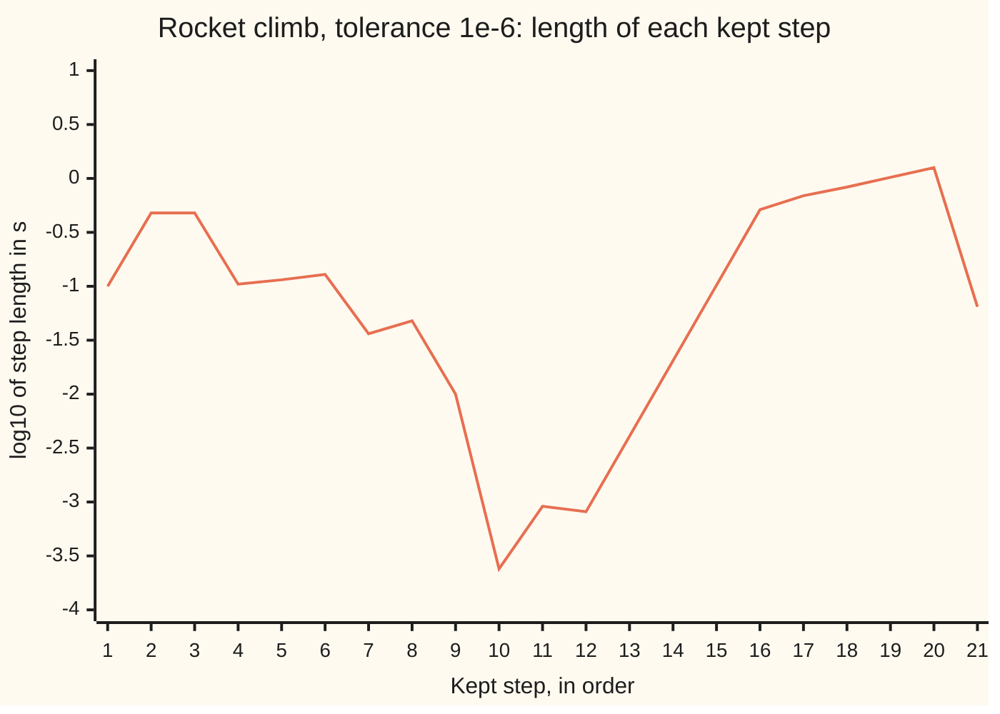

# Embedded pairs: two orders from one set of samples, so the step can choose itself

[Syllabus](../../../SYLLABUS.md) → [Numerical analysis](../README.md) → [ODE Solvers](../README.md#s06) → Embedded pairs

---

## General Overview

A model rocket leaves the pad. Its motor pushes with 50 m/s² of acceleration for 1.5 s, then burns out. After burnout the rocket coasts upward against gravity (9.81 m/s²) and air drag until it stops climbing at 6.2642 s. The motor and drag numbers are illustrative, and this card's own: the other cards on the shelf fly rockets with different numbers.

The wanted numbers are the rocket's height and speed at every moment of the climb, each to about one part in a million. A solver gets them by short steps in time. At burnout the push vanishes in an instant, so the right step length there is tiny. In the smooth coast a long step is just as accurate.

An adaptive solver finds the step length itself. It computes each step twice, by a fifth-order and a fourth-order recipe that share seven samples of the rate of change. The gap between the answers estimates the error, and decides whether to keep the step and how long the next one is.

Left to itself with a tolerance of one millionth, the solver's step shrinks to 0.00024 s at burnout, with 24 rejected tries along the way. It then stretches to 1.2459 s while the rocket coasts. Near the jump each keep-or-reject decision is a close call, so counts like these shift with rounding; only their size is meaningful.

This card answers three questions that [Adaptive steps](../../08-Differential%20equations%20and%20dynamics/05-Numerical%20Evolution/05-adaptive-step-size.md) left open:

- Where do the two sets of weights come from?
- Why is the final error not the tolerance?
- Should the solver limit the error of each step, or the error per second of time?

**Fix the seven samples and each order condition is linear in the weights: order 5 allows one set, order 4 a one-parameter family, and the gap between the two answers is a free estimate of each step's error, which the step rule controls per step, not over the whole flight.**

**What kind of fact this is:** a theorem about the weights, checked in exact fractions by the code, plus a method whose step rule rests on an approximation that holds for small steps, shown in Why it works.

### The picture: the step collapses at burnout, then stretches



Orange: log10 of each kept step's length, so −1 is 0.1 s and −3 is 0.001 s. Steps 1 to 8 are the burn. Steps 9 to 14 crowd around burnout at 1.5 s. Steps 15 to 20 are the coast, growing to 1.2459 s. The last step is cut short to land on 6 s.

---

## The formula

Reminder: a Runge-Kutta step samples the rate of change at several points inside the step, called **stages**. Stage i is $k_i = f(t + c_i h,\ y + h\sum_j a_{ij}k_j)$, and the step ends at $y + h\sum_i b_i k_i$. The table of $c_i$, $a_{ij}$ and $b_i$ is the Butcher tableau ([Runge-Kutta](01-runge-kutta-and-butcher-tableaux.md)).

The weights must pass one **order condition** per rooted tree (a pattern of nested derivatives in the Taylor series of one step). In each condition, $\Phi_i(\text{tree})$ is a number built from the stage table alone (stage i's elementary weight), and $\gamma(\text{tree})$ is a whole number fixed by the tree's shape (its density); Step 1 shows how to compute both. Then the pair, its error ratio and the step rule are

$$\sum_{i=1}^{7} b_i\,\Phi_i(\text{tree}) = \frac{1}{\gamma(\text{tree})}\quad\text{for every tree with at most } p \text{ nodes},$$

$$y_5 = y + h\sum_{i=1}^{7} b_i k_i,\qquad y_4 = y + h\sum_{i=1}^{7} \hat b_i k_i,\qquad E = \max_m \frac{|y_{4,m} - y_{5,m}|}{\mathrm{tol}\,\bigl(1 + \max(|y_m|, |y_{5,m}|)\bigr)},$$

$$h_{new} = h\cdot\min\bigl(5,\ \max(0.2,\ 0.9\,E^{-1/5})\bigr).$$

**Read it aloud:** weights that pass every condition up to p nodes give order p; the same seven stages, weighted two ways, give a fifth-order and a fourth-order answer; their worst gap over its allowance is E; keep the step if E is at most 1, and scale the next step by 0.9 times E to the power −1/5, by at most 5 and at least a fifth.

Control **per unit step** divides E by h first and uses the power −1/4. Both versions keep $y_5$, the better answer.

| Symbol | Plain meaning | In our example | Push it up and the answer… |
| --- | --- | --- | --- |
| $t$, $h$ | time in s; the step's length | 0 to 6 s; 1 s tried from burnout | error per step grows like $h^5$ |
| $y = (y_1, y_2)$, $y_m$ | the state: height in m, speed in m/s; component m | 43.758903 m, 56.503865 m/s at burnout | — |
| $f$, $k_i$, $c_i$ | the rate law; stage i's sample of it; its time as a fraction of the step | $c$ = 0, 1/5, 3/10, 4/5, 8/9, 1, 1 | — |
| $a_{ij}$ | how stage i mixes the earlier samples | row 2 is 1/5; row 7 equals $b$ | — |
| $b_i$, $\hat b_i$ | fifth-order and fourth-order weights | $b_1$ = 35/384; $\hat b_7$ = 1/40 | a bigger $\hat b_7$ inflates every estimate |
| $p$ | order of a set of weights | 5 for $b$, 4 for $\hat b$ | more conditions to pass |
| $\Phi_i(\text{tree})$, $\gamma(\text{tree})$ | stage i's elementary weight on a tree; the tree's density | 17 trees with up to 5 nodes | — |
| $y_5$, $y_4$ | the two answers to one step | 92.397871 m and 92.398138 m | — |
| tol | the tolerance: allowed gap per unit of $1 + $ size | 1e-6 | longer steps, larger final error |
| $E$ | worst gap over its allowance | 2.8552 for the 1 s try | reject when above 1 |
| 0.9; 0.2 and 5 | safety factor; limits on one change of $h$ | as given | more rejected tries (see Try changing) |
| $C_5$, $C_6$, $\theta$, $T$, $N$ | in the fold: error constants of orders 4 and 5; the fraction of tol a step uses; the run's length; the step count | $T$ = 6 s; $N$ = 10 at 1e-6 | — |

### When it holds

- **The rate is smooth inside each step.** A step that straddles burnout breaks this. Its two answers share the same wrong samples, so their gap stays small while both miss: one such step left the speed off by −3.588e-3 m/s, against an allowance of 5.750e-5.
- **The step is short enough for the leading error term to dominate.** For the 1 s try from burnout the height gap, 2.667e-4 m, matches the fourth-order answer's true error, 2.605e-4 m. The speed gap, 1.093e-5 m/s, does not match its true error, 3.213e-5 m/s, because at this length the fifth-order speed is itself off by 2.120e-5 m/s.
- **The allowance is per step.** Error carried in from earlier steps is never measured, so the final error is a different number.
- **The equation is not stiff** (stiff: a fast-decaying part forces short steps for stability, not accuracy). Otherwise the controller wastes effort; see [Stiffness](05-stiffness-a-stability-and-the-dahlquist-barriers.md).

---

## Why it works

### Step 0: fix the stages, and the weights enter linearly

Every order condition is a sum of weights times numbers built from the stage table alone. So once $c$ and $a$ are chosen, finding the weights means solving a linear system. The code does this in exact fractions.

### Step 1: count the conditions

[Runge-Kutta](01-runge-kutta-and-butcher-tableaux.md) shows why each rooted tree gives one condition. Write a tree in brackets: `[]` is a single node, `[[][][][]]` is a root with four leaves (the bushy tree), and `[[[[[]]]]]` is a chain of five (the tall tree).

The two numbers in each condition come from the tree's shape:

- $\Phi_i$ of a single node is 1. For a root carrying subtrees, $\Phi_i$ multiplies, over the subtrees, $\sum_j a_{ij}\Phi_j(\text{subtree})$.
- $\gamma$ is the tree's node count times the $\gamma$ of each subtree.

For the bushy tree this gives $\sum_i b_i c_i^4 = 1/5$: the weights must integrate $t^4$ exactly over the step. For the tall tree it gives a chain of four $a$-sums equal to 1/120.

The code counts 1, 1, 2, 4 and 9 trees with 1 to 5 nodes. So order 4 needs 8 conditions and order 5 needs 17.

### Step 2: order 5 leaves exactly one set of weights

Leave all seven weights free. The 17 conditions on them have rank 7 (rank: the number of independent equations), and they do not contradict each other. So exactly one set of weights passes them all, and the conditions themselves force $b_2 = 0$:

$$b = \Bigl(\tfrac{35}{384},\ 0,\ \tfrac{500}{1113},\ \tfrac{125}{192},\ -\tfrac{2187}{6784},\ \tfrac{11}{84},\ 0\Bigr).$$

These are the published fifth-order weights. Note $b_7 = 0$, and row 7 of the stage table equals $b$. So stage 7 samples the rate at $y_5$ itself, at the step's end. That sample is the next step's stage 1, so a kept step costs six new samples, not seven.

### Step 3: order 4 leaves a line of weights, and one free number

The 8 conditions for order 4 have rank 6 on the same seven weights. That leaves one free number. Every choice of it gives a valid fourth-order formula.

Fixing $\hat b_7 = 1/40$, the published choice, gives

$$\hat b = \Bigl(\tfrac{5179}{57600},\ 0,\ \tfrac{7571}{16695},\ \tfrac{393}{640},\ -\tfrac{92097}{339200},\ \tfrac{187}{2100},\ \tfrac{1}{40}\Bigr).$$

$\hat b$ misses all 9 fifth-order conditions; $b$ misses none. On the bushy tree it misses by −71/270000, on the tall tree by 97/120000. These misses are the fourth-order answer's error constants. Each one times $h^5$ and a product of derivatives is part of $y_4 - y_5$.

One point on the line is useless: $\hat b_7 = 0$ gives $\hat b = b$. Then the two answers agree exactly, every estimate is 0, and the step grows by the cap of 5 each time. The code runs it: 4 steps, and the height ends −1.254e-1 m off.

### Step 4: the gap measures the fourth-order error, so the fifth root sets the step

The gap $y_4 - y_5$ is the fourth-order error minus the fifth-order error, and for a short step the second is smaller by a factor of order $h$. Since the gap grows like $h^5$, the step that brings a ratio E down to 1 is h times the fifth root of 1/E. [Adaptive steps](../../08-Differential%20equations%20and%20dynamics/05-Numerical%20Evolution/05-adaptive-step-size.md) proves this rule and explains the safety factor 0.9.

### Step 5: why the final error is not the tolerance

The final error is the sum of every step's local error, each carried forward and stretched or shrunk by the equation. [From local error to global error](02-convergence-of-one-step-methods.md) proves this. The controller holds something different: the fourth-order error of each step. Two gaps open between the two:

- **The kept answer is not the one measured.** The solver keeps $y_5$, whose local error is smaller than the estimate by a factor of order $h$.
- **The count of steps changes with the tolerance.** A tighter tolerance means shorter steps and more of them.

Tracking both gives a prediction for how the final error scales with tol, written as error ∝ tol^slope. The derivation is in the fold. The code measures each slope by a straight-line fit of log10 error against log10 tol, from 1e-4 to 1e-10:

| Control | Answer kept | Theory slope | Measured slope | Steps at 1e-10 |
| --- | --- | ---: | ---: | ---: |
| per step | fifth order | 1.00 | 0.99 | 49 |
| per step | fourth order | 0.80 | 0.73 | 49 |
| per unit step | fifth order | 1.25 | 1.17 | 81 |
| per unit step | fourth order | 1.00 | 0.90 | 81 |

The usual setting, per step with the fifth-order answer kept, gives slope 1. Ten times tighter buys about ten times smaller error. That is what "tolerances that behave" means: the error is proportional to tol. It is not equal to tol. At 1e-4 the final height error is 1.20e-3 m; at 1e-6 it is 3.10e-6 m.

<details>
<summary>Detailed proof: the four slopes from the step-size rule</summary>

Let the estimate, the fourth-order local error, be about $C_5 h^5$, and let the fifth-order local error be $C_6 h^6$. Take $C_5$ and $C_6$ as roughly constant over the climb of length $T$, ignore the stretching factors, and count $N \approx T/h$ steps.

**Per step.** The controller makes $C_5 h^5 \approx \theta\,\mathrm{tol}$ for a fixed fraction $\theta$ below 1, so $h \propto \mathrm{tol}^{1/5}$.

- Keep $y_4$: each step adds $\theta\,\mathrm{tol}$, and $N \propto \mathrm{tol}^{-1/5}$, so the final error $\propto \mathrm{tol}^{4/5}$.
- Keep $y_5$: each step adds $C_6 h^6 = (C_6/C_5)\,h\,\theta\,\mathrm{tol}$. Summing $h$ over the steps gives $T$, so the final error $\approx T(C_6/C_5)\theta\,\mathrm{tol} \propto \mathrm{tol}$.

**Per unit step.** The controller makes $C_5 h^5 / h \approx \theta\,\mathrm{tol}$, so $h \propto \mathrm{tol}^{1/4}$.

- Keep $y_4$: each step adds $\theta\,\mathrm{tol}\,h$, which sums to $\theta T\,\mathrm{tol} \propto \mathrm{tol}$.
- Keep $y_5$: each step adds $(C_6/C_5)\,h\cdot\theta\,\mathrm{tol}\,h$, which sums to $T(C_6/C_5)\theta\,\mathrm{tol}\,h \propto \mathrm{tol}^{5/4}$.

The measured slopes sit a little below theory, because the constants are not really fixed along the climb and local errors of opposite sign partly cancel. One sign of this: the height error changes sign between tol 1e-6 and 1e-7, and at 1e-7 and 1e-8 it is almost the same, −5.54e-8 m and −5.19e-8 m.

</details>

### Step 6: per step or per unit step

Per step asks "is this step's error below tol?" Per unit step asks "is this step's error below tol per second?" A long step gets a larger allowance per step, and a short step a smaller one. The difference matters at tight tolerances, where steps are short: per unit step then takes 81 steps against 49 at 1e-10.

Per unit step with the fourth-order answer kept is the classic way to make error proportional to tol. Per step with the fifth-order answer kept also gives slope 1, with fewer steps at the same tol, and it is the setting the standard Dormand-Prince codes use.

---

## Worked numbers, by hand

One trial step of h = 1 s from the exact burnout state, with tol = 1e-6.

| Step | Arithmetic | Value |
| --- | --- | --- |
| start | closed form at 1.5 s | 43.758903 m, 56.503865 m/s |
| fifth-order answer | seven stages, weights $b$ | 92.397871 m, 41.327898 m/s |
| fourth-order answer | the same stages, weights $\hat b$ | 92.398138 m, 41.327909 m/s |
| gaps | fourth minus fifth | 2.667e-4 m, 1.093e-5 m/s |
| allowances | 1e-6 × (1 + 92.397871); 1e-6 × (1 + 56.503865) | 9.340e-5 m, 5.750e-5 m/s |
| worst ratio E | 2.667e-4 ÷ 9.340e-5, the height | 2.8552, so reject |
| next try | 1 × 0.9 × 2.8552^(−1/5) | **0.7297 s** |

The one-second step is thrown away, and the solver tries again with 0.7297 s.

The estimate is honest here. The true error of the fourth-order height at 2.5 s is 2.605e-4 m, against the estimate of 2.667e-4 m. The kept fifth-order height is off by only −6.191e-6 m.

### What breaks if you drop a piece

| Mistake | Comes out at | What went wrong |
| --- | --- | --- |
| Step across burnout blindly | speed off by −3.588e-3 m/s after one step; −1.138e-2 m in height at 6 s | the step's samples straddle a jump in the push, and both answers share them |
| Keep the fourth-order answer | 1.75e-4 m at 6 s, against 3.10e-6 m | the estimate is now the kept error; it is accurate but larger |
| Choose $\hat b_7 = 0$, so $\hat b = b$ | 4 steps; height off by −1.254e-1 m | every estimate is 0, so nothing stops the step growing |

The fix for the first row is to end a step exactly at burnout: then 10 steps, none rejected, reach 6 s with a height error of 3.101e-6 m. The blind step that crossed burnout had only its first sample before burnout. Both answers weight that sample almost equally, 35/384 against 5179/57600. So both answers missed the push by nearly the same amount, and their gap stayed under its allowance.

The code prints every row.

---

## Code, from first principles, and it actually runs

The code takes two roads. Road 1 builds every rooted tree with up to 5 nodes and solves the order conditions in exact fractions; the asserts check that the published weights come out. Road 2 runs the climb on those weights and checks it against the closed form: tanh while the motor burns, tan while the rocket coasts. Other asserts test the estimate against the true error, the burnout fix against the blind run, three measured slopes against theory, and the step counts this card quotes for the landing runs. Stage sums are plain loops, so both languages add in the same order and print the same bytes.

### Python

```python
# Embedded pairs on a model rocket's climb: where the Dormand-Prince weights come from,
# and what a tolerance does and does not control.  Standard library only.
# Road 1, exact fractions: each rooted tree with up to 5 nodes gives one linear order
#   condition, sum of b_i Phi_i(tree) = 1/gamma(tree); solving them gives the weights.
# Road 2, closed form: the climb is tanh while the motor burns and tan while it coasts,
#   checked against the adaptive solver that runs on the weights from road 1.
from fractions import Fraction as Q
from math import sqrt, tanh, tan, atan, cosh, cos, log, log10, prod
A = [[], [Q(1, 5)], [Q(3, 40), Q(9, 40)], [Q(44, 45), Q(-56, 15), Q(32, 9)],
     [Q(19372, 6561), Q(-25360, 2187), Q(64448, 6561), Q(-212, 729)],
     [Q(9017, 3168), Q(-355, 33), Q(46732, 5247), Q(49, 176), Q(-5103, 18656)],
     [Q(35, 384), Q(0), Q(500, 1113), Q(125, 192), Q(-2187, 6784), Q(11, 84)]]
S, FREE = 7, [0, 1, 2, 3, 4, 5, 6]         # seven stages, all seven weights free
C = [sum(row, Q(0)) for row in A]           # stage times c_i, as fractions of the step
def forests(n):                             # every sorted list of trees with n nodes in all
    out = set() if n else {()}
    for k in range(1, n + 1):
        for t in trees(k):
            for f in forests(n - k): out.add(tuple(sorted(f + (t,))))
    return sorted(out)
def trees(n): return ["[" + "".join(f) + "]" for f in forests(n - 1)]
def kids(s):                                # the subtrees hanging from the root
    out, depth, start = [], 0, 1
    for i in range(1, len(s) - 1):
        depth += 1 if s[i] == "[" else -1
        if depth == 0: out.append(s[start:i + 1]); start = i + 1
    return out
def phi(s):                                 # Phi_i(tree) for every stage i
    v = [Q(1)] * S
    for k in kids(s):
        p = phi(k)
        v = [v[i] * sum((A[i][j] * p[j] for j in range(i)), Q(0)) for i in range(S)]
    return v
def gamma(s): return s.count("[") * prod(gamma(k) for k in kids(s))
def conditions(p): return [[phi(t)[j] for j in FREE] + [Q(1, gamma(t))] for n in range(1, p + 1) for t in trees(n)]
def solve(rows):                            # exact Gauss-Jordan: rank, and weights if unique
    M, rk = [r[:] for r in rows], 0
    for col in range(len(FREE)):
        piv = next((r for r in range(rk, len(M)) if M[r][col] != 0), None)
        if piv is None: continue
        M[rk], M[piv] = M[piv], M[rk]
        p = M[rk][col]; M[rk] = [x / p for x in M[rk]]
        for r in range(len(M)):
            if r != rk and M[r][col] != 0:
                f = M[r][col]; M[r] = [a - f * b for a, b in zip(M[r], M[rk])]
        rk += 1
    assert all(r[-1] == 0 for r in M[rk:])  # the conditions do not contradict each other
    w = [Q(0)] * S
    if rk == len(FREE):
        for i, j in enumerate(FREE): w[j] = M[i][-1]
    return rk, w
def miss(w, t): return sum((wi * pi for wi, pi in zip(w, phi(t))), Q(0)) - Q(1, gamma(t))
fr = lambda w: ", ".join(str(x) for x in w)
print("trees with 1..5 nodes:", " ".join(str(len(trees(n))) for n in range(1, 6)))
r4, r5 = solve(conditions(4))[0], solve(conditions(5))
print(f"order 4: {len(conditions(4))} conditions, rank {r4}; order 5: {len(conditions(5))} conditions, rank {r5[0]}")
w5 = r5[1]
print("order-5 weights b:", fr(w5))
assert w5 == A[6] + [Q(0)]                  # the published fifth-order weights, b_7 = 0
w4 = solve(conditions(4) + [[Q(0)] * 6 + [Q(1), Q(1, 40)]])[1]
print("order-4 weights with bhat_7 = 1/40:", fr(w4))
assert w4 == [Q(5179, 57600), 0, Q(7571, 16695), Q(393, 640), Q(-92097, 339200), Q(187, 2100), Q(1, 40)]
print(f"bhat misses order 5: bushy tree {miss(w4, '[[][][][]]')}, tall tree {miss(w4, '[[[[[]]]]]')}")
print(f"bhat misses order 5 on {sum(1 for t in trees(5) if miss(w4, t) != 0)} of 9 trees; b on {sum(1 for t in trees(5) if miss(w5, t) != 0)}")
# ---- the rocket: 50 m/s^2 of thrust for 1.5 s, gravity, drag 0.00225 v^2 per metre ----
Af = [[float(x) for x in row] for row in A]; Cf = [float(x) for x in C]
B5, B4 = [float(x) for x in w5], [float(x) for x in w4]
G, THRUST, TB, K = 9.81, 50.0, 1.5, 0.00225
print(f"stage times c: {fr(C)}; rocket: thrust {THRUST} m/s^2 for {TB} s, gravity {G} m/s^2, drag {K} v^2 per metre")
def rate(on, y): return [y[1], (THRUST if on else 0.0) - G - K * y[1] * abs(y[1])]
def dot(w, k, n):
    s = 0.0
    for a, q in zip(w, k): s += a * q[n]
    return s
def pair(t, y, h, blind, b4):               # one step: fifth-order and fourth-order answers
    k = []
    for i in range(S):
        yi = [y[n] + h * dot(Af[i], k, n) for n in range(2)]
        k.append(rate((t + Cf[i] * h < TB) if blind else (t < TB), yi))
    return [y[n] + h * dot(B5, k, n) for n in range(2)], [y[n] + h * dot(b4, k, n) for n in range(2)]
def exact(t):                               # closed form, valid until the top at 6.26 s
    a = THRUST - G; w1, v1 = sqrt(a * K), sqrt(a / K)
    if t <= TB: return [log(cosh(w1 * t)) / K, v1 * tanh(w1 * t)]
    yb, vb = log(cosh(w1 * TB)) / K, v1 * tanh(w1 * TB)
    w, vg = sqrt(G * K), sqrt(G / K); ph = atan(vb / vg); s = t - TB
    return [yb + log(cos(ph - w * s) / cos(ph)) / K, vg * tan(ph - w * s)]
def ratio(y, y5, y4, tol):                  # worst gap over its allowance tol (1 + size)
    e = 0.0
    for n in range(2): e = max(e, abs(y5[n] - y4[n]) / (tol * (1 + max(abs(y[n]), abs(y5[n])))))
    return e
def run(tol, unit=False, keep5=True, blind=False, b4=B4, T=6.0, h=0.1):
    t, y, ends, lens, path, rej = 0.0, [0.0, 0.0], [], [], [], 0
    while t < T - 1e-12:
        hs = min(h, T - t, TB - t) if (t < TB and not blind) else min(h, T - t)
        y5, y4 = pair(t, y, hs, blind, b4)
        err = ratio(y, y5, y4, tol) / (hs if unit else 1.0)
        fac = 5.0 if err == 0 else min(5.0, max(0.2, 0.9 * (1 / err) ** (0.25 if unit else 0.2)))
        if err <= 1:
            t += hs; y = y5 if keep5 else y4; ends.append(t); lens.append(hs); path.append(y)
            h = max(h, hs * fac) if hs < h else hs * fac
        else: rej += 1; h = hs * fac
    return y, ends, lens, rej, path
def sci(x, d=3): m, e = f"{x:.{d}e}".split("e"); return f"{m}e{int(e)}"
def err6(y): return [y[0] - exact(6.0)[0], y[1] - exact(6.0)[1]]
yb, vb = exact(TB)
print(f"burnout, exact: height {yb:.6f} m, speed {vb:.6f} m/s; top at {TB + atan(vb / sqrt(G / K)) / sqrt(G * K):.4f} s")
y5, y4 = pair(TB, [yb, vb], 1.0, False, B4); ex = exact(TB + 1.0)
print(f"by hand, h = 1 s from burnout: fifth {y5[0]:.6f} m, {y5[1]:.6f} m/s; fourth {y4[0]:.6f} m, {y4[1]:.6f} m/s")
print(f"gaps {sci(y4[0] - y5[0])} m, {sci(y4[1] - y5[1])} m/s; allowances {sci(1e-6 * (1 + y5[0]))}, {sci(1e-6 * (1 + vb))}")
e = ratio([yb, vb], y5, y4, 1e-6)
print(f"worst ratio {e:.4f}: rejected; next try {min(5.0, max(0.2, 0.9 * (1 / e) ** 0.2)):.4f} s")
print(f"true errors at 2.5 s: fourth {sci(y4[0] - ex[0])} m, {sci(y4[1] - ex[1])} m/s; fifth {sci(y5[0] - ex[0])} m, {sci(y5[1] - ex[1])} m/s")
assert abs((y4[0] - y5[0]) / (y4[0] - ex[0]) - 1) < 0.05
y, ends, lens, rej, path = run(1e-6, blind=True)
i = next(j for j, t in enumerate(ends) if t > TB); yi = path[i]
print(f"blind, tol 1e-6: kept {len(ends)}, rejected {rej}, steps {min(lens):.5f} s to {max(lens):.4f} s")
print(f"blind: speed error after the burnout step {sci(yi[1] - exact(ends[i])[1])} m/s; at 6 s {sci(err6(y)[0])} m, {sci(err6(y)[1])} m/s")
print("figure, step ends t:", ", ".join(f"{t:.3f}" for t in ends))
print("figure, log10 step:", ", ".join(f"{log10(x):.2f}" for x in lens))
yl, el, ll, rl, _ = run(1e-6)
print(f"landing on burnout: kept {len(el)}, rejected {rl}; at 6 s {sci(err6(yl)[0])} m, {sci(err6(yl)[1])} m/s")
assert abs(err6(yl)[1]) * 100 < abs(err6(y)[1]) and abs(err6(yl)[0]) < 1e-4 and (len(el), rl) == (10, 0)
tols, slopes = [1e-4, 1e-5, 1e-6, 1e-7, 1e-8, 1e-9, 1e-10], {}
print("figure, log10 tol:", ", ".join(f"{log10(t):.2f}" for t in tols))
for unit in (False, True):
    for keep5 in (True, False):
        name = ("per unit step" if unit else "per step") + (", keep 5th" if keep5 else ", keep 4th")
        res = [run(tol, unit, keep5) for tol in tols]
        ys = [log10(abs(err6(r[0])[0])) for r in res]
        xm, ym = sum(log10(t) for t in tols) / 7, sum(ys) / 7
        sl = sum((log10(t) - xm) * (v - ym) for t, v in zip(tols, ys)) / sum((log10(t) - xm) ** 2 for t in tols)
        slopes[(unit, keep5)] = sl; assert len(res[-1][1]) == (81 if unit else 49)   # steps at 1e-10, quoted on the card
        th = (5 / 4 if unit else 1.0) if keep5 else (1.0 if unit else 4 / 5)   # Why it works, Step 5
        print(f"{name}: steps {' '.join(str(len(r[1])) for r in res)}; slope {sl:.2f}, theory {th:.2f}")
        print(f"  height error at 6 s: {' '.join(sci(err6(r[0])[0], 2) for r in res)}")
        print(f"  figure, log10 error: {', '.join(f'{v:.2f}' for v in ys)}")
assert 0.7 < slopes[(False, False)] < 0.9 and 0.85 < slopes[(True, False)] < 1.15 and 0.85 < slopes[(False, True)] < 1.15
yz, ez = run(1e-6, b4=B5)[:2]
print(f"breaks: bhat = b, so every estimate is 0: kept {len(ez)}, height error {sci(err6(yz)[0])} m")
print("ALL CHECKS PASS")
```

**Ran 2026-11-11 on macOS, Python 3.14.10, standard library only. All checks passed. Output, pasted from the run:**

```
trees with 1..5 nodes: 1 1 2 4 9
order 4: 8 conditions, rank 6; order 5: 17 conditions, rank 7
order-5 weights b: 35/384, 0, 500/1113, 125/192, -2187/6784, 11/84, 0
order-4 weights with bhat_7 = 1/40: 5179/57600, 0, 7571/16695, 393/640, -92097/339200, 187/2100, 1/40
bhat misses order 5: bushy tree -71/270000, tall tree 97/120000
bhat misses order 5 on 9 of 9 trees; b on 0
stage times c: 0, 1/5, 3/10, 4/5, 8/9, 1, 1; rocket: thrust 50.0 m/s^2 for 1.5 s, gravity 9.81 m/s^2, drag 0.00225 v^2 per metre
burnout, exact: height 43.758903 m, speed 56.503865 m/s; top at 6.2642 s
by hand, h = 1 s from burnout: fifth 92.397871 m, 41.327898 m/s; fourth 92.398138 m, 41.327909 m/s
gaps 2.667e-4 m, 1.093e-5 m/s; allowances 9.340e-5, 5.750e-5
worst ratio 2.8552: rejected; next try 0.7297 s
true errors at 2.5 s: fourth 2.605e-4 m, 3.213e-5 m/s; fifth -6.191e-6 m, 2.120e-5 m/s
blind, tol 1e-6: kept 21, rejected 24, steps 0.00024 s to 1.2459 s
blind: speed error after the burnout step -3.588e-3 m/s; at 6 s -1.138e-2 m, -2.073e-3 m/s
figure, step ends t: 0.100, 0.579, 1.056, 1.162, 1.277, 1.405, 1.442, 1.490, 1.500, 1.500, 1.501, 1.502, 1.506, 1.526, 1.628, 2.140, 2.839, 3.676, 4.689, 5.935, 6.000
figure, log10 step: -1.00, -0.32, -0.32, -0.98, -0.94, -0.89, -1.44, -1.32, -2.00, -3.62, -3.04, -3.09, -2.39, -1.69, -0.99, -0.29, -0.16, -0.08, 0.01, 0.10, -1.19
landing on burnout: kept 10, rejected 0; at 6 s 3.101e-6 m, 2.442e-6 m/s
figure, log10 tol: -4.00, -5.00, -6.00, -7.00, -8.00, -9.00, -10.00
per step, keep 5th: steps 6 8 10 14 21 32 49; slope 0.99, theory 1.00
  height error at 6 s: 1.20e-3 6.36e-5 3.10e-6 -5.54e-8 -5.19e-8 -8.78e-9 -1.10e-9
  figure, log10 error: -2.92, -4.20, -5.51, -7.26, -7.28, -8.06, -8.96
per step, keep 4th: steps 6 8 10 14 21 32 49; slope 0.73, theory 0.80
  height error at 6 s: 4.58e-3 7.68e-4 1.75e-4 3.36e-5 6.00e-6 1.03e-6 1.76e-7
  figure, log10 error: -2.34, -3.11, -3.76, -4.47, -5.22, -5.99, -6.75
per unit step, keep 5th: steps 6 8 10 17 27 47 81; slope 1.17, theory 1.25
  height error at 6 s: 2.82e-3 8.84e-5 3.24e-6 -2.06e-7 -2.89e-8 -2.48e-9 -1.66e-10
  figure, log10 error: -2.55, -4.05, -5.49, -6.69, -7.54, -8.61, -9.78
per unit step, keep 4th: steps 6 8 10 17 27 47 81; slope 0.90, theory 1.00
  height error at 6 s: 8.46e-3 1.00e-3 1.84e-4 2.19e-5 2.57e-6 3.00e-7 3.23e-8
  figure, log10 error: -2.07, -3.00, -3.74, -4.66, -5.59, -6.52, -7.49
breaks: bhat = b, so every estimate is 0: kept 4, height error -1.254e-1 m
ALL CHECKS PASS
```

### Rust

```rust
// Embedded pairs on a model rocket's climb: where the Dormand-Prince weights come from,
// and what a tolerance does and does not control.  Standard library only.
// Road 1, exact fractions: each rooted tree with up to 5 nodes gives one linear order
//   condition, sum of b_i Phi_i(tree) = 1/gamma(tree); solving them gives the weights.
// Road 2, closed form: the climb is tanh while the motor burns and tan while it coasts,
//   checked against the adaptive solver that runs on the weights from road 1.
use std::collections::BTreeSet;
#[derive(Clone, Copy, PartialEq, Debug)] struct Q { n: i128, d: i128 } // an exact fraction
fn gcd(a: i128, b: i128) -> i128 { if b == 0 { a.abs() } else { gcd(b, a % b) } }
fn q(n: i128, d: i128) -> Q { let g = gcd(n, d).max(1) * d.signum(); Q { n: n / g, d: d / g } }
impl std::ops::Add for Q { type Output = Q; fn add(self, o: Q) -> Q { q(self.n * o.d + o.n * self.d, self.d * o.d) } }
impl std::ops::Sub for Q { type Output = Q; fn sub(self, o: Q) -> Q { q(self.n * o.d - o.n * self.d, self.d * o.d) } }
impl std::ops::Mul for Q { type Output = Q; fn mul(self, o: Q) -> Q { q(self.n * o.n, self.d * o.d) } }
impl std::ops::Div for Q { type Output = Q; fn div(self, o: Q) -> Q { q(self.n * o.d, self.d * o.n) } }
impl std::fmt::Display for Q { fn fmt(&self, f: &mut std::fmt::Formatter) -> std::fmt::Result {
    if self.d == 1 { write!(f, "{}", self.n) } else { write!(f, "{}/{}", self.n, self.d) } } }
const S: usize = 7;
const FREE: [usize; 7] = [0, 1, 2, 3, 4, 5, 6]; // all seven weights free
fn tableau() -> Vec<Vec<Q>> {
    let raw: [&[(i128, i128)]; 7] = [&[], &[(1, 5)], &[(3, 40), (9, 40)], &[(44, 45), (-56, 15), (32, 9)],
        &[(19372, 6561), (-25360, 2187), (64448, 6561), (-212, 729)],
        &[(9017, 3168), (-355, 33), (46732, 5247), (49, 176), (-5103, 18656)],
        &[(35, 384), (0, 1), (500, 1113), (125, 192), (-2187, 6784), (11, 84)]];
    raw.iter().map(|r| r.iter().map(|&(n, d)| q(n, d)).collect()).collect()
}
fn forests(n: usize) -> Vec<Vec<String>> { // every sorted list of trees with n nodes in all
    let mut out: BTreeSet<Vec<String>> = BTreeSet::new();
    if n == 0 { out.insert(vec![]); }
    for k in 1..=n { for t in trees(k) { for f in forests(n - k) {
        let mut g = f.clone(); g.push(t.clone()); g.sort(); out.insert(g); } } }
    out.into_iter().collect()
}
fn trees(n: usize) -> Vec<String> { forests(n - 1).iter().map(|f| format!("[{}]", f.concat())).collect() }
fn kids(s: &str) -> Vec<String> { // the subtrees hanging from the root
    let (b, mut out, mut depth, mut start) = (s.as_bytes(), vec![], 0i32, 1usize);
    for i in 1..s.len() - 1 { depth += if b[i] == b'[' { 1 } else { -1 };
        if depth == 0 { out.push(s[start..i + 1].to_string()); start = i + 1; } }
    out
}
fn phi(a: &[Vec<Q>], s: &str) -> Vec<Q> { // Phi_i(tree) for every stage i
    let mut v = vec![q(1, 1); S];
    for k in kids(s) { let p = phi(a, &k);
        for i in 0..S { let mut t = q(0, 1); for j in 0..i { t = t + a[i][j] * p[j]; } v[i] = v[i] * t; } }
    v
}
fn gamma(s: &str) -> i128 { s.matches('[').count() as i128 * kids(s).iter().map(|k| gamma(k)).product::<i128>() }
fn conditions(a: &[Vec<Q>], p: usize) -> Vec<Vec<Q>> {
    let mut rows = vec![];
    for n in 1..=p { for t in trees(n) { let ph = phi(a, &t);
        let mut r: Vec<Q> = FREE.iter().map(|&j| ph[j]).collect(); r.push(q(1, gamma(&t))); rows.push(r); } }
    rows
}
fn solve(rows: &[Vec<Q>]) -> (usize, Vec<Q>) { // exact Gauss-Jordan: rank, and weights if unique
    let (mut m, mut rk) = (rows.to_vec(), 0);
    for col in 0..FREE.len() {
        let piv = match (rk..m.len()).find(|&r| m[r][col].n != 0) { Some(p) => p, None => continue };
        m.swap(rk, piv);
        let p = m[rk][col]; m[rk] = m[rk].iter().map(|&x| x / p).collect();
        for r in 0..m.len() { if r != rk && m[r][col].n != 0 { let (f, top) = (m[r][col], m[rk].clone());
            m[r] = m[r].iter().zip(&top).map(|(&x, &y)| x - f * y).collect(); } }
        rk += 1;
    }
    assert!(m[rk..].iter().all(|r| r[FREE.len()].n == 0)); // the conditions do not contradict each other
    let mut w = vec![q(0, 1); S];
    if rk == FREE.len() { for (i, &j) in FREE.iter().enumerate() { w[j] = m[i][FREE.len()]; } }
    (rk, w)
}
fn miss(a: &[Vec<Q>], w: &[Q], t: &str) -> Q { let ph = phi(a, t); (0..S).fold(q(0, 1), |s, i| s + w[i] * ph[i]) - q(1, gamma(t)) }
fn fr(w: &[Q]) -> String { w.iter().map(|x| x.to_string()).collect::<Vec<_>>().join(", ") }
fn fl(x: Q) -> f64 { x.n as f64 / x.d as f64 }
// ---- the rocket: 50 m/s^2 of thrust for 1.5 s, gravity, drag 0.00225 v^2 per metre ----
const G: f64 = 9.81; const THRUST: f64 = 50.0; const TB: f64 = 1.5; const K: f64 = 0.00225;
struct Pair { a: Vec<Vec<f64>>, c: Vec<f64>, b5: Vec<f64>, b4: Vec<f64> }
fn rate(on: bool, y: [f64; 2]) -> [f64; 2] { [y[1], (if on { THRUST } else { 0.0 }) - G - K * y[1] * y[1].abs()] }
fn dot(w: &[f64], k: &[[f64; 2]], n: usize) -> f64 { let mut s = 0.0; for (a, q) in w.iter().zip(k) { s += a * q[n]; } s }
fn step(p: &Pair, t: f64, y: [f64; 2], h: f64, blind: bool, b4: &[f64]) -> ([f64; 2], [f64; 2]) {
    let mut k: Vec<[f64; 2]> = vec![];
    for i in 0..S { let yi = [y[0] + h * dot(&p.a[i], &k, 0), y[1] + h * dot(&p.a[i], &k, 1)];
        k.push(rate(if blind { t + p.c[i] * h < TB } else { t < TB }, yi)); }
    ([y[0] + h * dot(&p.b5, &k, 0), y[1] + h * dot(&p.b5, &k, 1)], [y[0] + h * dot(b4, &k, 0), y[1] + h * dot(b4, &k, 1)])
}
fn exact(t: f64) -> [f64; 2] { // closed form, valid until the top at 6.26 s
    let a = THRUST - G; let (w1, v1) = ((a * K).sqrt(), (a / K).sqrt());
    if t <= TB { return [(w1 * t).cosh().ln() / K, v1 * (w1 * t).tanh()]; }
    let (yb, vb) = ((w1 * TB).cosh().ln() / K, v1 * (w1 * TB).tanh());
    let (w, vg) = ((G * K).sqrt(), (G / K).sqrt()); let ph = (vb / vg).atan(); let s = t - TB;
    [yb + ((ph - w * s).cos() / ph.cos()).ln() / K, vg * (ph - w * s).tan()]
}
fn ratio(y: [f64; 2], y5: [f64; 2], y4: [f64; 2], tol: f64) -> f64 { // worst gap over its allowance tol (1 + size)
    (0..2).fold(0.0, |e: f64, n| e.max((y5[n] - y4[n]).abs() / (tol * (1.0 + y[n].abs().max(y5[n].abs()))))) }
struct Run { y: [f64; 2], ends: Vec<f64>, lens: Vec<f64>, path: Vec<[f64; 2]>, rej: u32 }
fn run(p: &Pair, tol: f64, unit: bool, keep5: bool, blind: bool, b4: &[f64]) -> Run {
    let (tend, mut h, mut t) = (6.0f64, 0.1f64, 0.0f64);
    let mut r = Run { y: [0.0, 0.0], ends: vec![], lens: vec![], path: vec![], rej: 0 };
    while t < tend - 1e-12 {
        let hs = if t < TB && !blind { h.min(tend - t).min(TB - t) } else { h.min(tend - t) };
        let (y5, y4) = step(p, t, r.y, hs, blind, b4);
        let err = ratio(r.y, y5, y4, tol) / (if unit { hs } else { 1.0 });
        let fac = if err == 0.0 { 5.0 } else { 5.0f64.min(0.2f64.max(0.9 * (1.0 / err).powf(if unit { 0.25 } else { 0.2 }))) };
        if err <= 1.0 {
            t += hs; r.y = if keep5 { y5 } else { y4 }; r.ends.push(t); r.lens.push(hs); r.path.push(r.y);
            h = if hs < h { h.max(hs * fac) } else { hs * fac };
        } else { r.rej += 1; h = hs * fac; }
    }
    r
}
fn err6(y: [f64; 2]) -> [f64; 2] { let e = exact(6.0); [y[0] - e[0], y[1] - e[1]] }
fn join(x: &[f64], d: usize) -> String { x.iter().map(|v| format!("{:.*}", d, v)).collect::<Vec<_>>().join(", ") }
fn main() {
    let a = tableau();
    let c: Vec<Q> = a.iter().map(|r| r.iter().fold(q(0, 1), |s, &x| s + x)).collect();
    println!("trees with 1..5 nodes: {}", (1..6).map(|n| trees(n).len().to_string()).collect::<Vec<_>>().join(" "));
    let (c4, c5) = (conditions(&a, 4), conditions(&a, 5));
    let (r4, (r5, w5)) = (solve(&c4).0, solve(&c5));
    println!("order 4: {} conditions, rank {}; order 5: {} conditions, rank {}", c4.len(), r4, c5.len(), r5);
    println!("order-5 weights b: {}", fr(&w5));
    let mut pub5 = a[6].clone(); pub5.push(q(0, 1));
    assert!(w5 == pub5); // the published fifth-order weights, b_7 = 0
    let mut rows = c4.clone(); rows.push(vec![q(0, 1), q(0, 1), q(0, 1), q(0, 1), q(0, 1), q(0, 1), q(1, 1), q(1, 40)]);
    let w4 = solve(&rows).1;
    println!("order-4 weights with bhat_7 = 1/40: {}", fr(&w4));
    assert!(w4 == vec![q(5179, 57600), q(0, 1), q(7571, 16695), q(393, 640), q(-92097, 339200), q(187, 2100), q(1, 40)]);
    println!("bhat misses order 5: bushy tree {}, tall tree {}", miss(&a, &w4, "[[][][][]]"), miss(&a, &w4, "[[[[[]]]]]"));
    let count = |w: &[Q]| trees(5).iter().filter(|t| miss(&a, w, t).n != 0).count();
    println!("bhat misses order 5 on {} of 9 trees; b on {}", count(&w4), count(&w5));
    let p = Pair { a: a.iter().map(|r| r.iter().map(|&x| fl(x)).collect()).collect(), c: c.iter().map(|&x| fl(x)).collect(),
        b5: w5.iter().map(|&x| fl(x)).collect(), b4: w4.iter().map(|&x| fl(x)).collect() };
    println!("stage times c: {}; rocket: thrust {:?} m/s^2 for {:?} s, gravity {:?} m/s^2, drag {:?} v^2 per metre", fr(&c), THRUST, TB, G, K);
    let sci = |x: f64| format!("{:.3e}", x);
    let [yb, vb] = exact(TB);
    println!("burnout, exact: height {:.6} m, speed {:.6} m/s; top at {:.4} s", yb, vb, TB + (vb / (G / K).sqrt()).atan() / (G * K).sqrt());
    let (y5, y4) = step(&p, TB, [yb, vb], 1.0, false, &p.b4); let ex = exact(TB + 1.0);
    println!("by hand, h = 1 s from burnout: fifth {:.6} m, {:.6} m/s; fourth {:.6} m, {:.6} m/s", y5[0], y5[1], y4[0], y4[1]);
    println!("gaps {} m, {} m/s; allowances {}, {}", sci(y4[0] - y5[0]), sci(y4[1] - y5[1]), sci(1e-6 * (1.0 + y5[0])), sci(1e-6 * (1.0 + vb)));
    let e = ratio([yb, vb], y5, y4, 1e-6);
    println!("worst ratio {:.4}: rejected; next try {:.4} s", e, 5.0f64.min(0.2f64.max(0.9 * (1.0 / e).powf(0.2))));
    println!("true errors at 2.5 s: fourth {} m, {} m/s; fifth {} m, {} m/s", sci(y4[0] - ex[0]), sci(y4[1] - ex[1]), sci(y5[0] - ex[0]), sci(y5[1] - ex[1]));
    assert!(((y4[0] - y5[0]) / (y4[0] - ex[0]) - 1.0).abs() < 0.05);
    let b = run(&p, 1e-6, false, true, true, &p.b4);
    let i = b.ends.iter().position(|&t| t > TB).unwrap();
    let (mn, mx) = (b.lens.iter().cloned().fold(f64::MAX, f64::min), b.lens.iter().cloned().fold(0.0, f64::max));
    println!("blind, tol 1e-6: kept {}, rejected {}, steps {:.5} s to {:.4} s", b.ends.len(), b.rej, mn, mx);
    println!("blind: speed error after the burnout step {} m/s; at 6 s {} m, {} m/s", sci(b.path[i][1] - exact(b.ends[i])[1]), sci(err6(b.y)[0]), sci(err6(b.y)[1]));
    println!("figure, step ends t: {}", join(&b.ends, 3));
    println!("figure, log10 step: {}", join(&b.lens.iter().map(|x| x.log10()).collect::<Vec<_>>(), 2));
    let l = run(&p, 1e-6, false, true, false, &p.b4);
    println!("landing on burnout: kept {}, rejected {}; at 6 s {} m, {} m/s", l.ends.len(), l.rej, sci(err6(l.y)[0]), sci(err6(l.y)[1]));
    assert!(err6(l.y)[1].abs() * 100.0 < err6(b.y)[1].abs() && err6(l.y)[0].abs() < 1e-4 && (l.ends.len(), l.rej) == (10, 0));
    let tols: [f64; 7] = [1e-4, 1e-5, 1e-6, 1e-7, 1e-8, 1e-9, 1e-10];
    println!("figure, log10 tol: {}", join(&tols.iter().map(|t| t.log10()).collect::<Vec<_>>(), 2));
    let mut slopes = vec![];
    for unit in [false, true] { for keep5 in [true, false] {
        let name = format!("{}{}", if unit { "per unit step" } else { "per step" }, if keep5 { ", keep 5th" } else { ", keep 4th" });
        let res: Vec<Run> = tols.iter().map(|&t| run(&p, t, unit, keep5, false, &p.b4)).collect();
        let ys: Vec<f64> = res.iter().map(|r| err6(r.y)[0].abs().log10()).collect();
        let xm = tols.iter().map(|t| t.log10()).sum::<f64>() / 7.0; let ym = ys.iter().sum::<f64>() / 7.0;
        let num: f64 = tols.iter().zip(&ys).map(|(t, v)| (t.log10() - xm) * (v - ym)).sum();
        let sl = num / tols.iter().map(|t| (t.log10() - xm).powi(2)).sum::<f64>();
        slopes.push(sl); assert!(res[6].ends.len() == if unit { 81 } else { 49 }); // steps at 1e-10, quoted on the card
        let th = if keep5 { if unit { 5.0 / 4.0 } else { 1.0 } } else if unit { 1.0 } else { 4.0 / 5.0 }; // Why it works, Step 5
        println!("{}: steps {}; slope {:.2}, theory {:.2}", name, res.iter().map(|r| r.ends.len().to_string()).collect::<Vec<_>>().join(" "), sl, th);
        println!("  height error at 6 s: {}", res.iter().map(|r| format!("{:.2e}", err6(r.y)[0])).collect::<Vec<_>>().join(" "));
        println!("  figure, log10 error: {}", join(&ys, 2));
    } }
    assert!(0.7 < slopes[1] && slopes[1] < 0.9 && 0.85 < slopes[3] && slopes[3] < 1.15 && 0.85 < slopes[0] && slopes[0] < 1.15);
    let z = run(&p, 1e-6, false, true, false, &p.b5);
    println!("breaks: bhat = b, so every estimate is 0: kept {}, height error {} m", z.ends.len(), sci(err6(z.y)[0]));
    println!("ALL CHECKS PASS");
}
```

**Ran 2026-11-11 on macOS, rustc 1.98.1, no crates. All checks passed. Output, pasted from the run:**

```
trees with 1..5 nodes: 1 1 2 4 9
order 4: 8 conditions, rank 6; order 5: 17 conditions, rank 7
order-5 weights b: 35/384, 0, 500/1113, 125/192, -2187/6784, 11/84, 0
order-4 weights with bhat_7 = 1/40: 5179/57600, 0, 7571/16695, 393/640, -92097/339200, 187/2100, 1/40
bhat misses order 5: bushy tree -71/270000, tall tree 97/120000
bhat misses order 5 on 9 of 9 trees; b on 0
stage times c: 0, 1/5, 3/10, 4/5, 8/9, 1, 1; rocket: thrust 50.0 m/s^2 for 1.5 s, gravity 9.81 m/s^2, drag 0.00225 v^2 per metre
burnout, exact: height 43.758903 m, speed 56.503865 m/s; top at 6.2642 s
by hand, h = 1 s from burnout: fifth 92.397871 m, 41.327898 m/s; fourth 92.398138 m, 41.327909 m/s
gaps 2.667e-4 m, 1.093e-5 m/s; allowances 9.340e-5, 5.750e-5
worst ratio 2.8552: rejected; next try 0.7297 s
true errors at 2.5 s: fourth 2.605e-4 m, 3.213e-5 m/s; fifth -6.191e-6 m, 2.120e-5 m/s
blind, tol 1e-6: kept 21, rejected 24, steps 0.00024 s to 1.2459 s
blind: speed error after the burnout step -3.588e-3 m/s; at 6 s -1.138e-2 m, -2.073e-3 m/s
figure, step ends t: 0.100, 0.579, 1.056, 1.162, 1.277, 1.405, 1.442, 1.490, 1.500, 1.500, 1.501, 1.502, 1.506, 1.526, 1.628, 2.140, 2.839, 3.676, 4.689, 5.935, 6.000
figure, log10 step: -1.00, -0.32, -0.32, -0.98, -0.94, -0.89, -1.44, -1.32, -2.00, -3.62, -3.04, -3.09, -2.39, -1.69, -0.99, -0.29, -0.16, -0.08, 0.01, 0.10, -1.19
landing on burnout: kept 10, rejected 0; at 6 s 3.101e-6 m, 2.442e-6 m/s
figure, log10 tol: -4.00, -5.00, -6.00, -7.00, -8.00, -9.00, -10.00
per step, keep 5th: steps 6 8 10 14 21 32 49; slope 0.99, theory 1.00
  height error at 6 s: 1.20e-3 6.36e-5 3.10e-6 -5.54e-8 -5.19e-8 -8.78e-9 -1.10e-9
  figure, log10 error: -2.92, -4.20, -5.51, -7.26, -7.28, -8.06, -8.96
per step, keep 4th: steps 6 8 10 14 21 32 49; slope 0.73, theory 0.80
  height error at 6 s: 4.58e-3 7.68e-4 1.75e-4 3.36e-5 6.00e-6 1.03e-6 1.76e-7
  figure, log10 error: -2.34, -3.11, -3.76, -4.47, -5.22, -5.99, -6.75
per unit step, keep 5th: steps 6 8 10 17 27 47 81; slope 1.17, theory 1.25
  height error at 6 s: 2.82e-3 8.84e-5 3.24e-6 -2.06e-7 -2.89e-8 -2.48e-9 -1.66e-10
  figure, log10 error: -2.55, -4.05, -5.49, -6.69, -7.54, -8.61, -9.78
per unit step, keep 4th: steps 6 8 10 17 27 47 81; slope 0.90, theory 1.00
  height error at 6 s: 8.46e-3 1.00e-3 1.84e-4 2.19e-5 2.57e-6 3.00e-7 3.23e-8
  figure, log10 error: -2.07, -3.00, -3.74, -4.66, -5.59, -6.52, -7.49
breaks: bhat = b, so every estimate is 0: kept 4, height error -1.254e-1 m
ALL CHECKS PASS
```

### Lean

Lean proves Steps 2 and 3 exactly, for the seven Dormand-Prince stages: which weights pass the order conditions, and which miss.

- Leave all seven weights free. They pass the condition of every tree with up to 5 nodes exactly when they are the published weights $b$.
- They pass every condition up to 4 nodes exactly on the line through $b$ and $\hat b$: one free number.
- $\hat b$ misses the condition of every tree with 5 nodes: by −71/270000 on the bushy tree, and by 97/120000 on the tall tree.
- The stage times are c = 0, 1/5, 3/10, 4/5, 8/9, 1, 1, and row 7 of the stage table equals $b$.
- The bushy and tall trees have densities 5 and 120, and $b$ passes the bushy tree's condition: $\sum_i b_i c_i^4 = 1/5$.
- Choosing $\hat b_7 = 0$ on the line gives back $b$, and the two first weights differ by 71/57600.

The rocket's flight, the error estimates, the step rule, the four slopes and every row of What breaks are left to Python and Rust.

```lean
-- Embedded pairs: for the seven Dormand-Prince stages, the order conditions of every rooted tree with up to 5 nodes allow exactly one set of weights, those with up to 4 nodes allow a line of weights through the two published sets, and the fourth-order weights miss every 5-node condition.
import Mathlib.LinearAlgebra.Matrix.Notation
import Mathlib.Algebra.BigOperators.Fin
import Mathlib.Basic.Real.Basic
import Mathlib.Tactic.NormNum
import Mathlib.Tactic.FieldSimp
import Mathlib.Tactic.Ring
import Mathlib.Tactic.LinearCombination

/-! A rooted tree is a root carrying a list of subtrees, written in brackets on the card:
`node []` is `[]`, a single node. The order of the subtrees in the list does not change any
number below, so each tree on the card appears here (perhaps several times, in different orders).

For a stage table `A` with `s` stages (numbered `0, …, s - 1` here, from 1 on the card):
* `Φ_i` of a single node is 1; for a root carrying subtrees, `Φ_i` multiplies, over the
  subtrees, `∑_j a_ij Φ_j(subtree)` (the card's Step 1).
* `γ` is the tree's node count times the `γ` of each subtree.
* The order condition of a tree is `∑_i b_i Φ_i(tree) = 1 / γ(tree)`; weights `b` have order
  `p` when they pass the condition of every tree with at most `p` nodes. -/

inductive RTree
  | node : List RTree → RTree

namespace RTree

mutual
/-- The number of nodes of a tree. -/
def nodes : RTree → ℕ
  | node ts => 1 + nodesList ts
/-- The total number of nodes of a list of trees. -/
def nodesList : List RTree → ℕ
  | [] => 0
  | t :: ts => nodes t + nodesList ts
end

mutual
/-- The density `γ`: node count times the density of each subtree. -/
def gamma : RTree → ℕ
  | node ts => (1 + nodesList ts) * gammaList ts
/-- The product of the densities of a list of trees. -/
def gammaList : List RTree → ℕ
  | [] => 1
  | t :: ts => gamma t * gammaList ts
end

mutual
/-- The elementary weight `Φ_i(tree)` of every stage `i`, built from the stage table alone. -/
def phi {s : ℕ} (A : Matrix (Fin s) (Fin s) ℝ) : RTree → Fin s → ℝ
  | node ts => phiList A ts
/-- The product, over a list of subtrees, of `∑_j a_ij Φ_j(subtree)`. -/
def phiList {s : ℕ} (A : Matrix (Fin s) (Fin s) ℝ) : List RTree → Fin s → ℝ
  | [] => fun _ => 1
  | t :: ts => fun i => (∑ j, A i j * phi A t j) * phiList A ts i
end

end RTree

open RTree

/-- The order condition of one tree: `∑_i b_i Φ_i(tree) = 1 / γ(tree)`. -/
def OrderCondition {s : ℕ} (A : Matrix (Fin s) (Fin s) ℝ) (b : Fin s → ℝ) (t : RTree) : Prop :=
  ∑ i, b i * phi A t i = 1 / (gamma t : ℝ)

/-- Weights `b` have order `p` on the stage table `A`: they pass the order condition of every
rooted tree with at most `p` nodes. -/
def HasOrder {s : ℕ} (A : Matrix (Fin s) (Fin s) ℝ) (b : Fin s → ℝ) (p : ℕ) : Prop :=
  ∀ t : RTree, t.nodes ≤ p → OrderCondition A b t

/-- The Dormand-Prince stage table `a_ij` (seven stages; its last row equals the fifth-order
weights). The stage times `c_i` are its row sums. -/
noncomputable def dpA : Matrix (Fin 7) (Fin 7) ℝ :=
  !![0, 0, 0, 0, 0, 0, 0;
     1/5, 0, 0, 0, 0, 0, 0;
     3/40, 9/40, 0, 0, 0, 0, 0;
     44/45, -56/15, 32/9, 0, 0, 0, 0;
     19372/6561, -25360/2187, 64448/6561, -212/729, 0, 0, 0;
     9017/3168, -355/33, 46732/5247, 49/176, -5103/18656, 0, 0;
     35/384, 0, 500/1113, 125/192, -2187/6784, 11/84, 0]

/-- The published fifth-order weights `b`. -/
noncomputable def dpB : Fin 7 → ℝ := ![35/384, 0, 500/1113, 125/192, -2187/6784, 11/84, 0]

/-- The published fourth-order weights `b̂`, the choice `b̂_7 = 1/40`. -/
noncomputable def dpBhat : Fin 7 → ℝ :=
  ![5179/57600, 0, 7571/16695, 393/640, -92097/339200, 187/2100, 1/40]

/-- The bushy tree `[[][][][]]`: a root with four leaves. -/
def bushy : RTree := node [node [], node [], node [], node []]

/-- The tall tree `[[[[[]]]]]`: a chain of five nodes. -/
def tall : RTree := node [node [node [node [node []]]]]

/-! ## Helper definitions and lemmas for the proofs below -/

namespace DPProof

/-- `Φ` of a tree, as a product over its subtrees. -/
theorem phi_node {s : ℕ} (A : Matrix (Fin s) (Fin s) ℝ) (ts : List RTree) :
    phi A (node ts) = fun i => (ts.map fun t => ∑ j, A i j * phi A t j).prod := by
  funext i
  rw [phi]
  induction ts with
  | nil => rfl
  | cons t ts ih => simp only [phiList, List.map_cons, List.prod_cons, ih]
#print axioms phi_node

theorem nodes_pos (t : RTree) : 1 ≤ t.nodes := by
  cases t with
  | node ts => rw [nodes]; omega
#print axioms nodes_pos

/-- Every ordered list of trees with `n` nodes in all, and every tree with `n + 1` nodes. -/
def F0 : List (List RTree) := [[]]
def T1 : List RTree := F0.map node
def F1 : List (List RTree) := T1.flatMap fun t => F0.map (t :: ·)
def T2 : List RTree := F1.map node
def F2 : List (List RTree) :=
  (T1.flatMap fun t => F1.map (t :: ·)) ++ (T2.flatMap fun t => F0.map (t :: ·))
def T3 : List RTree := F2.map node
def F3 : List (List RTree) :=
  (T1.flatMap fun t => F2.map (t :: ·)) ++ (T2.flatMap fun t => F1.map (t :: ·)) ++
    (T3.flatMap fun t => F0.map (t :: ·))
def T4 : List RTree := F3.map node
def F4 : List (List RTree) :=
  (T1.flatMap fun t => F3.map (t :: ·)) ++ (T2.flatMap fun t => F2.map (t :: ·)) ++
    (T3.flatMap fun t => F1.map (t :: ·)) ++ (T4.flatMap fun t => F0.map (t :: ·))
def T5 : List RTree := F4.map node

theorem mem_map_node (n : ℕ) {Fl : List (List RTree)} (hF : ∀ ts, nodesList ts = n → ts ∈ Fl)
    {t : RTree} (h : t.nodes = n + 1) : t ∈ Fl.map node := by
  cases t with
  | node ts =>
    rw [nodes] at h
    exact List.mem_map.2 ⟨ts, hF ts (by omega), rfl⟩
#print axioms mem_map_node

theorem mem_block {Tl : List RTree} {Fl : List (List RTree)} {t : RTree} {r : List RTree}
    (ht : t ∈ Tl) (hr : r ∈ Fl) : t :: r ∈ Tl.flatMap fun t => Fl.map (t :: ·) :=
  List.mem_flatMap.2 ⟨t, ht, List.mem_map.2 ⟨r, hr, rfl⟩⟩
#print axioms mem_block

theorem mem_F0 (ts : List RTree) (h : nodesList ts = 0) : ts ∈ F0 := by
  cases ts with
  | nil => simp [F0]
  | cons t r => rw [nodesList] at h; have := nodes_pos t; omega
#print axioms mem_F0

theorem mem_F1 (ts : List RTree) (h : nodesList ts = 1) : ts ∈ F1 := by
  cases ts with
  | nil => rw [nodesList] at h; omega
  | cons t r =>
    rw [nodesList] at h
    have := nodes_pos t
    obtain hk : t.nodes = 0 + 1 := by omega
    · exact mem_block (mem_map_node 0 mem_F0 hk) (mem_F0 r (by omega))
#print axioms mem_F1

theorem mem_F2 (ts : List RTree) (h : nodesList ts = 2) : ts ∈ F2 := by
  cases ts with
  | nil => rw [nodesList] at h; omega
  | cons t r =>
    rw [nodesList] at h
    have := nodes_pos t
    obtain hk | hk : t.nodes = 0 + 1 ∨ t.nodes = 1 + 1 := by omega
    · exact List.mem_append_left _ (mem_block (mem_map_node 0 mem_F0 hk) (mem_F1 r (by omega)))
    · exact List.mem_append_right _ (mem_block (mem_map_node 1 mem_F1 hk) (mem_F0 r (by omega)))
#print axioms mem_F2

theorem mem_F3 (ts : List RTree) (h : nodesList ts = 3) : ts ∈ F3 := by
  cases ts with
  | nil => rw [nodesList] at h; omega
  | cons t r =>
    rw [nodesList] at h
    have := nodes_pos t
    obtain hk | hk | hk : t.nodes = 0 + 1 ∨ t.nodes = 1 + 1 ∨ t.nodes = 2 + 1 := by omega
    · exact List.mem_append_left _ (List.mem_append_left _ (mem_block (mem_map_node 0 mem_F0 hk) (mem_F2 r (by omega))))
    · exact List.mem_append_left _ (List.mem_append_right _ (mem_block (mem_map_node 1 mem_F1 hk) (mem_F1 r (by omega))))
    · exact List.mem_append_right _ (mem_block (mem_map_node 2 mem_F2 hk) (mem_F0 r (by omega)))
#print axioms mem_F3

theorem mem_F4 (ts : List RTree) (h : nodesList ts = 4) : ts ∈ F4 := by
  cases ts with
  | nil => rw [nodesList] at h; omega
  | cons t r =>
    rw [nodesList] at h
    have := nodes_pos t
    obtain hk | hk | hk | hk : t.nodes = 0 + 1 ∨ t.nodes = 1 + 1 ∨ t.nodes = 2 + 1 ∨ t.nodes = 3 + 1 := by omega
    · exact List.mem_append_left _ (List.mem_append_left _ (List.mem_append_left _ (mem_block (mem_map_node 0 mem_F0 hk) (mem_F3 r (by omega)))))
    · exact List.mem_append_left _ (List.mem_append_left _ (List.mem_append_right _ (mem_block (mem_map_node 1 mem_F1 hk) (mem_F2 r (by omega)))))
    · exact List.mem_append_left _ (List.mem_append_right _ (mem_block (mem_map_node 2 mem_F2 hk) (mem_F1 r (by omega))))
    · exact List.mem_append_right _ (mem_block (mem_map_node 3 mem_F3 hk) (mem_F0 r (by omega)))
#print axioms mem_F4

theorem all_le_five_eq : T1 ++ T2 ++ T3 ++ T4 ++ T5 =
    [node [],
    node [node []],
    node [node [], node []],
    node [node [node []]],
    node [node [], node [], node []],
    node [node [], node [node []]],
    node [node [node []], node []],
    node [node [node [], node []]],
    node [node [node [node []]]],
    node [node [], node [], node [], node []],
    node [node [], node [], node [node []]],
    node [node [], node [node []], node []],
    node [node [], node [node [], node []]],
    node [node [], node [node [node []]]],
    node [node [node []], node [], node []],
    node [node [node []], node [node []]],
    node [node [node [], node []], node []],
    node [node [node [node []]], node []],
    node [node [node [], node [], node []]],
    node [node [node [], node [node []]]],
    node [node [node [node []], node []]],
    node [node [node [node [], node []]]],
    node [node [node [node [node []]]]]] := rfl
#print axioms all_le_five_eq

theorem all_le_four_eq : T1 ++ T2 ++ T3 ++ T4 =
    [node [],
    node [node []],
    node [node [], node []],
    node [node [node []]],
    node [node [], node [], node []],
    node [node [], node [node []]],
    node [node [node []], node []],
    node [node [node [], node []]],
    node [node [node [node []]]]] := rfl
#print axioms all_le_four_eq

theorem all_five_eq : T5 =
    [node [node [], node [], node [], node []],
    node [node [], node [], node [node []]],
    node [node [], node [node []], node []],
    node [node [], node [node [], node []]],
    node [node [], node [node [node []]]],
    node [node [node []], node [], node []],
    node [node [node []], node [node []]],
    node [node [node [], node []], node []],
    node [node [node [node []]], node []],
    node [node [node [], node [], node []]],
    node [node [node [], node [node []]]],
    node [node [node [node []], node []]],
    node [node [node [node [], node []]]],
    node [node [node [node [node []]]]]] := rfl
#print axioms all_five_eq

theorem forall_le_five {P : RTree → Prop} (h : ∀ t ∈ T1 ++ T2 ++ T3 ++ T4 ++ T5, P t)
    (t : RTree) (ht : t.nodes ≤ 5) : P t := by
  apply h
  obtain hk | hk | hk | hk | hk : t.nodes = 0 + 1 ∨ t.nodes = 1 + 1 ∨ t.nodes = 2 + 1 ∨ t.nodes = 3 + 1 ∨ t.nodes = 4 + 1 := by have := nodes_pos t; omega
  · exact List.mem_append_left _ (List.mem_append_left _ (List.mem_append_left _ (List.mem_append_left _ (mem_map_node 0 mem_F0 hk))))
  · exact List.mem_append_left _ (List.mem_append_left _ (List.mem_append_left _ (List.mem_append_right _ (mem_map_node 1 mem_F1 hk))))
  · exact List.mem_append_left _ (List.mem_append_left _ (List.mem_append_right _ (mem_map_node 2 mem_F2 hk)))
  · exact List.mem_append_left _ (List.mem_append_right _ (mem_map_node 3 mem_F3 hk))
  · exact List.mem_append_right _ (mem_map_node 4 mem_F4 hk)
#print axioms forall_le_five

theorem forall_le_four {P : RTree → Prop} (h : ∀ t ∈ T1 ++ T2 ++ T3 ++ T4, P t)
    (t : RTree) (ht : t.nodes ≤ 4) : P t := by
  apply h
  obtain hk | hk | hk | hk : t.nodes = 0 + 1 ∨ t.nodes = 1 + 1 ∨ t.nodes = 2 + 1 ∨ t.nodes = 3 + 1 := by have := nodes_pos t; omega
  · exact List.mem_append_left _ (List.mem_append_left _ (List.mem_append_left _ (mem_map_node 0 mem_F0 hk)))
  · exact List.mem_append_left _ (List.mem_append_left _ (List.mem_append_right _ (mem_map_node 1 mem_F1 hk)))
  · exact List.mem_append_left _ (List.mem_append_right _ (mem_map_node 2 mem_F2 hk))
  · exact List.mem_append_right _ (mem_map_node 3 mem_F3 hk)
#print axioms forall_le_four

theorem forall_eq_five {P : RTree → Prop} (h : ∀ t ∈ T5, P t) (t : RTree) (ht : t.nodes = 5) :
    P t :=
  h t (mem_map_node 4 mem_F4 ht)
#print axioms forall_eq_five

theorem phi_0 : phi dpA (node []) =
    ![(1 : ℝ), (1 : ℝ), (1 : ℝ), (1 : ℝ), (1 : ℝ), (1 : ℝ), (1 : ℝ)] := by
  rw [phi_node]
  funext i
  fin_cases i <;> rfl
#print axioms phi_0

theorem gamma_0 : gamma (node []) = 1 := by decide
#print axioms gamma_0

theorem oc_0 (w : Fin 7 → ℝ) : OrderCondition dpA w (node []) ↔
    w 0 * (1 : ℝ) + w 1 * (1 : ℝ) + w 2 * (1 : ℝ) + w 3 * (1 : ℝ) + w 4 * (1 : ℝ) + w 5 * (1 : ℝ) + w 6 * (1 : ℝ) = 1 / (1 : ℝ) := by
  rw [OrderCondition, phi_0, gamma_0, Fin.sum_univ_seven]
  norm_num
#print axioms oc_0

theorem phi_1 : phi dpA (node [node []]) =
    ![(0 : ℝ), (1/5 : ℝ), (3/10 : ℝ), (4/5 : ℝ), (8/9 : ℝ), (1 : ℝ), (1 : ℝ)] := by
  rw [phi_node]
  simp only [List.map_cons, List.map_nil, List.prod_cons, List.prod_nil, phi_0]
  funext i
  fin_cases i <;> simp [Fin.sum_univ_seven, dpA] <;> norm_num
#print axioms phi_1

theorem gamma_1 : gamma (node [node []]) = 2 := by decide
#print axioms gamma_1

theorem oc_1 (w : Fin 7 → ℝ) : OrderCondition dpA w (node [node []]) ↔
    w 1 * (1/5 : ℝ) + w 2 * (3/10 : ℝ) + w 3 * (4/5 : ℝ) + w 4 * (8/9 : ℝ) + w 5 * (1 : ℝ) + w 6 * (1 : ℝ) = 1 / (2 : ℝ) := by
  rw [OrderCondition, phi_1, gamma_1, Fin.sum_univ_seven]
  norm_num
#print axioms oc_1

theorem phi_2 : phi dpA (node [node [], node []]) =
    ![(0 : ℝ), (1/25 : ℝ), (9/100 : ℝ), (16/25 : ℝ), (64/81 : ℝ), (1 : ℝ), (1 : ℝ)] := by
  rw [phi_node]
  simp only [List.map_cons, List.map_nil, List.prod_cons, List.prod_nil, phi_0]
  funext i
  fin_cases i <;> simp [Fin.sum_univ_seven, dpA] <;> norm_num
#print axioms phi_2

theorem gamma_2 : gamma (node [node [], node []]) = 3 := by decide
#print axioms gamma_2

theorem oc_2 (w : Fin 7 → ℝ) : OrderCondition dpA w (node [node [], node []]) ↔
    w 1 * (1/25 : ℝ) + w 2 * (9/100 : ℝ) + w 3 * (16/25 : ℝ) + w 4 * (64/81 : ℝ) + w 5 * (1 : ℝ) + w 6 * (1 : ℝ) = 1 / (3 : ℝ) := by
  rw [OrderCondition, phi_2, gamma_2, Fin.sum_univ_seven]
  norm_num
#print axioms oc_2

theorem phi_3 : phi dpA (node [node [node []]]) =
    ![(0 : ℝ), (0 : ℝ), (9/200 : ℝ), (8/25 : ℝ), (32/81 : ℝ), (1/2 : ℝ), (1/2 : ℝ)] := by
  rw [phi_node]
  simp only [List.map_cons, List.map_nil, List.prod_cons, List.prod_nil, phi_1]
  funext i
  fin_cases i <;> simp [Fin.sum_univ_seven, dpA] <;> norm_num
#print axioms phi_3

theorem gamma_3 : gamma (node [node [node []]]) = 6 := by decide
#print axioms gamma_3

theorem oc_3 (w : Fin 7 → ℝ) : OrderCondition dpA w (node [node [node []]]) ↔
    w 2 * (9/200 : ℝ) + w 3 * (8/25 : ℝ) + w 4 * (32/81 : ℝ) + w 5 * (1/2 : ℝ) + w 6 * (1/2 : ℝ) = 1 / (6 : ℝ) := by
  rw [OrderCondition, phi_3, gamma_3, Fin.sum_univ_seven]
  norm_num
#print axioms oc_3

theorem phi_4 : phi dpA (node [node [], node [], node []]) =
    ![(0 : ℝ), (1/125 : ℝ), (27/1000 : ℝ), (64/125 : ℝ), (512/729 : ℝ), (1 : ℝ), (1 : ℝ)] := by
  rw [phi_node]
  simp only [List.map_cons, List.map_nil, List.prod_cons, List.prod_nil, phi_0]
  funext i
  fin_cases i <;> simp [Fin.sum_univ_seven, dpA] <;> norm_num
#print axioms phi_4

theorem gamma_4 : gamma (node [node [], node [], node []]) = 4 := by decide
#print axioms gamma_4

theorem oc_4 (w : Fin 7 → ℝ) : OrderCondition dpA w (node [node [], node [], node []]) ↔
    w 1 * (1/125 : ℝ) + w 2 * (27/1000 : ℝ) + w 3 * (64/125 : ℝ) + w 4 * (512/729 : ℝ) + w 5 * (1 : ℝ) + w 6 * (1 : ℝ) = 1 / (4 : ℝ) := by
  rw [OrderCondition, phi_4, gamma_4, Fin.sum_univ_seven]
  norm_num
#print axioms oc_4

theorem phi_5 : phi dpA (node [node [], node [node []]]) =
    ![(0 : ℝ), (0 : ℝ), (27/2000 : ℝ), (32/125 : ℝ), (256/729 : ℝ), (1/2 : ℝ), (1/2 : ℝ)] := by
  rw [phi_node]
  simp only [List.map_cons, List.map_nil, List.prod_cons, List.prod_nil, phi_0, phi_1]
  funext i
  fin_cases i <;> simp [Fin.sum_univ_seven, dpA] <;> norm_num
#print axioms phi_5

theorem gamma_5 : gamma (node [node [], node [node []]]) = 8 := by decide
#print axioms gamma_5

theorem oc_5 (w : Fin 7 → ℝ) : OrderCondition dpA w (node [node [], node [node []]]) ↔
    w 2 * (27/2000 : ℝ) + w 3 * (32/125 : ℝ) + w 4 * (256/729 : ℝ) + w 5 * (1/2 : ℝ) + w 6 * (1/2 : ℝ) = 1 / (8 : ℝ) := by
  rw [OrderCondition, phi_5, gamma_5, Fin.sum_univ_seven]
  norm_num
#print axioms oc_5

theorem phi_6 : phi dpA (node [node [node []], node []]) =
    ![(0 : ℝ), (0 : ℝ), (27/2000 : ℝ), (32/125 : ℝ), (256/729 : ℝ), (1/2 : ℝ), (1/2 : ℝ)] := by
  rw [phi_node]
  simp only [List.map_cons, List.map_nil, List.prod_cons, List.prod_nil, phi_0, phi_1]
  funext i
  fin_cases i <;> simp [Fin.sum_univ_seven, dpA] <;> norm_num
#print axioms phi_6

theorem gamma_6 : gamma (node [node [node []], node []]) = 8 := by decide
#print axioms gamma_6

theorem oc_6 (w : Fin 7 → ℝ) : OrderCondition dpA w (node [node [node []], node []]) ↔
    w 2 * (27/2000 : ℝ) + w 3 * (32/125 : ℝ) + w 4 * (256/729 : ℝ) + w 5 * (1/2 : ℝ) + w 6 * (1/2 : ℝ) = 1 / (8 : ℝ) := by
  rw [OrderCondition, phi_6, gamma_6, Fin.sum_univ_seven]
  norm_num
#print axioms oc_6

theorem phi_7 : phi dpA (node [node [node [], node []]]) =
    ![(0 : ℝ), (0 : ℝ), (9/1000 : ℝ), (64/375 : ℝ), (512/2187 : ℝ), (1/3 : ℝ), (1/3 : ℝ)] := by
  rw [phi_node]
  simp only [List.map_cons, List.map_nil, List.prod_cons, List.prod_nil, phi_2]
  funext i
  fin_cases i <;> simp [Fin.sum_univ_seven, dpA] <;> norm_num
#print axioms phi_7

theorem gamma_7 : gamma (node [node [node [], node []]]) = 12 := by decide
#print axioms gamma_7

theorem oc_7 (w : Fin 7 → ℝ) : OrderCondition dpA w (node [node [node [], node []]]) ↔
    w 2 * (9/1000 : ℝ) + w 3 * (64/375 : ℝ) + w 4 * (512/2187 : ℝ) + w 5 * (1/3 : ℝ) + w 6 * (1/3 : ℝ) = 1 / (12 : ℝ) := by
  rw [OrderCondition, phi_7, gamma_7, Fin.sum_univ_seven]
  norm_num
#print axioms oc_7

theorem phi_8 : phi dpA (node [node [node [node []]]]) =
    ![(0 : ℝ), (0 : ℝ), (0 : ℝ), (4/25 : ℝ), (424/1215 : ℝ), (21/55 : ℝ), (1/6 : ℝ)] := by
  rw [phi_node]
  simp only [List.map_cons, List.map_nil, List.prod_cons, List.prod_nil, phi_3]
  funext i
  fin_cases i <;> simp [Fin.sum_univ_seven, dpA] <;> norm_num
#print axioms phi_8

theorem gamma_8 : gamma (node [node [node [node []]]]) = 24 := by decide
#print axioms gamma_8

theorem oc_8 (w : Fin 7 → ℝ) : OrderCondition dpA w (node [node [node [node []]]]) ↔
    w 3 * (4/25 : ℝ) + w 4 * (424/1215 : ℝ) + w 5 * (21/55 : ℝ) + w 6 * (1/6 : ℝ) = 1 / (24 : ℝ) := by
  rw [OrderCondition, phi_8, gamma_8, Fin.sum_univ_seven]
  norm_num
#print axioms oc_8

theorem phi_9 : phi dpA (node [node [], node [], node [], node []]) =
    ![(0 : ℝ), (1/625 : ℝ), (81/10000 : ℝ), (256/625 : ℝ), (4096/6561 : ℝ), (1 : ℝ), (1 : ℝ)] := by
  rw [phi_node]
  simp only [List.map_cons, List.map_nil, List.prod_cons, List.prod_nil, phi_0]
  funext i
  fin_cases i <;> simp [Fin.sum_univ_seven, dpA] <;> norm_num
#print axioms phi_9

theorem gamma_9 : gamma (node [node [], node [], node [], node []]) = 5 := by decide
#print axioms gamma_9

theorem oc_9 (w : Fin 7 → ℝ) : OrderCondition dpA w (node [node [], node [], node [], node []]) ↔
    w 1 * (1/625 : ℝ) + w 2 * (81/10000 : ℝ) + w 3 * (256/625 : ℝ) + w 4 * (4096/6561 : ℝ) + w 5 * (1 : ℝ) + w 6 * (1 : ℝ) = 1 / (5 : ℝ) := by
  rw [OrderCondition, phi_9, gamma_9, Fin.sum_univ_seven]
  norm_num
#print axioms oc_9

theorem phi_10 : phi dpA (node [node [], node [], node [node []]]) =
    ![(0 : ℝ), (0 : ℝ), (81/20000 : ℝ), (128/625 : ℝ), (2048/6561 : ℝ), (1/2 : ℝ), (1/2 : ℝ)] := by
  rw [phi_node]
  simp only [List.map_cons, List.map_nil, List.prod_cons, List.prod_nil, phi_0, phi_1]
  funext i
  fin_cases i <;> simp [Fin.sum_univ_seven, dpA] <;> norm_num
#print axioms phi_10

theorem gamma_10 : gamma (node [node [], node [], node [node []]]) = 10 := by decide
#print axioms gamma_10

theorem oc_10 (w : Fin 7 → ℝ) : OrderCondition dpA w (node [node [], node [], node [node []]]) ↔
    w 2 * (81/20000 : ℝ) + w 3 * (128/625 : ℝ) + w 4 * (2048/6561 : ℝ) + w 5 * (1/2 : ℝ) + w 6 * (1/2 : ℝ) = 1 / (10 : ℝ) := by
  rw [OrderCondition, phi_10, gamma_10, Fin.sum_univ_seven]
  norm_num
#print axioms oc_10

theorem phi_11 : phi dpA (node [node [], node [node []], node []]) =
    ![(0 : ℝ), (0 : ℝ), (81/20000 : ℝ), (128/625 : ℝ), (2048/6561 : ℝ), (1/2 : ℝ), (1/2 : ℝ)] := by
  rw [phi_node]
  simp only [List.map_cons, List.map_nil, List.prod_cons, List.prod_nil, phi_0, phi_1]
  funext i
  fin_cases i <;> simp [Fin.sum_univ_seven, dpA] <;> norm_num
#print axioms phi_11

theorem gamma_11 : gamma (node [node [], node [node []], node []]) = 10 := by decide
#print axioms gamma_11

theorem oc_11 (w : Fin 7 → ℝ) : OrderCondition dpA w (node [node [], node [node []], node []]) ↔
    w 2 * (81/20000 : ℝ) + w 3 * (128/625 : ℝ) + w 4 * (2048/6561 : ℝ) + w 5 * (1/2 : ℝ) + w 6 * (1/2 : ℝ) = 1 / (10 : ℝ) := by
  rw [OrderCondition, phi_11, gamma_11, Fin.sum_univ_seven]
  norm_num
#print axioms oc_11

theorem phi_12 : phi dpA (node [node [], node [node [], node []]]) =
    ![(0 : ℝ), (0 : ℝ), (27/10000 : ℝ), (256/1875 : ℝ), (4096/19683 : ℝ), (1/3 : ℝ), (1/3 : ℝ)] := by
  rw [phi_node]
  simp only [List.map_cons, List.map_nil, List.prod_cons, List.prod_nil, phi_0, phi_2]
  funext i
  fin_cases i <;> simp [Fin.sum_univ_seven, dpA] <;> norm_num
#print axioms phi_12

theorem gamma_12 : gamma (node [node [], node [node [], node []]]) = 15 := by decide
#print axioms gamma_12

theorem oc_12 (w : Fin 7 → ℝ) : OrderCondition dpA w (node [node [], node [node [], node []]]) ↔
    w 2 * (27/10000 : ℝ) + w 3 * (256/1875 : ℝ) + w 4 * (4096/19683 : ℝ) + w 5 * (1/3 : ℝ) + w 6 * (1/3 : ℝ) = 1 / (15 : ℝ) := by
  rw [OrderCondition, phi_12, gamma_12, Fin.sum_univ_seven]
  norm_num
#print axioms oc_12

theorem phi_13 : phi dpA (node [node [], node [node [node []]]]) =
    ![(0 : ℝ), (0 : ℝ), (0 : ℝ), (16/125 : ℝ), (3392/10935 : ℝ), (21/55 : ℝ), (1/6 : ℝ)] := by
  rw [phi_node]
  simp only [List.map_cons, List.map_nil, List.prod_cons, List.prod_nil, phi_0, phi_3]
  funext i
  fin_cases i <;> simp [Fin.sum_univ_seven, dpA] <;> norm_num
#print axioms phi_13

theorem gamma_13 : gamma (node [node [], node [node [node []]]]) = 30 := by decide
#print axioms gamma_13

theorem oc_13 (w : Fin 7 → ℝ) : OrderCondition dpA w (node [node [], node [node [node []]]]) ↔
    w 3 * (16/125 : ℝ) + w 4 * (3392/10935 : ℝ) + w 5 * (21/55 : ℝ) + w 6 * (1/6 : ℝ) = 1 / (30 : ℝ) := by
  rw [OrderCondition, phi_13, gamma_13, Fin.sum_univ_seven]
  norm_num
#print axioms oc_13

theorem phi_14 : phi dpA (node [node [node []], node [], node []]) =
    ![(0 : ℝ), (0 : ℝ), (81/20000 : ℝ), (128/625 : ℝ), (2048/6561 : ℝ), (1/2 : ℝ), (1/2 : ℝ)] := by
  rw [phi_node]
  simp only [List.map_cons, List.map_nil, List.prod_cons, List.prod_nil, phi_0, phi_1]
  funext i
  fin_cases i <;> simp [Fin.sum_univ_seven, dpA] <;> norm_num
#print axioms phi_14

theorem gamma_14 : gamma (node [node [node []], node [], node []]) = 10 := by decide
#print axioms gamma_14

theorem oc_14 (w : Fin 7 → ℝ) : OrderCondition dpA w (node [node [node []], node [], node []]) ↔
    w 2 * (81/20000 : ℝ) + w 3 * (128/625 : ℝ) + w 4 * (2048/6561 : ℝ) + w 5 * (1/2 : ℝ) + w 6 * (1/2 : ℝ) = 1 / (10 : ℝ) := by
  rw [OrderCondition, phi_14, gamma_14, Fin.sum_univ_seven]
  norm_num
#print axioms oc_14

theorem phi_15 : phi dpA (node [node [node []], node [node []]]) =
    ![(0 : ℝ), (0 : ℝ), (81/40000 : ℝ), (64/625 : ℝ), (1024/6561 : ℝ), (1/4 : ℝ), (1/4 : ℝ)] := by
  rw [phi_node]
  simp only [List.map_cons, List.map_nil, List.prod_cons, List.prod_nil, phi_1]
  funext i
  fin_cases i <;> simp [Fin.sum_univ_seven, dpA] <;> norm_num
#print axioms phi_15

theorem gamma_15 : gamma (node [node [node []], node [node []]]) = 20 := by decide
#print axioms gamma_15

theorem oc_15 (w : Fin 7 → ℝ) : OrderCondition dpA w (node [node [node []], node [node []]]) ↔
    w 2 * (81/40000 : ℝ) + w 3 * (64/625 : ℝ) + w 4 * (1024/6561 : ℝ) + w 5 * (1/4 : ℝ) + w 6 * (1/4 : ℝ) = 1 / (20 : ℝ) := by
  rw [OrderCondition, phi_15, gamma_15, Fin.sum_univ_seven]
  norm_num
#print axioms oc_15

theorem phi_16 : phi dpA (node [node [node [], node []], node []]) =
    ![(0 : ℝ), (0 : ℝ), (27/10000 : ℝ), (256/1875 : ℝ), (4096/19683 : ℝ), (1/3 : ℝ), (1/3 : ℝ)] := by
  rw [phi_node]
  simp only [List.map_cons, List.map_nil, List.prod_cons, List.prod_nil, phi_0, phi_2]
  funext i
  fin_cases i <;> simp [Fin.sum_univ_seven, dpA] <;> norm_num
#print axioms phi_16

theorem gamma_16 : gamma (node [node [node [], node []], node []]) = 15 := by decide
#print axioms gamma_16

theorem oc_16 (w : Fin 7 → ℝ) : OrderCondition dpA w (node [node [node [], node []], node []]) ↔
    w 2 * (27/10000 : ℝ) + w 3 * (256/1875 : ℝ) + w 4 * (4096/19683 : ℝ) + w 5 * (1/3 : ℝ) + w 6 * (1/3 : ℝ) = 1 / (15 : ℝ) := by
  rw [OrderCondition, phi_16, gamma_16, Fin.sum_univ_seven]
  norm_num
#print axioms oc_16

theorem phi_17 : phi dpA (node [node [node [node []]], node []]) =
    ![(0 : ℝ), (0 : ℝ), (0 : ℝ), (16/125 : ℝ), (3392/10935 : ℝ), (21/55 : ℝ), (1/6 : ℝ)] := by
  rw [phi_node]
  simp only [List.map_cons, List.map_nil, List.prod_cons, List.prod_nil, phi_0, phi_3]
  funext i
  fin_cases i <;> simp [Fin.sum_univ_seven, dpA] <;> norm_num
#print axioms phi_17

theorem gamma_17 : gamma (node [node [node [node []]], node []]) = 30 := by decide
#print axioms gamma_17

theorem oc_17 (w : Fin 7 → ℝ) : OrderCondition dpA w (node [node [node [node []]], node []]) ↔
    w 3 * (16/125 : ℝ) + w 4 * (3392/10935 : ℝ) + w 5 * (21/55 : ℝ) + w 6 * (1/6 : ℝ) = 1 / (30 : ℝ) := by
  rw [OrderCondition, phi_17, gamma_17, Fin.sum_univ_seven]
  norm_num
#print axioms oc_17

theorem phi_18 : phi dpA (node [node [node [], node [], node []]]) =
    ![(0 : ℝ), (0 : ℝ), (9/5000 : ℝ), (124/1875 : ℝ), (1288/54675 : ℝ), (173/1650 : ℝ), (1/4 : ℝ)] := by
  rw [phi_node]
  simp only [List.map_cons, List.map_nil, List.prod_cons, List.prod_nil, phi_4]
  funext i
  fin_cases i <;> simp [Fin.sum_univ_seven, dpA] <;> norm_num
#print axioms phi_18

theorem gamma_18 : gamma (node [node [node [], node [], node []]]) = 20 := by decide
#print axioms gamma_18

theorem oc_18 (w : Fin 7 → ℝ) : OrderCondition dpA w (node [node [node [], node [], node []]]) ↔
    w 2 * (9/5000 : ℝ) + w 3 * (124/1875 : ℝ) + w 4 * (1288/54675 : ℝ) + w 5 * (173/1650 : ℝ) + w 6 * (1/4 : ℝ) = 1 / (20 : ℝ) := by
  rw [OrderCondition, phi_18, gamma_18, Fin.sum_univ_seven]
  norm_num
#print axioms oc_18

theorem phi_19 : phi dpA (node [node [node [], node [node []]]]) =
    ![(0 : ℝ), (0 : ℝ), (0 : ℝ), (6/125 : ℝ), (212/3645 : ℝ), (21/220 : ℝ), (1/8 : ℝ)] := by
  rw [phi_node]
  simp only [List.map_cons, List.map_nil, List.prod_cons, List.prod_nil, phi_5]
  funext i
  fin_cases i <;> simp [Fin.sum_univ_seven, dpA] <;> norm_num
#print axioms phi_19

theorem gamma_19 : gamma (node [node [node [], node [node []]]]) = 40 := by decide
#print axioms gamma_19

theorem oc_19 (w : Fin 7 → ℝ) : OrderCondition dpA w (node [node [node [], node [node []]]]) ↔
    w 3 * (6/125 : ℝ) + w 4 * (212/3645 : ℝ) + w 5 * (21/220 : ℝ) + w 6 * (1/8 : ℝ) = 1 / (40 : ℝ) := by
  rw [OrderCondition, phi_19, gamma_19, Fin.sum_univ_seven]
  norm_num
#print axioms oc_19

theorem phi_20 : phi dpA (node [node [node [node []], node []]]) =
    ![(0 : ℝ), (0 : ℝ), (0 : ℝ), (6/125 : ℝ), (212/3645 : ℝ), (21/220 : ℝ), (1/8 : ℝ)] := by
  rw [phi_node]
  simp only [List.map_cons, List.map_nil, List.prod_cons, List.prod_nil, phi_6]
  funext i
  fin_cases i <;> simp [Fin.sum_univ_seven, dpA] <;> norm_num
#print axioms phi_20

theorem gamma_20 : gamma (node [node [node [node []], node []]]) = 40 := by decide
#print axioms gamma_20

theorem oc_20 (w : Fin 7 → ℝ) : OrderCondition dpA w (node [node [node [node []], node []]]) ↔
    w 3 * (6/125 : ℝ) + w 4 * (212/3645 : ℝ) + w 5 * (21/220 : ℝ) + w 6 * (1/8 : ℝ) = 1 / (40 : ℝ) := by
  rw [OrderCondition, phi_20, gamma_20, Fin.sum_univ_seven]
  norm_num
#print axioms oc_20

theorem phi_21 : phi dpA (node [node [node [node [], node []]]]) =
    ![(0 : ℝ), (0 : ℝ), (0 : ℝ), (4/125 : ℝ), (424/10935 : ℝ), (7/110 : ℝ), (1/12 : ℝ)] := by
  rw [phi_node]
  simp only [List.map_cons, List.map_nil, List.prod_cons, List.prod_nil, phi_7]
  funext i
  fin_cases i <;> simp [Fin.sum_univ_seven, dpA] <;> norm_num
#print axioms phi_21

theorem gamma_21 : gamma (node [node [node [node [], node []]]]) = 60 := by decide
#print axioms gamma_21

theorem oc_21 (w : Fin 7 → ℝ) : OrderCondition dpA w (node [node [node [node [], node []]]]) ↔
    w 3 * (4/125 : ℝ) + w 4 * (424/10935 : ℝ) + w 5 * (7/110 : ℝ) + w 6 * (1/12 : ℝ) = 1 / (60 : ℝ) := by
  rw [OrderCondition, phi_21, gamma_21, Fin.sum_univ_seven]
  norm_num
#print axioms oc_21

theorem phi_22 : phi dpA (node [node [node [node [node []]]]]) =
    ![(0 : ℝ), (0 : ℝ), (0 : ℝ), (0 : ℝ), ((-848)/18225 : ℝ), ((-14)/275 : ℝ), (1/24 : ℝ)] := by
  rw [phi_node]
  simp only [List.map_cons, List.map_nil, List.prod_cons, List.prod_nil, phi_8]
  funext i
  fin_cases i <;> simp [Fin.sum_univ_seven, dpA] <;> norm_num
#print axioms phi_22

theorem gamma_22 : gamma (node [node [node [node [node []]]]]) = 120 := by decide
#print axioms gamma_22

theorem oc_22 (w : Fin 7 → ℝ) : OrderCondition dpA w (node [node [node [node [node []]]]]) ↔
    w 4 * ((-848)/18225 : ℝ) + w 5 * ((-14)/275 : ℝ) + w 6 * (1/24 : ℝ) = 1 / (120 : ℝ) := by
  rw [OrderCondition, phi_22, gamma_22, Fin.sum_univ_seven]
  norm_num
#print axioms oc_22

end DPProof

/-- The card's main claim, order 5 (Step 2): fix the seven Dormand-Prince stages and leave all
seven weights free. Then the weights pass the order condition of every rooted tree with at most
5 nodes exactly when they are the published fifth-order weights
`b = (35/384, 0, 500/1113, 125/192, -2187/6784, 11/84, 0)`: order 5 allows one set. -/
theorem dormand_prince_order_five_has_one_set_of_weights (w : Fin 7 → ℝ) :
    HasOrder dpA w 5 ↔ w = dpB := by
  constructor
  · intro H
    have h0 := (DPProof.oc_0 w).1 (H _ (by decide))
    have h1 := (DPProof.oc_1 w).1 (H _ (by decide))
    have h2 := (DPProof.oc_2 w).1 (H _ (by decide))
    have h3 := (DPProof.oc_3 w).1 (H _ (by decide))
    have h4 := (DPProof.oc_4 w).1 (H _ (by decide))
    have h5 := (DPProof.oc_5 w).1 (H _ (by decide))
    have h7 := (DPProof.oc_7 w).1 (H _ (by decide))
    have h8 := (DPProof.oc_8 w).1 (H _ (by decide))
    have h9 := (DPProof.oc_9 w).1 (H _ (by decide))
    have h10 := (DPProof.oc_10 w).1 (H _ (by decide))
    have h12 := (DPProof.oc_12 w).1 (H _ (by decide))
    have h13 := (DPProof.oc_13 w).1 (H _ (by decide))
    have h15 := (DPProof.oc_15 w).1 (H _ (by decide))
    have h18 := (DPProof.oc_18 w).1 (H _ (by decide))
    have h19 := (DPProof.oc_19 w).1 (H _ (by decide))
    have h21 := (DPProof.oc_21 w).1 (H _ (by decide))
    have h22 := (DPProof.oc_22 w).1 (H _ (by decide))
    have e0 : w 0 = (35/384 : ℝ) := by linear_combination (1 : ℝ) * h0 + ((-161)/24 : ℝ) * h1 + (357/32 : ℝ) * h2 + (31/4 : ℝ) * h3 + ((-1345)/96 : ℝ) * h4 + (75/16 : ℝ) * h9
    have e1 : w 1 = (0 : ℝ) := by linear_combination (25 : ℝ) * h2 + ((-50) : ℝ) * h3
    have e2 : w 2 = (500/1113 : ℝ) := by linear_combination (12800/1113 : ℝ) * h1 + ((-24320)/371 : ℝ) * h2 + (19840/371 : ℝ) * h3 + (48400/1113 : ℝ) * h4 + ((-6000)/371 : ℝ) * h9
    have e3 : w 3 = (125/192 : ℝ) := by linear_combination ((-75)/2 : ℝ) * h1 + (3895/16 : ℝ) * h2 + ((-155)/2 : ℝ) * h3 + ((-4925)/16 : ℝ) * h4 + (1125/8 : ℝ) * h9
    have e4 : w 4 = ((-2187)/6784 : ℝ) := by linear_combination (19683/424 : ℝ) * h1 + ((-518319)/1696 : ℝ) * h2 + (19683/212 : ℝ) * h3 + (688905/1696 : ℝ) * h4 + ((-164025)/848 : ℝ) * h9
    have e5 : w 5 = (11/84 : ℝ) := by linear_combination ((-18282)/497 : ℝ) * h1 + (121132/497 : ℝ) * h2 + ((-35970)/497 : ℝ) * h3 + ((-164450)/497 : ℝ) * h4 + (330/71 : ℝ) * h8 + (79200/497 : ℝ) * h9
    have e6 : w 6 = (0 : ℝ) := by linear_combination (1638/71 : ℝ) * h1 + ((-10803)/71 : ℝ) * h2 + (3252/71 : ℝ) * h3 + (14415/71 : ℝ) * h4 + ((-330)/71 : ℝ) * h8 + ((-6750)/71 : ℝ) * h9
    funext i
    fin_cases i <;> simp [dpB, e0, e1, e2, e3, e4, e5, e6]
  · rintro rfl
    apply DPProof.forall_le_five
    rw [DPProof.all_le_five_eq]
    simp only [List.forall_mem_cons, List.not_mem_nil, IsEmpty.forall_iff, implies_true, and_true]
    refine ⟨?_, ?_, ?_, ?_, ?_, ?_, ?_, ?_, ?_, ?_, ?_, ?_, ?_, ?_, ?_, ?_, ?_, ?_, ?_, ?_, ?_, ?_, ?_⟩
    · rw [DPProof.oc_0]; norm_num [dpB]
    · rw [DPProof.oc_1]; norm_num [dpB]
    · rw [DPProof.oc_2]; norm_num [dpB]
    · rw [DPProof.oc_3]; norm_num [dpB]
    · rw [DPProof.oc_4]; norm_num [dpB]
    · rw [DPProof.oc_5]; norm_num [dpB]
    · rw [DPProof.oc_6]; norm_num [dpB]
    · rw [DPProof.oc_7]; norm_num [dpB]
    · rw [DPProof.oc_8]; norm_num [dpB]
    · rw [DPProof.oc_9]; norm_num [dpB]
    · rw [DPProof.oc_10]; norm_num [dpB]
    · rw [DPProof.oc_11]; norm_num [dpB]
    · rw [DPProof.oc_12]; norm_num [dpB]
    · rw [DPProof.oc_13]; norm_num [dpB]
    · rw [DPProof.oc_14]; norm_num [dpB]
    · rw [DPProof.oc_15]; norm_num [dpB]
    · rw [DPProof.oc_16]; norm_num [dpB]
    · rw [DPProof.oc_17]; norm_num [dpB]
    · rw [DPProof.oc_18]; norm_num [dpB]
    · rw [DPProof.oc_19]; norm_num [dpB]
    · rw [DPProof.oc_20]; norm_num [dpB]
    · rw [DPProof.oc_21]; norm_num [dpB]
    · rw [DPProof.oc_22]; norm_num [dpB]

/-- The card's main claim, order 4 (Step 3): on the same seven stages, the weights pass the
order condition of every rooted tree with at most 4 nodes exactly when they lie on the line
through the fifth-order weights `b` and the fourth-order weights `b̂`: order 4 allows a
one-parameter family. -/
theorem dormand_prince_order_four_weights_form_a_line (w : Fin 7 → ℝ) :
    HasOrder dpA w 4 ↔ ∃ x : ℝ, w = dpB + x • (dpBhat - dpB) := by
  constructor
  · intro H
    have h0 := (DPProof.oc_0 w).1 (H _ (by decide))
    have h1 := (DPProof.oc_1 w).1 (H _ (by decide))
    have h2 := (DPProof.oc_2 w).1 (H _ (by decide))
    have h3 := (DPProof.oc_3 w).1 (H _ (by decide))
    have h4 := (DPProof.oc_4 w).1 (H _ (by decide))
    have h5 := (DPProof.oc_5 w).1 (H _ (by decide))
    have h7 := (DPProof.oc_7 w).1 (H _ (by decide))
    have h8 := (DPProof.oc_8 w).1 (H _ (by decide))
    have e0 : w 0 = (35/384 : ℝ) + 40 * w 6 * ((5179/57600 : ℝ) - (35/384 : ℝ)) := by
      linear_combination (1 : ℝ) * h0 + ((-1337)/240 : ℝ) * h1 + (877/240 : ℝ) * h2 + (1201/120 : ℝ) * h3 + ((-4) : ℝ) * h4 + ((-11)/48 : ℝ) * h8
    have e1 : w 1 = (0 : ℝ) + 40 * w 6 * ((0 : ℝ) - (0 : ℝ)) := by
      linear_combination (25 : ℝ) * h2 + ((-50) : ℝ) * h3
    have e2 : w 2 = (500/1113 : ℝ) + 40 * w 6 * ((7571/16695 : ℝ) - (500/1113 : ℝ)) := by
      linear_combination (8432/1113 : ℝ) * h1 + ((-44152)/1113 : ℝ) * h2 + (7264/159 : ℝ) * h3 + (3320/371 : ℝ) * h4 + (880/1113 : ℝ) * h8
    have e3 : w 3 = (125/192 : ℝ) + 40 * w 6 * ((393/640 : ℝ) - (125/192 : ℝ)) := by
      linear_combination ((-27)/8 : ℝ) * h1 + (147/8 : ℝ) * h2 + ((-39)/4 : ℝ) * h3 + ((-15)/2 : ℝ) * h4 + ((-55)/8 : ℝ) * h8
    have e4 : w 4 = ((-2187)/6784 : ℝ) + 40 * w 6 * (((-92097)/339200 : ℝ) - ((-2187)/6784 : ℝ)) := by
      linear_combination ((-2187)/4240 : ℝ) * h1 + (16767/4240 : ℝ) * h2 + ((-729)/2120 : ℝ) * h3 + ((-729)/106 : ℝ) * h4 + (8019/848 : ℝ) * h8
    have e5 : w 5 = (11/84 : ℝ) + 40 * w 6 * ((187/2100 : ℝ) - (11/84 : ℝ)) := by
      linear_combination (66/35 : ℝ) * h1 + ((-396)/35 : ℝ) * h2 + (22/5 : ℝ) * h3 + (66/7 : ℝ) * h4 + ((-22)/7 : ℝ) * h8
    refine ⟨40 * w 6, ?_⟩
    funext i
    fin_cases i <;> simp [dpB, dpBhat, e0, e1, e2, e3, e4, e5]
    ring
  · rintro ⟨x, rfl⟩
    apply DPProof.forall_le_four
    rw [DPProof.all_le_four_eq]
    simp only [List.forall_mem_cons, List.not_mem_nil, IsEmpty.forall_iff, implies_true, and_true]
    refine ⟨?_, ?_, ?_, ?_, ?_, ?_, ?_, ?_, ?_⟩
    · rw [DPProof.oc_0]; simp [dpB, dpBhat]; ring
    · rw [DPProof.oc_1]; simp [dpB, dpBhat]; ring
    · rw [DPProof.oc_2]; simp [dpB, dpBhat]; ring
    · rw [DPProof.oc_3]; simp [dpB, dpBhat]; ring
    · rw [DPProof.oc_4]; simp [dpB, dpBhat]; ring
    · rw [DPProof.oc_5]; simp [dpB, dpBhat]; ring
    · rw [DPProof.oc_6]; simp [dpB, dpBhat]; ring
    · rw [DPProof.oc_7]; simp [dpB, dpBhat]; ring
    · rw [DPProof.oc_8]; simp [dpB, dpBhat]; ring

/-- Step 3: the fourth-order weights `b̂` miss the order condition of every tree with 5 nodes;
on the bushy tree they miss by `-71/270000`, on the tall tree by `97/120000`. -/
theorem fourth_order_weights_miss_every_five_node_tree :
    (∀ t : RTree, t.nodes = 5 → ¬ OrderCondition dpA dpBhat t) ∧
    ∑ i, dpBhat i * phi dpA bushy i - 1 / (gamma bushy : ℝ) = -71 / 270000 ∧
    ∑ i, dpBhat i * phi dpA tall i - 1 / (gamma tall : ℝ) = 97 / 120000 := by
  refine ⟨?_, ?_, ?_⟩
  · apply DPProof.forall_eq_five
    rw [DPProof.all_five_eq]
    simp only [List.forall_mem_cons, List.not_mem_nil, IsEmpty.forall_iff, implies_true, and_true]
    refine ⟨?_, ?_, ?_, ?_, ?_, ?_, ?_, ?_, ?_, ?_, ?_, ?_, ?_, ?_⟩
    · rw [DPProof.oc_9]; norm_num [dpBhat]
    · rw [DPProof.oc_10]; norm_num [dpBhat]
    · rw [DPProof.oc_11]; norm_num [dpBhat]
    · rw [DPProof.oc_12]; norm_num [dpBhat]
    · rw [DPProof.oc_13]; norm_num [dpBhat]
    · rw [DPProof.oc_14]; norm_num [dpBhat]
    · rw [DPProof.oc_15]; norm_num [dpBhat]
    · rw [DPProof.oc_16]; norm_num [dpBhat]
    · rw [DPProof.oc_17]; norm_num [dpBhat]
    · rw [DPProof.oc_18]; norm_num [dpBhat]
    · rw [DPProof.oc_19]; norm_num [dpBhat]
    · rw [DPProof.oc_20]; norm_num [dpBhat]
    · rw [DPProof.oc_21]; norm_num [dpBhat]
    · rw [DPProof.oc_22]; norm_num [dpBhat]
  · rw [show bushy = node [node [], node [], node [], node []] from rfl, DPProof.phi_9, DPProof.gamma_9, Fin.sum_univ_seven]
    norm_num [dpBhat]
  · rw [show tall = node [node [node [node [node []]]]] from rfl, DPProof.phi_22, DPProof.gamma_22, Fin.sum_univ_seven]
    norm_num [dpBhat]

/-! Worked examples from the card, in exact fractions. -/

-- The bushy and tall trees have 5 nodes; their densities are 5 and 120.
example : bushy.nodes = 5 ∧ tall.nodes = 5 ∧ gamma bushy = 5 ∧ gamma tall = 120 := by decide

-- The stage times, the row sums of the table: c = 0, 1/5, 3/10, 4/5, 8/9, 1, 1.
example : (fun i => ∑ j, dpA i j) = ![0, 1/5, 3/10, 4/5, 8/9, 1, 1] := by
  funext i
  fin_cases i <;> simp [dpA, Fin.sum_univ_seven] <;> norm_num

-- Row 7 of the stage table equals b, so stage 7 samples the rate at the kept answer.
example : dpA 6 = dpB := by
  funext j
  fin_cases j <;> simp [dpA, dpB]

-- The bushy tree's condition for b: the weights integrate t^4 exactly, ∑ b_i c_i^4 = 1/5.
example : (35/384 : ℚ) * 0 ^ 4 + 0 * (1/5) ^ 4 + 500/1113 * (3/10) ^ 4 + 125/192 * (4/5) ^ 4
    + (-2187/6784) * (8/9) ^ 4 + 11/84 * 1 ^ 4 + 0 * 1 ^ 4 = 1/5 := by norm_num

-- The bushy tree's condition for b̂ misses by -71/270000.
example : (5179/57600 : ℚ) * 0 ^ 4 + 0 * (1/5) ^ 4 + 7571/16695 * (3/10) ^ 4
    + 393/640 * (4/5) ^ 4 + (-92097/339200) * (8/9) ^ 4 + 187/2100 * 1 ^ 4 + 1/40 * 1 ^ 4
    - 1/5 = -71/270000 := by norm_num

-- Choosing b̂_7 = 0 on the order-4 line gives back b, so every error estimate is 0.
example : dpB + (0 : ℝ) • (dpBhat - dpB) = dpB := by simp

-- Both answers weight the first sample almost equally: 35/384 against 5179/57600,
-- a difference of 71/57600.
example : (35/384 : ℚ) - 5179/57600 = 71/57600 := by norm_num

#print axioms dormand_prince_order_five_has_one_set_of_weights
#print axioms dormand_prince_order_four_weights_form_a_line
#print axioms fourth_order_weights_miss_every_five_node_tree
```

**Checked 2026-11-11 on macOS, Lean 4.36.0-rc2, Mathlib v4.36.0-rc2. Every proof is complete and uses only Lean's standard axioms. Output, pasted from the run:**

```
'DPProof.phi_node' depends on axioms: [propext, Classical.choice, Quot.sound]
'DPProof.nodes_pos' depends on axioms: [propext, Quot.sound]
'DPProof.mem_map_node' depends on axioms: [propext, Quot.sound]
'DPProof.mem_block' depends on axioms: [propext, Quot.sound]
'DPProof.mem_F0' depends on axioms: [propext, Classical.choice, Quot.sound]
'DPProof.mem_F1' depends on axioms: [propext, Classical.choice, Quot.sound]
'DPProof.mem_F2' depends on axioms: [propext, Classical.choice, Quot.sound]
'DPProof.mem_F3' depends on axioms: [propext, Classical.choice, Quot.sound]
'DPProof.mem_F4' depends on axioms: [propext, Classical.choice, Quot.sound]
'DPProof.all_le_five_eq' does not depend on any axioms
'DPProof.all_le_four_eq' does not depend on any axioms
'DPProof.all_five_eq' does not depend on any axioms
'DPProof.forall_le_five' depends on axioms: [propext, Classical.choice, Quot.sound]
'DPProof.forall_le_four' depends on axioms: [propext, Classical.choice, Quot.sound]
'DPProof.forall_eq_five' depends on axioms: [propext, Classical.choice, Quot.sound]
'DPProof.phi_0' depends on axioms: [propext, Classical.choice, Quot.sound]
'DPProof.gamma_0' does not depend on any axioms
'DPProof.oc_0' depends on axioms: [propext, Classical.choice, Quot.sound]
'DPProof.phi_1' depends on axioms: [propext, Classical.choice, Quot.sound]
'DPProof.gamma_1' does not depend on any axioms
'DPProof.oc_1' depends on axioms: [propext, Classical.choice, Quot.sound]
'DPProof.phi_2' depends on axioms: [propext, Classical.choice, Quot.sound]
'DPProof.gamma_2' does not depend on any axioms
'DPProof.oc_2' depends on axioms: [propext, Classical.choice, Quot.sound]
'DPProof.phi_3' depends on axioms: [propext, Classical.choice, Quot.sound]
'DPProof.gamma_3' does not depend on any axioms
'DPProof.oc_3' depends on axioms: [propext, Classical.choice, Quot.sound]
'DPProof.phi_4' depends on axioms: [propext, Classical.choice, Quot.sound]
'DPProof.gamma_4' does not depend on any axioms
'DPProof.oc_4' depends on axioms: [propext, Classical.choice, Quot.sound]
'DPProof.phi_5' depends on axioms: [propext, Classical.choice, Quot.sound]
'DPProof.gamma_5' does not depend on any axioms
'DPProof.oc_5' depends on axioms: [propext, Classical.choice, Quot.sound]
'DPProof.phi_6' depends on axioms: [propext, Classical.choice, Quot.sound]
'DPProof.gamma_6' does not depend on any axioms
'DPProof.oc_6' depends on axioms: [propext, Classical.choice, Quot.sound]
'DPProof.phi_7' depends on axioms: [propext, Classical.choice, Quot.sound]
'DPProof.gamma_7' does not depend on any axioms
'DPProof.oc_7' depends on axioms: [propext, Classical.choice, Quot.sound]
'DPProof.phi_8' depends on axioms: [propext, Classical.choice, Quot.sound]
'DPProof.gamma_8' does not depend on any axioms
'DPProof.oc_8' depends on axioms: [propext, Classical.choice, Quot.sound]
'DPProof.phi_9' depends on axioms: [propext, Classical.choice, Quot.sound]
'DPProof.gamma_9' does not depend on any axioms
'DPProof.oc_9' depends on axioms: [propext, Classical.choice, Quot.sound]
'DPProof.phi_10' depends on axioms: [propext, Classical.choice, Quot.sound]
'DPProof.gamma_10' does not depend on any axioms
'DPProof.oc_10' depends on axioms: [propext, Classical.choice, Quot.sound]
'DPProof.phi_11' depends on axioms: [propext, Classical.choice, Quot.sound]
'DPProof.gamma_11' does not depend on any axioms
'DPProof.oc_11' depends on axioms: [propext, Classical.choice, Quot.sound]
'DPProof.phi_12' depends on axioms: [propext, Classical.choice, Quot.sound]
'DPProof.gamma_12' does not depend on any axioms
'DPProof.oc_12' depends on axioms: [propext, Classical.choice, Quot.sound]
'DPProof.phi_13' depends on axioms: [propext, Classical.choice, Quot.sound]
'DPProof.gamma_13' does not depend on any axioms
'DPProof.oc_13' depends on axioms: [propext, Classical.choice, Quot.sound]
'DPProof.phi_14' depends on axioms: [propext, Classical.choice, Quot.sound]
'DPProof.gamma_14' does not depend on any axioms
'DPProof.oc_14' depends on axioms: [propext, Classical.choice, Quot.sound]
'DPProof.phi_15' depends on axioms: [propext, Classical.choice, Quot.sound]
'DPProof.gamma_15' does not depend on any axioms
'DPProof.oc_15' depends on axioms: [propext, Classical.choice, Quot.sound]
'DPProof.phi_16' depends on axioms: [propext, Classical.choice, Quot.sound]
'DPProof.gamma_16' does not depend on any axioms
'DPProof.oc_16' depends on axioms: [propext, Classical.choice, Quot.sound]
'DPProof.phi_17' depends on axioms: [propext, Classical.choice, Quot.sound]
'DPProof.gamma_17' does not depend on any axioms
'DPProof.oc_17' depends on axioms: [propext, Classical.choice, Quot.sound]
'DPProof.phi_18' depends on axioms: [propext, Classical.choice, Quot.sound]
'DPProof.gamma_18' does not depend on any axioms
'DPProof.oc_18' depends on axioms: [propext, Classical.choice, Quot.sound]
'DPProof.phi_19' depends on axioms: [propext, Classical.choice, Quot.sound]
'DPProof.gamma_19' does not depend on any axioms
'DPProof.oc_19' depends on axioms: [propext, Classical.choice, Quot.sound]
'DPProof.phi_20' depends on axioms: [propext, Classical.choice, Quot.sound]
'DPProof.gamma_20' does not depend on any axioms
'DPProof.oc_20' depends on axioms: [propext, Classical.choice, Quot.sound]
'DPProof.phi_21' depends on axioms: [propext, Classical.choice, Quot.sound]
'DPProof.gamma_21' does not depend on any axioms
'DPProof.oc_21' depends on axioms: [propext, Classical.choice, Quot.sound]
'DPProof.phi_22' depends on axioms: [propext, Classical.choice, Quot.sound]
'DPProof.gamma_22' does not depend on any axioms
'DPProof.oc_22' depends on axioms: [propext, Classical.choice, Quot.sound]
'dormand_prince_order_five_has_one_set_of_weights' depends on axioms: [propext, Classical.choice, Quot.sound]
'dormand_prince_order_four_weights_form_a_line' depends on axioms: [propext, Classical.choice, Quot.sound]
'fourth_order_weights_miss_every_five_node_tree' depends on axioms: [propext, Classical.choice, Quot.sound]
```

> [!TIP]
> **Try changing**
> Near burnout each decision is a close call, so the counts below shift with rounding, even with the order of a sum; read only their size.
> - **A tighter tolerance at burnout.** Guess first how short the shortest step gets. Change `run(1e-6, blind=True)` to `run(1e-8, blind=True)`: 41 kept steps and 33 rejected, the shortest 0.00001 s, and the burnout step's speed error falls to −1.573e-5 m/s. The assert comparing the blind and landing runs then fails, because they no longer differ a hundredfold.
> - **No safety factor.** Guess first how many tries are wasted. In `run`, change `0.9 * (1 / err)` to `1.0 * (1 / err)`: the blind run rejects 137 tries instead of 24, and the landing run takes 9 steps with a height error of 9.526e-6 m; the step-count assert then stops the run.
> - **A smaller growth limit.** Guess first whether it helps at burnout. In `run`, change `min(5.0,` to `min(2.0,`: the blind run keeps 25 steps and rejects 25, and the burnout step's speed error grows to −6.902e-3 m/s. The landing run takes 11 steps, and the step-count assert stops the run.

---

## The usual mistake

> [!warning]
> **Trusting the error estimate across a jump.** The estimate compares two answers built from the same samples. When the rate jumps inside a step, both answers miss in nearly the same way, and their gap can pass the test. At burnout one step passed with a speed error of −3.588e-3 m/s, against an allowance of 5.750e-5. If the time of a jump is known, end a step there. If it is not, locate it as an event first.
>
> - **Reading tol as the final error.** At tol 1e-4 the final height error is 1.20e-3 m. At 1e-8 it is −5.19e-8 m. The error is roughly proportional to tol, not equal to it.
> - **Expecting ten times tighter to mean ten times smaller under every rule.** Per step with the fourth-order answer kept, the measured slope is 0.73: ten times tighter buys clearly less than ten times smaller.
> - **Choosing per unit step to save work.** At 1e-10 it takes 81 steps against 49.
> - **Making the two weight sets equal.** With $\hat b = b$ every estimate is 0, the solver takes 4 steps, and the height ends −1.254e-1 m off.

---

## Where you meet it in real life

- **General-purpose ODE libraries.** SciPy's `RK45` runs this pair, per step, keeping the fifth-order answer. The user sets a relative and an absolute tolerance, not a step.
- **Rocket and flight simulation.** Trajectory codes end a step at burnout, parachute release and staging, because each is a jump in the forces.
- **Circuit simulation.** A switch closing is a jump like burnout, so simulators put a step boundary at each known switching time.
- **Orbit prediction.** Higher-order pairs, built from their own order conditions, shorten the step at closest approach.

> **Say it back**
> Fix the stages, and every order condition is a linear equation in the weights. For the seven Dormand-Prince stages, order 5 allows one set of weights and order 4 a one-parameter family, pinned by choosing the seventh weight. The gap between the two answers estimates the fourth-order error, and the step rule scales the step by the fifth root of allowance over gap. A step that straddles burnout can fool the estimate, so end a step there. The final error is not the tolerance; controlled per step with the fifth-order answer kept, it is roughly proportional to it.

---

## What this builds on

- [From local error to global error](02-convergence-of-one-step-methods.md): the theorem that the final error is the sum of the local errors carried forward, which Step 5 uses to predict the slopes.
- [Adaptive steps](../../08-Differential%20equations%20and%20dynamics/05-Numerical%20Evolution/05-adaptive-step-size.md): the Dormand-Prince pair, the safety-factored step rule and the mixed tolerance. There the weights are taken on trust; here they are solved for, and the final error is traced back to the tolerance.

## Where this goes next

- [Multistep methods](04-multistep-adams-and-bdf.md): the next card. It reuses old rate samples instead of taking new stages, and estimates its error from a predictor and a corrector, a different kind of pair.
- [Stiffness](05-stiffness-a-stability-and-the-dahlquist-barriers.md): when the step rule shortens steps for stability rather than accuracy, and why an explicit pair then wastes its work.
- [Symplectic steps](06-symplectic-integrators.md): fixed steps that keep the energy error bounded over long runs, where an adaptive pair lets energy drift.

The question left open: how to find a jump whose time is not known in advance, so the solver can end a step exactly there.

---

## Sources

Verified 2026-11-11: every link below resolves to the publisher's page.

- Butcher, J. C. "Coefficients for the study of Runge-Kutta integration processes." *Journal of the Australian Mathematical Society* 3, 1963, 185–201. [doi:10.1017/S1446788700027932](https://doi.org/10.1017/S1446788700027932). The rooted trees and the order conditions they give.
- Dormand, J. R., and P. J. Prince. "A family of embedded Runge-Kutta formulae." *Journal of Computational and Applied Mathematics* 6(1), 1980, 19–26. [doi:10.1016/0771-050X(80)90013-3](https://doi.org/10.1016/0771-050X(80)90013-3). The stages and both sets of weights solved for in Steps 2 and 3.
- Shampine, L. F. "Local extrapolation in the solution of ordinary differential equations." *Mathematics of Computation* 27(121), 1973, 91–97. [doi:10.1090/S0025-5718-1973-0331803-1](https://doi.org/10.1090/S0025-5718-1973-0331803-1). Keeping the higher-order answer while controlling the lower-order error.
- Higham, D. J. "Global error versus tolerance for explicit Runge-Kutta methods." *IMA Journal of Numerical Analysis* 11(4), 1991, 457–480. [doi:10.1093/imanum/11.4.457](https://doi.org/10.1093/imanum/11.4.457). When the final error is proportional to the tolerance, for per step and per unit step control.
- Hairer, E., S. P. Nørsett and G. Wanner. *Solving Ordinary Differential Equations I: Nonstiff Problems*, 2nd ed. Springer, 1993. [doi:10.1007/978-3-540-78862-1](https://doi.org/10.1007/978-3-540-78862-1). Section II.4: the step rule, safety factor and limits; section II.5: the Dormand-Prince pair.
