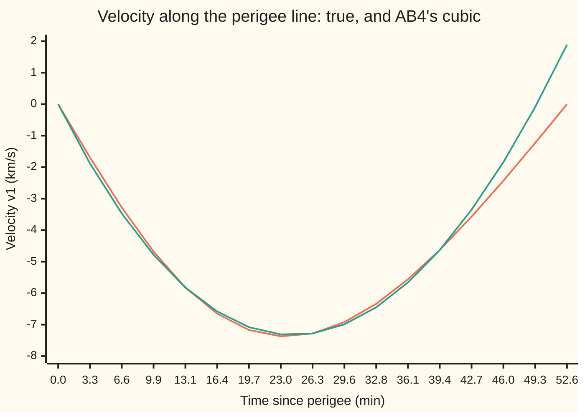
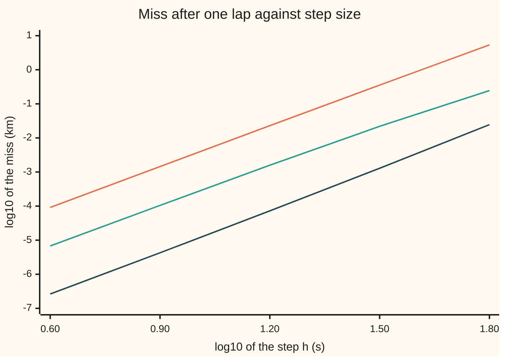

# Multistep methods: reuse the slopes you already have, explicit or implicit

[Syllabus](../../../SYLLABUS.md) → [Numerical analysis](../README.md) → [ODE Solvers](../README.md#s06) → Multistep methods

---

## General Overview

A satellite circles Earth on a slightly stretched orbit. Its closest point, the **perigee**, is 6,778 km from Earth's centre, about 400 km up. Its farthest point, the **apogee**, is 7,978 km out, about 1,600 km up. One lap takes 105.12 minutes. The orbit is illustrative; the physics is Newton's gravity and nothing else.

A computer predicts the orbit in small time steps. Every step needs the **slope**: the direction the state is changing, here the velocity and the pull of gravity. Computing the slope is the expensive part, so the useful question is: how far off is the predicted satellite after one lap, for a given number of slope computations?

A [Runge-Kutta](01-runge-kutta-and-butcher-tableaux.md) step (RK4) computes four fresh slopes per step and throws them away. A **multistep method** keeps the slopes from the last few steps. The **Adams-Bashforth** method AB4 stores four of them, fits a curve through them, and pushes that curve one step ahead. Each step then costs one new slope instead of four.

With 400 steps per lap, AB4 brings the satellite back 23.0 m from perigee, using 413 slope computations. RK4 with 100 steps uses 400 and misses by 24.6 m. Pair AB4 with its implicit twin, **Adams-Moulton**, as a predictor-corrector, and 400 steps miss by 1.58 m, for 810 slope computations.

**A multistep method fits a polynomial through slopes it has already computed and integrates it over the next step, explicitly (Adams-Bashforth) or with the new slope included (Adams-Moulton); it converges only if its recurrence cannot amplify old errors.**

**What kind of fact this is:** the weights are a construction, computed exactly on this card. Their order 4, and the convergence of every Adams method, are theorems proved here in Why it works. The equivalence of convergence with consistency plus zero-stability is Dahlquist's theorem: stated here with its key steps, and proved in the named source. The miss distances are measurements, printed by the code.

### The picture: a cubic through four stored slopes, pushed one step ahead

The step here is stretched to an eighth of a lap, 13.1 minutes, so the bend shows. The stored slopes are the satellite's velocity along the perigee line (the line from Earth's centre through the perigee), $v_1$, at minutes 0, 13.1, 26.3 and 39.4.



Orange: the true velocity, from a fine reference run. Teal: the cubic (a degree-3 polynomial) through the four stored values. The two lines meet at the four stored points. After minute 39.4 the cubic is a guess, and it drifts: at minute 52.6 it reads 1.89 km/s where the truth is 0.00.

AB4's step is the area under the teal line over the last stretch. It moves the satellite −1,325.6 km along the perigee line; the reference moves −1,885.5 km. At this giant step the guess is poor. At a normal step of 15.77 s the same idea misses by metres per lap.

---

## The formula

Notation first, in words. The **state** $y$ is the list of four numbers that fixes the satellite: two position coordinates $x_1, x_2$ and two velocities $v_1, v_2$. The **slope** $f(y)$ is how fast each number changes. The step $h$ moves time from $t_n$ to $t_{n+1} = t_n + h$, and $y_n$ is the computed state at $t_n$. The stored slope is $f_n = f(y_n)$.

The ODE (ordinary differential equation) for the satellite, with $r = \sqrt{x_1^2 + x_2^2}$ its distance from Earth's centre:

$$y' = f(y) = \Bigl(v_1,\; v_2,\; -\frac{\mu\,x_1}{r^3},\; -\frac{\mu\,x_2}{r^3}\Bigr)$$

**Read it aloud:** position changes at the velocity, and velocity changes at gravity's pull, which points at Earth's centre and weakens as one over distance squared.

The two Adams formulas of order 4:

$$\text{AB4:}\quad y_{n+1} = y_n + \frac{h}{24}\bigl(55 f_n - 59 f_{n-1} + 37 f_{n-2} - 9 f_{n-3}\bigr)$$

$$\text{AM4:}\quad y_{n+1} = y_n + \frac{h}{24}\bigl(9 f_{n+1} + 19 f_n - 5 f_{n-1} + f_{n-2}\bigr)$$

**Read it aloud:** the new state is the old state plus the step times a weighted average of slopes; Adams-Bashforth uses four old slopes, Adams-Moulton three old ones and the new one.

AB4 is **explicit**: everything on the right is known. AM4 is **implicit**: $f_{n+1} = f(y_{n+1})$ needs the answer. The **predictor-corrector** pair PECE breaks the circle in four moves:

1. **Predict** $y^{P}_{n+1}$ with AB4.
2. **Evaluate** $f(y^{P}_{n+1})$.
3. **Correct**: run AM4 with that slope standing in for $f_{n+1}$, giving $y^{C}_{n+1}$.
4. **Evaluate** $f(y^{C}_{n+1})$ and store it as $f_{n+1}$.

Every one of these formulas is a **linear multistep method**: a fixed mix of the last $k$ states and slopes,

$$\sum_{j=0}^{k} \alpha_j\, y_{n+1-j} = h \sum_{j=0}^{k} \beta_j\, f_{n+1-j}, \qquad \rho(\zeta) = \sum_{j=0}^{k} \alpha_j\, \zeta^{\,k-j}$$

**Read it aloud:** a weighted sum of states equals the step times a weighted sum of slopes; the state weights, read as polynomial coefficients, make the method's characteristic polynomial $\rho$.

Every Adams method has $\alpha_0 = 1$, $\alpha_1 = -1$ and the rest zero, so $\rho(\zeta) = \zeta^k - \zeta^{k-1}$. A method is **zero-stable** when every root of $\rho$ has size at most 1, and the roots of size exactly 1 are not repeated. This is the **root condition**.

The **backward differentiation formulas** (BDF) take the other route: all the weight is on states, and one slope, the new one. BDF2 is

$$\tfrac32\, y_{n+1} - 2\, y_n + \tfrac12\, y_{n-1} = h\, f_{n+1}$$

**Read it aloud:** the slope of the parabola through the last three states, taken at the new point, must equal the new slope.

| Symbol | Plain meaning | In our example | Push it up and the answer… |
| --- | --- | --- | --- |
| $y_n$; $y^{P}$, $y^{C}$; $x_1, x_2, v_1, v_2$ | the computed state at step $n$; the predicted and corrected states; the state's four numbers | $(x_1, x_2, v_1, v_2)$, starting at $(6778, 0, 0, 7.9744)$ in km and km/s | — |
| $f$, $f_n$ | the slope function; the stored slope at step $n$ | velocity, then gravity's pull | — |
| $h$, $N$, $T$; $t_n$, $s$ | the step; steps per lap, $h = T/N$; the lap time; the time at step $n$; time counted in steps from $t_n$ (not the stage count of [Runge-Kutta](01-runge-kutta-and-butcher-tableaux.md)) | $T$ = 6306.9 s; $N$ = 400 gives $h$ = 15.77 s; $s = 1$ is one step on | larger $h$: error grows like $h^4$ |
| $k$ | how many past steps the method uses | 4 for AB4, 3 for AM4 | higher order for the same one slope per step |
| $\beta_j$, $c_j$ | the slope weights; where stored point $j$ sits, in steps | AB4: 55, −59, 37, −9 over 24, at $c_j$ = 0, −1, −2, −3 | — |
| $\alpha_j$ | the state weights | Adams: 1, −1; BDF2: 3/2, −2, 1/2 | — |
| $\ell_j(s)$ | the Lagrange basis polynomial: 1 at stored point $j$, 0 at the others | $\ell_0(s) = (s+1)(s+2)(s+3)/6$ | — |
| $\rho$, $\zeta$ | the characteristic polynomial of the state weights; its variable | AB4: $\zeta^4 - \zeta^3$ | a root outside size 1: blow-up |
| $C$ | the error constant: local error is $C h^{5} y^{(5)}$, with $y^{(5)}$ the fifth derivative | AB4: 251/720; AM4: −19/720 | larger miss at the same order |
| $p$ | the order: global error shrinks like $h^p$ | 4 | errors fall faster as $h$ shrinks |
| $\mu$, $r$, $a$ | Earth's gravitational parameter; distance from Earth's centre; the average of perigee and apogee radii | 398,600.4418 km³/s², the conventional value; 6,778 to 7,978 km; their average | — |
| $e_n$, $E_n$, $\tau_n$, $L$, $B$, $q$ | proof helpers: the true error at step $n$; the largest of the last $k$ errors; the local truncation error per unit time, as on [From local error to global error](02-convergence-of-one-step-methods.md), so one step's miss is $h\tau_n$; a Lipschitz constant of $f$; the sum of the weights' sizes; a power from 0 to 3 | — | — |

### When it holds

- **A smooth slope.** The order-4 claim needs five derivatives of the solution. Where the force jumps, such as an engine burn, the fitted polynomial straddles the jump; restart the method at the burn.
- **Accurate starting values.** AB4 needs four states before it can take its first step. Start them with Euler's method instead of RK4 and AB4 falls to order 2 (What breaks, row 2).
- **The root condition.** The two-step formula $y_{n+1} = -4y_n + 5y_{n-1} + h(4f_n + 2f_{n-1})$ has order 3 and $\rho$ roots 1 and −5. It blows up, and faster the smaller the step (Step 5).
- **A fixed step.** The weights assume equally spaced stored slopes. Change $h$ and the weights must be rebuilt for the new spacing, or the stored slopes resampled.
- **A step small enough for the method's stability.** Explicit Adams formulas fail on stiff problems (fast decaying parts) unless $h$ is tiny. That limit is on [Stiffness](05-stiffness-a-stability-and-the-dahlquist-barriers.md).

---

## Why it works

### Step 0: the step is an integral, and the stored slopes are samples of what it integrates

The state after one step is the state now plus the area under the slope curve:

$$y(t_{n+1}) = y(t_n) + \int_{t_n}^{t_{n+1}} f\bigl(y(t)\bigr)\,dt$$

The slope curve is unknown, but four samples of it are already stored. Fit a polynomial through them and integrate that instead. Each Adams method is one choice of which samples to fit; BDF (Step 6) fits states instead.

### Step 1: integrate the fitted polynomial to get the weights

Measure time in steps, $t = t_n + s h$. The stored slopes sit at $s = 0, -1, -2, -3$. The **Lagrange basis** polynomial $\ell_j(s)$ is the cubic that equals 1 at stored point $j$ and 0 at the other three. The fitted cubic is $\sum_j f_{n-j}\,\ell_j(s)$, and integrating it over the next step, $s$ from 0 to 1, gives

$$y_{n+1} = y_n + h \sum_{j=0}^{3} \beta_j\, f_{n-j}, \qquad \beta_j = \int_0^1 \ell_j(s)\,ds$$

For $j = 0$: $\ell_0(s) = (s+1)(s+2)(s+3)/6$, and its integral is 55/24. The code does all four in exact fractions and gets 55, −59, 37, −9 over 24.

The area runs over $s$ from 0 to 1, outside the stored points. That is **extrapolation**, as the picture showed, and it is why AB4's error constant is large.

### Step 2: put the new slope in the fit, and the formula becomes implicit

Fit the cubic through $s = 1, 0, -1, -2$ instead: the unknown new slope and three stored ones. Now the integral runs inside the fitted points, which is **interpolation**. The weights come out 9, 19, −5, 1 over 24: AM4.

Interpolation is far more accurate than extrapolation. The error constants are 251/720 for AB4 and −19/720 for AM4: AM4's is 13.21 times smaller. Measured on the orbit at 400 steps, PECE misses by 1.58 m and AB4 by 23.0 m, a ratio of 14.5.

The price is the unknown $f_{n+1}$. PECE pays it with one extra slope per step. The predictor's error is $O(h^5)$, and the corrector multiplies it by $h$ times a weight, so the shortcut adds only $O(h^6)$ and keeps order 4.

### Step 3: order 4 means exact for every cubic slope

A rule built by integrating a cubic fit is exact when the true slope is a cubic. So it is exact for slopes $1, s, s^2, s^3$, which gives four **order conditions**:

$$\sum_j \beta_j\, c_j^{\,q} = \frac{1}{q+1}, \qquad q = 0, 1, 2, 3$$

Here $c_j$ is the position of stored point $j$ in steps ($0, -1, -2, -3$ for AB4). The code checks all four for both formulas, exactly, as a second road to the same weights.

The first slope the rule cannot follow is $s^4$. A Taylor expansion then leaves the **local error**, the miss of one step started from exact values, as $C h^5 y^{(5)}$ with

$$C = \frac{1}{5!} - \frac{1}{4!}\sum_j \beta_j\, c_j^{\,4}$$

For AB4 this is $1/120 + 49/144 = 251/720$.

### Step 4: Adams methods add their local errors without amplifying them

The [From local error to global error](02-convergence-of-one-step-methods.md) card shows that $N$ local errors of size $h^{p+1}$, passed on by a stable method, add to a global error of size $h^p$. For Adams methods the same argument goes through with one change: the error at step $n+1$ depends on the last $k$ errors, not just one.

<details>
<summary>Detailed proof: every Adams method with local error O(h^(p+1)) converges with order p</summary>

**Assume** $f$ has a Lipschitz constant $L$: $\lvert f(a) - f(b)\rvert \le L\lvert a - b\rvert$. Let $e_n = y(t_n) - y_n$, let $h\tau_n$ be the local error at step $n$, and let $B = \sum_j \lvert\beta_j\rvert$.

**One step.** Subtract the method from the true solution's version of it:

$$e_{n+1} = e_n + h\sum_j \beta_j\bigl(f(y(t_{n-j})) - f(y_{n-j})\bigr) + h\tau_n$$

**Bound it.** Let $E_n$ be the largest of $\lvert e_n\rvert, \dots, \lvert e_{n-k+1}\rvert$. Then $\lvert e_{n+1}\rvert \le E_n + hLB\,E_n + h\lvert\tau_n\rvert$, so

$$E_{n+1} \le (1 + hLB)\,E_n + h\tau, \qquad \tau = \max_n \lvert\tau_n\rvert$$

**Unroll.** Since $1 + x \le e^x$ and $N h = T$,

$$E_N \le e^{LBT}\bigl(E_{k-1} + T\tau\bigr)$$

With $\tau$ at most a fixed constant times $h^{p}$, the second term is that constant times $T h^{p}$. The first is the starting error. So the global error is $O(h^p)$ provided the starting values are accurate to $O(h^p)$. $\blacksquare$

For an implicit method such as AM4 the sum also holds the new error $e_{n+1}$. Move that term to the left: once $hL$ times the new slope's weight (9/24 for AM4) is at most 1/2, this at most doubles the constants, and the conclusion stands.

The only feature of Adams methods used is $\rho(\zeta) = \zeta^k - \zeta^{k-1}$: each step adds to $y_n$ alone. Its roots are 1 and zeros, so nothing in the recurrence grows.

</details>

The proof also explains the Euler-start failure. Three Euler steps leave a starting error of size $h^2$. The bound carries it to the end, multiplied by at most the fixed factor $e^{LBT}$, so the run has order 2, not 4 (What breaks, row 2).

### Step 5: zero-stability, and why higher order alone is a trap

Set the slope to zero. A multistep method then reduces to $\sum_j \alpha_j y_{n+1-j} = 0$, whose solutions are combinations of $\zeta^n$ for the roots $\zeta$ of $\rho$. Root 1 keeps a constant solution constant, as it should. Every other root multiplies some leftover error by $\zeta$ each step.

- **Adams:** roots 1, 0, 0, 0. Leftovers vanish at once.
- **BDF2:** roots 1 and 1/3. Leftovers shrink by a third each step.
- **The order-3 two-step formula:** roots 1 and −5. A rounding error multiplies by −5 each step.

Reaching a fixed time takes $t/h$ steps, so the growth is $5^{t/h}$. Halving $h$ squares it. On the orbit, after 630.7 s, the miss is 1.21e4 km at $h$ = 63.07 s, 7.51e9 km at 31.53 s, 4.45e22 km at 15.77 s and 2.49e49 km at 7.88 s. A smaller step makes the answer worse, which is the signature of zero-instability.

**Dahlquist's equivalence theorem** (1956): a linear multistep method with accurate starting values converges if and only if it is **consistent** (order at least 1: $\rho(1) = 0$ and $\rho'(1) = \sum_j \beta_j$) and zero-stable. The argument above shows why a root outside size 1 rules out convergence; a repeated root of size 1 fails more slowly, by growth like $n$. The sufficiency half generalises the Adams proof: it bounds the recurrence's powers using the root condition. It is too long for this card; it is in Hairer, Nørsett and Wanner, chapter III.4.

The same 1956 paper also caps the order. A zero-stable $k$-step method has order at most $k+1$ for odd $k$ and $k+2$ for even $k$, and an explicit one at most $k$. That is Dahlquist's first barrier, on [Stiffness](05-stiffness-a-stability-and-the-dahlquist-barriers.md). The formula with root −5 has order 3 from two steps, above the explicit limit of 2, and pays for it with instability.

### Step 6: BDF differentiates instead of integrating

Adams fits the slopes and integrates. BDF fits the **states** $y_{n+1}, y_n, \dots$ with a polynomial, differentiates it at the new point, and sets that equal to $f_{n+1}$. For two steps the fit is a parabola through $s = 1, 0, -1$, and its slope at $s = 1$ gives the weights 3/2, −2, 1/2, which the code computes exactly.

BDF formulas are implicit and only modestly accurate, but they stay stable on stiff problems where Adams needs tiny steps. They are zero-stable for $k = 1$ to 6 and unstable from $k = 7$; this card computes the BDF2 roots and states the rest from the source. The orbit is not stiff, so BDF is not run on it here.

---

## Worked numbers, by hand

The satellite, with 400 steps per lap, $h$ = 15.77 s.

| Step | Arithmetic | Value |
| --- | --- | --- |
| AB4 weight on $f_n$ | $\tfrac16\int_0^1 (s^3 + 6s^2 + 11s + 6)\,ds = \tfrac16\bigl(\tfrac14 + 2 + \tfrac{11}2 + 6\bigr)$ | 55/24 |
| weights sum to 1 | $(55 - 59 + 37 - 9)/24$ | 1 |
| AB4 error constant | $\tfrac1{120} - \tfrac1{24}\cdot\tfrac{-59 + 37\cdot 16 - 9\cdot 81}{24} = \tfrac1{120} + \tfrac{49}{144}$ | 251/720 |
| AM4 error constant | $\tfrac1{120} - \tfrac1{24}\cdot\tfrac{9 - 5 + 16}{24}$ | −19/720 |
| constants' size ratio | $251/19$ | 13.21 |
| measured miss, 400 steps | AB4 against PECE | 23.0 m against 1.58 m: ratio 14.5 |
| order 4 predicts 800 steps | $23.0\text{ m} / 2^4$ | 1.44 m |
| measured miss, 800 steps | AB4 | **1.46 m** |

Halving the step cut AB4's miss almost exactly by the 16 that order 4 promises. The error constants predicted PECE's advantage at the same step: 13.21, against 14.5 measured.

### What breaks if you drop a piece

| Mistake | Comes out at | What went wrong |
| --- | --- | --- |
| Use the order-3 two-step formula with $\rho$ roots 1, −5 | 1.21e4 km after 630.7 s at $h$ = 63.07 s; 7.51e9 km at half the step | Not zero-stable: errors multiply by −5 each step, and more steps make it worse |
| Start AB4 with three Euler steps | 164 km at 400 steps, 40.8 km at 800: order 2.00 | The starting error is $O(h^2)$ and the recurrence carries it to the end |
| Judge PECE by steps | 14.5 times better than AB4 at 400 steps | Per slope computation it is level: AB4 with 800 steps misses by 1.46 m using 813, PECE with 400 by 1.58 m using 810 |

---

## Code, from first principles, and it actually runs

The code builds every weight from Lagrange polynomials in exact fractions, checks them against the published values, and checks them a second way through the order conditions. It then flies the satellite one lap with AB4, PECE and RK4 at five step sizes, and at six finer ones down to where rounding stops the fall. The true answer needs no solver: by Kepler's third law the lap time is $T = 2\pi\sqrt{a^3/\mu}$ with $a$ the average of the two radii, and after time $T$ the satellite is back at perigee.

That gives three roads: a known answer, three methods agreeing at order 4, and observed orders from five step sizes. The picture's reference run is checked a fourth way: at half a lap it sits at apogee to within 1.05e-9 km. The unstable formula's miss is measured against a second fine RK4 run, to 630.7 s. The Rust carries its own fraction type.

### Python

```python
# Multistep methods: the check behind the card.  Standard library only.
# A satellite on an orbit 400 km up at perigee and 1,600 km up at apogee, stepped by
# Adams-Bashforth (AB4), by AB4 + Adams-Moulton as predictor-corrector (PECE) and by RK4.
# After one period the satellite is back at perigee, so the true error needs no solver.
from fractions import Fraction as Fr
from math import sqrt, pi, log2, log10
from functools import reduce

def e(x):                                   # 1.23e-5 style, the same in Rust
    m, p = f"{x:.2e}".split("e"); return f"{m}e{int(p)}"

def basis(nodes, j):                        # Lagrange basis l_j(s), coefficients low to high
    c = [Fr(1)]
    for m, cm in enumerate(nodes):
        if m != j:
            d = Fr(nodes[j] - cm)
            c = [(c[k - 1] if k else 0) / d - (c[k] * cm / d if k < len(c) else 0) for k in range(len(c) + 1)]
    return c
def adams(nodes):                           # weight j = area under l_j over the next step, s = 0 to 1
    return [sum(a / (k + 1) for k, a in enumerate(basis(nodes, j))) for j in range(len(nodes))]
def bdf(nodes):                             # weight j = slope of l_j at s = 1
    return [sum(k * a for k, a in enumerate(basis(nodes, j)) if k) for j in range(len(nodes))]
def errconst(w, nodes, p):                  # leading local error, times h^(p+1) y^(p+1)
    fact = 1
    for k in range(2, p + 1): fact *= k
    return Fr(1, (p + 1) * fact) - sum(b * Fr(c) ** p for b, c in zip(w, nodes)) / fact

ABN, AMN = [0, -1, -2, -3], [1, 0, -1, -2]
AB, AM, B2, AB6 = adams(ABN), adams(AMN), bdf([1, 0, -1]), adams([0, -1, -2, -3, -4, -5])
print("AB4 weights x24:", [int(w * 24) for w in AB], " AM4 weights x24:", [int(w * 24) for w in AM])
print("BDF2 coefficients of y_(n+1), y_n, y_(n-1):", ", ".join(str(w) for w in B2))
assert AB == [Fr(55, 24), Fr(-59, 24), Fr(37, 24), Fr(-9, 24)]       # the published weights
assert AM == [Fr(9, 24), Fr(19, 24), Fr(-5, 24), Fr(1, 24)]
for nodes, w in ((ABN, AB), (AMN, AM)):     # road 2: the rule is exact for t^0 .. t^3
    assert all(sum(b * Fr(c) ** k for b, c in zip(w, nodes)) == Fr(1, k + 1) for k in range(4))
CAB, CAM = errconst(AB, ABN, 4), errconst(AM, AMN, 4)
print(f"error constants: AB4 {CAB}, AM4 {CAM}, size ratio {float(CAB / -CAM):.2f}; Milne factor {abs(CAM) / (CAB - CAM)}")
assert (CAB, CAM) == (Fr(251, 720), Fr(-19, 720))

def roots2(a, b, c):                        # real roots of a z^2 + b z + c
    d = sqrt(b * b - 4 * a * c); return sorted([(-b - d) / (2 * a), (-b + d) / (2 * a)])
rb, ru = roots2(1.5, -2.0, 0.5), roots2(1.0, 4.0, -5.0)
print(f"roots of rho: Adams z^4 - z^3: 0, 0, 0, 1; BDF2: {rb[0]:.4f}, {rb[1]:.4f}; unstable 2-step: {ru[0]:.4f}, {ru[1]:.4f}")
assert abs(rb[0] - 1 / 3) < 1e-15
assert abs(ru[0] + 5) < 1e-15

MU, RP, RA = 398600.4418, 6778.0, 7978.0    # km^3/s^2 (Earth); perigee and apogee radius, km
A = (RP + RA) / 2; V, T = sqrt(MU * (2 / RP - 1 / A)), 2 * pi * sqrt(A * A * A / MU)
print(f"orbit: perigee speed {V:.4f} km/s, period {T:.1f} s = {T / 60:.2f} min")
NEV = [0]
def f(u):                                   # slope of (x, y, vx, vy): velocity, then gravity
    NEV[0] += 1; x, y, vx, vy = u; r = sqrt(x * x + y * y); k = -MU / (r * r * r)
    return [vx, vy, k * x, k * y]
def lin(u, h, ws, fs):                      # u + h * sum of w_j f_j, added in order as in Rust
    return [u[i] + h * reduce(lambda s, wg: s + wg[0] * wg[1][i], zip(ws, fs), 0.0) for i in range(4)]
def rk4(u, h):
    k1 = f(u); k2 = f(lin(u, h / 2, [1], [k1])); k3 = f(lin(u, h / 2, [1], [k2])); k4 = f(lin(u, h, [1], [k3]))
    return lin(u, h / 6, [1, 2, 2, 1], [k1, k2, k3, k4])
def euler(u, h): return lin(u, h, [1], [f(u)])
U0 = [RP, 0.0, 0.0, V]
def miss(u, c=U0): return sqrt((u[0] - c[0]) * (u[0] - c[0]) + (u[1] - c[1]) * (u[1] - c[1]))  # km from c
def run(N, how, start=rk4, wab=AB, upto=None, ref=U0):
    NEV[0] = 0; h = T / N; u = U0
    if how == "rk4":
        for _ in range(N): u = rk4(u, h)
        return miss(u, ref), NEV[0]
    k = len(wab) if how != "bad" else 2
    us = [u]
    for _ in range(k - 1): us.append(start(us[-1], h))
    fs = [f(w) for w in us][::-1]           # stored slopes, newest first
    ys = us[::-1]; u = us[-1]
    for n in range(k - 1, N if upto is None else upto):
        if how == "bad":                    # y+ = -4 y_n + 5 y_(n-1) + h (4 f_n + 2 f_(n-1))
            p = [-4 * ys[0][i] + 5 * ys[1][i] + h * (4 * fs[0][i] + 2 * fs[1][i]) for i in range(4)]
        else:
            p = lin(u, h, [float(w) for w in wab], fs)
            if how == "pece": p = lin(u, h, [float(w) for w in AM], [f(p)] + fs[:3])
        fs = [f(p)] + fs[:len(fs) - 1]; ys = [p] + ys[:1]; u = p
    return miss(u, ref), NEV[0]

print(" steps   h (s)   AB4 miss km  evals  PECE miss km  evals   RK4 miss km  evals")
res, NS = {}, (100, 200, 400, 800, 1600)
for N in NS:
    res[N] = [run(N, m) for m in ("ab4", "pece", "rk4")]
    print(f"{N:6d} {T / N:7.2f}  " + "  ".join(f"{e(a):>11} {n:6d}" for a, n in res[N]))
for j, m in enumerate(("AB4", "PECE", "RK4")):
    o = [log2(res[N][j][0] / res[2 * N][j][0]) for N in NS[:-1]]
    print(f"observed order {m:4}: " + ", ".join(f"{q:.2f}" for q in o) + "   (theory 4)")
    assert abs(o[-1] - 4) < 0.25
ab, pc = res[400][0][0], res[400][1][0]
print(f"400 steps: AB4 misses by {ab * 1000:.1f} m, PECE by {pc * 1000:.2f} m, ratio {ab / pc:.1f}")
assert 10 < ab / pc < 20
print(f"order 4 predicts AB4 at 800 steps: {ab * 1000:.1f} m / 16 = {ab * 1000 / 16:.2f} m; measured {res[800][0][0] * 1000:.2f} m")
a6 = run(400, "ab6", wab=AB6)
print(f"AB6 weights x1440: {[int(w * 1440) for w in AB6]}; 400 steps: miss {e(a6[0])} km, {a6[1]} evals")
assert a6[0] < ab / 100
print("chart, log10 h:", " ".join(f"{log10(T / N):.2f}" for N in NS[::-1]))
for j, m in enumerate(("AB4", "PECE", "RK4")):
    print(f"chart, log10 miss {m}:", " ".join(f"{log10(res[N][j][0]):.2f}" for N in NS[::-1]))
FN = (3200, 6400, 12800, 25600, 51200, 102400)  # finer steps, down to where rounding stops the fall
fine = [[run(N, m)[0] for m in ("ab4", "pece", "rk4")] for N in FN]
for N, r in zip(FN, fine): print(f"finer, {N:6d} steps: AB4 {e(r[0])}, PECE {e(r[1])}, RK4 {e(r[2])} km")
assert all(1e-11 < min(r[j] for r in fine) < fine[-1][j] / 2 for j in range(3))   # rounding stops the fall

# the picture: AB4's cubic through four stored slopes, with a step stretched to T/8
H, pts = T / 8, [U0]
for q in range(16):                         # reference: RK4 with 200 small steps per quarter step
    u = pts[-1]
    for _ in range(200): u = rk4(u, H / 800)
    pts.append(u)
ap = sqrt((pts[16][0] + RA) * (pts[16][0] + RA) + pts[16][1] * pts[16][1])
print(f"reference at half a period: {e(ap)} km from apogee (Kepler: it is at apogee)")
assert ap < 1e-6
vx, L = [p[2] for p in pts], [basis(ABN, j) for j in range(4)]
st = [vx[12], vx[8], vx[4], vx[0]]          # stored slopes of x, newest first
cub = [sum(float(sum(a * Fr(q - 12, 4) ** k for k, a in enumerate(L[j]))) * st[j] for j in range(4)) for q in range(17)]
print("chart, minutes:", " ".join(f"{q * H / 240:.1f}" for q in range(17)))
print("chart, true vx km/s:", " ".join(f"{v:.2f}" for v in vx))
print("chart, cubic km/s:  ", " ".join(f"{v:.2f}" for v in cub))
inc = H * sum(float(b) * s for b, s in zip(AB, st))
print(f"stretched step: AB4 moves x by {inc:.1f} km, the reference by {pts[16][0] - pts[12][0]:.1f} km")
assert all(abs(cub[q] - vx[q]) < 1e-9 for q in (0, 4, 8, 12))
assert abs(cub[16] - vx[16]) > 1

# what breaks
R10 = U0                                    # reference at T/10: RK4 with 1,600 small steps
for _ in range(1600): R10 = rk4(R10, T / 16000)
for N, at in ((100, 10), (200, 20), (400, 40), (800, 80)):
    print(f"unstable 2-step, h = {T / N:.2f} s: miss after {T * at / N:.1f} s = {e(run(N, 'bad', upto=at, ref=R10)[0])} km")
b1, b2 = run(100, "bad", upto=10, ref=R10)[0], run(200, "bad", upto=20, ref=R10)[0]
assert b2 > 100 * b1
eu = [run(N, "ab4", start=euler)[0] for N in (400, 800)]
print(f"AB4 started by Euler: 400 steps {e(eu[0])} km, 800 steps {e(eu[1])} km, order {log2(eu[0] / eu[1]):.2f}")
assert abs(log2(eu[0] / eu[1]) - 2) < 0.3
print("ALL CHECKS PASS")
```

**Ran 2026-11-11 on macOS, Python 3.14.10, standard library only. All checks passed. Output, pasted from the run:**

```
AB4 weights x24: [55, -59, 37, -9]  AM4 weights x24: [9, 19, -5, 1]
BDF2 coefficients of y_(n+1), y_n, y_(n-1): 3/2, -2, 1/2
error constants: AB4 251/720, AM4 -19/720, size ratio 13.21; Milne factor 19/270
roots of rho: Adams z^4 - z^3: 0, 0, 0, 1; BDF2: 0.3333, 1.0000; unstable 2-step: -5.0000, 1.0000
orbit: perigee speed 7.9744 km/s, period 6306.9 s = 105.12 min
 steps   h (s)   AB4 miss km  evals  PECE miss km  evals   RK4 miss km  evals
   100   63.07       5.32e0    113      2.45e-1    210      2.46e-2    400
   200   31.53      3.56e-1    213      2.19e-2    410      1.29e-3    800
   400   15.77      2.30e-2    413      1.58e-3    810      7.25e-5   1600
   800    7.88      1.46e-3    813      1.06e-4   1610      4.29e-6   3200
  1600    3.94      9.20e-5   1613      6.81e-6   3210      2.61e-7   6400
observed order AB4 : 3.90, 3.95, 3.98, 3.99   (theory 4)
observed order PECE: 3.48, 3.79, 3.91, 3.95   (theory 4)
observed order RK4 : 4.26, 4.15, 4.08, 4.04   (theory 4)
400 steps: AB4 misses by 23.0 m, PECE by 1.58 m, ratio 14.5
order 4 predicts AB4 at 800 steps: 23.0 m / 16 = 1.44 m; measured 1.46 m
AB6 weights x1440: [4277, -7923, 9982, -7298, 2877, -475]; 400 steps: miss 3.08e-5 km, 421 evals
chart, log10 h: 0.60 0.90 1.20 1.50 1.80
chart, log10 miss AB4: -4.04 -2.84 -1.64 -0.45 0.73
chart, log10 miss PECE: -5.17 -3.98 -2.80 -1.66 -0.61
chart, log10 miss RK4: -6.58 -5.37 -4.14 -2.89 -1.61
finer,   3200 steps: AB4 5.77e-6, PECE 4.32e-7, RK4 1.57e-8 km
finer,   6400 steps: AB4 3.61e-7, PECE 2.77e-8, RK4 1.50e-9 km
finer,  12800 steps: AB4 2.20e-8, PECE 7.54e-10, RK4 4.91e-10 km
finer,  25600 steps: AB4 8.21e-10, PECE 4.75e-10, RK4 1.18e-10 km
finer,  51200 steps: AB4 2.85e-10, PECE 5.23e-10, RK4 5.61e-10 km
finer, 102400 steps: AB4 1.02e-9, PECE 1.03e-9, RK4 1.02e-9 km
reference at half a period: 1.05e-9 km from apogee (Kepler: it is at apogee)
chart, minutes: 0.0 3.3 6.6 9.9 13.1 16.4 19.7 23.0 26.3 29.6 32.8 36.1 39.4 42.7 46.0 49.3 52.6
chart, true vx km/s: 0.00 -1.69 -3.28 -4.68 -5.82 -6.65 -7.17 -7.37 -7.28 -6.92 -6.34 -5.56 -4.63 -3.57 -2.43 -1.23 0.00
chart, cubic km/s:   0.00 -1.88 -3.47 -4.78 -5.82 -6.58 -7.08 -7.31 -7.28 -6.99 -6.45 -5.66 -4.63 -3.35 -1.84 -0.09 1.89
stretched step: AB4 moves x by -1325.6 km, the reference by -1885.5 km
unstable 2-step, h = 63.07 s: miss after 630.7 s = 1.21e4 km
unstable 2-step, h = 31.53 s: miss after 630.7 s = 7.51e9 km
unstable 2-step, h = 15.77 s: miss after 630.7 s = 4.45e22 km
unstable 2-step, h = 7.88 s: miss after 630.7 s = 2.49e49 km
AB4 started by Euler: 400 steps 1.64e2 km, 800 steps 4.08e1 km, order 2.00
ALL CHECKS PASS
```

Read the table across a row for the same step, and down a column for one method. The observed orders climb to 3.99, 3.95 and 4.04. At equal work, about 400 slope computations, the three order-4 methods land close together: AB4 at 400 steps misses by 2.30e-2 km, PECE at 200 by 2.19e-2 km, RK4 at 100 by 2.46e-2 km. AB6, built by the same code from six stored slopes, costs the same one slope per step and misses by 3.08e-5 km at 400 steps, against AB4's 2.30e-2 km.

The `finer,` lines follow the fall until rounding stops it. RK4 bottoms out at 1.18e-10 km with 25,600 steps, PECE at 4.75e-10 km with 25,600 and AB4 at 2.85e-10 km with 51,200. At 102,400 steps all three are back near 1e-9 km. Below about a tenth of a micrometre, rounding in positions of about 7,000 km outweighs the method's own error.

### Rust

Same numbers, same labels, built with `rustc --edition 2021 -O`.

```rust
// Multistep methods: the same check as the Python, in Rust.  No crates.
// A satellite on an orbit 400 km up at perigee and 1,600 km up at apogee, stepped by
// AB4, by AB4 + AM4 as predictor-corrector (PECE) and by RK4.  Weights come from exact
// fractions, written out below as a small struct.
use std::f64::consts::PI;

#[derive(Clone, Copy, PartialEq, Debug)]
struct Fr { n: i64, d: i64 }
fn gcd(a: i64, b: i64) -> i64 { if b == 0 { a.abs() } else { gcd(b, a % b) } }
fn fr(n: i64, d: i64) -> Fr { let g = gcd(n, d) * d.signum(); Fr { n: n / g, d: d / g } }
impl std::ops::Add for Fr { type Output = Fr; fn add(self, o: Fr) -> Fr { fr(self.n * o.d + o.n * self.d, self.d * o.d) } }
impl std::ops::Sub for Fr { type Output = Fr; fn sub(self, o: Fr) -> Fr { fr(self.n * o.d - o.n * self.d, self.d * o.d) } }
impl std::ops::Mul for Fr { type Output = Fr; fn mul(self, o: Fr) -> Fr { fr(self.n * o.n, self.d * o.d) } }
impl std::ops::Div for Fr { type Output = Fr; fn div(self, o: Fr) -> Fr { fr(self.n * o.d, self.d * o.n) } }
impl Fr {
    fn f(self) -> f64 { self.n as f64 / self.d as f64 }
    fn s(self) -> String { if self.d == 1 { format!("{}", self.n) } else { format!("{}/{}", self.n, self.d) } }
    fn pow(self, k: usize) -> Fr { (0..k).fold(fr(1, 1), |a, _| a * self) }
}
fn e(x: f64) -> String { format!("{:.2e}", x) }
fn basis(nodes: &[i64], j: usize) -> Vec<Fr> {      // Lagrange basis l_j(s), low to high
    let mut c = vec![fr(1, 1)];
    for (m, &cm) in nodes.iter().enumerate() {
        if m == j { continue; }
        let d = fr(nodes[j] - cm, 1);
        c = (0..=c.len()).map(|k| {
            let a = if k > 0 { c[k - 1] / d } else { fr(0, 1) };
            if k < c.len() { a - c[k] * fr(cm, 1) / d } else { a } }).collect();
    }
    c
}
fn adams(nodes: &[i64]) -> Vec<Fr> {                 // area under l_j for s from 0 to 1
    (0..nodes.len()).map(|j| basis(nodes, j).iter().enumerate().fold(fr(0, 1), |s, (k, &a)| s + a / fr(k as i64 + 1, 1))).collect()
}
fn bdf(nodes: &[i64]) -> Vec<Fr> {                   // slope of l_j at s = 1
    (0..nodes.len()).map(|j| basis(nodes, j).iter().enumerate().skip(1).fold(fr(0, 1), |s, (k, &a)| s + fr(k as i64, 1) * a)).collect()
}
fn errconst(w: &[Fr], nodes: &[i64], p: usize) -> Fr {
    let fact = (2..=p as i64).product::<i64>();
    w.iter().zip(nodes).fold(fr(1, (p as i64 + 1) * fact), |s, (&b, &c)| s - b * fr(c, 1).pow(p) / fr(fact, 1))
}
fn roots2(a: f64, b: f64, c: f64) -> (f64, f64) { let d = (b * b - 4.0 * a * c).sqrt(); ((-b - d) / (2.0 * a), (-b + d) / (2.0 * a)) }

const MU: f64 = 398600.4418; const RP: f64 = 6778.0; const RA: f64 = 7978.0;
type S = [f64; 4];
fn f(u: &S, nev: &mut usize) -> S {
    *nev += 1; let r = (u[0] * u[0] + u[1] * u[1]).sqrt(); let k = -MU / (r * r * r);
    [u[2], u[3], k * u[0], k * u[1]]
}
fn lin(u: &S, h: f64, ws: &[f64], fs: &[S]) -> S {
    let mut o = [0.0; 4];
    for i in 0..4 { o[i] = u[i] + h * ws.iter().zip(fs).fold(0.0, |s, (w, g)| s + w * g[i]); }
    o
}
fn rk4(u: &S, h: f64, nev: &mut usize) -> S {
    let k1 = f(u, nev); let k2 = f(&lin(u, h / 2.0, &[1.0], &[k1]), nev);
    let k3 = f(&lin(u, h / 2.0, &[1.0], &[k2]), nev); let k4 = f(&lin(u, h, &[1.0], &[k3]), nev);
    lin(u, h / 6.0, &[1.0, 2.0, 2.0, 1.0], &[k1, k2, k3, k4])
}
fn euler(u: &S, h: f64, nev: &mut usize) -> S { let g = f(u, nev); lin(u, h, &[1.0], &[g]) }
fn miss(u: &S, c: &S) -> f64 { ((u[0] - c[0]) * (u[0] - c[0]) + (u[1] - c[1]) * (u[1] - c[1])).sqrt() }

struct Orbit { t: f64, u0: S, am: Vec<f64>, goal: S }      // goal: where the run should end
impl Orbit {
    fn run(&self, n: usize, how: &str, start: fn(&S, f64, &mut usize) -> S, wab: &[f64], upto: Option<usize>) -> (f64, usize) {
        let mut nev = 0; let h = self.t / n as f64; let mut u = self.u0;
        if how == "rk4" { for _ in 0..n { u = rk4(&u, h, &mut nev); } return (miss(&u, &self.goal), nev); }
        let k = if how == "bad" { 2 } else { wab.len() };
        let mut us = vec![u];
        for _ in 0..k - 1 { let nx = start(us.last().unwrap(), h, &mut nev); us.push(nx); }
        let mut fs: Vec<S> = us.iter().map(|w| f(w, &mut nev)).collect(); fs.reverse();
        let mut ys: Vec<S> = us.iter().rev().cloned().collect(); u = *us.last().unwrap();
        for _ in k - 1..upto.unwrap_or(n) {
            let mut p = [0.0; 4];
            if how == "bad" {                    // y+ = -4 y_n + 5 y_(n-1) + h (4 f_n + 2 f_(n-1))
                for i in 0..4 { p[i] = -4.0 * ys[0][i] + 5.0 * ys[1][i] + h * (4.0 * fs[0][i] + 2.0 * fs[1][i]); }
            } else {
                p = lin(&u, h, wab, &fs);
                if how == "pece" { let fp = f(&p, &mut nev); p = lin(&u, h, &self.am, &[fp, fs[0], fs[1], fs[2]]); }
            }
            fs.pop(); fs.insert(0, f(&p, &mut nev)); ys = vec![p, ys[0]]; u = p;
        }
        (miss(&u, &self.goal), nev)
    }
}

fn main() {
    let (abn, amn): ([i64; 4], [i64; 4]) = ([0, -1, -2, -3], [1, 0, -1, -2]);
    let (ab, am, b2, ab6) = (adams(&abn), adams(&amn), bdf(&[1, 0, -1]), adams(&[0, -1, -2, -3, -4, -5]));
    let x = |w: &Vec<Fr>, m: i64| format!("[{}]", w.iter().map(|&v| (v * fr(m, 1)).s()).collect::<Vec<_>>().join(", "));
    println!("AB4 weights x24: {}  AM4 weights x24: {}", x(&ab, 24), x(&am, 24));
    println!("BDF2 coefficients of y_(n+1), y_n, y_(n-1): {}", b2.iter().map(|v| v.s()).collect::<Vec<_>>().join(", "));
    assert_eq!(ab, vec![fr(55, 24), fr(-59, 24), fr(37, 24), fr(-9, 24)]);
    assert_eq!(am, vec![fr(9, 24), fr(19, 24), fr(-5, 24), fr(1, 24)]);
    for (nodes, w) in [(&abn, &ab), (&amn, &am)] {   // road 2: exact for t^0 .. t^3
        for k in 0..4 { assert_eq!(w.iter().zip(nodes.iter()).fold(fr(0, 1), |s, (&b, &c)| s + b * fr(c, 1).pow(k)), fr(1, k as i64 + 1)); }
    }
    let (cab, cam) = (errconst(&ab, &abn, 4), errconst(&am, &amn, 4));
    println!("error constants: AB4 {}, AM4 {}, size ratio {:.2}; Milne factor {}", cab.s(), cam.s(), (cab / (fr(0, 1) - cam)).f(), (fr(0, 1) - cam / (cab - cam)).s());
    assert_eq!((cab, cam), (fr(251, 720), fr(-19, 720)));
    let (rb, ru) = (roots2(1.5, -2.0, 0.5), roots2(1.0, 4.0, -5.0));
    println!("roots of rho: Adams z^4 - z^3: 0, 0, 0, 1; BDF2: {:.4}, {:.4}; unstable 2-step: {:.4}, {:.4}", rb.0, rb.1, ru.0, ru.1);
    assert!((rb.0 - 1.0 / 3.0).abs() < 1e-15);
    assert!((ru.0 + 5.0).abs() < 1e-15);

    let a = (RP + RA) / 2.0; let v = (MU * (2.0 / RP - 1.0 / a)).sqrt(); let t = 2.0 * PI * (a * a * a / MU).sqrt();
    println!("orbit: perigee speed {:.4} km/s, period {:.1} s = {:.2} min", v, t, t / 60.0);
    let fl = |w: &Vec<Fr>| w.iter().map(|q| q.f()).collect::<Vec<f64>>();
    let (abf, ab6f) = (fl(&ab), fl(&ab6));
    let o = Orbit { t, u0: [RP, 0.0, 0.0, v], am: fl(&am), goal: [RP, 0.0, 0.0, v] };
    println!(" steps   h (s)   AB4 miss km  evals  PECE miss km  evals   RK4 miss km  evals");
    let ns = [100usize, 200, 400, 800, 1600];
    let res: Vec<Vec<(f64, usize)>> = ns.iter().map(|&n| ["ab4", "pece", "rk4"].iter().map(|m| o.run(n, m, rk4, &abf, None)).collect()).collect();
    for (i, &n) in ns.iter().enumerate() {
        let cells: Vec<String> = res[i].iter().map(|(a, k)| format!("{:>11} {:6}", e(*a), k)).collect();
        println!("{:6} {:7.2}  {}", n, t / n as f64, cells.join("  "));
    }
    for (j, m) in ["AB4", "PECE", "RK4"].iter().enumerate() {
        let od: Vec<f64> = (0..4).map(|i| (res[i][j].0 / res[i + 1][j].0).log2()).collect();
        println!("observed order {:4}: {}   (theory 4)", m, od.iter().map(|q| format!("{:.2}", q)).collect::<Vec<_>>().join(", "));
        assert!((od[3] - 4.0).abs() < 0.25);
    }
    let (abm, pcm) = (res[2][0].0, res[2][1].0);
    println!("400 steps: AB4 misses by {:.1} m, PECE by {:.2} m, ratio {:.1}", abm * 1000.0, pcm * 1000.0, abm / pcm);
    assert!(abm / pcm > 10.0 && abm / pcm < 20.0);
    println!("order 4 predicts AB4 at 800 steps: {:.1} m / 16 = {:.2} m; measured {:.2} m", abm * 1000.0, abm * 1000.0 / 16.0, res[3][0].0 * 1000.0);
    let a6 = o.run(400, "ab6", rk4, &ab6f, None);
    println!("AB6 weights x1440: {}; 400 steps: miss {} km, {} evals", x(&ab6, 1440), e(a6.0), a6.1);
    assert!(a6.0 < abm / 100.0);
    println!("chart, log10 h: {}", ns.iter().rev().map(|&n| format!("{:.2}", (t / n as f64).log10())).collect::<Vec<_>>().join(" "));
    for (j, m) in ["AB4", "PECE", "RK4"].iter().enumerate() {
        println!("chart, log10 miss {}: {}", m, (0..5).rev().map(|i| format!("{:.2}", res[i][j].0.log10())).collect::<Vec<_>>().join(" "));
    }
    let fnn = [3200usize, 6400, 12800, 25600, 51200, 102400];   // finer steps, down to where rounding stops the fall
    let fine: Vec<Vec<f64>> = fnn.iter().map(|&n| { let r: Vec<f64> = ["ab4", "pece", "rk4"].iter().map(|m| o.run(n, m, rk4, &abf, None).0).collect();
        println!("finer, {:6} steps: AB4 {}, PECE {}, RK4 {} km", n, e(r[0]), e(r[1]), e(r[2])); r }).collect();
    assert!((0..3).all(|j| { let lo = fine.iter().map(|r| r[j]).fold(f64::MAX, f64::min); 1e-11 < lo && lo < fine[5][j] / 2.0 })); // rounding stops the fall

    // the picture: AB4's cubic through four stored slopes, with a step stretched to T/8
    let hh = t / 8.0; let mut pts = vec![o.u0]; let mut nev = 0;
    for _ in 0..16 { let mut u = *pts.last().unwrap(); for _ in 0..200 { u = rk4(&u, hh / 800.0, &mut nev); } pts.push(u); }
    let ap = ((pts[16][0] + RA) * (pts[16][0] + RA) + pts[16][1] * pts[16][1]).sqrt();
    println!("reference at half a period: {} km from apogee (Kepler: it is at apogee)", e(ap));
    assert!(ap < 1e-6);
    let vx: Vec<f64> = pts.iter().map(|p| p[2]).collect();
    let st = [vx[12], vx[8], vx[4], vx[0]];
    let cub: Vec<f64> = (0..17).map(|q| (0..4).fold(0.0, |s, j| s + basis(&abn, j).iter().enumerate()
        .fold(fr(0, 1), |a, (k, &c)| a + c * fr(q - 12, 4).pow(k)).f() * st[j])).collect();
    let row = |v: &Vec<f64>| v.iter().map(|z| format!("{:.2}", z)).collect::<Vec<_>>().join(" ");
    println!("chart, minutes: {}", (0..17).map(|q| format!("{:.1}", q as f64 * hh / 240.0)).collect::<Vec<_>>().join(" "));
    println!("chart, true vx km/s: {}", row(&vx));
    println!("chart, cubic km/s:   {}", row(&cub));
    let inc = hh * ab.iter().zip(st.iter()).fold(0.0, |s, (b, z)| s + b.f() * z);
    println!("stretched step: AB4 moves x by {:.1} km, the reference by {:.1} km", inc, pts[16][0] - pts[12][0]);
    for q in [0, 4, 8, 12] { assert!((cub[q] - vx[q]).abs() < 1e-9); }
    assert!((cub[16] - vx[16]).abs() > 1.0);

    // what breaks
    let mut r10 = o.u0;                      // reference at T/10: RK4 with 1,600 small steps
    for _ in 0..1600 { r10 = rk4(&r10, t / 16000.0, &mut nev); }
    let ob = Orbit { t, u0: o.u0, am: o.am.clone(), goal: r10 };
    for (n, at) in [(100usize, 10usize), (200, 20), (400, 40), (800, 80)] {
        println!("unstable 2-step, h = {:.2} s: miss after {:.1} s = {} km", t / n as f64, t * at as f64 / n as f64, e(ob.run(n, "bad", rk4, &abf, Some(at)).0));
    }
    assert!(ob.run(200, "bad", rk4, &abf, Some(20)).0 > 100.0 * ob.run(100, "bad", rk4, &abf, Some(10)).0);
    let eu: Vec<f64> = [400usize, 800].iter().map(|&n| o.run(n, "ab4", euler, &abf, None).0).collect();
    println!("AB4 started by Euler: 400 steps {} km, 800 steps {} km, order {:.2}", e(eu[0]), e(eu[1]), (eu[0] / eu[1]).log2());
    assert!(((eu[0] / eu[1]).log2() - 2.0).abs() < 0.3);
    println!("ALL CHECKS PASS");
}
```

**Ran 2026-11-11 on macOS, rustc 1.98.1, no crates. All checks passed. Output, pasted from the run:**

```
AB4 weights x24: [55, -59, 37, -9]  AM4 weights x24: [9, 19, -5, 1]
BDF2 coefficients of y_(n+1), y_n, y_(n-1): 3/2, -2, 1/2
error constants: AB4 251/720, AM4 -19/720, size ratio 13.21; Milne factor 19/270
roots of rho: Adams z^4 - z^3: 0, 0, 0, 1; BDF2: 0.3333, 1.0000; unstable 2-step: -5.0000, 1.0000
orbit: perigee speed 7.9744 km/s, period 6306.9 s = 105.12 min
 steps   h (s)   AB4 miss km  evals  PECE miss km  evals   RK4 miss km  evals
   100   63.07       5.32e0    113      2.45e-1    210      2.46e-2    400
   200   31.53      3.56e-1    213      2.19e-2    410      1.29e-3    800
   400   15.77      2.30e-2    413      1.58e-3    810      7.25e-5   1600
   800    7.88      1.46e-3    813      1.06e-4   1610      4.29e-6   3200
  1600    3.94      9.20e-5   1613      6.81e-6   3210      2.61e-7   6400
observed order AB4 : 3.90, 3.95, 3.98, 3.99   (theory 4)
observed order PECE: 3.48, 3.79, 3.91, 3.95   (theory 4)
observed order RK4 : 4.26, 4.15, 4.08, 4.04   (theory 4)
400 steps: AB4 misses by 23.0 m, PECE by 1.58 m, ratio 14.5
order 4 predicts AB4 at 800 steps: 23.0 m / 16 = 1.44 m; measured 1.46 m
AB6 weights x1440: [4277, -7923, 9982, -7298, 2877, -475]; 400 steps: miss 3.08e-5 km, 421 evals
chart, log10 h: 0.60 0.90 1.20 1.50 1.80
chart, log10 miss AB4: -4.04 -2.84 -1.64 -0.45 0.73
chart, log10 miss PECE: -5.17 -3.98 -2.80 -1.66 -0.61
chart, log10 miss RK4: -6.58 -5.37 -4.14 -2.89 -1.61
finer,   3200 steps: AB4 5.77e-6, PECE 4.32e-7, RK4 1.57e-8 km
finer,   6400 steps: AB4 3.61e-7, PECE 2.77e-8, RK4 1.50e-9 km
finer,  12800 steps: AB4 2.20e-8, PECE 7.54e-10, RK4 4.91e-10 km
finer,  25600 steps: AB4 8.21e-10, PECE 4.75e-10, RK4 1.18e-10 km
finer,  51200 steps: AB4 2.85e-10, PECE 5.23e-10, RK4 5.61e-10 km
finer, 102400 steps: AB4 1.02e-9, PECE 1.03e-9, RK4 1.02e-9 km
reference at half a period: 1.05e-9 km from apogee (Kepler: it is at apogee)
chart, minutes: 0.0 3.3 6.6 9.9 13.1 16.4 19.7 23.0 26.3 29.6 32.8 36.1 39.4 42.7 46.0 49.3 52.6
chart, true vx km/s: 0.00 -1.69 -3.28 -4.68 -5.82 -6.65 -7.17 -7.37 -7.28 -6.92 -6.34 -5.56 -4.63 -3.57 -2.43 -1.23 0.00
chart, cubic km/s:   0.00 -1.88 -3.47 -4.78 -5.82 -6.58 -7.08 -7.31 -7.28 -6.99 -6.45 -5.66 -4.63 -3.35 -1.84 -0.09 1.89
stretched step: AB4 moves x by -1325.6 km, the reference by -1885.5 km
unstable 2-step, h = 63.07 s: miss after 630.7 s = 1.21e4 km
unstable 2-step, h = 31.53 s: miss after 630.7 s = 7.51e9 km
unstable 2-step, h = 15.77 s: miss after 630.7 s = 4.45e22 km
unstable 2-step, h = 7.88 s: miss after 630.7 s = 2.49e49 km
AB4 started by Euler: 400 steps 1.64e2 km, 800 steps 4.08e1 km, order 2.00
ALL CHECKS PASS
```

The two outputs match line for line.



Orange: AB4. Teal: PECE. Dark blue: RK4. All three are straight lines of slope 4: halving the step takes 1.2 off the log10 of the miss. The lines are per step; RK4 does four times AB4's work per step, which closes the gaps.

### Lean

Lean proves Step 4's error bound for every explicit Adams method, and the weights and order conditions of Steps 1 to 3.

- Take a method $y_{n+1} = y_n + h\sum_j \beta_j f_{n-j}$ with $k$ stored slopes, and $f$ with Lipschitz constant $L$. The state may have any number of components. Suppose that in a run of $N$ steps every $\lvert\tau_n\rvert$ is at most $K h^p$, and every starting value is within $K_0 h^p$. Then every error up to step $N$ is at most $e^{LBT}(K_0 + TK)\,h^p$, with $T = Nh$.
- For any $k$ distinct nodes $c_j$, let $\beta_j$ be the area under $\ell_j$ from $s = 0$ to 1. Then $\sum_j \beta_j P(c_j)$ is the exact area under every polynomial $P$ of degree below $k$.
- The areas under the four Lagrange basis cubics through $s = 0, -1, -2, -3$ are exactly AB4's weights 55, −59, 37, −9 over 24.
- Through $s = 1, 0, -1, -2$ they are exactly AM4's weights 9, 19, −5, 1 over 24.
- The card's hand arithmetic holds in exact fractions: the order conditions, the error constants, the Milne factor and the roots of $\rho$. Lean checks only this arithmetic.

AM4 and PECE's convergence, the root −5 formula's blow-up and every orbit number are left to the Python and Rust checks.

```lean
-- Multistep methods: an explicit Adams method with a Lipschitz slope, local error at most C h^(p+1) per step and starting errors at most C₀ h^p stays within e^(L B T) (C₀ + T C) h^p of the true solution, and its weights, the areas under the Lagrange basis over the next step, integrate every polynomial of degree below k exactly.
import Mathlib.LinearAlgebra.Lagrange
import Mathlib.Analysis.SpecialFunctions.Integrals.Basic
import Mathlib.Analysis.SpecialFunctions.Exp
import Mathlib.Analysis.Normed.Module.Basic
import Mathlib.Topology.EMetricSpace.Lipschitz
import Mathlib.Topology.Algebra.Polynomial
import Mathlib.Tactic.NormNum

/-! Notation. An explicit `k`-step Adams method with step `h` and slope weights `β 0, …, β (k-1)`
steps `y_(m+1) = y_m + h (β_0 f_m + β_1 f_(m-1) + … + β_(k-1) f_(m-k+1))`, where `f_m = f (y_m)`.
In Lean the step that produces `y (n + k)` reads the slopes at `y (n + k - 1 - j)`, `j < k`.
`Y m` is the true solution at time `t_m = m h`; `B = ∑ |β_j|`; `T = N h` is the time of the run.
Time on the weight side is counted in steps: `s = 0` is now, `s = 1` one step on, and the stored
slope `j` sits at node `c j`. -/

open Polynomial Real

/-- The area over `[0, 1]` under a product of three linear factors. -/
lemma integral_three_linear (K₁ x₁ K₂ x₂ K₃ x₃ : ℝ) :
    ∫ s in (0 : ℝ)..1, K₁ * (s - x₁) * (K₂ * (s - x₂) * (K₃ * (s - x₃))) =
      K₁ * K₂ * K₃ * (1 / 4 - (x₁ + x₂ + x₃) / 3 + (x₁ * x₂ + x₁ * x₃ + x₂ * x₃) / 2
        - x₁ * x₂ * x₃) := by
  have hF : ∀ s ∈ Set.uIcc (0 : ℝ) 1, HasDerivAt
      (fun s : ℝ => K₁ * K₂ * K₃ * (s ^ 4 / 4 - (x₁ + x₂ + x₃) * s ^ 3 / 3
        + (x₁ * x₂ + x₁ * x₃ + x₂ * x₃) * s ^ 2 / 2 - x₁ * x₂ * x₃ * s))
      (K₁ * (s - x₁) * (K₂ * (s - x₂) * (K₃ * (s - x₃)))) s := by
    intro s _
    have := (((((hasDerivAt_pow 4 s).div_const 4).sub
      (((hasDerivAt_pow 3 s).const_mul (x₁ + x₂ + x₃)).div_const 3)).add
      (((hasDerivAt_pow 2 s).const_mul (x₁ * x₂ + x₁ * x₃ + x₂ * x₃)).div_const 2)).sub
      ((hasDerivAt_id s).const_mul (x₁ * x₂ * x₃))).const_mul (K₁ * K₂ * K₃)
    convert this using 1
    · funext s; simp [id]
    · simp; ring
  rw [intervalIntegral.integral_eq_sub_of_hasDerivAt hF
    ((Continuous.intervalIntegrable (by fun_prop) _ _))]
  ring

#print axioms integral_three_linear

/-- The area under one Lagrange cubic, once the three other nodes are listed. -/
lemma integral_basis_four (v : Fin 4 → ℝ) (j a b c : Fin 4)
    (hset : Finset.univ.erase j = {a, b, c}) (ha : a ∉ ({b, c} : Finset (Fin 4)))
    (hb : b ∉ ({c} : Finset (Fin 4))) :
    ∫ s in (0 : ℝ)..1, (Lagrange.basis Finset.univ v j).eval s =
      (v j - v a)⁻¹ * (v j - v b)⁻¹ * (v j - v c)⁻¹ *
        (1 / 4 - (v a + v b + v c) / 3 + (v a * v b + v a * v c + v b * v c) / 2
          - v a * v b * v c) := by
  rw [Lagrange.basis, hset, Finset.prod_insert ha, Finset.prod_insert hb,
    Finset.prod_singleton]
  simp only [eval_mul, Lagrange.basisDivisor, eval_C, eval_sub, eval_X]
  exact integral_three_linear _ _ _ _ _ _

#print axioms integral_basis_four

/-- Step 4 of the card: every Adams method with local error `O(h^(p+1))` converges with order `p`.
Let the slope `f` have Lipschitz constant `L`. Let the true solution's values `Y m` miss the
method's step by at most `h · C h^p` (local error `h τ_n` with `|τ_n| ≤ C h^p`) at every step of a
run of `N` steps, and let the `k` starting values be accurate to `C₀ h^p`. Then every computed
value of the run is within `e^(L B T) (C₀ + T C) h^p` of the truth, with `B = ∑ |β_j|` and
`T = N h`: the global error is `O(h^p)`. -/
theorem adams_global_error_le
    {E : Type*} [NormedAddCommGroup E] [NormedSpace ℝ E]
    (k : ℕ) (hk : 0 < k) (β : Fin k → ℝ) (f : E → E) (L : NNReal) (hf : LipschitzWith L f)
    (Y y : ℕ → E) (h C₀ C : ℝ) (p N : ℕ) (hh : 0 < h) (hC : 0 ≤ C)
    (hstep : ∀ n, y (n + k) = y (n + k - 1) + h • ∑ j : Fin k, β j • f (y (n + k - 1 - j)))
    (hlocal : ∀ n, n + k ≤ N →
      ‖Y (n + k) - Y (n + k - 1) - h • ∑ j : Fin k, β j • f (Y (n + k - 1 - j))‖
        ≤ h * (C * h ^ p))
    (hstart : ∀ m < k, ‖Y m - y m‖ ≤ C₀ * h ^ p) :
    ∀ m ≤ N, ‖Y m - y m‖ ≤
      exp ((L : ℝ) * (∑ j, |β j|) * (N * h)) * (C₀ + N * h * C) * h ^ p := by
  set B : ℝ := ∑ j, |β j| with hBdef
  have hB : 0 ≤ B := Finset.sum_nonneg (fun j _ => abs_nonneg (β j))
  have hL : (0 : ℝ) ≤ L := L.2
  have hhp : 0 < h ^ p := pow_pos hh p
  have hC₀ : 0 ≤ C₀ := by
    have h0 := hstart 0 hk
    have : 0 ≤ C₀ * h ^ p := le_trans (norm_nonneg _) h0
    exact nonneg_of_mul_nonneg_left this hhp
  set g : ℕ → ℝ := fun m => exp ((L : ℝ) * B * (m * h)) * (C₀ + m * h * C) * h ^ p with hgdef
  have hg0 : ∀ i, 0 ≤ g i := by
    intro i
    have : 0 ≤ C₀ + (i : ℝ) * h * C := by positivity
    positivity
  -- one-step growth of the bound
  have hgrow : ∀ i, g i * (1 + h * B * L) + h * (C * h ^ p) ≤ g (i + 1) := by
    intro i
    simp only [hgdef]
    push_cast
    set X := exp ((L : ℝ) * B * (i * h)) with hX
    have hX1 : 1 ≤ X := one_le_exp (by positivity)
    have hexp : exp ((L : ℝ) * B * ((i + 1) * h)) = X * exp ((L : ℝ) * B * h) := by
      rw [hX, ← exp_add]; ring_nf
    have hY1 : 1 + h * B * L ≤ exp ((L : ℝ) * B * h) := by
      have := add_one_le_exp ((L : ℝ) * B * h); linarith [show (L : ℝ) * B * h = h * B * L by ring]
    have hYge1 : 1 ≤ exp ((L : ℝ) * B * h) := one_le_exp (by positivity)
    rw [hexp]
    set D := C₀ + (i : ℝ) * h * C with hD
    have hD0 : 0 ≤ D := by positivity
    have e1 : (C₀ + ((i : ℝ) + 1) * h * C) = D + h * C := by rw [hD]; ring
    rw [e1]
    have hXD : 0 ≤ X * D * h ^ p := by positivity
    have hhC : 0 ≤ h * C * h ^ p := by positivity
    have a1 : X * D * h ^ p * (1 + h * B * L) ≤ X * D * h ^ p * exp ((L : ℝ) * B * h) :=
      mul_le_mul_of_nonneg_left hY1 hXD
    have a2 : h * C * h ^ p ≤ (X * exp ((L : ℝ) * B * h)) * (h * C * h ^ p) :=
      le_mul_of_one_le_left hhC (one_le_mul_of_one_le_of_one_le hX1 hYge1)
    nlinarith
  have hmono : Monotone g := by
    apply monotone_nat_of_le_succ
    intro i
    have := hgrow i
    have : 0 ≤ g i * (h * B * L) := by have := hg0 i; positivity
    have : 0 ≤ h * (C * h ^ p) := by positivity
    nlinarith
  have main : ∀ m, m ≤ N → ‖Y m - y m‖ ≤ g m := by
    intro m
    induction m using Nat.strong_induction_on with
    | _ m ih =>
      intro hmN
      by_cases hmk : m < k
      · refine le_trans (hstart m hmk) ?_
        show C₀ * h ^ p ≤ exp ((L : ℝ) * B * (m * h)) * (C₀ + m * h * C) * h ^ p
        have hE : 1 ≤ exp ((L : ℝ) * B * (m * h)) := one_le_exp (by positivity)
        have hmC : 0 ≤ (m : ℝ) * h * C := by positivity
        have hpos : 0 ≤ (C₀ + (m : ℝ) * h * C) * h ^ p := by positivity
        have h1 := mul_le_mul_of_nonneg_right hE hpos
        have h2 : C₀ * h ^ p ≤ (C₀ + (m : ℝ) * h * C) * h ^ p :=
          mul_le_mul_of_nonneg_right (by linarith) hhp.le
        nlinarith
      · push Not at hmk
        obtain ⟨n, rfl⟩ : ∃ n, m = n + k := ⟨m - k, by omega⟩
        set G := g (n + k - 1) with hG
        have hbound : ∀ i, i ≤ n + k - 1 → ‖Y i - y i‖ ≤ G := by
          intro i hi
          exact le_trans (ih i (by omega) (by omega)) (hmono hi)
        have hdecomp : Y (n + k) - y (n + k) =
            (Y (n + k) - Y (n + k - 1) - h • ∑ j : Fin k, β j • f (Y (n + k - 1 - j)))
            + (Y (n + k - 1) - y (n + k - 1))
            + h • ∑ j : Fin k, β j • (f (Y (n + k - 1 - j)) - f (y (n + k - 1 - j))) := by
          rw [hstep n]
          simp only [smul_sub, Finset.sum_sub_distrib]
          abel
        have hsum : ‖h • ∑ j : Fin k, β j • (f (Y (n + k - 1 - j)) - f (y (n + k - 1 - j)))‖
            ≤ h * (B * (L * G)) := by
          rw [norm_smul, Real.norm_eq_abs, abs_of_pos hh]
          refine mul_le_mul_of_nonneg_left ?_ hh.le
          refine le_trans (norm_sum_le _ _) ?_
          rw [hBdef, Finset.sum_mul]
          refine Finset.sum_le_sum (fun j _ => ?_)
          rw [norm_smul, Real.norm_eq_abs]
          refine mul_le_mul_of_nonneg_left ?_ (abs_nonneg _)
          refine le_trans (hf.norm_sub_le _ _) ?_
          exact mul_le_mul_of_nonneg_left (hbound _ (by omega)) hL
        have hloc := hlocal n hmN
        have hprev := hbound (n + k - 1) le_rfl
        have hgr := hgrow (n + k - 1)
        rw [show n + k - 1 + 1 = n + k by omega] at hgr
        rw [hdecomp]
        refine le_trans (norm_add_le _ _) ?_
        refine le_trans (add_le_add (norm_add_le _ _) le_rfl) ?_
        nlinarith
  intro m hm
  exact le_trans (main m hm) (hmono hm)

/-- Step 3 of the card: an Adams rule built by integrating the fit is exact for every polynomial
slope of degree below `k`. Take `k` distinct nodes `c j` and let `β_j` be the area under the
Lagrange basis polynomial `ℓ_j` (equal to 1 at node `j` and 0 at the other nodes) from `s = 0`
to `s = 1`. Then for every polynomial `P` of degree less than `k`,
`∫₀¹ P(s) ds = ∑ β_j P(c_j)`; with `P = s^q` these are the order conditions
`∑ β_j c_j^q = 1/(q+1)`. -/
theorem adams_weights_exact_for_polynomials
    (k : ℕ) (c : Fin k → ℝ) (hc : Function.Injective c) (P : ℝ[X]) (hP : P.degree < k) :
    ∫ s in (0 : ℝ)..1, P.eval s =
      ∑ j, (∫ s in (0 : ℝ)..1, (Lagrange.basis Finset.univ c j).eval s) * P.eval (c j) := by
  have hinj : Set.InjOn c (Finset.univ : Finset (Fin k)) := hc.injOn
  have hdeg : P.degree < (Finset.univ : Finset (Fin k)).card := by simpa using hP
  have hPeq := Lagrange.eq_interpolate hinj hdeg
  have hfun : (fun s => P.eval s) =
      fun s => ∑ j, P.eval (c j) * (Lagrange.basis Finset.univ c j).eval s := by
    funext s
    conv_lhs => rw [hPeq]
    simp [Lagrange.interpolate_apply, eval_finsetSum]
  rw [hfun, intervalIntegral.integral_finsetSum]
  · refine Finset.sum_congr rfl (fun j _ => ?_)
    rw [intervalIntegral.integral_const_mul, mul_comm]
  · intro j _
    exact (continuous_const.mul (Polynomial.continuous _)).intervalIntegrable _ _

/-- Steps 1 and 2 of the card: the areas under the four Lagrange basis cubics over the next step
are AB4's weights `55, −59, 37, −9` over 24 for the stored slopes at `s = 0, −1, −2, −3`, and
AM4's weights `9, 19, −5, 1` over 24 when the fit runs through `s = 1, 0, −1, −2`. -/
theorem ab4_and_am4_weights :
    (∀ j : Fin 4, ∫ s in (0 : ℝ)..1, (Lagrange.basis Finset.univ ![0, -1, -2, -3] j).eval s
        = ![55 / 24, -59 / 24, 37 / 24, -9 / 24] j) ∧
    (∀ j : Fin 4, ∫ s in (0 : ℝ)..1, (Lagrange.basis Finset.univ ![1, 0, -1, -2] j).eval s
        = ![9 / 24, 19 / 24, -5 / 24, 1 / 24] j) := by
  refine ⟨fun j => ?_, fun j => ?_⟩ <;> fin_cases j
  · refine (integral_basis_four _ 0 1 2 3 (by decide) (by decide) (by decide)).trans ?_; norm_num
  · refine (integral_basis_four _ 1 0 2 3 (by decide) (by decide) (by decide)).trans ?_; norm_num
  · refine (integral_basis_four _ 2 0 1 3 (by decide) (by decide) (by decide)).trans ?_; norm_num
  · refine (integral_basis_four _ 3 0 1 2 (by decide) (by decide) (by decide)).trans ?_; norm_num
  · refine (integral_basis_four _ 0 1 2 3 (by decide) (by decide) (by decide)).trans ?_; norm_num
  · refine (integral_basis_four _ 1 0 2 3 (by decide) (by decide) (by decide)).trans ?_; norm_num
  · refine (integral_basis_four _ 2 0 1 3 (by decide) (by decide) (by decide)).trans ?_; norm_num
  · refine (integral_basis_four _ 3 0 1 2 (by decide) (by decide) (by decide)).trans ?_; norm_num

/-! The card's worked numbers, in exact fractions. -/

-- AB4's weight on f_n: (1/6)(1/4 + 2 + 11/2 + 6) = 55/24, and the four weights add to 1.
example : (1 / 6 : ℚ) * (1 / 4 + 2 + 11 / 2 + 6) = 55 / 24 := by norm_num
example : ((55 - 59 + 37 - 9) / 24 : ℚ) = 1 := by norm_num

-- AB4's order conditions ∑ β_j c_j^q = 1/(q+1), q = 0..3, at c = 0, −1, −2, −3.
example : (55 / 24 - 59 / 24 + 37 / 24 - 9 / 24 : ℚ) = 1 ∧
    (55 / 24 * 0 - 59 / 24 * (-1) + 37 / 24 * (-2) - 9 / 24 * (-3) : ℚ) = 1 / 2 ∧
    (55 / 24 * 0 - 59 / 24 * (-1) ^ 2 + 37 / 24 * (-2) ^ 2 - 9 / 24 * (-3) ^ 2 : ℚ) = 1 / 3 ∧
    (55 / 24 * 0 - 59 / 24 * (-1) ^ 3 + 37 / 24 * (-2) ^ 3 - 9 / 24 * (-3) ^ 3 : ℚ) = 1 / 4 := by
  norm_num

-- AM4's order conditions, at c = 1, 0, −1, −2.
example : (9 / 24 + 19 / 24 - 5 / 24 + 1 / 24 : ℚ) = 1 ∧
    (9 / 24 * 1 + 19 / 24 * 0 - 5 / 24 * (-1) + 1 / 24 * (-2) : ℚ) = 1 / 2 ∧
    (9 / 24 * 1 + 19 / 24 * 0 - 5 / 24 * (-1) ^ 2 + 1 / 24 * (-2) ^ 2 : ℚ) = 1 / 3 ∧
    (9 / 24 * 1 + 19 / 24 * 0 - 5 / 24 * (-1) ^ 3 + 1 / 24 * (-2) ^ 3 : ℚ) = 1 / 4 := by
  norm_num

-- Error constants C = 1/5! − (1/4!) ∑ β_j c_j^4: AB4 251/720, AM4 −19/720; Milne factor 19/270.
example : (1 / 120 - 1 / 24 * ((-59 + 37 * 16 - 9 * 81) / 24) : ℚ) = 251 / 720 := by norm_num
example : (1 / 120 - 1 / 24 * ((9 - 5 + 16) / 24) : ℚ) = -19 / 720 := by norm_num
example : ((-19 / 720) / (-19 / 720 - 251 / 720) : ℚ) = 19 / 270 := by norm_num

-- BDF2: 3/2 Y(1) − 2 Y(0) + 1/2 Y(−1) = Y'(1) for Y = 1, s, s^2; ρ has roots 1 and 1/3.
example : (3 / 2 - 2 + 1 / 2 : ℚ) = 0 ∧ (3 / 2 * 1 - 2 * 0 + 1 / 2 * (-1) : ℚ) = 1 ∧
    (3 / 2 * 1 - 2 * 0 + 1 / 2 * 1 : ℚ) = 2 * 1 := by norm_num
example : (3 / 2 * 1 ^ 2 - 2 * 1 + 1 / 2 : ℚ) = 0 ∧
    (3 / 2 * (1 / 3) ^ 2 - 2 * (1 / 3) + 1 / 2 : ℚ) = 0 := by norm_num

-- Adams: ρ(ζ) = ζ^4 − ζ^3 has roots 1 and 0.
example : (1 : ℤ) ^ 4 - 1 ^ 3 = 0 ∧ (0 : ℤ) ^ 4 - 0 ^ 3 = 0 := by decide

-- What breaks: y_(n+1) + 4 y_n − 5 y_(n−1) = h (4 f_n + 2 f_(n−1)) has ρ roots 1 and −5,
-- meets the order conditions ∑ α_j c_j^q = q ∑ β_j c_j^(q−1) for q = 0..3 (order 3), and fails q = 4.
example : (1 : ℤ) ^ 2 + 4 * 1 - 5 = 0 ∧ (-5 : ℤ) ^ 2 + 4 * (-5) - 5 = 0 := by decide
example : (1 + 4 - 5 : ℤ) = 0 ∧
    (1 + 4 * 0 - 5 * (-1) : ℤ) = 1 * (4 + 2) ∧
    (1 + 4 * 0 - 5 * (-1) ^ 2 : ℤ) = 2 * (4 * 0 + 2 * (-1)) ∧
    (1 + 4 * 0 - 5 * (-1) ^ 3 : ℤ) = 3 * (4 * 0 + 2 * (-1) ^ 2) ∧
    (1 + 4 * 0 - 5 * (-1) ^ 4 : ℤ) ≠ 4 * (4 * 0 + 2 * (-1) ^ 3) := by decide

-- AB6's weights times 1440 add to 1440; halving the step divides an order-4 error by 2^4 = 16.
example : (4277 - 7923 + 9982 - 7298 + 2877 - 475 : ℤ) = 1440 := by decide
example : (2 : ℕ) ^ 4 = 16 := by decide

#print axioms adams_global_error_le
#print axioms adams_weights_exact_for_polynomials
#print axioms ab4_and_am4_weights
```

**Checked 2026-11-11 on macOS, Lean 4.36.0-rc2, Mathlib v4.36.0-rc2. Every proof is complete and uses only Lean's standard axioms. Output, pasted from the run:**

```
'integral_three_linear' depends on axioms: [propext, Classical.choice, Quot.sound]
'integral_basis_four' depends on axioms: [propext, Classical.choice, Quot.sound]
'adams_global_error_le' depends on axioms: [propext, Classical.choice, Quot.sound]
'adams_weights_exact_for_polynomials' depends on axioms: [propext, Classical.choice, Quot.sound]
'ab4_and_am4_weights' depends on axioms: [propext, Classical.choice, Quot.sound]
```

> [!TIP]
> **Try changing**
> Guess first, then run it. The asserts are pinned to this card's numbers, so most changes stop the run at an assert; the number to look for is printed before it stops, or appears in the output above.
> - **Fewer stored slopes.** Guess first: with five stored slopes instead of six, where does the miss land between AB4 and AB6? Change `AB6 = ... adams([0, -1, -2, -3, -4, -5])` to `adams([0, -1, -2, -3, -4])`. The weights become AB5's, printed times 1440 as 3802, −5548, 5232, −2548, 502; the miss at 400 steps is 4.27e-4 km for 417 slope computations, and the AB6 assert stops the run.
> - **Start badly.** Guess first: does a poor start wash out? In `run`'s first line, change `start=rk4` to `start=euler`. At 400 steps AB4 misses by 1.64e2 km, PECE also by 1.64e2 km, and halving the step only quarters it.
> - **Stretch the orbit.** Guess first: with apogee at 12,000 km, does the miss at 400 steps per lap grow or shrink? Set `RA = 12000.0`. The lap takes 150.90 min; at 400 steps AB4 misses by 4.42e-1 km, PECE by 3.10e-2 km and RK4 by 5.02e-4 km, all worse, because each step is longer and the satellite swings round perigee faster.

---

## The usual mistake

> [!warning]
> **Buying order with an unstable formula.** The two-step formula of When it holds is consistent and has order 3, one more than any stable explicit two-step method. Its $\rho$ has the root −5, so every error multiplies by −5 each step. On the orbit it misses by 1.21e4 km after 630.7 s, and halving the step makes it 7.51e9 km. Check the roots of $\rho$ before trusting any order count.
>
> - **Starting a multistep method carelessly.** Euler starting values turn an order-4 method into an order-2 one: 164 km at 400 steps instead of 23.0 m.
> - **Counting steps, not slope computations.** PECE's 14.5-fold lead per step vanishes per slope computation (What breaks, row 3).
> - **Reading the order off coarse steps.** PECE's first observed order is 3.48; only the fine end, 3.95, reflects the theorem.
> - **Keeping old slopes after changing the step.** The weights 55, −59, 37, −9 assume equal spacing; after a step change, rebuild them or resample the history.

---

## Where you meet it in real life

- **Orbit and ephemeris codes** (programs that tabulate where planets and satellites will be). Long orbit predictions often use Adams methods of variable order, because the force on a body is the expensive part and Adams computes it once per step.
- **General ODE libraries.** Solvers such as CVODE offer two families side by side: Adams-Moulton for smooth, nonstiff problems and BDF for stiff ones. Both change order and step as they run, rebuilding the weights each time.
- **Chemical kinetics.** BDF was introduced in 1952 for reaction equations whose fast and slow rates differ by many orders of magnitude, the problem now called stiffness.
- **Free error estimates.** The gap between predictor and corrector, times the Milne factor 19/270 (AM4's error constant divided by the gap between the two constants), estimates the corrector's local error at no extra cost. Step control uses it the way [Embedded pairs](03-embedded-pairs-and-adaptive-steps.md) use two orders from one set of samples.

> **Say it back**
> A multistep method stores the slopes from earlier steps and fits a polynomial through them. Integrating that polynomial over the next step gives Adams-Bashforth, which is explicit, or Adams-Moulton, which also uses the unknown new slope and is implicit but far more accurate. A predictor-corrector pair runs Adams-Bashforth first and then one Adams-Moulton correction, keeping order 4 for two slopes per step. A multistep method converges only if it is consistent and zero-stable: no root of its characteristic polynomial may lie outside size 1. On the satellite orbit, AB4 misses by 23.0 m after one lap with 400 steps, while an order-3 formula with a root at −5 blows up faster the smaller its step.

---

## What this builds on

- [From local error to global error](02-convergence-of-one-step-methods.md): why $N$ local errors of size $h^{p+1}$ add to a global error of size $h^p$; the Adams proof here is that argument with a $k$-step memory.
- [Runge-Kutta](01-runge-kutta-and-butcher-tableaux.md): RK4 supplies the three starting states, and it is the cost benchmark at four slopes per step.

## Where this goes next

- [Stiffness](05-stiffness-a-stability-and-the-dahlquist-barriers.md): the next card. It applies these formulas to a fast-decaying test equation, finds why explicit Adams needs tiny steps on stiff problems while BDF does not, and states Dahlquist's barriers on order and stability.
- [Embedded pairs](03-embedded-pairs-and-adaptive-steps.md): step control from two answers of different accuracy, the one-step version of the predictor-corrector gap.
- [Symplectic steps](06-symplectic-integrators.md): for many laps, a step that keeps the orbit's energy from drifting matters more than a small error per lap.
- [Two-point boundary problems](07-boundary-value-problems-shooting-and-collocation.md): shooting needs a fast initial-value solver inside a root finder, and a multistep method is one.

Left open: a zero-stable method still needs small steps on problems with fast decaying parts; which multistep methods escape that, and what does it cost in order?

---

## Sources

Verified 2026-11-11: every link below resolves to the publisher's page.

- Hairer, Ernst, Syvert P. Nørsett, and Gerhard Wanner. *Solving Ordinary Differential Equations I: Nonstiff Problems*. 2nd ed. Springer, 1993. [doi:10.1007/978-3-540-78862-1](https://doi.org/10.1007/978-3-540-78862-1). Chapter III, "Multistep Methods and General Linear Methods": Adams and BDF formulas, predictor-corrector modes, the root condition, the full proof of Dahlquist's equivalence theorem and BDF's zero-stability up to $k = 6$.
- Dahlquist, Germund. "Convergence and stability in the numerical integration of ordinary differential equations." *Mathematica Scandinavica* 4 (1956): 33–53. [doi:10.7146/math.scand.a-10454](https://doi.org/10.7146/math.scand.a-10454). The original equivalence theorem and the first order barrier.
- Curtiss, C. F., and J. O. Hirschfelder. "Integration of Stiff Equations." *Proceedings of the National Academy of Sciences* 38, no. 3 (1952): 235–243. [doi:10.1073/pnas.38.3.235](https://doi.org/10.1073/pnas.38.3.235). The backward differentiation formulas, introduced for stiff chemical equations.
- Süli, Endre, and David F. Mayers. *An Introduction to Numerical Analysis*. Cambridge University Press, 2003. [Publisher page](https://www.cambridge.org/core/books/an-introduction-to-numerical-analysis/FD8BCAD7FE68002E2179DFF68B8B7237). Chapter 12, "Initial value problems for ODEs", gives a textbook treatment of one-step and multistep methods at this card's level.
