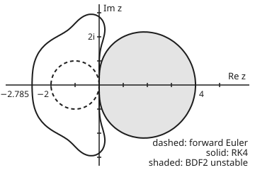

# Stiffness: when stability not accuracy sets the step, and the barriers on the cure

[Syllabus](../../../SYLLABUS.md) → [Numerical analysis](../README.md) → [ODE Solvers](../README.md#s06) → Stiffness

---

## General Overview

A chemical reaction runs in two stages, A → B → C. A turns into B at a rate of 1,000,000 per second, so A is gone within microseconds. B turns into C at a rate of 1 per second, so B lasts for seconds. The rates are illustrative. The wanted number is the amount of B at 1 second, as a fraction of the starting amount of A, with an error under 10^−4. The true value is 0.3678798091.

The slow stage is gentle. A step of 0.01 s would follow it well. But forward Euler is only stable for steps under 2 microseconds, so it needs more than 500,000 steps to reach 1 s; the run below uses 525,000 (h = 1.90 microseconds). RK4 is no cure: its limit is 2.785 microseconds, which costs 1,440,000 slope evaluations. One step too long, 2.1 microseconds, and forward Euler's A reaches 5.046e19 after a millisecond.

The second-order backward differentiation formula, BDF2, takes 100 steps of 0.01 s and misses by 1.542e-5. The difference is stability, not accuracy: whether a step lets the long-dead fast part grow back. This card maps where each method is safe and states Dahlquist's two barriers, the limits on how accurate a safe method can be.

**A step is safe only if h times every rate of the problem lies in the method's stability region; A-stable methods, whose region holds the whole left half-plane, let accuracy alone choose the step, but an A-stable multistep method has order at most 2.**

**What kind of fact this is:** definitions (stability region, A-, L- and A(α)-stability) plus two theorems. The second Dahlquist barrier is proved on this card, in a fold under Why it works. The first is stated with its key steps and checked on examples; its proof is in Dahlquist (1956). The step counts and errors are measurements, printed by the code.

### The picture: where each method is safe

<p align="center"></p>

Drawn to scale from the checks' `figure,` line, 34 pixels per unit. Forward Euler and RK4 are stable inside their curves, which are small and bounded. BDF2 is stable everywhere outside the shaded oval, which lies in the right half-plane, so every decaying rate is safe. The reaction's fast rate at h = 0.01 s sits at z = −10000, far off the left edge.

---

## The formula

Reminder: [Stiff equations](../../08-Differential%20equations%20and%20dynamics/05-Numerical%20Evolution/06-stiff-equations-and-backward-euler.md) gives the per-step factors 1 + z (forward Euler), 1/(1 − z) (backward Euler) and (1 + z/2)/(1 − z/2) (trapezoid), proves the last two A-stable, and states the second barrier. This card maps such factors on the complex plane for Runge-Kutta and multistep methods, and proves the barrier.

Everything is measured on the **test equation** $y' = \lambda y$, where $\lambda$ is a complex rate with negative real part. The step $h$ enters only through $z = h\lambda$. A one-step method multiplies $y$ by its **stability function** $R(z)$ each step. A $k$-step linear multistep method $\sum_{j=0}^{k} a_j y_{n+j} = h \sum_{j=0}^{k} b_j f_{n+j}$, with weights listed oldest first, has two polynomials $\rho(\zeta) = \sum a_j \zeta^j$ and $\sigma(\zeta) = \sum b_j \zeta^j$. These are the weights of [Multistep methods](04-multistep-adams-and-bdf.md), written there $\alpha_j$, $\beta_j$ and listed newest first; here they are $a_j$, $b_j$, listed oldest first, because $\alpha$ is the wedge angle below. On the test equation its solutions are combinations of $\zeta^n$, where $\zeta$ solves $\rho(\zeta) = z\,\sigma(\zeta)$. The **stability region** is

$$S = \{\, z : |R(z)| \le 1 \,\} \qquad\text{or}\qquad S = \{\, z : \text{every root of } \rho(\zeta) - z\,\sigma(\zeta) \text{ has } |\zeta| \le 1, \text{ and those with } |\zeta| = 1 \text{ are simple} \,\}$$

**Read it aloud:** the stability region is the set of values of step times rate for which one step does not make any part of the solution bigger.

Three grades of "safe for stiff problems" follow:

- **A-stable:** $S$ contains every $z$ with negative real part.
- **L-stable:** A-stable, and the factor tends to 0 as $z \to -\infty$, so the fastest parts die in one step.
- **A(α)-stable:** $S$ contains the wedge of angle $\alpha$ either side of the negative real axis.

The two barriers cap the order $p$ of linear multistep methods. The first is for zero-stable ones (the root condition of [Multistep methods](04-multistep-adams-and-bdf.md): every root of $\rho$ at most 1 in size, and those of size exactly 1 simple):

$$\text{first: } p \le k + 2 \ (k \text{ even}),\quad p \le k + 1 \ (k \text{ odd}),\quad p \le k \ (\text{explicit}); \qquad \text{second: A-stable} \ \Rightarrow\ p \le 2, \ \text{and if}\ p = 2 \ \text{then}\ C \le -\tfrac{1}{12}$$

**Read it aloud:** a zero-stable k-step formula has order at most k plus 2; an A-stable one has order at most 2, and at order 2 an error constant at least the trapezoid's one twelfth in size.

| Symbol | Plain meaning | In our example | Push it up and the answer… |
| --- | --- | --- | --- |
| $J$; $y$, $f$, $n$, $t$ | the reaction's matrix of rates, (A, B)′ = $J$(A, B); a solution value, its slope $f = y'$, the step number, time in s | B(1 s) = 0.3678798091 | — |
| $\lambda$ | a rate of the problem: an eigenvalue of $J$, per s | −1000000 (fast), −1 (slow) | more negative: a tighter explicit limit |
| $h$ | step size, s | 0.01 for BDF2; 1.90e-6 for forward Euler | outside $S$: blow-up |
| $z$ | $h\lambda$, step measured in lifetimes of a part | −10000 for the fast part at h = 0.01 | — |
| $R(z)$ | one-step factor on the test equation | RK4: $1 + z + z^2/2 + z^3/6 + z^4/24$ | size above 1: growth |
| $a_j$, $b_j$, $k$; $\rho$, $\sigma$ | a multistep formula's state and slope weights, its step count; their polynomials | BDF2: $\rho = \tfrac{3}{2}\zeta^2 - 2\zeta + \tfrac12$, $\sigma = \zeta^2$ | — |
| $\zeta$ | a root: the factor one part of a multistep solution gains per step | BDF2 at z = −10000: size 0.0070705 | size above 1: growth |
| $S$ | stability region | forward Euler: disc of radius 1 about −1 | — |
| $\alpha$ | the A(α) angle, degrees | BDF3: 86.03 | wider safe wedge |
| $p$, $C$ | order; error constant $C = C_{p+1}/\sigma(1)$, the leading error per step, where $C_{p+1}$ is the coefficient of $h^{p+1} y^{(p+1)}$ left over when the exact solution is put into the formula | trapezoid: 2, −0.08333; BDF2: 2, −0.33333 | larger error at the same order |
| $\theta$ | angle round the unit circle, $\zeta = e^{i\theta}$ | 0 to π | — |
| $\varphi$, $w$ | the proof's test function; $w = \log\zeta$ | $\varphi$(1.01): BDF2 2.463e-3 | — |

### When it holds

- **A linear problem, or one frozen near a state.** The rates are the eigenvalues of the Jacobian (the matrix of partial derivatives of the rule). On a nonlinear problem they drift, and the test must hold all along the run.
- **A full set of eigenvectors.** If the eigenvectors are nearly parallel, errors can grow for a while even when every $z$ is in $S$.
- **Linear multistep methods, for the barriers.** Implicit Runge-Kutta methods, such as the Radau family, are A-stable at any order, at the price of a larger system per step.
- **Zero-stability, for the first barrier.** Drop it and three steps reach order 6, then blow up.
- **Parts that really decay.** Backward Euler's region also covers most of the right half-plane, so a long step can damp a part that truly grows.

---

## Why it works

### Step 0: one step multiplies each part by a number that depends only on z

A linear method acts on each eigen-direction of the problem separately. On that direction it sees $y' = \lambda y$ and multiplies by a factor that depends on $h$ and $\lambda$ only through $z = h\lambda$. So "is this step safe?" becomes "is $z$ in the method's region?" One picture per method then covers every linear problem.

### Step 1: the reaction has one fast rate and one slow rate

Here $J$ is lower triangular, with rows $(-10^6, 0)$ and $(10^6, -1)$. Its trace and determinant give eigenvalues −1000000.0 and −1.000000 per s: a stiffness ratio of 1000000. By [The eigenvalue method](../../08-Differential%20equations%20and%20dynamics/04-Systems%20and%20the%20Matrix%20Exponential/02-the-eigenvalue-method.md), the solution is a fast part times $e^{-10^6 t}$ plus a slow part times $e^{-t}$.

A step of size $h$ is safe only if both $z = -10^6 h$ and $z = -h$ lie in $S$. Accuracy cares about the slow part. Stability cares about the fast one, long after it has died.

### Step 2: explicit methods have bounded regions

An explicit Runge-Kutta step gives a polynomial $R(z)$; for RK4 it is the Taylor polynomial of $e^z$ up to $z^4$ ([Runge-Kutta](01-runge-kutta-and-butcher-tableaux.md)). A polynomial grows without limit, so its region is bounded, and no explicit method is A-stable.

Bisection on the factor's size finds each region's left end on the real axis: forward Euler −2.0000, AB2 (two-step Adams-Bashforth) −1.0000, RK4 −2.7853. Newton's method on $(R(x) - 1)/x = 0$ confirms RK4's as −2.785294. Divided by the fast rate, these give the step limits 2.000e-6 s, 1.000e-6 s and 2.785e-6 s. RK4's region also crosses the imaginary axis at ±2.8284i, which is $2\sqrt 2$.

### Step 3: a multistep region is bounded by its boundary locus

A multistep method changes from stable to unstable only where a root crosses the unit circle. There $\zeta = e^{i\theta}$, so $z = \rho(e^{i\theta})/\sigma(e^{i\theta})$. As $\theta$ goes round, this traces the **boundary locus**, and the edge of $S$ lies on it.

For BDF2 the real part of the locus is $(1 - \cos\theta)^2$, never negative. The locus is the oval in the picture, from 0 to 4. The left half-plane contains no locus point, and BDF2 is stable at $z = -1$, so it is stable on the whole left half-plane: A-stable.

That gives a test with two independent roads. Road 1 finds the smallest real part on the locus: below zero means a crossing in the left half-plane. Road 2 computes the root sizes directly on a grid of points across the left half-plane. The code demands that they agree, and that the locus's leftmost point equals the real-axis edge (0 for the A-stable ones, −1/12 for BDF3):

| Method | Order $p$ | $C$ | Real-axis edge | Locus min Re $z$ | Worst grid factor | A-stable | Factor at −1e8 |
| --- | --- | --- | --- | --- | --- | --- | --- |
| forward Euler | 1 | 0.50000 | −2.0000 | −2.00000 | 1.00e3 | no | 1.00e8 |
| AB2 | 2 | 0.41667 | −1.0000 | −1.00000 | 1.50e3 | no | 1.50e8 |
| RK4 | 4 | — | −2.7853 | −2.78529 | 4.17e10 | no | 4.17e30 |
| AM2 | 3 | −0.04167 | −6.0000 | −6.00000 | 1.7164 | no | 1.72e0 |
| backward Euler | 1 | −0.50000 | −∞ | 0.00000 | 0.9997 | yes | 1.00e-8 |
| trapezoid | 2 | −0.08333 | −∞ | 0.00000 | 0.9999 | yes | 1.00e0 |
| BDF2 | 2 | −0.33333 | −∞ | 0.00000 | 0.9997 | yes | 7.07e-5 |
| BDF3 | 3 | −0.25000 | −∞ | −0.08333 | 1.0265 | no | 1.50e-3 |

AM2 is the two-step Adams-Moulton formula, implicit and order 3. For RK4, road 1 solves $R(z) = e^{i\theta}$ for $z$. Only order-1 and order-2 methods pass; for the multistep ones, that is the second barrier at work.

### Step 4: A-stable is not enough; the fast part must also die

The last column is the factor for an extremely fast part. The trapezoid's is 1.00e0: it hardly damps at all. On the reaction at h = 0.01 s, its factor on the fast part is −0.99960. After 100 steps A should be zero, but the trapezoid still shows 0.9608, and B is off by −0.9608.

Backward Euler multiplies the same part by 9.999e-5 and BDF2 by roots of size 0.0070705. Both factors tend to 0 as $z \to -\infty$: they are **L-stable**. That is why stiff solvers prefer BDF to the trapezoid.

### Step 5: the BDF family trades angle for order

BDF$k$ has order $k$. The code builds $\rho$ for $k$ = 1 to 7 and finds:

| $k$ | Largest root of $\rho$ besides 1 | Angle $\alpha$ (degrees) |
| --- | --- | --- |
| 1 | 0.0000 | 90.00 |
| 2 | 0.3333 | 90.00 |
| 3 | 0.4264 | 86.03 |
| 4 | 0.5609 | 73.35 |
| 5 | 0.7087 | 51.84 |
| 6 | 0.8634 | 17.84 |
| 7 | 1.0222 | unstable |

The angles match the published values (Hairer and Wanner, chapter V). BDF3 to BDF6 are not A-stable: BDF3's locus dips to −0.08333 near the imaginary axis. That is exactly −1/12: on the circle its real part is $u^2(4u - 3)/3$ with $u = 1 - \cos\theta$, smallest at $u = 1/2$. But they contain the whole negative real axis. A problem whose rates are real and negative, like this reaction, is safe with any of them. Rates with large imaginary parts (fast, lightly damped vibrations) need the wider wedges of low $k$. BDF7 fails zero-stability, so the family stops at 6.

### Step 6: the first barrier

A $k$-step formula has $2k + 1$ free weights once $a_k = 1$. The order conditions are linear in them, so order $2k$ is always reachable algebraically. The code solves for that formula:

| $k$ | Order reached | $\rho$ weights | Largest root of $\rho$ | Zero-stable? |
| --- | --- | --- | --- | --- |
| 1 | 2 | −1.0000, 1.0000 | 1.0000 | yes: the trapezoid |
| 2 | 4 | −1.0000, 0.0000, 1.0000 | 1.0000 | yes, just: roots ±1 |
| 3 | 6 | −1.0000, −2.4545, 2.4545, 1.0000 | 3.1356 | no |

At $k = 2$ the barrier $k + 2 = 4$ is reached exactly, by the Milne-Simpson formula. At $k = 3$ the cap is 4, so the order-6 formula must be unstable, and it is: a root at −3.1356. On $y' = -y$ with h = 0.1 and exact starting values, its errors are 3.856e-7, 4.437e-2 and 5.103e3 after 10, 20 and 30 steps.

The proof is Dahlquist's (1956), not reproduced here. Its key steps: the map $\zeta = (1 + s)/(1 - s)$ sends the outside of the unit circle to the right half-plane. Zero-stability then forces the transformed $\rho$ to have coefficients of one sign. Order $p$ forces the transformed polynomials to match a fixed power series of $s$ whose higher coefficients all have the opposite sign. The two demands collide beyond $k + 1$ or $k + 2$.

### Step 7: the second barrier, by a function that cannot be negative

The idea: A-stability forces $\sigma/\rho$ to have a non-negative real part outside the unit circle. Subtract the trapezoid's own fraction, whose real part is zero on the circle, and call the rest $\varphi$. A fact from complex analysis (the real part of such a function takes its minimum on the boundary) keeps the real part of $\varphi$ non-negative outside the circle.

But near $\zeta = 1$ the order fixes $\varphi$. With $w = \log\zeta$, $\varphi = -C\,w^{p-1} - w/12 + \dots$. For $p \ge 3$ that is negative just outside the circle: a contradiction. For $p = 2$ it forces $C \le -1/12$. The code evaluates $\varphi$ at $\zeta$ = 1.01: trapezoid 0.000e0, BDF2 2.463e-3, and AM2, order 3, −8.251e-4, negative as predicted.

<details>
<summary>Detailed proof: an A-stable linear multistep method has order at most 2, and at order 2, C ≤ −1/12</summary>

**Assume** the method is consistent and zero-stable, $\rho$ and $\sigma$ share no root, and the only root of $\rho$ on the unit circle is $\zeta = 1$. If $\rho$ has other roots on the circle, $\sigma/\rho$ has poles there too, and Step C needs a limiting argument; that case is in Hairer and Wanner, chapter V. Consistency gives $\rho(1) = 0$ and $\rho'(1) = \sigma(1)$.

**Step A: the sign outside the circle.** Take $|\zeta| > 1$ with $\rho(\zeta) \ne 0$ and $\sigma(\zeta) \ne 0$, and set $z = \rho(\zeta)/\sigma(\zeta)$. Then $\zeta$ is a root of $\rho - z\sigma$ of size above 1, so $z \notin S$. A-stability puts every $z$ with $\operatorname{Re} z < 0$ inside $S$, so $\operatorname{Re} z \ge 0$. Since $\operatorname{Re}(1/z) = \operatorname{Re} z / |z|^2$, also $\operatorname{Re}(\sigma/\rho) \ge 0$.

**Step B: the comparison function.** Let $T(\zeta) = (\zeta + 1)/(2(\zeta - 1))$. Then $\operatorname{Re} T(\zeta) = (|\zeta|^2 - 1)/(2|\zeta - 1|^2)$, which is 0 on $|\zeta| = 1$. Set $\varphi = \sigma/\rho - T$.

**Step C: $\varphi$ is non-negative outside the circle.** Zero-stability puts no root of $\rho$ outside the circle, so $\sigma/\rho$ has no pole there. At $\zeta = 1$, both $\sigma/\rho$ and $T$ have a simple pole with residue $\sigma(1)/\rho'(1) = 1$, so the poles cancel and $\varphi$ is regular there. As $\zeta \to \infty$, $\varphi$ tends to the finite limit $b_k/a_k - 1/2$. So $\varphi$ has a complex derivative on $|\zeta| > 1$ including infinity, and is continuous up to the circle. On the circle, $\operatorname{Re}\varphi = \operatorname{Re}(\sigma/\rho) \ge 0$, a limit of Step A. The real part of such a function takes its minimum on the boundary, so $\operatorname{Re}\varphi \ge 0$ for all $|\zeta| > 1$.

**Step D: the expansion at $\zeta = 1$.** Write $\zeta = e^w$. Order $p$ means $\rho(e^w) - w\,\sigma(e^w) = C_{p+1} w^{p+1} + O(w^{p+2})$ as $w \to 0$. Dividing by $w\,\sigma(e^w)$ gives $\rho/\sigma = w + C w^{p+1} + O(w^{p+2})$ with $C = C_{p+1}/\sigma(1)$, so $\sigma/\rho = 1/w - C w^{p-1} + O(w^p)$. The trapezoid's fraction is $T(e^w) = \tfrac12\coth(w/2) = 1/w + w/12 + O(w^3)$. Hence

$$\varphi(e^w) = -C\,w^{p-1} - \frac{w}{12} + O(w^{p}) + O(w^3).$$

**Step E: the contradiction.** Take $w > 0$ small and real, so $\zeta = e^w$ is just outside the circle. If $p \ge 3$, $\varphi = -w/12 + O(w^2) < 0$, against Step C. So $p \le 2$. If $p = 2$, $\varphi = -(C + 1/12)\,w + O(w^2)$, and Step C needs $C \le -1/12$. The trapezoid has $\varphi \equiv 0$, so it meets the bound with equality. $\blacksquare$

</details>

---

## Worked numbers, by hand

The fast part at h = 0.01 s, and the step counts over 1 s.

| Step | Arithmetic | Value |
| --- | --- | --- |
| $z$ | $0.01 \times (-1000000)$ | −10000 |
| forward Euler factor | $1 + z$ | −9999 |
| backward Euler factor | $1/(1 - z) = 1/10001$ | 9.999e-5 |
| trapezoid factor | $(1 + z/2)/(1 - z/2)$ | −0.99960 |
| BDF2 roots | $(\tfrac32 - z)\zeta^2 - 2\zeta + \tfrac12 = 0$: a complex pair, size $\sqrt{0.5/(1.5 - z)}$ | 0.0070705 |
| forward Euler limit | $\lvert 1 + h\lambda\rvert \le 1$ needs $h \le 2/1000000$ | 2.000e-6 s |
| steps to 1 s | forward Euler at 1.90e-6 s against BDF2 at 0.01 s | **525000 against 100** |

Forward Euler's 525000 steps miss B by −3.504e-7; BDF2's 100 steps miss by 1.542e-5, both inside the 10^−4 target. Forward Euler's error is far inside the target, so accuracy did not choose its step: stability did, to keep the long-dead fast part from growing back.

### What breaks if you drop a piece

| Mistake | Comes out at | What went wrong |
| --- | --- | --- |
| Forward Euler at h = 2.1e-6 s, just past the limit | A = 5.046e19 after 1 ms | factor −1.1 per step on the fast part |
| Trapezoid at h = 0.01 s | A = 9.608e-1 at 1 s, B off by −9.608e-1 | A-stable but not L-stable: factor −0.99960 |
| Backward Euler instead of BDF2 at h = 0.01 s | B off by 1.832e-3, over the target | stable, but only order 1 |
| Order 6 from three steps | error 5.103e3 after 30 steps of $y' = -y$ | breaks the first barrier: root −3.1356 |
| BDF7 for more order | a root of size 1.0222 | not zero-stable; the family stops at BDF6 |

---

## Code, from first principles, and it actually runs

The code steps the reaction five ways against the exact solution, then tests eight methods on the test equation. Roots come from Durand-Kerner iteration, which finds all roots of a polynomial at once. Independent roads meet at each answer:

- **Explicit limits:** bisection against the closed forms −2 and −1, and Newton's method for RK4.
- **Runs:** errors against the exact B, with observed orders 0.999 (backward Euler) and 2.002 (BDF2); forward Euler's B and the trapezoid's A against their exact discrete values, such as $(-4999/5001)^{100}$.
- **A-stability:** the boundary locus against a brute-force grid, which must agree for every method, and the locus's leftmost point against the bisected edge.
- **BDF and the barriers:** angles against published values; the first barrier's formulas from solving the order conditions.

### Python

```python
# Stiffness and the Dahlquist barriers: the check behind the card.  Standard library only.  A reaction A -> B -> C
# (rates 1e6 and 1 per s, illustrative) stepped five ways; stability on y' = lam*y; the BDF family; both barriers.
from math import exp, sqrt, cos, sin, pi, atan2, log
K1, K2 = 1e6, 1.0                                # fast and slow rates, per s
def sci(v, d=3): m, e = f"{v:.{d}e}".split("e"); return f"{m}e{int(e)}"   # 1.234e-5, the form Rust prints
def b_true(t): return K1 / (K1 - K2) * (exp(-K2 * t) - exp(-K1 * t))
def rate(a, b): return -K1 * a, K1 * a - K2 * b
def solve(c, h, ra, rb):                         # (I - c h J) y = r; J is lower triangular
    a = ra / (1 + c * h * K1); return a, (rb + c * h * K1 * a) / (1 + c * h * K2)
def run(m, h, n):                                # n steps of size h from a = 1, b = 0
    a, b, prev = 1.0, 0.0, None
    for _ in range(n):
        if m == "FE": da, db = rate(a, b); na, nb = a + h * da, b + h * db
        elif m == "RK4":
            p = rate(a, b); q = rate(a + h / 2 * p[0], b + h / 2 * p[1])
            r = rate(a + h / 2 * q[0], b + h / 2 * q[1]); s = rate(a + h * r[0], b + h * r[1])
            na, nb = a + h / 6 * (p[0] + 2 * q[0] + 2 * r[0] + s[0]), b + h / 6 * (p[1] + 2 * q[1] + 2 * r[1] + s[1])
        elif m == "BE": na, nb = solve(1, h, a, b)
        elif m == "TR": da, db = rate(a, b); na, nb = solve(0.5, h, a + h / 2 * da, b + h / 2 * db)
        elif prev is None: na, nb = solve(1, h, a, b)          # BDF2, started by one BE step
        else: na, nb = solve(2 / 3, h, (4 * a - prev[0]) / 3, (4 * b - prev[1]) / 3)
        prev, a, b = (a, b), na, nb
    return a, b
def div(p, q): return p * q.conjugate() / (q.real * q.real + q.imag * q.imag)
def pv(c, x):                                    # Horner: sum c[j] x^j
    p = 0j
    for v in reversed(c): p = p * x + v
    return p
def roots(c):                                    # Durand-Kerner: every root of sum c[j] x^j
    c = [div(x, c[-1]) for x in c]; n = len(c) - 1
    if n == 1: return [-c[0]]
    z = [1 + 0j]
    while len(z) < n: z.append(z[-1] * (0.4 + 0.9j))
    for _ in range(800):
        new = []
        for i in range(n):
            p, q = pv(c, z[i]), 1 + 0j
            for j in range(n):
                if j != i: q = q * (z[i] - z[j])
            new.append(z[i] - div(p, q))
        moved = max(abs(u - v) for u, v in zip(new, z)); z = new
        if moved < 1e-15: break
    return z
def R4(z): return pv([1, 1, 1 / 2, 1 / 6, 1 / 24], z)       # RK4's factor per step on y' = lam*y
M = {"FE": ([-1, 1], [1, 0]), "AB2": ([0, -1, 1], [-0.5, 1.5, 0]), "BE": ([-1, 1], [0, 1]),
     "TR": ([-1, 1], [0.5, 0.5]), "AM2": ([0, -1, 1], [-1 / 12, 8 / 12, 5 / 12]),
     "BDF2": ([0.5, -2, 1.5], [0, 0, 1]), "BDF3": ([-1 / 3, 1.5, -3, 11 / 6], [0, 0, 0, 1])}
def amp(m, z):                                   # largest root size of the step's characteristic polynomial
    if m == "RK4": return abs(R4(z))
    return max(abs(x) for x in roots([complex(u) - z * v for u, v in zip(*M[m])]))
def edge(m):                                     # left end of the stable stretch of the real axis
    if amp(m, -1e4) <= 1: return None
    lo, hi = -50.0, -1e-6
    while hi - lo > 1e-13: mid = (lo + hi) / 2; lo, hi = (mid, hi) if amp(m, mid) > 1 else (lo, mid)
    return hi
tr, dt = -K1 - K2, K1 * K2; l1, l2 = (tr - sqrt(tr * tr - 4 * dt)) / 2, (tr + sqrt(tr * tr - 4 * dt)) / 2
print(f"J = [[-{K1:.0f}, 0], [{K1:.0f}, -{K2:.0f}]]; eigenvalues from trace and determinant: {l1:.1f} and {l2:.6f} per s; stiffness ratio {l1 / l2:.0f}")
assert abs(l1 + K1) < 1e-6 and abs(l2 + K2) < 1e-9
bt = b_true(1.0); print(f"true B at 1 s: {bt:.10f}; target: an error under 1e-4")
xr = -2.8                                        # second road to RK4's edge: Newton on (R(x) - 1)/x = 0
for _ in range(50): xr -= (1 + xr * (1 / 2 + xr * (1 / 6 + xr / 24))) / (1 / 2 + xr * (1 / 3 + xr / 8))
e = {m: edge(m) for m in ["FE", "RK4", "AB2"]}
assert abs(e["FE"] + 2) < 1e-9 and abs(e["AB2"] + 1) < 1e-9 and abs(e["RK4"] - xr) < 1e-9
print(f"explicit step limits h < -edge/1e6: FE {sci(-e['FE'] / K1)} s, RK4 {sci(-e['RK4'] / K1)} s "
      f"(Newton edge {xr:.6f}), AB2 {sci(-e['AB2'] / K1)} s")
print("run to 1 s           steps    evals  A at 1 s    B error")
for m, n, ev in [("FE", 525000, 1), ("RK4", 360000, 4), ("BE", 100, 1), ("TR", 100, 1), ("BDF2", 100, 1)]:
    a, b = run(m, 1.0 / n, n)
    print(f"{m:>4}, h = {sci(1.0 / n, 2):>8}  {n:>6}  {n * ev:>7}  {sci(a):>10}  {sci(b - bt):>10}")
    if m == "BDF2": assert abs(b - bt) < 1e-4 < abs(run("BE", 0.01, 100)[1] - bt)
    if m == "FE": assert abs(b - bt - K1 / (K1 - K2) * ((1 - K2 / n) ** n - (1 - K1 / n) ** n - exp(-K2))) < 1e-10   # FE's exact discrete B
    if m == "TR": assert abs(a - ((1 - K1 / (2 * n)) / (1 + K1 / (2 * n))) ** n) < 1e-12   # TR's factor on A, n times
fa = run("FE", 2.1e-6, 476)[0]; print(f"FE at h = 2.1e-6 (factor -1.1), 476 steps = 1 ms: A = {sci(fa)}"); assert 1e19 < abs(fa) < 1e21
eb = [abs(run(m, 1.0 / n, n)[1] - bt) for m in ("BE", "BDF2") for n in (100, 200, 400)]
pb, pd = log(eb[1] / eb[2]) / log(2), log(eb[4] / eb[5]) / log(2); assert abs(pb - 1) < 0.02 and abs(pd - 2) < 0.02
print(f"B errors at h = 0.01, 0.005, 0.0025: BE {', '.join(sci(x) for x in eb[:3])} (order {pb:.3f}); "
      f"BDF2 {', '.join(sci(x) for x in eb[3:])} (order {pd:.3f})")
z = -1e4                                         # h = 0.01 on the fast rate
print(f"one step at z = h*lam = {z:.0f}: FE {1 + z:.0f}, RK4 {sci(R4(z).real)}, BE {sci(amp('BE', z))}, "
      f"TR {div(1 + z / 2, 1 - z / 2).real:.5f}, BDF2 root size {amp('BDF2', z):.7f}")
assert abs(amp("BDF2", z) - sqrt(0.5 / (1.5 - z))) < 1e-12
def consts(m):                                   # order p and error constant C_(p+1)/sigma(1)
    al, be = M[m]; f1 = 1.0
    for q in range(1, 9):
        f1 *= q; cq = sum(a * j ** q for j, a in enumerate(al)) / f1 - q * sum(b * j ** (q - 1) for j, b in enumerate(be)) / f1
        if abs(cq) > 1e-10: return q - 1, cq / sum(be)
TH = [pi * (i + 0.5) / 4000 for i in range(4000)]
def locus_min(m):                                # road 1: smallest Re z on the boundary locus z = rho/sigma
    return min(div(pv(M[m][0], complex(cos(t), sin(t))), pv(M[m][1], complex(cos(t), sin(t)))).real for t in TH)
grid = [10 ** (s / 4 - 2) * complex(cos(pi * (0.5 + (i + 0.5) / 60)), sin(pi * (0.5 + (i + 0.5) / 60))) for s in range(21) for i in range(60)]
print("method  p  C/sigma(1)  real edge  locus min Re z  worst grid amp  A-stable  amp at -1e8")
for m in ["FE", "AB2", "RK4", "AM2", "BE", "TR", "BDF2", "BDF3"]:
    (p, c), wg = consts(m) if m != "RK4" else (4, None), max(amp(m, g) for g in grid)
    lm = locus_min(m) if m != "RK4" else min(min(x.real for x in roots([1 - complex(cos(t), sin(t)), 1, 1 / 2, 1 / 6, 1 / 24])) for t in TH[::20])
    ok, eg = wg <= 1 + 1e-9, edge(m)                # the locus's leftmost point: the real edge, BDF3's -1/12, or 0
    assert ok == (lm >= -1e-9) and abs(lm - (eg if eg is not None else -1 / 12 if m == "BDF3" else 0.0)) < 1e-5
    assert not ok or (p <= 2 and (p < 2 or c <= -1 / 12 + 1e-12))   # second barrier, on each A-stable one
    ed = "-inf" if eg is None else f"{eg:.4f}"
    cs, ls, ws = "-" if c is None else f"{c:.5f}", f"{lm if abs(lm) > 1e-9 else 0.0:.5f}", f"{wg:.4f}" if wg < 100 else sci(wg, 2)
    print(f"{m:>6}  {p}  {cs:>10}  {ed:>9}  {ls:>13}  {ws:>14}  {'yes' if ok else 'no':>8}  {sci(amp(m, -1e8), 2)}")
ph = {m: div(pv(M[m][1], 1.01), pv(M[m][0], 1.01)).real - 2.01 / (2 * (1.01 - 1)) for m in ("TR", "BDF2", "AM2")}   # the proof's phi at zeta = 1.01
print(f"proof: Re phi(1.01) = Re[sigma/rho - (zeta+1)/(2(zeta-1))]: TR {sci(ph['TR'])}, BDF2 {sci(ph['BDF2'])}, AM2 {sci(ph['AM2'])}")
assert ph["AM2"] < 0 < ph["BDF2"] and abs(ph["AM2"] + 0.01 / 12) < 2e-4 and abs(ph["BDF2"] - 0.0025) < 3e-4
print("BDF k  max |root of rho| besides 1  alpha (deg)")
for k in range(1, 8):
    rho = [0.0] * (k + 1)
    for j in range(1, k + 1):                    # rho = sum (1/j) x^(k-j) (x-1)^j
        t = [1.0]
        for _ in range(j): t = [0.0] + t; t = [t[i] - (t[i + 1] if i + 1 < len(t) else 0) for i in range(len(t))]
        for i, v in enumerate(t): rho[i + k - j] += v / j
    big = max([abs(x) for x in sorted(roots(rho), key=lambda x: abs(x - 1))[1:]], default=0.0)
    al = pi / 2                                  # A(alpha): smallest angle of the locus from the negative real axis
    for i in range(1, 20000):
        t = pi * i / 20000; w = div(pv(rho, complex(cos(t), sin(t))), complex(cos(k * t), sin(k * t)))
        if w.real < 0: al = min(al, atan2(abs(w.imag), -w.real))
    al *= 180 / pi
    print(f"    {k}  {big:28.4f}  {f'{al:.2f}' if big < 1 else 'unstable':>11}")
    assert (big > 1) == (k == 7)
    assert k > 6 or abs(al - [90, 90, 86.03, 73.35, 51.84, 17.84][k - 1]) < 0.006
for k in (1, 2, 3):                              # first barrier: the highest-order implicit k-step formula
    n = 2 * k + 1                                # unknowns a_0..a_(k-1), b_0..b_k; a_k = 1
    A = [[float(j ** q) for j in range(k)] + [-float(q * j ** (q - 1)) if q else 0.0 for j in range(k + 1)]
         + [-float(k ** q)] for q in range(n)]
    for c in range(n):                           # Gaussian elimination with partial pivoting
        piv = max(range(c, n), key=lambda r: abs(A[r][c])); A[c], A[piv] = A[piv], A[c]
        for r in range(n):
            if r != c: A[r] = [x - A[r][c] / A[c][c] * y for x, y in zip(A[r], A[c])]
    x = [A[i][n] / A[i][i] for i in range(n)]
    al, be = x[:k] + [1.0], x[k:]; M["k"] = (al, be); p = consts("k")[0]; big = max(abs(r) for r in roots(al))
    print(f"first barrier, k = {k}: order {p}, rho = {', '.join(f'{v:.4f}' for v in al)}; largest |root| {big:.4f}")
    assert p == 2 * k and (big > 1 + 1e-9) == (p > (k + 2 if k % 2 == 0 else k + 1))
h, ys = 0.1, [exp(-0.1 * i) for i in range(3)]   # run the order-6 three-step formula on y' = -y
for i in range(3, 31): ys.append((-sum(a * y for a, y in zip(al[:3], ys[-3:])) + h * -sum(b * y for b, y in zip(be[:3], ys[-3:]))) / (1 + h * be[3]))
print(f"order-6 three-step formula on y' = -y, h = 0.1: error at steps 10, 20, 30: {', '.join(sci(ys[i] - exp(-h * i)) for i in (10, 20, 30))}")
assert abs(ys[30] - exp(-3)) > 1
w = max((div(pv(M["BDF2"][0], complex(cos(t), sin(t))), complex(cos(2 * t), sin(2 * t))) for t in TH), key=lambda w: w.imag)
assert abs(abs(R4(1j * sqrt(8))) - 1) < 1e-12 and abs(w.imag - sqrt(sqrt(3) / 2) * (3 + sqrt(3)) / 2) < 1e-6  # closed forms
print(f"figure, 34 px per unit, origin (140, 120): FE centre (106.0, 120.0) radius 34.0; RK4 edge ({140 + 34 * e['RK4']:.1f}, 120.0), "
      f"imaginary tips +-{sqrt(8):.4f} at y {120 - 34 * sqrt(8):.1f}; BDF2 locus right end {pv(M["BDF2"][0], -1).real:.0f} at (276.0, 120.0), top {w.real:.4f} + {w.imag:.4f}i at ({140 + 34 * w.real:.1f}, {120 - 34 * w.imag:.1f})")
print("ALL CHECKS PASS")
```

**Ran 2026-11-11 on macOS, Python 3.14.10, standard library only. All checks passed. Output, pasted from the run:**

```
J = [[-1000000, 0], [1000000, -1]]; eigenvalues from trace and determinant: -1000000.0 and -1.000000 per s; stiffness ratio 1000000
true B at 1 s: 0.3678798091; target: an error under 1e-4
explicit step limits h < -edge/1e6: FE 2.000e-6 s, RK4 2.785e-6 s (Newton edge -2.785294), AB2 1.000e-6 s
run to 1 s           steps    evals  A at 1 s    B error
  FE, h =  1.90e-6  525000   525000  2.470e-323   -3.504e-7
 RK4, h =  2.78e-6  360000  1440000  6.670e-322  -1.710e-14
  BE, h =  1.00e-2     100      100     0.000e0    1.832e-3
  TR, h =  1.00e-2     100      100    9.608e-1   -9.608e-1
BDF2, h =  1.00e-2     100      100  1.375e-216    1.542e-5
FE at h = 2.1e-6 (factor -1.1), 476 steps = 1 ms: A = 5.046e19
B errors at h = 0.01, 0.005, 0.0025: BE 1.832e-3, 9.178e-4, 4.594e-4 (order 0.999); BDF2 1.542e-5, 3.844e-6, 9.595e-7 (order 2.002)
one step at z = h*lam = -10000: FE -9999, RK4 4.165e14, BE 9.999e-5, TR -0.99960, BDF2 root size 0.0070705
method  p  C/sigma(1)  real edge  locus min Re z  worst grid amp  A-stable  amp at -1e8
    FE  1     0.50000    -2.0000       -2.00000          1.00e3        no  1.00e8
   AB2  2     0.41667    -1.0000       -1.00000          1.50e3        no  1.50e8
   RK4  4           -    -2.7853       -2.78529         4.17e10        no  4.17e30
   AM2  3    -0.04167    -6.0000       -6.00000          1.7164        no  1.72e0
    BE  1    -0.50000       -inf        0.00000          0.9997       yes  1.00e-8
    TR  2    -0.08333       -inf        0.00000          0.9999       yes  1.00e0
  BDF2  2    -0.33333       -inf        0.00000          0.9997       yes  7.07e-5
  BDF3  3    -0.25000       -inf       -0.08333          1.0265        no  1.50e-3
proof: Re phi(1.01) = Re[sigma/rho - (zeta+1)/(2(zeta-1))]: TR 0.000e0, BDF2 2.463e-3, AM2 -8.251e-4
BDF k  max |root of rho| besides 1  alpha (deg)
    1                        0.0000        90.00
    2                        0.3333        90.00
    3                        0.4264        86.03
    4                        0.5609        73.35
    5                        0.7087        51.84
    6                        0.8634        17.84
    7                        1.0222     unstable
first barrier, k = 1: order 2, rho = -1.0000, 1.0000; largest |root| 1.0000
first barrier, k = 2: order 4, rho = -1.0000, 0.0000, 1.0000; largest |root| 1.0000
first barrier, k = 3: order 6, rho = -1.0000, -2.4545, 2.4545, 1.0000; largest |root| 3.1356
order-6 three-step formula on y' = -y, h = 0.1: error at steps 10, 20, 30: 3.856e-7, 4.437e-2, 5.103e3
figure, 34 px per unit, origin (140, 120): FE centre (106.0, 120.0) radius 34.0; RK4 edge (45.3, 120.0), imaginary tips +-2.8284 at y 23.8; BDF2 locus right end 4 at (276.0, 120.0), top 1.8668 + 2.2018i at (203.5, 45.1)
ALL CHECKS PASS
```

### Rust

Same numbers, same labels, built with `rustc --edition 2021 -O`.

```rust
// Stiffness and the Dahlquist barriers: the same check as the Python, in Rust.  No crates.  A reaction A -> B -> C
// (rates 1e6 and 1 per s, illustrative) stepped five ways; stability on y' = lam*y; the BDF family; both barriers.
use std::f64::consts::PI;
const K1: f64 = 1e6; const K2: f64 = 1.0;                          // fast and slow rates, per s
#[derive(Clone, Copy)] struct C { re: f64, im: f64 }                // a complex number, written out
fn c(re: f64, im: f64) -> C { C { re, im } }
fn add(a: C, b: C) -> C { c(a.re + b.re, a.im + b.im) }   fn sub(a: C, b: C) -> C { c(a.re - b.re, a.im - b.im) }
fn mul(a: C, b: C) -> C { c(a.re * b.re - a.im * b.im, a.re * b.im + a.im * b.re) }   fn scale(a: C, s: f64) -> C { c(a.re * s, a.im * s) }
fn div(p: C, q: C) -> C { let d = q.re * q.re + q.im * q.im; let n = mul(p, c(q.re, -q.im)); c(n.re / d, n.im / d) }
fn abs(a: C) -> f64 { a.re.hypot(a.im) }   fn cis(t: f64) -> C { c(t.cos(), t.sin()) }
fn re(v: &[f64]) -> Vec<C> { v.iter().map(|x| c(*x, 0.0)).collect() }
fn fmax(v: impl Iterator<Item = f64>) -> f64 { v.fold(f64::MIN, f64::max) }
fn sci(v: f64, d: usize) -> String { format!("{:.*e}", d, v) }     // 1.234e-5
fn rate(a: f64, b: f64) -> (f64, f64) { (-K1 * a, K1 * a - K2 * b) }
fn solve(cc: f64, h: f64, ra: f64, rb: f64) -> (f64, f64) {     // (I - c h J) y = r; J is lower triangular
    let a = ra / (1.0 + cc * h * K1); (a, (rb + cc * h * K1 * a) / (1.0 + cc * h * K2)) }
fn run(m: &str, h: f64, n: usize) -> (f64, f64) {                 // n steps of size h from a = 1, b = 0
    let (mut a, mut b, mut prev): (f64, f64, Option<(f64, f64)>) = (1.0, 0.0, None);
    for _ in 0..n {
        let (na, nb) = match (m, prev) {
            ("FE", _) => { let (da, db) = rate(a, b); (a + h * da, b + h * db) }
            ("RK4", _) => {
                let p = rate(a, b); let q = rate(a + h / 2.0 * p.0, b + h / 2.0 * p.1);
                let r = rate(a + h / 2.0 * q.0, b + h / 2.0 * q.1); let s = rate(a + h * r.0, b + h * r.1);
                (a + h / 6.0 * (p.0 + 2.0 * q.0 + 2.0 * r.0 + s.0), b + h / 6.0 * (p.1 + 2.0 * q.1 + 2.0 * r.1 + s.1)) }
            ("TR", _) => { let (da, db) = rate(a, b); solve(0.5, h, a + h / 2.0 * da, b + h / 2.0 * db) }
            ("BDF2", Some(pr)) => solve(2.0 / 3.0, h, (4.0 * a - pr.0) / 3.0, (4.0 * b - pr.1) / 3.0),
            _ => solve(1.0, h, a, b),                               // BE, and the BE step that starts BDF2
        };
        prev = Some((a, b)); a = na; b = nb;
    }
    (a, b) }
fn pv(cs: &[C], x: C) -> C { let mut p = c(0.0, 0.0); for v in cs.iter().rev() { p = add(mul(p, x), *v); } p }   // Horner
fn roots(c0: &[C]) -> Vec<C> {                                      // Durand-Kerner: every root of sum c[j] x^j
    let (cs, n): (Vec<C>, usize) = (c0.iter().map(|x| div(*x, c0[c0.len() - 1])).collect(), c0.len() - 1);
    if n == 1 { return vec![scale(cs[0], -1.0)]; }
    let mut z = vec![c(1.0, 0.0)];
    while z.len() < n { let l = z[z.len() - 1]; z.push(mul(l, c(0.4, 0.9))); }
    for _ in 0..800 {
        let new: Vec<C> = (0..n).map(|i| { let mut q = c(1.0, 0.0);
            for j in 0..n { if j != i { q = mul(q, sub(z[i], z[j])); } }
            sub(z[i], div(pv(&cs, z[i]), q)) }).collect();
        let moved = fmax(new.iter().zip(&z).map(|(u, v)| abs(sub(*u, *v))));
        z = new; if moved < 1e-15 { break; }
    }
    z }
fn r4(z: C) -> C { pv(&re(&[1.0, 1.0, 1.0 / 2.0, 1.0 / 6.0, 1.0 / 24.0]), z) }   // RK4's factor per step on y' = lam*y
fn meth(m: &str) -> (Vec<f64>, Vec<f64>) { match m {
    "FE" => (vec![-1.0, 1.0], vec![1.0, 0.0]), "AB2" => (vec![0.0, -1.0, 1.0], vec![-0.5, 1.5, 0.0]),
    "BE" => (vec![-1.0, 1.0], vec![0.0, 1.0]), "TR" => (vec![-1.0, 1.0], vec![0.5, 0.5]),
    "AM2" => (vec![0.0, -1.0, 1.0], vec![-1.0 / 12.0, 8.0 / 12.0, 5.0 / 12.0]), "BDF2" => (vec![0.5, -2.0, 1.5], vec![0.0, 0.0, 1.0]),
    _ => (vec![-1.0 / 3.0, 1.5, -3.0, 11.0 / 6.0], vec![0.0, 0.0, 0.0, 1.0]) } }
fn amp(m: &str, z: C) -> f64 {                                      // largest root size of the characteristic polynomial
    if m == "RK4" { return abs(r4(z)); }
    let (al, be) = meth(m); fmax(roots(&al.iter().zip(&be).map(|(u, v)| sub(c(*u, 0.0), scale(z, *v))).collect::<Vec<C>>()).iter().map(|x| abs(*x)))
}
fn edge(m: &str) -> Option<f64> {                                   // left end of the stable stretch of the real axis
    if amp(m, c(-1e4, 0.0)) <= 1.0 { return None; }
    let (mut lo, mut hi) = (-50.0f64, -1e-6f64);
    while hi - lo > 1e-13 { let mid = (lo + hi) / 2.0; if amp(m, c(mid, 0.0)) > 1.0 { lo = mid } else { hi = mid } }
    Some(hi) }
fn consts(al: &[f64], be: &[f64]) -> (i32, f64) {                  // order p and error constant C_(p+1)/sigma(1)
    let mut f1 = 1.0;
    for q in 1..9u32 { f1 *= q as f64;
        let s1 = al.iter().enumerate().fold(0.0, |s, (j, a)| s + a * (j as i64).pow(q) as f64);
        let s2 = be.iter().enumerate().fold(0.0, |s, (j, b)| s + b * (j as i64).pow(q - 1) as f64);
        let cq = s1 / f1 - q as f64 * s2 / f1;
        if cq.abs() > 1e-10 { return (q as i32 - 1, cq / be.iter().fold(0.0, |s, b| s + b)); }
    }
    (0, 0.0) }
fn main() {
    let (tr, dt) = (-K1 - K2, K1 * K2);
    let (l1, l2) = ((tr - (tr * tr - 4.0 * dt).sqrt()) / 2.0, (tr + (tr * tr - 4.0 * dt).sqrt()) / 2.0);
    println!("J = [[-{:.0}, 0], [{:.0}, -{:.0}]]; eigenvalues from trace and determinant: {:.1} and {:.6} per s; stiffness ratio {:.0}", K1, K1, K2, l1, l2, l1 / l2);
    assert!((l1 + K1).abs() < 1e-6 && (l2 + K2).abs() < 1e-9);
    let bt = K1 / (K1 - K2) * ((-K2).exp() - (-K1).exp()); println!("true B at 1 s: {:.10}; target: an error under 1e-4", bt);
    let mut xr = -2.8f64;                                           // second road to RK4's edge: Newton on (R(x) - 1)/x = 0
    for _ in 0..50 { xr -= (1.0 + xr * (1.0 / 2.0 + xr * (1.0 / 6.0 + xr / 24.0))) / (1.0 / 2.0 + xr * (1.0 / 3.0 + xr / 8.0)); }
    let (efe, erk, eab) = (edge("FE").unwrap(), edge("RK4").unwrap(), edge("AB2").unwrap());
    assert!((efe + 2.0).abs() < 1e-9 && (eab + 1.0).abs() < 1e-9 && (erk - xr).abs() < 1e-9);
    println!("explicit step limits h < -edge/1e6: FE {} s, RK4 {} s (Newton edge {:.6}), AB2 {} s", sci(-efe / K1, 3), sci(-erk / K1, 3), xr, sci(-eab / K1, 3));
    println!("run to 1 s           steps    evals  A at 1 s    B error");
    for (m, n, ev) in [("FE", 525000usize, 1usize), ("RK4", 360000, 4), ("BE", 100, 1), ("TR", 100, 1), ("BDF2", 100, 1)] {
        let (a, b) = run(m, 1.0 / n as f64, n);
        println!("{:>4}, h = {:>8}  {:>6}  {:>7}  {:>10}  {:>10}", m, sci(1.0 / n as f64, 2), n, n * ev, sci(a, 3), sci(b - bt, 3));
        if m == "BDF2" { assert!((b - bt).abs() < 1e-4 && 1e-4 < (run("BE", 0.01, 100).1 - bt).abs()); }
        if m == "FE" { assert!((b - bt - K1 / (K1 - K2) * ((1.0 - K2 / n as f64).powi(n as i32) - (1.0 - K1 / n as f64).powi(n as i32) - (-K2).exp())).abs() < 1e-10); }   // FE's exact discrete B
        if m == "TR" { assert!((a - ((1.0 - K1 / (2.0 * n as f64)) / (1.0 + K1 / (2.0 * n as f64))).powi(n as i32)).abs() < 1e-12); }   // TR's factor on A, n times
    }
    let fa = run("FE", 2.1e-6, 476).0; println!("FE at h = 2.1e-6 (factor -1.1), 476 steps = 1 ms: A = {}", sci(fa, 3)); assert!(1e19 < fa.abs() && fa.abs() < 1e21);
    let eb: Vec<f64> = ["BE", "BDF2"].iter().flat_map(|m| [100usize, 200, 400].map(|n| (run(m, 1.0 / n as f64, n).1 - bt).abs())).collect();
    let (pb, pd) = ((eb[1] / eb[2]).ln() / 2f64.ln(), (eb[4] / eb[5]).ln() / 2f64.ln()); assert!((pb - 1.0).abs() < 0.02 && (pd - 2.0).abs() < 0.02);
    let j3 = |v: &[f64]| v.iter().map(|x| sci(*x, 3)).collect::<Vec<_>>().join(", ");
    println!("B errors at h = 0.01, 0.005, 0.0025: BE {} (order {:.3}); BDF2 {} (order {:.3})", j3(&eb[..3]), pb, j3(&eb[3..]), pd);
    let z = -1e4f64;                                                // h = 0.01 on the fast rate
    println!("one step at z = h*lam = {:.0}: FE {:.0}, RK4 {}, BE {}, TR {:.5}, BDF2 root size {:.7}", z, 1.0 + z, sci(r4(c(z, 0.0)).re, 3),
             sci(amp("BE", c(z, 0.0)), 3), div(c(1.0 + z / 2.0, 0.0), c(1.0 - z / 2.0, 0.0)).re, amp("BDF2", c(z, 0.0)));
    assert!((amp("BDF2", c(z, 0.0)) - (0.5 / (1.5 - z)).sqrt()).abs() < 1e-12);
    let th: Vec<f64> = (0..4000).map(|i| PI * (i as f64 + 0.5) / 4000.0).collect();
    let grid: Vec<C> = (0..21).flat_map(|s| (0..60).map(move |i| { let a = PI * (0.5 + (i as f64 + 0.5) / 60.0);
        scale(c(a.cos(), a.sin()), 10f64.powf(s as f64 / 4.0 - 2.0)) })).collect();
    println!("method  p  C/sigma(1)  real edge  locus min Re z  worst grid amp  A-stable  amp at -1e8");
    for m in ["FE", "AB2", "RK4", "AM2", "BE", "TR", "BDF2", "BDF3"] {
        let (al, be) = meth(m);
        let (p, cst) = if m != "RK4" { let (p, k) = consts(&al, &be); (p, Some(k)) } else { (4, None) };
        let wg = fmax(grid.iter().map(|g| amp(m, *g)));
        let lm = if m != "RK4" {                                    // road 1: smallest Re z on the locus z = rho/sigma
            th.iter().map(|t| div(pv(&re(&al), cis(*t)), pv(&re(&be), cis(*t))).re).fold(f64::MAX, f64::min)
        } else { th.iter().step_by(20).map(|t| roots(&[sub(c(1.0, 0.0), cis(*t)), c(1.0, 0.0), c(1.0 / 2.0, 0.0), c(1.0 / 6.0, 0.0), c(1.0 / 24.0, 0.0)])
                .iter().map(|x| x.re).fold(f64::MAX, f64::min)).fold(f64::MAX, f64::min) };
        let (ok, eg) = (wg <= 1.0 + 1e-9, edge(m));               // the locus's leftmost point: the real edge, BDF3's -1/12, or 0
        assert!(ok == (lm >= -1e-9) && (lm - eg.unwrap_or(if m == "BDF3" { -1.0 / 12.0 } else { 0.0 })).abs() < 1e-5);
        assert!(!ok || (p <= 2 && (p < 2 || cst.unwrap() <= -1.0 / 12.0 + 1e-12)));   // second barrier, on each A-stable one
        let (ed, cs) = (eg.map_or("-inf".to_string(), |x| format!("{:.4}", x)), cst.map_or("-".to_string(), |x| format!("{:.5}", x)));
        let ws = if wg < 100.0 { format!("{:.4}", wg) } else { sci(wg, 2) };
        println!("{:>6}  {}  {:>10}  {:>9}  {:>13}  {:>14}  {:>8}  {}", m, p, cs, ed, format!("{:.5}", if lm.abs() > 1e-9 { lm } else { 0.0 }), ws,
                 if ok { "yes" } else { "no" }, sci(amp(m, c(-1e8, 0.0)), 2));
    }
    let ph: Vec<f64> = ["TR", "BDF2", "AM2"].iter().map(|m| { let (al, be) = meth(m);    // the proof's phi at zeta = 1.01
        div(pv(&re(&be), c(1.01, 0.0)), pv(&re(&al), c(1.01, 0.0))).re - 2.01 / (2.0 * (1.01 - 1.0)) }).collect();
    println!("proof: Re phi(1.01) = Re[sigma/rho - (zeta+1)/(2(zeta-1))]: TR {}, BDF2 {}, AM2 {}", sci(ph[0], 3), sci(ph[1], 3), sci(ph[2], 3));
    assert!(ph[2] < 0.0 && 0.0 < ph[1] && (ph[2] + 0.01 / 12.0).abs() < 2e-4 && (ph[1] - 0.0025).abs() < 3e-4);
    println!("BDF k  max |root of rho| besides 1  alpha (deg)");
    for k in 1..8usize {
        let mut rho = vec![0.0f64; k + 1];
        for j in 1..=k {                                            // rho = sum (1/j) x^(k-j) (x-1)^j
            let mut t = vec![1.0f64]; for _ in 0..j { t.insert(0, 0.0); t = (0..t.len()).map(|i| t[i] - if i + 1 < t.len() { t[i + 1] } else { 0.0 }).collect(); }
            for (i, v) in t.iter().enumerate() { rho[i + k - j] += v / j as f64; }
        }
        let mut rs = roots(&re(&rho)); rs.sort_by(|x, y| abs(sub(*x, c(1.0, 0.0))).partial_cmp(&abs(sub(*y, c(1.0, 0.0)))).unwrap());
        let big = rs[1..].iter().map(|x| abs(*x)).fold(0.0, f64::max);
        let mut al = PI / 2.0;                                      // A(alpha): smallest angle of the locus from the negative real axis
        for i in 1..20000 { let t = PI * i as f64 / 20000.0; let w = div(pv(&re(&rho), cis(t)), cis(k as f64 * t));
            if w.re < 0.0 { al = al.min(w.im.abs().atan2(-w.re)); } }
        al *= 180.0 / PI;
        println!("    {}  {:28.4}  {:>11}", k, big, if big < 1.0 { format!("{:.2}", al) } else { "unstable".to_string() });
        assert!((big > 1.0) == (k == 7));
        assert!(k > 6 || (al - [90.0, 90.0, 86.03, 73.35, 51.84, 17.84][k - 1]).abs() < 0.006);
    }
    let (mut al, mut be) = (vec![], vec![]);
    for k in 1..4usize {                                            // first barrier: the highest-order implicit k-step formula
        let n = 2 * k + 1;                                          // unknowns a_0..a_(k-1), b_0..b_k; a_k = 1
        let mut a: Vec<Vec<f64>> = (0..n as u32).map(|q| { let mut row: Vec<f64> = (0..k as i64).map(|j| j.pow(q) as f64).collect();
            for j in 0..=k as i64 { row.push(if q > 0 { -((q as i64 * j.pow(q - 1)) as f64) } else { 0.0 }); }
            row.push(-((k as i64).pow(q) as f64)); row }).collect();
        for cc in 0..n {                                            // Gaussian elimination with partial pivoting
            let mut piv = cc; for r in cc..n { if a[r][cc].abs() > a[piv][cc].abs() { piv = r; } }
            a.swap(cc, piv);
            for r in 0..n { if r != cc { let f = a[r][cc] / a[cc][cc]; for j in 0..=n { a[r][j] -= f * a[cc][j]; } } }
        }
        let x: Vec<f64> = (0..n).map(|i| a[i][n] / a[i][i]).collect();
        al = x[..k].to_vec(); al.push(1.0); be = x[k..].to_vec();
        let (p, big) = (consts(&al, &be).0, fmax(roots(&re(&al)).iter().map(|r| abs(*r))));
        println!("first barrier, k = {}: order {}, rho = {}; largest |root| {:.4}", k, p, al.iter().map(|v| format!("{:.4}", v)).collect::<Vec<_>>().join(", "), big);
        assert!(p == 2 * k as i32 && (big > 1.0 + 1e-9) == (p > if k % 2 == 0 { k as i32 + 2 } else { k as i32 + 1 }));
    }
    let h = 0.1;                                                    // run the order-6 three-step formula on y' = -y
    let mut ys: Vec<f64> = (0..3).map(|i| (-0.1 * i as f64).exp()).collect();
    for _ in 3..31 { let l = ys.len();
        let (sa, sb) = (0..3).fold((0.0, 0.0), |(sa, sb), j| (sa + al[j] * ys[l - 3 + j], sb + be[j] * ys[l - 3 + j]));
        ys.push((-sa + h * -sb) / (1.0 + h * be[3])); }
    println!("order-6 three-step formula on y' = -y, h = 0.1: error at steps 10, 20, 30: {}", [10, 20, 30].map(|i| sci(ys[i] - (-h * i as f64).exp(), 3)).join(", "));
    assert!((ys[30] - (-3f64).exp()).abs() > 1.0);
    let (b2, mut w) = (re(&meth("BDF2").0), c(0.0, f64::MIN));
    for t in &th { let v = div(pv(&b2, cis(*t)), cis(2.0 * t)); if v.im > w.im { w = v; } }
    assert!((abs(r4(c(0.0, 8f64.sqrt()))) - 1.0).abs() < 1e-12 && (w.im - (3f64.sqrt() / 2.0).sqrt() * (3.0 + 3f64.sqrt()) / 2.0).abs() < 1e-6);
    println!("figure, 34 px per unit, origin (140, 120): FE centre (106.0, 120.0) radius 34.0; RK4 edge ({:.1}, 120.0), imaginary tips +-{:.4} at y {:.1}; BDF2 locus right end {:.0} at (276.0, 120.0), top {:.4} + {:.4}i at ({:.1}, {:.1})",
             140.0 + 34.0 * erk, 8f64.sqrt(), 120.0 - 34.0 * 8f64.sqrt(), pv(&b2, c(-1.0, 0.0)).re, w.re, w.im, 140.0 + 34.0 * w.re, 120.0 - 34.0 * w.im);
    println!("ALL CHECKS PASS");
}
```

**Ran 2026-11-11 on macOS, rustc 1.98.1, no crates. All checks passed. Output, pasted from the run:**

```
J = [[-1000000, 0], [1000000, -1]]; eigenvalues from trace and determinant: -1000000.0 and -1.000000 per s; stiffness ratio 1000000
true B at 1 s: 0.3678798091; target: an error under 1e-4
explicit step limits h < -edge/1e6: FE 2.000e-6 s, RK4 2.785e-6 s (Newton edge -2.785294), AB2 1.000e-6 s
run to 1 s           steps    evals  A at 1 s    B error
  FE, h =  1.90e-6  525000   525000  2.470e-323   -3.504e-7
 RK4, h =  2.78e-6  360000  1440000  6.670e-322  -1.710e-14
  BE, h =  1.00e-2     100      100     0.000e0    1.832e-3
  TR, h =  1.00e-2     100      100    9.608e-1   -9.608e-1
BDF2, h =  1.00e-2     100      100  1.375e-216    1.542e-5
FE at h = 2.1e-6 (factor -1.1), 476 steps = 1 ms: A = 5.046e19
B errors at h = 0.01, 0.005, 0.0025: BE 1.832e-3, 9.178e-4, 4.594e-4 (order 0.999); BDF2 1.542e-5, 3.844e-6, 9.595e-7 (order 2.002)
one step at z = h*lam = -10000: FE -9999, RK4 4.165e14, BE 9.999e-5, TR -0.99960, BDF2 root size 0.0070705
method  p  C/sigma(1)  real edge  locus min Re z  worst grid amp  A-stable  amp at -1e8
    FE  1     0.50000    -2.0000       -2.00000          1.00e3        no  1.00e8
   AB2  2     0.41667    -1.0000       -1.00000          1.50e3        no  1.50e8
   RK4  4           -    -2.7853       -2.78529         4.17e10        no  4.17e30
   AM2  3    -0.04167    -6.0000       -6.00000          1.7164        no  1.72e0
    BE  1    -0.50000       -inf        0.00000          0.9997       yes  1.00e-8
    TR  2    -0.08333       -inf        0.00000          0.9999       yes  1.00e0
  BDF2  2    -0.33333       -inf        0.00000          0.9997       yes  7.07e-5
  BDF3  3    -0.25000       -inf       -0.08333          1.0265        no  1.50e-3
proof: Re phi(1.01) = Re[sigma/rho - (zeta+1)/(2(zeta-1))]: TR 0.000e0, BDF2 2.463e-3, AM2 -8.251e-4
BDF k  max |root of rho| besides 1  alpha (deg)
    1                        0.0000        90.00
    2                        0.3333        90.00
    3                        0.4264        86.03
    4                        0.5609        73.35
    5                        0.7087        51.84
    6                        0.8634        17.84
    7                        1.0222     unstable
first barrier, k = 1: order 2, rho = -1.0000, 1.0000; largest |root| 1.0000
first barrier, k = 2: order 4, rho = -1.0000, 0.0000, 1.0000; largest |root| 1.0000
first barrier, k = 3: order 6, rho = -1.0000, -2.4545, 2.4545, 1.0000; largest |root| 3.1356
order-6 three-step formula on y' = -y, h = 0.1: error at steps 10, 20, 30: 3.856e-7, 4.437e-2, 5.103e3
figure, 34 px per unit, origin (140, 120): FE centre (106.0, 120.0) radius 34.0; RK4 edge (45.3, 120.0), imaginary tips +-2.8284 at y 23.8; BDF2 locus right end 4 at (276.0, 120.0), top 1.8668 + 2.2018i at (203.5, 45.1)
ALL CHECKS PASS
```

The two outputs match line for line.

### Lean

Lean proves the second barrier for every A-stable linear multistep method, that no explicit method is A-stable, and the card's exact worked numbers.

- Take a linear multistep method whose $\rho$ and $\sigma$ share no root. If it is A-stable, its order is at most 2.
- If such a method has order 2, its error constant $C$ is at most −1/12, the trapezoid's value.
- Unlike the fold's proof, Lean does not assume that 1 is the only root of $\rho$ on the unit circle.
- If $R(z)$ is a polynomial with real coefficients that is not constant, some $z$ with negative real part has $|R(z)| > 1$. So no explicit Runge-Kutta method is A-stable.
- At $z$ = −10000 the forward Euler, backward Euler and trapezoid factors are exactly −9999, 1/10001 and −4999/5001.
- At $z$ = −10000, BDF2's roots are a complex pair whose size squared is 1/20003.
- At h = 2/1000000 s, forward Euler's factor on the fast part is exactly −1. At h = 2.1e-6 s it is −1.1.
- RK4's 360000 steps cost 1440000 slope evaluations, and its region meets the imaginary axis at $\pm 2\sqrt 2\,i$.
- The error constants are −1/12 for the trapezoid, −1/3 for BDF2, −1/24 for AM2 and −1/4 for BDF3.
- BDF3's boundary locus dips to exactly −1/12.

The runs, the bisected step limits, the grid tests, the BDF angles and the first barrier are left to the Python and Rust checks.

```lean
-- Stiffness: an A-stable linear multistep method has order at most 2, at order 2 its error constant is at most -1/12, and no method whose one-step factor is a polynomial is A-stable.
import Mathlib.Analysis.SpecialFunctions.Exp
import Mathlib.Analysis.Asymptotics.Defs
import Mathlib.Algebra.Polynomial.AlgebraMap
import Mathlib.Algebra.Polynomial.Roots
import Mathlib.RingTheory.Coprime.Basic
import Mathlib.Tactic.NormNum
import Mathlib.Analysis.Complex.Schwarz
import Mathlib.Analysis.Complex.RemovableSingularity
import Mathlib.Analysis.Calculus.Deriv.Polynomial
import Mathlib.Analysis.RCLike.Lemmas
import Mathlib.Topology.Algebra.Polynomial

/-! Notation. A linear multistep method `∑ a_j y_(n+j) = h ∑ b_j f_(n+j)` is given by its two
polynomials `ρ ζ = ∑ a_j ζ^j` and `σ ζ = ∑ b_j ζ^j`, with real weights. It is a genuine
(irreducible) method when `ρ` and `σ` have no common factor. On the test equation `y' = λ y`
with `z = h λ`, its solutions are combinations of `ζ^n` with `ζ` a root of `ρ - z σ`.

* `z` lies in the stability region `S` when every root `ζ` of `ρ - z σ` has `‖ζ‖ ≤ 1`, and every
  root with `‖ζ‖ = 1` is simple.
* The method is A-stable when `S` contains every `z` with negative real part.
* The method has order `p` when `ρ(e^w) - w σ(e^w) = O(w^(p+1))` as `w → 0`; its error constant
  is `C = C_(p+1) / σ(1)`, where `C_(p+1)` is the coefficient of `w^(p+1)`.
* A one-step method multiplies `y` by `R z` each step; it is A-stable when `‖R z‖ ≤ 1` for every
  `z` with negative real part. -/

open Polynomial Asymptotics Filter Topology

theorem dq_aeval_ofReal (p : ℝ[X]) (x : ℝ) : aeval (x : ℂ) p = ((p.eval x : ℝ) : ℂ) :=
  (Polynomial.ofReal_eval (K := ℂ) p x).symm

#print axioms dq_aeval_ofReal

theorem dq_add_ne {ρ σ : ℝ[X]}
    (hS : ∀ z : ℂ, z.re < 0 → ∀ ζ : ℂ, aeval ζ ρ - z * aeval ζ σ = 0 → ‖ζ‖ ≤ 1)
    {A : ℝ} (hA : 0 < A) {ζ : ℂ} (hζ : 1 < ‖ζ‖) :
    aeval ζ σ + (A : ℂ) * aeval ζ ρ ≠ 0 := by
  intro h
  have hA' : (A : ℂ) ≠ 0 := by exact_mod_cast hA.ne'
  have := hS (-(A : ℂ)⁻¹) (by
    rw [Complex.neg_re, Complex.inv_re, Complex.normSq_ofReal, Complex.ofReal_re]
    have : 0 < A / (A * A) := by positivity
    linarith) ζ (by
      have : aeval ζ ρ - -(A : ℂ)⁻¹ * aeval ζ σ = (aeval ζ σ + (A : ℂ) * aeval ζ ρ) / A := by
        field_simp; ring
      rw [this, h, zero_div])
  linarith

#print axioms dq_add_ne

theorem dq_re_nonneg {ρ σ : ℝ[X]}
    (hS : ∀ z : ℂ, z.re < 0 → ∀ ζ : ℂ, aeval ζ ρ - z * aeval ζ σ = 0 → ‖ζ‖ ≤ 1)
    {ζ : ℂ} (hζ : 1 < ‖ζ‖) :
    0 ≤ (aeval ζ σ * (starRingEnd ℂ) (aeval ζ ρ)).re := by
  by_contra h
  push Not at h
  set a := aeval ζ σ
  set b := aeval ζ ρ
  have ha : a ≠ 0 := by
    intro h0; rw [h0] at h; simp at h
  have hre : (b / a).re < 0 := by
    rw [Complex.div_re]
    have hpos : 0 < Complex.normSq a := Complex.normSq_pos.2 ha
    have : (a * (starRingEnd ℂ) b).re = a.re * b.re + a.im * b.im := by
      simp [Complex.mul_re]
    rw [this] at h
    rw [← add_div, div_neg_iff]
    right; constructor <;> nlinarith
  have := hS (b / a) hre ζ (by field_simp; ring)
  linarith

#print axioms dq_re_nonneg

theorem dq_norm_sub_le {ρ σ : ℝ[X]}
    (hS : ∀ z : ℂ, z.re < 0 → ∀ ζ : ℂ, aeval ζ ρ - z * aeval ζ σ = 0 → ‖ζ‖ ≤ 1)
    {A : ℝ} (hA : 0 < A) {ζ : ℂ} (hζ : 1 < ‖ζ‖) :
    ‖aeval ζ σ - (A : ℂ) * aeval ζ ρ‖ ≤ ‖aeval ζ σ + (A : ℂ) * aeval ζ ρ‖ := by
  have h := dq_re_nonneg hS hζ
  set a := aeval ζ σ
  set b := aeval ζ ρ
  have h' : (a * (starRingEnd ℂ) b).re = a.re * b.re + a.im * b.im := by
    simp [Complex.mul_re]
  rw [h'] at h
  rw [Complex.norm_def, Complex.norm_def]
  apply Real.sqrt_le_sqrt
  simp only [Complex.normSq_apply, Complex.sub_re, Complex.add_re, Complex.mul_re,
    Complex.sub_im, Complex.add_im, Complex.mul_im, Complex.ofReal_re, Complex.ofReal_im]
  nlinarith

#print axioms dq_norm_sub_le

theorem dq_real_nonneg {ρ σ : ℝ[X]}
    (hS : ∀ z : ℂ, z.re < 0 → ∀ ζ : ℂ, aeval ζ ρ - z * aeval ζ σ = 0 → ‖ζ‖ ≤ 1)
    {ξ : ℝ} (hξ : 1 < ξ) : 0 ≤ σ.eval ξ * ρ.eval ξ := by
  by_contra h
  push Not at h
  have hr : ρ.eval ξ ≠ 0 := by rintro h0; rw [h0, mul_zero] at h; exact lt_irrefl _ h
  have hApos : 0 < -(σ.eval ξ / ρ.eval ξ) := by
    rw [neg_pos, div_neg_iff]
    rcases lt_or_gt_of_ne hr with hr | hr
    · left; constructor <;> nlinarith
    · right; constructor <;> nlinarith
  have hn : 1 < ‖(ξ : ℂ)‖ := by
    rw [Complex.norm_real, Real.norm_eq_abs, abs_of_pos (by linarith)]; exact hξ
  apply dq_add_ne hS hApos hn
  rw [dq_aeval_ofReal, dq_aeval_ofReal]
  have hrc : ((ρ.eval ξ : ℝ) : ℂ) ≠ 0 := by exact_mod_cast hr
  push_cast
  field_simp
  ring_nf

#print axioms dq_real_nonneg

theorem dq_mob_norm {ξ : ℝ} (hξ : 1 < ξ) {v : ℂ} (hv : ‖v‖ < 1) (hne : 1 + (ξ : ℂ) * v ≠ 0) :
    1 < ‖((ξ : ℂ) + v) / (1 + (ξ : ℂ) * v)‖ := by
  rw [norm_div, one_lt_div (norm_pos_iff.2 hne), Complex.norm_def, Complex.norm_def]
  apply Real.sqrt_lt_sqrt (Complex.normSq_nonneg _)
  have hv2 : v.re * v.re + v.im * v.im < 1 := by
    have : Complex.normSq v < 1 := by
      rw [Complex.normSq_eq_norm_sq]; nlinarith [norm_nonneg v]
    simpa [Complex.normSq_apply] using this
  simp only [Complex.normSq_apply, Complex.add_re, Complex.add_im, Complex.mul_re,
    Complex.mul_im, Complex.ofReal_re, Complex.ofReal_im, Complex.one_re, Complex.one_im]
  nlinarith [mul_pos (by nlinarith : (0:ℝ) < ξ * ξ - 1) (by linarith : (0:ℝ) < 1 - (v.re * v.re + v.im * v.im))]

#print axioms dq_mob_norm

open Metric Function Set in
theorem dq_pick {ρ σ : ℝ[X]}
    (hS : ∀ z : ℂ, z.re < 0 → ∀ ζ : ℂ, aeval ζ ρ - z * aeval ζ σ = 0 → ‖ζ‖ ≤ 1)
    {ξ₁ ξ₂ A : ℝ} (h1 : 1 < ξ₁) (h12 : ξ₁ < ξ₂) (hA : 0 < A)
    (hA1 : σ.eval ξ₁ = A * ρ.eval ξ₁) :
    |σ.eval ξ₂ - A * ρ.eval ξ₂| ≤
      (ξ₂ - ξ₁) / (ξ₁ * ξ₂ - 1) * |σ.eval ξ₂ + A * ρ.eval ξ₂| := by
  set Φ : ℂ → ℂ := fun ζ => (aeval ζ σ - (A : ℂ) * aeval ζ ρ) / (aeval ζ σ + (A : ℂ) * aeval ζ ρ)
    with hΦ
  set mob : ℂ → ℂ := fun v => ((ξ₁ : ℂ) + v) / (1 + (ξ₁ : ℂ) * v) with hmob
  set k : ℂ → ℂ := fun v => Φ (mob v) with hk
  set c0 : ℂ := ((-1 / ξ₁ : ℝ) : ℂ) with hc0
  have hξ0 : (ξ₁ : ℂ) ≠ 0 := by exact_mod_cast (by linarith : ξ₁ ≠ 0)
  have hden : ∀ v : ℂ, v ≠ c0 → 1 + (ξ₁ : ℂ) * v ≠ 0 := by
    intro v hv h
    apply hv
    rw [hc0]; push_cast
    field_simp
    linear_combination h
  have hc0n : ‖c0‖ < 1 := by
    rw [hc0, Complex.norm_real, Real.norm_eq_abs, abs_div, abs_neg, abs_one,
      abs_of_pos (by linarith), div_lt_one (by linarith)]
    exact h1
  have hball : ball (0 : ℂ) 1 ∈ 𝓝 c0 := isOpen_ball.mem_nhds (mem_ball_zero_iff.2 hc0n)
  have hgood : ∀ v ∈ ball (0 : ℂ) 1 \ {c0}, 1 + (ξ₁ : ℂ) * v ≠ 0 ∧ 1 < ‖mob v‖ := by
    intro v hv
    have h2 := hden v hv.2
    exact ⟨h2, dq_mob_norm h1 (mem_ball_zero_iff.1 hv.1) h2⟩
  have hkd : DifferentiableOn ℂ k (ball (0 : ℂ) 1 \ {c0}) := by
    intro v hv
    obtain ⟨h2, h3⟩ := hgood v hv
    apply DifferentiableAt.differentiableWithinAt
    have hm : DifferentiableAt ℂ mob v := by
      simp only [hmob]
      exact (differentiableAt_const _ |>.add differentiableAt_id).div
        (differentiableAt_const _ |>.add (differentiableAt_const _ |>.mul differentiableAt_id)) h2
    have hΦd : DifferentiableAt ℂ Φ (mob v) := by
      simp only [hΦ]
      exact ((Polynomial.differentiable_aeval σ _).sub
        ((differentiableAt_const _).mul (Polynomial.differentiable_aeval ρ _))).div
        ((Polynomial.differentiable_aeval σ _).add
        ((differentiableAt_const _).mul (Polynomial.differentiable_aeval ρ _)))
        (dq_add_ne hS hA h3)
    exact hΦd.comp v hm
  have hkb : ∀ v ∈ ball (0 : ℂ) 1 \ {c0}, ‖k v‖ ≤ 1 := by
    intro v hv
    obtain ⟨_, h3⟩ := hgood v hv
    simp only [hk, hΦ, norm_div]
    exact div_le_one_of_le₀ (dq_norm_sub_le hS hA h3) (norm_nonneg _)
  set k' := update k c0 (limUnder (𝓝[≠] c0) k) with hk'
  have hk'd : DifferentiableOn ℂ k' (ball (0 : ℂ) 1) :=
    Complex.differentiableOn_update_limUnder_of_bddAbove hball hkd
      ⟨1, by rintro _ ⟨v, hv, rfl⟩; exact hkb v hv⟩
  have h0c : (0 : ℂ) ≠ c0 := by
    rw [hc0]; norm_cast; intro h; field_simp at h; norm_num at h
  have hmob0 : mob 0 = (ξ₁ : ℂ) := by simp [hmob]
  have hk'0 : k' 0 = 0 := by
    rw [hk', update_of_ne h0c]
    simp only [hk, hmob0, hΦ, dq_aeval_ofReal, hA1]
    push_cast; ring
  have hmaps : MapsTo k' (ball (0 : ℂ) 1) (closedBall (k' 0) 1) := by
    intro v hv
    rw [hk'0, mem_closedBall_zero_iff]
    by_cases hvc : v = c0
    · subst hvc
      have hcont : Tendsto k' (𝓝[≠] c0) (𝓝 (k' c0)) :=
        ((hk'd.continuousOn.continuousAt hball).tendsto).mono_left nhdsWithin_le_nhds
      have hev : ∀ᶠ w in 𝓝[≠] c0, ‖k' w‖ ≤ 1 := by
        filter_upwards [nhdsWithin_le_nhds hball, self_mem_nhdsWithin] with w hw hw2
        rw [hk', update_of_ne hw2]
        exact hkb w ⟨hw, hw2⟩
      exact le_of_tendsto hcont.norm hev
    · rw [hk', update_of_ne hvc]
      exact hkb v ⟨hv, hvc⟩
  have hd1 : 0 < ξ₁ * ξ₂ - 1 := by nlinarith
  set r : ℝ := -(ξ₂ - ξ₁) / (ξ₁ * ξ₂ - 1) with hr
  have hrabs : |r| = (ξ₂ - ξ₁) / (ξ₁ * ξ₂ - 1) := by
    rw [hr, abs_div, abs_neg, abs_of_pos (by linarith), abs_of_pos hd1]
  have hrlt : |r| < 1 := by
    rw [hrabs, div_lt_one hd1]; nlinarith
  have hv2 : (r : ℂ) ∈ ball (0 : ℂ) 1 := by
    rw [mem_ball_zero_iff, Complex.norm_real, Real.norm_eq_abs]; exact hrlt
  have hrc : (r : ℂ) ≠ c0 := by
    rw [hc0]; intro h0
    have h : r = -1 / ξ₁ := Complex.ofReal_injective h0
    have e1 : r * (ξ₁ * ξ₂ - 1) = -(ξ₂ - ξ₁) := by rw [hr, div_mul_cancel₀ _ hd1.ne']
    have e2 : r * ξ₁ = -1 := by rw [h, div_mul_cancel₀ _ (by linarith)]
    have : ξ₁ ^ 2 = 1 := by linear_combination (-ξ₁) * e1 + (ξ₁ * ξ₂ - 1) * e2
    nlinarith
  have hmob2 : mob r = (ξ₂ : ℂ) := by
    have h3 : (1 + ξ₁ * r) ≠ 0 := by exact_mod_cast hden r hrc
    have : (ξ₁ + r) / (1 + ξ₁ * r) = ξ₂ := by
      rw [div_eq_iff h3, hr]
      field_simp
      ring
    simp only [hmob]
    rw [← this]; push_cast; rfl
  have hsch := Complex.dist_le_div_mul_dist_of_mapsTo_ball hk'd hmaps hv2
  rw [hk'0, dist_zero_right, dist_zero_right, div_one, one_mul, Complex.norm_real,
    Real.norm_eq_abs, hk', update_of_ne hrc] at hsch
  simp only [hk, hmob2, hΦ, dq_aeval_ofReal] at hsch
  have hne : σ.eval ξ₂ + A * ρ.eval ξ₂ ≠ 0 := by
    have := dq_add_ne hS hA (ζ := (ξ₂ : ℂ)) (by
      rw [Complex.norm_real, Real.norm_eq_abs, abs_of_pos (by linarith)]; linarith)
    rw [dq_aeval_ofReal, dq_aeval_ofReal] at this
    exact_mod_cast this
  have : ‖(((σ.eval ξ₂ - A * ρ.eval ξ₂) / (σ.eval ξ₂ + A * ρ.eval ξ₂) : ℝ) : ℂ)‖ ≤ |r| := by
    push_cast; exact hsch
  rw [Complex.norm_real, Real.norm_eq_abs, abs_div, div_le_iff₀ (abs_pos.2 hne), hrabs] at this
  exact this

#print axioms dq_pick

theorem dq_div_nonneg {ρ σ : ℝ[X]}
    (hS : ∀ z : ℂ, z.re < 0 → ∀ ζ : ℂ, aeval ζ ρ - z * aeval ζ σ = 0 → ‖ζ‖ ≤ 1)
    {ξ : ℝ} (hξ : 1 < ξ) : 0 ≤ σ.eval ξ / ρ.eval ξ := by
  have h := dq_real_nonneg hS hξ
  rcases eq_or_ne (ρ.eval ξ) 0 with h0 | h0
  · rw [h0, div_zero]
  · have : σ.eval ξ / ρ.eval ξ = σ.eval ξ * ρ.eval ξ / (ρ.eval ξ) ^ 2 := by
      field_simp
    rw [this]; positivity

#print axioms dq_div_nonneg

theorem dq_mono {ρ σ : ℝ[X]}
    (hS : ∀ z : ℂ, z.re < 0 → ∀ ζ : ℂ, aeval ζ ρ - z * aeval ζ σ = 0 → ‖ζ‖ ≤ 1)
    {ξ₁ ξ₂ : ℝ} (h1 : 1 < ξ₁) (h12 : ξ₁ < ξ₂) :
    σ.eval ξ₁ / ρ.eval ξ₁ * ((ξ₁ - 1) / (ξ₁ + 1)) ≤
      σ.eval ξ₂ / ρ.eval ξ₂ * ((ξ₂ - 1) / (ξ₂ + 1)) := by
  have hβ0 : 0 ≤ σ.eval ξ₂ / ρ.eval ξ₂ := dq_div_nonneg hS (by linarith)
  have hx1 : 0 < (ξ₁ - 1) / (ξ₁ + 1) := div_pos (by linarith) (by linarith)
  have hx2 : 0 < (ξ₂ - 1) / (ξ₂ + 1) := div_pos (by linarith) (by linarith)
  set A := σ.eval ξ₁ / ρ.eval ξ₁ with hAdef
  set β := σ.eval ξ₂ / ρ.eval ξ₂ with hβdef
  rcases le_or_gt A 0 with hA | hA
  · nlinarith
  have hb : ρ.eval ξ₁ ≠ 0 := by
    intro h0; rw [hAdef, h0, div_zero] at hA; exact lt_irrefl _ hA
  have hp := dq_pick hS h1 h12 hA (by rw [hAdef]; field_simp)
  have hne : σ.eval ξ₂ + A * ρ.eval ξ₂ ≠ 0 := by
    have := dq_add_ne hS hA (ζ := (ξ₂ : ℂ)) (by
      rw [Complex.norm_real, Real.norm_eq_abs, abs_of_pos (by linarith)]; linarith)
    rw [dq_aeval_ofReal, dq_aeval_ofReal] at this
    exact_mod_cast this
  have hD : 0 < ξ₁ * ξ₂ - 1 := by nlinarith
  have hr : ρ.eval ξ₂ ≠ 0 := by
    intro h0
    rw [h0, mul_zero, sub_zero, add_zero] at hp
    rw [h0, mul_zero, add_zero] at hne
    have hd : (ξ₂ - ξ₁) / (ξ₁ * ξ₂ - 1) < 1 := by rw [div_lt_one hD]; nlinarith
    have : |σ.eval ξ₂| ≤ 0 := by nlinarith [abs_nonneg (σ.eval ξ₂)]
    exact hne (abs_nonpos_iff.1 this)
  have hs : σ.eval ξ₂ = β * ρ.eval ξ₂ := by rw [hβdef]; field_simp
  rw [hs, ← sub_mul, ← add_mul, abs_mul, abs_mul, abs_of_nonneg (by linarith : 0 ≤ β + A),
    ← mul_assoc] at hp
  have hk : |β - A| ≤ (ξ₂ - ξ₁) / (ξ₁ * ξ₂ - 1) * (β + A) :=
    le_of_mul_le_mul_right hp (abs_pos.2 hr)
  have hk2 : A - β ≤ (ξ₂ - ξ₁) / (ξ₁ * ξ₂ - 1) * (β + A) :=
    le_trans (by rw [abs_sub_comm]; exact le_abs_self _) hk
  rw [div_mul_eq_mul_div, le_div_iff₀ hD] at hk2
  rw [← mul_div_assoc, ← mul_div_assoc, div_le_div_iff₀ (by linarith) (by linarith)]
  nlinarith

#print axioms dq_mono

theorem dq_exp_taylor :
    Tendsto (fun t : ℝ => (2 * (Real.exp t - 1) - t * (Real.exp t + 1)) / t ^ 3)
      (𝓝[>] 0) (𝓝 (-1 / 6)) := by
  rw [tendsto_iff_norm_sub_tendsto_zero]
  refine squeeze_zero_norm' ?_ (tendsto_norm_zero.mono_left nhdsWithin_le_nhds)
  filter_upwards [Ioo_mem_nhdsGT (zero_lt_one' ℝ)] with t ht
  obtain ⟨ht0, ht1⟩ := ht
  have hR := Real.exp_bound (x := t) (abs_le.2 ⟨by linarith, by linarith⟩) (n := 4) (by norm_num)
  norm_num [Finset.sum_range_succ, Nat.factorial] at hR
  set R := Real.exp t - (1 + t + t ^ 2 / 2 + t ^ 3 / 6) with hRdef
  have hR' : |R| ≤ t ^ 4 * (5 / 96) := by
    rw [hRdef]; rw [abs_of_pos ht0] at hR
    convert hR using 2
  have he : (2 * (Real.exp t - 1) - t * (Real.exp t + 1)) / t ^ 3 - (-1 / 6)
      = -t / 6 + (2 - t) * (R / t ^ 3) := by
    rw [hRdef]; field_simp; ring
  simp only [Real.norm_eq_abs]
  rw [he, abs_of_pos ht0, abs_abs]
  have ht3 : 0 < t ^ 3 := by positivity
  have hu : |R / t ^ 3| ≤ t * (5 / 96) := by
    rw [abs_div, abs_of_pos ht3, div_le_iff₀ ht3]
    calc |R| ≤ t ^ 4 * (5 / 96) := hR'
      _ = t * (5 / 96) * t ^ 3 := by ring
  obtain ⟨hu1, hu2⟩ := abs_le.1 hu
  rw [abs_le]
  constructor <;> nlinarith

#print axioms dq_exp_taylor

theorem dq_core (ρ σ : ℝ[X]) (hcop : IsCoprime ρ σ)
    (hS : ∀ z : ℂ, z.re < 0 → ∀ ζ : ℂ, aeval ζ ρ - z * aeval ζ σ = 0 → ‖ζ‖ ≤ 1)
    (c : ℝ)
    (horder : (fun w : ℂ => aeval (Complex.exp w) ρ - w * aeval (Complex.exp w) σ - (c : ℂ) * w ^ 3) =O[𝓝 0]
      (fun w : ℂ => w ^ 4)) :
    c / σ.eval 1 ≤ -1 / 12 := by
  set S : ℝ → ℝ := fun t => σ.eval (Real.exp t) with hSdef
  set P : ℝ → ℝ := fun t => ρ.eval (Real.exp t) with hPdef
  set q : ℝ → ℝ := fun t => P t - t * S t with hqdef
  -- the order condition along the real axis
  have hR : (fun t : ℝ => q t - c * t ^ 3) =O[𝓝 0] (fun t : ℝ => t ^ 4) := by
    have h1 := horder.comp_tendsto (Complex.continuous_ofReal.tendsto' 0 0 (by simp))
    have h2 : (fun t : ℝ => (((q t - c * t ^ 3) : ℝ) : ℂ)) =O[𝓝 0]
        (fun t : ℝ => (((t ^ 4 : ℝ)) : ℂ)) := by
      refine h1.congr (fun t => ?_) (fun t => ?_)
      · simp only [Function.comp, hqdef, hPdef, hSdef, ← Complex.ofReal_exp, dq_aeval_ofReal]
        push_cast; ring
      · simp
    rw [← isBigO_norm_norm] at h2
    simp only [Complex.norm_real] at h2
    rwa [isBigO_norm_norm] at h2
  have hq3 : Tendsto (fun t => q t / t ^ 3) (𝓝[>] 0) (𝓝 c) := by
    have h1 := (hR.trans_isLittleO (isLittleO_pow_pow (𝕜 := ℝ) (by norm_num : 3 < 4)))
      |>.tendsto_div_nhds_zero
    have h2 := (h1.mono_left (nhdsWithin_le_nhds (s := Set.Ioi (0 : ℝ)))).add_const c
    rw [zero_add] at h2
    refine h2.congr' ?_
    filter_upwards [self_mem_nhdsWithin] with t ht
    have : t ≠ 0 := ne_of_gt ht
    field_simp; ring
  have hS1 : Tendsto S (𝓝[>] 0) (𝓝 (σ.eval 1)) := by
    have := ((σ.continuous.comp Real.continuous_exp).tendsto 0)
    simp only [Function.comp, Real.exp_zero] at this
    exact this.mono_left nhdsWithin_le_nhds
  have ht2 : Tendsto (fun t : ℝ => t ^ 2) (𝓝[>] 0) (𝓝 0) :=
    ((continuous_pow 2).tendsto' 0 0 (by simp)).mono_left nhdsWithin_le_nhds
  have hP1 : Tendsto (fun t => P t / t) (𝓝[>] 0) (𝓝 (σ.eval 1)) := by
    have h := hS1.add (ht2.mul hq3)
    rw [zero_mul, add_zero] at h
    refine h.congr' ?_
    filter_upwards [self_mem_nhdsWithin] with t ht
    have : t ≠ 0 := ne_of_gt ht
    simp only [hqdef]
    field_simp; ring
  have hρ1 : ρ.eval 1 = 0 := by
    have hPc : Tendsto P (𝓝[>] 0) (𝓝 (ρ.eval 1)) := by
      have := ((ρ.continuous.comp Real.continuous_exp).tendsto 0)
      simp only [Function.comp, Real.exp_zero] at this
      exact this.mono_left nhdsWithin_le_nhds
    have hP0 : Tendsto P (𝓝[>] 0) (𝓝 0) := by
      have h := (tendsto_id.mono_left nhdsWithin_le_nhds :
        Tendsto (fun t : ℝ => t) (𝓝[>] 0) (𝓝 0)).mul hP1
      rw [zero_mul] at h
      refine h.congr' ?_
      filter_upwards [self_mem_nhdsWithin] with t ht
      have ht' : 0 < t := ht
      simp only [id]
      field_simp [ne_of_gt ht']
    exact tendsto_nhds_unique hPc hP0
  have hσ1 : σ.eval 1 ≠ 0 := by
    intro h0
    have h1 : X - C 1 ∣ ρ := dvd_iff_isRoot.2 hρ1
    have h2 : X - C 1 ∣ σ := dvd_iff_isRoot.2 h0
    exact Polynomial.not_isUnit_X_sub_C 1 (hcop.isUnit_of_dvd' h1 h2)
  set m : ℝ → ℝ := fun t => S t / P t * ((Real.exp t - 1) / (Real.exp t + 1)) with hmdef
  have hmono : ∀ t₁ t₂ : ℝ, 0 < t₁ → t₁ < t₂ → m t₁ ≤ m t₂ := by
    intro t₁ t₂ h1 h2
    exact dq_mono hS (by have := Real.exp_lt_exp.2 h1; rwa [Real.exp_zero] at this)
      (Real.exp_lt_exp.2 h2)
  set L : ℝ := (σ.eval 1 * (-1 / 6) - c * (1 + 1)) / (2 * σ.eval 1 * (1 + 1)) with hL
  have hlim : Tendsto (fun t => (m t - 1 / 2) / t ^ 2) (𝓝[>] 0) (𝓝 L) := by
    have he1 : Tendsto (fun t => Real.exp t + 1) (𝓝[>] 0) (𝓝 (1 + 1)) := by
      have := (Real.continuous_exp.tendsto 0).add_const 1
      rw [Real.exp_zero] at this; exact this.mono_left nhdsWithin_le_nhds
    have h := ((hS1.mul dq_exp_taylor).sub (hq3.mul he1)).div ((hP1.const_mul 2).mul he1)
      (mul_ne_zero (mul_ne_zero two_ne_zero hσ1) (by norm_num))
    refine h.congr' ?_
    filter_upwards [self_mem_nhdsWithin, hP1.eventually_ne hσ1] with t ht hPt
    have ht0 : t ≠ 0 := ne_of_gt (show 0 < t from ht)
    have hP0 : P t ≠ 0 := by intro h; rw [h, zero_div] at hPt; exact hPt rfl
    have he : Real.exp t + 1 ≠ 0 := by positivity
    simp only [Pi.div_apply, hmdef, hqdef]
    field_simp
    ring
  have hm : Tendsto m (𝓝[>] 0) (𝓝 (1 / 2)) := by
    have h := (ht2.mul hlim).const_add (1 / 2)
    rw [zero_mul, add_zero] at h
    refine h.congr' ?_
    filter_upwards [self_mem_nhdsWithin] with t ht
    have ht' : 0 < t := ht
    field_simp [ne_of_gt ht']
    ring
  by_contra hcon
  push Not at hcon
  have hLneg : L < 0 := by
    have : L = -(1 / 24) - (c / σ.eval 1) / 2 := by rw [hL]; field_simp; ring
    rw [this]; linarith
  obtain ⟨t₀, ht₀, hpos⟩ := ((hlim.eventually (gt_mem_nhds hLneg)).and self_mem_nhdsWithin).exists
  have hpos' : 0 < t₀ := hpos
  have hm0 : m t₀ < 1 / 2 := by
    have h2 : 0 < t₀ ^ 2 := by positivity
    rw [div_lt_iff₀ h2, zero_mul] at ht₀; linarith
  obtain ⟨t, h1, h2⟩ := ((hm.eventually (lt_mem_nhds hm0)).and (Ioo_mem_nhdsGT hpos')).exists
  exact absurd (hmono t t₀ h2.1 h2.2) (not_le.2 h1)

#print axioms dq_core

/-- The second Dahlquist barrier (Step 7 of the card): an A-stable linear multistep method has
order at most 2. Take a linear multistep method with real weights whose polynomials `ρ` and `σ`
have no common factor. Suppose that for every `z` with negative real part, every root `ζ` of
`ρ - z σ` has size at most 1, and those of size exactly 1 are simple (A-stability). If
`ρ(e^w) - w σ(e^w) = O(w^(p+1))` as `w → 0` (order `p`), then `p ≤ 2`. -/
theorem a_stable_multistep_order_le_two (ρ σ : ℝ[X]) (hcop : IsCoprime ρ σ)
    (hA : ∀ z : ℂ, z.re < 0 → ∀ ζ : ℂ,
      (ρ.map (algebraMap ℝ ℂ) - C z * σ.map (algebraMap ℝ ℂ)).IsRoot ζ →
        ‖ζ‖ ≤ 1 ∧ (‖ζ‖ = 1 →
          rootMultiplicity ζ (ρ.map (algebraMap ℝ ℂ) - C z * σ.map (algebraMap ℝ ℂ)) = 1))
    (p : ℕ)
    (horder : (fun w : ℂ => aeval (Complex.exp w) ρ - w * aeval (Complex.exp w) σ) =O[𝓝 0]
      (fun w : ℂ => w ^ (p + 1))) :
    p ≤ 2 := by
  by_contra hp
  push Not at hp
  have hS : ∀ z : ℂ, z.re < 0 → ∀ ζ : ℂ, aeval ζ ρ - z * aeval ζ σ = 0 → ‖ζ‖ ≤ 1 :=
    fun z hz ζ h => (hA z hz ζ (by simpa [IsRoot] using h)).1
  have hpow : (fun w : ℂ => w ^ (p + 1)) =O[𝓝 0] (fun w : ℂ => w ^ 4) := by
    rcases Nat.lt_or_ge 3 p with h | h
    · exact (isLittleO_pow_pow (by omega)).isBigO
    · have : p + 1 = 4 := by omega
      rw [this]
  have h4 := horder.trans hpow
  have h0 : (fun w : ℂ => aeval (Complex.exp w) ρ - w * aeval (Complex.exp w) σ
      - ((0 : ℝ) : ℂ) * w ^ 3) =O[𝓝 0] (fun w : ℂ => w ^ 4) := by
    simpa using h4
  have := dq_core ρ σ hcop hS 0 h0
  norm_num at this

/-- The second half of the second barrier (Step E of the card's proof): an A-stable linear
multistep method of order 2 has error constant `C ≤ -1/12`, the trapezoid's value. For the same
kind of method as above, if `ρ(e^w) - w σ(e^w) = c w^3 + O(w^4)` as `w → 0` with `c` real
(order at least 2, leading coefficient `C_3 = c`), then `C = c / σ(1) ≤ -1/12`. -/
theorem a_stable_order_two_error_constant_le (ρ σ : ℝ[X]) (hcop : IsCoprime ρ σ)
    (hA : ∀ z : ℂ, z.re < 0 → ∀ ζ : ℂ,
      (ρ.map (algebraMap ℝ ℂ) - C z * σ.map (algebraMap ℝ ℂ)).IsRoot ζ →
        ‖ζ‖ ≤ 1 ∧ (‖ζ‖ = 1 →
          rootMultiplicity ζ (ρ.map (algebraMap ℝ ℂ) - C z * σ.map (algebraMap ℝ ℂ)) = 1))
    (c : ℝ)
    (horder : (fun w : ℂ => aeval (Complex.exp w) ρ - w * aeval (Complex.exp w) σ - (c : ℂ) * w ^ 3) =O[𝓝 0]
      (fun w : ℂ => w ^ 4)) :
    c / σ.eval 1 ≤ -1 / 12 := by
  have hS : ∀ z : ℂ, z.re < 0 → ∀ ζ : ℂ, aeval ζ ρ - z * aeval ζ σ = 0 → ‖ζ‖ ≤ 1 :=
    fun z hz ζ h => (hA z hz ζ (by simpa [IsRoot] using h)).1
  exact dq_core ρ σ hcop hS c horder

/-- Step 2 of the card: no explicit method is A-stable. An explicit Runge-Kutta step multiplies
`y` by a polynomial `R z` that is not constant; then some `z` with negative real part has
`‖R z‖ > 1`, so the stability region misses part of the left half-plane. -/
theorem polynomial_stability_function_not_a_stable (R : ℝ[X]) (hR : 0 < R.natDegree) :
    ∃ z : ℂ, z.re < 0 ∧ 1 < ‖aeval z R‖ := by
  have hdeg : 0 < (R.map (algebraMap ℝ ℂ)).degree := by
    rw [degree_map]; exact natDegree_pos_iff_degree_pos.mp hR
  have ht : Tendsto (fun x : ℝ => ‖(R.map (algebraMap ℝ ℂ)).eval (-(x : ℂ))‖) atTop atTop :=
    Polynomial.tendsto_norm_atTop _ hdeg (by
      simp only [norm_neg, Complex.norm_real, Real.norm_eq_abs]
      exact tendsto_abs_atTop_atTop)
  obtain ⟨x, hx1, hx2⟩ := ((ht.eventually_gt_atTop 1).and (eventually_gt_atTop 0)).exists
  refine ⟨-(x : ℂ), by simp [hx2], ?_⟩
  simpa using hx1

/-! The card's worked numbers, in exact fractions. -/

-- The fast part at h = 0.01 s: z = h λ = 0.01 × (−1000000) = −10000.
example : (1 / 100 : ℚ) * (-1000000) = -10000 := by norm_num

-- One step at z = −10000: forward Euler 1 + z = −9999, backward Euler 1/(1 − z) = 1/10001,
-- trapezoid (1 + z/2)/(1 − z/2) = −4999/5001.
example : (1 : ℚ) + (-10000) = -9999 := by norm_num
example : (1 : ℚ) / (1 - (-10000)) = 1 / 10001 := by norm_num
example : ((1 : ℚ) + (-10000) / 2) / (1 - (-10000) / 2) = -4999 / 5001 := by norm_num

-- BDF2 at z = −10000: (3/2 − z) ζ² − 2ζ + 1/2 = 0 has a complex pair whose size squared is the
-- product of the roots, (1/2)/(3/2 − z) = 1/20003; its discriminant 4 − 2(3/2 − z) is negative.
example : ((1 / 2 : ℚ) / (3 / 2 - (-10000))) = 1 / 20003 := by norm_num
example : (4 : ℚ) - 4 * (3 / 2 - (-10000)) * (1 / 2) < 0 := by norm_num

-- Forward Euler's limit: at h = 2/1000000 the factor 1 + h λ is exactly −1; at h = 2.1e-6 s it is −1.1.
example : (1 : ℚ) + 2 / 1000000 * (-1000000) = -1 := by norm_num
example : (1 : ℚ) + 21 / 10000000 * (-1000000) = -11 / 10 := by norm_num

-- RK4 at 360000 steps of four slope evaluations each costs 1440000 evaluations.
example : (360000 : ℕ) * 4 = 1440000 := by norm_num

-- RK4's region meets the imaginary axis at ±2√2 i: with s = y² = 8,
-- |R(iy)|² = (1 − s/2 + s²/24)² + s (1 − s/6)² = 1.
example : ((1 : ℚ) - 8 / 2 + 8 ^ 2 / 24) ^ 2 + 8 * (1 - 8 / 6) ^ 2 = 1 := by norm_num

-- Error constants C = C_(p+1)/σ(1), with C_q = ∑ a_j j^q / q! − ∑ b_j j^(q−1) / (q−1)!:
-- trapezoid −1/12, BDF2 −1/3, AM2 −1/24, BDF3 −1/4.
example : ((-1) * 0 ^ 3 + 1 * 1 ^ 3 : ℚ) / 6 - ((1 / 2) * 0 ^ 2 + (1 / 2) * 1 ^ 2) / 2 = -1 / 12 := by
  norm_num
example : ((1 / 2) * 0 ^ 3 + (-2) * 1 ^ 3 + (3 / 2) * 2 ^ 3 : ℚ) / 6 - (1 * 2 ^ 2) / 2 = -1 / 3 := by
  norm_num
example : ((-1) * 1 ^ 4 + 1 * 2 ^ 4 : ℚ) / 24
    - ((-1 / 12) * 0 ^ 3 + (8 / 12) * 1 ^ 3 + (5 / 12) * 2 ^ 3) / 6 = -1 / 24 := by
  norm_num
example : ((-1 / 3) * 0 ^ 4 + (3 / 2) * 1 ^ 4 + (-3) * 2 ^ 4 + (11 / 6) * 3 ^ 4 : ℚ) / 24
    - (1 * 3 ^ 3) / 6 = -1 / 4 := by
  norm_num

-- BDF3's boundary locus has real part u²(4u − 3)/3 with u = 1 − cos θ; at u = 1/2 it is −1/12.
example : ((1 / 2 : ℚ) ^ 2 * (4 * (1 / 2) - 3)) / 3 = -1 / 12 := by norm_num

#print axioms a_stable_multistep_order_le_two
#print axioms a_stable_order_two_error_constant_le
#print axioms polynomial_stability_function_not_a_stable
```

**Checked 2026-11-12 on macOS, Lean 4.36.0-rc2, Mathlib v4.36.0-rc2. Every proof is complete and uses only Lean's standard axioms. Output, pasted from the run:**

```
'dq_aeval_ofReal' depends on axioms: [propext, Classical.choice, Quot.sound]
'dq_add_ne' depends on axioms: [propext, Classical.choice, Quot.sound]
'dq_re_nonneg' depends on axioms: [propext, Classical.choice, Quot.sound]
'dq_norm_sub_le' depends on axioms: [propext, Classical.choice, Quot.sound]
'dq_real_nonneg' depends on axioms: [propext, Classical.choice, Quot.sound]
'dq_mob_norm' depends on axioms: [propext, Classical.choice, Quot.sound]
'dq_pick' depends on axioms: [propext, Classical.choice, Quot.sound]
'dq_div_nonneg' depends on axioms: [propext, Classical.choice, Quot.sound]
'dq_mono' depends on axioms: [propext, Classical.choice, Quot.sound]
'dq_exp_taylor' depends on axioms: [propext, Classical.choice, Quot.sound]
'dq_core' depends on axioms: [propext, Classical.choice, Quot.sound]
'a_stable_multistep_order_le_two' depends on axioms: [propext, Classical.choice, Quot.sound]
'a_stable_order_two_error_constant_le' depends on axioms: [propext, Classical.choice, Quot.sound]
'polynomial_stability_function_not_a_stable' depends on axioms: [propext, Classical.choice, Quot.sound]
```

> [!TIP]
> **Try changing**
> Guess first, then run it.
> - **Step the trapezoid ten times finer.** Guess first: does the ringing stop? In the runs list, change `("TR", 100, 1)` to `("TR", 1000, 1)`. A at 1 s falls to 1.832e-2: smaller, still not zero. Only a step short enough for the fast part removes it.
> - **Sit exactly on forward Euler's limit.** Guess first: blow-up or decay? Change `("FE", 525000, 1)` to `("FE", 500000, 1)`, so h = 2.00e-6. The factor is exactly −1, so A flips between ±1.000 for ever, and B ends off by −1.000.
> - **Rescue the order-6 formula with a smaller step.** Guess first: does h = 0.01 save it? Change `h, ys = 0.1, [exp(-0.1 * i)` to `h, ys = 0.01, [exp(-0.01 * i)`. The error after 30 steps is −1.228e-1 (the label still says h = 0.1), still growing by about 3.1 per step, and the final assert stops the run. At this step the formula's own error per step is below rounding, so the growth starts from rounding errors, mostly in the weights the elimination computed. The final number depends on those; the growth factor does not, and no smaller step lowers a start that is already at rounding level.

---

## The usual mistake

> [!warning]
> **Buying a higher-order explicit method to fix stiffness.** The limit comes from the fast part, not from accuracy. RK4's limit is 2.785e-6 s against forward Euler's 2.000e-6 s, so it still needs 360000 steps and 1440000 evaluations. BDF2 needs 100 steps. The cure is a larger region, which only implicit methods have.
>
> - **Taking A-stable to mean "damps the fast part".** The trapezoid is A-stable, yet at h = 0.01 s it leaves A at 9.608e-1 when the truth is zero.
> - **Taking stable to mean accurate.** Backward Euler is stable at any step, but at h = 0.01 s it misses B by 1.832e-3, over the target.
> - **Reaching for BDF3 and up on oscillating problems.** BDF3 is not A-stable: its worst grid factor is 1.0265 near the imaginary axis. BDF7 is not even zero-stable.
> - **Shrinking the step to save an unstable formula.** The order-6 three-step formula grows by a factor near 3.1356 per step at any small step.

---

## Where you meet it in real life

- **Chemical kinetics and combustion.** Reaction networks mix rates that differ by many orders of magnitude. BDF was introduced in 1952 for exactly these equations (Curtiss and Hirschfelder).
- **Circuit simulation.** Simulators of electronic circuits commonly offer the trapezoidal rule and low-order BDF. The trapezoid's ringing on fast parts shows up as false oscillation in a simulated voltage.
- **Heat flow on a grid.** Fine grids give a heat equation very fast decaying rates, so it is stiff. The Crank-Nicolson scheme is the trapezoid in time: see [Stepping the heat equation on a grid](../../08-Differential%20equations%20and%20dynamics/10-The%20Classical%20PDEs/09-finite-differences-for-the-heat-equation.md).
- **General stiff solvers.** Library stiff solvers such as CVODE vary BDF's order from 1 to 5 as they run, avoiding BDF6's narrow angle.

> **Say it back**
> A step multiplies each part of the solution by a factor that depends only on z, the step times that part's rate. The stability region is the set of z where that factor is at most 1 in size, and every rate of the problem must land inside it. Explicit methods have bounded regions, so a fast rate forces tiny steps even after its part has died: that is stiffness. A-stable methods are safe for every decaying rate, and L-stable ones also kill the fastest parts at once. Dahlquist's barriers set the price: a stable k-step formula has order at most k + 2, and an A-stable one at most 2.

---

## What this builds on

- [Multistep methods](04-multistep-adams-and-bdf.md): the formulas, their polynomial $\rho$, zero-stability and the BDF weights, used here on the test equation.
- [Stiff equations](../../08-Differential%20equations%20and%20dynamics/05-Numerical%20Evolution/06-stiff-equations-and-backward-euler.md): forward Euler blowing up, the three Euler-type factors, and the A-stability of backward Euler and the trapezoid.
- [The eigenvalue method](../../08-Differential%20equations%20and%20dynamics/04-Systems%20and%20the%20Matrix%20Exponential/02-the-eigenvalue-method.md): why a linear system splits into parts that each obey $y' = \lambda y$.
- [Runge-Kutta](01-runge-kutta-and-butcher-tableaux.md): RK4's step, whose factor on the test equation is $R(z)$.

## Where this goes next

- [Symplectic steps](06-symplectic-integrators.md): the next card. Oscillators put their rates on the imaginary axis, where the factor should be exactly 1 in size, and the question becomes energy, not decay.
- [Two-point boundary problems](07-boundary-value-problems-shooting-and-collocation.md): shooting runs an initial-value solver many times, and a stiff problem needs a stiff solver inside it.
- [Embedded pairs](03-embedded-pairs-and-adaptive-steps.md): an explicit pair's step control on a stiff problem keeps hitting the stability limit, a sign to switch to an implicit method.
- [Von Neumann analysis](../07-PDE%20Solvers/03-von-neumann-analysis-and-the-cfl-condition.md) and [Crank-Nicolson and the theta family](../07-PDE%20Solvers/04-crank-nicolson-and-theta-methods.md): the same region test, applied to every wave on a space grid.

Left open: the barriers cap multistep methods only; how much does an implicit Runge-Kutta method of high order cost to solve per step, and when is that worth it?

---

## Sources

Verified 2026-11-11: every link below resolves to the publisher's page.

- Curtiss, C. F., and J. O. Hirschfelder. "Integration of Stiff Equations." *Proceedings of the National Academy of Sciences* 38, no. 3 (1952): 235–243. [doi:10.1073/pnas.38.3.235](https://doi.org/10.1073/pnas.38.3.235). Names stiffness in chemical kinetics and introduces the backward differentiation formulas.
- Dahlquist, Germund. "Convergence and Stability in the Numerical Integration of Ordinary Differential Equations." *Mathematica Scandinavica* 4 (1956): 33–53. [doi:10.7146/math.scand.a-10454](https://doi.org/10.7146/math.scand.a-10454). Zero-stability and the first barrier, with its proof.
- Dahlquist, Germund. "A Special Stability Problem for Linear Multistep Methods." *BIT* 3 (1963): 27–43. [doi:10.1007/BF01963532](https://doi.org/10.1007/BF01963532). Defines A-stability and proves the second barrier, with the trapezoid as the best A-stable method.
- Wanner, G., E. Hairer, and S. P. Nørsett. "Order Stars and Stability Theorems." *BIT* 18 (1978): 475–489. [doi:10.1007/BF01932026](https://doi.org/10.1007/BF01932026). A geometric method that reproves the barriers and extends them to Runge-Kutta-type methods.
- Hairer, Ernst, and Gerhard Wanner. *Solving Ordinary Differential Equations II: Stiff and Differential-Algebraic Problems*. 2nd revised ed. Springer, 1996. [doi:10.1007/978-3-642-05221-7](https://doi.org/10.1007/978-3-642-05221-7). Chapter V: stability regions, the boundary locus, the BDF angles and the proofs of both barriers.
