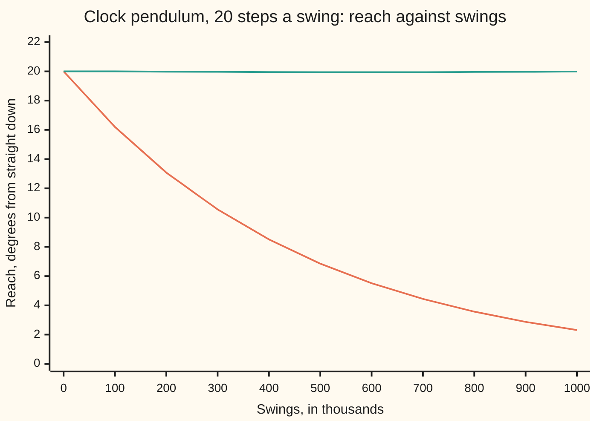

# Symplectic steps: schemes that keep a mechanical system's energy honest for ever

[Syllabus](../../../SYLLABUS.md) → [Numerical analysis](../README.md) → [ODE Solvers](../README.md#s06) → Symplectic steps

---

## General Overview

A pendulum clock has a bob on a rod 0.9940 m long. Released 20 degrees from straight down, it takes 1.007669026 s to swing across. A wider swing than a real clock uses (illustrative), so the curve of the sine matters. Take away friction and the escapement (the ratchet that gives each swing a small push), and the true pendulum swings to 20 degrees for ever.

A computer follows it for a million swings, 11.66 days of clock time, at 20 steps a swing. Two methods take part.

- **Runge-Kutta four** (RK4, four slope samples per step, from [Runge-Kutta](01-runge-kutta-and-butcher-tableaux.md)) misses by only 5.378e-06 rad after one swing. After a million swings its pendulum reaches 2.31 degrees. It keeps only 1.349% of its energy.
- **Verlet** misses by 1.113e-03 rad after one swing, 207 times worse. After a million swings it still reaches 19.99 degrees. Its energy has never left a band 0.620% wide.

The difference is not accuracy per step. Plot each state as a point, angle across and speed up: this plane is called **phase space**. Each Verlet step keeps the area of every patch of that plane, exactly as the real swing does. RK4 shrinks that area by a factor of about 1 − 2.18e-07 each step, and 20,000,000 small shrinkages add up.

**A step that keeps phase-space area follows, almost exactly, the motion of a slightly different frictionless pendulum, so it keeps that pendulum's energy, and the true energy stays within a band of width proportional to h² for exponentially long times, longer than any real run; RK4 keeps no such energy, so its error piles up step after step.**

**What kind of fact this is:** a theorem. The area part is proved on this card in Why it works. The long-run energy band is a theorem stated with its source; the code measures it on the clock.

### The picture: how far the pendulum swings, over a million swings



Orange: RK4, whose swing dies away. Green: Verlet, which stays at 20 degrees. The reach is worked out from the energy at each 100,000th swing. Verlet's small wobble, 19.94 to 20.00, is its in-swing energy dip, caught at a different point of the swing each time; it is not a drift.

---

## The formula

Notation first. The **angle** $\theta$ is measured from straight down, in radians. Energies are divided by $mL^2$ (bob mass times rod length squared), so the **momentum** $p$ of [Hamilton's equations](../../08-Differential%20equations%20and%20dynamics/12-Calculus%20of%20Variations%20and%20Optimal%20Control/05-hamiltons-equations.md) is just the angular speed $\theta'$, in rad/s. The constant $\omega^2 = g/L$ sets the pace; here $\omega = \pi$ rad/s. The pendulum's equations and energy are

$$\theta' = p, \qquad p' = -\omega^2 \sin\theta, \qquad E(\theta, p) = \tfrac12 p^2 + \omega^2 (1 - \cos\theta).$$

The step is $h$, and $\theta_n$, $p_n$ are the computed values after $n$ steps. One **Verlet step** (velocity Verlet, also called leapfrog or kick–drift–kick) is

$$p_{n+1/2} = p_n - \tfrac{h}{2}\,\omega^2 \sin\theta_n, \qquad \theta_{n+1} = \theta_n + h\,p_{n+1/2}, \qquad p_{n+1} = p_{n+1/2} - \tfrac{h}{2}\,\omega^2 \sin\theta_{n+1}.$$

**Read it aloud:** give the speed half a step of pull, move the angle a whole step at that speed, then give the second half of the pull at the new angle.

The step keeps area exactly, and it keeps a **modified energy** $\tilde E$, close to $E$, to within $h^4$:

$$\tilde E = E + h^2 E_2, \qquad E_2(\theta, p) = \frac{\omega^2 p^2 \cos\theta}{12} - \frac{\omega^4 \sin^2\theta}{24}.$$

**Read it aloud:** the step conserves the energy plus a small correction of size h squared, and the correction is known in closed form.

| Symbol | Plain meaning | In our example | Push it up and the answer… |
| --- | --- | --- | --- |
| $\theta$ | angle from straight down, rad | 20 degrees at release | wider swing, slower swing |
| $p$ | momentum: here the angular speed $\theta'$, rad/s | 0 at release | — |
| $\omega$, $L$, $g$, $m$ | pace $\sqrt{g/L}$; rod length; gravity; bob mass | $\pi$ rad/s; 0.9940 m; 9.81 m/s²; any | — |
| $T_s$ | exact time of one swing, s | 1.007669026 s | — |
| $h$, $n$ | step; number of steps taken ($\theta_n$, $p_n$: the values after $n$ steps) | $T_s/20$ = 0.0503835 s; up to 20,000,000 | Verlet's band grows as $h^2$ |
| $z$ | the step in units of the pace, $\omega h$; the spring's rates are $\lambda = \pm i\omega$, so this is the size of [Stiffness](05-stiffness-a-stability-and-the-dahlquist-barriers.md)'s $z = h\lambda$ | 0.158284 | RK4's area loss grows as $z^6$ |
| $E$, $E_0$, $K$, $U$ | energy per $mL^2$, 1/s²; its value at release; its moving and height parts | $E_0$ = 0.595210 | — |
| $E_2$, $E_4$, $\tilde E$, $\{F, G\}$ | the $h^2$ and $h^4$ corrections; the modified energy; the Poisson bracket they are built from | $\tilde E$ moves 0.00259% of $E_0$ | — |
| $J$ | area factor of one step: the determinant of its Jacobian, one number (on [Stiffness](05-stiffness-a-stability-and-the-dahlquist-barriers.md), $J$ is a matrix of rates) | Verlet 1; RK4 1 − 2.18e-07 | below 1, energy drains |
| $k_1, \dots, k_4$ | RK4's four slope samples of $p'$ in one step | four sines per step | — |
| $R(z)$, $u$, $\lambda$, $i$ | RK4's growth factor on $u' = \lambda u$; a small swing as one complex number $u$; its rate $\lambda$; $\sqrt{-1}$ | $J = \lvert R(iz)\rvert^2$ = 1 − 2.1774e-07 | — |
| $\Lambda$, $T$, $c$ | stretch rate and run length in the global-error bound; the theorem's constant | — | — |

### When it holds

- **No friction and no driving force.** The true motion must keep its energy. The shelf's model rocket loses energy to drag, so there is no energy to keep.
- **A fixed step.** A step chosen from the state, as an adaptive controller does ([Embedded pairs](03-embedded-pairs-and-adaptive-steps.md)), keeps a different modified energy each step. With $h(1 + 0.2|\theta|)$ the energy falls to 2.92% in 101,589 swings.
- **A small enough step.** The band is $O(h^2)$ as $h \to 0$, and the theorem needs $h$ below some limit. Above $h = 2/\omega$ Verlet is unstable even on a small swing, and the energy runs away.
- **A pull that depends on the angle only.** Then kick and drift are each exact shears. A pull that depends on the speed, like air drag, needs another splitting.

---

## Why it works

### Step 0: keep area, and you follow a nearby frictionless system

The true swing keeps area in the $(\theta, p)$ plane: Liouville's theorem, proved on [Hamilton's equations](../../08-Differential%20equations%20and%20dynamics/12-Calculus%20of%20Variations%20and%20Optimal%20Control/05-hamiltons-equations.md). A step that keeps area is called **symplectic**. For a spring, the oscillator card [Symplectic steps](../../08-Differential%20equations%20and%20dynamics/05-Numerical%20Evolution/07-symplectic-steps-for-oscillators.md) proves that Verlet's step matrix has determinant 1 and keeps a hidden energy. This card does the same for the pendulum, whose pull $\sin\theta$ is not linear.

The plan has three parts. Verlet keeps area exactly. RK4 does not, and the lost area is lost energy. A step that keeps area turns out to be the exact motion of a nearby system, whose energy it keeps.

### Step 1: kick and drift are shears, even with a sine

A **kick** holds $\theta$ and changes $p$ by $-\tfrac{h}{2}\omega^2\sin\theta$. A **drift** holds $p$ and changes $\theta$ by $hp$. Each is a **shear**: it slides every point along one axis by an amount that depends only on the other coordinate, like pushing the top of a deck of cards sideways. The **Jacobian** of a step is its table of rates: how each output moves when each input moves a little. Its determinant $J$ is the factor by which the step scales small areas ([Determinants](../../03-Algebra/05-Solving%20Systems/04-determinants.md)).

$$J_{\text{kick}} = \det\begin{pmatrix} 1 & 0 \\ -\tfrac{h}{2}\omega^2\cos\theta & 1 \end{pmatrix} = 1, \qquad J_{\text{drift}} = \det\begin{pmatrix} 1 & h \\ 0 & 1 \end{pmatrix} = 1.$$

The off-diagonal entry depends on where the pendulum is, but a triangular matrix with 1s on the diagonal always has determinant 1. Determinants multiply along a chain, so the Verlet step has $J = 1 \times 1 \times 1 = 1$ at every state.

The code treats each step as a black box and measures $J$ by finite differences. Verlet gives $J - 1$ = 1.99e-13 at release and −3.36e-12 at the bottom: rounding noise.

### Step 2: RK4 shrinks area, and energy goes with it

RK4 gives $J - 1$ = −1.75e-07 at release and −2.24e-07 at the bottom. On a small swing, $\sin\theta \approx \theta$ and the pendulum is a spring. RK4 then multiplies the state by a matrix whose two growth factors are $R(iz)$ and $R(-iz)$, with $R(z) = 1 + z + z^2/2 + z^3/6 + z^4/24$. The determinant is their product:

$$J = |R(iz)|^2 = \Big(1 - \tfrac{z^2}{2} + \tfrac{z^4}{24}\Big)^2 + \Big(z - \tfrac{z^3}{6}\Big)^2 = 1 - \frac{z^6}{72} + \frac{z^8}{576}.$$

The $z^2$ and $z^4$ terms cancel. That is why RK4 is so accurate per step. The $z^6$ term does not cancel.

A small swing traces an ellipse in the $(\theta, p)$ plane whose area is $2\pi E/\omega$. So the energy shrinks by the same factor $J$ each step. At $z$ = 0.158284 the formula gives $J - 1$ = −2.1774e-07, and the finite differences give −2.18e-07. Over 100,000 swings, 2,000,000 steps, that is a factor 0.6470. The run's last 100,000 swings, by then small, lose energy by the factor 0.6472.

<details>
<summary>Detailed proof: RK4's growth factor and its determinant</summary>

On the spring $\theta' = p$, $p' = -\omega^2\theta$, write $u = \omega\theta + i p$, with $i = \sqrt{-1}$. Then $u' = -i\omega u$, so the rate law is $u' = \lambda u$ with $\lambda = -i\omega$. One RK4 step on $u' = \lambda u$ multiplies $u$ by $R(h\lambda)$, the first five terms of the exponential series ([Runge-Kutta](01-runge-kutta-and-butcher-tableaux.md)). With $z = \omega h$ that is $R(-iz)$, and the complex conjugate $\bar u$ is multiplied by $R(iz)$.

In the real coordinates $(\omega\theta, p)$ the step is a 2-by-2 real matrix with eigenvalues $R(-iz)$ and $R(iz)$, so its determinant is $R(iz)R(-iz) = |R(iz)|^2$. The real part of $R(iz)$ is $1 - z^2/2 + z^4/24$; the imaginary part is $z - z^3/6$. Squaring and adding:

- $z^2$: $-1 + 1 = 0$.
- $z^4$: $\tfrac14 + \tfrac{1}{12} - \tfrac13 = 0$.
- $z^6$: $-\tfrac{1}{24} + \tfrac{1}{36} = -\tfrac{1}{72}$.
- $z^8$: $\tfrac{1}{576}$.

A change of coordinates does not change a determinant, so $J = 1 - z^6/72 + z^8/576$ in the $(\theta, p)$ plane too.

</details>

### Step 3: Verlet keeps a modified energy

Verlet's energy is not constant either. It dips at the bottom of every swing and recovers at the ends. The dip has a formula. **Backward error analysis** asks: what slightly different system would this method follow exactly? For a symplectic step the answer is a frictionless system with energy $\tilde E = E + h^2 E_2 + h^4 E_4 + \dots$, and the step keeps $\tilde E$.

Keep only the $h^2$ term. Since $\tilde E$ barely moves, $E_n - E_0 \approx -h^2\big(E_2(\theta_n, p_n) - E_2(\theta_0, p_0)\big)$. At the bottom, $\theta = 0$ and $p^2 \approx 2E_0$. The predicted dip is $h^2\big(\omega^2 \cdot 2E_0/12 + \omega^4\sin^2 20°/24\big)/E_0$ = 0.620% of $E_0$. Over a million swings the measured band is 0.620% wide.

The modified energy $E + h^2E_2$ moves by only 0.00259% of $E_0$ over the same run, 239 times less. That remainder is the $h^4$ term. Halve the step and the band of $E$ shrinks 4.00-fold, while $E + h^2 E_2$ shrinks 16.0-fold.

<details>
<summary>Where E₂ comes from: composing the three flows</summary>

Write $E = K + U$ with $K = p^2/2$, the moving part, and $U = \omega^2(1 - \cos\theta)$, the height part. A kick is the exact flow of $U$ alone for time $h/2$; a drift is the exact flow of $K$ alone for time $h$. For two functions F and G of $(\theta, p)$, the **Poisson bracket** $\{F, G\} = F_\theta G_p - F_p G_\theta$, where $F_\theta$ is the slope of F in $\theta$ and $F_p$ its slope in $p$, measures how much two flows fail to commute.

The Baker–Campbell–Hausdorff formula composes flows. For a symmetric chain, half of $U$, all of $K$, half of $U$, it gives one flow whose energy is

$$\tilde E = K + U + h^2\Big(\tfrac{1}{12}\{K, \{K, U\}\} - \tfrac{1}{24}\{U, \{U, K\}\}\Big) + O(h^4).$$

Here $\{K, U\} = -pU'$, so $\{K, \{K, U\}\} = p^2 U''$ and $\{U, \{U, K\}\} = U'^2$. A prime on $U$ means its slope in $\theta$. With $U' = \omega^2\sin\theta$ and $U'' = \omega^2\cos\theta$ this is the card's $E_2$. A symmetric chain has no odd powers of $h$.

Cross-check on the spring ($\omega = 1$, $\sin\theta \approx \theta$): $E + h^2E_2 = E + h^2(p^2/12 - \theta^2/24)$. That is $(1 + h^2/6)$ times the hidden energy $E - h^2\theta^2/8$ of [Symplectic steps](../../08-Differential%20equations%20and%20dynamics/05-Numerical%20Evolution/07-symplectic-steps-for-oscillators.md), up to $h^4$. A constant multiple of a kept quantity is kept too.

This card states the formula with its source (the 2003 survey in Sources) and checks it in the code; it does not carry out the expansion.

</details>

### Step 4: why the band lasts for ever, in practice

The full series $E_2, E_4, \dots$ does not converge. The theorem cuts it off at the best place.

**Theorem** (the 1994 paper and the book's chapter IX in Sources). Let the energy be analytic (equal to its Taylor series near every point) and the method symplectic, with a fixed step $h$ below a limit. Then a suitably truncated modified energy changes per step by an amount exponentially small in $1/h$. For Verlet, $|E_n - E_0|$ stays below a constant times $h^2$ for every $n$ with $nh$ up to $e^{c/h}$, for some constant $c > 0$.

An exponentially long time in $1/h$ is far beyond any run, which is what "for ever" means here. The card proves the area statement; it states this theorem and measures it.

The global-error bound of [From local error to global error](02-convergence-of-one-step-methods.md) grows like $e^{\Lambda T}$ with the run length $T$. That bound is still true here, but it is far too pessimistic about the energy. The structure of the step, not its order, sets the long run.

### Step 5: what Verlet does not keep: the clock

On a small swing, Verlet turns the state by an angle $2\arcsin(z/2)$ per step, slightly more than $z$. So its pendulum runs fast. A 20-degree swing has the slower pace $\pi/T_s$, so the effective $z$ is $h\pi/T_s = \pi/20$. The estimate is 1031 extra swings in a million. Counting zero crossings in the run gives 1,001,031 swings: 1031 ahead.

RK4 counts 1,005,891 swings. Its pendulum shrank, and a smaller swing is quicker. Losing energy also spoils its timing.

---

## Worked numbers, by hand

| Step | Arithmetic | Value |
| --- | --- | --- |
| rod length | $L = g/\omega^2$ = 9.81/π² | 0.9940 m |
| swing time | π/(ω × AGM(1, cos 10°)), the arithmetic-geometric mean | 1.007669026 s |
| step | 1.007669026/20 | $h$ = 0.0503835 s |
| step in units of the pace | $z = \pi h$ | 0.158284 |
| energy at release | π²(1 − cos 20°) | $E_0$ = 0.595210 |
| RK4 area factor − 1 | $-z^6/72 + z^8/576$ | −2.1774e-07 |
| RK4 energy factor per 100,000 swings | $(1 - z^6/72 + z^8/576)^{2{,}000{,}000}$ | 0.6470 |
| Verlet area factor | 1 × 1 × 1 | **1** |
| Verlet's dip at the bottom | $h^2(\omega^2 \cdot 2E_0/12 + \omega^4\sin^2 20°/24)/E_0$ | **0.620%** |

After a million swings Verlet's energy is between 99.380% and 100.000% of its start; RK4 keeps 1.349%.

### What breaks if you drop a piece

| Mistake | Comes out at | What went wrong |
| --- | --- | --- |
| RK4 at the same 20 steps a swing | reach 2.31° after a million swings; 1.349% of the energy left | $J$ = 1 − 2.18e-07 per step, 20,000,000 times |
| Verlet with a step $h(1 + 0.2\lvert\theta\rvert)$ that follows the state | energy 2.92% of $E_0$ after 101,589 swings | each step keeps a different modified energy |
| Forward Euler (one step along the current slope) | over the top after 198 steps, swing 9.9 | $J > 1$: each step stretches area |
| Trusting Verlet's clock | 1,001,031 swings counted in a million | the angle per step is $2\arcsin(z/2)$, not $z$ |

---

## Code, from first principles, and it actually runs

The code runs both methods for a million swings and checks every claim by a second road. The exact swing time comes from the arithmetic-geometric mean, so the error after one swing is a true error. That error falls 4.00-fold per halving for Verlet and 15.98-fold for RK4: orders 2 and 4. The area factor of one step is measured by finite differences and set against RK4's closed form. RK4's late drift is set against that formula raised to 2,000,000. Verlet's band is set against the modified-energy prediction, and the clock's lead against the rotation-angle estimate.

Cost, at a million swings: Verlet evaluates 20,000,001 sines, since each step's last half kick is reused as the next step's first; RK4 evaluates 80,000,000, four a step. The cosine the code takes each Verlet step only watches the energy; the method needs none. Verlet is four times cheaper as well as keeping its energy.

### Python

```python
# Symplectic steps -- the check behind the card.  Standard library only (math's sin, cos, sqrt, acos, asin).
# A frictionless clock pendulum, omega = pi rad/s, released at 20 degrees, run for a million swings.
# Roads: the exact swing time by the arithmetic-geometric mean; Verlet and RK4 at several steps (observed
# orders); the modified energy of backward error analysis; one step's area factor by finite differences
# against RK4's closed form 1 - z^6/72 + z^8/576; the clock's lead against the rotation-angle estimate.
from math import sin, cos, sqrt, acos, asin, pi

W2, TH0, G = pi * pi, 20 * pi / 180, 9.81      # omega^2 = g/L (1/s^2); release angle (rad); g (m/s^2)
a, b = 1.0, cos(TH0 / 2)
for _ in range(6): a, b = (a + b) / 2, sqrt(a * b)
TS = 1 / a                                     # exact swing time (half period) = pi / (omega AGM), s

def energy(th, p): return p * p / 2 + W2 * (1 - cos(th))    # per unit m L^2; p = angular speed, rad/s
def e2(th, p):                                               # the h^2 term of the modified energy
    s = sin(th); return p * p * W2 * cos(th) / 12 - W2 * W2 * s * s / 24
def amp(e): return acos(1 - e / W2) * 180 / pi               # the swing's reach, degrees, from its energy
def verlet(th, p, h):                                        # half kick, drift, half kick
    p -= h / 2 * W2 * sin(th); th += h * p
    return th, p - h / 2 * W2 * sin(th)
def rk4(th, p, h):
    hh = h / 2; k1 = -W2 * sin(th); k2 = -W2 * sin(th + hh * p)
    k3 = -W2 * sin(th + hh * (p + hh * k1)); k4 = -W2 * sin(th + h * (p + hh * k2))
    return th + h * (p + h / 6 * (k1 + k2 + k3)), p + h / 6 * (k1 + 2 * k2 + 2 * k3 + k4)
def sci(x, d): return f"{x:.{d}e}"
def run_verlet(s, swings):           # energy band, modified-energy band, zero crossings, reach every 100k swings
    h = TS / s; hh = h / 2; th, p = TH0, 0.0; f = -W2 * sin(th); e0 = energy(th, p); m0 = e0 + h * h * e2(th, p)
    lo = hi = 0.0; mlo = mhi = 0.0; cross = 0; pts = [amp(e0)]
    for n in range(1, s * swings + 1):
        old = th; p += hh * f; th += h * p; f = -W2 * sin(th); p += hh * f
        c = cos(th); e = p * p / 2 + W2 * (1 - c); m = e + h * h * (p * p * W2 * c / 12 - f * f / 24)
        lo, hi, mlo, mhi = min(lo, e - e0), max(hi, e - e0), min(mlo, m - m0), max(mhi, m - m0)
        if (old > 0) != (th > 0): cross += 1
        if n % (s * 100000) == 0: pts.append(amp(e))
    return (hi - lo) / e0, (mhi - mlo) / e0, lo / e0, hi / e0, cross, pts
def run_rk4(s, swings):
    h = TS / s; th, p = TH0, 0.0; cross = 0; e0 = energy(th, p); pts = [amp(e0)]; es = [e0]
    for n in range(1, s * swings + 1):
        old = th; th, p = rk4(th, p, h)
        if (old > 0) != (th > 0): cross += 1
        if n % (s * 100000) == 0: es.append(energy(th, p)); pts.append(amp(es[-1]))
    return es, cross, pts
def area_factor(step, th, p, h, d=1e-5):     # determinant of one step's Jacobian, by central differences
    a1, a2 = step(th + d, p, h), step(th - d, p, h); b1, b2 = step(th, p + d, h), step(th, p - d, h)
    return ((a1[0] - a2[0]) * (b1[1] - b2[1]) - (b1[0] - b2[0]) * (a1[1] - a2[1])) / (4 * d * d)

h, e0 = TS / 20, energy(TH0, 0.0); z = pi * h
print(f"pendulum: g = {G} m/s^2, L = g/omega^2 = {G / W2:.4f} m, release 20 deg; exact swing time {TS:.9f} s")
print(f"a million swings = {1e6 * TS / 86400:.2f} days; energy at release E0 = {e0:.6f} per m L^2 (1/s^2)")
print(f"20 steps a swing: h = {h:.7f} s, z = omega h = {z:.6f}")
errs = {}
for s in (10, 20, 40):
    out = []
    for step in (verlet, rk4):
        th, p = TH0, 0.0
        for _ in range(s): th, p = step(th, p, TS / s)
        out.append(sqrt((th + TH0) ** 2 + (p / pi) ** 2))
    errs[s] = out
    print(f"one swing, {s} steps: Verlet error {sci(out[0], 3)} rad, RK4 error {sci(out[1], 3)} rad")
rv, rr = errs[10][0] / errs[20][0], errs[20][0] / errs[40][0]
qv, qr = errs[10][1] / errs[20][1], errs[20][1] / errs[40][1]
print(f"error ratio per halving: Verlet {rv:.2f}, {rr:.2f} (order 2); RK4 {qv:.2f}, {qr:.2f} (order 4)")
print(f"one swing, 20 steps: Verlet error / RK4 error = {errs[20][0] / errs[20][1]:.0f}")
pb = sqrt(2 * e0)
for name, step in (("Verlet", verlet), ("RK4", rk4)):
    print(f"area factor - 1, one step: {name} at release {sci(area_factor(step, TH0, 0.0, h) - 1, 2)}, "
          f"at the bottom {sci(area_factor(step, 0.0, pb, h) - 1, 2)}, small swing {sci(area_factor(step, 0.01, 0.0, h) - 1, 2)}")
lin = 1 - z ** 6 / 72 + z ** 8 / 576
print(f"RK4 small-swing formula 1 - z^6/72 + z^8/576 - 1 = {sci(lin - 1, 4)}; per 100k swings (2000000 steps) {lin ** 2000000:.4f}")
band, mband, vlo, vhi, vcross, vpts = run_verlet(20, 1000000)
es, rcross, rpts = run_rk4(20, 1000000)
pred = h * h * (e2(0.0, pb) - e2(TH0, 0.0)) / e0       # the dip at the bottom that the modified energy predicts
print(f"Verlet, 1e6 swings: energy {100 * (1 + vlo):.3f}% to {100 * (1 + vhi):.3f}% of E0; band {100 * band:.3f}%, "
      f"predicted {100 * pred:.3f}%")
print(f"Verlet, 1e6 swings: modified energy E + h^2 E2 moves by {100 * mband:.5f}% of E0; ratio {band / mband:.0f}")
print(f"RK4, 1e6 swings: energy left {100 * es[-1] / e0:.3f}%, reach {rpts[-1]:.2f} deg; last 100k swings x{es[-1] / es[-2]:.4f}")
print("chart, reach in degrees every 100k swings, Verlet: " + ", ".join(f"{x:.2f}" for x in vpts))
print("chart, reach in degrees every 100k swings, RK4: " + ", ".join(f"{x:.2f}" for x in rpts))
lead = 1e6 * (2 * asin(pi / 40) / (pi / 20) - 1)
print(f"clock: Verlet counts {vcross} swings, ahead by {vcross - 1000000}; estimate {lead:.0f}; RK4 counts {rcross}")
print(f"cost for 1e6 swings (20000000 steps): Verlet {20 * 1000000 + 1} sines, RK4 {4 * 20 * 1000000} sines")   # 1 a step + 1; 4 a step
bands = {20: (band, mband)}
for s in (10, 40):
    bb, mb, _, _, _, _ = run_verlet(s, 100000); bands[s] = (bb, mb)
    print(f"Verlet, {s} steps a swing, 1e5 swings: energy band {100 * bb:.4f}%, modified-energy band {sci(100 * mb, 3)}%")
print(f"band ratios per halving: energy {bands[10][0] / band:.2f}, {band / bands[40][0]:.2f}; "
      f"modified {bands[10][1] / mband:.1f}, {mband / bands[40][1]:.1f}")
es40, _, _ = run_rk4(40, 100000)
print(f"RK4, 40 steps a swing, 1e5 swings: energy lost {100 * (1 - es40[1] / e0):.3f}%; at 20 steps {100 * (1 - es[1] / e0):.2f}%")
th, p, t = TH0, 0.0, 0.0                     # what breaks: a step that depends on the state
for _ in range(2000000):
    hs = h * (1 + 0.2 * abs(th)); th, p = verlet(th, p, hs); t += hs
print(f"Verlet with step h(1 + 0.2|theta|): after {t / TS:.0f} swings energy {100 * energy(th, p) / e0:.2f}% of E0")
th, p, lo, hi = TH0, 0.0, e0, e0
for _ in range(2000000):
    p -= h * W2 * sin(th); th += h * p; e = energy(th, p); lo, hi = min(lo, e), max(hi, e)
print(f"symplectic Euler (one kick, one drift), 1e5 swings: energy {100 * lo / e0:.2f}% to {100 * hi / e0:.2f}% of E0")
th, p, n = TH0, 0.0, 0
while energy(th, p) <= 2 * W2: th, p, n = th + h * p, p - h * W2 * sin(th), n + 1
print(f"forward Euler: over the top after {n} steps, swing {n / 20:.1f}")
assert 3.9 < rv < 4.1 and 3.9 < rr < 4.1 and 15 < qv < 17 and 15 < qr < 17     # orders 2 and 4 vs the AGM
assert abs(area_factor(verlet, TH0, 0.0, h) - 1) < 1e-9                          # Verlet keeps area
assert abs((area_factor(rk4, 0.01, 0.0, h) - 1) / (lin - 1) - 1) < 0.01          # RK4 shrinks it as the formula says
assert abs((es[-1] / es[-2]) / lin ** 2000000 - 1) < 0.01                        # the drift rate is that shrinkage
assert abs(band / pred - 1) < 0.01 and band / mband > 100 and 3.8 < band / bands[40][0] < 4.2    # band ~ h^2, modified energy h^4
assert 14 < mband / bands[40][1] < 18 and abs((vcross - 1e6) / lead - 1) < 0.01  # clock lead as estimated
assert es[-1] / e0 < 0.05 and vpts[-1] > 19.9                                    # RK4 runs down, Verlet does not
print("ALL CHECKS PASS")
```

**Ran 2026-11-11 on macOS, Python 3.14.10, standard library only. All checks passed. Output, pasted from the run:**

```
pendulum: g = 9.81 m/s^2, L = g/omega^2 = 0.9940 m, release 20 deg; exact swing time 1.007669026 s
a million swings = 11.66 days; energy at release E0 = 0.595210 per m L^2 (1/s^2)
20 steps a swing: h = 0.0503835 s, z = omega h = 0.158284
one swing, 10 steps: Verlet error 4.448e-03 rad, RK4 error 8.595e-05 rad
one swing, 20 steps: Verlet error 1.113e-03 rad, RK4 error 5.378e-06 rad
one swing, 40 steps: Verlet error 2.782e-04 rad, RK4 error 3.365e-07 rad
error ratio per halving: Verlet 4.00, 4.00 (order 2); RK4 15.98, 15.98 (order 4)
one swing, 20 steps: Verlet error / RK4 error = 207
area factor - 1, one step: Verlet at release 1.99e-13, at the bottom -3.36e-12, small swing -2.52e-13
area factor - 1, one step: RK4 at release -1.75e-07, at the bottom -2.24e-07, small swing -2.18e-07
RK4 small-swing formula 1 - z^6/72 + z^8/576 - 1 = -2.1774e-07; per 100k swings (2000000 steps) 0.6470
Verlet, 1e6 swings: energy 99.380% to 100.000% of E0; band 0.620%, predicted 0.620%
Verlet, 1e6 swings: modified energy E + h^2 E2 moves by 0.00259% of E0; ratio 239
RK4, 1e6 swings: energy left 1.349%, reach 2.31 deg; last 100k swings x0.6472
chart, reach in degrees every 100k swings, Verlet: 20.00, 20.00, 19.98, 19.97, 19.95, 19.94, 19.94, 19.94, 19.96, 19.97, 19.99
chart, reach in degrees every 100k swings, RK4: 20.00, 16.20, 13.08, 10.56, 8.51, 6.85, 5.51, 4.44, 3.57, 2.87, 2.31
clock: Verlet counts 1001031 swings, ahead by 1031; estimate 1031; RK4 counts 1005891
cost for 1e6 swings (20000000 steps): Verlet 20000001 sines, RK4 80000000 sines
Verlet, 10 steps a swing, 1e5 swings: energy band 2.4802%, modified-energy band 4.144e-02%
Verlet, 40 steps a swing, 1e5 swings: energy band 0.1550%, modified-energy band 1.619e-04%
band ratios per halving: energy 4.00, 4.00; modified 16.0, 16.0
RK4, 40 steps a swing, 1e5 swings: energy lost 1.292%; at 20 steps 34.20%
Verlet with step h(1 + 0.2|theta|): after 101589 swings energy 2.92% of E0
symplectic Euler (one kick, one drift), 1e5 swings: energy 92.71% to 108.52% of E0
forward Euler: over the top after 198 steps, swing 9.9
ALL CHECKS PASS
```

### Rust

Same numbers, same labels, built with `rustc --edition 2021 -O`; a helper prints exponents the Python way.

```rust
// Symplectic steps -- the same check as the Python, in Rust, std only.
// A frictionless clock pendulum, omega = pi rad/s, released at 20 degrees, run for a million swings.
// Roads: the exact swing time by the AGM; Verlet and RK4 at several steps; the modified energy;
// one step's area factor by finite differences against 1 - z^6/72 + z^8/576; the clock's lead.
use std::f64::consts::PI;
const W2: f64 = PI * PI;
const G: f64 = 9.81;
type Step = fn(f64, f64, f64) -> (f64, f64);

fn energy(th: f64, p: f64) -> f64 { p * p / 2.0 + W2 * (1.0 - th.cos()) }
fn e2(th: f64, p: f64) -> f64 { let s = th.sin(); p * p * W2 * th.cos() / 12.0 - W2 * W2 * s * s / 24.0 }
fn amp(e: f64) -> f64 { (1.0 - e / W2).acos() * 180.0 / PI }
fn verlet(th: f64, p: f64, h: f64) -> (f64, f64) {
    let p = p - h / 2.0 * W2 * th.sin();
    let th = th + h * p;
    (th, p - h / 2.0 * W2 * th.sin())
}
fn rk4(th: f64, p: f64, h: f64) -> (f64, f64) {
    let hh = h / 2.0;
    let k1 = -W2 * th.sin();
    let k2 = -W2 * (th + hh * p).sin();
    let k3 = -W2 * (th + hh * (p + hh * k1)).sin();
    let k4 = -W2 * (th + h * (p + hh * k2)).sin();
    (th + h * (p + h / 6.0 * (k1 + k2 + k3)), p + h / 6.0 * (k1 + 2.0 * k2 + 2.0 * k3 + k4))
}
fn sci(x: f64, d: usize) -> String {                   // Python-style exponent: e-07, e+00
    let s = format!("{:.*e}", d, x);
    let (m, e) = s.split_once('e').unwrap();
    let k: i32 = e.parse().unwrap();
    format!("{}e{}{:02}", m, if k < 0 { '-' } else { '+' }, k.abs())
}
fn run_verlet(ts: f64, s: usize, swings: usize) -> (f64, f64, f64, f64, usize, Vec<f64>) {
    let (h, th0) = (ts / s as f64, 20.0 * PI / 180.0);
    let hh = h / 2.0;
    let (mut th, mut p) = (th0, 0.0f64);
    let mut f = -W2 * th.sin();
    let e0 = energy(th, p);
    let m0 = e0 + h * h * e2(th, p);
    let (mut lo, mut hi, mut mlo, mut mhi, mut cross) = (0.0f64, 0.0f64, 0.0f64, 0.0f64, 0usize);
    let mut pts = vec![amp(e0)];
    for n in 1..=s * swings {
        let old = th;
        p += hh * f; th += h * p; f = -W2 * th.sin(); p += hh * f;
        let c = th.cos();
        let e = p * p / 2.0 + W2 * (1.0 - c);
        let m = e + h * h * (p * p * W2 * c / 12.0 - f * f / 24.0);
        lo = lo.min(e - e0); hi = hi.max(e - e0); mlo = mlo.min(m - m0); mhi = mhi.max(m - m0);
        if (old > 0.0) != (th > 0.0) { cross += 1 }
        if n % (s * 100000) == 0 { pts.push(amp(e)) }
    }
    ((hi - lo) / e0, (mhi - mlo) / e0, lo / e0, hi / e0, cross, pts)
}
fn run_rk4(ts: f64, s: usize, swings: usize) -> (Vec<f64>, usize, Vec<f64>) {
    let h = ts / s as f64;
    let (mut th, mut p, mut cross) = (20.0 * PI / 180.0, 0.0f64, 0usize);
    let e0 = energy(th, p);
    let (mut pts, mut es) = (vec![amp(e0)], vec![e0]);
    for n in 1..=s * swings {
        let old = th;
        (th, p) = rk4(th, p, h);
        if (old > 0.0) != (th > 0.0) { cross += 1 }
        if n % (s * 100000) == 0 { es.push(energy(th, p)); pts.push(amp(*es.last().unwrap())) }
    }
    (es, cross, pts)
}
fn area_factor(step: Step, th: f64, p: f64, h: f64) -> f64 {   // one step's Jacobian determinant
    let d = 1e-5;
    let (a1, a2, b1, b2) = (step(th + d, p, h), step(th - d, p, h), step(th, p + d, h), step(th, p - d, h));
    ((a1.0 - a2.0) * (b1.1 - b2.1) - (b1.0 - b2.0) * (a1.1 - a2.1)) / (4.0 * d * d)
}
fn join(v: &[f64]) -> String { v.iter().map(|x| format!("{:.2}", x)).collect::<Vec<_>>().join(", ") }

fn main() {
    let th0 = 20.0 * PI / 180.0;
    let (mut a, mut b) = (1.0f64, (th0 / 2.0).cos());
    for _ in 0..6 { (a, b) = ((a + b) / 2.0, (a * b).sqrt()) }
    let ts = 1.0 / a;
    let (h, e0) = (ts / 20.0, energy(th0, 0.0));
    let z = PI * h;
    println!("pendulum: g = {} m/s^2, L = g/omega^2 = {:.4} m, release 20 deg; exact swing time {:.9} s", G, G / W2, ts);
    println!("a million swings = {:.2} days; energy at release E0 = {:.6} per m L^2 (1/s^2)", 1e6 * ts / 86400.0, e0);
    println!("20 steps a swing: h = {:.7} s, z = omega h = {:.6}", h, z);
    let mut errs = vec![];
    for s in [10usize, 20, 40] {
        let mut out = vec![];
        for step in [verlet as Step, rk4] {
            let (mut th, mut p) = (th0, 0.0);
            for _ in 0..s { (th, p) = step(th, p, ts / s as f64) }
            out.push(((th + th0).powi(2) + (p / PI).powi(2)).sqrt());
        }
        println!("one swing, {} steps: Verlet error {} rad, RK4 error {} rad", s, sci(out[0], 3), sci(out[1], 3));
        errs.push(out);
    }
    let (rv, rr) = (errs[0][0] / errs[1][0], errs[1][0] / errs[2][0]);
    let (qv, qr) = (errs[0][1] / errs[1][1], errs[1][1] / errs[2][1]);
    println!("error ratio per halving: Verlet {:.2}, {:.2} (order 2); RK4 {:.2}, {:.2} (order 4)", rv, rr, qv, qr);
    println!("one swing, 20 steps: Verlet error / RK4 error = {:.0}", errs[1][0] / errs[1][1]);
    let pb = (2.0 * e0).sqrt();
    for (name, step) in [("Verlet", verlet as Step), ("RK4", rk4)] {
        println!("area factor - 1, one step: {} at release {}, at the bottom {}, small swing {}", name,
                 sci(area_factor(step, th0, 0.0, h) - 1.0, 2), sci(area_factor(step, 0.0, pb, h) - 1.0, 2),
                 sci(area_factor(step, 0.01, 0.0, h) - 1.0, 2));
    }
    let lin = 1.0 - z.powf(6.0) / 72.0 + z.powf(8.0) / 576.0;
    println!("RK4 small-swing formula 1 - z^6/72 + z^8/576 - 1 = {}; per 100k swings (2000000 steps) {:.4}", sci(lin - 1.0, 4), lin.powf(2000000.0));
    let (band, mband, vlo, vhi, vcross, vpts) = run_verlet(ts, 20, 1000000);
    let (es, rcross, rpts) = run_rk4(ts, 20, 1000000);
    let pred = h * h * (e2(0.0, pb) - e2(th0, 0.0)) / e0;
    println!("Verlet, 1e6 swings: energy {:.3}% to {:.3}% of E0; band {:.3}%, predicted {:.3}%",
             100.0 * (1.0 + vlo), 100.0 * (1.0 + vhi), 100.0 * band, 100.0 * pred);
    println!("Verlet, 1e6 swings: modified energy E + h^2 E2 moves by {:.5}% of E0; ratio {:.0}", 100.0 * mband, band / mband);
    let (el, ep) = (es[es.len() - 1], es[es.len() - 2]);
    println!("RK4, 1e6 swings: energy left {:.3}%, reach {:.2} deg; last 100k swings x{:.4}", 100.0 * el / e0, rpts[rpts.len() - 1], el / ep);
    println!("chart, reach in degrees every 100k swings, Verlet: {}", join(&vpts));
    println!("chart, reach in degrees every 100k swings, RK4: {}", join(&rpts));
    let lead = 1e6 * (2.0 * (PI / 40.0).asin() / (PI / 20.0) - 1.0);
    println!("clock: Verlet counts {} swings, ahead by {}; estimate {:.0}; RK4 counts {}", vcross, vcross - 1000000, lead, rcross);
    println!("cost for 1e6 swings (20000000 steps): Verlet {} sines, RK4 {} sines", 20 * 1000000 + 1, 4 * 20 * 1000000);   // 1 a step + 1; 4 a step
    let mut bands = vec![(0.0, 0.0); 2];
    for (i, s) in [10usize, 40].iter().enumerate() {
        let (bb, mb, _, _, _, _) = run_verlet(ts, *s, 100000);
        bands[i] = (bb, mb);
        println!("Verlet, {} steps a swing, 1e5 swings: energy band {:.4}%, modified-energy band {}%", s, 100.0 * bb, sci(100.0 * mb, 3));
    }
    println!("band ratios per halving: energy {:.2}, {:.2}; modified {:.1}, {:.1}",
             bands[0].0 / band, band / bands[1].0, bands[0].1 / mband, mband / bands[1].1);
    let (es40, _, _) = run_rk4(ts, 40, 100000);
    println!("RK4, 40 steps a swing, 1e5 swings: energy lost {:.3}%; at 20 steps {:.2}%", 100.0 * (1.0 - es40[1] / e0), 100.0 * (1.0 - es[1] / e0));
    let (mut th, mut p, mut t) = (th0, 0.0f64, 0.0f64);            // what breaks: a step that depends on the state
    for _ in 0..2000000 {
        let hs = h * (1.0 + 0.2 * th.abs());
        (th, p) = verlet(th, p, hs); t += hs;
    }
    println!("Verlet with step h(1 + 0.2|theta|): after {:.0} swings energy {:.2}% of E0", t / ts, 100.0 * energy(th, p) / e0);
    let (mut th, mut p, mut lo, mut hi) = (th0, 0.0f64, e0, e0);
    for _ in 0..2000000 {
        p -= h * W2 * th.sin(); th += h * p;
        let e = energy(th, p); lo = lo.min(e); hi = hi.max(e);
    }
    println!("symplectic Euler (one kick, one drift), 1e5 swings: energy {:.2}% to {:.2}% of E0", 100.0 * lo / e0, 100.0 * hi / e0);
    let (mut th, mut p, mut n) = (th0, 0.0f64, 0usize);
    while energy(th, p) <= 2.0 * W2 { (th, p, n) = (th + h * p, p - h * W2 * th.sin(), n + 1) }
    println!("forward Euler: over the top after {} steps, swing {:.1}", n, n as f64 / 20.0);
    assert!(3.9 < rv && rv < 4.1 && 3.9 < rr && rr < 4.1 && 15.0 < qv && qv < 17.0 && 15.0 < qr && qr < 17.0);
    assert!((area_factor(verlet, th0, 0.0, h) - 1.0).abs() < 1e-9);                 // Verlet keeps area
    assert!(((area_factor(rk4, 0.01, 0.0, h) - 1.0) / (lin - 1.0) - 1.0).abs() < 0.01); // RK4 shrinks it so
    assert!(((el / ep) / lin.powf(2000000.0) - 1.0).abs() < 0.01);                  // the drift is that shrinkage
    assert!((band / pred - 1.0).abs() < 0.01 && band / mband > 100.0 && 3.8 < band / bands[1].0 && band / bands[1].0 < 4.2);
    assert!(14.0 < mband / bands[1].1 && mband / bands[1].1 < 18.0 && ((vcross as f64 - 1e6) / lead - 1.0).abs() < 0.01);
    assert!(el / e0 < 0.05 && vpts[vpts.len() - 1] > 19.9);                          // RK4 runs down, Verlet does not
    println!("ALL CHECKS PASS");
}
```

**Ran 2026-11-11 on macOS, rustc 1.98.1, no crates. All checks passed. Output, pasted from the run:**

```
pendulum: g = 9.81 m/s^2, L = g/omega^2 = 0.9940 m, release 20 deg; exact swing time 1.007669026 s
a million swings = 11.66 days; energy at release E0 = 0.595210 per m L^2 (1/s^2)
20 steps a swing: h = 0.0503835 s, z = omega h = 0.158284
one swing, 10 steps: Verlet error 4.448e-03 rad, RK4 error 8.595e-05 rad
one swing, 20 steps: Verlet error 1.113e-03 rad, RK4 error 5.378e-06 rad
one swing, 40 steps: Verlet error 2.782e-04 rad, RK4 error 3.365e-07 rad
error ratio per halving: Verlet 4.00, 4.00 (order 2); RK4 15.98, 15.98 (order 4)
one swing, 20 steps: Verlet error / RK4 error = 207
area factor - 1, one step: Verlet at release 1.99e-13, at the bottom -3.36e-12, small swing -2.52e-13
area factor - 1, one step: RK4 at release -1.75e-07, at the bottom -2.24e-07, small swing -2.18e-07
RK4 small-swing formula 1 - z^6/72 + z^8/576 - 1 = -2.1774e-07; per 100k swings (2000000 steps) 0.6470
Verlet, 1e6 swings: energy 99.380% to 100.000% of E0; band 0.620%, predicted 0.620%
Verlet, 1e6 swings: modified energy E + h^2 E2 moves by 0.00259% of E0; ratio 239
RK4, 1e6 swings: energy left 1.349%, reach 2.31 deg; last 100k swings x0.6472
chart, reach in degrees every 100k swings, Verlet: 20.00, 20.00, 19.98, 19.97, 19.95, 19.94, 19.94, 19.94, 19.96, 19.97, 19.99
chart, reach in degrees every 100k swings, RK4: 20.00, 16.20, 13.08, 10.56, 8.51, 6.85, 5.51, 4.44, 3.57, 2.87, 2.31
clock: Verlet counts 1001031 swings, ahead by 1031; estimate 1031; RK4 counts 1005891
cost for 1e6 swings (20000000 steps): Verlet 20000001 sines, RK4 80000000 sines
Verlet, 10 steps a swing, 1e5 swings: energy band 2.4802%, modified-energy band 4.144e-02%
Verlet, 40 steps a swing, 1e5 swings: energy band 0.1550%, modified-energy band 1.619e-04%
band ratios per halving: energy 4.00, 4.00; modified 16.0, 16.0
RK4, 40 steps a swing, 1e5 swings: energy lost 1.292%; at 20 steps 34.20%
Verlet with step h(1 + 0.2|theta|): after 101589 swings energy 2.92% of E0
symplectic Euler (one kick, one drift), 1e5 swings: energy 92.71% to 108.52% of E0
forward Euler: over the top after 198 steps, swing 9.9
ALL CHECKS PASS
```

The two outputs match line for line.

### Lean

Lean proves the area facts of Steps 1 and 2: for Verlet with any pull that depends on the angle only, and for RK4 on a small swing.

- For any pull that depends on the angle only, with a slope everywhere, one Verlet step has $J = 1$ at every state and step.
- For the pendulum's pull $-\omega^2\sin\theta$, one Verlet step keeps the area of every patch of phase space, large or small.
- On a small swing, the spring $p' = -\omega^2\theta$, one RK4 step has $J = 1 - z^6/72 + z^8/576$ at every state.
- The Detailed proof's coefficients check out: $-1 + 1 = 0$, $\tfrac14 + \tfrac{1}{12} - \tfrac13 = 0$, $-\tfrac{1}{24} + \tfrac{1}{36} = -\tfrac{1}{72}$ and $(\tfrac{1}{24})^2 = \tfrac{1}{576}$.
- The counts check out: 20,000,000 steps in a million swings, 20,000,001 sines for Verlet and 80,000,000 for RK4.

The modified energy, the long-run energy band, the clock's lead and every measured number are left to Python and Rust.

```lean
-- Symplectic steps: a Verlet step keeps phase-space area exactly for any pull that depends on the angle only, while an RK4 step on a small swing scales area by 1 - z^6/72 + z^8/576 with z = ωh.
import Mathlib.Analysis.Calculus.FDeriv.Prod
import Mathlib.Analysis.Calculus.FDeriv.Mul
import Mathlib.Analysis.Calculus.FDeriv.Comp
import Mathlib.Analysis.SpecialFunctions.Trigonometric.Deriv
import Mathlib.Topology.Algebra.Module.Determinant
import Mathlib.MeasureTheory.Measure.Lebesgue.Basic
import Mathlib.MeasureTheory.Measure.Prod

open MeasureTheory

/-- One velocity-Verlet step (kick, drift, kick) of size `h` for `θ' = p`, `p' = F θ`,
applied to the phase-space point `x = (θ, p)`: half a kick of pull, a whole drift at the
new speed, then the second half kick at the new angle. -/
noncomputable def verletStep (F : ℝ → ℝ) (h : ℝ) (x : ℝ × ℝ) : ℝ × ℝ :=
  let p₁ := x.2 + h / 2 * F x.1
  let θ₁ := x.1 + h * p₁
  (θ₁, p₁ + h / 2 * F θ₁)

/-- One classical Runge-Kutta four step of size `h` for `θ' = p`, `p' = F θ`, applied to
`x = (θ, p)`, with the four slope samples `k₁, …, k₄` of `p'` written out as in the card's code. -/
noncomputable def rk4Step (F : ℝ → ℝ) (h : ℝ) (x : ℝ × ℝ) : ℝ × ℝ :=
  let θ := x.1
  let p := x.2
  let k₁ := F θ
  let k₂ := F (θ + h / 2 * p)
  let k₃ := F (θ + h / 2 * (p + h / 2 * k₁))
  let k₄ := F (θ + h * (p + h / 2 * k₂))
  (θ + h * (p + h / 6 * (k₁ + k₂ + k₃)), p + h / 6 * (k₁ + 2 * k₂ + 2 * k₃ + k₄))

/-- The pendulum's pull `p' = -ω² sin θ`. -/
noncomputable def pendulumPull (ω : ℝ) (θ : ℝ) : ℝ := -ω ^ 2 * Real.sin θ


/-- The determinant of a linear map of the plane from its values on `(1, 0)` and `(0, 1)`. -/
lemma det_plane (L : ℝ × ℝ →L[ℝ] ℝ × ℝ) :
    L.det = (L (1, 0)).1 * (L (0, 1)).2 - (L (0, 1)).1 * (L (1, 0)).2 := by
  rw [ContinuousLinearMap.det, ← LinearMap.det_toMatrix (Module.Basis.finTwoProd ℝ), Matrix.det_fin_two]
  simp [LinearMap.toMatrix_apply, Module.Basis.finTwoProd_zero, Module.Basis.finTwoProd_one]

/-- A map of the plane that is linear in coordinates has its coefficient determinant as
the determinant of its derivative. -/
lemma det_fderiv_linear (f : ℝ × ℝ → ℝ × ℝ) (a b c d : ℝ)
    (hf : ∀ x, f x = (x.1 * a + x.2 * b, x.1 * c + x.2 * d)) (x : ℝ × ℝ) :
    (fderiv ℝ f x).det = a * d - b * c := by
  have hL : f = ⇑(((ContinuousLinearMap.fst ℝ ℝ ℝ).smulRight a
      + (ContinuousLinearMap.snd ℝ ℝ ℝ).smulRight b).prod
      ((ContinuousLinearMap.fst ℝ ℝ ℝ).smulRight c
      + (ContinuousLinearMap.snd ℝ ℝ ℝ).smulRight d)) := by
    funext y
    rw [hf y]
    simp
  rw [hL, ContinuousLinearMap.fderiv, det_plane]
  simp

/-- The kick: a shear `(θ, p) ↦ (θ, p + k · F θ)`. -/
noncomputable def kickMap (F : ℝ → ℝ) (k : ℝ) (x : ℝ × ℝ) : ℝ × ℝ := (x.1, x.2 + k * F x.1)

/-- The drift: a shear `(θ, p) ↦ (θ + h p, p)`. -/
noncomputable def driftMap (h : ℝ) (x : ℝ × ℝ) : ℝ × ℝ := (x.1 + h * x.2, x.2)

lemma det_comp_plane (A B : ℝ × ℝ →L[ℝ] ℝ × ℝ) : (A.comp B).det = A.det * B.det :=
  LinearMap.det_comp (A : ℝ × ℝ →ₗ[ℝ] ℝ × ℝ) (B : ℝ × ℝ →ₗ[ℝ] ℝ × ℝ)

lemma verletStep_eq (F : ℝ → ℝ) (h : ℝ) :
    verletStep F h = kickMap F (h / 2) ∘ driftMap h ∘ kickMap F (h / 2) := by
  funext x
  rfl

lemma kickMap_hasFDerivAt (F : ℝ → ℝ) (hF : Differentiable ℝ F) (k : ℝ) (x : ℝ × ℝ) :
    HasFDerivAt (kickMap F k) ((ContinuousLinearMap.fst ℝ ℝ ℝ).prod
      (ContinuousLinearMap.snd ℝ ℝ ℝ
        + k • (ContinuousLinearMap.fst ℝ ℝ ℝ).smulRight (deriv F x.1))) x := by
  have h1 : HasFDerivAt (fun y : ℝ × ℝ => F y.1)
      ((ContinuousLinearMap.fst ℝ ℝ ℝ).smulRight (deriv F x.1)) x := by
    have := (hF x.1).hasDerivAt.comp_hasFDerivAt x (hasFDerivAt_fst (𝕜 := ℝ) (p := x))
    exact this.congr_fderiv (ContinuousLinearMap.ext fun v => by simp [mul_comm])
  exact hasFDerivAt_fst.prodMk (hasFDerivAt_snd.add (h1.const_mul k))

lemma kickMap_det (F : ℝ → ℝ) (hF : Differentiable ℝ F) (k : ℝ) (x : ℝ × ℝ) :
    (fderiv ℝ (kickMap F k) x).det = 1 := by
  rw [(kickMap_hasFDerivAt F hF k x).fderiv, det_plane]
  simp

lemma driftMap_det (h : ℝ) (x : ℝ × ℝ) : (fderiv ℝ (driftMap h) x).det = 1 := by
  rw [det_fderiv_linear (driftMap h) 1 h 0 1 (fun y => by simp [driftMap]; ring)]
  ring

lemma kickMap_differentiable (F : ℝ → ℝ) (hF : Differentiable ℝ F) (k : ℝ) :
    Differentiable ℝ (kickMap F k) := fun x => (kickMap_hasFDerivAt F hF k x).differentiableAt

lemma driftMap_differentiable (h : ℝ) : Differentiable ℝ (driftMap h) := by
  unfold driftMap
  fun_prop

lemma kickMap_measurePreserving (F : ℝ → ℝ) (hF : Measurable F) (k : ℝ) :
    MeasurePreserving (kickMap F k) volume volume := by
  have := (MeasurePreserving.id (volume : Measure ℝ)).skew_product
    (μc := (volume : Measure ℝ)) (μd := (volume : Measure ℝ))
    (g := fun a c => c + k * F a) (by fun_prop)
    (Filter.Eventually.of_forall fun a => map_add_right_eq_self volume (k * F a))
  exact this

lemma driftMap_measurePreserving (h : ℝ) :
    MeasurePreserving (driftMap h) volume volume := by
  have hs : MeasurePreserving (Prod.swap : ℝ × ℝ → ℝ × ℝ) volume volume :=
    Measure.measurePreserving_swap
  have hk := kickMap_measurePreserving id measurable_id h
  have : driftMap h = Prod.swap ∘ kickMap id h ∘ Prod.swap := by
    funext x
    simp [driftMap, kickMap]
  rw [this]
  exact hs.comp (hk.comp hs)

/-- Verlet keeps area: for any pull `F` that depends on the angle only, at every step size `h`
and at every state `(θ, p)`, the Jacobian of one Verlet step has determinant 1, because kick,
drift and kick are each shears with determinant 1. -/
theorem verlet_step_preserves_area (F : ℝ → ℝ) (hF : Differentiable ℝ F) (h : ℝ)
    (x : ℝ × ℝ) : (fderiv ℝ (verletStep F h) x).det = 1 := by
  rw [verletStep_eq]
  have hK := kickMap_differentiable F hF (h / 2)
  have hD := driftMap_differentiable h
  rw [fderiv_comp x (hK _) ((hD.comp hK) x), fderiv_comp x (hD _) (hK x),
    det_comp_plane, det_comp_plane, kickMap_det F hF, driftMap_det, kickMap_det F hF]
  ring

/-- Each Verlet step on the frictionless pendulum `θ' = p`, `p' = -ω² sin θ` keeps the area of
every patch of the `(θ, p)` phase plane: the step map preserves Lebesgue measure on the plane. -/
theorem verlet_step_pendulum_keeps_every_area (ω h : ℝ) :
    MeasurePreserving (verletStep (pendulumPull ω) h) volume volume := by
  have hF : Measurable (pendulumPull ω) := by
    unfold pendulumPull
    fun_prop
  rw [verletStep_eq]
  exact (kickMap_measurePreserving _ hF _).comp
    ((driftMap_measurePreserving h).comp (kickMap_measurePreserving _ hF _))

/-- RK4 shrinks area: on a small swing, where the pendulum is the spring `p' = -ω² θ`, the
Jacobian of one RK4 step has determinant `|R(iz)|² = 1 - z^6/72 + z^8/576` with `z = ωh`,
at every state. -/
theorem rk4_step_spring_area_factor (ω h : ℝ) (x : ℝ × ℝ) :
    (fderiv ℝ (rk4Step (fun θ => -ω ^ 2 * θ) h) x).det
      = 1 - (ω * h) ^ 6 / 72 + (ω * h) ^ 8 / 576 := by
  rw [det_fderiv_linear _ (rk4Step (fun θ => -ω ^ 2 * θ) h (1, 0)).1
    (rk4Step (fun θ => -ω ^ 2 * θ) h (0, 1)).1 (rk4Step (fun θ => -ω ^ 2 * θ) h (1, 0)).2
    (rk4Step (fun θ => -ω ^ 2 * θ) h (0, 1)).2 (fun y => by
      simp only [rk4Step, Prod.mk.injEq]
      constructor <;> ring)]
  simp only [rk4Step]
  ring

-- The coefficients of |R(iz)|² from the card's detailed proof, power by power.
example : (-1 : ℚ) + 1 = 0 := by norm_num
example : (1 / 4 : ℚ) + 1 / 12 - 1 / 3 = 0 := by norm_num
example : -(1 / 24 : ℚ) + 1 / 36 = -1 / 72 := by norm_num
example : ((1 : ℚ) / 24) ^ 2 = 1 / 576 := by norm_num

-- Step counts: a million swings at 20 steps a swing, 100,000 swings, and the sine counts.
example : 1000000 * 20 = 20000000 := by norm_num
example : 100000 * 20 = 2000000 := by norm_num
example : 20000000 + 1 = 20000001 := by norm_num
example : 4 * 20000000 = 80000000 := by norm_num

#print axioms det_plane
#print axioms det_fderiv_linear
#print axioms det_comp_plane
#print axioms verletStep_eq
#print axioms kickMap_hasFDerivAt
#print axioms kickMap_det
#print axioms driftMap_det
#print axioms kickMap_differentiable
#print axioms driftMap_differentiable
#print axioms kickMap_measurePreserving
#print axioms driftMap_measurePreserving
#print axioms verlet_step_preserves_area
#print axioms verlet_step_pendulum_keeps_every_area
#print axioms rk4_step_spring_area_factor
```

**Checked 2026-11-11 on macOS, Lean 4.36.0-rc2, Mathlib v4.36.0-rc2. Every proof is complete and uses only Lean's standard axioms. Output, pasted from the run:**

```
'det_plane' depends on axioms: [propext, Classical.choice, Quot.sound]
'det_fderiv_linear' depends on axioms: [propext, Classical.choice, Quot.sound]
'det_comp_plane' depends on axioms: [propext, Classical.choice, Quot.sound]
'verletStep_eq' depends on axioms: [propext, Classical.choice, Quot.sound]
'kickMap_hasFDerivAt' depends on axioms: [propext, Classical.choice, Quot.sound]
'kickMap_det' depends on axioms: [propext, Classical.choice, Quot.sound]
'driftMap_det' depends on axioms: [propext, Classical.choice, Quot.sound]
'kickMap_differentiable' depends on axioms: [propext, Classical.choice, Quot.sound]
'driftMap_differentiable' depends on axioms: [propext, Classical.choice, Quot.sound]
'kickMap_measurePreserving' depends on axioms: [propext, Classical.choice, Quot.sound]
'driftMap_measurePreserving' depends on axioms: [propext, Classical.choice, Quot.sound]
'verlet_step_preserves_area' depends on axioms: [propext, Classical.choice, Quot.sound]
'verlet_step_pendulum_keeps_every_area' depends on axioms: [propext, Classical.choice, Quot.sound]
'rk4_step_spring_area_factor' depends on axioms: [propext, Classical.choice, Quot.sound]
```

> [!TIP]
> **Try changing**
> - Guess first: give RK4 40 steps a swing for the whole million swings. How much energy is left? Change `es, rcross, rpts = run_rk4(20, 1000000)` to `run_rk4(40, 1000000)`. Answer: 87.779%, with a reach of 18.73 degrees, against 1.349% and 2.31 degrees at 20 steps; the asserts written for 20 steps then stop the run. The loss rate falls like $h^5$; it never stops.
> - Guess first: let the step follow the state only a quarter as much. Does the energy hold? Change `0.2` in `hs = h * (1 + 0.2 * abs(th))` to `0.05`. Answer: no. It falls to 21.00% of $E_0$ after 100,731 swings (the label still says 0.2). Any step chosen from the state breaks the modified energy.
> - Guess first: halve symplectic Euler's step (one whole kick, then one drift: also area-keeping). Does its band shrink by 2 or by 4? Change `p -= h * W2 * sin(th); th += h * p` to `p -= h / 2 * W2 * sin(th); th += h / 2 * p`. Answer: by 2, from 92.71% to 108.52% of $E_0$ down to 96.22% to 104.09%, now over 50,000 swings. The method keeps area but has order 1, so its band shrinks like $h$, not $h^2$, and stays bounded.

---

## The usual mistake

> [!warning]
> **Trusting a higher order for a long run.** RK4 is 207 times more accurate than Verlet after one swing: 5.378e-06 rad against 1.113e-03 rad. After a million swings RK4's pendulum reaches 2.31 degrees and Verlet's 19.99. Order measures the error per step; area-keeping decides whether those errors pile up.
>
> - **Reading "symplectic" as "energy exactly conserved".** Verlet's energy dips by 0.620% at the bottom of every swing. What is kept, to $h^4$, is the modified energy.
> - **Adding step control to a symplectic method.** With a step that follows the state the energy falls to 2.92% in 101,589 swings.
> - **Trusting the clock because the energy is right.** Verlet counts 1,001,031 swings in a million.
> - **Calling RK4's drift harmless because it is slow.** It is 2.18e-07 per step. Over 2,000,000 steps that is a factor 0.6470.

---

## Where you meet it in real life

- **Planetary orbits.** Runs of the solar system over millions of years use symplectic steps so that orbits do not spiral in or out.
- **Molecular dynamics.** Simulations of proteins and liquids take billions of velocity Verlet steps; a drifting energy would heat the sample.
- **Particle accelerators.** A beam is tracked round a ring for millions of turns with maps that keep phase-space area.
- **Statistics.** Hamiltonian Monte Carlo moves a sample with leapfrog steps; the near-constant energy is what keeps its proposals accepted.

> **Say it back**
> Verlet is a half kick, a drift and a half kick. Each piece is a shear, so the step keeps phase-space area even for the pendulum's sine. A step that keeps area follows a nearby frictionless system exactly, so it keeps a modified energy, and the true energy stays in a band of width proportional to $h^2$, here 0.620%. RK4 shrinks area by $1 - z^6/72$ per step, so its energy drains, to 1.349% after a million swings. Verlet keeps the energy, not the clock, and only with a fixed step.

---

## What this builds on

- [From local error to global error](02-convergence-of-one-step-methods.md): the order of a one-step method and the $e^{\Lambda T}$ bound, which is true but too pessimistic for long runs of a frictionless system.
- [Symplectic steps](../../08-Differential%20equations%20and%20dynamics/05-Numerical%20Evolution/07-symplectic-steps-for-oscillators.md): Verlet on a spring, its determinant of 1 and its hidden energy, which this card extends to the pendulum's sine.
- [Hamilton's equations](../../08-Differential%20equations%20and%20dynamics/12-Calculus%20of%20Variations%20and%20Optimal%20Control/05-hamiltons-equations.md): motion from an energy function, and Liouville's theorem that the true motion keeps area.

Also on this shelf: [Runge-Kutta](01-runge-kutta-and-butcher-tableaux.md) gives RK4's tableau, [Multistep methods](04-multistep-adams-and-bdf.md) and [Stiffness](05-stiffness-a-stability-and-the-dahlquist-barriers.md) treat other kinds of stability, and [Embedded pairs](03-embedded-pairs-and-adaptive-steps.md) chooses steps from the state, which is what breaks a symplectic method.

---

## Where this goes next

- [Two-point boundary problems](07-boundary-value-problems-shooting-and-collocation.md): the next card, where the condition is given at both ends of the run, not only at the start.
- Symplectic form (planned, in the differential geometry wing): the two-form whose preservation "keeps area" generalises to many degrees of freedom.

The question this card leaves open: can a method keep the energy and the clock at once, or must every fixed-step method give up one of them?

---

## Sources

Verified 2026-11-11: every link below resolves to the publisher's page.

- Hairer, Ernst, Christian Lubich, and Gerhard Wanner. "Geometric numerical integration illustrated by the Störmer–Verlet method." *Acta Numerica* 12 (2003): 399–450. [doi:10.1017/S0962492902000144](https://doi.org/10.1017/S0962492902000144). Verlet as a composition of flows, its modified energy, and the long-time energy band.
- Hairer, Ernst, Christian Lubich, and Gerhard Wanner. *Geometric Numerical Integration: Structure-Preserving Algorithms for Ordinary Differential Equations*. 2nd ed. Springer, 2006. [doi:10.1007/3-540-30666-8](https://doi.org/10.1007/3-540-30666-8). Backward error analysis and the exponentially-long-time theorem (chapter IX).
- Benettin, Giancarlo, and Antonio Giorgilli. "On the Hamiltonian interpolation of near-to-the identity symplectic mappings with application to symplectic integration algorithms." *Journal of Statistical Physics* 74 (1994): 1117–1143. [doi:10.1007/BF02188219](https://doi.org/10.1007/BF02188219). The original proof that a symplectic step keeps a modified energy for exponentially long times.
- Sanz-Serna, J. M. "Symplectic integrators for Hamiltonian problems: an overview." *Acta Numerica* 1 (1992): 243–286. [doi:10.1017/S0962492900002282](https://doi.org/10.1017/S0962492900002282). Which Runge-Kutta methods are symplectic, and why explicit ones such as RK4 are not.
- Verlet, Loup. "Computer 'experiments' on classical fluids. I. Thermodynamical properties of Lennard-Jones molecules." *Physical Review* 159 (1967): 98–103. [doi:10.1103/PhysRev.159.98](https://doi.org/10.1103/PhysRev.159.98). The step's first use in molecular simulation.
