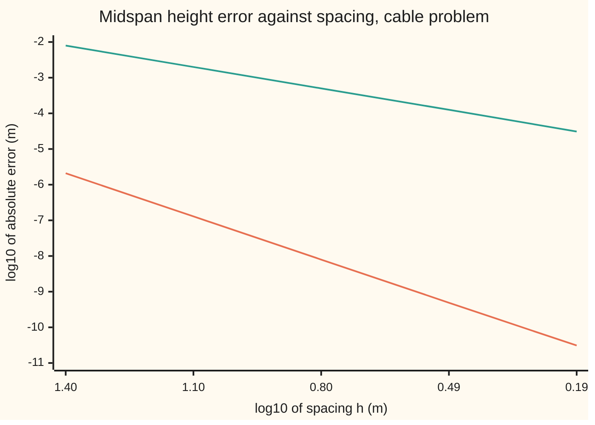

# Two-point boundary problems: shoot and correct, or solve the whole grid at once

[Syllabus](../../../SYLLABUS.md) → [Numerical analysis](../README.md) → [ODE Solvers](../README.md#s06) → Two-point boundary problems

---

## General Overview

A power cable hangs between two towers 100 m apart. The left tower holds it 30 m above the ground, the right tower 40 m. The cable's shape depends on one number, a = 200 m: its horizontal pull divided by its weight per metre. The figures are illustrative.

An engineer wants two numbers. The first is the lowest point, which sets the clearance over a road. The second is the cable's angle at the left tower, which sets the sideways load on that tower. The exact answers, from a closed form, are a lowest point of 27.709650 m at 30.238992 m from the left tower, and a start slope of −0.151771672, an angle of −8.6300 degrees.

The cable's law is a second-order differential equation, but its data sit at both ends: a height at each tower. That is a **two-point boundary problem** ([Boundary value problems](../../08-Differential%20equations%20and%20dynamics/07-Series%20Solutions%20and%20Boundary%20Problems/05-two-point-boundary-value-problems.md)). A stepping method such as RK4 (the classical fourth-order Runge-Kutta method) needs a height and a slope at one end, and the slope is missing.

There are two ways around that.

- **Shoot and correct.** Guess the start slope, step to the far tower, measure the miss, and correct the guess by Newton's method. From the chord slope 0.1 (the straight line between the tower tops) the misses fall 2.6074e1, 7.5716e-1, 7.0058e-4, 6.0068e-10 m: the number of correct digits doubles each shot. The final slope is off by 5.14e-10, a true error.
- **Solve the whole grid at once.** Keep only the heights at grid points, or the values of one polynomial, and demand the equation at chosen points. Every unknown is then found together, from one system of equations. **Finite differences** do this with a three-point formula and give the midspan height to 4.99e-4 m with 16 intervals. With 64 intervals and a parabola through the three lowest heights, they put the lowest point at 27.709677 m, 2.64e-5 m too high. **Collocation** does it with one polynomial of degree 8 and gives every nodal height to 5.68e-13 m.

Three questions decide between them: how fast each error falls, what each costs, and when a method fails on a well-behaved problem. Shooting fails on one below: on a stiff spring bed, one unit in the last place of the start slope moves the far end by 2.09e1.

**A boundary problem becomes a finite system of equations in a few numbers: one start slope (shooting, error order 4 with RK4), every grid height (finite differences, order 2), or one polynomial's values (collocation, error falling geometrically); Newton solves each, and shooting alone breaks when the forward run magnifies small changes.**

**What kind of fact this is:** three methods. The derivative that Newton needs for shooting, and the magnification sinh(k)/k on the stiff bed, are theorems proved on this card in Why it works. The orders 4 and 2 are proved on linked cards and measured here. The geometric rate of collocation is a theorem stated with its source and measured here, not proved.

### The picture: error against spacing for shooting and finite differences



Orange, lower line: shooting with RK4, with slope about 4 (observed order 4.01). Green, upper line: centred finite differences, with slope about 2 (observed order 2.00). Spacing runs from 25 m on the left to 1.562 m on the right, halving at each point. Collocation is off this chart: its error depends on the polynomial's degree, in the table under Step 3.

---

## The formula

All three methods treat the same problem. The cable's height y at distance x from the left tower obeys

$$y'' = F(x, y, y'), \qquad y(0) = \alpha, \qquad y(L) = \beta, \qquad \text{here } F = \frac{\sqrt{1 + y'^2}}{a}.$$

**Read it aloud:** the cable's bending at each point is the square root of one plus its slope squared, divided by a; it starts at height α and ends at height β.

The two primes in $y''$ mean the rate of the rate: the bending. The extra length of a sloped piece of cable, $\sqrt{1 + y'^2}$ per metre across, is what makes the law nonlinear.

**Shooting.** Run forward from height α with start slope s, and call the landing height $y(L; s)$. Shooting solves the one equation

$$g(s) = y(L; s) - \beta = 0, \qquad s_{\text{new}} = s - \frac{g(s)}{z(L)}, \qquad z'' = F_y\, z + F_p\, z', \quad z(0) = 0,\ z'(0) = 1.$$

**Read it aloud:** the miss is where the shot lands minus where it should; correct the slope by the miss divided by how fast the landing moves with the slope, and that rate comes from a second equation run alongside the shot.

**Finite differences.** Split the span into N intervals of width h, with heights $y_i$ at the marks $x_i = ih$. At each inside mark,

$$\frac{y_{i-1} - 2y_i + y_{i+1}}{h^2} = F\!\left(x_i,\ y_i,\ \frac{y_{i+1} - y_{i-1}}{2h}\right), \qquad i = 1, \dots, N-1.$$

**Read it aloud:** at each mark, the bending read off three neighbouring heights equals the law evaluated with the slope read off the two neighbours.

**Collocation.** Look for one polynomial of degree n. Demand the equation exactly at the inside Chebyshev points, which bunch towards the two ends:

$$y''(x_j) = F\big(x_j,\ y(x_j),\ y'(x_j)\big), \qquad x_j = \tfrac{L}{2}\left(1 - \cos\tfrac{j\pi}{n}\right), \qquad j = 1, \dots, n-1.$$

**Read it aloud:** the polynomial must bend exactly as the law says at n − 1 chosen points, and pass through both tower heights.

| Symbol | Plain meaning | In our example | Push it up and the answer… |
| --- | --- | --- | --- |
| $x$, $y$ | distance from the left tower; cable height, both in m | 0 to 100 m; 28.686688231 m at midspan | — |
| $L$, $\alpha$, $\beta$ | span; left and right tower heights | 100 m; 30 m; 40 m | a higher β needs a steeper start |
| $a$, $x_0$, $y_{\min}$ | horizontal pull over weight per metre; position and height of the lowest point | 200 m; 30.238992 m; 27.709650 m | larger a: the cable hangs flatter |
| $F$, $p$ | the law's right side; $p$ stands for the slope $y'$ inside F (not an order) | $\sqrt{1 + p^2}/a$ | more bending |
| $F_y$, $F_p$ | how fast F changes with height, and with slope | 0 and $p/(a\sqrt{1 + p^2})$ | Newton's corrections change |
| $s$ | the start slope, the unknown of shooting | exact −0.151771672 | the far end rises 100.3889 m per unit |
| $g$ | the miss at the far tower, in m | 2.6074e1 at s = 0.1 | zero means the shot lands |
| $z$ | the sensitivity: how much the height moves per unit change in s (not [Stiffness](05-stiffness-a-stability-and-the-dahlquist-barriers.md)'s $z = h\lambda$) | z(L) = 100.3889 m | larger z: rounding in s matters more |
| $h$, $N$, $x_i$, $y_i$, $F_i$ | spacing; number of intervals; mark i; height there; F there | 25 m; 4; $x_2$ = 50 m; 28.694680 m | error grows like $h^2$ |
| $n$, $x_j$, $t_j$, $c_j$, $D$ | the polynomial's degree; collocation point j; the same point on the interval from −1 to 1; a weight, 2 at the ends and 1 inside; the differentiation matrix | 8; 9 points from 0 to 100 m | error falls geometrically |
| $k$ | stiffness of the spring bed in the failure test, $y'' = k^2 y$ | 10 to 40 | shooting's magnification grows like $e^k$ |
| ulp | one unit in the last place of a double, the gap to the next one | 7.11e-15 for s near −40 | — |

### When it holds

- **The law is smooth.** The orders 4 and 2 and collocation's geometric rate all need several smooth derivatives of the solution. A clamp hung mid-span puts a kink in the cable, and every method falls to a low order near it unless a grid mark sits at the kink.
- **The forward run does not magnify much.** Shooting needs a modest z(L). On the stiff bed with k = 40 and a span of 1, z(1) is 2.941e15, and the start slope cannot be stored precisely enough to hit the far end.
- **Newton starts close enough.** The straight line between the towers, slope 0.1, is close for the cable. A strongly nonlinear law can have several solutions or none, and a poor start finds the wrong one or diverges.
- **The linearised problem has one answer.** Each Newton step solves a linear boundary problem. If that problem is singular, its Jacobian (the matrix of how each equation changes with each unknown) is singular too, and the step fails.
- **Collocation's solution is analytic.** The geometric rate needs a solution that extends smoothly into the complex plane, as the catenary's cosh does; a kink drops it to a slow power of n.

---

## Why it works

### Step 0: three ways to turn a curve into a few numbers

A curve has infinitely many values, and a computer handles finitely many. Each method picks a finite list of unknowns and an equal number of equations:

- **shooting:** one unknown, the start slope, and one equation, the far end's height;
- **finite differences:** N − 1 unknown heights, and the law at N − 1 marks;
- **collocation:** n + 1 polynomial values, the law at n − 1 points and the two tower heights.

Each list of equations is nonlinear, so each is solved by Newton's method ([Newton and secant](../02-Root%20Finding%20and%20Fixed%20Points/02-newton-and-secant-with-convergence-orders.md)): linearise, solve the linear system, repeat. All three converge in 4 or 5 Newton steps here. What differs is the size of the linear system, the error left by the discretisation, and the stability of the computation.

### Step 1: shooting, with an exact derivative for Newton

Shooting and its secant form are taught on [Shooting](../../08-Differential%20equations%20and%20dynamics/07-Series%20Solutions%20and%20Boundary%20Problems/06-the-shooting-method.md). What is new here is Newton's derivative, $g'(s)$. Differentiate the law with respect to the start slope s. Write $z = \partial y / \partial s$, the sensitivity of the height to the aim. Then

$$z'' = F_y\, z + F_p\, z', \qquad z(0) = 0, \qquad z'(0) = 1,$$

because the start height does not depend on s and the start slope is s itself. This is the **variational equation**. It is linear in z, and it rides along with the shot: RK4 steps the four numbers $(y, y', z, z')$ together. At the far end, $g'(s) = z(L)$.

For the cable, $F_y = 0$ and $F_p = p/(a\sqrt{1 + p^2})$. For a weightless string, $F = 0$, and $z(L) = L = 100$ m: raise the start slope by 1 and the far end rises by the span. The sagging cable's value, 100.3889 m, is close to that.

<details>
<summary>Detailed proof: the variational equation, and the magnification sinh(k)/k</summary>

**The variational equation.** Let $y(x; s)$ solve $y'' = F(x, y, y')$ with $y(0) = \alpha$ and $y'(0) = s$. When F has continuous first derivatives, the solution is differentiable in s; this is the standard dependence theorem for initial value problems. Differentiate both sides of the law with respect to s, using the chain rule on the right:

$$\frac{\partial y''}{\partial s} = F_y\,\frac{\partial y}{\partial s} + F_p\,\frac{\partial y'}{\partial s}.$$

The derivatives in x and s commute for such solutions, so with $z = \partial y / \partial s$ this reads $z'' = F_y z + F_p z'$. At x = 0, $y = \alpha$ for every s, so $z(0) = 0$; and $y' = s$, so $z'(0) = 1$. Then $g(s) = y(L; s) - \beta$ has $g'(s) = z(L)$.

**Newton converges quadratically.** If $z(L) \ne 0$ at the exact slope and g has a continuous second derivative, Newton's error near the root is a constant times the square of the previous error ([Newton and secant](../02-Root%20Finding%20and%20Fixed%20Points/02-newton-and-secant-with-convergence-orders.md)). Near the root the miss is about z(L) times the slope's error, so the misses obey the same rule. The checks divide each miss by the square of the one before and print 1.11e-3, 1.22e-3, 1.22e-3: a steady constant, the mark of quadratic convergence.

**The stiff bed.** Take $y'' = k^2 y$ on $0 \le x \le 1$. Here $F_y = k^2$ and $F_p = 0$, so $z'' = k^2 z$ with $z(0) = 0$ and $z'(0) = 1$. The solution is $z = \sinh(kx)/k$; check it: $z'' = k \sinh(kx) = k^2 z$, $z(0) = 0$, $z'(0) = \cosh 0 = 1$. So the far end moves by $\sinh(k)/k$ per unit of start slope, and the midspan by $\sinh(k/2)/k$.

**The problem itself is well conditioned.** Its solution is $y = \alpha \sinh(k(1-x))/\sinh k + \beta \sinh(kx)/\sinh k$. Both weights lie between 0 and 1 on the span. So a change in either end height changes the solution anywhere by at most that change. The trouble on the stiff bed belongs to shooting, not to the problem.

</details>

### Step 2: finite differences, Newton on a tridiagonal system

Replacing $y''$ by the three-point difference and solving one linear system is taught on [Finite differences](../../08-Differential%20equations%20and%20dynamics/07-Series%20Solutions%20and%20Boundary%20Problems/07-finite-differences-for-boundary-problems.md), with the proof that its error is order 2. The cable adds two things.

First, the slope inside F is the centred difference $(y_{i+1} - y_{i-1})/(2h)$. Its error is also order $h^2$, so the scheme stays order 2. A one-sided slope $(y_{i+1} - y_i)/h$ has error order h, and drags the whole scheme down to order 1.

Second, the equations are nonlinear, so Newton is needed. Write equation i as $y_{i-1} - 2y_i + y_{i+1} - h^2 F_i = 0$, where $F_i$ is F at mark i. Equation i involves only $y_{i-1}$, $y_i$ and $y_{i+1}$. Its derivatives with respect to them are

$$1 + \tfrac{h}{2}F_p, \qquad -2 - h^2 F_y, \qquad 1 - \tfrac{h}{2}F_p,$$

because the centred slope changes by $\mp 1/(2h)$ when a neighbour moves by 1. So the Jacobian is tridiagonal, and each Newton step is one sweep of [The Thomas algorithm](../03-Numerical%20Linear%20Algebra/03-tridiagonal-systems-and-the-thomas-algorithm.md): eight flops per unknown, less seven, so 113 flops for the 15 unknowns of 16 intervals.

### Step 3: collocation, one polynomial that obeys the law at chosen points

**Collocation** means: choose a family of functions, here polynomials of degree n, and demand that the law hold exactly at n − 1 chosen points. The unknowns are the polynomial's values at n + 1 Chebyshev points, including both ends.

A **differentiation matrix** D turns those values into the polynomial's slopes at the same points. The polynomial through n + 1 values is unique, so its slope at each point is a fixed linear combination of the values: that combination is a row of D. Then $D^2$ gives the bending. The law at point j becomes $(D^2 y)_j = F(x_j, y_j, (Dy)_j)$. The Jacobian is dense: every unknown affects every slope.

Why it is so accurate: at Chebyshev points, the polynomial through the values of an analytic function has an error that falls by a fixed factor each time the degree rises. Collocation inherits that geometric rate whenever the discrete problem is stable. This is stated with its source, Trefethen (2000), chapters 6 and 7, and measured here, not proved:

| Degree n | Unknowns | Largest error at the points |
| --- | --- | --- |
| 4 | 5 | 1.69e-5 m |
| 6 | 7 | 3.58e-9 m |
| 8 | 9 | 5.68e-13 m |
| 10 | 11 | 7.82e-14 m |
| 12 | 13 | 3.55e-14 m |

Each rise of 2 in the degree cuts the error by a large, roughly steady factor, until rounding stops the fall near degree 10.

<details>
<summary>Detailed formula: the Chebyshev differentiation matrix</summary>

On the standard interval, the points are $t_j = \cos(j\pi/n)$ for j = 0 to n. Let $c_0 = c_n = 2$ and $c_j = 1$ otherwise. For $i \ne j$,

$$D_{ij} = \frac{c_i}{c_j}\,\frac{(-1)^{i+j}}{t_i - t_j}, \qquad D_{ii} = -\sum_{j \ne i} D_{ij}.$$

The diagonal rule says each row sums to zero: a constant has slope zero. Computing the diagonal that way, rather than by its own formula, cancels rounding errors (Trefethen 2000, chapter 6). The map $x = \tfrac{L}{2}(1 - t)$ carries the interval onto the span, and multiplies each slope by $-2/L$. The checks build D this way.

</details>

**Piecewise collocation** is the form used by general solvers. It cuts the span into pieces and uses a low-degree polynomial on each piece, matched in value and slope where pieces meet. Collocation at Gauss points on each piece is exactly a Gauss implicit Runge-Kutta method with that many stages ([Runge-Kutta](01-runge-kutta-and-butcher-tableaux.md), [Stiffness](05-stiffness-a-stability-and-the-dahlquist-barriers.md)). Its error at the piece ends has order twice the number of points (Ascher, Mattheij and Russell 1995). Russell and Shampine (1972) proved convergence for this family. Kierzenka and Shampine (2001) built a widely used fourth-order solver on cubic pieces collocated at three Lobatto points (the two ends and the middle of each piece), with the mesh refined where the residual is large.

### Step 4: when shooting fails

Put the cable on a spring bed so stiff that its law becomes $y'' = k^2 y$, on a span of 1 with both ends at height 1. Stiff means a strong spring here, not the [Stiffness](05-stiffness-a-stability-and-the-dahlquist-barriers.md) sense: the trouble is the growing solution $e^{kx}$, which any accurate stepper must follow. The bed pulls the middle almost flat to the ground: the exact midspan height is $1/\cosh(k/2)$. [Shooting](../../08-Differential%20equations%20and%20dynamics/07-Series%20Solutions%20and%20Boundary%20Problems/06-the-shooting-method.md) met this law with k = 1.

From Step 1, the far end moves by $\sinh(k)/k$ per unit of start slope. The checks run RK4 with 200 steps and compare:

| k | z(1), RK4 | sinh(k)/k | Midspan, exact | Shooting | Finite differences | Shooting's last miss |
| --- | --- | --- | --- | --- | --- | --- |
| 10 | 1.101e3 | 1.101e3 | 1.348e-2 | 1.348e-2 | 1.348e-2 | 1.12e-11 |
| 20 | 1.213e7 | 1.213e7 | 9.080e-5 | 9.080e-5 | 9.118e-5 | 4.01e-8 |
| 30 | 1.781e11 | 1.781e11 | 6.118e-7 | 6.111e-7 | 6.204e-7 | −2.48e-3 |
| 40 | 2.941e15 | 2.942e15 | 4.122e-9 | 1.353e-8 | 4.261e-9 | 4.56e0 |

At k = 40 the start slope is close to −k. One ulp there is 7.11e-15. That one ulp moves the midspan by 4.31e-8, more than the true midspan height of 4.122e-9, and the far end by 2.09e1. No double can aim better, so shooting's Newton stops with the far end 4.56 off and the midspan at 1.353e-8.

This is a failure of **stability** (how a method amplifies its own small errors), not of **conditioning** (how the answer responds to changes in the data; see [Conditioning and stability](../01-Floating%20Point%20and%20Error/05-conditioning-and-stability.md)). The problem is well conditioned, as the fold above shows. Finite differences never run across the span, so they reach 4.261e-9: off by the $h^2$ error of a 200-interval grid, not by rounding.

The standard repair is **multiple shooting**: cut the span into pieces, shoot each piece from its own unknown start, and solve for all the starts together. In 10 pieces, a piece's far end moves only sinh(4)/40 = 0.6822 per unit of its start slope and cosh(4) = 27.31 per unit of its start height, against 2.941e15 per unit of slope across the whole span. The unknowns then form a block system much like the finite-difference one.

---

## Worked numbers, by hand

The finite-difference grid with N = 4 intervals of h = 25 m has three unknown heights, at 25, 50 and 75 m. Newton starts from the straight line between the towers.

| Step | Arithmetic | Value |
| --- | --- | --- |
| start: the straight line | 30 + 10 × i/4 at marks 1, 2, 3 | 32.5, 35.0, 37.5 m |
| slope at every mark | (next height − previous height) ÷ 50 | 0.1 |
| each equation's miss | (neighbours − 2 × height) − 25² × √(1 + 0.1²) ÷ 200, and the first part is 0 on a line | −3.140586 m |
| Jacobian row | 1 + 12.5 $F_p$, then −2, then 1 − 12.5 $F_p$, with $F_p$ = 0.1 ÷ (200 √1.01) | 1.006219, −2.0, 0.993781 |
| solve the 3-by-3 tridiagonal system for the corrections, and add them | one Thomas sweep | 27.808773, 28.719071, 32.769712 m |
| three more Newton steps | the same, from the new heights | 27.784307, **28.694680**, 32.745397 m |
| closed form, for comparison | $y_{\min} + a\left(\cosh((x - x_0)/a) - 1\right)$ at 25, 50, 75 m | 27.778272, 28.686688, 32.739462 m |

**The grid's midspan height, 28.694680 m, is 7.99e-3 m above the true 28.686688 m**: a true error, against the closed form. Halving h four times cuts it to 3.12e-5 m, about a quarter each time.

### What breaks if you drop a piece

| Mistake | Comes out at | What went wrong |
| --- | --- | --- |
| One-sided slope $(y_{i+1} - y_i)/h$ in the grid equations | midspan error −1.01e-2 m at h = 6.25 m, against 4.99e-4; observed order 1.01 | a first-order slope inside a second-order scheme makes the whole scheme first order |
| Shooting on the stiff bed, k = 40 | midspan 1.353e-8, true 4.122e-9; far end misses by 4.56 | the forward run magnifies one ulp of the slope into 2.09e1 at the far end |
| Grid Jacobian without the slope term $F_p$ | 8 Newton steps instead of 4; the answer moves only −2.49e-14 m | an approximate Jacobian still finds the root, but converges linearly, not quadratically |

---

## Code, from first principles, and it actually runs

The script solves the cable four ways and compares them. Road one is the closed form, $y = y_{\min} + a\left(\cosh((x - x_0)/a) - 1\right)$, with $x_0$ found from the two tower heights. Roads two to four are shooting with RK4 and the variational equation, finite differences with Newton and a Thomas sweep, and Chebyshev collocation with Newton and dense elimination. The orders are measured by halving h, and the stiff bed checks the variational equation against sinh(k)/k. Python's `sum` adds floats with compensation, so the script writes its own plain sum, and both languages print the same digits.

### Python

```python
# Two-point boundary problems: shooting, finite differences and collocation -- the check behind the card.
# Python standard library only. A cable hangs between towers 30 m and 40 m high, 100 m apart (illustrative):
# y'' = sqrt(1 + y'^2) / a with a = H / w = 4000 N / (20 N/m) = 200 m. Every solver is written out.
import math
def sci(x, d=2):                                  # e-notation spelled the way Rust spells it
    m, e = f"{x:.{d}e}".split("e"); return f"{m}e{int(e)}"
def dot(u, v):                                    # plain left-to-right sum (Python's sum() compensates)
    t = 0.0
    for p, q in zip(u, v): t += p * q
    return t
def asinh(v): return math.log(v + math.sqrt(v * v + 1))
L, YA, YB, A = 100.0, 30.0, 40.0, 200.0
CAT = (lambda x, y, p: math.sqrt(1 + p * p) / A, lambda x, y, p: 0.0,      # F, dF/dy, dF/dp
       lambda x, y, p: p / (A * math.sqrt(1 + p * p)))
x0 = L / 2 - A * asinh((YB - YA) / (2 * A * math.sinh(L / (2 * A))))      # road 1: the closed form
c0 = YA - A * math.cosh(x0 / A)
def exact(x): return A * math.cosh((x - x0) / A) + c0
s_ex, mid_ex = math.sinh(-x0 / A), exact(L / 2)
print("cable: y'' = sqrt(1 + y'^2)/a, a = 200 m; towers 30 m at x = 0 and 40 m at x = 100 m")
print(f"exact: lowest point at x = {x0:.6f} m, height {A + c0:.6f} m; midspan y(50) = {mid_ex:.9f} m")
print(f"exact: start slope s = {s_ex:.9f}, angle {math.atan(s_ex) * 180 / math.pi:.4f} deg")

def shoot(eq, a, b, ya, yb, s, n, log=None):     # road 2: RK4 on (y, y', dy/ds, dy'/ds), Newton on s
    F, Fy, Fp = eq; h = (b - a) / n
    def rhs(x, u): return [u[1], F(x, u[0], u[1]), u[3], Fy(x, u[0], u[1]) * u[2] + Fp(x, u[0], u[1]) * u[3]]
    for it in range(20):
        u = [ya, s, 0.0, 1.0]
        for i in range(n):
            x = a + i * h; k1 = rhs(x, u)
            k2 = rhs(x + h / 2, [u[j] + h / 2 * k1[j] for j in range(4)])
            k3 = rhs(x + h / 2, [u[j] + h / 2 * k2[j] for j in range(4)])
            k4 = rhs(x + h, [u[j] + h * k3[j] for j in range(4)])
            u = [u[j] + h / 6 * (k1[j] + 2 * k2[j] + 2 * k3[j] + k4[j]) for j in range(4)]
            if 2 * (i + 1) == n: mid = u[0]
        g = u[0] - yb; ds = g / u[2]
        if log is not None:
            log.append(g); print(f"  shot {it}: s = {s:.9f}, miss {sci(g, 4)} m, dmiss/ds = {u[2]:.4f} m")
        s -= ds
        if abs(ds) <= 1e-14 * (1 + abs(s)): break
    return s, mid, g, it + 1, u[2]

def thomas(lo, di, up, r):                        # tridiagonal solve: one sweep down, one back
    di, r = di[:], r[:]
    for i in range(1, len(di)):
        m = lo[i] / di[i - 1]; di[i] -= m * up[i - 1]; r[i] -= m * r[i - 1]
    x = r[:]; x[-1] = r[-1] / di[-1]
    for i in range(len(di) - 2, -1, -1): x[i] = (r[i] - up[i] * x[i + 1]) / di[i]
    return x
def fd(eq, a, b, ya, yb, n, onesided=False, noslope=False, log=False):   # road 3: Newton on the grid
    F, Fy, Fp = eq; h = (b - a) / n; y = [ya + (yb - ya) * i / n for i in range(n + 1)]
    for it in range(1, 60):
        lo, di, up, r = [], [], [], []
        for i in range(1, n):
            x = a + i * h
            p = (y[i + 1] - y[i]) / h if onesided else (y[i + 1] - y[i - 1]) / (2 * h)
            fp = 0.0 if noslope else Fp(x, y[i], p)
            r.append(-(y[i - 1] - 2 * y[i] + y[i + 1] - h * h * F(x, y[i], p)))
            lo.append(1 + h * fp / 2); di.append(-2 - h * h * Fy(x, y[i], p)); up.append(1 - h * fp / 2)
        d = thomas(lo, di, up, r)
        for i in range(1, n): y[i] += d[i - 1]
        if log and it == 1:
            print(f"  step 1: each equation misses by {-r[0]:.6f}; Jacobian row: lower {lo[1]:.6f}, diagonal {di[1]:.1f}, upper {up[1]:.6f}")
            print(f"  after step 1: y = {y[1]:.6f} {y[2]:.6f} {y[3]:.6f}")
        if max(abs(v) for v in d) < 1e-12: break
    return y, it

def colloc(eq, a, b, ya, yb, n):                  # road 4: one polynomial, the equation at Chebyshev points
    F, Fy, Fp = eq; t = [math.cos(math.pi * j / n) for j in range(n + 1)]
    x = [a + (b - a) * (1 - tj) / 2 for tj in t]
    w = [(2.0 if j in (0, n) else 1.0) * (1 - 2 * (j % 2)) for j in range(n + 1)]
    D = [[0.0 if i == j else w[i] / w[j] / (t[i] - t[j]) * (-2 / (b - a)) for j in range(n + 1)] for i in range(n + 1)]
    for i in range(n + 1): D[i][i] = -dot(D[i], [1.0] * (n + 1))    # rows of D must kill constants
    D2 = [[dot(D[i], [D[k][j] for k in range(n + 1)]) for j in range(n + 1)] for i in range(n + 1)]
    y = [ya + (yb - ya) * (xi - a) / (b - a) for xi in x]
    for it in range(1, 60):
        p = [dot(D[i], y) for i in range(n + 1)]
        M = [[1.0 if j == i else 0.0 for j in range(n + 1)] for i in range(n + 1)]
        r = [ya - y[0]] + [0.0] * (n - 1) + [yb - y[n]]
        for i in range(1, n):
            M[i] = [D2[i][j] - Fp(x[i], y[i], p[i]) * D[i][j] - (Fy(x[i], y[i], p[i]) if i == j else 0.0) for j in range(n + 1)]
            r[i] = -(dot(D2[i], y) - F(x[i], y[i], p[i]))
        for k in range(n + 1):                    # dense elimination with partial pivoting
            q = max(range(k, n + 1), key=lambda i: abs(M[i][k])); M[k], M[q] = M[q], M[k]; r[k], r[q] = r[q], r[k]
            for i in range(k + 1, n + 1):
                m = M[i][k] / M[k][k]; r[i] -= m * r[k]
                for j in range(k, n + 1): M[i][j] -= m * M[k][j]
        d = [0.0] * (n + 1)
        for i in range(n, -1, -1): d[i] = (r[i] - dot(M[i][i + 1:], d[i + 1:])) / M[i][i]
        y = [y[i] + d[i] for i in range(n + 1)]
        if max(abs(v) for v in d) < 1e-12: break
    return max(abs(y[i] - exact(x[i])) for i in range(n + 1)), it

print("shooting, RK4 with 16 steps, Newton on the start slope from the chord slope 0.1:")
misses = []; s16, m16, g16, sh16, z16 = shoot(CAT, 0, L, YA, YB, 0.1, 16, misses)
print("  |miss_k+1| / |miss_k|^2: " + ", ".join(sci(abs(misses[k + 1]) / (misses[k] * misses[k])) for k in range(3)) + f"; final s = {s16:.12f}, true error {sci(s16 - s_ex)}")
print("finite differences, 4 intervals of 25 m, Newton from the straight line y = " + " ".join(f"{YA + (YB - YA) * i / 4:.1f}" for i in (1, 2, 3)) + ":")
y4, it4 = fd(CAT, 0, L, YA, YB, 4, log=True)
print(f"  after {it4} steps: y = {y4[1]:.6f} {y4[2]:.6f} {y4[3]:.6f}; exact {exact(25):.6f} {exact(50):.6f} {exact(75):.6f}")
print("midspan error, m:  h (m)    shooting    centred FD  one-sided FD")
E = []
for n in (4, 8, 16, 32, 64):
    e = (shoot(CAT, 0, L, YA, YB, 0.1, n)[1] - mid_ex, fd(CAT, 0, L, YA, YB, n)[0][n // 2] - mid_ex,
         fd(CAT, 0, L, YA, YB, n, onesided=True)[0][n // 2] - mid_ex)
    E.append(e); print(f"  {L / n:20.3f}  {sci(e[0]):>10}  {sci(e[1]):>12}  {sci(e[2]):>12}")
order = [math.log2(abs(E[3][j] / E[4][j])) for j in range(3)]
print(f"observed order, last halving: shooting {order[0]:.2f}, centred {order[1]:.2f}, one-sided {order[2]:.2f}")
y64 = fd(CAT, 0, L, YA, YB, 64)[0]; i = min(range(1, 64), key=lambda j: y64[j])   # lowest grid height, then a parabola
d1, d2 = y64[i + 1] - y64[i - 1], y64[i + 1] - 2 * y64[i] + y64[i - 1]; xl, yl = (i - d1 / (2 * d2)) * L / 64, y64[i] - d1 * d1 / (8 * d2)
print(f"lowest point, 64-interval grid and a parabola through its 3 lowest heights: {yl:.6f} m at x = {xl:.4f} m; true errors {sci(yl - A - c0)} m, {sci(xl - x0)} m")
print("collocation, degree n:  max nodal error, Newton steps")
C = {}
for n in (4, 6, 8, 10, 12):
    C[n] = colloc(CAT, 0, L, YA, YB, n); print(f"  n = {n:2d}: {sci(C[n][0]):>9}  {C[n][1]}")
y16, it16 = fd(CAT, 0, L, YA, YB, 16); y16n, it16n = fd(CAT, 0, L, YA, YB, 16, noslope=True)
print(f"cost at 16 intervals: shooting 1 unknown, {sh16} shots of 64 F-calls; FD 15 unknowns, {it16} steps of a {8 * 15 - 7}-flop Thomas sweep")
print(f"cost of collocation n = 8: 9 unknowns, {C[8][1]} steps of a {(4 * 9 ** 3 + 9 * 9 ** 2 - 7 * 9) // 6}-flop dense elimination")
print(f"wrong: FD Jacobian without the slope term: {it16n} Newton steps, not {it16}; answer moves {sci(y16n[8] - y16[8])} m")
print("stiff bed y'' = k^2 y, y(0) = y(1) = 1, 200 steps: k, dmiss/ds (RK4 | sinh k / k), midspan exact | shooting | FD")
B = {}
for k in (10, 20, 30, 40):
    bed = (lambda x, y, p, k=k: k * k * y, lambda x, y, p, k=k: k * k, lambda x, y, p: 0.0)
    sb, mb, gb, nb, zb = shoot(bed, 0, 1, 1, 1, 0.0, 200); yb = fd(bed, 0, 1, 1, 1, 200)[0][100]
    B[k] = (zb, mb, yb, gb, sb); ex = 1 / math.cosh(k / 2)
    print(f"  {k}: {sci(zb, 3)} | {sci(math.sinh(k) / k, 3)}   {sci(ex, 3)} | {sci(mb, 3)} | {sci(yb, 3)}   miss {sci(gb)}")
ulp = 2.0 ** (math.floor(math.log2(abs(B[40][4]))) - 52)
print(f"k = 40: one ulp of s ({sci(ulp)}) moves midspan {sci(ulp * math.sinh(20) / 40)} and far end {sci(ulp * math.sinh(40) / 40)}")
print(f"k = 40 in 10 pieces (multiple shooting): each piece's dmiss/ds is sinh(4)/40 = {math.sinh(4) / 40:.4f}; d(far height)/d(start height) cosh(4) = {math.cosh(4):.2f}")
print("chart, log10 h: " + " ".join(f"{math.log10(L / n):.2f}" for n in (4, 8, 16, 32, 64)))
for j, name in ((0, "shooting"), (1, "centred FD")):
    print(f"chart, log10 |error| {name}: " + " ".join(f"{math.log10(abs(e[j])):.2f}" for e in E))

assert abs(s16 - s_ex) < 1e-9, "shooting slope must match the closed form"
assert abs(misses[3] / (misses[2] * misses[2])) < 0.01, "Newton on the slope must converge quadratically"
assert 3.9 < order[0] < 4.1 and 1.95 < order[1] < 2.05 and 0.9 < order[2] < 1.1, "orders 4, 2 and 1"
assert C[8][0] < 1e-11 < C[4][0], "collocation: geometric convergence against the closed form"
assert abs(E[4][1]) < 4e-5 and abs(y4[2] - mid_ex) < 0.01 and abs(yl - A - c0) < 1e-4 and abs(xl - x0) < 1e-3, "FD within its h^2 error of the closed form"
assert abs(B[40][0] / (math.sinh(40) / 40) - 1) < 1e-3, "variational equation vs sinh(k)/k"
assert abs(B[40][2] * math.cosh(20) - 1) < 0.05 and abs(B[40][1] * math.cosh(20) - 1) > 1, "FD holds, shooting fails"
assert it16 <= 5 < it16n, "exact grid Jacobian: quadratic Newton; without F_p: slower"
print("ALL CHECKS PASS")
```

**Ran 2026-11-11 on macOS, Python 3.14.10, standard library only. All checks passed. Output, pasted from the run:**

```
cable: y'' = sqrt(1 + y'^2)/a, a = 200 m; towers 30 m at x = 0 and 40 m at x = 100 m
exact: lowest point at x = 30.238992 m, height 27.709650 m; midspan y(50) = 28.686688231 m
exact: start slope s = -0.151771672, angle -8.6300 deg
shooting, RK4 with 16 steps, Newton on the start slope from the chord slope 0.1:
  shot 0: s = 0.100000000, miss 2.6074e1 m, dmiss/ds = 106.7589 m
  shot 1: s = -0.144236354, miss 7.5716e-1 m, dmiss/ds = 100.5751 m
  shot 2: s = -0.151764693, miss 7.0058e-4 m, dmiss/ds = 100.3891 m
  shot 3: s = -0.151771671, miss 6.0068e-10 m, dmiss/ds = 100.3889 m
  shot 4: s = -0.151771671, miss -7.1054e-15 m, dmiss/ds = 100.3889 m
  |miss_k+1| / |miss_k|^2: 1.11e-3, 1.22e-3, 1.22e-3; final s = -0.151771671349, true error 5.14e-10
finite differences, 4 intervals of 25 m, Newton from the straight line y = 32.5 35.0 37.5:
  step 1: each equation misses by -3.140586; Jacobian row: lower 1.006219, diagonal -2.0, upper 0.993781
  after step 1: y = 27.808773 28.719071 32.769712
  after 4 steps: y = 27.784307 28.694680 32.745397; exact 27.778272 28.686688 32.739462
midspan error, m:  h (m)    shooting    centred FD  one-sided FD
                25.000     2.08e-6       7.99e-3      -4.38e-2
                12.500     1.29e-7       2.00e-3      -2.07e-2
                 6.250     7.96e-9       4.99e-4      -1.01e-2
                 3.125    4.93e-10       1.25e-4      -4.95e-3
                 1.562    3.06e-11       3.12e-5      -2.46e-3
observed order, last halving: shooting 4.01, centred 2.00, one-sided 1.01
lowest point, 64-interval grid and a parabola through its 3 lowest heights: 27.709677 m at x = 30.2389 m; true errors 2.64e-5 m, -9.64e-5 m
collocation, degree n:  max nodal error, Newton steps
  n =  4:   1.69e-5  4
  n =  6:   3.58e-9  4
  n =  8:  5.68e-13  4
  n = 10:  7.82e-14  4
  n = 12:  3.55e-14  4
cost at 16 intervals: shooting 1 unknown, 5 shots of 64 F-calls; FD 15 unknowns, 4 steps of a 113-flop Thomas sweep
cost of collocation n = 8: 9 unknowns, 4 steps of a 597-flop dense elimination
wrong: FD Jacobian without the slope term: 8 Newton steps, not 4; answer moves -2.49e-14 m
stiff bed y'' = k^2 y, y(0) = y(1) = 1, 200 steps: k, dmiss/ds (RK4 | sinh k / k), midspan exact | shooting | FD
  10: 1.101e3 | 1.101e3   1.348e-2 | 1.348e-2 | 1.348e-2   miss 1.12e-11
  20: 1.213e7 | 1.213e7   9.080e-5 | 9.080e-5 | 9.118e-5   miss 4.01e-8
  30: 1.781e11 | 1.781e11   6.118e-7 | 6.111e-7 | 6.204e-7   miss -2.48e-3
  40: 2.941e15 | 2.942e15   4.122e-9 | 1.353e-8 | 4.261e-9   miss 4.56e0
k = 40: one ulp of s (7.11e-15) moves midspan 4.31e-8 and far end 2.09e1
k = 40 in 10 pieces (multiple shooting): each piece's dmiss/ds is sinh(4)/40 = 0.6822; d(far height)/d(start height) cosh(4) = 27.31
chart, log10 h: 1.40 1.10 0.80 0.49 0.19
chart, log10 |error| shooting: -5.68 -6.89 -8.10 -9.31 -10.51
chart, log10 |error| centred FD: -2.10 -2.70 -3.30 -3.90 -4.51
ALL CHECKS PASS
```

### Rust

```rust
// Two-point boundary problems: shooting, finite differences and collocation -- the check behind the card.
// Rust std only. A cable hangs between towers 30 m and 40 m high, 100 m apart (illustrative):
// y'' = sqrt(1 + y'^2) / a with a = H / w = 4000 N / (20 N/m) = 200 m. Every solver is written out.
use std::f64::consts::PI;
fn sci(x: f64, d: usize) -> String { format!("{:.*e}", d, x) }
fn dot(u: &[f64], v: &[f64]) -> f64 { let mut t = 0.0; for (p, q) in u.iter().zip(v) { t += p * q; } t }
fn asinh(v: f64) -> f64 { (v + (v * v + 1.0).sqrt()).ln() }
const L: f64 = 100.0; const YA: f64 = 30.0; const YB: f64 = 40.0; const A: f64 = 200.0;
struct Eq { f: Box<dyn Fn(f64, f64, f64) -> f64>, fy: Box<dyn Fn(f64, f64, f64) -> f64>, fp: Box<dyn Fn(f64, f64, f64) -> f64> }
fn cat() -> Eq {                                   // F, dF/dy, dF/dp
    Eq { f: Box::new(|_, _, p| (1.0 + p * p).sqrt() / A), fy: Box::new(|_, _, _| 0.0),
         fp: Box::new(|_, _, p| p / (A * (1.0 + p * p).sqrt())) }
}
struct Ex { x0: f64, c0: f64 }
impl Ex { fn y(&self, x: f64) -> f64 { A * ((x - self.x0) / A).cosh() + self.c0 } }

// road 2: RK4 on (y, y', dy/ds, dy'/ds), Newton on the start slope s
fn shoot(eq: &Eq, a: f64, b: f64, ya: f64, yb: f64, s0: f64, n: usize, log: Option<&mut Vec<f64>>) -> (f64, f64, f64, usize, f64) {
    let h = (b - a) / n as f64; let mut s = s0; let (mut mid, mut g, mut z, mut shots) = (0.0, 0.0, 0.0, 0);
    let rhs = |x: f64, u: &[f64; 4]| -> [f64; 4] {
        [u[1], (eq.f)(x, u[0], u[1]), u[3], (eq.fy)(x, u[0], u[1]) * u[2] + (eq.fp)(x, u[0], u[1]) * u[3]] };
    let mut log = log;
    for it in 0..20 {
        let mut u = [ya, s, 0.0, 1.0];
        for i in 0..n {
            let x = a + i as f64 * h; let k1 = rhs(x, &u);
            let k2 = rhs(x + h / 2.0, &std::array::from_fn(|j| u[j] + h / 2.0 * k1[j]));
            let k3 = rhs(x + h / 2.0, &std::array::from_fn(|j| u[j] + h / 2.0 * k2[j]));
            let k4 = rhs(x + h, &std::array::from_fn(|j| u[j] + h * k3[j]));
            u = std::array::from_fn(|j| u[j] + h / 6.0 * (k1[j] + 2.0 * k2[j] + 2.0 * k3[j] + k4[j]));
            if 2 * (i + 1) == n { mid = u[0]; }
        }
        g = u[0] - yb; z = u[2]; let ds = g / u[2]; shots = it + 1;
        if let Some(l) = log.as_mut() {
            l.push(g); println!("  shot {}: s = {:.9}, miss {} m, dmiss/ds = {:.4} m", it, s, sci(g, 4), u[2]);
        }
        s -= ds;
        if ds.abs() <= 1e-14 * (1.0 + s.abs()) { break; }
    }
    (s, mid, g, shots, z)
}

fn thomas(lo: &[f64], di: &[f64], up: &[f64], r: &[f64]) -> Vec<f64> {   // one sweep down, one back
    let (mut di, mut r) = (di.to_vec(), r.to_vec()); let m = di.len();
    for i in 1..m { let q = lo[i] / di[i - 1]; di[i] -= q * up[i - 1]; r[i] -= q * r[i - 1]; }
    let mut x = r.clone(); x[m - 1] = r[m - 1] / di[m - 1];
    for i in (0..m - 1).rev() { x[i] = (r[i] - up[i] * x[i + 1]) / di[i]; }
    x
}
// road 3: Newton on the grid equations
fn fd(eq: &Eq, a: f64, b: f64, ya: f64, yb: f64, n: usize, onesided: bool, noslope: bool, log: bool) -> (Vec<f64>, usize) {
    let h = (b - a) / n as f64; let mut y: Vec<f64> = (0..=n).map(|i| ya + (yb - ya) * i as f64 / n as f64).collect();
    let mut steps = 0;
    for it in 1..60 {
        steps = it; let (mut lo, mut di, mut up, mut r) = (vec![], vec![], vec![], vec![]);
        for i in 1..n {
            let x = a + i as f64 * h;
            let p = if onesided { (y[i + 1] - y[i]) / h } else { (y[i + 1] - y[i - 1]) / (2.0 * h) };
            let fp = if noslope { 0.0 } else { (eq.fp)(x, y[i], p) };
            r.push(-(y[i - 1] - 2.0 * y[i] + y[i + 1] - h * h * (eq.f)(x, y[i], p)));
            lo.push(1.0 + h * fp / 2.0); di.push(-2.0 - h * h * (eq.fy)(x, y[i], p)); up.push(1.0 - h * fp / 2.0);
        }
        let d = thomas(&lo, &di, &up, &r);
        for i in 1..n { y[i] += d[i - 1]; }
        if log && it == 1 {
            println!("  step 1: each equation misses by {:.6}; Jacobian row: lower {:.6}, diagonal {:.1}, upper {:.6}", -r[0], lo[1], di[1], up[1]);
            println!("  after step 1: y = {:.6} {:.6} {:.6}", y[1], y[2], y[3]);
        }
        if d.iter().fold(0.0f64, |m, v| m.max(v.abs())) < 1e-12 { break; }
    }
    (y, steps)
}

// road 4: one polynomial, the equation enforced at Chebyshev points
fn colloc(eq: &Eq, ex: &Ex, a: f64, b: f64, ya: f64, yb: f64, n: usize) -> (f64, usize) {
    let t: Vec<f64> = (0..=n).map(|j| (PI * j as f64 / n as f64).cos()).collect();
    let x: Vec<f64> = t.iter().map(|tj| a + (b - a) * (1.0 - tj) / 2.0).collect();
    let w: Vec<f64> = (0..=n).map(|j| (if j == 0 || j == n { 2.0 } else { 1.0 }) * (1 - 2 * (j % 2) as i64) as f64).collect();
    let mut dm: Vec<Vec<f64>> = (0..=n).map(|i| (0..=n).map(|j| if i == j { 0.0 } else { w[i] / w[j] / (t[i] - t[j]) * (-2.0 / (b - a)) }).collect()).collect();
    for i in 0..=n { dm[i][i] = -dot(&dm[i], &vec![1.0; n + 1]); }      // rows of D must kill constants
    let d2: Vec<Vec<f64>> = (0..=n).map(|i| (0..=n).map(|j| dot(&dm[i], &(0..=n).map(|k| dm[k][j]).collect::<Vec<_>>())).collect()).collect();
    let mut y: Vec<f64> = x.iter().map(|xi| ya + (yb - ya) * (xi - a) / (b - a)).collect();
    let mut steps = 0;
    for it in 1..60 {
        steps = it;
        let p: Vec<f64> = (0..=n).map(|i| dot(&dm[i], &y)).collect();
        let mut m: Vec<Vec<f64>> = (0..=n).map(|i| (0..=n).map(|j| if i == j { 1.0 } else { 0.0 }).collect()).collect();
        let mut r = vec![0.0; n + 1]; r[0] = ya - y[0]; r[n] = yb - y[n];
        for i in 1..n {
            m[i] = (0..=n).map(|j| d2[i][j] - (eq.fp)(x[i], y[i], p[i]) * dm[i][j] - if i == j { (eq.fy)(x[i], y[i], p[i]) } else { 0.0 }).collect();
            r[i] = -(dot(&d2[i], &y) - (eq.f)(x[i], y[i], p[i]));
        }
        for k in 0..=n {                           // dense elimination with partial pivoting
            let mut q = k; for i in k..=n { if m[i][k].abs() > m[q][k].abs() { q = i; } }
            m.swap(k, q); r.swap(k, q);
            for i in k + 1..=n {
                let f = m[i][k] / m[k][k]; r[i] -= f * r[k];
                for j in k..=n { m[i][j] -= f * m[k][j]; }
            }
        }
        let mut d = vec![0.0; n + 1];
        for i in (0..=n).rev() { d[i] = (r[i] - dot(&m[i][i + 1..], &d[i + 1..])) / m[i][i]; }
        for i in 0..=n { y[i] += d[i]; }
        if d.iter().fold(0.0f64, |m, v| m.max(v.abs())) < 1e-12 { break; }
    }
    ((0..=n).fold(0.0f64, |m, i| m.max((y[i] - ex.y(x[i])).abs())), steps)
}

fn main() {
    let x0 = L / 2.0 - A * asinh((YB - YA) / (2.0 * A * (L / (2.0 * A)).sinh()));   // road 1: the closed form
    let ex = Ex { x0, c0: YA - A * (x0 / A).cosh() };
    let (s_ex, mid_ex) = ((-x0 / A).sinh(), ex.y(L / 2.0));
    let cat = cat();
    println!("cable: y'' = sqrt(1 + y'^2)/a, a = 200 m; towers 30 m at x = 0 and 40 m at x = 100 m");
    println!("exact: lowest point at x = {:.6} m, height {:.6} m; midspan y(50) = {:.9} m", x0, A + ex.c0, mid_ex);
    println!("exact: start slope s = {:.9}, angle {:.4} deg", s_ex, s_ex.atan() * 180.0 / PI);
    println!("shooting, RK4 with 16 steps, Newton on the start slope from the chord slope 0.1:");
    let mut misses = vec![]; let (s16, _, _, sh16, _) = shoot(&cat, 0.0, L, YA, YB, 0.1, 16, Some(&mut misses));
    println!("  |miss_k+1| / |miss_k|^2: {}; final s = {:.12}, true error {}", (0..3).map(|k| sci(misses[k + 1].abs() / (misses[k] * misses[k]), 2)).collect::<Vec<_>>().join(", "), s16, sci(s16 - s_ex, 2));
    println!("finite differences, 4 intervals of 25 m, Newton from the straight line y = {}:", [1.0, 2.0, 3.0].iter().map(|i| format!("{:.1}", YA + (YB - YA) * i / 4.0)).collect::<Vec<_>>().join(" "));
    let (y4, it4) = fd(&cat, 0.0, L, YA, YB, 4, false, false, true);
    println!("  after {} steps: y = {:.6} {:.6} {:.6}; exact {:.6} {:.6} {:.6}", it4, y4[1], y4[2], y4[3], ex.y(25.0), ex.y(50.0), ex.y(75.0));
    println!("midspan error, m:  h (m)    shooting    centred FD  one-sided FD");
    let mut e: Vec<[f64; 3]> = vec![];
    for n in [4usize, 8, 16, 32, 64] {
        let r = [shoot(&cat, 0.0, L, YA, YB, 0.1, n, None).1 - mid_ex, fd(&cat, 0.0, L, YA, YB, n, false, false, false).0[n / 2] - mid_ex,
                 fd(&cat, 0.0, L, YA, YB, n, true, false, false).0[n / 2] - mid_ex];
        println!("  {:20.3}  {:>10}  {:>12}  {:>12}", L / n as f64, sci(r[0], 2), sci(r[1], 2), sci(r[2], 2)); e.push(r);
    }
    let order: Vec<f64> = (0..3).map(|j| (e[3][j] / e[4][j]).abs().log2()).collect();
    println!("observed order, last halving: shooting {:.2}, centred {:.2}, one-sided {:.2}", order[0], order[1], order[2]);
    let y64 = fd(&cat, 0.0, L, YA, YB, 64, false, false, false).0; let i = (1..64).fold(1, |b, j| if y64[j] < y64[b] { j } else { b });   // lowest grid height
    let (d1, d2) = (y64[i + 1] - y64[i - 1], y64[i + 1] - 2.0 * y64[i] + y64[i - 1]); let (xl, yl) = ((i as f64 - d1 / (2.0 * d2)) * L / 64.0, y64[i] - d1 * d1 / (8.0 * d2));
    println!("lowest point, 64-interval grid and a parabola through its 3 lowest heights: {:.6} m at x = {:.4} m; true errors {} m, {} m", yl, xl, sci(yl - A - ex.c0, 2), sci(xl - x0, 2));
    println!("collocation, degree n:  max nodal error, Newton steps");
    let mut c = std::collections::HashMap::new();
    for n in [4usize, 6, 8, 10, 12] {
        let r = colloc(&cat, &ex, 0.0, L, YA, YB, n); println!("  n = {:2}: {:>9}  {}", n, sci(r.0, 2), r.1); c.insert(n, r);
    }
    let (y16, it16) = fd(&cat, 0.0, L, YA, YB, 16, false, false, false); let (y16n, it16n) = fd(&cat, 0.0, L, YA, YB, 16, false, true, false);
    println!("cost at 16 intervals: shooting 1 unknown, {} shots of 64 F-calls; FD 15 unknowns, {} steps of a {}-flop Thomas sweep", sh16, it16, 8 * 15 - 7);
    println!("cost of collocation n = 8: 9 unknowns, {} steps of a {}-flop dense elimination", c[&8].1, (4 * 729 + 9 * 81 - 7 * 9) / 6);
    println!("wrong: FD Jacobian without the slope term: {} Newton steps, not {}; answer moves {} m", it16n, it16, sci(y16n[8] - y16[8], 2));
    println!("stiff bed y'' = k^2 y, y(0) = y(1) = 1, 200 steps: k, dmiss/ds (RK4 | sinh k / k), midspan exact | shooting | FD");
    let mut bb = std::collections::HashMap::new();
    for k in [10.0f64, 20.0, 30.0, 40.0] {
        let bed = Eq { f: Box::new(move |_, y, _| k * k * y), fy: Box::new(move |_, _, _| k * k), fp: Box::new(|_, _, _| 0.0) };
        let (sb, mb, gb, _, zb) = shoot(&bed, 0.0, 1.0, 1.0, 1.0, 0.0, 200, None); let yb = fd(&bed, 0.0, 1.0, 1.0, 1.0, 200, false, false, false).0[100];
        let exm = 1.0 / (k / 2.0).cosh();
        println!("  {}: {} | {}   {} | {} | {}   miss {}", k, sci(zb, 3), sci(k.sinh() / k, 3), sci(exm, 3), sci(mb, 3), sci(yb, 3), sci(gb, 2));
        bb.insert(k as i64, (zb, mb, yb, gb, sb));
    }
    let ulp = 2f64.powi(bb[&40].4.abs().log2().floor() as i32 - 52);
    println!("k = 40: one ulp of s ({}) moves midspan {} and far end {}", sci(ulp, 2), sci(ulp * 20f64.sinh() / 40.0, 2), sci(ulp * 40f64.sinh() / 40.0, 2));
    println!("k = 40 in 10 pieces (multiple shooting): each piece's dmiss/ds is sinh(4)/40 = {:.4}; d(far height)/d(start height) cosh(4) = {:.2}", 4f64.sinh() / 40.0, 4f64.cosh());
    println!("chart, log10 h: {}", [4.0f64, 8.0, 16.0, 32.0, 64.0].iter().map(|n| format!("{:.2}", (L / n).log10())).collect::<Vec<_>>().join(" "));
    for (j, name) in [(0usize, "shooting"), (1, "centred FD")] {
        println!("chart, log10 |error| {}: {}", name, e.iter().map(|r| format!("{:.2}", r[j].abs().log10())).collect::<Vec<_>>().join(" "));
    }

    assert!((s16 - s_ex).abs() < 1e-9, "shooting slope must match the closed form");
    assert!((misses[3] / (misses[2] * misses[2])).abs() < 0.01, "Newton on the slope must converge quadratically");
    assert!(3.9 < order[0] && order[0] < 4.1 && 1.95 < order[1] && order[1] < 2.05 && 0.9 < order[2] && order[2] < 1.1, "orders 4, 2 and 1");
    assert!(c[&8].0 < 1e-11 && 1e-11 < c[&4].0, "collocation: geometric convergence against the closed form");
    assert!(e[4][1].abs() < 4e-5 && (y4[2] - mid_ex).abs() < 0.01 && (yl - A - ex.c0).abs() < 1e-4 && (xl - x0).abs() < 1e-3, "FD within its h^2 error of the closed form");
    assert!((bb[&40].0 / (40f64.sinh() / 40.0) - 1.0).abs() < 1e-3, "variational equation vs sinh(k)/k");
    assert!((bb[&40].2 * 20f64.cosh() - 1.0).abs() < 0.05 && (bb[&40].1 * 20f64.cosh() - 1.0).abs() > 1.0, "FD holds, shooting fails");
    assert!(it16 <= 5 && 5 < it16n, "exact grid Jacobian: quadratic Newton; without F_p: slower");
    println!("ALL CHECKS PASS");
}
```

**Ran 2026-11-11 on macOS, rustc 1.98.1, no crates. All checks passed. Output, pasted from the run:**

```
cable: y'' = sqrt(1 + y'^2)/a, a = 200 m; towers 30 m at x = 0 and 40 m at x = 100 m
exact: lowest point at x = 30.238992 m, height 27.709650 m; midspan y(50) = 28.686688231 m
exact: start slope s = -0.151771672, angle -8.6300 deg
shooting, RK4 with 16 steps, Newton on the start slope from the chord slope 0.1:
  shot 0: s = 0.100000000, miss 2.6074e1 m, dmiss/ds = 106.7589 m
  shot 1: s = -0.144236354, miss 7.5716e-1 m, dmiss/ds = 100.5751 m
  shot 2: s = -0.151764693, miss 7.0058e-4 m, dmiss/ds = 100.3891 m
  shot 3: s = -0.151771671, miss 6.0068e-10 m, dmiss/ds = 100.3889 m
  shot 4: s = -0.151771671, miss -7.1054e-15 m, dmiss/ds = 100.3889 m
  |miss_k+1| / |miss_k|^2: 1.11e-3, 1.22e-3, 1.22e-3; final s = -0.151771671349, true error 5.14e-10
finite differences, 4 intervals of 25 m, Newton from the straight line y = 32.5 35.0 37.5:
  step 1: each equation misses by -3.140586; Jacobian row: lower 1.006219, diagonal -2.0, upper 0.993781
  after step 1: y = 27.808773 28.719071 32.769712
  after 4 steps: y = 27.784307 28.694680 32.745397; exact 27.778272 28.686688 32.739462
midspan error, m:  h (m)    shooting    centred FD  one-sided FD
                25.000     2.08e-6       7.99e-3      -4.38e-2
                12.500     1.29e-7       2.00e-3      -2.07e-2
                 6.250     7.96e-9       4.99e-4      -1.01e-2
                 3.125    4.93e-10       1.25e-4      -4.95e-3
                 1.562    3.06e-11       3.12e-5      -2.46e-3
observed order, last halving: shooting 4.01, centred 2.00, one-sided 1.01
lowest point, 64-interval grid and a parabola through its 3 lowest heights: 27.709677 m at x = 30.2389 m; true errors 2.64e-5 m, -9.64e-5 m
collocation, degree n:  max nodal error, Newton steps
  n =  4:   1.69e-5  4
  n =  6:   3.58e-9  4
  n =  8:  5.68e-13  4
  n = 10:  7.82e-14  4
  n = 12:  3.55e-14  4
cost at 16 intervals: shooting 1 unknown, 5 shots of 64 F-calls; FD 15 unknowns, 4 steps of a 113-flop Thomas sweep
cost of collocation n = 8: 9 unknowns, 4 steps of a 597-flop dense elimination
wrong: FD Jacobian without the slope term: 8 Newton steps, not 4; answer moves -2.49e-14 m
stiff bed y'' = k^2 y, y(0) = y(1) = 1, 200 steps: k, dmiss/ds (RK4 | sinh k / k), midspan exact | shooting | FD
  10: 1.101e3 | 1.101e3   1.348e-2 | 1.348e-2 | 1.348e-2   miss 1.12e-11
  20: 1.213e7 | 1.213e7   9.080e-5 | 9.080e-5 | 9.118e-5   miss 4.01e-8
  30: 1.781e11 | 1.781e11   6.118e-7 | 6.111e-7 | 6.204e-7   miss -2.48e-3
  40: 2.941e15 | 2.942e15   4.122e-9 | 1.353e-8 | 4.261e-9   miss 4.56e0
k = 40: one ulp of s (7.11e-15) moves midspan 4.31e-8 and far end 2.09e1
k = 40 in 10 pieces (multiple shooting): each piece's dmiss/ds is sinh(4)/40 = 0.6822; d(far height)/d(start height) cosh(4) = 27.31
chart, log10 h: 1.40 1.10 0.80 0.49 0.19
chart, log10 |error| shooting: -5.68 -6.89 -8.10 -9.31 -10.51
chart, log10 |error| centred FD: -2.10 -2.70 -3.30 -3.90 -4.51
ALL CHECKS PASS
```

Four roads agree with the closed form: shooting at 64 steps to 3.06e-11 m at midspan, the grid at 64 intervals to 3.12e-5 m, and collocation of degree 8 to 5.68e-13 m at every point. Cost at 16 intervals: shooting, 5 shots of 64 law evaluations; the grid, 4 Newton steps of a 113-flop Thomas sweep; collocation of degree 8, 4 steps of a 597-flop dense elimination. These count the linear solve only; forming the equations adds more each step, most for collocation's dense rows.

### Lean

Lean proves the stiff-bed facts from the proof fold in Step 1, for every stiffness k > 0.

- On the stiff bed $y'' = k^2 y$, take every shot that starts at height α, with start slope s. Its height at each x moves by $\sinh(kx)/k$ per unit of s. At the far end, x = 1, that is $\sinh(k)/k$.
- The curve $\alpha \sinh(k(1-x))/\sinh k + \beta \sinh(kx)/\sinh k$ starts at height α, ends at height β, and obeys $y'' = k^2 y$ everywhere.
- The problem is well conditioned. On the span $0 \le x \le 1$, changing the end heights moves this solution anywhere by at most the larger of the two changes.
- The counts add up: 8 × 15 − 7 = 113 flops, 16 − 1 = 15 grid unknowns and 8 + 1 = 9 collocation unknowns. Lean checks only this arithmetic.

The cable, the measured orders, collocation's rate and shooting's rounding failure at k = 40 are left to the Python and Rust checks.

```lean
-- Two-point boundary problems: on the stiff spring bed y'' = k^2 y, the far end of a shot moves by sinh(k)/k per unit of start slope, while the boundary problem itself has the solution α sinh(k(1-x))/sinh k + β sinh(kx)/sinh k and moves by no more than its end heights do.
import Mathlib.Analysis.SpecialFunctions.Trigonometric.DerivHyp
import Mathlib.Analysis.Calculus.Deriv.Basic
import Mathlib.Tactic.NormNum
import Mathlib.Analysis.SpecialFunctions.ExpDeriv
import Mathlib.Analysis.Calculus.MeanValue
import Mathlib.Tactic

open Real

/-- The exact solution of the stiff-bed boundary problem y'' = k^2 y on 0 ≤ x ≤ 1 with
y(0) = α and y(1) = β: α sinh(k(1-x))/sinh k + β sinh(kx)/sinh k. -/
noncomputable def bedSolution (α β k : ℝ) (x : ℝ) : ℝ :=
  α * Real.sinh (k * (1 - x)) / Real.sinh k + β * Real.sinh (k * x) / Real.sinh k

theorem bed_first_order_zero (c : ℝ) (f : ℝ → ℝ) (hf : ∀ x, HasDerivAt f (c * f x) x)
    (h0 : f 0 = 0) : ∀ x, f x = 0 := by
  have hg : ∀ x, HasDerivAt (fun t => f t * Real.exp (-c * t)) 0 x := by
    intro x
    have h1 : HasDerivAt (fun t => -c * t) (-c) x := by
      simpa using (hasDerivAt_id x).const_mul (-c)
    have h2 := (hf x).mul h1.exp
    convert h2 using 1
    ring
  have hconst := is_const_of_deriv_eq_zero (fun x => (hg x).differentiableAt)
    (fun x => (hg x).deriv)
  intro x
  have := hconst x 0
  simp only [h0, zero_mul] at this
  rcases mul_eq_zero.mp this with h | h
  · exact h
  · exact absurd h (Real.exp_pos _).ne'

#print axioms bed_first_order_zero

theorem bed_second_order_zero (k : ℝ) (hk : k ≠ 0) (u u' : ℝ → ℝ)
    (hu : ∀ x, HasDerivAt u (u' x) x) (hu' : ∀ x, HasDerivAt u' (k ^ 2 * u x) x)
    (h0 : u 0 = 0) (h0' : u' 0 = 0) : ∀ x, u x = 0 := by
  have hv := bed_first_order_zero (-k) (fun x => u' x - k * u x)
    (fun x => by
      convert (hu' x).sub ((hu x).const_mul k) using 1
      ring) (by simp [h0, h0'])
  have hw := bed_first_order_zero k (fun x => u' x + k * u x)
    (fun x => by
      convert (hu' x).add ((hu x).const_mul k) using 1
      ring) (by simp [h0, h0'])
  intro x
  have h1 := hv x
  have h2 := hw x
  have : 2 * k * u x = 0 := by linarith
  rcases mul_eq_zero.mp this with h | h
  · exact absurd h (mul_ne_zero two_ne_zero hk)
  · exact h

#print axioms bed_second_order_zero

theorem bed_shot_hasDerivAt (k α s x : ℝ) (hk : k ≠ 0) :
    HasDerivAt (fun t => α * Real.cosh (k * t) + s * Real.sinh (k * t) / k)
      (α * k * Real.sinh (k * x) + s * Real.cosh (k * x)) x := by
  have hl : HasDerivAt (fun t => k * t) k x := by simpa using (hasDerivAt_id x).const_mul k
  have := ((hl.cosh).const_mul α).add (((hl.sinh).const_mul s).div_const k)
  convert this using 1
  field_simp

#print axioms bed_shot_hasDerivAt

theorem bed_shot_hasDerivAt' (k α s x : ℝ) :
    HasDerivAt (fun t => α * k * Real.sinh (k * t) + s * Real.cosh (k * t))
      (k ^ 2 * (α * Real.cosh (k * x) + s * Real.sinh (k * x) / k)) x := by
  have hl : HasDerivAt (fun t => k * t) k x := by simpa using (hasDerivAt_id x).const_mul k
  have := ((hl.sinh).const_mul (α * k)).add ((hl.cosh).const_mul s)
  convert this using 1
  by_cases hk : k = 0
  · subst hk; simp
  · field_simp

#print axioms bed_shot_hasDerivAt'

theorem bed_hasDerivAt (α β k x : ℝ) :
    HasDerivAt (bedSolution α β k)
      ((-(α * k) * Real.cosh (k * (1 - x)) + β * k * Real.cosh (k * x)) / Real.sinh k) x := by
  have hl : HasDerivAt (fun t => k * t) k x := by simpa using (hasDerivAt_id x).const_mul k
  have hm : HasDerivAt (fun t => k * (1 - t)) (-k) x := by
    simpa using ((hasDerivAt_id x).const_sub 1).const_mul k
  have := (((hm.sinh).const_mul α).div_const (Real.sinh k)).add
    (((hl.sinh).const_mul β).div_const (Real.sinh k))
  exact this.congr_deriv (by ring)

#print axioms bed_hasDerivAt

theorem bed_hasDerivAt' (α β k x : ℝ) :
    HasDerivAt (fun t => (-(α * k) * Real.cosh (k * (1 - t)) + β * k * Real.cosh (k * t)) / Real.sinh k)
      (k ^ 2 * bedSolution α β k x) x := by
  have hl : HasDerivAt (fun t => k * t) k x := by simpa using (hasDerivAt_id x).const_mul k
  have hm : HasDerivAt (fun t => k * (1 - t)) (-k) x := by
    simpa using ((hasDerivAt_id x).const_sub 1).const_mul k
  have := (((hm.cosh).const_mul (-(α * k))).add ((hl.cosh).const_mul (β * k))).div_const (Real.sinh k)
  convert this using 1
  unfold bedSolution
  ring

#print axioms bed_hasDerivAt'

theorem bed_sinh_add_le (a b : ℝ) (ha : 0 ≤ a) (hb : 0 ≤ b) :
    Real.sinh a + Real.sinh b ≤ Real.sinh (a + b) := by
  rw [Real.sinh_add]
  have h1 := Real.one_le_cosh a
  have h2 := Real.one_le_cosh b
  have h3 := Real.sinh_nonneg_iff.mpr ha
  have h4 := Real.sinh_nonneg_iff.mpr hb
  nlinarith

#print axioms bed_sinh_add_le

/-- Shooting's magnification on the stiff bed. Take k > 0 and, for each start slope s, a solution
y s of y'' = k^2 y with start height y(0) = α and start slope y'(0) = s. Then the height at x
moves by sinh(kx)/k per unit of start slope: the derivative of y s x with respect to s is
sinh(kx)/k at every s. At the far end x = 1 that is sinh(k)/k, and at midspan sinh(k/2)/k. -/
theorem stiff_bed_shooting_magnification (k α : ℝ) (hk : 0 < k) (y : ℝ → ℝ → ℝ)
    (hd : ∀ s, Differentiable ℝ (y s)) (hd' : ∀ s, Differentiable ℝ (deriv (y s)))
    (hode : ∀ s x, deriv (deriv (y s)) x = k ^ 2 * y s x)
    (h0 : ∀ s, y s 0 = α) (h1 : ∀ s, deriv (y s) 0 = s) :
    ∀ x s₀, HasDerivAt (fun s => y s x) (Real.sinh (k * x) / k) s₀ := by
  have key : ∀ s x, y s x = α * Real.cosh (k * x) + s * Real.sinh (k * x) / k := by
    intro s
    have := bed_second_order_zero k hk.ne'
      (fun x => y s x - (α * Real.cosh (k * x) + s * Real.sinh (k * x) / k))
      (fun x => deriv (y s) x - (α * k * Real.sinh (k * x) + s * Real.cosh (k * x)))
      (fun x => ((hd s x).hasDerivAt).sub (bed_shot_hasDerivAt k α s x hk.ne'))
      (fun x => by
        have := ((hd' s x).hasDerivAt).sub (bed_shot_hasDerivAt' k α s x)
        rw [hode] at this
        convert this using 1
        ring)
      (by simp [h0]) (by simp [h1])
    intro x
    have := this x
    linarith
  intro x s₀
  have hfun : (fun s => y s x) = fun s => α * Real.cosh (k * x) + s * Real.sinh (k * x) / k := by
    funext s; exact key s x
  rw [hfun]
  have := ((hasDerivAt_id s₀).mul_const (Real.sinh (k * x))).div_const k
  have := this.const_add (α * Real.cosh (k * x))
  simpa using this

/-- The stiff-bed boundary problem has the closed-form solution
y = α sinh(k(1-x))/sinh k + β sinh(kx)/sinh k: it starts at height α, ends at height β,
and obeys y'' = k^2 y everywhere. -/
theorem stiff_bed_exact_solution (α β k : ℝ) (hk : 0 < k) :
    bedSolution α β k 0 = α ∧ bedSolution α β k 1 = β ∧
    Differentiable ℝ (bedSolution α β k) ∧ Differentiable ℝ (deriv (bedSolution α β k)) ∧
    ∀ x, deriv (deriv (bedSolution α β k)) x = k ^ 2 * bedSolution α β k x := by
  have hs : Real.sinh k ≠ 0 := (Real.sinh_pos_iff.mpr hk).ne'
  have hD : deriv (bedSolution α β k) =
      fun t => (-(α * k) * Real.cosh (k * (1 - t)) + β * k * Real.cosh (k * t)) / Real.sinh k := by
    funext t; exact (bed_hasDerivAt α β k t).deriv
  refine ⟨?_, ?_, ?_, ?_, ?_⟩
  · unfold bedSolution; field_simp; simp
  · unfold bedSolution; field_simp; simp
  · exact fun x => (bed_hasDerivAt α β k x).differentiableAt
  · rw [hD]; exact fun x => (bed_hasDerivAt' α β k x).differentiableAt
  · intro x; rw [hD]; exact (bed_hasDerivAt' α β k x).deriv

/-- The stiff-bed problem is well conditioned: on the span 0 ≤ x ≤ 1, changing the end heights
from α, β to α', β' changes the solution anywhere by at most the larger of the two changes. -/
theorem stiff_bed_well_conditioned (α β α' β' k x : ℝ) (hk : 0 < k) (hx0 : 0 ≤ x) (hx1 : x ≤ 1) :
    |bedSolution α β k x - bedSolution α' β' k x| ≤ max |α - α'| |β - β'| := by
  have hS : 0 < Real.sinh k := Real.sinh_pos_iff.mpr hk
  set A := Real.sinh (k * (1 - x)) / Real.sinh k with hA
  set B := Real.sinh (k * x) / Real.sinh k with hB
  have hA0 : 0 ≤ A := div_nonneg (Real.sinh_nonneg_iff.mpr (by nlinarith)) hS.le
  have hB0 : 0 ≤ B := div_nonneg (Real.sinh_nonneg_iff.mpr (by nlinarith)) hS.le
  have hAB : A + B ≤ 1 := by
    rw [hA, hB, ← add_div, div_le_one hS]
    have := bed_sinh_add_le (k * (1 - x)) (k * x) (by nlinarith) (by nlinarith)
    have e : k * (1 - x) + k * x = k := by ring
    rw [e] at this
    exact this
  have hdiff : bedSolution α β k x - bedSolution α' β' k x = (α - α') * A + (β - β') * B := by
    unfold bedSolution; rw [hA, hB]; ring
  rw [hdiff]
  set M := max |α - α'| |β - β'|
  have h1 : |α - α'| ≤ M := le_max_left _ _
  have h2 : |β - β'| ≤ M := le_max_right _ _
  have hM : 0 ≤ M := le_trans (abs_nonneg _) h1
  calc |(α - α') * A + (β - β') * B|
      ≤ |(α - α') * A| + |(β - β') * B| := abs_add_le _ _
    _ = |α - α'| * A + |β - β'| * B := by
        rw [abs_mul, abs_mul, abs_of_nonneg hA0, abs_of_nonneg hB0]
    _ ≤ M * A + M * B := by gcongr
    _ = M * (A + B) := by ring
    _ ≤ M * 1 := by gcongr
    _ = M := mul_one M

-- One Thomas sweep costs 8 flops per unknown, less 7: 113 flops for the 15 unknowns of 16 intervals.
example : 8 * 15 - 7 = 113 := by norm_num

-- Finite differences with N = 16 intervals have N - 1 = 15 unknown heights;
-- collocation of degree n = 8 has n + 1 = 9 unknown values.
example : 16 - 1 = 15 ∧ 8 + 1 = 9 := by norm_num

#print axioms stiff_bed_shooting_magnification
#print axioms stiff_bed_exact_solution
#print axioms stiff_bed_well_conditioned
```

**Checked 2026-11-11 on macOS, Lean 4.36.0-rc2, Mathlib v4.36.0-rc2. Every proof is complete and uses only Lean's standard axioms. Output, pasted from the run:**

```
'bed_first_order_zero' depends on axioms: [propext, Classical.choice, Quot.sound]
'bed_second_order_zero' depends on axioms: [propext, Classical.choice, Quot.sound]
'bed_shot_hasDerivAt' depends on axioms: [propext, Classical.choice, Quot.sound]
'bed_shot_hasDerivAt'' depends on axioms: [propext, Classical.choice, Quot.sound]
'bed_hasDerivAt' depends on axioms: [propext, Classical.choice, Quot.sound]
'bed_hasDerivAt'' depends on axioms: [propext, Classical.choice, Quot.sound]
'bed_sinh_add_le' depends on axioms: [propext, Classical.choice, Quot.sound]
'stiff_bed_shooting_magnification' depends on axioms: [propext, Classical.choice, Quot.sound]
'stiff_bed_exact_solution' depends on axioms: [propext, Classical.choice, Quot.sound]
'stiff_bed_well_conditioned' depends on axioms: [propext, Classical.choice, Quot.sound]
```

> [!TIP]
> **Try changing**
> - Guess first: a cable twice as heavy for its pull. Change `200.0` to `100.0` in `L, YA, YB, A = ...`. Does the grid's midspan error at h = 6.25 m double, or more? Answer: almost 8-fold, 3.93e-3 m against 4.99e-4, as the curve's fourth derivative grows like 1/a³; the asserts written for a = 200 then stop the run.
> - Guess first: does a finer step save shooting on the stiff bed? Change `0.0, 200)` to `0.0, 2000)` in the bed's `shoot` call. Answer: no. At k = 40 the midspan comes out 8.870e-8 against 4.122e-9, worse than before: the slope's ulp sets the limit, not the step.
> - Guess first: push collocation to degree 16 and 20. Change `(4, 6, 8, 10, 12)` to `(4, 8, 12, 16, 20)`. Answer: the error rises from 3.55e-14 m at degree 12 to 6.04e-14 and 1.88e-13 m. Past the rounding floor, more degree makes it worse.

---

## The usual mistake

> [!warning]
> **Trusting a shooting run because Newton stopped.** On the stiff bed with k = 40, Newton's step test passes, and the far end still misses by 4.56 on a target of 1. A passed stopping test only says the slope stopped changing. Here it stopped because one ulp of the slope is worth 2.09e1 at the far end. Always print the final miss beside the answer, and compare it with the size of the solution.
>
> - **A one-sided slope in a centred scheme.** It looks harmless and costs a full order: −1.01e-2 m against 4.99e-4 m at h = 6.25 m.
> - **Confusing Newton's tolerance with the answer's accuracy.** The grid's Newton corrections fell below 1e-12 m, yet at h = 6.25 m its midspan is 4.99e-4 m off. The discretisation error, not the solver, sets the accuracy.
> - **Pushing collocation past the rounding floor.** Degree 12 gives 3.55e-14 m, no better than degree 10's 7.82e-14 m. Above that, extra degree only adds work.
> - **Too coarse a grid near a steep layer.** On the stiff bed at k = 40, 200 intervals still leave the grid at 4.261e-9 against the true 4.122e-9. The solution changes fastest near the ends, so that is where the grid needs its points.

---

## Where you meet it in real life

- **Power lines and suspension cables.** Sag and tension tables come from the catenary between fixed attachment heights; with ice load, wind or an elastic cable, the law has no closed form and is solved as a boundary problem.
- **Spacecraft transfers.** Getting from one position to another in a fixed time is a boundary problem in position at both ends. It is commonly solved by shooting on the start velocity, and by multiple shooting when the trajectory is long or sensitive.
- **Boundary layers in fluid flow.** The Blasius equation for flow along a flat plate has conditions at the wall and far away. It is a standard test for shooting, where the unknown start value is the shear at the wall.
- **General-purpose solvers.** SciPy's `solve_bvp` uses fourth-order piecewise collocation of the Kierzenka and Shampine type, with the mesh refined where the residual (how far the computed curve fails the law) is large.

> **Say it back**
> A boundary problem has data at both ends, so a stepping method cannot start on its own.
> Shooting guesses the missing start slope and corrects it by Newton, with the derivative from the variational equation; with RK4 its error is order 4.
> Finite differences and collocation solve for the whole curve at once: grid heights with order-2 error, or one polynomial whose error falls geometrically.
> Shooting fails when the forward run magnifies small changes, as on the stiff bed where one ulp of the slope moves the far end by 2.09e1, even though the problem itself is well conditioned.
> Multiple shooting, grids and collocation avoid that by never running across the whole span.

---

## What this builds on

- [Runge-Kutta](01-runge-kutta-and-butcher-tableaux.md): RK4, the stepper inside every shot, and the source of shooting's order 4.
- [Newton and secant](../02-Root%20Finding%20and%20Fixed%20Points/02-newton-and-secant-with-convergence-orders.md): the root finder all three methods use, and why its errors square each step.
- [Shooting](../../08-Differential%20equations%20and%20dynamics/07-Series%20Solutions%20and%20Boundary%20Problems/06-the-shooting-method.md): the shooting idea on a linear cable, with the secant method; this card adds the exact derivative, the order and the failure.
- [Finite differences](../../08-Differential%20equations%20and%20dynamics/07-Series%20Solutions%20and%20Boundary%20Problems/07-finite-differences-for-boundary-problems.md): the three-point grid and its order-2 error proof; this card adds Newton for a nonlinear law.

---

## Where this goes next

- [Finite elements](../07-PDE%20Solvers/07-finite-elements-galerkin-and-hat-functions.md): instead of making the law hold at points, make its error average to zero against chosen test functions; the same tridiagonal systems appear, built from hat functions.

The open question: how should a solver place its mesh points by itself, so that the error is small where the solution is steep, without knowing the solution in advance?

---

## Sources

Verified 2026-11-11: every link below resolves to the publisher's page.

- Ascher, U. M., Mattheij, R. M. M. and Russell, R. D. (1995). *Numerical Solution of Boundary Value Problems for Ordinary Differential Equations*. SIAM. [doi:10.1137/1.9781611971231](https://doi.org/10.1137/1.9781611971231). Shooting, multiple shooting and their conditioning, finite differences, and collocation with its order at the piece ends.
- Russell, R. D. and Shampine, L. F. (1972). A collocation method for boundary value problems. *Numerische Mathematik* 19, 1–28. [doi:10.1007/BF01395926](https://doi.org/10.1007/BF01395926). The convergence analysis of piecewise polynomial collocation for boundary problems.
- Kierzenka, J. and Shampine, L. F. (2001). A BVP solver based on residual control and the MATLAB PSE. *ACM Transactions on Mathematical Software* 27(3), 299–316. [doi:10.1145/502800.502801](https://doi.org/10.1145/502800.502801). The fourth-order Lobatto collocation solver with residual control.
- Trefethen, L. N. (2000). *Spectral Methods in MATLAB*. SIAM. [doi:10.1137/1.9780898719598](https://doi.org/10.1137/1.9780898719598). The Chebyshev differentiation matrix, spectral accuracy, and nonlinear boundary problems solved by Chebyshev collocation.
