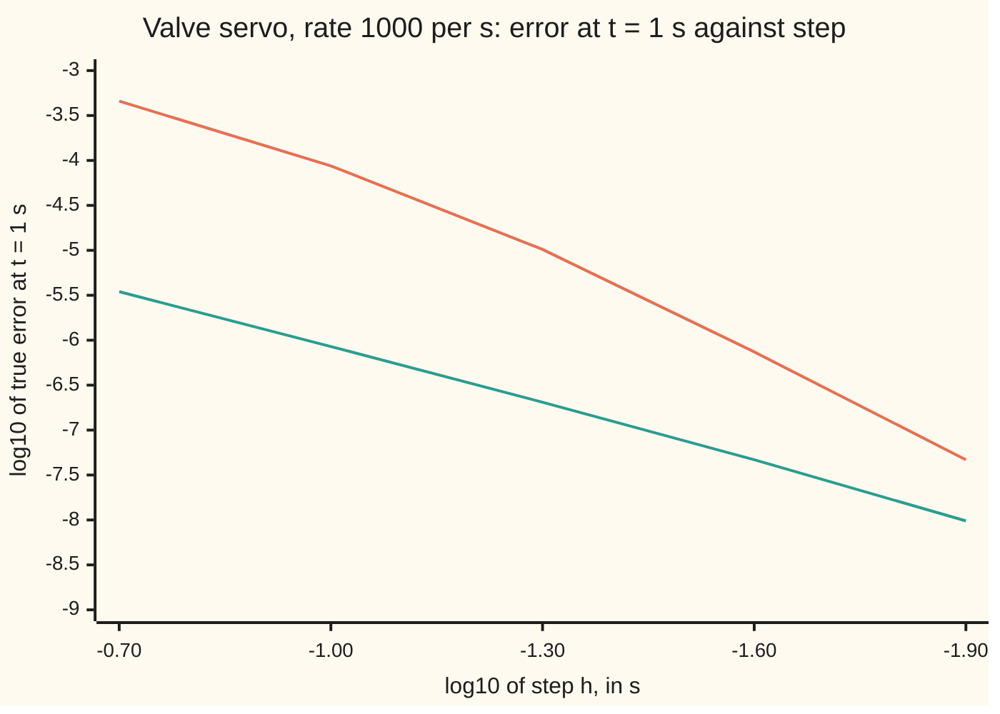

# Implicit Runge-Kutta: Gauss and Radau collocation, A-stable at every order

[Syllabus](../../../SYLLABUS.md) → [Numerical analysis](../README.md) → [ODE Solvers](../README.md#s06) → Implicit Runge-Kutta

---

## General Overview

A valve servo holds a valve at a target position that drifts slowly as $`\cos t`$, with $`t`$ in seconds. Any gap between the valve and the target closes at a rate of 1000 per second, plus the target's own speed, $`-\sin t`$, fed forward. The figures are illustrative. The valve's position $`y`$ obeys $`y' = -1000(y - \cos t) - \sin t`$, starting at $`y = 1`$, and the exact answer is $`y = \cos t`$.

The wanted number is the position at $`t = 1`$ s, with an error under $`10^{-6}`$, using ten steps of 0.1 s. The target moves slowly, so ten steps should be enough. But the fast pull makes the problem **stiff** (a fast rate forces explicit methods to take tiny steps, even after its part has died; see [Stiffness](05-stiffness-a-stability-and-the-dahlquist-barriers.md)).

- **Explicit RK4** multiplies any gap by 4.005e6 each step. After ten steps a rounding error has grown by 1.061e66.
- **Two-stage Gauss**, an implicit method of order 4, stays stable. Its error at 1 s is −8.769e-5. A jolt of 1.0 at the start still leaves a gap of 0.3012 after ten steps.
- **Two-stage Radau IIA**, an implicit method of order 3, misses by 8.589e-7, inside the target. The same jolt is down to 5.072e-18.

An **implicit Runge-Kutta method** finds all its slope readings in a step at once, by solving equations. The best ones come from **collocation**: the polynomial that obeys the equation exactly at chosen points in the step. Gauss's points give the highest order; Radau's, ending at the step's end, make fast parts die at once.

**An implicit Runge-Kutta method built by collocation at s points has order 2s at Gauss points and 2s − 1 at Radau points, both are A-stable at every order and Radau IIA is also L-stable; the price is one linear system of s × n unknowns, for n equations, per Newton iteration, and on stiff problems the order falls to the stage order, the accuracy of each stage value.**

**What kind of fact this is:** theorems. For two stages the tableaux, A-, L- and algebraic stability are proved here, and B-stability from it in a fold; the orders are sketched in a fold and checked. Results for every number of stages, Gauss's symplectic property and order reduction are stated with sources, and order reduction is measured.

### The picture: error against step on the stiff servo



Orange, upper line: two-stage Gauss. Green, lower line: two-stage Radau IIA. The step halves from 0.2 s to 0.0125 s. Gauss's slope climbs from about 2.4 toward 4 as the step shrinks. Radau's stays near 2, below its order 3, but its error is smaller at every step.

---

## The formula

Reminder: [Runge-Kutta](01-runge-kutta-and-butcher-tableaux.md) writes an $`s`$-stage method as a **Butcher tableau**: nodes $`c_i`$ (where stage $`i`$ reads the slope), a matrix $`A = (a_{ij})`$ (how slopes build each stage) and weights $`b_j`$. An implicit method allows any $`A`$, so every stage depends on every other.

**Collocation.** Pick $`s`$ distinct nodes $`c_1, \dots, c_s`$ between 0 and 1. Find the polynomial $`u`$ of degree $`s`$ that starts at $`y_n`$ and obeys the equation exactly at the times $`t_n + c_i h`$. Take $`y_{n+1} = u(t_n + h)`$. This is a Runge-Kutta method with

```math
a_{ij} = \int_0^{c_i} \ell_j(\tau)\,d\tau, \qquad b_j = \int_0^1 \ell_j(\tau)\,d\tau, \qquad \ell_j(\tau) = \prod_{k \ne j} \frac{\tau - c_k}{c_j - c_k}.
```

**Read it aloud:** entry a i j is the area under the j-th Lagrange basis polynomial from 0 up to node i, and weight b j is its area over the whole step.

**The stability function.** On the test equation $`y' = \lambda y`$, with $`z = h\lambda`$, one step multiplies $`y`$ by

```math
R(z) = 1 + z\,b^{\mathsf T}(I - zA)^{-1}\mathbf{1}; \qquad R_{\mathrm{Gauss}}(z) = \frac{1 + z/2 + z^2/12}{1 - z/2 + z^2/12}, \qquad R_{\mathrm{Radau}}(z) = \frac{1 + z/3}{1 - 2z/3 + z^2/6}.
```

**Read it aloud:** the factor is one plus z times the weights applied to the stages' solution, and for two stages it is a ratio of quadratics for Gauss and a linear over a quadratic for Radau.

Here $`\mathbf{1}`$ is the column of ones, $`I`$ the identity matrix and $`^{\mathsf T}`$ turns a column into a row.

| Symbol | Plain meaning | In our example | Push it up and the answer… |
| --- | --- | --- | --- |
| $`y`$, $`t`$, $`y_n`$, $`t_n`$, $`f`$ | valve position; time in s; computed position and time after step $`n`$; the rate law $`y' = f(t, y)`$ | $`y(1) = \cos 1`$ | — |
| $`\lambda`$ | the fast rate, per s: how quickly a gap closes, with a minus sign | −1000 | more negative: stiffer, and the order falls |
| $`h`$ | step size, s | 0.1 | error grows as $`h^p`$ (gentle) or $`h^q`$ (stiff) |
| $`z`$ | $`h\lambda`$, the step measured in gap lifetimes | −100 | — |
| $`s`$, $`c_i`$ | number of stages; node $`i`$, a fraction of the step | 2; Gauss 0.211325, 0.788675; Radau 1/3, 1 | more stages: higher order, larger system |
| $`u`$, $`\ell_j`$, $`\tau`$, $`\delta`$; $`\Phi`$, $`\sigma`$ | the collocation polynomial; Lagrange basis polynomial $`j`$, 1 at node $`j`$ and 0 at the others; time within a step, as a fraction of $`h`$; the defect $`u' - f`$; in a fold, sensitivity to a change at time $`\sigma`$ | $`\ell_1(\tau) = (\tau - 1)/(1/3 - 1)`$ for Radau | — |
| $`a_{ij}`$, $`A`$, $`b_j`$, $`B`$ | the tableau: stage blends and final weights; $`B`$ the diagonal matrix of weights | Radau: $`a_{11} = 5/12`$, $`a_{12} = -1/12`$, $`b = (3/4, 1/4)`$ | — |
| $`R(z)`$ | one step's factor on $`y' = \lambda y`$ | 0.886920 (Gauss), −0.018643 (Radau) | size above 1: growth |
| $`p`$, $`q`$ | order; stage order, the accuracy of each stage value | Gauss 4 and 2; Radau 3 and 2; SDIRK 2 and 1 | — |
| $`k_j`$, $`Y_i`$, $`Z_i`$, $`K`$; $`w_n`$, $`W_i`$, $`\Delta`$ | slope at stage $`j`$; stage value; its change from $`y_n`$; the vector of slopes; in a fold, a second solution, its stages, and differences | — | — |
| $`J`$, $`n`$, $`m`$ | the Jacobian (table of rates $`\partial f/\partial y`$); number of equations (in $`y_n`$, the step number); a matrix size | $`J = -1000`$; $`n = 1`$ | larger $`n`$: cost grows as $`(sn)^3`$ |
| $`\mathcal{M}`$, $`\gamma`$, $`\langle \cdot, \cdot\rangle`$ | algebraic stability matrix $`BA + A^{\mathsf T}B - bb^{\mathsf T}`$; SDIRK's shared diagonal entry; the dot product | Radau: entries ±0.0625; $`\gamma = 1 - \sqrt2/2`$ | a negative eigenvalue: not B-stable |

### When it holds

- **A smooth solution.** The orders count on $`y`$ having several smooth derivatives. A jolt at the start is not smooth; it is a fast part, and only $`R(z)`$ decides its fate.
- **A gentle step, for the full order.** Order 4 and 3 need $`|z|`$ small. When $`|z|`$ is large the order falls toward the stage order $`q`$: 2 for both here. This is **order reduction**.
- **A linear rate, for A-stability.** $`|R(z)| \le 1`$ covers $`y' = \lambda y`$. A nonlinear problem needs **algebraic stability**; Gauss and Radau IIA have it; the cheaper SDIRK method of Step 8 does not.
- **A Newton start close enough.** If the stages move far from $`y_n`$, Newton can stall; solvers then cut the step.
- **Fast parts that should die.** Gauss's $`R(z) \to 1`$ as $`z \to -\infty`$, so it keeps fast parts alive. Use Radau IIA when they should vanish.

---

## Why it works

### Step 0: integrate an interpolated slope, with the best quadrature points

Over one step, $`y(t_n + h) = y_n + \int f`$. Collocation replaces the unknown slope by the polynomial through its values at $`s`$ nodes, then integrates that polynomial. So a collocation step is a quadrature rule (a weighted sum of samples that estimates an integral) applied to the slope. [Gaussian quadrature](../05-Quadrature/03-gaussian-quadrature.md) shows which nodes make $`s`$ samples most accurate, and so the most accurate step.

### Step 1: collocation is a Runge-Kutta method

Write $`k_j`$ for the slope at node $`j`$. The polynomial $`u'`$ has degree $`s - 1`$ and equals $`k_j`$ at node $`j`$, so $`u'(t_n + \tau h) = \sum_j k_j \ell_j(\tau)`$. Integrate from 0 to $`c_i`$: the stage value is $`Y_i = y_n + h\sum_j a_{ij} k_j`$. Integrate from 0 to 1: $`y_{n+1} = y_n + h\sum_j b_j k_j`$. These are the formulas above.

The nodes come from polynomials of [Gaussian quadrature](../05-Quadrature/03-gaussian-quadrature.md), moved to the interval from 0 to 1:

- **Gauss:** the zeros of the shifted Legendre polynomial $`6x^2 - 6x + 1`$, which are $`1/2 \mp \sqrt3/6`$ = 0.211325 and 0.788675.
- **Radau IIA:** the zeros of $`(6x^2 - 6x + 1) - (2x - 1) = 2(3x - 1)(x - 1)`$, which are 1/3 and 1. The last node is the step's end.

The code integrates the Lagrange polynomials and gets:

| Method | $`c`$ | $`A`$ | $`b`$ |
| --- | --- | --- | --- |
| Gauss | 0.211325, 0.788675 | `[[0.250000, -0.038675], [0.538675, 0.250000]]` | 0.5, 0.5 |
| Radau IIA | 1/3, 1 | `[[0.416667, -0.083333], [0.750000, 0.250000]]` | 0.75, 0.25 |

They match the closed forms, such as Gauss's $`a_{12} = 1/4 - \sqrt3/6`$, to $`10^{-15}`$.

### Step 2: the order is the quadrature's order

Feed the method $`y' = g(t)`$, a pure integral. Then the step is exactly the quadrature rule with nodes $`c_i`$ and weights $`b_i`$. A rule exact for polynomials of degree $`p - 1`$ gives local error $`O(h^{p+1})`$. Gauss's 2-point rule is exact to degree 3, Radau's to degree 2. So the order can be at most 4 and 3.

Collocation also makes every stage exact for polynomials of degree $`s - 1`$, so the **stage order** is $`q = s = 2`$. A theorem of collocation then says the full order equals the quadrature's: $`p = 2s`$ for Gauss, $`2s - 1`$ for Radau. The code tests the conditions $`\sum_i b_i c_i^{k-1} = 1/k`$ and finds $`p = 4`$ and $`p = 3`$, and $`q = 2`$ for both.

<details>
<summary>Proof sketch: why collocation reaches the quadrature's order</summary>

The polynomial's **defect** $`\delta(t) = u'(t) - f(t, u(t))`$ is zero at every node.

The nonlinear variation-of-constants formula (Alekseev and Gröbner) writes the step's error as an integral:

$`\displaystyle u(t_n + h) - y(t_n + h) = \int_{t_n}^{t_n + h} \Phi(t_n + h, \sigma)\,\delta(\sigma)\,d\sigma,`$

where $`\Phi`$ is the sensitivity of the exact solution to a change at time $`\sigma`$.

The integrand is zero at every node, so the quadrature rule returns zero for it. The error is therefore the rule's own error, $`O(h^{p+1})`$; the full argument bounds the integrand's derivatives using the stage order. Butcher (1964) first proved order $`2s`$ for the Gauss methods; Hairer and Wanner (1996), section IV.5, give the Radau case.

</details>

### Step 3: the stability function is a ratio of polynomials

On $`y' = \lambda y`$ the stage equations are linear: $`(I - zA)K = \lambda y_n \mathbf{1}`$ for the vector $`K`$ of slopes. Solving gives the formula for $`R(z)`$ above. By Cramer's rule its bottom is $`\det(I - zA)`$, a polynomial of degree at most $`s`$, and so is its top.

The code computes $`R`$ both ways, by linear algebra and by the closed forms, at four points; they agree to $`10^{-13}`$. At $`z = -100`$ the exact fractions are $`2353/2653 = 0.886920`$ (Gauss) and $`-97/5203 = -0.018643`$ (Radau).

The two closed forms are the **Padé approximants** of $`e^z`$ (the ratios of polynomials of given degrees that match $`e^z`$ to the highest power of $`z`$): degrees 2 over 2 for Gauss, 1 over 2 for Radau. For every $`s`$, Gauss gives the $`s`$-over-$`s`$ one and Radau IIA the $`(s-1)`$-over-$`s`$ one (Hairer and Wanner, sections IV.3 and IV.5).

### Step 4: A-stable, and Radau also L-stable

A method is **A-stable** when $`|R(z)| \le 1`$ for every $`z`$ with negative real part (defined in [Stiffness](05-stiffness-a-stability-and-the-dahlquist-barriers.md)). The proof has three parts:

1. **No pole on the left.** The poles of $`R`$ are where $`\det(I - zA) = 0`$, which are the eigenvalues of $`A^{-1}`$. The code finds $`3 \pm 1.732051i`$ (Gauss) and $`2 \pm 1.414214i`$ (Radau): both on the right.
2. **On the imaginary axis, size at most 1.** Exactly 1 for Gauss, below 1 for Radau except at 0 (the fold below).
3. **Bounded far away.** The top's degree is at most the bottom's, so $`R`$ stays bounded as $`|z|`$ grows.

By the maximum principle (an analytic function takes its largest size on the boundary of a region), $`|R| \le 1`$ on the whole left half-plane.

<details>
<summary>Detailed proof: the imaginary-axis bounds for two stages</summary>

**Gauss.** Put $`z = iy`$. The top is $`N = 1 - y^2/12 + iy/2`$ and the bottom is $`D = 1 - y^2/12 - iy/2`$. These are conjugates, so $`|N| = |D|`$ and $`|R(iy)| = 1`$.

**Radau IIA.** The top is $`N = 1 + iy/3`$ and the bottom is $`D = 1 - y^2/6 - 2iy/3`$. Then

$`\displaystyle |D|^2 - |N|^2 = \left(1 - \frac{y^2}{3} + \frac{y^4}{36} + \frac{4y^2}{9}\right) - \left(1 + \frac{y^2}{9}\right) = \frac{y^4}{36} \ge 0.`$

So $`|R(iy)| \le 1`$, with equality only at $`y = 0`$.

**The left half-plane.** Apply the maximum principle on a large half-disc, which holds no pole. On its straight side, the imaginary axis, $`|R| \le 1`$. On its curved side $`|R|`$ is within any small margin of its limit, 1 for Gauss and 0 for Radau. So $`|R| \le 1`$ inside. $`\blacksquare`$

</details>

On a fine grid across the left half-plane, the code finds largest sizes 0.999963 (Gauss), 0.980199 (Radau) and 0.980578 (SDIRK, below). At $`z = 10i`$, Gauss keeps size 1.000000 while Radau damps to 0.204398.

**L-stable** means A-stable and $`R(z) \to 0`$ as $`z \to -\infty`$. Radau's top has lower degree than its bottom, so $`R \to 0`$; the code finds $`R(-10^8) = -2.000\text{e-}8`$. Gauss's top and bottom share the leading term $`z^2/12`$, so $`R \to 1`$, and the jolt survives: $`0.886920^{10} = 0.3012`$.

For every $`s`$, Gauss and Radau IIA are A-stable and Radau IIA is L-stable (Hairer and Wanner, sections IV.3 to IV.5). This is how they escape the second Dahlquist barrier of [Stiffness](05-stiffness-a-stability-and-the-dahlquist-barriers.md): the barrier caps A-stable *multistep* methods at order 2, and says nothing about Runge-Kutta methods.

### Step 5: algebraic stability, for nonlinear problems

A-stability is about $`y' = \lambda y`$. Many stiff problems are nonlinear but **contractive**: any two solutions never move apart, $`\langle f(t, y) - f(t, w), y - w\rangle \le 0`$, where $`\langle \cdot, \cdot\rangle`$ is the dot product. A method is **B-stable** when its steps never move two such solutions apart.

Butcher's test is algebraic. Form $`\mathcal{M} = BA + A^{\mathsf T}B - bb^{\mathsf T}`$, with $`B`$ the diagonal matrix of weights. If every $`b_i \ge 0`$ and $`\mathcal{M}`$ has no negative eigenvalue, the method is **algebraically stable**, and then B-stable (Burrage and Butcher 1979; Hairer and Wanner, section IV.12). When the nodes are distinct, the converse holds too (same section), so a negative eigenvalue then means not B-stable. The code finds:

| Method | $`\mathcal{M}`$ | Smallest eigenvalue | B-stable |
| --- | --- | --- | --- |
| Gauss | all zero | 0 | yes |
| Radau IIA | `[[0.0625, -0.0625], [-0.0625, 0.0625]]` | 0 | yes |
| SDIRK | `[[-0.085786, 0], [0, 0.085786]]` | −0.085786 | no (distinct nodes) |

Gauss's $`\mathcal{M} = 0`$ is also exactly the condition for a Runge-Kutta method to keep phase-space area, so Gauss methods are symplectic (Sanz-Serna 1988). [Symplectic steps](06-symplectic-integrators.md) explains why that matters for oscillators.

<details>
<summary>Detailed proof: algebraic stability gives B-stability</summary>

Run two solutions through one step, from $`y_n`$ and $`w_n`$. Write $`\Delta y = y_n - w_n`$, $`\Delta Y_i`$ for the stage differences and $`\Delta F_i = f(t_n + c_i h, Y_i) - f(t_n + c_i h, W_i)`$. The step gives $`\Delta y_{n+1} = \Delta y + h\sum_i b_i \Delta F_i`$ and $`\Delta Y_i = \Delta y + h\sum_j a_{ij}\Delta F_j`$. Square the first:

$`\displaystyle \|\Delta y_{n+1}\|^2 = \|\Delta y\|^2 + 2h\sum_i b_i\langle \Delta F_i, \Delta y\rangle + h^2\sum_{i,j} b_i b_j\langle \Delta F_i, \Delta F_j\rangle.`$

Replace $`\Delta y`$ in the middle term by $`\Delta Y_i - h\sum_j a_{ij}\Delta F_j`$:

$`\displaystyle \|\Delta y_{n+1}\|^2 = \|\Delta y\|^2 + 2h\sum_i b_i\langle \Delta F_i, \Delta Y_i\rangle - h^2\sum_{i,j} \mathcal{M}_{ij}\langle \Delta F_i, \Delta F_j\rangle.`$

Contractivity makes each $`\langle \Delta F_i, \Delta Y_i\rangle \le 0`$, and $`b_i \ge 0`$, so the middle term is at most 0. The last sum is at least 0 when $`\mathcal{M}`$ has no negative eigenvalue. So $`\|\Delta y_{n+1}\| \le \|\Delta y\|`$. $`\blacksquare`$

</details>

### Step 6: order reduction, measured

Each stage is accurate only to the stage order $`q`$. On a gentle problem the weights cancel the stage errors up to order $`p`$. On a stiff one the fast rate passes them straight into $`y_{n+1}`$, and the global error falls only like $`h^q`$. Prothero and Robinson (1974) found this on this kind of test problem; Hairer and Wanner, section IV.15, give the theory.

Errors at $`t = 1`$, with observed orders as h halves from 0.2 to 0.0125:

| Problem | Gauss (p = 4, q = 2) | Radau IIA (p = 3, q = 2) | SDIRK (p = 2, q = 1) |
| --- | --- | --- | --- |
| gentle, λ = −1: error at h = 0.1 | 1.283e-7 | 8.469e-6 | 1.927e-4 |
| gentle: orders | 4.00, 4.00, 4.00, 4.00 | 2.99, 2.99, 3.00, 3.00 | 2.04, 2.02, 2.01, 2.00 |
| servo, λ = −1000: error at h = 0.1 | 8.769e-5 | 8.589e-7 | 1.936e-5 |
| servo: orders | 2.40, 3.11, 3.79, 3.96 | 2.00, 2.06, 2.14, 2.25 | 1.23, 1.23, 1.30, 1.42 |
| very stiff, λ = −1e6: error at h = 0.1 | 1.277e-4 | 9.089e-10 | 2.172e-8 |
| very stiff: orders | 2.00, 2.00, 2.01, 2.03 | 1.96, 1.98, 1.99, 2.00 | 1.16, 1.09, 1.05, 1.03 |

On the servo, the steps run from $`z = -200`$ to $`z = -12.5`$. At λ = −1e6 every step is very stiff, and each method shows its stage order: 2, 2 and 1. Radau's error constant shrinks as λ grows, so its errors are small even at the reduced order.

For Radau IIA and SDIRK, $`b`$ equals the last row of $`A`$, so the code takes the last stage, $`y_{n+1} = y_n + Z_2`$. The equal sum $`y_n + h\sum_j b_j k_j`$ would multiply rounding in the stages by $`|h\lambda|`$ and blur these smallest errors (Hairer and Wanner, section IV.8).

### Step 7: solving the stage equations by simplified Newton

The unknowns are the stage changes $`Z_i = Y_i - y_n`$: $`s`$ vectors of $`n`$ numbers, so $`sn`$ unknowns. They solve $`Z_i = h\sum_j a_{ij} f(t_n + c_j h, y_n + Z_j)`$. [Newton in several unknowns, and Broyden when a Jacobian is too expensive](../02-Root%20Finding%20and%20Fixed%20Points/07-newton-for-systems-and-broyden.md) needs the matrix of this system, which, with $`J`$ taken at one point, is $`I - hA \otimes J`$: an $`sn`$ by $`sn`$ matrix, with $`A \otimes J`$ the block matrix whose block $`(i, j)`$ is $`a_{ij}J`$.

**Simplified Newton** freezes $`J`$ at $`(t_n, y_n)`$ for the whole step. One LU factorisation (the elimination of [LU with partial pivoting](../03-Numerical%20Linear%20Algebra/02-lu-decomposition-and-pivoting.md), costing about $`2m^3/3`$ flops at size $`m`$) then serves every iteration. Each iteration costs only a forward and back substitution, about $`2m^2`$ flops. The iteration converges linearly, not quadratically, because the matrix is slightly wrong.

The code tests it on a nonlinear pull, $`y' = -500(y^2 - \cos^2 t) - \sin t`$, whose rate $`J = -1000y`$ changes as $`y`$ does. Its exact solution is still $`\cos t`$. Radau IIA with ten steps of 0.1 s, stopping when an iteration moves every $`Z_i`$ less than $`10^{-13}`$:

| Newton variant | Iterations in 10 steps | Error at 1 s | Flops if $`n = 1000`$ |
| --- | --- | --- | --- |
| simplified: one LU per step | 101 | 1.527e-6 | 5.414e10 |
| full: a new LU every iteration | 46 | 1.527e-6 | 2.457e11 |

The flop column assumes 1000 equations need the same iteration counts. One LU at size 2000 costs 5.333e9 flops, so LUs dominate, and simplified Newton wins.

Production codes also use the eigenvalues of $`A^{-1}`$ to split the system into smaller ones (Hairer and Wanner, section IV.8).

### Step 8: when SDIRK is the cheaper choice

A **singly diagonally implicit** method (SDIRK) has $`a_{ij} = 0`$ for $`j > i`$ and the same diagonal entry $`\gamma`$ in every row. Its stages are solved one at a time. Each is an $`n`$ by $`n`$ system with the same matrix $`I - h\gamma J`$, so one LU of size $`n`$ serves every stage.

The code uses the two-stage SDIRK with $`\gamma = 1 - \sqrt2/2`$, rows $`(\gamma, 0)`$ and $`(1 - \gamma, \gamma)`$, and $`b = (1 - \gamma, \gamma)`$. It is L-stable and of order 2 (Hairer and Wanner, section IV.6).

| At $`n = 1000`$ | Radau IIA, 2 stages | SDIRK, 2 stages |
| --- | --- | --- |
| one LU | size 2000: 5.333e9 flops | size 1000: 6.667e8 flops |
| order, stage order | 3, 2 | 2, 1 |
| algebraically stable | yes | no |

SDIRK's LU is 8 times cheaper, but its stage order is 1 and it fails Butcher's test. It wins on large systems where a few digits are enough. Radau IIA wins when high accuracy is needed on very stiff problems.

---

## Worked numbers, by hand

The servo at $`h = 0.1`$ s, so $`z = 0.1 \times (-1000) = -100`$.

| Step | Arithmetic | Value |
| --- | --- | --- |
| Gauss nodes | zeros of $`6x^2 - 6x + 1`$: $`1/2 \mp \sqrt3/6`$ | 0.211325, 0.788675 |
| Radau nodes | zeros of $`2(3x - 1)(x - 1)`$ | 1/3, 1 |
| Radau $`a_{11}`$ | $`\int_0^{1/3} \frac{\tau - 1}{1/3 - 1}\,d\tau = \frac{3}{2}\left(\frac13 - \frac1{18}\right)`$ | 5/12 = 0.416667 |
| Gauss $`R(-100)`$ | $`(1 - 50 + 833.3)/(1 + 50 + 833.3) = 2353/2653`$ | 0.886920 |
| Radau $`R(-100)`$ | $`(1 - 33.3)/(1 + 66.7 + 1666.7) = -97/5203`$ | −0.018643 |
| jolt after 10 steps | Gauss $`0.886920^{10}`$; Radau $`0.018643^{10}`$ | 3.012e-1; 5.072e-18 |
| error at 1 s | Gauss; Radau IIA | −8.769e-5; **8.589e-7** |

Radau IIA meets the $`10^{-6}`$ target in ten steps; Gauss, of higher order on paper, misses it.

### What breaks if you drop a piece

| Mistake | Comes out at | What went wrong |
| --- | --- | --- |
| Explicit RK4 at h = 0.1 s | factor 4.005e6 per step, 1.061e66 after 10 steps | $`z = -100`$ is far outside its bounded stability region |
| Gauss after a jolt | 0.3012 of the jolt left after 10 steps | A-stable but not L-stable: $`R(z) \to 1`$ |
| Trusting order 4 on a very stiff problem | Gauss error 1.277e-4 at h = 0.1, observed order 2.00 | stiffness reduces the order to the stage order 2 |
| SDIRK on a very stiff problem | observed order 1.03; smallest eigenvalue of $`\mathcal{M}`$ −0.085786 | stage order 1, and not algebraically stable |

---

## Code, from first principles, and it actually runs

The script builds both tableaux by integrating Lagrange polynomials and checks their orders, stability functions and algebraic stability. It then steps the servo with simplified Newton at five step sizes and three rates. Independent roads meet at each answer:

- **Tableaux:** collocation integrals against closed-form entries.
- **Stability:** $`R(z)`$ by linear algebra against the Padé forms and exact fractions; a jolt stepped ten times against $`R(-100)^{10}`$; a grid against the proof.
- **Orders:** the quadrature conditions against observed orders, using the exact solution $`\cos t`$.
- **Newton:** simplified and full Newton must agree to $`10^{-10}`$.

### Python

```python
# Implicit Runge-Kutta: the check behind the card.  Standard library only.  A valve servo pulls y towards the
# target cos t at 1000 per s (illustrative): y' = -1000(y - cos t) - sin t, y(0) = 1, exact y = cos t.
# Two-stage Gauss and Radau IIA built by collocation; R(z); stages by simplified Newton; SDIRK for cost.
from math import sqrt, cos, sin, log10
def sci(v, d=3): m, e = f"{v:.{d}e}".split("e"); return f"{m}e{int(e)}"   # 1.234e-5, the form Rust prints
def f6(v): return f"{v if abs(v) >= 5e-7 else 0.0:.6f}"                  # no "-0.000000" from rounding
def quad_roots(a, b, c): d = sqrt(b * b - 4 * a * c); return [(-b - d) / (2 * a), (-b + d) / (2 * a)]
def colloc(c):                                   # a_ij = integral of l_j from 0 to c_i; b_j = from 0 to 1
    L = []
    for j in range(2):                           # Lagrange basis l_j, coefficients lowest power first
        p = [1.0]
        for k in range(2):
            if k != j:
                q = [0.0] * (len(p) + 1)
                for i, v in enumerate(p): q[i] -= c[k] * v / (c[j] - c[k]); q[i + 1] += v / (c[j] - c[k])
                p = q
        L.append(p)
    def integ(p, x): return sum(v * x ** (i + 1) / (i + 1) for i, v in enumerate(p))
    return [[integ(L[j], c[i]) for j in range(2)] for i in range(2)], [integ(L[j], 1.0) for j in range(2)]
cG = quad_roots(6, -6, 1)                        # zeros of the shifted Legendre polynomial 6x^2 - 6x + 1
cR = quad_roots(6, -8, 2)                        # Radau: (6x^2 - 6x + 1) - (2x - 1) = 2(3x - 1)(x - 1)
AG, bG = colloc(cG); AR, bR = colloc(cR)
g = 1 - sqrt(2) / 2                              # SDIRK: L-stable, order 2, both diagonal entries g
M = {"Gauss": [AG, bG, cG], "Radau IIA": [AR, bR, cR], "SDIRK": [[[g, 0.0], [1 - g, g]], [1 - g, g], [g, 1.0]]}
print("tableaux by collocation:")
for k in ("Gauss", "Radau IIA"):
    A, b, c = M[k]
    print(f"  {k}: c = {c[0]:.6f}, {c[1]:.6f}; A = [[{f6(A[0][0])}, {f6(A[0][1])}], [{f6(A[1][0])}, {f6(A[1][1])}]]; b = {b[0]:.6f}, {b[1]:.6f}")
assert abs(AG[0][1] - (0.25 - sqrt(3) / 6)) < 1e-15 and abs(AR[0][0] - 5 / 12) < 1e-15, "against the closed forms"
assert abs(AR[0][1] + 1 / 12) < 1e-15 and abs(AR[1][0] - 0.75) < 1e-15 and abs(bR[0] - 0.75) < 1e-15
def orders(A, b, c):                             # p: sum b c^(k-1) = 1/k for k <= p; q: the same for each row
    p = next(k for k in range(1, 9) if abs(sum(b[i] * c[i] ** (k - 1) for i in range(2)) - 1 / k) > 1e-13) - 1
    q = next(k for k in range(1, 9) if max(abs(sum(A[i][j] * c[j] ** (k - 1) for j in range(2)) - c[i] ** k / k) for i in range(2)) > 1e-13) - 1
    return p, q
def R(A, b, z):                                  # 1 + z b^T (I - zA)^-1 (1, 1), by Cramer's rule
    m11, m12, m21, m22 = 1 - z * A[0][0], -z * A[0][1], -z * A[1][0], 1 - z * A[1][1]
    d = m11 * m22 - m12 * m21
    return 1 + z * (b[0] * (m22 - m12) + b[1] * (m11 - m21)) / d
def padeG(z): return (1 + z / 2 + z * z / 12) / (1 - z / 2 + z * z / 12)
def padeR(z): return (1 + z / 3) / (1 - 2 * z / 3 + z * z / 6)
print("method: order p, stage order q, R(-100), R(-1e8), |R(10i)|, largest |R| on a left half-plane grid")
for k in M:
    A, b, c = M[k]; p, q = orders(A, b, c)
    lh = max(abs(R(A, b, complex(-x * x / 50, y / 5))) for x in range(1, 200) for y in range(-400, 401))
    print(f"  {k}: p = {p}, q = {q}, {R(A, b, -100.0):.6f}, {sci(R(A, b, -1e8))}, {abs(R(A, b, 10j)):.6f}, {lh:.6f}")
    M[k] += [p, q, lh]
assert [M[k][3:5] for k in M] == [[4, 2], [3, 2], [2, 1]], "orders 2s and 2s - 1 from collocation"
assert max(M[k][5] for k in M) < 1, "A-stable: no grid point with |R| above 1"
for z in (-100.0, -0.7, complex(-3, 40), 2.5j):
    assert abs(R(AG, bG, z) - padeG(z)) < 1e-13 and abs(R(AR, bR, z) - padeR(z)) < 1e-13, "R two ways"
r4 = 1 - 100 + 100 ** 2 / 2 - 100 ** 3 / 6 + 100 ** 4 / 24     # explicit RK4: Taylor polynomial of e^z at z = -100
print(f"  RK4 (explicit), for comparison: R(-100) = {sci(r4)}, after 10 steps {sci(r4 ** 10)}")
k1 = -100.0; k2 = -100 * (1 + k1 / 2); k3 = -100 * (1 + k2 / 2); k4 = -100 * (1 + k3)   # RK4's stages on y' = lambda y from y = 1
assert abs((1 + (k1 + 2 * k2 + 2 * k3 + k4) / 6) / r4 - 1) < 1e-12, "RK4 two ways: its stages against the Taylor polynomial"
assert abs(R(AG, bG, -100.0) - 2353 / 2653) < 1e-14 and abs(R(AR, bR, -100.0) + 97 / 5203) < 1e-15
assert abs(abs(R(AG, bG, 7j)) - 1) < 1e-14 and abs(R(AR, bR, -1e8)) < 1e-7 < 1 - R(AG, bG, -1e8) < 1e-6
print("algebraic stability matrix BA + A^T B - b b^T and its smallest eigenvalue:")
for k in M:
    A, b = M[k][0], M[k][1]
    m = [[b[i] * A[i][j] + b[j] * A[j][i] - b[i] * b[j] for j in range(2)] for i in range(2)]
    lo = (m[0][0] + m[1][1]) / 2 - sqrt(((m[0][0] - m[1][1]) / 2) ** 2 + m[0][1] ** 2)
    print(f"  {k}: [[{f6(m[0][0])}, {f6(m[0][1])}], [{f6(m[1][0])}, {f6(m[1][1])}]], {f6(lo)}")
    M[k].append(lo)
assert abs(M["Gauss"][6]) < 1e-15 and M["Radau IIA"][6] > -1e-15 and M["SDIRK"][6] < -0.08
def step(A, b, c, f, J, t, y, h, full):         # Z_i = h sum_j a_ij f(t + c_j h, y + Z_j), Newton on Z
    Z, its = [0.0, 0.0], 0
    while True:
        its += 1
        F = [f(t + c[i] * h, y + Z[i]) for i in range(2)]
        r = [Z[i] - h * (A[i][0] * F[0] + A[i][1] * F[1]) for i in range(2)]
        j = [J(t + c[i] * h, y + Z[i]) for i in range(2)] if full else [J(t, y)] * 2   # simplified: frozen
        m11, m12, m21, m22 = 1 - h * A[0][0] * j[0], -h * A[0][1] * j[1], -h * A[1][0] * j[0], 1 - h * A[1][1] * j[1]
        d = m11 * m22 - m12 * m21; d0, d1 = (m12 * r[1] - m22 * r[0]) / d, (m21 * r[0] - m11 * r[1]) / d
        Z = [Z[0] + d0, Z[1] + d1]
        if max(abs(d0), abs(d1)) < 1e-13: break
    if b == A[1]: return y + Z[1], its             # stiffly accurate (Radau IIA, SDIRK): y_(n+1) is the last stage
    F = [f(t + c[i] * h, y + Z[i]) for i in range(2)]
    return y + h * (b[0] * F[0] + b[1] * F[1]), its
def run(k, lam, h, y0=1.0, nonlin=False, full=False, T=1.0, jolt=False):
    A, b, c = M[k][:3]
    if nonlin: f, J = (lambda t, y: -500 * (y * y - cos(t) ** 2) - sin(t)), (lambda t, y: -1000 * y)
    elif jolt: f, J = (lambda t, y: lam * y), (lambda t, y: lam)        # the fast part alone: y' = lam y
    else: f, J = (lambda t, y: lam * (y - cos(t)) - sin(t)), (lambda t, y: lam)
    n, y, its = round(T / h), y0, 0
    for i in range(n): y, k_ = step(A, b, c, f, J, i * h, y, h, full); its += k_
    return y - (0.0 if jolt else cos(n * h)), its
print("the example, h = 0.1 to t = 1 (z = -100): error at t = 1; what is left of a jolt of 1.0 at t = 0")
for k in M:
    e, gap1, gap = run(k, -1000.0, 0.1)[0], run(k, -1000.0, 0.1, T=0.1, jolt=True)[0], run(k, -1000.0, 0.1, jolt=True)[0]
    print(f"  {k}: error {sci(e)}; jolt after 1 step {gap1:.6f}, after 10 steps {sci(gap)}")
    assert abs(gap1 - R(*M[k][:2], -100.0)) < 1e-13 and abs(gap / R(*M[k][:2], -100.0) ** 10 - 1) < 1e-10, "R(z)^n"
hs, O = [0.2, 0.1, 0.05, 0.025, 0.0125], {}
for lam in (-1.0, -1000.0, -1e6):
    print(f"errors at t = 1 for h = 0.2 down to 0.0125, lambda = {sci(lam, 0)}; observed orders")
    for k in M:
        E = [abs(run(k, lam, h)[0]) for h in hs]; o = [log10(E[i] / E[i + 1]) / log10(2) for i in range(4)]
        print(f"  {k}: " + ", ".join(sci(e) for e in E) + "; " + ", ".join(f"{x:.2f}" for x in o))
        O[(k, lam)] = (E, o)
print("chart, log10 h: " + ", ".join(f"{log10(h):.2f}" for h in hs))
for k in ("Gauss", "Radau IIA"): print(f"chart, log10 error, {k}, lambda = -1000: " + ", ".join(f"{log10(e):.2f}" for e in O[(k, -1000.0)][0]))
for k, p, q in (("Gauss", 4, 2), ("Radau IIA", 3, 2), ("SDIRK", 2, 1)):
    assert abs(O[(k, -1.0)][1][3] - p) < 0.1 and abs(O[(k, -1e6)][1][2] - q) < 0.1, "order p when gentle, q when stiff"
assert O[("Gauss", -1000.0)][1][0] < 2.6 and O[("Gauss", -1000.0)][1][3] > 3.8, "Gauss recovers once |z| is small"
(eS, iS), (eF, iF) = run("Radau IIA", 0, 0.1, nonlin=True), run("Radau IIA", 0, 0.1, nonlin=True, full=True)
print(f"nonlinear pull y' = -500(y^2 - cos^2 t) - sin t, Radau IIA, h = 0.1, 10 steps:")
print(f"  simplified Newton {iS} iterations, error {sci(eS)}; full Newton {iF} iterations, error {sci(eF)}")
assert abs(eS - eF) < 1e-10 and 1e-7 < abs(eS) < 1e-5 and iF < iS, "same answer, more but cheaper iterations"
for n in (100, 1000):
    lu, bs = 2 * (2 * n) ** 3 / 3, 2 * (2 * n) ** 2
    print(f"n = {n}: one LU, Radau IIA (size {2 * n}) {sci(lu)}, SDIRK (size {n}) {sci(2 * n ** 3 / 3)} flops; 10 Radau steps: simplified {sci(10 * lu + iS * bs)}, full {sci(iF * (lu + bs))}")
for k, A in (("Gauss", AG), ("Radau IIA", AR)):    # eigenvalues of A^-1 = the poles of R(z)
    d = A[0][0] * A[1][1] - A[0][1] * A[1][0]; tr = (A[0][0] + A[1][1]) / d; dt = 1 / d
    re, im = tr / 2, sqrt(dt - tr * tr / 4)
    print(f"eigenvalues of A^-1, {k}: {re:.6f} +/- {im:.6f}i")
    assert abs(1 / R(A, M[k][1], complex(re, im))) < 1e-12, "a pole of R in the right half-plane"
print("ALL CHECKS PASS")
```

**Ran 2026-11-24 on macOS, Python 3.14.10, standard library only. All checks passed. Output, pasted from the run:**

```
tableaux by collocation:
  Gauss: c = 0.211325, 0.788675; A = [[0.250000, -0.038675], [0.538675, 0.250000]]; b = 0.500000, 0.500000
  Radau IIA: c = 0.333333, 1.000000; A = [[0.416667, -0.083333], [0.750000, 0.250000]]; b = 0.750000, 0.250000
method: order p, stage order q, R(-100), R(-1e8), |R(10i)|, largest |R| on a left half-plane grid
  Gauss: p = 4, q = 2, 0.886920, 1.000e0, 1.000000, 0.999963
  Radau IIA: p = 3, q = 2, -0.018643, -2.000e-8, 0.204398, 0.980199
  SDIRK: p = 2, q = 1, -0.044059, -4.828e-8, 0.444858, 0.980578
  RK4 (explicit), for comparison: R(-100) = 4.005e6, after 10 steps 1.061e66
algebraic stability matrix BA + A^T B - b b^T and its smallest eigenvalue:
  Gauss: [[0.000000, 0.000000], [0.000000, 0.000000]], 0.000000
  Radau IIA: [[0.062500, -0.062500], [-0.062500, 0.062500]], 0.000000
  SDIRK: [[-0.085786, 0.000000], [0.000000, 0.085786]], -0.085786
the example, h = 0.1 to t = 1 (z = -100): error at t = 1; what is left of a jolt of 1.0 at t = 0
  Gauss: error -8.769e-5; jolt after 1 step 0.886920, after 10 steps 3.012e-1
  Radau IIA: error 8.589e-7; jolt after 1 step -0.018643, after 10 steps 5.072e-18
  SDIRK: error 1.936e-5; jolt after 1 step -0.044059, after 10 steps 2.756e-14
errors at t = 1 for h = 0.2 down to 0.0125, lambda = -1e0; observed orders
  Gauss: 2.052e-6, 1.283e-7, 8.023e-9, 5.014e-10, 3.134e-11; 4.00, 4.00, 4.00, 4.00
  Radau IIA: 6.713e-5, 8.469e-6, 1.063e-6, 1.332e-7, 1.667e-8; 2.99, 2.99, 3.00, 3.00
  SDIRK: 7.923e-4, 1.927e-4, 4.753e-5, 1.180e-5, 2.941e-6; 2.04, 2.02, 2.01, 2.00
errors at t = 1 for h = 0.2 down to 0.0125, lambda = -1e3; observed orders
  Gauss: 4.618e-4, 8.769e-5, 1.013e-5, 7.332e-7, 4.713e-8; 2.40, 3.11, 3.79, 3.96
  Radau IIA: 3.428e-6, 8.589e-7, 2.061e-7, 4.686e-8, 9.846e-9; 2.00, 2.06, 2.14, 2.25
  SDIRK: 4.556e-5, 1.936e-5, 8.244e-6, 3.358e-6, 1.254e-6; 1.23, 1.23, 1.30, 1.42
errors at t = 1 for h = 0.2 down to 0.0125, lambda = -1e6; observed orders
  Gauss: 5.112e-4, 1.277e-4, 3.187e-5, 7.928e-6, 1.943e-6; 2.00, 2.00, 2.01, 2.03
  Radau IIA: 3.524e-9, 9.089e-10, 2.305e-10, 5.803e-11, 1.455e-11; 1.96, 1.98, 1.99, 2.00
  SDIRK: 4.841e-8, 2.172e-8, 1.021e-8, 4.940e-9, 2.427e-9; 1.16, 1.09, 1.05, 1.03
chart, log10 h: -0.70, -1.00, -1.30, -1.60, -1.90
chart, log10 error, Gauss, lambda = -1000: -3.34, -4.06, -4.99, -6.13, -7.33
chart, log10 error, Radau IIA, lambda = -1000: -5.46, -6.07, -6.69, -7.33, -8.01
nonlinear pull y' = -500(y^2 - cos^2 t) - sin t, Radau IIA, h = 0.1, 10 steps:
  simplified Newton 101 iterations, error 1.527e-6; full Newton 46 iterations, error 1.527e-6
n = 100: one LU, Radau IIA (size 200) 5.333e6, SDIRK (size 100) 6.667e5 flops; 10 Radau steps: simplified 6.141e7, full 2.490e8
n = 1000: one LU, Radau IIA (size 2000) 5.333e9, SDIRK (size 1000) 6.667e8 flops; 10 Radau steps: simplified 5.414e10, full 2.457e11
eigenvalues of A^-1, Gauss: 3.000000 +/- 1.732051i
eigenvalues of A^-1, Radau IIA: 2.000000 +/- 1.414214i
ALL CHECKS PASS
```

### Rust

```rust
// Implicit Runge-Kutta: the check behind the card.  Rust std only.  A valve servo pulls y towards the
// target cos t at 1000 per s (illustrative): y' = -1000(y - cos t) - sin t, y(0) = 1, exact y = cos t.
// Two-stage Gauss and Radau IIA built by collocation; R(z); stages by simplified Newton; SDIRK for cost.
#[derive(Clone, Copy)]
struct C { re: f64, im: f64 }
fn c(re: f64, im: f64) -> C { C { re, im } }
fn add(a: C, b: C) -> C { c(a.re + b.re, a.im + b.im) }
fn sub(a: C, b: C) -> C { c(a.re - b.re, a.im - b.im) }
fn mul(a: C, b: C) -> C { c(a.re * b.re - a.im * b.im, a.re * b.im + a.im * b.re) }
fn div(a: C, b: C) -> C { let d = b.re * b.re + b.im * b.im; c((a.re * b.re + a.im * b.im) / d, (a.im * b.re - a.re * b.im) / d) }
fn sc(a: C, s: f64) -> C { c(a.re * s, a.im * s) }
fn abs(a: C) -> f64 { (a.re * a.re + a.im * a.im).sqrt() }
fn sci(v: f64, d: usize) -> String { format!("{:.*e}", d, v) }
fn f6(v: f64) -> String { format!("{:.6}", if v.abs() >= 5e-7 { v } else { 0.0 }) }
type Tab = ([[f64; 2]; 2], [f64; 2], [f64; 2]);
fn quad_roots(a: f64, b: f64, cc: f64) -> [f64; 2] { let d = (b * b - 4.0 * a * cc).sqrt(); [(-b - d) / (2.0 * a), (-b + d) / (2.0 * a)] }
fn colloc(cn: [f64; 2]) -> Tab {                  // a_ij = integral of l_j from 0 to c_i; b_j = from 0 to 1
    let mut l: Vec<Vec<f64>> = vec![];
    for j in 0..2 {                                // Lagrange basis l_j, coefficients lowest power first
        let mut p = vec![1.0];
        for k in 0..2 { if k != j {
            let mut q = vec![0.0; p.len() + 1];
            for (i, v) in p.iter().enumerate() { q[i] -= cn[k] * v / (cn[j] - cn[k]); q[i + 1] += v / (cn[j] - cn[k]); }
            p = q;
        } }
        l.push(p);
    }
    let integ = |p: &Vec<f64>, x: f64| p.iter().enumerate().map(|(i, v)| v * x.powi(i as i32 + 1) / (i as f64 + 1.0)).sum::<f64>();
    let mut a = [[0.0; 2]; 2];
    for i in 0..2 { for j in 0..2 { a[i][j] = integ(&l[j], cn[i]); } }
    (a, [integ(&l[0], 1.0), integ(&l[1], 1.0)], cn)
}
fn orders(t: &Tab) -> (usize, usize) {             // p: sum b c^(k-1) = 1/k for k <= p; q: the same for each row
    let (a, b, cn) = t;
    let p = (1..9).find(|&k| ((0..2).map(|i| b[i] * cn[i].powi(k - 1)).sum::<f64>() - 1.0 / k as f64).abs() > 1e-13).unwrap() - 1;
    let q = (1..9).find(|&k| (0..2).map(|i| ((0..2).map(|j| a[i][j] * cn[j].powi(k - 1)).sum::<f64>() - cn[i].powi(k) / k as f64).abs()).fold(0.0, f64::max) > 1e-13).unwrap() - 1;
    (p as usize, q as usize)
}
fn rz(t: &Tab, z: C) -> C {                        // 1 + z b^T (I - zA)^-1 (1, 1), by Cramer's rule
    let (a, b, _) = t; let one = c(1.0, 0.0);
    let (m11, m12, m21, m22) = (sub(one, sc(z, a[0][0])), sc(z, -a[0][1]), sc(z, -a[1][0]), sub(one, sc(z, a[1][1])));
    let d = sub(mul(m11, m22), mul(m12, m21));
    add(one, div(mul(z, add(sc(sub(m22, m12), b[0]), sc(sub(m11, m21), b[1]))), d))
}
fn r(t: &Tab, z: f64) -> f64 { rz(t, c(z, 0.0)).re }
fn pade_g(z: C) -> C { let q = sc(mul(z, z), 1.0 / 12.0); div(add(add(c(1.0, 0.0), sc(z, 0.5)), q), add(sub(c(1.0, 0.0), sc(z, 0.5)), q)) }
fn pade_r(z: C) -> C { div(add(c(1.0, 0.0), sc(z, 1.0 / 3.0)), add(sub(c(1.0, 0.0), sc(z, 2.0 / 3.0)), sc(mul(z, z), 1.0 / 6.0))) }
fn step(t: &Tab, f: &dyn Fn(f64, f64) -> f64, jf: &dyn Fn(f64, f64) -> f64, t0: f64, y: f64, h: f64, full: bool) -> (f64, usize) {
    let (a, b, cn) = t; let (mut z, mut its) = ([0.0f64; 2], 0);
    loop {                                         // Z_i = h sum_j a_ij f(t + c_j h, y + Z_j), Newton on Z
        its += 1;
        let ff = [f(t0 + cn[0] * h, y + z[0]), f(t0 + cn[1] * h, y + z[1])];
        let rr = [z[0] - h * (a[0][0] * ff[0] + a[0][1] * ff[1]), z[1] - h * (a[1][0] * ff[0] + a[1][1] * ff[1])];
        let j = if full { [jf(t0 + cn[0] * h, y + z[0]), jf(t0 + cn[1] * h, y + z[1])] } else { [jf(t0, y); 2] };
        let (m11, m12, m21, m22) = (1.0 - h * a[0][0] * j[0], -h * a[0][1] * j[1], -h * a[1][0] * j[0], 1.0 - h * a[1][1] * j[1]);
        let d = m11 * m22 - m12 * m21; let (d0, d1) = ((m12 * rr[1] - m22 * rr[0]) / d, (m21 * rr[0] - m11 * rr[1]) / d);
        z = [z[0] + d0, z[1] + d1];
        if d0.abs().max(d1.abs()) < 1e-13 { break; }
    }
    if *b == a[1] { return (y + z[1], its); }     // stiffly accurate (Radau IIA, SDIRK): y_(n+1) is the last stage
    let ff = [f(t0 + cn[0] * h, y + z[0]), f(t0 + cn[1] * h, y + z[1])];
    (y + h * (b[0] * ff[0] + b[1] * ff[1]), its)
}
fn run(t: &Tab, lam: f64, h: f64, nonlin: bool, full: bool, tend: f64, jolt: bool) -> (f64, usize) {
    let f: Box<dyn Fn(f64, f64) -> f64> = if nonlin { Box::new(|t: f64, y: f64| -500.0 * (y * y - t.cos().powi(2)) - t.sin()) }
        else if jolt { Box::new(move |_t: f64, y: f64| lam * y) }      // the fast part alone: y' = lam y
        else { Box::new(move |t: f64, y: f64| lam * (y - t.cos()) - t.sin()) };
    let jf: Box<dyn Fn(f64, f64) -> f64> = if nonlin { Box::new(|_t: f64, y: f64| -1000.0 * y) } else { Box::new(move |_t: f64, _y: f64| lam) };
    let (n, mut y, mut its) = ((tend / h).round() as usize, 1.0, 0);
    for i in 0..n { let (yn, k) = step(t, &*f, &*jf, i as f64 * h, y, h, full); y = yn; its += k; }
    (y - if jolt { 0.0 } else { (n as f64 * h).cos() }, its)
}
fn main() {
    let (cg, cr) = (quad_roots(6.0, -6.0, 1.0), quad_roots(6.0, -8.0, 2.0));   // shifted Legendre; Radau 2(3x - 1)(x - 1)
    let g = 1.0 - 2f64.sqrt() / 2.0;               // SDIRK: L-stable, order 2, both diagonal entries g
    let m: Vec<(&str, Tab)> = vec![("Gauss", colloc(cg)), ("Radau IIA", colloc(cr)), ("SDIRK", ([[g, 0.0], [1.0 - g, g]], [1.0 - g, g], [g, 1.0]))];
    let (tg, tr) = (m[0].1, m[1].1);
    println!("tableaux by collocation:");
    for (k, (a, b, cn)) in &m[..2] {
        println!("  {}: c = {:.6}, {:.6}; A = [[{}, {}], [{}, {}]]; b = {:.6}, {:.6}", k, cn[0], cn[1], f6(a[0][0]), f6(a[0][1]), f6(a[1][0]), f6(a[1][1]), b[0], b[1]);
    }
    assert!((tg.0[0][1] - (0.25 - 3f64.sqrt() / 6.0)).abs() < 1e-15 && (tr.0[0][0] - 5.0 / 12.0).abs() < 1e-15, "against the closed forms");
    assert!((tr.0[0][1] + 1.0 / 12.0).abs() < 1e-15 && (tr.0[1][0] - 0.75).abs() < 1e-15 && (tr.1[0] - 0.75).abs() < 1e-15);
    println!("method: order p, stage order q, R(-100), R(-1e8), |R(10i)|, largest |R| on a left half-plane grid");
    let mut info = vec![];
    for (k, t) in &m {
        let (p, q) = orders(t);
        let mut lh: f64 = 0.0;
        for x in 1..200 { for y in -400..401 { lh = lh.max(abs(rz(t, c(-((x * x) as f64) / 50.0, y as f64 / 5.0)))); } }
        println!("  {}: p = {}, q = {}, {:.6}, {}, {:.6}, {:.6}", k, p, q, r(t, -100.0), sci(r(t, -1e8), 3), abs(rz(t, c(0.0, 10.0))), lh);
        info.push((p, q, lh));
    }
    let r4 = 1.0 - 100.0 + 100f64.powi(2) / 2.0 - 100f64.powi(3) / 6.0 + 100f64.powi(4) / 24.0;   // explicit RK4 at z = -100
    println!("  RK4 (explicit), for comparison: R(-100) = {}, after 10 steps {}", sci(r4, 3), sci(r4.powi(10), 3));
    let k1 = -100.0f64; let k2 = -100.0 * (1.0 + k1 / 2.0); let k3 = -100.0 * (1.0 + k2 / 2.0); let k4 = -100.0 * (1.0 + k3);   // RK4's stages on y' = lambda y from y = 1
    assert!(((1.0 + (k1 + 2.0 * k2 + 2.0 * k3 + k4) / 6.0) / r4 - 1.0).abs() < 1e-12, "RK4 two ways: its stages against the Taylor polynomial");
    assert!((r(&tg, -100.0) - 2353.0 / 2653.0).abs() < 1e-14 && (r(&tr, -100.0) + 97.0 / 5203.0).abs() < 1e-15);
    assert!(info.iter().map(|x| (x.0, x.1)).collect::<Vec<_>>() == vec![(4, 2), (3, 2), (2, 1)], "orders 2s and 2s - 1 from collocation");
    assert!(info.iter().all(|x| x.2 < 1.0), "A-stable: no grid point with |R| above 1");
    for z in [c(-100.0, 0.0), c(-0.7, 0.0), c(-3.0, 40.0), c(0.0, 2.5)] {
        assert!(abs(sub(rz(&tg, z), pade_g(z))) < 1e-13 && abs(sub(rz(&tr, z), pade_r(z))) < 1e-13, "R two ways");
    }
    assert!((abs(rz(&tg, c(0.0, 7.0))) - 1.0).abs() < 1e-14 && r(&tr, -1e8).abs() < 1e-7 && 1e-7 < 1.0 - r(&tg, -1e8) && 1.0 - r(&tg, -1e8) < 1e-6);
    println!("algebraic stability matrix BA + A^T B - b b^T and its smallest eigenvalue:");
    let mut los = vec![];
    for (k, (a, b, _)) in &m {
        let mut mm = [[0.0; 2]; 2];
        for i in 0..2 { for j in 0..2 { mm[i][j] = b[i] * a[i][j] + b[j] * a[j][i] - b[i] * b[j]; } }
        let lo = (mm[0][0] + mm[1][1]) / 2.0 - (((mm[0][0] - mm[1][1]) / 2.0).powi(2) + mm[0][1].powi(2)).sqrt();
        println!("  {}: [[{}, {}], [{}, {}]], {}", k, f6(mm[0][0]), f6(mm[0][1]), f6(mm[1][0]), f6(mm[1][1]), f6(lo));
        los.push(lo);
    }
    assert!(los[0].abs() < 1e-15 && los[1] > -1e-15 && los[2] < -0.08);
    println!("the example, h = 0.1 to t = 1 (z = -100): error at t = 1; what is left of a jolt of 1.0 at t = 0");
    for (k, t) in &m {
        let (e, gap1, gap) = (run(t, -1000.0, 0.1, false, false, 1.0, false).0, run(t, -1000.0, 0.1, false, false, 0.1, true).0, run(t, -1000.0, 0.1, false, false, 1.0, true).0);
        println!("  {}: error {}; jolt after 1 step {:.6}, after 10 steps {}", k, sci(e, 3), gap1, sci(gap, 3));
        assert!((gap1 - r(t, -100.0)).abs() < 1e-13 && (gap / r(t, -100.0).powi(10) - 1.0).abs() < 1e-10, "R(z)^n");
    }
    let hs = [0.2, 0.1, 0.05, 0.025, 0.0125];
    let mut o = std::collections::HashMap::new();
    for lam in [-1.0, -1000.0, -1e6] {
        println!("errors at t = 1 for h = 0.2 down to 0.0125, lambda = {}; observed orders", sci(lam, 0));
        for (i, (k, t)) in m.iter().enumerate() {
            let e: Vec<f64> = hs.iter().map(|&h| run(t, lam, h, false, false, 1.0, false).0.abs()).collect();
            let od: Vec<f64> = (0..4).map(|i| (e[i] / e[i + 1]).log10() / 2f64.log10()).collect();
            println!("  {}: {}; {}", k, e.iter().map(|&x| sci(x, 3)).collect::<Vec<_>>().join(", "), od.iter().map(|x| format!("{:.2}", x)).collect::<Vec<_>>().join(", "));
            o.insert((i, lam as i64), (e, od));
        }
    }
    println!("chart, log10 h: {}", hs.iter().map(|h| format!("{:.2}", h.log10())).collect::<Vec<_>>().join(", "));
    for i in 0..2 { println!("chart, log10 error, {}, lambda = -1000: {}", m[i].0, o[&(i, -1000)].0.iter().map(|e| format!("{:.2}", e.log10())).collect::<Vec<_>>().join(", ")); }
    for (i, p, q) in [(0, 4.0, 2.0), (1, 3.0, 2.0), (2, 2.0, 1.0)] {
        assert!((o[&(i, -1)].1[3] - p).abs() < 0.1 && (o[&(i, -1000000)].1[2] - q).abs() < 0.1, "order p when gentle, q when stiff");
    }
    assert!(o[&(0, -1000)].1[0] < 2.6 && o[&(0, -1000)].1[3] > 3.8, "Gauss recovers once |z| is small");
    let ((es, is), (ef, i_f)) = (run(&tr, 0.0, 0.1, true, false, 1.0, false), run(&tr, 0.0, 0.1, true, true, 1.0, false));
    println!("nonlinear pull y' = -500(y^2 - cos^2 t) - sin t, Radau IIA, h = 0.1, 10 steps:");
    println!("  simplified Newton {} iterations, error {}; full Newton {} iterations, error {}", is, sci(es, 3), i_f, sci(ef, 3));
    assert!((es - ef).abs() < 1e-10 && 1e-7 < es.abs() && es.abs() < 1e-5 && i_f < is, "same answer, more but cheaper iterations");
    for n in [100.0f64, 1000.0] {
        let (lu, bs) = (2.0 * (2.0 * n).powi(3) / 3.0, 2.0 * (2.0 * n).powi(2));
        println!("n = {}: one LU, Radau IIA (size {}) {}, SDIRK (size {}) {} flops; 10 Radau steps: simplified {}, full {}", n, 2.0 * n, sci(lu, 3), n, sci(2.0 * n.powi(3) / 3.0, 3), sci(10.0 * lu + is as f64 * bs, 3), sci(i_f as f64 * (lu + bs), 3));
    }
    for (k, t) in &m[..2] {                        // eigenvalues of A^-1 = the poles of R(z)
        let a = t.0; let d = a[0][0] * a[1][1] - a[0][1] * a[1][0]; let (tr_, dt) = ((a[0][0] + a[1][1]) / d, 1.0 / d);
        let (re, im) = (tr_ / 2.0, (dt - tr_ * tr_ / 4.0).sqrt());
        println!("eigenvalues of A^-1, {}: {:.6} +/- {:.6}i", k, re, im);
        assert!(abs(div(c(1.0, 0.0), rz(t, c(re, im)))) < 1e-12, "a pole of R in the right half-plane");
    }
    println!("ALL CHECKS PASS");
}
```

**Ran 2026-11-24 on macOS, rustc 1.98.1, no crates. All checks passed. Output, pasted from the run:**

```
tableaux by collocation:
  Gauss: c = 0.211325, 0.788675; A = [[0.250000, -0.038675], [0.538675, 0.250000]]; b = 0.500000, 0.500000
  Radau IIA: c = 0.333333, 1.000000; A = [[0.416667, -0.083333], [0.750000, 0.250000]]; b = 0.750000, 0.250000
method: order p, stage order q, R(-100), R(-1e8), |R(10i)|, largest |R| on a left half-plane grid
  Gauss: p = 4, q = 2, 0.886920, 1.000e0, 1.000000, 0.999963
  Radau IIA: p = 3, q = 2, -0.018643, -2.000e-8, 0.204398, 0.980199
  SDIRK: p = 2, q = 1, -0.044059, -4.828e-8, 0.444858, 0.980578
  RK4 (explicit), for comparison: R(-100) = 4.005e6, after 10 steps 1.061e66
algebraic stability matrix BA + A^T B - b b^T and its smallest eigenvalue:
  Gauss: [[0.000000, 0.000000], [0.000000, 0.000000]], 0.000000
  Radau IIA: [[0.062500, -0.062500], [-0.062500, 0.062500]], 0.000000
  SDIRK: [[-0.085786, 0.000000], [0.000000, 0.085786]], -0.085786
the example, h = 0.1 to t = 1 (z = -100): error at t = 1; what is left of a jolt of 1.0 at t = 0
  Gauss: error -8.769e-5; jolt after 1 step 0.886920, after 10 steps 3.012e-1
  Radau IIA: error 8.589e-7; jolt after 1 step -0.018643, after 10 steps 5.072e-18
  SDIRK: error 1.936e-5; jolt after 1 step -0.044059, after 10 steps 2.756e-14
errors at t = 1 for h = 0.2 down to 0.0125, lambda = -1e0; observed orders
  Gauss: 2.052e-6, 1.283e-7, 8.023e-9, 5.014e-10, 3.134e-11; 4.00, 4.00, 4.00, 4.00
  Radau IIA: 6.713e-5, 8.469e-6, 1.063e-6, 1.332e-7, 1.667e-8; 2.99, 2.99, 3.00, 3.00
  SDIRK: 7.923e-4, 1.927e-4, 4.753e-5, 1.180e-5, 2.941e-6; 2.04, 2.02, 2.01, 2.00
errors at t = 1 for h = 0.2 down to 0.0125, lambda = -1e3; observed orders
  Gauss: 4.618e-4, 8.769e-5, 1.013e-5, 7.332e-7, 4.713e-8; 2.40, 3.11, 3.79, 3.96
  Radau IIA: 3.428e-6, 8.589e-7, 2.061e-7, 4.686e-8, 9.846e-9; 2.00, 2.06, 2.14, 2.25
  SDIRK: 4.556e-5, 1.936e-5, 8.244e-6, 3.358e-6, 1.254e-6; 1.23, 1.23, 1.30, 1.42
errors at t = 1 for h = 0.2 down to 0.0125, lambda = -1e6; observed orders
  Gauss: 5.112e-4, 1.277e-4, 3.187e-5, 7.928e-6, 1.943e-6; 2.00, 2.00, 2.01, 2.03
  Radau IIA: 3.524e-9, 9.089e-10, 2.305e-10, 5.803e-11, 1.455e-11; 1.96, 1.98, 1.99, 2.00
  SDIRK: 4.841e-8, 2.172e-8, 1.021e-8, 4.940e-9, 2.427e-9; 1.16, 1.09, 1.05, 1.03
chart, log10 h: -0.70, -1.00, -1.30, -1.60, -1.90
chart, log10 error, Gauss, lambda = -1000: -3.34, -4.06, -4.99, -6.13, -7.33
chart, log10 error, Radau IIA, lambda = -1000: -5.46, -6.07, -6.69, -7.33, -8.01
nonlinear pull y' = -500(y^2 - cos^2 t) - sin t, Radau IIA, h = 0.1, 10 steps:
  simplified Newton 101 iterations, error 1.527e-6; full Newton 46 iterations, error 1.527e-6
n = 100: one LU, Radau IIA (size 200) 5.333e6, SDIRK (size 100) 6.667e5 flops; 10 Radau steps: simplified 6.141e7, full 2.490e8
n = 1000: one LU, Radau IIA (size 2000) 5.333e9, SDIRK (size 1000) 6.667e8 flops; 10 Radau steps: simplified 5.414e10, full 2.457e11
eigenvalues of A^-1, Gauss: 3.000000 +/- 1.732051i
eigenvalues of A^-1, Radau IIA: 2.000000 +/- 1.414214i
ALL CHECKS PASS
```

### Lean

Lean proves A- and L-stability for the two-stage Gauss and Radau IIA methods, and B-stability for every algebraically stable method.

- Take $`z`$ with real part at most 0. Then the Gauss and Radau IIA factors $`R(z)`$, built from their tableaux, both have size at most 1.
- Suppose $`z`$ is real and $`z \to -\infty`$. Then Radau IIA's $`R(z)`$ tends to 0, so it is L-stable, while Gauss's tends to 1.
- Suppose every $`b_i \ge 0`$, $`\mathcal{M}`$ has no negative eigenvalue, $`h \ge 0`$, $`f`$ is contractive, and both runs' stages solve their equations. Then one step leaves $`y_{n+1}`$ and $`w_{n+1}`$ no farther apart than $`y_n`$ and $`w_n`$.
- Mathlib's shifted Legendre polynomial of degree 2 is $`6x^2 - 6x + 1`$, the polynomial behind Gauss's nodes.
- Radau's node polynomial factors as $`2(3x - 1)(x - 1)`$, and Radau's $`a_{11}`$ is 5/12.
- Take $`z = -100`$. Then Gauss's $`R(z)`$ is 2353/2653 and Radau's is −97/5203, also when worked from Radau's tableau.
- Radau IIA's $`\mathcal{M}`$ has entries $`\pm 1/16`$, and Gauss's off-diagonal entry is 0.
- Take $`z = iy`$ on the imaginary axis. Then Radau's $`|D|^2 - |N|^2`$ equals $`y^4/36`$, as in the fold.

The orders, order reduction, Newton's iteration counts and SDIRK are left to the Python and Rust checks.

```lean
-- Implicit Runge-Kutta: the two-stage Gauss and Radau IIA tableaux give stability functions of size at most 1 on the closed left half-plane, Radau IIA's tends to 0 and Gauss's to 1 far out on the negative axis, and an algebraically stable method never moves two solutions of a contractive problem apart.
import Mathlib.Analysis.Complex.Basic
import Mathlib.Analysis.Real.Sqrt
import Mathlib.Analysis.InnerProductSpace.PiL2
import Mathlib.LinearAlgebra.Matrix.NonsingularInverse
import Mathlib.LinearAlgebra.Matrix.PosDef
import Mathlib.RingTheory.Polynomial.ShiftedLegendre
import Mathlib.Tactic

open Matrix Filter Topology

/-! The card's notation.
* An `s`-stage Runge-Kutta method is a Butcher tableau: a matrix `A`, weights `b` and nodes `c`.
* Its stability function is `R(z) = 1 + z bᵀ (I - zA)⁻¹ 𝟙`, with `𝟙` the column of ones; one step
  multiplies `y` by `R(z)` on the test equation `y' = λ y`, where `z = hλ`. The inverse is Mathlib's
  matrix inverse.
* The two-stage Gauss tableau has `A = [[1/4, 1/4 - √3/6], [1/4 + √3/6, 1/4]]`, `b = (1/2, 1/2)`.
* The two-stage Radau IIA tableau has `A = [[5/12, -1/12], [3/4, 1/4]]`, `b = (3/4, 1/4)`.
* The algebraic stability matrix is `𝓜 = BA + AᵀB - bbᵀ`, with `B` the diagonal matrix of weights;
  "no negative eigenvalue" for this symmetric matrix is Mathlib's `Matrix.PosSemidef`. -/

/-- The stability function `R(z) = 1 + z bᵀ (I - zA)⁻¹ 𝟙` of a tableau with matrix `A` and
weights `b`. -/
noncomputable def rkStab {s : ℕ} (A : Matrix (Fin s) (Fin s) ℂ) (b : Fin s → ℂ) (z : ℂ) : ℂ :=
  1 + z * (b ⬝ᵥ ((1 - z • A)⁻¹ *ᵥ fun _ => 1))

/-- The two-stage Gauss tableau's matrix, from collocation at `1/2 ∓ √3/6`. -/
noncomputable def gaussA : Matrix (Fin 2) (Fin 2) ℂ :=
  !![1 / 4, 1 / 4 - (Real.sqrt 3 : ℂ) / 6; 1 / 4 + (Real.sqrt 3 : ℂ) / 6, 1 / 4]

/-- The two-stage Gauss weights. -/
noncomputable def gaussB : Fin 2 → ℂ := ![1 / 2, 1 / 2]

/-- The two-stage Radau IIA tableau's matrix, from collocation at `1/3` and `1`. -/
noncomputable def radauA : Matrix (Fin 2) (Fin 2) ℂ := !![5 / 12, -1 / 12; 3 / 4, 1 / 4]

/-- The two-stage Radau IIA weights. -/
noncomputable def radauB : Fin 2 → ℂ := ![3 / 4, 1 / 4]

lemma rkStab_two (A : Matrix (Fin 2) (Fin 2) ℂ) (b : Fin 2 → ℂ) (z : ℂ)
    (hd : (1 - z * A 0 0) * (1 - z * A 1 1) - z ^ 2 * (A 0 1 * A 1 0) ≠ 0) :
    rkStab A b z * ((1 - z * A 0 0) * (1 - z * A 1 1) - z ^ 2 * (A 0 1 * A 1 0)) =
      ((1 - z * A 0 0) * (1 - z * A 1 1) - z ^ 2 * (A 0 1 * A 1 0)) +
      z * (b 0 * ((1 - z * A 1 1) + z * A 0 1) + b 1 * (z * A 1 0 + (1 - z * A 0 0))) := by
  have hdet : (1 - z • A).det = (1 - z * A 0 0) * (1 - z * A 1 1) - z ^ 2 * (A 0 1 * A 1 0) := by
    rw [det_fin_two]; simp; ring
  unfold rkStab
  rw [inv_def, hdet, Ring.inverse_eq_inv', adjugate_fin_two]
  generalize (1 - z * A 0 0) * (1 - z * A 1 1) - z ^ 2 * (A 0 1 * A 1 0) = d at hd ⊢
  simp [dotProduct, mulVec, Fin.sum_univ_two]
  field_simp

lemma gauss_stab_mul (z : ℂ) (h : 1 - z / 2 + z ^ 2 / 12 ≠ 0) :
    rkStab gaussA gaussB z * (1 - z / 2 + z ^ 2 / 12) = 1 + z / 2 + z ^ 2 / 12 := by
  have hs : ((Real.sqrt 3 : ℝ) : ℂ) ^ 2 = 3 := by
    rw [← Complex.ofReal_pow, Real.sq_sqrt (by norm_num)]; norm_num
  have hd : (1 - z * gaussA 0 0) * (1 - z * gaussA 1 1) - z ^ 2 * (gaussA 0 1 * gaussA 1 0)
      = 1 - z / 2 + z ^ 2 / 12 := by
    simp [gaussA]; linear_combination (z ^ 2 / 36) * hs
  have := rkStab_two gaussA gaussB z (hd ▸ h)
  rw [hd] at this
  rw [this]; simp [gaussA, gaussB]; ring

lemma radau_stab_mul (z : ℂ) (h : 1 - 2 * z / 3 + z ^ 2 / 6 ≠ 0) :
    rkStab radauA radauB z * (1 - 2 * z / 3 + z ^ 2 / 6) = 1 + z / 3 := by
  have hd : (1 - z * radauA 0 0) * (1 - z * radauA 1 1) - z ^ 2 * (radauA 0 1 * radauA 1 0)
      = 1 - 2 * z / 3 + z ^ 2 / 6 := by
    simp [radauA]; ring
  have := rkStab_two radauA radauB z (hd ▸ h)
  rw [hd] at this
  rw [this]; simp [radauA, radauB]; ring

lemma norm_le_one_of_mul {R d n : ℂ} (hd : d ≠ 0) (h : R * d = n) (hn : Complex.normSq n ≤ Complex.normSq d) :
    ‖R‖ ≤ 1 := by
  have h1 : ‖n‖ ≤ ‖d‖ := by
    have : ‖n‖ ^ 2 ≤ ‖d‖ ^ 2 := by rw [Complex.sq_norm, Complex.sq_norm]; exact hn
    nlinarith [norm_nonneg n, norm_nonneg d]
  have h2 : 0 < ‖d‖ := norm_pos_iff.mpr hd
  rw [← h, norm_mul] at h1
  nlinarith [norm_nonneg R]

lemma radau_real (x : ℝ) :
    rkStab radauA radauB (x : ℂ) = (((1 + x / 3) / (1 - 2 * x / 3 + x ^ 2 / 6) : ℝ) : ℂ) := by
  have hpos : (0 : ℝ) < 1 - 2 * x / 3 + x ^ 2 / 6 := by nlinarith [sq_nonneg (x - 2)]
  have hne : (1 - 2 * (x : ℂ) / 3 + (x : ℂ) ^ 2 / 6) ≠ 0 := by
    exact_mod_cast hpos.ne'
  have := radau_stab_mul (x : ℂ) hne
  push_cast
  rw [eq_div_iff hne, this]

lemma gauss_real (x : ℝ) :
    rkStab gaussA gaussB (x : ℂ) = (((1 + x / 2 + x ^ 2 / 12) / (1 - x / 2 + x ^ 2 / 12) : ℝ) : ℂ) := by
  have hpos : (0 : ℝ) < 1 - x / 2 + x ^ 2 / 12 := by nlinarith [sq_nonneg (x - 3)]
  have hne : (1 - (x : ℂ) / 2 + (x : ℂ) ^ 2 / 12) ≠ 0 := by
    exact_mod_cast hpos.ne'
  have := gauss_stab_mul (x : ℂ) hne
  push_cast
  rw [eq_div_iff hne, this]

lemma quad_form_nonneg {s n : ℕ} (M : Matrix (Fin s) (Fin s) ℝ) (hM : M.PosSemidef)
    (D : Fin s → EuclideanSpace ℝ (Fin n)) :
    0 ≤ ∑ i, ∑ j, M i j * inner ℝ (D i) (D j) := by
  have hk : ∀ k : Fin n, (0 : ℝ) ≤ ∑ i : Fin s, ∑ j : Fin s, M i j * ((D i k : ℝ) * (D j k : ℝ)) := by
    intro k
    have := hM.dotProduct_mulVec_nonneg (fun i => D i k)
    simp only [star_trivial, dotProduct, mulVec, Finset.mul_sum] at this
    refine this.trans_eq ?_
    refine Finset.sum_congr rfl fun i _ => Finset.sum_congr rfl fun j _ => ?_
    ring
  have : ∑ i, ∑ j, M i j * inner ℝ (D i) (D j) = ∑ k : Fin n, ∑ i : Fin s, ∑ j : Fin s, M i j * ((D i k : ℝ) * (D j k : ℝ)) := by
    calc ∑ i, ∑ j, M i j * inner ℝ (D i) (D j)
        = ∑ i : Fin s, ∑ j : Fin s, ∑ k : Fin n, M i j * ((D i k : ℝ) * (D j k : ℝ)) := by
          refine Finset.sum_congr rfl fun i _ => Finset.sum_congr rfl fun j _ => ?_
          rw [PiLp.inner_apply, Finset.mul_sum]
          refine Finset.sum_congr rfl fun k _ => ?_
          rw [real_inner_eq_re_inner]; simp only [RCLike.inner_apply, conj_trivial, RCLike.re_to_real]
          ring
      _ = ∑ i : Fin s, ∑ k : Fin n, ∑ j : Fin s, M i j * ((D i k : ℝ) * (D j k : ℝ)) :=
          Finset.sum_congr rfl fun i _ => Finset.sum_comm
      _ = _ := Finset.sum_comm
  rw [this]
  exact Finset.sum_nonneg fun k _ => hk k

/-- Step 4 of the card: the two-stage Gauss and Radau IIA methods are A-stable. For every `z`
in the closed left half-plane, one step on `y' = λ y` with `z = hλ` multiplies `y` by a factor
`R(z)` of size at most 1. -/
theorem gauss_and_radau_two_stage_A_stable (z : ℂ) (hz : z.re ≤ 0) :
    ‖rkStab gaussA gaussB z‖ ≤ 1 ∧ ‖rkStab radauA radauB z‖ ≤ 1 := by
  obtain ⟨x, y⟩ := z
  simp only at hz
  have hG : (1 - (⟨x, y⟩ : ℂ) / 2 + (⟨x, y⟩ : ℂ) ^ 2 / 12) ≠ 0 := by
    intro h0
    have h1 := congrArg Complex.re h0
    have h2 := congrArg Complex.im h0
    simp [pow_two] at h1 h2
    nlinarith [sq_nonneg y, sq_nonneg x]
  have hR : (1 - 2 * (⟨x, y⟩ : ℂ) / 3 + (⟨x, y⟩ : ℂ) ^ 2 / 6) ≠ 0 := by
    intro h0
    have h1 := congrArg Complex.re h0
    have h2 := congrArg Complex.im h0
    simp [pow_two] at h1 h2
    nlinarith [sq_nonneg y, sq_nonneg x]
  refine ⟨norm_le_one_of_mul hG (gauss_stab_mul _ hG) ?_,
    norm_le_one_of_mul hR (radau_stab_mul _ hR) ?_⟩
  · simp [Complex.normSq_apply, pow_two]
    nlinarith [sq_nonneg y, sq_nonneg x, mul_nonneg (neg_nonneg.mpr hz) (sq_nonneg x),
      mul_nonneg (neg_nonneg.mpr hz) (sq_nonneg y)]
  · simp [Complex.normSq_apply, pow_two]
    nlinarith [sq_nonneg y, sq_nonneg x, mul_nonneg (neg_nonneg.mpr hz) (sq_nonneg x),
      mul_nonneg (neg_nonneg.mpr hz) (sq_nonneg y), sq_nonneg (x * y), sq_nonneg (x ^ 2 - y ^ 2),
      mul_nonneg (mul_nonneg (neg_nonneg.mpr hz) (sq_nonneg x)) (sq_nonneg x),
      mul_nonneg (mul_nonneg (neg_nonneg.mpr hz) (sq_nonneg y)) (sq_nonneg x),
      mul_nonneg (mul_nonneg (neg_nonneg.mpr hz) (sq_nonneg y)) (sq_nonneg y)]

/-- Step 4 of the card, far out on the negative axis: Radau IIA's factor `R(z)` tends to 0 as
`z → -∞` (so, with A-stability, it is L-stable), while Gauss's tends to 1, so Gauss keeps a fast
part alive. -/
theorem radau_tends_to_zero_and_gauss_to_one :
    Tendsto (fun x : ℝ => rkStab radauA radauB (x : ℂ)) atBot (𝓝 0) ∧
    Tendsto (fun x : ℝ => rkStab gaussA gaussB (x : ℂ)) atBot (𝓝 1) := by
  have ht : Tendsto (fun x : ℝ => x⁻¹) atBot (𝓝 0) := tendsto_inv_atBot_zero
  have hneg : ∀ᶠ x : ℝ in atBot, x < 0 := eventually_lt_atBot 0
  constructor
  · have hg : Tendsto (fun x : ℝ => (x⁻¹ ^ 2 + x⁻¹ / 3) / (x⁻¹ ^ 2 - 2 * x⁻¹ / 3 + 1 / 6)) atBot
        (𝓝 (((0 : ℝ) ^ 2 + 0 / 3) / (0 ^ 2 - 2 * 0 / 3 + 1 / 6))) :=
      ((ht.pow 2).add (ht.div_const 3)).div
        (((ht.pow 2).sub ((ht.const_mul 2).div_const 3)).add tendsto_const_nhds) (by norm_num)
    have hr : Tendsto (fun x : ℝ => (1 + x / 3) / (1 - 2 * x / 3 + x ^ 2 / 6)) atBot (𝓝 0) := by
      refine (hg.congr' ?_).trans (by norm_num)
      filter_upwards [hneg] with x hx
      have hx0 : x ≠ 0 := hx.ne
      have hpos : (0 : ℝ) < 1 - 2 * x / 3 + x ^ 2 / 6 := by nlinarith [sq_nonneg (x - 2)]
      field_simp
    have h2 := (Complex.continuous_ofReal.tendsto 0).comp hr
    rw [Complex.ofReal_zero] at h2
    exact h2.congr fun x => (radau_real x).symm
  · have hg : Tendsto (fun x : ℝ => (x⁻¹ ^ 2 + x⁻¹ / 2 + 1 / 12) / (x⁻¹ ^ 2 - x⁻¹ / 2 + 1 / 12)) atBot
        (𝓝 (((0 : ℝ) ^ 2 + 0 / 2 + 1 / 12) / (0 ^ 2 - 0 / 2 + 1 / 12))) :=
      (((ht.pow 2).add (ht.div_const 2)).add tendsto_const_nhds).div
        (((ht.pow 2).sub (ht.div_const 2)).add tendsto_const_nhds) (by norm_num)
    have hr : Tendsto (fun x : ℝ => (1 + x / 2 + x ^ 2 / 12) / (1 - x / 2 + x ^ 2 / 12)) atBot (𝓝 1) := by
      refine (hg.congr' ?_).trans (by norm_num)
      filter_upwards [hneg] with x hx
      have hx0 : x ≠ 0 := hx.ne
      have hpos : (0 : ℝ) < 1 - x / 2 + x ^ 2 / 12 := by nlinarith [sq_nonneg (x - 3)]
      field_simp
    have h2 := (Complex.continuous_ofReal.tendsto 1).comp hr
    rw [Complex.ofReal_one] at h2
    exact h2.congr fun x => (gauss_real x).symm

/-- Step 5 of the card: algebraic stability gives B-stability. Take an `s`-stage tableau with
every weight `bᵢ ≥ 0` and `𝓜 = BA + AᵀB - bbᵀ` positive semidefinite, a step `h ≥ 0`, and a
contractive rate law, `⟨f(t, u) - f(t, v), u - v⟩ ≤ 0`. Run one step from `y` and from `w`, with
stages solving `Yᵢ = y + h Σⱼ aᵢⱼ f(t + cⱼh, Yⱼ)` and likewise for `W`. Then the two new values are
no farther apart than `y` and `w` were. -/
theorem algebraically_stable_step_contracts {s n : ℕ} (A : Matrix (Fin s) (Fin s) ℝ)
    (b c : Fin s → ℝ) (hb : ∀ i, 0 ≤ b i)
    (hM : (diagonal b * A + Aᵀ * diagonal b - vecMulVec b b).PosSemidef)
    (f : ℝ → EuclideanSpace ℝ (Fin n) → EuclideanSpace ℝ (Fin n))
    (hf : ∀ t u v, inner ℝ (f t u - f t v) (u - v) ≤ 0)
    (t h : ℝ) (hh : 0 ≤ h) (y w : EuclideanSpace ℝ (Fin n))
    (Y W : Fin s → EuclideanSpace ℝ (Fin n))
    (hY : ∀ i, Y i = y + h • ∑ j, A i j • f (t + c j * h) (Y j))
    (hW : ∀ i, W i = w + h • ∑ j, A i j • f (t + c j * h) (W j)) :
    ‖(y + h • ∑ i, b i • f (t + c i * h) (Y i)) - (w + h • ∑ i, b i • f (t + c i * h) (W i))‖
      ≤ ‖y - w‖ := by
  set D : Fin s → EuclideanSpace ℝ (Fin n) :=
    fun i => f (t + c i * h) (Y i) - f (t + c i * h) (W i) with hD
  set e := y - w with he
  have hdiff : (y + h • ∑ i, b i • f (t + c i * h) (Y i)) - (w + h • ∑ i, b i • f (t + c i * h) (W i))
      = e + h • ∑ i, b i • D i := by
    simp only [hD, he, smul_sub, Finset.sum_sub_distrib]; abel
  have hYW : ∀ i, Y i - W i = e + h • ∑ j, A i j • D j := by
    intro i
    rw [hY i, hW i]
    simp only [hD, he, smul_sub, Finset.sum_sub_distrib]; abel
  set G : Fin s → Fin s → ℝ := fun i j => inner ℝ (D i) (D j) with hG
  have hGs : ∀ i j, G j i = G i j := fun i j => real_inner_comm _ _
  set P := ∑ i, b i * inner ℝ (D i) (Y i - W i) with hP
  set T1 := ∑ i, ∑ j, b i * A i j * G i j with hT1
  set T2 := ∑ i, ∑ j, b i * b j * G i j with hT2
  have hPle : P ≤ 0 :=
    Finset.sum_nonpos fun i _ => mul_nonpos_of_nonneg_of_nonpos (hb i) (hf _ _ _)
  have hQ : 0 ≤ 2 * T1 - T2 := by
    have := quad_form_nonneg _ hM D
    refine this.trans_eq ?_
    have hswap : ∑ i, ∑ j, A j i * b j * G i j = T1 := by
      rw [hT1, Finset.sum_comm]
      refine Finset.sum_congr rfl fun i _ => Finset.sum_congr rfl fun j _ => ?_
      rw [hGs]; ring
    rw [two_mul]
    nth_rw 2 [← hswap]
    rw [hT1, hT2, ← Finset.sum_add_distrib, ← Finset.sum_sub_distrib]
    refine Finset.sum_congr rfl fun i _ => ?_
    rw [← Finset.sum_add_distrib, ← Finset.sum_sub_distrib]
    refine Finset.sum_congr rfl fun j _ => ?_
    simp [diagonal, Matrix.mul_apply, vecMulVec, hG]
    ring
  have hinner_e : inner ℝ e (∑ i, b i • D i) = P - h * T1 := by
    have : ∀ i, inner ℝ e (D i) = inner ℝ (D i) (Y i - W i) - h * ∑ j, A i j * G i j := by
      intro i
      rw [hYW i, inner_add_right, inner_smul_right, inner_sum, real_inner_comm]
      simp only [real_inner_smul_right, hG]
      ring
    rw [inner_sum]
    simp only [real_inner_smul_right, this, hP, hT1, mul_sub, Finset.sum_sub_distrib, Finset.mul_sum]
    congr 1
    refine Finset.sum_congr rfl fun i _ => Finset.sum_congr rfl fun j _ => ?_
    ring
  have hnormS : ‖∑ i, b i • D i‖ ^ 2 = T2 := by
    rw [← real_inner_self_eq_norm_sq, sum_inner]
    simp only [real_inner_smul_left, inner_sum, real_inner_smul_right, hT2, hG]
    refine Finset.sum_congr rfl fun i _ => Finset.sum_congr rfl fun j _ => ?_
    ring
  have key : ‖e + h • ∑ i, b i • D i‖ ^ 2 = ‖e‖ ^ 2 + 2 * h * P - h ^ 2 * (2 * T1 - T2) := by
    rw [norm_add_sq_real, inner_smul_right, hinner_e, norm_smul, mul_pow, hnormS,
      Real.norm_eq_abs, sq_abs]
    ring
  rw [hdiff]
  have hsq : ‖e + h • ∑ i, b i • D i‖ ^ 2 ≤ ‖e‖ ^ 2 := by
    rw [key]
    nlinarith [mul_nonpos_of_nonneg_of_nonpos hh hPle, mul_nonneg (sq_nonneg h) hQ]
  nlinarith [norm_nonneg e, norm_nonneg (e + h • ∑ i, b i • D i)]

-- The Gauss nodes are the zeros of the shifted Legendre polynomial 1 - 6x + 6x² (Mathlib's P₂).
example : (Polynomial.shiftedLegendre 2).coeff 0 = 1 ∧ (Polynomial.shiftedLegendre 2).coeff 1 = -6 ∧
    (Polynomial.shiftedLegendre 2).coeff 2 = 6 := by
  simp [Polynomial.shiftedLegendre, Finset.sum_range_succ, Polynomial.coeff_X_pow,
    Polynomial.coeff_one]
  decide

-- Radau nodes: (6x² - 6x + 1) - (2x - 1) = 2(3x - 1)(x - 1), zero at 1/3 and 1.
example (x : ℚ) : (6 * x ^ 2 - 6 * x + 1) - (2 * x - 1) = 2 * (3 * x - 1) * (x - 1) := by ring

-- Radau a₁₁: the integral of (τ - 1)/(1/3 - 1) from 0 to 1/3 is (3/2)(1/3 - 1/18) = 5/12.
example : (3 / 2 : ℚ) * (1 / 3 - 1 / 18) = 5 / 12 := by norm_num

-- Gauss R(-100) = (1 - 50 + 2500/3)/(1 + 50 + 2500/3) = 2353/2653.
example : ((1 : ℚ) + (-100) / 2 + (-100) ^ 2 / 12) / (1 - (-100) / 2 + (-100) ^ 2 / 12) = 2353 / 2653 := by
  norm_num

-- Radau R(-100) = (1 - 100/3)/(1 + 200/3 + 10000/6) = -97/5203.
example : ((1 : ℚ) + (-100) / 3) / (1 - 2 * (-100) / 3 + (-100) ^ 2 / 6) = -97 / 5203 := by norm_num

-- The same Radau R(-100) from the tableau, 1 + z bᵀ(I - zA)⁻¹𝟙 by Cramer's rule.
example : let z : ℚ := -100
    let m11 := 1 - z * (5 / 12); let m12 := -z * (-1 / 12); let m21 := -z * (3 / 4)
    let m22 := 1 - z * (1 / 4)
    1 + z * ((3 / 4) * (m22 - m12) + (1 / 4) * (m11 - m21)) / (m11 * m22 - m12 * m21) = -97 / 5203 := by
  norm_num

-- Radau IIA's algebraic stability matrix BA + AᵀB - bbᵀ is [[1/16, -1/16], [-1/16, 1/16]].
example : (3 / 4 : ℚ) * (5 / 12) + (3 / 4) * (5 / 12) - (3 / 4) * (3 / 4) = 1 / 16 ∧
    (3 / 4 : ℚ) * (-1 / 12) + (1 / 4) * (3 / 4) - (3 / 4) * (1 / 4) = -1 / 16 ∧
    (1 / 4 : ℚ) * (1 / 4) + (1 / 4) * (1 / 4) - (1 / 4) * (1 / 4) = 1 / 16 := by norm_num

-- Gauss's off-diagonal entry of BA + AᵀB - bbᵀ is 0 (all its entries are 0).
example : (1 / 2 : ℝ) * (1 / 4 - Real.sqrt 3 / 6) + (1 / 2) * (1 / 4 + Real.sqrt 3 / 6)
    - (1 / 2) * (1 / 2) = 0 := by ring

-- The fold's Radau bound on the imaginary axis: |D|² - |N|² = y⁴/36.
example (y : ℚ) : ((1 - y ^ 2 / 6) ^ 2 + (2 * y / 3) ^ 2) - (1 + (y / 3) ^ 2) = y ^ 4 / 36 := by ring

#print axioms rkStab_two
#print axioms gauss_stab_mul
#print axioms radau_stab_mul
#print axioms norm_le_one_of_mul
#print axioms radau_real
#print axioms gauss_real
#print axioms quad_form_nonneg
#print axioms gauss_and_radau_two_stage_A_stable
#print axioms radau_tends_to_zero_and_gauss_to_one
#print axioms algebraically_stable_step_contracts
```

**Checked 2026-11-24 on macOS, Lean 4.36.0-rc2, Mathlib v4.36.0-rc2. Every proof is complete and uses only Lean's standard axioms. Output, pasted from the run:**

```
'rkStab_two' depends on axioms: [propext, Classical.choice, Quot.sound]
'gauss_stab_mul' depends on axioms: [propext, Classical.choice, Quot.sound]
'radau_stab_mul' depends on axioms: [propext, Classical.choice, Quot.sound]
'norm_le_one_of_mul' depends on axioms: [propext, Classical.choice, Quot.sound]
'radau_real' depends on axioms: [propext, Classical.choice, Quot.sound]
'gauss_real' depends on axioms: [propext, Classical.choice, Quot.sound]
'quad_form_nonneg' depends on axioms: [propext, Classical.choice, Quot.sound]
'gauss_and_radau_two_stage_A_stable' depends on axioms: [propext, Classical.choice, Quot.sound]
'radau_tends_to_zero_and_gauss_to_one' depends on axioms: [propext, Classical.choice, Quot.sound]
'algebraically_stable_step_contracts' depends on axioms: [propext, Classical.choice, Quot.sound]
```

> [!TIP]
> **Try changing**
> Guess first, then run it.
> - **Make the servo ten times faster.** Guess first: does Gauss forget the jolt sooner or later? In the example loop, change the three `-1000.0` to `-10000.0` and the two `-100.0` in the assert to `-1000.0` (the label still says z = −100). Gauss keeps 8.869e-1 of the jolt after ten steps; Radau IIA keeps 9.547e-28.
> - **Loosen the Newton stopping test.** Guess first: does it change the answer? In `step`, change `< 1e-13: break` to `< 1e-6: break`. Simplified Newton drops to 49 iterations, full Newton to 35. The simplified answer moves to 1.545e-6, and the assert that both agree to $`10^{-10}`$ stops the run. "Converged" means only that the stopping test passed.
> - **Freeze the Jacobian for the whole run.** Guess first: more iterations or a wrong answer? Change `[J(t, y)] * 2` to `[J(0.0, 1.0)] * 2`. Simplified Newton needs 174 iterations instead of 101, and the error stays 1.527e-6. A stale matrix slows Newton but does not change where it ends.

---

## The usual mistake

> [!warning]
> **Choosing the higher-order method for a stiff problem.** On paper Gauss has order 4 and Radau IIA order 3. On the servo at h = 0.1 s, Gauss misses by 8.769e-5 and Radau IIA by only 8.589e-7. Stiffness reduces both orders to the stage order, and Gauss also leaves fast parts undamped.
>
> - **Taking A-stable to mean the fast part dies.** Gauss is A-stable, yet it keeps 0.3012 of a jolt after ten steps.
> - **Refactorising the Newton matrix every iteration.** Full Newton needs 46 iterations against 101, but at n = 1000 it costs 2.457e11 flops against 5.414e10.
> - **Picking SDIRK for its cheap LU when accuracy matters.** Its stage order is 1: on the servo it misses by 1.936e-5, against Radau's 8.589e-7.

---

## Where you meet it in real life

- **Stiff solver libraries.** RADAU5, the three-stage Radau IIA code of order 5 by Hairer and Wanner, is a standard solver for very stiff problems and for equations with constraints (Hairer and Wanner 1996, section IV.8).
- **Circuit and chemical kinetics simulation.** These systems mix rates many orders of magnitude apart. L-stable methods such as Radau IIA and SDIRK keep the fast parts from ringing.
- **Long-term orbit integration.** Gauss methods are symplectic, so they keep energy bounded over very long runs ([Symplectic steps](06-symplectic-integrators.md)).

> **Say it back**
> An implicit Runge-Kutta method solves for all its stages at once. Collocation builds the tableau, and Gauss points give order 2s, Radau points 2s − 1. Both are A-stable at every order; Radau IIA's factor also goes to 0, so fast parts die in one step. On stiff problems the order drops to the stage order. Each step solves an s n by s n system by simplified Newton, and SDIRK is cheaper when a lower stage order is acceptable.

---

## What this builds on

- [Runge-Kutta](01-runge-kutta-and-butcher-tableaux.md): the Butcher tableau and order conditions, here with a full matrix $`A`$.
- [Stiffness](05-stiffness-a-stability-and-the-dahlquist-barriers.md): the test equation, $`z = h\lambda`$, A- and L-stability, and the second barrier, which Radau escapes.
- [Two-point boundary problems](07-boundary-value-problems-shooting-and-collocation.md): collocation, used there over a whole interval.
- [Symplectic steps](06-symplectic-integrators.md): what keeping phase-space area means, the property Gauss's $`\mathcal{M} = 0`$ gives.
- [Gaussian quadrature](../05-Quadrature/03-gaussian-quadrature.md): the nodes and their degree of exactness, which become the order of the step.
- [Newton in several unknowns, and Broyden when a Jacobian is too expensive](../02-Root%20Finding%20and%20Fixed%20Points/07-newton-for-systems-and-broyden.md): Newton's method for the stage equations, and the idea of reusing a matrix.

## Where this goes next

- [Differential-algebraic equations](09-differential-algebraic-equations.md): the next card. Radau IIA, with its last node at the step's end, is the standard method for equations with algebraic constraints.
- [Embedded pairs](03-embedded-pairs-and-adaptive-steps.md): step control by an error estimate, which an implicit solver also needs, alongside a cap on Newton iterations.
- [Crank-Nicolson and the theta family](../07-PDE%20Solvers/04-crank-nicolson-and-theta-methods.md): a heat equation stepped in time is a large stiff system, where the one-stage Gauss method (the implicit midpoint rule) and its cousins are used.

Left open: order reduction costs Gauss and Radau their full order on very stiff problems; can a method keep a high stage order and still be cheap to solve?

---

## Sources

Verified 2026-11-24: every link below resolves to the publisher's page.

- Butcher, J. C. "Implicit Runge-Kutta Processes." *Mathematics of Computation* 18 (1964): 50–64. [doi:10.1090/S0025-5718-1964-0159424-9](https://doi.org/10.1090/S0025-5718-1964-0159424-9). Introduces implicit Runge-Kutta methods and proves that Gauss points give order 2s.
- Prothero, A., and A. Robinson. "On the Stability and Accuracy of One-Step Methods for Solving Stiff Systems of Ordinary Differential Equations." *Mathematics of Computation* 28 (1974): 145–162. [doi:10.1090/S0025-5718-1974-0331793-2](https://doi.org/10.1090/S0025-5718-1974-0331793-2). The test problem used here, and the discovery of order reduction.
- Burrage, K., and J. C. Butcher. "Stability Criteria for Implicit Runge-Kutta Methods." *SIAM Journal on Numerical Analysis* 16 (1979): 46–57. [doi:10.1137/0716004](https://doi.org/10.1137/0716004). Algebraic stability and its proof of B-stability.
- Sanz-Serna, J. M. "Runge-Kutta Schemes for Hamiltonian Systems." *BIT* 28 (1988): 877–883. [doi:10.1007/BF01954907](https://doi.org/10.1007/BF01954907). The condition $`\mathcal{M} = 0`$ for a symplectic Runge-Kutta method, met by the Gauss methods.
- Hairer, Ernst, and Gerhard Wanner. *Solving Ordinary Differential Equations II: Stiff and Differential-Algebraic Problems*. 2nd revised ed. Springer, 1996. [doi:10.1007/978-3-642-05221-7](https://doi.org/10.1007/978-3-642-05221-7). Sections IV.3 to IV.8, IV.12 and IV.15: the Gauss and Radau families, their stability functions for every s, SDIRK, simplified Newton with the eigenvalue transformation, algebraic stability and order reduction.
