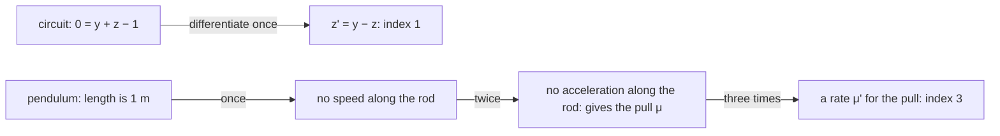
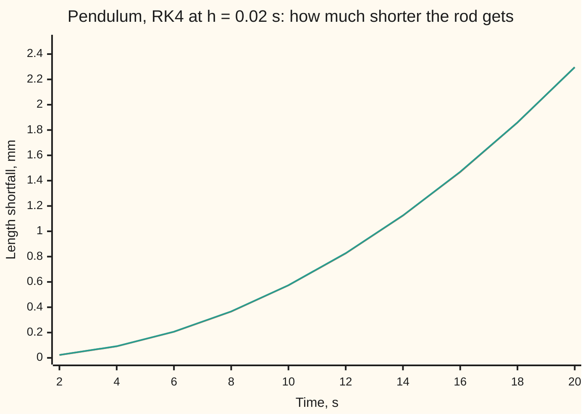

# Differential-algebraic equations: when some equations carry no derivative, and the index that measures the trouble

[Syllabus](../../../SYLLABUS.md) → [Numerical analysis](../README.md) → [ODE Solvers](../README.md#s06) → Differential-algebraic equations

---

## General Overview

A 1-volt source charges a 1-millifarad capacitor through a 1-kilohm resistor. A second 1-kilohm resistor, across the capacitor, leaks charge away. The values are illustrative. The wanted number is the capacitor's voltage 1 second after the switch closes, to four digits.

Two unknowns change with time. One is the capacitor voltage $`y`$, in volts. The other is the current $`z`$ through the first resistor, in milliamps. The capacitor obeys a rate law: its voltage rises with the current in and falls with the leak, $`y' = -y + z`$. The loop obeys [Kirchhoff's laws](../../13-Engineering%20mathematics/06-Circuits%20and%20Electromagnetism/01-kirchhoffs-laws-and-equivalent-circuits.md): the 1 volt splits between resistor and capacitor, so $`0 = y + z - 1`$.

The second equation has no derivative in it. It is a rule that must hold at every instant, called a **constraint**. A set of rate laws with constraints attached is a **differential-algebraic equation**, or DAE.

Here the constraint gives $`z = 1 - y`$ at once. The true answer is $`y(1) = (1 - e^{-2})/2`$ = 0.432332358 V. Backward Euler on the pair, with 10 steps of 0.1 s, gives 0.41925 V, a true error of −1.309e-2. Two-stage Radau IIA, an implicit Runge-Kutta method, gives 0.43234666 V, a true error of 1.430e-5.

The trouble starts when a constraint hides an unknown. A pendulum written in across-and-up coordinates has a rod pull that appears in no constraint. The rule "the rod is 1 m long" must be differentiated three times before the pull gets a rate of its own. That count, 3, is the **differentiation index**. The usual fix rewrites the pendulum at index 1, and then the rod length drifts: 2.296 mm after 20 s of RK4 (the classical fourth-order Runge-Kutta method) at h = 0.02 s.

**A differential-algebraic equation is a set of rate laws with constraints attached, and its index, the number of differentiations before every unknown has a rate, decides the method: BDF (backward differentiation formulas) or Radau IIA directly at index 1, reduction plus a repair at index 3.**

**What kind of fact this is:** definitions (semi-explicit form, differentiation index, consistent initial values) plus theorems. Two are proved on this card, in a fold under Why it works: the index-1 test, and the fact that backward Euler and Radau IIA on an index-1 DAE are the same methods on an ODE. The order loss at index 2 is stated with its source (Hairer and Wanner, chapter VII) and measured. The drift figures are measurements, printed by the code.

### The picture: counting differentiations



A schematic, not to scale. Each arrow is one differentiation with respect to time. The circuit's current gets a rate after one; the pendulum's pull gets one only after three. Each box on the way is a further rule the solution obeys, so each must also hold at the start.

---

## The formula

Notation: [Stiffness](05-stiffness-a-stability-and-the-dahlquist-barriers.md) writes $`z = h\lambda`$ for step times rate. On this card $`z`$ is the algebraic unknown, so step times rate is written $`h\lambda`$ in full.

A **semi-explicit DAE** splits the unknowns in two. The **differential unknowns** $`y`$ have derivatives in the equations; the **algebraic unknowns** $`z`$ do not:

```math
y' = f(y, z), \qquad 0 = g(y, z), \qquad \text{index } 1 \iff \frac{\partial g}{\partial z} \ \text{is invertible, and then} \ z = \varphi(y)
```

**Read it aloud:** the differential unknowns move by the rate law $`f`$; the algebraic unknowns are pinned by the constraint $`g`$; if the constraint changes when $`z`$ changes, it fixes $`z`$ as a function $`\varphi`$ of $`y`$, and the DAE has index 1.

The **differentiation index** is the smallest number of times all or part of the equations must be differentiated with respect to $`t`$ before $`y'`$ and $`z'`$ are both given as functions of $`t`$, $`y`$ and $`z`$. An ODE has index 0. Initial values are **consistent** when they satisfy the constraints and every constraint met on the way.

The pendulum, with rod 1 m, bob 1 kg and gravity 9.81 m/s², has index 3. Its index-1 form and the Baumgarte repair of it are:

```math
x_1'' = -\mu x_1, \quad x_2'' = -\mu x_2 - 9.81, \quad G = \tfrac12 (x_1^2 + x_2^2 - 1) = 0; \qquad \text{index 1 form: } G'' = 0; \qquad \text{Baumgarte: } G'' + 2\gamma G' + \gamma^2 G = 0
```

**Read it aloud:** the rod pulls the bob towards the pivot with strength $`\mu`$ per metre, gravity pulls it down, and the rod length must stay 1; the index-1 form asks only that the length not accelerate, and Baumgarte's form also pulls any length error back to zero at rate $`\gamma`$.

| Symbol | Plain meaning | In our example | Push it up and the answer… |
| --- | --- | --- | --- |
| $`t`$, $`h`$, $`N`$, $`n`$, $`T`$ | time, s; step size, s; number of steps; step number; end time | $`h`$ = 0.1 s, $`N`$ = 10, $`T`$ = 1 s | larger $`h`$: larger error |
| $`y`$, and $`w`$ on the path | differential unknowns: they have derivatives | capacitor voltage, V: $`y(1)`$ = 0.432332358 | — |
| $`z`$ | algebraic unknown: no derivative anywhere | series current, mA: 0.58075 at 1 s by backward Euler | — |
| $`f`$, $`g`$; $`F`$, $`I`$ | the rate law and the constraint; a step's equations and the identity, in the fold | $`f = -y + z`$, $`g = y + z - 1`$ | — |
| $`\partial g / \partial z`$ | how much the constraint moves when $`z`$ moves | 1.000 for the circuit | zero: index above 1 |
| $`\varphi`$ | the formula for $`z`$ hidden in the constraint | $`\varphi(y) = 1 - y`$ | — |
| $`x_1`$, $`x_2`$; $`v_1`$, $`v_2`$ | bob position across and up, m; its velocity, m/s | released at rest from (1, 0) | — |
| $`\mu`$ | rod pull per kg per metre of position, 1/s² | 0 at release | — |
| $`G`$; $`a`$, $`b`$ | half of (length squared minus 1), zero on the circle; constants in its drift $`G = a + bt`$ | length error 2.296 mm at 20 s, unrepaired | — |
| $`\gamma`$ | Baumgarte rate, 1/s | 5 | faster repair, until $`h\gamma`$ comes too close to RK4's edge |
| $`R`$, $`p`$, $`s`$; $`\lambda`$, $`\varepsilon`$, $`\varepsilon_{\mathrm{mach}}`$ | Radau IIA's step factor on $`y' = \lambda y`$; order; stages; a rate of the reduced ODE, 1/s; a small time constant; machine epsilon, the gap from 1 to the next double | $`R(-0.2)`$ = 0.81871345; $`p`$ = 3; $`s`$ = 2; $`\lambda = -2`$ | — |
| $`c_i`$, $`a_{ij}`$; $`Y_i`$, $`Z_i`$ | Radau IIA's nodes and stage blends; its stage values of $`y`$ and $`z`$ | $`c`$ = 1/3 and 1 | — |

### When it holds

- **The constraint fixes $`z`$.** The index-1 test needs $`\partial g/\partial z`$ invertible along the solution. The pendulum's length does not involve $`\mu`$ at all, so the test fails and the index rises to 3.
- **Consistent initial values.** Start a prescribed path at the wrong speed, and backward Euler's first force is 99.9983 against a true −0.0100: an impulse of size $`1/h`$.
- **An implicit method that solves the constraint at the new point.** $`z`$ has no rate, so an explicit method has no formula that moves it. Backward Euler, BDF and Radau IIA all solve $`g = 0`$ at the new point.
- **Index 1 for full order.** At index 2, Radau IIA's algebraic unknown converges at order 2.011, not 3, because it is a derivative of data.
- **A repair after index reduction.** The index-1 form keeps $`G'' = 0`$ only; without Baumgarte or projection, $`G`$ grows like $`t^2`$.

---

## Why it works

### Step 0: an invertible constraint hides a formula for z

If $`\partial g/\partial z`$ is invertible at a consistent point, the [Inverse and implicit function theorems](../../06-Calculus%20and%20analysis/07-Several%20Variables/07-inverse-and-implicit-function-theorems.md) solve $`g(y, z) = 0`$ for $`z`$ near that point: $`z = \varphi(y)`$. Put that into the rate law, and $`y' = f(y, \varphi(y))`$ is an ordinary ODE, called the **reduced ODE**.

For the circuit, $`\partial g/\partial z`$ = 1.000 and $`\varphi(y) = 1 - y`$. The reduced ODE is $`y' = 1 - 2y`$, with rate $`\lambda = -2`$ per second. Differentiating the constraint once gives $`y' + z' = 0`$, so $`z' = y - z`$. One differentiation: index 1.

Consistency here is one equation. $`y(0) = 0`$ forces $`z(0) = 1 - 0`$ = 1.000 mA. At the switch-on instant the capacitor is empty, so the whole volt sits across the resistor.

### Step 1: the index counts hidden constraints

When a differentiation does not yet give a rate for $`z`$, it gives a new rule instead. That rule is a **hidden constraint**: the solution must obey it, though no one wrote it down.

The pendulum shows three levels:

1. $`G = \tfrac12(x_1^2 + x_2^2 - 1) = 0`$: the bob stays on the circle.
2. $`G' = x_1 v_1 + x_2 v_2 = 0`$: the velocity has no part along the rod.
3. $`G'' = v_1^2 + v_2^2 - \mu(x_1^2 + x_2^2) - 9.81\, x_2 = 0`$: this one contains $`\mu`$.

Levels 1 and 2 contain no $`\mu`$, so their response to it is 0 by construction; the code measures level 3's at a point on the circle: −1.000. So $`\mu`$ first appears after two differentiations. Level 3 gives the pull, $`\mu = (v_1^2 + v_2^2 - 9.81\, x_2)/(x_1^2 + x_2^2)`$. One more differentiation gives $`\mu'`$. Three in all: index 3.

Consistent initial values must satisfy all three levels. The bob released at rest from the horizontal, at (1, 0) with zero velocity, does: $`G = 0`$, $`G' = 0`$ and $`\mu = 0`$.

Two smaller examples isolate index 2 and 3. A slider is driven so its position follows $`\sin t`$ metres exactly:

- **Index 2:** $`y' = z`$, $`0 = y - \sin t`$. The speed $`z`$ needed is found after two differentiations: $`z = \cos t`$, then $`z' = -\sin t`$.
- **Index 3:** $`y' = w`$, $`w' = z`$, $`0 = y - \sin t`$. The acceleration $`z`$, the force per kg the motor supplies, needs three.

### Step 2: a DAE is the limit of an infinitely stiff ODE

Replace the constraint with $`\varepsilon z' = -g(y, z)`$, where $`\varepsilon`$ is a tiny time constant. If $`\partial g/\partial z`$ is positive (or, for a vector, has eigenvalues with positive real parts), as the circuit's 1.000 is, $`z`$ relaxes to the constraint at a rate near $`1/\varepsilon`$. That is a fast, decaying part, the kind [Stiffness](05-stiffness-a-stability-and-the-dahlquist-barriers.md) studies. As $`\varepsilon \to 0`$ the rate becomes infinite and the DAE is the limit.

So an index-1 DAE is the stiffest problem there is. An explicit method's step limit shrinks with $`\varepsilon`$ and reaches zero. An L-stable method's factor on a fast part tends to 0 as $`h\lambda \to -\infty`$. Backward Euler, BDF2 and Radau IIA are L-stable, so in one step they damp the fast part almost completely when $`h/\varepsilon`$ is large, and remove it exactly at $`\varepsilon = 0`$.

### Step 3: backward Euler and Radau IIA solve the constraint at every stage

A backward Euler step on the DAE solves two equations for the new point:

```math
y_{n+1} = y_n + h f(y_{n+1}, z_{n+1}), \qquad 0 = g(y_{n+1}, z_{n+1})
```

**Read it aloud:** the new $`y`$ is the old one plus a step along the rate at the new point, and the new point must satisfy the constraint.

The second equation forces $`z_{n+1} = \varphi(y_{n+1})`$. Put that into the first, and the step is backward Euler on the reduced ODE. Its convergence comes from the ODE theory of [From local error to global error](02-convergence-of-one-step-methods.md), and $`z`$ inherits $`y`$'s error through $`\varphi`$.

Radau IIA does the same at every stage. Its two-stage tableau (see [Implicit Runge-Kutta](08-implicit-runge-kutta-methods.md)) has nodes $`c`$ = 1/3 and 1, and blends $`a_{ij}`$ in rows (5/12, −1/12) and (3/4, 1/4). Each stage pair $`(Y_i, Z_i)`$ satisfies $`g(Y_i, Z_i) = 0`$. The last stage sits at the step's end ($`c_2 = 1`$), so the new point is that stage and lies on the constraint. Such a method is called **stiffly accurate**.

The circuit gives exact checks. On $`y' = \lambda(y - \tfrac12)`$ each method multiplies $`y - \tfrac12`$ by a fixed factor per step:

- backward Euler: $`1/(1 - h\lambda) = 1/1.2`$, so $`y(1) = 0.5(1 - 1.2^{-10})`$ = 0.41925;
- Radau IIA: $`R(h\lambda) = (1 + h\lambda/3)/(1 - 2h\lambda/3 + (h\lambda)^2/6)`$, and $`R(-0.2)`$ = 0.81871345, so $`y(1) = 0.5(1 - R(-0.2)^{10})`$ = 0.43234666.

The DAE solver, which keeps $`z`$ as an unknown and solves a linear system each step, matches both closed forms to 1e-14. Measured against the true $`y(1)`$, the errors fall at each method's ODE order:

| Method | Unknowns solved per step | $`N`$ = 10 | 20 | 40 | 80 | Observed order |
| --- | --- | --- | --- | --- | --- | --- |
| backward Euler | 2 | −1.309e-2 | −6.654e-3 | −3.355e-3 | −1.685e-3 | 0.994 |
| BDF2 | 2 | 1.793e-3 | 4.507e-4 | 1.128e-4 | 2.819e-5 | 2.000 |
| Radau IIA | 4 | 1.430e-5 | 1.832e-6 | 2.319e-7 | 2.918e-8 | 2.991 |

BDF2 starts from the exact $`y(h)`$. The theorems' orders are 1, 2 and 3. Radau IIA solves a system twice the size of backward Euler's, and its error at $`N`$ = 10 is three powers of ten smaller.

<details>
<summary>Detailed proof: on an index-1 DAE, backward Euler and Radau IIA converge with their ODE orders</summary>

**Assume** $`f`$ and $`g`$ have continuous second partial derivatives, $`\partial g/\partial z`$ is invertible along the exact solution on $`[0, T]`$, and the initial values are consistent.

**Step A: the hidden formula.** By the implicit function theorem, there is a smooth $`\varphi`$ on a neighbourhood of the exact path with $`g(y, \varphi(y)) = 0`$, and every solution of $`g = 0`$ near the path has $`z = \varphi(y)`$.

**Step B: the step equations have a solution.** Write a backward Euler step as $`F(Y, Z; h) = 0`$, with

$`\displaystyle F(Y, Z; h) = \begin{pmatrix} Y - y_n - h f(Y, Z) \\ g(Y, Z) \end{pmatrix}.`$

At $`h = 0`$ its derivative in $`(Y, Z)`$ is block lower triangular, with blocks $`I`$ and $`\partial g/\partial z`$ on the diagonal. Both are invertible. So, by the implicit function theorem again, for small $`h`$ there is a unique solution near $`(y_n, \varphi(y_n))`$.

**Step C: it is the ODE method.** The second row gives $`Z = \varphi(Y)`$. The first row becomes $`Y = y_n + h f(Y, \varphi(Y))`$: backward Euler on $`y' = f(y, \varphi(y))`$. That ODE has a smooth, Lipschitz right-hand side, so backward Euler converges with global error at most a constant times $`h`$.

**Step D: the algebraic part.** $`z_{n} - z(t_n) = \varphi(y_n) - \varphi(y(t_n))`$, at most the Lipschitz constant of $`\varphi`$ times the error in $`y`$. So $`z`$ has the same order.

**Step E: Radau IIA.** Each stage solves $`Y_i = y_n + h \sum_j a_{ij} f(Y_j, Z_j)`$ and $`0 = g(Y_i, Z_i)`$. Step B's argument, with the stage matrix in place of 1, gives a unique solution, and $`Z_i = \varphi(Y_i)`$. So the stages are those of Radau IIA on the reduced ODE. The method is stiffly accurate, so $`y_{n+1} = Y_s`$ and $`z_{n+1} = Z_s = \varphi(y_{n+1})`$. Both inherit the ODE order $`2s - 1`$ for $`s`$ stages: 3 for two stages. The same argument covers BDF, whose new point also solves $`g = 0`$. $`\blacksquare`$

</details>

### Step 4: index 2 costs order in the algebraic part

On the index-2 path, the constraint fixes $`y`$ exactly at the step's end, and $`z`$ comes from differences of $`y`$: a derivative of the data. Errors in $`z(1)`$ against the true $`\cos 1`$:

| Method | $`N`$ = 10 | 20 | 40 | 80 | Observed order | Theorem |
| --- | --- | --- | --- | --- | --- | --- |
| backward Euler | 4.114e-2 | 2.081e-2 | 1.046e-2 | 5.245e-3 | 0.996 | 1 |
| Radau IIA | 6.386e-4 | 1.549e-4 | 3.813e-5 | 9.456e-6 | 2.011 | $`s`$ = 2 |

For an $`s`$-stage Radau IIA on index 2, the theorem gives order $`2s - 1`$ in $`y`$ but only $`s`$ in $`z`$ (Hairer and Wanner, chapter VII). It is stated here, not proved.

Index 3 is harsher. On the index-3 path from the consistent speed $`w(0)`$ = 1.0, backward Euler's first force is $`z(0.01)`$ = −0.0017 against a true −0.0100. Even this consistent start is far off: at index 3, backward Euler's $`z`$ is inaccurate over the first steps. From $`w(0)`$ = 0.0 the first force is 99.9983. The method meets the path by jerking the speed into line in one step, a force of size $`1/h`$. Many codes, especially multibody codes, therefore reduce index 3 before solving.

### Step 5: reducing index 3, and why the constraint drifts

The index-1 form of the pendulum replaces $`G = 0`$ with $`G'' = 0`$ and computes $`\mu`$ from it at every stage. This is now an ODE in $`(x_1, x_2, v_1, v_2)`$ that any solver accepts.

But $`G'' = 0`$ is satisfied by $`G = a + bt`$ for any $`a`$ and $`b`$. Each step's small error adds a little to $`G`$ and $`G'`$, and nothing removes it. The errors in $`G'`$ add up roughly in proportion to $`t`$, so $`G`$ grows like $`t^2`$:



Orange: the index-1 form's measured shortfall. Green: a $`t^2`$ curve through the 20 s value. They agree to 0.002 mm. The shortfall at 20 s over that at 10 s is 4.010; $`t^2`$ predicts 4.

The drift is the method's own error showing up in the constraint. Halving $`h`$ divides it by $`2^{4.00}`$, RK4's order. A smaller step delays the drift; it does not stop it.

### Step 6: two repairs, Baumgarte and projection

**Baumgarte stabilisation** replaces $`G'' = 0`$ with $`G'' + 2\gamma G' + \gamma^2 G = 0`$. Its solutions are $`(a + bt)e^{-\gamma t}`$, so any error in $`G`$ now dies at rate $`\gamma`$. The pull becomes $`\mu = (v_1^2 + v_2^2 - 9.81\, x_2 + 2\gamma G' + \gamma^2 G)/(x_1^2 + x_2^2)`$. The exact solution has $`G = 0`$, so it is unchanged.

**Projection** steps with the index-1 form, then puts the result back: scale the position to length 1, then remove the velocity's part along the rod. It costs one square root and a few products per step.

| Length error at 20 s | $`h`$ = 0.05 | $`h`$ = 0.02 | $`h`$ = 0.01 |
| --- | --- | --- | --- |
| index-1 form | −9.660e-2 | −2.296e-3 | −1.437e-4 |
| Baumgarte, $`\gamma`$ = 5 per s | −4.733e-6 | −6.999e-8 | −3.688e-9 |
| projection, largest over the run | 2.220e-16 | 2.220e-16 | 2.220e-16 |

At $`h`$ = 0.02 s the Baumgarte error never exceeds 1.584e-6 m at any step of the 20 s. Projection holds the length within $`\varepsilon_{\mathrm{mach}} = 2^{-52}`$ = 2.220e-16 at every step.

Baumgarte has a price. The repair adds a decaying part with rate $`-\gamma`$, twice over. That is a fast rate, and an explicit method must keep $`h\gamma`$ inside its stability region. RK4's region ends at −2.785 on the real axis. With $`\gamma`$ = 150 per s and $`h`$ = 0.02 s, $`h\gamma`$ = 3.00, RK4's linear factor is 1.375, and the length error reaches 1.867e150 m within 1 s.

That edge is necessary, not sufficient. At $`\gamma`$ = 125 per s, $`h\gamma`$ = 2.50 is inside the region and the linear factor is 0.648, yet the length error still reaches 6.965e70 m. The edge comes from the linear test equation, and the pendulum is not linear: $`G`$ is quadratic in the positions, and the pull $`\mu`$ carries $`\gamma^2 G`$. With so stiff a repair, RK4's stages overshoot, the bob leaves the circle, and past some size the error feeds itself. Keep $`h\gamma`$ well inside the region.

---

## Worked numbers, by hand

Backward Euler on the circuit, $`h`$ = 0.1 s, from $`y(0) = 0`$.

| Step | Arithmetic | Value |
| --- | --- | --- |
| Constraint | $`z = 1 - y`$ | — |
| One step | $`y_{n+1} = y_n + 0.1(-y_{n+1} + 1 - y_{n+1})`$, so $`y_{n+1} = (y_n + 0.1)/1.2`$ | — |
| First step | $`(0 + 0.1)/1.2`$ | 0.08333 V |
| First current | $`1 - 0.08333`$ | 0.91667 mA |
| Factor per step | $`y_{n+1} - 0.5 = (y_n - 0.5)/1.2`$ | 0.83333 |
| Ten steps | $`0.5(1 - 1.2^{-10})`$ | **0.41925 V** |
| Current at 1 s | $`1 - 0.41925`$ | 0.58075 mA |
| True error | $`0.41925 - 0.432332358`$ | −1.309e-2 V |

By backward Euler the capacitor reaches 0.41925 V, 1.309e-2 V below the truth. At order 1, eight times the steps cut that error to −1.685e-3 V.

### What breaks if you drop a piece

| Mistake | Comes out at | What went wrong |
| --- | --- | --- |
| Differentiate the circuit's constraint, start at $`z(0)`$ = 0.9 | $`y(1)`$ = 0.37732, with $`y + z`$ = 0.90000 for ever | $`z' = y - z`$ forgot the constant 1; the DAE form never uses $`z(0)`$ and gives 0.41925 |
| Index-3 path from the wrong speed, $`w(0)`$ = 0.0 | first force 99.9983 against −0.0100 | inconsistent start: the method forces the hidden constraint in one step |
| Index-1 pendulum with no repair | rod 2.296 mm short at 20 s | $`G'' = 0`$ lets $`G`$ grow like $`t^2`$ |
| Baumgarte at $`h`$ = 0.02 s with $`\gamma`$ = 150, or 125, per s | length error 1.867e150 m, or 6.965e70 m, at 1 s | $`h\gamma`$ = 3.00 is past RK4's linear edge −2.785; 2.50 is inside it, but the stiff repair's stages overshoot and the error feeds itself |

---

## Code, from first principles, and it actually runs

The code solves the circuit as a DAE by backward Euler, BDF2 and Radau IIA, keeping $`z`$ as an unknown and solving each step's linear system by Gaussian elimination. It then runs the index-2 and index-3 paths and the pendulum. Independent roads meet at each answer:

- **Circuit:** the DAE solver against the closed forms $`0.5(1 - 1.2^{-10})`$ and $`0.5(1 - R(-0.2)^{10})`$, and against the exact solution at four step sizes, with observed orders 0.994, 2.000 and 2.991; the differentiated circuit against $`0.9 \times 0.41925`$.
- **Index 2:** backward Euler and Radau IIA against $`\cos 1`$, with observed orders 0.996 and 2.011 beside the theorem's 1 and 2.
- **Index 3:** the pendulum's index from level 3's measured response to $`\mu`$.
- **Drift:** RK4's order 4 seen in the drift, the $`t^2`$ law seen in time, projection held to rounding, and Baumgarte blowing up on both sides of RK4's linear edge.

### Python

```python
# Differential-algebraic equations: index 1 (an RC circuit), index 2 and 3 (a prescribed path), index 3 (a pendulum).
from math import exp, sin, cos, sqrt, log2

def E(x, d=3):  # e-notation with the same digits as Rust's {:.de}
    m, ex = f"{x:.{d}e}".split("e")
    return m + "e" + str(int(ex))

def solve(M, b):  # Gaussian elimination with partial pivoting
    n = len(b); M = [row[:] + [b[i]] for i, row in enumerate(M)]
    for k in range(n):
        p = max(range(k, n), key=lambda i: abs(M[i][k])); M[k], M[p] = M[p], M[k]
        for i in range(k + 1, n):
            f = M[i][k] / M[k][k]
            M[i] = [M[i][j] - f * M[k][j] for j in range(n + 1)]
    x = [0.0] * n
    for i in range(n - 1, -1, -1):
        x[i] = (M[i][n] - sum(M[i][j] * x[j] for j in range(i + 1, n))) / M[i][i]
    return x

A = [[5 / 12, -1 / 12], [3 / 4, 1 / 4]]; C = [1 / 3, 1.0]  # Radau IIA, two stages
ytrue = lambda t: (1 - exp(-2 * t)) / 2
print("circuit: y' = -y + z, 0 = y + z - 1, y(0) = 0 (y volts, z milliamps, t seconds)")
print(f"index 1: dg/dz = {1.0:.3f}, nonzero; consistent start z(0) = 1 - y(0) = {1 - 0.0:.3f}")
print(f"true y(1) = (1 - e^-2)/2 = {ytrue(1.0):.9f}")

def be(N):  # unknowns (y1, z1): y1 - h(-y1 + z1) = y0 and y1 + z1 = 1
    h, y = 1 / N, 0.0
    for _ in range(N):
        y, z = solve([[1 + h, -h], [1, 1]], [y, 1])
    return y, z

def bdf2(N):  # exact start y(h); then 3/2 y2 - 2 y1 + 1/2 y0 = h(-y2 + z2), y2 + z2 = 1
    h, y0, y1 = 1 / N, 0.0, ytrue(1 / N)
    for _ in range(N - 1):
        y2, _z = solve([[1.5 + h, -h], [1, 1]], [2 * y1 - 0.5 * y0, 1])
        y0, y1 = y1, y2
    return y1

def radau(N):  # unknowns Y1, Y2, Z1, Z2: Yi - h sum aij(-Yj + Zj) = y, Yi + Zi = 1
    h, y = 1 / N, 0.0
    for _ in range(N):
        M = [[(i == j) + h * A[i][j] for j in range(2)] + [-h * A[i][j] for j in range(2)] for i in range(2)]
        M += [[1.0 * (i == j) for j in range(2)] + [1.0 * (i == j) for j in range(2)] for i in range(2)]
        y = solve(M, [y, y, 1.0, 1.0])[1]  # stiffly accurate: the new y is the last stage
    return y

yb, zb = be(10); yr = radau(10)
cf_be = 0.5 * (1 - 1.2 ** -10)
R = lambda z: (1 + z / 3) / (1 - 2 * z / 3 + z * z / 6)
cf_r = 0.5 * (1 - R(-0.2) ** 10)
f1 = solve([[1.1, -0.1], [1, 1]], [0.0, 1.0])
print(f"h = 0.1: BE first step y = {f1[0]:.5f}, z = {f1[1]:.5f}; factor on y - 0.5 per step 1/1.2 = {1 / 1.2:.5f}")
print(f"h = 0.1: BE y(1) = {yb:.5f}, z(1) = {zb:.5f}, closed form 0.5(1 - 1.2^-10) = {cf_be:.5f}")
print(f"h = 0.1: Radau IIA y(1) = {yr:.8f}, closed form 0.5(1 - R(-0.2)^10) = {cf_r:.8f}, R(-0.2) = {R(-0.2):.8f}")
assert abs(yb - cf_be) < 1e-14 and abs(zb - (1 - cf_be)) < 1e-14
assert abs(yr - cf_r) < 1e-14
print("true error in y(1)   N=10        N=20        N=40        N=80     order")
for name, f, p in (("BE", lambda N: be(N)[0], 1), ("BDF2", bdf2, 2), ("Radau IIA", radau, 3)):
    errs = [f(N) - ytrue(1.0) for N in (10, 20, 40, 80)]
    q = log2(abs(errs[2] / errs[3]))
    print(f"{name:>9}  " + "  ".join(f"{E(e):>10}" for e in errs) + f"  {q:.3f}")
    assert abs(q - p) < 0.05
yd = [0.0, 0.9]  # the differentiated system y' = -y + z, z' = y - z by BE, from a start 0.1 off
for _ in range(10):
    yd = solve([[1.1, -0.1], [-0.1, 1.1]], yd)
print(f"z(0) = 0.9 instead of 1: DAE form by BE y(1) = {be(10)[0]:.5f}; differentiated form y(1) = {yd[0]:.5f}, y + z = {yd[0] + yd[1]:.5f}")
assert abs(yd[0] - 0.9 * cf_be) < 1e-14 and abs(yd[0] + yd[1] - 0.9) < 1e-14

def path2(N, method):  # index 2: y' = z, 0 = y - sin t; true z = cos t
    h, y = 1 / N, 0.0
    for n in range(N):
        t = n * h
        if method == "BE":
            z = (sin(t + h) - y) / h
        else:  # Radau: y + h sum aij Zj = sin(t + ci h)
            z = solve([[h * A[i][j] for j in range(2)] for i in range(2)], [sin(t + C[i] * h) - y for i in range(2)])[1]
        y = sin(t + h)
    return z - cos(1.0)
print("index 2 path, error in z(1)   N=10        N=20        N=40        N=80     order")
for name, p in (("BE", 1), ("Radau IIA", 2)):
    errs = [path2(N, name) for N in (10, 20, 40, 80)]
    q = log2(abs(errs[2] / errs[3]))
    print(f"{name:>9}" + " " * 18 + "  ".join(f"{E(e):>10}" for e in errs) + f"  {q:.3f}")
    assert abs(q - p) < 0.05
for w0 in (1.0, 0.0):  # index 3: y' = w, w' = z, 0 = y - sin t; BE first step, h = 0.01; true z(0.01) = -sin(0.01)
    h = 0.01; w1 = (sin(h) - 0.0) / h; z1 = (w1 - w0) / h
    print(f"index 3 path, BE, w(0) = {w0:.1f}: z(0.01) = {z1:.4f}, true {-sin(h):.4f}")
assert abs(z1 - 1 / h) < 0.01

g = 9.81
def rhs(s, gam):  # pendulum in index-1 form: mu from G'' = 0 (or G'' + 2 gam G' + gam^2 G = 0)
    x1, x2, v1, v2 = s
    r2 = x1 * x1 + x2 * x2
    num = v1 * v1 + v2 * v2 - g * x2 + 2 * gam * (x1 * v1 + x2 * v2) + gam * gam * (r2 - 1) / 2
    mu = num / r2
    return [v1, v2, -mu * x1, -mu * x2 - g]

def run(h, T, gam=0.0, proj=False, every=0):  # RK4 from rest at the horizontal, length 1 m
    s, out, worst = [1.0, 0.0, 0.0, 0.0], [], 0.0
    for n in range(1, round(T / h) + 1):
        k1 = rhs(s, gam); k2 = rhs([s[i] + h / 2 * k1[i] for i in range(4)], gam)
        k3 = rhs([s[i] + h / 2 * k2[i] for i in range(4)], gam); k4 = rhs([s[i] + h * k3[i] for i in range(4)], gam)
        s = [s[i] + h / 6 * (k1[i] + 2 * k2[i] + 2 * k3[i] + k4[i]) for i in range(4)]
        if proj:  # back onto the circle, then remove the radial speed
            r = sqrt(s[0] * s[0] + s[1] * s[1]); s[0] /= r; s[1] /= r
            d = s[0] * s[2] + s[1] * s[3]; s[2] -= d * s[0]; s[3] -= d * s[1]
        err = sqrt(s[0] * s[0] + s[1] * s[1]) - 1; worst = max(worst, abs(err))
        if every and n % every == 0: out.append(err)
    return err, worst, out
s0 = [0.6, -0.8, 1.5, 1.125]  # a point on the circle, moving along it
lev2 = lambda mu: s0[2] * s0[2] + s0[3] * s0[3] + s0[0] * (-mu * s0[0]) + s0[1] * (-mu * s0[1] - g)
print(f"pendulum: d/dmu of G = 0, of G' = 0, of G'' = {lev2(1.0) - lev2(0.0):.3f}: mu appears after 2 differentiations, index 3")
assert abs((lev2(1.0) - lev2(0.0)) + 1.0) < 1e-12
print("length error at 20 s    h = 0.05     h = 0.02     h = 0.01")
rows = {}
for name, kw in (("index-1 form", {}), ("Baumgarte 5/s", {"gam": 5.0}), ("projection, max", {"proj": True})):
    rows[name] = [run(h, 20.0, **kw)[1 if "proj" in kw else 0] for h in (0.05, 0.02, 0.01)]
    print(f"{name:>15}  " + "  ".join(f"{E(v):>11}" for v in rows[name]))
q = log2(abs(rows["index-1 form"][1] / rows["index-1 form"][2]))
print(f"index-1 form drift falls by 2^{q:.2f} when h halves (RK4 order 4)")
assert abs(q - 4) < 0.2 and rows["projection, max"][1] < 1e-15 and abs(rows["Baumgarte 5/s"][1]) < 1e-6
naive = run(0.02, 20.0, every=100)[2]; bg = run(0.02, 20.0, gam=5.0)[1]  # bg: largest over every step
print("h = 0.02, t = 2..20 s, length error in mm:")
print("  index-1 form: " + ", ".join(f"{-1000 * v:.3f}" for v in naive))
print("  Baumgarte, largest size over all steps: " + E(bg) + " m")
print("  t^2 guide:    " + ", ".join(f"{-1000 * naive[-1] * (k / 10) * (k / 10):.3f}" for k in range(1, 11)))
print(f"drift ratio 20 s / 10 s: {naive[9] / naive[4]:.3f} (t^2 predicts 4)")
assert abs(naive[9] / naive[4] - 4) < 0.1
for gam in (150.0, 125.0):  # past RK4's linear edge, then inside it
    x = 0.02 * gam; e1 = run(0.02, 1.0, gam=gam)[0]
    print(f"Baumgarte {gam:.0f}/s at h = 0.02: h*gam = {x:.2f}, RK4's linear factor {1 - x + x * x / 2 - x ** 3 / 6 + x ** 4 / 24:.3f} (edge at 2.785); length error at 1 s = {E(e1)}")
    assert abs(e1) > 1.0
print("ALL CHECKS PASS")
```

**Ran 2026-11-24 on macOS, Python 3.14.10, standard library only. All checks passed. Output, pasted from the run:**

```
circuit: y' = -y + z, 0 = y + z - 1, y(0) = 0 (y volts, z milliamps, t seconds)
index 1: dg/dz = 1.000, nonzero; consistent start z(0) = 1 - y(0) = 1.000
true y(1) = (1 - e^-2)/2 = 0.432332358
h = 0.1: BE first step y = 0.08333, z = 0.91667; factor on y - 0.5 per step 1/1.2 = 0.83333
h = 0.1: BE y(1) = 0.41925, z(1) = 0.58075, closed form 0.5(1 - 1.2^-10) = 0.41925
h = 0.1: Radau IIA y(1) = 0.43234666, closed form 0.5(1 - R(-0.2)^10) = 0.43234666, R(-0.2) = 0.81871345
true error in y(1)   N=10        N=20        N=40        N=80     order
       BE   -1.309e-2   -6.654e-3   -3.355e-3   -1.685e-3  0.994
     BDF2    1.793e-3    4.507e-4    1.128e-4    2.819e-5  2.000
Radau IIA    1.430e-5    1.832e-6    2.319e-7    2.918e-8  2.991
z(0) = 0.9 instead of 1: DAE form by BE y(1) = 0.41925; differentiated form y(1) = 0.37732, y + z = 0.90000
index 2 path, error in z(1)   N=10        N=20        N=40        N=80     order
       BE                    4.114e-2    2.081e-2    1.046e-2    5.245e-3  0.996
Radau IIA                    6.386e-4    1.549e-4    3.813e-5    9.456e-6  2.011
index 3 path, BE, w(0) = 1.0: z(0.01) = -0.0017, true -0.0100
index 3 path, BE, w(0) = 0.0: z(0.01) = 99.9983, true -0.0100
pendulum: d/dmu of G = 0, of G' = 0, of G'' = -1.000: mu appears after 2 differentiations, index 3
length error at 20 s    h = 0.05     h = 0.02     h = 0.01
   index-1 form    -9.660e-2    -2.296e-3    -1.437e-4
  Baumgarte 5/s    -4.733e-6    -6.999e-8    -3.688e-9
projection, max    2.220e-16    2.220e-16    2.220e-16
index-1 form drift falls by 2^4.00 when h halves (RK4 order 4)
h = 0.02, t = 2..20 s, length error in mm:
  index-1 form: 0.023, 0.091, 0.206, 0.366, 0.573, 0.825, 1.124, 1.468, 1.859, 2.296
  Baumgarte, largest size over all steps: 1.584e-6 m
  t^2 guide:    0.023, 0.092, 0.207, 0.367, 0.574, 0.827, 1.125, 1.470, 1.860, 2.296
drift ratio 20 s / 10 s: 4.010 (t^2 predicts 4)
Baumgarte 150/s at h = 0.02: h*gam = 3.00, RK4's linear factor 1.375 (edge at 2.785); length error at 1 s = 1.867e150
Baumgarte 125/s at h = 0.02: h*gam = 2.50, RK4's linear factor 0.648 (edge at 2.785); length error at 1 s = 6.965e70
ALL CHECKS PASS
```

### Rust

Same numbers, same labels, built with `rustc --edition 2021 -O`.

```rust
// Differential-algebraic equations: index 1 (an RC circuit), index 2 and 3 (a prescribed path), index 3 (a pendulum).
const A: [[f64; 2]; 2] = [[5.0 / 12.0, -1.0 / 12.0], [3.0 / 4.0, 1.0 / 4.0]]; // Radau IIA, two stages
const C: [f64; 2] = [1.0 / 3.0, 1.0];
const G: f64 = 9.81;
fn e(x: f64) -> String { format!("{:.3e}", x) }
fn solve(m: Vec<Vec<f64>>, b: Vec<f64>) -> Vec<f64> { // Gaussian elimination with partial pivoting
    let n = b.len();
    let mut m: Vec<Vec<f64>> = m.into_iter().enumerate().map(|(i, mut r)| { r.push(b[i]); r }).collect();
    for k in 0..n {
        let mut p = k;
        for i in k..n { if m[i][k].abs() > m[p][k].abs() { p = i; } }; m.swap(k, p);
        for i in k + 1..n {
            let f = m[i][k] / m[k][k];
            for j in 0..=n { m[i][j] -= f * m[k][j]; }
        }
    }
    let mut x = vec![0.0; n];
    for i in (0..n).rev() {
        let s: f64 = (i + 1..n).map(|j| m[i][j] * x[j]).sum();
        x[i] = (m[i][n] - s) / m[i][i];
    }
    x
}

fn ytrue(t: f64) -> f64 { (1.0 - (-2.0 * t).exp()) / 2.0 }
fn be(n: usize) -> (f64, f64) {
    let h = 1.0 / n as f64;
    let (mut y, mut z) = (0.0, 0.0);
    for _ in 0..n {
        let s = solve(vec![vec![1.0 + h, -h], vec![1.0, 1.0]], vec![y, 1.0]); y = s[0]; z = s[1];
    }
    (y, z)
}

fn bdf2(n: usize) -> f64 {
    let h = 1.0 / n as f64;
    let (mut y0, mut y1) = (0.0, ytrue(h));
    for _ in 0..n - 1 {
        let y2 = solve(vec![vec![1.5 + h, -h], vec![1.0, 1.0]], vec![2.0 * y1 - 0.5 * y0, 1.0])[0];
        y0 = y1; y1 = y2;
    }
    y1
}
fn radau(n: usize) -> f64 {
    let h = 1.0 / n as f64;
    let mut y = 0.0;
    for _ in 0..n {
        let mut m = Vec::new();
        for i in 0..2 {
            let d = |j: usize| if i == j { 1.0 } else { 0.0 };
            m.push(vec![d(0) + h * A[i][0], d(1) + h * A[i][1], -h * A[i][0], -h * A[i][1]]);
        }
        m.push(vec![1.0, 0.0, 1.0, 0.0]); m.push(vec![0.0, 1.0, 0.0, 1.0]);
        y = solve(m, vec![y, y, 1.0, 1.0])[1];
    }
    y
}
fn path2(n: usize, method: &str) -> f64 {
    let h = 1.0 / n as f64;
    let (mut y, mut z) = (0.0, 0.0);
    for k in 0..n {
        let t = k as f64 * h;
        if method == "BE" {
            z = ((t + h).sin() - y) / h;
        } else {
            let m = vec![vec![h * A[0][0], h * A[0][1]], vec![h * A[1][0], h * A[1][1]]];
            z = solve(m, vec![(t + C[0] * h).sin() - y, (t + C[1] * h).sin() - y])[1];
        }
        y = (t + h).sin();
    }
    z - 1.0f64.cos()
}
fn rhs(s: &[f64; 4], gam: f64) -> [f64; 4] {
    let (x1, x2, v1, v2) = (s[0], s[1], s[2], s[3]);
    let r2 = x1 * x1 + x2 * x2;
    let num = v1 * v1 + v2 * v2 - G * x2 + 2.0 * gam * (x1 * v1 + x2 * v2) + gam * gam * (r2 - 1.0) / 2.0;
    let mu = num / r2;
    [v1, v2, -mu * x1, -mu * x2 - G]
}
fn run(h: f64, t_end: f64, gam: f64, proj: bool, every: usize) -> (f64, f64, Vec<f64>) {
    let mut s = [1.0, 0.0, 0.0, 0.0];
    let (mut out, mut worst, mut err) = (Vec::new(), 0.0f64, 0.0);
    let add = |s: &[f64; 4], k: &[f64; 4], c: f64| { let mut r = [0.0; 4]; for i in 0..4 { r[i] = s[i] + c * k[i]; } r };
    for n in 1..=((t_end / h).round() as usize) {
        let k1 = rhs(&s, gam); let k2 = rhs(&add(&s, &k1, h / 2.0), gam);
        let k3 = rhs(&add(&s, &k2, h / 2.0), gam); let k4 = rhs(&add(&s, &k3, h), gam);
        for i in 0..4 { s[i] = s[i] + h / 6.0 * (k1[i] + 2.0 * k2[i] + 2.0 * k3[i] + k4[i]); }
        if proj {
            let r = (s[0] * s[0] + s[1] * s[1]).sqrt(); s[0] /= r; s[1] /= r;
            let d = s[0] * s[2] + s[1] * s[3]; s[2] -= d * s[0]; s[3] -= d * s[1];
        }
        err = (s[0] * s[0] + s[1] * s[1]).sqrt() - 1.0; worst = worst.max(err.abs());
        if every > 0 && n % every == 0 { out.push(err); }
    }
    (err, worst, out)
}

fn main() {
    println!("circuit: y' = -y + z, 0 = y + z - 1, y(0) = 0 (y volts, z milliamps, t seconds)");
    println!("index 1: dg/dz = {:.3}, nonzero; consistent start z(0) = 1 - y(0) = {:.3}", 1.0, 1.0 - 0.0);
    println!("true y(1) = (1 - e^-2)/2 = {:.9}", ytrue(1.0));
    let (yb, zb) = be(10); let yr = radau(10);
    let cf_be = 0.5 * (1.0 - 1.2f64.powi(-10));
    let r = |z: f64| (1.0 + z / 3.0) / (1.0 - 2.0 * z / 3.0 + z * z / 6.0);
    let cf_r = 0.5 * (1.0 - r(-0.2).powi(10));
    let f1 = solve(vec![vec![1.1, -0.1], vec![1.0, 1.0]], vec![0.0, 1.0]);
    println!("h = 0.1: BE first step y = {:.5}, z = {:.5}; factor on y - 0.5 per step 1/1.2 = {:.5}", f1[0], f1[1], 1.0 / 1.2);
    println!("h = 0.1: BE y(1) = {:.5}, z(1) = {:.5}, closed form 0.5(1 - 1.2^-10) = {:.5}", yb, zb, cf_be);
    println!("h = 0.1: Radau IIA y(1) = {:.8}, closed form 0.5(1 - R(-0.2)^10) = {:.8}, R(-0.2) = {:.8}", yr, cf_r, r(-0.2));
    assert!((yb - cf_be).abs() < 1e-14 && (zb - (1.0 - cf_be)).abs() < 1e-14);
    assert!((yr - cf_r).abs() < 1e-14);
    println!("true error in y(1)   N=10        N=20        N=40        N=80     order");
    let ns = [10, 20, 40, 80];
    let methods: [(&str, fn(usize) -> f64, f64); 3] = [("BE", |n| be(n).0, 1.0), ("BDF2", bdf2, 2.0), ("Radau IIA", radau, 3.0)];
    for (name, f, p) in methods {
        let errs: Vec<f64> = ns.iter().map(|&n| f(n) - ytrue(1.0)).collect();
        let q = (errs[2] / errs[3]).abs().log2();
        let cols: Vec<String> = errs.iter().map(|&x| format!("{:>10}", e(x))).collect();
        println!("{:>9}  {}  {:.3}", name, cols.join("  "), q);
        assert!((q - p).abs() < 0.05);
    }
    let mut yd = vec![0.0, 0.9];
    for _ in 0..10 { yd = solve(vec![vec![1.1, -0.1], vec![-0.1, 1.1]], yd); }
    println!("z(0) = 0.9 instead of 1: DAE form by BE y(1) = {:.5}; differentiated form y(1) = {:.5}, y + z = {:.5}", be(10).0, yd[0], yd[0] + yd[1]);
    assert!((yd[0] - 0.9 * cf_be).abs() < 1e-14 && (yd[0] + yd[1] - 0.9).abs() < 1e-14);
    println!("index 2 path, error in z(1)   N=10        N=20        N=40        N=80     order");
    for (name, p) in [("BE", 1.0), ("Radau IIA", 2.0)] {
        let errs: Vec<f64> = ns.iter().map(|&n| path2(n, name)).collect();
        let q = (errs[2] / errs[3]).abs().log2();
        let cols: Vec<String> = errs.iter().map(|&x| format!("{:>10}", e(x))).collect();
        println!("{:>9}{}{}  {:.3}", name, " ".repeat(18), cols.join("  "), q);
        assert!((q - p).abs() < 0.05);
    }
    let (h, mut z1): (f64, f64) = (0.01, 0.0);
    for w0 in [1.0, 0.0] {
        let w1 = (h.sin() - 0.0) / h; z1 = (w1 - w0) / h;
        println!("index 3 path, BE, w(0) = {:.1}: z(0.01) = {:.4}, true {:.4}", w0, z1, -h.sin());
    }
    assert!((z1 - 1.0 / h).abs() < 0.01);
    let s0 = [0.6, -0.8, 1.5, 1.125];
    let lev2 = |mu: f64| s0[2] * s0[2] + s0[3] * s0[3] + s0[0] * (-mu * s0[0]) + s0[1] * (-mu * s0[1] - G);
    println!("pendulum: d/dmu of G = 0, of G' = 0, of G'' = {:.3}: mu appears after 2 differentiations, index 3", lev2(1.0) - lev2(0.0));
    assert!(((lev2(1.0) - lev2(0.0)) + 1.0).abs() < 1e-12);
    println!("length error at 20 s    h = 0.05     h = 0.02     h = 0.01");
    let mut rows: Vec<Vec<f64>> = Vec::new();
    for (name, gam, proj) in [("index-1 form", 0.0, false), ("Baumgarte 5/s", 5.0, false), ("projection, max", 0.0, true)] {
        let row: Vec<f64> = [0.05, 0.02, 0.01].iter().map(|&h| { let o = run(h, 20.0, gam, proj, 0); if proj { o.1 } else { o.0 } }).collect();
        let cols: Vec<String> = row.iter().map(|&x| format!("{:>11}", e(x))).collect();
        println!("{:>15}  {}", name, cols.join("  "));
        rows.push(row);
    }
    let q = (rows[0][1] / rows[0][2]).abs().log2();
    println!("index-1 form drift falls by 2^{:.2} when h halves (RK4 order 4)", q);
    assert!((q - 4.0).abs() < 0.2 && rows[2][1] < 1e-15 && rows[1][1].abs() < 1e-6);
    let naive = run(0.02, 20.0, 0.0, false, 100).2; let bg = run(0.02, 20.0, 5.0, false, 0).1;
    println!("h = 0.02, t = 2..20 s, length error in mm:");
    let v: Vec<String> = naive.iter().map(|&x| format!("{:.3}", -1000.0 * x)).collect();
    println!("  index-1 form: {}", v.join(", "));
    println!("  Baumgarte, largest size over all steps: {} m", e(bg));
    let v: Vec<String> = (1..=10).map(|k| { let f = k as f64 / 10.0; format!("{:.3}", -1000.0 * naive[9] * f * f) }).collect();
    println!("  t^2 guide:    {}", v.join(", "));
    println!("drift ratio 20 s / 10 s: {:.3} (t^2 predicts 4)", naive[9] / naive[4]);
    assert!((naive[9] / naive[4] - 4.0).abs() < 0.1);
    for gam in [150.0, 125.0] {                   // past RK4's linear edge, then inside it
        let (x, e1) = (0.02 * gam, run(0.02, 1.0, gam, false, 0).0);
        println!("Baumgarte {:.0}/s at h = 0.02: h*gam = {:.2}, RK4's linear factor {:.3} (edge at 2.785); length error at 1 s = {}", gam, x, 1.0 - x + x * x / 2.0 - x.powi(3) / 6.0 + x.powi(4) / 24.0, e(e1));
        assert!(e1.abs() > 1.0);
    }
    println!("ALL CHECKS PASS");
}
```

**Ran 2026-11-24 on macOS, rustc 1.98.1, no crates. All checks passed. Output, pasted from the run:**

```
circuit: y' = -y + z, 0 = y + z - 1, y(0) = 0 (y volts, z milliamps, t seconds)
index 1: dg/dz = 1.000, nonzero; consistent start z(0) = 1 - y(0) = 1.000
true y(1) = (1 - e^-2)/2 = 0.432332358
h = 0.1: BE first step y = 0.08333, z = 0.91667; factor on y - 0.5 per step 1/1.2 = 0.83333
h = 0.1: BE y(1) = 0.41925, z(1) = 0.58075, closed form 0.5(1 - 1.2^-10) = 0.41925
h = 0.1: Radau IIA y(1) = 0.43234666, closed form 0.5(1 - R(-0.2)^10) = 0.43234666, R(-0.2) = 0.81871345
true error in y(1)   N=10        N=20        N=40        N=80     order
       BE   -1.309e-2   -6.654e-3   -3.355e-3   -1.685e-3  0.994
     BDF2    1.793e-3    4.507e-4    1.128e-4    2.819e-5  2.000
Radau IIA    1.430e-5    1.832e-6    2.319e-7    2.918e-8  2.991
z(0) = 0.9 instead of 1: DAE form by BE y(1) = 0.41925; differentiated form y(1) = 0.37732, y + z = 0.90000
index 2 path, error in z(1)   N=10        N=20        N=40        N=80     order
       BE                    4.114e-2    2.081e-2    1.046e-2    5.245e-3  0.996
Radau IIA                    6.386e-4    1.549e-4    3.813e-5    9.456e-6  2.011
index 3 path, BE, w(0) = 1.0: z(0.01) = -0.0017, true -0.0100
index 3 path, BE, w(0) = 0.0: z(0.01) = 99.9983, true -0.0100
pendulum: d/dmu of G = 0, of G' = 0, of G'' = -1.000: mu appears after 2 differentiations, index 3
length error at 20 s    h = 0.05     h = 0.02     h = 0.01
   index-1 form    -9.660e-2    -2.296e-3    -1.437e-4
  Baumgarte 5/s    -4.733e-6    -6.999e-8    -3.688e-9
projection, max    2.220e-16    2.220e-16    2.220e-16
index-1 form drift falls by 2^4.00 when h halves (RK4 order 4)
h = 0.02, t = 2..20 s, length error in mm:
  index-1 form: 0.023, 0.091, 0.206, 0.366, 0.573, 0.825, 1.124, 1.468, 1.859, 2.296
  Baumgarte, largest size over all steps: 1.584e-6 m
  t^2 guide:    0.023, 0.092, 0.207, 0.367, 0.574, 0.827, 1.125, 1.470, 1.860, 2.296
drift ratio 20 s / 10 s: 4.010 (t^2 predicts 4)
Baumgarte 150/s at h = 0.02: h*gam = 3.00, RK4's linear factor 1.375 (edge at 2.785); length error at 1 s = 1.867e150
Baumgarte 125/s at h = 0.02: h*gam = 2.50, RK4's linear factor 0.648 (edge at 2.785); length error at 1 s = 6.965e70
ALL CHECKS PASS
```

The two outputs match line for line.

### Lean

Lean proves the card's two proved facts in general, and the circuit's exact and backward-Euler values at every step.

- Take a consistent point where $`g`$ is smooth and $`\partial g/\partial z`$ is invertible. Then near that point, $`g(y, z) = 0`$ holds exactly when $`z = \varphi(y)`$, with $`\varphi`$ differentiable.
- Take a region where $`g = 0`$ holds exactly when $`z = \varphi(y)`$. Then implicit Runge-Kutta stages there solve the DAE exactly when they solve the reduced ODE with $`Z_i = \varphi(Y_i)`$.
- That covers backward Euler and Radau IIA, with any stage blends $`a_{ij}`$ and any step $`h`$.
- Take the circuit's $`y = (1 - e^{-2t})/2`$ and $`z = 1 - y`$. Then both equations hold at every time $`t`$, and $`y(0) = 0`$.
- Suppose backward Euler with $`h`$ = 0.1 s starts from $`y_0 = 0`$. Then every step $`n \ge 1`$ gives $`y_n = 0.5(1 - 1.2^{-n})`$ and $`z_n = 1 - y_n`$.
- The first step is exactly 1/12 V, with current 11/12 mA. Ten steps give exactly 50700551/120932352 V, which is 0.41925 V to five places.
- Radau IIA's step factor $`R(-0.2)`$ is exactly 140/171. The pendulum's level-3 response to $`\mu`$ at (0.6, −0.8) is exactly −1.

The convergence orders, the index-2 and index-3 paths, the pendulum's drift and every row of What breaks are left to Python and Rust.

```lean
-- Differential-algebraic equations: an invertible ∂g/∂z makes the constraint fix z = φ(y), implicit Runge-Kutta stages on such a DAE are the same stages on the reduced ODE, and the card's RC circuit has the stated exact and backward-Euler solutions.
import Mathlib.Analysis.Calculus.ImplicitFunction.ProdDomain
import Mathlib.Analysis.SpecialFunctions.ExpDeriv
import Mathlib.Algebra.BigOperators.Fin

open Filter Topology

/-- Index-1 test (Step 0 and Step A of the card). For a semi-explicit DAE
`y' = f(y, z), 0 = g(y, z)`, if `g` is differentiable at a consistent point `(y₀, z₀)`
(so `g(y₀, z₀) = 0`) and its partial derivative `∂g/∂z` there is invertible, then the
constraint hides a formula `z = φ(y)`: near the point, `g(y, z) = 0` holds exactly when
`z = φ(y)`, with `φ(y₀) = z₀`, `g(y, φ y) = 0` for `y` near `y₀`, and `φ` differentiable
with derivative `-(∂g/∂z)⁻¹ ∘ ∂g/∂y`. -/
theorem index_one_constraint_fixes_algebraic_unknown
    {E F : Type*} [NormedAddCommGroup E] [NormedSpace ℝ E] [CompleteSpace E]
    [NormedAddCommGroup F] [NormedSpace ℝ F] [CompleteSpace F]
    (g : E × F → F) (g' : E × F →L[ℝ] F) (y₀ : E) (z₀ : F)
    (hg : HasStrictFDerivAt g g' (y₀, z₀))
    (hz : (g'.comp (ContinuousLinearMap.inr ℝ E F)).IsInvertible)
    (hcons : g (y₀, z₀) = 0) :
    ∃ φ : E → F, φ y₀ = z₀ ∧
      (∀ᶠ p in 𝓝 (y₀, z₀), g p = 0 ↔ p.2 = φ p.1) ∧
      (∀ᶠ y in 𝓝 y₀, g (y, φ y) = 0) ∧
      HasStrictFDerivAt φ
        (-(g'.comp (ContinuousLinearMap.inr ℝ E F)).inverse.comp
          (g'.comp (ContinuousLinearMap.inl ℝ E F))) y₀ := by
  refine ⟨hg.implicitFunctionOfProdDomain hz, ?_, ?_, ?_, ?_⟩
  · exact ((hg.eventually_apply_eq_iff_implicitFunctionOfProdDomain hz).self_of_nhds.mp rfl)
  · filter_upwards [hg.eventually_apply_eq_iff_implicitFunctionOfProdDomain hz] with p hp
    rw [hcons] at hp
    rw [hp]
    exact eq_comm
  · have := hg.eventually_apply_implicitFunctionOfProdDomain hz
    simpa [hcons] using this
  · exact hg.hasStrictFDerivAt_implicitFunctionOfProdDomain hz

/-- Step C and Step E of the card: on an index-1 DAE, where the constraint `g = 0` holds
on a region `U` exactly when `z = φ(y)`, the stage equations of an implicit Runge-Kutta
method with stage matrix `A` (backward Euler: one stage, `A = 1`; Radau IIA: two stages)
applied to the DAE, `Yᵢ = yₙ + h Σⱼ aᵢⱼ f(Yⱼ, Zⱼ)` and `0 = g(Yᵢ, Zᵢ)`, have exactly the
same solutions as that method on the reduced ODE `y' = f(y, φ(y))`, with `Zᵢ = φ(Yᵢ)`. -/
theorem implicit_rk_on_index_one_dae_is_rk_on_reduced_ode
    {E F : Type*} [AddCommGroup E] [Module ℝ E] [Zero F] {s : ℕ}
    (f : E × F → E) (g : E × F → F) (φ : E → F) (U : Set (E × F))
    (hφ : ∀ p ∈ U, g p = 0 ↔ p.2 = φ p.1)
    (A : Fin s → Fin s → ℝ) (h : ℝ) (yn : E) (Y : Fin s → E) (Z : Fin s → F)
    (hU : ∀ i, (Y i, Z i) ∈ U) :
    (∀ i, Y i = yn + h • ∑ j, A i j • f (Y j, Z j) ∧ g (Y i, Z i) = 0) ↔
      (∀ i, Y i = yn + h • ∑ j, A i j • f (Y j, φ (Y j)) ∧ Z i = φ (Y i)) := by
  have key : ∀ i, g (Y i, Z i) = 0 ↔ Z i = φ (Y i) := fun i => hφ _ (hU i)
  constructor
  · intro H
    have hZ : ∀ i, Z i = φ (Y i) := fun i => (key i).mp (H i).2
    intro i
    refine ⟨?_, hZ i⟩
    rw [(H i).1]
    congr 2
    refine Finset.sum_congr rfl fun j _ => ?_
    rw [hZ j]
  · intro H
    have hZ : ∀ i, Z i = φ (Y i) := fun i => (H i).2
    intro i
    refine ⟨?_, (key i).mpr (hZ i)⟩
    rw [(H i).1]
    congr 2
    refine Finset.sum_congr rfl fun j _ => ?_
    rw [hZ j]

/-- The card's RC circuit `y' = -y + z, 0 = y + z - 1, y(0) = 0`: the exact solution is
`y = (1 - e^(-2t))/2, z = 1 - y`, and backward Euler with `h = 0.1`, solving the pair at
each new point, gives `yₙ = 0.5 (1 - 1.2^(-n))` and `zₙ = 1 - yₙ` for every step `n ≥ 1`. -/
theorem rc_circuit_exact_and_backward_euler :
    (∀ t : ℝ,
      HasDerivAt (fun t => (1 - Real.exp (-2 * t)) / 2)
        (-((1 - Real.exp (-2 * t)) / 2) + (1 - (1 - Real.exp (-2 * t)) / 2)) t ∧
      (1 - Real.exp (-2 * t)) / 2 + (1 - (1 - Real.exp (-2 * t)) / 2) - 1 = 0) ∧
    (1 - Real.exp (-2 * 0)) / 2 = (0 : ℝ) ∧
    (∀ ys zs : ℕ → ℝ, ys 0 = 0 →
      (∀ n, ys (n + 1) = ys n + (1 / 10) * (-ys (n + 1) + zs (n + 1)) ∧
        0 = ys (n + 1) + zs (n + 1) - 1) →
      ∀ n, 1 ≤ n → ys n = 1 / 2 * (1 - ((6 / 5 : ℝ) ^ n)⁻¹) ∧ zs n = 1 - ys n) := by
  refine ⟨fun t => ⟨?_, by ring⟩, by simp, ?_⟩
  · have h1 : HasDerivAt (fun t : ℝ => Real.exp (-2 * t)) (Real.exp (-2 * t) * (-2)) t := by
      have := ((hasDerivAt_id t).const_mul (-2 : ℝ)).exp
      simpa using this
    have h2 := (h1.const_sub 1).div_const 2
    convert h2 using 1
    ring
  · intro ys zs h0 hstep n hn
    have hz : ∀ n, zs (n + 1) = 1 - ys (n + 1) := fun n => by
      have := (hstep n).2; linarith
    have hy : ∀ n, ys (n + 1) = (ys n + 1 / 10) / (6 / 5) := fun n => by
      have h := (hstep n).1
      rw [hz n] at h
      field_simp
      linarith
    have closed : ∀ n, ys n = 1 / 2 * (1 - ((6 / 5 : ℝ) ^ n)⁻¹) := by
      intro n
      induction n with
      | zero => simp [h0]
      | succ k ih =>
        rw [hy k, ih, pow_succ]
        field_simp
        ring
    obtain ⟨m, rfl⟩ : ∃ m, n = m + 1 := ⟨n - 1, by omega⟩
    exact ⟨closed _, hz m⟩

/-- Worked numbers: the first backward Euler step `(0 + 0.1)/1.2 = 1/12` V, current `11/12` mA. -/
example : ((0 : ℚ) + 1 / 10) / (6 / 5) = 1 / 12 ∧ (1 : ℚ) - 1 / 12 = 11 / 12 := by norm_num

/-- Ten backward Euler steps of `y ↦ (y + 0.1)/1.2` from 0 give `0.5 (1 - 1.2^(-10))`, exactly
`50700551/120932352` (0.41925 to five places). -/
example : (fun y : ℚ => (y + 1 / 10) / (6 / 5))^[10] 0 = 50700551 / 120932352 ∧
    (1 : ℚ) / 2 * (1 - ((6 / 5 : ℚ) ^ 10)⁻¹) = 50700551 / 120932352 := by
  norm_num [Function.iterate_succ_apply']

/-- Radau IIA's step factor `R(z) = (1 + z/3)/(1 - 2z/3 + z²/6)` at `z = -0.2` is `140/171`
(0.81871345). -/
example : (1 + (-1 / 5 : ℚ) / 3) / (1 - 2 * (-1 / 5 : ℚ) / 3 + (-1 / 5 : ℚ) ^ 2 / 6) = 140 / 171 := by
  norm_num

/-- The pendulum's level-3 constraint responds to the pull `μ` with slope `-(x₁² + x₂²)`,
which is `-1` at the point (0.6, -0.8) on the circle. -/
example : -(((3 : ℚ) / 5) ^ 2 + (-4 / 5 : ℚ) ^ 2) = -1 := by norm_num

#print axioms index_one_constraint_fixes_algebraic_unknown
#print axioms implicit_rk_on_index_one_dae_is_rk_on_reduced_ode
#print axioms rc_circuit_exact_and_backward_euler
```

**Checked 2026-11-24 on macOS, Lean 4.36.0-rc2, Mathlib v4.36.0-rc2. Every proof is complete and uses only Lean's standard axioms. Output, pasted from the run:**

```
'index_one_constraint_fixes_algebraic_unknown' depends on axioms: [propext, Classical.choice, Quot.sound]
'implicit_rk_on_index_one_dae_is_rk_on_reduced_ode' depends on axioms: [propext, Classical.choice, Quot.sound]
'rc_circuit_exact_and_backward_euler' depends on axioms: [propext, Classical.choice, Quot.sound]
```

> [!TIP]
> **Try changing**
> Guess first, then run it.
> - **Run the pendulum twice as long.** Guess first: how much shorter is the rod at 40 s? In the line `rows[name] = [run(h, 20.0, **kw)`, change `20.0` to `40.0`. At $`h`$ = 0.02 the index-1 row reads −9.251e-3: four times the 20 s value, as $`t^2`$ predicts. The label still says 20 s.
> - **Pick a large Baumgarte rate that stays bounded.** Guess first: is $`\gamma`$ = 100 per s better than 5? Change `(150.0, 125.0)` to `(100.0,)` and `assert abs(e1) > 1.0` to `pass`. Now $`h\gamma`$ = 2.00 and the run stays bounded, but the length error at 1 s is 6.460e-4 m, far worse than $`\gamma`$ = 5. A stiff repair costs accuracy unless the step shrinks.
> - **Take a longer first step on the index-3 path.** Guess first: what force does the wrong start give at $`h`$ = 0.05? Change `h = 0.01; w1` to `h = 0.05; w1`. The force is 19.9917, close to $`1/h`$ = 20. The labels still say 0.01.

---

## The usual mistake

> [!warning]
> **Differentiating the constraints away and trusting the result.** Each differentiation keeps the rate of a constraint and throws away its value. The differentiated circuit conserves $`y + z`$ at whatever it starts with: from $`z(0)`$ = 0.9 it holds $`y + z`$ at 0.9 for ever and gives $`y(1)`$ = 0.37732 V, not 0.41925. The index-1 pendulum keeps $`G'' = 0`$ only, and the rod shortens by 2.296 mm in 20 s. Reduce the index, then hold the original constraint with projection or Baumgarte.
>
> - **Giving any initial values.** A DAE accepts only consistent ones. The index-3 path from the wrong speed produces a first force of 99.9983 against −0.0100.
> - **Using an explicit method.** The algebraic unknown has no rate, so nothing moves it; an explicit method must be wrapped round a solve of $`g = 0`$ anyway.
> - **Expecting full order at index 2.** Radau IIA's $`z`$ converges at 2.011, not 3.
> - **Turning Baumgarte's rate up for safety.** At $`\gamma`$ = 150 per s and $`h`$ = 0.02 s, RK4 blows up to 1.867e150 m. Even 125 per s, inside RK4's linear edge, blows up to 6.965e70 m.

---

## Where you meet it in real life

- **Circuit simulation.** Kirchhoff's laws are constraints and capacitors and inductors give rates, so circuit simulators solve DAEs. Gear proposed BDF for exactly these in 1971.
- **Multibody dynamics.** Vehicle suspensions, robot arms and machine linkages join rigid bodies by joints, each a position constraint of index 3. Many simulators reduce the index and then project or stabilise, as on this card.
- **Chemical process plants.** Mass and energy balances give rates; phase equilibria and fixed pressures give constraints.
- **Equation-based modelling tools.** These tools let an engineer write components' equations as found, then find the index and differentiate symbolically before handing an index-1 system to a BDF or Radau solver.

> **Say it back**
> A differential-algebraic equation is a set of rate laws with constraints that carry no derivative. Its index counts how many times the constraints must be differentiated before every unknown has a rate. Each differentiation on the way exposes a hidden constraint, which the initial values must also satisfy. At index 1 the constraint fixes the algebraic unknowns, and backward Euler, BDF and Radau IIA solve the DAE with their ODE orders. At index 2 the algebraic part loses order, and at index 3 the usual route is to reduce to index 1. The reduced form keeps only the constraint's rate, so its value drifts like t squared unless projection or Baumgarte stabilisation holds it.

---

## What this builds on

- [Implicit Runge-Kutta](08-implicit-runge-kutta-methods.md): the Radau IIA family, its tableau and its stiff accuracy, used here at every stage.
- [Multistep methods](04-multistep-adams-and-bdf.md): the BDF formulas, used here with the constraint solved at the new point.
- [Stiffness](05-stiffness-a-stability-and-the-dahlquist-barriers.md): L-stability and RK4's real-axis edge −2.785, which explain why stiff methods handle index 1 and why Baumgarte's rate is limited.
- [Lagrangian mechanics](../../08-Differential%20equations%20and%20dynamics/12-Calculus%20of%20Variations%20and%20Optimal%20Control/04-lagrangian-mechanics.md): constraints that do no work, and the pendulum's motion in a single angle, the coordinates that avoid a DAE altogether.
- [Kirchhoff's laws](../../13-Engineering%20mathematics/06-Circuits%20and%20Electromagnetism/01-kirchhoffs-laws-and-equivalent-circuits.md): the junction and loop rules that make the circuit's constraint.
- [Inverse and implicit function theorems](../../06-Calculus%20and%20analysis/07-Several%20Variables/07-inverse-and-implicit-function-theorems.md): the test that a constraint fixes $`z`$, which is the index-1 test.

## Where this goes next

- [Mixed finite elements](../07-PDE%20Solvers/13-mixed-finite-elements-and-the-inf-sup-condition.md): the pressure in slow flow plays the part of the pull $`\mu`$ here: an unknown with no equation of its own that enforces a constraint.
- [Symplectic steps](06-symplectic-integrators.md): steps that keep a mechanical system's energy bounded over long runs, taught there without constraints; constrained versions of them exist but are not covered on this shelf.
- [Two-point boundary problems](07-boundary-value-problems-shooting-and-collocation.md): collocation over a whole interval, taught there for ODEs; it extends to DAEs with conditions at both ends, which neither card treats.
- [Embedded pairs](03-embedded-pairs-and-adaptive-steps.md): local error estimates of the kind DAE codes also use to choose their steps.

Left open: index 3 has here been reduced by hand; how does a program find the index of a system of thousands of equations and choose which ones to differentiate?

---

## Sources

Verified 2026-11-24: every link below resolves to the publisher's page.

- Gear, C. W. "Simultaneous Numerical Solution of Differential-Algebraic Equations." *IEEE Transactions on Circuit Theory* 18, no. 1 (1971): 89–95. [doi:10.1109/TCT.1971.1083221](https://doi.org/10.1109/TCT.1971.1083221). Proposes solving circuit equations as DAEs with BDF, the origin of the method used here.
- Baumgarte, J. "Stabilization of Constraints and Integrals of Motion in Dynamical Systems." *Computer Methods in Applied Mechanics and Engineering* 1, no. 1 (1972): 1–16. [doi:10.1016/0045-7825(72)90018-7](https://doi.org/10.1016/0045-7825(72)90018-7). The stabilisation $`G'' + 2\gamma G' + \gamma^2 G = 0`$ and its use on mechanical constraints.
- Brenan, K. E., S. L. Campbell, and L. R. Petzold. *Numerical Solution of Initial-Value Problems in Differential-Algebraic Equations*. SIAM, Classics in Applied Mathematics 14, 1996. [doi:10.1137/1.9781611971224](https://doi.org/10.1137/1.9781611971224). The differentiation index, consistent initial values, and BDF on DAEs.
- Hairer, Ernst, and Gerhard Wanner. *Solving Ordinary Differential Equations II: Stiff and Differential-Algebraic Problems*. 2nd revised ed. Springer, 1996. [doi:10.1007/978-3-642-05221-7](https://doi.org/10.1007/978-3-642-05221-7). Chapters VI and VII: index 1 as a stiff limit, Radau IIA and BDF on DAEs, and the orders at index 2 and 3.
- Ascher, Uri M., and Linda R. Petzold. *Computer Methods for Ordinary Differential Equations and Differential-Algebraic Equations*. SIAM, 1998. [doi:10.1137/1.9781611971392](https://doi.org/10.1137/1.9781611971392). Chapters 9 and 10: the index, index reduction, the pendulum's drift, Baumgarte stabilisation and projection.
