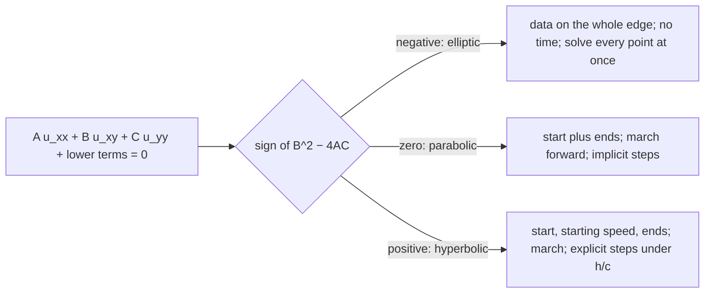
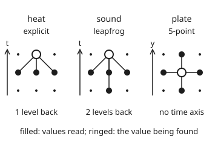

# Three families: elliptic, parabolic and hyperbolic, and why the family picks the method

[Syllabus](../../../SYLLABUS.md) → [Numerical analysis](../README.md) → [PDE Solvers](../README.md#s07) → Three families

---

## General Overview

A steel bar 1 m long comes out of a 100 C bath. Both ends are clamped at once into blocks held at 0 C. Three questions about steel need three computer programs:

- **Heat.** How warm is the middle of the bar after one hour?
- **Sound.** Tap the bar and it rings. How does the ring move along it?
- **Steady state.** A 1 m square steel plate has one edge held at 100 C and the other three at 0 C. What temperature does its centre settle at?

All three are second-order partial differential equations (PDEs: rules linking a quantity's rates of change in more than one direction). All three are solved here on grids of evenly spaced points: 1 cm apart on the bar, 5 cm apart on the plate. Yet each needs a different kind of program.

The heat program wants implicit time steps. An explicit step (each new value computed from old values only) must be under 4.17 s, so one hour costs 864 steps or more. An implicit step (all the new values solved for together) is stable at any length, so accuracy alone sets its length. The simplest, backward Euler, is only first order in time: one-minute steps leave errors up to 0.1820 C along the bar. Crank-Nicolson, a second-order implicit step, takes one-minute steps and stays within 0.0048 C of the exact answer (82.2128 C in the middle), for 5.80 times less arithmetic than 4 s explicit steps.

The sound program wants small explicit steps of under 1.98 microseconds, 200 steps per ring. That limit costs nothing: a tap crosses one grid spacing in that time, so an accurate picture needs steps that small anyway. An implicit step would pay for a solve every step and buy nothing, and the simplest one, backward Euler, also kills the ring. The plate program has no time at all. It must solve for every point at once, and its centre is exactly 25 C.

**The sign of B^2 − 4AC sorts a second-order equation into a family, and the family fixes how information travels: hyperbolic equations carry it at a finite speed, so explicit time steps fit; parabolic equations spread it everywhere at once, but only forward in time, so implicit time steps fit; elliptic equations tie every point to every edge, so the whole grid is solved at once.**

**What kind of fact this is:** the family names are a definition. The step limits, backward Euler's damping of the ring, the trapezoidal step's factor of size exactly 1 and the rate of the plate's sweeps are theorems about these grid schemes, proved on this card in Why it works. The time orders of backward Euler (first) and Crank-Nicolson (second) are measured here and proved in [Crank-Nicolson and the theta family](04-crank-nicolson-and-theta-methods.md). Which edge and starting data each family needs is stated with its link.

### The picture: from the coefficients to the program



Each arrow is one family: the data it needs, and the kind of program that suits it.

---

## The formula

The sorting rule is in [A partial differential equation](../../08-Differential%20equations%20and%20dynamics/10-The%20Classical%20PDEs/01-what-a-pde-says.md). In one line: write the top-order part as A u_xx + B u_xy + C u_yy, where u_xx is the second derivative of u in x, u_xy the mixed one (once in x, once in y) and u_yy the second in y, and read the sign of B^2 − 4AC. When time is one of the variables, it plays the part of y. This card adds what the sign means for a program:

$$B^2 - 4AC \;\begin{cases} < 0 & \text{elliptic: solve every grid point at once} \\ = 0 & \text{parabolic: march forward in time, implicit steps} \\ > 0 & \text{hyperbolic: march forward in time, explicit steps} \end{cases}$$

**Read it aloud:** negative, solve the whole grid together; zero, step forward and solve each new time level together; positive, step forward and compute each new value from old ones.

Each family also needs its own data, as [A partial differential equation](../../08-Differential%20equations%20and%20dynamics/10-The%20Classical%20PDEs/01-what-a-pde-says.md) shows: elliptic, values on the whole edge; parabolic, a starting profile plus the two ends; hyperbolic, a starting profile, a starting speed and the two ends.

The two marching families have explicit step limits, proved below:

$$\Delta t \le \frac{h^2}{2\alpha} \quad \text{(heat)}, \qquad \Delta t \le \frac{h}{c} \quad \text{(sound)}$$

**Read it aloud:** an explicit heat step must shrink with the square of the grid spacing; an explicit sound step only in proportion to it.

| Symbol | Plain meaning | In our example | Push it up and the answer… |
| --- | --- | --- | --- |
| $u$ | the unknown: temperature, or how far the steel has moved | 100 C at the start; 1 µm ring | — |
| $x$, $y$, $t$ | place along the bar or plate; place up the plate; time | 0 to 1 m; 0 to 3600 s | — |
| $A$, $B$, $C$ | the numbers in front of u_xx, u_xy, u_yy | heat 1.2e-5, 0, 0; sound 2.55e7, 0, −1 | B^2 − 4AC moves, maybe across 0 |
| $\alpha$ | diffusivity: how fast heat spreads, in m^2/s; wing 08 writes it κ, which this wing keeps for the condition number | 1.2e-5 (illustrative, typical of steel) | heat limit shrinks |
| $c$ | speed of sound along the bar, in m/s | 5047.5 (illustrative) | sound limit shrinks |
| $h$ | grid spacing | 0.01 m bar; 0.05 m plate | coarser, less accurate |
| $\Delta t$ | time step | 4 s or 60 s heat; 0.9906 µs sound | fewer steps, until a limit breaks |
| $r$ | mesh ratio αΔt/h^2 | 0.48 at 4 s; 0.54 at 4.5 s | explicit heat blows up past 0.5 |
| $k$, $\lambda_k$ | a grid wave with k humps; its rate | k = 1: 9.8688; k = 99: 39990.13 | rates spread as h falls |
| $\omega_k$ | how fast grid wave k rings, in radians per second: c times the square root of λ_k | k = 1: 15857 rad/s | — |
| $n$ | unknowns per solve | 99 on the bar; 361 on the plate | more work per step or sweep |
| $j$, $a_m$, $g$, $i$ | grid point number; one wave's size at step m; its factor per step; the square root of −1 | g of size 1 for leapfrog inside h/c | above 1, the wave blows up |

### When it holds

- **A linear second-order equation.** With coefficients that vary from place to place, the family belongs to each point, and a program may need different methods in different regions, as in flow near the speed of sound.
- **The second-order terms dominate.** Heat carried by a fast flow is parabolic on paper, but on a coarse grid it behaves like a hyperbolic equation and needs the methods of [Flow problems](06-upwind-schemes-and-conservation-laws.md).
- **These schemes.** The limits are for the three-point bend (a point against its two neighbours, Step 1) with forward Euler steps (heat) and leapfrog steps (sound: each new level from the two before). Other explicit schemes change the constant 2 or 1, but not the h^2 against h.
- **A uniform grid and fixed α and c.** With varying values, the largest α or c sets the limit.
- **One equation.** A system of several coupled unknowns is sorted by a matrix version of the same test, not covered here.

---

## Why it works

### Step 0: a program must let information travel the way the equation does

Heat at one point is felt at once, a little, everywhere along the bar, but never backwards in time. A tap on the bar travels at 5047.5 m/s, no faster. The plate's centre depends on every edge point together, with no time at all.

A grid program passes information between neighbours. The scheme must pass it at the right speed and in the right direction. The grid's own waves measure both.

### Step 1: the grid's waves, and how fast each one changes

On the bar, the grid bend at point j is (u_(j−1) − 2u_j + u_(j+1))/h^2. Put in a grid wave with k humps, u_j = sin(kπjh). The identity sin(a − b) + sin(a + b) = 2 sin a cos b turns the bend into a multiple of the wave itself:

$$\frac{u_{j-1} - 2u_j + u_{j+1}}{h^2} = -\lambda_k\, u_j, \qquad \lambda_k = \frac{4}{h^2}\sin^2\!\left(\frac{k\pi h}{2}\right).$$

With h = 0.01 m there are 99 grid waves. The smoothest has λ_1 = 9.8688, almost π^2 = 9.8696. The roughest has λ_99 = 39990.13, almost 4/h^2 = 40000. Any starting profile is a sum of these waves, and each one moves on its own.

### Step 2: parabolic, so every wave fades at its own rate, and the rates spread by 4052 to 1

For heat, wave k fades at rate αλ_k. The smoothest takes 1/(αλ_1) = 8444 s to fall by a factor e. The roughest takes 1/(αλ_99) = 2.08 s. The rates are 4052 to 1 apart: the grid problem is **stiff** (its fastest rate is far faster than the behaviour anyone wants to see).

- **Explicit step** (new value from old values only, forward Euler): wave k is multiplied by 1 − αΔtλ_k each step. This must stay between −1 and 1, so Δt ≤ 2/(αλ_99) = 4.1677 s. The safe rule h^2/(2α) = 4.1667 s works for every grid. The limit comes from the roughest wave, which matters least.
- **Implicit step** (backward Euler: the bend is taken at the new time): wave k is multiplied by 1/(1 + αΔtλ_k). That lies between 0 and 1 for every step size. A 60 s step is stable.

The implicit step's price is a solve: the new values appear together in a chain of 99 equations, each linking a point to its two neighbours. [The Thomas algorithm](../03-Numerical%20Linear%20Algebra/03-tridiagonal-systems-and-the-thomas-algorithm.md) solves such a chain in 8n − 7 = 785 flops (floating-point operations). One hour of 60 steps costs 47,100 flops, against 445,500 for 900 explicit steps.

Stability is not accuracy. Backward Euler is first order in time: its error shrinks only in proportion to Δt. At 60 s its largest error along the bar is 0.1820 C, at x = 0.20 m. The middle reads 82.2188 C, off by only +0.0061 C, but that is luck: there, near one hour, the time errors of the one-hump and three-hump waves have opposite signs and nearly cancel. At 30 minutes the middle is off by −0.2461 C, at 90 minutes by +0.1236 C. To match the 0.0127 C of explicit 4 s steps, backward Euler needs 4 s steps too: largest error 0.0118 C, for 706,500 flops.

An implicit step pays off when it is also accurate. [Crank-Nicolson and the theta family](04-crank-nicolson-and-theta-methods.md) averages the explicit and implicit bends, which makes the step second order in time. On this grid its 60 s steps stay within 0.0048 C all along the bar, for 60 × (5 × 99 + 785) = 76,800 flops, 5.80 times fewer than the explicit run. On finer grids its roughest waves ring near the clamped ends unless they are damped, which that card treats.

The explicit limit itself, r ≤ 1/2, is in [Stepping the heat equation on a grid](../../08-Differential%20equations%20and%20dynamics/10-The%20Classical%20PDEs/09-finite-differences-for-the-heat-equation.md). [Von Neumann analysis](03-von-neumann-analysis-and-the-cfl-condition.md) does it for any scheme.

### Step 3: hyperbolic, so every wave rings, and the step limit grows with h, not h^2

For sound, u_tt = c^2 u_xx. Wave k rings at ω_k = c times the square root of λ_k, and it does not fade. The roughest rings at 1009384 rad/s, close to 2c/h; the smoothest at 15857 rad/s, close to cπ. Their spread is only 64 to 1.

- **Leapfrog** (each new value from the two levels before) keeps every wave's size when ω_99 Δt < 2. On every grid that holds when Δt ≤ h/c = 1.9812 µs. The proof is in the fold below.
- That limit is no burden. A tap moves one grid spacing in h/c, so an accurate picture of a moving ring needs steps that small anyway. The smoothest ring takes 396.23 µs, which is 200 steps at the limit.
- **Backward Euler** for sound multiplies every wave's size by 1/sqrt(1 + ω_k^2 Δt^2) each step. That is below 1 for every ring, so the ring dies away on the grid while the real bar keeps ringing. The check starts the smoothest wave at 1 µm in the middle, released from rest. At 10 steps per ring the smoothest wave keeps 0.189459 of its size after one ring.
- That damping belongs to backward Euler, not to implicit steps as such. The **trapezoidal step** (the average of the old and new bends, Crank-Nicolson in time) multiplies every wave by (1 + iω_kΔt/2)/(1 − iω_kΔt/2), of size exactly 1 at any step length, so it keeps the ring. It still pays for a solve every step, and accuracy still needs steps near h/c, so leapfrog's explicit steps remain the cheaper program.

The limit Δt ≤ h/c is the Courant–Friedrichs–Lewy condition: the grid must reach at least as far per step as the sound does. [Von Neumann analysis](03-von-neumann-analysis-and-the-cfl-condition.md) proves it in general.

<details>
<summary>Detailed proof: leapfrog keeps every wave's size exactly when ω Δt < 2</summary>

Leapfrog for one grid wave reads a_(m+1) − 2a_m + a_(m−1) = −ω^2 Δt^2 a_m, where a_m is the wave's size at step m. Try a_m = g^m. Then g^2 − (2 − ω^2Δt^2) g + 1 = 0. The two roots multiply to 1.

If 0 < ω^2Δt^2 < 4, the roots are complex conjugates, so both have size 1: the wave keeps its size. At ω^2Δt^2 = 4 there is a double root −1, and the wave grows in proportion to m. If ω^2Δt^2 > 4, the roots are real, negative, and multiply to 1, so one has size above 1: the wave grows every step.

The roughest wave has ω_99 Δt = cΔt × 2 sin(99π/200)/h. Since sin(99π/200) < 1, Δt ≤ h/c keeps ω_99 Δt below 2. On finer grids the sine creeps toward 1, so any cΔt/h above 1 breaks some grid: Δt ≤ h/c is the limit for every grid.

For backward Euler on u_t = v, v_t = −ω^2 u, one step is the matrix inverse of `[[1, −Δt], [ω^2 Δt, 1]]`. Its eigenvalues are 1/(1 ± iωΔt), of size 1/sqrt(1 + ω^2Δt^2). The code checks that the grid run and this formula agree. The trapezoidal step averages the old and new right-hand sides, so its eigenvalues are (1 ± iωΔt/2)/(1 ∓ iωΔt/2): a number divided by its own complex conjugate, of size exactly 1 for every Δt.

</details>

### Step 4: elliptic, so there is no time, and every point waits for every edge

The plate's rule, u_xx + u_yy = 0, says on the grid that each inside point is the average of its four neighbours. Nothing is earlier or later. Change one edge point, and every inside value changes.

The centre value comes from a symmetry. Turn the plate a quarter turn three times, and add the four problems: every edge is then at 100 C, so the sum is 100 C everywhere. By symmetry the four centres are equal, so each is exactly 25 C. The grid problem has the same symmetry, so its centre is 25 C too.

**Jacobi's method** sweeps the grid, replacing every inside value by its neighbours' average. The slowest errors are the smooth bump sin(πx) sin(πy) and the checkerboard: the same bump with its sign flipped at every other point. The bump's four neighbours average to cos(πh) times its own value (from cos(a − b) + cos(a + b) = 2 cos a cos b), the checkerboard's to −cos(πh) times its own, so each sweep shrinks both in size by cos(πh) = 0.98769 at h = 0.05 m. Cutting it a millionfold takes 1116 sweeps. For small h that count is close to 2.80/h^2, which gives 1120 at h = 0.05 m: it quadruples when h halves.

So an elliptic grid is one big linear system with n unknowns, solved all at once. Jacobi shows the shape of the cost; better solvers (conjugate gradients, multigrid, or the tridiagonal solves of [Two space dimensions](05-adi-and-multidimensional-grids.md)) cut it.

### Step 5: the implicit heat step is a small elliptic problem

The backward Euler step solves (1 + 2r)u_j − r(u_(j−1) + u_(j+1)) = old u_j for the new values. That is an elliptic problem in space: each new value is tied to the whole new level. With huge steps it becomes the steady problem itself, the bar's straight-line steady state.

So a parabolic equation sits between the other two. In time it marches, like sound. At each step it solves, like the plate.

### The picture: what each step reads

<p align="center"></p>

Filled dots are values read; the ringed dot is the value found. The heat and sound stencils point forward in time. The plate's points up, down, left and right, so nothing can be found until everything is.

---

## Worked numbers, by hand

| Step | Arithmetic | Value |
| --- | --- | --- |
| heat: A, B, C | α, 0, 0, so B^2 − 4AC = 0 − 4 × 1.2e-5 × 0 | 0: parabolic |
| sound: A, B, C | c^2, 0, −1, so 0 − 4 × 2.55e7 × (−1) | 1.02e8: hyperbolic |
| plate: A, B, C | 1, 0, 1, so 0 − 4 × 1 × 1 | −4: elliptic |
| roughest bar wave | 40000 × sin^2(0.495π) | λ_99 = 39990.13 |
| explicit heat limit | 0.01^2 ÷ (2 × 1.2e-5) | 4.1667 s |
| explicit steps per hour | 3600 ÷ 4.1667, rounded up | 864 |
| sound limit | 0.01 ÷ 5047.5 | 1.9812 µs |
| steps per ring | (2 ÷ 5047.5) ÷ (0.01 ÷ 5047.5) | 200 |
| Jacobi factor at h = 0.05 m | cos(0.05π) | 0.98769 |
| sweeps for a millionfold | ln(10^6) ÷ (−ln 0.98769), rounded up | 1116 |
| heat by 60 backward Euler steps | 60 tridiagonal solves | middle 82.2188 C, true error +0.0061; 0.1820 C off at x = 0.20 m |
| heat by 60 Crank-Nicolson steps | 60 tridiagonal solves | **82.2080 C, true error −0.0048; no point off by more** |

The middle of the bar is 82.2 C after one hour. Crank-Nicolson's 60 steps get within 0.0048 C everywhere along the bar for 76,800 flops. Explicit steps of 4 s get within 0.0127 C for 445,500 flops, 5.80 times more. Backward Euler's 60 steps look as good only at the middle, by luck; it needs 4 s steps, and 706,500 flops, to match the explicit run.

### What breaks if you drop a piece

| Mistake | Comes out at | What went wrong |
| --- | --- | --- |
| Explicit heat with Δt = 4.5 s, r = 0.54 | 6.94e49 C after one hour | the roughest wave is multiplied by −1.1595 each step |
| Leapfrog sound with cΔt/h = 1.05 | 7.24e34 µm after 190 steps | the step outran the sound: past h/c |
| Backward Euler heat at 60 s, judged at the middle only | +0.0061 C there, but 0.1820 C off at x = 0.20 m | first order in time; near one hour two waves' errors cancel in the middle |
| Backward Euler sound, 10 steps per ring | size 0.189459 after one ring, true 1 | backward Euler damps a wave that should ring |
| Plate stopped after 100 Jacobi sweeps | centre 13.356220 C, true 25 C | the edge's influence has not crossed the grid yet |

The explicit runs start the roughest wave from the jump at the clamped ends (heat) or from rounding (sound). Over the limit it grows from there.

---

## Code, from first principles, and it actually runs

The code sorts four equations by B^2 − 4AC, then runs each family's program on steel. Heat takes three roads to the bar's temperature after one hour: the exact Fourier series, explicit steps, and implicit steps (backward Euler and Crank-Nicolson, one tridiagonal solve each), read at the middle and at the worst point along the bar. Sound checks leapfrog against the exact standing wave, and checks a backward Euler run against its wave-by-wave formula. The plate checks Jacobi sweeps against the exact 25 C, and their observed rate against cos(πh).

### Python

```python
# Three families -- the check behind the card.  Standard library only (math).
# One steel bar, h = 0.01 m.  Heat (parabolic): explicit, backward Euler and Crank-Nicolson
# steps against the exact Fourier series, all along the bar.  Sound (hyperbolic): leapfrog against the
# exact standing wave, and backward Euler steps against their mode formula.  A steel plate
# (elliptic): Jacobi sweeps against the exact centre value 25 C and the rate cos(pi h).
from math import sin, cos, exp, sqrt, pi, log, ceil
ALPHA = 1.2e-5                      # diffusivity of steel, m^2/s (illustrative)
C = sqrt(200e9 / 7850)              # sound speed in steel, m/s: sqrt(stiffness / density) (illustrative)
H, N = 0.01, 100                    # grid spacing in m; intervals along the 1 m bar
def sci(x):                         # e-notation with the same digits in Python and Rust
    m, e = f"{x:.2e}".split("e"); return f"{m}e{int(e)}"
def family(a, b, cc):               # the sign of B^2 - 4AC
    d = b * b - 4 * a * cc
    return d, "hyperbolic" if d > 0 else ("parabolic" if d == 0 else "elliptic")
def lam(k, h): return 4 / (h * h) * sin(k * pi * h / 2) ** 2   # grid mode k: rate of the 3-point bend
def thomas(a, b, c, d):             # tridiagonal solve, constant diagonals a (left), b (middle), c (right)
    m = len(d); cp = [0.0] * m; dp = [0.0] * m; cp[0] = c / b; dp[0] = d[0] / b
    for i in range(1, m):
        den = b - a * cp[i - 1]; cp[i] = c / den; dp[i] = (d[i] - a * dp[i - 1]) / den
    x = [0.0] * m; x[m - 1] = dp[m - 1]
    for i in range(m - 2, -1, -1): x[i] = dp[i] - cp[i] * x[i + 1]
    return x
def series(x, t):                       # the exact temperature: Fourier series of the 100 C start
    return sum(400 / pi / k * sin(k * pi * x) * exp(-ALPHA * (k * pi) ** 2 * t) for k in range(1, 400, 2))
def heat_explicit(dt, t_end=3600.0):    # each point moves toward its neighbours, one level back
    u = [0.0] + [100.0] * (N - 1) + [0.0]; r = ALPHA * dt / (H * H)
    for _ in range(round(t_end / dt)):
        u = [0.0] + [u[j] + r * (u[j - 1] - 2 * u[j] + u[j + 1]) for j in range(1, N)] + [0.0]
    return u
def heat_implicit(dt, th=1.0, t_end=3600.0):    # th 1: backward Euler, 0.5: Crank-Nicolson; one solve per step
    u = [0.0] + [100.0] * (N - 1) + [0.0]; r = ALPHA * dt / (H * H); s = (1 - th) * r
    for _ in range(round(t_end / dt)):
        rhs = [u[j] + s * (u[j - 1] - 2 * u[j] + u[j + 1]) for j in range(1, N)]
        u = [0.0] + thomas(-th * r, 1 + 2 * th * r, -th * r, rhs) + [0.0]
    return u
def bend(u, j): return (u[j - 1] - 2 * u[j] + u[j + 1]) / (H * H)
def leapfrog(nu, steps):                # sound: new level from the two before; nu = C dt / H
    dt = nu * H / C; old = [sin(pi * j * H) for j in range(N)] + [0.0]
    now = [0.0] + [old[j] + dt * dt / 2 * C * C * bend(old, j) for j in range(1, N)] + [0.0]
    for _ in range(steps - 1):
        old, now = now, [0.0] + [2 * now[j] - old[j] + dt * dt * C * C * bend(now, j) for j in range(1, N)] + [0.0]
    return now[N // 2], max(abs(x) for x in now)
def sound_implicit(per):                # backward Euler on (u, v) for one period, per steps
    dt = 2 / C / per; k = (C * dt / H) ** 2
    u = [sin(pi * j * H) for j in range(1, N)]; v = [0.0] * (N - 1)
    for _ in range(per):
        u1 = thomas(-k, 1 + 2 * k, -k, [u[i] + dt * v[i] for i in range(N - 1)])
        v = [(u1[i] - u[i]) / dt for i in range(N - 1)]; u = u1
    w = C * sqrt(lam(1, H))
    return sqrt(u[N // 2 - 1] ** 2 + (v[N // 2 - 1] / w) ** 2), (1 + (w * dt) ** 2) ** (-per / 2)
def jacobi(m, marks):                   # plate: each inside point becomes its four neighbours' mean
    u = [[100.0 if j == m and 0 < i < m else 0.0 for i in range(m + 1)] for j in range(m + 1)]; out = {}
    for s in range(1, max(marks) + 1):
        new = [row[:] for row in u]
        for j in range(1, m):
            for i in range(1, m):
                new[j][i] = (u[j][i - 1] + u[j][i + 1] + u[j - 1][i] + u[j + 1][i]) / 4
        u = new
        if s in marks: out[s] = u[m // 2][m // 2]
    return out
# 1. Classify from the coefficients of u_xx, u_xy, u_yy (time plays y)
cases = [("heat in the bar, alpha u_xx - u_t", ALPHA, 0, 0), ("sound in the bar, c^2 u_xx - u_tt", C * C, 0, -1),
         ("steady plate, u_xx + u_yy", 1, 0, 1), ("Black-Scholes, S = 100, sigma = 0.2", 0.5 * 0.04 * 100 ** 2, 0, 0)]
kinds = []
for name, a, b, cc in cases:
    d, k = family(a, b, cc); kinds.append(k)
    print(f"{name}: A {sci(a)}, B {b}, C {cc}, B^2 - 4AC {sci(d)} -> {k}")
# 2. Grid modes and the two explicit step limits
l1, lmax = lam(1, H), lam(N - 1, H)
print(f"grid modes, h = {H}: slowest rate {l1:.6f} (pi^2 = {pi * pi:.6f}), fastest {lmax:.2f} (4/h^2 = {4 / H ** 2:.0f})")
w1, wmax = C * sqrt(l1), C * sqrt(lmax)
print(f"sound rings at: slowest {w1:.0f} rad/s, fastest {wmax:.0f} rad/s, spread {wmax / w1:.0f}")
dt_heat, dt_heat_mode = H * H / (2 * ALPHA), 2 / (ALPHA * lmax)
print(f"heat: explicit limit h^2/(2 alpha) = {dt_heat:.4f} s (fastest mode allows {dt_heat_mode:.4f} s); "
      f"slowest decay time {1 / (ALPHA * l1):.0f} s, fastest {1 / (ALPHA * lmax):.2f} s; spread of rates {lmax / l1:.0f}")
dt_wave, period = H / C, 2 / C
print(f"sound: c = {C:.1f} m/s, explicit limit h/c = {dt_wave * 1e6:.4f} us; ring period {period * 1e6:.2f} us = {period / dt_wave:.0f} steps")
# 3. Heat: one hour of cooling, three roads; true errors at the middle and at the worst point of the bar
bar = [series(j / N, 3600.0) for j in range(N + 1)]; exact = bar[N // 2]
print(f"heat middle at 1 h: exact series {exact:.4f} C")
def report(name, u):                    # the middle, its true error, and the largest true error along the bar
    e = [u[j] - bar[j] for j in range(N + 1)]; j = max(range(N + 1), key=lambda i: abs(e[i]))
    print(f"heat {name}: middle {u[N // 2]:.4f}, error {e[N // 2]:+.4f}; largest error {abs(e[j]):.4f} C at x = {j / N:.2f} m")
    return e[N // 2], abs(e[j])
ex4 = report("explicit dt 4 s (900 steps)", heat_explicit(4.0)); be60 = report("backward Euler dt 60 s (60 steps)", heat_implicit(60.0))
be4 = report("backward Euler dt 4 s (900 steps)", heat_implicit(4.0)); cn60 = report("Crank-Nicolson dt 60 s (60 steps)", heat_implicit(60.0, 0.5))
report("backward Euler dt 600 s (6 steps)", heat_implicit(600.0)); blow = max(map(abs, heat_explicit(4.5)))
mids = [heat_implicit(60.0, 1.0, t)[N // 2] - series(0.5, t) for t in (1800.0, 5400.0)]
print(f"heat backward Euler dt 60 s, middle error at 30 min {mids[0]:+.4f}, at 90 min {mids[1]:+.4f}")
fl = [900 * 99 * 5, 60 * (8 * 99 - 7), 900 * (8 * 99 - 7), 60 * (5 * 99 + 8 * 99 - 7)]
print(f"heat flops: explicit 900 x 99 x 5 = {fl[0]}; backward Euler 60 x (8 x 99 - 7) = {fl[1]}, 900 x 785 = {fl[2]}; "
      f"Crank-Nicolson 60 x (5 x 99 + 785) = {fl[3]}; explicit / Crank-Nicolson {fl[0] / fl[3]:.2f}; r at 4 s {ALPHA * 4 / H ** 2:.2f}")
print(f"heat explicit dt 4.5 s = {4.5 / dt_heat:.2f} x limit (r = {ALPHA * 4.5 / H ** 2:.2f}): largest value after 1 h {sci(blow)} C; "
      f"fastest mode x{abs(1 - ALPHA * 4.5 * lmax):.4f} per step")
# 4. Sound: half a period of leapfrog, then backward Euler steps over one period
mid, _ = leapfrog(0.5, 200); _, wild = leapfrog(1.05, 190)
print(f"sound leapfrog cdt/h = 0.5 (dt {0.5 * dt_wave * 1e6:.4f} us), 200 steps to half a period: middle {mid:.10f} um (exact -1), error {sci(mid + 1)}")
print(f"sound leapfrog cdt/h = 1.05, 190 steps: largest value {sci(wild)} um")
for per in (10, 100, 1000):
    grid, formula = sound_implicit(per)
    print(f"sound backward Euler, {per} steps per period: amplitude after one period {grid:.6f} (mode formula {formula:.6f})")
# 5. Plate: no time; Jacobi sweeps toward the exact centre 25 C (four rotated copies add to 100)
plate = jacobi(20, {100, 400, 500, 1200})
print("plate h = 0.05, centre after sweeps: " + ", ".join(f"{s}: {v:.6f}" for s, v in sorted(plate.items())))
rate = ((25 - plate[500]) / (25 - plate[400])) ** 0.01
print(f"plate error shrinks x{rate:.8f} per sweep; cos(pi h) = {cos(pi * 0.05):.8f}")
sweeps = [ceil(log(1e6) / -log(cos(pi * hh))) for hh in (0.05, 0.025, 0.01)]
print(f"sweeps to cut the error a millionfold: h = 0.05 {sweeps[0]}, 0.025 {sweeps[1]}, 0.01 {sweeps[2]}; "
      f"estimate {2 * log(1e6) / pi ** 2:.2f}/h^2 = {2 * log(1e6) / (pi * 0.05) ** 2:.0f} at h = 0.05 (361 unknowns)")
print(f"halve h: heat explicit steps per hour {ceil(3600 / dt_heat)} -> {ceil(3600 / (H * H / 8 / ALPHA))}; "
      f"sound steps per period {period / dt_wave:.0f} -> {2 * period / dt_wave:.0f}; plate sweeps {sweeps[0]} -> {sweeps[1]}")
print("figure, panels centre x " + ", ".join(str(60 + 120 * p) for p in range(3)) + "; rows y 90, 120, 150; spacing 30 (one h or one dt)")
assert kinds == ["parabolic", "hyperbolic", "elliptic", "parabolic"]
assert abs(ex4[0]) <= ex4[1] < 0.02 and cn60[1] < 0.01 and be60[1] > 0.1   # explicit and Crank-Nicolson land on the series
assert 12 < be60[1] / be4[1] < 18 and abs(be60[0]) < 0.01 < -mids[0]   # backward Euler: first order; lucky middle
assert blow > 1e10 and abs(1 - ALPHA * 4.5 * lmax) > 1          # over the limit: the fastest mode grows
assert 1 < dt_heat_mode / dt_heat < 1.001                        # the mode limit sits just above h^2/(2 alpha)
assert abs(mid + 1) < 1e-6 and wild > 1e10                       # leapfrog: exact inside h/c, wild outside
assert all(abs(g - f) < 1e-9 for g, f in map(sound_implicit, (10, 100)))   # grid run = mode formula
assert abs(plate[1200] - 25) < 1e-4 and abs(rate - cos(pi * 0.05)) < 1e-8  # superposition and Jacobi's rate
print("ALL CHECKS PASS")
```

**Ran 2026-11-11 on macOS, Python 3.14.10, standard library only. All checks passed. Output, pasted from the run:**

```
heat in the bar, alpha u_xx - u_t: A 1.20e-5, B 0, C 0, B^2 - 4AC 0.00e0 -> parabolic
sound in the bar, c^2 u_xx - u_tt: A 2.55e7, B 0, C -1, B^2 - 4AC 1.02e8 -> hyperbolic
steady plate, u_xx + u_yy: A 1.00e0, B 0, C 1, B^2 - 4AC -4.00e0 -> elliptic
Black-Scholes, S = 100, sigma = 0.2: A 2.00e2, B 0, C 0, B^2 - 4AC 0.00e0 -> parabolic
grid modes, h = 0.01: slowest rate 9.868793 (pi^2 = 9.869604), fastest 39990.13 (4/h^2 = 40000)
sound rings at: slowest 15857 rad/s, fastest 1009384 rad/s, spread 64
heat: explicit limit h^2/(2 alpha) = 4.1667 s (fastest mode allows 4.1677 s); slowest decay time 8444 s, fastest 2.08 s; spread of rates 4052
sound: c = 5047.5 m/s, explicit limit h/c = 1.9812 us; ring period 396.23 us = 200 steps
heat middle at 1 h: exact series 82.2128 C
heat explicit dt 4 s (900 steps): middle 82.2060, error -0.0068; largest error 0.0127 C at x = 0.23 m
heat backward Euler dt 60 s (60 steps): middle 82.2188, error +0.0061; largest error 0.1820 C at x = 0.20 m
heat backward Euler dt 4 s (900 steps): middle 82.2079, error -0.0049; largest error 0.0118 C at x = 0.18 m
heat Crank-Nicolson dt 60 s (60 steps): middle 82.2080, error -0.0048; largest error 0.0048 C at x = 0.50 m
heat backward Euler dt 600 s (6 steps): middle 82.2007, error -0.0120; largest error 1.9269 C at x = 0.19 m
heat backward Euler dt 60 s, middle error at 30 min -0.2461, at 90 min +0.1236
heat flops: explicit 900 x 99 x 5 = 445500; backward Euler 60 x (8 x 99 - 7) = 47100, 900 x 785 = 706500; Crank-Nicolson 60 x (5 x 99 + 785) = 76800; explicit / Crank-Nicolson 5.80; r at 4 s 0.48
heat explicit dt 4.5 s = 1.08 x limit (r = 0.54): largest value after 1 h 6.94e49 C; fastest mode x1.1595 per step
sound leapfrog cdt/h = 0.5 (dt 0.9906 us), 200 steps to half a period: middle -0.9999999953 um (exact -1), error 4.69e-9
sound leapfrog cdt/h = 1.05, 190 steps: largest value 7.24e34 um
sound backward Euler, 10 steps per period: amplitude after one period 0.189459 (mode formula 0.189459)
sound backward Euler, 100 steps per period: amplitude after one period 0.821201 (mode formula 0.821201)
sound backward Euler, 1000 steps per period: amplitude after one period 0.980456 (mode formula 0.980456)
plate h = 0.05, centre after sweeps: 100: 13.356220, 400: 24.715581, 500: 24.917595, 1200: 24.999986
plate error shrinks x0.98768834 per sweep; cos(pi h) = 0.98768834
sweeps to cut the error a millionfold: h = 0.05 1116, 0.025 4475, 0.01 27992; estimate 2.80/h^2 = 1120 at h = 0.05 (361 unknowns)
halve h: heat explicit steps per hour 864 -> 3456; sound steps per period 200 -> 400; plate sweeps 1116 -> 4475
figure, panels centre x 60, 180, 300; rows y 90, 120, 150; spacing 30 (one h or one dt)
ALL CHECKS PASS
```

### Rust

```rust
// Three families -- the check behind the card.  Rust std only, no crates.
// One steel bar, h = 0.01 m.  Heat (parabolic): explicit, backward Euler and Crank-Nicolson
// steps against the exact Fourier series, all along the bar.  Sound (hyperbolic): leapfrog against the
// exact standing wave, and backward Euler steps against their mode formula.  A steel plate
// (elliptic): Jacobi sweeps against the exact centre value 25 C and the rate cos(pi h).
use std::f64::consts::PI;
const ALPHA: f64 = 1.2e-5; // diffusivity of steel, m^2/s (illustrative)
const H: f64 = 0.01; // grid spacing in m
const N: usize = 100; // intervals along the 1 m bar
fn c_speed() -> f64 { (200e9f64 / 7850.0).sqrt() } // sound speed in steel, m/s: sqrt(stiffness / density) (illustrative)
fn sci(x: f64) -> String { format!("{:.2e}", x) } // e-notation with the same digits in Python and Rust
fn family(a: f64, b: f64, cc: f64) -> (f64, &'static str) {
    let d = b * b - 4.0 * a * cc; // the sign of B^2 - 4AC
    (d, if d > 0.0 { "hyperbolic" } else if d == 0.0 { "parabolic" } else { "elliptic" })
}
fn lam(k: usize, h: f64) -> f64 { 4.0 / (h * h) * (k as f64 * PI * h / 2.0).sin().powi(2) } // grid mode k: rate of the 3-point bend
fn thomas(a: f64, b: f64, c: f64, d: &[f64]) -> Vec<f64> {
    let (m, mut cp, mut dp) = (d.len(), vec![0.0; d.len()], vec![0.0; d.len()]);
    (cp[0], dp[0]) = (c / b, d[0] / b);
    for i in 1..m {
        let den = b - a * cp[i - 1];
        (cp[i], dp[i]) = (c / den, (d[i] - a * dp[i - 1]) / den);
    }
    let mut x = dp.clone();
    for i in (0..m - 1).rev() { x[i] = dp[i] - cp[i] * x[i + 1]; }
    x
}
fn maxabs(u: &[f64]) -> f64 { u.iter().fold(0.0, |m, x| if x.abs() > m { x.abs() } else { m }) }
fn series(x: f64, t: f64) -> f64 { // the exact temperature: Fourier series of the 100 C start
    (1..400usize).step_by(2).map(|k| { let kf = k as f64; 400.0 / PI / kf * (kf * PI * x).sin() * (-ALPHA * (kf * PI).powi(2) * t).exp() }).sum()
}
fn heat_explicit(dt: f64) -> Vec<f64> { // each point moves toward its neighbours, one level back
    let (mut u, r) = (vec![100.0; N + 1], ALPHA * dt / (H * H));
    (u[0], u[N]) = (0.0, 0.0);
    for _ in 0..(3600.0 / dt).round() as usize {
        let mut v = vec![0.0; N + 1];
        for j in 1..N { v[j] = u[j] + r * (u[j - 1] - 2.0 * u[j] + u[j + 1]); }
        u = v;
    }
    u
}
fn heat_implicit(dt: f64, th: f64, t_end: f64) -> Vec<f64> { // th 1: backward Euler, 0.5: Crank-Nicolson; one solve per step
    let (mut u, r) = (vec![100.0; N + 1], ALPHA * dt / (H * H));
    let s = (1.0 - th) * r;
    (u[0], u[N]) = (0.0, 0.0);
    for _ in 0..(t_end / dt).round() as usize {
        let rhs: Vec<f64> = (1..N).map(|j| u[j] + s * (u[j - 1] - 2.0 * u[j] + u[j + 1])).collect();
        u = [vec![0.0], thomas(-th * r, 1.0 + 2.0 * th * r, -th * r, &rhs), vec![0.0]].concat();
    }
    u
}
fn report(name: &str, u: &[f64], bar: &[f64]) -> (f64, f64) { // the middle, its true error, the largest true error along the bar
    let e: Vec<f64> = (0..=N).map(|j| u[j] - bar[j]).collect();
    let j = (0..=N).fold(0, |b, i| if e[i].abs() > e[b].abs() { i } else { b });
    println!("heat {}: middle {:.4}, error {:+.4}; largest error {:.4} C at x = {:.2} m", name, u[N / 2], e[N / 2], e[j].abs(), j as f64 / N as f64);
    (e[N / 2], e[j].abs())
}
fn bend(u: &[f64], j: usize) -> f64 { (u[j - 1] - 2.0 * u[j] + u[j + 1]) / (H * H) }
fn leapfrog(nu: f64, steps: usize) -> (f64, f64) {
    let c = c_speed();
    let dt = nu * H / c;
    let mut old: Vec<f64> = (0..=N).map(|j| if j < N { (PI * j as f64 * H).sin() } else { 0.0 }).collect();
    let mut now = vec![0.0; N + 1];
    for j in 1..N { now[j] = old[j] + dt * dt / 2.0 * c * c * bend(&old, j); }
    for _ in 0..steps - 1 {
        let mut new = vec![0.0; N + 1];
        for j in 1..N { new[j] = 2.0 * now[j] - old[j] + dt * dt * c * c * bend(&now, j); }
        (old, now) = (now, new);
    }
    (now[N / 2], maxabs(&now))
}
fn sound_implicit(per: usize) -> (f64, f64) {
    let c = c_speed();
    let dt = 2.0 / c / per as f64;
    let k = (c * dt / H).powi(2);
    let mut u: Vec<f64> = (1..N).map(|j| (PI * j as f64 * H).sin()).collect();
    let mut v = vec![0.0; N - 1];
    for _ in 0..per {
        let rhs: Vec<f64> = (0..N - 1).map(|i| u[i] + dt * v[i]).collect();
        let u1 = thomas(-k, 1.0 + 2.0 * k, -k, &rhs);
        v = (0..N - 1).map(|i| (u1[i] - u[i]) / dt).collect();
        u = u1;
    }
    let w = c * lam(1, H).sqrt();
    let m = N / 2 - 1; ((u[m].powi(2) + (v[m] / w).powi(2)).sqrt(), (1.0 + (w * dt).powi(2)).powf(-(per as f64) / 2.0))
}
fn jacobi(m: usize, marks: &[usize]) -> Vec<(usize, f64)> {
    let mut u = vec![vec![0.0; m + 1]; m + 1];
    for i in 1..m { u[m][i] = 100.0; }
    let mut out = vec![];
    for s in 1..=*marks.iter().max().unwrap() {
        let mut new = u.clone();
        for j in 1..m {
            for i in 1..m { new[j][i] = (u[j][i - 1] + u[j][i + 1] + u[j - 1][i] + u[j + 1][i]) / 4.0; }
        }
        u = new;
        if marks.contains(&s) { out.push((s, u[m / 2][m / 2])); }
    }
    out
}
fn main() {
    let c = c_speed();
    // 1. Classify from the coefficients of u_xx, u_xy, u_yy (time plays y)
    let cases = [("heat in the bar, alpha u_xx - u_t", ALPHA, 0, 0), ("sound in the bar, c^2 u_xx - u_tt", c * c, 0, -1),
        ("steady plate, u_xx + u_yy", 1.0, 0, 1), ("Black-Scholes, S = 100, sigma = 0.2", 0.5 * 0.04 * 100f64.powi(2), 0, 0)];
    let mut kinds = vec![];
    for (name, a, b, cc) in cases {
        let (d, k) = family(a, b as f64, cc as f64);
        kinds.push(k);
        println!("{}: A {}, B {}, C {}, B^2 - 4AC {} -> {}", name, sci(a), b, cc, sci(d), k);
    }
    // 2. Grid modes and the two explicit step limits
    let (l1, lmax) = (lam(1, H), lam(N - 1, H));
    println!("grid modes, h = 0.01: slowest rate {:.6} (pi^2 = {:.6}), fastest {:.2} (4/h^2 = {:.0})", l1, PI * PI, lmax, 4.0 / (H * H));
    let (w1, wmax) = (c * l1.sqrt(), c * lmax.sqrt());
    println!("sound rings at: slowest {:.0} rad/s, fastest {:.0} rad/s, spread {:.0}", w1, wmax, wmax / w1);
    let (dt_heat, dt_heat_mode) = (H * H / (2.0 * ALPHA), 2.0 / (ALPHA * lmax));
    println!("heat: explicit limit h^2/(2 alpha) = {:.4} s (fastest mode allows {:.4} s); slowest decay time {:.0} s, fastest {:.2} s; spread of rates {:.0}",
        dt_heat, dt_heat_mode, 1.0 / (ALPHA * l1), 1.0 / (ALPHA * lmax), lmax / l1);
    let (dt_wave, period) = (H / c, 2.0 / c);
    println!("sound: c = {:.1} m/s, explicit limit h/c = {:.4} us; ring period {:.2} us = {:.0} steps", c, dt_wave * 1e6, period * 1e6, period / dt_wave);
    // 3. Heat: one hour of cooling, three roads; true errors at the middle and at the worst point of the bar
    let bar: Vec<f64> = (0..=N).map(|j| series(j as f64 / N as f64, 3600.0)).collect();
    println!("heat middle at 1 h: exact series {:.4} C", bar[N / 2]);
    let ex4 = report("explicit dt 4 s (900 steps)", &heat_explicit(4.0), &bar);
    let be60 = report("backward Euler dt 60 s (60 steps)", &heat_implicit(60.0, 1.0, 3600.0), &bar);
    let be4 = report("backward Euler dt 4 s (900 steps)", &heat_implicit(4.0, 1.0, 3600.0), &bar);
    let cn60 = report("Crank-Nicolson dt 60 s (60 steps)", &heat_implicit(60.0, 0.5, 3600.0), &bar);
    report("backward Euler dt 600 s (6 steps)", &heat_implicit(600.0, 1.0, 3600.0), &bar);
    let blow = maxabs(&heat_explicit(4.5));
    let mids: Vec<f64> = [1800.0, 5400.0].iter().map(|&t| heat_implicit(60.0, 1.0, t)[N / 2] - series(0.5, t)).collect();
    println!("heat backward Euler dt 60 s, middle error at 30 min {:+.4}, at 90 min {:+.4}", mids[0], mids[1]);
    let fl = [900 * 99 * 5, 60 * (8 * 99 - 7), 900 * (8 * 99 - 7), 60 * (5 * 99 + 8 * 99 - 7)];
    println!("heat flops: explicit 900 x 99 x 5 = {}; backward Euler 60 x (8 x 99 - 7) = {}, 900 x 785 = {}; Crank-Nicolson 60 x (5 x 99 + 785) = {}; explicit / Crank-Nicolson {:.2}; r at 4 s {:.2}",
        fl[0], fl[1], fl[2], fl[3], fl[0] as f64 / fl[3] as f64, ALPHA * 4.0 / (H * H));
    println!("heat explicit dt 4.5 s = {:.2} x limit (r = {:.2}): largest value after 1 h {} C; fastest mode x{:.4} per step",
        4.5 / dt_heat, ALPHA * 4.5 / (H * H), sci(blow), (1.0 - ALPHA * 4.5 * lmax).abs());
    // 4. Sound: half a period of leapfrog, then backward Euler steps over one period
    let (mid, _) = leapfrog(0.5, 200);
    let (_, wild) = leapfrog(1.05, 190);
    println!("sound leapfrog cdt/h = 0.5 (dt {:.4} us), 200 steps to half a period: middle {:.10} um (exact -1), error {}",
        0.5 * dt_wave * 1e6, mid, sci(mid + 1.0));
    println!("sound leapfrog cdt/h = 1.05, 190 steps: largest value {} um", sci(wild));
    for per in [10, 100, 1000] {
        let (grid, formula) = sound_implicit(per);
        println!("sound backward Euler, {} steps per period: amplitude after one period {:.6} (mode formula {:.6})", per, grid, formula);
    }
    // 5. Plate: no time; Jacobi sweeps toward the exact centre 25 C (four rotated copies add to 100)
    let plate = jacobi(20, &[100, 400, 500, 1200]);
    let list: Vec<String> = plate.iter().map(|(s, v)| format!("{}: {:.6}", s, v)).collect();
    println!("plate h = 0.05, centre after sweeps: {}", list.join(", "));
    let rate = ((25.0 - plate[2].1) / (25.0 - plate[1].1)).powf(0.01);
    println!("plate error shrinks x{:.8} per sweep; cos(pi h) = {:.8}", rate, (PI * 0.05).cos());
    let sw: Vec<f64> = [0.05, 0.025, 0.01].iter().map(|hh: &f64| (1e6f64.ln() / -(PI * hh).cos().ln()).ceil()).collect();
    println!("sweeps to cut the error a millionfold: h = 0.05 {}, 0.025 {}, 0.01 {}; estimate {:.2}/h^2 = {:.0} at h = 0.05 (361 unknowns)",
        sw[0], sw[1], sw[2], 2.0 * 1e6f64.ln() / (PI * PI), 2.0 * 1e6f64.ln() / (PI * 0.05).powi(2));
    println!("halve h: heat explicit steps per hour {} -> {}; sound steps per period {:.0} -> {:.0}; plate sweeps {} -> {}",
        (3600.0 / dt_heat).ceil(), (3600.0 / (H * H / 8.0 / ALPHA)).ceil(), period / dt_wave, 2.0 * period / dt_wave, sw[0], sw[1]);
    let xs: Vec<String> = (0..3).map(|p| (60 + 120 * p).to_string()).collect();
    println!("figure, panels centre x {}; rows y 90, 120, 150; spacing 30 (one h or one dt)", xs.join(", "));
    assert!(kinds == ["parabolic", "hyperbolic", "elliptic", "parabolic"]);
    assert!(ex4.0.abs() <= ex4.1 && ex4.1 < 0.02 && cn60.1 < 0.01 && be60.1 > 0.1); // explicit and Crank-Nicolson land on the series
    assert!(be60.1 / be4.1 > 12.0 && be60.1 / be4.1 < 18.0 && be60.0.abs() < 0.01 && 0.01 < -mids[0]); // backward Euler: first order; lucky middle
    assert!(blow > 1e10 && (1.0 - ALPHA * 4.5 * lmax).abs() > 1.0); // over the limit: the fastest mode grows
    assert!(dt_heat_mode / dt_heat > 1.0 && dt_heat_mode / dt_heat < 1.001); // the mode limit sits just above h^2/(2 alpha)
    assert!((mid + 1.0).abs() < 1e-6 && wild > 1e10); // leapfrog: exact inside h/c, wild outside
    assert!([10, 100].iter().all(|&p| { let (g, f) = sound_implicit(p); (g - f).abs() < 1e-9 })); // grid run = mode formula
    assert!((plate[3].1 - 25.0).abs() < 1e-4 && (rate - (PI * 0.05).cos()).abs() < 1e-8); // superposition and Jacobi's rate
    println!("ALL CHECKS PASS");
}
```

**Ran 2026-11-11 on macOS, rustc 1.98.1, no crates. All checks passed. Output, pasted from the run:**

```
heat in the bar, alpha u_xx - u_t: A 1.20e-5, B 0, C 0, B^2 - 4AC 0.00e0 -> parabolic
sound in the bar, c^2 u_xx - u_tt: A 2.55e7, B 0, C -1, B^2 - 4AC 1.02e8 -> hyperbolic
steady plate, u_xx + u_yy: A 1.00e0, B 0, C 1, B^2 - 4AC -4.00e0 -> elliptic
Black-Scholes, S = 100, sigma = 0.2: A 2.00e2, B 0, C 0, B^2 - 4AC 0.00e0 -> parabolic
grid modes, h = 0.01: slowest rate 9.868793 (pi^2 = 9.869604), fastest 39990.13 (4/h^2 = 40000)
sound rings at: slowest 15857 rad/s, fastest 1009384 rad/s, spread 64
heat: explicit limit h^2/(2 alpha) = 4.1667 s (fastest mode allows 4.1677 s); slowest decay time 8444 s, fastest 2.08 s; spread of rates 4052
sound: c = 5047.5 m/s, explicit limit h/c = 1.9812 us; ring period 396.23 us = 200 steps
heat middle at 1 h: exact series 82.2128 C
heat explicit dt 4 s (900 steps): middle 82.2060, error -0.0068; largest error 0.0127 C at x = 0.23 m
heat backward Euler dt 60 s (60 steps): middle 82.2188, error +0.0061; largest error 0.1820 C at x = 0.20 m
heat backward Euler dt 4 s (900 steps): middle 82.2079, error -0.0049; largest error 0.0118 C at x = 0.18 m
heat Crank-Nicolson dt 60 s (60 steps): middle 82.2080, error -0.0048; largest error 0.0048 C at x = 0.50 m
heat backward Euler dt 600 s (6 steps): middle 82.2007, error -0.0120; largest error 1.9269 C at x = 0.19 m
heat backward Euler dt 60 s, middle error at 30 min -0.2461, at 90 min +0.1236
heat flops: explicit 900 x 99 x 5 = 445500; backward Euler 60 x (8 x 99 - 7) = 47100, 900 x 785 = 706500; Crank-Nicolson 60 x (5 x 99 + 785) = 76800; explicit / Crank-Nicolson 5.80; r at 4 s 0.48
heat explicit dt 4.5 s = 1.08 x limit (r = 0.54): largest value after 1 h 6.94e49 C; fastest mode x1.1595 per step
sound leapfrog cdt/h = 0.5 (dt 0.9906 us), 200 steps to half a period: middle -0.9999999953 um (exact -1), error 4.69e-9
sound leapfrog cdt/h = 1.05, 190 steps: largest value 7.24e34 um
sound backward Euler, 10 steps per period: amplitude after one period 0.189459 (mode formula 0.189459)
sound backward Euler, 100 steps per period: amplitude after one period 0.821201 (mode formula 0.821201)
sound backward Euler, 1000 steps per period: amplitude after one period 0.980456 (mode formula 0.980456)
plate h = 0.05, centre after sweeps: 100: 13.356220, 400: 24.715581, 500: 24.917595, 1200: 24.999986
plate error shrinks x0.98768834 per sweep; cos(pi h) = 0.98768834
sweeps to cut the error a millionfold: h = 0.05 1116, 0.025 4475, 0.01 27992; estimate 2.80/h^2 = 1120 at h = 0.05 (361 unknowns)
halve h: heat explicit steps per hour 864 -> 3456; sound steps per period 200 -> 400; plate sweeps 1116 -> 4475
figure, panels centre x 60, 180, 300; rows y 90, 120, 150; spacing 30 (one h or one dt)
ALL CHECKS PASS
```

### Lean

Lean proves the grid-wave claims of Steps 1 to 3 on any uniform grid of the bar, and checks the card's hand numbers.

- Step 1's formula: on a grid of spacing h, the three-point bend of the wave sin(kπjh) is exactly −λ_k times that wave.
- Heat: if Δt ≤ h^2/(2α), the explicit factor 1 − αΔtλ_k lies between −1 and 1 for every grid wave.
- Sound: if Δt ≤ h/c, then ω_k Δt < 2 for every grid wave, and every root of leapfrog's equation has size exactly 1.
- Backward Euler multiplies a ringing wave's size, sqrt(u^2 + (v/ω)^2), by exactly 1/sqrt(1 + ω^2Δt^2), which is below 1.
- The trapezoidal step keeps that size exactly, at any step length.
- The hand numbers check out: B^2 − 4AC is −4 for the plate and 0 for heat, and Black–Scholes has A = 200.
- So do the heat limit of exactly 25/6 s (4.1667 s), 864 and 3456 steps per hour, and r = 0.48 at 4 s.
- So do 785 flops per tridiagonal solve, the flop counts 445,500, 47,100, 706,500 and 76,800, and the plate's 361 unknowns.

The grid runs, the plate's 25 C centre, Jacobi's rate and the time orders are left to the Python and Rust checks.

```lean
-- Three families: on a uniform grid each sine wave is bent into a multiple of itself, explicit heat steps under h²/(2α) never grow a wave, leapfrog sound steps under h/c keep every wave's size, and backward Euler shrinks a ringing wave while the trapezoidal step keeps it.
import Mathlib.Analysis.SpecialFunctions.Trigonometric.Basic
import Mathlib.Analysis.Complex.Basic
import Mathlib.Tactic

open Real

/-- The three-point bend on a grid of spacing h: (u(j-1) - 2 u(j) + u(j+1)) / h². -/
noncomputable def gridBend (h : ℝ) (u : ℤ → ℝ) (j : ℤ) : ℝ :=
  (u (j - 1) - 2 * u j + u (j + 1)) / h ^ 2

/-- The grid wave with k humps: u_j = sin(kπ j h) at grid point j. -/
noncomputable def gridWave (h k : ℝ) : ℤ → ℝ :=
  fun j => Real.sin (k * π * (j * h))

/-- The rate of the grid wave with k humps: λ_k = (4/h²) sin²(kπh/2). -/
noncomputable def gridRate (h k : ℝ) : ℝ :=
  4 / h ^ 2 * Real.sin (k * π * h / 2) ^ 2

/-- Every root of g² - (2 - w) g + 1 = 0 with 0 ≤ w < 4 has size 1. -/
theorem leapfrog_root_norm_one (w : ℝ) (hw0 : 0 ≤ w) (hw4 : w < 4) (g : ℂ)
    (hg : g ^ 2 - (2 - (w : ℂ)) * g + 1 = 0) : ‖g‖ = 1 := by
  have hre := congrArg Complex.re hg
  have him := congrArg Complex.im hg
  simp [pow_two] at hre him
  set x := g.re
  set y := g.im
  have key : x ^ 2 + y ^ 2 = 1 := by
    have him' : y * (2 * x - (2 - w)) = 0 := by linear_combination him
    rcases mul_eq_zero.mp him' with hy | hy
    · rw [hy] at hre ⊢
      have hsq : (x - (2 - w) / 2) ^ 2 + (1 - (2 - w) ^ 2 / 4) = 0 := by
        linear_combination hre
      have ha : 0 ≤ 1 - (2 - w) ^ 2 / 4 := by nlinarith
      have hc' : 1 - (2 - w) ^ 2 / 4 = 0 := by nlinarith [sq_nonneg (x - (2 - w) / 2)]
      have hb : (x - (2 - w) / 2) ^ 2 = 0 := by linarith
      have : x = (2 - w) / 2 := by
        have := pow_eq_zero_iff (n := 2) two_ne_zero |>.mp hb
        linarith
      rw [this]; linear_combination -hc'
    · linear_combination -hre + x * hy
  have hn : ‖g‖ ^ 2 = 1 := by
    rw [Complex.sq_norm, Complex.normSq_apply]; nlinarith [key]
  have : 0 ≤ ‖g‖ := norm_nonneg _
  nlinarith

#print axioms leapfrog_root_norm_one

/-- The two explicit step limits. Take the 1 m bar cut into N equal pieces, so the spacing is
h = 1/N, and a grid wave with k humps, 1 ≤ k ≤ N - 1, with rate λ_k = (4/h²) sin²(kπh/2).
Let the diffusivity α, the sound speed c and the time step Δt be positive.
Heat: if Δt ≤ h²/(2α), the explicit (forward Euler) step's factor 1 - αΔtλ_k lies between
-1 and 1, so no wave grows.
Sound: if Δt ≤ h/c, then ω_k² Δt² = c² λ_k Δt² is below 4 (that is, ω_k Δt < 2), and every
root g of leapfrog's equation g² - (2 - ω_k² Δt²) g + 1 = 0 has size exactly 1, so every wave
keeps its size. -/
theorem explicit_step_limits (N : ℕ) (k : ℕ) (hk1 : 1 ≤ k) (hkN : k < N)
    (α c Δt : ℝ) (hα : 0 < α) (hc : 0 < c) (hΔt : 0 < Δt) :
    (Δt ≤ (1 / (N : ℝ)) ^ 2 / (2 * α) →
      |1 - α * Δt * gridRate (1 / (N : ℝ)) k| ≤ 1) ∧
    (Δt ≤ (1 / (N : ℝ)) / c →
      c ^ 2 * gridRate (1 / (N : ℝ)) k * Δt ^ 2 < 4 ∧
      ∀ g : ℂ, g ^ 2 - (2 - ((c ^ 2 * gridRate (1 / (N : ℝ)) k * Δt ^ 2 : ℝ) : ℂ)) * g + 1 = 0 →
        ‖g‖ = 1) := by
  have hN : (0 : ℝ) < N := by exact_mod_cast (show 0 < N by omega)
  set h : ℝ := 1 / (N : ℝ) with hh
  have hpos : 0 < h := by positivity
  set x : ℝ := (k : ℝ) * π * h / 2 with hx
  have hk : (k : ℝ) < N := by exact_mod_cast hkN
  have hk1' : (1 : ℝ) ≤ k := by exact_mod_cast hk1
  have hx0 : 0 < x := by rw [hx]; have := Real.pi_pos; positivity
  have hx1 : x < π / 2 := by
    rw [hx, hh]
    have := Real.pi_pos
    rw [div_lt_div_iff_of_pos_right (by norm_num : (0:ℝ) < 2)]
    calc (k : ℝ) * π * (1 / N) = π * (k / N) := by ring
      _ < π * 1 := by
          apply mul_lt_mul_of_pos_left _ this
          rw [div_lt_one hN]; exact hk
      _ = π := by ring
  have hcos : 0 < Real.cos x := Real.cos_pos_of_mem_Ioo ⟨by linarith, hx1⟩
  have hs0 : 0 ≤ Real.sin x ^ 2 := sq_nonneg _
  have hs1 : Real.sin x ^ 2 < 1 := by
    have := Real.sin_sq_add_cos_sq x
    nlinarith [sq_pos_of_pos hcos]
  have hR : gridRate h k = 4 / h ^ 2 * Real.sin x ^ 2 := rfl
  have hR0 : 0 ≤ gridRate h k := by rw [hR]; positivity
  have hRh : gridRate h k * h ^ 2 = 4 * Real.sin x ^ 2 := by
    rw [hR]; field_simp
  refine ⟨fun hdt => ?_, fun hdt => ?_⟩
  · have h1 : α * Δt * gridRate h k ≤ 2 * Real.sin x ^ 2 := by
      have : α * Δt ≤ h ^ 2 / 2 := by
        rw [le_div_iff₀ (by positivity : (0:ℝ) < 2 * α)] at hdt
        linarith
      calc α * Δt * gridRate h k ≤ h ^ 2 / 2 * gridRate h k :=
            mul_le_mul_of_nonneg_right this hR0
        _ = 2 * Real.sin x ^ 2 := by linear_combination hRh / 2
    have h2 : 0 ≤ α * Δt * gridRate h k := by positivity
    rw [abs_le]; constructor <;> nlinarith
  · have hcd : c * Δt ≤ h := by
      rw [le_div_iff₀ hc] at hdt; linarith
    have hcd2 : c ^ 2 * Δt ^ 2 ≤ h ^ 2 := by
      have : 0 ≤ c * Δt := by positivity
      nlinarith
    have hw : c ^ 2 * gridRate h k * Δt ^ 2 ≤ 4 * Real.sin x ^ 2 := by
      calc c ^ 2 * gridRate h k * Δt ^ 2 = gridRate h k * (c ^ 2 * Δt ^ 2) := by ring
        _ ≤ gridRate h k * h ^ 2 := mul_le_mul_of_nonneg_left hcd2 hR0
        _ = 4 * Real.sin x ^ 2 := hRh
    have hw4 : c ^ 2 * gridRate h k * Δt ^ 2 < 4 := by linarith
    have hw0 : 0 ≤ c ^ 2 * gridRate h k * Δt ^ 2 := by positivity
    refine ⟨hw4, fun g hg => ?_⟩
    exact leapfrog_root_norm_one _ hw0 hw4 g hg

/-- Each grid wave is bent into a multiple of itself. On a grid of spacing h > 0, the
three-point bend of the wave u_j = sin(kπjh) is -λ_k u_j, with λ_k = (4/h²) sin²(kπh/2). -/
theorem grid_bend_of_wave (h k : ℝ) (hh : 0 < h) (j : ℤ) :
    gridBend h (gridWave h k) j = -(gridRate h k * gridWave h k j) := by
  unfold gridBend gridWave gridRate
  push_cast
  have hb : k * π * ((j - 1) * h) = k * π * (j * h) - k * π * h := by ring
  have hc : k * π * ((j + 1) * h) = k * π * (j * h) + k * π * h := by ring
  have hd : k * π * h = 2 * (k * π * h / 2) := by ring
  rw [hb, hc, Real.sin_sub, Real.sin_add]
  rw [hd, Real.cos_two_mul, Real.cos_sq']
  have : h ^ 2 ≠ 0 := by positivity
  field_simp
  ring


/-- Backward Euler damps a ring; the trapezoidal step keeps it. Take one grid wave ringing at
ω > 0, with displacement u and speed v, so u' = v and v' = -ω² u, and its size
sqrt(u² + (v/ω)²). A backward Euler step of length Δt > 0 (u₁ - u = Δt v₁,
v₁ - v = -ω²Δt u₁) multiplies the size by 1/sqrt(1 + ω²Δt²), which is below 1.
A trapezoidal step (each change is Δt times the average of the old and new right-hand sides)
keeps the size exactly. -/
theorem backward_euler_damps_trapezoid_keeps (ω Δt u v : ℝ) (hω : 0 < ω) (hΔt : 0 < Δt) :
    (∀ u₁ v₁ : ℝ, u₁ - u = Δt * v₁ → v₁ - v = -(ω ^ 2 * Δt * u₁) →
      √(u₁ ^ 2 + (v₁ / ω) ^ 2) = √(u ^ 2 + (v / ω) ^ 2) / √(1 + ω ^ 2 * Δt ^ 2)) ∧
    1 / √(1 + ω ^ 2 * Δt ^ 2) < 1 ∧
    (∀ u₁ v₁ : ℝ, u₁ - u = Δt * ((v + v₁) / 2) → v₁ - v = -(ω ^ 2 * Δt * ((u + u₁) / 2)) →
      u₁ ^ 2 + (v₁ / ω) ^ 2 = u ^ 2 + (v / ω) ^ 2) := by
  have hD : 1 < 1 + ω ^ 2 * Δt ^ 2 := by
    have : 0 < ω ^ 2 * Δt ^ 2 := by positivity
    linarith
  have hsD : 1 < √(1 + ω ^ 2 * Δt ^ 2) := by
    rw [Real.lt_sqrt (by norm_num)]; linarith
  have hω' : ω ≠ 0 := hω.ne'
  refine ⟨fun u₁ v₁ h1 h2 => ?_, ?_, fun u₁ v₁ h1 h2 => ?_⟩
  · have hS : u ^ 2 + (v / ω) ^ 2 = (u₁ ^ 2 + (v₁ / ω) ^ 2) * (1 + ω ^ 2 * Δt ^ 2) := by
      have hu : u = u₁ - Δt * v₁ := by linarith
      have hv : v = v₁ + ω ^ 2 * Δt * u₁ := by linarith
      rw [hu, hv]; field_simp; ring
    rw [hS, Real.sqrt_mul (by positivity), mul_div_assoc, div_self (by positivity), mul_one]
  · rw [div_lt_one (by linarith)]; exact hsD
  · have hk : ω ^ 2 * u₁ ^ 2 + v₁ ^ 2 = ω ^ 2 * u ^ 2 + v ^ 2 := by
      linear_combination ω ^ 2 * (u₁ + u) * h1 + (v₁ + v) * h2
    field_simp
    linear_combination hk

-- Worked numbers from the card.
-- Plate u_xx + u_yy: A = 1, B = 0, C = 1, so B² - 4AC = -4: elliptic.
example : (0 : ℤ) ^ 2 - 4 * 1 * 1 = -4 := by norm_num
-- Heat α u_xx - u_t with α = 12/1000000: A = α, B = 0, C = 0, so B² - 4AC = 0: parabolic.
example : (0 : ℚ) ^ 2 - 4 * (12 / 1000000) * 0 = 0 := by norm_num
-- Black-Scholes at S = 100, σ = 1/5: A = σ²S²/2 = 200.
example : (1 / 2 : ℚ) * (1 / 5) ^ 2 * 100 ^ 2 = 200 := by norm_num
-- Explicit heat limit h²/(2α) at h = 1/100 m, α = 12/1000000 m²/s is 25/6 s (4.1667 s).
example : (1 / 100 : ℚ) ^ 2 / (2 * (12 / 1000000)) = 25 / 6 := by norm_num
-- Explicit steps per hour: 864, and 3456 when h halves.
example : (3600 : ℚ) / ((1 / 100) ^ 2 / (2 * (12 / 1000000))) = 864 := by norm_num
example : (3600 : ℚ) / ((1 / 200) ^ 2 / (2 * (12 / 1000000))) = 3456 := by norm_num
-- Mesh ratio r = αΔt/h² at Δt = 4 s is 12/25 (0.48).
example : (12 / 1000000 : ℚ) * 4 / (1 / 100) ^ 2 = 12 / 25 := by norm_num
-- Thomas solve on 99 unknowns: 8n - 7 = 785 flops.
example : 8 * 99 - 7 = 785 := by norm_num
-- Flop counts: explicit 900 steps, backward Euler 60 and 900 steps, Crank-Nicolson 60 steps.
example : 900 * 99 * 5 = 445500 := by norm_num
example : 60 * (8 * 99 - 7) = 47100 := by norm_num
example : 900 * (8 * 99 - 7) = 706500 := by norm_num
example : 60 * (5 * 99 + 785) = 76800 := by norm_num
-- Plate at h = 1/20: 19 × 19 = 361 unknowns.
example : 19 ^ 2 = 361 := by norm_num

#print axioms explicit_step_limits
#print axioms grid_bend_of_wave
#print axioms backward_euler_damps_trapezoid_keeps
```

**Checked 2026-11-11 on macOS, Lean 4.36.0-rc2, Mathlib v4.36.0-rc2. Every proof is complete and uses only Lean's standard axioms. Output, pasted from the run:**

```
'leapfrog_root_norm_one' depends on axioms: [propext, Classical.choice, Quot.sound]
'explicit_step_limits' depends on axioms: [propext, Classical.choice, Quot.sound]
'grid_bend_of_wave' depends on axioms: [propext, Classical.choice, Quot.sound]
'backward_euler_damps_trapezoid_keeps' depends on axioms: [propext, Classical.choice, Quot.sound]
```

> [!TIP]
> **Try changing**
> - Guess first: are ten-minute backward Euler heat steps stable, and are they close? The check runs `heat_implicit(600.0)`: 6 steps give 82.2007 C in the middle, true error −0.0120 C. Stable, but not close: the largest error along the bar is 1.9269 C, at x = 0.19 m. The middle looks good by the same luck as at 60 s.
> - Guess first: set `H, N` to `0.005, 200`. The explicit heat limit falls fourfold, to 3456 steps per hour. The 4 s run is now far past r = 1/2, blows up, and the second assert fails.
> - Guess first: how many backward Euler steps per ring stop the damping? The check runs 1000: the ring still keeps only 0.980456 of its size after one ring.
> - Guess first: change the plate to `jacobi(40, ...)`, so h = 0.025 m. The converged centre is still 25 C, but 1200 sweeps fall short of it, since 4475 are needed, and the last assert fails.

---

## The usual mistake

> [!warning]
> **Choosing the program by "it has time in it".** Heat and sound both march forward in time, but their families differ. March heat explicitly and the step must shrink with h^2: 864 steps per hour at 1 cm, 3456 at 5 mm. Step sound by backward Euler and the ring dies: 0.189459 of it left after one ring at 10 steps per ring. A trapezoidal step would keep the ring, but it pays for a solve every step and buys nothing over leapfrog.
>
> - **Stretching the heat step a little past the limit.** 4.5 s is only 1.08 times the limit of 4.1667 s, yet the largest value reads 6.94e49 C after one hour.
> - **Judging an implicit heat run at one point.** Backward Euler at 60 s reads 82.2188 C in the middle, off by only +0.0061 C, yet it is 0.1820 C off at x = 0.20 m.
> - **Marching the plate.** An elliptic grid has no first row to start from. Stopping Jacobi early gives 13.356220 C at the centre instead of 25 C.
> - **Classifying a fast flow by its second-order terms alone.** On a coarse grid the drift term rules, and the methods of [Flow problems](06-upwind-schemes-and-conservation-laws.md) are needed.

---

## Where you meet it in real life

- **Heat treatment of steel.** Quenching and furnace models solve the heat equation with implicit steps, minutes long, on fine grids.
- **Option pricing.** The Black–Scholes equation is parabolic; desks price on a grid with implicit or Crank-Nicolson steps ([Pricing on a grid](../../12-Financial%20mathematics/06-Numerical%20Methods%20for%20Pricing/07-finite-differences-for-the-black-scholes-equation.md)).
- **Crash and earthquake simulation.** Waves in metal or rock are hyperbolic. These codes take explicit steps limited by the smallest cell and the sound speed.
- **Weather models.** Fast sound and gravity waves would force tiny explicit steps. Many models treat just those terms implicitly, often with a trapezoidal average that keeps the waves' size but slows them. The fast waves carry little weather, so that error is accepted.
- **Stress in a loaded part, voltage between conductors.** Elliptic: one large sparse system per load case, usually by [Finite elements](07-finite-elements-galerkin-and-hat-functions.md).

> **Say it back**
> The sign of B^2 − 4AC names the family, and the family says how information travels. Sound travels at a finite speed, so explicit steps under h/c fit: accuracy needs steps that small anyway, and backward Euler would damp the ring. Heat spreads everywhere at once, forward only, and its grid rates are spread so widely that explicit steps must stay under h^2/(2α); implicit steps with one tridiagonal solve each are cheaper, provided they are accurate in time, as Crank-Nicolson's are and backward Euler's are not. The plate has no time, so every point is solved at once, and simple sweeps need about 2.8/h^2 passes.

---

## What this builds on

- [A partial differential equation](../../08-Differential%20equations%20and%20dynamics/10-The%20Classical%20PDEs/01-what-a-pde-says.md): the sorting rule B^2 − 4AC, and which starting and edge data each family needs.
- [The heat equation](../../08-Differential%20equations%20and%20dynamics/10-The%20Classical%20PDEs/03-the-heat-equation.md): the bar's equation, its diffusivity (written κ there, α on this wing), and the decay of each sine wave as e^(−κk^2π^2t).

## Where this goes next

- [Finite differences on a grid](02-finite-differences-consistency-stability-and-convergence.md): why a grid answer converges to the true one: consistency plus stability.
- [Finite differences on a grid](02-finite-differences-consistency-stability-and-convergence.md): characteristics and well-posedness for each family, in the PDE wing.

Left open: the step limits came from one wave at a time on a uniform bar. Does the same test settle stability for any scheme, and does stability then guarantee convergence?

---

## Sources

Verified 2026-11-11: every link below resolves to the publisher's page.

- Courant, R., Friedrichs, K. and Lewy, H. "Über die partiellen Differenzengleichungen der mathematischen Physik." *Mathematische Annalen* 100 (1928). [doi:10.1007/BF01448839](https://doi.org/10.1007/BF01448839). The first grid treatment of all three families, and the step limit for waves.
- LeVeque, Randall J. *Finite Difference Methods for Ordinary and Partial Differential Equations*. SIAM, 2007. [doi:10.1137/1.9780898717839](https://doi.org/10.1137/1.9780898717839). The grid eigenvalues, stiffness of the heat equation, Jacobi's rate and the three families' methods.
- Morton, K. W. and Mayers, D. F. *Numerical Solution of Partial Differential Equations*, 2nd ed. Cambridge University Press, 2005. [doi:10.1017/CBO9780511812248](https://doi.org/10.1017/CBO9780511812248). Parabolic, hyperbolic and elliptic chapters, with explicit and implicit schemes compared.
