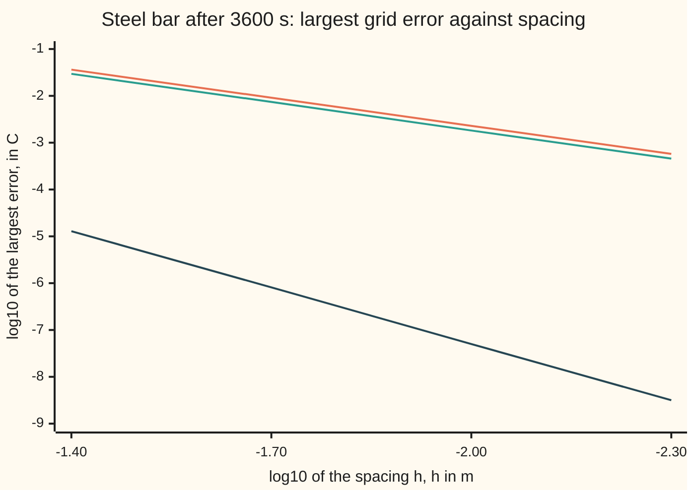

# Finite differences on a grid: consistency plus stability equals convergence

[Syllabus](../../../SYLLABUS.md) → [Numerical analysis](../README.md) → [PDE Solvers](../README.md#s07) → Finite differences on a grid

---

## General Overview

A steel bar 1 m long has both ends clamped in cold blocks at 0 C. It starts warm in the middle: 100 C at the centre, falling smoothly to 0 C at each end. The question is the centre temperature after one hour, to within 0.01 C. The bar's exact answer is known, so every error below is a true error: 65.287675 C.

A computer holds the temperature at 51 points, 2 cm apart (50 intervals), and steps them forward 10 s at a time. Each new reading is a fixed mix of the old reading and its two neighbours. After 360 steps the centre reads 65.280346 C, off by 0.0073 C.

[Stepping the heat equation on a grid](../../08-Differential%20equations%20and%20dynamics/10-The%20Classical%20PDEs/09-finite-differences-for-the-heat-equation.md) already builds this explicit step, shows it blowing up when the time step is too large, and sees the error fall fourfold when the spacing halves. This card answers why it converges at all, and why at that rate. The answer has two parts that any grid method must pass:

- **Consistency.** Put the bar's exact temperatures into the grid rule. They miss it by an amount that shrinks as the grid gets finer. Here the miss shrinks fourfold each time the spacing halves.
- **Stability.** Repeated steps never magnify an existing error by more than a fixed factor, however fine the grid. Here one step never makes the largest error bigger: the largest error before a step is never smaller than the largest error after it.

Together they force the computed answer onto the true one, at the rate the miss shrinks. Drop either and the grid fails. With r = 0.51 (17 s steps on the 2 cm grid; r is defined in The formula) the rule is still consistent but not stable, and refining the grid gives an error of 7.181e39 C. With one weight miscomputed the rule is stable but not consistent, and refining the grid moves the answer the wrong way, to 99.7870 C instead of 65.2877 C.

**A grid rule that the exact solution nearly satisfies (consistency) and that never lets old errors grow by more than a fixed factor (stability) converges to the exact solution, with the error shrinking at the same rate as the miss; for linear problems, stability is also necessary.**

**What kind of fact this is:** a theorem, the Lax equivalence theorem. The half "consistent and stable gives convergent" is proved on this card in Why it works. The half "convergent needs stable" is stated with its key steps and its source.

### The picture: error against spacing, on log scales



Orange: the error bound proved on this card, for r = 0.3. Teal: the true error for r = 0.3, slope 2. Dark blue: the true error for r = 1/6, slope 4. Here r is the time step measured in grid units, defined in The formula.

---

## The formula

Notation first, in words.

- $u(x, t)$ is the bar's true temperature in C at $x$ metres from the left end, at $t$ seconds. A subscript $t$ or $x$ is a rate ([Partial derivatives](../../06-Calculus%20and%20analysis/07-Several%20Variables/01-partial-derivatives.md)): $u_t$ is the change in time, $u_{xx}$ the bend along the bar.
- $\alpha$ is the **diffusivity**: how fast heat spreads, in m²/s. The differential-equations wing called it κ; this wing keeps κ for the condition number. Steel is about 1.2e-5 m²/s; that value is illustrative.
- The **heat equation** is $u_t = \alpha\,u_{xx}$: a point warms in proportion to how much its neighbours bend above it.
- The grid has spacing $h$ m and time step $\Delta t$ s. The **grid value** $u_j^n$ is the computed temperature at node $j$ (at $x = jh$) after $n$ steps. The raised $n$ is a time level, not a power.

The explicit scheme, from [Stepping the heat equation on a grid](../../08-Differential%20equations%20and%20dynamics/10-The%20Classical%20PDEs/09-finite-differences-for-the-heat-equation.md):

$$u_j^{n+1} = r\,u_{j-1}^n + (1 - 2r)\,u_j^n + r\,u_{j+1}^n, \qquad r = \frac{\alpha\,\Delta t}{h^2}.$$

Stack the inside values into one list $u^n$. One step multiplies that list by a fixed matrix: $u^{n+1} = A\,u^n$. The three ideas of this card are:

$$\underbrace{\tau_j^n = \frac{u(x_j, t_{n+1}) - u(x_j, t_n)}{\Delta t} - \alpha\,\frac{u(x_{j+1}, t_n) - 2u(x_j, t_n) + u(x_{j-1}, t_n)}{h^2} \to 0}_{\text{consistency}}, \qquad \underbrace{\lVert A^n\rVert_\infty \le C \text{ for } n\Delta t \le T}_{\text{stability}},$$

$$\underbrace{\max_j \lvert u(x_j, t_n) - u_j^n\rvert \;\le\; C\sum_{m=0}^{n-1}\Delta t\,\lVert \tau^m\rVert_\infty \;\to\; 0}_{\text{convergence}}.$$

**Read it aloud:** if the exact solution misses the grid rule by an amount that shrinks to zero, and no number of steps can magnify an error by more than C, then the grid error is at most C times the total miss, and it shrinks to zero at the same rate.

Here $\tau_j^n$, the **local truncation error**, is the exact solution's miss per second at one node. The **max norm** $\lVert v\rVert_\infty$ is the largest absolute entry of a list $v$. For a matrix, $\lVert A\rVert_\infty$ is the most it can stretch a list in that size: its largest row sum of absolute entries.

| Symbol | Plain meaning | In our example | Push it up and the answer… |
| --- | --- | --- | --- |
| $u$, $u_t$, $u_{xx}$, $u_{tt}$, $u_{xxxx}$; $M_2$, $M_4$ | true temperature; its time rate; its bend; higher rates; largest sizes of $u_{tt}$ and $u_{xxxx}$ | 100 C at the centre at the start | — |
| $\alpha$ | diffusivity: how fast heat spreads | 1.2e-5 m²/s (illustrative) | the bar cools faster; the safe $\Delta t$ shrinks |
| $x$, $t$, $T$; $x_j$, $t_n$ | place; time; end time; node $j$ at $jh$; time $n\Delta t$ | 0 to 1 m; 0 to 3600 s | — |
| $h$, $\Delta t$ | node spacing; time step | 0.02 m; 10 s | larger error |
| $r$ | $\alpha\Delta t/h^2$, the time step in grid units | 0.3 | above 1/2 the scheme blows up |
| $u_j^n$, $j$, $n$, $m$ | grid value at node $j$ after $n$ steps; $m$ an earlier step | centre $j$ = 25: 65.280346 C at $n$ = 360 | — |
| $A$ | the step matrix: $u^{n+1} = Au^n$ | weights 0.3, 0.4, 0.3 on each row | — |
| $\lVert\cdot\rVert_\infty$, $v$ | max norm: largest absolute entry of a list $v$, or largest row sum | $\lVert A\rVert_\infty$ = 1.0000 | above 1, errors may grow |
| $\tau_j^n$ | local truncation error: the exact solution's miss per second | 3.115e-6 C/s at the centre, at the start | the error bound grows in proportion |
| $e_j^n$ | grid error $u(x_j, t_n) - u_j^n$ | 7.329e-3 C at its largest, at 3600 s | — |
| $C$, $K$ | stability constant: the most $A^n$ can stretch; $K$ the constant in $\lvert\tau\rvert \le Kh^2$ | 1; — | the bound loosens in proportion |
| $g$ | factor that one step multiplies a sine shape by | 0.99881604 for the starting hump | — |

### When it holds

- **A linear scheme for a linear equation.** The proof uses $e^{n+1} = Ae^n + \Delta t\,\tau^n$, which needs the step to be a matrix. For a nonlinear equation the theorem does not apply as stated, and a stable-looking scheme can still converge to the wrong answer.
- **A smooth true solution.** The truncation error shrinks like $h^2$ only if $u$ has four smooth derivatives in $x$. A sudden jump in the start temperature slows the rate near the jump.
- **A well-posed problem.** Small changes to the start must make small changes to the true answer. The heat equation forward in time qualifies. Run backward in time, tiny wiggles in the start grow without limit in the true solution too, and the theorem does not apply.
- **Stability uniform in h.** The bound $C$ must not grow as the grid is refined. A scheme stable on each grid, with $C$ growing as $h$ shrinks, can still fail.
- **Exact arithmetic.** Each step also rounds. A stable scheme keeps rounding errors small too. An unstable one grows them, which is how the 17 s run blows up from a smooth start.

---

## Why it works

### Step 0: error obeys the same step as the solution, plus a push

The grid rule turns today's values into tomorrow's. The exact solution, sampled on the grid, almost obeys the same rule; its miss is the truncation error. Subtract the two and the error itself obeys the rule, plus a small push each step. So two questions decide everything. How big is each push (consistency)? Can the rule magnify old pushes (stability)?

### Step 1: consistency, by Taylor's theorem

Expand each difference about $(x_j, t_n)$ with [Taylor's theorem](../../06-Calculus%20and%20analysis/03-What%20Derivatives%20Tell%20You/05-taylors-theorem.md). The forward time difference is

$$\frac{u(x, t + \Delta t) - u(x, t)}{\Delta t} = u_t + \frac{\Delta t}{2}\,u_{tt} + \dots$$

The centred second difference is

$$\frac{u(x + h, t) - 2u(x, t) + u(x - h, t)}{h^2} = u_{xx} + \frac{h^2}{12}\,u_{xxxx} + \dots$$

The odd powers of $h$ cancel, because the stencil is symmetric. On the bar's start, 100 sin(πx), at the centre, this difference misses $-100\pi^2$ = −986.9604 by 0.324654 at $h$ = 0.02. The formula $h^2/12 \times 100\pi^4$ predicts 0.324697. Halving $h$ divides the miss by 4: order 2.

Subtract α times the second line from the first. The $u_t - \alpha u_{xx}$ terms cancel, since $u$ solves the equation:

$$\tau = \frac{\Delta t}{2}\,u_{tt} - \frac{\alpha h^2}{12}\,u_{xxxx} + \dots$$

Differentiate the heat equation once more in time: $u_{tt} = \alpha^2 u_{xxxx}$. With $\Delta t = rh^2/\alpha$ both terms carry $h^2$:

$$\tau = \alpha h^2\,u_{xxxx}\left(\frac{r}{2} - \frac{1}{12}\right) + \dots$$

So the scheme is **consistent of order 2**: with $r$ fixed, the truncation error shrinks like $h^2$. At the centre, at the start, with $h$ = 0.02 and $r$ = 0.3, the formula gives 3.117e-6 C/s and direct substitution gives 3.115e-6 C/s.

One surprise: at $r = 1/6$ the bracket is zero. The time and space misses cancel, and the scheme becomes order 4. Measured truncation errors then fall with orders 4.00, 4.00, 3.98.

### Step 2: stability, as a bound on the step's norm

Each new value is $r$, $1 - 2r$, $r$ times three old ones. When $r \le 1/2$ none of these weights is negative, and they add to 1. So

$$\lvert u_j^{n+1}\rvert \le r\lvert u_{j-1}^n\rvert + (1 - 2r)\lvert u_j^n\rvert + r\lvert u_{j+1}^n\rvert \le \lVert u^n\rVert_\infty.$$

In matrix terms, every row of $A$ has absolute sum at most 1, so $\lVert A\rVert_\infty = 1$. Then $\lVert A^n\rVert_\infty \le \lVert A\rVert_\infty^n = 1$ for every $n$, on every grid: the scheme is **stable** with $C = 1$. The check computes the row sums: 1.0000 at $r$ = 0.3 and at $r$ = 0.5.

At $r$ = 0.51 the weights are 0.5100, −0.0200, 0.5100, and the row sum of their sizes is 1.0400. The norm bound now allows growth by 1.04 per step, 2550.7-fold over 200 steps. The real growth is of the same order. A zigzag shape, alternating up and down from node to node, is multiplied by −1.037987 per step: 1731.4-fold over 200 steps. [Von Neumann analysis](03-von-neumann-analysis-and-the-cfl-condition.md) finds that factor for every shape.

### Step 3: convergence, by adding up the pushes

The exact values satisfy $u(t_{n+1}) = A\,u(t_n) + \Delta t\,\tau^n$; that is the definition of $\tau$, rearranged. The grid values satisfy $u^{n+1} = Au^n$. Subtract:

$$e^{n+1} = A\,e^n + \Delta t\,\tau^n, \qquad e^0 = 0.$$

Unroll it. The push made at step $m$ is carried by $n - 1 - m$ later steps:

$$e^n = \sum_{m=0}^{n-1} A^{\,n-1-m}\,\Delta t\,\tau^m, \qquad \lVert e^n\rVert_\infty \le C\sum_{m=0}^{n-1}\Delta t\,\lVert\tau^m\rVert_\infty \le C\,t_n \max_m \lVert\tau^m\rVert_\infty.$$

Consistency makes the last factor shrink like $h^2$. Stability keeps $C$ fixed. So the error shrinks like $h^2$: **consistency plus stability gives convergence, at the order of the truncation error.** This is the same argument as [From local error to global error](../06-ODE%20Solvers/02-convergence-of-one-step-methods.md), with a matrix in place of one number.

The check adds up the pushes exactly. With $h$ = 0.02 the bound is 9.135e-3 C; the true largest error is 7.329e-3 C; the ratio is 1.246. It stays between 1.244 and 1.247 on every grid. The bound lets every push survive at full size, while the real step shrinks the hump by $g$ = 0.99881604 per step.

<details>
<summary>Detailed proof: the sufficiency half, with the constants</summary>

Fix $r \le 1/2$ and $T$. Let $u$ have continuous derivatives $u_{tt}$ and $u_{xxxx}$ on $[0, 1] \times [0, T]$, bounded by $M_2$ and $M_4$.

Taylor's theorem with remainder gives, for some time $s$ between $t$ and $t + \Delta t$ and some place $y$ between $x - h$ and $x + h$,

$$\frac{u(x, t+\Delta t) - u(x, t)}{\Delta t} - u_t = \frac{\Delta t}{2}\,u_{tt}(x, s), \qquad \frac{u(x+h, t) - 2u(x, t) + u(x-h, t)}{h^2} - u_{xx} = \frac{h^2}{12}\,u_{xxxx}(y, t).$$

The second line uses the expansion to fourth order on each side; the third-order terms cancel and the two fourth-order remainders average to one value of $u_{xxxx}$ by the intermediate value theorem. Hence $\lvert\tau_j^n\rvert \le \tfrac{\Delta t}{2}M_2 + \tfrac{\alpha h^2}{12}M_4 = h^2\bigl(\tfrac{r M_2}{2\alpha} + \tfrac{\alpha M_4}{12}\bigr) =: Kh^2$.

The ends are held at 0 C both by the bar and by the grid, so the error is 0 at both end nodes and only the inside nodes carry error. Every inside row of $A$ has non-negative weights summing to at most 1, so $\lVert A\rVert_\infty \le 1$ and $\lVert A^k\rVert_\infty \le 1$ for all $k$.

From $e^{n+1} = Ae^n + \Delta t\,\tau^n$ and $e^0 = 0$, induction gives $e^n = \sum_{m<n} A^{n-1-m}\Delta t\,\tau^m$. Taking max norms, $\lVert e^n\rVert_\infty \le n\Delta t\,Kh^2 \le TKh^2$. This tends to 0 as $h \to 0$ with $r$ fixed: convergence of order 2.

</details>

### Step 4: the other half, stated

The **Lax equivalence theorem** (Lax and Richtmyer, 1956): for a well-posed linear initial-value problem and a consistent linear scheme, the scheme converges for every starting temperature if and only if it is stable.

Step 3 proved "if". The "only if" half needs a tool from functional analysis, so this card states its key steps instead of proving it:

1. Convergence for every start means the computed values stay bounded for that start: for each start $v$, the numbers $\lVert A^n v\rVert$ stay below some limit as the grid refines.
2. The **uniform boundedness principle** turns a bound for each start into one bound for all starts at once: $\lVert A^n\rVert \le C$. That is stability.

The source is Lax and Richtmyer's survey, listed in Sources. In practice the useful reading is the contrapositive: an unstable scheme cannot converge, however consistent it is.

### Step 5: the bar confirms each piece

| Grid | Steps to 3600 s | True error | Bound | Ratio to the next |
| --- | --- | --- | --- | --- |
| $h$ = 0.04 m | 90 | 2.929e-2 C | 3.645e-2 C | 3.997 |
| $h$ = 0.02 m | 360 | 7.329e-3 C | 9.135e-3 C | 4.001 |
| $h$ = 0.01 m | 1440 | 1.832e-3 C | 2.284e-3 C | 4.000 |
| $h$ = 0.005 m | 5760 | 4.579e-4 C | 5.710e-4 C | — |

Observed orders are 2.00, 2.00, 2.00, as the truncation error predicts. At $r$ = 1/6 the true errors are 1.285e-5, 8.037e-7, 5.023e-8 and 3.180e-9 C: orders 4.00, 4.00, 3.98. The error inherits the order of the truncation error, as Step 3 says.

The cost grows faster than the accuracy. Each halving of $h$ doubles the nodes and quadruples the steps. Node updates to 3600 s go 2160, 17640, 142560, 1146240: ratios 8.17, 8.08, 8.04, for a fourfold smaller error each time. Implicit steps ([Crank-Nicolson and the theta family](04-crank-nicolson-and-theta-methods.md)) remove the limit on $\Delta t$.

---

## Worked numbers, by hand

The 2 cm grid with 10 s steps, run to one hour.

| Step | Arithmetic | Value |
| --- | --- | --- |
| grid units | $r = 1.2\text{e-}5 \times 10 \div 0.02^2$ | 0.3 |
| weights | $r$, $1 - 2r$, $r$ | 0.3, 0.4, 0.3 |
| step norm | largest row sum, $0.3 + 0.4 + 0.3$ | 1.0000: stable |
| safe time step | $\Delta t \le h^2/(2\alpha) = 0.0004 \div 0.000024$ | 16.667 s |
| centre after one step | $0.3 \times 100\sin(0.48\pi) \times 2 + 0.4 \times 100$ | 99.881604 C; exact 99.881635 C |
| truncation error at the centre | $\alpha\pi^4 h^2 \times 100 \times (0.3/2 - 1/12)$ | 3.117e-6 C/s |
| bound at 3600 s | sum of $\Delta t \times \max\lvert\tau\rvert$ over 360 steps | 9.135e-3 C |
| centre at 3600 s | $100\,g^{360}$, $g$ = 0.99881604 | 65.280346 C |
| exact centre at 3600 s | $100\,e^{-\alpha\pi^2 \times 3600}$ | 65.287675 C |
| largest true error | over all 51 nodes | **7.329e-3 C** |

The one-hour centre temperature is right to within 0.0073 C, inside the 0.01 C target, and inside the proved bound of 9.135e-3 C.

### What breaks if you drop a piece

| Mistake | Comes out at | What went wrong |
| --- | --- | --- |
| $r$ = 0.51 (17 s steps on the 2 cm grid), refined at fixed $r$ | errors at 3400 s: 7.311e-2, 1.826e-2, 1.526e-2, 7.181e39 C | consistent but unstable: $\lVert A\rVert_\infty$ = 1.0400, and a zigzag grows from rounding |
| Weight computed as $\alpha\Delta t/h$, forgetting the square | 0.0060 at $h$ = 0.02; centre at 3600 s: 98.1172, 99.1512, 99.5746, 99.7870 C; true 65.2877 C | stable but not consistent: it converges, to the wrong answer |
| $h$ halved to 0.01 m, $\Delta t$ kept at 10 s | $r$ = 1.2; largest value at 3600 s: 5.658e193 C | refining space without time leaves the stable range |

The middle row is the subtle one. Every weight is positive, so the step is an average and nothing blows up. But heat moves at α times $h$ instead of α, and that tends to zero. The bar seems to stop cooling.

---

## Code, from first principles, and it actually runs

The code steps the bar on four grids and checks the result by three roads. Road one is the loop itself. Road two is the exact solution $100e^{-\alpha\pi^2 t}\sin(\pi x)$, and the closed form $100g^n$ for the centre. Road three is the Lax bound, the sum of $\Delta t\max\lvert\tau\rvert$, which must sit above the true error. Asserts check that loop and closed form agree, that the one-hour error meets the target, that the orders are 2 and 4, that the bound holds, and that each failure in What breaks really fails.

### Python

```python
# Finite differences on a grid -- the check behind the card.  Standard library only.
# Steel bar 1 m long, ends held at 0 C, diffusivity alpha = 1.2e-5 m^2/s (illustrative),
# start u = 100 sin(pi x) C.  Road one: step the explicit scheme in a loop.  Road two:
# the exact solution 100 e^(-alpha pi^2 t) sin(pi x), and the scheme's own factor g per
# step for this one sine.  Road three: the Lax bound, error <= sum of dt * max |tau|.
from math import pi, sin, cos, exp, log2, log10

ALPHA, U0, T = 1.2e-5, 100.0, 3600.0                  # m^2/s, C, s
HS = [0.04, 0.02, 0.01, 0.005]                         # space steps, m

def sci(v, d=3):                                       # 1.234e-5, the same in Rust
    m, e = f"{v:.{d}e}".split("e")
    return f"{m}e{int(e)}"

def exact(x, t):
    return U0 * exp(-ALPHA * pi * pi * t) * sin(pi * x)

def run(h, r, steps, w=None):                          # explicit steps; w = weight used
    n, w = round(1 / h), r if w is None else w
    u = [U0 * sin(pi * j * h) for j in range(n + 1)]
    for _ in range(steps):
        u = [0.0] + [w * u[j - 1] + (1 - 2 * w) * u[j] + w * u[j + 1] for j in range(1, n)] + [0.0]
    return u

def tau(x, t, h, dt):                                  # exact solution put into the scheme
    d2 = (exact(x + h, t) - 2 * exact(x, t) + exact(x - h, t)) / (h * h)
    return (exact(x, t + dt) - exact(x, t)) / dt - ALPHA * d2

def error_and_bound(h, r, t_end):                      # true max error at t_end, Lax bound
    n, dt = round(1 / h), r * h * h / ALPHA
    steps = round(t_end / dt)
    u = run(h, r, steps)
    err = max(abs(u[j] - exact(j * h, steps * dt)) for j in range(n + 1))
    bound = sum(dt * max(abs(tau(j * h, m * dt, h, dt)) for j in range(1, n)) for m in range(steps))
    return err, bound, steps

def norm_inf(r, n):                                    # largest row sum of |weights| in A
    return max(sum(abs(w) for w in ([r] if i > 1 else []) + [1 - 2 * r] + ([r] if i < n - 1 else []))
               for i in range(1, n))

def orders(es):
    return ", ".join(f"{log2(es[i] / es[i + 1]):.2f}" for i in range(len(es) - 1))

h, dt = 0.02, 10.0
r = ALPHA * dt / h ** 2
print(f"bar 1 m, alpha = {sci(ALPHA, 1)} m^2/s, start 100 sin(pi x) C, T = {T:.0f} s")
print(f"grid h = {h} m, 51 nodes, dt = {dt:.0f} s, r = {r:.4f}, steps {round(T / dt)}; r <= 1/2 needs dt <= {h * h / (2 * ALPHA):.3f} s")
print(f"weights: {r:.4f}, {1 - 2 * r:.4f}, {r:.4f}")
u1 = run(h, r, 1)[25]
print(f"middle after one step: scheme {u1:.6f} C, exact {exact(0.5, dt):.6f} C")
uT = run(h, r, 360)[25]
g = 1 - 4 * r * sin(pi * h / 2) ** 2
print(f"middle at T: loop {uT:.6f} C, closed form 100 g^360 {U0 * g ** 360:.6f} C (g = {g:.8f}), exact {exact(0.5, T):.6f} C")
print(f"one-hour target: centre error below 0.01 C; centre error {abs(uT - exact(0.5, T)):.4f} C")
d2e = [abs((2 * U0 * cos(pi * hh) - 2 * U0) / hh ** 2 + U0 * pi * pi) for hh in HS]
print("second difference of 100 sin(pi x) at 0.5, error: " + ", ".join(f"{e:.6f}" for e in d2e) + "; orders " + orders(d2e))
print(f"  predicted h^2/12 * 100 pi^4 at h = 0.02: {h * h / 12 * U0 * pi ** 4:.6f}; exact value -100 pi^2 = {-U0 * pi * pi:.4f}")
for rr, name in ((0.3, "0.3"), (1 / 6, "1/6")):
    ts = [abs(tau(0.5, 0.0, hh, rr * hh * hh / ALPHA)) for hh in HS]
    lead = ALPHA * pi ** 4 * h * h * U0 * (rr / 2 - 1 / 12)
    print(f"tau at the middle, t = 0, r = {name}: " + ", ".join(sci(t) for t in ts) + " C/s; orders " + orders(ts))
    print(f"  leading term alpha pi^4 h^2 100 (r/2 - 1/12) at h = 0.02: {sci(lead)} C/s")
print(f"norm of the step, max row sum: r = 0.3: {norm_inf(0.3, 50):.4f}, r = 0.5: {norm_inf(0.5, 50):.4f}, r = 0.51: {norm_inf(0.51, 50):.4f}")
gz = 1 - 4 * 0.51 * sin(49 * pi * h / 2) ** 2
print(f"r = 0.51, h = 0.02: dt = {0.51 * h * h / ALPHA:.0f} s, weights 0.5100, {1 - 2 * 0.51:.4f}, 0.5100, zigzag factor g = {gz:.6f}; 1.04^200 = {1.04 ** 200:.1f}; |g|^200 = {abs(gz) ** 200:.1f}")
E3, B3 = [], []
for hh in HS:
    e, b, s = error_and_bound(hh, 0.3, T)
    E3.append(e); B3.append(b)
    print(f"r = 0.3, h = {hh}: {s} steps, true error {sci(e)} C, bound {sci(b)} C, bound / true {b / e:.3f}")
print("r = 0.3: error ratio per halving " + ", ".join(f"{E3[i] / E3[i + 1]:.3f}" for i in range(3)) + "; orders " + orders(E3))
work = [(round(1 / hh) - 1) * round(T / (0.3 * hh * hh / ALPHA)) for hh in HS]
print("work, node updates to 3600 s at r = 0.3: " + ", ".join(str(w) for w in work) + "; ratios " + ", ".join(f"{work[i + 1] / work[i]:.2f}" for i in range(3)))
E6 = [error_and_bound(hh, 1 / 6, T)[0] for hh in HS]
print("r = 1/6: true error " + ", ".join(sci(e) for e in E6) + " C; orders " + orders(E6))
E51 = []
for hh in HS:
    dd = 0.51 * hh * hh / ALPHA
    u = run(hh, 0.51, round(3400 / dd))
    E51.append(max(abs(u[j] - exact(j * hh, 3400.0)) for j in range(len(u))))
print("r = 0.51 at 3400 s, h = 0.04, 0.02, 0.01, 0.005: error " + ", ".join(sci(e) for e in E51) + " C")
print("chart x, log10 h: " + ", ".join(f"{log10(hh):.2f}" for hh in HS))
print("chart, log10 error r = 0.3: " + ", ".join(f"{log10(e):.2f}" for e in E3))
print("chart, log10 bound r = 0.3: " + ", ".join(f"{log10(b):.2f}" for b in B3))
print("chart, log10 error r = 1/6: " + ", ".join(f"{log10(e):.2f}" for e in E6))
sq = [run(hh, 0, 360, w=ALPHA * dt / hh)[round(0.5 / hh)] for hh in HS]
print("mistake, r = alpha dt / h with dt = 10 s: middle at T " + ", ".join(f"{v:.4f}" for v in sq) + f" C; true {exact(0.5, T):.4f} C; weight at h = 0.02: {ALPHA * dt / h:.4f}")
bad = max(map(abs, run(0.01, 1.2, 360)))
print(f"mistake, h = 0.01 with dt = 10 s (r = {ALPHA * 10 / 0.0001:.1f}): largest |u| at T {sci(bad)} C")
assert abs(uT - U0 * g ** 360) < 1e-9                  # loop equals the closed form g^n
assert abs(uT - exact(0.5, T)) < 0.01                  # r = 0.3 tracks the bar
assert all(1.98 < log2(E3[i] / E3[i + 1]) < 2.02 for i in range(3))   # order 2, as tau says
assert all(3.9 < log2(E6[i] / E6[i + 1]) < 4.1 for i in range(3))     # r = 1/6: order 4
assert all(1.0 < B3[i] / E3[i] < 2.0 for i in range(4))              # the Lax bound holds
assert E51[3] > 1e6 * E51[1]                           # consistent but unstable: no convergence
assert abs(sq[3] - exact(0.5, T)) > abs(sq[0] - exact(0.5, T))       # stable, inconsistent: wrong
assert bad > 1e100                                     # h halved, dt kept: r = 1.2 blows up
print("ALL CHECKS PASS")
```

**Ran 2026-11-11 on macOS, Python 3.14.10, standard library only. All checks passed. Output, pasted from the run:**

```
bar 1 m, alpha = 1.2e-5 m^2/s, start 100 sin(pi x) C, T = 3600 s
grid h = 0.02 m, 51 nodes, dt = 10 s, r = 0.3000, steps 360; r <= 1/2 needs dt <= 16.667 s
weights: 0.3000, 0.4000, 0.3000
middle after one step: scheme 99.881604 C, exact 99.881635 C
middle at T: loop 65.280346 C, closed form 100 g^360 65.280346 C (g = 0.99881604), exact 65.287675 C
one-hour target: centre error below 0.01 C; centre error 0.0073 C
second difference of 100 sin(pi x) at 0.5, error: 1.298104, 0.324654, 0.081172, 0.020293; orders 2.00, 2.00, 2.00
  predicted h^2/12 * 100 pi^4 at h = 0.02: 0.324697; exact value -100 pi^2 = -986.9604
tau at the middle, t = 0, r = 0.3: 1.243e-5, 3.115e-6, 7.791e-7, 1.948e-7 C/s; orders 2.00, 2.00, 2.00
  leading term alpha pi^4 h^2 100 (r/2 - 1/12) at h = 0.02: 3.117e-6 C/s
tau at the middle, t = 0, r = 1/6: 5.463e-9, 3.417e-10, 2.136e-11, 1.351e-12 C/s; orders 4.00, 4.00, 3.98
  leading term alpha pi^4 h^2 100 (r/2 - 1/12) at h = 0.02: 0.000e0 C/s
norm of the step, max row sum: r = 0.3: 1.0000, r = 0.5: 1.0000, r = 0.51: 1.0400
r = 0.51, h = 0.02: dt = 17 s, weights 0.5100, -0.0200, 0.5100, zigzag factor g = -1.037987; 1.04^200 = 2550.7; |g|^200 = 1731.4
r = 0.3, h = 0.04: 90 steps, true error 2.929e-2 C, bound 3.645e-2 C, bound / true 1.244
r = 0.3, h = 0.02: 360 steps, true error 7.329e-3 C, bound 9.135e-3 C, bound / true 1.246
r = 0.3, h = 0.01: 1440 steps, true error 1.832e-3 C, bound 2.284e-3 C, bound / true 1.247
r = 0.3, h = 0.005: 5760 steps, true error 4.579e-4 C, bound 5.710e-4 C, bound / true 1.247
r = 0.3: error ratio per halving 3.997, 4.001, 4.000; orders 2.00, 2.00, 2.00
work, node updates to 3600 s at r = 0.3: 2160, 17640, 142560, 1146240; ratios 8.17, 8.08, 8.04
r = 1/6: true error 1.285e-5, 8.037e-7, 5.023e-8, 3.180e-9 C; orders 4.00, 4.00, 3.98
r = 0.51 at 3400 s, h = 0.04, 0.02, 0.01, 0.005: error 7.311e-2, 1.826e-2, 1.526e-2, 7.181e39 C
chart x, log10 h: -1.40, -1.70, -2.00, -2.30
chart, log10 error r = 0.3: -1.53, -2.13, -2.74, -3.34
chart, log10 bound r = 0.3: -1.44, -2.04, -2.64, -3.24
chart, log10 error r = 1/6: -4.89, -6.09, -7.30, -8.50
mistake, r = alpha dt / h with dt = 10 s: middle at T 98.1172, 99.1512, 99.5746, 99.7870 C; true 65.2877 C; weight at h = 0.02: 0.0060
mistake, h = 0.01 with dt = 10 s (r = 1.2): largest |u| at T 5.658e193 C
ALL CHECKS PASS
```

### Rust

Same numbers, same labels, built with `rustc --edition 2021 -O`.

```rust
// Finite differences on a grid -- the same check as the Python, in Rust.  No crates.
// Steel bar 1 m long, ends held at 0 C, diffusivity alpha = 1.2e-5 m^2/s (illustrative),
// start u = 100 sin(pi x) C.  Road one: step the explicit scheme in a loop.  Road two:
// the exact solution 100 e^(-alpha pi^2 t) sin(pi x), and the scheme's own factor g per
// step for this one sine.  Road three: the Lax bound, error <= sum of dt * max |tau|.
use std::f64::consts::PI;

const ALPHA: f64 = 1.2e-5; // m^2/s
const U0: f64 = 100.0; // C
const T: f64 = 3600.0; // s
const HS: [f64; 4] = [0.04, 0.02, 0.01, 0.005]; // space steps, m

fn sci(v: f64, d: usize) -> String { format!("{:.*e}", d, v) }

fn exact(x: f64, t: f64) -> f64 { U0 * (-ALPHA * PI * PI * t).exp() * (PI * x).sin() }

fn run(h: f64, r: f64, steps: usize, w_set: Option<f64>) -> Vec<f64> {
    let n = (1.0 / h).round() as usize;
    let w = w_set.unwrap_or(r);
    let mut u: Vec<f64> = (0..=n).map(|j| U0 * (PI * j as f64 * h).sin()).collect();
    for _ in 0..steps {
        let mut v = vec![0.0; n + 1];
        for j in 1..n { v[j] = w * u[j - 1] + (1.0 - 2.0 * w) * u[j] + w * u[j + 1]; }
        u = v;
    }
    u
}

fn tau(x: f64, t: f64, h: f64, dt: f64) -> f64 {
    let d2 = (exact(x + h, t) - 2.0 * exact(x, t) + exact(x - h, t)) / (h * h);
    (exact(x, t + dt) - exact(x, t)) / dt - ALPHA * d2
}

fn max_abs(v: impl Iterator<Item = f64>) -> f64 { v.fold(0.0, |m: f64, x| m.max(x.abs())) }

fn error_and_bound(h: f64, r: f64, t_end: f64) -> (f64, f64, usize) {
    let (n, dt) = ((1.0 / h).round() as usize, r * h * h / ALPHA);
    let steps = (t_end / dt).round() as usize;
    let u = run(h, r, steps, None);
    let err = max_abs((0..=n).map(|j| u[j] - exact(j as f64 * h, steps as f64 * dt)));
    let mut bound = 0.0;
    for m in 0..steps { bound += dt * max_abs((1..n).map(|j| tau(j as f64 * h, m as f64 * dt, h, dt))); }
    (err, bound, steps)
}

fn norm_inf(r: f64, n: usize) -> f64 {
    let mut best: f64 = 0.0;
    for i in 1..n {
        let mut s = (1.0 - 2.0 * r).abs();
        if i > 1 { s += r.abs(); }
        if i < n - 1 { s += r.abs(); }
        best = best.max(s);
    }
    best
}

fn orders(es: &[f64]) -> String {
    (0..es.len() - 1).map(|i| format!("{:.2}", (es[i] / es[i + 1]).log2())).collect::<Vec<_>>().join(", ")
}

fn list(es: &[f64], f: &dyn Fn(f64) -> String) -> String { es.iter().map(|&e| f(e)).collect::<Vec<_>>().join(", ") }

fn main() {
    let (h, dt) = (0.02, 10.0);
    let r = ALPHA * dt / (h * h);
    println!("bar 1 m, alpha = {} m^2/s, start 100 sin(pi x) C, T = {:.0} s", sci(ALPHA, 1), T);
    println!("grid h = {} m, 51 nodes, dt = {:.0} s, r = {:.4}, steps {}; r <= 1/2 needs dt <= {:.3} s",
             h, dt, r, (T / dt).round(), h * h / (2.0 * ALPHA));
    println!("weights: {:.4}, {:.4}, {:.4}", r, 1.0 - 2.0 * r, r);
    let u1 = run(h, r, 1, None)[25];
    println!("middle after one step: scheme {:.6} C, exact {:.6} C", u1, exact(0.5, dt));
    let ut = run(h, r, 360, None)[25];
    let g = 1.0 - 4.0 * r * (PI * h / 2.0).sin().powi(2);
    println!("middle at T: loop {:.6} C, closed form 100 g^360 {:.6} C (g = {:.8}), exact {:.6} C", ut, U0 * g.powi(360), g, exact(0.5, T));
    println!("one-hour target: centre error below 0.01 C; centre error {:.4} C", (ut - exact(0.5, T)).abs());
    let d2e: Vec<f64> = HS.iter().map(|&hh| ((2.0 * U0 * (PI * hh).cos() - 2.0 * U0) / (hh * hh) + U0 * PI * PI).abs()).collect();
    println!("second difference of 100 sin(pi x) at 0.5, error: {}; orders {}", list(&d2e, &|e| format!("{:.6}", e)), orders(&d2e));
    println!("  predicted h^2/12 * 100 pi^4 at h = 0.02: {:.6}; exact value -100 pi^2 = {:.4}", h * h / 12.0 * U0 * PI.powi(4), -U0 * PI * PI);
    for (rr, name) in [(0.3, "0.3"), (1.0 / 6.0, "1/6")] {
        let ts: Vec<f64> = HS.iter().map(|&hh| tau(0.5, 0.0, hh, rr * hh * hh / ALPHA).abs()).collect();
        let lead = ALPHA * PI.powi(4) * h * h * U0 * (rr / 2.0 - 1.0 / 12.0);
        println!("tau at the middle, t = 0, r = {}: {} C/s; orders {}", name, list(&ts, &|t| sci(t, 3)), orders(&ts));
        println!("  leading term alpha pi^4 h^2 100 (r/2 - 1/12) at h = 0.02: {} C/s", sci(lead, 3));
    }
    println!("norm of the step, max row sum: r = 0.3: {:.4}, r = 0.5: {:.4}, r = 0.51: {:.4}", norm_inf(0.3, 50), norm_inf(0.5, 50), norm_inf(0.51, 50));
    let gz = 1.0 - 4.0 * 0.51 * (49.0 * PI * h / 2.0).sin().powi(2);
    println!("r = 0.51, h = 0.02: dt = {:.0} s, weights 0.5100, {:.4}, 0.5100, zigzag factor g = {:.6}; 1.04^200 = {:.1}; |g|^200 = {:.1}", 0.51 * h * h / ALPHA, 1.0 - 2.0 * 0.51, gz, 1.04f64.powi(200), gz.abs().powi(200));
    let (mut e3, mut b3) = (vec![], vec![]);
    for &hh in HS.iter() {
        let (e, b, s) = error_and_bound(hh, 0.3, T);
        e3.push(e);
        b3.push(b);
        println!("r = 0.3, h = {}: {} steps, true error {} C, bound {} C, bound / true {:.3}", hh, s, sci(e, 3), sci(b, 3), b / e);
    }
    let ratios: Vec<f64> = (0..3).map(|i| e3[i] / e3[i + 1]).collect();
    println!("r = 0.3: error ratio per halving {}; orders {}", list(&ratios, &|x| format!("{:.3}", x)), orders(&e3));
    let work: Vec<usize> = HS.iter().map(|&hh| ((1.0 / hh).round() as usize - 1) * (T / (0.3 * hh * hh / ALPHA)).round() as usize).collect();
    let wr: Vec<f64> = (0..3).map(|i| work[i + 1] as f64 / work[i] as f64).collect();
    println!("work, node updates to 3600 s at r = 0.3: {}; ratios {}", work.iter().map(|w| w.to_string()).collect::<Vec<_>>().join(", "), list(&wr, &|x| format!("{:.2}", x)));
    let e6: Vec<f64> = HS.iter().map(|&hh| error_and_bound(hh, 1.0 / 6.0, T).0).collect();
    println!("r = 1/6: true error {} C; orders {}", list(&e6, &|e| sci(e, 3)), orders(&e6));
    let e51: Vec<f64> = HS.iter().map(|&hh| {
        let dd = 0.51 * hh * hh / ALPHA;
        let u = run(hh, 0.51, (3400.0 / dd).round() as usize, None);
        max_abs((0..u.len()).map(|j| u[j] - exact(j as f64 * hh, 3400.0)))
    }).collect();
    println!("r = 0.51 at 3400 s, h = 0.04, 0.02, 0.01, 0.005: error {} C", list(&e51, &|e| sci(e, 3)));
    println!("chart x, log10 h: {}", list(&HS, &|x| format!("{:.2}", x.log10())));
    println!("chart, log10 error r = 0.3: {}", list(&e3, &|x| format!("{:.2}", x.log10())));
    println!("chart, log10 bound r = 0.3: {}", list(&b3, &|x| format!("{:.2}", x.log10())));
    println!("chart, log10 error r = 1/6: {}", list(&e6, &|x| format!("{:.2}", x.log10())));
    let sq: Vec<f64> = HS.iter().map(|&hh| run(hh, 0.0, 360, Some(ALPHA * dt / hh))[(0.5 / hh).round() as usize]).collect();
    println!("mistake, r = alpha dt / h with dt = 10 s: middle at T {} C; true {:.4} C; weight at h = 0.02: {:.4}",
             list(&sq, &|v| format!("{:.4}", v)), exact(0.5, T), ALPHA * dt / h);
    let bad = max_abs(run(0.01, 1.2, 360, None).into_iter());
    println!("mistake, h = 0.01 with dt = 10 s (r = {:.1}): largest |u| at T {} C", ALPHA * 10.0 / 0.0001, sci(bad, 3));
    assert!((ut - U0 * g.powi(360)).abs() < 1e-9); // loop equals the closed form g^n
    assert!((ut - exact(0.5, T)).abs() < 0.01); // r = 0.3 tracks the bar
    assert!((0..3).all(|i| { let p = (e3[i] / e3[i + 1]).log2(); p > 1.98 && p < 2.02 })); // order 2
    assert!((0..3).all(|i| { let p = (e6[i] / e6[i + 1]).log2(); p > 3.9 && p < 4.1 })); // r = 1/6: order 4
    assert!((0..4).all(|i| b3[i] / e3[i] > 1.0 && b3[i] / e3[i] < 2.0)); // the Lax bound holds
    assert!(e51[3] > 1e6 * e51[1]); // consistent but unstable: no convergence
    assert!((sq[3] - exact(0.5, T)).abs() > (sq[0] - exact(0.5, T)).abs()); // stable, inconsistent: wrong
    assert!(bad > 1e100); // h halved, dt kept: r = 1.2 blows up
    println!("ALL CHECKS PASS");
}
```

**Ran 2026-11-11 on macOS, rustc 1.98.1, no crates. All checks passed. Output, pasted from the run:**

```
bar 1 m, alpha = 1.2e-5 m^2/s, start 100 sin(pi x) C, T = 3600 s
grid h = 0.02 m, 51 nodes, dt = 10 s, r = 0.3000, steps 360; r <= 1/2 needs dt <= 16.667 s
weights: 0.3000, 0.4000, 0.3000
middle after one step: scheme 99.881604 C, exact 99.881635 C
middle at T: loop 65.280346 C, closed form 100 g^360 65.280346 C (g = 0.99881604), exact 65.287675 C
one-hour target: centre error below 0.01 C; centre error 0.0073 C
second difference of 100 sin(pi x) at 0.5, error: 1.298104, 0.324654, 0.081172, 0.020293; orders 2.00, 2.00, 2.00
  predicted h^2/12 * 100 pi^4 at h = 0.02: 0.324697; exact value -100 pi^2 = -986.9604
tau at the middle, t = 0, r = 0.3: 1.243e-5, 3.115e-6, 7.791e-7, 1.948e-7 C/s; orders 2.00, 2.00, 2.00
  leading term alpha pi^4 h^2 100 (r/2 - 1/12) at h = 0.02: 3.117e-6 C/s
tau at the middle, t = 0, r = 1/6: 5.463e-9, 3.417e-10, 2.136e-11, 1.351e-12 C/s; orders 4.00, 4.00, 3.98
  leading term alpha pi^4 h^2 100 (r/2 - 1/12) at h = 0.02: 0.000e0 C/s
norm of the step, max row sum: r = 0.3: 1.0000, r = 0.5: 1.0000, r = 0.51: 1.0400
r = 0.51, h = 0.02: dt = 17 s, weights 0.5100, -0.0200, 0.5100, zigzag factor g = -1.037987; 1.04^200 = 2550.7; |g|^200 = 1731.4
r = 0.3, h = 0.04: 90 steps, true error 2.929e-2 C, bound 3.645e-2 C, bound / true 1.244
r = 0.3, h = 0.02: 360 steps, true error 7.329e-3 C, bound 9.135e-3 C, bound / true 1.246
r = 0.3, h = 0.01: 1440 steps, true error 1.832e-3 C, bound 2.284e-3 C, bound / true 1.247
r = 0.3, h = 0.005: 5760 steps, true error 4.579e-4 C, bound 5.710e-4 C, bound / true 1.247
r = 0.3: error ratio per halving 3.997, 4.001, 4.000; orders 2.00, 2.00, 2.00
work, node updates to 3600 s at r = 0.3: 2160, 17640, 142560, 1146240; ratios 8.17, 8.08, 8.04
r = 1/6: true error 1.285e-5, 8.037e-7, 5.023e-8, 3.180e-9 C; orders 4.00, 4.00, 3.98
r = 0.51 at 3400 s, h = 0.04, 0.02, 0.01, 0.005: error 7.311e-2, 1.826e-2, 1.526e-2, 7.181e39 C
chart x, log10 h: -1.40, -1.70, -2.00, -2.30
chart, log10 error r = 0.3: -1.53, -2.13, -2.74, -3.34
chart, log10 bound r = 0.3: -1.44, -2.04, -2.64, -3.24
chart, log10 error r = 1/6: -4.89, -6.09, -7.30, -8.50
mistake, r = alpha dt / h with dt = 10 s: middle at T 98.1172, 99.1512, 99.5746, 99.7870 C; true 65.2877 C; weight at h = 0.02: 0.0060
mistake, h = 0.01 with dt = 10 s (r = 1.2): largest |u| at T 5.658e193 C
ALL CHECKS PASS
```

The two outputs match line for line. Both languages do the same operations in the same order, so even the rounding that seeds the 7.181e39 C blow-up agrees.

### Lean

Lean proves the three steps of Why it works for the explicit heat scheme, on every grid, and checks the card's hand arithmetic.

- Take any linear step $u^{n+1} = Au^n$ started from the exact values, with $n\Delta t \le T$. Fix $C$, $K$ and $T$ before choosing the grid. If $\lVert A^k v\rVert_\infty \le C\lVert v\rVert_\infty$ for every $k \le n$ and every list $v$, and every $\lVert\tau^m\rVert_\infty \le Kh^2$, then $\lVert e^n\rVert_\infty \le C\sum_{m<n}\Delta t\,\lVert\tau^m\rVert_\infty \le CTKh^2$. Any whole power of $h$ works in place of $h^2$.
- For $0 \le r \le 1/2$, with any number of inside nodes and both ends held at 0, any number of explicit steps keeps $\lVert A^k v\rVert_\infty \le \lVert v\rVert_\infty$. So the scheme is stable with $C = 1$.
- Suppose $u_t = \alpha u_{xx}$ at one node, with $\alpha$, $h$ and $\Delta t$ positive. Suppose $u_{tt}$ and $u_{xxxx}$ are continuous along the lines through the node. If $\lvert u_{tt}\rvert \le M_2$ on $[t, t + \Delta t]$ and $\lvert u_{xxxx}\rvert \le M_4$ on $[x - h, x + h]$, then $\lvert\tau\rvert \le \tfrac{\Delta t}{2}M_2 + \tfrac{\alpha h^2}{12}M_4$.
- The hand numbers check out: $r$ = 0.3, the weights 0.3, 0.4, 0.3, the safe step 50/3 s and the 360 steps. Also checked: the $r$ = 0.51 weights and their size sum 1.04, the 0.006 slip, $r$ = 1.2, and the step and node-update counts.

The bar's temperatures and errors, the observed orders, the $r$ = 1/6 surprise and every blow-up in What breaks are left to Python and Rust.

```lean
-- Finite differences on a grid: a linear grid rule that is consistent and stable converges, with the error bounded by the stability constant times the summed truncation errors, and the explicit heat step is stable and consistent of order 2 when r ≤ 1/2.
import Mathlib.Analysis.Normed.Group.Basic
import Mathlib.Analysis.Normed.Module.Basic
import Mathlib.Analysis.Calculus.IteratedDeriv.Defs
import Mathlib.Analysis.Calculus.ContDiff.Defs
import Mathlib.Data.Matrix.Mul
import Mathlib.Algebra.BigOperators.Group.Finset.Basic
import Mathlib.Tactic.NormNum
import Mathlib.Data.Matrix.Basic
import Mathlib.Analysis.Calculus.Taylor
import Mathlib.Analysis.Normed.Group.Constructions

open Matrix

/-- The step matrix of the explicit scheme for the heat equation on N inside nodes, with both
ends held at 0: row j has 1 - 2r on the diagonal and r next to it on each side, so that
(A u)_j = r u_(j-1) + (1 - 2r) u_j + r u_(j+1), a missing neighbour (an end) counting as 0. -/
def heatMatrix (N : ℕ) (r : ℝ) : Matrix (Fin N) (Fin N) ℝ :=
  fun i j => if i = j then 1 - 2 * r else if (i : ℕ) + 1 = j ∨ (j : ℕ) + 1 = i then r else 0

/-- The global error after m steps is the sum of the pushed truncation errors. -/
theorem grid_error_eq_sum {N : ℕ} (Δt : ℝ) (A : Matrix (Fin N) (Fin N) ℝ)
    (U u τ : ℕ → Fin N → ℝ) (n : ℕ)
    (hU : ∀ m < n, U (m + 1) = A *ᵥ U m + Δt • τ m) (h0 : u 0 = U 0)
    (hu : ∀ m < n, u (m + 1) = A *ᵥ u m) :
    ∀ m ≤ n, U m - u m = ∑ j ∈ Finset.range m, (A ^ (m - 1 - j)) *ᵥ (Δt • τ j) := by
  intro m hm
  induction m with
  | zero => simp [h0]
  | succ m ih =>
    have hmn : m < n := by omega
    rw [hU m hmn, hu m hmn, Finset.sum_range_succ]
    have hs : A *ᵥ (∑ j ∈ Finset.range m, (A ^ (m - 1 - j)) *ᵥ (Δt • τ j)) =
        ∑ j ∈ Finset.range m, (A ^ (m + 1 - 1 - j)) *ᵥ (Δt • τ j) := by
      rw [mulVec_sum]
      refine Finset.sum_congr rfl fun j hj => ?_
      have hj' : j < m := Finset.mem_range.1 hj
      rw [mulVec_mulVec, ← pow_succ']
      congr 2
      omega
    have h1 : m + 1 - 1 - m = 0 := by omega
    rw [h1, pow_zero, one_mulVec, ← hs, ← ih (by omega), mulVec_sub]
    abel

#print axioms grid_error_eq_sum

/-- One explicit heat step never raises the largest absolute value when 0 ≤ r ≤ 1/2. -/
theorem heat_step_le (r : ℝ) (hr0 : 0 ≤ r) (hr : r ≤ 1 / 2) (N : ℕ) (w : Fin N → ℝ) :
    ‖heatMatrix N r *ᵥ w‖ ≤ ‖w‖ := by
  refine (pi_norm_le_iff_of_nonneg (norm_nonneg w)).2 fun i => ?_
  have hnn : ∀ j, 0 ≤ heatMatrix N r i j := by
    intro j; unfold heatMatrix; split_ifs <;> linarith
  have hpt : ∀ j, heatMatrix N r i j ≤ (if j = i then 1 - 2 * r else 0) +
      (if (j : ℕ) = i + 1 then r else 0) + (if (j : ℕ) + 1 = i then r else 0) := by
    intro j; unfold heatMatrix
    by_cases hij : i = j
    · subst hij; simp
    · have hji : ¬ j = i := fun h => hij h.symm
      have hv : (i : ℕ) ≠ j := fun h => hij (Fin.ext h)
      simp only [hij, hji, ite_false]
      split_ifs <;> first | linarith | omega
  have hone : ∀ c : ℕ, (∑ j : Fin N, if (j : ℕ) = c then r else 0) ≤ r := by
    intro c
    rw [Finset.sum_ite, Finset.sum_const_zero, add_zero, Finset.sum_const, nsmul_eq_mul]
    have hc : (Finset.univ.filter fun j : Fin N => (j : ℕ) = c).card ≤ 1 :=
      Finset.card_le_one.2 fun a ha b hb => by
        simp only [Finset.mem_filter, Finset.mem_univ, true_and] at ha hb
        exact Fin.ext (by omega)
    have : ((Finset.univ.filter fun j : Fin N => (j : ℕ) = c).card : ℝ) ≤ 1 := by exact_mod_cast hc
    nlinarith
  have hrow : ∑ j, heatMatrix N r i j ≤ 1 := by
    calc ∑ j, heatMatrix N r i j
        ≤ ∑ j : Fin N, ((if j = i then 1 - 2 * r else 0) +
          (if (j : ℕ) = i + 1 then r else 0) + (if (j : ℕ) + 1 = i then r else 0)) :=
          Finset.sum_le_sum fun j _ => hpt j
      _ ≤ (1 - 2 * r) + r + r := by
          rw [Finset.sum_add_distrib, Finset.sum_add_distrib, Finset.sum_ite_eq']
          simp only [Finset.mem_univ, ite_true]
          have h2 := hone (i + 1)
          have h3 : (∑ j : Fin N, if (j : ℕ) + 1 = i then r else 0) ≤ r := by
            rcases Nat.eq_zero_or_pos (i : ℕ) with h | h
            · simp [h]; exact hr0
            · have := hone ((i : ℕ) - 1)
              calc (∑ j : Fin N, if (j : ℕ) + 1 = i then r else 0)
                  = ∑ j : Fin N, if (j : ℕ) = (i : ℕ) - 1 then r else 0 :=
                    Finset.sum_congr rfl fun j _ => by
                      congr 1; apply propext; omega
                _ ≤ r := this
          linarith
      _ = 1 := by ring
  calc ‖(heatMatrix N r *ᵥ w) i‖
      = ‖∑ j, heatMatrix N r i j * w j‖ := rfl
    _ ≤ ∑ j, ‖heatMatrix N r i j * w j‖ := norm_sum_le _ _
    _ ≤ ∑ j, heatMatrix N r i j * ‖w‖ := Finset.sum_le_sum fun j _ => by
        rw [norm_mul, Real.norm_of_nonneg (hnn j)]
        exact mul_le_mul_of_nonneg_left (norm_le_pi_norm w j) (hnn j)
    _ = (∑ j, heatMatrix N r i j) * ‖w‖ := (Finset.sum_mul _ _ _).symm
    _ ≤ 1 * ‖w‖ := mul_le_mul_of_nonneg_right hrow (norm_nonneg w)
    _ = ‖w‖ := one_mul _

#print axioms heat_step_le

/-- Taylor's theorem with the Lagrange remainder, with every derivative taken on the whole line. -/
theorem taylor_lagrange_line {f : ℝ → ℝ} (n : ℕ) {a b : ℝ} (hab : a ≠ b)
    (hf : ContDiff ℝ (n + 1) f) :
    ∃ ξ ∈ Set.uIoo a b, f b = ∑ k ∈ Finset.range (n + 1),
      ((k.factorial : ℝ)⁻¹ * (b - a) ^ k) * iteratedDeriv k f a +
      iteratedDeriv (n + 1) f ξ * (b - a) ^ (n + 1) / (n + 1).factorial := by
  obtain ⟨ξ, hξ, heq⟩ := taylor_mean_remainder_lagrange_iteratedDeriv hab hf.contDiffOn
  refine ⟨ξ, hξ, ?_⟩
  rw [← heq, taylor_within_apply]
  have hsum : ∑ k ∈ Finset.range (n + 1),
      ((k.factorial : ℝ)⁻¹ * (b - a) ^ k) • iteratedDerivWithin k f (Set.uIcc a b) a =
      ∑ k ∈ Finset.range (n + 1), ((k.factorial : ℝ)⁻¹ * (b - a) ^ k) * iteratedDeriv k f a := by
    refine Finset.sum_congr rfl fun k hk => ?_
    have hk' : k ≤ n + 1 := by have := Finset.mem_range.1 hk; omega
    rw [smul_eq_mul, iteratedDerivWithin_eq_iteratedDeriv (uniqueDiffOn_uIcc hab)
      (hf.contDiffAt.of_le (by exact_mod_cast hk')) Set.left_mem_uIcc]
  rw [hsum]
  ring

#print axioms taylor_lagrange_line

/-- Consistency plus stability gives convergence (the sufficiency half of the Lax equivalence
theorem). Fix a stability constant C ≥ 0, a consistency constant K ≥ 0, an order p and an end
time T, none depending on the grid. Take any grid: N values (max norm), spacing h > 0, time
step Δt > 0 and n steps with nΔt ≤ T, and a linear step u^(m+1) = A u^m with start
u^0 = U^0, where U^m are the exact values on the grid. Suppose the exact values satisfy the
rule up to the local truncation error, U^(m+1) = A U^m + Δt τ^m (this defines τ), that the
scheme is stable, ‖A^k v‖ ≤ C ‖v‖ for every k ≤ n, and consistent, ‖τ^m‖ ≤ K h^p. Then the grid
error is at most C times the summed pushes, ‖U^n - u^n‖ ≤ C Σ_(m<n) Δt ‖τ^m‖, and so at most
C T K h^p: the error shrinks at the same rate as the truncation error. -/
theorem consistent_and_stable_implies_convergent (C K T : ℝ) (p : ℕ) (hC : 0 ≤ C)
    (hK : 0 ≤ K) :
    ∀ (N : ℕ) (h Δt : ℝ) (A : Matrix (Fin N) (Fin N) ℝ) (U u τ : ℕ → Fin N → ℝ) (n : ℕ),
      0 < h → 0 < Δt → n * Δt ≤ T →
      (∀ k ≤ n, ∀ v : Fin N → ℝ, ‖(A ^ k) *ᵥ v‖ ≤ C * ‖v‖) →
      (∀ m < n, U (m + 1) = A *ᵥ U m + Δt • τ m) →
      (∀ m < n, ‖τ m‖ ≤ K * h ^ p) →
      u 0 = U 0 →
      (∀ m < n, u (m + 1) = A *ᵥ u m) →
      ‖U n - u n‖ ≤ C * ∑ m ∈ Finset.range n, Δt * ‖τ m‖ ∧
      ‖U n - u n‖ ≤ C * T * K * h ^ p := by
  intro N h Δt A U u τ n hh hΔt hT hstab hU hτ h0 hu
  have herr := grid_error_eq_sum Δt A U u τ n hU h0 hu n le_rfl
  have hfirst : ‖U n - u n‖ ≤ C * ∑ m ∈ Finset.range n, Δt * ‖τ m‖ := by
    rw [herr, Finset.mul_sum]
    refine (norm_sum_le _ _).trans (Finset.sum_le_sum fun j hj => ?_)
    have hj' : j < n := Finset.mem_range.1 hj
    calc ‖(A ^ (n - 1 - j)) *ᵥ (Δt • τ j)‖ ≤ C * ‖Δt • τ j‖ := hstab _ (by omega) _
      _ = C * (Δt * ‖τ j‖) := by rw [norm_smul, Real.norm_of_nonneg hΔt.le]
  refine ⟨hfirst, hfirst.trans ?_⟩
  have hKh : 0 ≤ K * h ^ p := mul_nonneg hK (pow_nonneg hh.le p)
  have hsum : ∑ m ∈ Finset.range n, Δt * ‖τ m‖ ≤ T * (K * h ^ p) := by
    calc ∑ m ∈ Finset.range n, Δt * ‖τ m‖ ≤ ∑ m ∈ Finset.range n, Δt * (K * h ^ p) :=
          Finset.sum_le_sum fun m hm =>
            mul_le_mul_of_nonneg_left (hτ m (Finset.mem_range.1 hm)) hΔt.le
      _ = (n * Δt) * (K * h ^ p) := by rw [Finset.sum_const, Finset.card_range, nsmul_eq_mul]; ring
      _ ≤ T * (K * h ^ p) := mul_le_mul_of_nonneg_right hT hKh
  calc C * ∑ m ∈ Finset.range n, Δt * ‖τ m‖ ≤ C * (T * (K * h ^ p)) :=
        mul_le_mul_of_nonneg_left hsum hC
    _ = C * T * K * h ^ p := by ring

/-- The explicit heat step is stable with C = 1 when r ≤ 1/2. For 0 ≤ r ≤ 1/2 the weights
r, 1 - 2r, r are not negative and add to at most 1 on each row, so on every grid (every N)
any number k of steps never makes the largest absolute value bigger:
‖A^k v‖ ≤ ‖v‖ in the max norm. -/
theorem explicit_heat_step_stable (r : ℝ) (hr0 : 0 ≤ r) (hr : r ≤ 1 / 2) (N k : ℕ)
    (v : Fin N → ℝ) :
    ‖(heatMatrix N r ^ k) *ᵥ v‖ ≤ ‖v‖ := by
  induction k with
  | zero => simp
  | succ k ih =>
    rw [pow_succ', ← mulVec_mulVec]
    exact (heat_step_le r hr0 hr N _).trans ih

/-- The explicit heat step is consistent of order 2. Let u(x, t) solve the heat equation
u_t = α u_xx at the point (x, t), with α > 0, spacing h > 0 and time step Δt > 0. If u is twice
continuously differentiable in t with |u_tt| ≤ M₂ on [t, t + Δt], and four times continuously
differentiable in x with |u_xxxx| ≤ M₄ on [x - h, x + h], then the local truncation error
τ = (u(x, t + Δt) - u(x, t))/Δt - α (u(x + h, t) - 2u(x, t) + u(x - h, t))/h² satisfies
|τ| ≤ (Δt/2) M₂ + (α h²/12) M₄; with Δt = r h²/α this is h² (r M₂/(2α) + α M₄/12). -/
theorem heat_truncation_error_bound (u : ℝ → ℝ → ℝ) (α x t h Δt M₂ M₄ : ℝ) (hα : 0 < α)
    (hh : 0 < h) (hΔt : 0 < Δt)
    (hut : ContDiff ℝ 2 (fun s => u x s))
    (hux : ContDiff ℝ 4 (fun y => u y t))
    (hM₂ : ∀ s ∈ Set.Icc t (t + Δt), |iteratedDeriv 2 (fun s => u x s) s| ≤ M₂)
    (hM₄ : ∀ y ∈ Set.Icc (x - h) (x + h), |iteratedDeriv 4 (fun y => u y t) y| ≤ M₄)
    (hheat : deriv (fun s => u x s) t = α * iteratedDeriv 2 (fun y => u y t) x) :
    |(u x (t + Δt) - u x t) / Δt - α * (u (x + h) t - 2 * u x t + u (x - h) t) / h ^ 2| ≤
      Δt / 2 * M₂ + α * h ^ 2 / 12 * M₄ := by
  obtain ⟨η, hη, hT⟩ := taylor_lagrange_line (f := fun s => u x s) 1
    (a := t) (b := t + Δt) (by linarith) (hut.of_le (by norm_num))
  obtain ⟨ξ₁, hξ₁, hP⟩ := taylor_lagrange_line (f := fun y => u y t) 3
    (a := x) (b := x + h) (by linarith) (hux.of_le (by norm_num))
  obtain ⟨ξ₂, hξ₂, hM⟩ := taylor_lagrange_line (f := fun y => u y t) 3
    (a := x) (b := x - h) (by linarith) (hux.of_le (by norm_num))
  rw [Set.uIoo_of_le (by linarith)] at hη hξ₁
  rw [Set.uIoo_of_ge (by linarith)] at hξ₂
  simp only [Finset.sum_range_succ, Finset.sum_range_zero, iteratedDeriv_zero,
    iteratedDeriv_one, Nat.factorial] at hT hP hM
  push_cast at hT hP hM
  have b₂ := hM₂ η ⟨hη.1.le, hη.2.le⟩
  have b₄₁ := hM₄ ξ₁ ⟨by linarith [hξ₁.1], hξ₁.2.le⟩
  have b₄₂ := hM₄ ξ₂ ⟨hξ₂.1.le, by linarith [hξ₂.2]⟩
  set D2 := iteratedDeriv 2 (fun s => u x s) η
  set E1 := iteratedDeriv 4 (fun y => u y t) ξ₁
  set E2 := iteratedDeriv 4 (fun y => u y t) ξ₂
  have key : (u x (t + Δt) - u x t) / Δt - α * (u (x + h) t - 2 * u x t + u (x - h) t) / h ^ 2 =
      Δt / 2 * D2 - α * h ^ 2 / 24 * (E1 + E2) := by
    rw [hT, hP, hM]
    field_simp
    rw [hheat]
    ring
  rw [key]
  have hM₂0 : 0 ≤ M₂ := le_trans (abs_nonneg _) b₂
  calc |Δt / 2 * D2 - α * h ^ 2 / 24 * (E1 + E2)|
      ≤ |Δt / 2 * D2| + |α * h ^ 2 / 24 * (E1 + E2)| := abs_sub _ _
    _ = Δt / 2 * |D2| + α * h ^ 2 / 24 * |E1 + E2| := by
        rw [abs_mul, abs_mul, abs_of_pos (by positivity : (0:ℝ) < Δt / 2),
          abs_of_pos (by positivity : (0:ℝ) < α * h ^ 2 / 24)]
    _ ≤ Δt / 2 * M₂ + α * h ^ 2 / 24 * (M₄ + M₄) := by
        gcongr
        exact (abs_add_le _ _).trans (add_le_add b₄₁ b₄₂)
    _ = Δt / 2 * M₂ + α * h ^ 2 / 12 * M₄ := by ring

-- The 2 cm grid with 10 s steps: r = 1.2e-5 × 10 ÷ 0.02² = 0.3.
example : (12 : ℚ) / 10 ^ 6 * 10 / (2 / 100) ^ 2 = 3 / 10 := by norm_num
-- Weights r, 1 - 2r, r = 0.3, 0.4, 0.3, adding to 1.
example : 1 - 2 * ((3 : ℚ) / 10) = 4 / 10 ∧ (3 : ℚ) / 10 + 4 / 10 + 3 / 10 = 1 := by norm_num
-- The safe time step h²/(2α) = 0.0004 ÷ 0.000024 = 50/3 s, about 16.667 s; 10 s is inside it.
example : ((2 : ℚ) / 100) ^ 2 / (2 * (12 / 10 ^ 6)) = 50 / 3 ∧ (10 : ℚ) ≤ 50 / 3 := by norm_num
-- One hour in 10 s steps: 360 steps.
example : (3600 : ℚ) / 10 = 360 := by norm_num
-- 17 s steps on the 2 cm grid: r = 0.51, weights 0.51, -0.02, 0.51, absolute row sum 1.04.
example : (12 : ℚ) / 10 ^ 6 * 17 / (2 / 100) ^ 2 = 51 / 100 ∧
    1 - 2 * ((51 : ℚ) / 100) = -2 / 100 ∧
    (51 : ℚ) / 100 + |(-2 : ℚ) / 100| + 51 / 100 = 104 / 100 := by norm_num
-- The mistake αΔt/h, forgetting the square: 1.2e-5 × 10 ÷ 0.02 = 0.006.
example : (12 : ℚ) / 10 ^ 6 * 10 / (2 / 100) = 6 / 1000 := by norm_num
-- h halved to 0.01 m with Δt kept at 10 s: r = 1.2, past 1/2.
example : (12 : ℚ) / 10 ^ 6 * 10 / (1 / 100) ^ 2 = 12 / 10 ∧ (1 : ℚ) / 2 < 12 / 10 := by norm_num
-- At r = 0.3 the time step is r h²/α: 40, 10, 2.5 and 0.625 s at h = 0.04, 0.02, 0.01, 0.005,
-- giving 90, 360, 1440 and 5760 steps to 3600 s.
example : (3 : ℚ) / 10 * (4 / 100) ^ 2 / (12 / 10 ^ 6) = 40 ∧
    (3 : ℚ) / 10 * (1 / 100) ^ 2 / (12 / 10 ^ 6) = 5 / 2 ∧
    (3 : ℚ) / 10 * (5 / 1000) ^ 2 / (12 / 10 ^ 6) = 5 / 8 ∧
    (3600 : ℚ) / 40 = 90 ∧ (3600 : ℚ) / (5 / 2) = 1440 ∧ (3600 : ℚ) / (5 / 8) = 5760 := by
  norm_num
-- Node updates to 3600 s (inside nodes × steps): 2160, 17640, 142560, 1146240.
example : 24 * 90 = 2160 ∧ 49 * 360 = 17640 ∧ 99 * 1440 = 142560 ∧ 199 * 5760 = 1146240 := by
  norm_num

#print axioms consistent_and_stable_implies_convergent
#print axioms explicit_heat_step_stable
#print axioms heat_truncation_error_bound
```

**Checked 2026-11-11 on macOS, Lean 4.36.0-rc2, Mathlib v4.36.0-rc2. Every proof is complete and uses only Lean's standard axioms. Output, pasted from the run:**

```
'grid_error_eq_sum' depends on axioms: [propext, Classical.choice, Quot.sound]
'heat_step_le' depends on axioms: [propext, Classical.choice, Quot.sound]
'taylor_lagrange_line' depends on axioms: [propext, Classical.choice, Quot.sound]
'consistent_and_stable_implies_convergent' depends on axioms: [propext, Classical.choice, Quot.sound]
'explicit_heat_step_stable' depends on axioms: [propext, Classical.choice, Quot.sound]
'heat_truncation_error_bound' depends on axioms: [propext, Classical.choice, Quot.sound]
```

> [!TIP]
> **Try changing**
>
> - **Guess first:** what order does $r$ = 0.2 give? In the `E6 =` line change `1 / 6` to `0.2`. Answer: order 2.00 on every grid, and the order-4 assert fails. Only $r$ = 1/6 cancels the leading miss.
> - **Guess first:** what if the weights stop adding to 1? Change `(1 - 2 * w)` to `(1 - 2.02 * w)`. Answer: the centre at 3600 s drops far below the true value, and the first assert fails. The scheme is stable but no longer consistent.
> - **Guess first:** does $r$ = 0.5 exactly converge? In the `E51` loop change both `0.51` to `0.5`. Answer: yes, errors fall fourfold per halving, and the blow-up assert fails. The limit 1/2 is still stable.

---

## The usual mistake

> [!warning]
> **Checking only consistency.** A scheme can match the heat equation to order 2 and still be useless. At $r$ = 0.51 the truncation error shrinks like $h^2$, yet refining the grid sends the error at 3400 s from 1.826e-2 C to 7.181e39 C. A consistent scheme converges only when it is also stable.
>
> - **Treating stability as enough.** The weight $\alpha\Delta t/h$ gives a stable average, and a smooth, calm answer near 99.7870 C. It is the wrong answer: the true centre is at 65.2877 C.
> - **Refining space alone.** Halving $h$ with $\Delta t$ fixed quadruples $r$, here to 1.2, and the run reaches 5.658e193 C.
> - **Assuming order 2 always.** At $r$ = 1/6 the scheme is order 4: errors fall from 1.285e-5 to 8.037e-7 C per halving. The order comes from the truncation error, not from the stencil alone.

---

## Where you meet it in real life

- **Option pricing.** The Black-Scholes equation becomes the heat equation after a change of variables. [Pricing on a grid](../../12-Financial%20mathematics/06-Numerical%20Methods%20for%20Pricing/07-finite-differences-for-the-black-scholes-equation.md) runs this scheme and its implicit cousins, and their convergence rests on this theorem.
- **Code verification in engineering.** Heat, flow and structural codes are tested by running a problem with a known answer on finer and finer grids. The observed order must match the order of the truncation error, as 2.00 matched here.
- **Weather and ocean models.** Developers test a new scheme for consistency and for stability separately. For linear problems, Lax's theorem says those two tests together are the convergence test.

> **Say it back**
> A grid rule is consistent when the exact solution misses it by an amount that shrinks as the grid refines. It is stable when repeated steps cannot magnify an error by more than a fixed factor. The grid error is a sum of all the misses, each carried forward by the later steps. So consistency plus stability gives convergence, at the order of the miss. For linear problems stability is also necessary: an unstable scheme never converges.

---

## What this builds on

- [Three families](01-pde-families-elliptic-parabolic-hyperbolic.md): the heat equation is parabolic, so it smooths and needs a start and boundary values; that sets what "well-posed" means here.
- [Stepping the heat equation on a grid](../../08-Differential%20equations%20and%20dynamics/10-The%20Classical%20PDEs/09-finite-differences-for-the-heat-equation.md): the explicit scheme itself, its limit r ≤ 1/2, and the observed fourfold fall.
- [Partial derivatives](../../06-Calculus%20and%20analysis/07-Several%20Variables/01-partial-derivatives.md): the rates $u_t$ and $u_{xx}$ that the differences replace.

## Where this goes next

- [Von Neumann analysis](03-von-neumann-analysis-and-the-cfl-condition.md): finds each wave shape's growth factor, a sharper stability test than the row-sum norm.
- [Spectral methods](10-spectral-methods-and-the-fft.md): replace the three-point difference by a transform, and, for smooth solutions, trade order 2 for accuracy that improves faster than any power of h.
- [Stencils to order](../08-Derivatives%20by%20Machine/02-stencils-for-higher-and-mixed-derivatives.md): builds higher-order and mixed difference formulas on the centred second difference used here.

The max-norm test here needs all weights positive; for a scheme with a negative weight, how can stability be decided without this test?

---

## Sources

Verified 2026-11-11: every link below resolves to the publisher's page.

- Lax, P. D., and R. D. Richtmyer. "Survey of the stability of linear finite difference equations." *Communications on Pure and Applied Mathematics* 9, 1956, 267–293. [DOI](https://doi.org/10.1002/cpa.3160090206). The equivalence theorem, both halves, with the uniform boundedness step.
- Courant, R., K. Friedrichs, and H. Lewy. "Über die partiellen Differenzengleichungen der mathematischen Physik." *Mathematische Annalen* 100, 1928, 32–74. [DOI](https://doi.org/10.1007/BF01448839). The first proof that a grid must limit its time step to converge.
- LeVeque, Randall J. *Finite Difference Methods for Ordinary and Partial Differential Equations*. SIAM, 2007. [Publisher page](https://doi.org/10.1137/1.9780898717839). Truncation error, stability in the max norm and the Lax equivalence theorem for the heat equation.
- Strikwerda, John C. *Finite Difference Schemes and Partial Differential Equations*, second edition. SIAM, 2004. [Publisher page](https://doi.org/10.1137/1.9780898717938). Consistency, stability and convergence defined with care, and the proof of the equivalence theorem.
