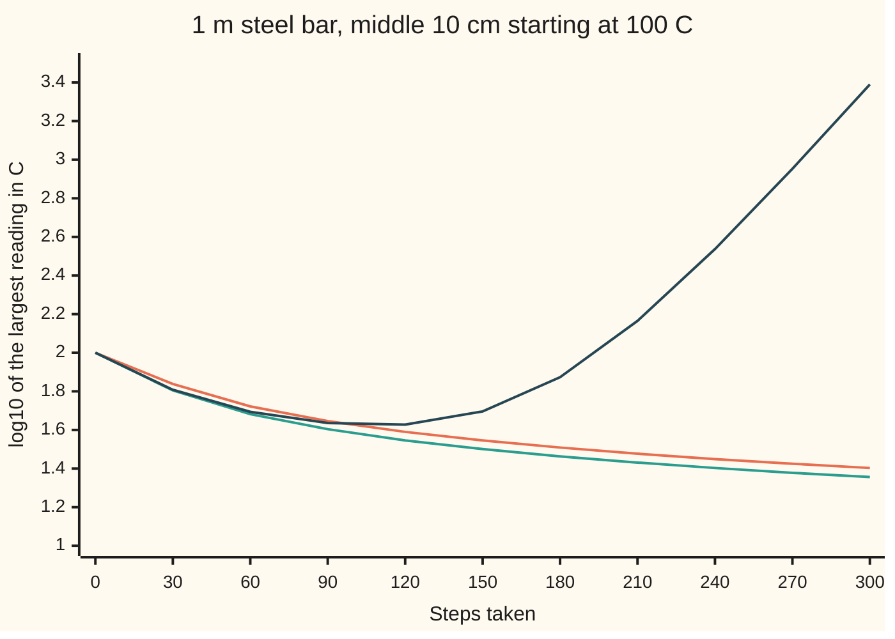
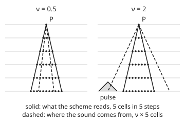

# Von Neumann analysis: feed a wave into the scheme and see whether it grows

[Syllabus](../../../SYLLABUS.md) → [Numerical analysis](../README.md) → [PDE Solvers](../README.md#s07) → Von Neumann analysis

---

## General Overview

A steel bar 1 m long has both ends in ice water at 0 C. A torch has heated the middle 10 cm to 100 C. A program follows the heat as it spreads, with a reading every 1 cm and a jump forward in time after each round of updates. It uses the explicit heat step of [Stepping the heat equation on a grid](../../08-Differential%20equations%20and%20dynamics/10-The%20Classical%20PDEs/09-finite-differences-for-the-heat-equation.md): each new reading is a weighted mix of a reading and its two neighbours.

The wanted number is the temperature in the middle, to a tenth of a degree. With time steps of 4.00 s, after 300 steps (1200 s) the middle reads 22.7113 C. The true bar is at 22.7170 C. With steps of 4.08 s, barely longer, after 300 steps (1224 s) the middle reads 2454.8874 C and its neighbour reads −2398.0 C. The true bar is at 22.4992 C.

Only the step changed. **Von Neumann analysis** predicts this before any run. Take one wave-shaped pattern of readings, push it through one step of the scheme, and see what number it comes back multiplied by. Here the sharpest zigzag the grid can hold comes back multiplied by −0.999507 at 4.00 s and by −1.039497 at 4.08 s. A factor below 1 in size dies away. A factor above 1 in size grows every step, and after 300 steps the zigzag swamps the bar.

The same test works for any linear scheme. For a wave, such as sound running through the same bar, there is also a simpler limit, the **CFL condition**: the time step must not let the sound travel further than one grid cell. Here that is 2.00 µs.

**Feed one wave e^(iξx) into a linear scheme, and it comes back multiplied by a growth factor g(ξ); a scheme with one old level is stable exactly when no wave's factor is larger than 1 in size (with more levels, also no repeated factor of size 1), and for a wave equation an explicit scheme that reaches one cell each way also needs the Courant number ν = |c|Δt/h to be at most 1, because the grid cannot use information it never reads.**

**What kind of fact this is:** a method, plus two theorems proved on this card in Why it works. The first: for a linear scheme with one old level and constant weights on a repeating grid, |g| ≤ 1 for every wave (or ≤ 1 + KΔt when the true solution may grow) is exactly stability. The second, the CFL condition: an explicit scheme cannot converge unless its stencil reaches at least as far as the true signal travels.

### The picture: the largest reading on the bar, three step sizes



Orange: steps of 3.20 s (r = 0.40). Teal: steps of 4.00 s (r = 0.50). Dark blue: steps of 4.08 s (r = 0.51). All three cool at first. From about step 120 the dark line turns up: the zigzag has overtaken the real heat. A rise of 1 on this axis is ten times the temperature.

---

## The formula

Notation first, as in [Finite differences on a grid](02-finite-differences-consistency-stability-and-convergence.md). $u(x, t)$ is the temperature at $x$ metres and $t$ seconds. Grid points sit $h$ = 0.01 m apart; time moves in steps of $\Delta t$. $u_j^n$ is the reading at point $j$ after $n$ steps; the raised $n$ is a label, not a power. The **diffusivity** $\alpha$, wing 08's κ, says how fast heat spreads. The **mesh ratio** $r = \alpha\Delta t/h^2$ is the time step in grid units.

A **Fourier mode** is one wave pattern on the grid, $u_j = e^{i\xi jh}$. Here $i$ is the square root of −1, and $\xi$, read "xi", is the **wavenumber**: radians of wave per metre. The product $\xi h$ is how far the wave turns between neighbouring points. By Euler's formula, $e^{i\xi jh} = \cos(\xi jh) + i\sin(\xi jh)$, so a mode is a cosine and a sine wave travelling together.

Put the mode into the scheme and look for the factor it comes back multiplied by. That factor $g(\xi)$ is the mode's **amplification factor**, or growth factor:

$$u_j^n = g(\xi)^n\, e^{i\xi jh} \qquad\Longrightarrow\qquad \text{stable} \iff |g(\xi)| \le 1 \text{ for every } \xi.$$

**Read it aloud:** if every wave the grid can hold comes back from one step no larger than it went in, nothing can grow; if one wave comes back larger, that wave grows every step.

For the explicit heat step, the mode gives

$$g(\xi) = 1 - 4r\sin^2\!\Big(\frac{\xi h}{2}\Big), \qquad\text{so}\qquad r \le \tfrac12, \quad\text{that is}\quad \Delta t \le \frac{h^2}{2\alpha}.$$

For a wave moving at speed $c$, the **Courant number** is $\nu = |c|\Delta t/h$, the number of cells the true signal crosses in one step. The **CFL condition** for an explicit scheme whose stencil reaches one cell each way is

$$\nu = \frac{|c|\,\Delta t}{h} \le 1, \qquad\text{that is}\qquad \Delta t \le \frac{h}{|c|}.$$

| Symbol | Plain meaning | In our example | Push it up and the answer… |
| --- | --- | --- | --- |
| $u$, $x$, $t$ | temperature, or the sound's displacement; place in m; time in s | 100 C in the middle 10 cm at the start | — |
| $\alpha$ | diffusivity: how fast heat spreads, in m²/s | 1.25e-5 (illustrative, typical of carbon steel) | the safe heat step shrinks |
| $c$ | wave speed, in m/s | sound in steel, 5000 (illustrative) | the safe wave step shrinks |
| $h$, $\Delta t$ | grid spacing; time step | 0.01 m; 4.00 s (heat), 2.00 µs (sound) | larger error per step |
| $r$ | mesh ratio αΔt/h²: the heat step in grid units | 0.40, 0.50, 0.51 | above 1/2 the explicit heat step blows up |
| $\nu$ | Courant number \|c\|Δt/h: cells the signal crosses per step | 0.9, 1, 1.02, 2 | above 1 every explicit one-cell scheme fails |
| $u_j^n$, $j$, $n$ | computed value at point j after n steps | middle point j = 50 | — |
| $\xi$, $k$, $\xi h$ | wavenumber in radians per m; mode number, with ξ = kπ on this bar; turn of the wave from one point to the next | k = 1 (one hump) to k = 99 (sharpest zigzag); ξh = kπ/100 | sharper wave; at ξh = π neighbours have opposite sign |
| $a_m$, $m$ | weight a scheme puts on the old reading m cells away | r, 1 − 2r, r at m = −1, 0, 1 | a negative weight can let a zigzag grow |
| $i$ | square root of −1 | — | — |
| $g(\xi)$ | amplification factor: what one step multiplies the mode by | −1.039497 for k = 99 at r = 0.51 | size above 1: that wave grows |
| $\beta$ | middle coefficient of the leapfrog's equation for g | 1 − 2ν² sin²(ξh/2) | below −1: one root grows |

### When it holds

- **The scheme is linear.** Waves pass through without mixing only then. A nonlinear scheme, such as one for a shock, can be stable in this test and still blow up.
- **The weights do not change from point to point.** Otherwise each wave leaks into others. The usual fix is to freeze the weights at each point and test there. That gives a necessary condition, not a proof.
- **The grid repeats, or the waves fit the ends.** On a repeating grid the test is exact. Here the ends are held at 0, and the sine waves sin(kπx) for k = 1 to 99 fit them exactly, so the test is exact here too. Other end rules can add growth that the test cannot see.
- **One old level.** With two old levels, as in leapfrog, g solves a quadratic. Then |g| ≤ 1 is necessary but not enough: a double root of size 1 makes a wave grow in proportion to the step count (Step 5).
- **The physics itself does not grow.** If the true solution may grow, as with a heat source, the test becomes |g| ≤ 1 + KΔt for a fixed number K. Growth that shrinks with Δt is allowed, because it adds up to at most e^(Kt).

---

## Why it works

### Step 0: a wave goes in and the same wave comes out

A scheme with constant weights does the same thing at every point. Shift a pattern one cell along the grid and the scheme's output shifts one cell too. A Fourier mode is the one pattern that a one-cell shift only multiplies, by $e^{i\xi h}$. So the scheme cannot change the mode's shape. It can only multiply the whole mode by one number, $g(\xi)$. Finding that number is the whole method.

### Step 1: put the mode in and divide it out

Take a scheme that reads neighbours $j + m$ on the old level with weights $a_m$:

$$u_j^{n+1} = \sum_m a_m\,u_{j+m}^n.$$

Put in $u_j^n = g^n e^{i\xi jh}$. Every term carries the factor $g^n e^{i\xi jh}$, so divide it out:

$$g(\xi) = \sum_m a_m\, e^{im\xi h}.$$

An implicit scheme also has weights $b_m$ on the new level; then $g$ is the old sum divided by the new sum. The code feeds every scheme's stencil one wave and divides.

For the heat step the weights are $r$, $1 - 2r$, $r$. The two neighbours give $r(e^{i\xi h} + e^{-i\xi h}) = 2r\cos(\xi h)$, and $1 - \cos(\xi h) = 2\sin^2(\xi h/2)$ turns the sum into $1 - 4r\sin^2(\xi h/2)$. Wing 08 derives the same factor with real sine waves ([Stepping the heat equation on a grid](../../08-Differential%20equations%20and%20dynamics/10-The%20Classical%20PDEs/09-finite-differences-for-the-heat-equation.md)).

### Step 2: every start is a sum of waves, and each grows on its own

Any set of grid readings is a sum of Fourier modes. On a repeating grid that is [The discrete Fourier transform](../../07-Complex%20analysis/08-Transforms%20in%20Outline/02-discrete-fourier-transform.md). On the bar with cold ends it is the sine series of [Fourier series](../../08-Differential%20equations%20and%20dynamics/09-Fourier%20Series/01-fourier-series-and-orthogonality.md). Each mode is multiplied by its own $g$ every step, and the modes never mix. After $n$ steps mode $k$ has been multiplied by $g(\xi_k)^n$.

So the run's size is controlled by the largest $|g|$. If every $|g| \le 1$, the total size can never grow. If one $|g| > 1$, that mode grows like $|g|^n$ from whatever tiny amount of it the start contains. Even rounding error supplies some.

The check runs the loop for 300 steps. It also splits the start into its 99 sine modes, multiplies each by $g^{300}$ and adds them up. The two middle readings agree to rounding at all three step sizes.

<details>
<summary>Detailed proof: |g| ≤ 1 for every mode is exactly stability on a repeating grid, for a scheme with one old level</summary>

Take $N$ points on a repeating grid and measure a set of readings by its root-mean-square size, $\lVert u\rVert^2 = \frac1N\sum_j |u_j|^2$. Write the start as $u_j^0 = \sum_k A_k e^{i\xi_k jh}$ with $\xi_k h = 2\pi k/N$. Parseval's identity for the discrete Fourier transform says $\lVert u\rVert^2 = \sum_k |A_k|^2$.

One step sends the coefficient $A_k$ to $g(\xi_k)\,A_k$, because each mode only gets multiplied (Step 1). After $n$ steps,

$$\lVert u^n\rVert^2 = \sum_k |g(\xi_k)|^{2n}\,|A_k|^2 \le \Big(\max_k |g(\xi_k)|\Big)^{2n}\,\lVert u^0\rVert^2.$$

If every $|g| \le 1$, then $\lVert u^n\rVert \le \lVert u^0\rVert$ for every $n$: stable. If $|g| \le 1 + K\Delta t$, then $\lVert u^n\rVert \le (1 + K\Delta t)^n\lVert u^0\rVert \le e^{Kt}\lVert u^0\rVert$ at time $t = n\Delta t$: still stable.

The bound is sharp. Start with the single worst mode, and the run grows by exactly $\max|g|$ each step. If $\max|g|$ stays above $1 + K\Delta t$ for every $K$ as the grid is refined, that start grows without limit at a fixed time: unstable.

On the bar with cold ends, the sine modes $\sin(k\pi x_j)$ for $k = 1, \dots, 99$ are the eigenvectors of the explicit step's symmetric matrix, with eigenvalues $g(k\pi)$. The same argument holds with the sine series in place of the transform.

</details>

### Step 3: the sharpest zigzag decides the heat step

At $r$ = 0.51, the smooth one-hump mode has $g$ = 0.999497. It looks perfectly safe. The sharpest zigzag, $k$ = 99, has $g$ = −1.039497. The minus sign flips the zigzag every step, and the size grows by 1.039497 each time.

The check projects the readings after steps 299 and 300 onto the $k$ = 99 sine wave and divides: −1.039497, matching the formula.

The size $|1 - 4r\sin^2(\xi h/2)|$ is largest when $\sin^2$ is near 1, at $\xi h$ near π. Every grid has such a mode as $h$ shrinks, so the safe range for every grid is $r \le 1/2$. On this exact 99-mode grid the limit is $r \le$ 0.500123, which is $\Delta t \le$ 4.00099 s. The clean rule $\Delta t \le h^2/(2\alpha)$ = 4.0000 s keeps a hair of margin.

At $r$ = 0.50 the zigzag's factor is −0.999507: it barely shrinks. That is stable, but any zigzag in the start lingers. At $r$ = 0.40 the factor is −0.599605, and zigzags die within a few steps.

### Step 4: a moving wave gives a complex factor

Heat has no direction, so its weights are symmetric and $g$ is real. A quantity carried along at speed $c$, the **transport equation** $u_t + c\,u_x = 0$, has lopsided weights. Then $g$ is a complex number. Its size says whether the wave grows. Its angle says how far the wave moves per step, so a wrong angle means the wave travels at the wrong speed.

Three explicit schemes for transport, each written with the Courant number ν:

| Scheme | Update | Growth factor g | Size squared, \|g\|² |
| --- | --- | --- | --- |
| centred | $u_j - \frac{\nu}{2}(u_{j+1} - u_{j-1})$ | $1 - i\nu\sin\xi h$ | $1 + \nu^2\sin^2\xi h$ |
| upwind | $u_j - \nu(u_j - u_{j-1})$ | $1 - \nu + \nu e^{-i\xi h}$ | $1 - 4\nu(1-\nu)\sin^2\frac{\xi h}{2}$ |
| Lax-Wendroff | adds a correction $\frac{\nu^2}{2}(u_{j+1} - 2u_j + u_{j-1})$ to centred | $1 - i\nu\sin\xi h - 2\nu^2\sin^2\frac{\xi h}{2}$ | $1 - 4\nu^2(1-\nu^2)\sin^4\frac{\xi h}{2}$ |

The centred scheme's size is above 1 for every step size. At ν = 0.5 its worst factor is 1.118034. Upwind and Lax-Wendroff are stable for ν up to 1 and grow beyond it: at ν = 1.2 their worst factors are 1.399915 and 1.879667. [Flow problems](06-upwind-schemes-and-conservation-laws.md) explains why they differ so.

### Step 5: a three-level scheme gives a quadratic for g

Sound in the bar obeys the **wave equation** $u_{tt} = c^2 u_{xx}$: the acceleration of each bit of steel is proportional to the bend. The **leapfrog** scheme uses two old levels:

$$u_j^{n+1} = 2u_j^n - u_j^{n-1} + \nu^2\big(u_{j+1}^n - 2u_j^n + u_{j-1}^n\big).$$

Put in the mode and divide out $g^{n-1}e^{i\xi jh}$. The result is a quadratic:

$$g^2 - 2\beta g + 1 = 0, \qquad \beta = 1 - 2\nu^2\sin^2\Big(\frac{\xi h}{2}\Big).$$

The two roots multiply to 1. If $|\beta| < 1$ they are two different complex numbers of size exactly 1: the wave keeps its size for ever, as sound in a perfect bar does. At $\beta = -1$ they meet in a double root −1; then $n(-1)^n$ also solves the step, and the wave grows in proportion to the step count $n$. If $\beta < -1$ they are real, and one is larger than 1 in size. So every mode needs $\nu\sin(\xi h/2) < 1$. A repeating grid holds the zigzag $\xi h = \pi$ and needs $\nu < 1$. This bar's sharpest mode has $\sin(99\pi/200) < 1$, so here the limit is $\nu$ below 1.0001234, and $\nu = 1$ is safe.

At ν = 1.02 the $k$ = 99 root is −1.488966, and the check measures the run's $k$ = 99 mode growing by that factor each step. After 50 steps, 102 µs, the middle computes 1561964.149968 µm, more than a metre and a half; the true middle is at rest.

### Step 6: the CFL condition, from where the answer comes from

The true answer at point $x$ and time $t$ depends only on starting data between $x - ct$ and $x + ct$. This stretch is the **domain of dependence**. For a bar starting at rest, d'Alembert's formula ([The wave equation](../../08-Differential%20equations%20and%20dynamics/10-The%20Classical%20PDEs/05-the-wave-equation-and-dalemberts-formula.md)) says more: half of the starting shape runs each way, so only the two end points $x \pm ct$ matter.

An explicit scheme whose stencil reaches one cell each way is slower. After $n$ steps, the reading at point $j$ depends only on starting data at points $j - n$ to $j + n$. That is a reach of $nh$ in each direction, at time $n\Delta t$.

The true reach is $c\,n\Delta t = \nu\, nh$. If ν > 1, the true answer depends on starting data the scheme never reads. Change that data, and the true answer changes while the computed one cannot. So the computed answers cannot converge to the true ones for every start. This is the Courant-Friedrichs-Lewy theorem, from 1928.

<p align="center"></p>

The check builds exactly this. At ν = 2, with steps of 4.00 µs, a pulse starts at 0.40 m, ten cells left of the middle. After 5 steps, 20 µs, the stencil has reached only 5 cells. The middle computes 0.000000 µm. The true middle is at 0.500000 µm: half the pulse has arrived.

The CFL condition is necessary, but not sufficient on its own. The centred transport scheme obeys it at ν = 0.5 and still grows by 1.118034 a step. Von Neumann analysis gives the sharp limit for each scheme. For upwind and Lax-Wendroff that limit happens to be ν ≤ 1, the CFL limit itself; for leapfrog on a repeating grid it is ν < 1.

### Step 7: heat moves at infinite speed

The heat equation sends a little heat everywhere at once. Its domain of dependence is the whole bar. So the stencil's reach per unit time, $h/\Delta t$, must grow without limit as the grid is refined. With $r$ fixed at 0.5, $\Delta t$ falls like $h^2$, so $h/\Delta t$ grows like $1/h$: 0.25 cm/s at $h$ = 0.01 m, 2.50 cm/s at $h$ = 0.001 m. The heat limit is the CFL idea for a signal with no top speed.

The price is steps. The explicit step costs 5 flops (floating-point adds or multiplies) per point. At $h$ = 0.01 m, 1200 s of heating costs 148500 flops. At $h$ = 0.001 m, $\Delta t$ falls to 0.040 s, and the same 1200 s costs 149850000 flops.

### Step 8: stability plus accuracy gives convergence

By the Lax equivalence theorem of [Finite differences on a grid](02-finite-differences-consistency-stability-and-convergence.md), a **consistent** linear scheme (one that matches the equation as $h$ and $\Delta t$ shrink) converges exactly when it is stable. Von Neumann analysis checks the stability half.

---

## Worked numbers, by hand

Heat in the steel bar, then sound in it. $h$ = 0.01 m, $\alpha$ = 1.25e-5 m²/s, $c$ = 5000 m/s. These illustrative values are rounder than the 1.2e-5 m²/s and 5047.5 m/s of [Three families](01-pde-families-elliptic-parabolic-hyperbolic.md), so the limits come out at exactly 4 s and 2 µs.

| Step | Arithmetic | Value |
| --- | --- | --- |
| heat limit | $h^2/(2\alpha) = 0.0001 / 0.000025$ | 4.0000 s |
| r at a 4.08 s step | $1.25\text{e-}5 \times 4.08 / 0.0001$ | 0.51 |
| smooth mode, k = 1 | $1 - 2.04\,\sin^2(\pi/200)$ | 0.999497 |
| sharpest zigzag, k = 99 | $1 - 2.04\,\sin^2(99\pi/200)$ | **−1.039497** |
| sound limit | $h/c = 0.01/5000$ | 2.00 µs |
| ν at a 2.04 µs step | $5000 \times 2.04\text{e-}6 / 0.01$ | 1.02 |
| leapfrog, k = 99 | the root $\beta - \sqrt{\beta^2 - 1}$ | **−1.488966** |

A step just past the heat limit makes the sharpest zigzag grow 1.039497-fold per step, enough to swamp the bar within 300 steps.

### What breaks if you drop a piece

| Mistake | Comes out at | What went wrong |
| --- | --- | --- |
| Heat step 4.08 s, r = 0.51 | middle 2454.8874 C after 1224 s; true 22.4992 C | the k = 99 zigzag has g = −1.039497 |
| Test only the smooth k = 1 mode | g = 0.999497: "stable" | the danger is at ξh near π, not at the smooth end |
| Centred scheme for transport at ν = 0.5 | worst factor 1.118034: grows | obeying CFL is not enough; \|g\|² = 1 + ν² sin²ξh |
| Sound step 4 µs, ν = 2 | middle 0.000000 µm after 20 µs; true 0.500000 µm | the pulse lies outside the stencil's reach |
| Sound step 2.04 µs, ν = 1.02 | middle 1561964.149968 µm after 102 µs; true at rest | β < −1 for k = 99, root −1.488966 |

The code prints every row.

---

## Code, from first principles, and it actually runs

The code takes three roads. Road one runs each scheme in a loop: the explicit heat step at three step sizes, and leapfrog for sound at four Courant numbers. Road two feeds one complex wave through each scheme's stencil, divides, and takes the largest size over the bar's 99 modes. It also projects the loop's output onto the sine modes, to measure each growth factor from the run. Road three is the closed forms: each scheme's g, the bar's exact Fourier series for heat, and d'Alembert's formula for sound. Asserts check that the fed waves match the closed forms, that the loop equals the sum of waves times g³⁰⁰, that measured growth equals predicted growth, that leapfrog at ν = 1 is exact, and that the ν = 2 run cannot see the pulse.

### Python

```python
# Von Neumann analysis and the CFL condition -- the check behind the card.  Standard
# library only.  A 1 m steel bar, ends held at 0, nodes h = 1 cm apart (j = 0..100).
# Road 1: run each scheme in a loop.  Road 2: feed one wave e^(i xi j h) into the
# scheme's stencil, read off g, and project the loop's output onto that wave.
# Road 3: closed forms, the bar's exact Fourier series and d'Alembert's formula.
import math, cmath
H, J, ALPHA, C = 0.01, 100, 1.25e-5, 5000.0      # m, cells, m^2/s (steel), m/s (sound)
PHI = [k * math.pi / J for k in range(1, J)]     # xi*h for the bar's 99 sine modes
S2 = lambda p: math.sin(p / 2) ** 2

def tot(xs):                   # plain left-to-right sum, the same in both languages
    s = 0.0
    for x in xs:
        s += x
    return s

def poly(w, phi):              # sum of w[m] e^(i m phi): the stencil seen by one wave
    return complex(tot(a * math.cos(m * phi) for m, a in w),
                   tot(a * math.sin(m * phi) for m, a in w))

def g_feed(st, phi):           # largest |g| that solves the stencil's equation
    if len(st) == 2:           # two levels:   new(phi) g = old(phi)
        return abs(poly(st[1], phi) / poly(st[0], phi))
    b = poly(st[2], phi)       # three levels: g^2 = mid(phi) g + old(phi)
    d = cmath.sqrt(b * b + 4 * poly(st[1], phi))
    return max(abs((b + d) / 2), abs((b - d) / 2))

def heat(r, steps):            # explicit heat step; a torch has heated the middle 10 cm
    U = [100.0 if 46 <= j <= 54 else 50.0 if j in (45, 55) else 0.0 for j in range(J + 1)]
    hist, prev = [], U
    for n in range(steps + 1):
        if n % 30 == 0:
            hist.append(math.log10(max(abs(u) for u in U)))
        if n < steps:
            prev = U
            U = [0.0] + [r * U[j - 1] + (1 - 2 * r) * U[j] + r * U[j + 1] for j in range(1, J)] + [0.0]
    return U, prev, hist

def mode(U, k):                # sine coefficient b_k of the readings U
    return 2 / J * tot(U[j] * math.sin(k * math.pi * j / J) for j in range(1, J))

def tent(x, c0, w):            # the pulse, extended odd and 2-periodic so the ends stay at 0
    x = (x + 1) % 2 - 1
    return max(0.0, 1 - abs(x - c0) / w) if x >= 0 else -max(0.0, 1 - abs(-x - c0) / w)

def exact_wave(j, t, c0, w):   # d'Alembert: half the pulse runs each way
    return (tent(j * H - C * t, c0, w) + tent(j * H + C * t, c0, w)) / 2 + 0.0

def wave(nu, steps, c0, w):    # leapfrog for u_tt = c^2 u_xx, bar starting at rest
    U0 = [tent(j * H, c0, w) for j in range(J + 1)]
    d2 = lambda U, j: U[j - 1] - 2 * U[j] + U[j + 1]
    U = [0.0] + [U0[j] + nu * nu / 2 * d2(U0, j) for j in range(1, J)] + [0.0]
    for _ in range(steps - 1):
        U0, U = U, [0.0] + [2 * U[j] - U0[j] + nu * nu * d2(U, j) for j in range(1, J)] + [0.0]
    return U0, U

ftcs = lambda r: ([(0, 1.0)], [(-1, r), (0, 1 - 2 * r), (1, r)])
print("== heat: 1 m steel bar, ends at 0 C, alpha = 1.25e-5 m^2/s, h = 0.01 m, middle 10 cm at 100 C ==")
print(f"limit h^2/(2 alpha) = {H * H / (2 * ALPHA):.4f} s; on this grid exactly r <= "
      f"{1 / (2 * S2(PHI[-1])):.6f}, dt <= {H * H / (2 * ALPHA * S2(PHI[-1])):.5f} s")
chart = []
for r in (0.4, 0.5, 0.51):
    dt, gk = r * H * H / ALPHA, [1 - 4 * r * S2(p) for p in PHI]
    assert max(abs(abs(a) - g_feed(ftcs(r), p)) for a, p in zip(gk, PHI)) < 1e-12  # fed = formula
    U, prev, hist = heat(r, 300)
    chart.append(hist)
    U0 = heat(r, 0)[0]
    spect = tot(mode(U0, k) * gk[k - 1] ** 300 * math.sin(k * math.pi / 2) for k in range(1, J))
    assert abs(spect - U[50]) < 1e-9 * max(1.0, abs(U[50]))         # loop = sum of waves times g^n
    k = 99 if r > 0.45 else 1                                       # a mode still above round-off
    ratio = mode(U, k) / mode(prev, k)
    assert abs(ratio - gk[k - 1]) < 1e-9                            # measured growth = predicted g
    t = 300 * dt
    true = tot(200 / (k * math.pi) * (math.cos(0.45 * k * math.pi) - math.cos(0.55 * k * math.pi))
               * math.exp(-ALPHA * (k * math.pi) ** 2 * t) * math.sin(k * math.pi / 2) for k in range(1, 400))
    print(f"r = {r:.2f}: dt = {dt:.2f} s; g(k=1) = {gk[0]:.6f}, g(k=99) = {gk[98]:.6f}, measured g(k={k}) = {ratio:.6f}")
    print(f"  300 steps = {t:.0f} s: middle {U[50]:.4f} C, true bar {true:.4f} C, true error {U[50] - true:.4f} C")
    assert r > 0.5 or abs(U[50] - true) < 0.03                      # stable grid tracks the true bar
assert U[50] > 1000 and abs(gk[0]) < 1                              # r = 0.51: k = 1 alone looks safe
print(f"r = 0.51 at 1224 s: neighbour reads {U[49]:.1f} C")
for r, h in zip(("0.40", "0.50", "0.51"), chart):
    print(f"chart log10 max|U|, r = {r}, n = 0..300 by 30:", " ".join(f"{v:.3f}" for v in h))

print("== max |g| over the 99 modes: one wave fed through each stencil ==")
def lf(nu, p):                 # closed form for leapfrog: roots of g^2 - 2 beta g + 1 = 0
    beta = 1 - 2 * nu * nu * S2(p)
    return max(1.0, abs(beta) + math.sqrt(max(0.0, beta * beta - 1)))
rows = [("heat explicit", "r = 0.51", ftcs(0.51), lambda p: abs(1 - 2.04 * S2(p))),
        ("heat implicit", "r = 5", ([(-1, -5.0), (0, 11.0), (1, -5.0)], [(0, 1.0)]), lambda p: 1 / (1 + 20 * S2(p)))]
for nu, s in ((0.5, "nu = 0.5"), (1.2, "nu = 1.2")):
    rows += [("transport centred", s, ([(0, 1.0)], [(-1, nu / 2), (0, 1.0), (1, -nu / 2)]),
              lambda p, nu=nu: math.sqrt(1 + (nu * math.sin(p)) ** 2)),
             ("transport upwind", s, ([(0, 1.0)], [(-1, nu), (0, 1 - nu)]),
              lambda p, nu=nu: math.sqrt(1 - 4 * nu * (1 - nu) * S2(p))),
             ("transport Lax-Wendroff", s, ([(0, 1.0)], [(-1, (nu * nu + nu) / 2), (0, 1 - nu * nu), (1, (nu * nu - nu) / 2)]),
              lambda p, nu=nu: math.sqrt(1 - 4 * nu * nu * (1 - nu * nu) * S2(p) ** 2))]
for nu, s in ((0.9, "nu = 0.9"), (1.0, "nu = 1"), (1.02, "nu = 1.02")):
    rows.append(("wave leapfrog", s, ([(0, 1.0)], [(0, -1.0)], [(-1, nu * nu), (0, 2 - 2 * nu * nu), (1, nu * nu)]),
                 lambda p, nu=nu: lf(nu, p)))
for name, s, st, closed in rows:
    mx = max(g_feed(st, p) for p in PHI)
    assert abs(mx - max(closed(p) for p in PHI)) < 1e-9             # stencil fed a wave = closed form
    print(f"{name:22} {s:9} max|g| = {mx:.6f}  {'stable' if mx <= 1 + 1e-12 else 'grows'}")

print("== sound in the bar: c = 5000 m/s, tent pulse 1 um high, 10 cm wide ==")
print(f"CFL limit h/c = {H / C * 1e6:.2f} us; on this grid exactly nu <= {1 / math.sin(PHI[-1] / 2):.7f}")
for nu, s, n in ((0.9, "0.9", 100), (1.0, "1", 100), (1.02, "1.02", 50)):
    prev, U = wave(nu, n, 0.5, 0.05)
    t = n * nu * H / C
    err = max(abs(U[j] - exact_wave(j, t, 0.5, 0.05)) for j in range(J + 1))
    print(f"nu = {s}: dt = {nu * H / C * 1e6:.2f} us, {n} steps = {t * 1e6:.0f} us; middle {U[50]:.6f} um,"
          f" exact {exact_wave(50, t, 0.5, 0.05):.6f}; worst true error {err:.3e} um")
assert err > 1e5                                                    # nu = 1.02 has blown up
b = 1 - 2 * 1.02 * 1.02 * S2(PHI[-1])
ratio = mode(U, 99) / mode(prev, 99)
print(f"nu = 1.02: mode k = 99 grows by {ratio:.6f} a step; root of g^2 - 2 beta g + 1 = {b - math.sqrt(b * b - 1):.6f}")
assert abs(ratio - (b - math.sqrt(b * b - 1))) < 1e-6
prev, U = wave(1.0, 70, 0.5, 0.05)
assert max(abs(U[j] - exact_wave(j, 1.4e-4, 0.5, 0.05)) for j in range(J + 1)) < 1e-12   # nu = 1: exact at 70 steps too
U = wave(2.0, 5, 0.40, 0.03)[1]                                     # pulse outside the stencil's reach
ex = exact_wave(50, 5 * 2.0 * H / C, 0.40, 0.03)
print(f"nu = 2 (dt = {2.0 * H / C * 1e6:.2f} us), pulse at 0.40 m: after 5 steps (20 us) the middle computes {U[50]:.6f} um; exact {ex:.6f} um")
assert U[50] == 0.0 and ex > 0.4
for hh in (0.01, 0.001):
    dt = 0.5 * hh * hh / ALPHA
    print(f"heat, r = 0.5, h = {hh} m: dt = {dt:.3f} s, reach h/dt = {hh / dt * 100:.2f} cm/s, "
          f"1200 s costs {round(1200 / dt) * (round(1 / hh) - 1) * 5} flops")
print("figure, 5 steps: stencil reach 5 cells; sound reach 2.5 cells at nu = 0.5, 10 cells at nu = 2")
print("ALL CHECKS PASS")
```

**Ran 2026-11-11 on macOS, Python 3.14.10, standard library only. All checks passed. Output, pasted from the run:**

```text
== heat: 1 m steel bar, ends at 0 C, alpha = 1.25e-5 m^2/s, h = 0.01 m, middle 10 cm at 100 C ==
limit h^2/(2 alpha) = 4.0000 s; on this grid exactly r <= 0.500123, dt <= 4.00099 s
r = 0.40: dt = 3.20 s; g(k=1) = 0.999605, g(k=99) = -0.599605, measured g(k=1) = 0.999605
  300 steps = 960 s: middle 25.2858 C, true bar 25.3114 C, true error -0.0257 C
r = 0.50: dt = 4.00 s; g(k=1) = 0.999507, g(k=99) = -0.999507, measured g(k=99) = -0.999507
  300 steps = 1200 s: middle 22.7113 C, true bar 22.7170 C, true error -0.0057 C
r = 0.51: dt = 4.08 s; g(k=1) = 0.999497, g(k=99) = -1.039497, measured g(k=99) = -1.039497
  300 steps = 1224 s: middle 2454.8874 C, true bar 22.4992 C, true error 2432.3882 C
r = 0.51 at 1224 s: neighbour reads -2398.0 C
chart log10 max|U|, r = 0.40, n = 0..300 by 30: 2.000 1.838 1.722 1.646 1.590 1.546 1.509 1.477 1.449 1.425 1.403
chart log10 max|U|, r = 0.50, n = 0..300 by 30: 2.000 1.805 1.682 1.604 1.546 1.501 1.463 1.431 1.403 1.378 1.356
chart log10 max|U|, r = 0.51, n = 0..300 by 30: 2.000 1.808 1.694 1.636 1.628 1.696 1.873 2.165 2.537 2.953 3.390
== max |g| over the 99 modes: one wave fed through each stencil ==
heat explicit          r = 0.51  max|g| = 1.039497  grows
heat implicit          r = 5     max|g| = 0.995090  stable
transport centred      nu = 0.5  max|g| = 1.118034  grows
transport upwind       nu = 0.5  max|g| = 0.999877  stable
transport Lax-Wendroff nu = 0.5  max|g| = 1.000000  stable
transport centred      nu = 1.2  max|g| = 1.562050  grows
transport upwind       nu = 1.2  max|g| = 1.399915  grows
transport Lax-Wendroff nu = 1.2  max|g| = 1.879667  grows
wave leapfrog          nu = 0.9  max|g| = 1.000000  stable
wave leapfrog          nu = 1    max|g| = 1.000000  stable
wave leapfrog          nu = 1.02 max|g| = 1.488966  grows
== sound in the bar: c = 5000 m/s, tent pulse 1 um high, 10 cm wide ==
CFL limit h/c = 2.00 us; on this grid exactly nu <= 1.0001234
nu = 0.9: dt = 1.80 us, 100 steps = 180 us; middle -0.007760 um, exact 0.000000; worst true error 5.783e-02 um
nu = 1: dt = 2.00 us, 100 steps = 200 us; middle -1.000000 um, exact -1.000000; worst true error 2.220e-15 um
nu = 1.02: dt = 2.04 us, 50 steps = 102 us; middle 1561964.149968 um, exact 0.000000; worst true error 1.562e+06 um
nu = 1.02: mode k = 99 grows by -1.488966 a step; root of g^2 - 2 beta g + 1 = -1.488966
nu = 2 (dt = 4.00 us), pulse at 0.40 m: after 5 steps (20 us) the middle computes 0.000000 um; exact 0.500000 um
heat, r = 0.5, h = 0.01 m: dt = 4.000 s, reach h/dt = 0.25 cm/s, 1200 s costs 148500 flops
heat, r = 0.5, h = 0.001 m: dt = 0.040 s, reach h/dt = 2.50 cm/s, 1200 s costs 149850000 flops
figure, 5 steps: stencil reach 5 cells; sound reach 2.5 cells at nu = 0.5, 10 cells at nu = 2
ALL CHECKS PASS
```

### Rust

```rust
// Von Neumann analysis and the CFL condition -- the check behind the card.  Rust std only.
// A 1 m steel bar, ends held at 0, nodes h = 1 cm apart (j = 0..100).
// Road 1: run each scheme in a loop.  Road 2: feed one wave e^(i xi j h) into the
// scheme's stencil, read off g, and project the loop's output onto that wave.
// Road 3: closed forms, the bar's exact Fourier series and d'Alembert's formula.
use std::f64::consts::PI;
const H: f64 = 0.01; const J: usize = 100; const ALPHA: f64 = 1.25e-5; const C: f64 = 5000.0;
type St = Vec<(i32, f64)>;

#[derive(Clone, Copy)]
struct Cx { re: f64, im: f64 }
impl Cx {
    fn mul(self, o: Cx) -> Cx { Cx { re: self.re * o.re - self.im * o.im, im: self.re * o.im + self.im * o.re } }
    fn add(self, o: Cx) -> Cx { Cx { re: self.re + o.re, im: self.im + o.im } }
    fn scale(self, s: f64) -> Cx { Cx { re: self.re * s, im: self.im * s } }
    fn abs(self) -> f64 { self.re.hypot(self.im) }
    fn div(self, o: Cx) -> Cx { let d = o.re * o.re + o.im * o.im;
        Cx { re: (self.re * o.re + self.im * o.im) / d, im: (self.im * o.re - self.re * o.im) / d } }
    fn sqrt(self) -> Cx { let m = self.abs(); let re = ((m + self.re) / 2.0).sqrt();
        let im = ((m - self.re) / 2.0).sqrt(); Cx { re, im: if self.im < 0.0 { -im } else { im } } }
}
fn s2(p: f64) -> f64 { (p / 2.0).sin().powi(2) }
fn phis() -> Vec<f64> { (1..J).map(|k| k as f64 * PI / J as f64).collect() }
fn poly(w: &St, phi: f64) -> Cx {     // sum of w[m] e^(i m phi): the stencil seen by one wave
    let (mut re, mut im) = (0.0, 0.0);
    for &(m, a) in w { re += a * (m as f64 * phi).cos(); im += a * (m as f64 * phi).sin(); }
    Cx { re, im }
}
fn g_feed(st: &[St], phi: f64) -> f64 {   // largest |g| that solves the stencil's equation
    if st.len() == 2 { return poly(&st[1], phi).div(poly(&st[0], phi)).abs(); }
    let b = poly(&st[2], phi);              // three levels: g^2 = mid g + old
    let d = b.mul(b).add(poly(&st[1], phi).scale(4.0)).sqrt();
    b.add(d).scale(0.5).abs().max(b.add(d.scale(-1.0)).scale(0.5).abs())
}
fn heat(r: f64, steps: usize) -> (Vec<f64>, Vec<f64>, Vec<f64>) {
    let mut u: Vec<f64> = (0..=J).map(|j| if (46..=54).contains(&j) { 100.0 }
        else if j == 45 || j == 55 { 50.0 } else { 0.0 }).collect();
    let (mut hist, mut prev) = (vec![], u.clone());
    for n in 0..=steps {
        if n % 30 == 0 { hist.push(u.iter().fold(0.0f64, |m, x| m.max(x.abs())).log10()); }
        if n < steps {
            let mut v = vec![0.0; J + 1];
            for j in 1..J { v[j] = r * u[j - 1] + (1.0 - 2.0 * r) * u[j] + r * u[j + 1]; }
            prev = u; u = v;
        }
    }
    (u, prev, hist)
}
fn mode(u: &[f64], k: usize) -> f64 {
    let mut s = 0.0;
    for j in 1..J { s += u[j] * (k as f64 * PI * j as f64 / J as f64).sin(); }
    2.0 / J as f64 * s
}
fn tent(x: f64, c0: f64, w: f64) -> f64 {
    let x = (x + 1.0).rem_euclid(2.0) - 1.0;
    if x >= 0.0 { 0.0f64.max(1.0 - (x - c0).abs() / w) } else { -(0.0f64.max(1.0 - (-x - c0).abs() / w)) }
}
fn exact_wave(j: usize, t: f64, c0: f64, w: f64) -> f64 {
    (tent(j as f64 * H - C * t, c0, w) + tent(j as f64 * H + C * t, c0, w)) / 2.0 + 0.0
}
fn wave(nu: f64, steps: usize, c0: f64, w: f64) -> (Vec<f64>, Vec<f64>) {
    let mut u0: Vec<f64> = (0..=J).map(|j| tent(j as f64 * H, c0, w)).collect();
    let d2 = |u: &[f64], j: usize| u[j - 1] - 2.0 * u[j] + u[j + 1];
    let mut u = vec![0.0; J + 1];
    for j in 1..J { u[j] = u0[j] + nu * nu / 2.0 * d2(&u0, j); }
    for _ in 0..steps - 1 {
        let mut v = vec![0.0; J + 1];
        for j in 1..J { v[j] = 2.0 * u[j] - u0[j] + nu * nu * d2(&u, j); }
        u0 = u; u = v;
    }
    (u0, u)
}
fn sci(x: f64, d: usize) -> String {    // Python's e-notation: 5.783e-02
    let s = format!("{:.*e}", d, x);
    let (m, e) = s.split_once('e').unwrap();
    let e: i32 = e.parse().unwrap();
    format!("{}e{}{:02}", m, if e < 0 { '-' } else { '+' }, e.abs())
}
fn ftcs(r: f64) -> Vec<St> { vec![vec![(0, 1.0)], vec![(-1, r), (0, 1.0 - 2.0 * r), (1, r)]] }
fn lf(nu: f64, p: f64) -> f64 {
    let beta = 1.0 - 2.0 * nu * nu * s2(p);
    1.0f64.max(beta.abs() + 0.0f64.max(beta * beta - 1.0).sqrt())
}
fn main() {
    let ph = phis(); let last = ph[J - 2];
    println!("== heat: 1 m steel bar, ends at 0 C, alpha = 1.25e-5 m^2/s, h = 0.01 m, middle 10 cm at 100 C ==");
    println!("limit h^2/(2 alpha) = {:.4} s; on this grid exactly r <= {:.6}, dt <= {:.5} s",
             H * H / (2.0 * ALPHA), 1.0 / (2.0 * s2(last)), H * H / (2.0 * ALPHA * s2(last)));
    let (mut chart, mut u, mut gk) = (vec![], vec![], vec![]);
    for &r in &[0.4, 0.5, 0.51] {
        let dt = r * H * H / ALPHA;
        gk = ph.iter().map(|&p| 1.0 - 4.0 * r * s2(p)).collect::<Vec<f64>>();
        let fed = ph.iter().zip(&gk).fold(0.0f64, |m, (&p, a)| m.max((a.abs() - g_feed(&ftcs(r), p)).abs()));
        assert!(fed < 1e-12);                                         // fed = formula
        let (uu, prev, hist) = heat(r, 300);
        u = uu; chart.push(hist);
        let u0 = heat(r, 0).0;
        let mut spect = 0.0;
        for k in 1..J { spect += mode(&u0, k) * gk[k - 1].powi(300) * (k as f64 * PI / 2.0).sin(); }
        assert!((spect - u[50]).abs() < 1e-9 * 1.0f64.max(u[50].abs()));   // loop = waves times g^n
        let k = if r > 0.45 { 99 } else { 1 };
        let ratio = mode(&u, k) / mode(&prev, k);
        assert!((ratio - gk[k - 1]).abs() < 1e-9);                    // measured growth = predicted g
        let t = 300.0 * dt;
        let mut tr = 0.0;
        for k in 1..400 { let kp = k as f64 * PI;
            tr += 200.0 / kp * ((0.45 * kp).cos() - (0.55 * kp).cos()) * (-ALPHA * kp.powi(2) * t).exp() * (kp / 2.0).sin(); }
        println!("r = {:.2}: dt = {:.2} s; g(k=1) = {:.6}, g(k=99) = {:.6}, measured g(k={}) = {:.6}", r, dt, gk[0], gk[98], k, ratio);
        println!("  300 steps = {:.0} s: middle {:.4} C, true bar {:.4} C, true error {:.4} C", t, u[50], tr, u[50] - tr);
        assert!(r > 0.5 || (u[50] - tr).abs() < 0.03);                // stable grid tracks the true bar
    }
    assert!(u[50] > 1000.0 && gk[0].abs() < 1.0);                     // r = 0.51: k = 1 alone looks safe
    println!("r = 0.51 at 1224 s: neighbour reads {:.1} C", u[49]);
    for (r, h) in ["0.40", "0.50", "0.51"].iter().zip(&chart) {
        let pts: Vec<String> = h.iter().map(|v| format!("{:.3}", v)).collect();
        println!("chart log10 max|U|, r = {}, n = 0..300 by 30: {}", r, pts.join(" "));
    }
    println!("== max |g| over the 99 modes: one wave fed through each stencil ==");
    let mut rows: Vec<(&str, &str, Vec<St>, Box<dyn Fn(f64) -> f64>)> = vec![
        ("heat explicit", "r = 0.51", ftcs(0.51), Box::new(|p| (1.0 - 2.04 * s2(p)).abs())),
        ("heat implicit", "r = 5", vec![vec![(-1, -5.0), (0, 11.0), (1, -5.0)], vec![(0, 1.0)]], Box::new(|p| 1.0 / (1.0 + 20.0 * s2(p))))];
    for &(nu, s) in &[(0.5, "nu = 0.5"), (1.2, "nu = 1.2")] {
        rows.push(("transport centred", s, vec![vec![(0, 1.0)], vec![(-1, nu / 2.0), (0, 1.0), (1, -nu / 2.0)]],
                   Box::new(move |p: f64| (1.0 + (nu * p.sin()).powi(2)).sqrt())));
        rows.push(("transport upwind", s, vec![vec![(0, 1.0)], vec![(-1, nu), (0, 1.0 - nu)]],
                   Box::new(move |p| (1.0 - 4.0 * nu * (1.0 - nu) * s2(p)).sqrt())));
        rows.push(("transport Lax-Wendroff", s, vec![vec![(0, 1.0)], vec![(-1, (nu * nu + nu) / 2.0), (0, 1.0 - nu * nu), (1, (nu * nu - nu) / 2.0)]],
                   Box::new(move |p| (1.0 - 4.0 * nu * nu * (1.0 - nu * nu) * s2(p).powi(2)).sqrt())));
    }
    for &(nu, s) in &[(0.9, "nu = 0.9"), (1.0, "nu = 1"), (1.02, "nu = 1.02")] {
        rows.push(("wave leapfrog", s, vec![vec![(0, 1.0)], vec![(0, -1.0)], vec![(-1, nu * nu), (0, 2.0 - 2.0 * nu * nu), (1, nu * nu)]],
                   Box::new(move |p| lf(nu, p))));
    }
    for (name, s, st, closed) in &rows {
        let mx = ph.iter().fold(0.0f64, |m, &p| m.max(g_feed(st, p)));
        assert!((mx - ph.iter().fold(0.0f64, |m, &p| m.max(closed(p)))).abs() < 1e-9);  // fed = closed form
        println!("{:22} {:9} max|g| = {:.6}  {}", name, s, mx, if mx <= 1.0 + 1e-12 { "stable" } else { "grows" });
    }
    println!("== sound in the bar: c = 5000 m/s, tent pulse 1 um high, 10 cm wide ==");
    println!("CFL limit h/c = {:.2} us; on this grid exactly nu <= {:.7}", H / C * 1e6, 1.0 / (last / 2.0).sin());
    let (mut prev, mut err) = (vec![], 0.0);
    for &(nu, s, n) in &[(0.9, "0.9", 100), (1.0, "1", 100), (1.02, "1.02", 50)] {
        let (p, uu) = wave(nu, n, 0.5, 0.05);
        prev = p; u = uu;
        let t = n as f64 * nu * H / C;
        err = (0..=J).fold(0.0f64, |m, j| m.max((u[j] - exact_wave(j, t, 0.5, 0.05)).abs()));
        println!("nu = {}: dt = {:.2} us, {} steps = {:.0} us; middle {:.6} um, exact {:.6}; worst true error {} um",
                 s, nu * H / C * 1e6, n, t * 1e6, u[50], exact_wave(50, t, 0.5, 0.05), sci(err, 3));
    }
    assert!(err > 1e5);                                               // nu = 1.02 has blown up
    let b = 1.0 - 2.0 * 1.02 * 1.02 * s2(last);
    let ratio = mode(&u, 99) / mode(&prev, 99);
    println!("nu = 1.02: mode k = 99 grows by {:.6} a step; root of g^2 - 2 beta g + 1 = {:.6}", ratio, b - (b * b - 1.0).sqrt());
    assert!((ratio - (b - (b * b - 1.0).sqrt())).abs() < 1e-6);
    let u1 = wave(1.0, 70, 0.5, 0.05).1;
    assert!((0..=J).all(|j| (u1[j] - exact_wave(j, 1.4e-4, 0.5, 0.05)).abs() < 1e-12));   // nu = 1: exact at 70 steps too
    let u2 = wave(2.0, 5, 0.40, 0.03).1;                              // pulse outside the stencil's reach
    let ex = exact_wave(50, 5.0 * 2.0 * H / C, 0.40, 0.03);
    println!("nu = 2 (dt = {:.2} us), pulse at 0.40 m: after 5 steps (20 us) the middle computes {:.6} um; exact {:.6} um", 2.0 * H / C * 1e6, u2[50], ex);
    assert!(u2[50] == 0.0 && ex > 0.4);
    for &hh in &[0.01, 0.001] {
        let dt = 0.5 * hh * hh / ALPHA;
        let flops = (1200.0 / dt).round() as u64 * ((1.0 / hh).round() as u64 - 1) * 5;
        println!("heat, r = 0.5, h = {} m: dt = {:.3} s, reach h/dt = {:.2} cm/s, 1200 s costs {} flops", hh, dt, hh / dt * 100.0, flops);
    }
    println!("figure, 5 steps: stencil reach 5 cells; sound reach 2.5 cells at nu = 0.5, 10 cells at nu = 2");
    println!("ALL CHECKS PASS");
}
```

**Ran 2026-11-11 on macOS, rustc 1.98.1, no crates. All checks passed. Output, pasted from the run:**

```text
== heat: 1 m steel bar, ends at 0 C, alpha = 1.25e-5 m^2/s, h = 0.01 m, middle 10 cm at 100 C ==
limit h^2/(2 alpha) = 4.0000 s; on this grid exactly r <= 0.500123, dt <= 4.00099 s
r = 0.40: dt = 3.20 s; g(k=1) = 0.999605, g(k=99) = -0.599605, measured g(k=1) = 0.999605
  300 steps = 960 s: middle 25.2858 C, true bar 25.3114 C, true error -0.0257 C
r = 0.50: dt = 4.00 s; g(k=1) = 0.999507, g(k=99) = -0.999507, measured g(k=99) = -0.999507
  300 steps = 1200 s: middle 22.7113 C, true bar 22.7170 C, true error -0.0057 C
r = 0.51: dt = 4.08 s; g(k=1) = 0.999497, g(k=99) = -1.039497, measured g(k=99) = -1.039497
  300 steps = 1224 s: middle 2454.8874 C, true bar 22.4992 C, true error 2432.3882 C
r = 0.51 at 1224 s: neighbour reads -2398.0 C
chart log10 max|U|, r = 0.40, n = 0..300 by 30: 2.000 1.838 1.722 1.646 1.590 1.546 1.509 1.477 1.449 1.425 1.403
chart log10 max|U|, r = 0.50, n = 0..300 by 30: 2.000 1.805 1.682 1.604 1.546 1.501 1.463 1.431 1.403 1.378 1.356
chart log10 max|U|, r = 0.51, n = 0..300 by 30: 2.000 1.808 1.694 1.636 1.628 1.696 1.873 2.165 2.537 2.953 3.390
== max |g| over the 99 modes: one wave fed through each stencil ==
heat explicit          r = 0.51  max|g| = 1.039497  grows
heat implicit          r = 5     max|g| = 0.995090  stable
transport centred      nu = 0.5  max|g| = 1.118034  grows
transport upwind       nu = 0.5  max|g| = 0.999877  stable
transport Lax-Wendroff nu = 0.5  max|g| = 1.000000  stable
transport centred      nu = 1.2  max|g| = 1.562050  grows
transport upwind       nu = 1.2  max|g| = 1.399915  grows
transport Lax-Wendroff nu = 1.2  max|g| = 1.879667  grows
wave leapfrog          nu = 0.9  max|g| = 1.000000  stable
wave leapfrog          nu = 1    max|g| = 1.000000  stable
wave leapfrog          nu = 1.02 max|g| = 1.488966  grows
== sound in the bar: c = 5000 m/s, tent pulse 1 um high, 10 cm wide ==
CFL limit h/c = 2.00 us; on this grid exactly nu <= 1.0001234
nu = 0.9: dt = 1.80 us, 100 steps = 180 us; middle -0.007760 um, exact 0.000000; worst true error 5.783e-02 um
nu = 1: dt = 2.00 us, 100 steps = 200 us; middle -1.000000 um, exact -1.000000; worst true error 2.220e-15 um
nu = 1.02: dt = 2.04 us, 50 steps = 102 us; middle 1561964.149968 um, exact 0.000000; worst true error 1.562e+06 um
nu = 1.02: mode k = 99 grows by -1.488966 a step; root of g^2 - 2 beta g + 1 = -1.488966
nu = 2 (dt = 4.00 us), pulse at 0.40 m: after 5 steps (20 us) the middle computes 0.000000 um; exact 0.500000 um
heat, r = 0.5, h = 0.01 m: dt = 4.000 s, reach h/dt = 0.25 cm/s, 1200 s costs 148500 flops
heat, r = 0.5, h = 0.001 m: dt = 0.040 s, reach h/dt = 2.50 cm/s, 1200 s costs 149850000 flops
figure, 5 steps: stencil reach 5 cells; sound reach 2.5 cells at nu = 0.5, 10 cells at nu = 2
ALL CHECKS PASS
```

### Lean

Lean proves the von Neumann test on any repeating grid, the heat limit $r \le 1/2$, and that any one-cell explicit scheme needs the CFL condition.

- Take a linear scheme with one old level and the same weights at every point, on a repeating grid of $N$ points. It is stable exactly when every Fourier mode's growth factor has $|g| \le 1$.
- Stable here means: after any number of steps, the sum of $|u_j|^2$ is at most a fixed constant times its starting value.
- With $r \ge 0$, every factor $1 - 4r\sin^2(\xi h/2)$ has size at most 1 exactly when $r \le 1/2$.
- Take any explicit scheme whose stencil reaches one cell each way, with $\nu > 1$ and $n \ge 1$ steps. Two smooth starting shapes give the same computed reading at point $j$. Yet d'Alembert's formula for a bar starting at rest gives them different true answers there.
- The card's exact numbers check out: the 4 s heat limit, r = 0.51 at 4.08 s, the 2 µs sound limit and ν = 1.02 at 2.04 µs.
- So do the centred scheme's worst size squared, 5/4 at ν = 0.5, leapfrog's double root −1 at ν = 1, both reaches in cm/s and both flop counts.

The bar's sine modes, the leapfrog roots, the $1 + K\Delta t$ allowance and every run are left to the Python and Rust checks.

```lean
-- Von Neumann analysis: a linear scheme with constant weights on a repeating grid stays bounded exactly when no Fourier mode comes back larger than it went in, the explicit heat step passes this test exactly when r ≤ 1/2, and an explicit one-cell scheme with Courant number above 1 cannot see data that changes the true wave.
import Mathlib.Analysis.SpecialFunctions.Complex.CircleAddChar
import Mathlib.Analysis.SpecialFunctions.Trigonometric.Basic
import Mathlib.Analysis.Calculus.ContDiff.Defs
import Mathlib.Analysis.SpecialFunctions.SmoothTransition
import Mathlib.Analysis.Fourier.ZMod
import Mathlib.NumberTheory.LegendreSymbol.AddCharacter
import Mathlib.Tactic.NormNum

open Real

lemma stdAddChar_conj {N : ℕ} [NeZero N] (x : ZMod N) :
    (starRingEnd ℂ) (ZMod.stdAddChar x) = ZMod.stdAddChar (-x) := by
  have h1 : ‖ZMod.stdAddChar x‖ = 1 := by
    rw [ZMod.stdAddChar_apply]; exact Circle.norm_coe _
  have h2 : ZMod.stdAddChar x * (starRingEnd ℂ) (ZMod.stdAddChar x) = 1 := by
    rw [Complex.mul_conj', h1]; simp
  have h3 : ZMod.stdAddChar x * ZMod.stdAddChar (-x) = 1 := by
    rw [← AddChar.map_add_eq_mul]; simp
  have h0 : ZMod.stdAddChar x ≠ 0 := by
    intro h; rw [h] at h1; simp at h1
  exact mul_left_cancel₀ h0 (h2.trans h3.symm)

#print axioms stdAddChar_conj

lemma norm_stdAddChar {N : ℕ} [NeZero N] (x : ZMod N) : ‖ZMod.stdAddChar x‖ = 1 := by
  rw [ZMod.stdAddChar_apply]; exact Circle.norm_coe _

#print axioms norm_stdAddChar

lemma parseval_modes {N : ℕ} [NeZero N] (a : ZMod N → ℂ) :
    ∑ j, ‖∑ k, a k * ZMod.stdAddChar (k * j)‖ ^ 2 = (N : ℝ) * ∑ k, ‖a k‖ ^ 2 := by
  classical
  apply Complex.ofReal_injective
  push_cast
  simp_rw [← Complex.mul_conj']
  have e1 : ∀ j : ZMod N, (∑ k, a k * ZMod.stdAddChar (k * j)) *
      (starRingEnd ℂ) (∑ k, a k * ZMod.stdAddChar (k * j)) =
      ∑ k, ∑ l, a k * ZMod.stdAddChar (k * j) *
        ((starRingEnd ℂ) (a l) * ZMod.stdAddChar (-(l * j))) := by
    intro j
    rw [map_sum, Finset.sum_mul_sum]
    simp_rw [map_mul, stdAddChar_conj]
  have key : ∀ k l : ZMod N, ∑ j : ZMod N, a k * ZMod.stdAddChar (k * j) *
      ((starRingEnd ℂ) (a l) * ZMod.stdAddChar (-(l * j))) =
      a k * (starRingEnd ℂ) (a l) * (if k - l = 0 then (N : ℂ) else 0) := by
    intro k l
    have hs := AddChar.sum_mulShift (k - l) (ZMod.isPrimitive_stdAddChar N)
    simp only [ZMod.card, Nat.cast_ite, Nat.cast_zero] at hs
    rw [← hs, Finset.mul_sum]
    refine Finset.sum_congr rfl fun j _ => ?_
    have : ZMod.stdAddChar (k * j) * ZMod.stdAddChar (-(l * j)) =
        ZMod.stdAddChar (j * (k - l)) := by
      rw [← AddChar.map_add_eq_mul]; congr 1; ring
    rw [← this]; ring
  simp_rw [e1]
  rw [Finset.sum_comm]
  have e2 : ∀ k : ZMod N, ∑ j : ZMod N, ∑ l : ZMod N, a k * ZMod.stdAddChar (k * j) *
        ((starRingEnd ℂ) (a l) * ZMod.stdAddChar (-(l * j))) =
      a k * (starRingEnd ℂ) (a k) * N := by
    intro k
    rw [Finset.sum_comm]
    simp_rw [key, sub_eq_zero, mul_ite, mul_zero]
    simp
  simp_rw [e2, Finset.mul_sum]
  refine Finset.sum_congr rfl fun k _ => ?_
  ring

#print axioms parseval_modes

lemma mode_eigen {N : ℕ} [NeZero N]
    (S : (ZMod N → ℂ) →ₗ[ℂ] (ZMod N → ℂ))
    (hS : ∀ (u : ZMod N → ℂ) (j : ZMod N), S (fun i => u (i + 1)) j = S u (j + 1))
    (k : ZMod N) :
    S (fun j => ZMod.stdAddChar (k * j)) =
      (S (fun j => ZMod.stdAddChar (k * j)) 0) • (fun j => ZMod.stdAddChar (k * j)) := by
  set e : ZMod N → ℂ := fun j => ZMod.stdAddChar (k * j) with he
  have shift : (fun i => e (i + 1)) = ZMod.stdAddChar k • e := by
    funext i
    simp only [he, Pi.smul_apply, smul_eq_mul]
    rw [← AddChar.map_add_eq_mul]; congr 1; ring
  have step : ∀ j, S e (j + 1) = ZMod.stdAddChar k * S e j := by
    intro j
    rw [← hS, shift, map_smul]; rfl
  have nat : ∀ m : ℕ, S e (m : ZMod N) = ZMod.stdAddChar (k * (m : ZMod N)) * S e 0 := by
    intro m
    induction m with
    | zero => simp
    | succ m ih =>
      push_cast
      rw [step, ih, ← mul_assoc, ← AddChar.map_add_eq_mul]
      congr 2; ring
  funext j
  have := nat j.val
  rw [ZMod.natCast_zmod_val] at this
  rw [this]
  simp only [Pi.smul_apply, smul_eq_mul, he]
  ring

#print axioms mode_eigen

lemma mode_pow {N : ℕ}
    (S : (ZMod N → ℂ) →ₗ[ℂ] (ZMod N → ℂ)) (e : ZMod N → ℂ) (g : ℂ) (hg : S e = g • e) :
    ∀ n : ℕ, (S ^ n) e = g ^ n • e := by
  intro n
  induction n with
  | zero => simp
  | succ n ih =>
    rw [pow_succ, Module.End.mul_apply, hg, map_smul, ih, smul_smul, pow_succ]
    ring_nf

#print axioms mode_pow

lemma iterate_local {α : Type*} (step : (ℤ → α) → ℤ → α)
    (hstep : ∀ (u v : ℤ → α) (j : ℤ), (∀ i, |i - j| ≤ 1 → u i = v i) → step u j = step v j) :
    ∀ (m : ℕ) (u v : ℤ → α) (j : ℤ), (∀ i, |i - j| ≤ m → u i = v i) →
      step^[m] u j = step^[m] v j := by
  intro m
  induction m with
  | zero => intro u v j h; simpa using h j (by simp)
  | succ m ih =>
    intro u v j h
    rw [Function.iterate_succ_apply, Function.iterate_succ_apply]
    apply ih
    intro i hi
    apply hstep
    intro i' hi'
    apply h
    have : |i' - j| ≤ |i' - i| + |i - j| := by
      have := abs_sub_le i' i j; simpa using this
    push_cast; linarith

#print axioms iterate_local

/-- Von Neumann analysis on a repeating grid of N points, with one old level.
Let S be one step of a scheme: a linear map on the grid readings u : ZMod N → ℂ whose weights
do not change from point to point, so shifting the readings one cell shifts the output one cell.
The Fourier mode with wave number k is the wave j ↦ e^(2πi k j / N) (Mathlib's
`ZMod.stdAddChar (k * j)`). Measure the size of the readings by the sum of |u_j|².
Then the scheme is stable (some constant C bounds the size after any number of steps by
C times the starting size) exactly when every factor g that a mode comes back multiplied by
has |g| ≤ 1. -/
theorem stable_iff_every_growth_factor_at_most_one {N : ℕ} [NeZero N]
    (S : (ZMod N → ℂ) →ₗ[ℂ] (ZMod N → ℂ))
    (hS : ∀ (u : ZMod N → ℂ) (j : ZMod N), S (fun i => u (i + 1)) j = S u (j + 1)) :
    (∃ C : ℝ, ∀ (n : ℕ) (u : ZMod N → ℂ),
        ∑ j, ‖(S ^ n) u j‖ ^ 2 ≤ C * ∑ j, ‖u j‖ ^ 2) ↔
      ∀ (k : ZMod N) (g : ℂ),
        S (fun j => ZMod.stdAddChar (k * j)) = g • (fun j => ZMod.stdAddChar (k * j)) →
          ‖g‖ ≤ 1 := by
  have hNpos : (0 : ℝ) < N := by exact_mod_cast Nat.pos_of_ne_zero (NeZero.ne N)
  constructor
  · rintro ⟨C, hC⟩ k g hg
    by_contra hlt
    push Not at hlt
    have hb : ∀ n : ℕ, (‖g‖ ^ 2) ^ n ≤ C := by
      intro n
      have h1 := hC n (fun j => ZMod.stdAddChar (k * j))
      rw [mode_pow S _ g hg n] at h1
      simp only [Pi.smul_apply, smul_eq_mul, norm_mul, norm_pow, norm_stdAddChar, mul_one,
        one_pow, Finset.sum_const, Finset.card_univ, ZMod.card, nsmul_eq_mul] at h1
      rw [← pow_mul, mul_comm 2 n, pow_mul]
      nlinarith
    obtain ⟨n, hn⟩ := pow_unbounded_of_one_lt C (by nlinarith : (1 : ℝ) < ‖g‖ ^ 2)
    exact absurd (hb n) (not_le.2 hn)
  · intro h
    refine ⟨1, fun n u => ?_⟩
    set e : ZMod N → ZMod N → ℂ := fun k j => ZMod.stdAddChar (k * j) with he
    set g : ZMod N → ℂ := fun k => S (e k) 0 with hgdef
    have heig : ∀ k, S (e k) = g k • e k := fun k => mode_eigen S hS k
    have hg1 : ∀ k, ‖g k‖ ≤ 1 := fun k => h k (g k) (heig k)
    set a : ZMod N → ℂ := fun k => (N : ℂ)⁻¹ * ZMod.dft u k with ha
    have hu : u = ∑ k, a k • e k := by
      funext j
      have := congrFun (ZMod.dft.symm_apply_apply u) j
      rw [ZMod.invDFT_apply] at this
      rw [← this, Finset.sum_apply, smul_eq_mul, Finset.mul_sum]
      refine Finset.sum_congr rfl fun k _ => ?_
      simp only [Pi.smul_apply, smul_eq_mul, he, ha]
      ring
    have hSn : (S ^ n) u = ∑ k, (a k * g k ^ n) • e k := by
      conv_lhs => rw [hu]
      rw [map_sum]
      refine Finset.sum_congr rfl fun k _ => ?_
      rw [map_smul, mode_pow S (e k) (g k) (heig k) n, smul_smul, mul_comm]
    have hval : ∀ (b : ZMod N → ℂ) (j : ZMod N),
        (∑ k, b k • e k) j = ∑ k, b k * ZMod.stdAddChar (k * j) := by
      intro b j
      rw [Finset.sum_apply]
      rfl
    have lhs : ∑ j, ‖(S ^ n) u j‖ ^ 2 = (N : ℝ) * ∑ k, ‖a k * g k ^ n‖ ^ 2 := by
      rw [hSn]; simp_rw [hval]; exact parseval_modes _
    have rhs : ∑ j, ‖u j‖ ^ 2 = (N : ℝ) * ∑ k, ‖a k‖ ^ 2 := by
      conv_lhs => rw [hu]
      simp_rw [hval]; exact parseval_modes _
    rw [lhs, rhs, one_mul]
    apply mul_le_mul_of_nonneg_left _ hNpos.le
    apply Finset.sum_le_sum
    intro k _
    rw [norm_mul, norm_pow, mul_pow]
    have h0 : 0 ≤ ‖g k‖ ^ n := by positivity
    have h1 : ‖g k‖ ^ n ≤ 1 := pow_le_one₀ (norm_nonneg _) (hg1 k)
    have h2 : (‖g k‖ ^ n) ^ 2 ≤ 1 := by nlinarith
    nlinarith [sq_nonneg ‖a k‖]

/-- The explicit heat step u_j ← r u_(j-1) + (1 - 2r) u_j + r u_(j+1), with mesh ratio
r = αΔt/h² ≥ 0, multiplies the wave with turn θ = ξh between neighbours by
g = 1 - 4r sin²(θ/2). Every such factor has |g| ≤ 1 exactly when r ≤ 1/2. -/
theorem explicit_heat_step_stable_iff (r : ℝ) (hr : 0 ≤ r) :
    (∀ θ : ℝ, |1 - 4 * r * Real.sin (θ / 2) ^ 2| ≤ 1) ↔ r ≤ 1 / 2 := by
  constructor
  · intro h
    have := h π
    rw [Real.sin_pi_div_two, abs_le] at this
    linarith [this.1]
  · intro h θ
    have h0 : 0 ≤ Real.sin (θ / 2) ^ 2 := sq_nonneg _
    have h1 : Real.sin (θ / 2) ^ 2 ≤ 1 := Real.sin_sq_le_one _
    rw [abs_le]
    constructor <;> nlinarith [mul_nonneg hr h0]

/-- The CFL condition is necessary. Take any explicit scheme whose stencil reaches one cell each
way (the new value at point j depends only on the old values at j - 1, j, j + 1), started from
the samples of a starting shape f at the grid points x_i = i h, and read off after n ≥ 1 steps.
Let the true answer be d'Alembert's formula for a bar starting at rest,
u(x, t) = (f(x - ct) + f(x + ct)) / 2. If the Courant number ν = |c|Δt/h is above 1, there are
two smooth starting shapes on which the scheme computes the same value at point j after n steps,
while the true answers at x = j h, t = n Δt differ. So the computed answers cannot converge to
the true ones for every start. -/
theorem cfl_condition_necessary {α : Type*} (step : (ℤ → α) → ℤ → α)
    (hstep : ∀ (u v : ℤ → α) (j : ℤ), (∀ i, |i - j| ≤ 1 → u i = v i) → step u j = step v j)
    (init : ℝ → α) (read : α → ℝ) (h Δt c : ℝ) (hh : 0 < h) (hΔt : 0 < Δt)
    (hν : 1 < |c| * Δt / h) (j : ℤ) (n : ℕ) (hn : 0 < n) :
    ∃ f g : ℝ → ℝ, ContDiff ℝ 2 f ∧ ContDiff ℝ 2 g ∧
      read ((step^[n] fun i => init (f (i * h))) j) =
        read ((step^[n] fun i => init (g (i * h))) j) ∧
      (f (j * h - c * (n * Δt)) + f (j * h + c * (n * Δt))) / 2 ≠
        (g (j * h - c * (n * Δt)) + g (j * h + c * (n * Δt))) / 2 := by
  refine ⟨fun _ => 0, fun x => Real.smoothTransition (x - (j + n) * h), contDiff_const,
    Real.smoothTransition.contDiff.comp (contDiff_id.sub contDiff_const), ?_, ?_⟩
  · congr 1
    apply iterate_local step hstep
    intro i hi
    have hi' : (i : ℝ) ≤ j + n := by
      have := (abs_le.1 hi).2
      exact_mod_cast (by linarith : i ≤ j + n)
    simp only
    rw [Real.smoothTransition.zero_of_nonpos]
    nlinarith
  · have hν' : h < |c| * Δt := by rwa [lt_div_iff₀ hh, one_mul] at hν
    have hn' : (1 : ℝ) ≤ n := by exact_mod_cast hn
    have key : ∀ y : ℝ, y = |c| * (n * Δt) →
        0 < Real.smoothTransition (j * h + y - (j + n) * h) := by
      intro y hy
      apply Real.smoothTransition.pos_of_pos
      subst hy
      nlinarith
    have nn := Real.smoothTransition.nonneg
    simp only [zero_add, zero_div]
    intro heq
    rcases le_or_gt 0 c with hc | hc
    · have := key (c * (n * Δt)) (by rw [abs_of_nonneg hc])
      linarith [nn (j * h - c * (n * Δt) - (j + n) * h)]
    · have := key (-c * (n * Δt)) (by rw [abs_of_neg hc])
      have e : (j:ℝ) * h + -c * (n * Δt) = j * h - c * (n * Δt) := by ring
      rw [e] at this
      linarith [nn (j * h + c * (n * Δt) - (j + n) * h)]

-- Heat limit: h²/(2α) with h = 0.01 m and α = 1.25e-5 m²/s is 4 s.
example : ((1 : ℚ) / 100) ^ 2 / (2 * (125 / 10 ^ 7)) = 4 := by norm_num
-- A 4.08 s heat step gives r = αΔt/h² = 0.51.
example : ((125 : ℚ) / 10 ^ 7) * (408 / 100) / ((1 / 100) ^ 2) = 51 / 100 := by norm_num
-- Sound limit: h/c with h = 0.01 m and c = 5000 m/s is 2 µs.
example : ((1 : ℚ) / 100) / 5000 = 2 / 10 ^ 6 := by norm_num
-- A 2.04 µs sound step gives ν = cΔt/h = 1.02.
example : (5000 : ℚ) * (204 / 10 ^ 8) / (1 / 100) = 102 / 100 := by norm_num
-- Centred transport at ν = 0.5: the worst size squared is 1 + ν² = 5/4, above 1.
example : (1 : ℚ) + (1 / 2) ^ 2 = 5 / 4 := by norm_num
-- Leapfrog at ν = 1 on the zigzag ξh = π: β = 1 - 2 = -1 and g² - 2βg + 1 = (g + 1)², a double root -1.
example (g : ℚ) : g ^ 2 - 2 * (1 - 2 * 1 ^ 2) * g + 1 = (g + 1) ^ 2 := by ring
-- Heat at r = 0.5: the stencil's reach h/Δt is 0.25 cm/s at h = 0.01 m and 2.50 cm/s at h = 0.001 m.
example : ((1 : ℚ) / 100) / 4 * 100 = 1 / 4 := by norm_num
example : ((1 : ℚ) / 1000) / (4 / 100) * 100 = 5 / 2 := by norm_num
-- Cost of 1200 s at 5 flops per interior point: 300 steps × 99 points, then 30000 steps × 999 points.
example : (1200 / 4) * 99 * 5 = 148500 := by norm_num
example : 30000 * 999 * 5 = 149850000 := by norm_num

#print axioms stable_iff_every_growth_factor_at_most_one
#print axioms explicit_heat_step_stable_iff
#print axioms cfl_condition_necessary
```

**Checked 2026-11-11 on macOS, Lean 4.36.0-rc2, Mathlib v4.36.0-rc2. Every proof is complete and uses only Lean's standard axioms. Output, pasted from the run:**

```
'stdAddChar_conj' depends on axioms: [propext, Classical.choice, Quot.sound]
'norm_stdAddChar' depends on axioms: [propext, Classical.choice, Quot.sound]
'parseval_modes' depends on axioms: [propext, Classical.choice, Quot.sound]
'mode_eigen' depends on axioms: [propext, Classical.choice, Quot.sound]
'mode_pow' depends on axioms: [propext, Classical.choice, Quot.sound]
'iterate_local' depends on axioms: [propext, Classical.choice, Quot.sound]
'stable_iff_every_growth_factor_at_most_one' depends on axioms: [propext, Classical.choice, Quot.sound]
'explicit_heat_step_stable_iff' depends on axioms: [propext, Classical.choice, Quot.sound]
'cfl_condition_necessary' depends on axioms: [propext, Classical.choice, Quot.sound]
```

> [!TIP]
> **Try changing**
> - **Guess first:** in the heat loop, change `0.51` to `0.52`. The step grows only from 4.08 s to 4.16 s. The zigzag's factor becomes −1.079487, and after 300 steps the middle reads 206433744.9668 C.
> - **Guess first:** in the sound loop, change `(0.9, "0.9", 100)` to `(0.99, "0.99", 100)`. Closer to the limit, is the run better or worse? Better: the worst true error falls from 5.783e-02 µm to 4.431e-02 µm. Leapfrog is most accurate right at ν = 1.
> - **Guess first:** in the transport rows, change `1.2` to `1.0`. Upwind and Lax-Wendroff both show worst factor 1.000000, stable. The centred scheme shows 1.414214 and still grows.
> - **Guess first:** in the stability table, the implicit heat row uses r = 5, ten times past the explicit limit. Its worst factor is 0.995090: the implicit step is stable at any r.

---

## The usual mistake

> [!warning]
> **Treating the CFL condition as a guarantee.** CFL says only that the stencil can see far enough. It cannot see whether the weights are sensible. The centred transport scheme at ν = 0.5 obeys CFL with room to spare and still multiplies a wave by 1.118034 every step. Always compute g.
>
> - **Testing only smooth waves.** At r = 0.51 the one-hump mode has g = 0.999497 and looks safe. The k = 99 zigzag has −1.039497 and destroys the run.
> - **Scaling the heat step with h instead of h².** Ten times finer spacing needs a hundred times smaller step: 4.000 s becomes 0.040 s. The cost of 1200 s grows from 148500 to 149850000 flops.
> - **Calling a size of exactly 1 a safety margin.** Leapfrog sits at size 1 for every mode of this bar up to ν = 1. On a repeating grid ν = 1 already fails: the zigzag's roots meet at −1 and it grows linearly. Just past the limit, at ν = 1.02, one mode grows by 1.488966 a step.

---

## Where you meet it in real life

- **Weather and ocean models.** The fastest waves in the model set the explicit time step through the CFL condition. Models treat those waves implicitly so that the step can follow the slower weather instead.
- **Crash and impact simulation.** Explicit codes take a time step shorter than the time sound needs to cross the smallest element. One tiny element can slow the whole run.
- **Flow solvers.** Fluid codes report the Courant number every step and shrink the step when it climbs past the scheme's limit ([Flow problems](06-upwind-schemes-and-conservation-laws.md)).
- **Option pricing on a grid.** The finance wing reads the growth factor for every θ on its log-price grid, drift term included, to show which schemes explode ([Pricing on a grid](../../12-Financial%20mathematics/06-Numerical%20Methods%20for%20Pricing/07-finite-differences-for-the-black-scholes-equation.md)).

> **Say it back**
> A linear scheme with constant weights only multiplies a Fourier mode, so one number g(ξ) per wave describes it completely. Every start is a sum of modes, so the scheme is stable exactly when no |g| is above 1. For the explicit heat step that gives r ≤ 1/2, and the sharpest zigzag is the mode that breaks first. Moving waves give complex g, and three-level schemes give a quadratic for g. Separately, an explicit scheme must reach as far as the true signal travels, ν ≤ 1; that is necessary, but not sufficient on its own.

---

## What this builds on

- [Finite differences on a grid](02-finite-differences-consistency-stability-and-convergence.md): consistency, stability and the Lax equivalence theorem that makes stability worth checking.
- [The discrete Fourier transform](../../07-Complex%20analysis/08-Transforms%20in%20Outline/02-discrete-fourier-transform.md): any grid pattern is a sum of modes, and Parseval's identity measures its size.
- [Fourier series](../../08-Differential%20equations%20and%20dynamics/09-Fourier%20Series/01-fourier-series-and-orthogonality.md): the sine series that splits the bar's start into modes that fit its cold ends.
- [Stepping the heat equation on a grid](../../08-Differential%20equations%20and%20dynamics/10-The%20Classical%20PDEs/09-finite-differences-for-the-heat-equation.md): the explicit heat step and its real growth factor, the first von Neumann analysis in the library.
- [Pricing on a grid](../../12-Financial%20mathematics/06-Numerical%20Methods%20for%20Pricing/07-finite-differences-for-the-black-scholes-equation.md): a second worked case, with a complex factor from the drift term.

## Where this goes next

- [Crank-Nicolson and the theta family](04-crank-nicolson-and-theta-methods.md): the next card. It uses g to show that averaging the old and new levels is stable at any step, with second-order accuracy in time.
- [Flow problems](06-upwind-schemes-and-conservation-laws.md): upwind and conservative schemes for transport, where the angle of g, not just its size, decides how a pulse is smeared or wobbles.

Von Neumann analysis needs constant weights and a linear scheme: what keeps a scheme stable when the weights change along the bar, or when the equation is nonlinear?

---

## Sources

Verified 2026-11-11: every link below resolves to the publisher's page.

- Courant, R., K. Friedrichs and H. Lewy. "Über die partiellen Differenzengleichungen der mathematischen Physik." *Mathematische Annalen* 100 (1928): 32–74. [DOI](https://doi.org/10.1007/BF01448839). The domain-of-dependence argument behind the CFL condition.
- O'Brien, G. G., M. A. Hyman and S. Kaplan. "A Study of the Numerical Solution of Partial Differential Equations." *Journal of Mathematics and Physics* 29 (1950): 223–251. [DOI](https://doi.org/10.1002/sapm1950291223). The first detailed published account of von Neumann's Fourier-mode test, applied to the heat equation.
- Lax, P. D. and R. D. Richtmyer. "Survey of the stability of linear finite difference equations." *Communications on Pure and Applied Mathematics* 9 (1956): 267–293. [DOI](https://doi.org/10.1002/cpa.3160090206). Stability defined precisely, and the equivalence of stability and convergence for consistent schemes.
- Strikwerda, John C. *Finite Difference Schemes and Partial Differential Equations*, 2nd ed. SIAM, 2004. [Publisher page](https://doi.org/10.1137/1.9780898717938). Von Neumann analysis with complex factors, |g| ≤ 1 + KΔt, and the leapfrog quadratic.
- LeVeque, Randall J. *Finite Difference Methods for Ordinary and Partial Differential Equations*. SIAM, 2007. [Publisher page](https://doi.org/10.1137/1.9780898717839). The upwind and Lax-Wendroff factors and the CFL condition as a necessary condition.
