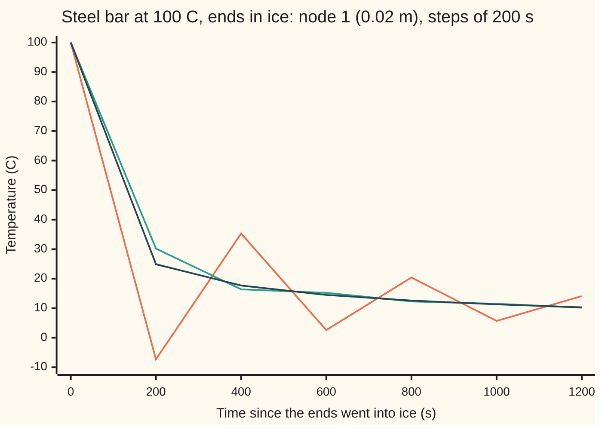
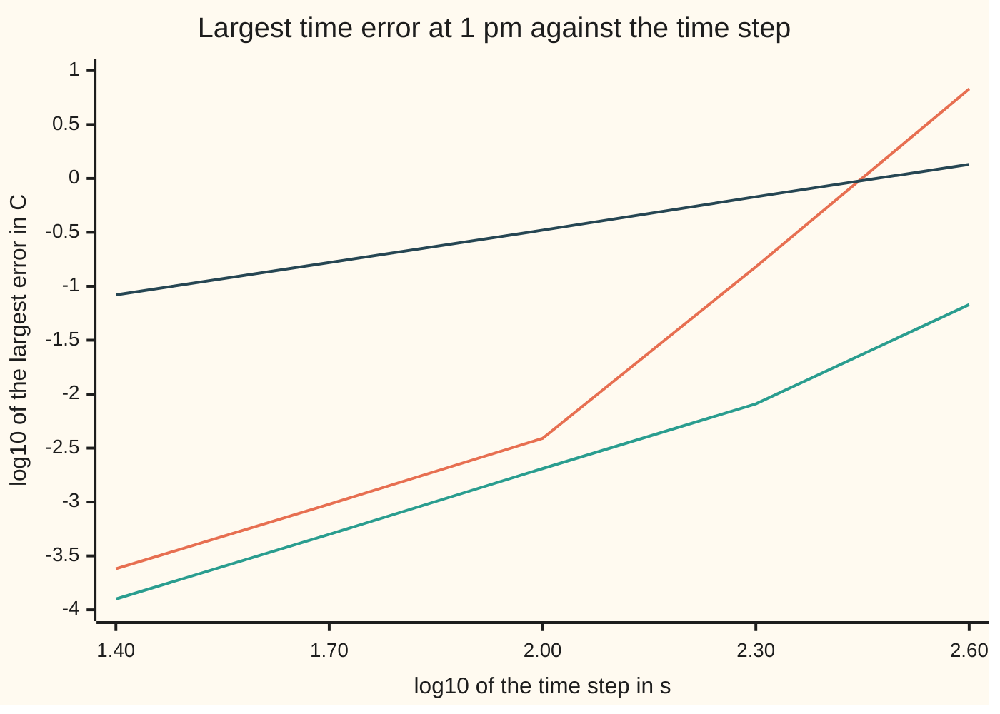

# Crank-Nicolson and the theta family: average the explicit and the implicit step

[Syllabus](../../../SYLLABUS.md) → [Numerical analysis](../README.md) → [PDE Solvers](../README.md#s07) → Crank-Nicolson and the theta family

---

## General Overview

A steel bar 1 m long sits at 100 °C. At noon both ends go into ice water and stay there at 0 °C. The question: what does the centre read at 1 pm, to a hundredth of a degree? The true answer, from the exact series solution, is 87.518521 °C.

A computer holds the bar as 49 temperatures, one every 2 cm. The explicit scheme from [Finite differences on a grid](02-finite-differences-consistency-stability-and-convergence.md) moves them forward in time, but only in steps of 20 s or less, or it blows up ([Von Neumann analysis](03-von-neumann-analysis-and-the-cfl-condition.md)). That is 180 steps for the hour. This card takes the diffusivity as a round, illustrative 1e-5 m²/s, so that ten times that limit, 200 s, divides the hour evenly. [Three families](01-pde-families-elliptic-parabolic-hyperbolic.md) and [Finite differences on a grid](02-finite-differences-consistency-stability-and-convergence.md) use 1.2e-5 m²/s, so their limits and temperatures differ from the ones here.

Crank-Nicolson takes steps ten times longer: 200 s, 18 steps. Each step solves 49 linked equations in one sweep down and one sweep back up. The catch shows in the first step. The point 2 cm from the ice reads −7.3 °C, colder than the ice that cools it.

Two short fully implicit steps at the start remove that. This damped run ends at 87.496635 °C at the centre, and its time-stepping error anywhere on the bar is at most 8.104e-3 °C. It is off the true bar by −2.189e-2 °C: a space error of −2.999e-2 °C from the 2 cm grid, partly offset by a time error of +8.104e-3 °C. So the hundredth of a degree is missed, and shorter time steps cannot fix it. The space error falls fourfold each time h halves, to −7.496e-3 °C at 1 cm, so a 1 cm grid with a time error under 2.5e-3 °C would meet the target.

**Average the explicit step and the implicit step, and the first-order errors of the two cancel, leaving a step that is second order in time and stable at any length; its one weakness is that sharp wiggles flip sign instead of dying, so a sharp start needs damping.**

**What kind of fact this is:** a method. Its second order and its stability at every step size are theorems, proved on this card in Why it works. That a damped start keeps second order on a rough start is a theorem stated with its source and shown here by measurement.

### The picture: 2 cm from the ice, the first 20 minutes



Orange: plain Crank-Nicolson, swinging above and below the truth. Teal: Crank-Nicolson with a damped start. Dark blue: the grid's exact answer in time.

---

## The formula

Notation from this shelf, in one line each. $u(x, t)$ is the temperature in °C at $x$ metres along the bar and $t$ seconds after noon. The heat equation is $u_t = \alpha u_{xx}$: the rate of change in time is the **diffusivity** $\alpha$ (how fast heat spreads, in m²/s) times the bend along the bar ([Three families](01-pde-families-elliptic-parabolic-hyperbolic.md)). On the grid, $u_j^n$ is the reading at node $j$ (at $x = jh$) after $n$ time steps; the raised $n$ is a label, not a power. The space step is $h$, the time step $\Delta t$, and $r = \alpha\Delta t/h^2$ is the time step measured in grid units.

This card introduces the **theta scheme**. A dial $\theta$, read "theta", between 0 and 1, says how much of the bend is read on the new time row:

$$\frac{u_j^{n+1} - u_j^n}{\Delta t} = \frac{\alpha}{h^2}\Big[\theta\,\big(u_{j-1}^{n+1} - 2u_j^{n+1} + u_{j+1}^{n+1}\big) + (1-\theta)\,\big(u_{j-1}^{n} - 2u_j^{n} + u_{j+1}^{n}\big)\Big]$$

**Read it aloud:** the change over one step equals the diffusivity times a blend of the bend now and the bend one step later, the dial setting the blend.

Three settings have names:

- $\theta = 0$: the **explicit** scheme. The bend is read on the old row only, so nothing needs solving.
- $\theta = 1$: the **implicit** scheme, backward Euler on every node at once.
- $\theta = \tfrac12$: **Crank-Nicolson**, the even average, after the 1947 paper below.

Multiply by $\Delta t$ and gather the new row on the left. Each node gives one equation in three unknowns:

$$-\theta r\,u_{j-1}^{n+1} + (1 + 2\theta r)\,u_j^{n+1} - \theta r\,u_{j+1}^{n+1} = u_j^n + (1-\theta)\,r\,\big(u_{j-1}^{n} - 2u_j^{n} + u_{j+1}^{n}\big)$$

The 49 equations form a **tridiagonal** system: each row has entries only on the diagonal and its two neighbours.

A wave that wiggles $k$ times along the bar, $\sin(k\pi x)$, comes out of one step multiplied by its **amplification factor** $g$:

$$g = \frac{1 - (1-\theta)\,4rs}{1 + \theta\,4rs}, \qquad s = \sin^2\!\Big(\frac{k\pi h}{2}\Big)$$

**Read it aloud:** the factor is one minus the old row's share of the damping, over one plus the new row's share.

| Symbol | Plain meaning | In our example | Push it up and the answer… |
| --- | --- | --- | --- |
| $u$, $u_j^n$ | temperature in °C; the grid reading at node $j$ after $n$ steps | 100 everywhere at noon | — |
| $x$, $t$ | place along the bar in m; time since noon in s | 0 to 1 m; 3600 s | — |
| $\alpha$ | diffusivity: how fast heat spreads, in m²/s | 1e-5 (illustrative and round, near carbon steel; cards 01 and 02 use 1.2e-5) | everything happens sooner |
| $h$, $j$ | space step in m; node number | 0.02 m; 1 to 49 | coarser grid, bigger space error |
| $\Delta t$, $n$ | time step in s; step number | 200 s; 0 to 18 | bigger time error, as $\Delta t^2$ for Crank-Nicolson |
| $r$ | $\alpha\Delta t/h^2$: the time step in grid units | 5 | past 1/2 the explicit scheme blows up |
| $\theta$ | the dial: the new row's share of the bend | 0, 1/2 or 1 | at 1/2 or more, stable at any $r$ |
| $k$, $s$ | wave number (wiggles along the bar); $\sin^2(k\pi h/2)$ | 1 (smooth) to 49 (zigzag) | sharper wave: exact and implicit steps damp it more; Crank-Nicolson barely does |
| $g$ | amplification factor: what one step multiplies wave $k$ by | 0.980460 ($k = 1$); −0.818019 ($k = 49$) | above 1 in size: blow-up |
| $\lambda_k$ | the exact decay rate of grid wave $k$, per s | 4α s/h² | — |
| $z$ | $-\lambda_k\Delta t$: the exponent of the exact decay over one step, $e^z$ | −0.019733 for $k = 1$ | — |
| $\tau$ | truncation error: what the exact solution leaves over in the scheme | of order $\Delta t^2 + h^2$ at $\theta = \tfrac12$ | — |

### When it holds

- **The dial is at least one half.** Below it the scheme blows up once $r$ passes $1/(2 - 4\theta)$. At $\theta = 0.4$ and $r = 5$ the bar reaches 190.8 °C, hotter than it started.
- **The dial is exactly one half, for second order.** Any other setting leaves a first-order error. At $\theta = 0.6$ the error only halves when the step halves.
- **The start is smooth, or the start is damped.** A jump puts weight on the sharpest waves, which Crank-Nicolson barely damps. Undamped, the first step reads −7.3 °C beside the ice.
- **Constant diffusivity and even spacing.** The factor $g$ needs both. With varying $\alpha$ the scheme still runs, but the stability proof needs the energy method instead.

---

## Why it works

### Step 0: in time, Crank-Nicolson is the trapezoidal rule

Hold the space grid fixed. The 49 readings then obey 49 ordinary differential equations: each reading's rate is $\alpha/h^2$ times its bend. The theta scheme is a time-stepping rule for that system. At $\theta = 1$ it is backward Euler. At $\theta = \tfrac12$ it averages the slope at the start and the slope at the end of the step: the **trapezoidal rule**. The stiff-equations card compares those two on one fast equation ([Stiff equations](../../08-Differential%20equations%20and%20dynamics/05-Numerical%20Evolution/06-stiff-equations-and-backward-euler.md)). Here the grid supplies 49 of them, and the zigzag wave is the fast one.

The finance wing already runs this scheme on a log-price grid, with the same growth-factor test ([Pricing on a grid](../../12-Financial%20mathematics/06-Numerical%20Methods%20for%20Pricing/07-finite-differences-for-the-black-scholes-equation.md)). This card does the heat equation in its own terms.

### Step 1: centring at the half step cancels the first-order error

Put the exact solution into the scheme. The amount by which it fails to satisfy it is the **truncation error** $\tau$ ([Finite differences on a grid](02-finite-differences-consistency-stability-and-convergence.md)). Expand everything by Taylor's theorem about the half step, $t_{n+1/2} = t_n + \Delta t/2$. The time difference and the blended bend agree term by term, except for:

$$\tau = \big(\tfrac12 - \theta\big)\,\Delta t\,u_{tt} \;-\; \frac{\Delta t^2}{12}\,u_{ttt} \;-\; \frac{\alpha h^2}{12}\,u_{xxxx} \;+\; \dots$$

The first term is $+\tfrac12\Delta t\,u_{tt}$ for the explicit scheme and $-\tfrac12\Delta t\,u_{tt}$ for the implicit one. They are equal in size and opposite in sign, so the even average cancels them. That is the whole reason for one half. Every other dial leaves the first term, which is first order in $\Delta t$.

<details>
<summary>Detailed proof: the truncation error of the theta scheme</summary>

Every derivative below is taken at the half step, $t_{n+1/2}$. Taylor's theorem there gives $u^{n+1} - u^n = \Delta t\,u_t + \tfrac{\Delta t^3}{24}u_{ttt} + O(\Delta t^5)$, the even powers cancelling. So the time difference is $u_t + \tfrac{\Delta t^2}{24}u_{ttt}$.

For the bend, the space difference gives $u_{xx} + \tfrac{h^2}{12}u_{xxxx} + O(h^4)$ on each row. Blend the two rows: $\theta\,u_{xx}^{n+1} + (1-\theta)\,u_{xx}^n = u_{xx} + (\theta - \tfrac12)\,\Delta t\,u_{xxt} + \tfrac{\Delta t^2}{8}u_{xxtt} + O(\Delta t^3)$.

Subtract $\alpha$ times the blend from the time difference. The heat equation gives $u_t = \alpha u_{xx}$, so $\alpha u_{xxt} = u_{tt}$ and $\alpha u_{xxtt} = u_{ttt}$. What is left is
$$\tau = (\tfrac12 - \theta)\,\Delta t\,u_{tt} + \big(\tfrac{1}{24} - \tfrac18\big)\Delta t^2 u_{ttt} - \tfrac{\alpha h^2}{12}u_{xxxx} + \dots$$
The middle coefficient is $-\tfrac{1}{12}$, which gives the formula in the body.

</details>

The code checks this on the smoothest wave. One step multiplies it by 0.980460; the exact decay is 0.980461. Their difference is −6.278e-7, and the Taylor term $z^3/12$ predicts −6.403e-7. The small gap between the two is the next Taylor term.

### Step 2: each wave is multiplied by its own factor

On this grid the sine waves $\sin(k\pi x_j)$, $k = 1$ to 49, pass through the scheme without changing shape. The bend of wave $k$ is exactly $-4s/h^2$ times the wave, with $s = \sin^2(k\pi h/2)$. Put that into both rows of the scheme: the new row carries $1 + \theta\,4rs$ and the old row $1 - (1-\theta)\,4rs$. Their ratio is $g$. This is the von Neumann method from [Von Neumann analysis](03-von-neumann-analysis-and-the-cfl-condition.md), applied to the whole family at once.

At $r = 5$ the two ends of the range look like this:

| Wave | 4rs | Explicit $g$ | Crank-Nicolson $g$ | Implicit $g$ | Exact decay |
| --- | --- | --- | --- | --- | --- |
| $k = 1$, one hump | 0.019733 | 0.980267 | 0.980460 | 0.980649 | 0.980461 |
| $k = 49$, zigzag | 19.980267 | −18.980267 | −0.818019 | 0.047664 | 2.102e-9 |

The smooth wave is copied well by all three. The zigzag should vanish almost at once. The explicit step multiplies it by −18.980267 instead. Crank-Nicolson multiplies it by −0.818019: most of it survives, with its sign flipped. Only the implicit step gets near zero.

### Step 3: stable at any step when the dial is one half or more

A scheme is stable when no wave grows: $|g| \le 1$ for every $k$. Since $4rs \ge 0$, the factor is never above 1. The only danger is $g < -1$, which works out to $(1 - 2\theta)\,4rs > 2$.

- For $\theta \ge \tfrac12$ the left side is zero or negative, so this never happens, whatever the step. The scheme is **unconditionally stable**.
- For $\theta < \tfrac12$ the worst case is $s$ near 1, so the scheme needs $r \le 1/(2 - 4\theta)$. That is 0.50 for the explicit scheme and 2.50 for $\theta = 0.4$.

At $r = 5$, $\theta = 0.4$ gives the zigzag the factor −1.221978. Eighteen steps take the largest reading to 1.908e2 °C. The explicit scheme reaches 1.331e23.

<details>
<summary>Detailed proof: |g| ≤ 1 for every wave exactly when θ ≥ 1/2 or r is small enough</summary>

Write $p = 4rs$, with $0 < p < 4r$. Then $g = (1 - (1-\theta)p)/(1 + \theta p)$, and the denominator is positive.

Upper side: $g \le 1$ means $1 - (1-\theta)p \le 1 + \theta p$, that is $-p \le 0$. True for every wave.

Lower side: $g \ge -1$ means $1 - (1-\theta)p \ge -1 - \theta p$, that is $(1 - 2\theta)\,p \le 2$. For $\theta \ge \tfrac12$ the left side is at most 0, so it holds for all $p$. For $\theta < \tfrac12$ it holds for all waves only if $(1 - 2\theta)\cdot 4r \le 2$, the sharpest wave having $s$ just below 1: $r \le 1/(2 - 4\theta)$.

With stability and the consistency of Step 1, the Lax equivalence theorem gives convergence ([Finite differences on a grid](02-finite-differences-consistency-stability-and-convergence.md)).

</details>

### Step 4: stable is not the same as damped

The language of [Stiffness](../06-ODE%20Solvers/05-stiffness-a-stability-and-the-dahlquist-barriers.md), on this wing's ODE-solver shelf, names the difference. A method is **A-stable** when it shrinks every decaying wave at every step size. It is **L-stable** when, in addition, its factor goes to 0 as a wave gets infinitely fast. Let $4rs$ grow without limit in the formula for $g$: the factor tends to $(\theta - 1)/\theta$.

| $r$ | 1 | 5 | 50 | 5000 |
| --- | --- | --- | --- | --- |
| Crank-Nicolson, zigzag $g$ | −0.332895 | −0.818019 | −0.980179 | −0.999800 |
| Implicit, zigzag $g$ | 0.200158 | 0.047664 | 0.004980 | 0.000050 |

Crank-Nicolson tends to −1: A-stable but not L-stable. The longer the step, the less it damps the sharpest waves. Backward Euler tends to 0: L-stable.

This matters here because of the start. The bar is 100 °C next to an end held at 0 °C: a jump. A jump is made of every wave, the sharp ones included. Crank-Nicolson multiplies those sharp waves by −0.818019 each step. That is the −7.3 °C, then 35.3 °C, then 2.6 °C in the picture.

### Step 5: damp the start, keep the order

The repair, named after Rannacher, replaces the first step with two backward Euler half-steps. Each half-step has $r = 2.5$:

- The zigzag is multiplied by 0.008279 over the pair, so it is gone.
- The smooth wave is multiplied by 0.980556 against the exact 0.980461. That one step is only first-order accurate.

One first-order step makes a local error of order $\Delta t^2$, the same size as the whole run's Crank-Nicolson error. So the run stays second order. The damped run never dips below 0 °C. Rannacher proved the general result for diffusion problems with rough data; Giles and Carter gave the analysis for this start-up.

The errors below are measured against the grid's exact answer in time, so they hold the time error alone. They are the largest error over the 49 nodes at 1 pm.

| Time step (s) | 400 | 200 | 100 | 50 | 25 |
| --- | --- | --- | --- | --- | --- |
| Crank-Nicolson | 6.756e0 | 1.529e-1 | 3.850e-3 | 9.627e-4 | 2.407e-4 |
| Crank-Nicolson, damped start | 6.751e-2 | 8.104e-3 | 2.022e-3 | 5.051e-4 | 1.263e-4 |
| Implicit | 1.351e0 | 6.687e-1 | 3.321e-1 | 1.654e-1 | 8.254e-2 |
| $\theta = 0.6$ | 2.071e-1 | 1.176e-1 | 6.235e-2 | 3.206e-2 | 1.625e-2 |

The ratios as the step halves tell the order. The damped run gives 8.33, then 4.01, 4.00, 4.00: second order. The implicit run gives 2.02, 2.01, 2.01, 2.00, and $\theta = 0.6$ climbs to 1.97: first order. Plain Crank-Nicolson gives 44.19 and 39.71 at long steps, where the flipped zigzag still lingers, then 4.00 once the steps are short. Rounding error stays far below all of these.



Orange: plain Crank-Nicolson. Teal: damped start. Dark blue: implicit. A slope of 2 is second order, a slope of 1 first order.

### Step 6: one step costs one tridiagonal solve

Each step of a dial above 0 is a tridiagonal system. The Thomas algorithm solves it in 8 flops (floating-point operations) per unknown, less 7: 385 for the 49 unknowns here. One sweep down removes each unknown's link to the node before it; one sweep back up reads the answers off.

The sweep never divides by anything small. The diagonal, $1 + 2\theta r$, is larger than the two off-diagonal entries together, $2\theta r$. Here the sweep's pivots fall from 6 and settle at $3 + \sqrt{2.75} = 4.658312$.

| Run to 1 pm | Steps | Flops | Largest time error |
| --- | --- | --- | --- |
| Explicit, 20 s ($r = 0.5$) | 180 | 44100 | 1.313e-1 |
| Crank-Nicolson, 200 s | 18 | 11340 | 1.529e-1 |
| Crank-Nicolson with damped start, 200 s | 18 | 11480 | 8.104e-3 |

The damped run costs 11480 flops against 44100 for the explicit run, and its error is far smaller. Even the explicit run rings a little: at $r = 0.5$ its zigzag factor sits just inside −1.

The space grid adds its own error. The grid's exact answer at the centre is 87.488531 °C, against the true bar's 87.518521, a space error of −2.999e-2 °C. The damped run's centre, 87.496635 °C, is off the true bar by −2.189e-2 °C: that space error plus a time error of +8.104e-3 °C. The space error falls fourfold as h halves, to −7.496e-3 °C at 1 cm and −1.874e-3 °C at 5 mm. A finer space grid, not a shorter time step, is the next thing to buy.

---

## Worked numbers, by hand

The first Crank-Nicolson step at node 1, 2 cm from the ice, with $\Delta t = 200$ s.

| Step | Arithmetic | Value |
| --- | --- | --- |
| time step in grid units, $r$ | 1e-5 × 200 ÷ 0.02² | 5 |
| the row of the system | $-r/2$, $1 + r$, $-r/2$ | −2.5, 6, −2.5 |
| right side, node 1 | 100 + 2.5 × (0 − 2 × 100 + 100) | −150 |
| right side, inner nodes | 100 + 2.5 × (100 − 200 + 100) | 100 |
| sweep down, row 1: the stored link to node 2, $c'_1$, and right side, $d'_1$ | −2.5 ÷ 6; −150 ÷ 6 | −0.416667; −25 |
| node 2, from the full sweep | — | 42.395980 |
| sweep back up, node 1 | −25 + 0.416667 × 42.395980 | **−7.335008** |

After one step of 200 s the grid says the steel 2 cm from the ice is at −7.3 °C, below the ice itself; the grid's exact answer is 24.9 °C.

### What breaks if you drop a piece

| Mistake | Comes out at | What went wrong |
| --- | --- | --- |
| Explicit steps of 200 s ($\theta = 0$, $r = 5$) | largest reading 1.331e23 °C | the zigzag's factor is −18.980267 |
| A dial below one half ($\theta = 0.4$) | largest reading 1.908e2 °C | stable only for $r \le 2.50$; the zigzag's factor is −1.221978 |
| No damped start | −7.3 °C at node 1 after one step | the jump's sharp waves flip sign, factor −0.818019 |
| Implicit steps for safety | time error 6.687e-1 at 200 s | first order; the damped run's is 8.104e-3 |

---

## Code, from first principles, and it actually runs

The code holds the bar on 49 nodes and takes three roads to every answer. Road one steps the theta scheme, each step solved by a written-out Thomas sweep. Road two never solves anything: it splits the starting bar into the grid's 49 sine waves and multiplies each by its factor $g$ once per step. Road three is the true bar, summed as a Fourier series, and checked by the grid's exact-in-time centre closing in on it fourfold each time h halves. The asserts check that roads one and two agree to 1e-9, that the space error falls at order 2, that measured factors equal the formula, that Crank-Nicolson's error on the smooth wave matches the Taylor term $z^3/12$, that the observed orders are 2 and 1, and that the unstable dials blow up.

### Python

```python
# Crank-Nicolson and the theta family -- the check behind the card.  Standard
# library only.  A steel bar 1 m long at 100 C, both ends plunged into ice
# water (0 C) at t = 0; heat obeys u_t = alpha u_xx.  Grid: h = 0.02 m, 49 inner
# nodes.  Road 1: theta steps solved by a written-out Thomas sweep.  Road 2: the
# grid's own sine modes, each multiplied by its factor g per step (no solves).
# Road 3: the true bar, as a Fourier series.  All agree as the analysis says.
from math import sin, exp, pi, log10
ALPHA, N, T = 1e-5, 50, 3600.0          # m^2/s (illustrative), cells, one hour in s
h, n = 1 / N, N - 1
x = [(j + 1) * h for j in range(n)]
def sci(v): m, e = f"{v:.3e}".split("e"); return f"{m}e{int(e)}"
def thomas(a, b, c, d):                 # constant bands a, b, c; right side d
    cp, dp = [c / b], [d[0] / b]
    for i in range(1, len(d)):
        p = b - a * cp[-1]; cp.append(c / p); dp.append((d[i] - a * dp[-1]) / p)
    y = [dp[-1]]
    for i in range(len(d) - 2, -1, -1): y.insert(0, dp[i] - cp[i] * y[0])
    return y, cp, dp
def step(u, dt, th):                    # one theta step; ends held at 0 C
    r = ALPHA * dt / h ** 2
    w = [0.0] + u + [0.0]
    rhs = [u[j] + (1 - th) * r * (w[j] - 2 * w[j + 1] + w[j + 2]) for j in range(n)]
    return rhs if th == 0 else thomas(-th * r, 1 + 2 * th * r, -th * r, rhs)[0]
def run(dt, th, damp=False, u=None):    # damp: first step as two backward-Euler half-steps
    u, k = ([100.0] * n if u is None else u), 0
    out = [u]
    if damp: u = step(step(u, dt / 2, 1.0), dt / 2, 1.0); out.append(u); k = 1
    for _ in range(round(T / dt) - k): u = step(u, dt, th); out.append(u)
    return out
def s2(k): return sin(k * pi * h / 2) ** 2
def lam(k): return 4 * ALPHA / h ** 2 * s2(k)          # decay rate of grid mode k, per s
def g(k, r, th): return (1 - (1 - th) * 4 * r * s2(k)) / (1 + th * 4 * r * s2(k))
b = [2 / N * sum(100.0 * sin(k * pi * xj) for xj in x) for k in range(1, N)]
def modes(f): return [sum(b[k - 1] * f(k) * sin(k * pi * xj) for k in range(1, N)) for xj in x]
def maxerr(u, v): return max(abs(p - q) for p, q in zip(u, v))
def centre(m):                          # the grid's exact-in-time centre with m cells: each sine mode decayed exactly
    return sum(2 / m * sum(100.0 * sin(k * pi * j / m) for j in range(1, m)) * sin(k * pi / 2)
               * exp(-4 * ALPHA * m * m * sin(k * pi / m / 2) ** 2 * T) for k in range(1, m))
dt = 200.0; r = ALPHA * dt / h ** 2
print(f"explicit limit h^2/(2 alpha) = {h * h / 2 / ALPHA:.1f} s; chosen step {dt:.0f} s; r = {r:.6f}")
grid = modes(lambda k: exp(-lam(k) * T))
true = 400 / pi * sum(sin(k * pi / 2) / k * exp(-ALPHA * (k * pi) ** 2 * T) for k in range(1, 2001, 2))
print(f"centre at 1 h: true bar {true:.6f}, grid exact in time {grid[24]:.6f}, space error {sci(grid[24] - true)}")
sp = [centre(m) - true for m in (50, 100, 200)]
print(f"space error at the centre, h = 0.02, 0.01, 0.005 m: {', '.join(sci(v) for v in sp)}; ratios {sp[0] / sp[1]:.2f}, {sp[1] / sp[2]:.2f}")
assert abs(sp[0] - (grid[24] - true)) < 1e-9 and all(3.9 < sp[i] / sp[i + 1] < 4.1 for i in range(2))   # series: grids close in at order 2
# one Crank-Nicolson step by hand, from 100 C everywhere
rhs = [100 + r / 2 * (w0 - 200 + w2) for w0, w2 in zip([0.0] + [100.0] * (n - 1), [100.0] * (n - 1) + [0.0])]
u1, cp, dp = thomas(-r / 2, 1 + r, -r / 2, rhs)
print(f"CN row: {-r / 2:.6f}, {1 + r:.6f}, {-r / 2:.6f}; right side node 1 {rhs[0]:.6f}, node 2 {rhs[1]:.6f}")
print(f"sweep: c'1 {cp[0]:.6f}, d'1 {dp[0]:.6f}; node 2 {u1[1]:.6f}; node 1 = d'1 - c'1 x node 2 = {u1[0]:.6f}")
print(f"settled pivot 3 + sqrt(2.75) = {3 + 2.75 ** 0.5:.6f}; sweep pivot 24 {(-r / 2) / cp[23]:.6f}")
# road 2: measured factors against the formula, mode 1 and mode 49
for k in (1, 49):
    um = [sin(k * pi * xj) for xj in x]
    meas = [step(um, dt, th)[0] / um[0] for th in (0.0, 0.5, 1.0)]
    form = [g(k, r, th) for th in (0.0, 0.5, 1.0)]
    print(f"mode {k}: 4r sin^2 {4 * r * s2(k):.6f}; g explicit {meas[0]:.6f}, CN {meas[1]:.6f}, "
          f"backward {meas[2]:.6f}; exact e^(-lambda dt) {(f'{exp(-lam(k) * dt):.6f}' if k == 1 else sci(exp(-lam(k) * dt)))}")
    assert maxerr(meas, form) < 1e-12
z = -lam(1) * dt
print(f"mode 1: CN g - e^z = {sci(g(1, r, 0.5) - exp(z))}, Taylor z^3/12 = {sci(z ** 3 / 12)}")
assert abs((g(1, r, 0.5) - exp(z)) / (z ** 3 / 12) - 1) < 0.03          # second order: error z^3/12, next term 1 + z
print("CN g as r grows, sharpest mode: " + ", ".join(f"r={rr} {g(49, rr, 0.5):.6f}" for rr in (1, 5, 50, 5000)))
print("backward g as r grows: " + ", ".join(f"r={rr} {g(49, rr, 1.0):.6f}" for rr in (1, 5, 50, 5000)))
# road 1 against road 2: stepped Thomas runs equal the mode formula
cn, cnd, be = run(dt, 0.5), run(dt, 0.5, True), run(dt, 1.0)
assert maxerr(cn[-1], modes(lambda k: g(k, r, 0.5) ** 18)) < 1e-9
assert maxerr(cnd[-1], modes(lambda k: g(k, r / 2, 1.0) ** 2 * g(k, r, 0.5) ** 17)) < 1e-9
ex = [modes(lambda k: exp(-lam(k) * dt * i)) for i in range(7)]
print("figure, t s: " + ", ".join(f"{dt * i:.0f}" for i in range(7)))
for name, v in (("CN", cn), ("CN damped", cnd), ("exact", ex)):
    print(f"figure, node 1, {name}: " + ", ".join(f"{v[i][0]:.1f}" for i in range(7)))
assert cn[1][0] < 0 < min(min(v) for v in cnd)          # CN dips below ice; damped run does not
print(f"start-up, two backward half-steps: mode 49 x {g(49, r / 2, 1.0) ** 2:.6f}, mode 1 x {g(1, r / 2, 1.0) ** 2:.6f}")
print(f"centre at 1 h, dt 200: CN {cn[-1][24]:.6f}, CN damped {cnd[-1][24]:.6f}, backward {be[-1][24]:.6f}; "
      f"damped minus true bar {sci(cnd[-1][24] - true)} = space {sci(grid[24] - true)} + time {sci(cnd[-1][24] - grid[24])}")
# order: max error against the grid's exact-in-time answer, as dt halves
dts = [400.0, 200.0, 100.0, 50.0, 25.0]
tab = {nm: [maxerr(run(d, th, dm)[-1], grid) for d in dts] for nm, th, dm in
       (("CN", 0.5, False), ("CN damped", 0.5, True), ("backward", 1.0, False), ("theta 0.6", 0.6, False))}
for nm, e in tab.items():
    print(f"max error, dt 400..25, {nm}: " + ", ".join(sci(v) for v in e)
          + "; ratios " + ", ".join(f"{e[i] / e[i + 1]:.2f}" for i in range(4)))
    print(f"figure, log10 error, {nm}: " + ", ".join(f"{log10(v):.2f}" for v in e))
print("figure, log10 dt: " + ", ".join(f"{log10(d):.2f}" for d in dts))
assert all(3.9 < tab["CN damped"][i] / tab["CN damped"][i + 1] < 4.1 for i in range(1, 4))
assert all(1.9 < tab["backward"][i] / tab["backward"][i + 1] < 2.1 for i in range(1, 4))
exp20 = run(20.0, 0.0)[-1]
print(f"explicit at 20 s (r = 0.5): centre {exp20[24]:.6f}, max error {sci(maxerr(exp20, grid))}")
# what breaks: steps too long for theta below one half
for th in (0.0, 0.4):
    big = max(abs(v) for v in run(dt, th)[-1])
    print(f"theta {th:.2f} at r = 5: limit r <= {1 / (2 - 4 * th):.2f}; sharpest g {g(49, r, th):.6f}; largest |u| at 1 h {sci(big)}")
    assert big > 100 and abs(g(49, r, th)) > 1       # hotter than the start: impossible
fl = 8 * n - 7
print(f"flops: Thomas {fl}, right side {5 * n}; CN 18 steps {18 * (fl + 5 * n)}, damped {2 * fl + 17 * (fl + 5 * n)}, "
      f"explicit 180 steps {180 * 5 * n}")
print("ALL CHECKS PASS")
```

**Ran 2026-11-11 on macOS, Python 3.14.10, standard library only. All checks passed. Output, pasted from the run:**

```
explicit limit h^2/(2 alpha) = 20.0 s; chosen step 200 s; r = 5.000000
centre at 1 h: true bar 87.518521, grid exact in time 87.488531, space error -2.999e-2
space error at the centre, h = 0.02, 0.01, 0.005 m: -2.999e-2, -7.496e-3, -1.874e-3; ratios 4.00, 4.00
CN row: -2.500000, 6.000000, -2.500000; right side node 1 -150.000000, node 2 100.000000
sweep: c'1 -0.416667, d'1 -25.000000; node 2 42.395980; node 1 = d'1 - c'1 x node 2 = -7.335008
settled pivot 3 + sqrt(2.75) = 4.658312; sweep pivot 24 4.658312
mode 1: 4r sin^2 0.019733; g explicit 0.980267, CN 0.980460, backward 0.980649; exact e^(-lambda dt) 0.980461
mode 49: 4r sin^2 19.980267; g explicit -18.980267, CN -0.818019, backward 0.047664; exact e^(-lambda dt) 2.102e-9
mode 1: CN g - e^z = -6.278e-7, Taylor z^3/12 = -6.403e-7
CN g as r grows, sharpest mode: r=1 -0.332895, r=5 -0.818019, r=50 -0.980179, r=5000 -0.999800
backward g as r grows: r=1 0.200158, r=5 0.047664, r=50 0.004980, r=5000 0.000050
figure, t s: 0, 200, 400, 600, 800, 1000, 1200
figure, node 1, CN: 100.0, -7.3, 35.3, 2.6, 20.4, 5.7, 14.1
figure, node 1, CN damped: 100.0, 30.2, 16.4, 15.2, 12.3, 11.5, 10.2
figure, node 1, exact: 100.0, 24.9, 17.7, 14.5, 12.6, 11.3, 10.3
start-up, two backward half-steps: mode 49 x 0.008279, mode 1 x 0.980556
centre at 1 h, dt 200: CN 87.501430, CN damped 87.496635, backward 87.311045; damped minus true bar -2.189e-2 = space -2.999e-2 + time 8.104e-3
max error, dt 400..25, CN: 6.756e0, 1.529e-1, 3.850e-3, 9.627e-4, 2.407e-4; ratios 44.19, 39.71, 4.00, 4.00
figure, log10 error, CN: 0.83, -0.82, -2.41, -3.02, -3.62
max error, dt 400..25, CN damped: 6.751e-2, 8.104e-3, 2.022e-3, 5.051e-4, 1.263e-4; ratios 8.33, 4.01, 4.00, 4.00
figure, log10 error, CN damped: -1.17, -2.09, -2.69, -3.30, -3.90
max error, dt 400..25, backward: 1.351e0, 6.687e-1, 3.321e-1, 1.654e-1, 8.254e-2; ratios 2.02, 2.01, 2.01, 2.00
figure, log10 error, backward: 0.13, -0.17, -0.48, -0.78, -1.08
max error, dt 400..25, theta 0.6: 2.071e-1, 1.176e-1, 6.235e-2, 3.206e-2, 1.625e-2; ratios 1.76, 1.89, 1.94, 1.97
figure, log10 error, theta 0.6: -0.68, -0.93, -1.21, -1.49, -1.79
figure, log10 dt: 2.60, 2.30, 2.00, 1.70, 1.40
explicit at 20 s (r = 0.5): centre 87.578650, max error 1.313e-1
theta 0.00 at r = 5: limit r <= 0.50; sharpest g -18.980267; largest |u| at 1 h 1.331e23
theta 0.40 at r = 5: limit r <= 2.50; sharpest g -1.221978; largest |u| at 1 h 1.908e2
flops: Thomas 385, right side 245; CN 18 steps 11340, damped 11480, explicit 180 steps 44100
ALL CHECKS PASS
```

### Rust

```rust
// Crank-Nicolson and the theta family -- the same check as the Python, in Rust.
// No crates.  A steel bar 1 m long at 100 C, both ends plunged into ice water
// (0 C) at t = 0; heat obeys u_t = alpha u_xx.  Grid: h = 0.02 m, 49 inner
// nodes.  Road 1: theta steps solved by a written-out Thomas sweep.  Road 2: the
// grid's own sine modes, each multiplied by its factor g per step (no solves).
// Road 3: the true bar, as a Fourier series.  All agree as the analysis says.
use std::f64::consts::PI;
const ALPHA: f64 = 1e-5; // m^2/s (illustrative)
const N: usize = 50;
const T: f64 = 3600.0;
const H: f64 = 1.0 / N as f64;
const M: usize = N - 1;
fn sci(v: f64) -> String { format!("{:.3e}", v) }
fn xs() -> Vec<f64> { (0..M).map(|j| (j + 1) as f64 * H).collect() }
fn thomas(a: f64, b: f64, c: f64, d: &[f64]) -> (Vec<f64>, Vec<f64>, Vec<f64>) {
    let (mut cp, mut dp) = (vec![c / b], vec![d[0] / b]);
    for i in 1..d.len() {
        let p = b - a * cp[i - 1];
        cp.push(c / p);
        dp.push((d[i] - a * dp[i - 1]) / p);
    }
    let mut y = vec![0.0; d.len()];
    y[d.len() - 1] = dp[d.len() - 1];
    for i in (0..d.len() - 1).rev() { y[i] = dp[i] - cp[i] * y[i + 1]; }
    (y, cp, dp)
}
fn step(u: &[f64], dt: f64, th: f64) -> Vec<f64> {
    let r = ALPHA * dt / (H * H);
    let mut w = vec![0.0]; w.extend_from_slice(u); w.push(0.0);
    let rhs: Vec<f64> = (0..M).map(|j| u[j] + (1.0 - th) * r * (w[j] - 2.0 * w[j + 1] + w[j + 2])).collect();
    if th == 0.0 { rhs } else { thomas(-th * r, 1.0 + 2.0 * th * r, -th * r, &rhs).0 }
}
fn run(dt: f64, th: f64, damp: bool) -> Vec<Vec<f64>> {
    let mut u = vec![100.0; M];
    let mut out = vec![u.clone()];
    let mut k = 0;
    if damp { u = step(&step(&u, dt / 2.0, 1.0), dt / 2.0, 1.0); out.push(u.clone()); k = 1; }
    for _ in 0..((T / dt).round() as usize - k) { u = step(&u, dt, th); out.push(u.clone()); }
    out
}
fn s2(k: usize) -> f64 { (k as f64 * PI * H / 2.0).sin().powi(2) }
fn lam(k: usize) -> f64 { 4.0 * ALPHA / (H * H) * s2(k) }
fn g(k: usize, r: f64, th: f64) -> f64 { (1.0 - (1.0 - th) * 4.0 * r * s2(k)) / (1.0 + th * 4.0 * r * s2(k)) }
fn modes(b: &[f64], f: &dyn Fn(usize) -> f64) -> Vec<f64> {
    xs().iter().map(|&xj| {
        let mut s = 0.0;
        for k in 1..N { s += b[k - 1] * f(k) * (k as f64 * PI * xj).sin(); }
        s
    }).collect()
}
fn centre(m: usize) -> f64 { // the grid's exact-in-time centre with m cells: each sine mode decayed exactly
    let mf = m as f64;
    (1..m).map(|k| {
        let (kf, mut s) = (k as f64, 0.0);
        for j in 1..m { s += 100.0 * (kf * PI * j as f64 / mf).sin(); }
        2.0 / mf * s * (kf * PI / 2.0).sin() * (-4.0 * ALPHA * mf * mf * (kf * PI / mf / 2.0).sin().powi(2) * T).exp()
    }).sum()
}
fn maxerr(u: &[f64], v: &[f64]) -> f64 { u.iter().zip(v).map(|(p, q)| (p - q).abs()).fold(0.0, f64::max) }
fn join(v: &[f64], d: usize) -> String { v.iter().map(|x| format!("{:.*}", d, x)).collect::<Vec<_>>().join(", ") }
fn main() {
    let x = xs();
    let b: Vec<f64> = (1..N).map(|k| {
        let mut s = 0.0;
        for &xj in &x { s += 100.0 * (k as f64 * PI * xj).sin(); }
        2.0 / N as f64 * s
    }).collect();
    let dt = 200.0; let r = ALPHA * dt / (H * H);
    println!("explicit limit h^2/(2 alpha) = {:.1} s; chosen step {:.0} s; r = {:.6}", H * H / 2.0 / ALPHA, dt, r);
    let grid = modes(&b, &|k| (-lam(k) * T).exp());
    let mut tr = 0.0;
    for k in (1..2001).step_by(2) { tr += (k as f64 * PI / 2.0).sin() / k as f64 * (-ALPHA * (k as f64 * PI).powi(2) * T).exp(); }
    let tr = 400.0 / PI * tr;
    println!("centre at 1 h: true bar {:.6}, grid exact in time {:.6}, space error {}", tr, grid[24], sci(grid[24] - tr));
    let sp: Vec<f64> = [50, 100, 200].iter().map(|&m| centre(m) - tr).collect();
    println!("space error at the centre, h = 0.02, 0.01, 0.005 m: {}; ratios {:.2}, {:.2}",
             sp.iter().map(|&v| sci(v)).collect::<Vec<_>>().join(", "), sp[0] / sp[1], sp[1] / sp[2]);
    assert!((sp[0] - (grid[24] - tr)).abs() < 1e-9 && (0..2).all(|i| 3.9 < sp[i] / sp[i + 1] && sp[i] / sp[i + 1] < 4.1)); // series: grids close in at order 2
    // one Crank-Nicolson step by hand, from 100 C everywhere
    let rhs: Vec<f64> = (0..M).map(|j| {
        let w0 = if j == 0 { 0.0 } else { 100.0 };
        let w2 = if j == M - 1 { 0.0 } else { 100.0 };
        100.0 + r / 2.0 * (w0 - 200.0 + w2)
    }).collect();
    let (u1, cp, dp) = thomas(-r / 2.0, 1.0 + r, -r / 2.0, &rhs);
    println!("CN row: {:.6}, {:.6}, {:.6}; right side node 1 {:.6}, node 2 {:.6}", -r / 2.0, 1.0 + r, -r / 2.0, rhs[0], rhs[1]);
    println!("sweep: c'1 {:.6}, d'1 {:.6}; node 2 {:.6}; node 1 = d'1 - c'1 x node 2 = {:.6}", cp[0], dp[0], u1[1], u1[0]);
    println!("settled pivot 3 + sqrt(2.75) = {:.6}; sweep pivot 24 {:.6}", 3.0 + 2.75_f64.sqrt(), (-r / 2.0) / cp[23]);
    // road 2: measured factors against the formula, mode 1 and mode 49
    for k in [1usize, 49] {
        let um: Vec<f64> = x.iter().map(|&xj| (k as f64 * PI * xj).sin()).collect();
        let meas: Vec<f64> = [0.0, 0.5, 1.0].iter().map(|&th| step(&um, dt, th)[0] / um[0]).collect();
        let form: Vec<f64> = [0.0, 0.5, 1.0].iter().map(|&th| g(k, r, th)).collect();
        let e = (-lam(k) * dt).exp();
        let es = if k == 1 { format!("{:.6}", e) } else { sci(e) };
        println!("mode {}: 4r sin^2 {:.6}; g explicit {:.6}, CN {:.6}, backward {:.6}; exact e^(-lambda dt) {}",
                 k, 4.0 * r * s2(k), meas[0], meas[1], meas[2], es);
        assert!(maxerr(&meas, &form) < 1e-12);
    }
    let z = -lam(1) * dt;
    println!("mode 1: CN g - e^z = {}, Taylor z^3/12 = {}", sci(g(1, r, 0.5) - z.exp()), sci(z.powi(3) / 12.0));
    assert!(((g(1, r, 0.5) - z.exp()) / (z.powi(3) / 12.0) - 1.0).abs() < 0.03); // second order: error z^3/12, next term 1 + z
    let rs = [1.0, 5.0, 50.0, 5000.0];
    let f = |th: f64| rs.iter().map(|&rr| format!("r={} {:.6}", rr, g(49, rr, th))).collect::<Vec<_>>().join(", ");
    println!("CN g as r grows, sharpest mode: {}", f(0.5));
    println!("backward g as r grows: {}", f(1.0));
    // road 1 against road 2: stepped Thomas runs equal the mode formula
    let (cn, cnd, be) = (run(dt, 0.5, false), run(dt, 0.5, true), run(dt, 1.0, false));
    assert!(maxerr(&cn[18], &modes(&b, &|k| g(k, r, 0.5).powi(18))) < 1e-9);
    assert!(maxerr(&cnd[18], &modes(&b, &|k| g(k, r / 2.0, 1.0).powi(2) * g(k, r, 0.5).powi(17))) < 1e-9);
    let ex: Vec<Vec<f64>> = (0..7).map(|i| modes(&b, &|k| (-lam(k) * dt * i as f64).exp())).collect();
    println!("figure, t s: {}", join(&(0..7).map(|i| dt * i as f64).collect::<Vec<_>>(), 0));
    for (name, v) in [("CN", &cn), ("CN damped", &cnd), ("exact", &ex)] {
        println!("figure, node 1, {}: {}", name, join(&(0..7).map(|i| v[i][0]).collect::<Vec<_>>(), 1));
    }
    assert!(cn[1][0] < 0.0 && cnd.iter().all(|v| v.iter().all(|&y| y > 0.0))); // CN dips below ice; damped run does not
    println!("start-up, two backward half-steps: mode 49 x {:.6}, mode 1 x {:.6}", g(49, r / 2.0, 1.0).powi(2), g(1, r / 2.0, 1.0).powi(2));
    println!("centre at 1 h, dt 200: CN {:.6}, CN damped {:.6}, backward {:.6}; damped minus true bar {} = space {} + time {}",
             cn[18][24], cnd[18][24], be[18][24], sci(cnd[18][24] - tr), sci(grid[24] - tr), sci(cnd[18][24] - grid[24]));
    // order: max error against the grid's exact-in-time answer, as dt halves
    let dts = [400.0, 200.0, 100.0, 50.0, 25.0];
    let mut tab = vec![];
    for (nm, th, dm) in [("CN", 0.5, false), ("CN damped", 0.5, true), ("backward", 1.0, false), ("theta 0.6", 0.6, false)] {
        let e: Vec<f64> = dts.iter().map(|&d| maxerr(run(d, th, dm).last().unwrap(), &grid)).collect();
        let es: Vec<String> = e.iter().map(|&v| sci(v)).collect();
        let ra: Vec<String> = (0..4).map(|i| format!("{:.2}", e[i] / e[i + 1])).collect();
        println!("max error, dt 400..25, {}: {}; ratios {}", nm, es.join(", "), ra.join(", "));
        println!("figure, log10 error, {}: {}", nm, join(&e.iter().map(|v| v.log10()).collect::<Vec<_>>(), 2));
        tab.push(e);
    }
    println!("figure, log10 dt: {}", join(&dts.iter().map(|d| d.log10()).collect::<Vec<_>>(), 2));
    assert!((1..4).all(|i| 3.9 < tab[1][i] / tab[1][i + 1] && tab[1][i] / tab[1][i + 1] < 4.1));
    assert!((1..4).all(|i| 1.9 < tab[2][i] / tab[2][i + 1] && tab[2][i] / tab[2][i + 1] < 2.1));
    let exp20 = run(20.0, 0.0, false).pop().unwrap();
    println!("explicit at 20 s (r = 0.5): centre {:.6}, max error {}", exp20[24], sci(maxerr(&exp20, &grid)));
    // what breaks: steps too long for theta below one half
    for th in [0.0, 0.4] {
        let big = run(dt, th, false)[18].iter().fold(0.0_f64, |m, v| m.max(v.abs()));
        println!("theta {:.2} at r = 5: limit r <= {:.2}; sharpest g {:.6}; largest |u| at 1 h {}", th, 1.0 / (2.0 - 4.0 * th), g(49, r, th), sci(big));
        assert!(big > 100.0 && g(49, r, th).abs() > 1.0); // hotter than the start: impossible
    }
    let fl = 8 * M - 7;
    println!("flops: Thomas {}, right side {}; CN 18 steps {}, damped {}, explicit 180 steps {}",
             fl, 5 * M, 18 * (fl + 5 * M), 2 * fl + 17 * (fl + 5 * M), 180 * 5 * M);
    println!("ALL CHECKS PASS");
}
```

**Ran 2026-11-11 on macOS, rustc 1.98.1, no crates. All checks passed. Output, pasted from the run:**

```
explicit limit h^2/(2 alpha) = 20.0 s; chosen step 200 s; r = 5.000000
centre at 1 h: true bar 87.518521, grid exact in time 87.488531, space error -2.999e-2
space error at the centre, h = 0.02, 0.01, 0.005 m: -2.999e-2, -7.496e-3, -1.874e-3; ratios 4.00, 4.00
CN row: -2.500000, 6.000000, -2.500000; right side node 1 -150.000000, node 2 100.000000
sweep: c'1 -0.416667, d'1 -25.000000; node 2 42.395980; node 1 = d'1 - c'1 x node 2 = -7.335008
settled pivot 3 + sqrt(2.75) = 4.658312; sweep pivot 24 4.658312
mode 1: 4r sin^2 0.019733; g explicit 0.980267, CN 0.980460, backward 0.980649; exact e^(-lambda dt) 0.980461
mode 49: 4r sin^2 19.980267; g explicit -18.980267, CN -0.818019, backward 0.047664; exact e^(-lambda dt) 2.102e-9
mode 1: CN g - e^z = -6.278e-7, Taylor z^3/12 = -6.403e-7
CN g as r grows, sharpest mode: r=1 -0.332895, r=5 -0.818019, r=50 -0.980179, r=5000 -0.999800
backward g as r grows: r=1 0.200158, r=5 0.047664, r=50 0.004980, r=5000 0.000050
figure, t s: 0, 200, 400, 600, 800, 1000, 1200
figure, node 1, CN: 100.0, -7.3, 35.3, 2.6, 20.4, 5.7, 14.1
figure, node 1, CN damped: 100.0, 30.2, 16.4, 15.2, 12.3, 11.5, 10.2
figure, node 1, exact: 100.0, 24.9, 17.7, 14.5, 12.6, 11.3, 10.3
start-up, two backward half-steps: mode 49 x 0.008279, mode 1 x 0.980556
centre at 1 h, dt 200: CN 87.501430, CN damped 87.496635, backward 87.311045; damped minus true bar -2.189e-2 = space -2.999e-2 + time 8.104e-3
max error, dt 400..25, CN: 6.756e0, 1.529e-1, 3.850e-3, 9.627e-4, 2.407e-4; ratios 44.19, 39.71, 4.00, 4.00
figure, log10 error, CN: 0.83, -0.82, -2.41, -3.02, -3.62
max error, dt 400..25, CN damped: 6.751e-2, 8.104e-3, 2.022e-3, 5.051e-4, 1.263e-4; ratios 8.33, 4.01, 4.00, 4.00
figure, log10 error, CN damped: -1.17, -2.09, -2.69, -3.30, -3.90
max error, dt 400..25, backward: 1.351e0, 6.687e-1, 3.321e-1, 1.654e-1, 8.254e-2; ratios 2.02, 2.01, 2.01, 2.00
figure, log10 error, backward: 0.13, -0.17, -0.48, -0.78, -1.08
max error, dt 400..25, theta 0.6: 2.071e-1, 1.176e-1, 6.235e-2, 3.206e-2, 1.625e-2; ratios 1.76, 1.89, 1.94, 1.97
figure, log10 error, theta 0.6: -0.68, -0.93, -1.21, -1.49, -1.79
figure, log10 dt: 2.60, 2.30, 2.00, 1.70, 1.40
explicit at 20 s (r = 0.5): centre 87.578650, max error 1.313e-1
theta 0.00 at r = 5: limit r <= 0.50; sharpest g -18.980267; largest |u| at 1 h 1.331e23
theta 0.40 at r = 5: limit r <= 2.50; sharpest g -1.221978; largest |u| at 1 h 1.908e2
flops: Thomas 385, right side 245; CN 18 steps 11340, damped 11480, explicit 180 steps 44100
ALL CHECKS PASS
```

The two outputs match line for line.

### Lean

Lean proves the theta scheme's wave factor, its stability rule, its second-order test and its limit for every dial, plus the hand arithmetic exactly.

- Take a constant diffusivity $\alpha$, even spacing $h$, any time step and a dial $\theta$ from 0 to 1. One theta step multiplies every wave $\sin(k\pi x)$ by its factor $g$.
- No wave grows, $|g| \le 1$ for every $k$, exactly when $\theta \ge \tfrac12$ or $r \le 1/(2 - 4\theta)$.
- The one-step factor differs from the exact decay $e^z$ by order $z^3$ as $z$ goes to 0 exactly when $\theta = \tfrac12$.
- For a dial above 0, $g$ tends to $(\theta - 1)/\theta$ as $4rs$ grows without limit. That limit is 0 only for the implicit scheme, and −1 for Crank-Nicolson.
- The hand arithmetic holds exactly: $r = 5$, the 20 s limit and step counts, the row, right sides and first sweep values, both step limits and the flops.

The Taylor terms, the damped start, the measured orders, the full sweep and the figures are left to the Python and Rust checks.

```lean
-- Crank-Nicolson and the theta family: the theta scheme multiplies every grid sine wave by g = (1 - (1-θ)·4rs)/(1 + θ·4rs), and |g| ≤ 1 for every wave exactly when θ ≥ 1/2 or r ≤ 1/(2 - 4θ); one step matches the exact decay e^z to within O(z³) exactly when θ = 1/2; and g tends to (θ - 1)/θ as the step grows, which is 0 only for the implicit scheme.
import Mathlib.Analysis.SpecialFunctions.Trigonometric.Basic
import Mathlib.Analysis.SpecialFunctions.Exp
import Mathlib.Analysis.Asymptotics.Defs
import Mathlib.Order.Filter.AtTopBot.Basic
import Mathlib.Tactic.NormNum
import Mathlib.Tactic.Ring
import Mathlib.Tactic.Linarith
import Mathlib.Analysis.Complex.Exponential
import Mathlib.Topology.Algebra.Order.Field

open Real Filter Topology Asymptotics

/-- One theta step on the grid, multiplied through by Δt, with r = αΔt/h²: at every node j,
Vⱼ - Uⱼ = r [θ (Vⱼ₋₁ - 2Vⱼ + Vⱼ₊₁) + (1 - θ)(Uⱼ₋₁ - 2Uⱼ + Uⱼ₊₁)],
where U is the old time row and V the new one. -/
def ThetaStep (θ r : ℝ) (U V : ℤ → ℝ) : Prop :=
  ∀ j : ℤ, V j - U j =
    r * (θ * (V (j - 1) - 2 * V j + V (j + 1)) + (1 - θ) * (U (j - 1) - 2 * U j + U (j + 1)))

/-- The grid wave sin(kπx) at the node x = j h. -/
noncomputable def gridWave (k h : ℝ) : ℤ → ℝ :=
  fun j => Real.sin (k * π * (j * h))

/-- The theta factor as a function of the damping p = 4rs: g = (1 - (1-θ)p)/(1 + θp). -/
noncomputable def thetaG (θ p : ℝ) : ℝ := (1 - (1 - θ) * p) / (1 + θ * p)

/-- The amplification factor of wave k: g = (1 - (1-θ)·4rs)/(1 + θ·4rs), s = sin²(kπh/2). -/
noncomputable def ampFactor (θ r k h : ℝ) : ℝ :=
  thetaG θ (4 * r * Real.sin (k * π * h / 2) ^ 2)

/-- Helper: the theta factor minus e^z equals (θ - 1/2)z² up to 3|z|³ for |z| ≤ 1/2. -/
lemma theta_exp_cubic (θ : ℝ) (hθ0 : 0 ≤ θ) (hθ1 : θ ≤ 1) (z : ℝ) (hz : |z| ≤ 1 / 2) :
    |thetaG θ (-z) - Real.exp z - (θ - 1 / 2) * z ^ 2| ≤ 3 * |z| ^ 3 := by
  have hz1 : |z| ≤ 1 := by linarith
  have hb := Real.exp_bound hz1 (n := 3) (by norm_num)
  simp [Finset.sum_range_succ, Nat.factorial] at hb
  have hzl := abs_le.mp hz
  have hden : 1 / 2 ≤ 1 - θ * z := by nlinarith
  have hden0 : 0 < 1 - θ * z := by linarith
  have hrat : thetaG θ (-z) = 1 + z + θ * z ^ 2 + θ ^ 2 * z ^ 3 / (1 - θ * z) := by
    unfold thetaG
    have hd : 1 + θ * -z = 1 - θ * z := by ring
    have hne := hden0.ne'
    rw [hd, div_eq_iff hne, add_mul, div_mul_cancel₀ _ hne]
    ring
  have hq : |θ ^ 2 * z ^ 3 / (1 - θ * z)| ≤ 2 * |z| ^ 3 := by
    rw [abs_div, abs_of_pos hden0, div_le_iff₀ hden0, abs_mul, abs_pow, abs_pow,
      abs_of_nonneg hθ0]
    have h1 : θ ^ 2 ≤ 1 := by nlinarith
    have h3 : 0 ≤ |z| ^ 3 := by positivity
    nlinarith
  have hsplit : thetaG θ (-z) - Real.exp z - (θ - 1 / 2) * z ^ 2 =
      θ ^ 2 * z ^ 3 / (1 - θ * z) - (Real.exp z - (1 + z + z ^ 2 / 2)) := by
    rw [hrat]; ring
  rw [hsplit]
  have h3 : 0 ≤ |z| ^ 3 := by positivity
  calc _ ≤ |θ ^ 2 * z ^ 3 / (1 - θ * z)| + |Real.exp z - (1 + z + z ^ 2 / 2)| := abs_sub _ _
    _ ≤ 2 * |z| ^ 3 + |z| ^ 3 * (4 / 18) := by
        gcongr
        convert hb using 2
        ring
    _ ≤ 3 * |z| ^ 3 := by nlinarith

#print axioms theta_exp_cubic

/-- The theta scheme and its stability. Take a constant diffusivity α > 0, a time step Δt > 0,
an even space step h > 0, r = αΔt/h², and a dial θ between 0 and 1. Then one theta step carries
every grid wave sin(kπx) to g times itself, with g = (1 - (1-θ)·4rs)/(1 + θ·4rs) and
s = sin²(kπh/2); and no wave grows, |g| ≤ 1 for every k, exactly when θ ≥ 1/2 or
r ≤ 1/(2 - 4θ). So at θ ≥ 1/2 (Crank-Nicolson and the implicit scheme) every step length is
stable, and below one half the step is limited. -/
theorem theta_scheme_stable_iff (α Δt h θ : ℝ) (hα : 0 < α) (hΔt : 0 < Δt) (hh : 0 < h)
    (hθ0 : 0 ≤ θ) (hθ1 : θ ≤ 1) :
    let r := α * Δt / h ^ 2
    (∀ k : ℝ, ThetaStep θ r (gridWave k h) (fun j => ampFactor θ r k h * gridWave k h j)) ∧
    ((∀ k : ℝ, |ampFactor θ r k h| ≤ 1) ↔ (1 / 2 ≤ θ ∨ r ≤ 1 / (2 - 4 * θ))) := by
  intro r
  have hr : 0 < r := div_pos (mul_pos hα hΔt) (pow_pos hh 2)
  refine ⟨fun k j => ?_, ?_⟩
  · simp only [gridWave, ampFactor]
    have e1 : k * π * (((j - 1 : ℤ) : ℝ) * h) = k * π * (j * h) - 2 * (k * π * h / 2) := by
      push_cast; ring
    have e2 : k * π * (((j + 1 : ℤ) : ℝ) * h) = k * π * (j * h) + 2 * (k * π * h / 2) := by
      push_cast; ring
    rw [e1, e2, Real.sin_sub, Real.sin_add, Real.sin_two_mul, Real.cos_two_mul, Real.cos_sq']
    have hden : 0 < 1 + θ * (4 * r * Real.sin (k * π * h / 2) ^ 2) :=
      add_pos_of_pos_of_nonneg one_pos (mul_nonneg hθ0 (by positivity))
    have hg : thetaG θ (4 * r * Real.sin (k * π * h / 2) ^ 2) *
        (1 + θ * (4 * r * Real.sin (k * π * h / 2) ^ 2)) =
        1 - (1 - θ) * (4 * r * Real.sin (k * π * h / 2) ^ 2) := by
      unfold thetaG; exact div_mul_cancel₀ _ hden.ne'
    generalize thetaG θ (4 * r * Real.sin (k * π * h / 2) ^ 2) = g at hg ⊢
    linear_combination Real.sin (k * π * (j * h)) * hg
  constructor
  · intro hall
    have hk := hall (1 / h)
    have hs : Real.sin (1 / h * π * h / 2) = 1 := by
      rw [show 1 / h * π * h / 2 = π / 2 by field_simp]
      exact Real.sin_pi_div_two
    simp only [ampFactor, hs, one_pow, mul_one, thetaG] at hk
    have hden : 0 < 1 + θ * (4 * r) := by nlinarith
    rw [abs_le, le_div_iff₀ hden] at hk
    have h1 := hk.1
    by_cases hθ : 1 / 2 ≤ θ
    · exact Or.inl hθ
    · right
      push Not at hθ
      rw [le_div_iff₀ (by linarith)]
      nlinarith
  · intro hcond k
    simp only [ampFactor, thetaG]
    have hs2 : Real.sin (k * π * h / 2) ^ 2 ≤ 1 := Real.sin_sq_le_one _
    have hs0 : 0 ≤ Real.sin (k * π * h / 2) ^ 2 := sq_nonneg _
    generalize Real.sin (k * π * h / 2) ^ 2 = t at hs2 hs0 ⊢
    have hp0 : 0 ≤ 4 * r * t := by positivity
    have hp4 : 4 * r * t ≤ 4 * r := by nlinarith
    generalize 4 * r * t = p at hp0 hp4 ⊢
    have hden : 0 < 1 + θ * p := add_pos_of_pos_of_nonneg one_pos (mul_nonneg hθ0 hp0)
    rw [abs_le, le_div_iff₀ hden, div_le_iff₀ hden]
    have key : (1 - 2 * θ) * p ≤ 2 := by
      by_cases hθ : 1 / 2 ≤ θ
      · nlinarith
      · push Not at hθ
        rcases hcond with h | h
        · linarith
        · rw [le_div_iff₀ (by linarith)] at h
          nlinarith [mul_le_mul_of_nonneg_left hp4 (by linarith : (0:ℝ) ≤ 1 - 2 * θ)]
    constructor <;> nlinarith [mul_nonneg hθ0 hp0]

/-- Crank-Nicolson is second order, and only it. A wave whose exact decay over one step is e^z
(z = -λΔt) is multiplied by the theta scheme by g = (1 + (1-θ)z)/(1 - θz). That one-step factor
differs from e^z by O(z³) as z → 0, which makes the scheme second order in time, exactly when
θ = 1/2; every other dial leaves an error of order z², a first-order scheme. -/
theorem theta_factor_third_order_iff_crank_nicolson (θ : ℝ) (hθ0 : 0 ≤ θ) (hθ1 : θ ≤ 1) :
    (fun z : ℝ => thetaG θ (-z) - Real.exp z) =O[𝓝 0] (fun z : ℝ => z ^ 3) ↔ θ = 1 / 2 := by
  have hev : ∀ᶠ z in 𝓝 (0:ℝ), |z| < 1 / 2 :=
    Metric.eventually_nhds_iff.mpr ⟨1 / 2, by norm_num, fun h => by simpa [Real.dist_eq] using h⟩
  constructor
  · intro h
    rw [isBigO_iff] at h
    obtain ⟨C, hC⟩ := h
    obtain ⟨δ, hδ, hδ'⟩ := Metric.eventually_nhds_iff.mp (hC.and hev)
    by_contra hne
    have hc : 0 < |θ - 1 / 2| := abs_pos.mpr (sub_ne_zero.mpr hne)
    have hK : 0 < |C| + 3 := by positivity
    set z := min (δ / 2) (|θ - 1 / 2| / (2 * (|C| + 3))) with hz
    have hz0 : 0 < z := lt_min (by linarith) (by positivity)
    have hzδ : dist z 0 < δ := by
      rw [Real.dist_eq, sub_zero, abs_of_pos hz0]
      exact lt_of_le_of_lt (min_le_left _ _) (by linarith)
    obtain ⟨hb1, hb2⟩ := hδ' hzδ
    rw [Real.norm_eq_abs, Real.norm_eq_abs, abs_pow] at hb1
    have hb3 := theta_exp_cubic θ hθ0 hθ1 z hb2.le
    rw [abs_of_pos hz0] at hb1 hb3
    have hz3 : 0 ≤ z ^ 3 := by positivity
    have key : |θ - 1 / 2| * z ^ 2 ≤ (|C| + 3) * z ^ 3 := by
      have e : (θ - 1 / 2) * z ^ 2 = (thetaG θ (-z) - Real.exp z) -
          (thetaG θ (-z) - Real.exp z - (θ - 1 / 2) * z ^ 2) := by ring
      have := abs_sub (thetaG θ (-z) - Real.exp z)
        (thetaG θ (-z) - Real.exp z - (θ - 1 / 2) * z ^ 2)
      rw [← e, abs_mul, abs_of_nonneg (sq_nonneg z)] at this
      nlinarith [le_abs_self C]
    have k2 : |θ - 1 / 2| ≤ (|C| + 3) * z := by
      have hz2 : 0 < z ^ 2 := by positivity
      have : z ^ 2 * (|θ - 1 / 2| - (|C| + 3) * z) ≤ 0 := by nlinarith
      nlinarith [(mul_nonpos_iff.mp this)]
    have k3 : (|C| + 3) * z ≤ |θ - 1 / 2| / 2 := by
      calc (|C| + 3) * z ≤ (|C| + 3) * (|θ - 1 / 2| / (2 * (|C| + 3))) :=
            mul_le_mul_of_nonneg_left (min_le_right _ _) hK.le
        _ = |θ - 1 / 2| / 2 := by field_simp
    linarith
  · intro hθ
    subst hθ
    rw [isBigO_iff]
    refine ⟨3, ?_⟩
    filter_upwards [hev] with z hz
    have := theta_exp_cubic (1 / 2) (by norm_num) (by norm_num) z hz.le
    rw [Real.norm_eq_abs, Real.norm_eq_abs, abs_pow]
    simpa using this

/-- Stable is not the same as damped. For a dial 0 < θ ≤ 1, as a wave's damping 4rs grows
without limit the factor g tends to (θ - 1)/θ; that limit is 0 (L-stable) only for the implicit
scheme θ = 1, and for Crank-Nicolson it is -1, so its sharpest waves flip sign instead of dying. -/
theorem theta_factor_limit_at_infinity (θ : ℝ) (hθ0 : 0 < θ) (hθ1 : θ ≤ 1) :
    Tendsto (thetaG θ) atTop (𝓝 ((θ - 1) / θ)) ∧ ((θ - 1) / θ = 0 ↔ θ = 1) := by
  constructor
  · have h1 : Tendsto (fun p : ℝ => (p⁻¹ - (1 - θ)) / (p⁻¹ + θ)) atTop
        (𝓝 ((0 - (1 - θ)) / (0 + θ))) :=
      (tendsto_inv_atTop_zero.sub_const _).div (tendsto_inv_atTop_zero.add_const _)
        (by simpa using hθ0.ne')
    have h2 : (0 - (1 - θ)) / (0 + θ) = (θ - 1) / θ := by ring
    rw [h2] at h1
    refine h1.congr' ?_
    filter_upwards [eventually_gt_atTop 0] with p hp
    unfold thetaG
    have hd1 : 0 < 1 + θ * p := by positivity
    have hd2 : 0 < p⁻¹ + θ := by positivity
    rw [div_eq_div_iff hd2.ne' hd1.ne']
    field_simp
  · rw [div_eq_zero_iff, sub_eq_zero]
    constructor
    · rintro (h | h)
      · exact h
      · exact absurd h hθ0.ne'
    · intro h; exact Or.inl h

-- The card's worked numbers, as exact fractions.
-- r = αΔt/h² with α = 1e-5 m²/s, Δt = 200 s, h = 0.02 m.
example : (1 / 100000 : ℚ) * 200 / (1 / 50) ^ 2 = 5 := by norm_num
-- The explicit limit h²/(2α) is 20 s; the hour is 180 such steps or 18 steps of 200 s.
example : ((1 / 50 : ℚ) ^ 2) / (2 * (1 / 100000)) = 20 := by norm_num
example : (3600 : ℚ) / 20 = 180 ∧ (3600 : ℚ) / 200 = 18 := by norm_num
-- The Crank-Nicolson row at r = 5: -r/2, 1 + r, -r/2.
example : -(5 : ℚ) / 2 = -5 / 2 ∧ 1 + (5 : ℚ) = 6 := by norm_num
-- Right side at node 1 and at an inner node.
example : (100 : ℚ) + 5 / 2 * (0 - 2 * 100 + 100) = -150 := by norm_num
example : (100 : ℚ) + 5 / 2 * (100 - 2 * 100 + 100) = 100 := by norm_num
-- Sweep down, row 1: c'₁ = -2.5/6 and d'₁ = -150/6 = -25.
example : (-5 / 2 : ℚ) / 6 = -5 / 12 ∧ (-150 : ℚ) / 6 = -25 := by norm_num
-- Step limits r ≤ 1/(2 - 4θ): 1/2 for θ = 0, 5/2 for θ = 0.4.
example : (1 : ℚ) / (2 - 4 * 0) = 1 / 2 ∧ (1 : ℚ) / (2 - 4 * (2 / 5)) = 5 / 2 := by norm_num
-- Crank-Nicolson's limit factor (θ - 1)/θ at θ = 1/2 is -1.
example : ((1 / 2 : ℚ) - 1) / (1 / 2) = -1 := by norm_num
-- Flop counts: Thomas 8·49 - 7 = 385; right side 5·49 = 245; runs to 1 pm.
example : 8 * 49 - 7 = 385 ∧ 5 * 49 = 245 := by decide
example : 18 * (385 + 245) = 11340 ∧ 2 * 385 + 17 * (385 + 245) = 11480 ∧
    180 * 245 = 44100 := by decide

#print axioms theta_scheme_stable_iff
#print axioms theta_factor_third_order_iff_crank_nicolson
#print axioms theta_factor_limit_at_infinity
```

**Checked 2026-11-11 on macOS, Lean 4.36.0-rc2, Mathlib v4.36.0-rc2. Every proof is complete and uses only Lean's standard axioms. Output, pasted from the run:**

```
'theta_exp_cubic' depends on axioms: [propext, Classical.choice, Quot.sound]
'theta_scheme_stable_iff' depends on axioms: [propext, Classical.choice, Quot.sound]
'theta_factor_third_order_iff_crank_nicolson' depends on axioms: [propext, Classical.choice, Quot.sound]
'theta_factor_limit_at_infinity' depends on axioms: [propext, Classical.choice, Quot.sound]
```

> [!TIP]
> **Try changing**
> - **Guess first: is a dial of 0.5001 still second order?** Add `("theta 0.5001", 0.5001, True)` to the order table's list. Answer: its errors almost match the damped Crank-Nicolson run's, with ratios 8.34, 4.03, 4.04, 4.06. The ratios creep up because a first-order term, 0.0001 times $\Delta t\,u_{tt}$, starts to show at short steps.
> - **Guess first: what about 0.55?** Add `("theta 0.55", 0.55, True)` the same way. Answer: ratios 2.02, 2.00, 2.00, 2.00. Five hundredths off one half is enough to lose second order.
> - **Guess first: what happens just past the explicit limit?** Change `run(20.0, 0.0)` to `run(22.5, 0.0)`, so $r = 0.5625$. Answer: the centre reads about 2.1e14 °C at 1 pm.
> - **Guess first: does a dial of 0.45 survive $r = 5$?** Change `(0.0, 0.4)` in the what-breaks loop to `(0.0, 0.45)`. Answer: its limit is $r \le 5.00$, exactly our step, so the zigzag factor is −0.999802. Nothing blows up, the largest reading is 8.752e1 °C, and the assert stops the run.

---

## The usual mistake

> [!warning]
> **Reading "unconditionally stable" as "safe at any step".** Stability only promises that nothing grows. Crank-Nicolson's factor for sharp waves tends to −1, so a jump in the start survives as a sign-flipping wiggle: −7.3 °C beside the ice after one 200 s step. Damp the start, or keep $r$ small where the data is rough.
>
> - **Setting the dial a little below one half to save work.** Nothing is saved: the cost per step is the same, and at $\theta = 0.4$, $r = 5$, the bar reaches 1.908e2 °C.
> - **Using full implicit steps to be safe.** They are safe and first order: a time error of 6.687e-1 at 200 s, against 8.104e-3 damped.
> - **Judging the order from long steps.** Plain Crank-Nicolson's error ratios are 44.19 and 39.71 at 400 and 200 s, which looks better than second order. It is the lingering zigzag dying, not accuracy.
> - **Blaming the time step for the space error.** At 200 s the damped run's time error is 8.104e-3, but its centre is off the true bar by −2.189e-2. Shorter steps cannot remove the grid's −2.999e-2.

---

## Where you meet it in real life

- **Option pricing desks.** Crank-Nicolson with a few implicit start-up steps is a standard grid method for option prices, since the payoff has a kink at the strike ([Pricing on a grid](../../12-Financial%20mathematics/06-Numerical%20Methods%20for%20Pricing/07-finite-differences-for-the-black-scholes-equation.md)).
- **Heat treatment of metal.** Quenching a hot part in cold water is this card's start: a sudden jump at the surface. Simulations of the cooling use implicit steps for the same reason.
- **Circuit simulation.** The trapezoidal rule steps circuit equations, and its ringing after a sudden switch is the same flipped sharp wave.

> **Say it back**
> The theta scheme blends the bend on the old and new time rows with a dial. At one half, Crank-Nicolson, the explicit and implicit first-order errors cancel, so the step is second order in time. Every wave is multiplied by a factor of at most 1 in size whenever the dial is one half or more, so any step is stable, and each step costs one tridiagonal solve. Crank-Nicolson's factor for the sharpest waves tends to −1, so a jump in the start rings. Two implicit half-steps at the start remove the ringing and keep second order.

---

## What this builds on

- [Von Neumann analysis](03-von-neumann-analysis-and-the-cfl-condition.md): the amplification factor of one wave, used here for the whole theta family at once.
- [The Thomas algorithm](../03-Numerical%20Linear%20Algebra/03-tridiagonal-systems-and-the-thomas-algorithm.md): the sweep down and back up that solves each step's tridiagonal system in 8 flops per unknown, less 7.
- [Pricing on a grid](../../12-Financial%20mathematics/06-Numerical%20Methods%20for%20Pricing/07-finite-differences-for-the-black-scholes-equation.md): the theta scheme already at work on an option, with implicit start-up steps against the kink.
- [Stiff equations](../../08-Differential%20equations%20and%20dynamics/05-Numerical%20Evolution/06-stiff-equations-and-backward-euler.md): backward Euler and the trapezoidal rule on one fast equation; Crank-Nicolson is that trapezoidal rule in time.

## Where this goes next

- [Two space dimensions](05-adi-and-multidimensional-grids.md): a plate instead of a bar, where one implicit step would be a large banded system, and the split into tridiagonal sweeps that keeps it cheap.

On the bar, a damped start rescues second order in time, but the space error of −2.999e-2 °C stays; how to choose the space and time steps together, for a given accuracy at least cost, is the question this card leaves open.

---

## Sources

Verified 2026-11-11: every link below resolves to the publisher's page.

- Crank, J., and P. Nicolson. "A practical method for numerical evaluation of solutions of partial differential equations of the heat-conduction type." *Mathematical Proceedings of the Cambridge Philosophical Society* 43(1), 1947, 50–67. [DOI](https://doi.org/10.1017/S0305004100023197). The averaged scheme, on a heat-conduction problem.
- Rannacher, R. "Finite element solution of diffusion problems with irregular data." *Numerische Mathematik* 43, 1984, 309–327. [DOI](https://doi.org/10.1007/BF01390130). Implicit start-up steps that restore full accuracy after rough initial data.
- Giles, M. B., and R. Carter. "Convergence analysis of Crank–Nicolson and Rannacher time-marching." *Journal of Computational Finance* 9(4), 2006, 89–112. [DOI](https://doi.org/10.21314/JCF.2006.152). Error analysis of the plain and damped start for non-smooth data.
- Østerby, O. "Five ways of reducing the Crank–Nicolson oscillations." *BIT Numerical Mathematics* 43, 2003, 811–822. [DOI](https://doi.org/10.1023/B:BITN.0000009942.00540.94). Compares remedies for the ringing, implicit start-up steps among them.
- LeVeque, R. J. *Finite Difference Methods for Ordinary and Partial Differential Equations*. SIAM, 2007. [Publisher page](https://doi.org/10.1137/1.9780898717839). The theta scheme, its truncation error, A-stability and L-stability for the heat equation.
